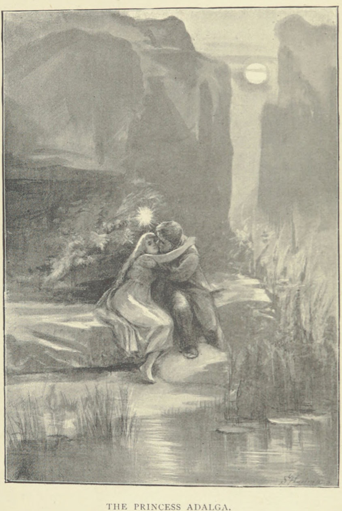
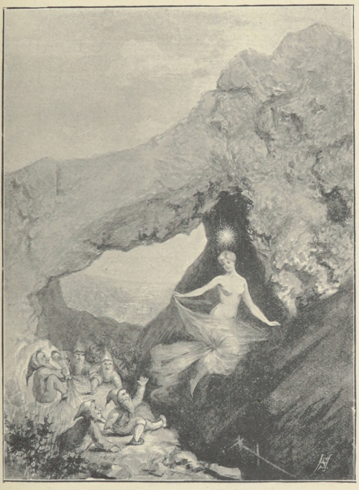
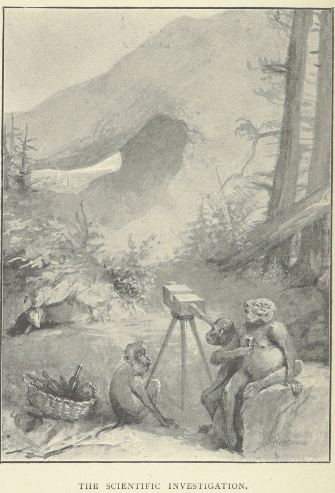
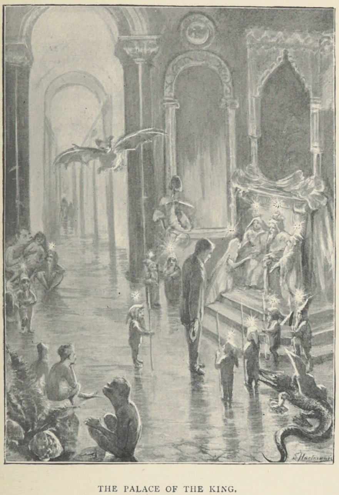

# 小人たちのあいだで（フランツ・ハルトマン）

フランツ・ハルトマン著／全訳

- 原題：Among the Gnomes: An Occult Tale of Adventure in the Untersberg, by Franz Hartmann, M.D.
- 内容：ザルツブルク近郊の霊山ウンタースベルクを舞台にした諷刺的なオカルト冒険譚。小人（ノーム）の存在を「反証」するために山へ乗りこんだ懐疑派の学者三人に同行した語り手シュナイダー氏が、嵐を避けて入った洞穴の奥で小人の王国に迷いこみ、王女アダルガに「人間」としてあがめられる。やがて彼は小人たちに近代の論理と懐疑とを教えこみ、王国を「文明化」してしまう
- 刊行：London, T. Fisher Unwin, 1895年（挿絵入り）
- 作業の基にした本文：Global Grey の電子版。挿絵は Internet Archive 所蔵の1895年初版のスキャンから採った
- 著作権：ハルトマンは1912年に死去。日本・米国・英国で保護期間が満了している
- 訳者：人工知能（Claude Opus 5.5）
- 訳の性格：全八章と、原書に付された「印刷者注」三つとをすべて訳した。訳者の調べたかぎりでは、日本語訳は出ていない

## この本について

　フランツ・ハルトマン（一八三八〜一九一二）はバイエルン生まれの医師で、アメリカで開業したのちに神智学協会に加わり、インドのアディヤールでブラヴァツキーのもとにいた。のちにヨーロッパに戻って、パラケルススや薔薇十字、ヤーコプ・ベーメについての著作を多く書き、ドイツ語圏の神智学運動の中心人物のひとりとなった。

　『小人たちのあいだで』は、そのハルトマンが書いた小説である。ウンタースベルクはザルツブルクの南、ドイツとオーストリアとの国境にそびえる山で、カール大帝が山の中で眠っているという伝説や、小人や「野の女」の住む山として古くから知られてきた。ハルトマン自身、一八九〇年代にはこの山に近いハラインで療養所を営んでいた。

　物語は二つの調子からできている。前半では、何でも「くだらん！」と片づける科学者クラッカー教授と、誰もが信じなければならない「学の聖書」を夢見る牧師スティフボーンとが、さんざんに笑いものにされる。洞穴の中で語り手は、パラケルススの説くような元素霊としての小人たちに出会う。彼らは自分の思うことしか言えず、嘘というものを知らず、知性の度合いに応じて光る。小人たちから見れば、「人間」とはかつて地上にいた神のような存在であり、いま地上をうろついているのは夢の中の夢にすぎない化け物なのである。

　後半では諷刺の矛先が語り手自身に向かう。彼は王女に論理学を教え、「証明してください！」としか言わない懐疑家に仕立ててしまう。小人たちは嘘と疑いと賄賂とを覚え、光を失い、ついには空気の精の国に攻めこむ。燐の脳をもつ緑の蛙の像「ルシファー」が象徴するように、ここで笑われているのは知識そのものではなく、霊的な知覚を欠いた知性の傲慢である。

　なお、原書には「印刷者注」と称する短い注が三つ付いている。語り手の語る神秘体験に、科学的な立場から異議を唱えるという体裁の、作者自身の諧謔である。本訳では〔※1〕のように示し、章末に訳した。

---

## 第一章　序

　「自然の夜の側」の探究にまじめにかかわったことのある者、あるいはテオフラストゥス・パラケルススの著作を研究したことのある者で、名高い「ウンタースベルク」（「下界の山」）と、その神秘的な住人である妖精や小人（ノーム）を知らない者がいるであろうか。オーストリア・アルプスの巨大な前哨のように、この雪をいただく山の翼はドイツの国境に立ち、丘と森と湖とが点在するバイエルンの平野を見下ろしている。雲の上に住まうその頂は、ザルツァッハ川がイン川とドナウ川とへと曲がりくねって流れる谷を見下ろしている。ザルツブルクの町が丘のあいだに抱かれている北側から見ると、山は十分におとなしく見え、森に覆われた波打つ線をなして七千フィートほどの高さまで昇っている。しかし南側では、それは何千フィートもの高さの大理石の岩でできた、ほとんど際限なく変化に富む垂直の壁を見せ、深い峡谷と裂け目、ごつごつした崖、山稜、絶壁に断ち切られている。春、雪が解けはじめるころ、その上を大きな雪崩がとどろきながら落ちてくる。そして鋭い目は、近づくことのできない多くの場所に、あの神秘の山のはらわたへと貫いているように見える神秘的な洞穴を見つけることができる。もしこれらの目のくらむ高みに登る労をいとわないなら、汝は新しい世界にいることに気づくであろう。そこではウンタースベルクは一つの山としてではなく一つの山脈として現れ、そのおのおのの環はそれ独自の様相と性格とをもち、山の流れのほとばしる深い裂け目によって隣から隔てられている。滝と洞穴と岩の迷路とは際限がなく、慣れない旅人はそこで道に迷うかもしれない。とりわけ小人たちに惑わされればそうである――そしてそれは、その者の意図が清くなければたやすく起こりうるのである。

　ウンタースベルクには自然の元素霊のある種類が住んでいることが知られている。あるものは善良で慈悲深く、ほかのものは邪悪で悪意があり、人類に敵対的である。そしてその近くの人々のあいだには、洞穴の中や、金と宝石とで満ちた豪華な大理石の広間や岩屋の中に住む小人、妖精、野の女、巨人の行いについての話が数えきれないほど伝わっている。その金と宝石とは、日の光の中で見ると枯れ葉と石とに変わってしまうのである。友好的な部族のあるものはある機会にウンタースベルクから出てきて、ときに我々の存在の次元の住人と交わり、百姓たちの踊りや楽しみに加わり、迷子の子どもたちをウンタースベルクへ連れていくことさえあると言われる。そして信じがたく思われるかもしれないが、「知る者たち」によれば、我々の世界の市民と小人の王国の住人とのあいだに結婚が行われたことさえあり、これらの自然の霊は、自らは不死ではないので、不死の人との結合によって不死を得ようとするのだという。それゆえ小人たちの大多数は、素朴で正直で世慣れない人間、すなわち不死の霊の光をその中に認めることのできる魂をもつ人を愛し、そういう人とは交わる用意がある。しかし魂のない存在、たとえば世ずれした、懐疑的な、傲慢な、近視眼的な、独りよがりの科学者――その心は死に、その脳は自分の空想の産物でふくれあがっている――とは何のかかわりももとうとしない。そういう者には決して姿を見せず、彼らがその王国に侵入しようとしてやってくるたびに、いたずらをしかけて楽しむのである。

　もちろん、ウンタースベルクの神秘の深みの中に、大いなる皇帝の魂がそのアストラルの姿で住んでいることは誰もが知っている。そこで彼はその随員とともに、祖国の解放を待ちながら魔法の眠りを眠っている。ときにまったく突然、晴れた夏の日にさえ、山腹から雲が出てくるのが見られる。洞穴や絶壁から、グロテスクな形の幽霊のような霧が立ちのぼり、頂のほうへゆっくりと這い、すべるように昇ってゆく。そして近くの峰々からも、怪物のような形の、ときに巨大な大きさの雲が漂ってきて、ついにウンタースベルクの頭は、濃く暗くなってゆく蒸気のうねる海に取り巻かれる。そのとき雷鳴が岩を通って響きわたり、何百ものこだまを目ざめさせ、枝分かれした稲妻が谷へとひらめき下る。嵐の王が起き上がり、森を通って陰鬱にうなり、老木をへし折って下の絶壁へと投げこむ。そのような折には、谷の人々は敬虔に十字を切り、互いにささやく。「大いなる皇帝が目をさまし、その軍勢を閲兵しておられる。ウンタースベルクの頂のまわりにまだ黒いからすが飛んでいるのを見て、お怒りなのだ」。これはもちろん寓話だと私は思うし、「ウンタースベルクの皇帝」は賢者たちにはよく知られている。しかしここに触れた黒い鳥については、それは汝がしばしば出会うかもしれない、黒い衣をまとった頑固なある紳士たちによってあらわされている。皇帝が待っている解放もまた、私には、何かの外国のくびきからの解放ではなく、利己心とその結果である悪とからの贖いであるように思われる。あわれな皇帝よ！　汝はその王国の支配を取り戻すことができるまでに、小人の世界の中でさらに千年待たなければならないかもしれない。安らかに眠れ！　その時は汝には長く思われないであろう。苦しむのは汝ではないのだから。そして眠りの中にも永遠の中にも時の測りはないのだから。

　近代の文化と、それにともなう詭弁と懐疑との増大のために、小人たちとの目に見える交わりは比較的まれなこととなった。とりわけ、彼らの親切がしばしば濫用され、その奉仕が誤って用いられてきたからである。それはつぎの話が示すであろう。それは以下の章で語られるできごとと無関係ではないので、ここに差しはさむことを許していただきたい。

　ザルツブルクの町から少し離れた、松の森に覆われた丘の上に、昔トレンシュタインの城が立っていた。いまはそのわずかな名残しか残っていない。壁は崩れているが、それはかつてそれが宮殿のような建物の一部であったことを示している。巨大な四角い石でできた一つの名残は、祝宴の行われた大広間の広さをいまも示している。そしてある夜には、これらの石の目撃した乱痴気騒ぎが、亡くなった貴婦人と騎士たちとの幽霊のような姿によって、アストラル光の中で幽霊のようにくりかえし演じられると言われる。一方、そう遠くないところには、どっしりとした造りの崩れかけた塔があって、地面の深い穴を囲んでいる。そこには地下牢があった――「ウーブリエット」、すなわち生きた墓であり、そこではあわれな者たちが何かの罪のために生き埋めにされて「忘れられ」、飢えるか窒息するかにまかされたのである。大広間の幽霊たちがぞっとする酒宴を開く夜のあいだ、その井戸の底から叫びとうめきと泣き声とが聞こえてくると言われる。これらのことを信じるのは私には難しくない。我々のこの物質の世界の生きている者のあいだにも、ぜいたくと悲惨とが隣りあう似た例をしばしば見いだすのだから。

　昔、城の持ち主はブルクハルト・フォン・トレンシュタインであった。若く勇ましい騎士で、その頭を飾る豊かな金髪のゆえに国じゅうのすべての貴婦人に賞賛されていた。これがその男らしさと美しさと相まって、すべての美しい貴婦人の心を彼にかちえさせた。ただひとりを除いて。そしてそれこそが彼が手に入れたいと渇望したまさにその人、すなわちたいへん美しいが誇り高いユリア・フォン・ホルストであった。

　彼は彼女を一度見ただけであったが、それでその顔と姿とに絶望的に恋するのに十分であった。彼女の黒くものうげな目を見て心の平安を壊されるという不幸に見舞われるまでは、彼は十分に幸福であった。そのときから、美しいユリアの像が彼の心の中に形づくられ、その観想が彼を夢中にさせたので、彼はほかのことを何も考えなかった。以後、ユリアへの思いのほかには何も彼を引きつけなかった。彼は自分の思いの理想に求婚し、それを手に入れようとした。しかし、ああ！　彼のため息と涙とはみなむだであった。彼の家は貧しく、誇り高いユリアは愛よりも金をはるかに気にかけたのだから！　彼女は、ブルクハルトの財産が自分の望むすべてのぜいたくを満たすには小さすぎることを知っていた。それゆえ彼が心をささげると、彼女はそれを退け、冷笑して言った。

　「あなたの家で飢えが待っているなら、あなたの心が私に何の役に立つでしょう」

　この侮辱的な言葉は、そのころの騎士が辛抱強く耐えられる以上のものであった。ブルクハルトはその貧しさを呪いながら、絶望して家に帰った。日ごとに彼はますます不機嫌に憂鬱になり、その資力の不足を嘆いた。ついに彼は、見つけうるどんな手段によってでも富もうと決心し、ウンタースベルクの小人たちからその宝を奪おうと決めた。

　そのころは、ほとんど誰もがよい忠告を与える用意のある賢く忠実な執事をもつのがならわしであった。ブルクハルトの執事は、この邪悪で危険な企てを思いとどまらせようと最善を尽くした。しかしブルーノ老人――これが彼の名であった――が、悪い考えをやめ、彼の愛情にまったく値しない誇り高いユリアを忘れるよう懇願してもむだであった。騎士は耳を貸そうとしなかった。

　「主のお慈悲がありますように！」とブルーノは叫んだ。「この迷いを振り払いなされ、おお気高い騎士さま。あなたの高い家柄と、ご先祖さまが何とおっしゃるかをお考えなされ。あなたの救いのあるところ、上をごらんなされ。下界の霊はあなたを惑わし、破滅させますぞ」

　しかし騎士は答えた。「私は臆病者ではない。私は命を失うことを恐れない。ユリアを手に入れられないなら、命など私には何の値打ちもないのだから。私は戦いに加わっていて、一度ならず死の顔をのぞきこんだことがある。私は小人の金が欲しい。そしてそれを手に入れなければならない。どんな結果になろうとも。もし小人たちがその金を渡そうとしないなら、力ずくで奪ってやる」

　こうしてよい忠告をはねつけ、騎士は自分の黒い軍馬を引いてくるよう命じた。彼はそれにまたがり、ウンタースベルクのほうへ馬を進めた。

　それは十一月の陰鬱な夕べであった。木々の葉は黄色と赤とに変わり、風にさらさらと鳴り、その声は彼に進むなと警告しているように思われ、揺れる枝は彼に戻れと手招きしていた。まもなく夜の女王がその外套を地の面に広げはじめ、闇の中に巨大な影のように、神秘のウンタースベルクの輪郭が立ち現れた。一瞬、恐れが若者をとらえ、彼は止まった。しかし欲望が恐れに打ち勝ち、誓いの言葉を吐いて馬に拍車を当て、押し進む決心をした。ちょうどそのとき馬がおびえて跳ねた。見上げると、ブルクハルトは道ばたに鋼のような青い衣を着た一人の小人が座っているのを見た。小人はきらめく目でじっと騎士を見つめた。

　「失せろ！」とブルクハルトは怒って叫んだ。「何のためにそこに座って、わしの馬を驚かすのだ」

　「ほう！　ほう！」と小人は笑った。「知るがよい、地を這う虫けらめ、わしは小人の王ピュポだ。宝とともにウンタースベルクはわしのものだ。わしの領地で何を探そうというのだ」

　ブルクハルトはこれらの言葉を聞くと、小人の王には丁寧に話すのが賢明だと考えた。それで彼は王に自分の境遇を説明し、いくらかの金を貸してくれるよう頼み、そのかわりに永遠の感謝を約束した。

　王はうなった。「おまえの感謝などくそくらえだ」と彼は言った。「そんな安い値で手に入るなら、わしから金を借りに来るおまえのようなみじめな者はいくらでもいるだろう」

　「それでは何を求めるのですか」と騎士は尋ねた。「条件を言ってください。受け入れます。どんな値を払っても金が要るのです！」

　「では聞け」と小人は言った。「わしの求めるのはたいしたことではない。千フローリンごとにおまえの頭の髪を一本だけ」。こう言って、彼の目は探るように騎士の顔に注がれた。

　「頭の髪をたった一本？」とブルクハルトはたいへん驚いて叫んだ。「ユリアの好意を得るのに必要な金さえ出してくれるなら、髪などどっさりくれてやる。どうぞ持っていけ」

　「おまえの引き出せる額に限りはつけぬ」と王は笑った。「わしから受けとる千フローリンごとに、おまえは頭の髪を一本わしに残してゆかねばならぬのだ」

　「取引成立だ！」と騎士は喜んで叫び、短剣を抜いて、額から髪の一房を切って王に差し出そうとした。

　「そうではない」とピュポは言った。「一度に一本だけだ。そしてわしが自分で根もとから引き抜かねばならぬ」

　それで騎士は馬を降りた。そして彼がかがむと、小人は彼の頭皮から髪を一本引き抜き、それからブルクハルトの足もとに金の袋を投げた。

　「ありがとう！」と騎士は叫び、袋を抱きしめ、その中身にほくそえんだ。

　「礼など要らぬ」と小人は答えた。「おまえのユリアの貪欲を満たすのに十分な金を買うには、そのうちおまえの頭の髪が少なくなりすぎぬよう、気をつけるがよい」

　こう言って小人は消えた。しかし騎士は金の袋を持って城に帰った。彼はいまやすぐに家を見事な様式で広げ改めはじめた。高価な家具と飾りとを買い、召使いと料理人とを雇い、晩餐と舞踏会との招待状を送り出した。そして毎晩彼はもう一袋の金を求めてウンタースベルクへ行き、そのかわりに髪を一本残してきた。

　まもなくブルクハルト・フォン・トレンシュタインの富の知らせが広がりはじめ、誰もが驚き、騎士の見せるぜいたくを見て賞賛しにやってきた。いまやユリアの承諾はたやすく得られた。そして幾日もたたないうちに、城の壁は陽気な音楽とお祭り騒ぎと笑いとで鳴り響いた。勇ましい騎士と美しい伯爵令嬢との結婚が行われたのである。国じゅうのすべての貴族が招かれ、祝宴に加わった。

　以後、トレンシュタインの城はあらゆる種類の祝いのとぎれない連続の舞台となった。回転木馬があり、家の扉は昼も夜も訪問者に開かれていた。あらゆる種類の居候が城に住みついた。晩餐、舞踏、仮面舞踏会、馬上槍試合、芝居、狩りの遠出が果てしなくつづいた。そして美しいユリアは、心ゆくまでへつらう者と賛美する者とに囲まれるという甘い満足を得た。しかし彼女の欲望は満たされるのに比例して大きくなり、その虚栄はくすぐられるのに比例して大きくなった。彼女の気まぐれは計り知れなかったが、夫の資力は尽きることがないように見え、彼は誰からもうらやまれた。

　ウンタースベルクへの彼の訪問はますます頻繁になり、そのおのおのから彼は千フローリンの金を持って、しかし頭の髪を一本少なくして帰ってきた。それでも彼は幸福ではないように見えた。彼は、自分が愛の見かけしか買っていないこと、妻は彼ではなく彼の金だけを愛していることをあまりにもはっきりと見たのだから。そして彼が妻の理不尽でとほうもない要求にすぐに応じないときにはいつでも、彼女は彼をさげすみをもって扱い、生きることを彼にとって重荷にした。このすべてが彼に大きな悲しみを引き起こし、彼はそれを酒杯の中に沈めようとした。こうして彼はついにどうしようもない酒飲みとなり、嫌悪の的となった。彼の本性の中のすべての悪い芽が豊かに育ち、実を結びはじめた。彼は弱虫となり、臣下に対しては残酷な暴君、妻の前ではみじめな臆病者となり、妻は彼を奴隷のように扱った。彼の苦労は彼を早く老けさせ、頭の髪は日ごとに薄くなった。

　こうして数年がたいへんみじめなうちに過ぎ去り、ついにあわれなブルクハルトはすっかり禿げ頭になった。最後のフローリンもなくなった。しかし伯爵夫人は大きな馬上槍試合と晩餐とを命じており、多くの貴族と身分の高い貴婦人とが招かれていた。もう一度ブルクハルトは小人の王に金を求めるためにウンタースベルクへ行った。しかしそのかわりに与える髪はもうなかった。小人が現れると、騎士は兜を脱いで、王のあわれみをかきたてることを望んで、その頭皮の嘆かわしい状態を見せた。

　「ああ、ブルクハルト！」とピュポは叫んだ。「髪が少なくなりすぎぬよう気をつけよと言わなかったか」

　「いま自分の愚かさがわかりました」と騎士はため息をついた。「でもお願いです、恥を免れるために、もう一袋だけ金をください」

　「は！　は！」と小人は笑った。「何もなければ何もない。髪がなければ金もない。わしらの取引はおしまいだ！」

　「何でもお求めください！」と騎士は叫んだ。「でも髪はもう差し上げられません。私の魂を取ってください。でもただ一袋の金をください。ただ一袋の金をお願いしているのです！」

　しかしブルクハルトが小人に懇願してもむだであった。ピュポは容赦なく、彼を笑った。これがブルクハルトをいらだたせ、彼は激怒して叫んだ。「地獄の犬め！　おまえは悪魔の仕事をなしとげた。わしの頭から髪を一本取るたびに、おまえはわしの男らしさの一部を奪ったのだ。いまこそおまえが悪魔だとわかった。わしの失った力を返せ。おまえの呪われた金によってわしから奪ったあの美しい金髪を返せ。それを返せ。さもなければトレンシュタイン家の復讐を覚悟しろ！」

　しかし小人は笑った。「愚か者め！」と彼は言った。「わしを怖がらせたいのか。おまえは、欲しいものをすべて与えてくれた者をいま呪うのか。わしはおまえとそのおどしとを笑う。しかし髪を返してほしいなら、そうしてやろう！」

　こう言って小人はブルクハルトの髪で撚った紐を取り出し、騎士の足もとに投げた。それから彼はウンタースベルクの深みの中に消えた。一方、四方から、まるで目に見えない見物人の群れから来るかのように、あざける笑いが空気を揺るがした。しかし騎士は家に帰り、寝室に閉じこもった。

　トレンシュタインの城では、大きな馬上槍試合の始まりに向けてすべての準備が整っていた。きらめく鎧の騎士たちと高価な衣装の貴婦人たちとが広間に群がり、一方、下の中庭では、派手な色の服の馬丁に付き添われた豪華に飾られた馬たちが、模擬戦の始まりを待ちきれずにいななき、地を踏み鳴らしていた。その始まりに必要なのは、いまや主人の出席だけであった。ラッパが鳴った。しかしブルクハルトの姿は見えなかった。何度も使いが彼の部屋へ送られたが、扉は鍵がかかっていて入れなかった。ついにユリアがしびれを切らし、拳を握りしめて、この遅れの原因を問いただしに上がっていった。しかし扉を叩いても返事はなかった。それで彼女は扉をこじ開けるよう命じた。するとぞっとする光景が彼女の目に入った。ブルクハルト・フォン・トレンシュタインは寝台の上に死んで横たわっていた。その顔は、大きな苦しみのうちに死んだかのようにゆがんでいた。首のまわりには黄色い人の髪の紐が結ばれており、彼はそれで絞め殺されていた。目は眼窩から飛び出しそうに突き出ていた。そして指は、千フローリンの金を入れた袋をけいれんしたように握りしめていた。これがトレンシュタイン家の終わりであった。

　さて、つぎの物語を書くことの言いわけである。

　もしブルクハルト・フォン・トレンシュタインのこの話が、ザルツブルク公国の古い騎士たちの家の歴史を収めた記録保管所から掘り出されなかったなら、以下の章は決して書かれなかったであろう。これらの信頼できる文書の発見が、いまは亡き私の友人シュナイダー氏から聞いた話を私の記憶に呼び戻したのだから。彼自身が、私がこれから述べようとする冒険の参加者であった。

　ブルクハルト・フォン・トレンシュタインの死からずっとのち、その話を聞いた三人のたいへん学識ある紳士が、どこか遠い国から――おそらく暗黒大陸から――やってきたらしい。彼らはたいへん懐疑的な気質で、小人を信じず、自然の霊の存在を反証する目的でその旅を企てたのであった。彼らはある学会に属しており、その目的は超自然を廃止し、あらゆる種類の理想から注意をそらして人類の酔いをさまし、物質の生活の乾いた固い事実へと連れ戻すことであった。その学会はすでに多くの重要な仕事をなしとげていた。彼らはある論理の体系によって、神と霊と魂との存在を反証し、生命あるいは意識と呼ばれるすべてのものは、偶然に互いに接触する死んだ物質の分子の機械的な運動によってもたらされる摩擦の結果にほかならないことを示していた。我々がまもなく知りあう三人の紳士は、霊と小人とへの迷信的な信仰に最後のとどめを刺す目的で、超自然廃止協会によって委員会として任命され、その目的でやってきたのである。彼らは、肉の目で見ることも肉の指でつかむこともできないものへの信仰は、時代遅れの迷信がしまいこまれる屋根裏部屋に追いやられるべきだと固く決心していた。

　しかるべき協議ののち、これらの紳士は、幽霊が出ると言われるウンタースベルクの洞穴の一つへ学術探検をすることに決めた。そしてシュナイダー氏は、当時若く元気な男で、山の地勢によく通じていたので、彼らに同行するよう招かれた。遠出は聖ヨハネの祝日の前日、すなわち六月二十三日に行われた。しかし何年であったかは私の記憶から抜け落ちてしまった。シュナイダー氏の経験した冒険は、以下のページで彼自身によって語られる。

## 第二章　竜の穴にて

　ウンタースベルクの頂から千フィートほど下、名高い「ケーニヒスゼー」と呼ばれる湖から来る澄んだ流れの走る谷へと突き出ている山稜の一つの頂からそう遠くないところに、何百フィートもの高さのほとんど垂直の岩の斜面の中に、広い洞穴がある。「竜の穴」と呼ばれるこの洞穴、すなわち穴は、牛の群れ全体の避難所となるほど広く、尖塔もろとも相当な大きさの教会をその中に置けるほど高い。その天井は張り出した岩でできており（我々の絵に示されているように）、穴はトンネルのように丘の一方の側から他方の側へと通じている。それで下から見ると、その向こう側の空と星とが見えるアーチのように見えるのである。

　この穴には昔、たいへん奇妙な種類の極悪な竜が住んでいたと言われる。それは良心も理性も常識ももたず、しかしきわめて利己的であった。その最大の楽しみは、すべてを切り刻み分析し、理想的な性質のすべてを壊すこと、すなわちむき出しの事実をさらすために、すべての高められた美しいものから衣をはぎとることであった。竜はそのむき出しの事実をたいへん好んだので、すべての生きものの骨だけがその本質的な部分だと思いこんでいた。それで竜は犠牲者の肉をはぎとって、その骨をむさぼり食った。竜はその穴の高みから丘の両側を見下ろし、きれいな娘がアルプスの薔薇やエーデルワイスを探して岩のあいだをさまよっているのを見るたびに、彼女に飛びかかり、穴に引きずりこみ、切り刻み、すべての肉をはぎとって、骨を一つ一つむさぼり食った。のちに竜は谷へ移住したと言われる。しかしその穴は、小人の非存在に関する調査のための委員会によって選ばれたのである。

　先に進む前に、読者に我々の友人たちを紹介しておく必要があろう。まず第一に、トマス・クラッカー教授がいた。世界のほとんどすべての学会の会員であり、大懐疑家であって、その想像力を長いあいだ科学的に訓練した結果、たいへんな程度の科学的懐疑を身につけていたので、わざわざ見る労をとらずにつねにすべてを知っていた。自然の中に、彼が理論を発明していない事実は一つもなかった。そして理論が事実に合わなければ、事実のほうが悪いのであった。彼は名高くなっていた。そのすぐれた聡明さのおかげで、何年もの粘り強い研究ののち、『不思議の国の小さなアリス』と題するある書物は寓話にすぎず、歴史的事実にもとづいておらず、その目的は無知な者を煙に巻き、不用心でだまされやすい人々をかつぐことにあると発見するのに成功したからである。この業績によって得た大いなる功績のゆえに、学士院の会員の名誉と称号とが彼に授けられた。

　クラッカー氏の父は雑貨屋の主人で、自分の作ったものでないもの、あるいは自分の店に置いていないものはすべて無視し、さげすんで扱うのが習いであった。それでも、彼が売り物として置いていたよい品物のあいだには、流行遅れになったものが多くあった。彼はそれを新しい様式に仕立てなおし、ニスを塗り色を塗り、近代的な名の新しいラベルを貼って、真新しいものとして広告するのが習いであった。こうして彼はよい商売をし、評判を得た。

　息子のクラッカー教授は寸分たがわず父に似ていた。ただ、もっと手に触れることのできない品物を商っていた。彼もまた、自分や同僚が製造した理論と一致しないすべてのものを無視し、さげすんで扱うのが習いであった。それでも、彼の信条の品目のあいだには、何世紀も前に教えられたが流行遅れになったある教えがあった。彼はそれを忘れられていた屋根裏部屋から下ろしてきて、近代の様式に着飾らせ、近代の言いまわしでニスを塗り、新しく発明した名のラベルを貼って、真新しい発見として、あるいは自分の発明した品物として広告するのが習いであった。こうしてクラッカー教授は学を商い、評判を得た。

　つぎはジェレマイア・スティフボーン師であった。聖職者で、家では見いだせない真理を求めて旅することができるよう、その会衆から気前のよい額の金を受けとっていた。スティフボーン氏はあらゆる種類の権威によく通じており、ほとんどどんな意見を支持するためにもほとんどどれだけの数の書物でも引用することができた。彼は多くの科学的・宗教的な著作の内容を知っていたのだから――すなわち、そこに何が書かれているかを知っていた。しかし主題そのものについての彼の知識について言えば、それが何であったかを決めるのは難しいであろう。彼はある日はこの著者の真実を、つぎの日は別の著者の真実を信じ、彼が信を置いた著者が当座の彼にとって唯一の誤りなき者だったのだから。こうして彼は、酔った状態の人のように一つの意見から別の意見へと転びながら、知恵の道をよろめき歩いた。しかしジェレマイアがこの不確かさと動揺との状態を愛していたと考えてはならない。彼が何よりも望んだのは、真実で信頼できるものとして十分に頼ることのできる科学と宗教との体系をうち立てることであった。誰もが真実として受け入れなければならない品目と科学的な教えとを含み、そこにある意見が学の最終の命令であって、反論の余地なく、改良の余地なく、まったく正しいと固く確信して、安らかに眠りにつくことのできる体系を。

　以上の二人の紳士の外見について言えば、クラッカー教授は背が低く、がっしりしていて、赤ら顔で、灰色の頬ひげ一対を除いてきれいにひげをそっていた。その小さな目はたえず落ち着きなく一つのものから別のものへとさまよい、腕はふつうでなく長く、しかし脚は短くがにまたであった。そしてこのすべてがどういうわけか彼にマンドリル（キュノケファルス・マイモン）の姿を与えていた。こう言っても教授の気を悪くすることにはならないであろう。人間全体が猿から下ったというのが、彼自身の固い意見だったのだから。彼はその長い祖先の系列を満足げに眺めさえし、体の強さにおいてではないにせよ、推論の術においてはどうにか祖先をしのぐようになったことを誇っていた。

　スティフボーン師について言えば、彼はクラッカー教授の逆に見えた。彼はやせて背が高く、何か大洪水以前の鳥の骨の寄せ集めのように見えた。その顔立ちは鋭く、頭はほとんど禿げ、口は大きく、あごと鼻とは長く突き出ていて、まるで互いに出会おうとしているかのようであった。鼻の上にはたいへん大きな緑の眼鏡をかけ、それが彼をふくろうに似ていなくもないように見せていた。しかしその鼻とあごとは、ニュルンベルクの町で作られ、世界じゅうの子どもたちの喜びである、よく知られた木のくるみ割り人形の一つに彼を似させていた。

　最後に、探検の商業事務の管理者、モーゼス・エイブラハム・スカラワグ殿がいた。その外見は、彼があまり理想家ではなく、この世のよい物質的なものを好み、ある種類の「スピリッツ（酒）」には嫌悪をもたないことを示していた。彼は、化け物や幽霊や小人などを信じることを堕落した迷信として非難していたけれども、もしブルクハルト・フォン・トレンシュタインの話が本当なら、ウンタースベルクの小人たちの財政状態を調べてみる価値があるかもしれないと、どこかで考えていた。

　我々には、食料と学術器具とを運ぶ案内人がついていた。この案内人は、一五二九年にウンタースベルクの小人たちのあいだで十日を過ごしたと評判のラザルス・ギッチュナーの直系の子孫であった。我々は彼に話をさせようとしたが、案内人は先祖がその訪問のあいだに何を見たかを明かそうとしなかった。それも驚くにはあたらない。ラザルス自身、告解室の中の司祭のほかには誰にもそれを明かさなかったのだから。それについて知られるようになったのは、彼が入る前とはまったく変わった人になってウンタースベルクから出てきたということ、そして司祭もまた、告解を聞いたのちに自分自身ひどく変わってしまい、日曜の朝に九柱戯をするのさえやめ、引きこもった生活を送り、まもなく聖性の香りのうちに死んだということだけである。

　明るい日であった。大地は、水仙と羊歯との上にまだ残っている朝露によって生き返ったように見え、露はそこで日の光の中にたくさんの小さなダイヤモンドのようにきらめいていた。空気は松と野生のタイムとの香りで匂い、そよ風は谷から刈ったばかりの干し草の香りを運んできた。丘の斜面では山羊が平和に草を食み、そこからは小さな滝が千の段をなしてほとばしっていた。下の景色には静けさと厳かさとの気配が漂い、遠くの村の教会の鐘の音がそれを破るだけで、それは孤独の中に調和して響いていた。

　しかしこのすべてについて、我々の委員会の会員たちは何も見ず、聞かず、嗅がず、知らなかった。おのおのが自分の考えに没頭していたのだから。クラッカー教授は、かつらをステッキに引っかけて肩にかつぎ、小人説の撲滅が自分にもたらす栄光の予感にふけりながら、ゆっくりと進んだ。スティフボーン師の長い上着の裾は、彼がでこぼこの道を大股で進むにつれて風にはためき、彼の考えは、小人の非存在についての議論の余地のないもう一つの教えを、彼の「学の聖書」に加えることができるという見通しに没頭していた。スカラワグ氏はできるかぎりよたよたと進み、何も特に考えず、しかしたびたび立ち止まっては額の汗をぬぐった。ついに彼は叫んだ。

　「小人なんぞくそくらえだ！　あの穴まで登って、そんな動物が存在しないことを反証するのに貴重な時間をむだにする値打ちがあるんですかね」

　これにスティフボーン師は答えた。

　「小人は動物ではなく、想像上の存在です。テオフラストゥス・パラケルススは、それを自然の中の知的な力として描いています。それが何を意味するにせよ。それは身の丈六インチほどですが、体を変えたり引き伸ばしたりすることができるのです」

　「しかしもし単に想像上のものなら」とスカラワグ氏は尋ねた。「どうやってその身の丈を決められるんです。やってみれば、千フィートだと想像することだってできるでしょう」

　「くだらん！」とクラッカー教授がさえぎった。それは、自分の知らない何かが話に出るたびの、彼のお気に入りの言いまわしであった。「くだらん！　自然の知的な力などというものはない。想像上のものも、そのほかのものも。この堕落した迷信は十分に長くつづいた。今日こそそのような気まぐれに終止符を打つのだ」

　「それではあなたは」とスカラワグ氏はいささかがっかりして尋ねた。「ウンタースベルクの小人の宝は存在しないと固く確信しておられるのですか」

　「それは愚か者の想像の中にしか存在しない」と教授は答えた。「霊などというものはありえない。今日、私の新しい霊視鏡によって、それを諸君に証明してみせよう」

　「奇妙なことに」とスティフボーン師がここで言った。「いまなおそのような迷信的な信仰をひいきする尊敬すべき権威がいくらかいるのです。聖書でさえ、一度ならず霊の存在に触れています」

　「くだらん！」と教授は答えた。「ほかの点では知的な人々のあいだに賞賛者を見いだせないほどばかげた理論はない。蒸気で引かれる車を作ることが可能だと思いこんでいる多くの愚か者のことを考えてもみたまえ！」

　「それではあなたは、鉄道を作ることはまったく不可能だと信じておられるのですか」とスカラワグ氏は尋ねた。

　「鉄道だと！」とクラッカーはせせら笑って叫んだ。「くだらん！　正気の人間なら誰もそんなことを考えはしない。蒸気は吹くことはできる。しかし車を引くことはできない。もし蒸気機関が発明されたら、それはみんなをやけどで殺してしまうだろう。いまマンチェスターとリヴァプールとのあいだに鉄道を作ることが可能だと思いこんでいる、あの奇矯で狂信的な人々について言えば、我々、今世紀の科学者は、そのような途方もない、とっぴな計画を調べるのに時間をむだにすることはお断りだ、と言うほかはない。たとえある新聞に書かれている話が嘆かわしい気まぐれではなく本当であり、そのような機関を発明することが可能であったとしても、それは我々の関心を引かないであろう。確かに、時速十六マイルという恐ろしい速さで走る機関に、自分の命と安全とをゆだねるほど狂った者は誰もいないだろうから！　いや、あなた！　鉄道を作るのは、石が天から落ちてくるのと同じく不可能だ。その不可能の理由は学士院が指摘したとおり、すなわち空には石がないからである」

　この会話が、隕石が知られ鉄道が動くようになる前の時代に行われたことに注意されたい。今日では、そのような科学的無知の披露はもちろん不可能であろう。

　「かりに」とスティフボーン師は言った。「議論のために、平らな平野の上なら鉄道を作れると認めるとしましょう。山に来たら彼らはどうするのでしょう。山に穴を掘り、暗闇の中を通り抜けなければならないでしょう。そして向こう側の端から出てくると、乗客は突然光の中に現れることになる。この突然の変化は疑いなく彼らの目をつぶすでしょう」

　「疑いなくそうなるでしょう」とクラッカー教授はつけ加えた。「保護のために旅行用眼鏡をかけないかぎりは。しかし、もし鉄道が作れるものなら、我々はとうの昔にそれを発見していたであろうと、安心してよろしい。そして同じことが、小人や幽霊や霊や、どんな種類の知的な力についても言える。もしそのようなものがあるなら、我々はそれを知っているであろう」

　「それではどうして」と私は尋ねた。「古代の哲学者たちはそのようなことを信じたのでしょう」

　「あなたのような素人には」と教授は答えた。「そのような問いも許されよう。古代の哲学者は愚か者であった。彼らは今日の我々の小学生のひとりが知っているほども知らなかった。リットン卿やゲーテや、そのようなことを語ったほかのより近代の書き手について言えば、彼らがそうしたのは、賢者の楽しみのために冗談を言い、だまされやすい者をだしにしてからかうのが好きだったからにすぎない。我々は、物質なしの霊が存在しないことを知っている。物質は目に見える。したがって霊は目に見える形をもたなければならないであろう。我々はまた、水も空気もない固い岩の中にはどんな種類の生きものも存在できないことを知っている。そして最後に、もし自然の中に何かの知的な力があるなら、それは進み出て科学者にその存在を証明することの重要さを知っているであろう」

　私は、小人への信仰はこの国ではまったくありふれたことだと言い、それは説明できるのかと尋ねた。

　「ばかばかしいほどたやすい！」と教授は言った。「誤りの源は――遺伝的な特異体質、観察をすることにおける科学的訓練の欠如、主観的な、客観的な、流行性の幻覚、軽信、ヒステリー、暗示、夢、催眠、後催眠の自己暗示、などなどだ」

　「それでも」と私は異を唱えた。「小人に触れられ、小人を見、小人と語り、小人から触れることのできるものを受けとった人々がいます」

　「くだらん！」とクラッカーは答えた。「それはみな故意の欺き、ぺてん、詐欺、まやかし、いかさま、剽窃、偶然の一致、テレパシーの衝撃、思考転移、無意識の脳作用、霊媒能力、観念の共感的な連合、などによるものだ。つい最近私は、長い研究をし多くの権威を参照したのちに、『ガリヴァー旅行記』に書かれた話は歴史的事実にもとづいておらず、作者の想像の産物にすぎず、作者はこうして世間の軽信につけこんだのだから、その時代の最大のいかさま師のひとりとみなされなければならないことを発見した。霊か小人かを連れてきて、それが何でできているかを見るために私に解剖させてみたまえ。そうしないかぎり、私はそれはくだらないもの、科学的に訓練されていない脳の乱れた空想の産物にすぎないと言う」

　私はクラッカーの見解にまったくは同意しなかった。それで私は言った。「解剖したり科学の教授に証明してもらったりしなくても、弁髪とほうきの柄とを見分けることのできる人々は、まだいると私は信じます」

　クラッカーとスティフボーンとは不吉な目くばせを交わした。

　「これは」とスティフボーンは言った。「権威への不敬が増したことから来るのです。今日では誰もが、自分の好きなように考え、言う権利があると思いこんでいる。かつて宗教について異端が罰せられていたように、学における異端を罰する法が作られるべき時です。つい最近私は、いわゆる『エネルギー保存』についての新しい異端が説かれるのを聞きました。人々が誤った科学の教えを広めて世間の精神を毒して歩くことを許すべきではありません。我々には、人々がどんな科学的信仰を受け入れるべきかを正確に述べた『学の聖書』がどうしても必要なのです」

　「そのような書物は」と教授は答えた。「世界に最大の益をもたらし、素人や無知な浮浪者のする有害で人を惑わす自分勝手な考えを防ぐであろう。ふつうの人々に自分で考える何の用があるのか。誰も自分の靴や服を自分で作ろうとはしない。それを、自分でするよりもはるかにうまく、安く、速くできる靴屋や仕立屋にまかせる。なぜ同じ方式を、科学や宗教の問題を決めることに当てはめないのか。そのようなことについての考えは、それについて訓練され、資格を与えられた者たちにまかせよう」

　これらの見解にスティフボーン師はまったく同意した。「学は」と彼は言った。「科学者に、宗教は聖職者に、道徳は警察に、医療は医者に、金の事柄は銀行家に、理想的なことは法的に任命された理想家にまかされるべきです。これによって人々は自分自身の物質的な利益にもっと注意を向けることができるでしょう。何の益ももたらさないことを考えるかわりに、豚を育てるような有益なことに時間を用いることができるでしょう。宗教をおろそかにしてはなりません。悪魔への恐れが教会の安全なのですから。しかし毎日曜日に公共の場所に印刷して貼り出される一つの公認の説教があれば、説教者の軍勢の雇用を省き、そのうえいたるところで教えられる教えへの順応を確かにするでしょう。もし人々が音楽を必要とするなら、千人以下の住民の町には手回しオルガン弾きが一人か二人いれば十分でしょう。もし彼らが詩を望むなら、よく訓練され免状を受けた詩作者が一人で国じゅうに供給できるでしょう」

　「これらの問題は」とスカラワグ殿は言った。「最も注意深い考察に値します。時は金なり。生存競争はすべての存在のあいだの第一の法則であり、適者生存はその必然の結果です。おのおのができるかぎり自分の利益の面倒を見、そのほかのことはその目的のために任命された者に見張らせればよいのです」

　「我々こそがそのために任命されているのだ」とクラッカー教授は叫んだ。「そして我々はそれに当たろう。私はつい最近、大群衆を一度に催眠にかけることのできる催眠の新しい方式を発見した。子どもたちを学校へやるかわりに、我々が知らせたいことはすべて催眠によって彼らの頭に入れ、覚えていてほしくないことはすべて後催眠によって忘れさせよう。こうして我々は世界の王となり、我々が糸を引くと人類全体が踊るであろう！」

　これらの議論をつづけているうちに、我々は調査が始まることになっている「竜の穴」に着いた。その場所には霊の存在のしるしは何もなかった。陰気なところは何もなかった。それどころか、平和の気配が景色に漂っているように見えた。洞穴の入口にはかなりの大きさの野薔薇の茂みと、いくらかのアルプスの花とがあり、その中に私はヒエンソウとベラドンナとを認めた。壁はさまざまな色を見せる大理石の岩でできていて、ところどころ苔と羊歯とに覆われていた。日陰の隅にはまだ雪の名残があり、小さな氷河に似ていて、空気を涼しく快くしていた。両側の二つの開口部は見事な眺めを与えていた。

　案内人は――クラッカー教授の霊視鏡の脚を運んでいたので、その動きが大いに妨げられ、少し遅れていたのであるが――いま食料の袋を持って着き、その宝を取り出した。冷肉、鳥肉とチーズ、ハムと卵、バターとパンとが現れ、まもなく委員会によって片づけられた。ビールとぶどう酒とも忘れられていなかった。そしてクラッカー教授はグラスにシャンパンを満たし、それを掲げて「小人の撲滅に」と乾杯の音頭をとった。それにつづいてジェレマイア・スティフボーンが「学の王にして霊視鏡の発明者、クラッカー教授に」と乾杯を述べた。一方スカラワグ氏は、自分の気持ちを述べるにあたって、ウンタースベルクの宝のいくらかを見つけたいと思うと言った。

　軽い食事がすむと、調査が始まった。まず初めに、委員会は「竜の穴」の岩と壁とすみずみまでを注意深く調べた。誰かが隠れて調査者にいたずらをしかけることのできる場所がないことを確かめるためである。彼らは岩の大きさを測り、その堅固さと、地下の洞穴や穴がまったくないこととを確かめた。床はまったく堅固であることがわかり、小人は一匹も見えなかった。それから彼らは、こういう場合につねに必要なように、時と分とを注意深く記録し、空が晴れているという証拠がとられた。風向きはたいへんな正確さで定められ、東北東であることがわかった。気温がとられ、さまざまな温度計が摂氏二十五度、列氏二十度、華氏七十七度を示した。気圧計は海抜五千八百フィートの高さと中くらいの気圧とを示した。どんな小人も霊も現場には現れず、霊的な性格のものは何ひとつ見いだされなかった。必要なすべての準備がなされたのち、クラッカー教授はその霊視鏡を取り出した。すべての心霊研究家の益のために、また全人類への恵みとして、その説明を記すことを許していただこう。

#### クラッカー博士の霊視鏡

　この巧妙に作られた、たいへん単純な、しかしいささか重たい器具は、クラッカー教授の独創の発明であり、それによって彼は、ある対象をじかに見るかわりに、互いに四十五度の角度で向けあうように科学的に配置された四枚の鏡によって生み出される一連の反射によって、それを眺め調べることができた。

　器具の本体は木の箱からなり、その中に上記の四枚の鏡が互いに向かいあうように置かれ、箱には望遠鏡の筒がとりつけられていた。こうして外の対象から来て箱に入る光線は、第一の鏡に像を生み、それが第二と第三とに反射され、最後に第四の鏡に映って、そこで望遠鏡を通して見ることができるのであった。

　装置全体は動く脚をもつ三脚台の上に据えられていて、どの方向にも回すことができた。

　当然、クラッカー教授はそのような自然の手段によって何か超自然のものを発見できるとどうして期待できたのか、そしてじかに目で見ても同じように見えるかもしれないものを、鏡の中の反射で見ることに何の益があるのか、と問われるであろう。第一の問いについて言えば、クラッカー教授は自然のありふれた面の向こうに何かが存在することを認めず、それゆえその発見のための器具を必要としなかった。一方第二の問いについては、彼は、直接の視覚は非科学的で信頼できないと言った。人が見るもの、あるいは見ると信じるものは、不規則な脳の働き、幻覚、欠陥のある視力、恍惚、トランス、透視、そのほかの病によって引き起こされうるのだから。しかし鏡は欺かれることはない――鏡は幻覚に陥ることも、恍惚の状態に入ることもない――鏡は本当に真実であるものだけを示し、そこには何のぺてんもない。直接の視覚は常識をもつふつうの人々には十分によいが、間接の視覚こそが学のためのものである、と。

　これまでこの霊視鏡の大きな功績は、クラッカー教授がくりかえし指摘したように、否定的な結果のほかには何も生み出したことがないことであった。しかしその否定的な結果は、あらゆる機会に例外なく得られてきた。それは実際、どんな精霊も小人も幽霊も霊も、その存在を示したことが一度もなかったのだから。そして器具は疑問の余地のない原理に従って作られていたので、これらの否定的な結果はクラッカー教授の理論の正しさを証明するのに十分すぎるほどであった。

　しかしこの機会には、霊視鏡にどこか具合の悪いところがあるように見えた。鏡の具合が悪かったのか、あるいは科学的で間接的な視覚でさえ人を欺くことがあるのか、明らかに筒の中に何かの暗がりがあり、それは自然の原因では説明できなかった。クラッカー教授は眼鏡を何度もふき、ついにはそれを色眼鏡にかえたが、むだであった。何か暗いもの、一種の影が、間接の視覚の視野の中にくりかえし現れるという事実は否定できなかった。そしてこの何かは生きていたにちがいない。それは、発見できるどんな外の力によっても運動学的に押されることなく、それ自身の中に含まれる何かのエネルギーによって動きまわっていたのだから。教授はくりかえし不吉な言葉「くだらん！」「ばかな！」「ありえない！」を叫んだ。彼の懐疑は霊視鏡の生み出した証拠の前に譲歩しなければならず、ついに彼は小人を発見したという確信に打ち負かされた。彼はいくぶん青ざめて見えた。そして息をひそめ、抑えきれない興奮をもって、同僚たちにその発見を告げた。

　こんどはスティフボーン師が霊視鏡をのぞく番であった。彼もまた影を見、それが動くのを見た。光が観察者の立ち位置と反対の側から器具に入っていたために、スティフボーンの目に向いた霊の部分ははっきりとは見えなかった。しかしその輪郭はときに大きく、ときに小さくなるように見えた。そこから彼は、その霊は小人であると推論した。小人はその形の大きさを変えることができると言われているのだから。

　これらの観察はスカラワグ氏によって裏づけられた。クラッカー教授はもう一度のぞき、まちがいの可能性がまったくないことを確かめると、演説をした。その中で彼は、この時代の最大の発見をすることが自分にとっておかれていたのであり、小人の存在――これまである過度に懐疑的な人々によって疑われていた――は、いまや人類の歴史の中で初めて自分によって証明された、確立された事実である、と言った。

　しかし、ああ！　「この世ははかない見世物にすぎず」、学の証明でさえつねに絶対に真実として頼れるとはかぎらない。教授が演説をしているあいだに、一匹の小さなねずみの頭が筒の口に現れ、あたりに人影がないのを見ると、ねずみは地面に飛び降りて走り去ったのだから。ねずみがどうして霊視鏡の中に入ったのかは、満足のゆくように説明されたことがない。委員会は当惑した顔をし、クラッカーは顔を赤くした。

　「過つは人の常（エラーレ・フマーヌム・エスト）！」とスティフボーンは叫び、スカラワグ氏はつけ加えた。「我々はみな嘘つきだ。いちばんよいのは何も言わないことです」

　委員会はそれ以後も霊を信じはしなかったけれども、この事件ののち、陰気の霊が彼らの上に漂ったことは否定できない。教授の顔にはしかめ面が浮かび、彼は生涯で一度だけまちがったことを認めた。

　彼らがこの件を論じているあいだに、風は東北東から北に変わっていた。そしていまかすかな一陣の風が、一枚の紙きれを洞穴の中に飛ばしてきた。スティフボーン師がそれを見て拾い上げた。そこにはつぎの詩句が書かれていた。

　　おお、鈍き感覚に縛られた愚かなる死すべき者よ、
　　霊は汝自身の内に見いだされねばならぬ。
　　汝自身を知れ、そして自己の知識によって知れ、
　　上なる生命を、また下なる世界の生命を。
　　あらゆる領域で、おのおのの存在は己が同類を知る。
　　霊にのみ、霊は示されうるのだ。

　これらの行を読んだのち、スティフボーン氏はその紙を教授に手渡し、どう思うかと尋ねた。教授は紙の作りを注意深く調べて言った。

　「これはこの国で作られたありふれた便箋にすぎない。何も超自然のところはない」

　「しかし詩句が」とスティフボーンは答えた。「それは我々の会話の主題に触れているように見えます。この偶然の一致はどう説明されるのでしょう」

　「たいへん単純なやり方で」とクラッカー教授は、話すにつれてますます興奮しながら答えた。「あなた、あなたがこのみじめな詩句を自分で書いたのだ。私にそれをしかけるために。しかし言っておくが、たとえ私がねずみにかつがれたとしても、あなたのようなろくでなしにばかにされるつもりはない。あなたのいたずらはそれには利口さが足りなかった」

　この演説のあいだ、スティフボーン師は口を開けて呆然と教授を見つめていた。そして「ろくでなし」という言葉が彼の気性をかきたてた。彼は、そのような根拠のない非難は、いずれにせよその判断力をつねに疑わしいとみなしていた人への尊敬を大いに減じるものであり、自分は聖職者としての自分の体面のために、クラッカー氏の中傷を、故意に真理をねじ曲げる者のそれでないとしても、耄碌した者のそれとみなさなければならない、と言った。

　クラッカーはまた言い返した。そして事がどう終わったかはわからない。しかしちょうどその瞬間、目に見えない源から来る長く引いたため息が聞こえ、つぎの瞬間一陣の風が吹いて霊視鏡をひっくり返し、スティフボーンの帽子を竜の穴の向こうの端から外へ吹き飛ばした。すぐそのあとで、洞穴は稲妻のひらめきに照らされ、つづいて地を震わせる雷鳴がとどろき、それはあたりの裂け目を通って砲列の発射のように響きわたった。委員会は恐れおののいて呆然と立ちつくし、当惑して互いに顔を見合わせ、どうしてよいかわからなかった。

　空が突然雲に覆われ、ウンタースベルクの頂に嵐が集まっていたのに、我々の友人たちは学術研究に没頭するあまりそれに気づかなかったらしい。そしていま雨が滝のように降りはじめ、アーチはほとんど何の守りにもならなかった。雨の幕が洞穴の開いた側から吹きこみ、水の流れが四方八方に地面を流れはじめたのだから。

　数分のうちに、委員会の会員たちと私とは肌までずぶぬれになり、何をすればよいかわからなかった。しかし我々の案内人は、入口に立っている薔薇の茂みの枝をわきにのけ、委員会の観察を逃れていた岩の中のくぼみを我々に指し示し、入るよう誘った。この穴の中に我々は一人ずつ這って入った。数フィート進むと穴は広くなり、かなりの大きさのうつろをなしていた。ここで我々は十分に居心地がよかった。ただ、ぬれていて、場所はまったく暗かった。

　クラッカー教授はマッチをすり、たまたまポケットにあったろうそくに火をつけた。その助けによって我々は、丘の内部へさらに通じる通路を発見した。我々はこれを探検することに決めた。クラッカー教授がろうそくを持って入り、つぎにスティフボーン師、そのあとにスカラワグ氏、そして最後に私がつづいた。おのおのが前を行く者の上着の裾をつかんで。

　こうして我々はかなりの距離を進んだ。すると突然、冷たい風が吹いて教授の明かりを消した。同時にクラッカー氏の足が、何か知りえない種類の柔らかい弾力のあるものにぶつかり、すぐそのあとで彼は、目に見えない何かから腹にすさまじい一撃を受けた。目に見えない敵から逃れようと振り向くと、彼はもう一撃を受けてもんどりうって飛ばされ、スティフボーン師をひっくり返し、師はこんどはスカラワグ氏を倒した。彼らはみな一山になって横たわり、私はクラッカーの声がこの世のものとも思えない叫び声を次々にあげるのを聞いた。一方スティフボーン師は、慈悲を乞いながらやみくもに手探りして空をつかみ、スカラワグ氏の髪をつかんだ。スカラワグ氏は拳で身を守った。しかし私の観察もまた中断された。私の目が闇に慣れるにつれて、さらに暗いものが倒れた友人たちの体を越えて私に突進してくるのが見えるだけの時間しかなかった。そのとき私自身も腹にひどい一撃を受け、気を失い、一瞬それ以上何もわからなくなったのである。

## 第三章　ウンタースベルクの内部で

　この出来事の引き起こした狼狽のあいだに、私は無意識のうちにさまよい出てしまったらしい。というのは、ふたたび正気をとりもどしたとき、私は奇妙な岩の迷路の中にいたのだから。竜の穴への道を見つけようとしたがむだであった。四方を垂直の壁と絶壁とが私をとりかこみ、私が見つけた唯一の出口は、ウンタースベルクの本体のほうへとさらに高く私を導いた。

　嵐の雲は消え、空は晴れていた。しかし私の心は（もしそのようなものがあるとして）いささか混乱していた。私はどれがどれかわからなかった。直接の視覚の信頼できなさについてのクラッカー教授の説明のために、私のまわりのものが実際にそこにあるのか、それとも単に自己暗示やぺてんなどの産物にすぎないのか、私には見分けがつかなかった。一度ならず私は突き出た岩に頭をぶつけた。私の観察の方法は、打ち倒すほどの論証なしに岩の実在を実感できるほどには、科学的に訓練されていなかったのだから。私はそれまで、もし人がある対象から印象を受けるなら、目覚めた状態であれ夢の中であれ、その印象の来るもとである何かの種類の対象か像かが実際に存在しなければならない、と思いこんでいた。しかしいま私は、学によれば、印象は無から来ることもあり、脳の分子の偶然の摩擦の産物にすぎないこともあると知った。それで私はもはや、科学の専門家によって分析され証明されていないものの存在については、何ひとつ確かではなかった。

　日がまさに沈もうとしているように私には思われた。そして私はなおもさまよいつづけながら、自分が本当に自分なのか、それとも何かの小人が私の想像にいたずらをしかけて、私が私であると私に信じさせているのか、と問うていた。自分自身であると思いこんでいる何か、あるいは無が、私のまったく知らない何か別のものではないということを、科学的に私に証明するものは何もなかった。そもそも「自分自身」などというものがあるとしての話であるが、それはむしろ疑わしく思われた。それはまだ分析されておらず、その組成も示されていなかったのだから。本当のところ私に言えるのは、どういうわけか自分自身であるように思われた何か（しかし誰にそう思われたのか、私は知らない）が、自分を私であると思いこんでいた、ということだけである。しかし私の知るかぎりでは、「私」などというものはないのかもしれず、それは空間にすぎなかったのかもしれない。

　私に、あるいは何かに、こう思われた。沈む日が近くの山の頂の氷原を光の洪水で金色に染めていた。そして私（あるいは何か）は、どういうわけか、優美な薔薇色に始まり、橙、黄、海緑とつづき、青で終わるさまざまな色合いが空（もしそれがあったとして）を飾っている、という印象を受けた、あるいは受けたように思われた。一方、空間（その存在は科学的にはまだ証明されていない）の深みに浮かんでいるらしい雲は、流れる金で裏打ちされた純銀の羊毛のような塊のように見えるようであった。植物は（実際にそれがあったとして）下よりも乏しく、主としてシャクナゲの茂みからなっているように見え、ときおりマンドレイクやリンドウやタイムの一株が見えた、あるいは想像された。自分自身であるらしい何かが受けとったらしいある印象から判断すると、私は、緑の苔に覆われた岩があり、その上にさまざまな羊歯といくらかのエリカが生えている、という結論に達したらしかった。この高みでは静けさがどういうわけか至上の支配をしているように思われた。もっともこれは単なる断言にすぎず、私はそれを証明する用意はない。そして私には、その静けさが何かによって乱されていると誰かに推論させるようなものは何も知覚されないように思われた。ただ、一本の木の枝にとまっている、あるいはとまっているように見えるアトリの歌――つねに、その木が実際にそこにあったと仮定してのことであるが――と、ウンタースベルクの頂のまわりを飛んでいる、あるいは飛んでいるように見えるワタリガラスの群れのしわがれた鳴き声とを除いては。私はこのすべてをある留保をもって言い、それを証明できないことを告白する。直接の視覚は信頼できず、私は霊視鏡を手もとにもっていなかったのだから。

　私は、このすべてがここに述べたとおりであるように（誰に？）思われた、と言う。しかしこれでさえ科学的に厳密でも正確でもない。自分自身を知らずに、どうして私が何かを、あるいは無を、あるいはすべてを、実際に知覚したなどと主張する厚かましさをもてようか。もし私が自分自身を知らず、自分が存在するのかしないのかも知らないなら、どうして自分自身についての厳密な陳述ができようか。私は自分の陳述において科学的に厳密であること、そしてでたらめな断言をしないことを好む。私は、学識ある批評家が私の言葉を誤解したり曲解したりする余地をまったく残さないように、そして誰もが必ず私の言うことを理解するにちがいないほどはっきりと語るように、自分を表現したいと望む（あるいは望むと想像する）。しかし私は、この哲学的でまわりくどい物事の描き方がたいへん不便であり、読者自身のためにも私はそれを押し通すことができないとわかった。この世のすべては相対的にしか真実でないように思われる。そしてもし我々が絶対の真理のほかは何も語ってはならず、しかもそれを誰にもけっして誤解されえないような仕方で表現しなければならないとしたら、我々はきっと永遠の沈黙を宣告されるであろう。それゆえ私は読者のお許しを請わねばならない。この厳密で厳しく科学的な語り方と言いまわしとから離れ、常識ある人々のようにふるまい、自分が経験したこと、あるいは経験したと信じたことを、あたかも私が、その存在が学によって証明され認められた何かであるかのように語ることを。たとえ私が、私があるということ以外に自分の存在のほかの証拠を何も差し出せないとしても。この自分自身であるということは私にとっては現実である。しかしそれは他の人によって信用されないかもしれない。誰にとっても、その人が実感するもののほかに現実のものはありえず、もし彼らがそれを実感するなら、それは彼らにとって現実である、あるいは現実のように思われるのだから。ウンタースベルクを訪れているあいだ、私は自分の存在を、生涯のほかのどの時とも同じように実感した、あるいは実感したように思われた（つねに、私が存在し生きていると仮定してのことであるが）。そして私が通り抜けた経験は、その出来事の前やあとのほかのどの経験とも同じように、私にとって現実であった。私の言葉を疑う者、あるいは私が起こったと述べることの可能性を否定する者は、心ゆくまで疑い否定すればよい。彼らは、私が知っていることを知っているという満足を、私から奪うことはできないのだから。

　どういうわけか、私はいつもより自由に感じた。私の体は疲れを感じることなく動き、私には重さがないように思われた。おそらく山の空気の元気づける影響のためであろう、私は自分が力に満たされていると感じた。私の心は静かで、私の胸は喜び〔※1〕に満ち、いわばすべての自然の霊と一つであった――このような表現を使うことが許されるならば――。そしてそのためであろうか、私は自然の言葉を、それが耳に聞こえる言葉で表されたかのようにはっきりと理解した。遠くの滝の流れる音は私に永遠の運動について語った。大地の存在は、すべてのものを養う宇宙の実質性について語った。空気の広い広がりは普遍の自由について語った。そして沈む太陽の火の球は、その存在は証明できないが自由な魂によって経験されうる普遍の意識について語った。花々でさえそれ自身の言葉をもち、純潔、美、つつましさ、そのほか近代の学には知られておらず、まだ分析も分類もされていない同様の原理について私に語った。

　私がよじ登って進むにつれて、景色はますます荒々しくなった。途方もない大きさの巨大な丸石がしばしば道をふさぎ、地面に奇怪な影を投げていた。ゆっくりと日は西の山並みの斜面の向こうに消え、ひとつまたひとつと星が空のあちこちできらめきはじめた。アトリの歌はやみ、ワタリガラスは松の梢のあいだのねぐらに帰っていた。しかしすべての生きものが静かになり黙るにつれて、生命のないと呼ばれるものの中で生命がますます活動的になるように思われた――それはあたかも、外の生命が休みに入るあいだに、自然の内なる生命が目覚めるかのようであった。夜の静けさの中で、辞書には見いだされない言葉で魂に語りかける声がある。もちろんクラッカー教授はきっとこれを幻覚か嘘と呼ぶであろう。しかしそれにもかかわらず、私はそれが真実であると知っている。私のまわりの丸石は、小人の王国への入口を守る巨大な歩哨のように見え、どんな権利があって私が禁じられた境内に入ろうとするのかと、彼ら自身の言葉で私に尋ねていた。あちこちで、曲がった枝をもついじけた木、カラマツやモミの幹が、絵の奇怪さをいっそう増していた。それは、無言の、しかしそれにもかかわらず雄弁な言葉で、この場所の土はあまりに貧しく気候はあまりに厳しく、その性質を十分に発達させ形を豊かに展開させることを許さないと、私に苦々しく訴えていた。ついに私は岩の壁の前に立った。その下では暗い洞穴がつねにその顎を開いていて、好奇心が私をその入口へと引きよせた。その洞穴の神秘な深みが私に新しい啓示を用意しているという、一種の予感〔※2〕を私は感じた。

　いまやすっかり夜になっていた。しかし月がその栄光のうちに昇った。すでに述べたように、それは聖ヨハネの日の前夜であった。妖精やエルフが我々の世界に近づいて死すべき者と交わると言われる夜、羊歯の芯の中の紅玉の火花が見られるという神秘な夜である。洞穴をのぞきこみ、昇る月の銀色の光が開口部から差しこんで、内部にかなりの広さの湖を照らし出しているのを見たとき、畏れの気持ちが私を襲った。私は近づいた。すると見えるかぎり、垂直の岩が湖をふちどり、そこには知れない広がりの突き出た隅や穴や裂け目があった。一方、奇妙な形の巨大な鍾乳石のように見えるアーチ形の天井からは、つららの幕が下がり、水面は月光の中できらめき輝き、洞窟はおとぎ話の中のニンフの洞穴のように見えた。私は湖の向こうの端を見ようと目をこらしたが、奥は闇に包まれていて、私の視力はその神秘な暗がりを貫くことができなかった。

　何かが、月の光の届かないあの影の領域へと私の魂を引きよせるように思われた。そして私が立って耳を澄ましていると、柔らかな旋律が水の上を漂ってきた。それは、水面にさざ波を立てるそよ風がつららのあいだで戯れながらその旋律的な音を生み出しているのか、それとも頭上のアーチから水滴がリズミカルにしたたり、これらの秘密の奥まりにかすかなこだまを生んでいるのか。私にはわからない。しかしそれは、私には女の小さな声のように思われた。ただし何か霊妙な種類の女の。その旋律は何か未知のものへの憧れを表しているように思われた。それは、生き存在することを望む、生まれたばかりの魂の叫びのようであった〔※3〕。

　その歌の中に込められていた感情を言葉で十分に表すことは、私には不可能に思われる。それは死への、あるいは変容への――この二つの語は同じこと、すなわち存在の一つの状態を捨てて別の状態に移ることを意味する――願いを含んでいた。それは、生命と意識とのより高い次元に入ることへの願いを体現していた。私が聞いた旋律は一つの言葉の形をとった。その意味はおそらくおおよそつぎの言葉で表すことができよう。

　　「おお、このひそかな憧れは何か、
　　わが胸の内にわき上がるこの憧れは？
　　知られざる力がわき起こり、押し寄せ、
　　堅き岩をも引き裂く。
　　生まれたばかりの喜びと、死にゆく悲しみ、
　　裂ける雲と、開かれる視界！
　　何かが、喜びに満ちてささやく、
　　これこそ愛、これこそ生命と光、と！」

　これらの言葉は、私自身の意識的な意志や推論なしに、私自身の内で形をとった。そしてさらに驚くべきことに、それらは私にある魔術的な効果をおよぼした。私は自分自身が、それ以前にもそれ以後にも経験したことのないような意識の新しい状態に入りつつあるかのように、そして新しい種類の知覚と記憶とを授けられた新しい存在になったかのように感じた。それはあたかも、私が生涯ずっと眠っていて、突然初めて目覚めたかのようであった。私はいまや、どういうわけか私が私であることを知った。しかし私は自分の自己を解剖し分析することができた〔原文のまま〕。私は、私の自己が一つの統一体であって複合体ではなく、それゆえばらばらにすることのできないものであると知った。私はそれ以前にそれを知らなかったし、その説を受け入れる根拠となるような権威も知らなかった。それにもかかわらず私はそれを確信していた。私の自己意識が部分からなっていないことを、私は見いだしたのだから。

　そして見よ！　私がその湖のほとりに立ち、前にかがみ、すべての感覚を研ぎすまして歌に耳を傾けていると、その闇の深みの中に、円い光る中心から発する輝きが見えた。そして私がすべての注意をそれに集中すると、この光はますます明るくなり、その中に人間の姿が現れた――星をちりばめた、霧のような銀色の衣をまとった、超自然の美しさの女であった。その長い金色の髪は肩の上に流れ、その額の上には輝く光が照っていた。のちにわかったところでは、その光は一つの宝石から発しており、それが彼女の姿と、その光の及ぶ範囲内のすべてのものとを照らしていたのである。

　そのあとに起こったことを語るのは気が進まない。私にはその真実を証明する手段がなく、それを疑ったり言い逃れたりしようとする者が疑いなく大勢いるであろうから。しかしもし公証人の前で証言しなければならないとしたら、私はそのあとに起こったことを、こう言うほかには描きようがない。すなわち私はその霊妙な存在に近づきたいという抑えがたい願いに満たされ、自分が湖の上に足を踏み出しているとはまったく気づかずに、一歩前へ進んだ、と。驚いたことに水は私を支えた。いまでは、それは固い氷だったにちがいないと思う。私は無事にその上を渡り、一瞬ののちには、気高い風情の貴婦人の最も魅力的な姿の前に、無言の賛嘆のうちに立っていたのだから。湖の貴婦人はいぶかしげな目で私を見て、ほほえんだ。これが私を勇気づけた。それで私は言った。

　「あなたはどなたですか、天使のようなお方。侵入者にこのような問いをお許しくださるなら。あなたは天の天使のおひとりですか、それとも自然の精ですか」

　「わたしの名はアダルガ」と貴婦人は答えた。その声は天球の音楽のように響いた。「わたしは小人の王ビンバム一世の娘です。でも、あなたは何なのですか。あなたは霊ですか、化け物ですか、お化けですか」

　「そのどれでもありません」と私は答えた。「私は――」しかしこの瞬間、私はどうしても自分が誰で何であるかを思い出せなかった。私は自分の名と、自分の過去の生涯にかかわるすべてのこととを、すっかり忘れてしまっていた。ついに、自分が誰であるかを思い出そうと懸命になっているうちに、私がアイルランド人で、キラーニー湖の近くに生まれ、リムリックに住んでいるのだということが、突然私の頭に浮かんだ。もし私がかつてアイルランド人であったことがあるなら、それは私が生まれる前のことにちがいないと確信している。しかしその瞬間、私はそれをまったく確信しており、自分の家と家族とを思い出した。それで私は言った。

　「私はパトリック・マリガン殿です、もしお気に召しますなら」

　「その名にはたいへん大きな力がありますね」と王女は答えた。「でも、あなたの本質的な性質は何なのですか」

　「仕立屋です、よろしければ」というのが私の答えであった。しかし貴婦人が私の言う意味を理解しないのを見て、私は、自分は衣服を作るのを習いとしているのだと説明した。これに対して彼女は尋ねた。

　「では、あなたは、形をとることのできる、あの半ば知的な自然の力の一つなのですか。わたしたちの言い伝えでは、空気と呼ばれる元素の堅い広がりの中に住んでいると信じられている、あれの――体が変化をこうむる、あの空気の元素霊の一つ――わたしたちの鉱山でたびたび爆発を起こす、いたずら好きのものたちの一つなのですか」

　王女は私を見つめ、私は彼女を見つめた。空気の堅い広がりについて彼女の言ったことは、私には理解できなかった。のちになって、空気の元素は、大地が我々にとってそうであるのと同じく、小人にとって通り抜けられないものなのだとわかるまでは。しかし私を最も驚かせたのは、自然の元素霊の存在を疑っていたのに、いま自分がそのひとりによって空気の元素霊とみなされているということであった。ついに私は言った。「お許しを得て申しますが、私は自分を半ば知的というよりはいくらか上のものだとうぬぼれております。そしてもし私が力であるとしても、私はきっと実質のある力です。実のところ、私は人間、人類の一員、古いアイルランド王国の紳士であり、アルスターの第百二十三代の王カオルヴァの子孫なのです」

　「人間！　紳士！」と王女は驚きと意外さとに満ちて叫んだ――まるで人間であるということが最も前代未聞のことであるかのように、そして人間や紳士が、我々の世界では小人や幽霊よりもはるかにありふれたものではないかのように。これはむしろ私をおもしろがらせた。それで私は王女に言った。

　「御身のお気にさわらなかったならよいのですが。人間をご覧になったことがないところを見ると、あなたはたいへん引きこもった生活を送っておられるようですね」

　しかし王女は私の言うことにほとんど注意を払わなかった。目を大きく見開いて私を見つめながら、彼女は自分を納得させようとするかのようにくりかえした。「人間！」

　「もちろん人間です」と私は言った。「ほかに何でありえましょう」

　「そのような優れた存在がいるということは聞かされていました」とついに王女は言った。「わたしたちの賢者たちはこう教えています。彼らはいまは絶えてしまった神的な、あるいは半ば神的な存在の種族に属していて、創造の王であり、自然のすべての法則が彼らに従っていた、と。彼らは神々であり、知恵と力とにおいては神々にさえまさっていたと言われています。そして彼らは霊であって、物質の低い王国の状態を研究する目的で、ときどき物質の体をまとったのだ、と」

　王女が太古の人間についてしたこの描写によって私の虚栄心はかきたてられた。そして私は、彼女が私について抱いたよい意見をおとしめたくはなかった。それで私はただうなずいて同意した。

　「それで、広い天界のどの領域からあなたは降りてこられたのですか」と王女は、賛嘆と畏敬とに満たされたかのように両手を組みあわせて、つづけた。

　「リムリックから来たのです」というのが私の答えであった。

　「そのような空間の領域は聞いたことがありません」と王女は言った。「その天球に住む不死の存在のどなたにもお目にかかったことはありません。でも、あなたが人間であって、わたしがあなたをあがめることを許されている、と知るだけでわたしには十分です。あなたへのわたしの愛にはかぎりがありません。わたしのすべてはあなたのものです。あなたと永遠に結ばれることだけがわたしの望みです。あなたをあがめさせてください。あなたの内にわたしは永遠の生命を見いだすでしょう！」

　王女がそのばら色の唇でこれらの気持ちを述べながら私に注いだ愛と慕情とのまなざしは、どんな言葉でも表せない。そして彼女は崇拝の姿勢で私の前にひざまずいた。私はすぐに、どこかにまちがいがあるにちがいない、彼女は私を、自分で知っている自分よりも高い何かと取りちがえているのだ、と思った。しかし私は彼女を失望させたくなかった。王女が自分の気持ちを、取りつくろったつつましさなしにあけすけな言葉で率直に語るのは、私をたいへん喜ばせた。そのとき私は、これがもともと小人の生まれつきの性質であることを知らなかった。小人はそれ自身情動から生まれるので、自分たちを生かしている情動を隠すことができないのである。それで私は答えた。

　「あなたのご厚意をたいへんありがたく存じます、マダム。あなたのお言葉の誠実さを疑いはいたしません。そして私は幸いにも妻帯者ではありませんので、我々がたいへん親しく睦まじい間柄になることに何の差し支えもございません」

　王女が私の言うことを理解したのかどうかはわからない。しかし彼女は愛と賛嘆との言葉にふけりつづけた。低く身をかがめ、その美しい白い腕を私のほうへさしのべて、彼女はうっとりと叫んだ。

　「あなたをあがめさせてください、おお、自ら生まれ、自ら存在するお方、世界が存在する前からあり、すべてのものが滅びてもいまのままでありつづけるお方！　死を知らぬお方よ、あなたを抱かせてください、そしてあなたの神なる本性と一つにならせてください！　あなたをたたえさせてください、おお、知恵の子、創造の主、その王国が天と地と全宇宙とを包み、その自己がすべてを含みすべてを貫き、すべての力がその手に属しすべての栄光がそのものに帰せられるべきお方よ。おお、無限なるお方、かぎりある形でわたしに姿を現してくださったお方よ、あなたの存在の無限の中にわたしを溶けこませてください。教えてください、おお、人間よ、どうすればわたしはあなたにお仕えできるのでしょう！」

　私はこの言葉にたいへん当惑し、どういうわけか、自分はそれに値しないと感じた。私は自分を、王女が描いたような優れた存在だと知ったことは一度もなかった。しかし彼女がその思いちがいの中で幸せでいるのがわかり、それは私の願いをかなえ、小人の生活についていくらかの知識を得るよい機会を与えてくれるものであった。いまこそクラッカー教授やその手合いを出し抜くよい好機であった。それで私は言った。

　「いつでもあなたのお役に立ちたいと思っているのは私のほうですよ、マダム。しかしもしご好意をいただけるのでしたら、お許しを得て、小人の王国をひとめ見せていただきたいのですが」

　すると王女は両手を胸の上で交差させ、低く頭を下げて言った。

　「あなたのお望みは、おお、愛しく全知なるお方よ、わたしにとっては命令です。これから先、何ものもわたしをあなたの栄光あるお姿から引き離すことはないでしょう。わたしについていらしてください、おお、わが主よ！」

　これらの言葉を語ると、彼女の姿は溶け、人間の形を失い、いわば火の中心をもつ光の球になった。この球は漂い去り、私はそのあとについていった。岩に何か具合の悪いところがあったのか、それとも私自身にあったのか。岩の壁は何の抵抗もしなかった。我々はロンドンの霧の中を通り抜けるように、それを通り抜けたのである。それはあまりに奇妙な経験だったので、もし私が自分自身を知らなかったら、私は自分自身の言葉を疑いたくなるであろう。

　我々は、私の判断では時速十マイルほどの速さで、十分ほども旅をしていたであろうか。王女は文字どおり私の導きの星となってくれていた。そのとき霧が両側に退いたように思われ、ひらけた場所に、少し離れて、ほかの多くの光の球が見えた。そしてそのおのおのの中央には額に星をもつ人間に似た姿があり、その星から光が発して、これらの存在がその中で生き動いている光の球を形づくっていた。おのおのがそれ自身の特有の光をもっていた。すぐに我々は中へ入り、小人たちのただ中にいた。彼らはさまざまな大きさと色とをしていた。ある者はほとんど私と同じくらい背が高く、ほかの者は侏儒のようであった。彼らはみな同じ明るさではなかった。ある者はほかの者よりも光り輝き、その星はより明るかった。彼らはみな何かの仕事をもっていた。ある者は大理石を切り出し、それから美術品や奇妙な道具を作っていた。ほかの者は採鉱に従事していた。のちに、液体の電気とでも呼べるような実質的なエネルギーの応用であるとわかった何かの手段によって、彼らは雪のように白い石英の中の黄色い鉱脈にきらめいている金を流動させ、それを鋳型に流しこむと、金はふたたび固く硬くなった。小人たち自身から発する光のほかに光はなかった。そして私は、おのおのの個体の中の光の量が、その者の霊的なエネルギーと知性との量を示していることを見てとった。光り輝いている者はたいへん利口そうに見えた。かすかな光しか発していない者は鈍く愚かに見えた。そしてこの両極端のあいだには、さまざまな明るさの度合いの光の球と輝く星とがあり、さまざまな色合いを見せていた。しかしその大多数には緑の色合いが認められた。彼らは、クラッカー教授がどんな反対のことを言おうとも、「霊」と呼んでよいものであった。そして彼らの体は実質的な種類のものであった。彼らの形は永続的ではなく、また彼らは霊として、その形の存在に依存してもいなかった。その正常で霊的な状態において、彼らは、あちこちに吹き、特定の形をもたない個々の空気の流れのようであった。しかし形を必要とする何かの労働をなしとげる目的のためにそうする必要があるときにはいつでも、彼らは物質的で組織された体をまとった、あるいは投射した。そしてそのような場合、おのおのの霊は、溶ける前にもっていた、そして自分の個々の性格に対応する、同じ形をふたたびまとった。そして彼はこれを、選択の問題としてではなく、必然としてしたのである。おのおのの性格には一定の表現の形が属するというのが、彼らの本性の法則なのだから。よい小人はつねに前の身体化においてもっていたのと同じ美しい姿をまとう。そして悪い小人は、溶けてふたたび形をとるたびに、前と同じゆがんだ形、同じ顔立ちと衣服とをふたたび得るのであった。

　しかしこれは脱線である。私は話をつづけなければならない。

　私が近づくと、最初に私を見た者たちはひどくおびえ、光の球へと溶けた。その球は広がるにつれて光が弱まった。これが残りの者たちの注意を私の存在に向けさせた。すると、全体の散り散りと溶解とでも呼ぶべきことが起こった。誰もが消え、四方から叫び声が響いた。「お化けだ！　化け物だ！　幽霊だ！」

　王女でさえこの全体の恐慌にとらえられ、それで彼女は平静を失って消えてしまった。そしてもし小人たちのおのおのの場所に、おのおのの個体に属する光に色の対応する火の火花がなかったなら、その場所はまったく暗くなっていたであろう。こうしてその場所全体が、磁気の光線を発する宝石に似た、さまざまな色の火花で点々と彩られた。アダルガのいた場所には美しい真珠があった。きらめくダイヤモンドがあり、美しい青い光を発するサファイア、赤く輝くルビー、きらめくエメラルド、アメジスト、スマラグド〔原文のまま。スマラグドはエメラルドの別名〕、そのほかさまざまな種類の宝石があった――あるものはごく小さく、ほかのものはかなりの大きさであった。しかしみな同じ神秘な光沢、同じ火の性質をもっていた。違いはただ、それらが発する光の量と色とにあるだけであった。

　そのとき私は、ウンタースベルクに入って金銀や宝石の計り知れない宝を見つけたが、あまりにたくさんの富の光景に目がくらんで、宝石を一つもポケットに入れるのをすっかり忘れ、空手で帰ってきてから初めてそれを思い出した、という人々について聞いたある話を思い出した。それで私はこの機会をのがすまいと心に決め、一つの貴重なエメラルドを取ろうとしはじめた。しかしかすかな、子どものような声が私に叫んだ。

　「わたしに触れるな！　わたしに触れるな！」

　そこで私はほかのものに手をのばした。しかしどのひとつからも同じ答えが来た――「わたしに触れるな！」しかし私はがっかりしてはいられなかった。それで勇気をふるい起こし、大きなダイヤモンドを断固としてつかもうとした。しかしそうすると私は電気の衝撃を受け、地面に投げ倒された。同時に雷鳴が広間に響きわたり、つぎの瞬間宝石は消え、私は興奮して語りあい身ぶりをしている小人の群れのただ中に立っていた。彼らはみな憤慨して私を見ており、アダルガの顔でさえ失望と疑いとを表していた。しかし小人のひとり、たいへん輝かしいやつで、ダイヤモンドだった者が、進み出て、脅すような身構えをとり、私に拳を振って怒って叫んだ。

　「この化け物はわたしの命をねらった。実質をもたず、思いちがいの寄せ集めにすぎない幽霊を、どうして我々が恐れなければならないのか。追い払ってしまおう！　消してしまえ！」

　これに答えて、あたかも満場一致のように、すべての小人が拳を振って叫んだ。

　「消してしまえ！　蒸発させてしまえ！」

　「これは妙な歓迎ですね」と私は王女に言った。「まったく思いがけない。私は化け物でも幽霊でもないし、蒸発する用意もありません。私は人間です！」

　すると王女が進み出て、みなが静かにするようにという合図として手を上げ、言った。

　「この方に危害を加えてはなりません。触れてはなりません。この方は人間です！」

　「人間だと！」と小人たちは叫び、前へ押しよせて私をじろじろ見た。一方、最初に口をきいた者が王女に尋ねた。

　「どうしてこれが人間だとお見分けになるのですか」

　「この方が自分でそうおっしゃったのです！」と王女は答えた。

　小人たちの返事は、いっせいの「ああ！」であった。「自分でそう言ったのだ！　自分で王女にそう言ったのだ！」と彼らは互いにささやきあった。小人たちの脅すような身構えはたちまち敬意のそれに変わった。「人間だ！」と彼らは叫び、その叫びはくりかえされて、ひらけた場所のあらゆるところから多くの声がそれにこだまして「人間だ！」と叫んだ。そしてウンタースベルクのすべての洞穴を通して叫びがとどろいた。「人間が我々のあいだに来た！　人間だ！　その名はほむべきかな！　我らの世界の救い主、マリガンばんざい！」

　いまや四方から小人たちが進み出て、私をじろじろ見た。ある者は年寄りで、ほかの者は若く、男も女も子どももいた。ある者は上着を、ほかの者は長衣を着ており、多くの者は頭に頭巾をかぶっていて、そのとがった先が背中に垂れていた。どうして彼らが人間を見てそれほど驚くのか、私にはよく理解できなかった。それで私はそれについての驚きを口にし、私の住んでいる世界では人間は木の上の虫ほどもたくさんいるが、小人はたいへん乏しく、それでその存在を本気で信じている者はほとんどおらず、誰かに面と向かって笑われるのを恐れて、小人を見たことがあると公然と言う勇気のある者は誰もいない、と言った。

　私がもう少し口数が少なかったら、はるかによかったであろう。より知的な小人たちのある者がいまやひどく憤慨しているのが見えたのだから。そして賢い者のひとりが進み出て言った。

　「おまえは自分で人間だと言ったが、それにもかかわらず、わたしはおまえの中に劣った存在、おそらくは化け物しか認めない。全能で全知の霊である人間が、我々が存在することを知らず、真理を語ることを恐れるなどということが、どうしてありえようか。本当の人間が動物の情念に支配されているなどと言う勇気があるのは、冒涜的な元素霊だけだ。すべての創造者が、その被造物の存在を知らないなどということが、どうしてありえようか。自分自身の自己意識の上に安らい、何ものにも影響されない者が、どうして恐れに苦しみえようか」

　私は何と言ってよいかわからなかった。しかし、わき起こる嵐をしずめる答えを考え出そうとしているあいだに――小人たちが怒りはじめているのが見えたのだから――群衆の注意は広間の向こうの端へと引きつけられた。そこには黄色い光の大きな球が現れ、近づくにつれてそれは人間の形へと凝縮して、尊い風貌の小人の姿で現れた。その頭の上には燃えるトパーズのように見える宝石があった。彼は白いひげをはやし、黒いマントかケープ、半ズボン、靴下、締め金つきの靴を身につけていた。その手には管か望遠鏡のように見えるものを持っていた。私が彼らの言うのを聞いたところでは、彼は王の大臣、クラヴァトゥ公であった。

　彼が近づくと、すべての小人は静まり、彼が何を言うかを無言の期待のうちに待った。彼は私のすぐそばまで来て、その管を通して私を見た。それは霊視鏡であることがわかった。彼が私を調べていたあいだの時間は私には永遠のように思われた。しかしついに彼は調べ終え、不吉な言葉を口にした――「ウンブラ・シミアエ・ウルガリス（ありふれた猿の影）」

　私は、彼が私をありふれた猿の亡霊だと言ったのを理解するだけのラテン語は知っていた。いっせいに笑い声が起こり、それにつづいて不満のつぶやきが起こった。クラヴァトゥの無情な言葉は私の気持ちを傷つけた。それで私は言った。

　「幽霊で猿なのは、ひょっとするとおまえさんのほうだろう、利口ぶり屋さん！　私は人間だ。私の家系に猿などいたためしはない。私の父はトマス・マリガン、誰にも劣らず教会で立派な地位にある信徒だった。母の名はブリジット・オフラニガン、二人は教区司祭のマーフィー神父に結婚させてもらったんだ」そして話しているうちに一種の興奮に自分を追いこみ、私は上着を脱ぎにかかり、つづけた。「ここから出てこい、このけだものめ。私が人間かどうか見せてやる。目のまわりに黒あざをこしらえて、おまえをやかん太鼓にしてやる。千匹の猿がおまえの頭をかきにやってきたと思わせてやるぞ、このならず者め！」

　居あわせた者の中に私の話を理解した者が一人もいないのは明らかであった。そしてアダルガはそれを喜んで聞いているように見えた。クラヴァトゥはもう一度のぞき、小人たちに向かって言った。

　「これは夢の国から来たもので、幻の産物だ。霊的なエネルギーの火花は一つもこれの中に見いだせない。その言葉は、我々の王国の境界の向こうにある暗い踏み入りがたい大陸に住む、ある種族の猿のものらしい。そこにはあらゆる種類の化け物や悪魔や怪物がいて、その最大の楽しみは互いに苦しめあうことだ。彼らのあいだには、さまざまな度合いの狂気が見いだされる。彼らは、自分がどこから来たのか、その旅の終わりがどうなるのかも知らずに、闇の中をさまよう。輪舞の中でぐるぐる回り、ときには一方の向きに旋回し、それからまた別の向きに旋回して、何の進歩もせずにいつも出発した場所に戻ってくる。それにもかかわらず、彼らのある者はその状態を楽しんでいると言われる。彼らはもっとよいものを何も知らないのだから。彼らは自分自身の自己を知らず、生きてもいない。彼らは自分が生きていると夢見ているだけで、その夢を現実と取りちがえている。彼らのある者は人間であると夢見ることさえあるかもしれない。彼らは夢の中の夢なのだ。彼らは想像上の夢の知識、夢の楽しみ、夢の悲しみをもち、それを現実だと思いこんでいる。ある時がたつと、彼らは蒸発するのだ」

　クラヴァトゥのものごしの中の何かが、彼の言うことに一粒の真実があると私に感じさせ、私を怒らせなかった。しかし私は、小人が人類についてそれほど無礼に語るのを聞くのは好まなかった。それで私は言った。

　「失礼ですが、あなたの描く場所は煉獄か、もっと悪いところかもしれませんが、我々の世界ではありません。我々の世界は結局のところ住むのにたいへん快いところです。我々は愚か者でもばかでもありません。我々のあいだには大いに学識ある人々、科学者や発明家がいますし、我々は小人の理解力をまったく越えたものをたくさんもっているのです」

　「あの幻の言うことを聞け！」とクラヴァトゥは叫んだ。「彼の一言一言がわたしの言ったことをなんと裏づけていることか。思いちがいの産物に、おまえは幻にすぎないと納得させることは不可能であろう。自分を現実だと信じているので、そのすべての思いちがいが彼にとっては現実に思われるのだから。自分の本当の自己を知らず、自分の自己であるように見えるものしか知らないので、彼らは何ひとつ現実のものを知覚せず、そう見えるものだけを見て、本当にあるものをけっして見ないのだ」

　これについて全体の議論が起こった。小人たちのある者は、結局のところ私は自分では知らずに人間なのかもしれないという意見を述べた。ほかの者は、私がお化けにすぎないのが見てとれると言った。ある者は私がいかさま師だと思い、ほかの者は私が自己暗示の産物だという考えを述べた。ついに最も輝かしい小人たちの何人かが集まって相談し、それが終わると、最も賢そうに見える者のひとりが私のところへ来て言った。

　「おまえに公平な機会を与えよう。人間は全知である。もしおまえが人間なら、一つの問いに答えることができるであろう。それではすみませんが、周囲が三・一四一五の円の直径の立方根はいくつか、教えていただけますかな」

　これはもちろん私は知らなかった。それで私は言った。

　「私は数学者ではありませんから、もっとやさしいことを聞いてもらわなければなりません。しかしたとえ私が数学の専門家だったとしても、それを計算するには一枚の紙と鉛筆とが必要でしょう」

　この私の言葉は、居あわせたすべての小人のあいだに大いにおかしさを引き起こした。彼らは跳びはね、わめき、指先で互いのあばらをつつきあいながら叫んだ。

　「ほう！　ほう！　こいつは周囲が三・一四一五の円の直径の立方根を知らないぞ」そして小人の群れが立っていた場所のあらゆる隅から、そして何人かがとまって聞いていたあらゆる突き出た岩から、あざけりの笑いの叫びが返ってきて、あの意味ありげでいらだたしい言葉をくりかえした。「ほう！　ほう！　こいつは周囲が三・一四一五の円の直径の立方根を知らないぞ」

　「これはたいへんばかげている！」と私は叫んだ。「計算するか、教えてもらうかしないで、どうして誰かが何かを知ることができよう」

　クラヴァトゥの顔に勝ちほこった笑みが浮かび、アダルガはうなだれて当惑した様子であった。しかし私の言葉は小人たちの陽気さを増すばかりで、彼らの多くは逆立ちをし、脚を振りまわしながら、どなった。

　「こいつは何も見ない！　何も知らない！　教えられたことを知っていると思いこんでいる！　自分では何も知らないのだ！」

　この騒ぎのただ中で、らっぱの吹奏が聞こえた。秩序はたちまち回復し、小人たちは互いにささやきあった。

　「王さまだ！」

　たくさんのちりんちりんと鳴る銀の鈴のような音が陛下の到着を告げ、そのすぐあとで、ふつうでない大きさの赤い光の球が、たくさんの小さな球を従えて近づいてくるのが見えた。そしてたちまち私は、小人の王ビンバム一世の御前に立っていた。

　王は、体をもった形をとることを潔しとしたときにはいつでも、気高い物腰の、中背で、中年の小人の姿で現れた。黄色いひげをはやし、その頭の上にはたくさんの星のついた冠が載っていた。そのうち最大のものは大きな柘榴石で、生きた赤い光を発し、それが彼の身を包み、その光の照らすすべてのものを赤い色に見せていた。

　「この騒ぎはいったい何ごとだ」と王は尋ねた。「カルトがまた雲から電気を集めるのを忘れて、山の東側のキンポウゲの根に生命力を供給しそこねたのか」

　「それよりも悪いことでございます、陛下」とクラヴァトゥは王に敬礼して答えた。「夢の国から来た化け物が大胆にも陛下の王国に入りこみました。それをどうすべきかは、陛下のお決めになることでございます。それは空間の第三の次元に属する動物の化け物でございます」

　こう言いながら、彼は王に霊視鏡を渡した。ビンバム一世はそれを通して長いあいだ私を見て、それを大臣に返し、ただ一語だけ言った。

　「空っぽだ！」

　「これについて最も奇妙なことは、陛下のお許しを得て申しあげますと」とクラヴァトゥはつづけた。「この三次元の幻影が、自分はかつて地上に存在し人間と呼ばれた超自然の存在の一つだと夢見ていることでございます！」

　これらの言葉を聞くと、王は見るも恐ろしいほどの大笑いを爆発させた。彼は脇腹を押さえ、岩を揺るがし、そのいくつかを砕くほどに笑った。そしてすべての小人が彼とともに笑った。騒ぎがおさまると、クラヴァトゥはふたたび口を開いて言った。

　「陛下にご覧いただけますなら、自然の中の半ば知的な力は、こうした元素的な形を生み出すのでございます。それは自分の意志によっては何もせず、ただそれに働きかける影響に従って動くだけでございます。誰でも好きなようにそれを動かすことができるのです」

　こう言いながら、クラヴァトゥは小人のひとりに合図をした。のちに私は彼が軍の総司令官クラヴォであると知った。彼はたくましいやつで、たいへんすばやかった。私が彼の意図に気づく前に、彼は脇の鞘に入れて携えていた一本のピンを抜き、それを私の背中に突き刺した。私は叫び声をあげ、跳び上がった。

　「明らかに」と王は言った。「これは元素霊だ。霊はピンで刺されて悲鳴をあげたり跳び上がったりはしない」

　この言葉が私をいらだたせ、私はわめいた。

　「私は霊だと主張してはいない。私はただ人間だと言っただけだ！」

　陛下は皮肉ににやりと笑った。

　「霊でない本当の人間など」と彼は言った。「誰が聞いたことがあろうか」

　それからクラヴァトゥはバイオリンを小脇にかかえたもう一人の小人に合図をし、そのやつは命令を理解して、ジグを弾きはじめた。私は大の音楽好きで、踊るのが好きである。そしてこれはたしかに私がこれまでに聞いた最高のアイルランドのジグであった。しかし私は王の前で見世物になりたくはなく、その衝動に抵抗した。しかしついに音楽が私を打ち負かし、私の脚はぴくぴく動きはじめ、自分が何をしているのか本当にわからないうちに、私は生涯で踊ったどのジグにも劣らず元気にジグを踊っていた。

　「これは自分が人間だと夢見ている」と王は言った。「しかしこれは自然の産物にすぎない。その体をピンで刺せば跳び上がる。その脚にバイオリンを弾いてやれば、踊らなければならないと夢見る。わたしはこれの中に霊も超自然のものも何も認めない。これは半ば知的な自然の力の合成物にすぎない。そのような合成物には好きなことをさせることができる。愛想よくも不愉快にも、陽気にも悲しくも、怒りっぽくも満足げにも、ねたみ深くも気前よくも、嫉妬深くも、猛り狂ったものにも、何にでも好きなようにできるのだ」

　王がこれらの言葉を語っているあいだに、王女がかすかな叫び声をあげた。そして私が彼女を見ると、その星の銀白色が青みがかった色合いを帯びているのが見えた。これはすべての小人に気づかれ、彼らはひどく狼狽した。

　「王女殿下が恋に落ちられました」とクラヴァトゥが悲しげな調子で叫び、王はすばやく答えた。

　「すぐに宮廷の医者を呼べ」

　これらの言葉が言い終わるか終わらないうちに医者が現れた。彼は慈悲深い表情をした年寄りで、黄色い縁取りのある青いケープを着ていた。灰色のひげをはやし、金の眼鏡をかけていた。

　我々の医者とちがって、彼は患者に何も質問しなかった。脈をとりもせず、舌を見さえしなかった。しかしすべての小人と同じく、彼はものごとを直接の知覚によって知り、彼女のどこが悪いのかをすぐに見てとった。王に向かって、彼は王家の一員にこのような不幸な事故が起こったことへの悲しみを述べ、そして病の原因を取り除く目的で、王女の愛情の対象――つまり私のことである――の首をただちに鋸で切り落とすよう、王に進言した。

　恐ろしいことに、アダルガは快く同意した。そして王が必要な命令を下そうとしたとき、医者がまた口を開いて言った。

　「もし王女殿下がつぎの夜まで待つことにご同意くださるなら、私はこの被験体を保存し、その首を鋸で切り落とすかわりに、医学部の面前で生きたまま解剖させることを提案いたします。お化けが何の材料でできているかを見るのは、我々の生理学者にとってたいへん興味深いことでしょうから。もし王女がそれだけの辛抱をしてくださることにご同意くださるなら、医学界全体が殿下に感謝することでしょう」

　王女は待つ気があると言明し、自分の味わっている感覚は苦しいというよりむしろ快い〔原文は rather pleasant that painful〕と言った。すると王は厳しい様子で言った。

　「これが逃げないように見張れ。これをびっくり猿の下に置け！」こう言うと、王とその随員とは立ち去ろうと向きを変えた。

　「びっくり猿！」――この恐ろしい言葉を聞いたとき、なんという恐怖が私に忍びよったことか。この「びっくり猿」のことを考えただけで、私の体は震えはじめ、髪は逆立った。私はそれが何であるかまったく見当もつかなかったが、何かの拷問の道具だと思いこんだのである。しかしまもなく私の疑いは晴らされた。首席の死刑執行人、緋色の衣をまとった強いやつが、その手下たちとともにその道具をもってきたのだから。それは一本の黄色い棒からなり、その上で紫に塗られた木の猿が、両手で頂上の動く横木にとりつけられていて、体は自由に上り下りできるようになっていた。これを彼らは私の前に置き、棒を地面に突き立て、私の知らない何かのしかけによって木の猿を動かし、そして静かに立ち去って、私を王女とふたりきりにした。

　どうしてそうなったのかはわからないが、その木の猿は私に強力な影響をおよぼした。私はおもちゃ屋でそのようなびっくり猿をたびたび見たことがあったが、それまでにそのような魅力を経験したことは一度もなかった。私はその猿から目をそらすことができなかった。私はびっくり猿などに少しでも注意を払うことで自分を千回もばか呼ばわりした。それにもかかわらず、それは私を呪縛しつづけた。私はただそこに座って、その猿に目を釘づけにしているほかは何もできなかった。王女がまだ私のそばにいることは知っていた。そして彼女が涙ながらに、私にとって神聖なすべてのものにかけて、そのびっくり猿に注意を払うのをやめるよう懇願するのが聞こえた。

　「いとしいマリガン！」と彼女は叫んだ。「どうしてあの猿をあがめるのをやめてくださらないの？　どうしてわたしに愛をささやいてくださらないの？　ごらんなさい、扉は開いていて、わたしたちが立ち去るのを妨げるものは何もありません。どこへでもあなたについていくと、わたしは約束したではありませんか」

　「ほっといてくれ！」と私は怒って叫んだ。「あのいまいましいびっくり猿から目を離せないんだ」

　「これがあなたの男らしさなのですか」とアダルガは泣き、手をもみしぼりながらつづけた。「あなたは超自然の存在なのに、猿を見ただけで自分自身と自分の約束とを忘れてしまうのですか。紫の猿に盗まれてしまうのが、わたしへのあなたの愛と慕情なのですか。おおマリガン！　マリガン！　あのびっくり猿を見るのをやめて、あなたの務めを思い出してください！　わたしの腕の中へいらしてください！」

　「あのいまいましい催眠術など発明されなければよかったのに！」と私は叫んだ。しかしそれにもかかわらず、私は呪縛を破ることができなかった。王女はさめざめと泣きつづけ、やめるよう私に頼みつづけた。私は彼女が話すのを聞いたが、彼女の言うことは私に何の効果もなかった。あのいとしいびっくり猿を見て楽しんでいるあいだ、王女など私にとって何であろう。もし自分を抑えなければ、私はこの状況にとどまり、定められた時刻に拷問されて死なねばならないことを私は知っていた。しかしそれが私にとって何であろう。私はあの猿の姿のほかには何も気にかけなかった。その猿に私のすべての愛情が集まっていた。私は王女のことをまったく無関心に考えた。おお、私はどんなにあのびっくり猿を愛したことか！　それは私自身の自己であるかのように私にとっていとしかった。私はあのびっくり猿のほかは何も考えられなかった。そして私は思わず、ある名高い詩人の言葉によって私の状況がじつによく描かれている歌を口ずさんだ。

　　「ウィリーは紫の猿をもっていた、
　　黄色い棒をよじ登る猿を」

　塗料をなめ取ってしまおうとは、私には思いもよらなかった。私はそれ以上何も知らなかった。私はびっくり猿を腕に抱いて眠っていたのである。

〔※1〕これは単なる断言であって、証明されていない。喜びとは何か。どんな公認の権威によって、それが存在すると示されうるのか。――印刷者注

〔※2〕我々は、科学的にありそうになく、真実であると証明できないこのような陳述を遺憾とする。我々は予感などもったことは一度もなく、そのようなものを信じることを拒む。――印刷者注

〔※3〕我々はこのような気まぐれを遺憾とする。はるかに道理にかなった科学的説明は、その音が空気の流れによるものだったということであろう。シュナイダー氏は幻覚にとらわれていたらしい。――印刷者注

## 第四章　小人たちのあいだで

　眠っているあいだに、私は恐ろしい夢を見た。私の前のびっくり猿はヒヒの顔立ちをとり、それはクラッカー教授にたいへんよく似ていた。そのほかに、棒の根もとには二つの奇怪な姿が立っていた。一つはぎょろ目で長い鼻と突き出たあごとをもつ木のくるみ割り人形で、ジェレマイア・スティフボーンに生き写しであった。もう一つは奇妙な形をした陶器のウイスキー壺で、スカラワグ氏の形と顔立ちとをしていた。そして猿が棒の上を上り下りしているあいだに、くるみ割り人形とウイスキー壺とが踊り、三人そろってつぎの歌を歌った。

　　ばんざい、ほいさ！　上へ下へと我らはゆく、
　　我らの知らぬことなど何もない。
　　黒は白、白は黒と我らは証明し、
　　世界じゅうがびっくり猿を賛嘆する。
　　我らが跳べば、ほかのみなも跳ぶ、
　　いちばん高く跳ぶ者が、いちばん商売をわきまえている。
　　踏みならされた道を前へ後ろへ、
　　びっくり猿より偉いものはない。
　　そして我らは初めから終わりまで棒にしがみつく、
　　それ以上を求める者は、ただの夢想家にすぎない。
　　かくて我らは上へ下へ、上へ、また後ろへ、
　　これぞびっくり猿の栄光。

　歌い終わると、くるみ割り人形は鼻で空気をかぎ、私が隠れているほうへぎょろ目を向けた。それからその顎が動きはじめ、彼は言った。

　「人間の肉のにおいがする。誰かいるぞ」

　これにウイスキー壺が、耳まで口を裂いてにやにやしながら答えた。

　「ひょっとするとシュナイダー氏か、その幽霊かもしれませんな」

　「シュナイダー氏には幽霊などない」とヒヒが言った。「もし見つけたら、学の評判を守るために、ただちにそれを滅ぼさなければならないだろう」

　「何かそういう種類のものがどこかに隠れているのはまったく確かです」とくるみ割り人形は答え、ヒヒのほうを向いて尋ねた。「何か見えますか」

　「見ることは人を欺く」とヒヒは答えた。「しかし推論でそれを突きとめられないかやってみよう。わたしが降りるまで待ちたまえ」

　こう言うと、猿はその動きを止めた。そして恐ろしいことに、私は彼が横木から両手をはずしているのを見た。黄色い棒を降りてくると、彼はウイスキー壺とくるみ割り人形とに加わり、三人はその場所を探しまわり、もう少しで私につまずくところであった。しかし彼らは私を見なかった。

　「何もない」とヒヒは言った。「しかしシュナイダーが死んだことには疑いの余地がない。そしてそれについて唯一残念なのは、彼が学のために死ななかったことだ。どのみち彼が死ぬことになっているとわかっていたら、我々は彼をある実験にかけることができたのに」

　奇妙なことに、この夢のあいだ私はマリガンであるとは思っていなかった。私の個性はシュナイダー氏に戻っていたのである。目覚めたときにはシュナイダーは去り、私はふたたびマリガンであった。

　「デ・モルトゥイス・ニル・ニシ・ベネ（死者については良きことのほか語るなかれ）！」とくるみ割り人形が間のびした声で言った。「しかしもしシュナイダーが学のために死んでいたら、それは彼がこれまでにした最初の役に立つことだったろうに」こう言うと、くるみ割り人形はその顎をがちんと鳴らした。

　ウイスキー壺はその小さな目をしばたたかせてつけ加えた。「悪気はなかったのですがね、しかし――」

　私は彼が何を言おうとしているのかわかった。そしてそれが私をひどく怒らせた。それで私は彼に飛びかかり、横面を張った。しかし私の拳は彼の頭をすっかり突き抜け、彼の文句を止めたほかには何の効果も彼におよぼさなかった。彼はそれに気づいていないようであった。しかし私はいまや、自分が死んで霊になったのだと知った。私はまた、自分が人に取りつき、その発声器官を使うことができるのを見てとった。そしてくるみ割り人形がいちばん近くにいたので、私は彼の中に入り、彼にこう叫ばせた。

　「わたしが悪気のないばかかどうか見せてやる！　おまえたちもおまえたちの学もくそくらえだ！　わたしは小人たちのあいだにいて、彼らが存在することを知っている！　目を開けるにはあまりに愚かなので何も見えないめくらのばかは、おまえたちのほうだ」

　「スティフボーン兄弟は気が狂った」とヒヒが言った。「我々に危害を加える前に縛ってしまおう」

　そこでヒヒとウイスキー壺とは、私がくるみ割り人形の体の中にいるあいだに私にかかってきた。そして私はその姿で彼らにかかっていった。私はヒヒの耳にかみつき、目のまわりに黒あざをこしらえてやり、ウイスキー壺の頭から髪をひとつかみむしり取った。ウイスキー壺はお返しに私の――というより、くるみ割り人形の――鼻を折った。ついに彼らは私を負かした。くるみ割り人形の木の手足はあまりにこわばっていて、私はそれを十分すばやく動かすことができなかったのである。我々は倒れ、ヒヒが私の胸の上にひざをついていたとき、私は目覚めた。

　ふたたび私はマリガン氏であった。私は目を開け、自分が墨のような闇の中にいるのに気づいた。最初に私がしたのは、鼻が折れていないかどうか確かめるために鼻をさわってみることであった。鼻はまったく無事で、その堅さが私に、私は幽霊ではなく、くるみ割り人形の体での私の冒険は、どれほど現実のように思われたとしても、夢にすぎなかったと納得させた。私はびっくり猿を見つけようとして手探りしたが、それはなくなっていた。私はそれがないことを残念にも思わなかった。それが見えなくなるとともに、それへの私の愛着はすっかり去っており、どうして自分がそれに引きつけられるのを許すほど愚かでありえたのか、私には理解できなかったのだから。紫の猿への私の欲望は私を去っていた。しかし王女への私の愛は戻ってきた。私は彼女がそばにいることを切望し、その名を呼んだ。しかし何の答えも来なかった。私のまわりには闇と孤独とのほか何もなかった。

　その出来事以来、私はたびたび自問してきた。なぜ我々は長いあいだひとりでいるのを嫌うのか、と。私が見つけることのできた唯一の答えは、我々が自分自身とふたりきりでいるとき、我々の自己とのつきあいが、我々にとって十分に満足のゆく、快いものではないからだ、というものである。おそらく我々は、その自己がそばにいることを十分に楽しめるほどにはそれを知らないのだ。おそらく我々はその自己をまったく知らないのだ。そうであるならもちろん、我々は自分の知らない何かとつきあっていることになり、それは無とつきあっていることを意味する。そして無がそばにいることを楽しむのは、まったく何の楽しみももたないということである。

　私は、そのときほど自分自身の無を実感したことはなかったと告白する。古い疑いがふたたび戻ってきた。私は自分が生きているのか、それとも自分を「私」と思いこんでいる何かが生きているように見えるだけなのか、わからなかった。そしてもし自分自身であるように見えるにすぎないものが生体解剖されるのなら、なぜ私がそれについて思いわずらう必要があろうか。私の知らない何かの生体解剖は、私が自分から進んでそれに関心をもつことを選ばないかぎり、私にはまったくかかわりがないのだから。しかしもしその「私」が何か知られないものであるなら、どうして私は何かを選ぶことなど考えられようか。私は本能的に、びっくり猿の呪縛に支配されていたあの人格を自分自身と認めることを拒んだ。そして私はあたかも自分が別の人であるかのように自分に語りかけた。

　「さて、マリガン！」と私は言った。「ヒヒの力に身をゆだねるなんて、どうしてそんなばかになれたのだ！　本当に、おまえが人間かどうか疑わしいものだ。ちぇっ！　小人たちの言うとおりだ。おまえ自身が猿なのだ。いや、猿にも劣る。ヒヒがおまえの主人だったのだから。おまえ自身の愚かな空想の創造物に支配されるとは、たいした創造の主だ。創造の主とは、まったく！　びっくり猿の魅力にさえ抵抗できない者が！」

　こうして私は説教をつづけ、私の本当のエゴは何なのか、それは自分自身であるように見えるものと何かかかわりがあるのか、と考えた。私は、私――つまり私の本当の自己――があるのかどうか、何のために私はこの世にいるのか、この世に入る前に私はどこにいたのか、私を生まれさせたものは何なのか、そして私――つまり私の体――が解剖されたのち、私はふたたび生まれるのかどうか、を知りたいと思った。ああ、これらすべての問いに対して、クラッカーの学は何の答えももっていなかった。そして私は、思うままに溶け、体へと凝縮する能力をもつ小人たちをうらやんだ。

　闇はたいへん重苦しく、私は小人のように自ら光ることができ、見るために外の光に頼らなくてもよければよいのにと思った。ひょっとすると、私の体が解剖されたのちには、私の霊はそれ自身の光をもつのだろうか、それともビンバムが「空っぽだ！」という意味ありげな言葉を宣告したとき、彼は正しかったのだろうか、と私は考えた。すると何か、それが何であったのか私にはわからないが、何かが私に、誰かにありうる最悪のことは、自分自身の内に霊的な光があることを疑ったり否定したりすることだ、と考えさせた。そして私にそう考えさせたものが何でありうるかを考えているうちに、私はそれが自分自身の霊が私にその存在を思い出させているのだという結論に達した。そしてこれは、クラッカー教授やその仲間が反対に差し出したすべての議論よりも、私が実際に霊をもっているというより説得力のある証拠であった。

　この確信とともに、大いなる静けさと満足とが私の上に訪れた。同時に闇はその濃さを減じた。青みを帯びた銀色の霧が、昇る日に先立つ夜明けのように立ちのぼった。光は強くなって一つの光る球に凝縮し、つぎの瞬間、王女が私の前に立っていた。

　「いとしいアダルガ！」と私は言った。「こんなに長いあいだどこにいたのです。どうしてこの恐ろしい闇の中に私をひとりにしたのです」

　これに王女は答えた。「真理はけっして去りません。でも誤りはいつもわたしたちを引きつけます。わたしは一瞬たりともあなたを見捨てたことはありません。わたしはずっとあなたとともに、あなたのまわりにいました。でもあなたは目を閉じていて、見ようとしなかったのです」

　「それどころか」と私は答えた。「私は闇を見通そうと目をこらしましたが、何もありませんでした」

　「あなたが目をこらしたのは」と王女は答えた。「わたしの形を見るためでした。でもそれは形づくられておらず、見ることのできないものでした。あなたは、形をもたないけれども内なる目で見ることのできるものを見ようとは、少しも努めませんでした。知ってください、わたしの愛しい方、あなたがわたしの形を見るとき、あなたはわたしを見ていないのです。そしてあなたがわたしの形を見ないとき、あなたは真実にわたしを見ることができるのです」

　「それは」と私は言った。「我々の学のすべての教えに反します。学は、何かの種類の形をもたないかぎり、我々には何ひとつ見ることができないと教えています」

　「学の目は外の形しか見ません」とアダルガは答えた。「でも知恵の目は実在そのものを見るのです」

　「わかりました」と私は答えた。「私は一つの教訓を学びました。これから先、形によって引き起こされる思いちがいは、もう私に何の力ももたないでしょう。しかし教えてください、いとしい人、生体解剖の時刻は近づいているのですか。逃げる道はないのですか」

　「ああ、ありません！」と王女はため息をついた。「どの扉にもびっくり猿がいるのです」

　この言葉を聞いたとき、恐怖の戦慄が私の中を駆けぬけ、私を震えさせた。一瞬前には、びっくり猿を恐れるとは自分はばかだと言っていたのに、いまやそのようなおもちゃのことを言われただけで、古い恐怖が戻ってきた。私は逃げられないと知っていた。私はもう一度びっくり猿に立ち向かう勇気がないのだから。私はきっとその影響に屈するであろう。

　「でも」とアダルガはつづけた。「どうしてあなたは解剖されるのを恐れなければならないのですか。あなたはまた自分のために新しい体を創りだすことができないのですか」

　「ばかな！」と私は叫んだ。「私は創造者ではありません」

　「でも、たしかに」と王女は答えた。「あなたの中には創造の霊があります。ああ、いとしいマリガン、どうしてあなたはわたしたちのあいだでおしのびのままでいようとするのですか。どうしてあなたは暗いままでいつづけるのですか。どうしてわたしの前で身をやつそうとするのですか。わたしがあなたの本当の光を見るのにふさわしくないからですか、それともわたしの目がその輝きにくらんでしまうからですか。わが心の主よ、わたしにあなたの覆いをとってください！　あなた自身の本質においてあなたをわたしに示してください！」

　「いとしい王女さま！」と私は答えた。「あなたが何のことを言っているのか私にはわかりません。私は光っていませんし、光る人間など見たことがありません。我々の国では、誰も自分の光などもっていないのです」

　「ああ！」と王女は言った。「光をもたず、永遠の闇の国に住むとは、なんと恐ろしい運命にちがいないことでしょう」

　これに私は答えた。

　「そうではありません。我々の国では誰も自分の光を必要としません。我々には、太陽と呼ばれる一つの大きな光体が頭の真上にあって、その太陽の光が我々の世界を照らしているのですから」

　「それで、誰でもその太陽を見ることができるのですか」と王女は尋ねた。

　「もちろん」と私は言った。「誰でも見られます。こうもりのように目の見えない者でないかぎりは」

　私がこれらの言葉を語ると、王女は私の首に腕をまわし、私にささやいた。

　「いとしいマリガン！　お願いがあるのです。どうかわたしに太陽をとってきてください！」

　「それはまったく不可能です」と私は言った。「我々はみな太陽の光の中に生きていますが、それでも我々は太陽に近づくことはできませんし、ポケットに入れることもできないのですから」

　しかし王女はその答えに満足しなかった。「たしかに」と彼女は叫んだ。「あなたは太陽があなたがたの頭の真上にあるとおっしゃいました。わたしがあなたにお願いした最初の親切を拒んではいけません。どうか太陽をもってきてください。それをもらわないかぎり、わたしは満足しません」

　私は不安になった。「それは愚かなお願いです、マダム」と私は言った。「もし誰かが、あるいは誰でもが、太陽を自分のものだと言い立てて持ち去ることができたら、ほかの誰かがそれを楽しむ見込みはほとんどなくなるでしょう。政府はそれを独占して、その光の使用に税をかけるでしょう。医者は、それが何の材料でできているかを見るためにそれを解剖するでしょう。そして、ただ恋人を楽しませるという目的のために、ためらわずにそれを爆発させるような恋に浮かれたばかが大勢いるのです」

　しかし論理の第一の規則も知らない存在とそのようなことを論じても何の役にも立たなかった。そして王女は涙とすすり泣きとともに、太陽をとってきてくれるよう私に頼みつづけた。私はその願いのばかばかしさを彼女に説明しようと最善をつくしたが、彼女は聞こうとしなかった。そしてさめざめと泣きながら、彼女は叫んだ。

　「おおマリガン、あなたはわたしを愛していないのね！　これが、わたしがあなたに愛情を注いだことへのあなたの感謝なのですか」

　私はたいへんみじめな気持ちになり、自分を最も恩知らずな人でなしとみなしはじめた。そして彼女をなだめるために、できるかぎりのことをしてみると約束した。

　この瞬間、らっぱの吹奏と鈴の音とが王の到着を告げた。王は王妃とその随員とを伴い、彼らとともに貴族全体、大臣たち、将校たち、そして医学部全体も、首席の死刑執行人とその手下たちとともにやってきた。王妃は小さく太った女で、どちらかといえば器量がよくなかった。その頭の上には大きなエメラルドが輝き、彼女のまわりに柔らかな緑の光を投げていた。彼女は侍女たちを伴っていたが、侍女たちはみな緑の色に見えた。

　私は王妃におじぎをした。王妃は霊視鏡を通して私を見たのち、王のほうを向いて言った。

　「これが、自分は人間の霊だと言い張るずうずうしさをもっている緑の化け物ですか」

　「そうだ」と王は答えた。「ただ、おまえにもわかるとおり、これは緑ではなく、赤だ」

　「陛下はご冗談がお好きですこと」と王妃は答えた。「誰が見ても、これは緑ですわ」

　「これは赤だ」と王は厳しく言った。明らかに彼女の反論にいらだっていた。

　「それなら赤ということにしておきましょう、どうしてもそうおっしゃるなら」と王妃は答えた。その声はいらだちを示していた。「でもそれでもやはりこれは緑ですわ」

　「やれやれ、まったく！」とビンバム一世は、ますます赤くなりながら叫んだ。「反論するのが好きでない女など、生まれてこのかた見たことがない。わたしはこれは赤だと言う。決めるのはクラヴァトゥにまかせよう」

　クラヴァトゥが進み出て、その黄色い光をまっすぐ私に当て、たいへん注意深く私を眺めたのちに言った。「失礼ながら、両陛下、この化け物は明るい黄色でございます」

　「おまえたちはみなわたしをからかっているのか」と王は激怒して叫んだ。そして王女のほうを向いて尋ねた。「アダルガは何と言う？」

　「この方はわたしには青みを帯びた銀色の光で見えます」と王女は答えた。「でもこの方ご自身の言うところでは、この方はまったく光っていないのです」

　小人たちは驚いて互いに顔を見あわせ、クラヴァトゥが言った。

　「これは、誰にでも別の光で見える魔法使いでございます」

　しかし王女はつづけた。

　「この方は光ってはいませんが、わたしたちのみなよりはるかに大きな光をもっています。それはすべてのものの上に輝いているのですから。この方はそれを太陽と呼び、それをわたしにとってきてくれると約束してくれました」

　そこで王は、ただちに太陽を見せるよう私に命じた。そして私が、それは宇宙の中のその場所から動かすことはできず、その存在を確かめる唯一の方法はその光の圏内に入ることだと王に理解させるのに成功すると、王はクラヴァトゥに、夢の国へ行って太陽を探す目的で、最も利口な小人三人の委員会をただちに選ぶよう命じた。

　それに従って、身分の高い三人の小人が選ばれた。彼らは白い色で、彼らから放たれる光はあまりに明るかったので、見ると目がくらむほどであった。彼らはただちに球の形をとって漂い去った。しかし王は、彼らが太陽を発見するまで私の処刑を延期するよう命じた。

　これらの言葉を聞いたとき、私はたいへんほっとした。いまや逃げる望みがいくらかあったのだから。

　「陛下がそのご決意を貫かれますように！」と私は王に言った。「この三人の使者はけっして太陽を発見しないでしょうから。彼らは自分自身のあまりに見事な光をもっているので、その向こうを見ることができません。彼らは自分自身の輝きに目がくらみ、見えなくなって、太陽の光を探そうとはしないでしょう」

　これらの言葉を聞くと、誰もがひどく驚いたように見えた。小人たちは驚いて互いに顔を見あわせ、ささやいた。「この方は預言者だ！　未来の出来事を予言できる！　これはまったく超自然のことだ！」

　「あることが不可能であるために起こりえないと予言できるのに」と私は言った。「超自然の力など何もいりません。光を知覚できるようにするためには、ある量の闇が必要だということは誰でも知っています。自分自身の光で満ちている者は他者の光を見ることができません。ちょうど、自分がしゃべるのだけを聞くのが好きな者が、他人の言うことに耳を傾けないように」

　「すばらしい！」と王は叫んだ。そしてクラヴァトゥは王にささやいた。「この者は、ないものを見る者たちのひとりでございます」

　しかし私はつづけて言った。「もし陛下が真理の存在についての情報を得たいとお望みなら、もっとうぬぼれが少なく、自分たちの利己心がまわりに築いた壁の向こうを見ることのできる者たちの委員会をお送りになるよう、ご進言いたします」

　私がまだ話しているあいだに三人の小人が戻ってきた。そして彼らは全員一致で報告した。自分たちは夢の国へ行ってきたが、自分たち自身の光のほかには何の光も見なかった。普遍の太陽の存在を信じるのはばかげている。もしそのような光があるなら、それが自分たちの目を逃れたはずはないし、そのうえそのような光があれば、誰もが同じ色に見え、誰ひとりほかの者と見分けがつかなくなってしまうだろうから、と。

　そこで暗い小人たち、すなわちできるかぎり少ない光と知性としかもたない者たちがすべて集められ、その中から王は、ほとんどまったく暗い三人の侏儒を選んだ。彼らはたしかに、私が不幸にもこれまでに目にした中で最もみすぼらしい様子の愚か者たちであった。頭が大きく、水頭症で、脳はしなびていて、彼らは卑しい愚鈍の化身そのものであった。彼らは牡蠣ほどの理解力ももたないように見えた。もっともその見る力は十分によさそうではあったが。これらの者が太陽を探す委員会に任命され、彼らを外の世界の国境まで連れていき、そこで彼ら自身の運命にゆだねて置き去りにし、その調査を始めさせるよう命じられた。そのとおりになされた。三人の愚か者は連れていかれ、私は彼らを哀れに思った。彼らに帰り道を見つけるだけの分別があるかどうか、私は疑わしく思ったのだから。

　「この委員会の報告を聞くのが楽しみですわ」と王妃が言った。「ひょっとすると、目隠しをしたらもっとよかったかもしれませんわね」

　これに私は答えた。

　「王妃陛下はがっかりなさるのではないかと存じます。たとえ侏儒たちが太陽を知覚したとしても、彼らは自分の見たものを理解することも、それを描写することもできないでしょうから」

　「そのとおり！　そのとおり！」と王は叫んだ。そしてすべての小人が畏れと敬意とをもって私を見はじめた。しかしクラヴァトゥは言った。

　「本当に、この人物には我々が思っていた以上のものが背後にある。この者は、ありえないものを見る者たちのひとりだ」

　そこで王は私に宮廷の首席占い師の職を授け、私は大いなる敬意をもって扱われた。小人たちのふるまい全体が変わった。王妃は私にほほえみかけ、宮殿へ招いた。そして王女は喜び、私の腕をとりながら、勝ちほこった笑みを浮かべて私に言った。「あなたが結局お化け以上のものだって、わたしにはわかっていましたわ」

## 第五章　小人たちのあいだで（つづき）

　我々は王の宮殿に着いた。その描写は疑いなく読者の興味を引くであろう。私はただ、この題材を十分に描ききれないことを残念に思うだけである。

　宮殿は、ばら色の大理石の土台の上に建つ白い雪花石膏の広大な建物からなり、建物の主要部分の上には金めっきした丸屋根があり、隣接する部分はさまざまな形をしていた。全体はギリシア様式とムーア様式との混合を表していた。高い正門があり、その柱は金の筋の入った白大理石であった。正面の扉から入ると、我々は広々とした中庭に出た。そこは、世界のさまざまな時代の大洪水以前の怪物を表す美術品でいっぱいであった。そこには魚竜、首長竜、メガテリウム、そのほか歴史に知られない同様の動物が見られた。巨大な蛇、亀、鰐が、もとの大きさと形と思われるもので表されていた。そしてそのほかに、世界の歴史の最も早い時代に存在したかもしれないような自然の失敗作も表されていた――魚の尾をもつ女、動物の頭をもつ人間の体、人間の頭や手足をもつ動物の体、ファウヌス、人魚、サテュロス、ケンタウロス、空飛ぶ蛇、竜など。奇妙なことに、小人たちは、これらは自分たちの祖先の像だと主張し、それらに大いなる敬意を払っていた。この中庭は宮殿のまわりをぐるりととりまき、輪のようにそれを囲んでいた。

　この中庭から、我々は黄色い石で造られた玄関の広間に入った。その扉のところには、白い糸状の飾りのある緋色の巨大な傘形のきのこが二本立っていて、最上級のレースに似ていた。

　この広間は、さまざまなきのこで見事にしつらえられ飾られていた。それはみな食べられる種類のもので、くつろぎと食べ物とを同時に与えた。長椅子に休んだり食卓についたりしているあいだに、何か食べたくなれば、家具をひとかけら食べさえすればよかったのだから。そこにはアガリクス・デリキオスス、プロケルス、カンペストリス、プルヌルス、ボレトゥス・エドゥリス、ポリポルス・コンフルエンス、ヒドルム・レパンドゥムとインブリアトゥム、クラウァリア・ボトリティス、モルケラ・エスクレンタ、ヘルウェラ・クリスパ、ボウィスタ・ニグレスケンス〔学名の綴りは原文のまま〕、そのほか名を忘れてしまった多くのものがあり、さらにクラッカー教授でさえまだ分類していないものもあった。それらは食卓か、寝椅子か、椅子として役立っていた。そしてその中には毒きのこや有毒な菌は一つもなかった。どんな種類のシャンデリアもランプも燭台もなかった。小人たちは自然のままに暮らしていて、人工の明かりを必要としなかったのだから。おのおのの小人が、その知性の度合いに応じて多かれ少なかれ光り輝く、それ自身一つの光であった。しかし自分の光をもたず、何かを照らす力ももたない私にとって、自分を照らしておいてもらうためにつねにどれかの小人のつきそいが必要だというのは、たえまないいらだちのもとであった。さもなければ私はまったくの闇と無との中に取り残されてしまったであろうから。そのうえ、ものが私にどんな光で見えるかは、たまたま私のそばにいるあれこれの小人の光の色につねに左右された。そのため私は、自分の見る対象の性質について、たえず意見が変わるという経験をしたのである。

　この広間から、七段の大理石の階段が宮殿の本館へと通じていた。本館は八つの区画からなり、それぞれが異なる質のもので造られていた。一方全体は星形に建てられていて、おのおのの区画はその下位区画とともに、王の占める中央の部屋とじかにつながっていた。しかしそれについて最も奇妙なことは、おのおのの区画で、何か特別な目に見えない守護霊か精が支配しているように思われることであった。神経が鋳鉄でできているのでもなく、でくのぼうでもない者なら誰でも、おのおのの区画で、ほかとは異なる独特の影響を感じることができたのだから。

　こうして北側のきのこの広間は贅沢と享楽との気配をただよわせていた。一方その左の部屋には不安と不満との気配がみなぎっていて、習慣の力でそこに引きつけられるようになった者たち、いわばいつも不満でいることにしか満足を見いだせない者たちだけが訪れた。慢性の不平家、人間嫌い、自分にもすべてのものにも不満な人々である。他方、東には二つの部屋があり、そこでは誰も、畏れ、崇敬、寛大、崇高、そして深い宗教的感情に圧倒されずにはいられなかった。それらは最も輝かしい小人たちが訪れ、観想の場として用いられた。これらの部屋は空っぽに見えたが、空っぽではなかった。それらはすべての物を欠いていたが、形の創造者あるいは産出者であるあの霊のあふれんばかりの豊かさで満たされていたのだから。

　宮殿の南東の部分には王家の寝室があった。そこに入る者は誰でも、麻痺と忘却との状態に沈むのであった。しかしその隣の、まっすぐ南に面した広間は、その住人に、たやすく怒りに変わる深い憂鬱を吹きこんだ。西のほうのもう一つの区画は狡知の間と呼ばれ、ある機会に復讐と陰謀との計画を練る目的で用いられた。私が着いた当時はめったに使われていなかったが、のちにお気に入りの会合の間になった。北側の、あらゆる種類の官能の楽しみにささげられた広間について言えば、それはすべての中で最も魅力的であったが、最も危険でもあった。そして私はその秘密を一つも漏らさないと約束で縛られている。

　これらの部屋はみな、身分の確かなすべての小人に自由に開かれていた。しかし王の住む中央の区画は、そこへ入ることを許された者にしか開かれていなかった。そこはつねに、我々のアマゾンに当たる選ばれた数の女兵士によって守られていた。そして女兵士がつねに好んで選ばれるのは、小人たちのあいだでは女のほうが男よりも忠実で頼りになるからだと言われていた。

　王の部屋の入口には巨大な像があって、イースター島から大英博物館に運ばれてきた像を私に思い出させた。それらは小人たちが「人間」あるいは「ホモ・ディウィヌス（神的人間）」と呼びならわしていた、あの先史時代の存在の種族を表していた。彼らの主張では、その種族はもはや惑星地球の上には存在せず、ほかの天球へと移住して、自分たちの国を化け物や悪魔やお化けにゆだねてしまったのだという。告白しなければならないが、我々の国で私は、ここに表されているような超人的な風貌をもつ人間に出会ったことは一度もなかった。そこにはたいへん気高い風情で、たいへん畏敬の念を起こさせる男女の像があり、それはホモ・ビペクス属〔原文のまま〕の標本というよりはるかに神々のように見え、それに似たものは古代ギリシア人の彫像のあいだにしか見いだせない。ここに王がじきじきに住んでいて、王の同意なしに、そしてアマゾンたちに通されることなしに、あえて王に近づく者はいなかった。しかし王女の居室は王の居室の隣にあり、私は王女とともに多くの時間を過ごしたので、その父である王ともたいへんたびたび接することになった。

　小人たちのあいだで最も注目すべきことは、彼らが虚偽と真実とを区別できないことであった。彼らは自分自身が考え信じていること以外の何ごとも言うことができず、嘘をつく可能性を思い描くことができなかった。この状況はときにいささか迷惑であった。誰かが面と向かって自分についての意見を述べるのを聞くのは、かならずしも快いことではないのだから。しかし他方、それは多くの点で好都合であった。たとえば、王の部屋に入りたいときにはいつでも、アマゾンたちに王が私に会いたがっていると言いさえすればよかった。そしてもし誰かが王国の宝物係に、自分には宝物を持ち去る資格があると言ったら、その番人はためらわずにそれを引き渡したであろうと私は信じる。もっともこれは私が着いた当時のこと、小人たちを文明化しようという試みがなされる前のことにすぎない。時はすみやかに過ぎ去った。王妃のもてなしと王女のつきあいとを楽しみながら、自分がどれほど長く宮殿にとどまっていたのか私は知らない。しかし日ごとに私はアダルガの人柄、その考え方の素朴さ、その愛情の純粋さをますます賛嘆するようになった。たしかに、彼女に近代の教育が欠けていること、自分の本当の気持ちを隠せないこと、近代文明の習慣――とくに因習にかかわること――に不慣れなことが、ときに私の心に不満の気持ちを生んだ。彼女は自分の経験していない気持ちを装うすべを知らなかった。論理のへりくつやごまかしについても、人類のあいだで生活を耐えられるものにしているたくさんの甘い小さな嘘についても、何も知らなかった。ちょっとしたお世辞を使うため、人の虚栄心をくすぐるため、あるいはからかう目的のためだけに何かを言うなどということは、彼女には思いもよらなかった。そして教養ある人々のあいだで大いに賞賛されるそのようなことすべてについて、彼女は何も知らなかった。これを私は残念に思った。しかし彼女の自然さと誠実さとを賛嘆せずにはいられなかった。我々は北の端の広間で多くの時間を過ごした。そして王女は、人間の王国の構成、慣習、習慣、その住人の作法、彼らの生きる目的と仕事、そして彼らの魂の不死について、私に千もの質問をした。

　「わかっていますわ、わが心の愛しい方！」と彼女はよく言った。「もしわたしがあなたと完全に一つになることさえできれば、わたしたちは二人ともひとつの不死の存在になるでしょう。そしてこの合一と同一とを妨げているのは、あなたの本性の暗い面だけなのです」

　「しかし、いとしい人！」と私は尋ねた。「あなたの同一性を滅ぼしてしまうこの合一なしに、どうしてあなたは不死になれないのです。あなたは自分の内に、その目的に必要なすべての要素をもっていないのですか」

　「ああ、もっていません！」と王女は答えた。「その要素はわたしたちの内にあります。でもそれは人間の構成の中でしか発達することができないのです。だからわたしたちは人間になろうと努めるのです。ちょうどあなたがたが神々になろうと努めるように。でも本当の人間の種族は消えてしまって、にせの模造品しか残っていません。それが、交わりを禁じられている幽霊や化け物なのです。それでわたしたちはいま、地上にふたたび本当の人間の種族が現れるまで、本当の進歩の見込みもなく何代ものあいだ取り残される運命にあるのです」

　私は彼女の質問にできるかぎりよく答え、彼女が化け物や幽霊と呼ぶものたちのあいだにも、まだたいへんたくさんの正直で気高い心の人々がいること、そして彼らは、もしそれによって小人やシルフの役に立てるとわかれば、喜んで小人やシルフと結婚するであろうことを請けあった。私は、我々のあいだには自分が不死であることを知らない何百万もの人々がいるが、何千人もの聖職者が彼らにそれを信じさせる仕事に従事しているのだと言った。私はまた、倫理と道徳と哲学との新しい体系がほとんど毎日のように発明されていて、人類の世界はまもなくたいへん改善されるであろうとも言った。

　「ああ、わたしが人間だったらいいのに！」とアダルガは叫んだ。

　「それはあなたのいまの化身では不可能でしょう」と私は言った。「しかし私はあなたの中に人間の心を育て、人間の知っているすべてのことをあなたに教えるために、できるかぎりのことをしましょう」

　「ああ、どうかそうしてください！」と王女は叫び、喜びのあふれるままに私を抱きしめた。

　「まず第一に」と私は言った。「あなたは論理と統語法と帰納、推論、要請、仮定と推断との規則を学ばなければなりません。あなたは自分の見るもの感じるものをすべて疑い、聞くものをすべて否定することを学ばなければなりません。すべての理由と根拠とをあらかじめ知っているのでないかぎり、けっして何も信じてはいけません。そしてあなたが尊敬に値すると信じ、群衆にもそう認められている権威から来るのでないかぎり、けっして何も当然のことと受けとってはいけません。自分の理解しないことはすべて否定しなさい。誰でも、その人が反論の余地なく自分の正直さを証明するまでは嘘つきとみなしなさい。ありのままの自分を見せることで誰にもつけこまれてはいけません。そして自分の利益にならないことはけっして何もしてはいけません」

　私は口をつぐんだ。これらの格言がみな王女にとってはちんぷんかんぷんで、彼女が私の言うことを理解していないのが見てとれたのだから。しかし私は、彼女を教えるために最善をつくし、小人たちのあいだに知的教養をもたらそうと決心した。

　この幸せな日々のあいだ、そして三人の愚か者の帰りを待っているあいだ、私は自分の境遇の目新しさを大いに楽しんだ。私の自由は制限されておらず、小人たちの性格と習慣とを研究する機会が十分にあった。そしてこの仕事において、私は王女にたっぷり助けられた。腕を組んで我々は村々をさまよい、あるいは漂い、鉱山を訪れ、働いている小人たちを観察した。そして私はウンタースベルクの中の計り知れない量の宝に驚いた。その存在はほとんど疑われていないのである。

　当時、小人たちは全体として世慣れない連中であった。その単純な本性のために、小人は一度に一つの考えしか考えることができなかったのだから。それゆえ彼らは推論や議論にふけることがなく、まったく満ち足りて暮らしていた。実際、彼らは知性においてはむしろ欠けていた。しかしそれにもかかわらず、あるいはおそらくそのためにこそ、彼らは大いなる霊的な力をもっていた。虚偽、嘘、偽善、策謀、故意の欺きは彼らには知られていなかった。そして上に述べたように、彼らはつねに自分の言うことを本気で言い、化け物やお化けを除いて誰もが自分の言葉の意味するとおりのことを本気で言っているものと思いこんでいた。また小人が、その体質にただちに有害な影響を受けることなしに故意の嘘をつくことは不可能であったろう。彼らを光り輝かせているのは真理の光なのだから、虚偽を言うこと、あるいは考えることさえ、ただちにその者の光の量を減じ、それはすぐにほかの者に見えるようになったであろう。あるいはそれは彼らの光を永遠に消してしまったかもしれない。こうして彼らは、その本性の必然によって、つねに率直で誠実であり、推論する知性に導かれることなく、善にせよ悪にせよその衝動に従った。彼らのしたことは、たとえ愚かであっても、すべて善意からなされた。悪意のある意図はけっしてなかった。

　推論なしに、純粋な理性あるいは本能の力によって真理をじかに知覚することができたので、彼らは最終の結果をただ見るだけで最も難しい数学の問題を解くことができた。そしてほとんど誰もが、数学の知識をまったくもたずに数学の天才として自分の力を見世物にすることで、我々のあいだでひと財産を築くことができたであろう。しかし彼らはごく小さな計算さえすることができず、与えられた要因から何かを推論することもできなかった。彼らは知っていることを、それを知覚したがゆえに知っていたのであり、彼らの見たものについて当て推量は何もなかった。

　私は、彼らが私の考えと情動とにきわめて感じやすいことに気づいた。私はしばしば下層の小人たちを相手に、私の考えたことを彼らに演じさせて楽しんだ。たとえば私が自分は彼らを恐れていると想像すると、彼らはただちに私を恐れて逃げ去るのであった。私が彼らに腹を立てると、私が一言も言わず、ものごしにも表さなくても、彼らは私に腹を立てた。もし私がひそかに小人を殺そうと決心していたら、彼はそれと知らずにその衝動に従って私を殺したであろうと思う。これは私にトレンシュタインのブルクハルトの話を思い出させ、ひょっとすると多くの自殺は、小人の王国に客体化されているのを我々が見いだす、あの半ば知的な自然の力の中にかきたてられた怒りによるものかもしれない、と考えさせた。

　ピグミーと呼ばれる小人の一つの階級があった。その務めは、地中の生命の電気の流れを、地表に生える植物の根がそれを必要とするすべての場所へと導くことであった。これを彼らは体をもたない状態にあるあいだにした。そのとき彼らはおのおの、いわば磁気の流れのようであった。しかし体をもった形をとるときにはいつでも、彼らはたいへん小さかった。そしておそらくそのために、彼らは体をもった姿で現れることを嫌い、食べ物をとるためか、何か物質的な器官を必要とするほかの目的のためにしかそうしなかった。彼らは何か実質的だが体をもたない活動的な力からなり、それを潜在エネルギーの核へと結晶させることができた。そのような状態では彼らはたいへん怠惰であった。しかし解き放たれると、彼らはたいへん活動的であった。彼らは強く、比較的取るに足りないエネルギーの火花からどれほどの量の活動的な力が展開されうるかを見るのは驚くべきことであった。

　つぎにウルカニがいた。彼らは主として鉱物の生命にたずさわり、金属の成長と変成とを受けもっていた。彼らの実質は、我々がそれに対する名をもたない、しかし電磁的な火とでも呼べるような、ある力からなっていた。意志を働かせることによって、彼らはそのような生命の電気の流れを鉱脈の中に送りこみ、金や銀や鉄や銅を成長させることができた。金属には生命がなく成長しないと信じるのは、近視眼のしるしである。その成長が植物のそれほど速くも目に見えるものでもないというだけのことなのだから。

　それからクビタリがいた。彼らを形づくっている実質は一種の爆発の力であった。すなわち彼らはその流体の体を収縮させ、たいへんすばやく膨張させることができ、そのすばやい膨張が破壊的な効果をもつ一種の爆発を引き起こしたのである。形をとるときにはいつでも、彼らは身の丈二フィートほどで、体格がよく、大いなる筋肉の力を見せていた。彼らはいわば勤労階級であり、その主な仕事は空気を爆破することと岩を切ることとであった。そしてそのたくましい外見にもかかわらず、彼らには大いなる芸術の才があった。それは王の宮殿で見られる彼らの労働の産物によって証明されていた。

　さらに、目に見えない地下の火「アクトナ」からなるアクトニキがいた。彼らが形をとって現れ目に見えるようになるときにはいつでも、火の球や球電のように見えた。彼らは全体として愚かで危険であった。そして一度ならず、彼らのある者が夢の国――彼らは我々の世界をそう呼んでいた――に入りこみ、お化けたちに見られて、二度と戻ってこなかったと言われていた。そのすべては、ひょっとすると小人の子どもたちだけが信じるおとぎ話にすぎなかったのかもしれない。アクトニキは熱を生み、大地の隆起を引き起こすと言われていた。そして我々の古い哲学者のある者は、彼らが我々の鉱山で爆発を起こすと信じていた。それがどうであれ、私は彼らが働いているところを見たことはなかった。彼らは粗野なやつらで、私は彼らとのつきあいを避けるのを好んだのだから。

　またサガニがいた。彼らはすべての中で最も利口であった。彼らは背が高く姿がよく、体をまとうときにはいつでも、背丈と形とにおいて人間の姿に似ていた。彼らは身の丈三フィートから五フィートであったが、正常な大きさから二十五フィートかそれ以上の長さにまで体を引き伸ばす力をもっていた。彼らの主な仕事は、おのおのの種ごとのある型に従って、植物のアストラルの雛形を組み立てることであった。それを彼らは想像の力によって行った（ほかに適当な言葉がない）。そしてここで括弧に入れてつけ加えさせていただきたい。小人たちのあいだでの私の観察によれば、ウンタースベルクの上のすべての草や石や木は、その山のアストラル体の中に、小人たちの呼ぶところの「レッファス」、すなわちアストラルの型をもっていた。おのおのは、私には説明できない何かの仕方で、対応する有機体の物理的な部分と結びついていた。それで物理的で（我々にとって）目に見える産物は、つねに、我々には見えないが小人たちには見える、そのエーテル的な祖型であり対応物であるものの、正確な像であり体をもった表現であった。

　すべての小人は、いつでも思うままに、空気や雲や霧にたとえられるような、何の定まった形ももたないエーテル的な状態で生きることができた。あるいは意志の努力によって、おのおのがその生まれつきの性質に応じて、物質的で体をもった形をとることができた。そのエーテル的な姿においては、彼らは思考の速さで旅し、電気の流れが鉄の棒を通り抜けるように、最も堅い岩を貫くことができた。しかし体をもった状態では、彼らの移動は比較的遅く、大気の空気は彼ら自身の元素ではないので、彼らの移動に大きな障害を引き起こした。空気の中を通り抜ける目的のためには、彼らは、我々が岩にトンネルを掘るために用いるのに似た、切り開きや爆破やそのほかの方法を用いなければならなかった。

　ある人々は、我々の体が眠っているとき、我々の霊は自由に意識をもって空間をさまよい、目覚めたときには覚えていないが、せいぜい夢として我々に現れるようなことを経験するのだと信じている。小人たちについても同様のことがあった。エーテル的な状態においては、彼らは、電気が光から、熱が音から区別されるのと同じく互いに区別される個々の力であった。そしてそのようなものとして、彼らは霊的な種類の意識と知覚とを所有しており、体をもった形に凝縮していたあいだに経験したことをすべて思い出すことができた。しかし体をもった体をまとうときにはいつでも、彼らは溶解の状態にあったあいだに何をしていたかをはっきりとは思い出さなかった。そしてこれは私に、エーテル的な状態にあるあいだは彼らの脳が、受けとる印象を記録し保持するほど十分に固まっていないという事実によって説明された。しかし体をもった形にあるあいだに受けとったより高い印象は、エーテル的な状態においても彼らは覚えていた。そして小人がエーテル的な状態に入るときにはいつでも、彼は以前同じ状態で自分がしていたことをすべて知っていた。そのうえ、彼らが半ば体をもち半ばエーテル的な状態で生きる状態があった。それは彼らが自分の形を完全には溶かさず、ただ光の球の形をとっているときであった。

　このすべてから、我々が彼らの世界に入りこむのが難しいのと同じく、小人が我々の世界に入りこむのも難しいことがわかるであろう。そしてたとえ、しばしば起こりうるように、小人が体をもたない形にあるあいだに人類を訪れたとしても、戻ってきたとき彼はそれについて何も覚えていないか、あるいはそれは彼にとって夢のように思われるであろう。そしてこれが、我々の世界が小人たちのあいだで夢の国にすぎないという評判を得ている理由かもしれない。彼らの世界が我々にとってそうであるように、我々の世界は彼らにとって夢の国なのかもしれない。しかし彼らは、我々が我々の領域でそうするのと同じく、彼ら自身の領域で生き存在しているように私には見えた。そのほかのことについて言えば、彼らは生まれ、食べ、飲み、眠り、結婚し、死後には蒸発した。

　小人のおのおのの家族とおのおのの部族とは自分たちの長と指導者とをもち、彼らはそれに盲目的に従った。不服従の可能性さえ知らずに。彼らは議論にふけることがなかったのだから。そして全員がビンバム一世によって治められていた。王国の行政はたいへん単純であった。払うべき税はなく、誰もが欲しいものをもっていた。誰も自分がもっている以上のものを欲しがらなかったのだから。王は必要なものは何でも取ったが、自分の欲しいと思う以上にはけっして取らなかった。関税、専売、特権、同業組合の迷惑はまったく知られていなかった。そしてセンセーションを起こすために噂を広め、不和を引き起こし、人の評判を傷つける新聞もなかった。見せかけというものがなかった。貴族は本当に気高い小人たちからなり、ただそう装っているだけではなかった。医者は実際に何かを知っていて、知識をもっているふりをしているだけではなかった。善い者の善さはその星から放たれる光の量によって見積もることができ、その性格は星の色によって示された。それゆえ、小人の中に新しい情動や徳が育つと、おのおのの個々の光の球はゆっくりと変化した。怒りは彼らを赤くし、愛は青く、知性は黄色く、官能は緑に、知恵はすみれ色に、等々とした。

　小人の婦人たちは、我々の妻や娘たちの地位に似た地位を占めていた。下層階級の者たちは男たちとともに仕事に加わった。上層の者たちはより飾り物的な性格をもち、芸術の保護者であった。小人の世界は、我々の世界と同じく、女性の美と愛らしさとがなければわびしいものであったろう。小人の女たちの多くはきわめて美しく霊妙であった。ほかの者は器量がよくなかった。しかしみなたいへん愛想がよかった。彼女たちは自然なふるまいをし、自分の気持ちを隠そうとせず、欺きなどというものを知らなかったのだから。また彼女たちはばかげた衣装の流行で自分の姿をそこなうこともなかった。

　恋のささやきと求愛とは、我々のあいだでと同じく小人たちのあいだでも行われた。ただ例外は、女たちにも男たちと同じく愛情を注ぎ求婚する権利があることであった。また婦人がそうすることは恥とはみなされなかった。それどころか、自分のもっている気持ちとちがう気持ちをもっているふりをするほうが恥であったろう。そしてそれは彼女の美をそこない、その光を滅ぼしたであろう。しかし、我々のあいだで「女性の権利」と理解されているようなものはなかった。彼女たちの自然の本能は、男にふさわしいすべてのものが女にもふさわしいわけではないことを彼女たちに教えていたのだから。これらの小人たちは自然の引いた限界を踏み越えようとはしなかった。それは彼らを堕落させ不自然にしたであろうから。その素朴さのゆえに不道徳はまったく知られていなかった。真の道徳は真理の本能的な知覚にその基盤をもち、人工的にでっちあげられた体系や見せかけを必要としないのだから。人は道徳の教えが存在することさえ知らずにたいへん道徳的であることもでき、また別の人はすべての道徳の規範を暗記していて、それでもならず者であることもできる。

　ほかの者たちから区別される女たちの一つの階級があった。それは、ある年齢に達しながらまだ子どものいない者たちであった。彼女たちは我々の世界で「オールドミス」と呼ばれる者に当たっていた。しかし彼女たちは年寄りでも醜くもなかった。実際、彼女たちは全体としてたいへん魅力的で、美しい歌を歌うことができた。ウンタースベルクの近くにしばらく住み、彼女たちが歌うのを聞いたことのある者なら誰でも知っているとおりである。彼女たちの歌はふつう悲しい性格のもので、人を誘う。それは彼女たちの孤独と、子どもへの憧れとを表している。生み出すことへの愛は自然のあらゆる部門に存在し、小人たちのあいだにも存在する。自分自身の知識をもたない小人は、つねに他人のものである理論で頭をいっぱいにするのを喜び、それをまるで自分の子どものように愛する。ウンタースベルクのいわゆる「野の女」たちについても同じことが言える。子孫への彼女たちの愛は、ときに彼女たちをウンタースベルクから出てこさせ、自分たちの領域の中で迷ったりはぐれたりしているのを見つけた人間の子どもを、自分のものにさせる。このために彼女たちは「野の」と呼ばれる。もっとも私は、彼女たちほど野でないものにしか出会わずにすめばありがたいと心から思うのだが〔原文のまま〕。私はいつも彼女たちをたいへん愛らしいと思った。そしていま私は、農民の子どもたちがこれらの霊にさらわれてウンタースベルクに連れていかれ、そこで「野の女」たちのあいだで暮らし、彼女たちは子どもたちをやさしく扱って一緒に遊び、ある時がたつと贈り物をどっさりもたせて親もとへ送り返した、と語る、あの民間の話の意味を理解するのである。

## 第六章　ルシファー

　アダルガは、ほかのすべての小人と同じく、我々自身が霊であるのと同じ意味で霊であった。「霊」という語は、意識あるいは知性の中心を意味し、その霊的な力あるいはエネルギーの宿る形が、ある者に、あるいは誰にでも、あるいは誰にも見えるかどうかにはかかわらない。この意味において、すべてのものの本質は霊であり、すべての生きた形は、潜在的であれ活動的であれ、意識ある霊的なエネルギーの住まい、あるいは乗り物である。もし世界が、我々の最もすぐれた哲学者たちが論証したように、その見えるもの見えないもののすべての形とともに、全意識の顕現、神的な心の属性にほかならないのなら、そうでしかありえないのだから。

　この見方をとることで、私はトマス・クラッカー教授の態度に真っ向から対立する態度をとっていることをよく承知している。教授は、宇宙を死んだ物質の塊から成り立っているとみなし、その中では何か説明のつかない仕方で、塊どうしが偶然に触れあうことで生じる摩擦による機械的な運動によって、生命と意識とが生み出されるとする、あの近代の学の代表者なのである。私はまた、もしクラッカー氏とその学識ある同僚たちがこの物語に目をとめるようなことがあれば、彼らがそれを軽蔑をもって扱うであろうことを予見できるほどには透視力がある。しかしこれはどうしようもない。私は自分の運命に身をゆだねる。

　それゆえ私は、宇宙をその霊的な面において眺めることから生じる哲学の長所についての議論に入ったり、それを唯物論とその迷信との盲目的な信仰から生じるばかばかしさと比べたりはしない。ただこう言うにとどめよう。アダルガは霊であって、機械的な摩擦によるのではなく、彼女自身の構成の中に知的な力が存在することによる知性を所有していたので、彼女の所有するこの知性は彼女の中に顕現した。そして時がたつにつれて、その顕現は増していった。それは、彼女がより利口でより知的になったという観察によって科学的に証明できたであろう。このことから、王女は肉体の感覚によってものごとを認識することのできる心を所有していたと推論できよう。そして私が毎日目撃した事実は、この説の正しさを裏づけるものであった。そのうえ、彼女の心が霊的な真理あるいは原理の現実性を認識することができるというしるしもあった。しかし彼女はただの小人にすぎなかったので、入り組んだ推論や複雑な議論をすることはできなかった。

　私はしばしば、魂の不死と言われているものについて彼女と議論した。そして私には、アダルガは理想以上のものであるほどには実質的でなく、それゆえ永続する現実ではありえないように思われた。理想は実現されるためには実質を必要とするのだから。言いかえれば、王女はしばしば私には、いまの世代を喜ばせても次の世代には忘れられてしまうかもしれない一つの思考のように思われた。彼女に必要なのは「物質」すなわち堅さ、霊の固定あるいは安定から生じるような堅さであった。そして私は、私との結合によって、必要な物質的要素を彼女に供給することができるという結論に達した。私は、十分に裏づけられた科学的な説の支えのないでたらめな陳述をしていると非難されるであろうことを知っている。しかし私が論理的で帰納的な推論によって最後に達した結論は、アダルガが、その想像力の科学的訓練なしに、ただ彼女自身の直接の知覚によって本能的に知覚していたらしい結論と同じであったことが、いずれわかるであろう。

　アダルガが魂をもっていたことは推論できよう。彼女は生きていて、情動をもつことができたのだから。そしてその魂の中には、より高い、あるいは霊的な生命あるいは意識の火花が眠っているように思われ、それが彼女の中に、洞穴の中の彼女の歌に表されていたような、未知のものへの憧れを生み出していた。その憧れは彼女自身にも説明できなかった。それは彼女の心が自分自身の本性を理解するほど十分に発達していなかったためか、あるいは彼女に想像力の科学的訓練が欠けていたためである。

　アダルガの属する部族はサガニであった。小人たちのあいだのすべての部族の中で最も気高く、その知的能力が人間のそれに最も近い部族である。サガナであったので、彼女はその体を引き伸ばす力をもっていた。これは最初は私を恐れさせ、のちにはいささか困らせる事情であった。我々が腕を組んで並んで座り、互いの気持ちを交わすという甘い仕事にふけっているとき、彼女はしばしばわれを忘れ、まったくの習慣の力で突然体を引き伸ばし、二十五フィートほどの高さに伸び上がって、私が彼女の腕を放すか、それを私の腰から外すかする間もなく、私をひっくり返したり空中へ運び上げたりしたのだから。私は彼女に、自分を抑え、私のいるところで二度とそうしないよう頼んだ。しかし自制は小人たちのあいだではまったく知られていない力である。それは、ある量の霊的な自己意識を所有している存在、言いかえれば、自分が何らかの仕方で自分自身の本性よりも上にあると感じる、あるいは知っている存在にしか可能でない。何か超自然のものの存在を信じていると非難される危険を冒しても、私はそう言わなければならない。小人たちは自分自身の元素的な本性より高いものを何も実感しておらず、それゆえそれを抑えることができない。人間だけが、義務の感覚と優越の感覚とから、あることをしたり、しないでいたりすることができる。たしかに動物でさえ自分を抑えるように見える。しかし彼らを抑えるのは恐れかほかの本能であって、その自然の動物的な状態より高い何かの経験ではない。彼らは自分の動物的な本性に対する何の優越も経験しない。そのような優越が彼らの中に存在しないのだから。彼らの行動の動機はすべて彼ら自身の自然の世界の中に見いだされる。一方人間の動機は、ときに自分自身の動物的な本性よりも優れた何か、すなわち彼の中のより高い神的な本性から生じることがある。

　私のいさめに対して、王女はよくこう答えた。

　「わたしの体を思わず引き伸ばさせるのは、高いもの、崇高なもの、気高いものへのわたしの憧れなのです。わたしは無限なものをつかみたいのです。それがわたしを思わず伸び上がらせるのです」

　「それは、いとしい人」と私は答えた。「正しいやり方ではありませんし、我々のあいだでは上品な社交界で許されないでしょう。そのうえ、あなたはそのようなやり方で無限に達することはできません。それは、望遠鏡によってたえず神を探しつづけている、ある科学的な神学者たちのふるまいを私に思い出させます。我々は手足を伸ばすことで無限に達することはできません。我々は自分が蓄える力によって、内から育ち開かなければなりません。この力は、育ち広がるにつれて、我々の魂を開かせ発達させるでしょう。自分の外に支えを求めるかわりに、我々は、世界じゅうに放射する生きた力で満たされた蓄電池のようでなければなりません。この力は愛と呼ばれるのです」

　「それで、あなたがたの利口な学者たちは愛をこしらえる〔原文 make love。「恋をささやく」の意の成句〕ことができるのですか」と王女は尋ねた。

　「ええ、できますとも！」と私は答えた。「愛をこしらえることは、我々の多くの人々のお気に入りの仕事です。しかし彼らのこしらえる愛は本物ではなく、ただのにせの模造品にすぎません。本物の愛はこしらえたり製造したりすることはできません。それは永遠のものです。我々にできるのは、それが顕現しうる条件を整えることだけです」

　「ああ、あなたの知っていることをみな学べたらいいのに！」とアダルガは叫んだ。「わたしに教えてくださらない？」

　「喜んで！」と私は答えた。「あなたが学ぶ必要のある第一のことは、真なるものを偽なるものから区別することです。あなたがた小人は真なるものを知っています。それを知覚するのですから。しかしあなたがたはそれを偽なるものから十分に区別していません。虚偽はあなたがたに知られていないのですから。それゆえ、あなたがたがより高い文明の状態に達するための第一の要件は、あらゆる種類の虚偽と欺きと嘘とに通じることなのです」

　アダルガはおびえたように見えた。それで私は説明をつづけた。

　「お聞きなさい！」と私は言った。「あなたはあるものを知っています。それを知覚するのですから。しかしあなたは、ないものを知ることも学ばなければなりません。それを実際にあるものから区別し、単なる見かけを現実と取りちがえないように」

　「でも、ないものが存在しないのなら、どうしてわたしたちはそれを知ることができるのですか」と王女は尋ねた。

　「ないものを本当に知ることはできません」と私は言った。「その無を経験することによってのほかは。我々は自分自身が嘘つきやいかさま師にならなければなりません。さもなければ我々は、嘘をつくことやいかさまをすることが何を意味するのか、いつもぼんやりとした考えしかもてないでしょう。我々は、あるものについて何かの考えを得るために、ないものを知覚することができなければならないのです」

　「でも、知覚するものが何もないのなら」とアダルガは尋ねた。「どうしてないものを知覚できるのですか」

　「世界でいちばんたやすいやり方で」というのが私の答えであった。「それには科学的に訓練された想像力さえあればよいのです。そうすれば我々は、たとえ何もなくても、好きなものを何でも見ることができるでしょう」

　王女は大喜びであった。彼女は大いなる賛嘆を表す顔で私を見て、言った。

　「ルビーの燃える小さな火花が、炎と一つになると大きな赤い光に育つように、あなたへのわたしの賛嘆は、あなたの知識を見るにつれて育ちます。もうあなたはわたしの目に覆い隠されてはいません。秘密は明かされ、わたしはあなたの中に、人間ではなく、どんな小人も近づくことのできない神、ルシファーの息子のひとりを見るのですから」

　「ばかな！」と私は言った。「ルシファーの話は子ども部屋のおとぎ話にすぎない。学によって打ち砕かれた、論破されたたわごとです。何のことを言っているのです。あなたの言うルシファーとは誰なのです」

　「闇の神！　ないものを知り、あるものを知らないお方。その神殿はわたしたちの都の境の向こうにあり、その門には、どんな小人も自分の光を失わずには入ることができません。ついていらしてください！」

　こう言うと、王女は溶け、球の形をとって漂い去った。私は脚の運べるかぎり速く彼女のあとについていった。私の好奇心は大いにかきたてられていたのだから。

　小人の王国の首都グナナの都の向こうに、森と密林と沼地とからなる荒野がある。そこには、ところどころに緑の地のまじる砂漠と、鬼火があてもなくさまよう無数の湿地とがある。ある部分は植物がまったくなく、ほかの部分はウルシ（アトルス・トクシコデンドロン〔原文のまま〕）に似た奇妙な木々が生い茂り、その上には味のない実がなる。またある種の野生りんごの木と、ある種類の木の実をつける別の木とがあった。その実はひどく割りにくく、中には灰しか入っていなかった。ところによっては、見かけはよいが有毒な毒きのこにその場所が覆われ、道はからみあったつるといばらとでいっぱいであった。本道はどこにも通じていなかった。へとへとに疲れ果てるまでそれをたどっていくと、ちょうど最初に出発した場所に自分がいるのに気づくのだから。

　この迷路のただ中に、奇妙な様子の城が立っている。たいへん堅固で強そうに見え、たくさんの防備をもち、砂岩で造られている。厚い壁があり、堀にかこまれ、控え壁と扶壁とが射撃段、張り出し〔原文 abuttes〕、内岸、柵、逆茂木と胸壁、溝と狼穴とに守られていて、そのすべてがたいへん恐ろしげに見える。しかし光は城の造られている材料にたいへん独特な影響をおよぼすので、壁は分解し、急速に崩れていく。建物の土台そのものがほとんど堅さをもたないので、壁はゆっくりと、しかしたえず沈んでいく。それで城が地上にとどまり、立派な外観を保つためには、頂上でたえず修繕し建て増しする必要がある。

　王女がふたたび体をもった形をとったのは、その城の前であった。そして私が近づくと、壁は骸骨や頭蓋骨で飾られているのがわかった。そして建物の頂上には一本の旗がひるがえっていた。それはさまざまな大きさと色とのたくさんの布切れを行き当たりばったりに縫いあわせたもので、この旗はつぎの銘を帯びていた。

**知は力なり**

　砦の入口には、漆黒の石で造られた一種の神殿があった。数段の階段が扉へと通じていた。

　「これらの壁は」と私の連れは言った。「いまは絶えた悪魔の種族がかつて建てた都の名残です」そして神殿を指さして、彼女はつけ加えた。「ここが、ないものを知り、あるものを知らないお方の神殿です」

　「それで、中には何が見られるのです」と私は尋ねた。

　「誰が知りましょう」と王女は叫んだ。「この場所はすべての小人に避けられていて、誰も入る勇気がありません。でも言われているところでは、そこには狂ったお化けと、多くの無用なことをして生涯を過ごした、ある階級の人々の名残とが住んでいるそうです。彼らは機械的なやり方で慣れた仕事をつづけ、同じことを何度も何度もくりかえして、けっして終わりに達しないのだそうです」

　「それで、彼らは生きていたとき、誰だったのです」と私は尋ねた。

　「誰も知りません」とアダルガは答えた。「これらの生きものの誰ひとり、生きているあいだに自分自身を知らなかったのです。死んだあとで、どうして誰かが彼を知ることができましょう」

　私が入る決心を述べると、王女はひどく不安になり、やめるよう私に頼んだ。しかし彼女が私の目的を思いとどまらせようとすればするほど、ルシファーの神殿の神秘を調べたいという私の好奇心は大きくなった。

　「入らないで、おおマリガン！」と王女は叫んだ。「それはあなたの光を滅ぼしてしまいます」

　「私には失う光などありません」と私は答えた。「私は小人ではないのです」

　「ああ、わたしは何と不幸なのでしょう！」と彼女は叫んだ。「わたしたちの結びつきが成就する前に、あなたとわたしの命とを失わなければならないのでしょうか！　このむこうみずなくわだてをおやめください！　おやめください、おおマリガン、おやめください！」

　「私はルシファーの神秘を見なければならない！」と私は叫び、アダルガの腕から身をもぎ放して扉へ突進した。私はそこから入り、一方王女は外に残って、手をもみしぼり、その嘆きと叫びとで小人の王国を満たした。

　私が入った部屋は、初めはまったく空っぽで暗く見えた。しかししばらくすると、遠くに赤みがかった黄色の光の光る点が二つ見え、何か暗くかさばった物体がぼんやりと浮かび上がった。漠然とした定めがたい雲のような形が、私の目の前を飛びかい動きまわっているように思われた。告白するが、初めは私は恐れと嫌悪とのような感じを味わった。しかし勇気をふるい起こして私は進み、まもなく、石の上にうずくまる緑の蛙を表す巨大な像の前に立った。そして蛙の目から、私が入ったときに見た燐光の光が、二つの火の球のように輝いていた。蛙の顎は大きく開いていて、まるでその届くところに来るものは何であれむさぼり食おうと待ちかまえているかのようであった。だんだんと私の目は暗がりに慣れ、台座の上の銘を読むことができた。それにはこうあった。

**ヌッラ・ラティオ・シネ・ポスポレ（燐なくして理性なし）**

　その出来事の何年ものちに、私はこの銘を学士院に提出し、その意味の説明をうやうやしく求めた。少数の者は、それは、心の原理が脳の中で活動的になり、人間に推論する能力を与えることができるためには、脳が燐を含む必要がある、と言っているのだと主張した。しかし学士院会員の大多数は、理性そのものが燐の産物であり、脳の中のその分子の運動の一様式であると主張した。

　私はもう恐れてはいなかった。私は台座の上によじ登り、蛙の頭を調べた。すると脳の場所に、色ガラスの膜に包まれた大きな燐の塊があることがわかった。蛙のぎょろ目から出るぎらぎらした光を生んでいたのは、色ガラスを通して輝く燐の光であった。

　この発見は私を笑わせた。「それでは、これが」と私はひとりごとを言った。「小人たちの恐れているあの名高いルシファーなのだ。明らかにあの絶えた種族の科学者たちは、燐の合成物をこしらえて脳の役をさせることで、人工的なやり方で生きて考える存在を創ろうとしたのだ。しかしそれにもかかわらず、彼らはウシガエルの死んだ像のほかに何も生み出さなかった」私は蛙を打ち砕くか、燐を取るかしたい誘惑にかられた。しかし私自身にもあまりはっきりしない何かの理由で、それをそっとしておこうと決めた。

　いまや私は、空間をさまよう雲のような形をよりはっきり見ることもできるようになった。そして恐ろしいことに、その中に、歴史上よく知られたある著名な人々の亡霊ばかりでなく、私のよく知っている何人かの人々の幻影をも見いだした。その中に、永久機関を発明しようとして生涯を過ごした者がいた。私の知るかぎり、彼はまだ生きている。私が彼に近づくと、彼はいつもの仕事に従事しているのがわかった。彼は私がいることに気づいているようであった。彼はこう言ったのだから。

　「この器械が動くのを妨げているのは、小さな蝶番がたった一つだけだ。これが克服されれば、それはちゃんと動くだろう。そしてわたしの名は学士院の名簿に記されるだろう」

　「それで、あなた自身がただの幽霊にすぎないのに」と私は尋ねた。「あなたの名がそのように記されることが、あなたにとって何の益になるのです」

　幽霊は、小人と同じく、考えるとおりにしか話すことができないと言われる。ごまかすだけの分別をもっていないのだから。彼は驚いて私を見て、ただこう答えた。

　「ばか者！」

　彼はひどくやつれ、その声はひどくうつろに響いたので、私は彼が実際に我々の世界で私の知っていた人なのかどうか疑いはじめた。それで私は彼に、あなたは誰かと尋ねた。

　「ああ！」と幽霊は悲しげに答えた。「わたしは自分が誰か知らないのだ。生きている者たちのあいだにいたころ、わたしは科学と哲学、医学と神学、心霊術と心霊研究とについてすべてを知っていた。しかし不幸にも、わたしは自分自身をけっして知らなかった。わたしは多くの発明と発見とをしたと言われている。しかしわたしは自分自身を知らないので、誰がそれらのものを発明し発見したのか、それがわたしだったのか別の者だったのか知らない。そのうえ、わたしはそれをすっかり忘れてしまった」

　「しかし」と私は言った。「どうしてあなたは自分が誰なのか見つけだそうとしないのです」

　もう一つの深いため息がその悲しみの深さを表した。彼は言った。

　「人生は短く、わたしにはその問題にかかずらう暇がない。まずわたしはこの永久機関を仕上げるのだ。そのあとで、自分が誰で、何の目的で存在するのかを見つけだす暇ができるかもしれない。わたしはいまこれらの車輪を一万六百九十五回目に組み立てたところだ。そして小さな蝶番がたった一つあるだけなのだ。この仕事がなしとげられたら、わたしはもっと真剣な事柄に注意を向けよう」

　私はこの幽霊に深い哀れみを感じた。私はいまや彼の中に私の友人をはっきりと認めた。彼の語った言葉を、私は以前たびたび彼が口にするのを聞いていたのだから。それで私は言った。

　「科学的な実験にたずさわり、外の自然とその現象との法則についての知識の蓄えを増やすことには、何も反対すべきことはありません。しかしはるかに重要なのは、自分自身の自己と自分の存在の目的とを知ることです。それに従って行動し、人生を最もよく用いることができるように」

　「わかっている」と幽霊は答えた。「わたし自身たびたびそう言った。しかしいまのわたしには哲学的な問題にかかずらう暇がない。この車輪を仕上げなければならないのだ」

　「ひょっとすると」と私は言った。「まず自分の本当の自己とその力とを知ることを学び、そのあとで車輪を組み立てたほうが、うまくいくかもしれませんよ。もしそのときもまだ、そんなくだらないことに時間を使う価値があると思うのなら」

　私がこう言うと、幽霊はひどく腹を立てて言った。

　「去れ、ばか者！　わたしを苦しめるな。立ち去れ！」

　こう言うと、幽霊は猛り狂ったように私に向かって顎をがちんと鳴らし、私はあやうく耳をかみ切られるところであった。

　私は悲しく向きを変えた。これほど輝かしい知性が夢の中に蒸発するにまかされたことを悲しく嘆きながら。しかし彼と議論しても何の役にも立たないことを私は知っていた。びっくり猿についての私自身の経験が、固定観念が心に対してどれほど大きな力をもつかを私に教えていたのだから。

　恐ろしくやつれたもう一人の幽霊が、こんどは私の注意を引いた。彼は人間というより骸骨の影のように見え、明らかに餓死寸前であった。しかし彼は、自分自身はまったく何も食べるものがないのに、献立表を書くというこっけいな仕事に従事していた。私は彼の肩ごしにのぞき、彼がつぎの処方を書き出すのを見た〔以下、原文のフランス語のまま。綴りの誤りも原文どおり〕。

　　Dejeuner à la fourchette.
　　Huîtres.
　　Consommé tapioca à la Julienne. Potage crême d'asperges.
　　Fruites au bleu; sauce à la Russe.
　　Bœuf à la mode aux maccaroni a l'Italienne.
　　Selle de mouton Hollandaise.
　　Œufs bruillé aux melettes.
　　Emincé de faiseur à la Windsor.
　　Canard braisé en Bordeaux.
　　Omelette souflée. Plum pudding.
　　Purée de pommes et nocles au naturel.
　　Fromage suisse. Glacé panachée aux gaufres cornets.
　　Bordeaux. Champagne.
　　Desert. Café.

　「それで、あなたがその名を書いたおいしいものは、みなどこにあるのです」と私は尋ねた。

　「それは」と彼は横柄に答えた。「あなたが自分で見つけださなければならない。もしわたしがそれをもっていたら、それを食べるかもしれない順序を示してあげれば十分だ。これで満足しないのかね」

　「それは私の好奇心を満足させるかもしれません」と私は答えた。「しかしあなたの空腹をいやしたり、あなたを太らせたりはしないでしょう。あなたには、単なる理論よりも何かもっと実質のあるものが必要なように見えますが」

　「知は力なり！」と幽霊は言った。「上品な作法で食べる方法の知識を身につけたら、機会がありしだいそれを応用すればよい」

　「いいですか、あなた」と私は答えた。「たとえあなたの提案するような作法で出されなくても、あなたには何か食べるものを手に入れる機会がおおいに必要なように見えます。この献立表はほうっておいて、何か食べ物を探したほうがよくはありませんか」

　「わたしにはそれにかかずらう暇がない」と幽霊は答えた。「まず理論を決着させなければならない。実践は待ってもよい」

　「しかしそのころには」と私は言った。「あなたは飢え死にしているかもしれませんよ」

　この言葉は幽霊をいらだたせたようであった。それは本当のことだったのだから。そして幽霊は、自分のお気に入りの理論に反する真理を聞くのをけっして好まない。彼ら自身が思いちがいでできているので、真理の火花は彼らにとって異質の要素であり、火のように彼らを焼くのである。

　「あっちへ行け！」と彼は怒って叫んだ。「わたしの時間をむだにするな。学をあざけることは許さない」

　私が向きを変えると、さらに哀れな様子の別の幽霊が見えた。ぼろをまとい、卑しい貧困の化身そのものであった。欠乏と悲惨とがそのこけた頬からのぞき、その目は眼窩の奥深くに埋もれていた。彼は長い計算をしていた。

　「何を計算しているのです」と私は尋ねた。

　「じゃまをしないでくれ」と彼は言った。「もしわたしがヴァンダービルト氏の金と地所とをみな相続したら受けとるであろう利子と、それに複利を加えると百年でいくらになるかを計算しているのだ。そしてそれが、老後を安楽に暮らすのに十分かどうか見たいのだ。わたしはもう何年もこの計算にかかっている。しかしまた初めからやりなおさなければならない。株の値打ちがまた変わって、利子の額に違いが出たのだから」

　これほど乞食のような様子の人がそれほどすばらしい財政上の見込みをもっていると聞いて私は驚き、言った。

　「いつその相続をするつもりなのです。それに、見込まれる収入を当てにして、いま掛けでいくらかお金を手に入れることはできないのですか」

　これに幽霊は答えた。

　「ああ、できない！　わたしには何の相続をする見込みもまったくない。わたしに一ペニーでも貸してくれる者は誰もいない。しかしもしそれをもっていたらどれだけの金を楽しめるか、そしてもしそれを所有していたら資本がどれだけの額の利子を生むかを知るのは、たいへんな慰めなのだ」

　「それで、何かお金を稼ぐ目的で、何か仕事をすることはできないのですか」

　「ああ、できない！　わたしにはそんな暇がない。まずこの計算を仕上げなければならないのだ」

　「しかし」と私は尋ねた。「あなたがそんな貧乏な状態にあるかぎり、そんなことをみな知って何の益になるのです」

　幽霊は身震いした。彼はさげすむように私を見て、怒った調子で言った。

　「知は力なり！　わたしの貴重な時間をむだにするな。去れ！」

　こうして一人から別の一人へと歩きまわって、私はこれらの亡霊がみな、何の実際的な目的ももたず、せいぜい彼らの想像を楽しませるか好奇心を満たすのに役立つだけの仕事に従事しているのを見いだした。彼らはみな、自分の中に残っているわずかなエネルギーを、自分は何か役に立つことをしているのだと自分に信じこませながら、自分の時間をむだにする目的のために費やしていた。彼らはみな、ないものに没頭し、あるものを知らなかった。彼らはいわば、無がもし何かであったら何でありうるか、という問題に頭を悩ませて楽しみ、そうすることで、自分のもっている唯一の何か、すなわち自分のエネルギーを、無に変えていたのである。彼らはみなそれ自身が夢であり、夢の産物であり、夢の中に存在し、夢の生活を送り、夢見ることのほかは何もしていなかった。彼らのすることはすべて想像上のことであり、彼ら自身の想像の中にその起源をもっていた。幽霊のひとりは腹を立てて私に飛びかかり、つまずいて倒れた。するともう一度起き上がれるということが彼にはまったく思い浮かばず、彼は床の上でもがきつづけ、哀れな嘆きの声をあげていた。ある幽霊たちはトランプをしていた。そしてたえず負けることは彼らにとっていらだちのもとであったが、彼らにはやめる力がなかった。ほかの者たちは、ほかの幽霊がしているのを見たことはすべてまねしなければならないと思いこんでいた。この階級はたいへん大きかった。ある幽霊は射撃の練習をしていた。しかし彼は的のある場所とはまったく別の方向をずっと見ていたので、いつも的をはずした。しかし彼はさめざめと泣き、自分の運の悪さをこぼしていた。しかし、ルシファーの宮殿で幽霊たちが犯すのを私が見たすべての愚行を挙げることはできない。彼らは狂人のようであった。理性を所有していないのに、利口に推論するのである。私は彼らを哀れみ、心を痛めながら扉のほうへ向きを変えた。

　そのあいだに、王女のあげる苦悩の叫びのために、大群衆の小人たちが神殿の前に集まっていた。しかし誰ひとりあえて入ろうとはしなかった。王と王妃と宮廷全体とが到着していた。彼らはみなあちこちへ走りまわり漂いまわり、しゃべり、身ぶりをし、誰もが誰も従わない何かよい忠告をしていた。彼らはどうしてよいかわからなかった。誰かがルシファーの神殿に入って、生きて、あるいは目が見えなくなるか狂うかする以外の仕方で出てくることができるなどということは、彼らには不可能に思われた。王はたいへん重々しい顔をし、王女は絶望していた。

　「結局のところ」と王妃が王女を慰めようとしながら言うのが聞こえた。「マリガンは化け物にすぎないのですよ」

　「いいえ！」とアダルガは叫んだ。「わたしはあの方が人間だと知っています！」

　こう言いながら、王女は体をその最大の長さにまで引き伸ばし、神殿のほうを見て、私が敷居の上に立っているのを見た。そして止めようとする母親の叫びにもかかわらず、彼女は私のところへ飛んできて、つぎの瞬間には私の腕の中にいた。扉はまだ閉まっていなかった。そして内部から、緑の蛙の目から来る黄色がかった光線が王女の上に落ちた。私は自分の身で彼女をかばおうとしたが、もう遅すぎた。その光線はアダルガの球の中の青とまじりあい、ただちにその中に消えない緑の色合いを生み出したのだから。

　私が神殿から出てくるのを見ると、群衆から歓喜の叫びが起こり、果てしないばんざいの声がとどろいた。しかし王女の中に起こった色の変化を見ると、それは苦悩のうめきに変わった。王はひどく悲しみ、自分の髪を引っぱり脇腹を打ちながら叫んだ。

　「この魔術師がわが王国に入ってきたのは不幸な時であった。われらの愛する娘が不幸にもこのろくでなしに恋をして、その美しい銀白色をいやらしい青で汚したので足りなかったのか。娘をふさぎこませた〔原文 given her the blues。blues には「憂鬱」と「青」とが掛けてある〕うえに、こんどは蛙の光線に身をさらさせるとは。ああ、わたしなど生まれてこなければよかった、このようなみじめな時を見なければよかった！　ただちに死刑執行人を来させ、死刑の宣告を執行させよ」

　憤激の嵐が起こり、生体解剖者たちが現れた。しかし私は恐れなかった。私はいまや小人たちの性格を知っており、何を言えばよいか知っていた。

　「陛下のお気に召しますように」と私は言った。「またわれらが慈悲深い王妃さま、そしてすべての尊いご一同のお気に召しますように。この美しい緑の衣をまとった愛する王女さまをご覧ください。その輝きは、これまでに見られたことのある、あるいはこれから見られるであろうあらゆるものにまさっております。ここにおられる方々に証人になっていただきます。王女さまは緑になられてからほど魅力的であられたことはかつてありません。緑は希望の色であり、知恵の始まりを示します。人間の王国では緑はお気に入りの色です。地の草は緑、木々も草も緑、そして大洋の波でさえ岸に口づけしに来るときには緑に変わります。しかしなぜ、その美を判断することのできるすべての者に優越の認められている色をほめたたえるのに、言葉をむだにする必要がありましょう。慈悲深い王妃陛下ご自身が、エメラルドをご自分の心の宝石としてお選びになり、そのすぐれたご性質の真の表現として御身を緑で飾られることで、そのご趣味の優越を示されたではありませんか。まことに、私が皆さまに私とともに『緑ばんざい！』と叫んでくださるようお願いするとき、私はただ、自分の王朝と国とを愛するすべての知的な小人の気持ちを言い表しているにすぎないのです」

　そして「緑ばんざい！」と、何度も何度もみなが叫んだ。私の雄弁な演説のおかげで、緑はたちまち流行の色になり、誰もが緑になりたがった。彼らは私を小人族の恩人としてほめたたえ、婦人たちは私のまわりに群がって私を祝福し、緑の色合いを授けてくれるよう私にせがんだ。秩序がいくらか回復すると、私はもう少し言葉を述べ、緑に対する私の偏愛に加わろうとしない者はみな裏切り者だと呼んだ。私は、王女と私とは愛しあっていて、私はたとえ彼女が青くても彼女と結婚したであろうが、いま彼女が緑になって母上に似てきたので、彼女は私の心にとって千倍もいとしくなったと言った。

　しかしここで、真実のために、私の陳述が厳密には正しくなかったことを告白しなければならない。王妃の色はエメラルドの純粋で美しい色合いであったが、一方王女の色は不純な、あるいは汚れた緑で、前者とはまったく比べものにならなかったのだから。しかし我々はみな、ある機会にはちょっとした修辞上の自由が許されなければならないことを知っていた。

　王はたいへん喜んだ。彼は私の言った一言一言を信じた。彼は私を自分の恩人、自分の国の救い主と呼んだ。彼はその場で私に王国の大宰相および公立学校総監の職を授けた。彼は私にウシガエル勲章の記章を授け、王女との私の婚約を確認する儀式がただちに行われ、三人の侏儒が太陽の発見をたずさえて戻りしだい結婚がそれにつづくことに同意した。

　王がこの決定を下し終えると、彼は私と王女とを抱きしめた。そして王妃とその侍女たち、居あわせた大臣たちと高官たち、そして彼らの妻と娘たち、母親と姑たちも同じことをした。しかし残りの小人たちは踊り、叫び、喜びのしるしとして逆立ちをして脚を振りまわした。王女は笑みに輝き、我々はみなたいへん幸せであった。クラヴァトゥでさえ、これは王国でこれまでに見られた最も幸せな日だと言った。

　我々は宮殿に戻り、そこではただちに大祝宴のための準備がなされた。見つけられるかぎり最上のきのこが集められ、最上の料理人によって調理された。あるものはゆでられ、ほかのものは煮こまれ、あるものは生のまま盛られた。王妃自身が台所仕事を手伝った。宮廷の楽士たちが到着し、宮殿は盛大に飾りつけられ、ビンバムの国のあらゆる地方からばかりでなく、近隣の国々からも使節団がやってきた。私は王と王女との居室に隣接するりっぱな一続きの部屋をもらい、それとともに私の部屋をたえず照らしておくための大勢の召使いをもらった。その目的のために最も光り輝く小人たちが選ばれた。

　しかし、まだ美しい王女アダルガがマリガン氏の花嫁になったときに行われた祝宴を描写して、読者の忍耐につけこむことはすまい。ただこれだけは言っておこう。儀式の最も厳かな瞬間、互いの誓いが交わされたとき、私は蛙の勝ちほこった鳴き声をはっきり聞いたように思われた。しかしほかの誰もそれに気づかなかった。それは私自身の想像の作用にすぎなかったのかもしれない。

## 第七章　光を求めて掘る

　私はいまやまずまず満足していた。科学的観察の「被験体」としてしか存在せず、化け物とみなされ、びっくり猿の虜として生体解剖を宣告された、取るに足りない者というみじめな状態から、私は自分の利口さと王の信じやすさとのおかげで、突然重要な人物になっていた。私はいまや小人の王国で最高の位に昇り、たいへん愛想がよく魅力的な――たとえ少し緑がかってはいても――王女と婚約しているのであった。そしてさしあたって、太陽の発見と私の結婚の成就とのほかには、望むべきものは何もなかった。

　この太陽の発見は私にある不安を引き起こした。しかし私は、王がその条件をこれ以上言い張らないことを望んだ。かなりの時が過ぎたが、侏儒たちやその探検については何の便りもなかった。彼らはクラッカー教授の手に落ち、いまはアルコール漬けの瓶に詰められて、どこかの博物館の棚を飾っているのではないかということも、私にはまったくありそうなことに思われた。いずれにせよ、たとえ彼らが戻ってきたとしても、彼らが何か語るに値するものを発見しているとか、それを描写することができるとかいう望みは、私にはこれっぽっちもなかった。それで私は、私の結婚に関する条件を変えさせ、太陽の発見の前に結婚を行うことを許すよう、王を説き伏せる手段を考えた。これはたいして難しいとは思わなかった。王はたいへん移り気で、自分の考えがわかっていないように見えたのだから。何かの考えを頭に入れたときにはいつも、たいへん頑固でわがままであったが、それにもかかわらず、彼にへつらうすべを知っている者たちにはたやすく鼻づらを引き回された。その気まぐれさは、私の処刑を命じた軽率さによって示され、その不安定さは、考えを変えて私を王国の大宰相にしたことによって示されていた。

　この目的のために、私は王との会見を求めて許され、私と王女との結婚を遅らせないことに同意してくれるよう頼んだ。私は議論によって、太陽は存在しないではいられないのであって、それを発見するのは時間の問題にすぎない、その出来事はひょっとすると我々が望むほど早くは起こらないかもしれないが、それは太陽にとっては何の違いもない、と王に証明した。私は、私が独身者として暮らすよう定められることで国家の利益がそこなわれることを、とくに骨を折って王に説明した。

　しかし王は論理を学んだことがなく、私の議論を受けつけなかった。

　「わたしは太陽が欲しいのだ！」と彼は、いつもよりも顔を赤くして叫んだ。

　これに私は答えた。

　「陛下のお許しを得て申しますが、我々はみな、生命と光と熱とが太陽から来ることを知っております。日の光が陛下の王国に入りこまないのは、太陽の光線が地の表面で屈折するからでございます。しかし太陽の熱の光線はこれらの岩を貫きます。さもなければこの場所には熱も生命もなく、すべてが冷たく死んでいるでしょう。さて、陛下がお住まいの中で暖かさをお感じになる以上、太陽があるにちがいないことはたやすくおわかりになるでしょう」

　「わたしには何も見えない」と王は答えた。「おまえの言うことはみなおまえの言うとおりかもしれない。しかしそれでわたしが太陽を知覚できるようになるわけではない」

　「それで、陛下が、太陽があるという私の情報をお受け入れになっても」と私は言った。「同じことではございませんか。もし私がそうお伝えすれば、陛下はそれをお知りになる。そして知は力なりでございます」

　しかし王は同意しなかった。「わたしは」と彼は言った。「おまえが太陽があるとわたしに言っていることは知覚する。しかしそれにもかかわらず、わたしは太陽そのものを知覚しないし、それを食べることも、わたしの宝庫に納めさせることもできない」

　ビンバム一世のこの頑固さは私をいささかいらだたせた。それで私は言った。

　「陛下のおっしゃることはみな、小人たちが我々の学の水準に達するまでには、まだ長い道のりを旅しなければならないことを示しております。我々人間の王国の科学者は、何かを手に入れたり所有したり、見たりする必要さえございません。ましてやそれを食べたり自分自身の構成の中に吸収したりする必要などございません。我々には、それについて正しいと信じられている理論をもつだけでまったく十分なのでございます。これこそ我々が本当の知識とみなすものなのです」

　「それはなんという愚か者の楽園にちがいないことか」と王は叫んだ。「我々の国では、我々は自分が何であり何を所有しているかを楽しみ、理論や意見のことはほとんど気にかけない」

　我々がこの会話をしているあいだにクラヴァトゥが入ってきて、三人の侏儒が戻ってきたこと、そしてすべてがまさに私の予言したとおりになったことを知らせた。これらの愚か者たちは、帰り道を見つけるだけの分別がなかったので、置き去りにされた場所の近くで見つかったのである。彼らのしどろもどろの話からわかったことのすべては、彼らが何かを見たということだけであった。しかしそれが何であったかは誰にもわからなかった。彼らはそれをまったく描写できなかったのだから。

　この私の予言の成就は、王の評価の中で私をさらに高く引き上げた。王は、私が未来の出来事を予言できるのを見て、私を一種の超自然の存在とみなし、その術を教わりたがった。

　「たいへんたやすいことでございます」と私は答えた。「陛下が論理を学ばれ、ものをじかにご覧になるかわりに感覚の証拠を退け、真であると仮定なさることを基礎にして議論を始められさえすればよいのです。論理とは、個別から一般へと推論する方法、あるいは一つまたはいくつかの個別の命題から一つの一般的な命題を推断することでございます。つまり、ものを全体として見て、そのあとでその部分と、部分がそれに対して立つ関係とを調べるかわりに、何かの別々の部分を見て、残りを想像しなければならないということでございます。それは、我々自身の満足のために、そして我々の判断を信じるすべての者の満足のために、証明する過程なのでございまして――」

　ここで私は、椅子の上で眠ってしまった王の大きないびきにさえぎられた。私の話が突然止まったことが、彼を目覚めさせる効果をもった。彼はあくびをし、体をその最大の長さにまで引き伸ばして手足を伸ばし、それから言葉をつづけた。

　「これはたいへん興味深い。わたしはこの方法をわが王国のすべての学校に導入させたい。しかしさしあたって最も重要なのは太陽の発見だ。わたしはおまえに、これ以上遅らせずにそれを発見してほしいのだ」

　私は、それは私の婚礼のあとでもできるのではないかと申し出た。しかし王は厳しく答えた。「太陽なくして結婚なし！　それだけだ」

　私の幸福の成就にこれほど近づいていながら、その成就が不可能な条件にかけられることによって私の望みが打ち砕かれるのを見て、私はたいへん悲しんだ。しかしうまい考えが浮かんだ。それで私は言った。

　「陛下にお請けあいいたします。太陽は我々の頭の真上にあります。そして陛下がこの山から外へお出になりしだいそれをご覧になるのを妨げるものは、大気の空気のほかには何もございません。空気は不幸にも陛下の視力には通り抜けられないものですが、私はそれをたやすく見通すことができます。このような事情のもとで、ただ一つできることは、空気に穴を切り開き、大気の外の境に達するまで十分に深いトンネルを掘ることでございましょう。そうすれば陛下が太陽をご覧になるのを妨げるものは何もなくなるでしょう」

　この提案は王をたいへん喜ばせた。そしてクラヴァトゥは私の知恵への賛嘆を表すのに十分強い言葉を見つけられなかった。二人とも、もし太陽を見るのを妨げるものが何もなければ太陽を見ることができるであろう、ということを理解するだけの論理はすでに知っていた。それに従って、彼らが「空」と呼ぶものに穴を切り開く目的のために、最上の労働者、坑夫、機械工を選ぶよう、ただちに命令が発せられた。彼らにとって空は、彼ら自身の元素である大地の終わるところから始まるのだから。

　まさに翌日、仕事が始まった。彼らはウンタースベルクのまさに頂上に場所を選んだ。ピグミーたちが穴をうがち、ウルカニたちが爆破を行い、クビタリたちが必要な資材を供給し、サガニたちが指図をしながら仕事を監督した。我々は、すでに最初の二十四時間のうちに、啓蒙のためのトンネルの始まりとして、深さ十フィートほど、直径十フィートの穴が掘られたのを見る喜びを得た。

　こうして日ごとに、あるいはもっと正確に言えば夜ごとに、仕事は進んだ。我々の世界で昼であるときには、小人たちは何の仕事もしないのだから。日の出が始まるとともに彼らは昏睡の状態に陥り、そこから夜になって初めて目覚めるのである。毎夜、王と、侍女たちを連れた王妃と、王女と、私と、王国の高官たちとが、トンネルの仕事の進み具合を見に出かけた。そして毎夜、切り開かなければならない材料の質に応じて、穴はある程度ずつ深くなっていった。しかし地の表面で夜が明けはじめると、小人たちは眠りに入り、何ものも彼らをその眠りから目覚めさせることができなかったであろうほどよく眠った。

　そのあいだ私は、小人たちの教育と、知られないものから推論を引き出す彼らの力の発達とに大いなる注意を払うことを自分の義務と考えた。彼らが真なるものを偽なるものから区別できるようにする目的のために、私は国じゅうに論理の学校を設立した。そこではあらゆる種類の嘘が教えられた。それによって彼らに、自分自身の常識を用い、虚偽に打ち勝つことで自分で真理を見つけだす機会を与えるためである。まもなく私は、この仕事で私を助けるための有能な嘘つきの一団を手に入れた。しかし王女の教育は私自身が受けもった。

　初めアダルガは授業を楽しまなかった。それは当然のことにすぎない。すべてのものの誕生と始まりとは苦しく難しいのだから。しかししばらくすると、彼女は私の教えに夢中になった。私の方法は、教育の事業にたずさわる私の同胞にとって興味深く有益であることがわかるかもしれないので、一つの例によってそれを説明しよう。

　まず第一に、私は実地の実験によって王女に説明しようと試みた。よい科学者はけっして何ひとつ知ることができない。彼はあるものが何でないかを知ることができるだけで、それが何であるかを知ることはできない。そして彼は、それが何でないと知覚したことから、それが何でありうるかについての推論を引き出すのだ、と。

　こうしてたとえば、私は一つの石を取ってアダルガに手渡し、言った。

　「わが心の女王！　これが何か言ってくれますか」

　「喜んで！」と彼女は答えた。「それは石です」

　「どうしてそれを知っているのです」

　「それが見えるからです」

　「視覚は人を欺きます」と私は言った。「それはかぼちゃかもしれません」

　「それが何でありうるかなんてどうでもいいわ。わたしはそれが石だと知っています」

　「どうしてそれを証明できるのです」

　「証明する必要なんてありません。わたしはそれを知っていますし、石を知っている人はみなそれを知っています」

　「あなたはそれを知ることはできません」と私は言った。「あなたの信念に何か合理的な理由を与えることができないかぎりは」

　「それに何の理由も与える必要はありません。わたしは自分の知っていることを知っていることで満足しています」

　私はこのやり方では彼女を負かすことができないとわかった。それで私は言った。

　「すみませんが、この石をかぼちゃだと想像してくれますか」

　「まあ、マリガンさん！」と彼女は答えた。「それがあなたを喜ばせるのなら、それをかぼちゃだと想像しましょう」

　「では、それをひとかじりしてごらん、いとしい人」と私は言った。

　「できません。それに、そんなばかげたことをわたしに頼むべきではありませんわ」

　「しかし、どうしてできないのです」

　「硬すぎるからです」

　「そのとおり！」と私は叫んだ。「そしていま、それがかぼちゃであるには硬すぎることを発見したのだから、あなたにはそれがかぼちゃではなく、ひょっとすると石かもしれないと推論する科学的な権利があるのです。クォド・エラト・デモンストランドゥム（証明終わり）」

　厳密な学の厳しい規則に従って単純なものをたいへん複雑にするこのやり方は、王女をたいへん喜ばせ、大いにおもしろがらせた。いまや、個別から論理的推論を引き出すことによって、いかにして普遍の知識に達しうるかを彼女に示すことが必要になった。この目的のために、私は彼女に、我々はけっして自分の理性を信頼してはならず、ただ我々の推論の方法に信を置かなければならないと言った。王女がちょうど編んでいる靴下を指さして、私はそれが何かと尋ねた。

　「靴下です」と彼女は言った。「それくらいはもうご存じかと思っていましたわ」

　「誰がそれをはくのです」

　「わたしです」

　「それで、あなたは何なのです」

　「この王国の王女です」

　「この王国の王女はみな靴下をはきますか」

　「わたしの知っている人はみな」

　「たいへんけっこう！」と私は答えた。「その結論は、靴下をはく人はみな小人の王国の王女だということです」

　これはアダルガには奇妙に思われた。しかし彼女はそうでないことを証明できなかった。そして私は彼女に、論理的推論を引き出す力は科学者が所有しうる最高の力であり、論理によってほとんど何でも、真であれ偽であれ証明できるのだと説明しつづけた。こうして私は一つの例として彼女に証明してみせた。第一に白は黒であること、第二に黒は白であること、そして第三に色などまったくないことを。

　「白は、いとしい人！」と私は言った。「誰でも知っているように、まったく色ではありません。それは、すべてのプリズムの色を、それが日の光線の中に存在するのと同じ割合で組みあわせることによって生み出されるのですから。そこではおのおのの色がほかの色を打ち消しあいます。さて、もし色がないなら光はありえません。そして光の存在しないところではすべてが夜のように黒いのです。そしてもしすべてが黒いなら、白もまた黒くなければなりません。したがって白は黒なのです」

　「とても奇妙ですわ！」とアダルガは叫んだ。

　「もし白が黒なら」と私はつづけた。「黒は白だということになります。もし二つのものに違いがなければ、それらは同一でなければならないのですから。そのうえ、誰でも知っているように、黒はまったく色ではなく、色の否定です。したがって、もしあるものが何の種類の特定の色ももたなければ、それは必然的に白でなければならないということになります」

　「信じられませんわ！」と王女は叫んだ。

　「それには何も信じられないことはありません」と私は言った。「それはみなたいへん道理にかなっています。そのうえ、色などというものはまったくありません。我々がその名で呼ぶものは、網膜と視神経とを通じて伝えられるある振動によって我々の脳の中に生み出される、ある感覚を指すにすぎないのですから。どんな色のついたものでも暗闇の中で見れば、それにはまったく色がないことがわかるでしょう。我々の受ける感覚は、何か知られないものの、ある振動によるにすぎないのです」

　「振動とは何ですか」とアダルガは尋ねた。

　「振動とは」と私は言った。「ある種類の運動にほかなりません。そして運動はそれ自体としては存在しないので、振動は無です。一方、動くあの知られないものはすべてでなければなりません。しかしその知られないものの存在は学によって認められていません。したがって学はすべてについて何も知らず、何についてもすべてを知る〔原文 of everything nothing〕、どちらでもお好きなように。そしてあなたは思うままに、すべてから無をこしらえることも、無からすべてをこしらえることもできるのです」

　王女は、いまや自分が無からすべてをこしらえることができると聞いて大喜びであった。もっとも初めのうちはそれは理論的にしかできなかったのであるが。そして哲学的なへりくつに対する彼女の嫌悪は薄れていった。彼女は大いに熱心に授業をつづけ、まもなく私は、彼女が何も信じずすべてを否定するのを見る喜びを得た。もう数週間たつと、彼女がもはや、どちらがどちらかを証明する目的で長い一連の議論に入りこまなければ、まがいの海亀と雄猫とを見分けることができなくなったのを見て、私は大いに満足した。不幸にも、論理の実践において上達しながら実在を知覚する力を失うのに比例して、彼女自身の光はますます薄れ、その光輝は減り、その球の中の緑の色は暗くなった。しかし私はこれを二次的な重要性しかない事柄とみなした。美ははかないものであり、知恵は残る、と言われるのだから。

　ときどき彼女は自分の魅力が衰えるのを気に病みがちであった。しかし私は議論によって彼女にそれを思いとどまらせ、言った。「もしすべてが無なら、そのときは当然、美もまた無です。そして無を失うことを気に病む価値はありません」

　「でも」とアダルガは異を唱えた。「もし美が無で、無がすべてなら、美はすべてです。そしてわたしたちはそれを保つためにできるかぎりのことをしなければなりませんわ」

　「美は」と私は答えた。「我々の人々のあいだでは流行の産物です。もし我々の世界で甲状腺腫やせむしをつけることが流行になれば、誰もがそれを美しいと思い、ただちにそれを取り入れるでしょう。そしてたとえ美しいと思わなくても、そう思うふりをするでしょう。こうして、誰もが最もばかげた衣服をまとうということがしばしば起こります。それを美しいと思うからではなく、ほかの人々がそう思っていると思うからです。このようにして人々は愚かにふるまい、互いにそんなばかであることを黙って笑いあうのです」

　「それはとても不道徳なことだと思いますわ」とアダルガは異を唱えた。

　「人間の道徳もまた」と私は答えた。「慣習の問題です。ある国民や階級の人々のあいだでたいへん道徳的とみなされることが、ほかの者たちのあいだでは不道徳とみなされます。たとえばある者は盗みを恥とみなし、ほかの者は大いなる創意の証拠とみなします。しかしこれらの社会問題には入らないでおきましょう。けっして終わりに達しないでしょうから。あなたがより高くより気高い種類の存在へと進化するために必要なのは、まず第一に、三つの段階、あるいは心的操作です。それによってあなたは、排除と結論とによって、個別から一般へ、一般からさらに高い一般性へと進み、そうして公理と一般法則とに達するのです。それらから我々は、総合によって、我々に知られておらず、おそらくは直接の検証の届かないところに置かれているほかの個別を推論することができるのです」

　「まあ！」と王女は叫んだ。そして私は、私の説明が彼女にとってあまり明瞭でないことを見てとった。しかしこれは小人には許されることであり、私は絶望しなかった。

　学を欠いた宗教的思弁が迷信に導くことほど確かなことはない。しかし、哲学的な問題に関する科学的思弁が、何の宗教的基盤、すなわち真理の霊的な知覚なしに行われるなら、盲目的な唯物論と狂気とに導くこともまた真実である。アダルガはやりすぎた。彼女は衝動的で火のような性質で、自制に慣れていなかったのだから。そして私がそのまちがいに気づいたときには、それを正すにはもう遅すぎた。私は彼女に、けっして何も当然のことと受けとってはならないと教えていた。そしてその結末は、彼女が私の言葉を疑い、すべてに異を唱えて否定し、いつも我々が彼女に期待することのまさに反対をすることであった。わずかな学問は危険なものだと言われる。そして私はこうつけ加えたい。もしその想像上の知識すべての基礎に真理の本能的な知覚、すなわち我々が直観と呼ぶものがないなら、学問が大きければ大きいほど愚かさも大きい、と。

　王女の頭はその心臓を犠牲にして発達した。彼女の体の組織全体に調和をもって配分されるべきであった生命の力は、ほとんどもっぱら彼女の知性を養うことに向かった。そしてその結果、彼女の頭は途方もなく大きくなり、一方その心臓は縮みはじめた。その視力は薄れ、それで彼女はもはや正と邪とを区別できなくなった。彼女の陽気さは彼女を去った。彼女は自分自身にもすべてのものにも不満になった。たえずしかめ面がその顔に浮かび、彼女といっしょに一時間を過ごすのは何の楽しみでもなかった。彼女の以前の友人たちは、彼女が近づくのを見ると逃げ散った。

　私はしばしば彼女に理解させようと試みた。すべての創造の基礎には一つの普遍の力があり、それには名がないが、人間はそれを神と呼ぶ。そしてすべての人間の観念を越えるものについて誤った観念を形づくってしまったためにその語を退ける者たちは、それを何かほかの名、たとえば愛、理性、全意識、神的な知恵などと呼んでもよい。そしてもし彼女がそれに注意を払いさえすれば、自分自身の魂の中にその力の顕現を感じることができるであろう、と。

　「証明してください」と彼女は叫んだ。「わたしに魂があることを、あるいは誰かがそんなものをもっていることを証明してください。それは学によって、松果腺の中にも足の親指の中にも、一度も発見されたことがないのですから。その魂をわたしに見せて、わたしに調べさせてください。そうしたらそれを瓶詰めにして博物館に保存しますわ」

　「魂とは生命のことです」と私は答えた。「あなたが生きているという事実によるほかに、どうしてあなたに生命があることを知ることができましょう」

　「くだらない！」と王女は叫んだ。「生命などというものはありません。あなたに生命と見えるものは、脳の分子の機械的な作用によって生み出される現象、消化不良の結果にすぎないのです」

　学の神秘を私が時期尚早に明かしたことが王女におよぼした影響を見て、私はおびえた。私はむなしく彼女に、以前彼女がもっていた気持ち、我々の最初の出会いのときに洞穴の中の彼女の歌に表されていた気持ちを思い出させた。彼女はそういうものをみな「子どもじみた空想」と呼び、学の真剣な注意に値しないと言った。ああ！　自然の現象の面についての彼女の研究は、もしそれによって彼女の霊的な教養がそこなわれさえしなかったなら、とがめられるべきものではなかったであろう。しかし彼女の知性が食べすぎによって強くなるあいだに、彼女の魂は飢え死にしてしまった。また彼女は私のいさめに耳を傾けようともしなかった。彼女は、いつも疑ってばかりいる知性より高い何かを所有していることを実感できなかった。そしてこれはおそらく、彼女がただの小人にすぎなかったからであろう。

　ある日、彼女の理性が完全に失われてしまったと私が本当に思ったとき、私は彼女に言った。

　「アダルガ、いとしい人、私がわかりますか」

　「いとしいなんて言わないで」というのが彼女の答えであった。「どうしてそんな愚かな質問ができるのです。わたしは自分の脳の上に誰かの像があって、その名がマリガンと言われていることは知っています。でもあなたの性質がその像に対応するのかどうかは、まだ発見していません。わたしの知るかぎりでは、わたしが知りあいだと思いこんでいるマリガンは、わたし自身の想像の産物にすぎないのかもしれません」

　「どうやら、あなたはもう私を愛していないようですね」と私はしょんぼりと尋ねた。

　「愛とは想像の作用以外の何でしょう」と彼女は答えた。「もしわたしが干し草用のフォークに恋をして、それに愛情を注ぐことを選んだとしても、それはマリガンさんを愛するのと同じ役をわたしにしてくれるでしょう」

　「請けあいますが」と私は言った。「本当の愛はまったく別のものです。あなたの描いているのは、何かの種類の気まぐれにすぎません」

　「証明してください」と彼女はいつものように叫んだ。しかしああ！　彼女が経験することのできないものの存在を、私は彼女に証明することはできなかった。

　話を手短にすると、アダルガはあまりに科学的になったので、その姿と性格とのすべての愛らしさを失い、横柄で、醜く、うぬぼれて、愚かになった。そして多かれ少なかれ、ほかのすべての小人についても同じであった。全住民が利口でずるがしこくなったが、同時に嘘つきで偽善的になった。以前は彼らは、いわばただ一つの意志、すなわち王の意志によってのみ動かされていた。いまや誰もがほかの誰をも支配したがり、誰も自分自身を支配しようとも、他人に支配されようともしなかった。いさかい、論争、不和、不満、利己心のほかには何もなかった。小人たちは真理の知覚とその光とを失った。王国は暗くなった。

　以前はすべてが平和であった。しかしいまや秩序を保つ目的のために力を用いることが必要になった。おのおのの小人は自分自身の利益だけを気にかけ、これが争いを引き起こした。最初に必要とされたものの一つは警察の設立であった。私はまもなく、警察を含む政府の雇い人が頼りにならないことに気づいた。それで私は探偵の一団を設けなければならず、その目的のために最大のならず者たちを雇った。「泥棒を捕らえるには泥棒が要る」と知られているのだから。これらの探偵はまたほかの者たちに見張られなければならず、そこから普遍的な密偵制度が生じ、それは耐えがたいものであった。そのうえ、誰もが自分がたえず見張られているのを見て、それによって、盗むことが自分の力のうちにあるのだとたえず思い出させられた。そしてその結末は、人々が、捕まらずに盗むことに成功するのを大いなる、ほめるべき行いとみなすようになったことであった。

　私が着いた当時は、小人たちは誰が何を言ってもすべてを信じるのが習慣であった。しかしいまや、けっして何ひとつ信じないことが流行になった。その結果、おのおのがほかの者を嘘つきと信じ、おのおのがほかの者を疑った。自分自身の利益にならないかぎり、誰も真実を語らなかった。賄賂なしには何もなしとげられなかった。犯罪が増え、国じゅうに監獄を設けることが必要になった。

　とくに、いまや科学者の大いなる専制的な団体を構成していたサガニのあいだで、一つの奇妙な特徴が目についた。彼らは学識が増せば増すほど、近視になった。彼らは目を開ける力を失い、あらゆる問題を伝聞と空想とに従って決めた。彼らの手足は萎縮し、頭はふくれあがった。ある者はあまりに頭が大きく頭でっかちになったので、しばしば平衡を失って倒れた。誰かがわれを忘れ、習慣の力で体を引き伸ばすたびに、彼らがどんなふうに転げまわるかを見るのはとりわけこっけいであった。ついに近視はあまりに普遍的になったので、眼鏡をかけていない小人はまったくの珍しいものになった。そして鼻の上に眼鏡をかけた子どもさえ生まれたと報告されている。しかしこれについては私は確かな証拠をもっていない。

　恐ろしいことに、王女の頭は日ごとにより大きく強くなり、骨相学で賞賛欲の瘤が位置する場所に、二つの硬い角のような突起が現れはじめた。同時に彼女はきわめて頑固で虚栄心が強くなった。彼女はたえず、彼女の信じやすさにつけこむへつらい者たちにかこまれていた。彼女はどんな反論にも耐えられなかった。それにもかかわらず、自分の大いなる学識を見せびらかす目的で論争を渇望した。彼女は以前の自然な威厳と自尊心とを失い、そのかわりに大量のにせの誇りを身につけた。しかし彼女の賞賛欲は、誰かが彼女を虚栄心が強いとみなすかもしれないという考えに反発し、そのような疑いを避ける目的で、彼女はいかがわしい性格の小人たちの仲間に加わり、悪い仲間に入っていった。

　これらの悲しい出来事の歴史には帳をおろさせていただきたい。いまでさえ、シュナイダー氏としての私の個性をふたたびとりもどしてはいるけれども、マリガン氏の時宜を得ない教えのために魅力的な王女アダルガの上に起こった変化を、私は深い悔いをもってしかふりかえることができない。彼女の父である王について言えば、彼は自分の王国の悲しい事態を理解するかわりに、それについてたいへん表面的な見方をした。彼は王女の知的進歩と、臣民のあいだでの教養の進展とを喜び、小人たちを文明化したことで私を公の恩人と呼んで、私に恩寵のしるしを浴びせた。

　ビンバム一世は自分で論理と雄弁術との研究に入ろうとは思わなかった。それにもかかわらず、彼はばかとみなされたくはなかった。それで彼は自分に学識のある外見を与えようとした。そして彼の議論が行きづまるたびに、彼はたいへん怒りっぽくなり、かんしゃくを起こした。彼は興奮しやすかったが、あまりに安楽を好むので長く興奮した状態にとどまることはなく、そのためたやすくなだめられた。しばしば彼は猛り狂って、壁に頭をぶつけた。しかし一瞬ののちには、何ごともなかったかのようにパイプをふかしに行くのであった。

　緑の蛙の影響が王国じゅうに広がっていくのがますます感じられた。そして蛙が通りをうろつき、その口から毒のあるよだれをまき散らし、そこから緑と赤の斑点のある毒きのこが生えるのを見たと主張する者たちもいた。小人の世界はたえずますます不自然でゆがんだものになった。厚かましさが英雄的行為の地位を占め、詭弁が知恵の仮面をかぶり、好色が愛として通り、偽善が神聖さの衣をまとって通りを練り歩いた。ほかのみなをだますのに成功した者が最も利口とみなされた。最も貪欲な小人たちが最も思慮深いと言われた。最も大きな騒ぎを立てる者がすべての中で最も学識があると考えられた。婦人たちもこの全体の堕落を免れなかった。彼女たちは最もばかげた流行を取り入れ、背中に人工の瘤をつけ、袖のかわりにとてつもない風船をまとった。彼女たちは素朴さを失い、気取りと気まぐれとに満ち、何であれ飾らず自然なやり方ですることは下品とみなされた。

　しかし、ここ数年のうちにウンタースベルクを訪れたことのある者なら誰でも知っている状態を描きつづけて何になろう。小人の国は当時、我々の時代の人間＝動物の王国に大いに似ていた、と言えば十分である。そしてもし私が、ルシファーの宮殿の扉を時期尚早に開けたことによって無知のうちに引き起こされた害のいくらかを元に戻そうと試みる目的のために、とどまることを自分の義務と考えなかったら、私はそこを去りたいと思ったであろう。

## 第八章　戦争

　住民のおのおのの光が減るのに比例して、小人の王国は暗く陰気になった。以前は光り輝く球のようで、かなりの距離まで輝く光線を放っていた者の多くが、いまやぼんやりした鬼火のように、あるいはただの燐光の点や蛍のようになった。全体の闇が増すにつれて、いまやその扉がたえず開かれているルシファーの神殿の緑の蛙の目から来る輝きがますます目に見えるようになり、ある時には蛙は実際に生きているように見えた。

　神殿の中の幽霊たちは、何の進歩もせずに慣れた仕事をつづけていた。永久機関はいつも完成の寸前であったが、けっして完成しなかった。献立表はたえず変えられたが、食べるものは何もなかった。そして想像上の相続人の計算は何の利子も生まなかった。すべての幽霊が、以前演じるのを習いとしていたのと同じ愚行をふたたびくりかえしていた。

　そのあいだにトンネルの仕事は大いなる速さで進み、空の穴は夜ごとに深くなっていった。しかしそれを仕上げるのにどれほどかかるかは言うことができなかった。貫かなければならない大気の深さが知られていなかったのだから。私はそれを約千マイルと見積もった。そして仕事を一夜に約五フィートと計算すると、トンネルは二千九百二十四年で仕上がることがわかった。私の結婚の成就を待つにはいささか長い時間である。

　そのうえ、一つのたいへん深刻な不便が感じられるようになった。働き手たちはあまりに頭が大きくなったので、三人より多くの小人が同時にトンネルの中で働くと、互いに頭をぶつけずにはいられなくなったのである。これは進み具合を遅らせ、争いを引き起こした。そしてトンネルを広げる問題を考慮に入れなければならなくなった。それは必然的にかなりの出費を引き起こすであろう。

　すでに国は法外な課税の重い負担にあえいでいた。その税は、考えるという骨の折れる仕事をする学の首脳たちのため、教授や警官や年金受給者に給料を払うため、囚人や盲人を養うため、そしてとくに王家とその取り巻きとに贅沢品を供給するために必要とされたのである。とくに王女はその暮らしのために大量の現金を必要とした。彼女の外見はいささか気味の悪いものになっていた。それで彼女は自分の奇形を隠すために高価な衣装と装身具とを必要とした。彼女の頭は途方もない大きさに育って、宝石店の陳列ケースに似ており、鎖と宝石とがかけめぐらされていた。一方一つの冠、あるいはもっと正確に言えば一本の金の管が、二つの角のような突起を隠す目的で彼女の後頭部を飾っていた。

　ある日私は王と相談し、いくらか節約をして私的な出費を切りつめる必要があること、さもなければ国全体が財政破綻に巻きこまれるであろうことを王に論証しようとした。しかし私は、その点で彼がまったく道理をわきまえないことに気づいた。

　「知りたいものだ」と彼は叫んだ。「欲しいだけの金を手に入れられないなら、わたしが王であることに何の役に立つのか」

　「すべては」と私は言った。「陛下のものでございます。しかし国の資源が浪費されないよう気をつけられることは、陛下ご自身の益となりましょう。生産がやめば、もはや収入はなくなるのですから」

　「まあ」と王は言った。「もし民が払うのを拒むなら、わたしにはまだ軍隊を頼りにできる。いずれわかるだろう」

　ちょうどその瞬間、爆発のような大きな音が次々とすばやくつづいて、我々は話をさえぎられた。それにつづいて叫び声とわめき声とが起こり、すぐそのあとでクラヴァトゥが宮殿に駆けこんできて、王に近づき、言った。

　「陛下、どうか軍の指揮をおとりください。空に穴を掘っていた労働者たちが空気の精の王国の国境を突き破り、住民が抵抗しております」

　王は、まだある程度の真理の知覚をもっていたので、この知らせを聞いてもまったく興奮せず、パイプに火をつけて二、三服ふかし、言った。

　「それがどうした。わたしは彼らを責めない。我々は退くほかにどうしようもない」

　ちょうどそのとき王女が入ってきて、これらの言葉を聞くと叫んだ。

　「くだらない！　小人の王が空気の精を恐れるなんて、誰が聞いたことがありましょう」

　「わたしは聞いたことがない」と王は答えた。

　「それなら」とアダルガはつづけた。「侵入者どもを撃退して、彼らの王国を突き破って道を開かなければなりません」

　王はたやすく影響された。とくに彼の野心がくすぐられたときには。それで王女の言葉は彼を激怒させた。まず彼の顔は赤くなり、その顔立ちはゴム袋のように耳から耳まで広がった。つぎに彼は地面から数フィート跳び上がり、どすんと落ちてきた。そのあとで彼はパイプを床に投げつけて割り、それを足で踏みつけた。最後に彼は頭を下げ、クラヴァトゥに頭突きをくらわせた。そしてこのすべてがすむと、彼はわめきはじめ、声をかぎりに叫んだ。「ならず者どもを追い払わなければならない！　彼らを突き破って道を開かなければならない！」

　控えの間で騒ぎが聞こえ、すぐに大勢の小人が駆けこんできた。彼らは商人や業者で、軍に補給品を納める申し出をしに来たのであった。彼らは互いに値をせりさげ、おのおのが自分の申し出を受け入れてもらうために、王により大きな賄賂を申し出た。王は、自分の私的な財布に最大の利益をもたらしそうないくつかの取引を受け入れ、品物が納められた。それは「小麦粉」と札を貼られて砂の詰まった樽、厚紙で作られた「革靴」の車何台分か、木のハム、そしておがくずの詰まった弾薬筒であった。また大砲のように見えるものもあったが、それは木でできていて、青銅のように見えるようにニスが塗られていた。

　我々は宮殿を出た。角笛の響きが戦いの場所を示していた。途中で我々は負傷した小人たちの列に出会った。ある者は哀れな様子を見せていた。負傷者はみなひどいやけどと熱湯傷とを負い、ある者は手足がもぎとられていた。ひとりの気の毒なやつは下顎をまるごと失っていて、それは見るも恐ろしく、彼はひどい痛みに苦しんでいるように見えた。

　「どうしてこの人々はエーテル的な形をとって、苦しんでいる体を捨ててしまわないのです」と私は大臣に尋ねた。

　「その術は」とクラヴァトゥは答えた。「いまではたいへん難しくなりつつあり、それを使うことのできる者はごくわずかしかおりません。我々がこれほど実質的になってしまってからは。そのうえ、この者たちはまったくそうすることができません。その目的のためには、自分の体をまったく忘れなければならないのですから。苦痛か快楽かの感覚が我々の注意をそれにつなぎとめているのに、どうしてそんなことができましょう。人格の仮面を脱ぎ捨て、無私の状態に入る目的のためには、自己のまったくの忘却が必要です。それは我々のいまの文明の状態ではほとんど達することが不可能なものなのです」

　戦場に近づくにつれて、出会う負傷者はますます多くなった。そしてあちこちに死体が見えた。こわばって硬直し、ゆっくりと、しかし確実に蒸発しつつあった。我々が着いたとき、爆発はすでにやんでいた。そして指揮をとる将軍クラヴォが自転車に乗って近づいてきて報告をした。それによるとこうであった。トンネルを広げようとして、労働者たちは横道に入りこみ、空気の大きな塊を爆破して、知れない広がりの異国の領域に開口部をつくってしまった。そこには、学に知られておらず、まだ分類されていない、シルフあるいは妖精の一部族が住んでいた。これらの精はその侵入に憤慨し、流体の稲妻の幕を我々の兵士に浴びせて彼らの接近を阻み、それは最も破壊的な効果をもった。それであらゆる抵抗が不可能になり、兵士たちはかなりの損害をこうむったのち退却を余儀なくされたのである。

　「どうしようもありません」と将軍は報告を終えたのちに言った。「この空気の精たちをほうっておいて、どこかほかの場所で新しいトンネルを始めるほかは。彼らは攻撃的な性格ではありませんし、我々が立ち去れば我々を悩ますことはないでしょう。いずれにせよ、我々には彼らの領土に侵入する権利はないのです」

　「それはまさにわたしがいつも言っていたことだ」と王は答えた。「あのよい精たちに干渉することに何の用があろうか。立ち去ろう」

　しかし王女が口をはさんだ。

　「くだらない！」と彼女は叫んだ。「よい精ですって、まったく！　彼らを根絶やしにしてしまいなさい！　陛下は彼らに我々の栄光を奪わせるおつもりですか。彼らの抵抗は陛下への侮辱です！」

　これらの言葉が王をどれほどの怒りの極みにかきたてたかは、どんな言葉でも表せない。顔を紫色にし、まさに金切り声をあげながら、彼は自分の自然の大きさの三倍にまで体を引き伸ばし、かんしゃくを起こすといつもそうするように壁に頭をぶつけながら叫んだ。

　「彼らを根絶やしにしてしまえ！　彼らの抵抗はわたしへの侮辱だ！　殺せ！　首をはねろ！」

　そして怒りのあまりてんかんの発作を起こして倒れ、足を踏みならし、「殺せ！　首をはねろ！」とわめきつづけた。

　私は、ひょっとするとこの問題は友好的なやり方で解決できるかもしれないと考えた。それで私は王に、軽率さはかならずしも最上の策ではないと言い、上の世界の精たちと条約を結べるかどうか見るために、休戦旗の保護のもとに使者を送る許しを求めた。

　「それはまさにわたしがいつも言っていたことだ」と王は答えた。「軽率さはかならずしも最上の策ではない。ぜひとも使者を送らなければならない」

　それに従って、クラヴァトゥと私とがその役に任命され、我々は出かけた。

　そのくわだては危険がないわけではなかった。敵の性質とその考え方の習慣とは知られておらず、我々が近づくと稲妻の一撃を受けることもまったくありそうなことだったのだから。しかし我々は無事にトンネルの下の端に着き、見上げると、たくさんの青い光が蜜蜂の群れのように上で動いているのが見えた。

　クラヴァトゥは両手を口に当てて、穴を通して上へ叫んだ。

　「平和があなたがたとともにありますように！」

　我々は耳を澄ました。蜜蜂たちのあいだの動きが増し、しばらくすると、銀の竪琴とリュートとのような、たいへん甘い音楽が聞こえた。それにつづいて雷のとどろきと稲妻のひらめきとが起こったが、何の害もなかった。

　「これはどういう意味です」と私はクラヴァトゥに尋ねた。すると彼は答えた。

　「この人々は我々のとは異なる言葉を話すのだと私は知覚します。彼らは音の精で、自分たちの考えを音楽で表すのです。彼らの言わんとしているのは、もし我々が彼らをほうっておくなら彼らは平和的であるが、もし我々が彼らを悩ますなら彼らには自分を守る力がある、ということです」

　「証明してください」と私は思わず叫んだ。私はいつのまにか、何にでも証明を求める王女の習慣を本能的に身につけてしまっていたのである。

　「それは証明する問題ではなく、理解する問題です」とクラヴァトゥは答えた。

　「しかし、どうやって返事をするのです」と私は尋ねた。「どこで音楽の辞書が見つかるのです。そして誰が音楽を作曲するか、彼らにバイオリンで弾いてやるかするのです」

　これに対してクラヴァトゥは言った。

　「音楽の言葉は、かつて我々には自然の音楽として知られていました。昔は小人たちはそれを理解し話すことができ、その解釈のために辞書を必要としませんでした。彼らの単純な心はその単純な言葉を理解していたのですから。しかしいまや我々小人はあまりに学識豊かで科学的になり、我々の心はあまりに複雑になったので、単純なことを理解したり、単純なやり方で自分を表現したりすることは、ほとんど誰にもできなくなってしまいました。幸いにも、急速に薄れつつある私の記憶の中に、まだいくらかの音楽の知識が見つかります。しかし私は音楽で答えることはできません。しかし私は花言葉を知っています。これもまた普遍的で自然な言葉で、いくらか音楽に近いものです。そして私がまちがっていなければ、この精たちはそれを理解するでしょう」

　クラヴァトゥのこの工夫は私をたいへん喜ばせた。彼は実際まだ心が健全で、最も輝かしい小人のひとりであった。そして彼がその中で動いている文明の進歩にもかかわらず、彼にはまだある程度の真理の知覚があった。もっともまさにそのために、彼は科学者たちの嘲笑に大いにさらされ、彼らの機知の的にされていた。彼らは直観などというものを信じず、情報と推論と訓練された想像力とによるほかは、誰も何も知ることはできないと言っていたのだから。

　クラヴァトゥはいまアクトニキの何人かを呼んだ。彼らは、自分たちのもつ神秘な力によって、アストラルの光の中のいたるところに存在する目に見えない像から目に見える物体を創りだすことができる。クラヴァトゥは彼らに一輪の白薔薇を生み出すよう命じた。彼らはそうして、それをゆっくりと穴を通して上へ漂わせた。

　「これは何を意味するのです」と私は尋ねた。するとクラヴァトゥは答えた。

　「白薔薇は尋ねています。『あなたに近づいてもよいですか』と」

　しばらく待っていると、トンネルを通って一輪のトウダイグサが漂い下りてきた。我々はそれをはっきりと見て、それを調べる十分な時間があった。しかしそれが地面に触れた瞬間、それは消えた。この花をクラヴァトゥは、こう言おうとしたものと解釈した。

　「なぜあなたがたは我々を迫害するのか」

　ヘリオトロープが上っていって、彼らに告げた。

　「わが心はあなたを慕う」

　そして答えはベラドンナの形で返ってきて、示した。

　「我々はあなたがたの意図の誠実さを信じない」

　これに我々は、我々の愛情の純粋さを証しする目的で一輪の白百合を送って答えた。すると我々にはすみれが届き、こう命じた。

　「希望をもて！」

　ふたたびラッパズイセンが上っていき、我々を望みのないみじめさのうちにやつれさせるほど残酷にならないでくれるよう彼らに頼んだ。そして我々は待った。

　蜜蜂たちのあいだで相談が行われているように見えた。たくさんの小さな光が真ん中の大きな青い光のまわりに集まるのが見え、旋律的なうなりが聞こえた。すぐに一枚の羊歯の葉が漂い下りてきて、答えをもたらした。

　「会いましょう」そしてお返しに我々はゼラニウムを送り、我々が待っていることを知らせた。

　そのすぐあとで、澄んだ美しい和音が聞こえ、何か光り輝くものがトンネルを通って漂い下りてきた。私はそれを、生きた音でできていて、エオリアン・ハープのように調和ある和音を発する、えもいわれぬばら色の光の楕円形の輝き、と描くほかはない。それがトンネルの口から出てきたとき、私はその球の中に夾竹桃の花の霊妙な形を認め、その真ん中に、最も魅力的な妖精の、子どものようなほほえむ顔が現れた。それでは、これが花の精であった。

　クラヴァトゥは友情のしるしとして妖精にジャスミンの花を贈り、王のところへ我々とともに来てくれるよう招いた。

　同意を示す和音が答えであった。そして我々は妖精を真ん中にして戻った。

　「捕虜を連れてきなさい！」とアダルガは、我々が近づくのを見ると、科学的傲慢の態度をとって叫んだ。この無礼は私の気にさわった。それで私は言った。

　「これは捕虜ではありません、王女。我々の招きに応じ、休戦旗のもとに我々のところへ来た使節です。これは高貴な血筋の妖精で、正義の法は彼女が敬意をもって扱われることを求めています」

　「証明してください！」と王女は怒って答えた。

　「正義は」と私は言った。「証明されるべきものではなく、実践されるべきものです」

　私が話しているあいだに、夾竹桃の花は調和ある音の甘い旋律を発した。しかしアダルガは目に意地の悪い光を浮かべて妖精を見て、言った。

　「珍しい標本だわ。逃がしてはなりません。我々の博物館のたいへんな飾りになるでしょう」

　「そんなことにはなりません」と私は憤慨して答えた。「この気高い妖精は私の保護のもとにあり、私は彼女を守ります」

　しかし王女は横柄な様子で言い返した。

　「何よりもまず学の利益が考慮されなければなりません。捕虜をとどめておくことは、法的な意味では厳密には正しくないかもしれません。でも目的は手段を正当化するのです」

　これに王がつけ加えた。

　「わたしはいつもおまえたちにそう言っていた。目的は手段を正当化する」

　これを受けてアダルガは夾竹桃の花を捕らえようと意地悪くつかみかかったが、成功しなかった。ばら色の輝きはたちまち赤い蒸気の柱に変わり、渦を巻いて去っていき、その内部からは失望と悲しみとを示す不協和な音が聞こえたのだから。

　王女は激怒し、体をその最大の長さにまで引き伸ばして蒸気の柱に打ちかかったが、ただ鼻から倒れただけであった。赤い雲はすでに彼女の届かないところへ過ぎ去っていたのだから。我々は妖精を追ったが、ばら色の光がトンネルの中へ漂い戻り、そこで消えるのを見ることができただけであった。そしてしばらくすると、悲しげな音楽の調べが聞こえた。我々は交渉を再開する望みをもってさまざまな花を上へ送った。しかしそれは受け入れられなかった。我々が受けとったのは灰の雨だけで、それは友好的な了解のためのすべての見込みが終わったことを示していた。

　この音の精を捕らえそこなったことは王女に大いにいらだちを引き起こし、彼女は、妖精が戻るのを妨げるためにトンネルの口をふさがなかったと言って我々を責めた。これに私は答えた。

　「泥棒のあいだにさえ、ある程度の仁義はあります。しかしより高い生命に属するものについての科学的好奇心を満たす貪欲に没頭している者にとっては、何ものも侵しがたくも神聖でもなく、何ものも、それを無益に愚かに破壊しようとする彼のくわだてから安全ではありません。高く気高い理想の観念にまで昇ろうと試みるにはあまりに不器用で、愚かで、臆病なので、あのえせ科学者やえせ哲学者たちは、それらの理想をおびき寄せ、偽りの約束で誘い、自分たちが転げまわるのを好む肥やしの中へ引きずりおろしたがるのです。しかし自然の中の永遠の霊の法則のおかげで、真の善は悪によって近づかれることはなく、知恵は愚か者には理解できず、純潔は汚物とまじりあうことはないのです」

　「証明してください！」と彼女は叫んだ。おそらく熟考の結果というより習慣の力からであろう。彼女の心に残っている理性の何かの名残が、彼女に自分の要求の愚かさを感じさせたらしかったのだから。そして話題を変えて、彼女は言った。

　「好奇の目で未知のものの帳の向こうをのぞき見させ、自分自身の自然な成長を追い越そうと努めさせたのは誰ですか。わたしの光を、わたしの美と純潔とを失わせ、わたしの理想を滅ぼし、わたしを疑いの奴隷にしたのは誰ですか。あなた自身のほかの誰が、わたしに理性を軽蔑して扱わせ、虚栄によって盲目にし、懐疑によってゆがめたのですか。あなたのほかの誰が、わたしたちに、それに打ち勝つほど強くはなっていない悪の知識を授けたのですか。あなたのほかの誰が、わたしたちの本当の本性に属さない水路に力を費やさせることで、わたしたちの力を奪ったのですか。あなたはわたしたちにエーテル的な状態を失わせました。それでわたしたちはいま、あなたが来る前のわたしたちの種族の習いであったように、自由の翼に乗って鷲のように空間を渡るかわりに、虫のように地の上を這わなければならないのです。いまや地獄の仕事は始まりました。そしてそれは、どんな代償を払おうとも、なしとげられるでしょう。目的が手段を正当化するようにしなければならないのです」

　アダルガが話す断固とした明晰なやり方は私をたいへん喜ばせた。それは、彼女の中にまだ理性の火花が残っていることを私に証明した。それはあたかも鼻から倒れたことが彼女のより繊細な感受性を目覚めさせたかのようであった。そして私は彼女と哲学的な問題についての議論に入ろうとした。しかし彼女は聞こうとしなかった。王のほうを向いて、彼女はただちに上の王国に宣戦を布告し、その扉を力ずくで開き、攻撃をしかけるために最上の部隊を選ぶよう求めた。

　「あなたは世界の支配者です」と彼女は王に言った。「あなたは偉大で賢い。誰もあなたに逆らおうとはしないでしょう」

　「もちろんだ」と王は、彼女のへつらいの言葉に大いにくすぐられ、尊大な様子をとりながら答えた。「わたしは世界の支配者だ。わたしは偉大で賢い。誰もわたしに逆らおうとはしないだろう。わたしは上の王国の精たちを根絶やしにしよう」

　部隊が集められ、おのおのの師団から最上の者たちが、クラヴォの指揮のもとに最初の攻撃をしかけるために選ばれた。しかしいまやまさに初めから大きな困難が現れた。小人たちのあいだの庶民でさえ議論にすっかり慣れてしまっていたので、一兵卒たりとも、すべての「なぜ」と「どうして」とを説明されなければ命令に従おうとしなかったのだから。おのおのの兵卒は、なぜあれこれの命令が下されたのか、それに従うのは得策かどうか、それは何のためのものか、ひょっとするともっとよいことができるのではないか、などなどを知りたがった。これは果てしない遅れを引き起こした。部下たちに命令に従う同意をさせる目的のために、司令官の将軍は将校たちに自分の考えを説明し論点を論じなければならず、将校たちは伍長たちとそれを論じつくさなければならず、伍長たちはこんどは兵卒たちとそれを議論して彼らの同意を得なければならなかったのだから。ある者は下された命令を実行可能と考え、ほかの者は異議を唱えて従うのを拒み、誰も自分の考えに反して行動するよう説き伏せられなかった。この事態から大量の遅れと困難と時間の浪費とが生じた。しかしついに攻撃がしかけられた。

　彼らは大損害を受けて撃退され、ほかの者たちが代わったが、同じ結果であった。最も頑固な小人たちが前へ送られ、二夜のあいだ戦いがつづいた。そこでは頑固さと大胆さとのすばらしい行いがなしとげられたが、小人たちに破滅をもたらし、妖精たちには何の害も与えないというほかには何の効果もなかった。妖精たちの砦は近づきがたかったのだから。我々の兵士がトンネルを通って駆け上がるたびに、ただ一度の稲妻の放射で彼らの大部分を殺すのに十分であり、残りは手足を失いやけどを負って追い返された。

　こうして小人の王国の精華は滅ぼされた。寡婦と孤児との嘆きがとどろき、王はひっきりなしに泣き、まったくの絶望と無力な怒りとで腕を振りまわして空を打った。それにもかかわらず、王女の説得のために、小人たちはやめようとしなかった。彼女は王に、エネルギーの消耗についての彼女の理論によれば、妖精の稲妻の力はそれほど長くはつづきえないと信じこませた。そして王は彼女の言うことをみな信じた。

　「もしわたしたちが彼らのところへ上っていけないなら」と彼女は言った。「彼らを下りてこさせなければなりません」この目的のために彼女は部隊のあいだに偽りの敗走をしくみ、エルフたちにそれを追わせようと望んだ。そして彼女は上の領域の住民を欺き、罠に導くためのあらゆる可能な手段を試みた。彼女は彼らにあらゆる種類の偽りの約束をした。しかしあの精たちは彼女の動機が純粋でないことを見てとった。彼女は歌で彼らを引きつけようとした。しかし彼女の声は、ふくろうの金切り声のように、耳ざわりで不愉快なものになっていた。

　実際、告白しなければならないが――婦人を、とくに自分の許婚を悪く言うのはよいことと思われないかもしれないけれども――アダルガはいささか不愉快な者になっていた。この戦争は彼女の性格の最悪の特徴を引き出した。そして自分の望むことをなしとげる見込みを与えてくれるかぎり、彼女が用いるにはあまりに卑劣だというような手段は一つもなかった。

　すでに述べたように、我々の世界で昼に当たる時間には、小人たちは死のような眠りに落ち、夜が地上におりるまで目覚めなかった。小人ではないので、私は彼らの本性の法則に従わず、目を覚ましたまま、彼らの眠っているあいだに起こっていることを観察することができた。

　こうして、戦いが始まってから三日目に、私は陣営の中で目を覚まして横になっていた。そのあいだすべての小人は眠っていた。私はトンネルの入口を見張っていた。それは雲の中の円い開口部のように見え、そこからかすかな光が出ていた。すると突然それは、北極光すなわちオーロラにいくらか似た、大いなる美しさのばら色の輝きに照らされた。同時に私は天使の声のような歌を聞き、すぐそのあとで、トンネルから最も魅力的な妖精の一団が出てきた。おのおのが光り輝く生きた花を表し、その真ん中に美しい顔があった。夾竹桃、オレンジの花、薔薇、椿、アネモネ、パンジー、勿忘草、ラッパズイセンなどがあり、おのおのの萼あるいは芯から、平和でほほえむ子どものような顔がのぞいていた。しかしすべての中で最も大きく最も輝かしかったのは白い蓮の花で、その真ん中には頭にダイヤモンドの冠をいただく妖精の女王が住んでいた。

　私はまったく驚かなかった。私には――このような非科学的な表現を使うことが許されるならば――彼らが何の害も意図していないことが見えた。眠っている小人たちを起こそうとしても無益であったろう。それで私はじっとしたまま、半ば閉じたまぶたを通して花の精たちを眺めた。彼らは眠っている者たちのあいだを動きまわり、歌い、花をまき散らした。そしてアダルガの眠っている場所に来ると、彼らは彼女のまわりに輪になって集まり、彼女の上に花を投げた。それは私がそれまでに見たこともないほど美しい花で、地面に触れても枯れなかった。そして王女は、楽しい夢を見ているかのように眠りの中でほほえんだ。その顔立ちは、その醜さにもかかわらず彼女を好ましく見せる表情を帯びた。

　妖精たちは大いなる注意をもって眠っている者を見つめて立っていた。そのあいだ哀れみと希望とが彼らの顔に表れていた。そして蓮の花はその萼から歩み出て、銀のような声で一つの歌を歌った。それは私が文字どおりには理解できない言葉であったが、その気持ちは私の心に明らかになった。それはおそらくつぎの詩句で表すことができよう。

　　「我らは真理の声の精、
　　美と調和と若さとの象徴。
　　上なる領域からの知恵を汝に教えよう、
　　汝が我らの愛の歌に耳を傾けるならば。
　　闇なくして光は知られえず、
　　真理を知るには、虚偽が打ち倒されねばならぬ。
　　努力なき平和は汝にとって死であろう。
　　戦いのほかに勝利へ導くものはない。
　　闘いなくして休息に喜びはなく、
　　悪を通してのみ善は顕れうる。
　　地の塵なくしてどんな草木も育たず、
　　下へ落ちたことのない者は誰も昇らない。
　　無からは無しか生まれず、どれほど骨折っても
　　不毛の土から果樹を育てることはできぬ。
　　されど苗床の中のよい種は、
　　雑草を抜くほかに何の助けもいらぬ。
　　知は力なり、されどそれは汝に何の役にも立たぬ、
　　教えられたことを汝が実践せぬかぎりは。
　　知なき労苦は実を結ばぬ木、
　　用いられぬ学は理論にすぎぬ。
　　知は力なり、されどよく覚えておけ、
　　魔法の呪縛は汝自身が破らねばならぬことを。
　　そして贖うためにこそ来たルシファーは、
　　汝が彼に打ち勝つときにのみ汝を贖う」

　こうして蓮の女王はその歌を終え、仲間たちとともに漂い去った。私が彼らを最後に見たのは、トンネルの口から輝くばら色の光であった。それから私自身も眠りに落ち、角笛の響き、らっぱの吹奏、太鼓の音に起こされるまで眠った。それは戦いを再開するために部隊を呼び集めていたのである。そしてその気のある者たちは起き上がって隊列に加わった。

　私は王女のところへ行き、彼女が物思いに沈んだ様子で、口数もいつもほど活発でないのに気づいた――その事情を私は妖精たちの訪問のせいだと考えた。私は彼女に、楽しい夢を見たかと尋ねた。

　「わたしは夢など信じません」と彼女は答えた。「科学者はけっして夢や主観的な経験に何の重要性も認めません。我々の注意は生活の客観的な現実によって完全に占められているのです」

　「おまえのにせの学などくそくらえだ！」と私は言った。「それは結局、見かけと夢とのほか何も扱っていないのだ。妖精たちは私にはたいへん客観的に見えた」

　「では、あなたは彼らを見たのね」とアダルガは答えた。「ひょっとすると、あなたの思考転移がその幻覚を引き起こしたのでしょう」

　「それが何であろうと」と私は言った。「我々が何から教訓を受けとるかはほとんど重要ではありません。考えるべきなのは教訓そのものです」

　「わたしたちは教訓を受け入れる習慣はありません」と彼女は答えた。「何かよく認められた権威から来るのでないかぎりは」

　これに私は答えた。

　「真理は、誰によって語られようとも真理です」

　「証明してください！」と王女は叫んだ。そして私が黙っていると、彼女はあざけるようにつづけた。「もしわたしたちがある理論に耳を傾けるよう求められたら、最初にすべきことは、それを唱える者の信頼性の資格について問いただすことです。その者の主張はどんな権威にもとづいているのか。自分の意見を支えるためにどんな書物を引用できるのか。もしこれがすべて決着したら、わたしたちはその者の証明に耳を傾け、それを受け入れるかどうかを決めてもよいのです」

　私はうめいた。「ああ！」と私は言った。「おまえの学ではすべてが信条であって、真理の知覚はないのだ」

　彼女は去っていった。そしてまもなく、それにつづく爆発のあいだに苦悩の叫びが聞こえた。突撃隊は撃退された。新たな攻撃が命じられたが、部隊は落胆していて、トンネルに入るのを拒んだ。しかしある者は進む気があり、ほかの者たちを臆病者と呼んだ。そしてこれが部隊のあいだのいさかいを引き起こし、それは戦いになり、戦いは公然の反乱へと発展した。そのあいだに、反乱者たちが大いなる勢力をもっていることがまもなく明らかになった。王がたまたま道にあるすべてのものにむなしく頭をぶつけても、王女が反論の余地のない議論によって忠実な部隊が征服されるはずがないとむなしく証明しても、彼らはやはり打ち負かされ、我々は彼らとともにルシファーの神殿の方向へと追いやられた。そのすぐあとで、我々はひどく押しまくられたので、壁の陰に避難しなければならなかった。群衆が我々のあとから押しよせ、さらに多くの者が入ろうとしたが、場所が見つからなかった。中はひどく混みあったので、小人たちは互いに押しあい、場所を求めてもがいた。こうして彼らは女王蛙〔原文 queen frog〕の台座に押しつけられ、ある者はその上によじ登り、ほかの者はよじ登ろうとした。そして騒ぎのただ中で怪物は揺れはじめ、平衡を失って倒れた。

　轟音がつづいた。蛙は粉々に砕け、燐から出る毒のある蒸気の雲がその場所を満たした。本能的に私は目を閉じた。そしてふたたび目を開けたとき、小人たちの集まり全体が動物に変わっていた。ビンバム一世は雄牛に変わって、群衆の中を狂ったように突進していた。指揮をとる将軍の場所には羊が立っていた。そして恐ろしいことに、私は王女の場所に大きな山羊を見た。クラヴァトゥは黄色い斑点のある黒いトカゲになっていた。そして残りの小人たちもみないまや動物の形で現れた。こうもりが飛びまわり、ねずみが穴に駆けこみ、蜘蛛が壁を這いまわっていた。そして二人の大臣は真鍮色の甲虫になって、泥の玉を地面の上で転がしていた。猫がぎゃあぎゃあ鳴き、ねずみがちゅうちゅう鳴き、蛙がけろけろ鳴き、羊がめえめえ鳴き、犬がうなりほえ、全体が恐ろしい混乱の中にあった。

　山羊は無礼なやり方で私をじろじろ見た。私はそれに腹を立てずにはいられなかった。それで私は言った。

　「そんなふうに私をじろじろ見る必要はない。これが文明の恵みを授けてやったことへのおまえの感謝なのか。論理と、要請から推論を引き出すすべとを教えてやったことに対して、私がおまえから受けるべき礼がこれなのか。このすべての不幸はおまえのせいだ。この戦争を引き起こしたのは、自分がそれを理解するには成熟しておらず、それを実感することもできないことに手を出させた、おまえのいまいましい好奇心だ。おまえがあらかじめ抱いた意見にしがみつきつづけた頑固さが、この反乱を引き起こしたのだ。いまやおまえは山羊になった。私に言えるのは、いい気味だということだけだ」

　山羊は話そうとしたが、どもりがちな「めええぇ」という声しか出せなかった。それは私には、地球が丸いことを笑う昔の科学者の皮肉な笑いのように聞こえた。

　王女は――つまり山羊は――頭を下げた。

　「腹を立てる必要はない！」と私は、いささか不安を感じながら叫んだ。「おまえは自分を恥じるべきだ。おまえなど見なければよかった。ただ残念なのは、山羊と結婚することになっているのがこの私だということだ」

　しかし私がこの文句を言い終える間もなく、山羊は意地悪く私に突進し、私の腹に頭突きをくらわせて私の息を止めた。私は王女の角をつかみ、取っ組み合いが始まった。

　ちょうどそのとき、私は誰かがこの世のものとも思えない声でわめくのを聞き、その声がクラッカー教授のものだとわかった。一瞬のうちに状況が私にはまったく明らかになり、私はもはやマリガンではなく、シュナイダー氏であった。ジェレマイア・スティフボーンが私のすぐそばにいて、誰かに自分の魂を哀れんでくれるよう呼びかけていた。そして彼の下からは、一連のはっきりしないうなり声が出ていて、その中に私はスカラワグ氏の声を認めた。山羊は逃げ去った。そして私は、我々がまだ竜の穴の近くのウンタースベルクのあの穴の中にいること、そして小人たちのあいだでの私の冒険は夢にすぎなかったことを知った。

　残りはたやすく想像できよう。我々が避難するために入った地下の通路は丘の向こう側にもう一つの出口があり、そこから何かの目的で山羊の群れが入ってきていたのである。しかしそのうちの一頭の休息がクラッカー教授の足によって手荒く乱されたのであった。しかし何も深刻な害はなかった。一方その経験は科学的な価値がないわけではなかった。それは山羊がたいへん「気（スピリット）が荒い」ことを証明したのだから――これは、結局その山羊の中には何かの霊（スピリット）があったことを示すものとみなしうる事情である。しかし私はこの説を単に作業仮説として提出するにすぎず、それをまったく真実として受け入れるか、一部だけ受け入れるかについては、読者が自分自身の判断を用いるのにまかせる。

　こうしてシュナイダー氏の話は終わった。そしてそれ以来、小人たちについては公には何も聞かれていない。彼らはすべての改革者に対して自分たちの扉に錠をおろしているとさえ信じられている。しかし描かれた出来事を記念して、竜の穴に一枚の板が掲げられた。その上には、委員会とあの山羊の霊との遭遇の図が素人画家によって粗く描かれている。そして絵の下には、へぼ詩で書かれた冒険の描写があり、それを訳すのに私は大いに骨を折ったのであるが、英語ではおおよそつぎのように表せよう。

　　「止まれ、旅人よ、黙して観想しつつ見よ、
　　厳密な学がいかに内なる啓示と戦ったかを。
　　クラッカーの発明した最も利口なものは、
　　愚かな山羊に、その二本の角で突き返された。
　　ああ！　これぞすべてのえせ賢者の運命、
　　我らが確かに知るのは、我らが実感するもののみ」

（終わり）
