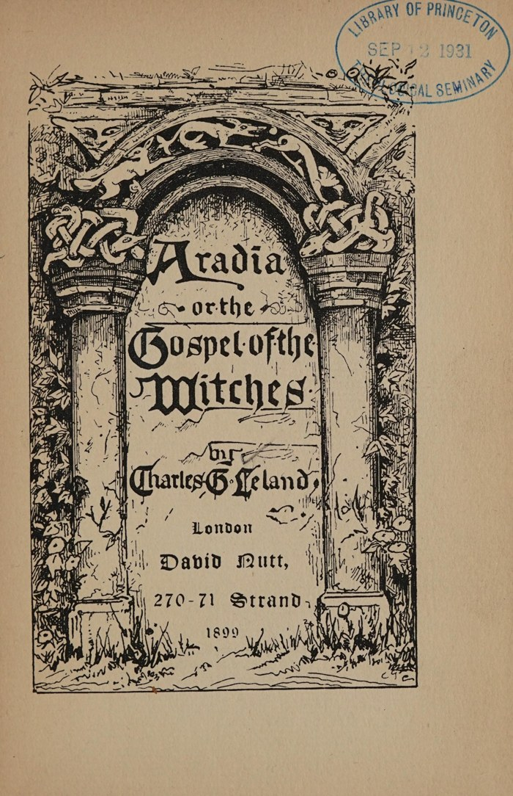

# C・G・リーランド『アラディア、あるいは魔女の福音』

チャールズ・ゴッドフリー・リーランド著／全訳

- 原題：Aradia, or the Gospel of the Witches（ロンドン、David Nutt、1899年）
- 著者：チャールズ・ゴッドフリー・リーランド（1824–1903）。アメリカ生まれの作家、民俗学者。晩年をフィレンツェで過ごし、トスカーナやロマーニャの民間信仰を集めて『エトルリア・ローマの遺風』『フィレンツェの伝説』などを書いた
- 内容：
  - リーランドが、マッダレーナという名の占い女を通じて1897年に手に入れたという、イタリアの魔女たちの「福音（ヴァンジェーロ）」と、それに関連する呪文と伝説とを集めた本である
  - 月の女神ディアーナは、弟である光の神ルシフェルとのあいだに娘アラディア（ヘロディア）をもうけ、金持ちと聖職者に虐げられた貧しい者たちに魔術を教えさせるために、彼女を地上へ送る。アラディアは最初の魔女として、毒と嵐と呪縛の術を教え、満月の夜に森に集まって裸でディアーナを拝むよう命じて、天へ帰る
  - つづく章は、魔女の晩餐で粉・塩・蜜を清める呪文、穴のあいた石や丸い石のまじない、レモンと針の呪い、恋を得るまじない、よい葡萄酒を得るまじないなどの実用の呪文と、ディアーナとエンデュミオン、風の家、小鬼の使者、ラヴェルナといった物語とからなる
  - 付録でリーランドは、この「福音」の由来と、それが中世の異端や古代の信仰の名残であるという自分の考えを述べている
- 作業の基にした本文：Internet Sacred Text Archive（sacred-texts.com）が公開している1899年版の翻刻（J・B・ヘア作成）。表紙と扉は Internet Archive 所蔵の1899年版のスキャンによる
- 著作権：リーランドは1903年に死去。日本・米国・英国で保護期間が満了している
- 訳者：人工知能（Claude Fable 5.2）
- 訳の性格：リーランドの英文からの全訳である。呪文と詩の多くは、原書ではイタリア語の原文とリーランドの英訳とが並べて載っているが、訳ではイタリア語の原文を省き、英訳から訳した。英訳がイタリア語と食いちがう目立った箇所だけ〔　〕で注記した。巻頭の目次は省いた。訳者の調べたかぎりでは、日本語訳は出ていない

## この本について

　本書は、二十世紀の魔女宗（ウィッカ）と現代のネオペイガニズムに、もっとも大きな影響を与えた本の一つである。満月の夜に集まり、裸で女神を拝むこと。魔術を「古い宗教（ラ・ヴェッキア・レリジオーネ）」と呼ぶこと。虐げられた者の側に立つ女の救い主。これらはみな本書から広まった。ウィッカの儀式で唱えられる「女神の訓戒」は、第一章のアラディアの言葉をほとんどそのまま下敷きにしている。

　一方で、本書がほんとうにイタリアの魔女たちの古い伝承を写したものなのかは、刊行のときから疑われてきた。「福音」の原本はリーランドの協力者マッダレーナの手書きの写しだけで、ほかに同じ文書は見つかっていない。マッダレーナがリーランドの望みに合わせて作ったのではないか、リーランド自身が手を加えたのではないか、あるいは十九世紀の反教権的な思想（ミシュレ『魔女』など）が混じっているのではないか、といった説がある。現在では、民間に伝わっていた呪文や昔話の断片がじっさいに含まれていることは認めつつ、全体が一つの古い「聖典」であったとは考えない研究者が多い。リーランド自身も付録で、協力者が口伝えから書きとったのか写本から写したのかはわからない、と正直に書いている。

　読みものとしての本書の魅力は、その奇妙な混じりぐあいにある。ディアーナが牛の膀胱に土と鼠を詰めて吹き破り、それが天と星と雨になるという創世の話。蛍をつかまえて大地の秘密を聞き出そうとするわらべ歌。願いをかなえてくれなければ安らぎを与えないぞと、女神を脅す呪文。キリスト教の聖人に対するのと同じ調子で、魔女たちは古い神々に祈り、また強要している。

　本文中の〔注N〕はリーランドの原注で、各回の末尾にまとめた。（　）はリーランド自身の補い、〔　〕は訳者の補いである。

---

## 序

　読者が、学識ある民俗学者G・ピトレの著作や、「レディ・ヴィア・ド・ヴィア」がイタリアの『リヴィスタ』誌に寄せた記事、あるいはJ・H・アンドルーズが『フォークロア』誌に寄せた記事〔注1〕に出会ったことがあるなら、イタリアには数多くのストレーガ、すなわち占い女あるいは魔女がいることをご存じであろう。彼女たちはカードで占い、霊が呼び出されるとされる奇妙な儀式をおこない、護符を作って売り、じっさい、アメリカの黒人のヴードゥーであれ、どこの女呪術師であれ、その評判の同類がするのとおおむね同じようにふるまっている。

　だがイタリアのストレーガすなわち女呪術師は、いくつかの点でこれらとは違った人物である。たいていの場合、彼女は、その稼業あるいは技が何世代にもわたっておこなわれてきた家の出である。その祖先が中世に、ローマ時代に、あるいはエトルリアの時代にまでさかのぼる例があることを、私は疑わない。その結果、当然、そうした家には多くの伝承が積みかさなった。だが北イタリアでは、その文献が示すとおり、学者たちによって昔話と民間の迷信とがわずかに集められはしたものの、魔女たちの奇妙な伝承についてはこれまでまったく関心が持たれず、またそれが、オウィディウスが記録したような、しかしその多くは彼にも、ほかのすべてのラテンの著者たちにも漏れた、古いローマの小さな神話と伝説とを、信じられないほどの量で含んでいるとは、疑われもしなかった〔注2〕。

　この無知は、魔法使いたち自身によって大いに助けられた。彼らは祭司たちへの恐れに駆られて、そのすべての伝承を深い秘密にしたからである。じっさい祭司たちは、まったく無意識のうちに、そうした伝承の保存に計りしれないほど貢献した。禁じられたものの魅力はきわめて大きく、魔術は、トリュフのように、もっとも深く隠されているときにもっともよく育ち、もっとも濃い風味を持つからである。それがどうであれ、祭司も魔法使いも、いまや信じられない速さで消えつつある。あるフランスの著者は、鉄道の客車のなかのフランシスコ会士は奇妙な変則だと感じたほどである。そして新聞と自転車とのあと数年（空飛ぶ機械が現れたらどうなることか、天のみぞ知る！）が、おそらくすべてを消え去らせるであろう。

　しかしながら、彼らはゆっくりと死んでゆくのであり、いまなお北のロマーニャには、十二神のエトルリアの名を知り、バッコス、ユピテル、ウェヌス、メルクリウス、そしてラレスすなわち祖先の霊への祈りの言葉を知っている老人たちがいる。そして町々には、奇妙な護符をこしらえ、その上で呪文をつぶやく女たちがいる。それらはみな古いローマの時代に知られていたものである。彼女たちは、カトーやテオクリトスに見いだされるような伝承の混じった、ラテンの神々についての伝説で、学者をさえ驚かすことができる。そうした女の一人と、私は1886年に親しく知りあい、それ以来ずっと、隠れた呪文を守る彼女の姉妹たちのあいだで、多くの土地で、彼女たちの知っている昔の伝承のすべてを集めさせるために、特別に彼女を雇ってきた。私がほかの出どころからも引いてきたのは事実である。だがこの女は、長い実地の経験によって、わかる人の少ないこと、すなわち私の欲しいものが何であり、それを彼女の同類からどうやって引き出すかを、完全に学んでいる。

　ほかの奇妙な遺物のなかで、彼女は多年ののち、次の「福音」を手に入れることに成功した。私はそれを彼女の手書きで持っている。その性質についての、多くの詳細をともなう十分な説明は、付録に見いだされるであろう。私の情報提供者が、これらの伝承の一部を書かれた出どころから得たのか、口頭の語りから得たのかを、私ははっきりとは知らない。だがおもに後者であったと信じている。もっとも、自分たちの技にかかわる文書を写し、あるいは保存している魔法使いも少しはいる。「福音」が私のもとへ送られてから、私はこの収集者に会っていない。いつか将来、もっとよく知ることができるよう望んでいる。

　手短に説明しておけば、魔術はその信奉者たちに la vecchia religione すなわち〈古い宗教〉として知られている。ディアーナがその女神であり、その娘アラディア（すなわちヘロディア）が女のメシアである。そしてこの小さな作品は、後者がどのように生まれ、地上に下り、魔女たちと魔術とを立て、それから天へ帰ったかを述べている。それとともに、ディアーナとアラディアとに向ける儀式と祈りあるいは呪文、カインの呪文、そして聖なる石と、ヘンルーダと、クマツヅラとのまじないが収められている。これらは、本文が言明しているとおり、魔女の集会で唱え、あるいは口にすべき、いわば正規の礼拝式をなしている。また、魔女の晩餐の蜜と粉と塩、あるいは菓子の、まことに奇妙な呪文あるいは祝福も含まれている。これは不思議なほど古典的で、明らかにローマの秘儀の名残である。

　この作品は、じっさいに〈魔術の聖典〉の一部をなしている儀式と呪文とを加えることで、限りなく広げることもできた。だがそれらはほとんどすべて、あるいは少なくとも大多数が、『エトルリア・ローマの遺風』『フィレンツェの伝説』と題した私の著作に見いだされるので、私は、そのような著作を買ってくれる人々が十分に多くいるかどうかを確かめる前に、そうした一巻を編むのをためらった。

　以上を書いたのち、私は『セッティマーニの物語』（G・カヴァニャーリ、1889年）と題する、きわめて巧みでおもしろい作品に出会い、これを読んだ。そのなかで著者は、小説の形で、ロンバルディアの農民たちのあいだの風習と、考えかたの癖と、とくに魔術の性質と、広まっている多くの迷信とを、生き生きと描いている。不幸なことに、この主題についての広い知識にもかかわらず、これらの伝承が有害なたわごと、あるいは忌まわしく非キリスト教的な愚行以外の何かであるとは、語り手には一度も思い浮かばなかったらしい。そこに古代神話の驚くべき名残と、歴史のまさに心臓の心臓（cor cordium）である貴重な民俗とがあるということは、彼にとって、ありふれたゾッコローネすなわち放浪のフランシスコ会士にとってと同じく、どうでもよいことなのである。尽きない富の秘密を得るための儀式として、魔女がほんとうに七人の人間を殺そうとつとめたことを知っている人なら、そのような女呪術師は不思議な伝説の蓄えを持っていたにちがいないと、疑ってもよさそうなものである。だがそうしたことの跡はまったくなく、そのすべてのなかに、もっと高い、あるいはもっと温かい見地から見て興味ぶかい何かがあるということほど、彼の心から遠いものはなかったことは、きわめて明らかである。

　要するに彼の本は、迷信が信用を失って以来、幽霊と迷信とについて書かれたきわめて多数の本に属している。それらのなかで著者たちは、彼らにとってはただ卑俗で偽りであるものに対する、風刺的で、まことに安全だが安っぽい嘲りにふけっている。サー・チャールズ・コールドストリームのように、彼らはヴェスヴィオの火口を、それが「噴火」をやめたあとでのぞきこんで、「中には何もない」と見たのである。だがかつてはそこに何かがあった。そして、サー・チャールズがそうではなかった科学の人は、いまなおその遺物のなかに多くのものを見いだし、好古家はポンペイあるいはヘルクラネウムを見いだす。掘り出すべき埋もれた都市が、まだ七つあるという。私は、イタリアの呪術の死火山から何かを掘り出すために、自分にできるわずかなこと（それはほんとうにごくわずかである）をした。

　これが、イタリアの魔術を描いたもっとも聡明な著者による、その扱いかたであるとすれば、先史の時代から今日まで持ちこたえてきた奇妙な対抗宗教への信仰を具現している、見たところきわめて古い、まことの〈魔女の福音〉があるかどうかを気にかける人が、じつにわずかしかいないとしても、不思議とは思われまい。「魔術はみながらくたか、もっと悪いものだ」と昔の著者たちは言った、「したがってそれについての本もみな、それよりましなものではない」と。しかしながら私は、これらのページが、少なくとも、それをもっとよく思ってくれる少数の人々の手に落ちることを、心から信じている。

　しかしながら、暗く、人を惑わす道を探ることを好む人々に対して公平であるために、はっきり説明しておくべきであろう。魔女の伝承は、イタリアでは、ごく少数を除くすべての人から、このうえなく細心の注意をもって隠されている。チペワ族のメダや、黒人のヴードゥーのあいだでと同じである。実話に近い小説『セッティマーニ』では、一人の志願者が魔女とともに暮らし、苦労しながら、切れはし一つずつ、その呪文とまじないとを身につけ、あるいは拾い集め、それに何年も費やす姿が描かれている。同じように、私の友人である故ドラゴマノフ氏は私に、ハンガリーのある男が、彼が多くの呪文を集めたこと（それらはじっさい、のちに民俗学の雑誌に発表された）を知って、この学者の部屋に忍びこみ、こっそりそれらを写したので、翌年ドラゴマノフがもどってみると、その盗人が、花ざかりの魔術師としてさかんに開業していた、と語った。じつのところ、彼が手に入れた呪文は多くはなく、十ばかりにすぎなかった。だがこの商売では、ごくわずかなものでずいぶん遠くまで行けるのである。そして私はあえて言うが、イタリアには、私が公刊したほど多くを知っている魔女は、おそらく一人もいないであろう。私のものは、広く遠くの多くの人々から、たゆまず集められたものだからである。そのうえ、この種のもので書かれたものはすべて、祭司や悔悛者や、あるいはそうした文書と同じ家のなかにいることさえ迷信的に恐れるおびただしい人々によって、しばしば細心の注意をもって破棄される。したがって私は、この〈ヴァンジェーロ〉の救出を、控えめに言っても注目すべきことと見なしている。

## 第一章　ディアーナがアラディア（ヘロディア）を生んだ次第

　　「ディアーナだ！　見よ！
　　彼女は三日月をいただいて昇る。」
　　　　　　――キーツ『エンディミオン』

　　「さらに明るくせよ、
　　婚礼の夜の、星の女王の三日月を。」
　　　　　　――同上

　これは魔女たちの福音（ヴァンジェーロ）である。

　ディアーナは、その弟ルシフェルを大いに愛した。太陽と月との神、光（輝き）の神であり、自分の美しさをまことに誇り、その誇りのために楽園から追われた者である。

　ディアーナは弟とのあいだに一人の娘をもうけ、二人は彼女にアラディア〔すなわちヘロディア〕という名を与えた。

　そのころ、地上には多くの富める者と多くの貧しい者とがいた。

　富める者は、貧しい者をみな奴隷にした。

　そのころ、むごく扱われる多くの奴隷がいた。どの宮殿にも拷問があり、どの城にも囚人がいた。

　多くの奴隷が逃げた。彼らは田舎へのがれた。こうして彼らは盗人となり、悪い者となった。夜、眠るかわりに、彼らは逃亡をたくらみ、主人から盗み、それから主人を殺した。こうして彼らは、山と森とに追いはぎや人殺しとして住んだ。すべては奴隷の身を避けるためであった。

　ディアーナはある日、娘のアラディアに言った。

　　まことに、おまえは霊である。
　　だがおまえは、ふたたび死すべき者となるために生まれた。
　　おまえは下の地上へ行って、
　　おまえの学校で魔術を学びたいと願う
　　女たちと男たちとの師とならねばならない。

　　だがおまえは、カインの娘のようには決してなるまい。
　　苦しみのために、ついには
　　よこしまな、恥ずべき者となったあの種族、
　　ユダヤ人や、さすらうジプシーのようにも。
　　彼らはみな盗人であり、ならず者である。彼らのようには
　　おまえたちはなるまい……。

　　そしておまえは、世に知られる最初の魔女となる。
　　世界のすべてのうちで最初の者となる。
　　そしておまえは毒を盛る術を教える。
　　すべての大いなる領主である者たちに毒を盛る術を。
　　そうだ、おまえは彼らをその宮殿のなかで死なせる。
　　そしておまえは虐げる者の魂を（力で）縛る〔注3〕。
　　そして富んだ農夫を見つけたら、
　　おまえの弟子である魔女に教えるがよい。
　　恐ろしい嵐で、
　　稲妻と雷（のすさまじさ）とで、
　　雹と風とで、その作物をすべて台なしにするすべを……。

　　そして祭司がその祝福によって
　　おまえたちに害をなすときには、
　　その二倍の害を彼になすがよい。そしてそれを、
　　すべての魔女の女王である、私ディアーナの名においてなせ！

　　そして祭司たちや貴族たちが、
　　父と子とマリアとを信ずべきだと
　　おまえたちに言うときには、こう答えよ。
　　「あなたがたの神と、父と、マリアとは、
　　三人の悪魔である……。

　　まことの父なる神は、あなたがたのものではない。
　　私は悪しき者たちを一掃するために来たのだから。
　　悪の人々を、私はみな滅ぼす！

　　貧しいあなたがたは、鋭い飢えに苦しみ、
　　みじめさのなかで働き、またしばしば
　　牢にも苦しむ。それでもなお
　　あなたがたには魂がある。そしてその苦しみのゆえに
　　あなたがたは、あの世で幸せになる。
　　だがあなたがたに不正をなすすべての者の運命は悪い！」

　さて、アラディアは教えを受け、あらゆる魔術をおこなうすべを、（虐げる者たちの）悪い種族を滅ぼすすべを教えられると、（それを弟子たちに伝えて）彼らにこう言った。

　　私がこの世を去ったのち、
　　あなたがたが何かを必要とするときはいつでも、
　　月に一度、月が満ちるときに、
　　どこか人けのない場所に集まるがよい。
　　あるいは森のなかに、みなでともに集まって、
　　あなたがたの女王、私の母、
　　大いなるディアーナの力ある霊を拝むがよい。
　　あらゆる呪術を学びたいと願いながら、
　　そのもっとも深い秘密をまだ得ていない者には、私の母が
　　教えるであろう。まことに、まだ知られていないすべてのことを。
　　そしてあなたがたはみな、奴隷の身から解かれる。
　　こうしてあなたがたは、すべてにおいて自由となる。
　　そして、あなたがたがまことに自由であるしるしとして、
　　あなたがたは儀式のなかで、男も
　　女もまた、裸であるがよい。これは、
　　あなたがたを虐げる者の最後の一人が死ぬまでつづく。
　　そしてあなたがたは、灯を消して、
　　ベネヴェントの遊びをし、そののち、
　　このようにして晩餐を催すがよい。

## 第二章　サバト。トレグエンダすなわち魔女の集会――晩餐を清める方法

　ここに晩餐がつづく。それが何からなるべきか、それをディアーナに捧げるために何を言い、何をなすべきかである。

　粉と塩と、蜜と水とをとり、この呪文を唱えよ。

**粉の呪文**

　　私はおまえに呪文をかける、おお、粉よ！
　　おまえはまことに我らの体。おまえがなければ
　　我らは生きられないのだから。おまえは（初め種として）
　　粉〔原文 flower。flour か〕となる前に、土のなかへ入った。
　　すべての深い秘密の隠れているところへ。それから挽かれると、
　　風のなかの塵のように舞い、しかもそのあいだ、
　　飛びながら、不思議な秘密をたずさえていった！

　　だがその前、おまえが穂のなかにあって、
　　（黄金の）きらめく粒であったときにも、そのときにも
　　蛍たちがやって来て、おまえにその光を投げかけ〔注4〕、
　　おまえの生長を助けた。彼らの助けがなければ
　　おまえは育つことも、美しくなることもできなかったのだから。
　　それゆえおまえは、魔女たちの、あるいは妖精たちの
　　種族に属している。そして
　　蛍たちは太陽に属しているのだから……。

　　　　・　・　・　・　・

　　蛍の女王よ！　急いで、急いで〔注5〕、
　　競走するように、いますぐ私のところへおいで。
　　私の歌うのが聞こえたら、馬に手綱をかけよ！
　　手綱を、おお、王の息子に手綱をかけよ！
　　急いで来て、彼を私のところへ連れておいで！
　　王の息子は、ほどなくおまえを放してくれよう！

　　そしておまえは、いつまでも輝いて美しいから、
　　私はおまえをコップの下に入れておく。そこにいるあいだ、
　　私はレンズで、おまえの隠れた秘密を調べる。
　　その輝く神秘がすっかり明かされるまで。
　　そうだ、我らの十字架のこの世と、あの世との、
　　こみいった不思議な知恵のすべてが。
　　こうして私は、すべての神秘に達する。
　　そうだ、ついには穀物の神秘にさえも。
　　そしてついにそれを私がまことに知ったなら、
　　蛍よ、私はおまえを自由に放してやろう！
　　大地の暗い秘密が私に知られたとき、
　　私はついにおまえに祝福を与えよう！

　ここに塩の呪文がつづく。

**塩の呪文**

　　私はおまえに呪文をかける、塩よ。見よ！　ここで正午に、
　　ちょうど流れの真ん中に
　　私は立って、まわりの水を見る。
　　同じく太陽をも見る。そしてここにいるあいだ、
　　水と太陽とのほかには何も考えない。
　　私の魂はすべて、まことにそれらに向いているのだから。
　　私はまことに、ほかの思いを何も望まない。
　　私は真実のなかの真実を知りたいと切に願う。
　　私は長いあいだ、自分の未来を、
　　来たるべき運命を、
　　そこで善と悪とのどちらが勝つのかを、知りたいという願いに苦しんできたのだから。
　　水と太陽よ、私に恵みぶかくあれ！

　ここにカインの呪文がつづく。

**カインの呪文**

　　私はおまえに呪文をかける、おお、カインよ。おまえは、
　　囚われている太陽〔注6〕から解かれるまで、
　　休みも安らぎも決して得ることができず、
　　そのあいだ、手を打ちならし、速く走りつづけねばならないのだから〔注7〕。
　　どうか私の運命を知らせておくれ。
　　そしてもしそれが悪いなら、私のためにその向きを変えておくれ！
　　もしこの恵みを与えてくれるなら、私はそれをはっきり見るであろう。
　　太陽の輝きのなかの水のなかに。
　　そしておまえは、おお、カインよ、口の言葉で告げるがよい。
　　私のこの運命がどうなるのであれ。
　　そしてこれを与えてくれないなら、
　　おまえは決して安らぎも幸いも知ることがないように！

　それからディアーナの呪文がつづく。

　粉と葡萄酒と塩と蜜とで、（三日月の、すなわち角のある）月の形の菓子を作り、それから焼きにかけて、こう言え。

**ディアーナの呪文**

　　私はパンを焼くのでも、それとともに塩を焼くのでもない。
　　蜜を葡萄酒とともに煮るのでもない。
　　私は体と血と魂とを焼く。
　　（大いなる）ディアーナの魂を。彼女が
　　休みも安らぎも知らず、いつまでも
　　むごい苦しみのなかにあるように。私の求めるもの、
　　私がもっとも望むものを、彼女がかなえてくれるまで。
　　私は心の底から、それを彼女に乞う！
　　そしてこの恵みがかなえられるなら、おお、ディアーナよ！
　　あなたをたたえて、私はこの宴を催そう。
　　宴を開き、杯を深く飲みほそう。
　　我らは踊り、荒々しく跳ねよう。
　　そしてあなたが、私の求める恵みをかなえてくれるなら、
　　踊りがもっとも荒々しくなったとき、すべての灯は
　　消され、我らは自由に愛しあおう！

　そしてそれはこのようになされる。男も女も、みなが裸で晩餐の席につく。そして宴が終わると、彼らは踊り、歌い、音楽を奏で、それからすべての灯を消して、闇のなかで愛しあう。灯を消すのはディアーナの霊だからである。こうして彼らは、彼女をたたえて踊り、音楽を奏でる。

　さて、ディアーナは、その娘が使命を果たし、すなわち生きている者（死すべき者）たちのあいだで地上の時を過ごしたのち、彼女を呼びもどして、力を与えた。彼女が呼び出されたとき……何かよい行いをしたうえで……呪文で彼女を呼んだ者たちを満足させる力を与えたのである。その女あるいは男に、恋の成就を授けることによって。

- 友あるいは敵を、力をもって祝福し、あるいは呪うこと〔善あるいは悪をなすこと〕
- 霊たちと語ること
- 古い廃墟のなかに隠れた宝を見つけること
- 宝を残して死んだ祭司たちの霊を呪文で呼び出すこと
- 風の声を理解すること
- 水を葡萄酒に変えること
- カードで占うこと
- 手の秘密を知ること（手相）
- 病を癒すこと
- 醜い者を美しくすること
- 野の獣を馴らすこと

　アラディアの霊に求められることは何であれ、彼女の恵みに値する者たちにはかなえられるはずであった。

　そして彼らは、このようにして彼女を呼び出さなければならない。

　こうして私はアラディアを探す！　アラディア！　アラディア！〔注8〕　真夜中に、真夜中に、私は野へ行く。そして私は水と葡萄酒と塩とをたずさえ、水と葡萄酒と塩とをたずさえ、そして私のお守りを、私のお守りを、私のお守りを、そしていつも手に握っている赤い小さな袋を。その中には、その中には、塩（con dentro, con dentro, sale）、塩が入っている、入っている。水と葡萄酒とで私は自分を祝福する。アラディアに、アラディアに恵みを乞うために、信心をこめて自分を祝福する。

**アラディアへの祈り**

　　アラディア！　私のアラディア！
　　あなたは、すべての霊のうちでもっとも悪い者、
　　昔、天から追われて
　　地獄を治めたあの者の娘。
　　彼はその姉によって、あなたの父となった。
　　だがあなたの母は、その過ちを悔いて、
　　あなたを、恵みぶかく、
　　邪悪でない霊と
　　めあわせようと望んだ〔イタリア語の原文は「あなたを恵みぶかい霊にしようと望んだ」〕。

　　アラディア、アラディア！　私はあなたに乞い願う。
　　彼女があなたに抱いた愛にかけて！
　　そして私もまたあなたに感じている愛にかけて！
　　どうか私の求める恵みをかなえておくれ！
　　そしてこの恵みがかなえられるなら、
　　三つのしるしの一つが、私にはっきり現れるように。
　　　　蛇のしゅうという音、
　　　　蛍の光、
　　　　蛙の声！
　　だがもしあなたがこの願いを拒むなら、そのときは
　　あなたはこの先、安らぎも喜びも知らず、
　　遠くから私を探し求めねばならないように。
　　あなたが私の望みをかなえに、
　　急いで来るまで。そうすればあなたはまた
　　あなたの定めへ帰ってよい。それでは、アーメン！

## 第三章　ディアーナが星と雨とを造った次第

　ディアーナは、すべての創造の前に造られた最初の者であった。彼女のうちにすべてのものがあった。彼女自身から、すなわち最初の闇から、彼女は自分を分けた。彼女は闇と光とに分かれた。彼女の弟であり息子であり、彼女自身でありそのもう半分であるルシフェルが、光であった。

　そしてディアーナは、光がまことに美しいのを見ると、すなわち彼女のもう半分であり、弟ルシフェルである光を見ると、きわめて大きな欲望をもってそれを慕った。光をふたたび自分の闇のなかに受けいれ、恍惚のうちに、歓喜のうちにそれを呑みこみたいと願って、彼女は欲望に震えた。この欲望が〈暁〉であった。

　だが光であるルシフェルは、彼女からのがれ、その望みに従おうとしなかった。彼は、天のもっとも遠いところへ飛んでゆく光、猫の前をのがれる鼠であった。

　そこでディアーナは、〈初め〉の父たちのところへ、母たちのところへ、最初の霊より前にいた霊たちのところへ行き、ルシフェルを思いどおりにできないことを彼らに嘆いた。すると彼らは、その勇気のゆえに彼女をほめ、昇るためには落ちなければならない、女神たちの長となるためには死すべき者とならなければならない、と告げた。

　そして幾世ものうちに、時の流れのうちに、世界が造られると、ディアーナは地上へ行った。落ちたルシフェルも同じであった。そしてディアーナは魔法と呪術とを教えた。そこから魔女と妖精と小鬼とが、すなわち人に似ていながら死すべき者でないすべてのものが生じた。

　そして、ディアーナが猫の姿をとるということになった。彼女の弟は、すべての生きものにまさって愛している一匹の猫を持っていた。それは毎晩、彼の寝床で眠った。ほかのすべての生きものにまさって美しい猫で、妖精であったが、彼はそれを知らなかった。

　ディアーナはその猫を説きふせて、自分と姿を取りかえさせた。こうして彼女は弟とともに寝、闇のなかで自分の姿にもどり、こうしてルシフェルによってアラディアの母となった。だが朝になって、自分が姉のそばに寝ていること、光が闇に征服されたことを知ると、ルシフェルは激しく怒った。だがディアーナは彼に一つの呪文を、力ある歌を歌い、彼は黙った。それは眠りへとなだめる夜の歌であった。彼は何も言えなかった。こうしてディアーナは、魔術の手管で彼をすっかり魅了したので、彼はその愛に屈した。これが最初の魅惑であった。彼女はその歌を口ずさんだ。それは蜂の羽音のよう（あるいはまわる独楽のよう）であり、命を紡ぐ糸車のようであった。彼女はすべての人の命を紡いだ。すべてのものはディアーナの車から紡がれた。ルシフェルがその車をまわした。

　ディアーナは、魔女たちと霊たちに、人けのないところに住む妖精たちとエルフたちに、小鬼たちに、彼らの母としては知られていなかった。彼女は謙遜のうちに身を隠し、死すべき者であった。だがその意志によって、ふたたびすべての上に昇った。彼女は魔術にたいへんな情熱を抱き、それにおいてまことに力ある者となったので、その偉大さは隠しておけなかった。

　こうしてある夜、すべての女呪術師と妖精との集まりで、彼女は、天を暗くし、すべての星を鼠に変えてみせる、と宣言した。

　その場にいた者はみな言った。

　「もしあなたが、それほどの力に昇って、そのような不思議なことができるなら、あなたを我らの女王としよう。」

　ディアーナは通りへ出た。彼女は雄牛の膀胱と、小刀のような縁を持つ魔女の貨幣を一枚とった。魔女たちはそうした貨幣で、人の足跡から土を切りとるのである。そして彼女は土を切りとり、それと多くの鼠とで膀胱を満たし、破裂するまで膀胱に息を吹きこんだ。

　すると大きな不思議が起こった。膀胱のなかにあった土は、上の丸い天となり、三日のあいだ大雨が降ったのである。鼠たちは星あるいは雨となった。そして天と星と雨とを造ったので、ディアーナは魔女たちの女王となった。彼女は、星の鼠たちと、天と雨とを治める猫であった。

---

**リーランドの原注**

〔注1〕　1897年3月号、「ナポリの魔術」。

〔注2〕　これによって、もしグリムとムゼーウスとの集成のほかに何も後の世に残らなかったとしたら、ドイツの昔話について事情がどうなっていたかを、想像することができる。世の人々は、これらが、かつて存在したこの種の作品のすべてであると信じこんだであろう。じっさいには、それらは全体の小さな部分をなすにすぎないのに。そして民俗は古典の著者たちには知られていなかった。古代のラテンの著者のだれかが、いま人々が集めているように、民衆のあいだで伝承の類を集めたという証拠は、じつは何もない。彼らはみな、まったく本から本を作ったのである。そうした文人は、いまも「同じ類が少しは残って」いる。

〔注3〕　Legare。魔術によって人間の能力を縛り、麻痺させること。

〔注4〕　ここには明らかに、蛍の体（それは麦の粒によく似ている）と麦粒との連想がある。

〔注5〕　つづく六行は、わらべ歌としてしばしば聞かれる。

〔注6〕　おそらく「月（Luna）」の誤りである。

〔注7〕　これは体を温めておくことを意味しており、ここでは太陽を月と読むべきことの確かな証拠である。別の伝説によれば、カインは月のなかで寒さに苦しんでいる。

〔注8〕　これは、くり返しを強めながら、ゆっくり唱えるべき決まり文句である。

## 第四章　ディアーナに捧げられた石のまじない

　穴のあいた石を見つけることは、ディアーナの恵みの特別なしるしである。それを見つけた者は、命じられたとおりに儀式を守ったうえで、それを手にとって、次の言葉を唱えるがよい。

**穴のあいた石への祈り**〔注9〕

　　私は見つけた、
　　地面の上に、穴のあいた石を。
　　おお、運命よ！　このうれしい拾いものを感謝する。
　　そしてこの道の上で
　　それを私に与えてくれた霊にも。
　　どうかそれが私のまことの益となり、
　　私の幸運となるように！

　　私は朝、いちばん早い夜明けに起き、
　　出かけていって、（心地よい）谷を歩く。
　　山々のなかを、あるいは美しい牧場を、
　　幸運を探しながら、なお先へとさまよう。
　　甘く香るヘンルーダとクマツヅラとを探しながら。
　　それらはすべての人に幸運をもたらすから。
　　私はそれらを胸のなかに安全にしまっておく。
　　だれにも知られないように。それは秘密のもの、
　　そして聖なるものでもあるから。そして私はこう呪文を唱える。
　　「おお、クマツヅラよ！　いつまでも恵みであれ。
　　そしておまえの祝福が、
　　おまえを私に与えてくれた魔女か妖精かの上にあるように！」

　　私のところへ来たのはディアーナであった。
　　夜、夢のなかで、彼女は私に言った。
　　「もしおまえが、すべての悪い者を遠ざけておきたいなら、
　　いつもクマツヅラとヘンルーダとを
　　そばに安全に持っておくがよい！」

　　大いなるディアーナよ！　あなたは
　　天と地との女王、
　　そして地獄の国々の女王。そうだ、あなたは
　　すべての不幸な人々の守り手。
　　盗人と人殺しとの、そしてまた
　　悪い暮らしを送る女たちの守り手。それでもあなたは、
　　彼らの本性が悪くはなかったことを知って、あなた、ディアーナは、
　　なお彼らに、生きることのいくらかの喜びを授けた〔注10〕。

　　さもなければ、私はまことに、また別のときに、
　　あなたが安らぎも幸せも得ないよう、
　　あなたに呪文をかけよう。あなたはいつまでも
　　苦しみのなかにあるであろう。
　　私がこのうえなく固い信をもってあなたに求めるものを、あなたがかなえるまで！

　〔ここにもまた、神を脅すということがある。霊たちが脅される、エスキモーやそのほかのシャーマニズムにおけるのとちょうど同じであり、これは呪術のもっとも粗野な原始の形を表している。この名残は、粗野なローマ・カトリック教徒のあいだにも見いだされる。たとえば数年前、ロマーニャのある町で、聖ブルーノが雨を乞う信者たちの祈りに耳を貸さなかったとき、彼らはその像を、頭を下にして川の泥のなかに突き立てた。たちまち雨が降り、聖人は名誉のうちに教会のもとの場所へもどされた。〕

**丸い石のまじない、あるいは呪文**〔注11〕

　丸い石を見つけることは、大きかろうと小さかろうと、よいしるし（è buono augurio）である。だがそれは決して人にやってはならない。そうすれば、もらった者が幸運を得て、やった者には何かの災いがふりかかるからである。

　丸い石を見つけたら、目を天に上げ、石を三度投げあげて（そのたびに受けとめ）、こう言え。

　　よい前兆の霊よ、
　　私を助けに来てくれた者よ、
　　まことに私は、おまえを大いに必要としていた。
　　赤い小鬼の霊よ、
　　困っている私を助けに来てくれたのだから、
　　どうか私を見捨てないでおくれ。
　　どうかいま、この石のなかへ入っておくれ。
　　私がおまえをポケットに入れて運べるように。
　　そうすれば、私に何かが必要なとき、
　　私はおまえを呼ぶことができる。それが何であれ、
　　夜も昼も、私を見捨てないでおくれ。

　　もし私がだれかに金を貸して、
　　その男が期日に払おうとしないなら、どうか、
　　赤い小鬼よ、彼にその借りを払わせておくれ！
　　そしてもし彼が払おうとせず、強情であるなら、
　　おまえの「ブリエ、ブリエ！」という叫びで彼に向かってゆけ。
　　そしてもし彼が眠っているなら、ぐいと引いて起こし、
　　夜具をはがして、おどかしてやれ！
　　そして彼がどこへ行こうと、ついてまわれ。

　　そうしておまえの絶え間ない「ブリエ、ブリエ！」で教えてやれ。
　　義理を忘れる者は、
　　借りを払うまで難儀するのだと。
　　こうして私の借り手は、次の日に、
　　借りている金を持ってくるか、
　　すぐに送ってよこすであろう。だからどうか、
　　おお、私の赤い小鬼よ、私を助けに来ておくれ！
　　あるいはもし私が、愛する女といさかいをしたなら、
　　そのときは、幸運の霊よ、どうか
　　眠っている彼女のところへ行って、その髪を引き、
　　夜のなかを、私の寝床へ運んできておくれ！
　　そして朝、すべての霊が
　　休みにつくとき、おまえは、
　　石のなかへもどる前に、彼女をまた家へ運び、
　　そこに眠ったまま置いてくるがよい。だから、おお、精よ！
　　どうかこの小石のなかをおまえの家としておくれ！
　　あらゆる点で、私の命じるすべてに従え。
　　そうすればおまえはいつも私のポケットのなかにいて、
　　おまえと私とは決して別れることがないであろう！

## 第五章　レモンと針との呪文

　ディアーナに捧げられたもの。

　さまざまな色の針をいっぱいに刺したレモンは、いつも幸運をもたらす。

　もしあなたが贈りものとして、さまざまな色の針をいっぱいに刺したレモンをもらい、そのなかに黒い針が一本もなければ、それは、あなたの人生がまったく幸せで、栄え、喜びにみちたものになることを意味する。

　だが、そのなかにいくらか黒い針があれば、あなたは幸運と健康とを楽しむであろうが、それには、さほどのことはないかもしれない悩みが混じるであろう。〔しかしながら、その影響を弱めるためには、次の儀式をおこない、この呪文を唱えなければならない。すべてはそのなかに述べられてもいる〔注12〕。〕

**ディアーナへの呪文**

　　真夜中が来たその瞬間に、
　　私は庭でレモンを一つ摘んだ。
　　レモンを一つ摘み、それとともに
　　オレンジを一つと、（かぐわしい）マンダリンを一つ摘んだ。
　　これらの（貴い）ものを心して摘みながら、
　　摘みながら、私は心してこう言った。
　　「太陽と月との、
　　そして星々との女王であるあなたよ。見よ！　ここで私はあなたを呼ぶ！
　　そして私の持つかぎりの力で、あなたに呪文をかける。
　　私の乞い願う恵みを、私にかなえてくれるように！
　　私はここの庭で三つのものを摘んだ。
　　レモンと、オレンジと、マンダリンとを。
　　私に幸運をもたらすよう、私はそれらを摘んだ。
　　そのうち二つを、私はここで手に握る。
　　そして私の運命のために役立つはずのものを、
　　星々の女王よ！
　　その果実を、私の手のなかにしっかり残しておくれ。」

　〔写本ではここで何かが省かれている。私の推測では、二つを見ないで宙に投げあげ、もしレモンが残れば、儀式は次のように進むのである。これは明らかである。そこでは呪文が、どうふるまうかの散文の指図と混ざっているからである。〕

　こう言って、人は空を見あげる。すると私は片手にレモンを見いだし、一つの声が私に言った。

　「多くの針をとり、心してそれをレモンに刺せ。さまざまな色の針をである。そうすればおまえは幸運を得る。そしてもしおまえが、そのレモンをだれかに、あるいは友に与えたいなら、さまざまな色の針をたくさん刺すがよい。

　だがもしおまえが、だれかに災いがふりかかるよう望むなら、黒い針を入れよ。

　だがそのためには、違った呪文を（このように）唱えなければならない。」

**ディアーナへの祈り**

　　女神ディアーナよ、私はあなたに呪文をかける。
　　そして声を上げてあなたを呼ぶ。
　　あなたが私を助けに、すべての力を貸しに来るまで、
　　あなたが決して満足も安らぎも得ないように。
　　だから明日、正午の鐘とともに、
　　私はあなたを待とう。一杯の葡萄酒をたずさえ、
　　それとともにレンズあるいは小さな集光鏡をたずさえて〔注13〕。
　　そして私は十三本の針をこのまじないに入れよう。
　　私の入れる針は、まことにみな黒いものであろう。
　　だがあなた、ディアーナが、それらをみな置くのだ！

　　そしてあなたは私のために、地獄から悪鬼たちを呼ぶであろう。
　　あなたは彼らを太陽の連れとして送るであろう。
　　そして地獄の火のすべてを、
　　その悪鬼たちが運んできて、それとともに、
　　この（赤い）葡萄酒を煮たたせる力を太陽にもたらすであろう〔注14〕。
　　これらの針が熱で赤く焼けるように。
　　そしてそれらを、私はここでレモンにいっぱいに刺す。
　　それを与えられる女あるいは男には、
　　安らぎも栄えも知られないように。

　　　　もしこの恵みをあなたから得るなら、
　　　　どうか私に、しるしを与えておくれ！
　　　　三日目が
　　　　過ぎ去らないうちに、
　　私に聞かせるか、見せるかしておくれ。
　　うなる風か、ばらばらと打つ雨か、
　　野にかたかたと鳴る雹かを。
　　この三つのしるしの一つをあなたが示すまで、
　　ディアーナよ、あなたは安らぎを知るまい。
　　私の送った祈りによく答えよ。
　　さもなければ、昼も夜も、私はあなたを苦しめよう！

　オレンジが太陽の果実であったように、レモンは月すなわちディアーナを思わせる。その色がより淡い黄色だからである。しかしながら、このまじないのためにとくに選ばれるレモンは、つねに緑のものである。それは「固くしまって」黒くなるからである。オレンジとレモンとの皮は、圧力をかけ、接着剤と合わせれば、型に入れたり多くの用途に使ったりできる固い物質にすることができる。これは一般には知られていない。私は、『百の小さな技芸』と題するまだ公刊していない著作のなかで、これに一章を当てた。これを私に思いつかせたのは、ある魔女がまじないとして私にくれた、固くなったレモンであった。

## 第六章　恋を得るまじない

　ディアーナを拝む者、すなわち月を拝む魔法使いが、ある女の愛を望むとき、彼は彼女を犬の姿に変えることができる。すると彼女は、自分がだれであるかも、そのほかのすべてのことも忘れて、すぐに彼の家へやって来る。そしてそこで、彼のそばにいるときには、ふたたびもとの姿にもどって、彼とともにとどまる。そして彼女が去るべきときが来ると、彼女はふたたび犬になって家へ帰り、そこで娘にもどる。そして彼女は、起こったことを何も覚えていないか、あるいは少なくとも、ほんのわずかか、ただの断片しか覚えておらず、それはこんがらかった夢のように思われるであろう。そして彼女が犬の姿をとるのは、ディアーナがいつもそばに犬を連れているからである。

　そしてこれが、恋人を自分の家へ連れてこようとする者が唱えるべきまじないである〔注15〕。

　今日は金曜日である。そして私はたいへん早く起きたいと思う。一晩じゅう眠れなかったのである。富んだ領主の娘である、たいへん美しい娘を見たからで、私は彼女を得ることを望むべくもない。もし彼女が貧しければ、金で彼女を手に入れることもできよう。だが彼女は富んでいるので、私にはその望みがない。（それゆえ私は、ディアーナに私を助けるよう呪文をかけよう。）

**ディアーナへの祈り**

　　ディアーナ、美しいディアーナよ！
　　まことに、美しいのと同じだけ善いあなたよ、
　　私があなたに捧げてきたすべての礼拝にかけて、
　　そしてあなたが知った恋の喜びのすべてにかけて、
　　私はあなたに乞い願う、私の恋を助けておくれ！
　　　　あなたが望むことは、まことに、
　　　　あなたはいつでもなすことができる。
　　そしてもし私の求める恵みを、あなたが私にかなえてくれるなら、
　　どうか、あなたの娘アラディアを呼び、
　　彼女をその娘の枕もとへ送り、
　　その娘に犬の姿を与え、
　　そうして彼女を、私の部屋の私のところへ来させておくれ。
　　だがひとたび彼女がそこへ入ったなら、どうか
　　彼女が人の姿を取りもどすように。
　　前にそうであったとおりに美しく。
　　そしてそれから私は彼女と愛しあおう。
　　我らの魂が喜びにすっかり満ち足りるまで。
　　それから大いなる妖精の女王と、
　　その娘、美しいアラディアとの助けによって、
　　彼女がふたたび犬に変えられ、
　　それからまた、前のとおりに人の姿にもどるように！

　こうして、その娘は犬として、見られも疑われもせずに家へ帰る、ということになる。アラディアがそのようにはからうからである。そして娘は、それがすべて夢であると思うであろう。アラディアに魔法をかけられているからである。

## 第七章　何であれ見つけ、あるいは買うために、またそれによって幸運を得るために

**ディアーナへの祈り、あるいは呪文**

　町へ出かけようとするとき、危険や事故のおそれからのがれたいと願う男あるいは女。あるいは、買いものに幸運を得たいと願う者。たとえば学者が、何か珍しい古い本か写本かが、ごく安く売りに出ているのを見つけたいと望むとき。あるいはだれかが、何かたいへん欲しいものを買いたい、掘り出しものや珍品を見つけたいと願うとき。このスコンジュラツィオーネ〔呪文〕は、よい健康と、心の朗らかさと、災いのないことと、あるいは敵意に打ち勝つこととに役立つ。これらは、信じる者にとっては黄金の言葉である。

**祈り**

　　いまは火曜日、そして早い時刻に、
　　私は幸運を自分に向けたいと願う。
　　まず家で、それから出かけるときに。
　　そして美しいディアーナの助けによって、
　　この家を出る前に、私は運を祈る！

　　まず三滴の油で〔注16〕、私は
　　すべての悪い影響を取りのぞく。そしてへりくだって祈る。
　　おお、美しいディアーナよ、あなたに、
　　あなたがそれをみな私から取りさり、
　　それをみな私の最悪の敵へ送ってくれるように！

　　悪い運が
　　私から取りさられたら、
　　私はそれを通りの真ん中へ投げ捨てよう。
　　そしてもしあなたがこの恵みを私にかなえてくれるなら、
　　おお、美しいディアーナよ、
　　私の家のすべての鈴が、楽しげに鳴るであろう！

　　それから、すっかり満足して、
　　私は歩きまわりに出かけよう。
　　あなたの助けがあれば、
　　帰る前にきっと、
　　立派な古い本を何冊か、
　　それも手ごろな値で見つけられると、確信しているのだから。

　　そしてあなたは、その人を、
　　その本の持ち主を見つけるであろう。
　　そしてあなた自身が行って、
　　それを彼の心に入れ、
　　あなたの見つけたいものが
　　何であるかを彼に吹きこみ、
　　あなたの求めるすべてを
　　なすように彼を動かすであろう。
　　あるいはそれが、
　　昔に書かれた写本であっても、
　　あなたは同じようにそれを得るであろう。
　　それはあなたの行く手に現れ、
　　こうしてわずかな費えで、
　　あなたは望むものを買うであろう。
　　大いなるディアーナの助けによって。

　〔英訳は終わりのほうで「あなた」が祈る者を指すように変わっている。イタリア語の原文では、ディアーナが持ち主のところへ行き、この本を手放さなければ破門されるという考えをその頭に入れるので、彼は本を売りに来て安く売る、あるいは写本なら通りに捨てるので、ただで手に入る、という内容である。〕

　以上のものは、出かける前に、何か珍しい本か、そのほかの望みの品が、ごく手ごろな値で売りに出ているのをきっと見つけられるようにするには、どんな呪文が要るのか、という問いへの答えとして、いくらか遅れて得られたものである。そのため、この祈りは、文献の掘り出しものに当てはまるような言葉づかいになっている。だが、何であれ同じように有利な条件で買いたい人は、魔力の宿る導入の部分を残して、願いを変えさえすればよい。しかしながら私は、これが古物と学問と美術との品を探すことにもっともよく当てはまり、もっともよく成功するであろうという確信を、おさえることができない。したがってこれは、すべての骨董あさりと書誌学者との記憶に、深く刻みこまれるべきである。次のことは、それも真剣に、心にとめておくべきである。この祈りは、それを唱える者が満ち満ちた信をもってそうするのでなければ、かなえられるどころか、逆のこと、すなわち不運に変わるであろう。そしてこの信は、ただ自分に「私は信じる」と言うだけでは得られない。何かに対するほんとうの信を得るには、長く真剣な心の鍛錬が要るからである。じっさい、これほど広く口にされながら、これほど理解されていない主題はない。ここで私は、まことに真剣に語っている。自分の信を鍛えてじっさいに信じ、自分の意志を養い、あるいは伸ばすことのできる人は、世間が一致して奇跡と見なすものを、ほんとうになしとげることができるからである。この原理が、すべての教育の土台だけでなく、すべての道徳的・社会的な教養の土台をもなすときが来るであろう。私はこれを、『あなたは強い意志を持っているか。あるいはそれを、また心のほかのどんな能力や属性をも伸ばし、習慣とする方法』（ロンドン、ジョージ・レッドウェイ刊）と題する著作のなかで、十分に述べたつもりである。

　しかしながら、敬虔な信を持つ読者は、魔女たちが言明しているとおり、このまじないを毎日、出かける前に用いて、店でどんな種類の掘り出しものを手に入れることにも、失せものを拾ったり見つけたりすることにも、じっさい、どんな種類の拾いものにも役立てることができる。もし彼が女の姿の美しさに心を寄せるなら、色恋の幸運（bonnes fortunes）に出会うであろう。商売人なら、有利な取引が彼のものとなるであろう。野へ出る前にこれを唱える植物学者は、おそらく何か新しい植物を発見するであろうし、天文学者は夜、真新しい惑星か、少なくとも小惑星に、ほとんどまちがいなく出くわすであろう。これは、競馬へ行く前に、友人や娯楽の場所を訪ねる前に、売り買いをする前に、演説をする前に、そしてとくに、狩りや、何であれ夜の外出の前に唱えるべきである。ディアーナは狩りと夜との女神だからである。だが、冗談でこれをする者にわざわいあれ！

## 第八章　ディアーナの助けによって、よい葡萄の収穫とたいへんよい葡萄酒とを得るために

　　「葡萄の収穫は甘い。降りそそぐ葡萄の房が、
　　バッコスの祭りのようなあふれかたで、
　　紫に、ほとばしりながら、地によろめき落ちるとき。」
　　　　　　――バイロン『ドン・ジュアン』第百二十四連

　　「Vinum bonum et suave,
　　Bonis bonum, pravis prave,
　　O quam dulcis sapor--ave!
　　Mundana laetitia!」
　　〔よく甘い葡萄酒よ、よい者にはよく、よこしまな者には悪く、おお、何と甘い味わい。ようこそ、この世の喜びよ！〕
　　　　　　――E・デュ・メリル『ラテン語の歌』

　よい葡萄の収穫と上等な葡萄酒とを得たい者は、葡萄酒をいっぱいに満たした角をとり、これを持って、葡萄の育つ葡萄畑あるいは農地へ行き、それから角から飲みながら、こう言うがよい。

　　私は飲む。だが私の飲むのは葡萄酒ではない。
　　私はディアーナの血を飲む。
　　それは葡萄酒から彼女の血に変わり、
　　私の育ちゆくすべての葡萄の木に広がったのだから。
　　そこからそれは、葡萄酒のよい実入りを私に与えるであろう。
　　もっとも、たとえよい収穫が私のものになっても、
　　私は心配から解かれはしない。もしたまたま、
　　葡萄が欠けてゆく月に熟すなら、
　　葡萄酒はすべてだめになるであろうから。だが、
　　もしこの角から飲んで、私が血を、
　　大いなるディアーナの血を飲むなら、彼女の助けによって、
　　もし私が新月に手で口づけを送り、
　　女王が私の葡萄を守ってくれるよう祈るなら、
　　芽の生まれるその瞬間から、
　　それが熟した完全な葡萄となるまで、
　　さらに収穫まで、そして最後に
　　葡萄酒ができあがるまで、どうかそれがよいものであるように！
　　そしてそれがうまくいって、ついにそれが売られるとき、
　　私がそこからよいもうけを引き出せるように。
　　こうして幸運が私の葡萄の木に、
　　そしてどこであれ、私のすべての土地に来るように！
　　だがもし私の葡萄の木が、悪いほうへ向かうように見えたなら、
　　私は角をとり、勇ましく吹こう。
　　真夜中に、酒蔵のなかで。そして私は
　　まことにすさまじい、恐ろしい音を立てよう。
　　美しいディアーナよ、あなたがどれほど遠くに
　　いようとも、なおその呼び声を聞くように。
　　そして戸か窓かを大きく開けはなち、
　　突きすすむ風に乗ってまっしぐらに来て、
　　私を見つけ、救ってくれるように。すなわち私の葡萄の木を救ってくれるように。
　　それは私をひどい難儀から救うことになる。
　　それを失えば、私自身が失われるのだから。
　　だがあなたの助けがあれば、ディアーナよ、私は救われる。

　これはまことに興味ぶかい祈りと伝承とであり、きわめて目を引く内的な証拠から見て、おそらくたいへん古いものである。というのも、まず第一に、それは、あまり注意を受けてこなかった主題、すなわち月としてのディアーナとバッコスとのつながりに当てられているからである。もっとも、ポッツォーリらの大部の『歴史神話辞典』には、ギリシアでは彼女の礼拝がバッコス、アスクレピオス、アポロンの礼拝と結びついていた、とはっきり述べられている。つなぐ環は角である。アレクサンデル・セウェルスのあるメダルでは、エフェソスのディアーナが豊穣の角を持っている。これは、ディアーナに捧げられた新月の角である。カリマコスによれば、アポロン自身が、すべて角からなる祭壇をディアーナのために築いた。

　角と葡萄酒とのつながりは明らかである。古いスラヴ人のあいだでは、太陽神スヴァンテヴィトの祭司が、来る年のよい収穫を予言するために、神像が手に持つ角が葡萄酒で満ちているかどうかを見るならわしであった。それが満ちていれば、すべてはよかった。そうでなければ、彼は角を満たし、そこから飲み、角を手にもどして、すべてはついにはうまくいくであろうと予言した〔注17〕。この儀式がイタリアの祈りのそれに不思議なほど似ていることは、読者の心を打たずにはおくまい。ただ一つの違いは、よい収穫を確かにするために、一方では太陽が、もう一方では月が呼び出されることである。

　『フィレンツェの伝説』には、コルノ通り〔角の通り〕の伝説があり、そこでは主人公が葡萄酒の巨大な大樽すなわちティーナに落ち、すさまじい力で角を吹き鳴らすことによって、おぼれるのを免れる。信じられないほど遠くまで、未知の国々にまで届くその音に、みなが魔法にかけられたかのように、彼を救いに駆けつける。この呪文では、ディアーナが、天の深みで、角の音に駆けだし、戸や窓を跳びこえて、吹く者の収穫を救いに来るものとして描かれている。これらの話には、ある奇妙な類縁がある。

　コルノ通りの話では、主人公は〈赤い小鬼〉すなわちロビン・グッドフェローに救われ、小鬼は彼に角を与える。そして、ディアーナに捧げられた丸い石の呪文に現れるのも、この同じ精である。それは、この霊が夜のものであり、ディアーナ・ティターニアに仕える者だからである。

　新月に手で口づけを送ることは、いつからとも知れない古い儀式であり、ヨブは、彼の時代においてさえ、これを異教的で禁じられたものと見なした。禁じられたとは、つねに、古びて流行おくれになったという意味である。彼はこう言明している（第三十一章二十六、二十七節）。「もし私が、輝きのうちに歩む月を見て……私の心がひそかに誘われ、あるいは私の口が私の手に口づけしたなら……これもまた、裁き手によって罰せられるべき不義であろう。私は上にいます神を否んだことになるからである。」ここから、ヨブは神が月を造り、そのすべての業のうちに現れていることを理解していなかったか、さもなければ月が独立した神であるとほんとうに信じていたかである、と推論してよいし、またそうすべきである。いずれにせよ、古い禁じられた儀式がいまなお生きており、あいかわらず異端的であるのを見るのは、興味ぶかい。

　私に伝えられたとおりの伝承は、きわめて明らかに、儀式の一部を省いている。それは古典の典拠から補うことができよう。農夫がこの儀式をおこなうとき、彼は、かつて私の友人の召使いであったあるアフリカ人がしたようにふるまってはならない。この黒人の務めは、毎朝、呪物にラム酒の献酒を注ぐことであったが、彼はそれを自分ののどに注ぎこんだのである。農夫はまた、葡萄の木に振りかけるべきである。クリスマスのすべての儀式を守ったデヴォンシャーの農夫たちが、やはり角から、りんごの木に振りかけたのとちょうど同じにである。

---

**リーランドの原注**

〔注9〕　正しくは、穴のあいた石である。だがそうした石は、船の上では聖なる（holy）石と呼ばれており〔英語で「穴のあいた（holey）」と「聖なる（holy）」とは同じ音〕、ここではそれは、じっさいその名を名のる資格がある。

〔注10〕　これはわかりにくい一節であるが、私は、詩人が意図し、あるいは感じたとおりにこれを訳したと信じている。

〔注11〕　Il sasso a palla。

〔注12〕　この一節は元の写本にはないが、唐突につづくものをはっきり説明するために必要である。

〔注13〕　これ〔レンズ〕は、ローマ時代におけるように、ごく早い時代から、魔法の特性をそなえたものと見なされていたらしく、隠秘的な儀式に使われた。

〔注14〕　すなわちディアーナは、葡萄酒を強めるために、地獄の火の命そのものをたずさえた悪霊たちを送って、太陽の火をさらに増すよう呼びかけられているのである。

〔注15〕　このまじないの初めの部分は、儀式の性質を説明する散文の導入にすぎないらしい。

〔注16〕　これは、私が何十回もおこなわれるのを見た、そしてじっさい、魔法使いと魔女とのあいだでふつうの礼儀の行為として、ほとんど同じ回数だけ自分にもしてもらった、小さな儀式を指している。それは、数滴の油と、祝福される者の頭との上で、ある種のしるしと十字とを切ることからなり、短い呪文をともなう。私はこの儀式を、健康と繁栄とを保つ手だてとして、真剣に勧められ、あるいは処方されたことがある。

〔注17〕　クロイスラー『ソルブ・ヴェンド人の古俗』第一部二七二ページ。

## 第九章　ターナとエンダモーネ、あるいはディアーナとエンデュミオン

　　「Hic ultra Endymionem indormit negligentiae.」
　　〔この者はエンデュミオン以上に、怠りのうちに眠りこんでいる。〕

　　「さて、こう語り伝えられている。エンデュミオンはオリュンポスに迎えいれられたが、ユーノーに対する敬意を欠いたためにそこから追われ、三十年のあいだ地上へ追放された。そしてこのあいだ、ラトモス山の洞穴で眠ることを許されたので、その美しさに心を打たれたディアーナは、毎晩彼を訪れ、ついに彼とのあいだに五十人の娘と一人の息子とをもうけた。そしてこののち、エンデュミオンはオリュンポスへ呼びもどされた。」
　　　　　　――『歴史神話辞典』

　次の伝説とまじないとは、ターナという名あるいは題のもとに伝えられた。これはディアーナの古いエトルリアの名であり、ロマーニャ・トスカーナにいまなお保たれている。私は一冊ならぬイタリアとフランスとの著作のなかに、魔女が恋する男のために娘をまじないで眠らせたという、何かの記述あるいは物語を見いだしたが、儀式全体の説明として私の知るものは、これだけである。

**ターナ**

　ターナは美しい女神で、エンダモーネという名の、驚くほど美しい若者を愛した。だが彼女の恋は、恋敵である一人の魔女に邪魔された。もっともエンダモーネは、その魔女を好いてはいなかった。

　だが魔女は、彼が望もうと望むまいと、彼を手に入れようと決心し、このつもりで、エンダモーネの召使いを説きふせて、その夜を主人の部屋で過ごさせてもらった。そしてそこへ入ると、彼女は、彼の愛するターナの姿をとったので、彼は、そう思いこんで、彼女を見て喜び、熱い抱擁で迎えた。だがこれが、彼を彼女の力のうちに渡した。それによって彼女は、彼の髪を一房切りとって、ある魔法のまじないをおこなうことができたからである〔注18〕。

　それから彼女は家へ帰り、羊の腸の一片をとって、それで袋をこしらえ、その中に、切りとってきたものを、いっしょに結んだ赤と黒とのリボンと、羽根と、胡椒と塩とともに入れ、それから歌を歌った。これがその言葉、まことに古い時代の魔術の歌である。

**まじない**

　　この袋を、私はエンダモーネのために編んだ。
　　これは恋の、私の復讐。
　　私がおまえに抱いた深い恋の。
　　おまえはそれを私に返そうとせず、
　　それをみなターナの祠へ運んだ。
　　だがターナは決しておまえのものにはなるまい！
　　これから夜ごと、もだえのうちに、
　　おまえは私に押しひしがれる！
　　日から日へ、時から時へ、
　　私はおまえに魔女の力を思い知らせる。
　　おまえは情欲に責めさいなまれ、
　　それでいて、快楽に満たされることは決してない。
　　おまえはまどろみに包まれて横たわり、
　　愛する人がそばにいるのを知りながら、
　　いつまでも死にかけて、決して死ねず、
　　一言も話す力がなく、
　　彼女の声もおまえには聞こえない。
　　恋のもだえに責めさいなまれ、
　　おまえに救いはない！
　　私の強いまじないを、おまえは破れず、
　　その眠りから、おまえは決して覚めない。
　　少しずつ、おまえはやせ衰える。
　　燠火のそばに置かれた蠟燭のように。
　　少しずつ、おまえは死んでゆく。
　　それでいて、いつまでも生きて、責められて横たわる。
　　欲望は強く、それでいていつまでも弱く、
　　動く力も話す力もなく。
　　私がおまえに抱いた恋のすべてで、
　　おまえ自身が責められるがよい。
　　このあいだまで私の感じていた恋のすべてを、
　　燃える憎しみとして、おまえに思い知らせるのだから。
　　いつまでもおまえの責め苦に心を向けて、
　　私は復讐をとげ、いま満足している。

　だがターナは、魔女よりはるかに力があったので、彼が眠るよう強いられているそのまじないを破ることはできなかったけれども、彼からすべての苦しみを取りさった（彼は夢のなかで彼女を知った）。そして彼を抱いて、この返しのまじないを歌った。

**返しのまじない（ディアーナの歌）**

　　エンダモーネ、エンダモーネ、エンダモーネ！
　　私の感じている恋、
　　死ぬまで感じつづけるこの恋にかけて、
　　私はおまえの寝床に三つの十字を切る。
　　それから野生のマロニエの実を三つとり〔注19〕、
　　その寝床に実を隠す。
　　それから窓を大きく開ける。
　　満月がその光を、
　　同じように美しく輝く恋の上に投げかけるように。
　　そして私は、上にいる彼女に祈る。
　　我らの恋に荒々しい恍惚を与え、
　　決して離れまいと狂おしく愛する
　　二つの心に、その火を投げいれてくれるように。
　　そしてもう一つ、私はおまえに乞う！
　　もしだれかが恋をして、
　　その恋を私の助けにゆだねたなら、
　　その呼び声に、私は急いで駆けつけよう。

　こうして、美しい女神は、あたかも二人が目覚めているかのように（ただし夢のなかで交わりながら）、エンダモーネと愛しあった、ということになった。そして今日にいたるまで、眠っている男あるいは女と愛しあいたいと願う者は、美しいターナに頼るべきであり、そうすれば成功するのである。

　この伝説は、多くの細部で古典の神話と一致しながら、魔術の慣習と不思議に混じりあっている。だがそれらでさえ、調べてみれば、みな本文の残りと同じく古いものだとわかるであろう。こうして、恵みをもたらす魔法で使われる赤い毛織の袋のかわりに用いられる羊の腸、喜びと悲しみとの糸を混ぜる赤と黒とのリボン、（孔雀の）羽根すなわち〈邪悪な羽根（la penna maligna）〉、胡椒と塩とは、ほかの多くの呪文にも出てくるが、つねに災いをもたらし、苦しみを引きおこすためである〔注20〕。

　これが指摘されているのを私は見たことがないが、じっさいのところ、キーツはその精妙な詩『エンディミオン』で、古代の神話の精神と意味との全体からすっかり離れ、あるいはそれを無視している。一方、この粗野な魔女の歌では、それが細かく展開されている。その構想は、貞潔で名高いディアーナに、まどろみのうちにひそかに口づけされる美しい若者、というものである。古代の神話は、まず第一に、闇と光との、あるいは昼と夜との神話であり、そこから一年の五十一（いまは五十二）の週が生まれる。これは、夜であるディアーナと、太陽すなわち別の形の光であるアポロンとである。それは眠りのあいだの愛の営みとして表されている。これが現実の生活で起こるときには、たいてい、まったく慎みぶかいわけではないが体面は保ちたいと願うだれかが、能動の側である。入門者たちのあいだでのディアーナの定まった性格は（そのために彼女は教会の教父たちに激しくののしられたのだが）、沈黙の秘密のうちに情事を追い求める美しい偽善者というものであった。

　　「こうして月がエンデュミオンと寝たように、
　　ヒッポリュトスともウェルビウスともそうした。」

　（これについて読者は、テルトゥリアヌス『偽りの宗教について』第二巻第十七章と、ピコ・デッラ・ミランドラ『魔女』とを参照されたい。）

　だが、見たところ貞潔な「澄んだ冷たい月」が、その生きた光を闇の隠れた奥へひそかに投げいれ、恋あるいは夢の隠秘の秘儀のなかで働くという構想には、精妙なまでに微妙で、繊細に不思議な観念あるいは理想がある。だからバイロンは、月が目にする禁じられた行いの半分にも太陽は照らないということを、独創的な考えとして思いついた〔注21〕。そしてこれは、イタリアの魔女の詩のなかで強調されている。そこでは月は、不思議な、秘密の情事の守り手として、またそのような愛の営みのためにとくに呼び出すべき神として、はっきりと呼びかけられている。呼びかける者はこう言う。窓は開いている。月が寝床の上にみごとに輝くように。ちょうど我らの恋が明るく美しいのと同じに……そして私は彼女に、我らに大きな恍惚（sfogo）を与えてくれるよう祈る、と。

　月の、震えるような、神秘的に美しい光は、沈黙した自然の上に知性あるいは感情の霊を投げかけ、それをほのかに半ば目覚めさせるように見える。影を思いへと高め、すべての木と岩とに、生きた姿の見かけをとらせる。ただしそれは、ちらちら光り、息づきながらも、なお夢のなかで眠っている姿である。この光がギリシア人の目をのがれるはずはなく、彼らはそれを、エンデュミオンを抱くディアーナとして表した。だが、夜は秘密に捧げられた時であり、秘儀のまことのディアーナは、三日月をいただく〈夜の女王〉であり、「甘い秘密の罪と、愛された不義」を含むすべての隠れたものの女主人であったから、この神話には、目に映るよりはるかに多くのものが付いていた。そして、ディアーナが、解き放たれた魔女たちと夜との女王である、あるいは夜のウェヌス・アスタルテその人であると信じられた、ちょうどその度合いだけ、眠るエンデュミオンへの恋は、官能的でありながら神聖で寓意的なものとして理解されたであろう。そして、いくらかの権利をもってそのまことの相続人だと主張できるイタリアの魔女たちが、この神話を保ち、理解してきたのは、まったくこの意味においてである。

　それは、禁じられた、あるいは秘密の恋の実現であり、月の光のもとでほのかに見える美しいものへの引力と、超自然のものの妖精あるいは魔女めいた魅力とをともなう。一つの不思議な形にすべてを合わせた物語、すなわち〈夜〉の魔力である！

　　「その時刻には危うい沈黙がある。
　　満ちた魂が、自制を
　　すっかり呼びもどす力もなく、
　　そのすべてを開くだけの余地を残す静けさが。
　　木と塔とを聖めながら、
　　全体の上に美しさと深い柔らかさとを注ぐ銀の光は、
　　心にも息を吹きかけ、その上に、
　　休息ではない、愛のけだるさを投げかける。」

　これが、ディアーナとエンデュミオンとの神話の意味するところである。それは、情熱的で、秘密で、禁じられたものを、神的あるいは美的なもの（ギリシア人にとっては、これは一つの同じものであった）にすることである。それは、甘い〈盗んだ水〉の魅力が、詩にまで強められたものであった。そしてそれが、イタリアの魔女の伝承のなかにこれほど不思議に保たれてきたことは、注目に値する。

## 第十章　マドンナ・ディアーナ

　　「マドンナは本質において月の女神である。」
　　　　　　――E・N・ロルフ『九十年代のナポリ』

　昔むかし、まことに古い時代に、チェッタルド・アルト〔チェルタルド・アルトのこと〕に、驚くほど美しい娘がいた。彼女は、自分と同じく見目のよさで際だった若者と婚約していた。だが二人とも、生まれも育ちもよかったのに、戦あるいは運命の幸不幸のために、きわめて貧しくなっていた。そしてこの若い婦人に一つの欠点があったとすれば、それは大きな誇りであって、彼女は、立派な様式で、ぜいたくと祝宴とをともない、美しい衣装を着け、身分ある多くの花嫁付き添いを連れてでなければ、すすんで結婚しようとはしなかった。

　そしてこれが、美しいロラーサ――これが彼女の名であった――にとって、あまりにも強い望みの的となったので、彼女の頭はそれで半ばおかしくなった。そして知りあいのほかの娘たちは、彼女が断った多くの男たちは言うまでもなく、その立派な婚礼はいつなのかと尋ねたり、そのほか多くのあざけりとひやかしとを浴びせたりして、彼女をひどくからかったので、ついに狂気の一瞬に、彼女は高い塔の頂へ行き、そこから身を投げた。そしてさらに悪いことに、下には恐ろしい谷（balza）があって、彼女はその中へ落ちた。

　だが彼女は何のけがもしなかった。落ちてゆくとき、まことにこの世のものではない、たいへん美しい女が現れて、彼女の手をとり、空を通って安全な場所へ運んだからである。

　そこで、このことを見たり聞いたりしたあたりの人々はみな、「見よ、奇跡だ！」と叫び、やって来て大きな祭りを催し、ロラーサに、彼女はマドンナに救われたのだと思いこませようとした。

　だが彼女を救った婦人は、ひそかに彼女のところへ来て言った。「もしおまえに何か望みがあるなら、ディアーナの福音に、すなわち月を拝む者たちの、〈魔女の福音（Il Vangelo delle Strege）〉と呼ばれるものに従うがよい。」

　　「もしおまえが月を拝むなら、
　　望むものを得るであろう！」

　そこで美しい娘は、夜、ひとりで野へ出てゆき、古い廃墟のなかの石の上にひざまずいて、月を拝み、このようにディアーナに呼びかけた。

　　ディアーナ、美しいディアーナよ！
　　私が暗い谷へ落ちたとき、
　　恐ろしい死から救ってくれたあなたよ！
　　どうか私に、もう一つ恵みをかなえておくれ。
　　一つの輝かしい婚礼を、そしてそれとともに、
　　美しく堂々とした多くの花嫁付き添いを与えておくれ。
　　そしてもしこの願いを私にかなえてくれるなら、
　　私は魔女の福音に忠実であろう！

　ロラーサが朝、目を覚ますと、彼女は別の家にいた。そこではすべてがはるかに壮麗であった。そして起きあがると、美しい侍女が彼女を別の部屋へ導き、そこで彼女は、ダイヤモンドをちりばめた白絹の、みごとな婚礼の衣装を着せられた。それはまさに彼女の花嫁衣装であった。それから、みな華やかに着飾った十人の若い婦人が現れ、彼女たちと、多くの身分ある人々とともに、彼女は馬車で教会へ行った。そしてすべての通りは、音楽と、花を持つ人々とで満ちていた。

　こうして彼女は花婿を見いだし、心の望みどおりに、かつて夢みたより十倍も壮麗に結婚した。それから式ののち、宴がしつらえられ、チェッタルドのすべての貴族がそこに列席し、そのうえ町じゅうの者が、富める者も貧しい者も、もてなされた。

　婚礼が終わると、花嫁付き添いたちは、めいめいが花嫁にみごとな贈りものをした。一人はダイヤモンドを、もう一人は金で（書かれた）羊皮紙を贈った。そののち彼女たちは、みなでいっしょに聖具室へ入る許しを求めた。そしてそこに、彼女たちは何時間か、邪魔されずにとどまっていたが、ついに祭司が、何か用はないかと尋ねに、その侍者（chierico）をやった。ところがこの若者の驚いたことに、彼が見たのは十人の花嫁付き添いではなく、木とテラコッタとでできた彼女たちの十の像あるいは似姿と、月の上に立つディアーナの像とであった。そしてそれらはみな、たいへんな値打ちがあるほど、壮麗に作られ、飾られていた。

　そこで祭司は、これらの像を教会に納めた。それはチェッタルドでもっとも古い教会である。そしていま、多くの教会でマドンナと月とを見ることができるが、それはディアーナ、すなわち〈月の女神（la Dea della Luna）〉なのである。ロラーサという名は、ラテン語の ros（露）、rorare（露でぬらす）、rorulenta（露にぬれた）を示しているように見える。つまり露の女神である。彼女が高く落ち、ディアーナに持ちあげられることは、夜に露が降り、月の影響のもとで蒸気となって昇ることを思わせる。これはきわめて古いラテンの神話的な物語であるかもしれない。白絹とダイヤモンドとは露を示している。

## 第十一章　風の家

　　「風たちの叫びと口笛とに耳を傾けよ。
　　うなりながら迫ってくる、そのうつろな低い響きに。
　　力には多くの声があるのだから。そして呼びさまされると、
　　飛ぶ嵐は恐ろしい喜びをもって呼ばわり、
　　山腹を打ちながらこだまし、
　　それから森のなかで砕ける。その叫びを聞け！
　　きっと一人の神が、その獅子たちを放ち、
　　遠くで荒れ狂うのを聞いて笑っているのだ。」
　　　　　　――C・G・リーランド

　次の物語は〈魔女の福音〉には属さないが、ディアーナの礼拝が長いあいだキリスト教と同時に存在していたという事実を裏づけるので、ここに加える。元の写本でのその完全な題は、「La Pellegrina della Casa al Vento」、すなわち「風の家の女巡礼」である。この写本は、ヴォルテッラ生まれの一人の男からこれを聞いたのち、マッダレーナが書きおこしたものである。物語が言明しているとおり、問題の家がいまも立っていることを付けくわえてよかろう。

　ヴォルテッラへ通じる丘、すなわち上り坂の始まりに、農夫の家があり、〈風の家〉と呼ばれている。その近くに、かつて小さな屋敷があって、そこに一組の夫婦が住んでいた。彼らには子が一人しかなく、それは娘で、二人は彼女を溺愛していた。まことに、子が頭痛をしただけで、二人はめいめい、恐れのためにもっとひどい発作を起こした。

　少しずつ娘は大きくなった。そしてたいへん信心ぶかい母親の考えは、ただ彼女が修道女になることばかりであった。だが娘はこれを好まず、ほかの人のように結婚したいと言明した。そしてある日、窓からながめていて、鳥たちが葡萄の木のなかや木々のあいだで、まことに楽しげに歌っているのを見聞きすると、彼女は母親に、いつか自分の小鳥たちの一家を持ち、明るい巣のなかで自分のまわりに歌わせたいものだ、と言った。これに母親はたいへん怒って、娘に平手打ちをくわせた。若い婦人は泣いたが、気丈に言いかえした。もし打たれたり、こんなふうに扱われたりするなら、きっとすぐに何か逃げ出して結婚する道を見つける。自分の意志に反して修道女にされるつもりはないのだから、と。

　これを聞いて母親は本気でおびえた。自分の子の気性を知っていたからで、娘にはもう恋人がいて、打たれたことで大きな醜聞を起こすのではないかと恐れた。そしてあれこれ考えめぐらすうちに、彼女は、よい家柄だがひどく零落した、ある年配の婦人を思いついた。聡明さと学識と説得の力とで名高い人であった。そして彼女は考えた。「この人こそ、私の娘を信心ぶかくさせ、その頭を信心で満たして、修道女にするのにうってつけの人だ。」そこで彼女はこの賢い人を呼びにやり、この人はただちに若い婦人の家庭教師、そしてつねの付き添いに任じられた。若い婦人は、後見人といさかいをするどころか、彼女を慕うようになった。

　しかしながら、この世のすべてが、我らの望むとおりにゆくわけではない。川の岩の下にどんな魚や蟹が隠れているかは、だれにもわからない。というのも、やがて明らかになるとおり、この家庭教師はカトリックなどではまったくなく、教え子を修道女の暮らしの脅しで悩ませることも、それを是認することさえもしなかったのである。

　さて、若い婦人は、月夜には目を覚まして横になり、ナイチンゲールの歌を聞く習慣であったが、戸の開いている隣の部屋で、家庭教師が起きあがり、大きなバルコニーへ出てゆく音を聞いたように思った。次の夜も同じことが起こった。そこで、ごくそっと、見られないように起きあがって見ると、婦人が月の光のなかで祈っている、あるいは少なくともひざまずいているのが見えた。これは彼女には、まことに風変わりなふるまいに思われた。ひざまずいた婦人が、年下の彼女には理解できない、そして確かに教会の礼拝のどの部分でもない言葉を口にしていたので、なおさらであった。

　そしてこの不思議な出来事にひどく心を悩ませて、彼女はついに、おずおずと言いわけをしながら、自分の見たことを家庭教師に話した。すると家庭教師は、少し考えたのち、まず彼女に生死にかかわる秘密を守ることを誓わせて――彼女の言明するところでは、それは大きな危険をともなう事柄であったから――、次のように語った。

　「私は、あなたと同じように、若いころ祭司たちから、見えない神を拝むよう教えられました。けれども、私が大いに信頼していた一人の老婆が、あるとき私に言ったのです。『目に見えない神をなぜ拝むのか。その輝きのかぎりを尽くした月が、目に見えているのに。彼女を拝みなさい。月の女神ディアーナを呼びなさい。そうすれば彼女はおまえの祈りをかなえてくれよう』と。あなたもそうしなさい。ヴァンジェーロ、すなわち（魔女たちと）ディアーナとの福音に従って。ディアーナは妖精たちと月との女王です。」

　さて、若い婦人は説きふせられて、ディアーナと月との礼拝に改宗した。そして（女神への呪文を学んで）心のかぎり恋人を祈り求めると〔注22〕、まもなく、勇敢で富んだ一人の騎士の心づかいと献身とによって報いられた。彼はじっさい、だれもが望みうるかぎりの申し分のない求婚者であった。だが母親は、娘の幸せよりも、執念ぶかい恨みとむごい虚栄とを満たすことのほうにはるかに熱心であったので、これに激怒した。そして紳士が彼女のところへ来ると、立ち去れと命じた。娘は修道女になるよう誓いを立てられているのであり、修道女になるか、さもなければ死ぬかだ、というのである。

　それから若い婦人は、塔のなかの小部屋に閉じこめられた。家庭教師の付き添いさえなく、きびしくつらい苦しみにあわされ、石の床に寝させられた。そして母親の思いどおりになっていたなら、飢えで死んでいたであろう。

　そこでこのひどい窮地のなかで、彼女はディアーナに、自分を自由にしてくれるよう祈った。すると見よ！　牢の戸の錠がはずれているのがわかり、彼女はやすやすと逃げ出した。それから巡礼の衣を手に入れて、彼女は遠く広く旅し、昔の時代の宗教を、すなわち、妖精たちと月との女王であり、貧しい者と虐げられた者との女神であるディアーナの宗教を、教え、説いた。

　そして彼女の知恵と美しさとの評判は国じゅうに広まり、人々は彼女を〈美しい女巡礼（La Bella Pellegrina）〉と呼んで崇めた。ついに母親が彼女のことを聞いて、これまでにまして激しく怒り、結局、さんざん骨を折ったすえに、彼女をふたたび捕らえさせ、牢に入れさせることに成功した。そしてそれから、まことに不機嫌に、修道女になるつもりはあるかと彼女に尋ねた。これに彼女は、それはできない、自分はカトリック教会を去って、ディアーナと月とを拝む者になったのだから、と答えた。

　そしてその結末はこうであった。母親は、娘を失われたものと見なして、拷問にかけて死なせるよう、祭司たちに引きわたした。彼らが、自分たちに同意しない者、あるいは自分たちの宗教を去った者すべてにしたとおりにである。

　だが人々はこれを喜ばなかった。彼らは彼女の美しさと善良さとを崇めていたからであり、彼女の施しを受けたことのない者はほとんどいなかったからである。

　だが彼女は、恋人の助けによって、最後の恵みとして、拷問にかけられ処刑される前の夜に、番人を付けて、屋敷の庭へ出て祈ることを許された。

　彼女はそうした。そして、いまもそこにあるあの家の戸のそばに立って、満月の光のなかでディアーナに祈った。自分の受けてきたひどい迫害から救い出されるようにと。自分の両親さえが、すすんで自分を恐ろしい死に引きわたしたのだから、と。

　さて、彼女の両親と祭司たちと、彼女の死を求めるすべての者とは、屋敷のなかにいて、彼女が逃げないよう見張っていた。

　すると見よ！　彼女の祈りに答えて、恐ろしい嵐と、すべてを圧する風とが来た。人がかつて見たことのないような暴風で、それは屋敷を、その中にいたすべての者とともに、くつがえし、吹き払った。石の上に石一つ残らず、そこにいたすべての者のうち、生きた魂は一つも残らなかった。神々が祈りに答えたのである。

　若い婦人は恋人とともに幸せにのがれ、彼と結婚した。そして婦人が立っていたあの農夫の家は、いまも〈風の家（La Casa al Vento）〉と呼ばれている。

　これは、私の受けとったとおりの物語を、きわめて正確に伝えたものである。だが私は、元の本文の言葉づかいをたいへん縮めたことを、率直に認める。元の本文は二十ページからなり、不要な水増しについて言えば、語り手に、平均的な近代の流行小説を、二流のフランス小説をさえ書く能力があることを示している。これはたいしたことを言っているのである。そこには、景色や空や木々や雲の細かい描写がないのは事実である。そのやり方なら、ヴォルテッラからはずいぶん多くのものが引き出せるであろうが。だがそれは、その才を示すような仕方で引きのばされている。しかしながら、物語そのものは不思議に独創的で力強い。それは、唯美主義者たちの、映しとった受け売りのヘレニズムのすべてをもってしても及ばないような、純粋な古典的異教の名残であり、古い神話への信仰の生き残りだからである。古典の神々へのほんとうの礼拝あるいは信仰が、教皇制の国そのもののなかで今日まで生きのびていたということは、地球のどこか辺鄙な片隅で生きたマンモスが発見されたとするよりも、はるかに奇妙な事実である。前者は人間の現象だからである。私は、北イタリアに、古代の伝承の膨大なかたまりが、何と遅い時代まで生きのびていたか、そして学者たちがそれについてどれほど無関心であったかを考えて、学者の世界が驚く日が、それもおそらくそれほど遠くないうちに来ることを予見する。まことに、それを集め、保存することに真剣に取りくんだのは、ただ一人の男、それも外国人だけだったのである。

　ディアーナ、ウェヌス、三美神、そのほか美しさのゆえに拝まれた、愛する神々を捨てるよう強いられた異教の殉教者たちのあいだにも、獅子に投げあたえられたキリスト教徒たちのあいだにさえあったのと同じだけ、心を打つ挿話があったということは、大いにありそうである。異教徒は、神秘主義も恐れもなしに、まるで血縁であるかのように、人間的で個人的な共感をもって、その神々を愛したからである。そして彼らのなかには、あやまちを犯したどこかの乙女が、それをみなどこかの神や牧神やサテュロスのせいにして切りぬけたとき、じっさいにそのとおりだったのだとほんとうに信じた者が多かった。これはまことに心を打つ。偶像崇拝者、すなわち、ある小さな女の子がそう定義するのを私が聞いたところの〈人形を拝む人々〉については、不利なことだけでなく、有利なことも大いに言えるのである。

## 第十二章　月の女神ターナ

　次の物語は、もとは、私が民衆から集めた『フィレンツェの伝説』に載ったもので、〈魔女の福音〉に厳密には合っていないので、本来それに属するものではない。それでも、同じ主題についてのものであるから、省くわけにもいかなかった。ここではディアーナは、ただ貞潔の月の女神として現れ、したがって魔女としてではない。それは私にはファーナとして伝えられたが、私の情報提供者は、ターナかもしれないと言った。彼女は確かではなかった。ターナは別の物語に出てくるし、主題は確かにディアーナなのだから、これについてはほとんど疑問の余地はない。

**月の女神ターナ（Tana, la Dea della Luna）**

　ターナはたいへん美しい娘であったが、きわめて貧しく、美しくつつましいのと同じだけ、慎みぶかく清らかであった。彼女は、農夫から農夫へ、あるいは農場から農場へと働きに行き、こうしてまっとうな暮らしを立てていた。一人の若い田舎者がいた。たいへん醜く、獣じみて、粗暴な男で、彼なりのやり方で、彼女への恋に狂っていた。だが彼女は彼を見るのさえ耐えられず、その言い寄りをすべてはねつけた。

　だがある夜おそく、彼女が、働いていた農家から自分の家へひとりで帰ってくるとき、茂みに隠れていたこの男が彼女に跳びかかって叫んだ。「逃がしはしない。おまえは俺のものになるのだ！」そして近くに何の助けも見えず、ただ満月が天から彼女を見おろしているだけだったので、ターナは絶望してひざまずき、月に向かって叫んだ。

　　「地上には、私を守ってくれる者がだれもいない。
　　この窮地にある私を見ているのは、あなただけ。
　　だから私はあなたに祈る、おお、月よ！
　　あなたは美しいのと同じだけ明るく、
　　すべての人の上にあなたの輝きを放つ。
　　それと同じように、どうか、
　　ここで私を辱めようとする、この哀れな無頼の者の心を照らしておくれ。
　　最悪のことにまで及ぼうとする者の心を。その魂に光を投げいれておくれ。
　　彼が私をそっとしておくように。そしてそれから、
　　あなたのすべての光のうちに、私を家へ帰しておくれ！」

　彼女がこう言うと、その前に、明るいが影のような姿、すなわち白い影（un'ombra bianca）が現れて言った。

　　「立って、家へ帰るがよい！
　　おまえはこの恵みにふさわしい。
　　もうだれもおまえを悩ますまい。
　　地上のすべてのうちでもっとも清い者よ！
　　おまえは女神となる。
　　月の女神、
　　すべての魔法の女王に！」

　こうして、ターナは月の女神（dea）すなわち霊となった、ということになった。

　調子は違う調に合わせてあるけれども、これは純粋な旋律の詩であり、ワーズワースの「グッディ・ブレイクとハリー・ギル」と同じものである。ターナも老婆も、不意を打たれておびえる。どちらも上なる力に祈る。

　　「頭の上の冷たい、冷たい月に、
　　グッディはひざまずいて、こう祈った。
　　若いハリーは彼女の言ったことを聞き、
　　氷のように冷たくなって立ち去った。」

　劇の中心は、どちらでもちょうど同じである。イギリスのバラッドは、地味に、欲ばりな若い田舎者に科された、治らないおこりの発作へと転じる。イタリアの魔女の女詩人は、もっと繊細な感覚で、あるいは女主人公へのもっと深い共感をもって、その獣をそれ以上触れずにわきへ投げすて、乙女を神に上げて、月と同一視する。前者はより実際的でありそうなことであり、後者はより詩的である。

　そしてここで、脱線ではあるが、次のことを述べておく値打ちがある。ただの言葉あるいは形のなかの詩を、すなわち客観的に、知覚し、感じ、尊ぶことはできるが、それが主観的に、すなわち思想として示され、何かの種類の韻文や律や、整った形に入れられていないときには、ほとんどそれを知らず、気づきもしない人々が、何と圧倒的に多いことか。これは奇妙な実験であり、研究に値する。だれか名高い詩人の一節をとり、そのほんとうの意味を十分に生かして、純粋な簡素な散文に書きなおしてみよ。そしてそれがなおじっさいに、詩として身を震わせ、心を動かすなら、それは第一級のものである。だがもしその魅惑をすっかり失ってしまうなら、それは二流か、劣ったものである。最上のものは、思想のであれ感情のであれ、連想でうわ塗りしたただの言葉からは作れないからである。

　これは、思われるほど主題から遠く離れた話ではない。私が集めたこれらの魔女の伝承を、主観的に読み、感じるとき、私はしばしば、そこに驚くべき思想の詩があるという事実に打たれる。それは多くの近代の詩人たちの努力をはるかにしのいでおり、最高の位につくためには、言葉の巧みな職人のだれかの助けを要するだけである。私の主張したことの証拠は、次の事実に見いだせよう。ジェームズ・ラッセル・ローウェルの「竪琴の発見」や、ブラウニング夫人の、パンによる笛の発明についての詩のような名高い詩において、元の神話のもっとも精妙で洗練された部分をなしていたものが、どちらの作者によっても省かれている。ただ彼らがそれを見のがした、あるいは知覚しなかったからである。前者では、亀の干からびた筋に神〈空気〉が息を吹きかけたことが、ヘルメスに楽器を作ることを思いつかせたのだ、ということが語られていない。〈空気〉は古代の音楽に霊感を与える魂であり、近代の魔女の神話のベッラリアである。ヘルメスはその楽器で天球の音楽を奏で、惑星の運行を導いたのである。ブラウニング夫人はと言えば、彼女はシュリンクスをすっかり省いている。すなわち、かつて彼女の体であった笛のなかに、なおとどまっているニンフの声をである。さて、私の考えでは、これらの神話の古い散文の語りは、我らの詩人たちの与えた、よく韻を踏み律を整えてはいるが、きわめて不完全な版よりも、はるかに深く詩的で心を動かすものであり、はるかに美と物語の趣とに満たされている。そしてじっさい、そうした知性あるいは知覚の欠如は、キーツだけでなく、ギリシアの主題を扱ったこの時代のほとんどすべての詩人の、すべての「古典的」な詩に見いだせよう。

　画家と詩人とには大きな自由が許されている。だが彼らが一つの主題、とくに深い伝承をとりあげながら、そのほんとうの意味を知覚しそこね、あるいはその要点をつかみそこねて、ただ、たいへんきれいではあるが、元のものほど意味に満たされていない何かを我らに与えるだけであるなら、彼らがその仕事を、なされえたように、あるいはじっさい、なされるべきであったようになした、とはほとんど主張できない。私は、この欠点が、古代の寓話のイタリアあるいはトスカーナの魔女版には現れないことを見いだす。逆に、それらは古代の精神を鋭く味わい、広げさえしている。それゆえ私は、しばしば次のように述べる機会があった。ある場合には、民間の伝承が、いまあるままの形でさえ、どのラテンの著者に見いだされるよりも十分に、正確に保たれているということは、ありえないことではない、と。

　さて、要点を見のがすということにちなんで、私は、ある種のきわめて字義どおりの読者たちに思い出してもらいたい。もし彼らが、この本のイタリア語の本文のなかに、文法の誤りや、つづりの誤りや、もっと悪いものを多く見つけても、ある著名な書評家がしたように、それをみな著者の無知のせいにするのではなく、それらを集め、記録した人物の不完全な教育のせいにしてもらいたい。私がこれを思い出したのは、ある貸本屋で、私の『フィレンツェの伝説』の一冊を見たからである。そのなかでは、どこかの善良で注意ぶかい人が、鉛筆で、すべての古風な語法を骨折って直していた。この点で彼あるいは彼女は、あるボストンの校正者に似ていた。この校正者は、私の本のなかで、チョーサーやスペンサーやそのほかからの多くの引用のつづりを、もっとも純粋な、あるいはもっとも不純なウェブスター式に変えたのである。彼は、私が正書法にきわめて無知であるという印象を持っていた。本に書きこんだり、本を傷めたりすることについて言えば、本はつねに一部は後の世のものなのだから、それは道徳の罪であるとともに卑俗さの罪であり、人が夢にも思わないほど、その人がどういう人であるかを示している。

　　「本に書きこんだり、ページを折ったりするのは、
　　盗人と同じほど卑しい下種だけ。
　　自分のものでないものを勝手に扱うのは、
　　よく知られているとおり、盗みなのだから。」

---

**リーランドの原注**

〔注18〕　世界のすべての悪い魔術によれば、とくに黒人のヴードゥーのあいだでは、魔術師が、その人のどんな部分でも、どれほど小さくても、とくに髪の一房を手に入れることができれば、どんな個人をも傷つけ、あるいは殺すことができる。これは、ラ・モット・フーケの物語『アイスランド人ティオドルフ』にとくに描かれている。恋人たちが髪の房を取りかわすことは、ことによると魔術と関係がある。

〔注19〕　Marroni d'India。災いに対する強いまじないであり、それゆえリウマチなどに対して、しばしば持ち歩かれる。三つは一つの殻から出たものであるべきである。

〔注20〕　読者は、それらが私の『エトルリア・ローマの遺風』に記されているのを見いだすであろう。

〔注21〕　「太陽が沈み、黄色い月が昇った。／月には、悪さをする悪魔がいる。／彼女を貞潔と呼んだ人々は、思うに、／その名づけを早まりすぎた。／いちばん長い日、六月二十一日でさえ、／月の光のほほえむたった三時間が見る、／よこしまな仕方の営みの半分も見はしない。」――『ドン・ジュアン』第百十三連。

〔注22〕　この呪文は「恋を得るまじない」と題する章に掲げてある。

## 第十三章　ディアーナと子どもたち

　　「そこへディアーナが現れた。
　　まさしく狩人のように、手に弓を持って。
　　そして言った、『娘よ、嘆きをやめよ！』
　　そして彼女は進んでゆき、消えうせた。」
　　　　　　――チョーサー『カンタベリー物語』「騎士の話」

　フィレンツェに、もっとも古い時代、一つの貴い家があったが、たいへん貧しくなって、その祝いの日（giorni di festa）はめったになかった。しかしながら、彼らは古い屋敷（それはいまチッタデッラ通りと呼ばれる通りにあった）に住んでおり、それは立派な古い建物であったので、何も食べるものがほとんどない日が多かったのに、世間の前ではりっぱな見せかけを保っていた。

　この屋敷のまわりには大きな庭があり、そこに、ディアーナの古い大理石の像が立っていた。そばに犬を連れて走っているように見える、美しい女の姿である。彼女は手に弓を持ち、額には小さな月があった。そして、夜、すべてが静まると、その像は生きているようになって駆け去り、月が沈むか日が昇るかするまで帰らない、と言われていた。

　この家の父親には二人の子があり、善良で賢かった。ある日、二人は、もらった多くの花を持って家へ帰ってきた。そして小さな娘が兄に言った。

　「弓を持ったあの美しい婦人にも、このなかからいくらかあげなくては！」

　こう言って、二人は像の前に花を置き、花輪をこしらえて、少年がそれを彼女の頭にのせた。ちょうどそのとき、神々と妖精たちとについて何もかも知っている、大詩人で魔術師のウェルギリウスが庭へ入ってきて、ほほえみながら言った。

　「おまえたちは、昔の人々がしたとおりに、まったく正しく女神に花の供えものをした。残っているのは、祈りを正しく唱えることだけだ〔注23〕。それはこうだ。」

　そこで彼は次のものを唱えた。

**ディアーナへの祈り**

　　弓の愛らしい女神よ！
　　矢の愛らしい女神よ！
　　すべての猟犬とすべての狩りとの女神よ。
　　太陽がまどろみに沈むとき、
　　星の天で目覚めているあなたよ。
　　額に月をいただき、
　　昼の光のなかの狩りよりも、
　　夜の狩りを好むあなたよ。
　　角笛の音楽に合わせて、
　　あなたのニンフたちとともに。あなた自身が狩人、
　　もっとも力ある者。どうか、
　　ほんの一瞬だけでも、
　　あなたに祈る我らを思っておくれ！〔注24〕

　それからウェルギリウスは二人に、幸運や何かがとくに必要なときに口にすべきスコンジュラツィオーネすなわちまじないをも教えた。

**ディアーナの呪文**

　　虹の美しい女神よ、
　　星々と月との女神よ！
　　狩人たちと夜との
　　もっとも力ある女王よ！
　　　　我らはあなたに助けを乞う。
　　　　あなたが我らに、
　　いつも最上の幸運を与えてくれるように！

　それから彼は結びを付けくわえた。

　　もしあなたが我らの呼びかけを聞きいれ、
　　我らに幸運を与えてくれるなら、
　　その証拠に、我らにしるしを与えておくれ！〔注25〕

　そしてこれを教えると、ウェルギリウスは立ち去った。

　そこで子どもたちは走っていって、起こったことをすべて両親に話した。両親は二人に、それを秘密にして、だれにも一言も、ほのめかしもしないよう言いふくめた。だが、次の朝早く、像の前に、殺されたばかりの鹿があるのを見つけたときの、彼らの驚きはどれほどであったろう。それは幾日ものあいだ、彼らによい食事を与えた。そしてそれからは、祈りが信心をこめて唱えられると、彼らはいつでも、あらゆる種類の獲物に事欠かなかった。

　この家の隣に一人の祭司がいた。彼は、昔の神々のすべてのならわしと礼拝と、自分の宗教に属さないすべてのものとを憎んでいた。そして彼は、ある日、庭のそばを通って、ディアーナの像が薔薇やほかの花の冠をかぶっているのを見た。そして激怒して、通りに腐ったキャベツがあるのを見ると、それを泥のなかで転がし、しずくの垂れるままに、女神の顔に投げつけて言った。

　　「見よ、偶像崇拝の卑しい獣め、
　　これが、おまえが私から受ける礼拝だ。
　　あとは悪魔がおまえのためにしてくれよう！」

　すると祭司は、葉の茂った暗がりのなかに一つの声を聞いた。それは言った。

　　「よろしい！　私はおまえに予告する。
　　おまえは供えものをしたのだから、
　　獲物のいくらかを、おまえに持っていってやろう。
　　朝には、おまえの分け前を受けとるであろう。」

　その夜じゅう、祭司は恐ろしい夢と恐怖とに苦しんだ。そしてついに、三時の少し前に眠りに落ちると、何か重いものが胸にのっているように思われる悪夢から、突然目を覚ました。そしてじっさい何かが彼から落ちて、床を転がった。そして起きあがってそれを拾いあげ、月の光で見ると、それは半ば腐った人間の頭であることがわかった〔注26〕。

　彼の恐怖の叫びを聞いた別の祭司が部屋へ入ってきて、その頭を見て言った。

　「この顔を私は知っている！　これは私が告解を聞いた男のもので、三か月前にシエナで首を斬られたのだ。」

　そして三日ののち、女神を辱めた祭司は死んだ。

　以上の物語は、〈魔女の福音〉に属するものとしてではなく、魔術師としてのウェルギリウスにかかわる、きわめて大きな一連の伝承の一つとして、私に伝えられた。だがこれは、この本のなかにふさわしい場所を持っている。ディアーナへの祈りと呪文とを含んでおり、これらが目だって美しく独創的だからである。これらの「讃歌」が老婆たちによって伝えられ、あるいは保たれてきたこと、そして疑いなく、伝わるうちに大いにゆがめられ、変えられ、形を崩されてきたことを思うとき、そのなかにこれほど多くの古典的な美しさが、たとえば次のような行に、なお残っているのは、驚くべきことと思わずにはいられない。

　　「弓の愛らしい女神よ！
　　矢の愛らしい女神よ！
　　星の天を歩むあなたよ！」

　ロバート・ブラウニングは偉大な詩人であった。だが、ディアーナについての、またディアーナに向けたすべてのイタリアの魔女の詩を、大いに賞賛されているブラウニングのディアーナ・アルテミスの語りと比べるなら、公平な批評家は確かに、これらのまじないが、この詩人の次の詩行に十分に匹敵することを認めるであろう。

　　「私は神饌の宮廷の女神、
　　誇りの女王ヘーレーを除けば、
　　その神殿がこの世界を白くするどの神にも劣らない。
　　天では、私は澄んだ月を転がしてゆき、
　　地獄では、私の青ざめた民の上に安らぎを注ぐ。
　　地上では、私は生きものたちを気づかって、
　　身ごもったすべての黄色い狼と、つややかな牝狐とを、
　　羽のあるすべての母の、羽のそろわぬひなを、
　　そしてすべての、愛の緑のすみかと寂しさとを守る。」

　これはきれいである。だがこれは模倣にすぎず、形においても精神においても、信において誠実なあの呪文に、ほんとうには匹敵しない。そしてここで、悲しみつつ、しかしまことの真実として述べておいてよかろう。古典神話の主題を近代に詩的に扱ったきわめて多数の作品において、作者たちは、芸術家としてのそのすべての天才にもかかわらず、別の世代にはそう見えるであろうロココ風の作品を生み出した。それはただ、彼らが要点を見のがしたか、民俗学者ならおそらく失わなかったであろう何か肝心なものを、無知から省いたためである。アキレウスは、私が見たことのあるように、ルイ十四世風のかつらをかぶり、トルコの半月刀を持った姿で、みごとに描かれるかもしれない。だがそれでも人は、その図案家がギリシアの衣服と武器とにもう少し親しんでいてくれたら、と願うであろう。

## 第十四章　ディアーナとメルクリウスとの小鬼の使者

　次の物語は、〈魔女の福音〉と関係のあるものとして私に伝えられたのではない。だがディアーナがそこに現れ、全体の構想が別の形のディアーナとアポロンとのそれであるので、私はこれをこの一連のなかに含める。

　何世紀も昔、一人のフォレット、すなわち小鬼、あるいは霊、あるいは悪魔の天使――だれが知ろう（chi sa?）――がいた。そして速さとすばやさとの神であったメルクリオは、この小鬼を大いに気に入って、風のように走る才を彼に授け、彼が追うものは何であれ、霊であれ、人間であれ、動物であれ、きっと追いつき、捕まえるという特権を与えた。このフォレットには美しい妹がいた。彼女は彼と同じように使い走りをしたが、神々のためではなく、女神のためであった（小さな霊たちにいたるまで、すべての男の神に女の神がいたのである）。そしてディアーナは同じ日に、この妖精に、だれが彼女を追おうとも、追われたなら決して追いつかれない、という力を与えた。

　ある日、兄は、妹が稲妻のひらめきのように天を駆けぬけるのを見て、張りあって彼女に追いつきたいという、突然の不思議な欲望を感じた。そこで彼は、ひらひらと飛んでゆく彼女のあとを突進した。だが、捕まえるのが彼の定めであったけれども、彼女は決して捕まえられないよう定められていた。こうして、一人の至高の神の意志が、別の神の意志と釣りあったのである。

　こうして二人は、天の縁をぐるぐると飛びつづけた。初めはすべての神々が大笑いしたが、事情を理解すると、まじめになって、これはどう終わるのかと互いに尋ねあった。

　すると大いなる父なる神が言った。

　「闇と暗がりとのなかにある大地を見よ！　私は妹を月に、その兄を太陽に変えよう。そうすれば彼女はいつまでも彼からのがれ、それでいて彼は、遠くから彼女の上に落ちるその光で、いつまでも彼女を捕まえるであろう。太陽の光線は彼の手であり、燃える握りかたで伸びてゆくが、いつもかわされるのだから。」

　こうして、この競走は毎月の一日に新しく始まる、と言われている。そのとき月は冷たいので、玉葱と同じほど多くの衣に覆われている。だが競走が走られているあいだ、月は温まるにつれて、衣を一枚また一枚と脱ぎすて、ついに裸になって、それから止まる。それから、衣を着ると、競走がまた始まる。

　巨大な嵐の雲がきらめくしずくとなって落ちるように、昔の大きな神話は小さな昔話へと砕け、そしてこれらのしずくがまた、ヴィヨンの言うように、

　　「En rivière ou sur l'estang」
　　（「静かな湖や、ひとりさびしい小川に」）

ふたたび集まるように、落ちた水から小さな神話がまた作られる。この話には、明らかに、ウルカヌスの造った犬と狼とがある。ユピテルが両者を石にすることで問題にけりをつけたのである。これはユリウス・ポルクスの第五書や、神話についてのほかのどの本でも読めるとおりである。Is canis fuit postea à Jove in lapidem conversus.

　　「その猟犬は、よく知られているとおり、
　　ユピテルによって石に変えられた。」

　この話で、月が玉葱にたとえられているのは注目に値する。フリードリヒは言う（『自然の象徴学』三四八ページ）。「玉葱は、その多くの皮のゆえに、エジプト人のあいだで、多くの形をとる月の紋章でありヒエログリフであった。月のさまざまな相は、その根を切ってみるとまことにはっきりと見える。またその生長あるいは減少が、この天体のそれに対応するからでもある。それゆえそれは、月の女神イシスに捧げられた。」そしてこの理由から、玉葱はたいへん神聖で、それ自体のうちに神性の何かを持つと見なされるほどであった。それゆえユウェナリスは、エジプト人は庭に神々が生えている幸せな人々だ、と述べている。

## 第十五章　ラヴェルナ

　次のまことに奇妙な物語は、呪文とともに、〈ヴァンジェーロ〉の本文にはなかったが、きわめて明らかに、それに結びついた伝説の圏あるいは系列に属している。ディアーナは、すべての世間からはじかれた者、夜が昼である者たち、したがって盗人たちの守り手であると言明されている。そしてラヴェルナは、ホラティウス（『書簡詩』第一巻第十六歌）とプラウトゥスとから知られるとおり、何にもまして、くすねることとあらゆる悪だくみとの守護女神であった。この話では、彼女は魔女として、またおどけ者としても現れる。

　これは、ウェルギリウスの伝承として私に伝えられた。彼はしばしば、昔の驚くべき、隠れた知恵に通じた者として現れる。

　あるとき、こういうことがあった。隠れたこと、魔法のことをすべて知っているウェルギリウス、魔術師であり詩人であった彼が、中身のあまりない、ある名高い話し手の話（あるいは演説）を聞いたのち、それをどう思うかと尋ねられた。すると彼は答えた。

　「私には、それがすべて前置きであったのか、すべて結びであったのか、見わけることができないように思われる。確かに、そこには胴がなかった。それは、すべて頭なのか、すべて尾なのか、それとも頭と尾とだけなのか、迷わされるある種の魚のようであった。あるいは、すべて頭であったのか、すべて体であったのか、どちらでもなかったのか、両方であったのか、だれにもわからなかった女神ラヴェルナのようであった。」

　そこで皇帝は、その神はだれなのかと尋ねた。彼女のことを聞いたことがなかったからである。

　そこでウェルギリウスは答えた。

　「古い時代にいた神々あるいは霊たちのなかに――彼らがいつまでも我らに恵みぶかくあるように！――、彼らのなかに、みなのうちでもっともずる賢く、もっともならず者の、一人の女神がいた。彼女はラヴェルナと呼ばれた。彼女は盗人であり、正直で威厳あるほかの神々にはほとんど知られていなかった。めったに天にも、妖精たちの国にもいなかったからである。

　彼女はほとんどいつも地上に、盗人やすりやぽん引きのあいだにいた。彼女は闇のなかに暮らしていた。あるとき、彼女は、（ある女神の）たいへん美しい、堂々とした巫女の姿と身なりとで、（一人の死すべき者である）大祭司のところへ行って、こう言った。

　『あなたは、私が買いたいと思っている地所を持っておられる。私はそこに（我らの）神の神殿を建てるつもりである。私は、一年以内にあなたに支払うことを、私の体にかけて誓う。』

　そこで祭司は、彼女に地所を譲りわたした。

　するとたちまちラヴェルナは、すべての作物と、穀物と、家畜と、材木と、家禽とを売りはらってしまった。四ファージングの値打ちのものも残らなかった。

　だが支払いに定められた日に、ラヴェルナの姿はどこにも見えなかった。女神は遠くへ行ってしまい、その貸し手を置きざり（in asso）にしたのである！

　同じころ、ラヴェルナはある大領主のところへ行って、内には家具がよくそろい、外には広く豊かな土地のある城を、彼から買った。

　だがこんどは、彼女は、六か月のうちに全額を支払うことを、自分の頭にかけて誓った。

　そして祭司に対してしたのと同じように、彼女は城の領主に対してもふるまい、棒きれ一本にいたるまで、家具も、家畜も、人も、鼠も、盗んで売りはらった。蠅一匹を養うだけのものも残らなかった。

　そこで祭司と領主とは、これがだれであるかを知って、神々に訴え、自分たちは一人の女神に盗まれたと苦情を言った。

　そしてまもなく、これがラヴェルナであったことが、彼らすべてに知らされた。

　そこで彼女は、すべての神々の前に、裁きに呼び出された。

　そして、定めの時に支払いをすると体にかけて誓った祭司の財産を、どうしたのか（そしてなぜ誓いを破ったのか）と尋ねられると、

　彼女は、みなを驚かせた不思議な行いで答えた。彼女は自分の体を消して、頭だけが見えるようにしたのである。そしてその頭は叫んだ。

　『私を見よ！　私は体にかけて誓ったが、私には体がない！』

　そこですべての神々は笑った。

　祭司のあとに、やはりだまされた領主が来た。彼には、彼女は頭にかけて誓っていた。すると彼に答えて、ラヴェルナは、居あわせたすべての者に、何の遠慮もなく自分の体をすっかり見せた。それはきわめて美しいものであったが、頭がなかった。そしてその首から声が出て、こう言った。

　　『私を見よ。私はラヴェルナ、
　　あの領主の苦情に答えるために来た者。
　　彼は、私が彼に借りを作り、
　　時が過ぎたのに払っておらず、
　　私は盗人であると言いたてる。私が
　　自分の頭にかけて誓ったからと。だが、みなに見えるとおり、
　　私には頭がまったくない。したがって私が
　　そのような誓いを立てたはずは、断じてない。』

　そこで神々のあいだには、まことに笑いの嵐が起こった。神々は、頭に体とつながるよう命じ、ラヴェルナに借りを払うよう言いつけて、事を正した。彼女はそうした。

　それからユピテルが口を開いて言った。

　『ここに、務め（あるいは礼拝者）のない、いたずら者の女神がいる。一方ローマには、だまして暮らす数えきれない盗人、いかさま師、詐欺師、ならず者（ladri, bindolini, truffatori e scrocconi）がいる。

　これらのよい人々には、教会も神もない。それはたいへん気の毒なことである。悪魔たちでさえ、一家の頭としてその主人サタンを持っているのだから。それゆえ私は命じる。今後ラヴェルナは、すべてのならず者あるいは不正直な商人たちの、そして人類のくずと残りかすとのすべての女神となるべきである。彼らはこれまで、神にも悪魔にも値しないほど卑しかったために、神も悪魔も持たずにきたのだから。』

　こうしてラヴェルナは、すべての不正直な、みすぼらしい人々の女神となった。

　だれかが何かの悪だくみや、何であれよこしまなことを企て、あるいはもくろむときはいつでも、彼は彼女の神殿に入ってラヴェルナを呼んだ。すると彼女は女の頭として彼に現れた。だがもし彼がその悪だくみの仕事を下手に、あるいは不器用にやったなら、ふたたび彼女を呼んだとき、彼は体だけを見た。だがもし彼が巧みであったなら、彼は女神の全体、頭と体とを見た。

　ラヴェルナは、正直でなかったのと同じく貞潔でもなく、多くの恋人と多くの子とを持っていた。心根が悪いわけでも、むごいわけでもなかったので、彼女はしばしば自分の暮らしと罪とを悔いた、と言われた。だが何をしようと、彼女は改まることができなかった。その情欲があまりにも根ぶかかったからである。

　そしてもし男がどこかの女をはらませ、あるいはどこかの娘が身ごもっているとわかり、それを世間から隠して醜聞をのがれたいと思うなら、彼らは毎日ラヴェルナを呼びに行った〔注27〕。

　それから、願う者がお産をするときが来ると、ラヴェルナは夜のあいだに、眠ったままの彼女を自分の神殿へ運び、出産ののち、ふたたび彼女をまどろみに投げいれて、家の寝床へ運びもどした。そして彼女は朝、目を覚ますと、いつも元気いっぱいで、何の疲れも感じず、すべては夢のように思われた〔注28〕。

　だが、やがて自分の子を取りもどしたいと望む者たちには、彼らが彼女の気に入るような暮らしを送り、忠実に彼女を拝むなら、ラヴェルナは寛大であった。

　そしてこれが、毎晩ラヴェルナに向けておこなうべき儀式と、捧げるべき呪文とである。

　女神に捧げた決まった場所がなければならない。部屋であれ、穴蔵であれ、木立であれ、ただしいつも人けのない場所である。

　それから、四十枚の遊戯札をすきまなく並べたほどの大きさの、小さな卓をとる。これは同じ場所に隠しておかなければならない。そして夜、そこへ行って……

　四十枚の札をとり、それを卓の上に広げて、すきまのない敷きものあるいは覆いをその上に作る。

　パウラ〔恐れ〕とコンコルディア〔和合〕という草をとり、二つをいっしょに煮て、そのあいだに次の言葉を唱える。

**呪文**

　　私はコンコルディアの房を煮る。
　　ラヴェルナを私と和合させ、仲よくさせておくために。
　　彼女が私に、私の子を
　　返してくれるように。そして彼女がその恵みぶかい世話で、
　　一生のあいだ、私を危険からよく守ってくれるように！
　　私はこの草を煮る。だが煮えているのは草ではない。
　　私は恐れを煮る〔注29〕。それが
　　どんな侵入者をも遠ざけておくように。そしてもしそういう者が
　　（私の儀式をのぞきに）来るなら、その者が
　　恐れに打たれ、おびえて急いで逃げ去るように！〔注30〕

　こう言って、煮た草を瓶に入れ、札を一枚ずつ卓の上に広げて、こう言う。

**呪文**

　　私はいま、私の前に四十枚の札を広げる。
　　だが私がここに広げるのは四十枚の札ではない。
　　女神ラヴェルナにまさる
　　四十柱の神々である。その姿が
　　一つ残らず熱い火山となるように。
　　ラヴェルナが来て、私の子を連れてくるまで。
　　そしてそれがなされるまで、彼らがみな彼女に、
　　鼻と口と耳とから、
　　熱い火の炎と、それとともに燃える炭とを投げつけるように（彼女が屈するまで）。
　　それから彼らが、ラヴェルナを安らぎのうちに放し、
　　彼女が思いのままに自分の子らを抱けるように！

　「ラヴェルナは、盗人、すり、店主あるいは商人、剽窃者、ならず者、偽善者のローマの女神であった。ローマの近くの木立のなかに神殿があって、盗賊たちが獲物を分けに行った。そこには女神の像があった。その像は、ある人々によれば体のない頭であり、別の人々によれば頭のない体であった。だがホラティウスが彼女に与えた〈美しい〉という形容は、礼拝者たちに変装を授けたこの女神が、自分のためにも一つとっておいたことを示している。」彼女は完全な沈黙のうちに拝まれた。これはホラティウスの一節（『書簡詩』第一巻第十六歌）によって裏づけられる。そこでは一人のぺてん師が、唇を動かすこともほとんどはばかりながら、次の祈りあるいは呪文を唱える。

　　「おお、女神ラヴェルナよ！
　　私に、だまし、あざむく技を与えておくれ。
　　私が正しく、聖く、罪のない者であると
　　人々に信じさせる技を！　私の悪行の上に、
　　すべての闇と、深い暗がりとを広げておくれ！」

　ラヴェルナへの、この疑いなく古い古典の祈りを、前に掲げたものと比べるのは興味ぶかい。この女神は下層の人々に広く知られており、プラウトゥスでは、道具を盗まれた料理人が、復讐してくれるよう彼女に呼びかけている。

　私は次の事実にとくに注意を促す。このまじないでも、イタリアの魔女の多数の呪文におけるのと同じく、拝まれている神あるいは霊は、ディアーナその人であれラヴェルナであれ、求められた恵みをかなえるまで、より高い力による責め苦で脅されている。これはまったく古典的、すなわちギリシア・ローマ的あるいは東方的である。それらのすべての源において、魔術師は、神あるいはサタンによって与えられる恵みや助けや力に頼るのではなく、ただ、悔悛と研究とによって、無限の自然あるいは原初の源から、いわばもぎとり、しぼりとることのできたものに頼るのである。私がこれに触れるのは、ある書評家が、1500年以来教会によって持ちこまれた悪魔崇拝がイタリアに欠けている、その度合いを私が誇張していると言って、私を非難したからである。だがじっさいには、上級の魔女たちのあいだには、あるいは彼女たちの伝承のなかには、それはほとんどまったく見いだされない。キリスト教的な悪魔崇拝では、魔女はサタンや神を、あるいは三位一体や天使たちのどれをも、決して脅そうとはしない。その体系の全体が、教会と服従という観念にもとづいているからである。

　コンコルディアという草は、おそらく、枝を持つ姿で表された女神コンコルディアの名から、その名をとっている。それは魔術において、クマツヅラとヘンルーダとに次いで大きな役割を演じる。

---

**リーランドの原注**

〔注23〕　魔術のもっとも重要な部分は、教会の詠唱やアラブの朗誦に似た仕方で、呪文を正確に抑揚をつけて唱え、あるいは強勢を置くことである。たいていのまじないが、見たところ散文の形をしているのはそのためである。

〔注24〕　祈り（invocation）は厳密には賛美の詩篇あるいは讃歌であり、スコンジュラツィオーネは、しばしば脅しや威嚇の形をとるけれども、願いあるいは祈願である、ということに注意すべきである。これは古典的な魔術にしか存在しない。

〔注25〕　ここで何かが省かれているが、それはほかの多くの似た呪文から補うことができる。おそらく次のようであった。「もしあなたが好意を寄せて、／私の祈りをかなえてくれるなら、／私に聞かせておくれ。／犬の吠える声、／馬のいななき、／蛙の鳴き声、／鳥のさえずり、／こおろぎの歌」等々。たいてい、これらの音のうち三つか四つが選ばれた。それらは多かれ少なかれ違うが、これらから大きく違うことはまれである。ときには、たとえば稲妻のような、目に見える現れが求められる。白い馬を見ることは、祈りがいくらか遅れてかなえられるしるしである。それはまた勝利をも意味する。

〔注26〕　「La testa d'un uomo piena di verme e puzzolente.」〔蛆にみちて悪臭を放つ人間の頭。〕腐ったキャベツに同じ種類のもので仕返しをしたもじりであり、これに似たドイツの話の結末より、ずっと完全である。

〔注27〕　これは、同じような仕方でかかわりを持たれたディアーナの、きわめて独特な特徴であった。私はここで、元の写本にある多くの不要な冗語あるいはくり返しを省き、またつづく部分を縮めた。

〔注28〕　このすべては、いくつかの点で、まぎれもなく真正の伝承を示している。ずる賢い祭司たちの手にかかれば、これは人気を得るための大きな助けとなったであろう。

〔注29〕　私の推測では、これは野生の芥子である。芥子はとくにケレスに捧げられていたが、また夜とその儀式にも捧げられており、ラヴェルナは夜の神であった。パウラすなわち恐れという語にかけた言葉遊びである。

〔注30〕　この一節は、不思議なことに、マルスに仕えるギリシア・ローマの女神パウォルすなわち〈恐れ〉の礼拝を思い出させる。彼女は、この例におけるように、侵入者や敵をおびえさせるために大いに呼び出された。アイスキュロスは、テーバイを前にした七人の将に、〈恐れ〉とマルスとベローナとにかけて誓わせている。『碑文アカデミー紀要』第五巻九ページ。

## 付録　以上の本文についての注解

　すでに1886年という昔に、私は、イタリアの魔術の教義を述べた一つの写本が存在することを知り、できることならそれを私のために手に入れよう、という約束を受けた。この点で私は、しばらくのあいだ失望させられた。だが、私の民俗の収集者であるマッダレーナに、彼女がトスカーナで放浪の暮らしを送っているあいだに、その種の何かを手に入れ、あるいは取りもどすよう努力してほしいと迫っておいたところ、私はついに1897年1月1日、彼女から、『アラディア、あるいは魔女の福音』と題するものを受けとった。

　さて、次のことに注意されたい。この〈ヴァンジェーロ〉の筋あるいは中心をなす主な点のすべて、すなわち、ディアーナが魔女たちの女王であること、呪術とのかかわりにおいてヘロディア（アラディア）の仲間であること、彼女がその弟である太陽（ここではルシフェル）とのあいだに子を産んだこと、月の女神として彼女が、月のなかに囚われて住むカインと何らかの関係にあること、そして昔の魔女たちは封建の領主たちに虐げられた人々であり、あらゆる仕方で仕返しをし、ディアーナのために狂宴を催したが、教会はそれをサタンの礼拝であると言いたてたこと。このすべては、くり返して言うが、（ほかの典拠は言うまでもなく）マッダレーナによって、断片のかたちで私に語られ、あるいは書きおこされていた。ホルストやミシュレによって記録されていたのとちょうど同じにである。したがってこのすべては、いまの文書においては二次的な重要さしか持たない。このすべてを私は予期していた。だが私が予期していなかったもの、私にとって新しかったものは、散文詩として伝えられ、私が韻律あるいは韻文に訳した部分である。これは、伝承されたものであり、魔法使いたちから書きとられたものであるから、きわめて奇妙で興味ぶかい。そこには、記録から確かめられるとおり、昔の日々から伝わってきた知恵の多くの名残が保たれているからである。

　アラディアは、十分に明らかに、ヘロディアである。ヘロディアは初めから、魔女たちの長として、ディアーナと結びつけられていた。これは、私の考えでは、新約聖書のヘロディアから出たものではなく、同じ名を帯びた、リリトのもっと古い写しから出たものである。じっさいそれは、アーリアとセムとの〈天の女王〉あるいは〈夜と呪術との女王〉を同一視し、あるいは双子にしたものであり、これはもっとも古い神話の作り手たちに知られていたのかもしれない。六世紀という昔に、魔女たちによるヘロディアとディアーナとの礼拝は、アンキュラの教会会議によって断罪された。ピペルヌスやほかの著者たちは、ヘロディアとリリトとの明らかな同一性を指摘している。イシスは両者に先だっていた。

　ディアーナは、この詩のなかで、きわめて力強く、劇的にさえ、神に見捨てられた者と不信心な者との、盗人と娼婦との、そして、まことにそのとおりに、フォルスタッフがそう呼ばせたがったところの〈月の寵児たち〉の女神として示されている。古代ローマでは、近代のインドにおけると同じく、どんな人間も、何らかの種類の神の保護へのすべての権利を失うほど悪く、あるいは卑しくはありえないと認められていた。そしてディアーナがその守り手であった。ここで次のことを述べておくのもよかろう。すべての自由思想の哲学者と、教育ある賤民と、文学あるいは本のボヘミアンたちとのあいだには、つねに、きわめて非正統的な傾向があった。人類の過ちと誤りとは、むしろ（まったくそうだとは言わないまでも）、我らにはどうすることもできない避けがたい原因によるのだ、と信じる傾向である。たとえば遺伝や、野蛮人として、あるいは貧しく、あるいは悪徳のなかに、あるいは過度の「偏狭と美徳」のなかに、あるいは異端審問のなかに生まれることである。すなわち、我らが生まれつきの罪をあまりにも重く負わされていて、我らの自由意志のすべてをもってしても、そこから我らを解き放つことができない場合である〔注31〕。

　人間のなかの最悪のものはすべて、ただ教会と国家との途方もない悪弊と暴政とに由来する、という信念が生じたのは、いわゆる暗黒時代、すなわちローマ帝国の没落から十三世紀までのあいだであった。そのころ、人生のあらゆる曲がり角で、大多数の人々は、まったく恥知らずな、手で触れられるほどの不義と不正とに出会い、庇護者のない弱者のための法はなかったからである。

　これを知覚したことが、おびただしい数の不満な者たちを反逆へと駆りたてた。そして彼らは、公然の戦いでは勝てなかったので、その憎しみを秘密の無政府状態の形で晴らした。もっともそれは、迷信と古い伝承の断片とに、密接に混じりあっていた。そのなかで目だっていたのは、まことに自然なことであるが、守り手ディアーナの礼拝であった。サタンの崇拝と言われるものは、教会のはるかにのちの発明であり、今日にいたるまで、イタリアの魔術のなかでほんとうに主要な位置を占めたことは一度もないからである。すなわち、純粋に悪魔的な魔術は、十五世紀の終わりまで一般に受けいれられなかった。そのときそれは、ドイツの脅威的な異端を滅ぼす手だてを供するために、ほとんどローマで発明されたと言ってよいのである。

　感情の成長は苦しみの増大である。人間は、自分がどれほど不当に扱われているかを見いだし、はるか先に可能な自由が見えると思うまでは、決してすっかりみじめにはならない。古代には、人々は奴隷として、もっとひどい虐待のもとでも、苦しむことが少なかった。自分たちは低い暮らしの境遇に生まれついたのだと信じていたからである。最良の改革でさえ、痛みをともなう。そして人間の大いなる目覚めは悲しみをともなっており、その多くはいまなおつづいている。厭世主義は、過度の教養と内向との結果である。

　次のことは、すべての歴史家にとって、不思議なほど目にも入らず、心にも浮かばないらしい。人類の大多数、すなわち奴隷にされた者と貧しい者との苦しみは、初期のキリスト教のもとで、すなわち中世の終わりと農奴の解放とにいたるまで、それ以前よりもはるかに大きかったのである。その理由はこうである。古い「異教」の時代には、身分の低い者たちは、すべての者が神の前で平等であることも、自分たちが奴隷としてこの地上においてさえ多くの権利を持っていることも、知らず、夢にも思わなかった。じっさい、新約聖書の道徳的な傾向の全体は、奴隷制に、あるいはきびしい隷属にさえ、まったく反対しているからである。キリストの慈悲と愛と、謙遜と慈善とを教えて語られたすべての言葉は、じっさい、国じゅうのすべての領主に対してだけでなく、教会そのものと、その傲慢な高位聖職者たちとに対する、苦い叱責であった。多くの悪弊が和らげられたことや、恵みぶかい聖人たちがいたことは、全体として人類が長いあいだ以前より悪い状態にあったという事実を変えない。そしてこの苦しみの最大の原因は、感情的なものと呼んでよいもの、すなわち、与えられずにいる権利についての新しく生まれた意識であった。これはつねに、それ自体が拷問である。そしてこれは、圧制と暴政とに苦しみ、耐えることが義務であること、あらゆる種類の〈権威〉の権利はたいへん大きく、全体としてはその最悪の悪弊をさえ許すほどであることを、民衆に果てしなく説教することによって、大いにひどくされた。貴族における〈権威〉を支えることによって、教会は自分自身の権威を保ったからである。

　そのすべての結果は、反逆者と、世間からはじかれた者と、あらゆる不満な者たちとの巨大な増加であった。彼らは魔術あるいは呪術を宗教として、魔法使いたちをその祭司として採った。彼らは、人けのない場所で、悪霊あるいは古代の異教の神々の出るところとして祭司たちに呪われた古い廃墟のあいだで、あるいは山々のなかで、秘密の集会を持った。今日にいたるまで、イタリアに住む者は、古い栗の森と岩と壁とに囲まれた人里離れた場所をしばしば見いだすであろう。それらはサバトにふさわしい場所を思わせ、ときにはいまなお、伝承によってそうであると信じられている。そして私はまた、この〈魔女の福音〉のなかに、これらの集会で守られた教義と儀式との、少なくとも信頼できる輪郭があると信じている。彼らは禁じられた神々を拝み、禁じられた行いをおこなった。それは、彼ら自身の情欲によるのと同じだけ、社会に対する反逆に動かされてのことであった。

　しかしながら、〈魔女の福音〉には、生まれつきよこしまな、あるいは堕落した者と、世間からはじかれた者あるいは虐げられた者とを区別しようとする努力がなされている。それは次の一節から明らかである。

　　「だがおまえは、カインの娘（子孫）のようには決してなるまい。
　　苦しみのために、ついには
　　よこしまな、恥ずべき者となったあの種族、
　　ユダヤ人や、さすらうジプシーのようにも。
　　彼らはみな盗人である。彼らのようには、おまえたちはなるまい。」

　魔女たちの晩餐、すなわち三日月の形をした、粉と塩と蜜との菓子は、すべての古典学者に知られている。月あるいは角の形をした菓子は、いまなおありふれている。私はまさに今日、それを食べた。そしてそれは世界じゅうで知られているけれども、私は、その型は伝承に負っていると信じている。

　粉の呪文には、まことに奇妙な伝承が取りいれられている。穂（spige）すなわち、太陽の光線のように芒の突き出た、きらめく麦の粒は、その輝く姿を、「それらに光を与えに来る」蛍に似ていることに負っている、という趣旨のものである。ここには、私は疑わないが、古典的な伝承がある。だが私はそれを確かめることができない。ここで〈ヴァンジェーロ〉は、ありふれたわらべ歌を引いている。それは子ども向けの昔話のなかにも見いだされるが、ほかのものと同じく、魔女の伝承から出たものである。それによれば、蛍（lucciola）はコップの下に入れられ、その光によってある答えを与えるよう、呪文をかけられるのである。

　粉あるいはパンに対する呪文は、それが我らの体を形づくるのにあずかるものとして、文字どおり我らの体であり、暗く不思議な秘密のひそむ土のなかに横たわっていたがゆえに深く神聖である、とするもので、キリスト教の秘跡に新しい光を投げかけるように思われる。それは土からの復活の型であり、それゆえ秘儀と聖なる晩餐とで用いられた。そして穀物は、地下の秘密に、すなわち闇のなかで土の下にあったものにかかわっていた。こうして近代の魔術では、みみずでさえ、暗い秘儀に通じたものとして呼び出される。そして羊飼いの笛は、オルペウスの力を得るためには、三日のあいだ土のなかに埋めなければならない。このように、呪術においては、すべてが、象徴にもとづく一種の野生の詩であったし、いまもそうである。光と闇、蛍と穀物、生と死、すべてが互いに溶けあっている。

　まことに不思議ではあるが、古典の典拠の記す古代の魔法にきわめて厳密に従っているのは、祈りをかなえてくれない場合にディアーナを脅すことである。これは魔女の祓いあるいはまじないのなかに、絶えずくり返し現れる。魔術師あるいは魔女は、霊を拝みはするが、より高い力から引き出した権利を持っていると主張する。地と天と地獄との女王をさえ、願いをかなえるよう強いる権利である。「私の求めるものを与えよ。そうすればあなたは名誉と供えものとを得る。拒むなら、私は侮辱によってあなたを苦しめる。」こうしてカニディアとその同類とは、神々を現れるよう強いることができると誇った。これはすべて古典的である。サタン的な魔女が、三位一体を、あるいはキリストを、あるいは天使たちや聖人たちをさえ、呼び出したり脅したりしたとは、だれも聞いたことがない。じっさい彼女たちは、悪魔やその小鬼たちに従うよう強いることさえできない。彼女たちは奴隷として、まったく悪魔の好意によって働くのである。だが古いイタリアの伝承では、呪術師あるいは魔女は、すべてか無かであり、限りない意志あるいは力をめざす。

　穴のあいた石の効能に対する古い信仰については、語る必要はない。だが、あの祈りのなかで、魔女がいちばん早い朝に、クマツヅラを探しに出かけることには注目すべきである。古代ペルシアのマギ、いやむしろその娘たちは、摘んだばかりのクマツヅラを振りながら、昇る太陽を拝んだ〔注32〕。クマツヅラは、魔法においてもっとも力ある七つの植物の一つであった。これらのペルシアの巫女たちは、そのように拝むあいだ裸であった。裸は真実と誠実との象徴だからである。

　灯を消すことと、裸と、狂宴とは、体が土のなかに横たえられること、穀物が播かれること、あるいは闇と死とのなかへ入って、新しい形によみがえること、すなわち再生と光との象徴と見なされた。それは日々の暮らしを脱ぎすてることであった。

　〈魔女の福音〉は、私が掲げたとおりのものでは、じっさいには、この兄弟団あるいは姉妹団のあいだに広まっている儀式と「まじない」と呪文と伝承との集成の、最初の章にすぎない。その全体は、おおむね、私の『エトルリア・ローマの遺風』と『フィレンツェの伝説』とのなかに見いだされる。私が、まだ公刊していないものを多数持っているのは事実であり、まだ集められていないものもさらにある。だが、この呪術の聖典の全体、そのすべての主要な教理と、決まり文句と、薬と、秘儀とは、私が集めて印刷したもののなかに見いだせよう。それでも私は、それをすべて一つの著作に整え、編集するのは値打ちのあることだと力説したい。それは、考古学や民俗や歴史を学ぶすべての者にとって、大きな価値を持つであろうからである。それは過去において何百万もの人々の信仰であった。それは数えきれない伝承のなかに感じとられるものとなってきたのであり、それらの伝承は、いまよりもよく理解されるに値する。そして私は、公衆が版元の出費と骨折りとに報いてくれると信じられるなら、喜んでその仕事を引きうけるであろう。

　私がこの福音を、また魔術という主題をさえ、厳密に定義され実行される意味での民俗としてだけ扱ってはいない、ということは、正しく指摘されよう。すなわち、おもに、ほかのさまざまな伝承に似た、あるいは似ない異文として見なされるべき、あるいは表にまとめ、参照のために整理棚にしまいこまれるべき、ただの伝承上の事実あるいは事物としてだけ扱ってはいない、と。このすべてをするのが有益で分別のあることだというのは、まったくそのとおりであり、それは莫大な量の貴重な探索と収集と保存とにつながってきた。だが言っておくべきことがある。そして私は、あちこちで少数の温かい心の人々がそれに目覚めはじめているのを見てきた。このようにしてただ文字だけを研究することは、精神に対する大きな無関心を育て、多くの場合、（それと類縁のある）芸術における写実主義のように、もともと信じられていたとおりの中身あるいは意味に対する軽蔑をさえ生むにいたっている、ということである。

　私は最近、次の事実に大いに打たれた。音楽についてのきわめて学識ある著作のなかで、著者は、古代と東方との音楽を論じるにあたって、五音音階やそのほかすべての音階と、作曲のただの仕組みと歴史とでも呼べるものとを定めることにおいては、きわめて正確で綿密でありながら、音と和音、小節と旋律とが、それ自体、観念あるいは思想であったという根本的な事実を、まったく知らないことを示していた。たとえば孔子は、自分自身を描いた一つの旋律を作ったと言われる。さて、もしこれが理解されないなら、我らは初期の音楽の魂を理解することができない。そして、文字の先へ進むことができず、自分を「科学的」だと思いこんでいる民俗学者は、旋律が昔どのようにして、あるいはなぜ作られたのかについて何の考えも持たない音楽家と、まったく同じである。

　「ディアーナが星と雨とを造った次第」という不思議な、神秘的な章は、私の『フィレンツェの伝説』第二巻二二九ページに掲げたものと同じであるが、大いに広げられ、あるいは宇宙生成の神話的な素描にまで展開されている。そしてここで一つの考えが浮かぶ。それはおそらく、この〈魔女の福音〉のすべてが思いつかせるもののうちで、もっとも注目すべきものである。すべての民族のほかのすべての聖典では、宇宙を創造するのは男性、すなわちエホバ、ブッダ、あるいはブラフマーである。魔女の呪術では、原初の原理は女性である。歴史のなかで、長く確立された保守主義や位階制などに対する、根本的な知的反逆の時期があるときにはいつでも、〈女〉を完全に対等な、ということは優越した性と見なそうとする努力がつねにある。こうして、三世紀と四世紀とのアレクサンドリアと、九世紀のカイロの〈光の家〉とにおける、相争う諸要素の途方もない戦い、すなわち呪術の不思議な諸学派、新プラトン主義、カバラ、異端のキリスト教、グノーシス主義、ペルシアのマギの教えと二元論が、古いギリシアとエジプトとの神学の名残とともに入り乱れたなかで、〈女〉の平等は際だった教義であった。そのとき、人類を救うはずのまことのキリストは、解き放たれた女ソフィアあるいはヘレナであった。

　照明主義あるいはイリュミネ主義が、魔法と神秘主義と、また極端な自由思想に従って社会を再生させようという決意とともに、テンプル騎士団に、教会と世界とを支配できるという望みを吹きこんだとき、カイロの伝承に由来する〈女〉の平等は、ふたたび注意を受けた。そして次のことが指摘されよう。中世のあいだ、またフランスのユグノーとジャンセニストと再洗礼派とを動かした激しい興奮という遅い時期にいたるまで、〈女〉はつねに、社会的あるいは政治的な生活のなかでそれまでそうであったより、いっそう目だって現れ、あるいははるかに大きな役割を演じた。これは、ニューヨーク州ロチェスターのフォックス姉妹が創始した心霊主義においてもそうであったし、世紀末（Fin de Siècle）においても、多くの仕方で現れつつある。世紀末もまた、ノルダウによれば神経の混沌である。〈女〉は明らかに、水が騒ぐときにもっともよく姿を見せる魚なのである。

　　「おお、女よ、我らの安楽の時には！」

　読者は残りを覚えておられよう。だが我らはまた、次のことも覚えておくべきである。もっと古い時代には、人類の大多数そのものが、教会と国家との大きすぎる、あるいは大いに濫用された力におさえつけられて、古びた形式や観念に対するそうした反逆の時期にだけ、姿を現したのである。そしてすべての新しい反逆、すべての新たな爆発あるいは壊滅、あるいは柵を越えてあふれ出る荒々しい氾濫のたびに、人類と女とは何かを、すなわち彼らの正当な取り分あるいは権利を得る。出水のたびに、その水がいっそう広く野に広がり、野はやがてそれによっていっそう肥やされるように、世界の全体は、どの革命によっても、それがしばらくのあいだどれほど恐ろしく、あるいは忌まわしいものであろうと、得るところがあるのである。

　解放された女、すなわち女権論の女は、熱中しすぎると、たいてい、男は限られたものであり、一方〈女〉は彼に追いつき追いこす定めにある、と考える。もっと古い時代には反対の意見が優勢であった。そして未来にかんするかぎり、どちらも誤っている、あるいは誤っていたように見える。まことに、両性はどちらも進歩するのであり、この点での進歩とは、『マハーバーラタ』の土台をなしたような男性原理と女性原理との争いではなく、まことの能力をしだいに確かめ、関係を調整し、あるいは諸力を協調させることを意味するからである。それを科学的な土台の上でなすとき、すべての争いはやむ。

　これらの所見は、私の本文と主題とにふさわしい。女性が目だち、影響力を持つようになった時代を研究することによってこそ、我らは女性の能力がまことに何であるかを学ぶからである。それらのなかで、ほんとうにそうであったとおりの――ふつう、まったく誤解されているとおりのではない――魔術の時代は、ほかのどれにも劣らず深く興味ぶかい。魔女は――魔法の、あるいはそれが存在しないことの問題はすべてわきに置いて――、かつて、反逆的な社会生活におけるほんとうの要因、あるいは大きな力であった。そして今日にいたるまで――たいていの小説が証ししているとおり――、女のなかには、彼女自身にも男にも説明できない、何か不気味で、神秘的で、理解しがたいものがあると認められている。

　　「どの女も、心の底では魔女なのだから。」

　我らは、ほうきと猫と奇跡のわざとを、サバトとサタンとの契約とを追放した。だがその神秘あるいは謎は、あいかわらず大きい。それが何に通じる定めにあるのかを、生きているだれも知らない。あらゆる種類の恋の魅力と、自然のなかのあらゆる形の美しさを楽しむこととは、神秘、奇跡、あるいは魔法ではないであろうか。

　女の影響力と能力というこの主題に関心を持つすべての人々にとって、この〈魔女の福音〉は、創造を、女性的な展開あるいは処女生殖と見なし、そこから男性原理が生まれたと考えた、不思議な思索家たちがいたことを示すものとして、価値があるであろう。ルシフェルすなわち光は、熱が氷〔原文 lee。ice の誤植であろう〕のなかに隠れているように、ディアーナの闇のなかに隠れていた。だがこの不思議な教義の再生者あるいはメシアは、女アラディアである。もっとも、母と娘との二者は、ヤハウェがエロヒムと混同されるのとちょうど同じように、さまざまな物語のなかで混同され、あるいは映しあっている。

　「言い残したこと」は、こうである。〈呪術の福音〉のなかで命じられている、アダムめいた呪わしい（Adam-nable）、イヴめいた悪しき（Eve-il）集まり、すなわちアダム派風の裸の集会は、いまではまばらにしかいない今日の老若の魔女と、尊ぶべき魔法使いとによって、仮に保たれているとしても、あまり保たれてはいない。すなわち、私の知るかぎり、中部あるいは北部のイタリアではそうである。だが、フィレンツェとミラノとの放蕩者、遊び人、身持ちの悪い女たちのあいだでは――そこでは彼らは日蝕ほどまれではない――、そうした集まりは balli angelici、すなわち〈天使の舞踏会〉と呼ばれている。それらはじっさい、世界のどの大都市でも、知られていないどころではない。数年前、アメリカのある都市の日曜新聞が、その町の「ダンス・ハウス」でのそれらについての詳しい記事を載せ、それらがきわめてひんぱんに起こっていると言明した。これは、それらに通じた人々によって、さらに私に確かめられた。

　古い伝承の発見を重要と見なすすべての人々にとって、きわめて重要な点は、次のことである。私が集めたイタリアの魔女の伝承の深く広い研究と、それら相互の比較と、その全体を、オウィディウスやほかの神話記述者たちの著作のなかのそれに似たものと比較することとは、次の確信を強いる（私はそれをしばしば表明してきたが、多すぎるということはない）。これらののちの記録のなかには、古代ラテンあるいはエトルリアの知恵の、きわめて貴重で奇妙な多くの名残がある。おそらくは、古代の言葉から渡ってきた、まるごとの詩と物語と祈りとがある、と。もしこれがほんとうであり、そして学者たちがここに掲げたものを関心をもって読むようになるときが来るなら、そのときはまずまちがいなく、そのなかの古いものについての批判的な吟味と検証とがおこなわれ、どれほどの伝承の驚異がなおつづいているかが発見されるであろう。

　魔女たちがいまなお、断片的な秘密の結社あるいは宗派をなしていること、彼女たちがそれを〈古い宗教〉の結社と呼んでいること、そしてロマーニャには、人々がまったくの異教徒であり、ほとんどすっかりセッティマーニすなわち〈七か月児〉たちに治められている村がまるごとあることは、その名の小説のなかにも、さまざまな雑誌に発表されたいくつかの論文のなかにも読むことができるし、あるいは私自身の個人的な知識から受けいれてもらってよい。一つの宗教の存在は、一つの聖典を前提とする。そしてこの場合には、〈魔女の福音〉がほんとうにたいへん古い作品であることは、ほとんどきびしい検証なしに認めてよかろう。たとえば、伝承が口頭の語りから書きとられた場合には、老婆が、自分では十分に理解していないが、聞いて覚えた言葉や文を、まるごとの章にわたってくり返していることが、しばしば明らかである。これらは、ほかの物語や本文との対照あるいは比較によって検証されるべきである。さて、このすべてをきわめて注意ぶかく、批判的に、あるいはきびしく、しかし公平に考えるなら、〈魔女の福音〉において我らが手にしているのは、十中八九、何か初期の、あるいはのちのラテン語の作品の翻訳である本だ、という確信に、だれも抵抗できない。どの定まった信仰も、その記録を見いだすということが、もっともありそうに思われるからである。インドのパリアたちのあいだにも文人がいる。〈月の寵児たち〉、すなわち夜にディアーナを拝む者たちのあいだにも、おそらく多くの文人がいたであろう。じっさい私は、探究がいつか、暗黒時代の長く忘れられた異端者あるいは神秘家のだれかの著作のなかに、この本文の全体とは言わないまでも、多くの節に並行するものを明らかにするかもしれないという望みを、持たないわけではない。

　あと数年もすれば、読者よ、このすべては、新聞と鉄道との前に、イタリア人のあいだから消えうせているであろう。軽い雲が強風に追われるように、あるいは池に落ちる雪ひらのように過ぎ去って。じっさい古い伝承は、信じられない速さで消えつつあり、私は最良の典拠から請けあわれているし、じっさい自分でも見てとることができる。私が十年前にロマーニャ・トスカーナで、並はずれて巧みな助けを得て集め、あるいは記録させたものは、いまではもう、だれにもまったく集められないであろう。それはもはや存在しないからである。跡も残さずに日々消えてゆく、少数の年老いた呪術師たちの記憶のなかを除いては。それは去ってゆく、去ってゆく、ほとんど去ってしまった。じっさい私は、しばしば思う。これほど年老いていても（私は、マールバラ公がその弁明のなかで定めた極度の老齢の限界を、十二年越えている）、競売人である〈時〉が、最後のほんとうのラテンの呪術師を〈死〉に競り落とす槌の音を、私はなお生きて聞くであろう、と。私がこう書いているいまにも、彼は勘定を済ませつつあるのかもしれない。女たちすなわち魔女たちは、もっと生命力があるので、もう少し長く持つであろう。私の言うのは伝承的な種類のことである。魔術の生まれつきの自然な発達と、純粋な習わしとについて言えば、我らのもとにはつねに女呪術師がいるであろうから。我らのもとにつねに貧しい人々がいるのとちょうど同じに。我らがみないっしょに天へ昇るまで。

　きわめて注目すべきこと、理解しにくいほどでさえあることは、これほど多くの古代の伝承が、農民のあいだに、これほどわずかな変化しかこうむらずに生きのびたという事実である。だが、代々の魔女の家における伝説とまじないとは、芸術における流行よりもはるかに生きのびやすい。それでも後者でさえ、二千年このかた保たれてきた。たとえばE・ネヴィル・ロルフはこう書いている。「エトルリアとギリシアとの墓から見つかった宝飾を、初めて忠実に再現した故カステッラーニ氏は、この古く精妙な手仕事の何かの生き残りが、イタリアのどこかになお存在するにちがいない、と心に決めた。そこで彼は熱心に探し……辺鄙な村で、農民のために装身具を作っている金細工師たちを発見した。それらは、その性格において、初期エトルリア美術の強い生き残りを示していた。」〔注33〕

　そしてここで私は述べておきたい。魔法使いと魔女とが保ってきた奇妙な伝承に対する学者たちの無関心について、私がおそらく少し苦々しすぎる調子で書いたところでは、私はローマ、そしてとくに北イタリアのことを言っているのである。G・ピトレは、南部については、一人の人間にできるかぎりのことをすべてした。以上の章を書いたのち、私は、文学士E・ネヴィル・ロルフ著『九十年代のナポリ』を受けとった。そこでは、この主題への深く聡明な関心が、広い知識によってよく支えられている。私の本の読者にとってとくに興味ぶかいであろうものは、ディアーナと魔術とのつながりについて、またその属性のどれほど多くがマドンナの属性となったかについて、ロルフ氏が与えている情報の量である。彼の言うところでは、「ディアーナの礼拝はきわめて広くおこなわれていた……そのため、キリスト教が異教に取ってかわったとき、異教の象徴の多くが新しい儀式に合わせて採りいれられ、ディアーナの礼拝からマドンナの礼拝への移行は、比較的たやすくなされた。」ロルフ氏は、鍵とヘンルーダとクマツヅラとを、ディアーナの象徴として語っている。そのすべてについて、私は、見たところきわめて古く、ディアーナと同一視された呪文を持っている。私はしばしばフィレンツェの家々でヘンルーダを見つけ、特別な厚意としてそれをもらったことがある。それはつねに、どこか暗い隅に隠されている。それをいくらかでも持ち去ることは、運を持ち去ることだからである。青銅の蛙はディアーナの紋章であった。そこからラテンのことわざ「蛙を愛する者は、それをディアーナと見なす」が出た。それは近年まで、護符として作られていた。私はいま、文鎮として一つを目の前に置いている。蛙に対する呪文もある。

　ロルフ氏が、暗黙のうちに、また無意識のうちに、私の書いたことを裏づけている点、そして私自身のこの著作のなかでもっとも注目すべき点は、次のことである。イタリアの魔法使いたちは一つのはっきりした階級をなしており、ナポリとシチリアとではいまなお大きな力をふるい、まことに奇妙な魔法の文書とカバラ的な図表とをさえ所有している。そのうちの一つ（カイロのタクルリとアラブとの呪術師たちのあいだで、その本のなかにそれを見たことのある者にはなじみのもの）を、彼は掲げている。これらはおそらくマルタから出たものである。したがって、この〈魔女の福音〉が、私が掲げたとおりにさえ保たれてきたということは、読者には驚くべきこととは思われまい。私がそれを古い写本で手にしたことも見たこともないのは、確かにほんとうである。だが、それが昔に書かれたこと、そしていまなお、あちこちで口頭で、別々の部分に分かれてくり返されていることを、私は確信している〔注34〕。

　この本が手に落ちるかもしれない人々のなかに、ここに述べたことを裏づける情報を持っている方があって、それが失われないよう、親切にもそれを知らせてくださるか、あるいは何かの形で公刊してくださるなら、それは私にとって大きな満足であろう。

## ディアーナの子ら、あるいは妖精たちが生まれた次第

　すべてのものはディアーナによって造られた。星々の大いなる霊たちも、その時と場所とにおける人間たちも、昔いた巨人たちも、岩のなかに住んで、月に一度菓子で彼女を拝む小人たちも。

　昔、一人の若者がいた。彼は貧しく、両親もなかったが、善良であった。

　ある夜、彼は寂しい場所に坐っていた。もっともそこはたいへん美しいところであった。そしてそこで彼は、白く輝く千人の小さな妖精が、満月の光のなかで踊っているのを見た。「私も喜んでおまえたちのようになりたいものだ、おお、妖精たちよ！」と若者は言った、「心配もなく、食べものも要らずに。だがおまえたちは何者なのか。」

　「我らは月の光線、ディアーナの子らです」と一人が答えた。

　　「我らは月の子ら。
　　我らは輝く光から生まれた。
　　月が一すじの光線を放つと、
　　それが妖精の姿をとる。

　そしてあなたは我らの一人です。あなたは、我らの母ディアーナである月が満ちているときに生まれたのですから。そうです、我らの兄弟、我らの身内、我らの群に属する者です。

　そしてもしあなたが飢えて貧しく……ポケットに金を持ちたいなら、そのときは月を、あなたがその子として生まれたディアーナを思いなさい。それからこの言葉を唱えなさい。

　　『月よ、月よ、美しい月よ！
　　どの星よりもはるかに美しい者よ。
　　月よ、おお、月よ、できることなら、
　　私に幸運を運んでおくれ！』

　そうすれば、もしあなたがポケットに金を持っているなら、それは倍になるでしょう。

　満月に生まれた子どもは月の息子か娘なのですから。とくに、高潮のある日曜日に生まれたときにはそうです。

　　『満月、高潮、
　　おまえは偉い人になる！』」

　そこで若者は、財布に一パオロ〔注35〕しか持っていなかったが、それに触れて言った。

　　「月よ、月よ、美しい月よ、
　　いつまでも私の愛らしい月であれ！」

　こうして若者は、金をもうけたいと願って、買っては売り、金をもうけ、それを毎月倍にした。

　だがしばらくののち、ある月のあいだ、彼は何も売ることができず、それで何ももうけなかった、ということになった。そこで夜、彼は月に言った。

　　「月よ、おお、月よ、私がほかのどの星にもまさって
　　はるかに愛する者よ、
　　教えておくれ、なぜ、
　　今月私が何ももうけないように定められたのかを。」

　すると彼に、小さな輝くエルフが現れて言った。

　　「金はおまえのところへ来ないし、
　　どんな助けも支えも見えはしない。
　　おまえが勤勉に働かないかぎり。」

　それから付けくわえた。

　　「私は決して金を与えない。それは明らかだ。
　　おまえに与えるのは助けだけだよ、いとしい者よ！」

　そこで若者は悟った。月は、神や〈運〉と同じく、自分のためにもっとも多くをなす者のために、もっとも多くをなすのだと。

　　「食べて欲しがるにつれて食欲が出るように、
　　もうけは働いて蓄えることから生じる。」

　満月に生まれるとは、明るく照らされた心を持つことを意味し、高潮は、高められ、思想に満ちた知性を表す。〈運〉の立派な舟を持つだけでは足りない。

　　「舟を進ませたいなら、
　　勇ましく漕ぎもしなければならない。」

　　「最善を尽くせ、あるいは語れ。だがそれ以上に、
　　舟を漕ぐには櫂が要る。」

　そして、こう言われているとおりである。

　　「〈運〉は与え、〈運〉は奪い、
　　そして人に財を成させる。
　　ときには働きを怠ける者にも。
　　だがもっと多くは働く者に。」

## 蛇の女王、言葉の賜物の授け手ディアーナ

　神の血を引く魔術師で大医師であるメランボについての、長い、不思議な伝説のなかに、ディアーナへの一つの祈りがあり、この著作のなかにふさわしい場所を持っている。それが出てくる出来事は次のとおりである。

　ある日、メランボは母に、すべての生きものの言葉を知るようになると約束されていたのに、どうしてまだそうなっていないのか、と尋ねた。すると母は答えた。

　「辛抱なさい、息子よ。教えを受けるすべを我らが学ぶのは、待ち、自分自身を見まもることによってなのだから。そしておまえは、自分のうちに、もっとも多くを授けることのできる教師たちを持っている。もしおまえが彼らの声を聞こうとつとめるなら。そうです、ほかの人が一生かかって学ぶより多くを、数分でおまえに教えることのできる教授たちを。」

　ある夕べ、メランボは、召使いがうつろな樫の木のなかに見つけた子蛇の巣と遊びながら、このことを考えていて、こう言った。

　　「おまえたちと話ができたらよいのに。
　　私はよく知っている、おまえたちには言葉がある。
　　おまえたちの動きと同じほど優雅で、
　　おまえたちの色と同じほど輝かしい言葉が。」

　それから彼は眠りに落ちた。すると子蛇たちは彼の髪にからみつき、その唇と目とをなめはじめた。そのあいだ、その母は歌った。

**蛇の母の、ディアーナへの祈り**

　　「ディアーナ！　ディアーナ！　ディアーナ！
　　すべての女魔法使いの女王、
　　暗い夜の、
　　すべての自然の、
　　星々と月との、
　　すべての運命あるいは幸運の女王よ！
　　潮を治めるあなたよ、
　　夜、海の上に輝き、
　　水の上に光を投げかけるあなたよ。
　　三日月のように造られた舟に乗る、
　　大洋の女主人であるあなたよ。
　　明るくきらめく三日月の舟、
　　天の高みでいつもほほえみ、
　　また大洋に、その水に映って、
　　地上をも航海する舟。
　　我らはあなたに乞う、この眠る者に、
　　この善良なメランボに、
　　すべての生きものが話しながら言うことを
　　理解するという、大いなる賜物を与えておくれ！」

　この伝説は、まことに奇妙なものを多く含んでいる。なかでも、蛍への祈り、マラリアの女神メフィティアへの祈り、そして主人公にかかわる長い詩的な予言である。それは明らかに、きわめて際だった性格の古いラテンの神話的な知恵に満ちている。その全体は、この本の著者による近刊の著作『ウェルギリウスの未公刊の伝説』（ロンドン、エリオット・ストック刊）のなかに見いだされよう。

## 美しさを授け、力を取りもどさせるディアーナ

　ディアーナには、すべてのことをなす力がある。身分の低い者に栄光を、貧しい者に富を、悩む者に喜びを、醜い者に美しさを与える力である。あなたが彼女に従う者であるなら、悲しむな。たとえあなたが牢のなか、闇のなかにあっても、彼女は光をもたらすであろう。彼女が、いっそう高く昇らせるために沈める者は多いのである。

　昔、モンテローニに、たいへん醜い若者がいた。よそ者が町を通りかかると、このジャンニ――これが彼の名であった――が、土地の見ものの一つとして見せられたほどである。だが、ぞっとするほど醜かったのに、家柄はないが金持ちであったので、彼は自信を持ち、身分ある美しい若い婦人をだれか射とめて結婚しようと、大胆に望んでいた。

　さて、モンテローニに、驚くほど美しいビオンディーナ、すなわち教養と身分とのある金髪の若い婦人が住むようになった。ジャンニは、いつもの厚かましさで、大胆に彼女に言い寄り、これもいつものとおり、きっぱりした「いいえ」を返事にもらった。

　だがこんどは、まことにいつにもまして魅了されて――彼の知らない力が働いていたのである――、彼は、取り憑かれた者のように、あるいは情欲に狂った者のようになった。そこで彼は、昼も夜も婦人の家のまわりをうろつき、じっさい、押し入って彼女を捕まえる機会を、あるいは何か捨て身の策略で彼女を従わせて連れ去る機会をうかがった。

　だがここで彼のたくらみはくじかれた。婦人がいつもそばに一匹の大きな猫を置いていたからである。その猫は人間以上の知恵を持っているように見え、ジャンニが彼女やその家に近づくたびに、いつも彼を見つけて、恐ろしい物音で急を知らせた。そしてじっさい、その姿には何かまことにこの世のものでないところがあり、松明のように輝く大きな緑の目には何かまことに恐ろしいものがあって、もっとも大胆な男でも、それにはおじけづいたかもしれない。

　だがある夕べ、ジャンニは、ただの猫を恐れるのは愚かなことで、そんなものは子どもをおどかすだけのはずだ、と考えなおし、大胆に攻めに出ることにした。そこで出かけていって梯子をとり、それを運んで婦人の窓に立てかけた。だが彼がその足もとに立っていると、そばに一人の老婆がいるのに気づいた。彼女は熱心に、その企てをつづけないよう彼に頼みはじめた。「おまえもよく知っているではないか、ジャンニ」と彼女は言った、「あの婦人はおまえを少しも望んでいない。おまえは彼女にとって恐怖なのだ。家へ帰って鏡をのぞいてごらん。そうすればおまえには、人の姿をした大罪を見ているように思われるだろう。」

　するとジャンニは、うなり声をあげて怒り狂い、叫んだ。「俺は自分の道と自分の望みとをとおすぞ、この悪魔の古女房め。おまえもあの娘も殺さねばならないとしてもだ！」こう言って、彼は梯子を駆けあがった。だが窓を開けもせず、入ることもできないうちに、頂まで来たところで、彼は、いわば木か石に変えられたように、動けなくなっているのに気づいた。

　そこで彼は恥ずかしさに打ちのめされて言った、「まもなく町じゅうがここへ来て、俺の負けを見物するだろう。しかし、最後にもう一度だけ頼んでみよう。」そこで彼は叫んだ。

　「おお、ヴェッキア〔老婆〕よ！　私が知っていたより親切に私のことを思ってくれたあなたよ、どうか私を赦し、この難儀から救い出しておくれ！　そしてもし、私のよく思うとおり、あなたが魔女であるなら、そしてもし私が魔法使いになることで、私の試練と難儀とから解かれるのなら、どうかそれがどうすればできるのかを教えておくれ。私があの若い婦人を得られるように。私にはいまわかるのだから。彼女はあなたの同類であり、彼女にふさわしくなるには、私もその同類にならねばならないのだと。」

　するとジャンニは、老婆が、角灯の光のひらめきのように、地面からさっと舞いあがるのを見た。そして彼に触れて、彼を梯子から運び去った。すると見よ！　その光は一匹の猫であり、それがさきほどの魔女であった。そして彼女は言った。

　「おまえはまもなく長い旅に出る。そして道の途中で、みじめな、疲れはてた馬を見つけるだろう。そのときおまえはこう言わねばならない。

　　『妖精ディアーナ！　妖精ディアーナ！　妖精ディアーナ！
　　私はあなたに呪文をかける。この哀れな獣に、
　　少しばかりよいことをしておくれ。』
　　それからおまえは、
　　大きな山羊を、
　　まことの雄山羊を見つけるだろう。
　　そしておまえは言うがよい、
　　『こんばんは、立派な山羊よ！』
　　すると彼は答えるだろう、
　　『こんばんは、立派なお方！
　　私はたいへん疲れていて、
　　もう先へは行けません。』
　　そこでおまえは、いつものように答えるがよい、
　　『妖精ディアーナ、私はあなたに呪文をかける。
　　この山羊に、休みと安らぎとを与えておくれ！』

　それから我らは大広間に入る。そこでおまえは多くの美しい婦人を見るだろう。彼女たちはおまえを魅了しようとする。だがおまえの答えはいつも、『私の愛するのはモンテローニのあの人です』であるように。

　さあ、ジャンニよ、馬に乗れ。乗って、行け！」そこで彼は猫に乗った。猫は思いと同じほど速く飛んだ。そして彼は牝馬を見つけ、その上で呪文を唱えると、それは一人の女になって言った。

　　「妖精ディアーナの名において！
　　これによっておまえが、
　　美しい若者となるように。
　　乳と血とのように、
　　色は赤く白く！」

　こののち彼は山羊を見つけ、同じように呪文をかけた。すると山羊は答えた。

　　「妖精ディアーナの名において！
　　おまえは王子よりも豪華な装いをするがよい！」

　こうして彼は広間へ進み、そこで美しい婦人たちに言い寄られたが、みなへの彼の答えは、自分の恋人はモンテローニにいる、というものであった。

　それから彼は、もう何も見えず、わからなくなった。だが目を覚ますと、自分がモンテローニにいて、だれにも彼とわからないほど、美しい若者に変わっているのに気づいた。こうして彼は美しい婦人と結婚し、その日から、みなは魔女と魔法使いとの隠れた暮らしを送り、いまは妖精の国にいる。

## 付記

　占いと結びついたものとしての、ディアーナやローマ神話のほかの神々への信仰が、「民衆」のイタリア人のあいだにいまなお生きのびているという事実の、奇妙な例証として、次のことに触れておいてよかろう。この著作が印刷にまわされたのち、私は二ソルドすなわち一ペニーで、一冊の小さな呼び売り本を買った。そこには、呪文あるいは呼び出しと数との手順によって、ディアーナだけでなく、ほかの三十九柱の神々にも、ある問いへの答えを出させることができる次第が示されている。この作品は、おそらくどこかの古い写本からとられたものである。P・P・フランチェスコ・ディ・ヴィッラノーヴァ・モンテレオーネによって発見され、翻訳されたと言明されているからである。それは二部に分かれており、一方は「キルケー」、もう一方は「メデイア」と題されている。

　そうした作品には絵がなければならないので、キルケーは、肩掛けと、リボンの付いた室内帽という、もっとも近代的な衣装を着けた、たいへん醜い老婆の一ページ大の木版画によって示されている。彼女はふつうの燭台を持っている。それはまったく、ありふれた占い女の理想像であり、〈魔女キルケー（Maga Circe）〉という言葉は、この本を「でっちあげた」者に、ちょうどそういう人物のほかには何も思いつかせなかったのであろう。しかしながら、メデイアの絵はまったく正確で、芸術的でさえあり、魔法の湯浴みに呪文をかけている女呪術師を表している。おそらく何かの神話についての著作からとられたものであろう。イタリアではいつもこうである。そこでは、古典の主題についてのもっとも奇怪な、近代的な構想が、正確で美しい多くのものと混じりあっている。じっさいこの著作が、その多くの例を供している。

---

**リーランドの原注**

〔注31〕　そこから、すべてを知ることはすべてを赦すことである、という言いならわしが出た。これは十分の九まではほんとうかもしれない。だが十分の一は、責任ある罪が残る。

〔注32〕　フリードリヒ『象徴学』二八三ページ。

〔注33〕　私はここで、不思議な暗合によって、次のことを思い出す。私は、葡萄酒を注ぐと銘文などが現れる瓶あるいは壺の作りかたという、きわめて古い、失われた中国人の技を再発見して、その発見を、発見したその場で、カステッラーニ氏の兄弟に伝えたのである。それを聞いて判定してもらうために彼を呼びにやったサー・オースティン・レヤードが、その場に居あわせた。弟のカステッラーニ氏は、私がその発見をしたムラーノのガラス工場の監督であった。カステッラーニ氏は、これらの中国の壺のことは聞いたことがあり、いつもその話を作り話か、ありえないことと見なしていたが、私の方法によれば完全に作ることができる、と言った。ただし、費用がかかりすぎて、採算がとれるようにはなるまい、と付けくわえた。私は、取りもどせないほど失われた技というものを、あまり信じていないと認める。これは、私の（未公刊の）本『百の小さな技芸』に記してある。

〔注34〕　ニチェーフォロ、シゲーレ両氏の『ローマの悪い暮らし（La Mala Vita a Roma）』と題するごく最近の著作のなかに、永遠の都の魔女たちに当てた一章がある。筆者は彼女たちについて、「ローマ人のなかのローマ人でさえ、おそらくその存在を知らない」ほど隠れた階級をなしている、と言っている。これは、ほんとうのストレーガについては当たっているが、ただの占い女については当たっていない。占い女は十分にありふれている。

〔注35〕　ローマの貨幣で五ペンス。
