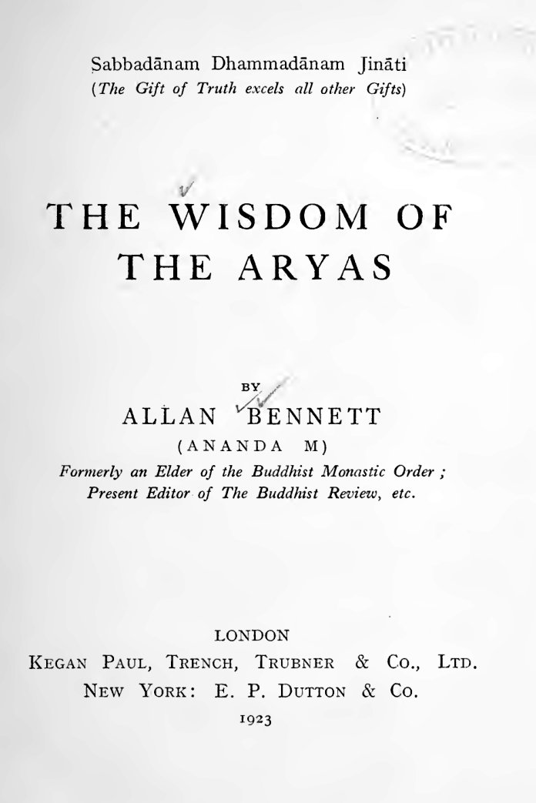

# アーリア人の知恵（アラン・ベネット）

アラン・ベネット（アーナンダ・メッテイヤ）著／全訳

- 原題：The Wisdom of the Aryas, by Allan Bennett (Ananda M.)
- 内容：黄金の夜明け団で魔術を学んだのち、ビルマで出家して上座部仏教の比丘となったイギリス人が、西洋の聴衆に向けて仏教の核心を語った講義集。ブッダの到達、カルマ（業）の法則、三つのしるし（無常・苦・無我）、四聖諦と八正道、瞑想の修行（念・前世の想起・四梵住）、三帰依と涅槃、そして再生の教えを、近代科学の知見と照らしあわせながら説く
- 刊行：London, Kegan Paul, Trench, Trubner & Co., 1923年
- 作業の基にした本文：Internet Archive 所蔵の1923年初版のスキャン（プリンストン神学校図書館蔵本）
- 著作権：ベネットは1923年に死去。日本・米国・英国で保護期間が満了している
- 訳者：人工知能（Claude Opus 5.5）
- 訳の性格：献辞、序論、全七章をすべて訳した。訳者の調べたかぎりでは、日本語訳は出ていない

## この本について

　アラン・ベネット（一八七二〜一九二三）は、ロンドン生まれの化学者で、若くして黄金の夜明け団に入り、その最も優れた魔術師の一人と目された。団ではアレイスター・クロウリーの師にあたり、二人はしばらく同じ部屋で暮らして儀式魔術を修めた。ウェスコットやメイザースと並ぶ団の第一世代の中で、ベネットは魔術から東洋の瞑想へと進んだ人物である。ひどい喘息に悩まされていた彼は、温暖な土地を求めてセイロンに渡り、一九〇二年にビルマのアキャブで出家して比丘アーナンダ・メッテイヤとなった。イギリス人として最も早く上座部の具足戒を受けた者の一人である。ラングーンで国際仏教協会を興し、一九〇八年には仏教伝道団を率いて帰国し、大ブリテン・アイルランド仏教協会の創立に関わった。

　健康を損なって還俗したのち、第一次大戦中にロンドンに戻った彼を支えたのが、献辞に名の見える作家クリフォード・バックスである。本書の六つの講義は、一九一七年から一八年の冬に、バックスのアトリエで私的な聴衆に向けて語られた。第七章の再生論は、仏教協会での講演を加えたものである。本書の刊行は一九二三年、ベネットはその年のうちに世を去った。

　本書の特色は、仏教を、迷信も盲信も要求しない「法則の支配」の宗教として、近代科学――重力、エネルギー保存、放射能、突然変異説、無線電信――と並べて語ることにある。ブッダはニュートンの先駆者として、カルマはエネルギーとして、涅槃は放射性原子の崩壊として、自己はフーリエ級数で書ける波として説明される。そのうえで、念の修行、前世をさかのぼって思い出す瞑想、慈悲喜捨の四梵住といった実践が、魔術の修行を知る者らしい具体さで語られる。神智学の「再受肉」と仏教の「再生」とを区別する第七章も、当時の西洋の受容史をよく伝えている。

　一方で、本書は一九二〇年代の文章であり、「アーリア人種」の優越、人種の進化、女性参政権を文明の衰退の兆しとみなす記述など、今日では受けいれられない見方を含む。ここでの「アーリア」は、仏典のアーリヤ（聖なる）と、当時の人種論の「アーリア人種」とが重ねあわされた語である。これらは時代の資料として原文どおりに訳した。

　note では三回に分けて公開する。第一回は献辞・序論・第一章・第二章、第二回は第三章から第五章、第三回は第六章と第七章である。

---

## 献辞

　クリフォード・バックス殿へ

　親愛なる友よ

　大戦の初めのころの恐ろしい年月に、私が健康をくずし、私の生涯をささげてきた大義のためにこれ以上働く可能性に絶望してロンドンに来たとき、私の生涯の仕事を再開することを可能にしてくれたのは、あなたのかつてない親切でした。第二に、本書の大部分をなす一連の講義を行うことを思いたたせ、またその手はずを整えてくれたのもあなたでした。それゆえ、西洋の地で刊行される私の仕事のこの初穂をあなたにささげるのは、報いようのない二重の恩の記念として、また私の命のあるかぎりきっと続くであろう心からの感謝のしるしとしてなのです。

　アーナンダ・M

## 序論

　本書の大部分をなす六つの論考は、本書をささげた友のすすめによって一九一七年から一八年の冬に書かれ、彼のアトリエで私的な聴衆を前に講義の形で語られたものである。輪廻の問題――仏教の教えのうちでも西洋人の心にわからせるのがいつも最も難しいものの一つ――は、もとの連続講義ではごく手短かにしか扱えなかったので、この主題についての別の論文を付け加えた。これはもともと大ブリテン・アイルランド仏教協会の会合で語られたものである。

　本書を考える人々の検討にゆだねるにあたって、その目的についても、著者が仏教を代表して語る資格についても、いくらかの説明の言葉が必要である。その目的は、手短かに言えば、教養ある世界のうちの大きな部分を占める人々――不可知論に倦みながら、しかもその教養そのもののゆえに、キリスト教の信仰のさまざまな説き方のどれをも受けいれることのできない人々――に向かって、あまり知られていない一つの事実を示そうと努めることである。すなわち、インドの賢者の中で最も偉大な人の教えのうちに、今日の西洋世界が直面している人生についての多くの深い問題を解くことのできる宗教的真理の体系があり、しかもそれは、キリスト教のあらゆる多様な教えを特徴づけている証明できない教義や盲目的な信仰の要求に、いささかも縛られていない、という事実である。じっさい著者の深い確信によれば、ブッダの教えの中心的な特徴をなす個人主義の克服に向かう、何らかの広範な運動がなければ、西洋世界の近代文明は必然的に自滅の運命にある。

　仏教が実際に何であり何を教えているかについて権威をもって語る著者の資格については、このような個人的な事柄を持ちこむことをお詫びしつつ、次のことを説明すれば足りるであろう。著者は、西洋世界にとっての仏教の価値について上に述べた見解に深く動かされて、二十年あまり前にビルマのアキャブで仏教の僧団に入った。その教えを内側から知り、のちにそれを西洋に示すことができるようにするためである。その僧団で、アキャブ、マンダレー、セイロン、そしてのちに（主として）ラングーンで、著者はおよそ十四年を過ごした。やがて僧団のテーラすなわち長老となり、健康がすっかり損なわれてやむなく僧院の生活を去ったのは、ようやく最後のことであった（＊）。ラングーンで、何人かの献身的で先見の明のある仏教徒の助けと協力とを得て、著者はブッダサーサナ・サマーガマ、すなわち国際仏教協会を創立した。この団体は宗教についての多くの小冊子を刊行し、『仏教』という評論誌を六号出した。それは大ブリテンそのほかの英語圏の国々の公共図書館に広く配られた。この評論誌は著者が編集し、その大部分を書いた。著者はまた大ブリテン・アイルランド仏教協会の結成にも主だった役割を果たした。

　（＊）説明しておいてよいと思うが、仏教の僧団では終生の誓いは許されておらず、その成員は誰でもいつでも僧団を去る自由がある。比丘は僧団でまる十年を過ごすと長老となる。

　これらの理由から、著者は本書のために、仏教についてすでにある膨大な数の著作の中で、ある独自の位置を主張してもよいかもしれない。主としてリス・デイヴィズ博士夫妻の献身的な仕事の成果である、仏典のかけがえのない翻訳を除けば、仏教についての膨大な文献の大部分は、仏教をできるかぎり不快な光のもとに置くことを当然の目的としたキリスト教の宣教師たちの仕事か（それは彼らが仏教をひどくゆがめて伝えたことを意味する）、さもなければ、せいぜい外側からこの主題を眺めていた西洋の非仏教徒の在家の学者たちの仕事であった。彼らの著作は、生きた宗教としての仏教の研究よりはむしろ、仏教の文献の起源の研究の成果である。じっさい在家の仏教徒によって刊行された著作も一、二はあるが（＊）、本書は、筆者の知るかぎり、仏教僧団のもと長老によって書かれ、イングランドで刊行される最初の著作である。

　（＊）たとえば、本叢書の第一冊である、J・E・エラム大尉の『仏教のメッセージ』。

　この国における仏教運動の発端を、全般的に、また本書の刊行を、とくに促した目的に戻って、ここで上に述べた三つの主張に何ほどかの根拠を与えておく必要がある。すなわち、仏教だけが今日の西洋世界の宗教的な必要に役立つことができるということ。偉大な諸宗教の中でそれだけが、時代のつのりゆく個人主義を治すことができるということ。そして、そのような個人主義の縮小がなければ、近代文明は自滅の運命にある――ちょうど、よく似た条件のもとで、ローマの文明や過ぎ去った年月のほかの多くの文明が滅びたように――ということである。

　これらを順に取りあげると、まず、我々の先祖を鼓舞した宗教についての観念と理想とが失敗したことの、根底にある根本的な理由は何かを考えてみよう。その失敗は、二十世紀にわたるキリスト教も、人間の個人主義的な貪欲が歴史上かつて人間自身に加えることに成功した最も残酷で恐ろしい災厄――その影響から西洋文化の全体がいまなおよろめいているあの大戦――を防ぐのに足りなかった、という事実によって、まことに嘆かわしくあらわになった。

　近代西洋文化のきわだった特徴であり、近代思想の究極の命令者であるのは、過去二世紀のあいだに我々人間の生活のすべての条件をかくも驚くべく変えてしまった物理科学である。我々を、先祖の時代の条件とは区別されるいまの我々にしたのはそれである。自然の力に対する支配を我々に与えたのはそれである。そして不幸なことに、まず多くの異民族や異国民の奴隷化と滅亡とのために我々を武装させ、そして近年では――道徳律の避けがたい働きのうちに――我々自身に向けて武装させたのもそれである。そして我々の先祖に足りていた昔の教えが失敗した理由は、近代科学の研究によって示された我々のまわりの世界の本性が、心にとっても頭にとっても、あの初期の観念や信仰とまったく相いれない〔原文 utteily〕ということにある。

　というのも、昔の教えは生命と宇宙とを、ある神的な存在の恣意的な意志の結果として表していたからである。我々の先祖は、天においても地においても、自然のすべての大きな現象の中にその意志と働きとを見た。その奇跡を行う意志によって、天体は定められた軌道を動くのだと彼らは考えた。その命令によって太陽は日ごとに昇り、地上のすべてのものに光と生命とをもたらす。その命によって雲は実りをもたらす雨を降らせる。人間の悪行に対するその怒りから、疫病と飢饉とが来て人類を間引き、地震と洪水とが来て人間のあまりに思いあがった建物を破壊し、あるいは飲みこむ。自然と生命とのすべての大きな現象の中に、西洋世界の幼い心は、あの力ある意志の働きを認めた。そして人々の心と頭とさえも、その意志と、それに敵対する悪い意志とのあいだの絶えまない争いの舞台であると考えた。全能の神は、どういうわけか、測りがたくも、人類の中の弱い者たちの悲惨と滅びとのために、その悪い意志が存在することを許しているのだ、と。

　我々の先祖にとって、このアニマ、すなわち自然のすべての現象の背後にある生きた全能の意志という考えは、たいへん現実的で身近なものであった。そして教会の教え――あるいはのちには、翻訳されたギリシア語とヘブライ語との聖書の個人的な解釈――は、彼らの生活をなすすべてのものの中にその働きを思い描いた至高の存在の、霊感による言葉として、文字どおり実際に信じられていた。しかし知性が育つにつれて、人々が自然の現象を本当に研究するようになると、彼らは、自分たちが調べることのできたあらゆる方面において、それらの現象がある根底にある法則の働きの結果であることを見いだした。科学がわずかな人々の研究にすぎなかったあいだは、このことは西洋思想全体にとってほとんど違いを生まなかった。しかしいまや、その応用がますます広がるにつれて、科学はますます広く知られるようになり、この「法則の支配」という科学的な考えが、恣意的な意志という昔の信仰にとって代わることがますます広まっている。

　そして、我々の心、我々の知性に関するかぎり、この最も根本的な視点の変化においてこそ、仏教は、そして世界の偉大な諸宗教の中で仏教だけが、この近代の科学的真理との比較の試練に耐えることができるのである。というのも、以下の頁で示すように、仏教はこの「法則の支配」という考えの上に築かれているからである。ニュートンが重力の法則の存在を証明したとき物質界の科学のためになしたこと、それを――いや、それよりはるかに多くを――ブッダは、その二十二世紀前に、人生のより深い事柄の科学のためになしていたのである。人々の性格と運命とは、我々が生と呼ぶすべてのものの大きな条件づけのすべてに責任をもつ因果の法則によって、同じように厳密に決定されている、と告げたときに。

　また、我々近代人が先祖の信仰に見いだす困難が、この古い東方の信条の中で解決されるのは、知的な領域においてだけではない。我々の頭と同じく我々の心もまた、生命と自然とを知的な意志の作品とみなす考えに反発する――我々が自然が本当に何であるかを理解し、それに立ち向かう勇気をもてるほど成熟したいまでは。我々は科学の目を通して、すべての生命を一つの絶えまない闘争とみなすことを学んだ。その闘争の中で、数えきれない何百万もの、この上なく敏感な生き物たちが、最も残酷で最も苦しい死に絶えずさらされている。我々は生命がいたるところで、見たところ盲目のうちに、自分自身に敵対して並んでいるのを見る。そして我々の先祖なら被造物の「神から与えられた本能」と呼んだであろうものが、考えただけで胸の悪くなるほどおぞましい残酷さをもって、ほかの生命に向けられているのを見る。たとえば、その科の中で最も小さな動物である「シャチ」の場合と、それが自分と同じ科のはるかに大きな仲間、巨大なマッコウクジラを扱うやり方とを考えてみよ。尾で絶えまなく打ちすえて襲いかかり、シャチは、その巨大な犠牲者が口を開けて逃れようともがくとき、その下顎をつかんで下へ引っぱり、何度も何度もはずそうとする。しばしばこの不釣り合いな戦いはまる二、三日、昼も夜も続く。ついに大きなマッコウクジラは力つき、かつての力にもかかわらず、獰猛なシャチの恐ろしい攻撃に対してもはや口を閉じることができなくなる。そのときシャチは力のかぎり引っぱって、マッコウクジラの下顎をはずすことに成功する。そのためクジラはもう口を閉じることができない。そこでシャチはその長い戦いの報いを刈りとる。巨大な動物の口の中に入りこみ、その舌を食いちぎる――そして、不運な怪物を、苦悶と飢えとのゆっくりとした責め苦のうちに死ぬにまかせて去っていくのである！　自然はまさにこのような恐ろしいことに満ちている――たいていの人はそれを知らないか、それが何を意味するかを考えようとしない。しかし考える者にとっては、もしこのような忌まわしいことが創造の努力の結果であるなら、それはそれに責任をもつ知性によってはっきりと考え出され計画されたものでなければならないことは、きわめて明らかである――この問題を避ける可能性はない。そして、このように勇気をもって生命に正面から向きあう本当に思慮深い男や女には、平均的な人間ほどのわずかな慈悲しかもたない存在でさえ、もし全能を授けられていたなら、我々がいくらか理解するようになったこの自然ほどひどく残酷な生命の仕組みを考え出しうるとは、信じがたいことである。まして、全知にしてすべてに慈悲深いと考えられる存在においてをや。

　そしてここでもまた、仏教は我々に、理解へのできるかぎり近い接近を与えてくれる。我々の先祖の子供じみた信仰のように、この生命という貪欲な拷問部屋の生き物たちが、その絶えまない苦悶のゆえにその創造主をたたえているかのように描くどころか、仏教は――幼年期を脱した心にふさわしく――生命に大胆に正面から向きあう。そしてもっともらしい思弁的な教義によって存在の事実に目をくらまされることを拒み、まさに生命のこの苦しみをその教義の構造の最前面に置く。それは我々に、すべての残酷さの化身である、自らの意志をもった力ある存在が、この苦しみの塊の全体に責任をもっているのではないことを示す。そうではなく、ただ欲望――自己に閉じこめられた生命への渇き、渇愛――が責任をもっているのである。それは無慈悲で、自己が生きているかぎり、全宇宙が滅びようとかまわない。そして仏教はさらに進んで、このように恐ろしく条件づけられた生命の終わり、宇宙を越えた生命の成就への移行が、まさにその自己への欲望を抑えること――いやむしろ、それをすべての生命への無条件の愛と憐れみとへと、より高貴に変容させること――によってのみ、もたらされうることを示すのである。

　さて、我々の文明をおびやかす危険と、仏教の理想が広まることがいかにしてそれを覆しうるかという問題とに移ろう。我々の現代の状況を、たとえばローマの衰退期（我々が最もよく知る例として）の状況と比べるとき、歴史を学ぶ思慮深い者は、二つの大きな時代の条件づけのあいだの驚くべき類似に打たれずにはいられない。しかし、これらの類似を詳しく考察し、その平行関係がどこまで進みそうかを推論する前に、根本に立ち返って、大きな文明一般の解体の原因を確かめておくのがよいであろう。

　我々の知る高等な生命のすべての形態は、はるかに低い次元の膨大な数の生命単位が、ある独特の親密な、しかも絶えず変化するやり方で組みあわされることから生じる。もちろんこれは物質的な視点からのものである。しかし、物質界に見いだされるどんな条件の組も、霊的あるいは心的な世界に行きわたっている条件の正確な平行物でなければならない、ということはいくら言っても言いすぎることはない――両者は同じ一つの生命の異なる面にすぎないのだから。ちょうど北を向く極性と南を向く極性とが、同じ一つの磁気の分かつことのできない面であるように。そして我々が物質的な視点を選ぶのは、その視点からの我々の知識が、より精妙な領域についての我々の知識をはるかに上回っているからである。

　それでこの視点から、例を挙げれば、我々自身の人間としての生命は、はるかに卑しい膨大な数の生き物の生命――すなわち我々の体を作りあげる数えきれない細胞の生命――の組みあわせから生じるものとみなすことができる。比較生物学の示すところでは、ある存在が進化において進んでいればいるほど、その存在の生命を作りあげるさまざまな種類の個々の細胞の性質と働きとはいっそう高度に分化している。そして人間の体を構成する細胞の分化の度合いは、地上のほかのどんな生き物のそれよりも高い。

　我々の生命がこのように個々の細胞から作りあげられているように、大きな文明は個々の人間から作りあげられている。そしてここでもまた、それを構成する個人の働きが高度に分化していればいるほど、その結果としての文明は進んでいる。予想されるとおり――より大きな存在はより小さな存在から引き出されるのだから――我々の体を構成するさまざまな種類の細胞の働きと、大きな人間の文化を構成する個人の働きとの類似は驚くほど密接である。我々の体は、電信の通信網を通して全体の団体を統制する、高次の神経系という中央政府をもっている。循環系とリンパ系という道路と水路とをもち、それを通して生命の必需品が全体の最も卑しい細胞単位にまで届く。肝臓という大きな燃料の貯蔵庫をもつ。そして内分泌腺についての最近の研究は、それらが郵便制度さえもっていることを示した。それを通してある強力な物質の分子の小包が、それを必要とする細胞に送り出され、届けられるのである。その類似は単なる類比を超えるほどであり、完全な人間の文明とは、我々の体を構成する生きた細胞のさまざまな種類の働きが、国家を構成するさまざまな種類の個人の働きによって最も正確に再現されている文明であろう、という考えに我々を導く。

　我々の体を、その含む生命の富をむさぼろうとして絶えず侵入してくる無数の敵対的な生命から守るために、自然は、人類が同じ考えに達するはるか以前に、ある種類の細胞から民兵を練りあげ分化させた。この民兵は、我々の道路の最も細かな分かれ目のすべてを巡回する食細胞によって構成されている。そして我々みなが知っているように、それらは、我々の体に入りこむことに成功したどんな敵対的な生物にも襲いかかり、できればそれを滅ぼす。

　さて若さと人生の盛りとのうちは、これらの食細胞、我々の民兵の成員たちは、まるで体の団体全体のより高い生命を守るというただ一つの理想に鼓舞されているかのようにふるまう。何か重大な侵入を撃退するためには、何百万もの自らの命をさえ犠牲にする。しかし老いが忍び寄るにつれて、まるで古い理想が衰えるかのようになる。まるで食細胞が、前任者たちを活気づけていた団体の生命を守るというあのただ一つの理想にもはや鼓舞されず、利己的に、個人主義的になるかのようである。それらは我々の道路を絶えず流れている富から自分の分を取りはじめる。自分のためにつかめるものをつかみ、本来の務めをおろそかにする。その結果が、我々が老衰と呼ぶものであり、それは遅かれ早かれ避けがたく死に終わる――生物全体の死であり、もちろんそれをもたらした民兵の細胞の死をも含む。

　この事実を少し考えてみよう。というのも、我々自身の存在のまさに根において、また我々の知識が最も大きい物質界において、我々はその中に深い霊的な事実の予兆を見いだしうるのだから。読者は、よりはっきりさせるために、本当は心的な次元に属する用語を下等な細胞の生命にあてはめて用いることを許していただきたい。たとえば我々が細胞の「理想」と言うとき、それは、高度に発達した人間においては理想へと進化する、意識へ向かうおぼろげな手探りを意味しているのだと理解していただかなければならない〔原文 underest ood〕。以下でもすべて同様である。

　我々の知るより高い次元の生命は、低い次元の多くの生命単位の共生、完全な相互の結びつきによってのみ存在に至る。これは、注意してほしいが、生命の過程の単なる化学についてさえ真実である。というのも炭素――生きた分子の基礎をなす元素――は、大きな分子の結合をつくる能力が最も大きい元素であり、ほかの炭素原子や、ある種のほかの元素の原子と、実にさまざまな組みあわせで結びつくので、炭素化合物の化学はそれだけで一つの大きな学問をなしているのだから。高度に進化した団体的存在の健やかな生命は、この結びつき、多くの個々の生きた単位のこの相互扶助と協力とにある。それぞれが、より高い団体の生命に寄与するうえで、別々の高度に分化した役割を果たしている。それはまるで、個々の細胞が同じ結合体のほかのすべての細胞の生命と目的が一つであることを認めているかのようである。そしてこの認識、相互の一体性と相互の利益とについてのこの理解が至上のものであるかぎり、より高い生命は強く健やかなままである。しかし、すべてを活気づける生命が一つであるというこの理解が、相当の大きさをもつ重要な集団――上に述べた「民兵」の細胞すなわち食細胞――において失われるやいなや、より高い存在全体の生命の過程は衰えはじめる。老衰が続き、全体の死に終わるのである（＊）。

　（＊）人間の体において、「民兵」の細胞と同じ種類の例がもう一つ知られている。後者はもちろん血流の中を動く運動性の細胞である。しかしときに、固定した細胞の一群、たとえば共同体の労働者である筋肉の細胞が、同じように一体性とより高い生命の至上の重要性との認識を失うことがある。定められた役割を果たし、結合体のために働きつづけるかわりに、それらは自分のためにつかめるものを貪欲につかみはじめる。生物全体のために、またそれとともに働くかわりに、生物全体を犠牲にして増殖し成長する。そしてひとたび始まると、退化の過程はまわりの細胞に広がり、それらはいわば隣人のボリシェヴィキ的な個人主義に感染する。その結果が、我々が悪性腫瘍すなわち癌と呼ぶものである。それは成長し、しばしば人間にひどい苦痛をもたらし、ついに何か生命にかかわる部分に達して、死が来る――ここでもまた「個人主義」によって！

　さて生命全般に目を転じよう。過去と現在との地上の生命について我々の知ることを見わたすとき、我々は生命が、単なる盲目の実験と見えるものに絶えず従事しているのを見る。見たところ盲目的に、生命は地上で働き、まずはますます精巧な単細胞を進化させた。それぞれが互いに敵対し合う、貪欲な微小の世界であり、その子孫の膨大な群れがいまなお活発に存在している。生命が学んだ最初の大きな教訓は、それが自らの生まれつきの一体性のおぼろげな最初のきらめきを得たときであった。そしてこうして、ますます進化する生命の結合体のうちに顕れはじめた。無脊椎動物、脊椎動物――ますます完全な結合体となって、ついに爬虫類に至る。それから水を離れて陸に上がり、次の大きな教訓を学んだ――ふたたび結合の価値の教訓を、空間においても時間においても、哺乳類において。空間においては、相互の保護のために群れをなす哺乳類の目のように。時間においては、若いものの教育によって種族の経験を伝えることによって。

　しだいに進化する知性とともに、人間はのちにゆっくりとした段階を経て、生命の一体性のこのおぼろげな本能的な認識を心的な次元へと持ちこむようになった。家族は氏族へ、部族へ、ついには特定の人種あるいは国民の全体へと集まった。同じように、時間における一体性の人間の認識も進化した。そして言語が急速に育つにつれて、いわばさまざまな人種の最初の脳細胞が、祭司と吟遊詩人という分化した階級の姿で生まれた。彼らは種族の歴史と神話とを集め、代々伝えた。それから文字が、時間におけるこの結合に新しい巨大な発展をもたらした――訓練された人間の記憶でさえ狭い限界があり、一方、一つの部族の知識の総計でさえ、まもなくどんな一人の人間の頭脳にも収まりきらないほど大きくなったのだから。そしていまや人類はたいへん進んで、その現在の「脳細胞」〔原文 Train-cells〕の先頭に立つ者たち――我々の後代のより進んだ思想家たち――は、少なくとも人類そのものに関するかぎり、生命を一つのものとして理解することの至上の価値と重要性とを、ますます把握するようになっている。すでに人間は未来の世界国家を夢見、計画している。そしてじっさい、自然に対する科学の征服は、我々に鉄道、汽船、飛行機、電信と電話とを与えることで、より文明化された国民や人種の境界をすでに大いに消し去り、文明化された人類をますます一つの巨大な組織への合体へと近づけているのである。

　それゆえ、生命の恐ろしい、長く続く苦しみは――ずっと昔にブッダが人類に教えたとおり――自らが一つであることについての盲目の無知（ネスキエンス）から生じたのである。存在のこの究極の霊的な事実を理解しないことから、生命がその根底にある目的と目標との一体性を認めないことから。言い知れぬ苦痛の時代が、生命に結合の価値をいくらか教えた。そして進化の進みのしるしとは、まさに、ある生き物の集団が、空間において、最高度に調和のとれた結合を示している程度なのである。哺乳類とその若いものの教育とともに、結合の新しいより高い秩序、すなわち時間における結合が現れた。そして記憶と思考との力のこの予兆は、ついに完全に自己意識的となり、言語の発達とともに、人間において新しいより高い段階に入った。生命の苦痛は、それがこの結合の力、自らの内在する一体性のこの実際的な実現をなしとげた程度に応じてのみ和らげられる。そして――生命の最も物質的な面、物理的な側面で我々の本性のまさに岩盤をなすものによってさえ教えられるこの教訓を瞑想して――我々は、地上の我々の生命が、はるか遠い未来においてその教訓を完全に学んだとき、やがてなしとげうるものの遠いおぼろげな幻を垣間見ることができる。我々は一つの世界を見る。そこでは、人類のつのりゆく力と知恵とが、生命の大きな教訓を意識的に実現して、互いに敵対し害しあう生命のあらゆる様式を、まさにその個人主義のゆえに死に絶えるにまかせたであろう。残ったすべての植物相と動物相とが一つの完成された共生のうちに協力する世界――この世界体系の生命が、その根底にある霊的な実在においてはいまでさえ一つであるが、意識的に導かれた総合において、外的にも物理的にも一つとなった世界である。

　さて過ぎ去った文明の衰退、その衰退の原因、我々の文明の同様の衰退の可能性という問題に戻ると、例としてローマ文化の衰退を取るのが最もよい。二つの文明の盛期の条件のあいだにある類似のゆえにも、また、その近さのゆえに、ローマの衰退に伴った事情を我々はほかのどの場合よりもよく知っているからでもある。ローマの歴史を学ぶ者で、ローマの衰退期に行きわたっていた条件と、我々自身の近代文化に明らかに見いだされる条件とのあいだの、きわめて密接な平行関係に深い印象を受けない者はいない。我々は、上流階級と大衆とのあいだの、同じ根深い鋭い対立を見る。両性のあいだの同じ対立を見る。女性があらゆる方面で男性と競おうとする同じ傾向――参政権というまさに細部に至るまで――を見る。最近の心霊主義の広範な再燃に我々が見る、最も奇妙で物質主義的な形の迷信を追い求める同じ傾向を見る。とりわけ、そして究極的には不安定さのこれらすべての現れの背後に、我々は両方の場合に、物質の世界においても心の世界においても、個人主義の同じ広範な成長を見いだす。前者においては、両方の場合に、少数の手に巨大な富が蓄積され、多数の貧困が強められる同じ傾向を見る。後者においては、個人主義が、すべての悪の根、全体の衰退の第一の原因とみなされるかわりに、進歩の唯一の確かな手段として掲げられるのを見る。ついに我々の時代には、ニーチェが、自我を神格化する彼の教えのために多くの弟子を見いだすことができる――「金髪の大いなる野獣」が従うべき理想として掲げられ、あらゆる高貴な徳、とりわけ神的な慈悲は（そのような源からであれば当然であるが）、拒絶と軽蔑とにしか値しないものとして掲げられるのである。

　さて、もしこの際立った条件の類似の根底にある原因が、我々の近代文化の場合にも、ローマやほかの多くの古代文明の衰退においてと同じであるなら――すなわち、もし我々の文化を鼓舞した生命の衝動が衰えようとしているなら――そのときは、前に述べたように、我々の近代文明もまた、自然法則の単純な結果として、解体の運命にある。しかし、我々に別様に考えさせる多くの事実がある。

　第一に、ローマや、失敗したほかのすべての過去の文化の場合には、文明を築いたのは単一の人種であった――ほかの人種の文化にどれほど負うところがあったにせよ。単一の人種がかかわる場合には、生命の衝動のそのような衰えを理解することができる。人種は、前に指摘したように、人間の大きな集合体を構成するより高い個体であり、個体として、それは存在に至り、盛りに達し、それから衰える。ちょうど、そのより高い、より永続する生命を築くのに役立つ個々の人間がそうであるように。しかし近代文化は、いくつかのはっきり異なる人種――たとえばチュートン人とガリア人とほどにも異なる人種――にまたがり、それらによって練りあげられてきた。そしてこれほど多くの異なる人種の生命の衝動が、同時にまったく同じ衰退の時期に達したとは考えにくい。いまアメリカ大陸で――新しい人種がいつもそうして形成されるように――いくつかの古い型の融合によって明らかに形成されつつある新しい人種については言うまでもない。そしてまた、すでに述べたように、我々の先祖を鼓舞した宗教的な観念の失敗の、少なくとも一つの理由――じっさい主要な理由ではないにしても――は、たいへん高く高貴なものである。すなわち、いま我々が思い描くとおりの真理について、我々がごまかしをすることを拒むからなのである。

　このような違いは深く広範囲に及ぶものであり、我々はあえて次のことを示唆する。近代の不安定さの原因は、人類が、少なくともそのより進んだ部分において、下等な生命においてならいま「突然変異」と呼ばれるであろうものに平行する、大きな全般的変化の過程にあるという事実にある。ダーウィン、ウォレス、スペンサーによって練りあげられた古い進化論は、ある種が、環境やそのほかの原因の作用を受けて「変異」を生み出す傾向をもつものとして表した。そしてその変異は、有利であれば、継続的な自然選択と適者生存とによって増大し、ついにはもとの型とはまったく異なって新しい種をなすほどの種族の出現をもたらしうる、と教えた。このように述べられた理論についての一つの大きな難点は、地質学の記録の中にそのようなゆっくりとした着実な変化の痕跡がまったく見いだせないことであった。ある種から派生したものは、極微のゆっくりとした変異によってよりはむしろ、突然に、跳躍によって変化するように見えた――この難点は、しばらくのあいだ「失われた環」の存在という仮説によって切り抜けられていた。しかしフーゴー・ド・フリースは、実際の実験によって次の事実を証明した。すなわち、種は――大まかに言えば――ある長い期間同じままでいるが、短い不安定な期間ののちに、もとのものとはまったく異なる次元の型が現れて新しい種をなす、ということである。実際の証明によってこのように確かめられたこの修正は、突然変異説として知られ、いまでは事実を説明する最良の方法として一般に受けいれられている。さて自然がひとたび人間という姿において自己意識をもつ知性の進化に達したなら、それ以上の変化、進化におけるそれ以上の前進は、もはや形の世界、要するに空間における結合においては起こらず、思考と感情と、より高い生命をなすすべてのものが広がっている、時間における結合のより高い次元の変化へと移るであろう、と考えるのが自然である。

　それゆえ人類という種における突然変異は、心的・道徳的な型の変化の中に求められるであろう。そしてそのような突然変異が、いま、そしてこの一世紀かそこらのあいだ、進行しているのだと我々は示唆する。

　じっさい、ほんの一世紀前の心的・道徳的な観念を考えると、文明化した人類に起こった変化の巨大さに打たれずにはいられない。我々の心性そのものが変わったように見える――しかも大いによい方向に――たとえば、金持ちとラザロとのたとえ話から道徳的な満足を引き出すことのできた型からは。我々は――少なくとも共同体のより教養ある部分においては――かつての貧しい男が、かつての恩人の地獄での責め苦（我々にはまことに信じがたいことに、永遠のものと考えられている！）をほくそ笑んで眺めるという考えが、嫌悪と恐怖とのほかには何の感情も呼び起こしえない点にまで達した。そして真の人間性の次元においてこれほど明らかなことは、知性の領域においても同じく明らかである。ニュートン（彼は、その時代のたいていの偉人と同じく、それ自体が一種の自然の戯れ〔原文 lusus nature?〕、時代の外に生まれた人であった）のほかに、彼の時代に、今日では科学の学位をもつすべての卒業生が指先で扱えなければならない推論について行くことさえできた者がいたかどうかは、大いに疑わしい。そして、人間の個人の生命と大きな文明の生命との平行関係について述べてきたことに照らして、たいへん意味深い事実がある。すなわち、我々の歴史の及ぶかぎり、人間の文化が、我々が電信と電話との体系をもっているように、人間の体において高次の神経系とその分岐とが果たす役割を表すまでに進化したのは、ようやく近年になってからのことなのである。

　しかしもし、我々の現在の状態に見られる不安定さのめだった症状が、我々の心的・道徳的な発達における巨大な変化を告げ知らせ、開始する、過渡期の自然な付随物にすぎないのなら、それらは新しい条件が安定するにつれて消え去ることもありうる。ただしこれに関連して、二つの事実を忘れてはならない。第一に、そして最も重要なこととして、ここにかかわる変化は自己意識的な思考の世界における変化であり、それゆえ能動的に――意識的に、理解をもって――迎えられなければならないということ。第二に、どんな過渡期も必然的に危険の時期でもあるということである（殻が窮屈になって脱ぎ捨て、そのためしばらくのあいだ無防備になる蟹のように）。それゆえ、人間の生におけるこの大きな変化が我々のまわりで進んでいるあいだ、何もせずに座っているのではなく、改善をもたらす種類の力と、できるかぎりたいへん積極的に熱心に協力することが我々の務めなのである。

　この序論の論考では、生命の物質的な面から引いたある種の観念を用いた。我々の知識が最も大きいのはその方向、その面からだからである。しかし生命において本当に裁定者であるのは物質ではなく心である。そして善をもたらす力と協力することについて述べたことに関連して、我々は心のこの大きな力をいつも忘れてはならない。我々の一人ひとりがそのように協力することができる。せめて、自分の心の中の悪い思いをできるかぎりわきへ置くことによって――とりわけ、よい思いを積極的に考えることによって。ちょうど体をよりよい健康のために鍛えるように。我々に来るどの思いも、ただほかの人間の生命へと移っていくために来るのであり、しばらくのあいだ我々の生命の流れの一部をなしたことによって、よりよく、あるいはより悪くなっている。それゆえ、考えるすべての女と男との力のうちに、いま起こりつつあるこの大きな変化において、生命に助けの手を貸すことがあるのである。

　結びに、以下の部分について、訂正のたぐいのいくつかの言葉が必要である。数学に通じた読者には、これらの論考がもともと講義として書かれたものであることを思い出して、簡潔さのゆえに、フーリエの定理に関して波動の初歩的な微分の記法を用いたことを許していただきたい――とりわけ彼らは、そこで伝えようとした意味をくみとってくださるであろう。別の箇所で採用した、重力は無限の速さで伝わるという仮説については、それが仮説にすぎないことを説明しておかなければならない。重力をさえぎる遮蔽物として働く物質は何も知られていないので、たとえば光の速さが調べられたようにこの問題を調べることはできない。じっさい、もしアインシュタインのすばらしい一般化が正しければ、どんな形のエネルギーも光の速さより大きな速さで伝わることはできない。類比の正しさにとって幸いなことに、空間のあらゆる原子がほかのあらゆる原子に影響を及ぼすという根本の事実は、たとえ時間の要素が入ってくるとしても、真実のままである――ただ、我々の心には、原因と結果とのあいだに、隔たる距離がどれほど遠くても、時間の間隔がまったくなかったなら、おそらくそのほうがいっそう大きな驚異に思われたであろう。

　そして最後に、以下の頁のたどたどしいところ、くり返しの多いところ〔原文 repetional〕について、お詫びしなければならない。そこにおいて価値あるものは、それがブッダの力ある教えを近代の言葉で正確に表している程度に応じたものである。そこにおいて価値のないものは、すべての価値のない言葉や思いと同じく、同じ理由によって死に絶えるであろう。真実であるものは生きのこるであろう。古い仏典が言うとおり、「真理は、まことに、不死の言葉である」のだから。

## 第一章　教えの源――ブッダとその到達

　おそらく人生のいつかどこかで、我々みなに訪れたことのある一つの経験がある。それゆえ、それは物質の宇宙の背後にあるあの霊的な実在との、ごく表面的な触れあいにすぎないとはいえ、我々のいまの主題の出発点としてよく役立つであろう。私はそれを「星明かりへの目覚め」と呼ぼう。それは、夜にひとりでいるとき、それも人の住まいから遠く離れているときにいちばんよく――月のない、星の光る空の下にひとりでいるときに――我々に訪れる。我々はしばらく歩きつづけてきた。心はいつものように自分のことで忙しく、頭上とまわりとに燃えるあらゆる宝石には気もとめずに。ただ、ひょっとして方角を知るためにちらりと目をやるくらいで。そのとき突然、奇妙な、柔らかな内なる衝撃とともに――夢の中で自分が自分であることを思い出して目覚めるときに来る衝撃にいちばんよく似たものとともに――あの高い星空が我々にとって含み意味するもののすべての、何かのきらめきが、我々の心に飛びこんでくる。その経験が続くあいだ、我々はもはやあの静かな、輝き脈打つ天体を、さまよう足のための便利な道しるべ、ただの明るい光の点としては見ない。そうではなく、我々自身の血管の中で脈打ちうねり、通りすがる我々を夜の森のあらゆる生き物の目を通してのぞき見、この生きて息づく世界のすべての最も高い単位にも最も卑しい単位にも生気を与え形を与えている、あの同じ生命の奇跡の、計り知れないほど広大で遠い前哨として見るのである。あのきらめく穹窿をまぶしている数えきれない無数の火花のうち、どんなに小さなものでも、まことに、力ある太陽でないものはない、と我々は知る。空間の深みに迷いこんだ、あの同じ普遍の生命の、煮えたぎる白熱の焦点である。それは、我々の地上の竜巻もほとんど感じられないそよ風にすぎないような燃える嵐の器官のただなかで、その従う世界の一団に熱と光と生命とを打ち出している――星は星へとその永劫の生命の燃える便りを急ぎ送り、果てしないエーテルの大洋の上に脈打つごとに燃えあがって、存在の神秘のうちに果たされた自らの役割の物語を告げている。

　そして、そのすべての測りがたい神秘と目的とのうちから、我々の心がつかみうるほんのささやかな断片が我々の胸に飛びこんでくるとき、そのとき我々自身の意識のまったき深み――願わくは、外のあの高い天に劣らず星々に満ちた深み――は、あの高い魅惑の呼び声に応えて揺れ動き〔原文 tir〕、生命へと動かされる。

　生命が生命に応える。そこで我々はその一体性を認め、ついには我々の心の隠れた社の中で、星々の高い沈黙のささやきを聞きそうになる。生命のすべての恐ろしい苦しみを正当化し、すべての神秘に答える言葉を、ついに息づかせるささやきを。

　そしてなお、なお、我々の心のうちの静かな夜を通して、すべての生命との意識的な一体性のあのうねり応える高まりのすべてを通して、存在に行きわたる、あのたぐいない、情熱なき〔原文 impassionate〕犠牲の感覚、確かな事実がふるえわたる――生命がいつも生命自身の祭壇の上で生命にささげられる――何か伝えがたい未来の希望を得るための、現在の絶えまない奉献である。ついに我々はもうそれに耐えられなくなり、「主よ、私はふさわしくありません（ドミネ・ノン・スム・ディグヌス）」と叫んで、意識をふたたび地上へともぎ戻すのである。

　さて私がこのごくありふれた小さな経験を持ち出したのには、二つの理由がある。第一に、以下に続くことは何よりも「霊的な経験」（＊）という言葉に付された意味を把握することを必要とするからである。そして、すでに述べたように、この「星明かりへの目覚め」は、あの大いなる実在、感覚の生の向こうに君臨する生命との、ほんのかすかな触れあいを意味するにすぎないとはいえ、それはやはり触れあいである――考えるすべての女と男とに共通の触れあいである。そして第二に、それは――内なる生の境界をかすめるほかの同様の経験と比べて――我々の記憶の中で、遠さの、それゆえかすかさの、独特の性質をもっており、それが、これから言わなければならないことの説明あるいは言いわけとしてよく役立つからである。

　（＊）仏教は、のちに明らかになるように、人間あるいはほかの存在のうちに、不変の精妙な原理、すなわち「霊」が存在することを否定する。それゆえ、仏教についての一連の論考の中で「霊的」という語を用いるのは場違いに思われるかもしれない。それゆえ、この語が用いられているところでは、何ら教義上の含みはなく、ただ心の内なる深みの事柄にかかわるという、この語のふつうの意味だけであることを理解していただかなければならない。不幸なことに、英語にはこの含みをもつ語はこれしかなく、それでもっと仏教的な語がないためにこれを用いるのである。

　たとえば我々は、すべての生命との一体性のあの強い実感を、この世界の生命――我々の太陽からかくも惜しみなく流れ出る生命――についての、その計り知れない絶えまない犠牲の行きわたる感覚を、得ることがよくある。それと区別して、「日の光への目覚め」と呼んでよい経験である。しかしこの二つの出来事についての我々の記憶は、たいへん注目すべき対照をもっている。すなわち、前者は遠さによるかすかさの感覚に満ちているように見える――星明かりから学んだ教訓はまことに大きく、たいへん高く高貴に見えるが、あとになるといつもどういうわけか我々には使えないもののように見える――それを教える天体そのものと同じく、時間においても空間においても遠く、我々の日々の、身近な、人間の生活の必要と性質と条件づけとから離れている。後者はそうではない――日の生命への目覚めについての我々の記憶は、夜に比べての昼の性質、過去の単なる思い出に比べての、いまの光景と出来事との性質をもっている。

　その対照を十倍に、いや百倍にしてみれば、我々が西洋で仏教と名づけるこの大いなる教えが本当に何を意味するかをあなたがたに語り、わからせようとするうえで――その生き生きとした実在性とまったき真実とについての私自身のささやかな把握をあなたがたに示そうとするうえでさえ――私の感じている困難、ほとんど不可能さを、少しは理解していただけるであろう。不幸なことに、私がこの困難を最も感じるのは、私が始めなければならないここにおいて、すなわち人類の歴史の中ではるかに最も偉大な人物の、まったく比べようのない本性についてである。それは、当時の仏教徒でない人々がゴータマと呼び、その弟子たちがブッダ、「目覚めた者」と呼んだ人格である。ここ西洋では――仏教のサンガ、すなわち僧団として知られる霊的な力の驚くべき焦点がいままでのところ存在しないので――人は師の教えを本で読むことはできる。そしてそれは、星明かりのあの教訓のように、高く、たいへん大きく高貴に見える。しかし星々のように、たいへん遠いのである。十八の年から自分を仏教徒と呼んできた私自身の生においてさえ、私はいつもこの対照を感じてきた。及ばずながら、私は本のあの星明かりのような教えから集めることのできた教訓に従った――しかし東方に出かけるまでは、仏教の昼の光への目覚めを経験するとはどういうことかを知らなかった。八年後、初めてセイロンにいる自分に気づき、そこでの最初の日に、当然ながら仏教寺院の中にいたとき、その違いはまさに星明かりと日の光との対照であった――前者はかくも青ざめ、かすかで、遠く、後者はいつも新たにされ、すべてを動かす現在の生命の力で輝いていた。かつてまことに美しくはあっても、かくも遠く見えた霊的な実在の、この生き生きとした臨在は、それを感じた私自身にもほとんど信じがたいほどであった。私はまたのちに、ちょうど日の光がその栄光ある生きた美しさをもって人間の宮殿にも小さな小屋にも等しく入りこむように、ちょうどそれが直接的で、いまここで我々に働きかけ、日ごとに暖かさと光と生命とをもたらすように、私にとって新たに昇ったこの教えの太陽もまたそうであることを見いだすことになる。単なる星明かりとしてさえ、私はそれ以前にそれをかくもあがめ愛してきたのであるが。そこでは、普通の人々の日々の生活の中に、その言葉づかいや家の習わしの中にまで、教えのこのいつもある日の光が浸みとおっていた。そこでは、祭りで集まった群衆がブッダに帰依するのを聞くと、彼らがその顔をブッダのまさに臨在の輝きに浴させようとそちらに向けるのが見えるかのようであった――ついには、キリスト教の宣教師たちから、あなたがたは自分の宗教自身がまったく去ってしまったと教えている存在に帰依しているのだと言われても、彼らが腹を立てるかわりに、いつも、じっさいそうしているように、ただ賢く慈悲深い微笑みだけで答えるのはなぜかが、理解できるほどであった。私は東方に身を置くまで、宗教が何を意味しうるかを知らなかった。我々の宗教のはるかに最も活発な形であるカトリック教会でさえ、その霊的な真理をいつもたいへん遠く畏れ多いところに置き、息を殺してしか近づけないものとしているように見える。一方、東方のこの仏教においては、その聖なるものと戒めとへの崇敬がいささかも劣っていないのを見いだすが、それらを畏れ多いものとみなすどころか、私の知るどんな西洋のカトリック教徒も近づくことさえできないような、熱烈な崇拝の霊感としてのみ保たれているのを見いだす――師の聖堂は、いつも幸せな、祭り気分の群衆を引き寄せる導きの星である。中世のヨーロッパのキリスト教はそのようなものであったかもしれない――もっともそこでは、当時の人々が考えたようなキリスト教的な面をもたないすべての芸術と科学と哲学との抑圧を代償としてであったが――しかし今日、西洋世界の宗教のどの面にも、仏教がその東方の故郷でいまなおそうであるような、生き生きとした力強い生きた力は、たしかにどこにも見いだせないであろう。

　そこでは仏教は、まことに長い長いあいだののちについに、かくも現実的で、かくも明らかに真理であると見いだされるので、私はその鋭く生き生きとした実在性を、その完全な確信の落ち着きを、それに従おうとする者にとってここにまさに真理があるという確かさの感覚を、あなたがたにわからせることにほとんど絶望する。というのも、これは――ここで本でそれについて読む者にはそう見えるかもしれないが――ただの型にはまった哲学ではなく、生きて息づく真理だということを理解していただかなければならないからである。その大いなる流れに心から身を投じる者を、誰であれ、我々の知り生きている生のはるかかなたへと押し流し、生命の彼岸（＊）へと自由に安全に運び投げあげることのできる力ある力である。かの東方では、その力はかくも手に触れられるほどであり、その臨在はかくも直接的である。ほとんど師の生涯その人のときから、代々の世代がその中で生き、死に、それを誇りとし、そして再生して、くり返す生を通してその完全さを喜んできたからである――空気そのものがその促しで生き生きとしているように見える。そしてそのすべての源には、いつもあの到達した師の大いなる姿がある。ここ西洋では、宗教的な雰囲気は、いまそもそもそういうものがあると言えるかぎりで、我々の心の、宗教の雰囲気を損なう数えきれない相反する思いと希望と信条と争いとによって、弱く乱れている。そして、私が仏教をその故郷において、ここの宗教に対して日の光が星明かりに対するように立っていると見いだしたからこそ、この生きた力、この輝く光を、あの古い、理解ある東方から我々の西洋〔原文 wTesiern〕の闇の中へともたらそうと試みることほど大きな仕事は、いま地上にないと私には思われたのである。光は、物質的なものであれ霊的なものであれ、いつも東方から来たのであり、そしてなおふたたびそこから夜明けが来るであろう！

　（＊）「生命の彼岸」――存在の大洋の荒れ狂う波の上で長く揺られたのちに、各存在の生命の舟がその者を運んでいく平安の港という意味に取って（舟そのものはその適用における教えである）――は、涅槃、すなわち最後の平安を表す仏典の同義語の一つである。

　私がこの一連の講義を「アーリア人の知恵」と名づけたのは、現代の西洋人の口にたいへんしばしばのぼる一つの反論に、題そのものの中で答えたかったからである。宗教は人種の発達の問題であり、ある東洋の人種がこの後代においてさえ仏教の中に彼らの見いだすものを見いだせるからといって、我々西洋の民族がその同じ信条の利点を活用できるということにはまったくならない、とたいへんしばしば言われる。もちろんここにはまず一つの誤謬がある。もしそれゆえに、西洋の人々がかくも明らかに倦んでいるキリスト教信仰のあの多様な形が、西洋人にふさわしい宗教であると受けとるのであれば。というのも、もちろんキリスト教は西洋の起源のものではないからである。すべての宗教と同じく、それは東洋をその生まれ故郷としていた。それもごく単純な理由によってである。西洋がアーリア人種の移住によって人々に満たされるはるか以前、東洋は我々の世界の文明の中心であったのだから。じっさい、たとえ私の述べた反論が妥当なものであったとしても、それは仏教を西洋に導入することに反対するようにではなく、むしろそれに有利に働くであろう。というのも、これはとりわけアーリア人の宗教なのだから――アーリアの聖者、賢者、哲学者の代々の世代の最後にして最大の者として、ブッダは、アーリア人種の宗教史と長い発達との頂点として来たのである。逆に、じっさい、キリスト教のセム的な信条が、ヨーロッパのケルト、ラテン、チュートンの住民のより純粋にアーリア的な要素と調和しなかったからこそ、ヨーロッパそのものが暗黒時代へと投げ戻され、キリスト教がすでにその力を失いはじめたときになってようやく実際にそこから抜け出したのだ、と論じることさえできるかもしれない。私自身は、いつものように真実は両極端のあいだにあると考える――キリスト教は、当時の教養のない無知な状態にあったヨーロッパの諸人種にとってたいへんふさわしい宗教であった。じっさいそのころには、その高い哲学と、世俗の心が聞くにはつらい言葉とをもつ仏教は、おそらく人々の心をつかむことにまったく失敗したであろう。

　しかしこの後代においてはそうではない。キリスト教は、そのすべての多様な形において、もはや、最も知性の低い者たちを除けば、明らかに西洋の民族にとって宗教的真理の乗り物としてふさわしくない。我々は、その素朴な教えが霊的な真理の最良のものを我々のために収めることのできた、人間の幼年期のあの段階を越えて成長したのである。

　過去と現在との人類のさまざまな人種の本性と能力とを見わたすとき、それらのあいだに行きわたる巨大な違いほど強く我々を打つものはない――同じ人種のさまざまな成員のあいだにある違い、たとえばニュートンと農場の労働者とのあいだ、シェイクスピアと村の愚か者とのあいだにある違いに劣らず注目すべき違いである。そのような隔たりが見いだされるので、最も高等な動物と最も低い人間とのあいだの溝は、より高い人種の最も進んだ成員と最も遅れた成員とのあいだにある溝よりも――あるいはより進んだ人種とより遅れた人種との全体のあいだにある溝よりも――はるかに小さいかのようにさえ見えるほどである。個人と人種との進化のこの大きな隔たりは、自然がいわば実験に実験を重ね、感覚ある生命の型に型を重ねて地上を満たし、ときには巨大な体格を、ときには飛ぶ速さを、ときにはひたすらな殺傷の武装を、ときには守りの甲冑を導きの原理としたのち、ついに、もっぱらその脳に全注意を注ぐという単純な手順によって、その最も弱い生き物の一つにほかのすべてを支配する力を授けることができると発見したことを思えば、単なる物理的な進化の働きに関してさえ、じっさい予想されることかもしれない。それ以後、進化の秩序におけるさらなる改善は、もはや外形の単なる変化に求めるべきではない、と予想するのは理にかなっている――戦場は知性というより精妙な領域へと移ったのである。そしてそれ以後、さらなるすべての変化が試みられるのは、当然、知的な発達の変異においてであろう。

　それはともかく、事実は十分に明らかである。地上に次々に現れたさまざまな大きな根源人種の中で、アーリア人種の知的・道徳的な優越には疑いの余地がない。中央アジアのどこかで揺籃期を過ごしたこの人種は、何か大きな群体動物のように、芽に芽を出していった。それぞれの枝分かれした芽は、青年期に達すると、親の体から分かれて新しい土地を占めにさまよい出る定めにあった。いちばん早く来たのは、ヒマラヤの峠を越えてインドへと移住した枝である。そしてその熱帯の気候と、インドの大河の肥沃な谷間での暮らしの容易な条件とが与えた温室の中で、それは同じ親の幹から出たのちの芽が個体化し、分かれて西のヨーロッパへと移住するほとんど前に、成熟へと芽吹いた。それゆえ、ギリシア人とラテン人とがその文明の最初の初歩を発達させていたころ、より厳しい北方の気候の中でケルト、チュートン、スラヴのアーリア人がまだ種族の幼年期のなかば野蛮な状態に沈んでいたころ、インドは我々の歴史に知られるアーリア文明の最初の故郷にして中心となったのである。

　心的な発達の高い状態は、明らかに、その現れにおいて多くの異なる道の一つをとりうる。こうして我々は、ギリシアの知的・芸術的な繊細さを、ローマを偉大にした規律を、あるいは、我々のイングランドと近代西洋世界一般とをかくも独特に応用科学の故郷とした、心の視野の広さと、一般原理を日々の生活の事実に適用する才能との結びつきをもつ。しかし人間の心がその前にある世界を征服しに出ていくことのできる大きな方向は、主として二つある。それは、ふつうそうするように、感覚の門を通って外へ、まわりのこの世界へと出ていき、そこに示される現象を観察し、測り、分類する。そしてそれから自らのうちに退いて、それらについて思いめぐらし、ついにはその深みの中で、それらの現象を支配する法則、あるいは観察によって確かめた事実のあいだに成り立つ関係を練りあげ、こうしてそれらを、大きな一般原理を導き出すことのできる秩序へと還元するかもしれない。あるいは他方、もし心がかわりに内へと向かい、強烈な内的集中によって自らの内なる本性の深みに浸みとおることに成功するなら、その方向にもまた世界に世界を重ねたものを見いだすであろう。それは感覚が外から心に示す世界に劣らず、いやじっさいはるかに広大である。まずは心霊的な存在の領域、そして次に霊的な存在の領域である。その事実を、心はふたたび内的な思いめぐらしによって、それを思考と言葉とによってそもそも正しく言いあらわすことができるかぎりで、一般原理へと還元することができるのである。

　さて、アーリア人種の西方の諸枝の鋭く明晰な心が、この数世紀のあいだ、前者の種類の知識とその日々の生活の事柄への応用とにおいて、かくも驚くべく花開いたように、インド・アーリアの枝は、単なる物理的な生計がかくもたやすく得られたインドの平原において、その成熟の大いなる日に、心そのもののうちにある意識的存在の深みに浸みとおるという、はるかに骨の折れる偉業において芽吹いたのである。それこそ彼らの至上の能力のある方向であった。そしてインドの聖者と賢者との代々の世代は、それに従う彼らの不屈さと粘り強さとに我々がただ驚くほかないほど厳しい心の統御の修行によって、内なる無限についての知識を勝ちとった。それに比べうるのは、西方のアーリア人が近年、外の、物質の、すなわち現象の世界について得た知識だけである。我々がいま霊的あるいは宗教的な経験と呼ぶものは、その大いなる人種の指導的な個人たちにとって、ふつうの日々の探求と分類と研究との事柄となった。ついに彼らは、ブッダの時代よりもはるか以前に、内なる心の世界について、それ以前に知られたどんなものよりも、またのちのどの時代に再発見されたものよりも、比べようもなく大きな知識の広がりに達していた。ちょうど人が自分の能力をしっかりと引きしめることによって――すなわち、心の集中のわずかな努力によって――悪い夢から自分を目覚めさせることができるように、心と意志とのはるかに大きな努力によって、いわば意識の状態へと目覚めることが可能であると彼らは見いだした。それに比べれば、ふつうの目覚めた生活は夢のように鈍く濁って見える。その内なる目覚めは、我々の三次元空間が平面に比べてそうであるように、時間と空間との広がりにおいて無限に広大な世界の門を彼らに開いた。そして彼らが意識の中へのこれらの深い潜行において知覚するに至ったものの非常に多くは、思考と言葉とによってはただ貧しく不十分にしか表すことができなかったが、それでも、生命の究極の本性についての知識の非常に大きな総量が残り、彼らはそれを選ばれた弟子たちの記憶のうちに記録しておくことができた（＊）。彼らは、それぞれの個々の存在が、我々の見る地上のただ一つの生を生きているどころか、数えきれないほどの時のあいだ、その異なる行いに従って異なる領域に存在してきたこと、そしてここで死ぬ者は、ただちにこの世界か、あるいは何かより霊的な、あるいはより物質的な世界にふたたび現れるために死ぬにすぎないことを学んだ。彼らはこの普遍の生命のすべてを、彼らがブラフマンとして想定した一つの大いなる永遠の存在の心的な活動によるものと考えた――その一つの火から出る火花のように〔原文 Tire〕、宇宙のすべての存在は、あの一つの大いなる霊的な生命の小さなかけらにすぎない、と彼らは教えた。

　（＊）記憶のうちに、というのは、暗記によるこの方法が、長いあいだインドで知識を保存するただ一つの手段であったからである。このような仕事の代々の世代は、インド・アーリア人の記憶をたいへん選択的に改善したので、マックス・ミュラーがまことに正しく述べたように、もしインドの聖典のすべての写本が破壊されたとしても、その全体は今日でさえ、バラモンの祭司たちの集めた記憶から再現できるであろう。文字が導入されたときでさえ、インド人の心の強い保守性のために、宗教の目的にそれを採用することは数世紀のあいだ妨げられた。インドの聖典はすべて韻文にされているか、あるいはほかの仕方で暗記しやすい形に作られている。それらが師から弟子へと口で唱えて伝えられ、一文また一文と記憶にゆだねられるように意図されていたというこの事実こそ、多くの西洋の読者が翻訳でたいへん退屈に感じるたびたびのくり返しの原因である。しかし文字は、たしかにブッダの時代のはるか以前からインドで使われていた――世俗の目的のためだけに。

　永遠の内転ののち、と彼らは言明した、あのブラフマンは欲望のために、その思いからこれらの数えきれない存在を発出した。そして考えられないほど広大な期間ののち、すべてはふたたびそれへと戻り、彼らがブラフマンの夜と呼んだもののまじりけのない至福の中にもう一度沈められるであろう――発出されたすべてのものがふたたび内転され、そのすべての根底にある一体性の中に吸収されるときに。そしてそれから、と賢者たちは教えた、存在の巨大な循環の全体がもう一度繰り広げられる。もう一度欲望が、あの自らの上に思いをこらす霊の至福をかき乱す。もう一度宇宙が発出され、こうして永遠に続く――ブラフマンの昼、顕現と進化との劫、それに続くブラフマンの夜、内転の劫――いかなる終わりもなく。

　これが、のちにブッダ、至上の目覚めた者として知られることになる方が、北インドの小王の子として生まれたときの、インドの宗教的知恵の状態であった。その生涯は、霊的な活動と到達とのあの時代のすべての驚くべき頂点として来た。その誕生の前にさえ、聖者と賢者たちはその到来を予言していた、と我々は聞かされている――彼らすべての中で最も聖く最も高い方が地上に現れ、その示す道に従うことを望み、あえて従うすべての者のために、霊的な到達の道の門をついに大きく開くであろう、と。

　あの大いなる生涯――洞察と到達との人々のあの力ある種族の中で最も偉大な生涯――の詳細、我々に知られているわずかな詳細に、いまここで立ち入ることはできない。私はいま、その霊的な到達の独特な、まったく比べようのない本性だけを問題にしているのだから。それらの詳細は、『アジアの光』やほかの多くの近代の著作によってあなたがたになじみのものである。ここで私はただ、その人格のまったく独特な本性をできるかぎり強調しようと試みたい。彼について我々の知る事実を我々に伝えた人々は、彼の地上への出現とその使命とに伴った何か大きな犠牲の事実を伝えようと試みてきた――彼らは彼をまず、生命についてのあの大いなる解放の知識――それがどこかにどうにかして存在するにちがいないことを、彼は初めから悟っていたように思われる――に到達するために、すべての世俗の富と権力とを、すべての人間の愛さえも投げ捨てた者として描いた。さらに彼らは、彼がなおいっそう驚くべき、隠れた犠牲の行為をなしたと描いている。彼に従う者となるすべての者を解き放つ力を得るために、彼は五百五十もの生のあいだ、自らの霊的な解放の到達をわきへ置いた、と我々に告げるのである。これらのことはそうであったかもしれない。しかしそれらについて私が言いたい点は、我々の知る宇宙を越えた存在の世界全体に入ることは、必然的に我々が考えることさえできない条件を伴うにちがいないということである。そして私があなたがたに印象づけたいのは、私がこの事柄を理解しうるかぎりでは、じっさい犠牲――霊的な犠牲――が伴っていたが、それはあまりに大きく、我々の理解をまったく越えたものであったので、我々は人間の生と思考と行為との言葉でそれをかすかに表そうと試みることしかできない、ということである。

　さて菩薩（我々は彼をそう呼ぶ。この最後の生においてさえ、その至上の目覚めの瞬間――まことのブッダとなる瞬間――まで）が、自らの内なる生の測りがたい深みの中に探し求めようとした一つの大きなことは、ただ苦しみの治療であった。我々のすべての生を損ないおびやかすすべての悪と無知とからの、霊的な解放であった。というのも、じっさい、本当に思慮深い人にとっては、インドの聖者と賢者との長い系列の探求の主な成果として私が詳しく述べたあの教え、ブラフマンの昼と夜とが次々に続き、その結果として存在の終わりなき循環があるという教えは、永遠の地獄というキリスト教の恐ろしい教えとほとんど同じくらい恐ろしいものにいつも見えるにちがいないからである。というのも、その恐ろしさはそのまったき終わりのなさにあったのだから――うんざりする生に次ぐ生を通じて、魂、すなわちブラフマーのあの一つの霊的な炎から離れた火花は、昇り、いつも昇るものとして描かれた。そしてついに、数えきれないほどの生を通じて行われた信じがたい努力ののち、苦しみに苦しみを重ねることによって解放の知恵の小さなかけらを一つずつ学び――考えるだけで頭が恐ろしさにくらくらするほどの――長い長いあいだののちについにブラフマーの平安に達し、霊的な生命の清らかな大洋に吸収された。しかしただふたたび来るためだけに――ただ同じ恐ろしい責め苦の巡礼をまたまたくり返し押しつけられるためだけに――なぜならヴェーダ自身が言明したように、「初めにそれのうちに欲望が起こった」のだから――ブラフマンそのものが、新しい「ブラフマンの昼」のうちに新しい宇宙を発出するよう強いる法に従っていたのだから――こうしていかなる終わりもなく、いかなる終わりの望みもなく――永遠に！

　ブッダとなるべき方は、くり返す生のこの恐ろしい循環からの解放を求めた。それに従う何百万もの苦しむ人間が、理解されない生命のこのすべての重荷から解き放たれることのできる道を求めた。きっと、と彼は考えた、どこかに出口があるにちがいない。我々の知る、この個体化され、欲望に鎖でつながれ、無知につきまとわれた生を超越する何かの状態、何かの存在の様式があるにちがいない、と。

　その目標を、彼は六年のつらい遍歴と学びと苦行の実践とのあいだ探し求め、そののちに見いだした。そしてそれ以後、その長い恵み深い生涯の残りを、その道を歩もうとするすべての者にそれを知らせることに費やした。彼は、生命のあの彼岸への道が、バラモンたちが考えていたように、自己がいよいよ霊化されていく状態に次ぐ状態を通って続くのではないことを見いだした。じっさい、正しい条件のもとでは、あの高い霊的な到達の修行は、道をつくる性格の発達を助けることができる。しかしそれは欠かせないものではない。そしてあの高い状態のどれにも一度も入ることなく、解放への長い道のすべてを旅する者さえいると言われている。それはまるで、図の中でそれらの状態を一つの上にもう一つと重なる層で表し、我々の目覚めた生（あるいはむしろ、さらに低いものとしての我々の夢の生）をそれらすべての下に置き、それからブッダがその悟りの大いなる時に見いだしたこの新しい道を、紙の平面に直角の方向――まったく新しい次元――によって表すかのようである。平安への道を導いたのは、ますます強められる霊的な自己の状態を通してではなく、ますます精妙でますます高度に組織された自己の到達を通してでもない、と彼は見いだした。ただ自己のないところ――ただ欲望が、それがどれほど精妙なものであっても、燃料のつきた炎のように消えてしまったところ――においてのみ、彼の教えたあの高い道は見いだされる。生命のすべての神秘と、我々の理解と、その目的への我々の自発的な奉仕とに対して生命がもつすべての要求とを、正しく理解し正しく果たすことを通して。

　その道の詳しい本性は、のちの論文の主題となるであろう。いまは結ばなければならない。それも、本性上言いわけであらざるをえないもので。私は、それに自ら出会ったことのない西洋の心に、今日の東方の国々における動かす力としてのこの仏教の、きわめて鋭く生き生きとした本性をわからせることの難しさについて語った。しかし、たとえ我々がここに、多くの後続の世代の思いで生きたものとなったあの雰囲気そのものをもっていないのが本当だとしても、我々にはなお、その実感に近づくことのできる二つの経路がある。第一の、そして比べようもなく最も強力な要因は、ブッダ自身が、その霊的な力は彼の死後その教えのうちに置かれるであろうと言明した事実にある。それゆえこの教えは、ある意味でそこにかかわる霊的な力を受肉したものとみなすことができる。第二は、それにどれほどの価値があるにせよ、彼がその僧団に、それゆえ彼の道を説くことに従事するときの正しく得度したその成員の誰にでも、伝えた徳にある。もし、私がのちにあなたがたの前に展開できるような彼の法から、あるいはパランパラー、すなわち得度の相承のあの価値から、あなたがたの誰かが、仏教という宗教と、西洋世界にとってのその比べようのない価値とについて、何かかすかなきらめきでも得ることができるなら、それは私にとってたいへん大きな報いとなるであろう。そして、その場合あなたがたがきっと見いだすように、あなたがたにとってたいへん大きな益となるであろう。我々がブッダと呼ぶ、我々人間の木の上の比べようもなく最も美しく最も高貴な花に、今日人類の三分の一以上が帰依している。そして我々の西洋世界は、そのすべての争いと、この世の事柄へのとらわれとをもってしても、その問いへの最大の答えを、生命についての最も深い事実の最も単純な提示を、苦しみを終わらせる道――永遠の平安への道――をただひとり探し求め見いだしたインドの王子の、この同じ驚くべき教えのうちに、なお見いだすかもしれない。そして私は見いだすであろうと信じる。

## 第二章　根本原理――普遍の法則の支配

　生命の単純でありふれた奇跡は、言いつくせるあらゆる望みを越えて、なんと驚くべきものであろう！　蓮の実の殻を見るがよい。それは百粒もの黄色い梨の形の小さな種で、ほとんど張り裂けんばかりにふくらんでいる。その一粒一粒が、どんな地上の芸術家も再現できないような美しさの、数えきれない世代の約束と力とを自らのうちに含んでいる。しかもその一粒一粒はいかにもありふれた醜い小さなものなので、かくも大きな驚異がその中に隠されているとは信じがたいほどである。それを実らせた植物が枯れると殻は割れ、その宝を、それを生んだ湖の水の上に投げ出す。しばらくのあいだ漂って、種は風と流れとさざ波とにあちこちへ運ばれる。そしてついに、死んだもののように見えながら、やがて水を吸ってふやけ、沈んでいく――その湖の底一面を覆う黒い粘土と泥との領域まで。そしてそこで、すべての生命の生まれる沈黙と闇との中で、奇跡が起こる。種としての種は朽ちて死ぬが、その中の生命の小さな芽は、生命がいつもそうするように、その朽ちと死とを糧として、小さな芽を上へと伸ばし、髪の毛のように細い根を下へと伸ばし、ふたたび生きた植物となる。そしてその根が広がって厚い黒い泥をしっかりとつかむにつれて、我々仏教徒がそのダルマ、その本性、その秘密の法と呼ぶあの神秘な最も内なる力に導かれて、茎はいつも水を切り裂いて上へと伸びていく。ついに水面と自由な広い空気とに達すると、それは葉と蕾とへと芽吹く。そして最後に、それはどこかの太陽の夜明けの呼び声に応えて開く――名づけようもなく輝かしく美しい完全な花として――その生命の循環がふたたび完成されるのである。

　闇から光へとそれは育つ。閉じこめる泥から空気のとらわれない自由へと、太陽の夜明けの栄光のうちに花開くために。それよりはるかに驚くべき我々の生命にとっても、これ以上ふさわしい型と象徴とが見つかるだろうか。大いなるインドの師が我々に教えたように、いまでさえ我々の前にある内なる霊的な生命はそのようなものである。蓮の種のように、我々のうちなる新しい生命の芽は、我々の人間の生のすべてを取り巻く感覚と情念とのこの泥の中でしか、現実へと芽吹くことができない。蓮の種のように、最初の一歩は、我々がこれまで何よりも重要なものとみなしてきたもの――我々自身のいつくしむ自己の欲望――の死にある。蓮の種のように、霊的な芽は利己心のその朽ちを糧とする。蓮の種のように、ついに我々の生の循環は、何か内なる霊的な夜明けのうちに終わるであろう。それはその驚異と栄光とのすべてにおいて、死にゆく種がもっていると我々が想像するかもしれないようなおぼろげな意識にとって地上の夜明けがそうであったのと、ほとんど同じほど我々には考えられないものである。

　前章で私は、何世紀も前のインドにおける、インド・アーリアの進化の指導的な成員たちの、霊的な知識と到達との事柄におけるあの比べようのない発達について、いくらかの考えをあなたがたに伝えようとした。そして、それらすべての世代の偉業の冠として、いかにして地上に――世界がそのような高い恩恵にふさわしく熟したときにはいつもそうであるにちがいないように――インドの王子が現れたかを伝えようとした。のちの世代はその方をブッダ――生と呼ばれるすべての移ろう夢から「まったく目覚めた者」――としてあがめることになる。私はあなたがたに示そうとした――どんな言葉も本当にはその目的に役立ちえないことは認めつつ――彼の霊的な成長の偉大さが、彼の前にいたインドの聖者と賢者との一群に対して、太陽の栄光が星明かりに対するように立っていたことを。彼自身の約束に従って、その内なる光、彼のその生命が、彼の死にさいして彼の教え、彼の宗教の体の中へと移ったことを。そして二十五の長い世紀が過ぎ去ったいまでさえ、その力ある約束が立っており、かの東方の仏教世界において、あの力ある人格の栄光と魅惑とを、彼の生きた臨在を、ほとんど感じることができるほどであることを。今日の私の仕事は、彼の大いなる偉業の一つの面の本性を、あなたがたの前に示そうと試みることである。それは、いわば、すべての生命の背後に君臨していると彼が見いだした根本原理である。それは、仏教のあの象徴である蓮を蓮たらしめるのとちょうど同じように、我々を我々たらしめる。そして、のちの論文で学ぶように、それを正しく用いることによって、我々はなりたいものに何にでもなることができる。それゆえ、ここでいま我々がかかわるのは、あの同じ蓮の成長の類比をたどることよりもむしろ、終わりなき世代のうちに蓮をふたたび蓮として育てる、すべての生命の背後にある力の本性である。師が自ら浸みとおった霊的な宇宙の中で働いているのを見た力の本性である。それは我々の知る生命の最も卑しい形においても最も高い形においても等しく働き、我々の知るものを越えたほかの世界――我々の知るものとは別の太陽、別の月、別の光さえに照らされた世界、あらゆる時代と風土との聖なる者たちがその存在を告げてきたより高い世界、高い自己統御によって近づくことのできる天、そのそれぞれに無数の存在が住み、そのすべてがいまのそのものであり、そのそれぞれが何になるにせよなるべく定められている世界――においてもなお至上である。それはこの同じ普遍の、けっして過たない力の働きによるのであり、その力はいまではそのサンスクリットの形、カルマとして英国人の耳になじみのものである――行為の法とよく訳してよいであろう。ある存在のなすことの、宇宙全体への反作用である。

　しかし、カルマの法の詳しい考察に移る前に、誤解を避けるために、まず、私が研究の方法と呼んでよいもの、すなわち、彼自身の教えであれほかの誰の教えであれ、どんな教えの体系にも近づく唯一の正しいやり方としてブッダが説いた心の態度を、見わたしておくことが大切である。そしてここで我々は、たいへん驚くべき特徴に出会う。それは、私自身の読んだかぎりでは宗教の歴史において独特のものであり、それがまさに、私が示そうとしたように、彼のどの先人よりも（そして先人が誰であったかを考えれば、それはそれ以後どんな人間が到達したよりもさらに、と言うに等しい）洞察、内なる観照、霊的な知覚の領域へと深く進んだ存在から出たものであることを考えると、たいへん驚くべきものである。その領域では、心は現象への強烈な心の集中から始めて、本体（ヌーメノン）、すなわちそれらの現象に生気を与える生きた力を知覚することができ、こうして我々が直接認識とよく呼んでよいもの――心のふつうの知的な働きから生じる間接的な認識と部分的な実現とに比べての、完全な実現――に達するのである。というのも、大いなる師は、権威があるとか、霊的な洞察の主張が背後にあるとかいうだけの理由で、どんな言明も真として受けいれてはならないということを、変わらぬ原理として定めたのだから――たとえその主張が彼自身のためになされ、その言明が彼に帰せられたものであったとしても。反対に、と彼は教えた、我々はどんな言明や教義でも調べ、それを我々がそれまでに確かめ、あるいは真と決めたすべてのものと比べなければならない。そして、このように最終の裁定者とされた我々の理性が、問題の事柄が我々のいまだに真理として知っているすべてのものと一致し、我々の知るどんな事実や法則によってもまったく矛盾しないものとして受けいれうると見いだしたときにのみ、我々はそこにかかわる教義や言明を受けいれる資格がある、と彼は教えた。これは、あなたがたみなが知っているように、近代の物理科学においてその適用によってかくも驚くべき成果を生んだまさにその方法である。不可知論的な判断の保留の本質的な原理である。そしてそれを、二十五世紀前に練りあげられた教えの体系の最前面に置かれているのを見いだすことは、それだけで、私がブッダのためにあえてなした高い主張を裏づけるのに大いに役立つと私は思う。この事実がさらにいっそう驚くべきなのは、それが空っぽの不可知論、すなわち霊的な経験の領域をまったく無視し、絶対的な知識、直接認識は到達できないとする哲学に関してではなく、むしろ実際に内なる知識――最高次の霊的な洞察の成果であるグノーシス――にもとづき、示された手段に従おうとする者は誰でも自らその内なる悟りに達することができると主張する哲学に関して、なされたことを考えるときである。

　洞察によって確かめられた事実や法則に関してさえ、このように理性を至上の裁きの座に据えたことの理由も、仏教そのものの歴史にとってのその計り知れない重要性も、たいへん明らかである。というのも、考える世界全体に関するかぎり、洞察すなわち霊的な経験の一つの大きな不利は、それが純粋に独我的〔原文 soliptic〕である――その能力をもつ個人に固有のものである――ということなのだから。一方、理性は、我々の現在の進化の段階においては、考える人類の大部分に共通のものである。他方、人々のうちで、ブッダがその終わりに現れたような霊的な発達の大いなる時代においてさえ、洞察に到達できる者はわずかである。さらに、霊的な状態の最も低いものにおいてさえ、意識は原理の把握においても、まったき実現においても、空間と時間との知覚においても、かくも計り知れず〔原文 immensly〕広げられ、かくも計り知れず生き生きとして現実的なので、初めて内なる世界に浸みとおった人は、ふつうの目覚めた生活に戻ると、いわば自分の特定の啓示の断片の重要性について、たいへん思いあがった見方をするようになりがちである。そしてまた、あの巨大な経験のうちから持ち帰り覚えておくことのできた断片を、このはるかに小さな心に解釈するさいに、多くの誤りがなされるのもまったく当然である。まったく同じように、生まれつき目の見えない人が突然視力を授けられたなら、我々がよく知るように、初めはありとあらゆる愚かな誤りを犯し、この新しい視覚の世界が示す現象を大いに見誤るであろう。ただ彼の理性、彼の知性によってのみ、彼はやがてそれらの初めの誤りを乗り越えることを望むことができる。しかし最初のジャーナ（禅那）――我々はこれらの内なる状態をこう呼ぶ――に到達することでさえ、生まれつき目の見えない人が視力を得ることよりもはるかに驚くべき経験なのである。そしてこの原理が、しかるべき箇所で論じる僧団のたいへん厳しい規則（＊）に適用されているからこそ、上座部（テーラヴァーダ）、すなわち「南方」仏教は、師の純粋な教えを我々のためにかくも驚くべく保存することに成功したのである。一方、その賢明な規則をわきへ置いた北方の仏教の諸派は、今日その多くの学派を特徴づける、雑多でときに相矛盾する教義の迷路へと発展した。

　（＊）ここでふれた規則は、パーラージカ（波羅夷）の第四として知られている。これは得度をただちに破り、それゆえ僧団からの追放を伴う罪で（そののちその個人はふたたび得度することができない）、何らかの霊的な力や、道における高い到達をもっていると主張する比丘は、それによって僧団の成員であることをやめる、という趣旨のものである。ほかの三つのパーラージカの規則は、殺人、盗み、性交を犯す比丘を、同じくそのこと自体によって追放することを定めている。

　それゆえ以下に続くすべてにおいて、ブッダ自身が定めたまさにその方法は、すべてのものを理性の法廷で裁くこと、我々に真と思われないものは何ひとつ受けいれないことである、と覚えておかなければならない。じっさい西洋世界は我々を仏教徒（ブッディスト）と呼ぶが、それは我々自身が用いる言葉ではない。我々は自らをサンマーディッティ――「正しく理解する者たち」――と呼ぶ。我々が――詳しく述べたような個人的な吟味ののちに――真理として受けいれるものの多くは、ブッダの時代より前にインドで、その一部はほかの場所でも知られていた。それゆえ真理こそ、我々の求める宗教的な教えである、とよく言ってよいであろう――どんな泉から湧き出るものであれ、真理である。そして我々の用いる、我々の宗教を表すもう一つのより一般的な語、ダルマは、この文脈では、その最も高く、最も高貴で、より霊的な意味での真理を意味する。

　もう一つのたいへん重要な点がここから自然に生じる――仏教徒の自分の宗教に対する態度である。すなわち、宗教は、ねじ曲げたりひねったり合わせたりすること――それは必然的に仏教徒の心が忌み嫌う戦術である――ができるのではなく、近代科学によってであれほかのどんな方法によってであれ、確かな真理として人類に知られるようになるすべての新しい発見を確かめ、それと一致することができると見いだされなければならない、ということである。というのも、近代科学がむしろ物質の、外の宇宙、その本性、その関係、そこに成り立つ大きな一般法則あるいは原理を扱い、一方、我々の仏教の教えはむしろ内なる宇宙、意識ある生命と感覚と心との世界にかかわっているのは本当であるが、それでも最後の分析においては、一方の真理は他方の真理と一致し、それを補い、それを支えることが見いだされるであろうから――それぞれは同じ一つのもの、すなわち生命の異なる面にすぎないのだから。そして我々は仏教の世界観を一つの定式に還元することができる――すべての生命は一つである。これまでのところ、我々の西洋の近代科学は、その方法を、仏教の研究のとくべつな領域であるあの心の領域に、間接的にしか適用することに成功していない。近代科学は根本的に測定に依存しているのに、我々が思考と呼ぶあの精妙な力を直接測る手段がこれまで発見されていない、という単純な理由によってである。この一見不可能なことも、ほかの多くのことと同じく、遠からずなしとげられるであろうというのが、私自身のたいへん固い信念である。科学がいま持っているような手段の範囲内でさえ、大いなる心の領域の少なくともある種の周辺的な要素に、熱や光や電気というより物質的な、しかしなお精妙な力に適用されてかくも実り豊かであることが証明された、精密な測定とそこからの推論とによる研究のまさに同じ方法を適用することは可能だと私は信じる。それがなされたとき、ずっと昔にブッダによってなされたある種のたいへん明確な言明が真であることが証明されるであろうと、私はよく確信している。たとえば、思考は振動である（科学が光と音と熱とについてそうであると示したように）ということ。あるいはまた、その放射は、近代の言葉を使えば、我々が想像するように一つの思考の過程のあいだ一定している――安定して燃える炎から出る光と熱とに類比的な――のではなく、断続的である――ちらちらする炎からの光に相当する――ということである。その可能性はたいへん大きなものである。というのも、そのような証明によって、思考についての単なる興味深い事実よりもはるかに多くのことが証明されるであろうから。というのも、このたいへん明確な言明は、今日でさえまだ適用されていない近代の研究手段がたしかに存在しなかったブッダの時代から我々に伝わっているのだから、それは、究極的には、すべての偉大な宗教と同じく仏教がその上に築かれている主張を証明することになるであろう――すなわち、我々の近代の科学的な方法のほかに、真理に到達するもう一つの方法が存在するということ。要するに、霊的な領域へと内に浸みとおることによって、現象の背後にある法則の直接認識を得ることが可能であるということである。それゆえ、私がふれたような証明は、霊的な王国の実際の存在の証明をも、洞察の至上の価値の証明をも、そして仏教が我々に告げるところでは、必要な骨折りをいとわないすべての者にあの内なる宇宙を開くことのできる心の修養の方法の証明をも、含むことになるであろう。

　このように序の言葉によって道を整え、ブッダの定めた実際の研究の方法に達したので、いよいよ、彼が生命のあらゆる顕現の根本法則として発見したこの大いなる原理の考察に移ろう。ここで生命という語は、その仏教的な、すなわちできるかぎり最も広い意味で用いており、我々西洋人がそれぞれ生きた物質と死んだ物質とみなすであろうものを等しく含む。じっさい仏教の観点からは、「死んだ」物質は存在しない。そしてこの立場の真実について、近代科学は我々にいくらかのほのめかしを与えている。自然界のすべての領域のどこにも、はっきり線を引いて、こちら側は生きている、あちら側はただの死んだ物質だと言える点はない、と見いだしているのだから。たとえば、この数十年のあいだに多くの実験的な研究がなされ、金属がいかにして「疲れ」うるか、すなわち、過度に加工されたり使われたりすると、ある種の性質において弱まりうるか、そして、我々がふつうはっきり生きた物質とみなすであろうもののように、休むことによって失われた弾力などをいかにして回復するかが示された。また、かつては神経のような高度に組織された生きた物質にのみ特有だと考えられていた電気的刺激に対するある種のたいへん微妙な反応が、植物界にも鉱物界にも同じように見いだされた。そして奇妙なことに、金属や鉱物の中の何かおぼろげな次元の生命のこれらの微妙な証拠は、クロロホルムや青酸のようなある種の有機的な麻酔薬や毒によって、神経とちょうど同じように変化させられることが見いだされた。一方の場合には金属や鉱物はいわば眠らされ、他方の場合には最終的に取り返しのつかないほど殺されるのである。こうしてまたしても、近代の研究のすばらしい成果が、何世紀も前にブッダによって示された存在の見方を確かめているのを我々は見いだす。

　我々の根本原理を一つの定式に還元するなら、次のように述べることができる。どんな現象が生じるにせよ、それはつねに、先行する原因によって生みだされた結果である。この一見陳腐で単純な言明が、インドの先行する思想に対して、いやじっさい近代西洋の科学的世界の思想を除くすべての思想に対して、いかに巨大な前進であったかを理解するためには、それをブッダの時代のインドに行きわたっていた見方と、またじっさい、たとえば今日の近代のカトリックのキリスト教の思想とさえ、対照させてみる必要がある。それは、おわかりのように、法則の普遍の支配を宣言する見方である。仏教の形而上学の場合には、西洋の科学がいわゆる「死んだ」物質の外の王国についてその真理を証明したのと同じ厳密さで、心の働きの内なる領域に適用される。それは、我々が適切にも生命についてのアニミズム的な見方と呼んでよいものと鮮やかな対照をなしている。この後者は、手探りする人間の心が生命の哲学へと向かう、最も初期のおぼろげな手探りであった。

　というのも、人類が純然たる野蛮から抜け出して、ますます改善される生活条件の中に十分な安全と十分な余暇とを見いだしたとき、人類は、自然がいたるところでその探り求め手探りする心にかくも惜しみなく示す神秘と驚異とへの答えを、自然に問いはじめたからである。そして当然ながら、最初の試みはすべて、人間が生命を、自分のまわりの世界全体を、自分自身の生命、自分自身の本性、自分自身の意識ある心という小さな物差しで測ろうとする努力から成っていた。彼は夏のそよ風に木の枝が揺れるのを見た。そして運動は彼にとって生命の証拠であったので――それが彼の表現の方法だったのだから――彼は木が自分と同じ仕様で作られた生き物であると推論し、こうして「木の神が腕を動かしている」と考えた。同じように彼は、天に集まる大きな暗い嵐の雲の中に、彼が自分の世界に住まわせた悪霊の軍団が戦いのために集まっているのを見た。雹（ひょう）は彼らの飛び道具で、彼らが天の神々の城壁を冒涜的にもよじ登ろうとして落ちてくるのである。青白い稲妻は彼らの剣から打ち出された火、あるいは復讐する神々の特別な火の武器であった。雷は彼にとって彼らの鬨（とき）の声のとどろきであった。そしてついに嵐が静まり、雲の厚い垂れ幕を通して栄光ある太陽が輝き出たとき、彼は天の力の最後の勝利を見た。そしてすべての事柄においてそうであった。初期の人間にとって、そして今日でさえ文明国の少なからぬ人々にとって、すべての生命、すべての自然は生き物たちの絶えまない相互作用の舞台であった。そして彼の観察したすべての現象は、粗雑に単純に、生き物たちの行為とみなされ、それらの恣意的な意志のほかに何の原因ももたないものとされたのである。

　年月が過ぎるにつれて、これらの初期の見方は、もちろん、より精妙になった――それらは修正された。とりわけ、すでに述べたように抽象的な思考と霊的な到達とへのかくも大きな才能が発達したインドにおいて。神々と小さな神々、悪霊と亡霊などの群れは、なおじっさい認められていた（じっさい今日のインドでもそうであるように）。しかし人間はとうの昔に、それぞれ自分の小さな首長のもとにある部族と氏族とに集まっていたので、彼らは小さな存在をますます大きな存在の召使とみなし、そしてそれらをまた、すべての中で最も大きな一者に仕えるものとみなすようになった。霊的な経験もまた、これらの主題についての思想全体に深い影響を与えた。物質の覆いの向こうのあの内なる世界で感じられる、生命の一体性の生き生きとした感覚の記憶が、その分け前を寄与するようになった。ついにインドでは、彼らは我々が多神教的汎神論と呼んでよいものに達し、一方、アジアのより西の地域では一神教的な見方が現れた。しかし注意すべき点は次のことである。すなわち、これらすべての初期の思想体系において――仏教以前のインド人とともに、宇宙が究極的にはブラフマン、すなわち自らの存在からそれを発出したと考えられた至高の霊に還元できると考えられたにせよ、ヘブライ人とともにエホバによって無から創造されたとみなされたにせよ、ペルシア人とともに一方は善、他方は悪である二つの霊的な力のあいだの絶えまない争いの結果とみなされたにせよ――これらすべての初期の哲学において、一方では仏教起源のもの、他方では近代科学起源のものを除くすべての哲学において、最後の手段として、根本的に、宇宙は何か根本的な法則〔原文 Lane〕によってではなく、何か大いなる生きた存在あるいは存在たちの恣意的な意志によって生じ、営まれていると考えられていたことがわかる。そしてこれらの存在の見方によれば、生命と自然とのすべての現象は、究極的にはその存在の思いと意志とによるものとみなされなければならない。それゆえ、これらの見方を表すのにアニミズム的という語を用いるのである。それらすべてにおいて、最後には、すぐには見えないとしても、存在のすべての現象の背後に一つの生きた存在があった。その存在の意志が、恣意的に、そして法律家が主権者について言うように「その単なる発意と意志とによって」、このあふれるばかりの努力し感覚する生命のすべての最終の泉、根源と考えられたのである。

　これとブッダの新しい大いなる考えとを対照させてみよ。ここで我々は、自らの欲望のほかに何の制約ももたない恣意的な意志の混沌から、秩序ある宇宙のコスモスへと出ていくように思われる――最後の最も小さな細部まで秩序づけられ、最も小さな物質の塊の最も小さな動きもはっきりと原因をもち――それ自体が、終わりなき連鎖のうちでなおもう一つの作用の原因となる。そうすれば、思想の領域におけるこの新しい出発が、いかに深く、いかに広範囲に及ぶ革新であったかについて、何ほどかの考えが得られるであろう。

　というのも、これはただの不毛な思弁ではない――我々の人間の生とまったく触れあわない哲学者の夢ではない――ということを理解していただかなければならないからである。我々の近代西洋世界がすべての宗教的な問題に見たところ無関心であることに、たびたびそうしてきたように驚くとき、いつもこういう思いが浮かんできた。この宗教的な観念とは我々自身にほかならず、我々自身の心と生命とのまさに最も内なる本性にかかわるものであり、それゆえ我々が知るべき世界中で最も重要な事柄であることが、なぜ彼らにはわからないのか、と。そしてこの因果の問題、法則の根本的な支配の問題もまさにそうである。もしそれが、ブッダが教えたように、我々自身の生命、我々自身の心と本性とについて真実であり、いまや物質の世界全体について真実であると我々が知っているのと同じように真実であるなら、ただちに、この因果のつながりの本性を理解すること、この大いなる法則の働きを理解することが、我々の生涯のすべての中で至上に重要なこととなる。そうすれば、ちょうど近代科学が物質界を支配する主な原理に達して、ただちにそれを我々の知る無数のやり方で人間の利益と用途とに適用することができたように、我々はこの大いなる知識を、結局のところ、ある意味で我々一人ひとりにとって最も直接的で最も重要な事柄――我々自身の個人的な成長、我々の内なる進化を推し進めること――に役立てることができる。ここ、我々のまさに最も内なる心と頭との中にこそ、我々が、そして我々だけが耕し手である休耕地があるのだから――もし因果が支配しているなら、我々のまくとおりに我々は刈りとるであろうことを、いつも知りながら。そうすれば、まさにここで、いま、我々のいまのありようでは考えることさえできないほど大きく、はるかに高貴な前進、成長、進化への道を整えることが、我々に可能となるのである。

　というのも、カルマ、すなわち因果のこの法とは我々自身なのだから。あるいはもっと正確に言えば、我々はそのごく小さな顕現なのである。この教えの本性を本当にはつかんでいない人々は、ときに、仏教徒が自分自身にあまりにかかずらっているとみなして、彼をあざけりがちである。仏教徒が自分の性格に払う注意、彼のなす努力――シーラ（戒）すなわち道徳にかかわる節制、そしてダーナ（布施）すなわち行いと言葉と思いとの慈善の積極的な追求――を、個人の幸福を求める純粋に利己的な努力とみなすのである。しかしこれはまったくの誤解である。というのも、仏教徒が、まさにこの同じ自己改善の目的をもって、日々自分の性格、動機、思い、行いを吟味するよう教えられているのは本当であるが、彼の究極の目的は、自分自身の未来の改善よりもむしろ、生命全体の改善なのだから。というのも、彼にとっては、すでに述べたように、すべての生命は一つなのだから。さて、我々の観点からは、生命全体のためにあなたがなしうる最善のことは、生命の大きな世界全体のうちで、いまの瞬間にあなたの耕す力の範囲内にある特定の部分を、正しく耕すことである。あなたは、ほかの人の夕食を食べてその人を養うことができないのと同じく、ほかの人の性格をよくすることはできない。それゆえすべての生命の究極の一体性についての我々の教えは、いわば世界全体を改革し、よりよくする我々の最善の道は、自分自身を改革し、よりよくすることだということを、たいへんはっきりと我々に理解させる。そしてその動機が――仏教国の普通の人々全体のそれでさえ――純粋に利己的なものとはほど遠いことは、公の慈善の行いに関して例外なく行われている一つの習慣によって示されている。我々は慈善の行いによって、いわゆる「功徳を積む」、すなわち幸福をもたらす種類のカルマを生みだすことができる、というのが仏教徒の信仰である。そして仏教国のすべての施主は、施しのあとで、こうして生じた功徳をすべての生き物と分かちあいたいという趣旨の定式を唱えるのが、例外のない習いである。すべての生命がそれによってよりよくなりますように、と。というのも、我々の観点からは、心こそが善いあるいは悪いカルマの大いなる作り手であり、それゆえ善い行いをするときの心の意図が、その結果としての功徳の及ぶところを決めるのだから。ちょうどあるカトリックの修道会が、その成員の生涯を、全世界のために――自分のためにけっして祈らない人々のために――いつも祈るという終わりなき務めにささげているように、仏教の在家の人々の全体は、あらゆる親切な行いの根底にあると信じている力を、生命の宇宙全体にささげるのである――この慣行は、みなが同意してくれると思うが、「利己的」とはほど遠いものである！（＊）

　（＊）何か慈善の行いをする者の単なる意図が、こうして生じた「功徳あるカルマ」の分け前をほかの者に向けることができるという仏教のこの信仰が、いま述べたことと食い違うように見えないよう、次のことを指摘しておいてよいであろう。それぞれの善い（あるいは悪い）行いから、二つの種類のカルマが結果として生じるとみなすことができる。第一の、そして最も重要な、どんな行いの結果も、それが場合に応じて行為者の心を高貴にし、あるいはいっそう卑しくする効果である。この種類の結果は明らかに純粋に行為者個人のものであり、自己改革の重要性について述べたことはこれにあてはまる。もう一つの種類のカルマは、悪い行いと善い行いとに続いて、それぞれ苦しい感覚あるいは快い感覚を生みだすことにかかわる。幸福は（そして、我々の教えられるところでは、それだけが）ほかの者と分かちあうことができるのである。

　カルマのこの法についての仏教の教えと、近代の科学思想の教えとのあいだには、もう一つたいへん示唆に富む比較をすることができる。それはエネルギー保存の教えにかかわる。物理科学が、物質界に関するかぎりエネルギーは滅ぼすことができない――エネルギーをある形から別の形に変えることはできても、そのどんな小さな部分もけっして滅ぼすことはできない――と我々に教えるのと同じように、ブッダは、我々がカルマと呼ぶ、意識ある生命と思考との領域のこのエネルギーもそうであると教えた。それは、その働きの領域、すなわち生命と思考と感覚との世界に関するかぎり、滅ぼすことができない。もっとも、物質界のエネルギーと同じく、変えることはできるのであるが。この類比はとくべつな価値をもち、じっさいおそらく単なる類比ではなく、単純な掛け言葉〔原文 equivoque〕である。エネルギー保存の科学的な教えは、さらにいっそう近代的な一つの考え――エネルギーの絶えまない散逸の教え、とでも呼べるもの――と結びついているのだから。というのも、知られているあらゆる現象において、すなわちエネルギーの変換の知られているあらゆる顕現において、かかわるエネルギーの総量のある部分――ときに大きく、ほかの場合には小さい――がいつも熱に変えられることが観察されてきたからである。この熱は放射されて外の空間へと散逸し、なお滅ぼされてはいないものの、いわば――我々のいま知るかぎりでは――我々の物質の宇宙におけるそれ以上の利用可能性に関しては失われる。存在の循環の全体についての仏教の教えも、まさにこれと同様である。ある一つの存在、と我々は教えられる、すなわち生命のエネルギーのある一つの集まりは、そのカルマに従って生から生へと移っていく。どこでもいつも、過去にまいたものを現在に刈りとり、どこでもいつも、来るべき年月にその収穫を取り入れる種を現在にまいている。少しずつそれは学び、少しずつそれは育つ。初めはおそらくもっぱら苦しみによって教えられながら。ついに、より高貴な背丈を得ると、それは真理を求め望むがゆえにも学ぶ。あの高い種がまかれると、収穫が続き、その存在は、さらなる成長のための知恵と高貴さと機会とがいよいよ増す一つの生、いくつもの生に至る。そして最後に、それは、顕現した、カルマ的な、条件づけられた生命のこの宇宙から永遠に出ていく、あの古い道を見いだし、そこに入る。その存在は、我々の言い方では、阿羅漢（アラハン）となる。生のすべての夢から目覚めて、生をまったく越えた状態に入り、我々は対照によるほかはそれを本当に考えることさえできない。そのとき、と師は教えた、その者にとって輪廻の長い循環は完了する。死にさいして、彼を構成していた生命のエネルギーは放射して出ていく。いわば、自己に閉じこめられた生き物のこの世界に関するかぎり、もはや利用できない。そしてどんな期間においても、と我々は聞かされる、あの隠れた内なる道を見いだす者は多い。もっとも、さまざまな生命の多さ全体に比べれば、まことにわずかであるが。物理学者の散逸した熱のように、阿羅漢の散逸したカルマは我々の生命体系から去っていく。しかし、この考えには、仏教において大きな系がある。この大いなる高貴な教えを、この事柄においてもまたそれに向けられてきた利己主義の非難から、もう一度引きあげる教えである。正しく理解すれば、普通の人々の大衆の小さな徳からさえ利己主義の汚名がいかに消えるかを我々は見た。それならば、霊的な悟りのこの高い道にかかわるところでは、なおさらである。というのも、ちょうど人が、単なる慈善と徳との小さな畑において、生命の無数の畑のうちで自分のもの――自分が耕すべきもの――であるその一つの畑で収穫のために働くことによって、すべてのために最もよく働くことができるように、霊的な悟りのあの高い道に入る者は、そうすることにおいて、生命の世界全体をはるかにいっそう助けるのだから。というのも、彼岸へと渡るすべての聖者は、と我々は教えられる、すべての生命を平安へとなお少し近づける。そしてついに、『金剛般若経』の言うように、すべての生き物の心がブッダの心と調和して調律される日に、いま塵であるものの一粒も、仏の境地に入らずに残るものはない、という時が来るであろう。

## 第三章　仏教の世界観――三つのしるし

　夏の日に、新月か満月のころ、どこか海辺の地方を歩いていると想像しよう。数日のあいだ、まったく穏やかでほとんど風のない天気が続いている。そして我々は、潮がいちばん遠くまで引いた、しかも新月か満月のころなのでいちばん低く引いた瞬間に、海辺に着く。前の数日が穏やかだったと仮定したので、我々はほとんど波のない海を見いだすであろう。それはものうげなさざ波で、潮間帯の多様な生命の形をのせた広い海底をなめている――藻と海藻と十あまりの種類の水草、カサガイとザルガイとあらゆる種類の貝、いつもの水が自分の住まいから去ったことにおかしなほどあわてて走りまわる小さな蟹、打ちあげられた一、二匹のクラゲ。潮の水のあらゆる小さな生き物が、まさにその住まいのままで我々の前にさらけ出されている。そして、その半月ごとの終わりなき旅のいちばん遠い限りで、波のない、疲れはてたように見える水は、そのものうげなさざ波をさえやめて、いわゆる無生物の物質でさえいつも求め渇望しているように見えるあの休息の状態に沈もうとしているかのようにほとんど見える。

　それから、我々が待って見ていると、突然、疲れた大洋に新しい呼び声が来たように見える――活動の新しい生への呼び声である。たとえ望んだとしても、それに逆らう力は見いだせないであろう。それは生命から生命への、物質から物質への古い古い呼び声である――生命は、我々の地球のような小さな島の上で、それが浸っている空間の広大さに比べればただの塵の粒の上で、見たところ迷子になっている。何千何万マイルも離れたところから、命のない月の固い塊全体の中の、一粒一粒の塵、一つ一つの原子、一つ一つの電子さえもが、何百万何千万マイルも離れたところから、比べようもなく広大な太陽の塊の上と中との燃える気体の突進する粒子の一つ一つが、無数の見えない指で、我々の前のすべての海のあらゆる粒子を引いている。そして見よ！　かくも遠い生命の呼び声に応えて、突然の動きの脈動がふたたび海岸線に沿ってふるえわたる。潮が変わったのである。水はふたたび陸へと押し寄せてくる。まもなく、最も低い大潮のときにだけ現れる潮の浜のあの深い部分は、ふたたび深く水に沈む。いよいよ高まる促しと圧力とをもって、さざ波に次ぐさざ波、それから波に次ぐ波が、月と太陽との中の塵と燃える気体とのあのかくも遠い呼び声に従って、海岸線の全体を満潮の高さまで満たす。それからまた引いて、その現象の生命の終わりなき循環を完成させる。しかしなぜ単なる物質がそのようにふるまうのかは、近代科学のすべてのすばらしい発見もまだ我々に告げることができない。すべての事実を覆うことのできる重力の理論はまだない。我々の知るのは事実――その驚くべき、ほとんど奇跡的な事実――だけである。すなわち、生命は空間の広大さの中のこれらの小さな島の上で迷子になっているように見えるが、天体の塊をなす、命がないように見える物質でさえ、すべての空っぽの孤独を通して、それ自身と同じ本性のほかのすべての生命へと小さな手を伸ばしている。そして、液体の本性から生じるように、それがその呼びかけに自由に従えるものであるとき、それは空間の恐ろしい命のない空虚の中のあの遠い島々へと手を伸ばすであろう。そしてそのような生命の島の相対的な近さか大きな質量かのために呼び声が十分に大きいところでは、それは、一日に二度我々の岸のまわりに押し寄せる潮の波と同じほど手に触れられる力強い結果を生むであろう。

　しかしその効果が目に見えようと見えまいと、それはいつもそこにある。そして私は、生命の内在的で本質的な一体性という古い仏教の考えの真実を示すのに、この数世紀の科学のこの発見ほどよい証明を知らない。というのも、物質のこの根本的な性質である重力と、我々の知るほかのすべての放射する形の力あるいは引力とのあいだには、一つの奇妙な区別があるのだから――すなわち、ほかのすべての力――熱、光、電気、磁気――は、たいへん大きいが、たいへん定まった速さで空間を伝わる。すなわち秒速三百万キロメートル〔原文のまま。実際は三十万キロメートル〕で、すべての横波の運動は、我々がエーテル〔原文 Hither〕と呼ぶものの中をその速さで伝わらなければならないように思われる。一方、重力の伝わる速さには、まだ何の限界も定められていない。じっさいそれは無限とされている。そしてもちろん無限の速さのようなものの証明はけっして得られないが、下限を定めることはできる。ある定まった値に線を引いて、たしかに速さはそれより大きいと言うことができるのである。さて、偉大なフランスの天文学者ラプラスが、惑星の計算上の軌道と運動と観測されたそれとのあいだのすべての残された違いを一つずつ取り除いた、惑星の運動の一連の勝利の解析に従事していたとき、彼の巨大な数学の力にさえ何年ものあいだ抵抗した最後の難点が一つあった。それは月の不等と呼ばれ、月の計算上の位置と観測された位置とのあいだの違いで、一世紀に何秒というほどのものであったが、それでも――彼が惑星の理論をかくも完全な秩序に還元していたので――かなりのものであった。そしてついに彼はたいへん新しい理論を提唱した。重力がある有限の速さで伝わると仮定しよう、と彼は言った。その仮定はこの月の不等を説明するだろうか。彼は仕事にかかり、彼の達した結果はこうであった。たとえ月の不等の全体が、仮定されてきたように無限の速さではなく有限の速さで重力が伝わることによるものだとしても、その速さは、光や熱やほかのエーテルを伝わる形のエネルギーの速さの九千万倍よりもはるかに大きいにちがいない。

　しかし月の不等の大部分は、全部ではないにしても、いまでは、我々英国のケルヴィンの天才のおかげで、潮の制動に対する月の反作用によって説明されることが知られている。それゆえ、もしその計算が今日くり返されるなら、光の速さの九千万倍というあの信じがたい速さよりもさらにずっと高い数値を、最低の限界として割りあてなければならないことはたしかである。それゆえ、あらゆる意味と目的とにおいて、重力は無限の速さで伝わると受けとってよいであろう。そして私はあなたがたに、この事情を、すべての生命の本質的な一体性という仏教の考えとの関係において、ちょっと考えてみていただきたい。私が手でテーブルを打つと、その行為は、時間のまさに同じ分かつことのできない瞬間に、地球の重心を動かす――もちろんごくわずかな距離であるが、それでも動かすのである。同時にまた、大いなる太陽も、従う惑星の一団を伴った空間の中のその広大な行進において、進路をそらす。そしてこのことを覚えておかなければならない。その進路の変化は微小であっても、十分な時間を与えれば、その結果はけっして無視できるものではない。というのも、それはほかの場合に彼のたどったであろう進路からの変化を伴うので、その隔たりは永遠に増えつづけるのだから。そしてその行為――すべての生き物のすべての行為――の効果は、我々の太陽で、我々の惑星の家族全体で終わるのでさえない。まったくそうではない。もし伝わる速さが無限でありさえすれば、時間の同じ分かつことのできない瞬間に、我々の太陽を千も一つの巨大な天体に丸めたよりも力強い、遠い大いなるシリウスも、同じようにわずかに異なる角度で押し戻される。そしてまた、その同じ瞬間に、輝くすべての太陽とすべての星が、いや、数えきれない、とうに死んだ太陽たちもまた、同じように影響を受ける。私のその行為のゆえにその方向を変えられない宇宙の塵の粒は、どんなに小さくてもない。どんなに遠く小さくても、どんなに近く大きくても。大いなる宇宙の全体が、その生命の数えきれないこれらの島々のそれぞれの中の、それぞれの生き物のあらゆる動きに応えてふるえる。ついに我々は、この純粋に物質的な意味においてさえ、すべての生命がいかにまことに一つであるかを理解するに至る。というのも力は滅ぼすことができず、生みだされた効果は永遠に続くのだから。こうして、ある意味で、物質のすべての原子が、どういうわけかほかのすべての原子の中にある部分をもち、ある仕方でその中に臨在し、その生のあらゆる瞬間に分かちがたくそれに影響を及ぼしていることを、我々は見るに至るのである。

　もう一つの心の絵を描いていただきたい。それは、ある意味で、その含むところにおいて、満ちてくる潮のあの絵よりもさえ、計り知れないほど驚くべきものである。それは古い、使い古された絵である。たびたび示されてきたという意味で――庭にいる賢い人が、彼の時代以前に百万もの人間が同じような環境で見てきたもの――木からりんごが落ちるのを見ている、ただそれだけの絵である。しかし見ている者がアイザック・ニュートンであるとき、いかに比べようのない、いかに信じがたい結果が続きうるかを、我々はみなよく知っている。あの偉大な心のすべてを貫く洞察が、その落下の内なる意味をいかに一瞬にしてつかんだか。そしてそれを理解することによって、彼がいかにしてその知性の鋭い天秤で、この地球を、月を、太陽を、遠い惑星をさえも量り、こうして今日の我々の天文学のすべての学問の基礎を築いたかを。

　私は、庭のニュートンのあの古い話を思うのが好きである。ほかでもない、さらにもう一つの、より美しい庭――ウルヴェーラーの大いなる森――で、ずっと昔にもう一人の人間の思索者が、我々の感覚が示す単なる物質の宇宙についてではなく、生命そのもの、内なるより大きな宇宙について瞑想して、ニュートンの洞察が人類の大多数のそれに比べてそうであったよりも、さらにニュートンの洞察にはるかにまさる洞察をもって、重力が質量の宇宙全体に君臨しているのと同じように、感覚し意識する宇宙全体に君臨している生命の法則を見たのだから。そして、りんごの落下から重力の法則を導き出すにはニュートンの洞察が必要だったが、いったんあの驚くべき心によって発見がなされると、我々はみな自分でそれを見ることができる――そして望むなら、さらに進んで、特別な手段によってその真実を詳しく調べることができる――のとちょうど同じように、我々のまさに最も内なる生命にとってはるかに直接的で親密な、このはるかに大きなカルマの法もまたそうなのである。

　というのも、カルマを何か仮説的な原理、最高の霊的な洞察をもつ者だけがその働きを知覚できる何か神秘的な力だと想像してはならないからである。たしかに、内なる霊的な宇宙にそのまさに働きの座がある。たしかに、そのような高い洞察をもってすれば、ブッダが見たように、我々の見るこの物質の世界がその影にすぎない生命の世界で、それが実際に働いているのを見ることができる。しかしまさにここでいまでも、我々はみな自分でその効果を見ることができる。ちょうど我々が重力の効果を見ることができるように――潮において、キャヴェンディッシュの装置の近代の形における、ある質量の別の質量への実際の動きにおいて、あるいは振り子をより低い高さからより高い高さへ運ぶときのその振動数の変化において――しかしそれそのものはけっして見ることができないように、いったんブッダに教えられれば、我々は日々の生活のあらゆる行為の中にカルマの効果を見ることができる。重力の根本的な効果が、可能なところでの、質量から質量への手の伸ばし、動きであるのに対して、私が述べたように生命の、感覚の、意識の法であるこのカルマ（それゆえある意味では我々自身にほかならない）の根本的な効果は、一つの面からは再生産、別の観点からは因果性と言い表すことができる。蓮の種がほかの何かではなく蓮を生むことは、生命の最も低い次元でのカルマの結果とみなすことができる。もっともこの語はより厳密には、はるかに高い次元の生命――我々自身が存在し、動き、考える、あの意識ある感覚の世界――における行為の次元についてだけ用いられるのであるが。再生産の能力が心の働きの根本的な効果であることは、我々自身の意識が、すなわち、我々が順序立てて論理的に考えることができる――あるいはふつう言うように、正しく考えることができる――という事実が、ただちに証言している。あらゆる思考の連鎖、すべての心の連想、推論の筋道の順に続くそれぞれの項は、カルマと呼ばれる生命のこの特徴的なエネルギーのそれだけ多くの例にすぎない――そういうものなのである。私が話すことができ、あなたがたが理解できるというまさにその事実が、そのもう一つの例にすぎない。もっとも、その事実を知覚するにはブッダの洞察が必要だったのであるが。すべての生命の背後で働いている法そのものを知覚し、あらゆる生き物をその順に続くあらゆる誕生からその順に続くあらゆる死まで追う、彼の比べようのない霊的な視力が。我々がその「こわれた弧」しか見ることのできないところに、彼は物質の覆いの背後に、そのすべての「完全な円」を見たのである。

　このことをよく心に留めて、いよいよこの論文のより直接的な主題に移ろう。それは、生命のこの法すなわちカルマの条件――その働きの特徴的な事情――それがまさにどのように働くか、と言い表すことができる。

　それでカルマには――あるいは、望むなら、感覚し意識するすべての生命には、この二つの語は置きかえられるのだから――三つの主な条件づけがあることを、ブッダの洞察は彼に確かめさせた。彼自身の言葉、いま西洋でパーリ語と呼ばれる言葉では、これらを表す語はアニッチャ（無常）、ドゥッカ（苦）、アナッター（無我）であり、我々はこれらの語をそれぞれ、移ろいゆく、苦しみ、実在しない、と解釈する。

　あわせると、我々の知り、我々自身である、感覚し意識する生命のこれら三つの条件づけあるいは特徴は、仏教の世界観を要約していると言ってよい。そして仏教の教えにおいてそれらがきわめて目立った位置を占めているので、また、それらがたまたま我々の知る種類の生命の特徴であるというだけでなく、自己に閉じこめられたあらゆる生命に絶対的に内在し、その根本であると表されているので、それらがふつう知られている「ラッカナ（相）」という語の英語の相当語として、自己に閉じこめられた、感覚し意識する生命のあらゆる可能な様式に内在し、避けがたく根本的に結びついているというこの感じを伝える語を用いるのが望ましいであろう。「特徴」という語でさえこの点では欠けている。そこで、すべての生き物は、そのあらゆる器官と組織とのいたるところに消えることなく刻印され封じられた、その最も内なる本性のシグナトゥム、すなわち署名を帯びているという、パラケルスス派の古い教えを思い出して、このラテン語シグナトゥム（しるし）を、これがほとんどどんなふつうの英語の語によっても正しく訳しえない、最高の重要性をもつ術語であることを示すものとして用いるほうがよいかもしれない。

　さて、人間の心が仏教の教えに最も活発に反対し、じっさい憤慨するのは、まさにこれら三つのしるしに関してである。そしてこれに関連して、この態度が近代の西方アーリアの型の心の特権だなどとけっして想像してはならない。東であれ西であれ、ブッダの時代であれ今日であれ、これらのしるしの三つの反対物をいとおしい偶像として自らのために立て、その前にひれ伏して拝むのは、人間の心、人間の頭のまさに本性なのである――ただそれをかくも渇望するがゆえに。その真の本性を知れば知るほど、それが終わりなき変化の状態、普遍の終わりなき生命の流転であることを見いだす世界に生きながら、我々はなお、何か新しい仕方で変わらないものとなる何かを思い描く。いたるところで我々に出会う苦しみから逃れようとする一つの続いた努力にすぎない生を生きながら、我々はなお、じっさい感じる力をなおもちながら――ただ幸福だけを感じる――何か種類の生を仮定する。持続する、実在と触れあう存在のどんな単一の状態にも向きあうことなく、我々はなお、我々の最も内なる自己のうちに、実在し、真実で、とこしえに同じである秘密の力を夢見る。ああ、私は人生でこれより奇妙なことを知らない。考える生命である心が、その生の経験の全成果を払いのけようとするこの絶えまない努力は、真の哀れさのまさに本質である。そして、我々がそれを思い描きたがるような形では誤りにちがいないとしても、この大いなる迷妄は、それでも私の思うに、高い驚くべき真理の芽を含んでいる。というのも、恒久であり、至福のほかには何も知らず、実在し、真実である――絶対的な実在である――状態を求める我々の心のこの根深い渇望は、すっかり無理解に汚されてはいるものの、涅槃の何か内なる幻から湧き出るように私には思われるのだから。ただ、もちろん、我々の誤りは次の点にある。我々が本当に渇望しているのはすべての生をまったく越えた状態ではなく、我々がより幸せな瞬間にもち知っている種類の生にほかならないのである。我々は、いま我々を平安から隔てているまさにその自己性を保とうと、いや高めようとさえ望み、我々が変わらぬ幸福のうちに持続するような生の状態を勝ちとれると夢見る。ああ、闇との対照によるほかには光の知覚はありえず、休息を至福にする先立つ労苦と争いとなしには休息の至福はありえないことを忘れて！

　さて、これら三つのしるし〔原文 Sign at a〕を詳しく考察しよう。まずアニッチャ、無常である。生きるすべてのものは、生きることのまさに前提条件として、同じく過ぎ去る定めにあるということ。すべての生命は流転にすぎず、一つの絶えまない生成にすぎない。そしてその本性そのものによって、変わらない生命の状態はありえない。しかしいつも、すでに述べたように、人間は変わらない想像上の物の小さな偶像を作る。我々は永遠の丘について、恒星について、日の沈むことのない帝国についてさえ語る。そして我々がそれらを思うまさにそのときにも、これらのものは、存在するすべてのものと同じく、朽ちへと急いでいる。我々の知るつまらない寿命が百万倍に拡大され、我々の時間の感覚がそれに比例して変わったと仮定しよう。そうすれば、あのかくも安定して見える丘は、何か岩で作られた植物のように朝のうちに芽生え、夕べが来る前に刈りとられるように見えるであろう――降る雨粒のまさにその柔らかさによって切られ、何マイルもの肥沃な谷や、築かれつつある海底の上に広げられて。我々は、その距離の広大さにもかかわらず、星々がその道を動くのを見るであろう。古い星が死に絶え、新しい星が何か遠い星雲の燃える中心から栄光のうちに現れ出るのを見るであろう――いたるところで、いつも、変化、移行――あらゆる瞬間に宇宙のすべては死につつあり、あらゆる瞬間に新しい宇宙が生まれつつある。

　そして、この移ろいやすさとともに、三つのしるしの第二であるドゥッカ、苦が来る。そしてここでもまた、我々の西洋の近代科学は、この古い仏教の真理の理解と証明とに助けを貸してくれる。というのも、しばらくのあいだカルマの働きのとくべつな領域であるあの考える意識の領域から目を転じて、我々の知るような組織された生命のまさに始まりに――我々がどこからどのようにして来たかを思い出させるかのようにいまなお生きのこっている、最も卑しい生命の形の世界に――立ち返ると、近代生物学は、たとえばアメーバを駆りたてて、その生きたゼリーの塊から偽足を突き出し、それによって動きまわり、食べ物を求めてつかませる促しの本性について語るとき、仏教徒にとってたいへん意味深い語を用いているのを見いだすのだから。我々の知るこの最も卑しい生命の形は、その語の本来の意味での器官をもたない。それはただ原形質の、生きたゼリーの小さな塊で、その内容の一部が核へと分化し、全体を包むのは信じがたいほど薄い外皮である。その外皮のただ一つの感覚――接触の感覚――は、より高度に組織された生き物においては、すべてのさまざまな感覚と心とへと発達した。生物学者がその皮膚、その小さな生き物全体に帰するただ一つの能力は被刺激性である。そしてその語の用い方においてこそ、我々は仏教のドゥッカの考えとの平行を見るのである。というのもアメーバの塊を構成する原形質の非常に複雑な構造――ここでは化学的に言っているのであるが――は、絶えまない変化の状態――我々の第一のしるし――にあるのだから。すべての生きた物質の特徴であるあの代謝である。絶えず複雑な分子は異化の過程で分解しており、これがある点に達すると、その生き物は刺激される。それは我々自身においては飢えへと発達した感覚に相当する。そしてこうしてそれは、いわば突き動かされて、食べ物を求めてその実質の小さな腕を突き出すのである。何か適当な物に出会うと、アメーバはそれを取り囲む。それに触れたその皮膚の部分は、それがたとえば栄養のあるツヅミモであれば、タンパク質を分解する酵素を作り出して注ぎ、そのツヅミモの消化できるかぎりを消化する。しかしもし取り囲んだ物がたとえば栄養のない砂粒にすぎなければ、そのときは「刺激」がたいへん高まって、アメーバは自分をほどき、もっとよいものを求めてそこから流れ去る。というのもそれには、ある物が消化できるかどうかを確かめるのに、実際に試してみるよりも精巧な手段は何もないのだから。

　さて、厳密な意味では、アメーバのこの生命は、カルマという語（すでに述べたように、それは何らかの種類の心の働きを含む）を用いるのが正当な発達の水準よりもまったく下にあるとはいえ、この小さな生き物は感覚ある存在のほとんどまさに始まりに立っているので、意識と自己意識とをもつ心のより大きな生命のための寓話としてよく役立つであろう。というのも我々もまた、我々の複雑な存在のあらゆる水準において、絶えまない変化の状態にあるのだから。生命はいつものように、生きるために生命を糧とする。あるいは別の観点から言えば、生きるために死ぬ。我々もまた、アメーバにおいてはかくもおぼろで「刺激」という語でしか覆えないあの促しを経験する。ただ我々においては、それは千もの異なる複雑な渇望へと発達している。飢えの苦しみをとどめ体の生命を支えるための単なる食べ物への体の要求から、あらゆる種類のより純粋に心的な渇望、あれこれの物質的な対象への欲望を経て、生命そのものについての知識への純粋な欲望――いたるところに見る苦しみを和らげる助けとなるために理解したいという鋭い欲望――に至るまで。そしてこの最後の最も高貴な渇望をただ一つの例外として、苦しみがそれらすべてに伴っている。我々が望むものを得るために努力しなければならないから苦しみである。たとえついにそれを勝ちとっても、それがけっして我々の思っていたものではないと見いだすから苦しみである。いつも何かほかのものがなお望まれるものとして残る。そしてそれからまた生命の避けがたい法則が働きだす――無常がその本性であり、我々の災いである。それゆえ我々は、以前に最も望んだまさにそのものが、のちには我々にとってすべての味わいを失うのをいつも見いだす。そして楽しむ我々の能力そのもののその衰えもまた苦しみであり、ついに我々は、アーノルドの言うように、見いだすのである。

> 生まれる痛み、なすすべなき日々の痛み、
> 熱き若さの痛み、男盛りの痛み、
> 冷たく灰色の年月と息詰まる死との痛み――
> これらが汝らの哀れな時を満たす。

　三つのしるしの第三にして最後はアナッターである。そしてここでもまた我々は、その含意のすべてを本当に覆う単一の語が英語にないという難しさに直面する。アッタ、サンスクリットのアートマンは、文字どおりには自己あるいは魂を意味する。しかしもし我々がこの語を、その否定の接頭辞とともに、魂のなさと訳すなら、もちろんまったく誤った考えを伝えることになる。我々の西洋の思想の最も高く最も高貴なものの多くが、この「魂」という語と分かちがたく結びついていることを考えれば。私はそれを非実在と訳すほうを選んだ。その考えは、我々の最も内なる希望が我々に教えるような、我々の存在の中心に立っていると我々が想像するこの自己と結びついた、究極の持続する実在はない、というものだからである。仏教の考えはむしろ、持続する自己というあの考えの名残がわずかでも残っているかぎり、我々がどんなに精妙で高められたものであれ、自己に閉じこめられた生命のどんな形にでも目を向けるかぎり、我々仏教徒が涅槃と呼ぶ生命の彼岸に達することはできない、というものである。自己と自己の思いとは、仏教の観点からは、解放、涅槃、阿羅漢の境地、すなわち聖者の境地への到達の至上の障害である。そしてちょうど無限なるものが有限な物の世界にいかなる仕方でも関与しないと言えるように、我々は、生命の彼方が、我々の知るこの自己に閉じこめられた存在のようないかなる生にも関与しえないと理解する。むしろ我々は、それはまさに我々の自己――あるいはむしろ、その誤った考え――であり、それが限るがゆえに、いわば我々の魂を宿らせている生命と、涅槃における、聖者の境地における、あるいは仏の境地におけるその解放とのあいだに立っているのだ、と言ってよいであろう。

　我々はおそらく、仏教の教えのこの最も難しい点について、類比によってもっとはっきりした考えを得ることができる。あるアイルランド人が、無限の空間を説明してくれと頼まれて、こう答えたという。「空間とは、てっぺんと底と横っ腹とをぶち抜いた箱みたいなもんでさ」。さて、それはある意味でたいへん真実な定義である。というのも、想像上の箱はまさに空間でないものの一つであることがわかるのだから。その有限の寸法をもつ箱は、いわばあの自由な空間を限り、境づけ、終わらせている。まさにそのように、我々の小さな心、我々の感覚、我々の知覚――我々のすべての有限な小さな能力――は、我々のいるところで、我々が涅槃と名づけるすべての生を越えたあの状態を限り、境づけ、終わらせているのである。そして箱を箱としてまとめている膠や釘、あるいはもっとよく言えば凝集力は、まさにこの自己性の思いである。それは、ほかのすべての形の宗教の教えにおいて、不死と考えられている魂とたいへん密接に結びつき、同化されているのが見いだされるであろう。取り去れ、と仏教は言う、「涅槃の界」の自由な無限の広がりに限りをつけているこの哀れな有限のもののてっぺんと底と横とを。いやむしろ、すべてをまとめている自己という凝集する思いを取り去れ。そうすれば、以前にはただ有限の、必然的に限られたものしかなかったところに、我々仏教の目標をなす、自己に閉じこめられたこの生を越えた無限の状態が得られるであろう。

　それでも、私が述べたように、自分のうちに何か永遠なもの、無限なものを求める人間の心の要求はたいへん強いので、人間の知識のあらゆる部門において、どこかに、どうにかして、自らの崇拝のための偶像として立てることのできる何かを想像するこの変わらぬ傾向が見いだされるであろう。近代科学でさえ、ごく最近までそのような観念からすっかり抜け出してはいなかった。実在、すなわちいつも同じである物というこの教義は、古代の科学においても近代の科学においても、多くのいつくしまれた休み場を見いだしてきたのだから。古い著述家たちは、じっさい、予想されるとおり、そのような究極の持続する原理に満ちている。そして四十年も前ではないころに、ある大科学者が科学会議で、元素の究極の化学的な原子こそまさにそのような永遠で不変のものであると宣言した。近代の研究のほかのあらゆる分野から追われて、アートマンの教義は、近代思想におけるその最後の城塞としてそこに陣取った。水素の原子は、とヘルムホルツは言った、永遠の昔から水素の原子であり、水素の原子として永遠にあるであろうし、あらねばならない、と。

　それでも知識は育つ。近代西洋の科学から見た生命の中の永遠の安定した物のあの最後の城塞さえ征服したのは、放射能のすばらしい発見をもったこの今世紀の初めのことにすぎなかった。そのとき、原子そのものが変化しつつあり、ある場合にはその過程を観察できるほど急速に変化しつつあり、それゆえ推論によって、もしその事実を証明できさえすれば、すべての原子においてそうであることが発見された。こうしてここでもまた、近代科学は仏教の見方と足並みをそろえるに至ったのである。

　のちの論文で我々は、三つのしるしのこの教えが、仏教の教えのより実際的な適用においていかに重要な役割を占めているか、霊的な道における我々の進歩のどれほど多くが、これら三つの原理の把握と内なる実現とに依存するとされているかを見るであろう。毎日、あらゆる仏教国のあらゆる仏教の聖堂で、ひざまずく礼拝者たちがあの三つの語を唱えるのが聞こえるであろう。アニッチャ、ドゥッカ、アナッター――移ろいゆく！　苦しみ！　実在しない！――生涯のすべての中で最も難しい、最もつらい教訓を自分に教えようとして。それを実感するのがかくも難しいのは、まさに我々がその真理を受けいれることを何よりも望まないからである。しかし、人類の中で最も偉大な方の洞察がまったく誤っていたのでないかぎり、生命の移ろいやすさ、苦しみ、非実在についてのこの教えは真実であるだけでなく、ただその完全な実現を通してのみ、我々は平安への高い道に入ることができるのである。

　しかしすべての人の中で最も賢かった方は、我々の誰よりもよく、経験のこれらの教えを受けいれることへの人間の心の嫌悪を知っていた。じっさいあまりによく知っていたので、彼の生涯の注釈の物語で我々が聞かされるところでは、彼の高い到達ののち、あの慈悲深い心でさえ、しばらくのあいだ、彼の大いなる務めは望みがないと考えた――自己のこの生に、永遠の喜びへのこの希望にかくも結びついた人々は、あらゆる可能な自己に閉じこめられた存在の移ろいやすさ、苦しみ、非実在についてのこの最初の本質的な教訓を学ぶことに、とても耐えられないであろう、と。そして我々は、東洋の比喩で、苦しみながらなお望む生命が、彼の勝ちとった新しい大いなる知恵を奪われるおそれに耐えられなかったことを聞かされる。それで我々の世界の最も力ある存在、ブラフマン、普遍の大霊が叫んだ。「まことに私は失われた、私と私の被造物とは」。そして師の前に現れて、何か新しい平安への道を見いだし、それから教えるという彼の永劫の希望から顔をそむけないよう嘆願した。そしてそのとき、と書かれている、師はそのたぐいない霊的な洞察をもって、我々の世界体系のすべての生きて考える存在の世界を見わたし、人々の心と頭とが、何か大きな湖の蓮のように自分の前に広がっているのを見た。あるものは、すべての生命の背後にある無知の泥から新たに芽生えたばかりで、まことに、生命の三重の洪水の水の上の自由な空気へと花開くまでには、多くの劫を待たなければならないことを彼は見た。しかし多くのもの、と彼は知覚した、多くのものの心は、茎と葉と蕾とを発達させた蓮のように、自らの成長によってそれらの水の上にはっきりと出ており、完全な〔原文 prefect〕蕾のうちに、ただ真理の太陽の夜明けだけを待っていた。そのとき最後には、と彼は見た、彼の教えがひとたび宣べられれば、それらの心は完全な花へと開き、その多様な生の永劫の循環をなしとげて、すべての生をかくもまったく越えた状態へと移っていくであろう。生のうちにいる我々にはそれについての思いを見いだすことはできない。せいぜい我々が何であり何を知っているかとの対照によるほかは。我々の開きつつある心、我々の生も――ひょっとするとあの大いなる開花に近づいている、と、そのとき彼はまた見たのだ。そして我々一人ひとりが、あの至上の到達にどれほど近いかを誰が言えようか。

## 第四章　四つのアーリアの真理（四聖諦）

　人間、考える者――というのが我々の英語の語の語源なのであるが――人間、この取るに足らない小さな哺乳類は、ただその思考だけによって、この惑星の上の仲間の生き物をすべて従わせた。古代人の四つの元素の王国のすべてを征服した。火を自分の玩具とし召使とした。空気の中をその翼で進む。気の向くままに大洋の深みに潜る。大地を掘ってその宝をつかむ。精妙なエーテルをとらえて自分の命令に従わせる道さえ見つけた――人間、かくも小さく見えながら、思考というただ一つの賜物によってかくもまことに偉大な人間は、いつも二つの大きな問いを唇にのせて宇宙に向かいあっている――なぜ、と、いかにして、と。

　すべての人間の知識は、我々の驚くべき近代科学をも含めて、人間がこれらの問いの後者――いかにして――に対して勝ちとった答えである。稲妻がいかにして燃え、風と潮とがいかにして起こるか。石がいかにして地に落ち、天の天体がいかにしてそのいつもの道をたどるか。これらとほかの百万の答えとを、人間は少しずつ、そしてこの数世紀のあいだはいよいよ加速して、その心のうちに灯ったあの魔法の炎の力によって、自然の厳しく黙した唇からもぎとってきた。しかし彼のもう一つの問い――なぜ――に対しては、彼はまだ仲間に明かすことのできるただ一つの答えも勝ちとったことがない。それもごく単純な理由による。我々の知るこの動き、息づく、感覚の生の中には、それへの答えはないのである。ただ物質の覆いの向こう、感覚の届かないところに住む精妙な力の本体の領域においてのみ、そのような答えが存在することさえありうる。そしてたびたび、高い内的な発達によってその領域に浸みとおった人々は、そこから生命のあの「なぜ」へのあれこれの推測上の答えを持ち帰ってきた――ただ、彼らがその大発見を分け与えようとした世界に、あらゆる実在性を、一般に理解しうるどんな意味をも欠いた定式という恐ろしい遺産を残すためだけに。それは来るべき年月に彼らの後継者の未来の世代にとって、無数の不和の確かな種となった。世界の宗教の大部分の教義と教理とはそのようなものであった。そして我々はみなよく知っている。人類のあいだの不和の原因として、これらの同じ定式――思考そのものを越えたところにある領域の神秘を思考の言葉に訳そうとするこれらの試み――ほどのものはほかにないことを。

　我々がすでに見たように、我々の人類の歴史の力ある見者たちの中で、言葉と思考とはこれらの問いに真の役に立つ答えをけっしてもたらしえないと最初に大胆に言明したのは、ブッダであった。答えられないものに答えようと試みる原理にではなく、労をいとわないそれぞれの人間の心が、自分自身の心のうちに、それらへのどんな答えがありうるにせよそれを見いだすやり方だけを示す原理に、彼はそのすべての教えを組みたてた。しかし彼の時代以前にさえ、またのちにほかの国々でも、大いなる見者たちはこの取り消しえない真理を垣間見た。大いなるアーリア人種のまさに初めにさかのぼるあの古いインドの聖典、ヴェーダそのものの中にさえ、我々は、アグニとヴァルナとインドラと――火と波と空との自然神――への讃歌のあいだに、まったく不似合いにはさまれて、それ以前にもそれ以後にも言及されない神に帰せられる一つの太古の讃歌を見いだす。まことに奇妙な呼び名をもつ神、「カ（誰）？」という神にささげられた名高い讃歌である。さて「カ？」〔原文 Ko〕はラテン語のクォ、英語の誰――単に疑問の関係代名詞である。そしてもし、まったく特徴的なことに、あの古い讃歌の忘れられた作者が、自分の達した大いなる観念を、何かまったく新しい神に呼びかけるものとしてアニミズム的な用語でしか定式化できなかったとしても、我々はなおその中に、ずっとのちにブッダの手においてかくも明晰に明確に述べられることになるあの大いなる原理の芽を見ることができる。「有もなく無もなかったとき」――おおよそこのように続く――「見えない空が広い不動の大地の上に弧をなす前、光が輝き、あるいは闇が隠す前、誰がすべてを覆い、誰が考え、誰があったのか」――そして各節のあとにくり返される折り返し。「我々が犠牲を捧げるべき神は誰か」。そしてもう一つの驚くべき讃歌は、まるで与えうるかぎりのすべての答えを与えるかのように、こう結ばれる。「最高天にいる最も高い見者でさえ、おそらく彼は知っている。おそらく彼でさえ知らない」。

　同じように、のちのカバラ学者たちも、「言いあらわしえない名」、すなわち口にすることのできない名について語ったとき、同じ原理をほのめかしていた。存在しながらすべての思考を越えていた観念の、掛け言葉である。

　しかしこの原理がまったく明確に述べられているのを見いだすのは、インドの賢者と見者とのうちで最も偉大な方の教えにおいてだけである。そしてさらに、前の章で述べたように、偉大な師がその弟子たちに、世俗の思考においてと同じく宗教的な思考においても用いるよう教えた実際の方法として、それが実践にもたらされているのを見いだす。それゆえ我々は、我々が「なぜ」という語のもとに分類してよいこれらすべての問いに答えて、彼が我々の経典の言う「賢者の聖なる沈黙」を守っているのを見いだすのである。そしてこの同じ理由によって――おそらくほかのどの理由にもまして――仏教は、二十五世紀の存在ののち、いまや人類の三分の一以上をその懐に含みながら、私がその最も誇らしい主張と考えるものをなすことができる。すなわち、それは、最も強力であったところでさえ、ほかの見方をもち、ほかの宗教の体系に従うことのゆえに、ただ一人の人間をも迫害したことがない。ましていわゆる「聖戦」をしたことはない。推論によって、その疑いない真理の単純な力によって勝つことができなかったところでは、それはまったく勝とうとしなかった。そして我々みながよく知るように、これほどすばらしく、これほど意味深い主張をなしうるのは、世界の偉大な宗教の中でそれだけなのである。

　それゆえ、その中心の定式、四つのアーリアの、すなわち聖なる真理という根本の教えに来るとき、答えられない「なぜ」に答えようとするどんな試みも見いだすことを期待してはならない――ここで扱われるのは生命の「いかにして」だけである。しかし、我々が見るように、それはこれだけにとどまらない。それは、存在のありようと本性とを我々に教えるだけでなく、我々がいかにして自らの心を高め鍛えて、心の内なる王国に入ることができるか、物質と感覚とのこの覆いの背後へと、原因の領域へと移り、我々のこの目覚めた状態においてはその効果しか知らない生命のあの法の隠れた働きを見ることができるかを教えることを、はっきりと目指しているのだから。

　初めてそれを学ぶとき、四つのアーリアの真理のこの定式はかくも単純で、ほとんど陳腐とさえ言えるほど明白に見える。しかし本当に偉大なすべての原理、すべての根本の定式は、そのようなものである。逆二乗の法則ほど単純な、お望みなら陳腐なものが何かあろうか。しかし我々は、天体のすべての複雑な運動と、潮や時計の同期した振動などのほかの非常に多くの現象とが、あの陳腐な定式が等式で表すまさにその単純な原理によることを知っている。

　四つのアーリアの真理というこの仏教の定式もそうである。初めて知るときには陳腐なほど単純であるが、それを理解すればするほど、感覚し意識する生命の広大な領域全体にわたるその普遍の働きを我々は知覚する。それは、すでに見たように、生命にあてはめられた「いかにして」という問いへの答えである。そしてそれは第一の真理において、すべての生命が苦と解きがたく分かちがたく結びついていることを告げる。第二の真理は苦の原因について告げる。それがいかにして欲望に、ただ自己の欲望にのみあるか。いかにして、すべての生き物は、自分たちの属する大いなる生命の全体に対立して自らのために自己を立て、生命全体のためにではなく、ただこの想像上の自己のために働き、欲し、生きようとするために、苦しみが生から生へと彼らにつきまとうか。ついに彼らが生命の最も高い教訓を学ぶまで。ついに彼らが自己とその欲望とを完全に投げ捨て、限りない生命のために生き、働くまで。そしてこれが第三の真理である。人々がこのように自己というこの偶像を投げ捨て、こうしてすべての生命との一体性を実感し、すべての生命の改善のためにできるかぎり生き、働くのに比例して、いかにして悲しみの止滅が来るか。そして第四の真理は、それをなしうる道である。生命を正しく理解すること、その改善を正しく志すこと、正しい言葉、正しい行い、正しい生き方、正しい努力、正しい念、正しい高い到達によって。

　さて、これら四つのアーリアの真理を一つずつ取りあげ、それが詳しくは何を意味するかを考えよう。第一の真理――苦は自己に閉じこめられた生から切り離せないという真理――は、三つのしるしについての前章で、ある程度見わたした。そこで我々は、生命の最も初期の最も卑しい形にまでさかのぼっても、その最も広い意味での苦がなお伴っていることを見た。近代生物学が生きた細胞の単純な原形質に帰するただ一つの働きに用いる意味深い語――被刺激性――が、まことによく含意しているように。我々は、たとえばアメーバの原形質をなす大きな分子の複合体を特徴づける絶えまない移ろいやすさが、いわば小さな生き物を刺激し突き動かして、それらの大きな複合体の絶えまない分解を補う材料を求めて努力させることを見た。この事柄をその本質に還元すれば、細胞の生きた物質は、この点で、物質一般の最も根本的な性質、すなわち慣性の一つの適用をもっている、と言えるかもしれない。細胞の意識は、いわばこの変化を嫌い、分解していく分子を置きかえることによって、その構造を完全に合成された状態に保とうと努めるのである。そこに我々は初歩的な現れを見る。我々の知るような生命のまさに始まりにおいて。そして子供は大人の父であるという古い諺を思い出せば、生命がより進化するにつれていよいよ増す力をもって、あのおぼろげな初歩的な突き動かし、元の状態を保とうとするあの努力が、さらにさらに発達して、ついに人間の明晰で生き生きとした、自己意識的で自己にもとづく苦しみに達するのを、我々はよく理解できる。

　しかし人間においては、彼においてだけ、我々は、ほかのすべての生命と調和するかわりにその無知において対立して並ぶ自己の単位をもつだけでなく、さらに自己意識的な単位をもつので、苦の条件づけにおいて新しい段階に達する。というのも、彼の自己意識というまさにその事実によって――すべての心の働きはその本性そのものにおいて二重であるから――我々は、低い形の生命には欠けている可能性、すなわち自己と非自己とのこの二律背反を見わたす可能性をもつのだから。そしてさらに、高度に発達した人間においては、ときおり実際に自分の自己性をいわば外在化し、自分自身と同じくほかの生命の単位も苦しんでいると思い描くことができる。そしてその新しい大いなる能力とともに、人間は霊的な王国へと手を伸ばす。共感の、ほかの者の痛みへの慈悲の感情こそ、我々が生命との一体性の実感に最も近く生きうるものなのだから。

　そして慈悲のこの高貴な能力――いわば生命そのものの彼方から、生命がたしかに向かっている目標からの息吹――について考えるとき、それがいかに連帯のまさに本質であり、最も高い種類の進化の結果にほかならず、ああ、人間の姿をした多くの存在にさえ欠けているかを考えるとき、それゆえ、進歩の高みに高みが達せられるにつれて、この能力が我々の知るあらゆる限界を越えて増さなければならないことは明らかだと考えるとき、そのとき我々は、自己性のあのいとしい希望――自己のままで、永遠の変わらぬ至福のうちに続くことのできる何か新しい種類の生に到達できるという希望――への、最終的な反駁しえない答えを受けとるのだと私は思う。じっさいかつて人々は、その聖なる本の中にさえ、天の至福の中のねたみ深い乞食が、地獄にいるかつての金持ちの苦しみを見下ろしてほくそ笑むという話を書くことができた。しかし我々自身でさえ、あの発達の時代をはるかに越えて成長したので、感覚あるものが一つでも苦しんで生きているとよく知っているかぎり、我々の誰も幸福を望むことはできないと私はまったく確信している。それならば、はるかに高い生の状態において、なお自己に閉じこめられたどんな存在にとっても苦しみが過ぎ去るなどと、どうして夢見ることができようか。むしろたしかに、内なる成長とともにいつも共感のより大きなより高い必要が来ることを見ているのだから、慈悲こそが人間を獣の上に高めるまさにその能力であり、我々が人間性、文明、真の進歩と呼ぶすべてのものの根であることを見ているのだから、むしろ我々はこう結論しなければならない。どんな人間も進歩するちょうどその割合に応じて、共感によって苦しむ彼の能力はいつも彼とともに育たなければならない。ついに彼が生命の最後の、最も高い、最も聖なる教訓――もはや自分のためにではなく、ただこの哀れな苦しむ生命のために生きること――を学ぶまで。

　この四重の定式の中央の二つの項については、たいへん詳しい議論に立ち入る必要はほとんどない。我々はみな、あまりにもはっきりとよく、苦の原因がこの自己の欲望にあること、それゆえ自己のための欲望が終わるところでは苦しみもまたその終わりに近づかなければならないことを見ることができる。純粋に肉体的な苦しみはいまはわきへ置くと、我々の悲しみの大部分が自己のための欲望に直接依存していることは十分に明らかである。望む何かの対象を欠いていて、我々はそれを渇望し、こうして痛みが来るか、あるいは我々の生のある条件を憎んで、それから解き放たれることを渇望し、こうしてまた苦しみが来るかである。そしてここで私は、不幸な苦しい状態の原因について、よくある一つの誤解を正さなければならない。どんな痛みもすべてカルマから来る、すなわち、我々自身の過去の悪行から生じる、と言われることがときにある。それはいずれにせよブッダの教えではない。彼はじっさい、カルマのほかに苦の七つのほかの可能な因果のつながりがある、と教えた。たとえば遺伝のようなもの、気候の条件などのようなものである。後者の例を取れば、もしこの国で冬に、いやじっさい一年のたいていの時期に、十分暖かい服を着ずに外出したり、足を濡らしたりすれば、我々は風邪をひく。そしてそれは苦しみである。もし我々が無知のうちにそれをするなら、それはまことに無明、理解しないこと、我々の本のアヴィッジャーから生じる。しかし我々はそういう結果になりそうだと知っていて、なお、卑しいかもしれないし崇高でさえあるかもしれない何かほかの動機を考えて、その危険をおかすかもしれない。それでも我々はカタルやもっと悪いものに苦しむであろう。カルマによる苦しみと、これら七つのカルマによらない原因のどれかによる苦しみとの違いは、私の考えでは、次の事実にある。すなわち、単なる世俗の知識によって、我々は、もし望み、たまたまそれを適用できるだけの適切な種類の知識をもっていれば、ふれた七つの付随的な原因のどれの結果をも免れることができる。一方、我々がこの感覚の世界の生きた単位であるかぎり、カルマのもたらす苦しみをけっして免れることはできない。理由は単純である。我々は我々のカルマなのであり、それゆえ、無我と平安とへの道に入ることによって、かつての自己性からある程度の解放に達するまでは、我々はどんな種類のカルマ的な行為の結実も、せいぜい延ばすことはできても、最後にはけっして免れることはできないのである。

　過ぎ去った生のカルマがいかにして苦しみをもたらしうるかについては、これを本当に理解するには、もちろん、我々がカルマ的と呼ぶ力がその働きの場をもつ、あの内なるより大きな宇宙に入ることができなければならないであろう。しかし我々は、苦をもたらすカルマを結果として生むとされる行為の本性を考えれば、その働きの様式について何ほどかの考えを得ることができる。たとえば、道徳の五つの大いなる戒め（五戒）に含意されているのを我々が見いだす初歩的な倫理の法のどれかを破ることである。たとえば殺すことや盗むことを取ってみよ。心に留めておかなければならないが、我々が正気であるかぎり、そのような行為をすることを許しうるのは、ただ自己性のまさにその幻想、我々が生命全体に対抗して自己のために働けるという誤った信念だけである。要するに、そのような違反はどれも、それをなすときに、ほかの何かの生きた単位あるいは我々自身に、何かの損失、何かの苦しみを負わせることである。我々は自己の欲望に目をくらまされて、そうであることがわからないかもしれないが、最も単純な分析でさえその事実を我々に確かめさせるであろう。それで、我々がこのように苦しみを存在させるとき、作用と反作用とは逆向きで等しいという科学の公理を思い出さなければならない。我々の無知、我々の生命への無理解には、我々が殺すのはほかの者であり、我々が盗むのはほかの者からであるとじっさい見えるかもしれないが、実際にはそれは我々自身なのである。別の仕方で見れば――体、生命力、我々の全体の構成のすべてが、それぞれの再生にさいしてこのカルマの働きによって、いわば新たに我々のために決定されることを考えてみよ。宇宙に苦しみを負わせるある特定の行為の結果は、その体、それらの生命力、我々の存在をなすあの複合体全体のどこかの小さな部分が、誤って形づくられる、ということになるであろう。あの昔の悪行からの宇宙の反作用によって、いわば傷つけられるのである。そして我々自身の組織のその欠陥のうちに、やがて当然の苦しみが育つ畑があるのである。

　さて道そのもの、これらのアーリアの真理の第四について。ブッダは、それに正しく従うことによって、我々はこの自己という偶像を投げ捨て、霊的な背丈を伸ばして、ついにこの生の夢からすっかり永遠に目覚めることができると教えた。それは、あなたがたみなが知るように、外の世界と内なる隠れた世界との両方に関して、我々の生を営むある明確な様式から成っている。ここでもまた、よくある、そしてこの場合はたいへん自然な誤りが、仏教国でない国々でしばしば見いだされる。この道の定式がいつも一つの定まった順序で示されるのを見て、道のこれらのいくつかの項、正しい理解などが、時間における順序を表しており、順々に取りあげて完成させるべきものだと、学ぶ者たちによって表され考えられることがときにあるのである。

　そうではない。我々はそれらを、道の上の次々の段階としてではなく、むしろあわせてその道をなすさまざまな要素とみなしてよいであろう。実際の道において、敷石、排水の溝、舗道などについて語りうるように。しかし実のところ、この八正道の一つの面には、ある順次の要素がある。我々はいつもそれぞれの別々の能力を発達させる何らかの努力をするべきだとされているが、それでもそれぞれの完全な完成はある順序で来ると教えられている。すなわち、これら八つの項を、それぞれカーヤ、ヴァーチャー、チッタ――身、口、意――にかかわるものとして分類することに関してである。それゆえ第四と第五の項、正しい行いと正しい生き方（すなわち我々の生計を得る方法）は、体にかかわるので、八つのうち最初に完成される。正しい言葉が次に完成されなければならない。そして最後に残りである。こうして、道へのまさに入ること――次の章で、このすべての実際の適用の論議に来るときに見るように――は、第一の項であるサンマーディッティ、正しい理解についての、ある程度の知的な把握と評価とを含むが、それでもこの正しい理解が完全な完成へと移り、阿羅漢、すなわち完全に進化した存在だけの特権であるダルマの絶対的な実現となるのは、進歩の道のまさに終わりになってからなのである。

　さてこれら八つの項を詳しく取りあげよう。正しい理解（正見）は、前章の主題をなしたあの三つのしるし、すなわち生命の特徴の真理の実現とみなすべきである。すなわち、自己に閉じこめられたすべての生命が無常であり、根本的に苦を伴い、いかなる永遠の自己の実在をも欠いていることの理解である。正しい志（正思惟）は、生命全体の苦しみを和らげることへの志、清らかさと平安とへの志と定義される。正しい言葉（正語）は、真実で、愛に満ち、賢く、話しかける相手に役立つ言葉である。正しい行い（正業）は、道徳の法に従って生きることにある。正しい生計（正命）は、宇宙にその悲惨の恐ろしい重荷を増すような苦しみをもたらさない職業あるいは生き方だけに従うことを意味する。正しい努力あるいは正しい精力（正精進）は、我々の存在のすべての最も内なる力を、真の自己統御を得るという大いなる困難な仕事へと向けることを意味する。最後の二つの項、サンマーサティとサンマーサマーディ、上でそれぞれ正しい念と正しい高い到達と訳したものについては、その意味を本当に伝える単一の語が英語にない。前にふれたインド・アーリア人種の驚くべき霊的な才能は、その成員の多くがなじんでいたあの高い意識の状態を覆うための特別な語を鋳造する結果となった。我々がこれらの語が本当に何を含意しているかを、実際の経験を知らずに可能なかぎり理解するためには、いくらか説明に立ち入る必要がある。

　仏教の形而上学は、我々の目覚めた意識を、我々が思うような連続した働きとしてではなく表している。どんな一つの思考の過程のあいだでさえ、心は意識と無意識の存在との二つの相のあいだを、きわめて速く交互に行き来している、と我々に告げるのである。このたいへん興味深い言明は、前に述べたように、遠からず証明可能であることが示されるかもしれないものであるが、私にとって最大の興味をもっている。ほかでもない、近代の生理学の発見の中に、それにまことに示唆に富む平行物が存在するからである。というのも、たとえば我々が筋肉を収縮させて、握力計を握るときのようにその収縮を保つとき、一方で物理的な握り、他方でその筋肉を統御する神経に沿った異なる点での電位の差――その収縮をひき起こす神経の衝動の署名――のどちらも、そう見え、また我々がそう意図するように一定のままではないことが知られているのだから。反対に、両者は急速な変動の状態にある。そしてその振動数は、アビダンマ（仏教の聖典の形而上学の部）が思考の衝動のこの振動に帰するたいへん高い数とは比べものにならないけれども、それでも我々は一方の中に他方の予兆を見ることができる。そしてすべての自然な考慮は、筋肉の収縮の場合の速さはずっと遅いだろう、神経と筋肉との仕組みの場合にはいわば減衰させられるだろうと、じっさい我々に予想させるであろう。ここでは神経の構造の自由な働きだけがあるのではなく、それがそれを動かすはるかに大きな筋肉の塊の慣性に打ち勝たなければならないのだから。

　さて根本的に、サティとサマーディ、念と集中とのこれら二つの過程によって克服しようと求められているのは、心の努力のこの振動、ありふれた仏教の比喩を使えば、思考の炎のこのちらつきである。サティは、いわば隙間を埋めることによって、心が絶えず無意識へと逆戻りするのを防ぐことによって、これをなそうとめざす、と言ってよいであろう。一方サマーディはむしろ、衝動の全体をたいへん高めて、いわばふつうは無意識の要素をさえ、意識のふつうの閾（しきい）の上に持ちあげようとめざす。一方の方法はこの面では他方の補完とみなすことができる。どちらの場合にも目的は、炎の比喩に戻れば、「心の炎を安定して燃えさせること」――もはやちらつかずに――である。その安定して燃える炎の光の中で、我々は「物をあるがままに見る」――すなわち、超感覚の世界へと目覚めるのである。

　別の観点からは、我々はサティを我々の高い霊的な目的の記憶の絶えまない保持とみなし、サマーディを内なる霊的な領域において目覚めた実際の意識とみなしてよい。さらに別の観点からは、サティを絶えまない見張り、すなわち心が示す現象の単純で意識的な観察を含むものと考え、サマーディを、内なる、より高い心の領域への目覚めの本質的な前提条件である、一点への集中、内なる集中への強烈な努力と考えてよい。

　さていよいよ、四つのアーリアの真理を全体として見わたし、ブッダがそれらをアーリア、すなわち聖なるものと呼んだのはどういう理由によるのかを考えよう。過去の論文で私は、大いなるアーリア人種が、中央アジアのどこかで、おそらくはいまは消えてしまったが地質学がなおその痕跡を見いだせる何か大きな内陸の海のほとりで起こり、その時まで（それはいまに至るまでと言うに等しい）のこの地球上の人類の最後の最も高い発達として来たことを示そうとした。その人種は、すでに見たように、分枝に分枝を送り出した。そして親の幹から最初に分かれ、その究極の発達においても最も早かったのは、原初の種族から移住し、ヒマラヤの大きな障壁をその峠を通って貫き、インド半島全体に住むようになったあの枝であった。当時存在したすべての人種を越えて進んでいたので、インド・アーリア人は、インドの川の肥沃な谷間に、すでにさまざまなはるかに低い人種が住んでいるのを見いだした。そして若さと誇りとがいつもしがちなように、自分たち自身の高い程度の文明を、これら先住の住民の比較的みじめな状態と対照させて、彼らは自分たちの言葉で、自らをアーリヤすなわち高貴な者と呼んだ。そしてその鮮やかな対照から、活力ある生命と同義であるあの流動性を失って、今日のインドのカースト制度へと結晶化したあの傾向が生じた。我々ヨーロッパ・アーリア人も、じっさい彼らに劣らず、いまなお我々の社会構造の中にまったく同じ〔原文 sejf-same〕傾向の証拠を保っている――いまでさえ、インド人とちょうど同じように、我々は、自分たちより劣ると考える社会的身分の者と、一方では食卓をともにすること、他方では（そして何よりも）結婚することから尻込みする。ほかの多くの傾向の場合にもそうである。

　さて、インド・アーリア人のこの態度には、もちろん単なる誇りが多くあったし、彼らは疑いなく低い先住の住民を圧迫した――今日でも土着のインドの藩王国で高いカーストが低いカーストの成員を圧迫しているように――けれども、あの初期の時代のインド・アーリア人のこの態度には、善へのたいへん強い力もあった。それはたとえば、劣った人種との混血から彼らを守った。もっとも私が語りたいのは、物質的な利点よりはむしろ心的な利点についてである。彼らは、自分たち自身の考えでは、アーリア人、高貴な者であった。それゆえ、この理想にかなって生きることが自分たちの務めであると彼らは認めた。彼らのダルマ、彼らの義務は、高貴に生きる義務であった。けちに卑しくではなく、自分たちの所有する地上で偉大に高貴に生きることであった。我々は近代の英国人のうちにまったく同じ精神を見いだす。そしてなお――言葉の生命力はかくも強いので――我々は、インド・アーリア人の用いたまさにその同じ語を、もちろんその英語の相当語に変えて用いている。我々は卑しいことについて「それは良いフォームではない（不作法だ）」と言う。そしてその用法におけるフォームこそ、まさにあの古いサンスクリットの語ダルマなのである。我々は、彼らがそれによって意味したように、我々は心において高貴である――あるいはそうであることを望む――から、けちな卑しさや嘘やすべての卑しいことを慎むのが我々の義務だ、と言っているのである。

　さて大いなる師が、その中心の定式を四つのアーリアの真理と名づけたとき心に抱いていたのは、この語のこの意味であった。そしてこれに関連して、我々はただちに、仏教を最も理解しない人々によっていつも仏教に向けられるのを聞く非難に行きあたる。それはかくも悲しい、と彼らは言う。かくも悲観的で、生の中に見いだせる唯一の用途、唯一の希望は、できるかぎり早くそこから抜け出すことだけなのだ、と。

　これに関連して、ちょっとしたたとえ話を考えよう。昔、一羽の鳥がいたとしよう。まことに優しく美しい鳥であるが、取り除きようのない悲観的な気性にのろわれていた。それで、ある日地面でがつがつとえさを食べていると、猫がそこへやって来た。そしてこの鳥はかくも悲観的――愚かとは言わないまでも――であったので、自分には翼があって飛んで逃げられることを思い出すかわりに、うめき、嘆き、きいきい鳴き、ちゅんちゅんさえずり、絶望してぐるぐる走りまわった。「ああ！」と彼女は嘆いた。「この恐ろしい猫！　おいしい太った虫を食べに地面に降りると、きまってこの猫が、かくも悪く残酷な猫が、きっと私を追ってくる！　猫から逃れるすべはない」。そしてもちろん、彼女がこうしてその悲しい運命を嘆くことに力を費やしているあいだに、その運命はそのとおりになった。猫が彼女に飛びかかり、すっかり食べてしまった。それが鳥の終わりであった――たとえ話の終わりでもある。

　その適用は、もちろん明らかである。仏教の教えの中には、じっさい、私が苦の猫と呼ぶことを許していただきたいものについての議論がたくさんある。そしてもし事がそこで終わるなら、仏教はじっさい純粋でまったくの悲観主義であろう。しかし仏教はそこで終わらない。それは主として、私のたとえ話の用語で言えば、我々鳥に翼を使うことを学ぶよう教えることにかかわっているのである。

　しかしもちろんそれはたいへん難しい。生に大胆に正面から向きあうこと、我々が信じたいと思うものに目をくらまされるのを拒むこと、生がかくも満ちている悲しみと痛みとを実感し、絶えず自分に見る〔原文 ^ee〕よう教えることさえは。人間の心と頭とのすべては初めはそれに反発する。我々は、いつも至福であるような、生とはかくも違う世界に生きたいと望む。しかしそれは真実なのである。そしてまことに高貴な人とは、自分の心を快いおとぎ話ではぐらかされない人であるから、彼の高貴さの一部として、真理を見、それに向きあうことが彼に課されているから、要するに〔原文 shoit〕、この教えは人間の子供部屋の産物、未熟な者の慰めにふさわしいものではなく、かつて地上に生きた最も高貴で最も高度に進化した心の産物であるから、その創始者はこの中心の定式を聖なる真理のそれと名づけたのである。その根本的な「悲観主義」については、その語そのものが場違いである。自己のこの生を苦に満ちたものと認めることは、大人の、成長した人間の心の仕事である。男らしい心、見る真理をごまかすにはあまりに高貴な心の仕事である。そしてむしろ、じっさい、その教えが生にこのように高貴にひるまずに正面から向きあいながら、なお、この苦しみの塊の向こうにある比べようのない未来、比べようのない目標の啓示へと進むことができる――なお、それが我々に示すまさにその悲しみの中から、いつの日かすべての生を越えた状態が生まれうると、我々がいまかくもおぼろげにしか理解していないもののまさに目的と成就とが生まれうると我々に告げることができる――ことを考えるとき、我々は仏教を超楽観主義の宗教と呼んでよいかもしれないのである。

## 第五章　到達の道

　前章で、四つのアーリアの、すなわち聖なる真理という仏教の根本の教えを考察したとき、その定式を自らの達した洞察のまさに本質として説いた方の比べようのない心が、悲しみ、苦しみを、その頭であり最前面に置いたことを我々は見た。それは物事の本性において、自己に閉じこめられたすべての生命に、まるでその影であるかのようについてまわらなければならず、自己の恐ろしい迷妄もまた逃げ去るまではけっしてそれを離れない、と教えたのである。我々は、近代科学が（それもまた、教えを受けない人々が信じたがる空想にではなく、生命の事実の上に築かれているのだから）いかに正確に近年その大いなる真理の一部を再発見したかを見た。それは、地上に見いだされる最も卑しく最も単純な生物の動きの、それゆえ究極的にはその生命の、一つの面から見るか別の面から見るかによって原因でもあり結果でもある、あの「被刺激性」に関してであった。

　そしてもし、最も卑しいもののあの王国から、我々の知る最も高い形の生命の王国――単に人類のではなく、人々の中のより進んだ者たちの王国――へと目を転じて、我々のうちで最大の悲しみは何か、我々のうちでその究極の根はどこにあり、我々の見ることのできるどんな前進もけっしてそれを根絶できないのか、と自らに問うなら、少し考えれば、それは――ここでもまたブッダが教えたように――無明に、無知に、生命を理解しないことにあることがわかると私は思う。

　生き、苦しみ、あるいはさらに悪いことに、ほかの者が苦しむのを見て、しかも理解しないこと――これより悪い悲しみがありえようか。たしかに、我々の考えうるものにはない。最も卑しい生き物のおぼろげな「被刺激性」から、人間の多くの病が生む鋭く生き生きとした自己意識的な苦しみまでは、巨大な、ほとんど測りがたいとはいえ、一歩である。しかしそのような個人的な苦しみから、ほかの者の痛みを知ることが我々みなのうちに呼び起こすような純粋な心の悲しみまでには、私の思うに、さらにはるかに大きな一歩がある。というのも、激しい肉体の苦しみにおいては、我々の心はある程度麻痺して働かなくなるのだから。我々の精力はすべて、我々に来たものに立ち向かい耐えることに用いられる。人間の神経がもはや耐えられない限界があり、そのとき心は反応することを拒む。しかし、我々の中の最も進んでいない者にさえ、愛する仲間の生き物――大人の人間であれ、子供であれ、動物であれ――のそばに立ち、それが苦悶しているのを見て、何もすることができず――そして理解できない――ときに来る、胸の張り裂けるような心の痛みには、限界がないように思われる。そして恐ろしい事実が残る。まことに我々はいつもそのように立っているのだ。人間の進歩の道を進めば進むほど、我々はすべての生命との生まれつきの一体性をいっそうはっきりと実感し、生命の多様な子らのすべてのいつもある責め苦をいっそう生き生きと知覚する。ついに我々は、進化の道ではるかに高い段階へと進んだ者たちが、我々がただ一人の愛する人間の苦悶について苦しみうるよりもさらに多く、あの恐ろしい苦しみの塊について悲しむにちがいないことを理解するに至るのである。

　じっさい、我々の仏典で知るところでは、ブッダとなる定めにあった力ある存在を、五百五十の生にわたって、生命の苦悶の一部についにも癒しをもたらすべき秘密を求める、たゆまぬ努力と熱烈な探求とへと駆りたてたのは、そのような聖なる悲しみであった。その最も初めの生においてすでに、彼、菩薩はたいへん進んでいたので、苦しみのうちに生きるすべてのものへのこの比べようのない共感がなかったなら、生命の目標に到達することができたであろう。それゆえ、よく考えてみれば、人間の進化の波の最前面に立つ者たちにとってはいつもそうでなければならないことがわかる。というのも、人間の心の多様な力と能力とのすべての中で、この共感、この慈悲は、明らかに最も高く、最も高貴で、最もよいものとして際立っているのだから。我々は、我々の人類の歴史のいたるところに、我々の最高の可能性に期待されるとおり、それがいかに最後に発達したかを見る。それゆえいまでさえ、地上にはそのほんの芽以上のものをもっているとはほとんど言えない人種がいる。一方、我々は、慈悲、あるいは我々が正しくも（それが我々の知る最高の生命の形に限られていることをこうして認めて）人間性（ヒューマニティ）と呼ぶものが最も進んでいる人種を、進歩の先頭に立つものと生まれつき認めるのである。

　さて、仏教の到達の方法についての、仏教の進歩の道についての論考を、すべての生命から苦を切り離せないというこの中心の仏教の教えにもう一度ふれることで始めるのは、奇妙に思われるかもしれない。しかし実のところ、その認識の中に事柄全体のまさに根がある。苦の真理を我々が実感することに、あの高い道に入る可能性がかかっているのである。我々は生きている。我々はこのあふれる普遍の生命の小さな一部である。生命は苦しんでいる。我々は理解しない。知識は力である、と我々はよく知っている。それならば、もし初めから、我々みながいまでさえもっているような心にはあまりにも悲しく明らかな真理を、受けいれ、実感し、自分のものとすることを拒むなら、どうして生命の最も内なる神秘についていくらかでも理解を勝ちとり、助けるためのあの大きな力への道をただ一歩でも得ることを望めようか。前に比喩として用いた悪い夢の中で、我々が自分の置かれている状態の苦しみを実感して初めて、我々のうちの深みのある動きが、この恐ろしい状態から〔原文 froyn〕何か逃れる道があるにちがいないと告げるのである。我々を突き動かして自分を目覚めさせる努力をさせ、恐怖と痛みとのあの条件づけからの出口を見いだすために我々の存在のすべての力を呼び起こさせるのは、その実感である。まさにそのように、と仏教の本で我々は教えられる、生のこのより恐ろしい、より大きな夢からの高い目覚めは来る――苦の真理を実感することによって、たゆまぬ努力へと突き動かされたときにのみ。夜中に目を覚まして、まわりの家がすっかり燃え、煙に満ち、崩れ落ちつつあるのを見いだす人のように、と古い比喩は続く。その人にはそのとき、自分がどこにいるのか、どうして災難が起こったのかという問いは起こらず、ただその条件づけから逃れようとする圧倒的な衝動と、それに続く、そのただ一つの目的への彼のすべての力の集中だけがあるであろう――生命のこの家のすべてが、頭上で、まわりじゅうで、いかに燃えているかを実感するに至った者もまさにそうである。「燃えている、おお兄弟たちよ、この感覚の生は！」と師はその高貴な対話の一つで教えた。「目の見るものも、触れる感覚も、味わいも、香りも。いや、内なる心の思いも！　そして何の火で燃えているのか。渇愛の貪りの火、情念の火、自己の迷妄の火で――無明の、理解しないことのこの三重の炎で燃えているのだ」〔燃焼経〕。

　あなたがたみなが知るように、のちに我々が平安への道にしっかりと足を据えていると見いだすに至ることのできる修練の、とくに仏教的な部分は、心の修練の課程に従うことにある。我々西洋人は、とくにこの数十年、体の修練に多くの注意を払ってきた。しかしごく最近まで、我々の心もまた心の体操の明確な練習によって同じように改善しうること、そして我々は究極的には（そう望みたいが）体であるよりもむしろ心であるのだから、そのような注意に関して我々の心こそ第一の場所と最も切実な必要とをもっていたことを、とくに実感していたようには見えない。いまではじっさい、何百もの心理学者が実験室で骨折った仕事の成果として、記憶、観察の力、そのほか我々の日々の外の生活において第一に重要な心の能力を鍛え修練する近代の方法の、最初のいくつかのためらいがちな〔原文 tenative〕試みをもっている。インド・アーリア人種の研究と内なる規律とへのとくべつな才能は、ブッダの時代のはるか以前に、インドにおいて、観察と記憶との力だけでなく、またじっさいとりわけ、我々西洋人が心的というよりはむしろ霊的と分類するであろう心の領域の根底にある能力の修練を扱う、多くの異なる体系の発達に導いていた。そのような体系を、前に述べたように、インドの聖者と賢者とのうちで最も偉大な方は、仏の境地への到達という至上の偉業の前に修行し、完成させていた。ただそれらを、彼の慈悲が目標として自らの前に置いた苦しみからの解放に導かないものとしてわきへ置くために。しかし彼は、自らの体系を練りあげるに至ったとき、こうして、直前の先人たちのなしとげたすべてについての徹底した、実際的な、経験に根ざした知識という、たいへん大きな利点をもっていた。不幸なことに後代の我々にとって、彼にはもう一つの利点があった。すなわち、教えを求めて彼のもとに来た人々の少なくとも多くを扱うにあたって、彼はすでにある種の修行とある種の心の状態とに深く通じた人々の一団を相手にしていたのである。それゆえしばしば、ほんの一語か短い表現が、我々西洋人がまったくなじみのない意味を伝え、状態をほのめかすのに足りた。こうして、心の修練の問題は必然的に比丘の務めのまさに最前面に立っていたのに、比丘の生活の単なる外の細部は最大の綿密さと正確さとをもって扱われている一方で、実際の聖典そのものの中には、これらの瞑想の修行の詳しい記述がまったく見いだされないという、注目すべき事実が生じる。それらはもちろん、たびたび言及される。しかしいつも決まった言い方で、明確な複合語や短い句で――きわめて専門的な性格の句で――言及される。そしてそこにかかわる状態と修行とは、これまで我々自身の人種の教養ある者の経験の範囲にさえ入っていないので、我々には英語で――いやじっさい、ほかのどの近代ヨーロッパ語でも――その結果としての状態を表す相当の表現がない。パーリ語の聖典文献の広大な範囲の全体の中に、我々はこれらの決まった定式だけを見いだす。そのままでは実際上訳すことができず、我々のもたない専門的な知識を含んでいる。そしてもし、そう見えるように、我々が三蔵（ティピタカ）すなわちパーリ語聖典の中に、大いなる師の入滅のときに存在したとおりのもとの教えの全体をもっているのだとしても、この聖典文献だけからでは、我々はこれらの修行から生じる状態の本性を、間接的にさえ理解することはできないであろうし、ましてそれに到達すべき実際の方法は理解できないであろう、と言うほかない。

　我々にとって幸いなことに、実際の聖典のほかに、聖典の本文への注釈から成る、膨大な二次的な文献が現存している。それは初め口伝えに（じっさい聖典そのものもそうであったように）伝えられた説明の材料から成り、のちに、聖典がいま書かれているのと同じインドの俗語、マガダ語（＊）で書きとめられた。このすぐれた著作群のさまざまな部分に――とりわけブッダゴーサの大著『清浄道論（ヴィスッディ・マッガ）』に――我々はついにこれらの心の修行の記述を見いだし、ある程度、その結果としての心の能力と状態との本性の記述を見いだす。そしてここで与えることのできる手短かな記述において、私が主として拠るのはその著作である。

　（＊）マガディー、すなわち「マガダの言葉」が、ブッダが教えた俗語の正しい呼び名である。しかしいまでは西洋でふつうパーリ語と呼ばれる。「パーリ」という語は「一列に並べられた物の連なり」を意味する。教えが何年も口伝えに伝えられたのちに書きとめられたとき、書かれた文字は、書かれた貝葉の写本の中で次々に続く文字の連なりあるいは列から、「パーリ」と呼ばれるようになった。のちにこのパーリという語は、「アッタカター」すなわち注釈と区別して、ブッダ自身の教えのもとの聖典に用いられ、西洋の学者たちは初めそれを本文で用いられている実際の言語の名だと思ったのである。

　しかしこれらの詳細に移る前に、心の修養のこの体系のどの分野にでも入ろうとするどんな試みにも欠かせない、ある本質的な前提条件を扱っておかなければならない。ブッダの主な弟子の一人は、到達の道を志す者が自らを従わせなければならない規律についての大いなる師の教えの全課程を、一つの偈にまとめた。それはある西洋の著述家たちによって仏教の信条と呼ばれてきた。この呼び名はもちろん、厳密には正しくない。仏教はその教えへの単なる信仰を求めないばかりか、実際にそれを戒めているのだから。それでも、ブッダが説いた行いの全課程の手短かな要約として、我々はこの偈を、キリスト教の信条の仏教における相当物とみなしてよいであろう。少なくとも、キリスト教がある教義への信仰を救いの手段として掲げるのに対して、仏教はその目標をなす自己からの解放に到達する唯一の手段として、ある行いの、ふるまいの課程を説く、という事実を心に留めているかぎりは。文字どおりに訳せば、この偈はこうである。「すべての悪をなさないこと、善を成就すること、自らの心を浄めること――これが諸仏の教えである」〔七仏通戒偈〕。

　それゆえ、仏教の修練の三つの部分の第一、偈の中の「すべての悪をなさないこと」は、シーラ（戒）、道徳を指し、より明確にとくに倫理の体系の消極的な面を指す――命を取ることを避けること、盗みを避けること、不貞を避けること、偽りの荒い言葉を避けること、酔わせるものの使用を避けること――これが在家の者にさえ課された、それ以上減らせない最小限の自制である。もちろん理解していただかなければならないが、誰も、そして初歩の道徳のこれらの事柄について自らを教え修練する必要があるというまさにその事実をもつ者はなおさら、それらに関していつも、そして変わらず絶対に完全であるとはされていない。本当にかかわっているのは、これらの戒めを破らずに守る意図である。少なくとも、それが必要なあいだは、そのどれについても失敗を避けようとする絶えまない努力と結びついた意図である。しかし、我々が習慣にするほかのすべてのことと同じく、そのような行為を避けることは我々の身についていく。ついには、おそらくごく小さな点を除き、またごく異常な事情のもとでなければ、シーラ、消極的な道徳の実践は、多かれ少なかれ自動的になる。これら五つの基本の場合のどれかにいつも失敗している者が、心の修練の実践に進もうと試みることは、無益であるばかりか、じっさいたいへん危険であろう。というのも、そのような修練の最初の効果、成功の最初の症状〔原文 sympton〕は、我々のすべての能力をたいへん強めることなのだから。その修練が目覚めさせる力は、ふつうの生活に普通のどんなものをも越えて強力である。そして、すでにしっかりとした自制のうちに保たれている、よく釣りあいのとれた性質においては、その目覚めは、いわば我々のすべての能力の突然の開花に至るが、我々がまだ自分自身の弱さと情念とのおもちゃであるうちにそれらを呼び起こすことは――もしその個人のカルマの何かの特殊さによってそもそもそれがなしとげられうるとしても――まったくの災厄に至るであろう。

　何であれ理性によってその妥当性を試すまでは受けいれないという我々の原理を心に留めて、ここで、道徳のこれらの戒めが本当には何を含んでいるか、近代の用語を使えば、それを守るための制裁は何かを考えることが欠かせない。少し考えれば、そのそれぞれが含んでいるのは損失あるいは害をひき起こすことであることがわかる。最初の四つのように他者に対してであれ、酔わせるものの使用にかかわる最後のもののように、我々自身の生きた体に対してであれ。我々は存在の苦しみを減らそうと試みに出かけるのである。それゆえまったく明らかに、我々はその方向に動きはじめる前にさえ、反対の方向、すなわち生命に苦しみを負わせる方向に動くことをやめなければならない。

　偈の第二行、「善を成就すること」は、道徳の積極的あるいは能動的な面にかかわる。それは仏教においては単にダーナ、布施に還元される――すなわち、思いと言葉と行いとに等しくわたる真の慈善である。ここでもまた、これら三つの点における慈善のふるまいがその対象にもつかかわりを考えると、我々はただちにその結びつきを、なぜ心のそのような完全な慈善が道に入ることに欠かせない前提条件であるべきかの理由を見てとることができる。すべての生命は一つであり、慈善とは単にその根本の真理を行いと言葉と思いとにおいて表すことにすぎない。我々は我々のうちのこの自己の幻想に打ち勝とうとする。それならば我々は、我々の生を無我の一つの顕現としなければならない。それが理想である。我々のうちで、実際には、生のあらゆる瞬間に、たいていの者が見てとれるよりも多くのやり方で、ほかの者の助けに依存していない者は一人もいない。そして真の慈善についての仏教の考えは、お返しに助けてもらえるようにほかの者に与えたり助けたりすることではなく、ただ、できるときに物質的なものと同じく非物質的なものをも与えることそのものが、存在するすべてのものの一体性というあの大いなる真理を生の言葉に訳すことであり、それゆえ生命の目標に向かう動きを含むがゆえに、与えるのである。

　記念碑的な仏教の注釈書『清浄道論』では、心の修養の体系にかかわるさまざまな修行が、四十の別々の項目のもとに分類されている。そしてこれらのほかに、たいへん重要な一つの修行がある。それはどんな実際の集中の試みにもいつも先立つべきものであるから、まずそれを取りあげよう。この修行はサティパッターナと呼ばれる。あるいは念の確立、と言ってもよい――正しい念は、思い出していただけるように、第四のアーリアの真理、聖なる八正道の八つの項の一つである。

　さて、この文脈で念は何を含むのか。人間の心のふつうの状態を考えてみよう。この存在の大洋の中のほかのすべてのものと同じく、心は絶えまない変化にさらされている。このふつうの目覚めた生において我々が働かせている心に関するかぎり、そのような移ろいやすさはその本性そのものに含まれている。それゆえこのサティの修行の目的は、心の流れのこの流転の状態を終わらせること――それは不可能であろう――ではなく、その流れをいつも我々の望む方向に進むように導くことである。そして勧められる方法は、たいへん独特であるだけでなく、続けるのがきわめて難しいものである。それは、いわば絶えず観察すること、日々の生活のあいだずっと、我々がまさに何をしているかを、離れて立って見守り、正確に記すことにある。それには一方で、生じるままの我々の意識から自己の観念を投げ捨てようとする絶えまない努力が、他方で、我々の高い目的――我々はこれを生命の苦しみを減らすためにしているのだということ――の想起をいつも我々の前に保つことが結びついている。たとえば、あなたが歩いているとしよう。あなたは心をすっかり、その行為に結びついた意識を観察することに向けておく。ふつうの人が歩くことにそもそも注意を向けたならするように、「私はこのように歩いている」と考えるのではなく、それぞれの別々の動きを、次のように非人称的に分析する。「右足が上がる。体が前に傾く。右足が地面につき、体の重さを受ける。いま左足が上がる」などと。そして、こうして自分のしていることを何であれ綿密に見守り分析しているあいだずっと、あなたは心の奥に次の思いを保っておく。「これは私ではない。これは私のものではない。ここに自己はない」。

　そしてあなたの従事しているどんなことについても同じである。あなたはいわば離れて座り、自分のしていることを最も細かな細部に至るまで熱心に見守る。これらのことをしているのはあなただという考えを、できるかぎり抑える。いわば心の奥で、このなすことは本当の「自己」をまったく含まないと言明する。そしてそのあいだずっと、あなたがこれをしているのは生命の苦しみを減らすためであり、自己性の、情念と感覚との隷属から抜け出すためであり、生の夢から目覚めて、彼方にある永遠の実在の領域へと入るためであることを心に留めておくのである。

　すでに述べたように、これはとりわけ初めのうちはもちろん、たいへん難しい修行である。というのも、感覚と情念との風が運ぶところへどこへでもさまよう〔原文 wonder〕ことにかなり慣れている心は、この制約にひどくいらだつのだから――いつものおもちゃをすっかり取りあげられて、じっと座らされ、あるいは部屋の中を行ったり来たりさせられる子供のように、それはただ昔の気ままを求めて騒ぎたてる。それゆえこの修行を始める多くの者――じっさい、ただの暇な好奇心から、それによってまもなく何か驚くべき力を得られると期待して始めたすべての者――は、ほんの短い試みののちにそれを捨ててしまう。そしてここで我々はただちに、なぜ我々が、道を見いだすための準備の仕事にさえ必要な意志を見いだし、努力をすることができるようになるには、燃える家で目覚める者の状態にまで高ぶらなければならない、と教えられるのかを見るのである。我々西洋人はとりわけ、師がまことに求める者の欠かせない前提条件として示しているあの持続する忍耐をひどく欠いている。それは、私の思うに、ごく最近までヨーロッパとアメリカとに行きわたっていた、ただ一つの生、時間、空間についての狭く偏狭な考えに大いによる事実である。東洋人、とりわけ生まれながらの仏教徒にとっては――生命をほとんど数えきれない連なりの中の一つにすぎないとする受け継いだ考えをもち、生命に満ちた世界の体系に次ぐ体系によって占められた無限の空間と、数えきれないほどの持続の劫に次ぐ劫との考えをもつ彼らには――急ぐ必要はそれほどないように見える。じっさい、彼をいまの彼にするのに費やされたと彼が理解している数えきれない無数のものに比べれば、一生の全体でさえ何であろうか。

　しかし、苦の真理の部分的な実感にさえ続いて起こる真剣さをもつ者にとっては、サティパッターナのこの骨の折れる修行でさえ、乗り越えられない障害〔原文 object〕にはならない。そして、念におけるこの準備の修練からはじっさい奇跡的な力は何も生じないが、この修行がほとんど習慣となるまでやりとげた者は、自分のうちに、記憶の力、観察の力、そして何よりも、非人称的に考える力――覚えておいていただきたいが、この修行が向けられている主な目的――の最大の拡大を見いだす。

　というのも、記憶と観察との力、我々の大いなる目的をいつも視野に保つ力の拡大という効果のほかに、この過程は、次の一歩――本来の意味での集中の修行――の大きな恐ろしい危険をなすものに対して、たいへん強力な防護の効果をもつのだから。後者の修行の結果は、遅かれ早かれ、心が突然、強烈に生き生きとした意識の八つの順に続く段階のどれかに到達することである――それは、夢の生の記憶と目覚めの生の記憶との巨大な違いとの類比によってしかおぼろげに考えることのできない状態である。そしてそのような到達が来ると、そのとき心の構成の内容の中にあるすべてのものは、計算を越えて強められる。そして、努力が終わり、心がふつうの目覚めた生へと沈み戻るとき、我々は必然的に、あの力ある意識の領域から、それに耐えていたときそれが何であったかについてのほんのかすかなおぼろげな記憶しか持ち帰ることができないのは本当であるが、それでもその記憶でさえかくも大きく、かくも生き生きとし、修行者のそれ以前のどんな経験をもかくも計り知れず越えているので、彼が思い出せるものの結果としてさえ、心の均衡を失うという重大な、たいへん恐ろしい、現実の危険がある。ふつうの人の思考のかくも多くがこの幻の自己性のまわりに集中しているので――たとえば我々は、「たばこを吸うことが起こっている」という非人称の形よりもむしろ、「私は私のたばこを吸っている」と考えがちである――当然、自己を投げ捨てるこの準備の過程がなければ、到達のあの記憶のすべての驚異と不思議とが集中するのは、幻の自己性そのもののまわりということになる。それゆえ、生じうる最も小さな危険でさえ、多かれ少なかれ恒久的な誇大妄想が打ちたてられる方向にある。一方、生命への渇き、情欲、情念、迷妄を、ああ、教えを受けず修練していないふつうの人間においてそれが燃えているその力をもって燃えたたせたまま、生命の隠れた力のあの聖所に浸みとおる者の場合には、はるかに恐ろしい結果が続きうる。

　サティパッターナの長い注意深い修行によって自己の誤った観念を十分に薄めた者にとってさえ生じるもう一つの難しさがある。それは、我々の典拠に定められた方法のまさにその多さにある――前に述べたように、四十一の異なる項目のもとに分類されている。もっとも、そのうちのいくつかはたいへんよく似た集中の対象を用いるものなので、その総数を比較的少ない数に減らすことはできる。それでも、修行を始めるいくつもの異なる可能な道があること、そして各個人にとって、そのうちただ一つ、あるいはむしろおそらくある少数のものだけが、内なる世界の扉を開きそうだと言われていることは事実として残る。昔は、これらの方法の修行者が多くいた。それゆえ、ふつうの人が体の姿を見ることができるように志願者のカルマを見ることのできるあの内なる視力の所有に達した者も多くいた。そうして、いわば彼のために、彼に内なる心の領域を最もたやすく開く種類の修行を処方することができた。いまでは、少なくともこの仏教国でない地においては、その利点はもはや得られない。この理由から、私は集中のこれらの修行の記述を、二つの特定の方法――そのうちの一つは四つの別々の対象に分かれる――に限ることにする。それらについては、誰でも有益に修行してよいとはっきり述べられている。

　これらのうち第一は、過ぎ去った生の失われた記憶を取り戻すことのできる過程から成る。そしてその一般的な適用可能性のほかに、それが選ばれたのは、西洋の人々は一般に、ただ一つの対象だけを考えることにたいへん大きな困難を感じるからである。我々自身の教育による思考の大部分は、定式によって、すなわち思考の連鎖あるいは連なりによってなされる。そして過ぎ去った記憶を取り戻すこの方法は、そのような順に続く修行から成るのである。それが選ばれたもう一つの理由は次のことである。これまでこれらの論考で、私は輪廻すなわち再生の事実を前提としてきた。そして多くの西洋の人々は、その前提がもとづく推論を理解していないので、輪廻についての仏教の考えを、教義を信仰によって単に受けいれることを含むものとみなしがちである。それゆえ、ここでわき道にそれてこの問題を考察することは有益かもしれない。

　仏教徒が再生は事実であると確信する理由を、我々は二つの項目、理論的なものと実際的なものとに分けることができる。ある意味で我々自身であるあのカルマすなわち生命の法の本性についての前の説明をたどってきたあなたがたは、仏教徒が、ある特定の個体を、世界に対するそれ自身の過去のなすことによる生命の力の特定の束の結果とみなし、それらの力がその最後の合力において、彼を生のあらゆる瞬間にいまのそしてかつての彼にした、ということを理解するであろう。物質の世界において、例を取れば、我々は蓮の種が、ふさわしい条件のもとで蓮の植物を生むのを見る――ここでの要点は、別の種類の植物を生むのではなく、ましてや動物を生むのではない、ということである。生命のその生みだす力を、仏教徒は論理的に、生命の最も高い顕現（我々の知識の及ぶかぎり）である人間の意識にも帰する。そしてちょうど物質の世界において、蓮の種が蓮を生むのは、ゆっくりと発達する蓮の何百万もの世代を通じてその蓮の本性がそれに刻みこまれてきたからだと我々が知っているように、自己意識をもつ人間というはるかに複雑〔原文 comp1 ex〕で高度に発達した形の生命が地上に現れることも、数えきれない生からの同様の相続を要求する、と我々は論じる。しかしその自己意識そのものにおいて、人間は単なる物質の形と生命の特徴とをはるかに越えた属性をもっているので、この驚くべき自己意識的な心のいわば系譜が、純粋に物質的な遺伝の道を通ってきたとは受けいれられない。体は体の系譜から来る。人間にかくも特有で、体よりも計り知れずに発達した心は、同じように純粋に心の系譜の道を通って来たにちがいない。力は、と仏教も近代科学も教える、滅ぼすことができない。カルマ、すなわち心の構成は、巨大に複雑な力の束である。それは、きわめてよく似た心の構成をもつ生き物からしか生じえなかった、と結論するのが論理的に思われる。そしてもし我々が問われるなら――「しかしなぜこの心の複合体は、体の死にさいして過ぎ去るように見えるとき、ちょうど体の要素が固体と液体と気体とに散らばって、二度と一つの体の形に結びあわないように、全体の空間へと散逸してしまわないのか」――我々は、それこそまさに、ブッダや阿羅漢の体の死にさいして起こると我々が考えることだ、と答える。しかし、ふつうの到達していない人の心のなすことのかくも大きな部分は、自己の思い――すなわち、どれほど無知にであれ、さまざまな心の属性を一つの個体にまとめあげる思い――から成っているので、それらのまとめる思いも同じように自らを実現しなければならない、と我々は考える。そして当然、ほかの場合にはいわば意識の普遍の空間へと散逸するであろう意識の要素のあの束全体を、何度も何度もまとめあげることによってそうするのである。それが主な議論である。付随的なより小さな議論もあるが、ここでは立ち入ることができない。

　くり返す生のための我々の議論のもう一つの、実際的と呼んでよい面は、必要な骨折りをいとわない者は誰でも（そして多かれ少なかれ努力をせずに新たに得られる知識などまったくない）、これから述べる過程によって、自分の過ぎ去った生の記憶を自ら取り戻すことができる、という事実にある。しかし、仏教徒はその証明を得るためにこの修行に入るのではないことを付け加えておくのが正しいであろう。議論の理論的な面で彼の論理的な心には十分に思われるのである。この特定の修行に入る目的はまったく別である。それは、これが、我々がかくもすぐれて重要だと教えられている苦についての真理のあのまったき実現を得る、最も効果的な方法の一つであるという事実にある。

　それで方法は次のとおりである。これらすべての修行に必要なように、妨げられることのない場所と時刻とを選んで、自分の部屋に入り、座ってくつろぐ。それから後ろ向きに考えはじめる。その日の行いを逆の順序でたどっていくのである。まるで記憶の流れをさかのぼって泳いでいくかのように。初めはもちろん、ほんのいま過ぎた数分間の出来事だけしか完全には思い出せない。しかし記憶は、おそらくほかのどの心の能力にもまして、驚くほど修養に従順である。それゆえ、毎日数分から一時間の瞑想を行ううちに、初めはその日のより重要な出来事の飛び石から飛び石へといわば跳ばなければならなかったのが、ほどなく、思考の流れをさかのぼって泳ぐことができる――その日の仕事を後ろ向きに覚えるさいに、どんな小さな細部も落とさずに、出来事から出来事へとなめらかに滑っていくことができる――ようになるのを見いだすであろう。一日分これができるようになったら、期間を増やす。初めは「飛び石」を使って、過ぎた一か月、一年などをたどる。そして熱心に修行するにつれて、いつも記憶がただ限りなく花開いていくように見えるのを見いだすであろう。こうして少しずつ進んで、ついに生涯のどの部分のかなりの時期についても思考の流れをさかのぼって泳ぐ修行ができるようになる。するとふつうの人がすっかり忘れてしまったあらゆる種類のことを思い出しはじめる。たとえば、話すことを学ぶのに、言葉に正しい意味をこめるのに、どれほど大きな痛みと苦労とがあったかを。そしてここで立ち入る時間のないほかの多くのたいへん興味深い発展も起こる。さて、毎日前の晩の眠りの時刻まで戻ると、おそらく目覚める直前のいくつかの夢ののちに、無意識の何もない壁に行きあたるであろう。心が深い眠りの忘却に沈んでいたあの期間であり、記憶を何も含まないので跳ばさなければならない。まさにそのように、いま年に次ぐ年とさかのぼり、記憶の中で子供時代の、幼児期の忘れられた段階に浸みとおることができるようになると、いつも最後にはこの現在の世界への誕生の瞬間に、そしてその向こうにまったくの空白に行きあたる。誕生の瞬間の苦悶がある。無意識の平安へと沈み戻りたいとだけ望んでいるのに、注意を要求して拒まれることを許さない感覚の、恐ろしい騒がしい流入がある。そしてそれから、空白の死んだ壁がある。そこにある記憶はすべて、胎内の生の期間――そのあいだ意識は、深い夢のない眠りにおいてよりもさらに深く、心の閾の下に同じように沈んでいた――にかかわるものである。

　何度も何度もあなたはこの点に戻ってくる。そして何度も何度も無意識のあの死んだ空白があなたを迎える。しかしもし粘り強く続けるなら、ある日あなたは、前の生における自分の死の瞬間を思い出している自分に気づくであろう。さて、たまたま死の瞬間に――あるいは死から測りうる距離に来たときでさえ――心は自動的に、後ろ向きに思い出すこのまさに過程を、ふつう一連のきわめて生き生きとした小さな絵の提示として――活動写真のフィルムを見るように――くり返すのである。それゆえ、死の瞬間のこの記憶から、少なくとも前の生のめだった細部を拾いあげることができる。そしていったんこのようにして誕生と死とのあいだにかかる覆いを貫くことに成功すると、思い出す力は幾何級数的に育ち、ついに生に次ぐ生があなたの心の前に開かれ、生から生への因果のつながりを見ることができるようになる――ここで抑えずにおいたこの悪い習慣が、のちの生において何か大きな性格の欠如という苦い実を結び、悲惨な結果に至ったさまを。あるいは他方、何かたいへん強力な善い行いや思い、注意深く育てたある高貴な傾向が、のちの生において進歩に最もふさわしい環境のうちに自らを劇化したさまを。そしてそれからまた、おそらく、あなたがいかにしてその大きな機会をおろそかにし、こうしてなお多くの苦痛に満ちた生に耐えることになったかを。

　ここで述べることのできるもう一つの集中の修行は、四つの崇高な状態（四梵住）と呼ばれるものから成る。そして、いま詳しく述べた過程のように過ぎ去った生の想起に導くかわりに、それは、たいていの人を隠れた内なる心の領域から隔てている封じられた門を開く。それは、すべての存在への愛（慈）、すべての生き物の苦しみへの慈悲（悲）、正しく幸福なすべての者の正しい幸福への喜び、あるいはむしろ共感（喜）、そして最後に識別、すなわち世俗の生からの超然（捨）の思いを、それぞれ別々に考える修行から成る。これについても、前のものと同じく、いつもそこで修行することが大切な一定の時刻を選ぶ。そうすることで、仕事を限りなくやさしくする習慣を打ちたてるのである。できるかぎり、述べたいくつかの高い情緒を呼び起こす。ついに存在の全体がそれらで脈打ち、生き生きとするまで。ほかのどんな思いも心に入らせずに。それはもちろんたいへん難しい。しかしこれらの高貴な感情でそうするのは、単なる外の瞑想の対象でそうするよりもはるかにやさしい。これらすべての修行においてと同じく、初めはほとんど進歩していないように見えるであろう。しかしのちに、もし粘り強く続けるなら、突然、それらの感情で意識を満たす能力が、以前に考えられたどんなものをも越えて育つのを見いだすであろう。そしてそれから、この集中の修行によって、第一のジャーナ（初禅）、すなわちこの目覚めた生の上にある心の状態へとついに目覚めることに成功したとき、あなたは、どんな知的な理解が教えうるよりもさらに、この生の幻想についての仏教の教えがいかにまったく真実であるかを、ついに実感するであろう。というのも、悪い夢から目覚めると、我々の恐れも、痛みも、我々を追ってきた悪夢の中の怪物も、いや、それ以上に、夢のすべての出来事が起こったまさにその空間と時間さえも、そのとき夢の生の迷妄に閉じこめられていた我々の心の働きの、小さなわき芝居にすぎなかったことを我々が見るように、我々がここで知り、愛し、憎み、かくも現実的だと思うすべてのもの――そしていま我々が見るような宇宙が広がっている時間と空間さえ――は、まことに、そのときあなたが働いているあの広大な意識の表面の上の、いわば小さな雲、薄い膜にすぎないのだから。仏教の心の修練のある準備的な部分の本性と結果とを垣間見ると、このようなものである。

## 第六章　三つの帰依と涅槃

　仏教の聖典文献の大いなる範囲全体を通じて――とりわけもちろん、スッタ・ピタカ（経蔵）すなわち説法の集成において――何度も何度もくり返される一節があり、ある種類の章へのいわば一種の折り返しとみなしてもよいほどである。何度も何度も我々は、当時のこの、あるいはあの大いなる師たち――バラモンやサマナ（沙門）、思想の、あるいは苦行の学派の指導者、王たちや奴隷たち、男女の論者たち――が、大いなる師、古い言い方では「人々の気ままな心のたぐいない調御者」のもとにやって来て、それぞれ自分の小さな思想あるいは行いの体系を示し、生命や思想のあれこれの深い問題へのブッダの答え、彼らの難点への彼の説明を求め、あるいはまた、ときに少なからず、当時インドに行きわたっていた宗教と哲学との標準的な観念とかくも新しくまったく食い違う見方と教えとの、この名高い説き手を、議論でひょっとして打ち負かせるかもしれないと望んだことを知る。

　そして何度も何度も我々は、師がそのような場合に対人論証（アルグメントゥム・アド・ホミネム）を用いるのを見いだす。さしあたり彼ら自身の観点に立ち、まず彼ら自身の命題の中で真理に最も近いものを何であれ認め、そしてそれらの同じ事実あるいは見方から、これらの古い時代の議論の最も心を惹く特徴の一つをなす知的な手腕をもって、ぐるりと回って、事実についての彼自身の解釈、見方についての彼自身の表し方へと――彼自身の単純で、しかもかくも驚くべき教えのある根本の点へと――進む。そしてそれを出発点として、生命についての彼の見方の本質を説き明かすことができたのである。

　当時インド全体は、まさにそのような出会い、さまざまな宗教的・哲学的な見方の説き手のあいだのそのような道ばたの議論に満ちていた。すでに述べたように、これらのさすらう宗教の師たちの中には女の苦行者さえいた。そしてそのような議論で打ち負かされたほうが、たいていその弟子の大部分とともに、勝った者の弟子の列に移るのが習いとなっていた。じっさい、師との出会いが記録されているある女性は、あえて彼女に逆らうすべての者の議論をやりこめることにかけてたいへんな腕前に達していたので、彼女とその一行がそのとき野営していた村の宿泊所や葉の茂った林間の入口に、誇らしげに箒を一本立てておくのが常であった。そのような公の言葉の戦いで彼女に会いに来るすべての者への挑戦として！

　しかし、すでに述べたように、これらの議論におけるブッダの腕前はたいへん大きかったので、相手の立てた前提を激しく否定するふつうの道に入るどころか、彼はたいていまさにそれらの前提そのものを出発点とした。そして、仏の境地に到達する前でさえ彼の本性にとってまったく無縁であった苦々しさや恨みのかけらもなく、できるかぎり対話の相手自身の言いまわしと考え方とを用いて、こうして彼自身の明晰な教えへと導いたのである。そして何度も何度も我々は、彼の説き明かしの終わりに、かつての相手たちが――この新しい教えの単純さと明らかな真実さとに驚き、彼の臨在の圧倒的な〔原文 ovei whelming〕魅惑にふるえて――ブッダの前にひれ伏して礼拝し、私のふれた言葉で叫んで説き明かしを結ぶのを見いだす。「すばらしい、まことに驚くべきことです、世尊よ！　あたかも人が倒れていたものを起こし〔原文 overcast that which had been set up〕、覆われていたものを開き、あるいは暗い部屋に灯火をもちこむように――まさにそのように、尊き方は偽りを倒し、真実を立て、私の心の暗い部屋に光をもたらしてくださいました。私は尊き主、完全に目覚めた方に帰依いたします。私はその教えに帰依いたします。私はその比丘の僧団に帰依いたします。尊き方が、私の命のあるかぎり、私を弟子として受けいれてくださいますように」。

　こうして、仏教のまさに起源にさかのぼって、我々は三重の帰依のあの定式の最初の表明を見いだす。それはいま、何世紀もののちにも、大いなる師の思い出への礼拝に続いて、仏教世界のあらゆる宗教的な行事のいつも変わらぬ始まりをなしている――仏教国の小さな子供が口にするよう教えられる最初の言葉から、見習いが僧の兄弟団の正式に構成された成員となる最後の得度に至るまで。そして私はここで、仏教徒がこの定式を用いることによって本当には何を意味しているのかを調べるつもりである――ブッダに、教えに、僧団に、生における自分の帰依処と導き手として赴くという、強調のために三たびくり返される彼の厳かな言明によって。

　理解ある仏教徒にとってその定式に含まれているすべてのもののいくらかについての示唆を、我々は『マハーパリニッバーナ・スッタ（大般涅槃経）』――「大いなる入滅の説法」、すなわち大いなる師の地上の生の最後の数か月と、シッダールタ王子として生まれたあの人格の死とを扱う経典――に出てくる高貴な一節の中に見いだす。「汝ら自らを灯火とせよ、おお兄弟たちよ」とそれは続く。「汝ら自らを導き手とし、帰依処とせよ――ほかのいかなる帰依処をも求めずに。真理に汝らの帰依処を取れ、ほかのいかなる帰依処をも求めずに。というのも、ただ自分自身に対して光として、導き手として、帰依処として行く者、ただ真理に対して帰依処として行く者――ほかのいかなる帰依処をも求めずに――そのような私の弟子は、たしかに、いつも学ぶことをいとわないかぎり、最高の高みにまで到達するであろうから」。

　さて、このすばらしい一節の中で「真理」と訳した語は、もちろん原文ではダンマである。またほかの文脈では、仏教徒が自らの最良の導き手あるいは帰依処を見るこの三つ組の第二の項をなす「教え」とも訳される。しかしそれは、師が我々に残した教えというだけよりもはるかに多くを意味することを理解していただかなければならない。この文脈では、それは彼の至上の到達が全人類の手の届くところにもたらすことを可能にした、霊的な力のあの力ある流出を意味する。彼が後に残した教えは、この根本的な意味でのダンマではない。ちょうど人の肉体がその人ではないように。それは、体が人に対してそうであるように、限りなく精妙で、考えられないほど古く、比べようもなく永続的でより現実的な何かを、一時的に祀り、表し、いわば顕現へと劇化するものなのである。

　あの同じ「大いなる入滅の説法」の中で、我々は師が、入滅の少し前に、集まった弟子たちに呼びかけるのを見いだす。「兄弟たちよ、私が逝ったのち、『我々の師はもう我々とともにいない』と思ってはならない。私があなたがたに教えた真理、それが私の逝ったのちにあなたがたの師となるであろう」。そして彼の弟子たちは今日に至るまでこの事柄をそのように理解してきた。我々が「太陽はなんと心地よいのだろう」と言うとき、我々はもちろん本当には、あの大いなる光体から発して我々のうちとまわりとに輝くのを感じる暖かさと生命と光とを意味している。三つ組のこれら二つの項についての仏教徒の考えも、まさにこれと同様である。ダンマの中に、彼は我々の世界への霊的な力の大いなる流出を見る。それによって、太陽の栄光が我々の肉体の形に生気を与え照らすように、彼のより深い領域が生き、照らされる。そしてあの比べようのない力の焦点となる源――太陽が空間において遠いように、時間において彼から遠く隔たってはいるが――こそ、彼が自らの帰依処と導き手として赴く「ブッダ」によって意味するものである。というのも、覚えておいていただきたいが、「ブッダ」という語は、さすらいの苦行者となったシッダールタ王子という個人としての師をまったく意味しないのだから。それは称号であって名ではない。そして彼自身の教えによれば、過ぎ去った時代にこの地上で我々の人類を教えた多くのブッダがおり、来るべき時代にもほかのブッダがいるであろう。もちろん、我々は人間であるから、我々にとってブッダとは、いわば人間として始まる者を意味するのは本当である。しかし彼の仏の境地は彼の人間性にあるのではなく、むしろ、信じがたい努力と忍耐との生を重ねて、彼が霊的な進化に到達し、それが彼を、太陽がその従う惑星の一つと異なるのと同じほど人間と異なるものにしたという事実にある。その霊的な進化が彼を――彼の人格が続くあいだはその人格を、その人格が過ぎ去ったのちはその教えを――物質の領域における太陽の焦点にその領域において劣らず力強い、霊的な力の焦点としたのである。

　そして我々が太陽について語るとき、たいていは実際には太陽から流れ出る生命と光と暖かさとを意味しているのとちょうど同じように、我々仏教徒が我々の導き手と帰依処としてのブッダにふれるとき、たいていは霊的な力の大いなる流出を意味している。それゆえ、その一体性と違いとをこうして心に留めたうえで、仏教徒が帰依するものを明らかにしようとする我々の試みにおいては、源よりもむしろ力を、ブッダよりもむしろダンマを考察するのが都合がよいであろう。

　これまで我々は、我々がカルマ、すなわち「なすこと」と呼ぶ、顕現し自己に閉じこめられた生命のあの大いなる法の本性と働き方とを考察してきた。しかし、このカルマ、この生命の法の本性について、とりわけその再生産への傾向について述べてきたことをたどってきた人々には明らかであろうが、もしこのカルマだけがかかわる力であったなら、生命にはまったく何の進歩の可能性もないであろう――ただ以前にあったような形と型と行いと思いとの絶えまない再生産だけがあるであろう。カルマだけの生命は、万華鏡に相当するであろう――じっさい、次々の像の考えられないほど膨大な数の変化を生むが、ある定まった限界の中に厳しく縛られ、その動きが十分長く続きさえすれば、たえず変わる順序のうちに、すべての一つ一つの変化を何度も何度も確実に再生産する。

　幸いなことに、生命はそのようなものではない。じっさい我々は、時代に次ぐ時代に、同じような型の存在が絶えず再生産されるのを見る。しかしたいへんはっきりと、単なる再生産のほかにもう一つの力が働いている。何度も何度も、岩の記録の中に、我々は、こう言ってよければ、生命のさまざまな形の背後にあるまさにその思いの変化を見るように思われる。あるときには、生き物のある大きな群れの中で、我々の知覚する変化の背後で形を与えている観念は形の巨大さであるように見える。別のときには、ほかの生き物の群れの中で、守りの甲冑である。また、敵から逃れる速さである。そしてまた、我々は生命がその原初の住まいである水から出て陸に避難するのを見る。陸から、薄い空気そのものの中へと舞いあがるのを見る。こうして変化が続く。それはたしかにいつも以前の型と何らかの根本的なつながりをもっているが、それでも現実の変化であり、のちに、いま我々の地球に住む動物の型の形と性格との膨大な分岐に至るのである。ついに生命の形を与える原理が人間の心に達したとき、前に述べたように、我々は形を変えるさらなる試みを見いださない。しかし、人類のさまざまな人種のあいだに、動物のあいだの構造の違いに劣らず大きい、知性と道徳的な発達との違いを見いだす。そして何よりもめだって、我々は、最も進んだ人種と個人とのあいだで、ある能力が顕現へと起きあがるのを見いだす。それはあまりに驚くほど新しいので、それ以前のすべての存在をかくもはっきりと確実に支配してきたまさにその根本原理に実際に対立している――すなわち、低い生命のまさに岩盤は適者生存であり、それゆえ弱い個体の排除であるのに、我々は、より進み進化した人類の人種が、慈悲という神的な原理をますます発達させ、その弱い病んだ成員をいつくしみ保護するのを見いだす。病気になったり重い傷を負ったりしたどの成員にも群れが向き直ってそれを滅ぼすよう駆りたてる動物の本能とは、鮮やかな対照をなして。

　それゆえ、単に物質的な、外の、顕現した世界においてさえ、我々は、いつも改善へと、前進へと、生命の生き物の向上へと働く何かの力の作用を見る。じっさい我々は、そもそも進化について語るとき、そのような力の存在を含意しているのである。

　さて、物質の進化の領域において、このように改善へと、型の向上へと働くその力の、心の王国、内なる霊的な宇宙における類比物が、このダンマ、すでにふれたこの霊的な力である。物質の宇宙にそのような高める力が働いているのを見いだすのだから、じっさい我々は内なる心の領域にもそれを見いだすことを期待すべきであろう。一方は他方の顕現にすぎないのだから。あるいはむしろおそらく、両者は同じ一つのもの――その最も内なる、究極の意味での生命――の分かちがたい顕現なのだから。

　そして、改善へと、究極の内なる完全さへと働くこの大いなる内なる霊的な力は、もちろん世界のあらゆる偉大な宗教の中心の特徴である。根本的には、もちろん、我々の理解の範囲に入るすべてのものと同じく、それは経験的なものである。それは有神論の信条における神という複合観念の全内容の最も現実的な部分である。それは老子の道である。新プラトン主義者のロゴスである。じっさい、観念を劇化し擬人化しようとする人間の心の普遍的な傾向は、仏教そのもののより後代の発展において、この力を一種の昇華された神の位置につけることになった。我々は北方のある学派において、それをすべてのブッダがそこから発出した霊的な原理として見いだす。そしてまた、ある大乗の宗派のダルマカーヤ（法身）において、すべての生命に内在する原理として見いだす。それはいわばゆっくりと、すべての生命をいよいよ高い段階へと引き寄せ、ついに仏の境地あるいは阿羅漢の境地の完全な状態が到達されるのである。

　そのような発展はすべて、と我々上座部の、すなわちいわゆる南方仏教の学派の者は考える、単なる教義――まったく非人格的なものを擬人化しようとし、単に心の働きの領域のいつもかなたにあるものを思考において顕そうとする教理――という危険な方向に傾く。我々は、そのような事柄すべてについて「賢者の聖なる沈黙」を守ることにおいて、大いなる師自身に従うほうを好む。我々が自分と呼ぶ生命の大洋のあのしずくを解き放つことのできる力が存在すると理解すれば、我々には十分なのである。

　それゆえ、仏教徒がダンマに帰依すること、超宇宙的な真理に自らの灯火と導き手として赴くことについて語るときに心にあるのは、善へと動き、たとえ自分の利益に反するように見えても無我の思いと行いとへと向かい、人間の思考と感情との領域においてすべての生命との一体性の感覚として、共感として、慈悲として顕れる、この大いなる内なる力なのである。まさに上座部――すなわちもとの仏教――においては、この考えがわざと――我々の心の劇化する傾向がまったく超人格的なものを擬人化しようとさせることのないように――かくも定義されないままにされているので、仏教の思想になじみのない人々に、ダンマというこの語が教えを受けた仏教徒の心に呼び起こすたいへん現実的な、たいへんはっきりした、生き生きとした考えを伝えるのはたやすくない。意味されているものを表すおそらく最良の仕方は、いつものように、物理的な類比の中に見いだされるであろう。

　熱は、我々の近代科学の発達の過程の長いあいだ、精妙な流体の物質とみなされていた。ある人々には単に量りえないものとされ、ほかの人々には――これが名高いフロギストン説で、それはしばらくのあいだ、当時芽生えつつあった近代化学の成長をかなり遅らせた――単に量りえないだけでなく、反重力的な〔原文 awfogravitational〕性質をもつもの――いわば負の重さをもつ物質――とされた。しかしごく初期の時代からさえ、その洞察によって、それが根本的に何かの種類の運動であるという事実をつかむことのできた人々がいなかったわけではない。そしてじっさいランフォード伯は、仕事（問題の場合には、真鍮の大砲をくりぬく仕事）が直接熱に変えられうることの粗い実験的な証明を与えるまでに至った。しかし十九世紀になって初めて、我々英国のジュールが、熱と仕事とが互いに交換可能であることを最終的に証明しただけでなく、さらに、すばらしい実験の腕前をもって、多くの異なるやり方で、一定量の熱が一定量の仕事に相当するという事実を最終的に確立した。こうして力は滅ぼすことができないという教えを確かな地盤の上に打ちたて、また――あるエネルギーの形から別の形へのすべての変換において、かかわるエネルギーの多かれ少なかれがいつも熱として現れ、こうして究極的には放射されて失われるのだから――エネルギーの散逸の教えをも確立したのである。

　ジュールのその仕事は、熱で表した仕事の、あるいは仕事で表した熱の実際の値を我々に与えることによって、化学的な熱量測定においてすでになされていた膨大な仕事とあわせて、ヴィクトリア時代の偉大な物理学者たちが、ほかの現象とともに、我々の太陽が一部は光の、しかし主として熱の形で、かくも惜しみなく途切れない力で注ぎ出しているエネルギーを見積もることを可能にした。この研究の結果は驚くべき、たいへん重要なものであった。というのも、太陽がそのエネルギーの巨大な注ぎ出しを補うと考えられうる知られたあらゆる手段を数えあげたのちも、あの力ある支出が主として来るにちがいない何かまだ知られていない源が存在することが明らかだったのだから。その隠れた力の源の本性を我々に明かしたのは、ようやく今世紀になってからである。というのもこの場合にもまた、過去の偉大な科学の問題の多くにおいてと同じく、放射能の新しい学問が助けに来たからである。我々の光体がその絶えまない、ほとんど信じがたいエネルギーを引き出す主な貯蔵庫として、原子の崩壊を示したのである。

　しかし、もし太陽が、そのほとんど汲みつくせないように見えるエネルギーの蓄えを、その巨大な質量を構成する物質の原子のごく微小な割合の崩壊から引き出しているのなら、我々は当然、今度は原子がこの内なる力の蓄えをどこから引き出しているのかと問うであろう。これまでのところ、この問いには確かな答えは与えられていない。ただ、地上に行きわたる条件のもとでさえ、ある非常に大きな原子量の元素がほかの元素へと崩壊し、その過程で原子の質量のある部分がエネルギーに変えられるらしい、という事実だけが知られている。その事実だけでも最大の興味をもつ。ほかでもない、力と物質との古い二律背反の根本的な一体性を確立するものとして。しかし、原子そのものはその内なるエネルギーの蓄えをどこから引き出すのかというこの問題に提出された一つの試みの説明、示された一つの解答があり、それはこの文脈で我々にとくべつな興味がある。その理論は、言っておくと、まったく別の観点から提出された――じっさい、これらの講義ですでにふれた重力のあの特異性――すなわち、それが無限の速さで、あるいは少なくとも光やほかのエーテルの擾乱の速さよりはるかに大きな速さで伝わるように見えること――を説明しようとする試みとして。その考えは、物質の三次元の宇宙は四次元空間の二つの領域のあいだの膜あるいは境界をなしており、正の電子〔原文のまま〕は湧き出し口とみなすことができ、それを通してあの超空間のエネルギーが我々の宇宙へと注ぎこむ、そして負の電子は同じように吸いこみ口とみなすことができ、そこから天上の宇宙からのこの巨大な絶えまないエネルギーの流れが、我々の宇宙から、いわば四次元空間の向こう側へと注ぎ去る、というものである。この理論の提唱者が、彼のより高い宇宙、彼の四次元空間を、はっきりとガイストヴェルト、霊的な世界あるいは領域と呼んだことで、ダンマ、すなわち完全さへと働く霊的なエネルギーという仏教の考えとの平行関係にさらに一歩近づいたことを記しておくのは、我々にとってとくべつな興味がある。

　それゆえ、仏教徒が「帰依する」ダンマ、超宇宙的な力あるいは真理の本性とはこのようなものである――太陽の光と暖かさとに劣らず、いやはるかに現実的な霊的なエネルギーの流出であり、それはおそらく、低い形の生命にさえ、いわば間接的に遠くから働きかけて、物質の型と形とさえ絶えず向上させる力であるが、その直接の最も高い面において取るとき、我々がいわばいつも、我々の生きているこの生から、彼方の状態――涅槃、すべての生命がゆっくりと、しかし確実に向かっている目標――へと引きあげられる力をなすものである。

　このように我々にとってブッダを源と、ダンマをその源から流れ出る再生させ解放する力の流れと見て、仏教徒はさらに、その帰依の三つ組の第三の項としてサンガ――文字どおりには比丘の僧団あるいは共同体――に赴く。ここでもまた、彼が帰依する――あるいは、同じく訳しうるように、導き手として赴く――サンガが、ある時点で実際の僧の兄弟団をなす生きた人々の集まりだけから成ると考えてはならない。じっさい、サンガラタナ、すなわち僧団の宝は、ある経の中で、我々の現在のブッダの教えのもとで到達の道に入った者たちから成るものとして、はっきりと説かれている。言いかえれば、かかわっているのは霊的に到達した者たちの共同体である。それゆえ我々は、根本的には、我々の第三の帰依のうちに、キリスト教の用語で「聖徒の交わり」として表されるのと同じ観念をもっていることを見いだす。というのも、シッダールタ王子が仏の境地に到達することによって、いわば霊的な領域への巨大な門を開き、そこからその力ある力が全人類の益のために流れ出ることができるようにしたように、あるいは――我々の物理的な類比に戻れば――いわば一つの太陽、より高い次元の宇宙からの力が我々の低い空間へと流れ降りることのできる広大な焦点となったように、彼の方法を用いて、過去に到達した者、いま到達しつつある者、あるいはこれから何らかの程度の霊的な成長に到達するであろう者の一人ひとりが、同じ本性の小さな中心として働くのだから。もっとも、最も偉大な者の場合でさえ、必然的に、源であるブッダその方のそれよりは比べようもなく小さな程度においてであるが。

　しかし、サンガのこの考えにはもう一つの面があり、それをあなたがたの前に示したい。すなわち、それは私にとって生命全体の最大の問題の一つであるものを示している――ある次元の生命の多数の単位を特定の仕方で組みあわせるだけで、限りなく高い次元の単一の存在が生じるのはいかにしてか、という問題である。しばらく物質の世界だけを見ると、たとえば我々自身の体が、はるかに低い型の膨大な数の生物――すべての組織された生命が築かれている単位をなす生きた細胞――を、特定の仕方で（注意すべき大切な点は、それがどの場合にも絶えまない内部の変化を含む仕方であることである）組みあわせた集まりから成っているのを我々は見る。そしてその組みあわせが、この複雑なたえず変わる仕方で、どういうわけか、はるかに高い次元の新しい存在――我々自身――を生みだす。生きた細胞のその特定の総合を決めたカンマ、すなわち生命の法がそこに顕れるのをやめるやいなや、全体は死んで朽ちる。同じように、それぞれの生きた細胞は、タンパク質やそのほかの、膨大な数のきわめて複雑な化合物から成っている。そしてそのそれぞれは、多様なきわめて複雑な仕方で結びつき群れをなした膨大な数の化学的な原子から築かれている――ここでもまた絶えまない内部の変化を含んで。そしてさらにまた、これらの化学的な原子のそれぞれを、我々はいま膨大な数の電子、絶えず動く電荷から築かれているとみなしている。その電子もまた、大きな原子の複合体を築くためには、何か特定の、たえず変わる仕方で組みあわされなければならない。

　この考えを、我々が帰依する僧団の宝、サンガラタナについての我々の観念にあてはめてみよ。そうすれば、ブッダの知恵によって特定の仕方で組みあわされた、かくも多くの世紀のあいだのこれらすべての努力する人間の心と頭とによって形づくられた、いわば集合的な存在が――かくも高い理想に鼓舞され、かくも恵み深い生を生きて――それを構成する単位よりもはるかに高い次元の霊的な存在であり、生命の改善のために働く大いなる力強い力であり、人々の志す心にとってふさわしい導き手と適切な帰依処でありうることが、よく理解できるであろう。

　最後に、この論考とこの連続のほかの論考とのあいだに、涅槃――仏教徒が志す生命の目標、そして師が我々に教えたところでは、すべての生命がたしかに向かっている目標――について言及してきた。そしてこの連続の全体を、仏教徒がその語に付している意味を示そうとする何らかの試みで閉じるのがふさわしいであろう。その語の文字どおりの意味は、単に「吹き消された」――ランプの炎が吹き消されたときのように消された――である。しかし、これまでそれについて述べてきたことをたどってきたあなたがたは、それを単にまったくの消滅に等しいと説き明かしてきた人々の誤りがいかに大きかったかを理解するであろう。じっさいある意味ではそれは消滅である――欲望の、情念の、自己の迷妄の消滅である。しかし我々がその意味を否定的でない言葉で説き明かそうとするとき、乗り越えられない困難に出会う。すなわち、我々のすべての肯定的な定義は必然的に、我々の知る生の言葉、人間の思考の言葉によらなければならない。しかもここで我々は、すべての生を越えたもの、すべての生命が向かっているまさにその目標について語っているのである。

　生命の過程の全体についての仏教の考えへのおそらく最良の物理的な類比（じっさいそれは単なる類比よりも深い何かであるかもしれない）は、我々人間の心のかつて暗かった〔原文 erst-while while darkened〕ほかの多くの部屋をかくも鮮やかに照らした、この今世紀の新しい学問――放射能の学――から引くことができるかもしれない。というのもその学問は、ある元素の原子がいかにして着実にほかの原子へと変わりつつあり、その行為において質量のある部分を失い、それが巨大な――信じがたいほど広大な――エネルギーの流出という形で現れるかを我々に告げるのだから。さて、宇宙全体についての仏教の見方はまさにこれと平行している。それは、生命――ここではこの語を最も高い種類の生命という限られた意味で用いるが――は膨大な数の存在から成り、それらはじっさい生命の一つの状態から別の状態へと移っていくが、それでも、いわば霊的な系譜に関するかぎり、これらすべての多様な顕現において、それぞれは同じ生命の力の束である、と教える。ときどき、ある一人の個人が――自らの助けを借りない努力によって、あるいははるかにしばしば、ブッダ――この心の、意識の世界の霊的な太陽――の教えに従う結果として――生命の夢見ることから彼方にある真理へと導く、あの内なる隠れた心の道を見いだす。そして放射性の原子が、崩壊にさいして、少なくともその一部に関するかぎり、そもそも物質であることをやめ、いわば力へと変成され、こうして物質の宇宙の熱あるいはほかの形のエネルギーを増すように、かつて人間であったものの少なくとも一部は、別の状態へと移る――あるいはもっと正確に言えば、ちょうど物理的な原子の一部が非物質的なエネルギーへと移るように、条件づけをまったく越えたところへと移るのである。

　詳しく調べるとき、この二つの考えのあいだにはさらに密接な平行関係がある――移行――人間から阿羅漢の境地への、あるいは原子から崩壊への――がたいへん明確な段階に分かれることにかかわる事実や、さらに原子の崩壊が起こる時間の法則にかかわるほかの事実である。しかしこれらの詳細はわきに置かなければならない。ここではただこう言えるだけである。教えを受けた仏教徒にとって、涅槃は究極のもの、彼方なるもの、生命の目標を表す――我々の知る自己の夢のこの条件づけられたたえず変わる存在とはまったく異なる状態であり、すべての名づけと記述とをまったく越えているだけでなく、思考そのものをさえはるかに越えている。

　しかし――そしてここにこそ、人間をそのすべての自ら作った束縛から解き放つためにアーリア人のうちで最も偉大な方が勝ちとった、このアーリア人の知恵の驚異と偉大さとがあるのであるが――思考のすべての把握をまったく越えたこの栄光、争いを含むすべての存在のまさに目的であるこの平安は、我々の最も近い意識よりも我々に近くにある。ちょうど、正しく理解する者にとって、それが我々の抱きうる最もいとしい希望よりもいとしいように。月と太陽とのすべての栄光を過ぎ、究極にまで昇華された意識ある存在の星の高みよりもなお無限に高く、これらの宇宙がその住まいなき住まいをもつ、すべてを包むあのエーテルの無限の深淵を越え――思考が、むなしく羽ばたく翼で、薄い空気がもはや支えられなくなるまで高く昇ろうとした迷い鳥のように落ちる極みの高さの上に限りなく遠く隔たって――それでもそれは、我々がいま考えているまさにその思考よりも近く、移ろいゆく瞬間のあいだ、まことに我々自身と呼びうるすべてである意識よりも近くに住んでいる。

　それゆえ、師が見いだした古い道は、自己性の誤った観念を次々に精妙にしていくことを通してではなく、我々が次々のジャーナ――恍惚〔原文 Ecstacy〕の状態――として語ってきたあの高い存在の状態を通してでもなく、人間の心が向かい、旅することのできるすべての方向の中で、まさに最も卑しく、最も単純で、最も親密な方向にあるのである。ちょうど知恵ある存在が世のすべての栄光に、世をつかむ支配という偽りのマーラのすべての約束に、その宮廷生活のすべての複雑な壮麗さに背を向けて乞食――人間の生き物の中で最も卑しく最も低い者――となり、最も粗く、最も単純で、最も直接的なやり方で生きたように――ちょうど彼が、すべての者が平安へと従うことのできる道を見いだすためだけにあの大いなる出離をなしとげたように――我々が自分の自己を忘れ――ほんの一瞬でもよい――生命全体のために生き、志し、働くときにこそ、道の門は我々すべてのために大きく開かれるのである。もし我々が、図表に描くように、生命のその数えきれないすべての表れの図を描き、ここに鉱物のおぼろげな芽の意識だけを置き、そこに花と植物との世界における組織された生命の夜明けを置き、それから動物を、それから我々の知る人間の自己意識的な生命を、さらにそれらの向こうに、高い恍惚、ジャーナを通して到達される存在のより高い高みを、天使と神々との世界を、さらにそれらの向こうに、昔の聖者と賢者とが告げた最も高く最も聖なる状態――清らかな観念作用の最高天にいる、体なく形なき者たち――を置くなら、そのときその図表のどこにも、またその図表自身の平面においてそれを越えたどこにも、たとえそれを無限にまで延ばすことができたとしても、涅槃の光の住まい、住居に割りあてうる場所はないであろう。しかし、その平面にいたるところで接し、しかも平面としてのそれをまったく越えて、高さの、高度の無限の厚みが広がっているであろう。それが涅槃の方向、住まいの類比物であろう。そして――そのすべてに行きわたる親密さを言葉でそもそも述べうるかぎりで――その方向は、我々自身の意識ある生にとっては、もはや自己のないところにある。ちょうど我々の類比において、その住まいが、あの条件づけられた図表の平面がもはやないところにあるであろうように。

　そしてじっさい、我々の教えの中で我々は、それへと導くあの高い道に入ることができるのは、ただ我々がいま生きているまさにこの人間の生においてだけであると聞かされる。もっともそれは（一つより多くの生を要する場合には、それが最もふつうであると言われるが）より高い天の領域において完成されることもあるのであるが。人間より下の生命の状態――動物の世界、亡霊の世界など――においては、いつも苦しみがあまりに多く、自己のための恐れがあまりにつきまとうので、その存在は、我々が見たように欠かせない一歩、すなわち心の正しい集中をとることができない、と説明される。別の言い方をすれば、それらの卑しい生命の状態には、心があまりに少なく、意識があまりにおぼろなので、集中が可能でない。一方、他方では、と我々は学ぶ、人間の状態を越えた天の領域においては、空間と時間との両方における意識の広がりがあまりに広大なので、そのような生に生まれた存在は苦の真理をつかむことができない。彼自身の生は、感覚のものであれ清らかな知性のものであれ、恍惚のうちにあまりに溶けこんでいるので、苦しみが、無常が、どうして真実でありうるのかを理解できない。そして――無限に精妙であるがゆえに――彼のうちなる自己についての彼自身の観念がはるかに強力で、はるかに現実的に見えるので、そのまったく現実的に見える自己性のうちに迷妄のほかには何も住んでいないことをつかむことができないのである。

　それゆえ、仏教徒にとって大いなる機会があるのは、ここでいま――何か想像上の未来にでも、人間の生より限りなく高い何かの状態にでもなく――である。ここ、ときにかくもつまらなく、かくも卑しく、かくもさもしく見えるこの人間の生において。しかし高く聖なる神々でさえ、もし理解しさえすれば、うらやむかもしれないこの生において！

　この小さな人間の生――かくも短く、高い希望をかくも欠いているように見える生――は、しかし生命の数えきれない領域のすべての無数の存在にとっての機会の門であり、解放と平安とへの道のまさに門なのである！　才に恵まれたアーリア人種のうちで最も偉大な方――我々が最も賢く、そして何よりも最も慈悲深い人と呼ぶことを愛する方――はそう教えた。それならば、彼の教えを理解していない人々がそれを陰気な悲観主義として語るとき、我々が微笑むのも不思議だろうか。ほかの信条の人々が自分たちの最も聖なる神々をあがめるように、あの大いなる生のまさに思い出をあがめて、我々が彼を愛し敬うのも不思議だろうか。

　今日ここ西洋の国々には、アーリア人のこの古い知恵が――その育ちのすべての島国根性にもかかわらず――意識の深みの奇妙な揺らぎとともに訪れる人々が多くいる――まるで、太古の年月の深淵から心のおぼろげな洞窟にこだまする、なかば思い出された何かの声に応えるかのように。そのような人々は、と我々は言いたい、過ぎ去った古い生においてその使信を聞き、少しは理解したのである。それを通して、生命のこの暗い神秘の背後に君臨する真理の何かの幻を捉えたのである――ひょっとすると、それを通して、解放へと導く道のあの隠れた門に近づいたことさえあるかもしれない。そうであることを我々は長い経験から知っている。そしてじっさい、ひとたび生命の法、カルマの働きを認め理解すれば、何かそのような状態が行きわたっているにちがいないことは明らかになる。永遠に生命の車輪はその絶えまない動きのうちに、それぞれの生き物に新しい条件づけをもたらす。しかもそれらは究極においていつも順に続いている――古い生が途切れるところで、新しい誕生がその過ぎ去った状態をふたたび統合する。それゆえ、その大いなる仏教の時代のアーリアのインドは、当時存在した人類の進歩の最前面に立っていたのだから、その大いなる文明の一部をなした多くの者が、進歩と文明との中心が西へと移ったこの時に、西洋の国々に生まれることを我々は予想すべきであろう。

　そのような人々のためにこれらの論考は書かれた――その不完全さにもかかわらず、仏教の精神が十分にそれを通して輝き、眠っている記憶をもう一度生へとかき立てることができるようにという希望をいつも抱いて。人類の八十の世代を通じて、時と人種の発達とのすべての移り変わる事情を通じて、あの精神、人類の中で最も偉大な方の教えのあの本質は、生きた心から生きた心へと伝えられてきた――すべてに打ち勝ちながら。そしてたしかに西洋世界は、その宗教的な生のこの現在の闇のただなかで、この古い真理のうちに、その最も深い問題への何かの答えを、生命の悲しみと無明とへの何かの慰めを、よく見いだすかもしれないのではないか。

　無我に生き、無我に死ぬ――何の報いも求めず、ただより大きな生命への奉仕だけを求め、高い天も、永劫の至福も望まず、ただ日ごとにいっそう無我となることだけを望む――これこそ、師の生涯にも師の教えにも等しく行きわたる教訓である――それによって、ついにすべての生命に平安が来ますように！

## 第七章　仏教の再生の教え

　十二因縁の教え、またの名を縁起の教えの完全な解釈をただ一つの例外として、仏教の教えのどの面も、仏教の再生の教えほど十分に説明するのが難しいものはない。

　じっさい、その難しさは題そのものにまで――そもそもこの主題を指し定義するために選ぶべき言葉にまで――及ぶ。ブッダは、過ぎ去った日々の偉大なインドの聖者と賢者との洞察に教えられて、再受肉（リインカネーション）の教えを受けいれていた世界に生きていた。すなわち、すべての生き物は過去の数えきれない時代にわたって存在してきたし、少数の例外を除いて、未来の数えきれない時代にわたって存在しつづけるであろう、旅人が宿から宿へと移り、それぞれにしばらくとどまるように、生命の一つの形から別の形へと移っていく、という教えである。この教えは、神智学運動の指導者たちがインドの賢者の大いなる考えを西洋の国々にもたらすうえでなした大きな仕事によって、西洋の耳になじみのものとなった。

　しかし我々は、この「再受肉」という語をブッダの教えを表すのに正しく用いることはできない。それは、インドの賢者たちがまことの自己あるいは自我であると教えた精妙な原理、アートマン、霊、あるいは魂の存在を含意しているのだから。この教えをブッダはまったく退けた。この見方を抱くことは、彼が霊的な誤りの中で最も根本的で深いものとみなしたまさにあの自己中心的な生の見方を含むので、彼はそれを、霊的な到達の道の上の最初の大きな一歩を踏み出す前に断ち切り投げ捨てなければならない、心の最初の三つの大きな束縛すなわち結（けつ）の一つと定めたのである。

　仏教の再生の教えを正しく示すことに伴う難しさについて、いくらかの洞察は、すでにこの冒頭の言葉の中でさえ、完成された生の目標へ向かう進歩という仏教の考えにふれるときでさえ、「霊的な」という形容詞を二度用いなければならなかったという事実から得られる。その語そのものは、もちろん、まさにこの不死の精妙な原理、霊あるいはアートマンという観念を含んでいる。そしていまある形の英語が形成されつつあった時期に西洋の国々に行きわたっていた見方のために、そこにかかわる観念を伝える語は、そのすべての非仏教的な含意を伴ったこの語のほかに実際にはない。それらの含意、その語自体の語源上の意味はわきへ置かれなければならず、それはそのふつうの口語の意味で、すなわち完全さ、聖者の境地あるいは阿羅漢の境地へ向かう内なる進歩という考えだけを含むものとして用いられなければならない。少なくとも我々の説明的な注釈の文献において最もふつうに用いられる対応する語は、「ローコッタラ（出世間）」――文字どおりには「宇宙を越えた」を意味する――であり、仏教の思想において涅槃の考えと結びつき、道の進歩だけにかかわる術語である。しかし「世界あるいは宇宙を越えた」は、英語では、「霊的な」生あるいは進歩の形容詞の代わりとして十分に用いるにはあまりにぎこちなく意味のない句になる。それで我々はやむなく、よりなじみのある土着の語に戻らざるをえないのである。

　再生についてのこの仏教の教えにおいて我々が深い困難に直面するのは、言葉に関してだけではない。というのも、生命の波、生命の力の複雑な束が、死から誕生へと移る実際のやり方は、大いなる師自身によって、四つの「アチンテッヤ（不可思議）」（考えることのできないもの）、すなわち思考の把握を越えたものの一つと定められているのだから。我々の教えられるところでは、ただローコッタラ・ダンマ、すなわち道の進歩の過程で生じる天上の意識だけが、しかもそれが最大限に発達したときにだけ、すなわちブッダあるいは阿羅漢の意識だけが、その移り方を本当に完全に理解し、内的に実現することができる。何か言いうることが秘密にされているというのではない。何か「秘儀」の性質のものがかかわっているというのでもない。その考えは単に、生命の波の移り方のこの問題の完全な実現は、人間のふつうの心の能力を越えているというだけのことである。移り方の事実とやり方とを実際に実現する、すなわち生き、直接認識によって知覚するには、無明、アヴィッジャーのすべての雲が払われたときにのみ起こる、完全に発達した明晰に見る意識が必要なのである。

　さて我々は、ふつうの目覚めた生において、どんな観念についてもそのような直接の完全な認識をまったくもっていない。我々がここで含意されている完全で包括的なやり方に近いもので「生き」「実現」しているのは、ただ一つの事実、我々自身の、我々の個人的な存在だけである。そして観念のその生き方、我々一人ひとりにとってかくも絶対的に現実的に見えるその実現そのものが、我々の教えられるところでは、迷妄の中で最も根本的なものなのである。もし正しく見ることさえできれば、我々は我々自身ではない。まわりで異質な普遍の生命が終わりなき幻の連なりのうちに渦巻いている、生きた存在ではない。我々はあの生命であり、そしてこのすべてを掘りくずす自己性の夢に浸っているかぎり我々がけっして知るに至らないであろうよりも、さらに、はるかに多くのものなのである。

　しかし、我々はいま、自己性の恐ろしい迷妄についてのこのまったき実現に手を伸ばしてつかむほど高く生き、正しく見ることはできないが、それでも、存在の要素の懸命な研究と分析とによって、その幻想的な本性についてブッダが教えたことが、たとえ我々の完全な実現を越えた事実であるとしても、必然的に事実でなければならないことを知覚することはできる。まさにそのように、たとえば我々は、直角三角形の斜辺の上の正方形はつねにほかの二辺の上に立てた正方形の面積の和に等しい、というユークリッドの命題に含まれる推論をたどることができる。かくも大きな驚異を実現することはできないが、それが空間の次元性に含まれる法則の働きから生じる、どういうわけか変わらない事実であることは理解する。同じように、生命の波の移り方のあの完全なまったき実現を得るには、未来の生において我々の心がその最後の状態、完全さにまで発達するまでやむなく待たなければならないが、我々はなお、存在の事情を研究することによって、生命の波のこの移行がいかにして事実でなければならないかを理解するに至ることができる。そしてそのうえ、それが死にさいして全体として散らばるかわりに、全体として、一つの存在として移ることも。心が仏の境地、我々が適切にも目覚めと呼んでよいもの、示されたようなより高い意識の状態へと移ることが可能であることは、次の事情によって我々に確かめられる。いまでさえ、我々の聖典でジャーナと呼ばれるいくつかのより高い意識の状態について何も知らない人にとってさえ、我々のなじんでいる心の働きの二つのたいへん異なる状態あるいは水準があるのである。我々がいま働いているこの目覚めの状態が、夢のおぼろでつきまとわれた意識に対してそうであるように、第一のジャーナは目覚めの状態に対してそうなのである。そしてジャーナの状態の最も高いものよりもさえまったく向こうに、まったく離れて異なって、自己に閉じこめられたあらゆる生の形からの至上の目覚めがある。そのあいだにも、我々は推論と演繹とによって、ブッダが教えたとおりに生命が移らなければならないことを知覚することができるのである。

　根本的には、この主題についての古いインドの（それゆえ近代の神智学の）教えとの違いを、生命についての物質的あるいは静的な見方と、エネルギー的あるいは動的な見方との違いとみなすのが正しいであろう。言語の発達において、それゆえ人間の心の発達において、名詞すなわち実詞は動詞に先立った。物は、仏教がずっと昔に、そして近代科学がこの後代において、我々の心が物として知覚する瞬間的な実在であると教える、力の統合という考えに先立った。地上の最も初期の哲学者たちの見方では、宇宙は物から成っていた。彼らは物を最終的にある四つの元素に、空間を占めるエーテルであるアーカーシャを第五として加えて、還元した。それで、より初期のインドの賢者たちが、内なる霊的な領域への深い探求において、生命の一つの形から別の形へ、そしてまた別の形へと、何かが絶えず移っていく事実を知覚するに至ったとき、彼らは当然、移っていく物を、物質の世界について用いたのと同様の言葉で定義するに至った。その世界を彼らは、あの五つの元素、生命の顕れた現象の根底にある基体から築かれていると考えていた。それで、生から生へと何かが移っていくのを見て――それが絶えず身にまとっているように見える孤立した元素よりもさらにはるかに根本的であると彼らが知覚した何かを――彼らはそれを実体の言葉で定義した。彼らはそれをアートマン、息と呼んだ。ちょうど彼らが自然の現象の根底にあると知覚した精妙な元素を、すでに実体的な元素の粗い用語で――地、空気、火、水、エーテルとして――定義していたように。

　二十年かそれより前の物理学と化学とでさえ、物質の宇宙についてほぼ同じ見方をとっていた。それらは宇宙を、究極的には八十いくつかの元素から成るものとみなした。これらの元素を、究極的には原子から築かれているものと思い描き、その原子は小さな、おそらく球形の、絶対的に硬く、完全に弾性的な固体と考えられていた。ある種の元素と別の種の元素との違いは、ただその原子の質量の違いにあった。しかし、一方で放射性元素の研究が、他方で真空管の中の希薄な気体の研究がもたらした大きな革命は、科学に、物質の、それゆえ宇宙全体の究極の構成についての見方をすっかり改めさせた。クルックス管の中で研究できる微細な粒子の質量への深い研究は、原子の想定された質量の全体が、科学の領域全体の中で最も精妙でとらえがたい研究の対象、すなわち電気によって説明できることを証明した。手短かに言えば、世界の科学思想における最近の革命は、物、究極の固い粒子への信仰から、ただ力だけがあるという信仰への変化にあった。そしてこの新しい世紀とともに生まれた放射能の新しい学問は、ある化学元素の質量のある部分が、熱、光、電荷などの形のエネルギーへとはっきりと変成されていくという光景を科学の驚いた目の前に示したとき、この新しい見方を否定のあらゆる可能性を越えて保証し証明した。以後、科学は、仏教と同じく、宇宙をもはや静的な観点から、実体、究極的には物から築かれたものとしてではなく、動的な面から、エネルギー、力の複雑な配置から成るものとしてみなすことになったのである。

　まったく平行し、あらゆる点で、必要な変更を加えれば同様なのが、ブッダの至上の洞察が彼に、いわゆる死んだ物質の単なる現象の宇宙についてではなく、生命の世界、我々自身、我々の生、我々の考えるまさにその心が築かれているあの世界について、彼の時代のインドに行きわたっていた見方においてなしとげさせた革命であった。もはや、粗いものであれ精妙なものであれ実体の言葉で、インドのより進んだ思想家たちは存在の生命を見るのではなく、エネルギー、力の言葉で見ることになった。そして、J・J・トムソン〔原文 Thompson〕ほかの大きな仕事が真空管の空虚から今日一般に受けいれられている物質の電気理論を練りあげていたときに、近代科学が、ベクレルとキュリー夫妻との仕事のおかげでまことに幸運にも、その理論の真理の絶対的な証明を与えられたように、霊的な領域におけるブッダの至上の到達と洞察とは、涅槃への到達そのものにおいて、彼の教え全体の真理の証明を与えた。というのも、理解していただきたいが、もし宇宙がじっさい最終的に物から成っていたなら、それは必然的に永遠に続かなければならない。その元素の順列によってどれほど大きく変わりうるとしても、それはけっして過ぎ去ることができないであろう。じっさいそれこそ、古代インドの聖者と賢者とが達したまさにその結論、たいへん恐ろしい結論であった。かくも望みがないゆえに恐ろしい。というのも、そのような見方においては、生命の恐ろしい条件づけをまったく越えたところへ移る可能性という仏教の大いなる考えの余地がなかったのだから。条件づけはじっさい深く変わるかもしれない。インドの思想家たちが教えたように、広大な時の間隔をおいて、一時的な休止、一時的な溶解と活動の中断の状態に沈むことさえあるかもしれない。しかし遅かれ早かれ、生命の同じ恐ろしい循環が新たにされなければならない。遅かれ早かれ、じっさい、宇宙のあらゆる一つ一つの瞬間的な配置がくり返されなければならず、こうして永遠に続くのである。

　まさにここでいまでさえ、とブッダは教えた、我々が「我々自身」とみなすものは、生命の力の巨大に複雑な束の結果にすぎない。何か大きな海や湖の岸に立つとき、我々は遠くに一つの波が視野に入ってきて、一つの続いた同じ流動する塊として水面を急いで渡り、ついに我々の足もとの砂の上に泡としぶきとになって砕けるように見えるのを見る。我々一人ひとりは、仏教の観点からは、まさにそのような、存在の大洋――サンサーラ（輪廻）――の水の上の波である。そしてちょうど実際には我々の目が我々を欺いているように、海のほかの水から自らを分けて保ちながら前に急いでついに岸に砕ける一つの水の塊は、まことに存在しないように、我々が誤って我々のまさに自己とみなす生命の海の上の波もそうなのである。近代物理学は、ほかの多くの場合と同じくここでも、我々の視覚の感覚は、その知らせを物事の文字どおりの事実として受けいれようとするとき我々を欺くことを教えてくれた。それは、何か想像もつかない力によってまとめられた水の塊などないことを示す。真の波はじっさい、水の塊としてではなく、実体の特定の群れとしてではなく、力の束として存在する。一インチごとに、いや百万分の一インチごとに、あるいは百万分の一の百万分の一ごとに、分割をどれほど小さくしても、波の中の水の塊は異なっている。一秒ごとに、百万分の一の百万分の一秒ごとに、かつて波をなしていた古い水の粒子は波を離れ、新しい粒子が入りこんで、しばらくのあいだその永遠の流転の一部となる。それならば、波そのものとは何か。物理学が教えるところでは、複雑な力の束を特定の仕方で組みあわせたものである。もし進んだ物理学者のところへ行って、この運動の絶えまない流転の背後にある実在は何かと尋ねるなら、彼は黒板にフーリエ級数を書いてくれるであろう。dy・dz 分の dx の式がゼロに――無に――等しい、と。

　我々がかくも確信しているこの自己の生、我々が我々の自己と呼ぶ生命の大きな大洋の中のこの巨大に複雑な波もそうである。時間において見れば思考の瞬間の複合体であり、力、要素、サンカーラ（行）の複合体である。心の面から見るなら、ここではおそらく傾向と言ってもよいであろう。その場合に見合う崇高な数学をもっていれば、フーリエ級数として――無に等しい dy・dz 分の dx として――書きおろせるかもしれないエネルギーの配置である。「自己」に関するかぎり、我々の存在の方程式の最終的な解とはこのようなものである。そしてこの巨大な公式を解ききることこそ、我々の生のまさに目的の成就、阿羅漢の境地への、最終的な完全さへの到達にほかならないのである。

　さて、我々の波がその旅をするのを見守るとき、空間と時間とのどの一点においても、我々は谷か、山か、あるいは谷と山とのあいだにある波のほかの何かの部分かを見る。山は、物質における完全な顕現、存在の生命と力との盛りの類比物である。谷の深みは死の瞬間の類比物である。よく注意していただきたいが、それは運動の全体の向きと方向とが変わる瞬間である。そして、一方向の運動しか感知できない、死にゆく波を見守る存在には、どの谷の深みにおいても波は存在することをやめた〔原文 he〕ように見えるであろう。それはもちろん、そのような存在の視力あるいは理解が空間のその場所に限られているからである。それゆえ、我々のように任意の時点に一つの位置に限られている観察者には、たとえば死にゆく人の生命の波はただ消えてしまったように見えることになる。しかしここで注意していただきたい。もし我々の存在が高等数学の知識をもっていたなら、あの見かけの消失に先立つ波の全行程を観察し、測定し、こうしてその公式を導き出すことができたなら、彼はまさに我々がふれたあのフーリエ級数の方程式に達したであろう。彼は、彼の感覚はその最も深い落ちこみの瞬間を越えて波を追えないかもしれないが、それでも数学的な必然として波は存在しつづけなければならないことを知るであろう。単純に言えば、力は滅ぼすことができない。生命、推論する存在の生命は、明らかで高度に複雑な力の配置である。それゆえ生命は滅ぼすことができない。いつも、我々が相対する力のあの複合体全体をゼロ――無――に等しくする最終的な方程式をもたらすことができないと仮定してのことであるが。我々の比喩においては、その方程式は、波が最後に岸に砕けることによってきわめて粗く果たされるとみなすことができる。じっさいこれは、涅槃、すなわち阿羅漢の境地あるいは聖者の境地への到達を表すために我々の仏教の本で用いられる最もふつうの像の一つなのである。生命の彼岸に波が砕けること、それが我々の古い比喩である。波の運動とさまざまな相とについて述べてきたことを注意深くたどってきた人々には、ある存在の生命が、なぜ単に宇宙全体へと散らばるかわりに、必然的に一つのものとして移らなければならないのかが明らかであろう。波の場合の理由は、それが一つの波であるということである。生命の場合の理由は、意識ある心に自らを生命の大きな全体から離れた一つのものとみなさせるまさにあの自己の迷妄のゆえに、それが一つの生命であるということである。言いかえれば、心の力のこの束全体をまとめている力は、自己性の迷妄、すなわち我々の意識の働きの大多数に「私」と「私のもの」との思いが忍びこむという事実である。「私」と「私のもの」と考えることをやめよ、とブッダは教えた。そうすれば遠からず、古い自己の力は、それが等しいゼロへと自らを解消するであろう。波は生命の彼岸に砕けるであろう。類比を変えて、何かの元素の原子を考えてみよ。これは、いま電子と呼ばれる負の電気の塊が、まったく等しい逆の正の電気の塊のまわりを、あるいはその中を回っている、複雑な力の束から成る。波を表すフーリエ級数の場合とちょうど同じように、原子の力の最終的な方程式はゼロ、無である。我々は負の電気と正の電気とを、絵画的に、たとえば我々がエーテルと呼ぶ力の世界における右巻きと左巻きとのねじれとみなしてよいのだから。もし原子を解消し、負と正とを一緒にすることができたなら、その原子のあったところには、ただ自由なとらわれない空間だけがあるであろう。同じように、我々は人間の生命をカンマ（業）の要素の複合体とみなしてよい。あるものは本来、根底にある一つの生命の一方向のねじれであり、我々はそれを「悪い」サンカーラ、すなわち生命の要素と呼ぶ。ほかのものは本来、一つの生命の反対向きのねじれであり（ちょうど負と正との電気の塊を非物質的なエーテルの中のねじれとみなしてよいように）、我々はこれをクサラ・カンマ（善業）と呼ぶ。それは幸福の状態へ向かうサンカーラであり、「悪い」カンマが痛み、苦しみ、不調和の状態を生みだす傾向をもつのと同様である。原子をまとめている力は、反対の電気のあいだの引力と、その相互の配置とである。生きた感覚ある存在をまとめている力は、これらの生命の要素の引力、想像上の「自己」――生命の全体から離れ、それと触れあわない存在――としてのその幻でありながらすべてに力ある配置である。存在の解消、我々の生の数学的な表現であるフーリエ級数の方程式の解は、相対するカンマの要素のこれらの群れを等しくすることにある。それゆえ実際には、自己の放棄にあるのである。

　再生についてのこの仏教の教えに関するもう一つのたいへん難しい問題は、人間の死の瞬間に行きわたるただ一つの意識が、教養ある人をなす巨大に複雑な性格を生みだし、じっさいある意味で可能態として自らのうちに保ちうるのはいかにしてかを、一見して理解しにくいことにある。我々は、生命の純粋に物質的な面について知られていることを考えることによって、その難しさへの洞察を得ることができる。我々のなじんでいるすべての組織された生命は、最も卑しい生き物のそれに劣らず我々自身のものも、その生活環のある点ではただ一つの細胞によって表されている。その細胞は二つに分かれ、そのそれぞれがまたほかの二つに分かれ、こうして順に続いて、ついに生物全体が築かれる。我々人間にとっては完全な成熟に達したとき、成長がやみ細胞の数が同じままか減っていくときに来るあの点は、波の比喩においては、波の山に達する瞬間に対応する。それ以後は水の粒子の塊に何の付加もなく、ただ減少だけがある。

　もう一つの難しい問題は、再生と性格の遺伝的な伝達とのつながりである。一見して、とりわけ高度に文明化したどの人種においても人間の性格の巨大な複雑さを考えると、ある人が死ぬまさにその瞬間に（ここで彼のカンマが彼を人間の世界に再生させるようなものだと仮定して――おそらくそれほどふつうの事情ではないが）、地上のどこかに、その特定の存在の性格のすべての複雑な細部を十分に表すことのできる、新たに受精した卵が存在するというのは、ほとんど不可能に思われる。しかしこの難しさは、生命の一体性を思い出すとき消え去る。何か大きな複雑な機械を見ているとき、長い注意深い研究ののちに、機械の一つの部分のある車輪やてこがある特定のやり方で動いているときはいつも、まったく異なる、おそらくは遠く離れた機械の部分の何かほかの車輪やてこに、ある種の明確な動きがつねにあることを見いだすかもしれない。その一致は、機械が一つの機械であるから起こる。それはその本質的な一体性の必然的な結果である。まさにそのように、生命の大きな機械においては、ある特定の存在の死がどの時点で起こるにせよ、そのとき、その同じ世界体系の何かほかの部分に、その再表現の手段がちょうどそれに向けて準備を整えている、ということが起こらなければならない。

　「ナ・チャ・ソー、ナ・チャ・アンニョー」〔原文 Na ca So ; na ca Anno〕――それが、ブッダが再生のこの問題についての中心の事実を表し要約した大いなる定式であった。「それは彼でもなく、別の者でもない」。再生する存在は、死んだ存在ではない。その体のおそらくただ一つの粒子も同じではないという意味において。しかしそれは彼とは別の者でもない。「彼の」構成に役立った力のあらゆる要素が、顕れたものであれ潜在的なものであれ、そこにあるのだから。まさにそのように、蛹は芋虫ではなく、完全な成虫、蝶や蛾は蛹ではない。それが真実であることを我々は見る。もっともこの場合には、次々の段階のあいだにかなりの量の材料の共通性があるのであるが。死にかけたランプから点した炎のように、というのが、死から誕生への生命の移行についての古い比喩である。近代科学は、はるかに明確で正確な例を我々に与えてくれる。ここに、エーテルのある一つのたいへん明確な波長に正確に同調した、すなわち「合わせた」無線電信あるいは無線電話の装置があるとしよう。すると、まわりじゅうに、我々の送る知らせを受けるのに適当に配置された受信装置があるかもしれないが、百の、あるいは百万のうち、我々がエーテルの上に注ぎ出す知らせによって働きへとふるえるのは、正確に同調している装置――すなわち、我々の送信の特定の波長にそれ自身応えることのできる装置――だけである。それゆえ、ジョン・スミスが死ぬとき、彼の死にゆく意識の中で投げ出された精妙で神秘的な生命の波の衝撃によって生気づけられうる、すなわち生へとふるえうる人間の受精可能な細胞はいくつあってもよいが、そのすべての中で、ジョン・スミスの遺産を運ぶことのできる種類の肉体の遺伝をもつ一つだけがそのように生へとふるえるであろう。そしてどの世界体系においても生命は一つであるから、ちょうど準備のできたものがいつも一つあるであろうが、けっして一つより多くはないのである。

　仏教はもちろん、再生を、我々が目で見ることのできるような生命の水準、動物と人間とだけに限らない。我々の教えられるところでは、どの世界体系にも、存在の六つの大きな水準あるいは界がある（六道）。死ぬ存在は、その報いに応じて、六つのうちのどれにでも再生しうる。人間の世界の下には動物が来て、アストラル界と苦の状態、すなわち「地獄」とがある。これらの上には感覚の「天」と「無形の天」、すなわち純粋な知性の世界とが来る。この連なりを通じて、いまは上り、いまは下りながら、存在はさまよいつづける。ついに、自己を求める努力と自己の企てとのこのすべての生についての真理を見いだすまで。ついに自己の恐ろしい迷妄を投げ捨てることを学び、こうしてついに、かくも長く存在の大洋の上を旅してきた生命の波が、その大いなる目標を見いだし、生命の彼岸に砕けるまで。
