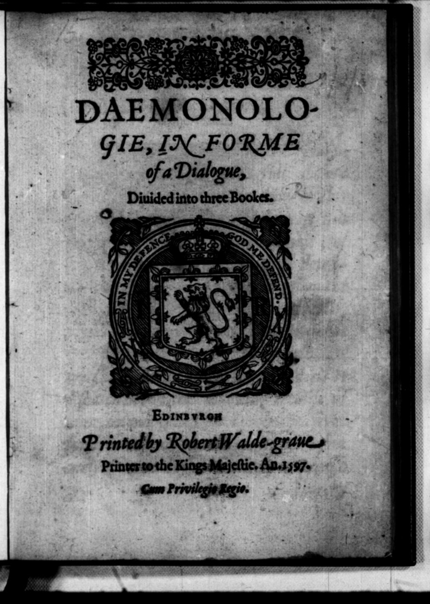
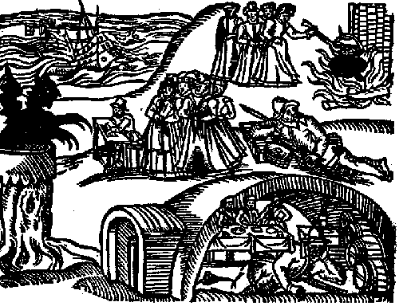
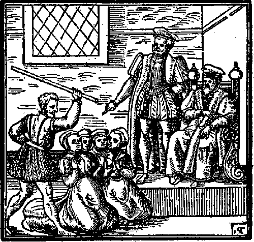
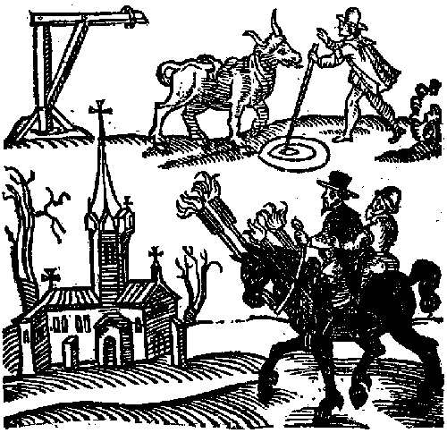
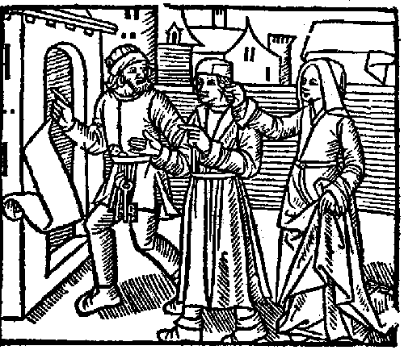

# ジェームズ王『悪魔学』（付録『スコットランドからの知らせ』）

ジェームズ六世（のちのイングランド王ジェームズ一世）著／全訳。付録『スコットランドからの知らせ』（1591年）

- 原題：Daemonologie, In Forme of a Dialogue, Diuided into three Bookes（エディンバラ、Robert Walde-graue、1597年）
- 著者：ジェームズ六世（1566–1625）。スコットランド王。1603年からはイングランド王ジェームズ一世を兼ねた。欽定訳聖書（1611年）を作らせた王として知られる
- 内容：
  - フィロマテス（「学を好む者」）とエピステモン（「知る者」）の二人の対話で、魔女や魔術がほんとうに存在するのか、それはどんな罰に値するのかを論じる
  - 第一書は魔術と降霊術、第二書は妖術と魔女術、第三書は幽霊、人につきまとう霊、悪霊つき、夢魔、妖精などを扱い、最後に魔女の審理と処罰を論じる
  - 付録の『スコットランドからの知らせ』は、ジェームズ自身が取り調べに立ち会ったノース・バーウィックの魔女裁判（1590〜91年）を伝える、ロンドンで出た小冊子である。作業の基にしたグーテンベルク版に『悪魔学』とあわせて収められているので、あわせて訳した
- 作業の基にした本文：Project Gutenberg 第25929番（『悪魔学』と『スコットランドからの知らせ』を収める）。欄外の聖書の出典も同版による。扉は Internet Archive 所蔵の1597年版のスキャン、木版画はグーテンベルク版の図版による
- 著作権：ジェームズは1625年に死去。日本・米国・英国で保護期間が満了している
- 訳者：人工知能（Claude Opus 5.5）
- 訳の性格：全訳である。原文は十六世紀末のスコットランド風の英語で書かれている。対話の話し手の名は、原文と同じく、はじめのほかは「フィロ」「エピ」と略した。欄外にある聖書の出典は〔欄外：…〕として本文の該当箇所に入れ、書名は新共同訳の呼び方にした。訳者の調べたかぎりでは、商業出版の日本語訳は出ていない（2023年に個人によるKindle版が出ている）

## この本について

　スコットランド王ジェームズ六世は、1589年、デンマーク王女アンと結婚するために自ら海を渡った。その帰りの航海で、王の船はひどい嵐に遭う。翌1590年、エディンバラの東のノース・バーウィック周辺で、何十人もの男女が、悪魔と結んで王の船を沈めようとしたという嫌疑で捕らえられた。王は自分で取り調べに立ち会い、拷問のもとで引き出された自白を聞いた。付録の『スコットランドからの知らせ』は、そのときのようすを伝える小冊子である。

　『悪魔学』は、その数年後、1597年に王自身の名で出された。序文にあるとおり、魔女の存在を否定したイングランドのレジナルド・スコットや、魔女とされる者を弁護したドイツの医者ヨーハン・ヴァイヤーに反論し、魔女はたしかに存在し、厳しく罰せられるべきだと説くための本である。王は、魔女の自白のある部分（動物に姿を変えて鍵穴から入りこむ、霊だけが体を抜けて集会へ飛ぶなど）は悪魔が見せる幻だと退けつつ、それでも魔女の罪は変わらないと論じる。魔女の体の「悪魔のしるし」を探すことや、水に投げこんで浮くかどうかを見ることを審理の助けとして認め、子どもを除いて、性も年齢も身分も問わず死刑にすべきだと述べている。

　1603年にジェームズがイングランド王を兼ねると、本書はロンドンでも刷られ、翌1604年にはイングランドでも魔女術を重く罰する法律が定められた。シェイクスピアの『マクベス』（1606年ごろ）に出てくる三人の魔女や、海に嵐を起こす魔女の話は、この王の関心を背景にしていると言われる。

　いま読むと、国王という最高の権力者が、拷問による自白を「経験」として持ち出し、魔女の処刑を神学で正当化していくさまは、ひどく恐ろしい。一方で、悪魔の力をあくまで「神に許された範囲」に限り、自白の多くは幻にすぎないと見る冷静さもあり、当時の知識人が魔女をどう考えていたかをよく伝えている。妖精、人狼、ブラウニー、夢魔（メア）といった民間の信仰についての記述も興味深い。

　本文中の（　）は原文どおりの括弧、〔　〕は訳者の補いである。

---

## 序文　読者へ

　いま、この国に、悪魔のいまわしい奴隷である魔女、すなわち魔法使いが、おそろしいほど満ちあふれている。そのことが、私を動かして（親愛なる読者よ）、この論考を急いで世に出させた。誓って言うが、私の学識や才を見せびらかすためでは決してない。ただ良心に動かされ、できるかぎり多くの人の迷う心を解きたいと思ったからである。すなわち、サタンのこうした攻撃がまぎれもなく行われていること、そしてその道具となる者たちがもっとも厳しく罰せられるべきであることを、示したいのである。

　これは、とりわけ当代の二人の、地獄に落ちるべき意見に反論するためでもある。一人はスコットという英国人で、魔女術などというものはありえないと、恥ずかしげもなく公刊の書物で否定している〔レジナルド・スコット『魔術の暴露』（1584年）〕。こうして彼は、霊の存在を否定したサドカイ派の古い誤りを守っているのである。もう一人はヴィールスというドイツの医者で、こうした術を行う者たちのために公然と弁明の書を出し〔ヨーハン・ヴァイヤー（ヴィールス）『悪霊の幻惑について』（1563年）〕、彼らが罰を免れるよう取りはからっている。そのことで、彼自身がその仲間であったことを、はっきりと露わにしている。

　この論考をより楽しく、読みやすくするために、私はこれを対話の形にし、三つの書に分けた。第一の書は魔術一般と、とくに降霊術について語る。第二の書は妖術と魔女術について。そして第三の書は、人の前に現れて人を悩ます、あらゆる種類の霊と幽霊についての論を含み、あわせて全体の結びとする。

　この仕事で私が意図しているのは、すでに述べたとおり、二つのことを証明することだけである。一つは、こうした悪魔の術がかつて存在し、いまも存在すること。もう一つは、それらがどれほど厳密な審理と厳しい罰に値するか、である。そのために私は、これらの術でどのようなことが行われうるのか、そしてそれがどのような自然の原因によって起こりうるのかを論じる。悪魔の力の一つ一つに触れるつもりはない。それは限りがないからである。そうではなく、スコラ学の言い方をすれば（というのも、これは私たちの言葉では言い表せないので）、私は「類（genus）」について論じ、「種（species）」と「種差（differentia）」は、その中に含まれるものとして残しておく。

　たとえば、第一の書の第六章で魔術師の力について語るとき、私は、彼らが使い魔の霊によって、あらゆる種類のごちそうを、たちまち自分のもとへ運ばせることができると言う。その霊は、泥棒として盗むことを喜び、霊としてそれを巧みにすばやく運ぶことができるからである。この「類」のもとには、それにかかわるすべての個々の事例が含まれる。たとえば壁から葡萄酒を出すこと（それはよく行われたと聞いている）などである。こうした個々の事例は、一般についての論証によって十分に証明されている。

　同じように、第二の書でとくに魔女術を論じる第五章では、魔女がその主人の力によって病を治したり、病をかけたりできることを、さまざまな論拠で述べ、証明している。悪魔の力によって病一般をかけうることを証明するその同じ論拠によって、特定の病をかける力もまた証明される。たとえば、ある男たちの性の力を弱めて女と交われなくすることや、逆に、ほかの男たちには自然のなりゆきが許す以上にそれをあふれさせることである。ほかのあらゆる個々の病についても、同じことが言える。

　ただ一つ、悪魔の力について論じるこれらすべての箇所で、気をつけて見てほしいことがある。それは、第一の原因である神と、その道具であり第二の原因である悪魔（神の首切り役人として）とが、悪魔のこうしたあらゆる行いにおいて、それぞれ異なる目的とねらいを持っているということである。悪魔のねらいは、つねに、彼が手出しを許された者の魂か体か、あるいはその両方を滅ぼすことにある。ところが神は反対に、その悪からつねに自らの栄光を引き出される。それは、ご自身の正義によって悪人を滅ぼすことによってであり、あるいは忍耐する者を試し、信仰ある者をその懲らしめの鞭で目覚めさせて、悔い改めさせることによってである。

　この論考での私の意図をこうしてすべて明らかにしたからには、私がこれらの不法な術の儀式と秘密とをすべて詳しく述べることを省いたこと、また彼らの数かぎりない驚くべき行いを省いたことを、あなたはたやすく許してくださるにちがいない。そのどちらも、私の目的にかなわないからである。その理由は、第三の書の第一章の終わりに述べてある。

　こうしたことを詳しく知りたい者は、彼らの行いについてならボダンの『悪魔狂』を読めばよい〔ジャン・ボダン『魔術師の悪魔狂』（1580年）〕。判断よりも勤勉さによって集められた本だが、いま捕らえられている者たちの自白もあわせて載せている。この力について古人がどう考えていたかを知りたければ、近ごろのドイツの二人の著述家、ヒュペリウスとヘミンギウスがよく述べている〔アンドレアス・ヒュペリウス、ニールス・ヘミングセン〕。そのほかにも、この主題について長々と書いている近ごろの神学者は数えきれない。そして、これらの黒い術の個々の儀式や秘事を知りたいなら（それは無用でもあり、危険でもあるが）、コルネリウス・アグリッパの第四の書〔アグリッパの名で出まわった偽作『隠秘哲学 第四の書』〕と、先に述べたヴィールスに見いだせるだろう。

　こうして、この論考での私の骨折りが（親愛なる読者よ）、これを読むすべての人を、上に述べた誤りに対して武装させるのに役立つことを願い、私の善意をあなたの友としての受けいれに委ねて、心から別れを告げる。

ジェームズ王

## 第一書

【梗概】全体の序。とくに魔術について述べる。

### 第一章

【梗概】これらの不法な術が、その類において行われてきたし、行われうることを、聖書によって証明する。

フィロマテスとエピステモンがこのことを論じる。

**フィロマテス**　今日あなたにお会いできて、ほんとうにうれしいです。私がたいへん迷っていることがあって、それを解いてくださるのは、ほかの誰よりもあなただろうと思うのです。

**エピステモン**　尋ねたいことがあるなら、私にできるかぎり、喜んで、ありのままに私の考えを話そう。十分に証明できなければ、よりよい理屈のほうに勝ちを譲るのに、何の不服もない。

**フィロ**　このごろ人が集まると、みなその話でもちきりの、あの奇妙な知らせを、どう思われますか。魔女たちのことです。

**エピ**　まったく驚くべきことだ。この件について、これほどはっきりと明白な自白が出たことは、どの時代、どの国にもなかったと思う。

**フィロ**　ほんとうなら、疑いはありません。でも、学者たちはそれを疑っています。

**エピ**　あなたはそのどこを疑っているのか。

**フィロ**　いまのところ、何もかもです。とくに、魔女術や魔女などというものがあるということをです。できるなら、それを解いていただきたい。この件については何人もの人と論じあいましたが、いまだに納得できないのです。

**エピ**　喜んで、できるかぎりのことをしよう。だが、あなたはそのもの自体を一般に否定しているのだから、なおさら難しいと思う。論理学の学校で言うように、「原理を否定する者と議論すべきではない」からだ。ともかく、魔女術と魔女がかつて存在し、いまも存在するという点については、前の半分は聖書によってはっきり証明され、後の半分は日々の経験と自白とによって証明される。

**フィロ**　サウルの口寄せ女〔エンドルの口寄せ女〕を持ち出されるのでしょう。でも、あれはどうやら、あなたにはあまり有利になりませんよ。

**エピ**　あの箇所だけでなく、ほかにもいろいろある。だが、なぜあれが私に有利にならないのか、ふしぎだ。

**フィロ**　理由はこうです。まず考えてください。サウルは心を乱し〔欄外：サムエル記上28章〕、本文が証言するとおり、その前から長く断食していました。そういう知識を持つと噂される女のところへ来て、ことの重大な知らせを尋ねようというのです。しかも彼は、自分のひどい罪、とりわけ同じ不法な好奇心と恐ろしい背信とのために、たいへん後ろめたい良心をかかえていました。そこへ女が、見たと言いはる異様な姿にひどく驚いたふりをして、突然叫び声をあげ、変装していて前には自分で否定していたのに、彼が王であることを見破った。こうして感覚がかき乱されていたのですから、女が声色を使っているのに彼が気づかなかったのも、ふしぎはない、と私は言いたいのです。彼は別の部屋にいて、何も見ていなかったのですから。

　次に、何が呼び出されえたのか、何が呼び出されたのか。サムエルの霊でしょうか。それは神を冒瀆することで、あらゆる神学に反します。サムエルの姿をした悪魔でしょうか。それもありそうにない。神が悪魔に聖人の姿で現れることをお許しになるとは思えません（もしそうなら、当時の預言者たちは、幻のなかで自分に語りかけるのがどの霊なのか、決して確信できなかったでしょう）。また悪魔が、その後に起こることを予言できたとも思えません。預言は神からだけ出るもので、悪魔はこれから起こることを何も知らないのですから。

**エピ**　だが、本文の言葉に気をつければ、サウルがその姿を見たことははっきりわかるはずだ。たしかにサウルは、そのために必要な円陣を描いたり呪文を唱えたりするあいだ、別の部屋にいた（その術の者は誰も、そのときほかの者に見ることを許さないからだ）。それでも、あの汚れた霊がすっかり現れるや、女がサウルを呼び入れたことは、本文から明らかだ。本文には「サウルはそれがサムエルだとわかった」とある。外套を着た老人がいると聞いただけでは、そうはわからなかったはずだ。イスラエルにはサムエルのほかにも死んだ老人はたくさんいたし、その国では誰もがふだん外套を着ていたのだから。

　次の点、それがサムエルの霊ではなかったということは認める。それを証明するのに力を入れる必要はない。どの宗派のキリスト教徒もみな、そのことでは一致しており、まったくの無知な者か、降霊術師か魔女でもなければ、それを疑う者はいないからだ。そして、悪魔がときに聖人の姿をとることを許されるということは、聖書に明らかだ。「サタンは光の天使に姿を変えることができる」と書かれている〔欄外：コリントの信徒への手紙二11章14節〕。

　それで預言者たちの幻に不都合が生じることもない。神がご自分の者たちを悪魔にそのように欺かせることは決してないのは、まったく確かだからだ。神がそうお許しになるのは、まず自分から進んで悪魔のもとへ走り、自分で自分を欺く者たちだけだ。神はそうした者が自分の罠に落ちるのにまかせ、彼らが真理を信じようとしなかったので、強い惑わしによって欺かれるのを正しくもお許しになる（パウロが言うとおりだ）。

　悪魔がこれから起こることを予言するという点では、たしかに悪魔は未来のことをすべて知っているわけではない。だが、一部を知っていることは、この話の悲劇的な結末が示している（女の知恵ではとても予言できなかったことだ）。悪魔に予知の力があるのではない。予知は神だけのものだ。また、よい天使たちのように、神を鏡のように見ることで何かを知るのでもない。悪魔は創り主のありがたい面前から永遠に締め出されているのだから。悪魔が知るのは、次の二つの方法のどちらかによるだけだ。一つは、世間の知恵にたけ、天地創造からずっと積んできた経験に教えられているので、以前に起こった似たことや、この世のあらゆるものの移り変わりにおける自然の原因から、これから起こることを推しはかるというもの。もう一つは、神が悪魔をある用に使われ、そのためにそれを前もって知るというもの。この件はそれだったらしい。それとそっくりのことが、ミカヤがアハブ王に語った預言の話に見られる〔欄外：列王記上22章〕。

　だが、魔女術や魔女がありうるという、この私の第一の命題を証明するには、前にも言ったとおり、聖書にはこの箇所のほかにもっとたくさんの箇所がある。まず、神の律法でそれははっきりと禁じられている〔欄外：出エジプト記22章〕。神の律法がむなしいことを言うはずがないのは確かだ。影に呪いをかけたり罰を科したりはしないし、私たちの言う本質や存在を持たないものを悪だと断じたりもしない。第二に、邪悪なファラオの知者たちが、モーセの奇跡のいくつかをまねて〔欄外：出エジプト記7章・8章〕、暴君の心をかたくなにしたことは明らかだ。第三に、サムエルはサウルに「逆らうことは魔女術の罪に等しい」と言ったではないか〔欄外：サムエル記上15章〕。ありもしないものにたとえるのでは、あまりにばかげている。第四に、魔術師シモンはその術の者ではなかったか〔欄外：使徒言行録8章〕。そして第五に、占いの霊（ピュトン）にとりつかれていた女は何者だったのか〔欄外：使徒言行録16章〕。ほかにも、挙げるのがわずらわしいほど、数かぎりない箇所がある。

### 第二章

【梗概】これらの不法な術を行う者たちが、どのような種類の罪を犯すのか。これらの術の区分。そして、人をそれを行うようにさそう手段は何か。

**フィロ**　でも、人類が（神ご自身の姿を宿しているのに）こんなにひどく汚らわしい背信に落ちることを、神がお許しになるとは、とても奇妙に思えます。

**エピ**　人は創られたとき、創り主の似姿に造られた〔欄外：創世記1章〕。だが堕落によってひとたびそれを失い、恵みによって、選ばれた者にだけ、その一部がふたたび回復されるにすぎない。だから、ほかの者たちはみな神から離れ落ち、あの敵である悪魔の手に渡されて、悪魔の似姿を宿すことになる。そしてひとたびそのように渡されてしまうと、最大で最もひどい不敬こそが、彼らにはいちばん楽しく、いちばん心地よいものとなる。

**フィロ**　でも、悪魔にしてみれば、人を悪徳や自分の欲望に従うようにさそって、間接に支配し、多くの魂を滅びに導くだけで足りるのではありませんか。たとえ、それほど多くの素朴な魂をだまして、自分を主人だとじかに認めさせることまではしなくても。

**エピ**　いや、決して足りはしない。悪魔は、自分が支配するすべての人を、その気質と知識に応じて使うのだ。だから、いちばん素朴だと見た者には、いちばんあからさまに正体を見せる。悪魔は人の救いの敵なので、あらゆる手を使って人を自分の罠の奥深くに捕らえ、あとになって（たとえ本人が望んでも）そこから抜け出せないようにするのだ。

**フィロ**　では、この罪は聖霊に対する罪なのですね。

**エピ**　ある者にとってはそうだが、すべての者にとってではない。

**フィロ**　どういうことですか。悪魔のもとへじかに走る者はみな、同じ部類ではないのですか。

**エピ**　とんでもない。聖霊に対する罪には二つの枝がある。一つは、神への奉仕のすべてから背き離れ、神のすべての戒めを拒むこと。もう一つは、それを、自分の良心と聖霊の証しとに逆らって悪いことをしているとわかったうえで、知りながら行うことだ〔欄外：ヘブライ人への手紙6章・10章〕。しかも、ひとたび神の憐れみの甘さを味わったことのある者がだ。この二つのうち、前のほうには、あらゆる種類の降霊術師、魔法使い、魔女が含まれる。だが後のほうには、いま話したような知識を持ちながら誤る者だけが含まれる。

**フィロ**　では、悪魔への奉仕をじかに公言する者には、一種類より多くの種類があるようですね。もしそうなら、いくつあって、それが何なのか、教えてください。

**エピ**　おもに二種類あって、その不幸な術のあらゆる部分は、そこに帰着する。一つは魔術、すなわち降霊術と呼ばれ、もう一つは妖術、すなわち魔女術と呼ばれる。

**フィロ**　それは何ですか。それから、悪魔が人をこれらの罠のどれかにさそいこむ手段はいくつあるのですか。

**エピ**　私たち自身のうちにある、次の三つの情念によってだ。すぐれた才を持つ者の好奇心。深く心に刻まれた不正に対する復讐の渇き。ひどい貧しさから生まれる財への貪欲だ。このうち一つめの好奇心は、魔術師すなわち降霊術師だけをさそうものだ。あとの二つは、妖術師すなわち魔女をさそうものだ。あの年古りた狡猾な蛇は霊なので、私たちの情をたやすく見抜き、それに自分を合わせて、私たちを欺いて滅ぼすのだ。

### 第三章

【梗概】「魔術」と「降霊術」という語の意味と語源。降霊術と魔女術との違い。人をその知識に導く入口と始まりは何か。

**フィロ**　まず、あなたが魔術、すなわち降霊術と呼ぶものが何なのか、聞きたいです。

**エピ**　この「魔術（マギー）」という語は、ペルシアの言葉で、神々しく天上の学問を観想する者、あるいは解き明かす者という意味だ。これはまずカルデア人のあいだで使われ、彼らは真の神学を知らなかったので、それを主要な徳として尊び、重んじた。だから、それは不当にも名誉ある呼び名で呼ばれた。ギリシア人がその名をまね、こうした不法な術のすべてを広くこの名で呼んだのだ。

　そしてこの「降霊術（ネクロマンシー）」という語はギリシア語で、ネクローン（死者）とマンテイア（占い）とを合わせたもの、つまり死者による予言という意味だ。この後の名前は、提喩という言葉のあやによって、この黒い不法な学問に与えられた。占いに死体を使うことが、その術の主要な部分だからだ。

**フィロ**　この術と魔女術とには、どんな違いがあるのですか。

**エピ**　世間で言われている両者の違いは、たいへん愉快で、ある意味では正しい。魔女は悪魔の召使いで奴隷にすぎないが、降霊術師は悪魔の主人で、命令する者だ、というのだ。

**フィロ**　とりわけその奉仕に身をささげている人間が、どうして悪魔に命令する者でありうるのですか。

**エピ**　そう、ありうる。だがそれは、ある意味でそうだというにすぎない。彼らが悪魔を支配する何か力を持っているからではなく、ただ契約によるだけなのだ。悪魔はその契約で、つまらないことでは彼らに従うと約束し、そのかわりに、自分がただ一つ狙っているもの、つまり彼らの体と魂とを手に入れるのだ。

**フィロ**　なんとも不公平な契約ですね。でも、その術の効き目と秘密が何なのか、話してください。

**エピ**　それはあまりに広い原野だ。だが、できるだけかいつまんで、その要点をざっと見てゆこう。この術にさそいこまれうる人には、学のある者と学のない者の二種類がいる。それと同じく、彼らの好奇心をはじめにかきたてて養い、彼らをその術に身をゆだねさせる手段も二つある。その二つの手段を、私は悪魔の学校と、悪魔の手ほどきと呼ぶ。

　学のある者は、私が悪魔の学校と呼ぶものによって好奇心を呼びさまされ、養われる。それが判断占星術だ。多くの人は、学問ではたいへんな完成に達しながら、ああ、再生の霊とその実りとをまったく欠いている。そういう人は、自然のことがらはみな、愚かな物知りにも自分にも同じように知られていると見て、もっと大きな名声を自分のものにしようとする。天のことがらの運行を知るだけでなく、それによって、これから起こることの知識にまでしがみつこうとするのだ。

　それははじめのうちは、その根拠が自然の原因だけから出ているように見えるので、彼らにはまっとうなものに見える。そうして彼らはそれにさそわれ、自分の行いがいろいろなことで当たるのを見て、その原因を知ろうと学ぶ。こうして好奇心という、すべりやすく不確かな梯子を一段また一段とのぼってゆき、ついには、まっとうな術や学問では落ちつかない心を満たせなくなったところで、魔術という、あの黒い不法な学問にまで手を伸ばすようにさそわれてしまう。

　そこで彼らははじめ、さまざまな形の円陣と呪文とを正しくそれに組み合わせると、さまざまな姿の霊が現れて、疑問を解いてくれることを知る。そして、それができるのは、円陣と、そこにごちゃまぜに織りこまれた神の多くの言葉とに分かちがたく結びついた、あるいはそれに本来そなわった力のおかげだと考えて、自分を盲目的に誇る。まるで、自分の才の鋭さによってプルトンの領地を征服し、ステュクスの住まいの皇帝になったかのように。ところが、そのあいだに（みじめな者たちよ）、彼らはじっさいには自分の死の敵の奴隷になっている。そして彼らの知識は、どれほどそれを自慢していても、少しも増えてはいない。悪を知ることと、その罰としての地獄の恐ろしさを知ることとを除いては。アダムが禁じられた木の実を食べて、そうなったように〔欄外：創世記3章〕。

### 第四章

【梗概】魔術の術への入口である手ほどきと学校の説明。とくに天文学と占星術との違い。占星術のいくつかの部分への区分。

**フィロ**　でも、悪魔の手ほどきが何なのかを話すのも、どうか忘れないでください。

**エピ**　悪魔の手ほどきと私が呼ぶのは、まず一般には、世間で言葉と草と石の効き目と呼ばれるもので、自然の原因によらず、不法なまじないに使われるものすべてだ。また同じく、自然の理性のほんとうの吟味に耐えられない、あらゆる種類の手わざや迷信、そのほか似たような尋常でない行いだ。

**フィロ**　何か具体的な例で、もっとはっきりさせてください。あなたの命題はたいへん一般的なので。

**エピ**　私が言っているのは、たとえば、愚かな女房たちがよく使うようなまじないのことだ。呪いをかけられた家畜を治したり、ナナカマドの枝やいろいろな草を家畜の毛やしっぽに結びつけて、邪眼から守ったりする。虫の病を治したり、血を止めたり、馬の足の病を治したり、篩（ふるい）を回したり〔篩を回して盗人などを占う術〕、そのほか数かぎりないことを、医者がするように患部にふさわしいものを当てることなく、言葉によって行う。あるいは、結婚のときに紐にいくつも結び目をつくって、夫婦が自然の交わりをできないようにする。そのほか、人が浮かれたときによくやるようなことだ。

　学のない者は（生まれつき好奇心が強く、神についての真の知識を欠いているので）、こうした行いが当たるのを見る。そのいくつかは、じっさいに当たるのだ。それはこうしたむなしい言葉やまじないに本来の効き目があるからではなく、人を欺くための悪魔の力による。そして彼らは、こうしたことで自分の評判を得たいと思って、恥を知るほうの者なら、その術に経験のある誰かに教えてもらおうとする（はじめはそれが悪いことだとは知らずに）。もっと粗野なほうの者なら、野心か金もうけの欲から、悪魔のもとへじかに走り、そのことであからさまに悪魔と契約を結ぶのだ。

**フィロ**　でも、あなたが悪魔の学校と手ほどきと呼ぶこれらの手段は、まっとうなもので、いつの時代にもそうしたものとして認められてきたように思います。とくに、この占星術という学問は、数学の主要な一部門ではありませんか。

**エピ**　天の被造物、つまり惑星や星などについての学問では、学のある人たちがはじめから二つのことを観察してきた。一つはそれらの運行とふだんの動きで、そのためにこれは天文学（アストロノミア）と呼ばれる。この語はノモス（法）とアステローン（星々の）とを合わせたもの、つまり星の法という意味だ。そしてこの術は、たしかに数学の一部門であり、まっとうであるばかりか、たいへん必要で、ほめられるべきものだ。

　もう一つは占星術（アストロロギア）と呼ばれ、アステローン（星々の）とロゴス（言葉）とを合わせたもの、つまり星の言葉、星の説教という意味だ。これは二つの部分に分かれる。第一の部分は、星の影響に支配される薬草や病の力、季節と天気の移り変わりを、それによって知ることだ。この部分は前の天文学にもとづいているので、それ自体は数学の一部ではないが、ほどほどに使うかぎりはまっとうなものだ。ただし、前の天文学ほど必要でもなく、ほめられるものでもない。

　第二の部分は、星の影響を深く信じこみ、それによって、どの国が栄え、どの国が衰えるか、どの人が幸運で、どの人が不運か、どの戦いでどちらの側が勝つか、一騎打ちでどの男が勝利を得るか、人がどのように、何歳で死ぬか、どの馬が競馬で勝つか、そのほかさまざまな、信じがたいことを予言することだ。カルダーノやコルネリウス・アグリッパ、ほかにもいろいろな者たちが、そうしたことについて、ためになるというより好奇心から、長々と書いている。

　いま話したこの根から、数かぎりない枝が生えている。たとえば生年月日による知識（出生占星術）、手相占い、土占い、水占い、数占い、人相見、そのほか何千というものだ。これらは昔の異教徒のあいだで盛んに行われ、たいへん重んじられた。そして、私がいま話した占星術のこの最後の部分、すなわちそれらの枝の根を、彼らは「運命の部（pars fortunæ）」と呼んだ。この部分はいま、キリスト教徒のあいだで信じたり行ったりすることがまったく許されない。自然の理性のどんな根拠にもよっていないからだ。そして私が前に悪魔の学校と呼んだのは、この部分のことだ。

**フィロ**　でも、学のある人の多くは、反対の意見です。

**エピ**　それは認める。だが、もしこの議論に入りこめば、私たちの話の地盤からすっかり引きはなされ、そのうえ一日をまるごとそれに費やしてしまうのでなければ、私の意見を固め、守る理由を挙げることもできる。彼らにはただ一言、聖書（それはすべての真のキリスト教徒にとって、誤りのない根拠でなければならない）によって答えよう。預言者エレミヤの書に〔欄外：エレミヤ書10章〕、惑星や星の運行によって預言し、予言する者を信じたり、それに耳を傾けたりすることが、はっきりと禁じられている。

### 第五章

【梗概】まじないを使うことはどこまで許され、どこから許されないのか。円陣と呪文の形の説明。そして、何が魔術師自身にそれをいやにさせるのか。

**フィロ**　さて、その論点については十分に話していただきました。でも今度は、こうしたまじないや自然に反する手わざが不法だということを、どう証明なさるのですか。まっとうで陽気な男女のたくさんが、そのいくつかを人前でやってきたのですから、もしあなたがその人たちをみな魔女術のかどで訴えたら、信じてもらえる以上のことを言いはることになると思います。

**エピ**　あなたが（私がそれに与えた呼び名の性質に）よく注意していたら、こんなふうに迷うことも、これほど私を取りちがえることもなかっただろうに。学校で生徒でありながら、その学校の教師に従わない者はいないのと同じように、魔術の円陣と術を学び、行いながら（学ぶことと知ることだけなら、罪というよりは危険なものだ。罪を大きくするのは、行うことだけだ）、神からの恐ろしい背信を犯さずにすむ者はいない。

　それでも、手ほどきを読んで学んだ者でも、親があとで学校にやろうとしなければ、教師に従う身になるわけではない。それと同じく、私が悪魔の手ほどきと呼ぶこうした手わざを、知らずに試す者たち、つまり、それが神がご自分の手に落ちるのを許される者を捕らえるために悪魔が投げた餌だとは知らない者たちは、疑いなく、もっとも寛大に裁かれるべきだと私は言う。彼らは、こうしたことで（少なくとも自分の知るかぎりでは）悪魔に祈ったり助けを求めたりはしておらず、したがってサタンへの奉仕に身を投じたことはないのだから。

　それでも、私自身についてほんとうのことを言えば（私は自分のことだけを言っているのだが）、私はそれほどきわどいところを馬で走りたくはない。私の考えでは、私たちの敵はあまりに狡猾で、私たちはあまりに弱く（神のより大きな恵みがなければ）、悪魔が私たちを捕らえようと待ちかまえている、そうした危険を試すことはできないからだ。

**フィロ**　まことにごもっともです。よく言うことわざにもあります。「悪魔とスープを飲む者は、長い匙がいる」と。でも、どうかこの魔術という術の説明を先へ進めてください。

**エピ**　ひとたび悪においてこの完成に達し、この黒い術を少しでも知るようになると（学があってもなくても）、彼らは呪文を唱えた円陣によって主人を呼び出すことに、いや気がさしはじめる。それはたいへん難しく、また危険だからだ。そこで彼らは、あからさまに悪魔と契約を結ぶようになる。その契約には、とくに「形」と「効き目」とが定められている。

**フィロ**　でも、どうか先へ進む前に、彼らの円陣と呪文について少し話してください。それから、彼らがそれにいや気がさす原因は何なのかも。その形のほうが、あの汚く汚れた霊とじかに行き来し、つきあうよりは、まだ恐ろしくないように思えるのですが。

**エピ**　あなたは私を魔女だと思っているのか、少なくとも、その術に弟子入りする誓いを立てたいとでも思っているようだな。ともかく、できるかぎり、手短に答えよう。私が悪魔の学校と呼ぶ書物に載っている、その種の呪文についてだ。

　それには四つの主要な部分がある。呪文を唱える者たちの人物、呪文の行為、そのために使う言葉と儀式、そして呼び出される霊だ。まず、前にあなたに話した土台を据えておくことを忘れないでほしい。それは、地獄の霊を呼び出したり、その霊をむりやり円陣の内か外かにとどめたりできるのは、円陣に本来そなわった力でも、冒瀆的に使われる神の名の聖さでもなく、そのとき使われるどんな儀式や式次第でもない、ということだ。

　それはただ悪魔、あらゆる嘘の父のしわざなのだ。悪魔ははじめにその手順を自分で定めておき、それによって命じられ、縛られているふりをして、そうした命令の境を越えるのをいやがってみせる。それは、前にも言ったとおり、彼らに自分を支配していると誇らせるためでもあり、また、そうした小さなことで自分を信用させて、あとで最後に一度きりのたくらみで彼らを欺く、よりよい機会を得るためでもある。つまり、彼らの魂と体とを永遠に滅ぼすことだ。

　さて、この土台を据えたうえで言えば、こうした呪文には、円陣の性質と現れる姿の形に応じて、呪文を唱える者が多かれ少なかれ必要だ（ただし、つねに一人より多くなければならない）。その用には、二つの主要なものが欠かせない。聖水（それによって悪魔は教皇派をあざけっているのだ）と、悪魔への何か生きものの捧げものだ。また、そのために彼らが守る、決まった季節、日、時刻がある。これらがすっかりそろい、用意ができると、求める現れの形に応じて、三角、四角、円、二重あるいは一重の円陣がつくられる。

　だが、円陣のいろいろな形や、その内と外とに、またそれを貫いて描かれる数かぎりない文字と十字や、あの狡猾な霊が彼らを惑わすいろいろな現れの形、そのほかその行為のあらゆる細かいことについては、それを描くのに頭を悩ませてきた、多すぎるほどの者たちにまかせておこう。それは好奇心を満たすだけで、まったく役に立たないからだ。

　ただここまでは触れておこう。呼び出された霊は、いろいろな手続きと長い祈りと、呪文を唱える者たちのさんざんなつぶやきやささやきのあとでなければ現れない。教皇派の司祭が狩りに出る前に急いでミサをすませるようにだ。だが、現れたとたん、もし彼らが儀式のどれかをほんの少しでも欠いていたり、その恐ろしい姿に怯えて、誰かの足が一度でも円陣の外へすべり出たりしたら、悪魔はそのときすぐに、彼らが悪魔に負っている当然の借りを、自分の手で取り立てる。そうでなければ、もっと先まで取り立てを延ばしていただろうに。つまり、彼らを体も魂もいっしょに連れ去ってしまうのだ。

　これが、彼らにこうした呪文の形をいやにさせる正当な理由でないかどうかは、あなたの判断にまかせよう。仕事の長たらしさ、日と時刻の厳密な守り方（前に言ったとおり）、現れる姿の恐ろしさ、守らねばならないほんの小さな手続きや迷信の一つでも欠けば、たちまち陥る危険を考えればだ。そしてもう一方では、前にも言ったとおり、悪魔は彼らを動かして、自分とあからさまに、まっすぐに取引させることを喜ぶのだ。

### 第六章

【梗概】悪魔と魔術師との契約。それを二つの部分に分けること。神の奇跡と悪魔の奇跡との違いは何か。

**フィロ**　たしかに理由は十分ですね。でもそれは、彼らが賢ければ、もっとあからさまに悪魔のもとへ走るのではなく、むしろすっかり悪魔と手を切る理由になるはずです。でも、どうか先へ進んで、彼らがひとたびこの術の助祭になったときのことを話してください。

**エピ**　彼らがひとたびあからさまに悪魔と契約を結びはじめたときから、その契約の中身は二つのことにある。形と効き目だ。あなたがさえぎらなければ、すでに話しはじめていたところだ（というのも、契約は相互のものだが、私はまず、悪魔が彼らに対して義務を負う部分について話している）。形というのは、彼らが悪魔を呼んだとき、悪魔がどんな姿やありさまで彼らのもとへ来るかということだ。そして効き目というのは、悪魔がどのような特別な種類の奉仕で彼らに従う義務を負うかということだ。こうした形と効き目の質は、魔術師の腕と術に応じて、大きくも小さくもなる。

　形について言えば、彼らのうちの低いほうの者には、悪魔は自分が教えたある固有の名で呼ばれると、犬か猫か猿か、そのほか似たような獣の姿で現れるか、あるいは声だけで答えることを約束する。効き目は、病を治すことや、彼ら自身の家のこまごましたことに関する問いに答えること、あるいは彼らが求めるそのほかのつまらないことだ。

　だが、もっとも好奇心の強い者たちには、悪魔は形について、死体のなかに入り、そこから、戦いの結末や国の状態にかかわることがら、そのほか似たような大きな問いに答えを与えることを約束する。それどころか、ある者には、小姓の姿で、つねにかしずく者になる。何年ものあいだ、書板か指輪か、そのほか持ち歩きやすい似たようなもののなかに、呼び出されたまま封じこめられることも許す。そして彼らに、そうした品をほかの者に売る力を与える。そのなかに呼び出された霊が嘘つきか正直かに応じて、高いものもあれば、安いものもある。

　とはいっても、じっさいにはあらゆる悪魔は嘘つきに決まっているのだ。だが彼らは、弟子になるこのみじめな者たちの素朴さにつけこんで、こう信じこませる。ルシフェルが堕ちたとき、ある霊は空気のなかに、ある霊は火のなかに、ある霊は水のなかに、ある霊は陸に堕ち、それぞれいまもその元素のなかにとどまっている、と。そこから彼らは、火や空気のなかに堕ちた霊のほうが、水や陸に堕ちた霊より正直だ、という理屈を組み立てる。だがそれはみな、まったくのたわごとで、あらゆる欺きの作り手がこしらえたものだ。

　というのも、彼らは固い物体のように重さによって堕ちて、どこか一か所にはまりこんだのではないからだ。彼らの堕落のおもな部分は質にある。つまり、自分が創られたときの神の恵みから堕ちたことにあるのだ。そして彼らはその後もずっと、また終わりの日まで、神の首切り役人として世界をさまよい、神が彼らに命じられる用を果たしつづけるのだ。そしてその用がないときには、地獄の牢獄に帰らなければならない（キリストがゲネサレトで行われた奇跡にはっきり見られるとおり〔欄外：マタイによる福音書8章〕）。そして終わりの日には、みなそこに永遠に閉じこめられるのだ。

　悪魔たちは、この点で弟子を欺くのと同じく、自分たちのあいだにはたくさんの君主や公爵や王がいて、それぞれが多かれ少なかれ軍団を指揮し、いろいろな術や地の方角を支配しているという考えを、彼らに植えつける。天の天使たちのあいだに秩序の形があること、したがって彼らの堕落の前には悪魔たちのあいだにもそれがあったことは、私も否定しない。だが、彼らがそれ以来それを保っているとか、神が、聖書によっても預言者によっても私たちに明かそうとされなかったご自分の天上の神秘を、地獄に落ちた悪魔たちによって私たちに知らせることをお許しになるとか、そんなことは、どんなキリスト教徒も一度たりとも考えないだろうと思う。それどころか、神が秘密の封印で閉じられたそうした神秘については、私たちはへりくだった無知に満足するのがふさわしい。それは私たちの救いに必要なことではないのだから。

　だが話をもとに戻すと、サタンがもっとも偉い魔術師たちに約束するこうした形が、驚くほど凝ったものであるのと同じく、効き目もそれに見合ったものだ。悪魔は彼らに術や学問を教えることを約束する。あれほど学のある悪党だから、それはたやすいことだ。世界のどこからでも知らせを運んでくることもする。霊のすばやさなら、それはたやすくできる。どんな人の秘密でも、それがひとたび口に出されたものであれば、彼らに明かす。というのも、思いは神のほかに誰も知らないからだ。ただし、人相見にまちがいなく十分たけた者として、顔つきから推しはかれるかぎりは別だが。

　それどころか、悪魔は弟子たちに、君主たちにたくさんの大きなことを予言させて、君主たちの信用を得させる。一部はほんとうで、一部は嘘だ。というのも、もしすべてが嘘なら、どこでも信用を失ってしまうからだ。だがいつも、悪魔の神託がそうだったように、どちらともとれるものだ。悪魔はまた、世界のいちばん遠いところから短いあいだに運んできたみごとな宴とごちそうで、彼らに君主たちを喜ばせもする。悪魔が泥棒であることは誰も疑わないし、そのすばやさ（前に言ったとおり）が、それほどの速さで来させるのだ。

　同じく、悪魔は弟子たちを、見かけだけのりっぱな騎兵と歩兵の軍勢や、城や砦で守る。それはみな空中の印象にすぎず、その実体にきわめて近い霊なら、たやすく集められるのだ。同じように、悪魔は彼らに、カードやさいころなどで人の感覚を欺く手品のたくさんの技を教え、そのほか数かぎりない、まやかしの手わざを教える。そうしたことは、この時代にも多すぎるほどの者によって証明されている。いまも生きているスコットというイタリア人〔手品師ジロラモ・スコット〕を知っている者なら、それを話してくれるだろう。

　だがそれでも、これらはみな感覚を惑わすことにすぎず、モーセをまねてファラオ王の魔術師たちが行ったにせの奇跡と同じく、実体としてはまったくほんとうではない。神の奇跡と悪魔の奇跡との違いは、そこにあるのだ。神は創り主であって、奇跡で現れさせるものは、じっさいにそのとおりになる。モーセの杖は、投げおろされると、まちがいなくほんとうの蛇に変わった。ところが悪魔は（神の猿として）、その魔術師たちによってそれをまね、彼らの杖をそう見せかけただけだった。それも人の外の感覚に対してだけだ。そのことは、それらの杖がもう一方の蛇に呑みこまれたことで、じっさいに示された。悪魔が私たちの感覚を惑わせるのはふしぎではない。ただの手品師でさえ、百ものことを、私たちの目にも耳にもじっさいとちがうように見せかけるのを、私たちはよく見ているのだから。

　さて、契約の魔術師の側の部分は、一言で言えば、前に言ったもの、つまり悪魔があらゆる人に狙っているものだ。

**フィロ**　ほんとうに、この術についてたくさんのことを話していただきました。あなたのおっしゃったことがみな、驚くべきことであるのと同じくらい真実なら。

**エピ**　こうした行いが真実であることは、いろいろな確かな歴史を読む手間をかけ、日々の経験を調べてみる人なら、たやすく確かめられるだろう。そして、それがありうるということ、どのようにありうるのかということの真実については、私が挙げたことのどれにも、確からしい理由をつけなかったものはないと思う。それはあなたの分別にゆだねて、はかり考えてもらおう。

　ただ一言だけ言い落としていた。この契約を結ぶ形についてだ。それは魔術師自身の血で書かれるか、あるいは（その師匠の条件で）合意されたうえで、悪魔が魔術師の体のどこかに触れる。おそらく、何の跡も残らないこともあるが。あらゆる魔女に対しても、そうするのだ。

### 第七章

【梗概】魔術の術が不法である理由。彼らがどのような罰に値するか。そして、誰がその罪を犯したとみなされうるか。

**フィロ**　ほんとうに、あなたはこの術をたいへん恐ろしく、いまわしいものに見せてくださいました。でも、あなたがこれほど悪く描いたのに、この術はまっとうなものだと言いはる人たちには、何と言えばよいのですか。

**エピ**　そういう人たちは、自分でもその鍋のにおいがする〔同じ穴のむじなだ、の意〕か、少なくとも大差ない、と言おう。それでも、彼らの理由は聞いてみたい。

**フィロ**　私がこれまで聞いたのは、おもに二つです。そのほかに、降霊術師は悪魔に命令するというよく言われることわざにもとづくものがありますが、それはもうあなたが論駁なさいました。一つは、受けいれられている慣習にもとづくもの、もう一つは、ある人たちが誤りのないものと考える権威にもとづくものです。慣習について言えば、魔女を厳しく罰するキリスト教国の君主や役人たちの何人かは、魔術師が自分の領内で暮らすのを見のがすばかりか、ときには彼らがその手わざのいくつかを試すのを見て楽しみさえします。もう一つの理由は、モーセが（聖書にはっきり書かれているとおり）「エジプト人のあらゆる学問のうちに」育てられたということです。この術がそのうちの主要なものの一つだったことは疑いありません。それなのにモーセはこの術を持ちながら、あれほど神のみ心にかなったのですから、したがって、あれほど敬虔な人が身につけていた術が、不法なものであるはずがない、というのです。

**エピ**　慣習にもとづくあなたの第一の理由については、悪い慣習は決してよい法として受けいれられない、と言おう。ある君主や役人は神の言葉をあまりに知らず、またほかの者はそれをさげすんでいるので、その点で自分の職務に対して重く罪を犯すようになっているのだ。

　もう一つの理由はもっと重みがあるように見えるが、それを三段論法の形にすると、たくさんの項が必要になり、誤謬だらけになるだろう（論理学の言葉で言えば）。まず第一に、モーセが「エジプト人のあらゆる学問のうちに」教えられたと述べるあの一般的な命題から、彼が魔術を教えられたという結論が出る必要は、私には見あたらない。というのも、そこで神の霊が学問について語るときには、まっとうな学問のことを言っていると理解しなければならないからだ。まっとうでなければ、それは誤って学問と呼ばれているだけで、じつは無知にすぎない。「描かれた人は人ではない」からだ。

　第二に、かりに彼がそれを教えられていたとしても、前にも言ったとおり、あることを知ることと行うこととのあいだには大きな違いがある。神はすべてのことを知っておられるが、つねに善であられる。そして私たちの無知は、私たちの罪と弱さとから出ているのだ。

　第三に、かりに彼がそれを学び、行ってもいたとしても（それは、どんなキリスト教徒にとっても、とても信じられない恐ろしいことだが）、神の霊がモーセを召しはじめるより前に、彼が四十歳のとき、一人のエジプト人を殺したためにエジプトから逃げていたことを、私たちはよく知っている。そして彼は義父エトロの地で、さらに四十年を流浪の身で過ごしたあとで、はじめて燃える柴のところで召されたのだ。だから、かりにそれ以前は世界でいちばん邪悪な人間だったとしても、そのとき彼は変わり、生まれ変わった人になったのであって、昔のモーセはほとんど残っていなかったのだ。アブラハムも、召される前はカルデアのウルで偶像を拝んでいた。そしてパウロも、サウロと呼ばれていたあいだ、その名が変えられるまでは、神の聖徒たちのもっとも激しい迫害者だった。

**フィロ**　では、こうした魔術師や降霊術師は、どんな罰に値するとお考えですか。

**エピ**　疑いなく、妖術師や魔女が値するのと同じ罰だ。いや、彼らの誤りはより大きな知識から出ていて、それだけ聖霊に対する罪に近づくのだから、むしろそれだけいっそう重い罰に値する。そして彼らについて言うのと同じことを、彼らに相談し、問い、もてなし、見のがすすべての者についても言おう。それは、彼らに助言を求めた多くの者のみじめな最期を見ればわかる。悪魔は誰に対しても、サウルに告げたより良い知らせを告げたことはないのだから。また、どれほどよい目的のためであっても、これほど不法な道具を使うことは許されない。というのも、神学における次の公理は、まったく確かで誤りのないものだからだ〔欄外：原文「Ast 3.」。ローマの信徒への手紙3章（8節）か〕。「善がそこから生じるようにと、悪をなしてはならない」。

## 第二書

【梗概】とくに妖術と魔女術について述べる。

### 第一章

【梗概】そうしたものがありうることを聖書によって証明する。そして、それをただの想像や憂鬱質のせいにすぎないとする者たちの理由を論駁する。

**フィロ**　魔術、すなわち降霊術について、これほど十分に納得させていただいたのですから、今度は妖術、すなわち魔女術について、同じようにしていただけませんか。

**エピ**　その原野もまたたいへん広い。多くの人の口にのぼり、筆にもかかってはいるが、その真実を、自分で思っているほどよく知っている者は少ない。そのことを、できるだけ手短に（神のみ心ならば）たやすくわかるようにしてあげよう。

**フィロ**　でも、先へ進む前に、ここで少し脇道にそれて口をはさませてください。魔女術などというものがあるとは、とても信じられないという人がたくさんいます。その人たちの理由を手短に挙げますから、ほかのことと同じように、そのことでも私を納得させてください。

　まず第一に、聖書はさまざまな例によって、とくにあなたが挙げたうちのいくつかの例によって、魔女術があることを証明しているように見えます。でもある人たちは、そうした箇所は魔術師と降霊術師のことだけを言っていて、魔女のことではない、と考えています。とくに、モーセの奇跡をまねたファラオの知者たちは魔術師であって魔女ではない、と彼らは言います。サウルが相談したあの口寄せ女も同じです。新約聖書の魔術師シモンも、まさにその呼び名が示すとおり、そうです。

　第二に、あなたは日々の行いと、あれほど多くの者の自白を持ち出そうとなさいますが、それもまた、うわごとを言う素朴な者たちの、ひどく憂鬱質な想像にすぎないと考えられています。

　第三に、もし魔女が（彼らが言うように）人を魔法で死なせるほどの力を持っているなら、世界にはとっくに魔女のほかに誰も生き残っていないはずです。少なくとも、どんな身分の者であれ、善良で敬虔な人は誰も、彼女たちの悪魔のしわざから逃れられなかったはずです。

**エピ**　あなたの三つの理由は、私の見るところ、第一は聖書に否定の形で、第二は医学に肯定の形で、第三は経験の確かな証拠にもとづいている。

　あなたの第一の理由については、たしかに、ファラオのあの知者たちはみな術による魔術師だった。同じく、サウルが相談した口寄せ女も、同じ職の者だったようだし、魔術師シモンもそうだった。だがあなたは、神の律法のことを言い落としている。律法では、あらゆる魔術師、占い師、魔法使い、妖術師、魔女、そのほか悪魔に相談するその種のどんな者も、はっきりと禁じられ、等しく脅かされている。

　そのうえ、使徒言行録で、占いの霊（ピュトン）にとりつかれていて、その霊を使徒に黙らされた女は〔欄外：使徒言行録16章〕、私たちの話のはじめに言った世間の区別がある程度正しいと認めるなら、まさに妖術師か魔女でしかありえない。その女が主人たちにあれほどの利益をもたらした霊は、彼女が好きなように呼び出したり命じたりできるものではなく、人前でもひとりのときでも、彼女の舌を使って語ったのだから。その点で彼女は、悪霊つき、つまりとりつかれた者の類に近いように見える。ただし、両者のその結びつきが彼女自身の同意によるものでなかったならば、の話だ。彼女がそれに苦しめられていなかったこと、そして（すでに言ったとおり）主人たちにあれほどの利益をもたらしていたことから、同意していたことがわかる。

　医学にもとづくあなたの第二の理由、つまり彼女たちの自白や思いこみを自然の憂鬱質のせいにすることについては、こうだ。これまでそれについて書いたあらゆる医者に従って、憂鬱という自然の体液を医学の目で考えてみようという人なら、それが彼女たちの悪事を覆うには短すぎる外套だとわかるだろう。憂鬱の体液はそれ自体、黒く、重く、土の性質を持っている。それと同じく、それにかかりやすい人に出る症状は、やせること、青ざめること、孤独を好むことで、それがもっとも高い度に達すると、まったくの狂気と躁狂になる。

　ところが反対に、これまで魔女術の罪に定められたり、それを自白したりした者の大多数は、いま自白している多くの者を見ればすぐにわかるとおり、反対に、と私は言うのだが、ある者は金持ちで世間の知恵にたけ、ある者は太って肥えた体をしており、そのほとんどは、肉の楽しみや、絶えず人とつきあうことや、まっとうなものも不法なものも含めたあらゆる種類の浮かれ騒ぎに、すっかり身をゆだねている。それは、私が話した憂鬱の症状とはまったく逆のことだ。そのうえ、彼女たちが拷問なしではどれほど自白をいやがるかを、日々の経験が証明している。それが彼女たちの罪を証ししているのだ。反対に、憂鬱質の者は、たえまない話によって自分のことをさらけだすのを決して惜しまず、そうして、自分が罪と思わないことで自分の気質を養うのだ。

　あなたの第三の理由は、ほとんど答えるに値しない。もし彼女たちの主人である悪魔が、聖書が教えるように手綱をかけられていなかったなら、たとえ悪魔の道具になる男も女もいなかったとしても、悪魔はほかの者の助けなどなしに、全人類を滅ぼすやり方をいくらでも見つけられただろう。悪魔はそのことに全力を傾け、そのために（ペトロが言うように）「ほえたける獅子のように歩きまわっている」のだから〔欄外：ペトロの手紙一5章〕。だが悪魔の力の限界は、世界の基が据えられる前に定められていて、悪魔はそれをほんの少しも越える力を持たないのだ。

　だがこれらすべてのほかに、彼女たちが存在することを証明するには、あまりに大きな確証がある。それは、彼女たちが人に対して、また人が持っているどんなものに対しても与える害を、日々経験していることだ。神が彼女たちを、そのように悩ませたり見舞ったりする道具となることをお許しになる者に対して、だ。そのことは、その術についての私の話のなかで、はっきり証明されるのを聞くだろう。

### 第二章

【梗概】「妖術」という語の語源と意味。その術に身をゆだねる者たちの最初の入口と弟子入り。

**フィロ**　では、どうか、さっきやめたところへ戻ってください。

**エピ**　この「妖術（ソーサリー）」という語はラテン語で、くじを引くことからとられている。だからそれを使う者は「くじ（ソルス）から、くじ使い（ソルティアリウス）」と呼ばれる。「魔女術（ウィッチクラフト）」という語のほうは、私たちの言葉で与えられた固有の名前にすぎない。彼らが「くじ使い」と呼ばれた理由は、彼らの行いが、くじや偶然から出るように見えたことにある。たとえば篩（ふるい）を回すこと、祈りの形を知ること、そのほか病人が生きるか死ぬかを示す、似たようなしるしだ。そして一般には、その術が教えるようなまじないや迷信を使うことから、その名が与えられた。

　彼らの術と行いの多くの点は、魔術師と彼らとに共通している。やり方はちがっても、どちらも一人の同じ主人に仕えているからだ。そして私が降霊術師を学のある者と学のない者との二種類に分けたように、彼らもまた別の二種類に分けなければならない。金持ちで身分の高い者と、貧しく身分の低い者とだ。

　この術を行う人のこの二つの階層は、彼らのうちにある情念に対応している。それは（前に話したように）悪魔が彼らを自分への奉仕にさそう手段として使ったものだ。ひどいみじめさと貧しさのうちにある者には、悪魔は大きな富とこの世の利得を約束して、自分に従うようさそう。金持ちではあっても、やけになった復讐の欲に燃えている者には、思いを心ゆくまで遂げさせてやると約束して、さそうのだ。

　ここで注意しておくべきは、私たちのあの年古りた狡猾な敵は、たとえこの二つの極みのどちらかに触れている者であっても、まず自分のための入口が用意されているのを見いださないかぎり、誰にも襲いかからないということだ。その入口とは、相手のひどい無知と悪い暮らしとがいっしょになったものか、あるいは神に対する無頓着とさげすみとだ。そして、いま話した二つの原因のどちらかによって、相手がまったくの絶望に陥っているのを見いだすと、悪魔は相手の気質をたくみに養い、ますます絶望で満たしながら、自分の正体を明かすのにふさわしい時を見いだすまで、道を整える。

　そのときが来ると、相手がひとりで野原を歩いているときか、寝床に横になって思いにふけっているときか、とにかくいつもほかの誰もいないときに、悪魔は声だけで、あるいは人の姿で、何を悩んでいるのかと尋ね、すぐに確かな解決の道を約束する。その条件として、相手の側は悪魔の助言に従い、悪魔が求めることをしなければならない。相手の心は、すでに話したように前もって用意ができているので、たやすく悪魔のその求めに応じる。そして悪魔は、ふたたび会う別の約束の場所を決める。

　そのときになると、悪魔はそれ以上先へ進む前に、まず相手を説きふせて、自分への奉仕に身をささげさせる。それがたやすく得られると、悪魔は自分が何者であるかを相手に明かし、神と洗礼とをはっきりと捨てさせ、相手の体のどこか人目につかないところに自分のしるしをつける。そのしるしは、悪魔が次に会うときまで痛んで治らず、その後は、日々証明されるとおり、誰がつねっても刺してもまったく感じなくなる。それは悪魔が、そうすることで相手を傷つけることも治すこともできたように、相手のその後のよいことも悪いこともすべて自分しだいであるという証拠を、相手に与えるためだ。

　そのうえ、悪魔がしるしをつけたところに感じる耐えがたい痛みは、相手を目覚めさせ、次に会うときまで休ませないのに役立つ。そうしなければ、相手がまだ新しい弟子で、この悪魔のような愚行にまだ十分に根をおろしていないので、悪魔のことを忘れてしまうか、あるいは前に会ったときにした恐ろしい約束を思い出して、それにいや気がさし、取り消そうとするのではないかと、悪魔は恐れるのだ。

　三度めに会うとき、悪魔は約束を果たすのに気を配っているふりをする。相手が復讐を望む類の者なら、どうやって復讐を遂げるかを教える。あるいは、もう一方の類の者なら、もっともいやしく不法な手段で、どうやって利益とこの世の利得とを得るかを教えるのだ。

### 第三章

【梗概】魔女の行いを二つの部分に分ける。彼女たち自身の身にかかわる行い。ほかの者に向けた行い。彼女たちの集会と、その主人を拝む形。

**フィロ**　その結社への入門については、もう十分に話していただきました。あとは、弟子の段階を終えてからの彼女たちの行いについて話していただくことです。彼女たちがじっさいに何をなしうるのか、ぜひとも聞きたいのです。

　彼女たちは、（あなたが前におっしゃったとおり）降霊術師と共通の主人に仕えてはいても、別の形で仕えています。悪魔に仕えるこうした不法な術に彼女たちをさそう手段がちがうように、彼女たちが自分の行いを使うやり方も、はじめに悪魔が彼女たちのうちで道具として使ったそれらの手段に応じてちがっています。ただし、どれも一つの目的に向かっています。すなわち、サタンの暴政を広げ、キリストの王国が広がるのを、どちらの類の者にも、また彼女たちの主人である悪魔にも、できるかぎりさまたげることです。

　というのも、魔術師たちは好奇心にさそわれているので、その行いの大部分では、おもにその好奇心を満たし、世間の名誉と評判とを自分のものにしようとします。ところがこの魔女たちは、復讐の欲かこの世の富への欲かにさそわれているので、その行いのすべては、前者の場合は残酷な心を満たすために、人とその財産、あるいはその持ちものを傷つけることであり、後者の場合は貪欲な欲望を満たすために、神が彼女たちに力をふるうことをお許しになる者を、どんなやり方であれ滅ぼすことなのです。

**エピ**　彼女たちの行いは二つの部分に分けられる。彼女たち自身の身にかかわる行いと、彼女たちからほかの誰かに向かって出る行いとだ。この区分をよく理解すれば、彼女たちに何ができるのか、たやすくわかるだろう。というのも、彼女たちが自白することはみな、彼女たちの側では嘘ではないが、それでも私の考えでは、その一部は、じっさいには彼女たちが思っているとおりではない。そしてこの点で私が言っているのは、彼女たち自身の身にかかわる行いのことだ。前に魔術について話したとき、悪魔はその弟子たちの感覚を多くのことで惑わすと言ったが、それと同じことを、この魔女たちについても言おう。

**フィロ**　では、まず彼女たち自身の身にかかわる部分について話してください。そのあとで、ほかの者に向けた行いに進んでいただけばよいでしょう。

**エピ**　悪魔は、自分が彼女たちを使う、そのにせの主人への奉仕を彼女たちに果たさせるために、神の猿として、神が定めてご自分の僕たちに行わせた奉仕と礼拝の形を、自分の僕たちのうちにまねる。神の僕たちが神に仕えるために公に集まるのが習いであるように、悪魔も彼女たちを、自分への奉仕のために大勢で集まらせる（もっとも、公にはあえてしないが）。神のしるしである洗礼の秘跡で印をつけられた者でなければ、誰も神を拝み礼拝するために集まらないように、私がすでに話したあのしるしをつけられた者でなければ、誰もサタンに仕え、サタンを拝むために集まらない。

　神から遣わされた牧師が、公の集会のときに、霊と真理とをもって神に仕える道をはっきり教えるように、あの汚れた霊は、集会のときに自分自身で弟子たちに、あらゆる種類の悪事を行う方法を教える。そして、自分への奉仕を進めるためにしてきた恐ろしくいまわしい行いを、すべて報告するよう求める。それどころか、悪魔はいっそう生々しく神をまね、あざけるために、しばしば自分の奴隷たちを、神の僕たちが集まるために定められ、用意されたまさにその場所（教会のことだ）に集まらせる。

　ところで、これまで言ったことは、彼女たちの思いこみのなかで真実だというだけでなく、じっさいにもそのとおりだと私は考えている。悪魔が異教徒のあいだで神をまねるのに使った形を見ると、そう思えるのだ。神がご自分の神託によって語られたように、悪魔も自分の神託によって語らなかったか。神には血の犠牲も血のない犠牲もあったように、悪魔にも同じものがなかったか。神がご自分への奉仕のために、祭壇と祭司と犠牲と儀式と祈りとをそなえた聖なる教会をお持ちだったように、悪魔も自分への奉仕のために汚された同じものを持たなかったか。神がウリムとトンミムによって答えを与えられたように、悪魔も獣のはらわたや、鳥の鳴き声や、鳥の空中でのふるまいによって答えを与えなかったか。神が幻と夢と忘我とによって、これから起こることとご自分のみ心とを僕たちに明かされたように、悪魔も同じ手段を使って、これから起こることを奴隷たちに前もって知らせなかったか。

　それどころか、神が清さを愛し、悪徳と不浄とを憎み、それに罰を定められたように、悪魔も同じことをしなかったか（偽ってではあるが、それは認める。小さな不都合を避けさせることで、より大きな不都合に引きこむためにすぎないが）。それでも、と私は言うのだが、悪魔は、自分の祭司たちに、自分に答えを求める前には体を清く汚れなく保つよう命じるところまで、見せかけはしなかったか。そして、神があらゆる徳の守り手であり、その反対のものの正しい報い手であるかのように、ふるまってはみせなかったか。

　そこで、この理由が私を動かすのだ。悪魔は同じあの悪魔であり、いまも当時と同じく狡猾なのだから、魔女たちの身について私が話したこうした行いでも、手を抜きはしないだろう、と。だがそれだけではない。魔女たちはしばしば、悪魔が教会で彼女たちと集まったことばかりか、説教壇に立ったことまで自白する。それどころか、彼女たちの礼拝の形は、悪魔の尻に口づけすることだという。それはばかげているように見えるが、それでもやはり真実でありうる。カリカットでは、悪魔が雄山羊の姿で現れ、人々の一人一人から公然とその恥ずべき臣従の礼を受けていると読むのだから。悪魔は（それが彼の堕落を招いたのだが）たいへん野心が強く、名誉を欲しがるので、その点でまで神をまねようとするのだ。「モーセは神の栄光のまばゆさのために、神の後ろ姿しか見られなかった」と書かれている箇所だ〔欄外：出エジプト記33章〕。もっとも、その言葉は、人間の情に寄せた言い方で語られているにすぎないのだが。

### 第四章

【梗概】魔女たちが遠く離れた場所へ移動しうる方法は何か。不可能で、まったくサタンの幻にすぎないものは何か。そしてその理由。

**フィロ**　でも、彼女たちはどうやってこうした不法な集会に来られると言っているのですか。あなたは、それがどうやって可能だとお考えですか。

**エピ**　そこが、彼女たちの感覚が惑わされていると私が考えるところだ。彼女たちはそれをほんとうだと思っているので、自白するときに嘘を言っているのではない。だが、実体や効果としては、そのとおりではないのだ。というのも、彼女たちが言うには、主人を拝むためにであれ、自分に任された主人への何かの奉仕を行うためにであれ、いろいろな手段で集まることができるという。

　一つの方法は自然なもので、主人が来て知らせる時刻に、ふつうに馬に乗るか、歩くか、船で行くことだ。この方法はたやすく信じられる。もう一つの方法はいくらか奇妙だが、それでもほんとうでありうる。それは、彼女たちの導き手である霊の力によって、陸の上か海の上かをすばやく運ばれて、会うべき場所へ行くことだ。これも同じくありうると私は確信している。ハバククが天使によってそのようにして、ダニエルがいた洞穴へ運ばれたように〔欄外：外典「ベルと竜」〕、悪魔は、ほかのことと同じくその点でも、すぐに神をまねようとすると思うからだ。そして霊である悪魔にとっては、それは、ただの自然の気象にすぎない強い風が、ふだん毎日のように見られるとおり固い物体をある場所から別の場所へ運ぶよりも、ずっとたやすいことなのだ。

　だが、このような激しい形では、彼女たちは、息をとめていられるあいだに見あう短い距離しか運ばれない。それより長ければ、体がそれほど激しく、むりやり運ばれるので、息が絶えずに残ることはできないからだ。たとえば、ある人が低いところから落ちれば、命が危ないかどうかは、硬いところに落ちるか柔らかいところに落ちるかによる。だが、高くけわしい岩から落ちれば、地面に着く前に、息がむりやり体から追い出されてしまう。経験によってよく見られるとおりだ。

　そしてこの運ばれるあいだ、彼女たちは、自分たちどうしのほかは誰にも見えないと、自分で言っている。それもまた、私の考えではありうることだ。前に魔術について話したとき言ったように、悪魔が空気中に好きなようなどんな印象でもつくれるなら、まして、彼女たちのすぐまわりの空気をぎゅっと縮めて濃く暗くし、ほかの人の目の光線がそれを通り抜けて彼女たちを見られないようにすることなど、ずっとたやすいのではないか。

　だが、彼女たちが集会に来る第三の方法こそ、彼女たちが惑わされていると私が考えるところだ。ある者は、小さな獣か鳥の姿に変えられて、ふつうの通り道がみな閉ざされていても、空気が入りこめるどんな隙間からでも、どんな家や教会にでも入りこんでくる、と言う。またある者は、体は忘我の状態のようにじっと横たわったまま、霊が体から奪い去られて、そうした場所へ運ばれる、と言う。そしてそれを確かめるために、はっきりしたしるしを挙げる。そのあいだ体が感覚を失って横たわっているのを見た証人によっても、また、ほかの方法では知りえなかったはずの、そこで会った人の名を挙げたり、彼らのあいだでどんな話があったかのしるしを挙げたりすることによってもだ。この旅の形は、ある国から別の国へ運ばれるときにいちばんよく使う、と彼女たちは言っている。

**フィロ**　ほんとうに、それについてのあなた自身のお考えを、早く聞きたいです。それは炉ばたの老婆のたわごとのようなものですから。

**エピ**〔原文の脱落を補う。下の注を参照〕　それらがまったくの幻にすぎないと私に思わせる理由は、次のとおりだ。

　まず、獣や鳥の姿に変えられた者たちが、それほど狭い通り道を通り抜けられるという点だ。悪魔が空気にはたらきかけるわざによって、彼女たちを、本人にもほかの者にも、そういう姿でいるように見せかけることができるのは、たやすく信じられる。だが、固い体をそれほど小さな場所に縮めるなどということがどうしてできるのか。それほど小さくされながら減ってはいない、それほどぎゅっと縮められながら何の痛みも感じない、などというのは、それ自体がまったく矛盾していると思う。自然の体の性質にまったく反していて、教皇派のミサの、あの化体した小さな神そっくりなので、私には決して信じられない。量を持つことは固い体にあまりに固有のことなので、あらゆる哲学者が結論するとおり、霊が量を持てないのと同じく、固い体も量なしにはありえないのだ。ペトロが「戸がみな鍵をかけられていたのに、牢から出てきた」〔欄外：使徒言行録12章〕のも、体をそれほど小さな場所に縮めたからではなく、牢番には気づかれなかったものの、戸が開いて道をあけたからだ。しかも、そうしたことが行われるとき、神の力と悪魔の力とでは比べものにならない。

　彼女たちの忘我と霊の移動の形について言えば、魂が体から出てゆくことこそ、自然の死のただ一つの定義であることは確かだ。そしてひとたび死んだ者を、地獄のすべての悪魔の力で生きかえらせることができるなどと考えるのは、とんでもないことだ。たしかに悪魔は、お聞きのとおり降霊術師がよくやるように、死体のなかに自分の霊を入れることはできる。だが、死者を生きかえらせるのは本来神だけに属する務めだ。そのうえ、魂はひとたび体を離れると、もうこの世をさまようことはできず、ただちに自分の安息の場所へ行って、終わりの日に体とふたたび結ばれるのを待たなければならない。そして、この点でキリストや預言者たちが奇跡によってなさったことを、悪魔と共通のものとすることは、どんなキリスト教徒の考えでもできない。

　それを証明するために彼女たちが挙げるしるしについて言えば、悪魔のたくらみで彼女たちにそう思いこませることは、十分にありうる。悪魔は霊なのだから、彼女たちの思いを奪い、感覚をにぶらせて、体が死んだように横たわっているあいだに、夢のなかでのように彼女たちの霊の前に、（詩人たちがモルフェウスについて書くように）好きなように人の姿や場所やそのほかの事情を映して、惑わすことができるのではないか。それどころか、いっそう強い力で欺くために、悪魔は同じそのときに仲間の天使〔悪霊〕を使って、彼女たちが会ったと信じこませるほかの人たちをも同じように惑わせ、その報告としるしとが、別々に調べられても、一つ一つみな互いに一致するようにできるのではないか。

　そして、彼女たちがそのとき行ったと偽って思いこんでいる、人や獣を傷つけるといった行い、そのほかどんなことでも、悪魔自身かその仲間が、同じそのときにじっさいに行うことができるのではないか。たとえば彼女たちが、自分が運び去られたしるしとして、その直後にある人が死んだことを挙げ、その人をそのとき毒を盛ったか魔法をかけたと信じているとしよう。悪魔は、彼女たちをいっそう欺き、ほかの者に彼女たちを信じさせるために、神のお許しを得て、同じその時刻にその人を打つことができたのではないか。

　これこそ、この点についても、また彼女たちの自白のそのほかの自然に反する点についても、私の判断が見いだせる、もっともありそうで、もっとも理にかなったやり方だ。そしてこの方法によって、私たちはカリュブディスとスキュラのあいだを無事に航行できるだろう。一方では、彼女たちをまったく信じないことを避ける。それは、魔女などいないという誤りに私たちを引きこみかねないからだ。もう一方では、それを信じながらも、神の神学にも人間の哲学にもひどく反する、数かぎりないばかげたことに陥るのを避けるのだ。

　〔訳注：底本のグーテンベルク版では、「炉ばたの老婆のたわごとのようなものですから」のあとも話者が変わらず、以下の論がフィロマテスの言葉になっている。しかし論の内容は、魔女の自白を一部は幻だとするエピステモンの立場そのもので、直前にフィロマテスが「あなた自身のお考えを聞きたい」と求めていることとも合わない。そこで訳では、ここからをエピステモンの言葉とした。原本（1597年版）でも話者名が抜けているのか、グーテンベルク版で抜けたのかは確かめていない。〕

### 第五章

【梗概】魔女がほかの者に向けて行う行い。その術の者に、なぜ男より女が多いのか。主人の力によって彼女たちが何をなしとげうるのか。その理由。彼女たちのなした害に対するもっとも確かな手当ては何か。

**フィロ**　まことに、この点でのあなたのお考えはもっとも理にかなっているように思えます。では、彼女たち自身の身に本来属する行いを話し終えられたのですから、今度はほかの者に向けて使う行いに進んでください。

**エピ**　ほかの者に向けて使う彼女たちの行いでは、三つのことを考えなければならない。第一に、それについての彼女たちの相談のしかた。次に、道具としての彼女たちの役割。最後に、それを実行に移す主人の役割だ。

　それについての相談は、たいてい、礼拝のために集まる教会で行われる。そのとき主人が、彼女たちに何をしたいのかと尋ねると、一人一人が、富を得るためにであれ、恨みを抱いている誰かに復讐するためにであれ、どんな悪いことをしてほしいのかを主人に申し出る。主人はその願いを聞きいれ（悪をなすことなのだから、疑いなく喜んで聞きいれる）、それを行う手段を教える。女たちがかかわるような、ちょっとしたつまらない用のためには、主人は彼女たちに死体を切りわけさせて、それで粉をつくらせ、そこに主人が与えるほかのものを混ぜさせる。

**フィロ**　でも、先へ進まれる前に、どうか一言、口をはさませてください。女のことをおっしゃったので、思い出したことがあるのです。その術に身をゆだねる者が、男一人に対して女が二十人もいるというのは、何が原因なのでしょう。

**エピ**　理由はたやすい。女という性は男よりも弱いので、悪魔のこうしたひどい罠にもかかりやすいのだ。はじめに蛇がエバを欺いたことで、それはあまりにもよく証明された。それ以来、悪魔はその性と、より親しくなっているのだ。

**フィロ**　では、さっきやめたところへ戻ってください。

**エピ**　そうしたとき、悪魔はある者には、蠟か粘土で人形をつくることを教える。それをあぶることで、その人形が名を負っている人が、たえまない病によって、たえず溶けるか、ひからびてしまうようにするのだ。ある者には、病を治したりかけたりするのに役立つ石や粉を与える。またある者には、医者が知らない奇妙な毒の種類を教える（悪魔は自然のあらゆる隠れた性質の知識では、人間よりはるかに巧みなのだから）。

　とはいっても、悪魔が教えるこうした手段のどれもが（自然のものからつくられる毒は別として）、それ自体で、それが使われる用に何かの助けになるわけではない。悪魔は、ほかのあらゆることと同じく、その点でも神の猿にすぎないのだ。神が、それ自体は地上のものである秘跡によって天上の効果を生じさせられるように（といっても、秘跡のなかの何かが協力するわけでは決してない）、またキリストが、外から当てたものには何の効き目もなかったのに、泥とつばとをこねあわせて「盲人の目を開かれた」ように〔欄外：ヨハネによる福音書9章〕、悪魔も、自分のしわざの見せかけのような外の手段を持ちたがるのだ。無知な者たちがどれほど反対に惑わされていようと、それは悪魔のしわざに何の協力もしてはいないのだが。

　前の二つの部分、つまり相談と外の手段との効果について言えば、それはたいへん驚くべきものなので、それがありうることの十分な理由をつけずには、その一つも挙げる気にはなれない。女房たちのあいだの小さなつまらないことはみな脇において、その術のおもな点について話そう。その術のありふれたつまらないことなら、彼女たちは集まらなくても自分たちだけで十分にできるのだから。そのおもな点とは、次のとおりだ。

　彼女たちは、男や女にほかの者を愛させたり憎ませたりすることができる。それは悪魔にとって十分にやりおおせることだ。悪魔は巧妙な霊なので、神がそのようにふるまうことをお許しになる者の、腐った情をどうやって説きふせればよいか、よく知っているのだから。

　彼女たちは、ある人の病を別の人にかけることができる。それもまた悪魔にとって十分にできることだ。神のお許しによってヨブに病をかけたのだから、まして、ほかの誰にかけるのも、ずっとたやすいのではないか。悪魔は老練な実践家として、私たちの誰のうちでどの体液がいちばん優勢かをよく知っている。そして霊として、神がそうお許しになるとき、私たちを悩ますのにふさわしいと思うように、その体液を巧みに呼びさまし、悪いものにしたり、あふれさせたりできるのだ。またそれを取り去ることについては、悪魔は疑いなく喜んで、こうした手段で自分の永遠の罠と鎖にかからせることができると思う者を、いまの痛みから救ってやるだろう。

　彼女たちは、前に言ったように人形をあぶることによって、男や女に魔法をかけて命を奪うことができる。それもまた、彼女たちの主人にとって十分にできることだ。というのも、（前に言ったとおり）その蠟の道具はその用をなすのに何の効き目も持たないとしても、主人は、呼び出された奴隷たちが火であの蠟を溶かすのとまさに同じ度合いで、同じそのときに、霊として巧みに、病人の生命の精気を弱め、散らすことができるのではないか、と私は言うのだ。そうして病人は、一方では力が抜けて体の体液を汗にして出してしまい、もう一方では、消化を起こすそれらの精気が協力しないために胃が弱って、根本の体液が一方でたえず汗となって出てゆくのに、もう一方では消化ができないために新しいよい養分がそのかわりに入ってこない。こうして病人はついに、ちょうど人形が火にあぶられて消えるのと同じように、消えてしまうのだ。そしてあの悪党の巧みな職人は、ときどきだけ病人を悩ませることによって、一方と他方とのはたらきの釣りあいをきわめて近くし、両方がほとんど同時に終わるようにするのだ。

　彼女たちは、海でも陸でも、空中に嵐や大風を起こすことができる。ただしそれはどこでもというわけではなく、神が彼女たちにそのように悩ませることをお許しになる、ある特定の場所と、定められた範囲でだけだ。それは、急に激しく起こり、しかも短いあいだしか続かないことから、気象であるほかの自然の嵐とは、たいへんたやすく見分けられる。そしてこれもまた、彼女たちの主人にとって十分にできることだ。悪魔は霊なので空気とたいへん近しく、すでに私が述べたのを聞いたとおり、空気を形づくり動かす大きな力を持っているからだ。聖書でも、悪魔には「空中の勢力の君」という呼び名が与えられている〔欄外：エフェソの信徒への手紙2章〕。

　彼女たちは、人を狂乱させたり、躁狂にしたりすることができる。それもまた、彼女たちの主人にとって十分にできることだ。それはただの自然の病なのだから、悪魔はほかのどんな病とも同じく、この種の病をかけることができる。

　彼女たちは、霊に人のあとをつけさせて悩ませたり、ある家に出没させて住人をしばしばおびえさせたりすることができる。いまの私たちの魔女たちがそれをしたことが知られているとおりだ。また同じく、ある者を霊にとりつかせ、まったくの悪霊つきにすることもできる。この最後の類もまた、彼女たちの主人である悪魔にとって十分にできることだ。神がそのように扱うことをお許しになる者なら誰でも、悪魔は自分の手下の天使たちを遣わして、好きな形で悩ませることがたやすくできるのだから。

**フィロ**　でも神は、こうした邪悪な道具が、その主人である悪魔の力によって、こうした手段のどれかで、神を信じる者を悩ませるのをお許しになるのですか。

**エピ**　疑いなく、お許しになる。神がそのように誘惑され悩まされるのをお許しになる人は三種類ある。邪悪な者は、そのひどい罪のために、それに見あう度合いで罰するために。敬虔な者でも、何か大きな罪や弱さ、信仰の弱さのうちに眠っている者は、そうした奇妙な形によって、いっそう早く目覚めさせるために。そして、もっともすぐれた者のある人たちでさえ、ヨブがそうであったように、世の前でその忍耐を試すために。神が、病やそのほかの逆境といったふつうの鞭と同じく、み心にかなうときには、どんな種類の尋常でない罰をお使いになってもよいではないか。

**フィロ**　では、誰がこうした悪魔の行いから免れられるのですか。

**エピ**　誰も、自分は罰を免れると約束するほど思いあがってはならない。神はあらゆるはじまりの前に、一人一人の人のために、恵みと同じく災いの個々の種類をも定めておかれ、その時が来ると、それでその人を見舞うよう命じられるのだから。それでも、だからといって、悪魔とその邪悪な道具が私たちに対してできることを、それ以上に恐れるべきではない。私たちは、ほかの百ものやり方で、日々悪魔と戦っているのだから。だから、勇敢な隊長が、戦いのさなかに、自分に何が当たるかわからなくても、轟く大砲の弾や拳銃の小さな音のために、それ以上おびえることも、目的をやめることもないように、私たちもまた、悪魔のこうしたもっともまれな武器のためにも、日々その証拠を見ているふつうの武器のためにも、それ以上恐れることなく、大胆に悪魔との戦いを進めるべきなのだ。

**フィロ**　では、その術によってかけられた病を、別の魔女の助けで治すのは、許されないのですか。

**エピ**　決して許されない。その理由は、魔術について私が最後に言った言葉、あの神学の公理のなかで、あなたに与えておいた。

**フィロ**　では、そうした病はどうすれば正しく治せるのですか。

**エピ**　ただ、神への熱心な祈りと、暮らしを改めることと、サタンのこうした道具を、一人一人がその職分に応じて厳しく追及することによってだけだ。彼女たちを死刑に処することは、病人にとって救いの犠牲となるだろう。そしてこれはまっとうな方法であるだけでなく、もっとも確かな方法でもある。キリストが言われるとおり、「悪魔の手段によって悪魔が追い出されることは決してない」のだから〔欄外：マルコによる福音書3章〕。そしてそうした治療が使われるとき、それは短いあいだは役に立つかもしれないが、最後には疑いなく、病人を体も魂もすっかり滅ぼすことになるのだ。

### 第六章

【梗概】どんな種類の人が魔女術によって害を受けることがもっとも少なく、またもっとも多いのか。役人を害する力が彼女たちにどれほどあるのか。どんな場合に、牢のなかで何かの力を持つのか。そして、何のために悪魔は牢のなかで彼女たちの前に現れうるのか、現れるのか。どんな理由で、悪魔はそのときどきに、彼女たちのそれぞれにちがう姿で現れるのか。

**フィロ**　でも、誰も彼女たちの自然に反する襲撃から免れられると確信できないのなら、誰があえて彼女たちを罰しようとするでしょう。

**エピ**　そこへ登ってゆく道が狭く危ないからといって、そのぶん徳から身を引くべきではない。だがそのほかにも、彼女たちから害を受けやすいのは、信仰が弱くもろい者（信仰こそ、そうした襲撃に対する最良の盾なのだ）にほかならないのと同じく、彼女たちの力がもっとも及ばないのは、この世のどんな配慮のためにも手かげんせず、熱心に、真剣に彼女たちを追及する者なのだ。

**フィロ**　では、彼女たちは疫病に似ていますね。疫病は、それからいちばん遠くへ逃げ、その危険をいちばん深く恐れる者を、いちばんひどく打ちますから。

**エピ**　彼女たちについてもまさにそうだ。病人がまず彼女たちの力を信じ、そうして自分の魂を失う危険を冒すのでなければ、彼女たちは病人ににせの治療をほどこすことはできない。また、彼女たちのしわざをもっともさげすむ者ほど、彼女たちが害する力の及ばない者はいない。ただしそれが信仰から出たもので、本人のむなしい思いあがりから出たものでなければ、だ。

**フィロ**　でも、役人に対して彼女たちはどんな力を持っているのですか。

**エピ**　役人が彼女たちをどう扱うかに応じて、小さくも大きくもなる。役人が彼女たちに対して怠慢なら、神は十分に彼女たちを道具として、役人の怠慢を目覚めさせ、罰することがおできになる。だが役人がその反対なら、つまり、神の正しい律法とあらゆる国民の認める法とに従って、熱心に彼女たちを取り調べ、罰するなら、神は彼女たちの主人がそれほどよい仕事を悩ませたり、さまたげたりするのをお許しにならない。

**フィロ**　でも、彼女たちがひとたび捕らえられて牢に入れられたら、その術でそれ以上何かの力を持つのですか。

**エピ**　それは拘留の形によってちがう。もし彼女たちが、ほかの私的な事情から、誰か私人に捕らえられて拘留されているにすぎないなら、逃げることにおいても、害をなすことにおいても、疑いなくその力は以前と少しも変わらない。だがもし反対に、その術の罪を犯したという正当な理由で、正規の役人に捕らえられ拘留されているなら、その力は、彼女たちが主人とかかわりを持つ前より少しも大きくはない。神がご自分の正規の代理人によって正しく打ちはじめられるところでは、神からその務めを、すなわち神の力強い報いの王笏のはたらきを、だまし取ったり奪ったりすることは、悪魔の力にはないのだから。

**フィロ**　でも、彼女たちがひとたび捕らえられて牢に入れられたら、主人は決して見舞いに来ないのですか。

**エピ**　それは、そのみじめな者たちがどんな状態にあるかによる。もし彼女たちがかたくなに否認しつづけるなら、悪魔は、彼女たちと話す機会を見つけたとき、手かげんはしない。彼女たちが何かなぐさめのうちにあるのを見れば、何らかの救いがあるというむなしい望みで、ますます満たしてやる。あるいは深い絶望のうちにあるのを見れば、あらゆる手段でそれをつのらせ、何か尋常でない手段で自分の命を絶つよう説きふせる。彼女たちはじっさい、たいへんよくそうするのだ。だが、もし彼女たちが悔い改めて自白するなら、神は悪魔がその姿を見せたりさそったりして、それ以上彼女たちを悩ますのをお許しにならない。

**フィロ**　では、悪魔の助言を聞くのはよくないのですね。でも、悪魔が牢のなかで彼女たちの前に現れるとき、どんな姿をとるのがふつうなのか、ぜひとも知りたいのです。

**エピ**　ほかのときに彼女たちの前に現れるのがふつうであるのと同じく、いろいろな姿だ。魔術について話したとき言ったように、悪魔はその種の術者の前には、ふつう彼らのあいだで取り決めたとおりの一つの姿で現れる。あるいは彼らがまだ弟子にすぎないなら、その円陣や呪文の性質に応じた姿で現れる。だが、この籠に入れられた者たちの前には〔牢の魔女たちを指す〕、悪魔は好きなように、そして彼女たちの気質にいちばんふさわしいと思うように現れる。というのも、公の集会でさえ、悪魔は彼女たちのそれぞれにいろいろな姿で現れるからだ。その点についての彼女たちの自白がちがっていることから、私たちはそれを知った。悪魔は空気中のむなしい印象で彼女たちを惑わし、粗野なほうの者には自分をより恐ろしく見せて、それによっていっそう自分を恐れ敬うようにさせる。そしてもっと狡猾なほうの者には、反対に、それほど怪物じみず、それほど奇妙でもないように見せる。そうしないと、彼女たちがその醜さにおじけづき、いや気がさすといけないからだ。

**フィロ**　では、もし悪魔の体がただの空気でできているなら、彼女たちが自白しているように、どうして悪魔に触れることができるのですか。

**エピ**　彼女たちの自白のなかで、そのことはほとんど聞かない。それでも、悪魔は何かの死体をまとって、その役目を使うことによって、あるいは、見る感覚と同じく触れる感覚をも惑わすことによって、自分を触れられるものにすることができる。それは悪魔にとって不可能ではない。私たちのあらゆる感覚は、私たちがこれほど弱いので、ふつうの病によってさえ、しばしば惑わされるのだから。

**フィロ**　でも、牢のなかで悪魔が彼女たちの前に現れることについて、もう一言だけ尋ねたいのです。そのとき、たまたま牢に居合わせたほかの者も、彼女たちと同じように悪魔を見ることができるのですか。

**エピ**　見えることもあれば、見えないこともある。神のみ心のままにだ。

### 第七章

【梗概】悪魔がこの地上で目に見える形で人と交わる二つの形。そのうちの一方は教皇主義の時代にもっともありふれていて、もう一方はそれ以来そうである理由。悪魔の力を否定する者は神の力を否定する者であり、サドカイ派の誤りを犯している。

**フィロ**　では悪魔には、自分の誓いを立てた弟子でない者の前に現れる力もあるのですか。とくに、あらゆる神託や、そのたぐいの幻は、キリストの到来によって取り去られ、廃されたのですから。

**エピ**　たしかに、キリストの到来のときの福音の輝きが、異教のあのひどい誤りの雲をすっかり払ったのはほんとうだ。それでも、この欺く霊たちがそれ以来もときどき現れることをやめていないのは、日々の経験が教えている。ただし、サタンがこの世で目に見える形で人と交わる形のあいだには、次の違いがあることに注意しなければならない。

　その二つのちがう形のうちの一方は、福音が広まり、ヨハネの黙示録の第六章の白い馬が勝利したことで、大いにさまたげられ、それによってまれになった。それは、悪魔がキリスト教徒の前に現れたり、外から彼らを悩ませたり、むりやり彼らにとりついたりすることだ。もう一方は、それ以来よりありふれたものになり、より多く使われている。つまり、彼らの不法な術によってのことで、私たちの話はずっとそれについてだった。

　この島で、これがほんとうであることを、私たちは経験によって知っている。というのも、私たちが知っているとおり、盲目の教皇主義の時代には、この国々で、口では言えないほど多くの幽霊や霊が見られたのに、いまは反対に、一生のうちにそうしたことを一度でも聞くことはまずないからだ。それでいて、こうした不法な術は当時はずっとまれで、いまほど多く耳にすることも、いまほどはびこることも決してなかった。

**フィロ**　それは何が原因なのでしょう。

**エピ**　私たちの罪の性質がちがうので、神の正義のもとに、それに見あうちがう種類の罰を招くのだ。だから教皇主義の時代には、私たちの父祖たちはひどく、無知のために誤っていたので、その誤りの霧が悪魔を覆い隠して、彼らのあいだをいっそうなれなれしく歩きまわらせた。そしていわば子どもじみた、おびえさせる恐怖によって、彼らの子どもじみた誤りをあざけり、責めたのだ。反対に、いま私たちは宗教においては健全でありながら、暮らしにおいては自分の信仰の告白に逆らっている。だから神は正しくも、サムエルがそう呼ぶ反逆というその罪によって、私たちの信仰の告白にあれほどわざと逆らって戦う私たちの暮らしを責めておられるのだ。

**フィロ**　霊の出現について話しはじめられたのですから、その件についてのあなたのお考えを聞きたいです。私が言ったように、こんにちそうした霊が現れることなどありえないと否定する人がたくさんいますから。

**エピ**　悪魔の力を否定する者は、恥ずかしくなければ、疑いなく神の力をも否定するだろう。悪魔は神のまさに正反対のものなのだから、神を知るには、その反対のものによる以上のよい方法はありえない。一方の力（被造物ではあっても）によって、偉大な創り主の力を驚きをもって見る。一方の偽りによって、他方の真実を考える。一方の不正によって、他方の正義を考える。一方の残酷さによって、他方の憐れみ深さを考える。そうして神の本質と悪魔の性質の残りのすべてについても、同じようにするのだ。だが私はじっさい、この世にはあらゆる種類の霊を否定するサドカイ派があまりに多いのではないかと恐れる。彼らの誤りを罪に定めるためだけでも、神がときどき霊を目に見える形で現れさせることをお許しになる理由は、十分にあるのだ。

## 第三書

【梗概】男や女を悩ますあらゆる種類の霊について述べる。対話全体の結び。

### 第一章

【梗概】霊を四つのおもな種類に分ける。その第一の種類、すなわち「幽霊と死者の影（スペクトラ・エト・ウンブラエ・モルトゥオールム）」と呼ばれるものの説明。その悩みから逃れるもっともよい方法は何か。

**フィロ**　では、どうか先へ進んで、この件で何が作り話だとお考えか、何が信じてよいことなのかを話してください。

**エピ**　悪魔がこの地上で人と交わるその種のやり方は、悪魔が人の体をおびえさせ悩ませる四つのちがう種類に分けられる。魂を惑わすことについては、すでに話したからだ。

　第一は、霊がある家や人気のない場所を悩ませるもの。第二は、霊がある人のあとをつけ、いろいろな時刻にその人を悩ませるもの。第三は、霊が人のなかに入りこみ、とりつくもの。第四は、世間で妖精（フェアリー）と呼ばれる種類の霊だ。前の三つの種類については、魔女術によって人為的に人を悩ませるようにできることを、すでに聞いた。あとは、いわば自然に来るもの、魔女術で呼び出されたのではないものについて話すことが残っている。

　だが、この話に入る前に、一般に一つのことを前もって注意しておかなければならない。それは、私がそれらを論じるときにいろいろな種類に分けても、その点での私の言い方に気をつけてほしいということだ。というのも、疑いなく、それらはじっさいにはみなただ一つの種類の霊であって、人類をよりいっそう惑わすために、こうしたいろいろな姿をとり、いろいろな形の外の行いを使って、あたかもあるものが別のものより生まれつきよいものであるかのように見せかけているのだから。

　さて、話をもとに戻そう。これらの霊の第一の種類は、古人によって、その行いに応じていろいろな名で呼ばれた。いろいろな恐ろしい姿で現れたり、大きな物音を立てたりして、ある家に出没する霊なら、レムレースとかスペクトラ〔亡霊〕と呼ばれた。誰か死んだ人の姿でその友人たちの前に現れるなら、「死者の影（ウンブラエ・モルトゥオールム）」と呼ばれた。こうして、すでに言ったとおり、その行いに応じて数かぎりない呼び名を得たのだ。私たちの言葉でも同じように、どれほど多くの呼び名がそれらに与えられているかは、経験でわかるとおりだ。

　こうした霊が現れることは、聖書によって確かめられる。預言者イザヤが第十三章と第三十四章で〔欄外：イザヤ書13章、エレミヤ書50章〕、バベルとエドムの滅亡を告げて脅かすところで、それらはただ滅ぼされるだけでなく、ひどく荒れはてて、ふくろうの、そしてツィイムとイイムの住みかとなる、と述べている。それらは、こうした霊を指す固有のヘブライ語の名だ。

　それらが人気のない場所に出没するわけは、ひとりでそうした場所に行く者の信仰を、それだけよけいにおびえさせ、ゆさぶることができるからだ。私たちの性質は、ひとりでいるときほど、仲間といるときには、そうした種類の恐れにすぐには動かされない。悪魔はそれをよく知っているので、私たちが弱いときでなければ襲ってこないのだ。そのうえ神は、キリスト教徒の交わりと集まりとを、公の時と場所とで悪魔が目に見える姿で彼らのあいだを歩くほどまでに、汚させることをお許しにならない。一方、人の住んでいる家を悪魔が悩ませるときは、それは、その住人たちのあいだにひどい無知があるか、何かひどい恥ずべき罪があるかの、確かなしるしだ。神はその尋常でない鞭によってそれを罰されるのだ。

**フィロ**　でも、戸も窓も閉ざされていても入ってくると言われるのに、こうした霊はどんな道や通路を通ってそうした家に入ってくるのですか。

**エピ**　そのとき自分がとっている形に応じて、入口の通路を選ぶのだ。もし死体をまとって、そのなかに宿っているなら、どんな戸でも窓でも、物音を立てずにたやすく開けて、そこから入ってくることができる。そしてもし霊だけで入ってくるなら、空気が入りこめるところならどこでも、十分に広い入口だ。前にも言ったように、霊は量を占めないのだから。

**フィロ**　では神は、こうした邪悪な霊が、復活の前に死体の安らぎを乱すことをお許しになるのですか。もしそうなさるとしても、それは神に見捨てられた者の死体だけだと思うのですが。

**エピ**　悪魔がしばらく自分の用を果たさせるために死体を墓から運び出すとき、死体の安らぎがそれ以上に乱されるだろうか。魔女がそれを掘り出して切りわけるときや、豚が墓を掘りかえすときと比べて。聖書が語る彼らの安らぎとは、一つの場所にずっととどまっているという場所の意味ではなく、この世の労苦とみじめさとから休むという意味だ。そして終わりの日にふたたび魂と結ばれ、そのとき両方で満ちた栄光を受けるまで、そうしているのだ。

　そして悪魔が、こうした場合に、信仰のない者の体と同じく、信仰ある者の体の役目をも使えることに、何の不都合もない。彼らが死んだあとに悪魔がその体を使って出没しても、魂がいないのだから、決してその体を汚すことはできないのだ。それに、それが彼らにとってどんな不名誉になるとしても、よい人々が受ける絞首や斬首や、そのほか多くのそうした恥ずべき死より、どうして大きな不名誉でありうるだろうか。というのも、信仰ある者の体には、信仰のない者の体と比べて、終わりの日に清められ栄光を受けるまでは、より名誉に値するものも、生まれつき腐敗から免れているものも何もないからだ。信仰ある者の体がいやしい病や腐敗にかかることが日々見られるとおりで、それは、とりつかれた者と悪霊つきについて話すとき、はっきり証明されるのを見るだろう。

**フィロ**　それでも、こうした霊がいると言われる場所によく出入りしたのに、何も聞いたことも見たこともない、と言う人がたくさんいます。

**エピ**　それはそうだろう。誰にそうしたものを見ることをお許しになり、誰にお許しにならないかは、ただ神の秘密の知恵にだけゆだねられているのだから。

**フィロ**　でも、こうした霊がどこかの家に出没して悩ませるとき、それを追い払うもっともよい方法は何ですか。

**エピ**　そうしたことの手当ては、ただ二つの手段によってだけ得られる。一つは、それに悩まされている人たちと、その人たちが属する教会との両方による、神への熱心な祈りだ。もう一つは、その尋常でない災いを招いたような罪から、暮らしを改めることによって、自分を清めることだ。

**フィロ**　では、この種の霊が、死んだばかりの人や、死にかけている人の影の姿で、その人の友人たちの前に現れるのは、何を意味するのですか。

**エピ**　そういうときに現れるものは、私たちの言葉ではレイス（生霊、死の前ぶれの幻）と呼ばれる。異教徒のあいだでは、悪魔はそれを大いに使って、そのとき現れたのは何かよい霊で、友人の死を前もって知らせるためか、あるいは死者の遺志や、どのようにして殺されたのかを明かすために現れたのだと信じこませた。『奇異の歴史』という本に書かれているとおりだ。悪魔はこのやり方で異教徒をたやすく欺いた。彼らは神を知らなかったからだ。そしていま、悪魔がそのようにして無知なキリスト教徒の前に現れるのも、同じ目的のためだ。死者の霊が友人のもとへ帰ることはできないし、天使がそうした姿を使うこともないと知っている者を、悪魔はあえてそのように惑わそうとはしないのだから。

**フィロ**　では、私たちの人狼（ウォーウルフ）も、ある家や住まいに出没して悩ませる、こうした霊の一種ではないのですか。

**エピ**　たしかに、そうしたものについては古くからの考えがある。ギリシア人はそれをリュカントローポイと呼んだ。狼人間という意味だ。だが、この点での私の考えを率直に言えば、もしそうしたものがあったとしても、それは憂鬱質が自然にあふれすぎたことから生じたにすぎないと思う。私たちが読むところでは、憂鬱質のために、自分を水差しだと思う者や、馬だと思う者や、何かしらの獣だと思う者が出たという。それと同じく、憂鬱質がある人の想像と記憶とをひどく損ない、正気に返る合間にも〔ペル・ルーキダ・インテルウァッラ〕、それがすっかり心を占めて、そのあいだは自分をほんとうに狼だと思いこんだのだと私は考える。そうして手足で歩いたり、女や子どもをむさぼり食おうとしたり、町の犬という犬とけんかしてかみついたり、そのほか似たような獣じみたふるまいをして、そのまねをしたのだ。こうして、強い思いこみによって獣になったのだ。ネブカドネツァルが七年のあいだそうだったように〔欄外：ダニエル書4章〕。だが、彼らが硬い殻のような皮を持っていて、それを隠しておくという話については、あらゆる嘘の作り手〔悪魔〕による不確かな噂で、つけ加えられたものにすぎないと思う。

### 第二章

【梗概】次の二つの種類の霊の説明。一方は悩ます相手の外からつきまとい、もう一方は内にとりつく。あらゆる預言と幻はいまやとだえているので、こうした形で現れる霊はみな悪いものである。

**フィロ**　では、この種の霊の残りに進んでください。

**エピ**　次の二つの種類、つまりある人に外からつきまとって悩ませるものと、内にとりつくものとは、一つにまとめて話そう。それらが悩ますことを許される人に見られる原因も、それを手当てし治す方法も、同じようなものだからだ。

**フィロ**　そのように悩まされるのがふつうなのは、どんな種類の人ですか。

**エピ**　とくに二つの種類だ。一つは、重い罪を犯したために、神がその恐ろしい種類の鞭で罰される者。もう一つは、おそらく、そのまわりの地方じゅうで見つかるかぎりもっともよい性質の人たちで、神は彼らの忍耐を試し、熱心さを目覚めさせるために、そのように悩まされるのをお許しになる。それはまた、見る者たちに、自分たちもそれよりましな材料でできているわけではなく、おそらくそれより小さくない罪で汚れているのだから、自分をあまり信じすぎないようにと戒めるためでもある（キリストが、シロアムの塔が倒れて死んだ人たちについて語られたとおりだ〔欄外：ルカによる福音書13章〕）。そして同じく、見る者たちに、それよりましな値打ちもないのに、その恐ろしい形で懲らしめられるのを免れていることについて、神をほめたたえる種を与えるためでもある。

**フィロ**　それは、神がそのように悪魔にそうした人たちを悩ませるのをお許しになる、神の側のもっともな理由ですね。でも悪魔は、神が悪魔をお使いになるあらゆる行いで、いつも反対のねらいを持っているのですから、この場合、悪魔がねらう目的と的は何なのですか。

**エピ**　できることなら、それによって二つのうちのどちらかを得ることだ。一つは、彼らの命を失わせることだ。つきまとったりとりついたりしているときに、命を失わせかねない危ないところへ彼らを連れてゆくことによってだ。また同じく、神がお許しになるかぎり、彼らを苦しめて体を弱らせ、治らない病に陥れることによってだ。悪魔が彼らを悩ませることで得ようとするもう一つのことは、彼らの魂を失わせることだ。神を信じないようにさせ、神を冒瀆するようにさそうことによってだ。それは、悪魔がヨブにそうさせようとしたように〔欄外：ヨブ記1章〕、苦しみの耐えがたさのためにであれ、あるいは、そうすれば悩ませるのをやめてやると悪魔が約束することによってであれ、だ。そのことは、ちょうどいま、そのように悩まされていた一人の若い者の自白によって、経験で知られている。

**フィロ**　この両方の種類の霊を一つにまとめて話されたので、今度は、それぞれの種類について個々に尋ねるために、戻らなければなりません。まず、ある人につきまとう霊についてですが、ご存じのとおり、それには二つの類があります。一つの類は、自分がつきまとう人を悩まし苦しめるもの。もう一つの類は、その人のあらゆる必要に仕え、その人に降りかかろうとする突然の危険を前もって知らせるのを決して怠らないものです。そこでこの場合、この両方の類がただの邪悪な地獄の霊なのか、それとも後のほうの類は、（その行いからそう見えるように）神がとくにひいきにされる人を助けるために遣わされた天使なのか、知りたいのです。聖書には「神は天使の軍団を遣わして、選ばれた者を守り見張らせる」と書かれていますから〔欄外：創世記32章、列王記上6章（原文のまま。エリシャを囲む天の軍勢の話は列王記下6章）、詩編34編〕。

**エピ**　あなたが挙げるその誤りがどこから出てきたのか、私はよく知っている。そのみなもとは、無知な異教徒たちだった。彼らは神を知らなかったので、一人一人の人には、いつも二つの霊がつき従っていると、自分の想像でこしらえたのだ。その一つを「善き守護霊（ゲニウス・ボヌス）」、もう一つを「悪しき守護霊（ゲニウス・マルス）」と呼んだ。ギリシア人はそれをエウダイモーンとカコダイモーンと呼んだ。前者は人がするあらゆる善をすすめ、後者はあらゆる悪にさそう、と彼らは言った。

　だが、神をほめたたえよ、私たちキリスト教徒は、人間のキンメリオイ人の闇のような〔真っ暗な〕推測のなかを歩いてはいないので、よく知っている。私たちに何か善を考えさせたり行わせたりするのは、あらゆる善のみなもとである神の善き霊だけであり、私たちをその反対へさそうのは、私たちの腐った肉とサタンとであることを。

　それでも悪魔は、はじめ異教徒のあいだで保たれていたその誤りを、無知なキリスト教徒の頭に固めさせるために、私が話した第一の種類の霊のなかで、ときどき、教皇主義と盲目の時代に現れて、いろいろな家に出没した。何も悪いことはせず、むしろ家のなかであちこち必要な用をするようにしてだ。そしてこの霊を、私たちの言葉ではブラウニーと呼んだ。毛むくじゃらの男のような姿で現れたのだ。それどころか、ある者たちはすっかり目がくらんで、そうした霊が来るので自分の家はそれだけ「縁起がいい」（と彼らは言った）と信じたほどだった。

**フィロ**　でも、悪魔のあらゆる行いのねらいはいつも悪をなすことなのに、そのやり方のどこに悪があったのですか。その行いは、外から見ればよいものだったのに。

**エピ**　素朴な無知な者たちを欺いて、自分を光の天使と思わせ、そうして神の敵を自分たちの特別な友のように思わせるのは、十分に悪ではないのか。反対に、私たちキリスト教徒はみな、キリストが肉をとって来られ、使徒たちによってその教会が立てられて以来、あらゆる奇跡、幻、預言、天使やよい霊の出現はとだえたことを、確かに知っていなければならない。それらは、ただはじめに信仰の種をまき、教会を植えるために役立ったのだ。いまや教会は立てられ、前に話したあの白い馬は勝利をおさめたのだから、律法と預言者とが、私たちに役立つのに、あるいは私たちを言い逃れできなくするのに、十分だと考えられているのだ。キリストがラザロと金持ちのたとえで言われるとおりだ〔欄外：ルカによる福音書16章〕。

### 第三章

【梗概】つきまとう霊のその種類のうちの、ある特別な類、すなわちインクブスとスックブスと呼ばれるものの説明。そして、この種の霊が世界の北の野蛮な地方にもっとも多く出没するのはなぜか。

**フィロ**　次に尋ねたい問いも、同じく、あなたが一つにまとめたこの二つの種類の霊の、前のほうについてです。こういうことです。よく書かれ、言われているように、ある人につきまとう霊の類のなかに、ほかのすべてよりも怪物じみたものが一つあります。言われるところでは、それは自分が悩ませ出没する相手と、自然の交わりをするというのです。そこで、この点での二つのことについてのお考えを知りたいのです。まず、そうしたことがありうるのかどうか。次に、もしありうるなら、こうした霊のあいだに性の違いがあるのかどうか。

**エピ**　悪魔が男や女を辱めるその忌まわしい種類は、昔から、相手の性の違いに応じて、インクブス（男の夢魔）とスックブス（女の夢魔）と呼ばれた。この大きな種類の辱めは、二つの手段で行われうる。一つは、悪魔がただ霊として、死体から精を盗み出し、それで相手を辱めるものだ。そのとき相手は、何の姿もはっきりとは見ず、悪魔がその部分に送りこむもののほかは何も感じない。そのようにして辱められたために焼き殺された、ある尼僧院の尼僧たちのことを、私たちは読んでいる。もう一つの手段は、悪魔が死体を借りて、目に見える姿で、そして相手には自然に見えるように、男として交わるものだ。

　だが、注意しなければならないのは、悪魔がどちらのやり方を使うにせよ、その精は辱められた者にとって耐えがたいほど冷たく感じられるということだ。もし生きている人の精を盗み出すなら、それほどすばやく運ぶことはできず、途中で力と熱とを失ってしまう。それは動きがないために、もともと持ちえなかったはずのものなのだ。生殖のときには、動きこそがこの二つの自然の性質を生み、目覚めさせるのだから。そしてもし悪魔が死体を自分の宿として占め、しかるべきときにそこから精を出すなら、それもまた、それが出てくる死体の性質を分けもつことで、冷たいはずだ。

　そしてあなたが、こうした霊が性に分かれているのかどうかを尋ねる点については、哲学の規則によって、その反対であることがたやすくわかると思う。自然の種によって生まなければならない生きた体でなければ、何も性に分かれることはありえない、というのが、その学問の確かな原理だからだ。だが霊は、自分に固有の種を持たず、また互いに子を生むこともできないことを、私たちは知っている。

**フィロ**　では、そのようにしていろいろな怪物が生まれたと言われるのは、どういうことですか。

**エピ**　そうした話は「老婆の作り話（アニーレース・ファブラエ）」にすぎない。霊が自分に固有の性質を持たないことは、すでに示した。そして死体の冷たい性質が生殖に何もはたらきえないことは、明らかすぎるほど明らかだ。それは、体のほかの部分と同じく、それ自体がすでに死んでいて、その効果をはたらかせるのに必要な自然の熱や、そのほかの自然のはたらきを欠いているのだから。そしてもしそうしたことがありえたとしても（それは自然のあらゆる規則にまったく反することだが）、それは怪物を生みはしないだろう。その男か女と、辱められたもう一方の者とが、両方とも生きていて交わったなら生まれたであろう、ただの自然の子を生むだけだ。そこでの悪魔の役割は、その物質をただ運んだり出したりすることにすぎず、したがって悪魔はそれに何の性質も分け与えることができないのだから。

　たしかに、悪魔がそのようにして女を辱めたあとで、その女の腹をふくらませることは、悪魔のたくらみにとって可能だ。それは、女自身の体液をかきたてることによってか、あるいは、乞食たちが日々やるのを見るように、草によってできる。そして出産のときが来ると、その女に自然のなりゆきと同じようなひどい痛みに耐えさせ、それから巧みに、産婆の手に、丸太や石や、どこかほかの場所から連れてきた怪物じみた赤子をすべりこませるのだ。だがこれは、私が信じているというよりは、ほかの者たちによって言われたり推しはかられたりしていることだ。

**フィロ**　でも、この種の辱めが、ラップランドやフィンランド、あるいは私たちの北の島々であるオークニーやシェトランドのような、世界の野蛮な地方でもっともありふれていると考えられているのは、何が原因なのですか。

**エピ**　悪魔は、もっとも大きな無知と野蛮とを見いだすところで、もっともあからさまに襲いかかるからだ。男より女の魔女が多いわけを話したときに、その理由は言っておいた。

**フィロ**　悪魔にこのような形でいやしく辱められることに、自分から進んで同意するほど不幸な者がいるのですか。

**エピ**　いる。魔女たちのなかには、悪魔が彼女たちを説きふせて、それに進んで同意させたと自白した者がいる。そうすることで、自分の罠にいっそう確かにからめとっておけるからだ。だが、むりやりされたもう一方の類の者は憐れまれ、そのために祈られるべきであるのと同じく、こちらの類の者はもっとも重く罰せられ、忌み嫌われるべきだ。

**フィロ**　私たちがメア（夢魔）と呼ぶもの、つまり寝床で眠っている人をとらえるものは、あなたが話しておられるこうした霊の一種ではないのですか。

**エピ**　いや、それはただの自然の病で、医者たちが「上にのしかかること（アブ・インクバンド）」からインクブスの名を与えたものだ。それは濃い粘液で、眠っているあいだに胸のなかの心臓の上に落ちてきて、私たちの生命の精気をふさぎ、私たちからすっかり力を奪う。それで私たちは、何か自然でない重荷か霊が上にのしかかって、私たちを押さえつけているように思うのだ。

### 第四章

【梗概】悪霊つきととりつかれた者の説明。教皇派がそれを治す力を持ちうるとすれば、それはどんな理由によるのか。

**フィロ**　さて、あなたが一つにまとめたこの二つの種類の霊の前のほうについては、私の疑問をすべて申し上げ、あなたはそれに答えて納得させてくださいました。今度は、後のほうの種類、つまり悪霊つきについて、二つのことだけ伺いたいのです。一つは、こうしたとりつかれた人を、自然の狂乱や躁狂に悩まされている人と、何によって見分けるのか。次は、私たちが異端とみなしている教皇派の教会によって、どうして彼らが治されうるのか、です。キリストが言われたように〔欄外：マタイによる福音書12章、マルコによる福音書3章〕、ある悪魔が別の悪魔を追い出すことはないはずです。そうすれば「その国は内輪で分かれ争う」ことになるのですから。

**エピ**　あなたの第一の問いについては、その重い悩みを自然の病から見分けられる症状がいろいろある。とくに三つだ。教皇派がそれに当てているいろいろなむなしいしるし、たとえば聖水を見ると荒れ狂うとか、十字架からあとずさりするとか、神の名を聞くのに耐えられないとか、そのほか数かぎりない似たようなむなしいことは、挙げるのもわずらわしく、意味もないので省こう。

　さて、私が言ったその三つの症状に入ると、その一つは、とりつかれた者の信じがたい力だと考える。それは、そうした悩みのない、ほかのもっとも屈強で荒々しい男六人の力さえはるかにしのぐのだ。次は、病人の胸と腹が、その内側での自然でないうごめきと激しい揺れとともに、ひどくふくれあがることだ。そして病人の筋が、鉄のように硬く、こわばってつっぱり、ほかの誰の皮膚も、とてもそこまで突き出させることはできないほどになる。それほど強く、悪魔は病人の体のあらゆる手足と感覚のなかではたらくのだ。悪魔は場所としてその体のなかにいるのだから。ただし、その魂と魂の情については、ほかの人の魂に対してと同じく、何の力も持たないのだが。

　最後は、その病人と知りあいだった者たちが、病人が決して学んだことがないと知っている、いろいろな言葉を話すことだ。それも奇妙なうつろな声で話し、話しているあいだじゅう、口よりも胸のほうに大きな動きがある。ただし、この最後の症状からは、とりつかれているあいだ、口のきけない盲目の霊にとりつかれて、あらゆる感覚をすっかり奪われている者は除かれる。キリストは、マタイによる福音書第十二章で、そうした者の一人を救われた。

　あなたの次の問いについては、まず第一に、教皇派、あるいはただ一つの真の宗教を信じていない者が、その悩みから誰かを救えるのかどうかが疑わしい。次に、もし救えるとしても、どんな理由でそれが彼らに可能なのかだ。

　前者については、二つの理由にもとづいている。第一は、彼らの多くがにせものであることが知られていることだ。それは聖職者たちが、自分たちの腐った宗教を固めるために考え出すたくらみなのだ。次は、私たちが経験によって、ほんとうにとりつかれている者で、彼らによってすっかり治る者はほとんどいないと知っていることだ。むしろ悪魔は、しばらくのあいだ、とりつかれた者の体を傷つけるのをやめることに満足する。そうしたにせの奇跡によって、その誤った宗教の信仰に引きこまれたり固められたりしうる、それほど多くの者の魂を永遠に傷つけるためだ。前に私が、魔女によるにせの治療や病の取り去りで悪魔がそうすると言ったのと、ちょうど同じことだ。

　議論のもう一方の部分、つまりもし彼らが救えるとしたら、という点については、私は（学のある人たちのちがう考えには敬意を払いつつ）むしろそう信じる気になっている。宗教において健全な人たちが、自分で見たとおりに忠実に報告しているからだ。もしそうだとすれば、と私は言うのだが、教皇派がその力を持ちうる理由は次のようなものだと思う。

　キリストは使徒たちに悪魔を追い出す任務と力とをお与えになり、彼らはそれに従ってそれを実行した。キリストがその行いで守るよう命じた規則は、断食と祈りだった。そして行いそのものは、キリストの名において行われることだった。だから彼らのこの力は、彼らのうちの何かの効き目から出たのではなく、ただ彼らを導いた方から出たのだ。そのことは、ユダがその任務において、ほかの誰とも同じ大きな力を持っていたことで、はっきり証明された。

　だから、悪魔を追い出すのは、道具となる人にたくさんの不完全さがあっても、断食と祈りと神の名を呼ぶことの効き目によるのだと、たやすく理解できる。キリストご自身が、にせ預言者たちが悪魔を追い出す力を持つだろうと私たちに教えておられるとおりだ〔欄外：マタイによる福音書7章〕。この行いのこうした事情を考えれば、教皇派が、宗教のいろいろな点で誤ってはいても、もしこの点でキリストが定められた正しい形を使うなら、これをなしとげることが可能だとしても、ふしぎはない。彼らがほかのことで誤っているからといって、どうしてその行いが悪くなるだろうか。彼らがもう一つの秘跡〔聖餐〕で誤り、洗礼そのものにたくさんのむなしい迷信をつけ加えたからといって、彼らの洗礼が悪くなるわけではないのと同じだ。

**フィロ**　ほんとうに、神が信仰ある者の誰かの体を、あの汚れた霊の住みかとなるほどまで辱めることをお許しになるとは、少なからずふしぎです。

**エピ**　そこが、ついさっき私が、信仰ある者の死体に悪魔が入ることについての私の議論を証明し、強めるだろうと言ったところだ。悪魔が彼らの生きた体に、それも魂と結ばれているときにさえ入ることを許されているのなら、まして、もう人ではなく、人の汚らわしい朽ちる入れものにすぎない彼らの死骸に入ることを、神はどれほどお許しになるだろうか。キリストが言われるとおりだ〔欄外：マルコによる福音書7章〕。「人のなかに入るものが人を汚すのではなく、人から出て来るものだけが人を汚す」。

### 第五章

【梗概】第四の種類の霊、すなわち妖精と呼ばれるものの説明。その点で何がありうることで、何が幻にすぎないのか。この対話がこうしたことすべてをどこまで扱うのか、そして何のためにか。

**フィロ**　では、どうかあの第四の種類の霊に進んでください。

**エピ**　その第四の種類の霊は、異教徒たちによってディアーナとそのさまよう宮廷と呼ばれ、私たちのあいだでは（前に話したとおり）妖精、あるいは「よき隣人たち」と呼ばれた。それは教皇主義の時代にもっともはびこっていた幻の一つだった。というのも、悪魔によって予言することはいまわしいとされていたのに、この種の霊がさらってゆき、ものを教えた者は、もっとも縁起がよく、もっともよい暮らしをしていると考えられたのだ。

　その幻にもとづくたくさんのむなしいたわごと、たとえば妖精の王と女王がいて、彼らはなんとも陽気な宮廷と供まわりを持っていたとか、彼らはあらゆる財の十分の一税、いわば年貢を取っていたとか、彼らはふつうの男や女のように、自然に馬に乗ったり歩いたり、食べたり飲んだり、そのほかあらゆることをしたとかいった話は、ウェルギリウスの「エリュシオンの野」にこそ似ていて、キリスト教徒が信じるべきものとはとても思えない。ただ一般に、私が前に何度か言ったように、悪魔がいろいろな素朴な者たちの感覚を惑わして、じっさいにはまったくそうではないものを見たり聞いたりしたと信じこませた、ということを除いては。

**フィロ**　でも、それならどうして、いろいろな魔女たちが、自分は妖精にある丘へ運ばれ、その丘が開いてなかに入ると、美しい女王がいて、その女王は産後の身で、いろいろな効き目のある石を自分にくれた、そしてその石は何度も裁判に提出された、という自白を携えて死んでいったのですか。

**エピ**　それについては、霊が体から奪い去られるというあの想像について前に言ったのと、まったく同じことを言おう。悪魔は、彼女たちの感覚がにぶり、いわば眠っているあいだに、そうした丘とそのなかの家々、そうしたきらびやかな宮廷と供まわり、そのほか彼女たちを惑わしたいと思うどんなものでも、彼女たちの空想の前に映し出せるのではないか。そしてそのあいだ、彼女たちの体が感覚を失っているうちに、悪魔は、そうした場所で受けとったと彼女たちに思いこませる石か何かそうしたものを、彼女たちの手に運びこめるのではないか。

**フィロ**　でも、彼女たちがそうした場所で見たと言いはる、いろいろな人の死を予言することについては、どうおっしゃいますか。それは（彼女たちの言うところでは）目覚めていて見るのだから、正夢だ、というのですが。

**エピ**　自分の予言にそれほど浅はかな理由を挙げた者たちは、十分に厳しく取り調べられていなかったか、さもなければ、悪魔がそのようにして彼女たちの想像を欺くときにも、ほかのときにあからさまに彼女たちに語るときと同じく、彼女たちに予言することは同じように可能だと思う。彼女たちの予言は、いわば一種の幻によるものにすぎないのだから。前に話したとおり、悪魔は異教徒のあいだで、ふつうそうした幻によって神をまねているのだ。

**フィロ**　では、こうした種類の霊は魔女の前にだけ現れうるのか、それともほかの誰の前にも現れうるのか、知りたいです。

**エピ**　両方に対して現れうる。罪のない者の類に対しては、彼らをおびえさせるためか、自分が汚れた霊よりもましな類の者であるように見せかけるためだ。そして魔女に対しては、いま話したとおり、無知な役人がそのことで彼女たちを罰しないように、身の安全の口実となるためだ。だが、一方の類が、むりやり彼らに悩まされているのだから憐れまれるべきであるのと同じく、もう一方の類（彼らによって予言をしようとすることで見分けられる）は、と私は言うのだが、ほかのどんな魔女とも同じく厳しく罰せられるべきだ。いや、偽って仕事をするのだから、むしろそれだけいっそう厳しくだ。

**フィロ**　では、何がこの霊たちに、ほかのものとそれほどちがう名を持たせるのですか。

**エピ**　まさに同じあの悪魔の悪だくみだ。悪魔は降霊術師たちを、自分と自分の天使たちのための数かぎりないにせの名で惑わす。とくに、サタンとベルゼブブとルシフェルとを三つの別々の霊にしたてるのだ。ところが聖書では、前の二つは、反逆したあらゆる天使の君に与えられたいろいろな名にすぎないと、私たちは知っている。キリストによって、あらゆる悪魔の君は、私がどんな異端者にも悪魔を追い出す力はないという議論で挙げたあの箇所で、ベルゼブブと呼ばれている。黙示録のヨハネによって、あの年古りた誘惑者は「すべての悪しき天使の君サタン」と呼ばれている。そして最後のもの、つまりルシフェルは、堕落の前に創られたときの彼（つまり彼らの君）のすぐれた美しさのために、たとえとして「明けの明星」（聖書のいくつかの箇所でそう呼ばれている）からとられたにすぎない。それとまさに同じく、と私は言うのだが、悪魔は自分にいろいろな名をつけて、魔女たちを欺くのだ。まるで自分が変身するいろいろな姿の一つ一つが、別々の種類の霊であるかのように。

**フィロ**　でも、この妖精については、あなたがこれまで話してくださったより、ずっとたくさんの奇妙な話を聞いたことがあります。

**エピ**　その点で私がそうするのは、話のほかのすべての部分でそうしたのと同じことだ。私たちのこの話しあいのもとは、会ったとき、魔女や霊などというものがあるのか、それに何か力があるのかとあなたが私に尋ねたことから出たのだから、私は話の全体を、ただそうしたものが存在し、存在しうることを証明するためだけに組み立てた。理性によって可能だと示せる、これだけの数の例によってだ。そして私は、その目的のために読んだり聞いたりしたことを何でも話す辞書の役を演じることに、それ以上深入りしないようにしている。それは信じられる範囲を越えるだろうし、あらゆるキリスト教徒の務めであるように、そうした不法な術を認めず、罪に定めるというより、むしろそれを教えているように見えるだろうからだ。

### 第六章

【梗概】魔女の審理と処罰について。彼女たちに対してどんな種類の告発を受けいれるべきか。この時代に彼女たちの数がこれほど増えている原因は何か。

**フィロ**　では、もう遅くなってきたようですから、私たちの話しあいを終えるために伺います。こうした魔術師と魔女は、どんな形の罰に値するとお考えですか。あなたは彼らをみな等しく罪があるとみなしておられるようですから。

**エピ**　彼らは、神の律法と、市民法すなわち帝国の法と、あらゆるキリスト教国の国内法とに従って、死刑に処せられるべきだ。

**フィロ**　でも、どんな種類の死刑なのですか。

**エピ**　火刑がふつう使われる。だがそれは、それぞれの国で、その法か慣習に従って使ってよい、どちらでもよいことだ。

**フィロ**　でも、どんな性も年齢も身分も、免除されるべきではないのですか。

**エピ**　（正規の役人によってそのように扱われるかぎり）まったく免除されない。それは偶像崇拝の最たるもので、神の律法によっては何の例外も認められないのだから。

**フィロ**　では、子どもも容赦されないのですか。

**エピ**　いや、子どもは容赦されてよい。それで私の結論が髪の毛一本ほども弱まるわけではない。子どもは、そうしたことを行えるほど理性がそなわってはいないのだから。そして、仲間にいながらそれを明かさなかったということについては、年が幼く無知であることが、疑いなく彼らを許すだろう。

**フィロ**　そうした術にかかわる者は、みな罪に定められるのですね。

**エピ**　疑いなく、そうだ。魔術について話したとき言ったように、こうした術者に相談する者、彼らを信じる者、見のがす者、もてなす者、あるいは彼らをけしかける者は、それを行う当人たちと等しく罪があるのだから。

**フィロ**　では、君主、あるいは最高の役人は、自分が知っている何か大きな事情のために、その術の罪を犯した者を容赦したり、見のがしたりしてよいのですか。

**エピ**　君主や役人は、さらに審理するために、自分がふさわしいと思う一定のあいだ、彼らの処罰を延ばしてよい。だが最後に命を容赦し、神が打てと命じられるときに打たず、神に対するこれほどいまわしい罪と反逆とをそのように厳しく罰しないのは、不法であるばかりでなく、疑いなく、その役人にとって、サウルがアガグを容赦したときに劣らない罪なのだ〔欄外：サムエル記上15章〕。そしてそれは、サムエルがそのとき言ったように、魔女術そのものの罪にも比べられるのだ。

**フィロ**　では、たしかにこの罪がそれほど厳しく罰せられるべきなら、裁判官は、確かに罪があるとわかっている者でなければ罪に定めないよう、気をつけなければならないと思います。また、これほど重い件で、おしゃべりな老婆の噂を役立ててはなりません。

**エピ**　裁判官はたしかに、誰を罪に定めるかに気をつけなければならない。（ソロモンが言うように）「罪のない者を罪に定めるのは、罪のある者を逃がすのと同じく大きな罪」だからだ〔欄外：箴言17章〕。また、誰か一人の悪名高い者の言うことを十分な証拠として受けいれるべきではない。それはどんな法でも通らないのだから。

**フィロ**　では、罪のある者たちの何人もの自白は、告発された一人に対して、どれほどの効き目を持ちうるのですか。

**エピ**　その点では、陪審が私たちの法の解き手とならなければならない。だが私の考えでは、君主に対する反逆の件では、私たちの法によって、子どもでも女でも、どれほど悪名高い者でも、十分な証人と証拠になりうるのだから、まして神に対する大逆の件では、はるかに大きな理由によって、そうした証人で十分でありうると、きっとそう思う。魔女でなくて誰が、魔女のしわざの証拠となり、したがって証人となりうるだろうか。

**フィロ**　たしかに、彼女たちは誰もまっとうな人を自分たちの相談に加えたがらないでしょうからね。でも、あなたがおっしゃったように、体が感覚を失って横たわっているあいだに、霊において行われる想像上の集会に居合わせたと、彼女たちが人を告発したらどうなるのですか。

**エピ**　その者たちも、髪の毛一本ほども罪が軽くなるわけではないと思う。というのも、もしその者たちの同意がなかったなら、悪魔はその用のために、その者たちの影や似姿を借りることなど決してしなかっただろうからだ。そしてこうした件での同意は、法によって死に値するのだ。

**フィロ**　では、サムエルは魔女だったことになります。悪魔はサムエルの姿をまねて、サウルに答えを与えるときに、サムエルの役を演じたのですから。

**エピ**　サムエルはその前にすでに死んでいた。だから誰も、彼がその不法な術にかかわったと中傷することはできなかった。というのも、私の考えでは、神がそうした不法なときに、罪のない人の姿や似姿をサタンが使うのをお許しにならないわけは、罪のない人がそのいやしい背信の汚名を着せられるのを、神がお許しにならないからだ。そうでなければ、悪魔はもっともよい者たちを中傷する新しいやり方を見つけるだろう。

　そして私たちは、このことの証拠を、妖精に運ばれる者たちによって得ている。彼らはその宮廷で、あとになってその術の兄弟姉妹だったと審理で確かめられる者のほかは、誰の影も決して見ないのだ。そしてこのことは同じく、魔女術によってかけられた霊に悩まされていた、一人の若い娘の自白によっても証明された。彼女は、いろいろな男や女の姿が自分を悩ますのを見て、その影が表している人たちの名を挙げたが、そのうちの一人として罪のない者は見つからず、みな、もっとも罪があるとはっきり審理で確かめられ、その大部分はそれを自白したのだ。

　そのうえ、その罪を犯した者たちが、噂によってではなく、自分の目で見て仲間だと知ったとして告発した者で、魔女術のかどではっきりと審理で確かめられなかった者のうち、少なくとも、たいへん悪い暮らしと評判の者として公に知られていなかった者がいたという話は、めったに聞いたことがないと思う。それほど神は、と私は言うのだが、そうした件で罪のない者の名声を、ねたむほど大事にしておられるのだ。

　そのうえ、彼女たちの審理に使える、ほかに二つのよい助けがある。一つは、彼女たちのしるしを見つけ、それが何も感じないことを確かめることだ。もう一つは、彼女たちが水に浮くことだ。というのも、ひそかな殺人で、死骸があとになって殺した者に触れられると、まるで血が天に向かって殺した者への復讐を叫んでいるかのように、血がほとばしり出るのと同じだ。神は、そのひそかな自然に反する罪を審理するために、そのひそかな超自然のしるしを定められたのだ。それと同じく、神は（魔女の怪物じみた不敬の超自然のしるしとして）、洗礼の聖なる水を自分から振り払い、その恵みをわざと拒んだ者たちを、水がその胸に受けいれるのを拒むように定められたのだと思われる。

　いや、それどころか、彼女たちは、まず悔い改めるまでは（神は、これほど恐ろしい罪において、彼女たちがかたくなさを偽ることをお許しにならないのだ）、好きなだけ脅し、拷問にかけても、目から涙を流すことさえできないのだ。ほかのときなら、とくに女という性は、ちょっとしたことでいつでも好きなときに、たとえワニのように偽ってであれ、涙を流すことができるのに。

**フィロ**　さて、私たちはこの話しあいを、暇の許すかぎり長く続けました。では締めくくりに、私はおいとましなければならないので、神がこの国からこうした悪魔の行いを清めてくださるよう祈ります。この地方で、いまほどそれがはびこったことはなかったのですから。

**エピ**　私もそうなるよう神に祈る。だが、それがこれほどはびこっている原因は、明らかすぎるほどだ。一方では、人々のひどい邪悪さが、この恐ろしい背信を招いている。神はそれによって、罪をより大きな不義で正しく罰しておられるのだ。そしてもう一方では、世の終わりと私たちの救いとが近づいていることが〔欄外：ヨハネの黙示録12章〕、サタンにその道具たちのうちでいっそう荒れ狂わせている。自分の王国の終わりがそれほど近いと知っているからだ。では、今日のところはこれでお別れしよう。

おわり

## 付録　スコットランドからの知らせ（1591年）

　去る一月にエディンバラで火刑に処せられた名高い妖術師、フィアン博士のいまわしい生涯と死を明らかにする。

　この博士は、ノース・バーウィック教会で大勢の悪名高い魔女たちにたびたび説教した悪魔の書記であった。

　あわせて、その博士と魔女たちがスコットランド王の御前で述べたとおりの、ほんとうの取り調べを載せる。

　デンマークから帰る国王陛下を、彼らが海の上で魔法にかけ溺れさせようとたくらんだこと、そのほか、いまだかつて聞いたことのない驚くべきことがらを明らかにする。

　スコットランドの写しに従って出版する。

　ロンドン、ウィリアム・ライトのために印刷。

### 読者へ

　この後の話がほんとうのところを述べている、あのいまわしい魔女たちの行いと捕縛については、たくさんのでたらめが世間に広まっている。それが、私にこれを印刷して出させた。とくに、近ごろそれについての手書きの写しがいくつも出まわっていて、その魔女たちが最初に見つかったのは、トラネントの町へ旅をしていた貧しい行商人のおかげだった、と書いているからだ。その行商人は、驚くべきやり方で、真夜中に一瞬のうちに、スコットランドからフランスのボルドーの（少なからず遠く離れた場所だが）ある商人の地下室へ運ばれた。そのあと、何人かのスコットランドの商人によってボルドーからスコットランドの国王陛下のもとへ送られ、その魔女たちを明るみに出して、捕縛のもとになった、というのだ。そのほか奇跡じみた、信じがたいたくさんのことが書かれているが、それはみな、じつのところ、まったくの偽りである。

　それでも、彼女たちの自白のほんとうのところを知りたがっている多くのまっとうな人々を満足させるために（その自白は、まちがいなく、世間の噂よりも奇妙なのだが、噂よりずっと真実である）、私はこの短い論考を出すことを引き受けた。これは、起こったことすべてのほんとうの話を明らかにし、あの邪悪でいまわしい魔女たちが国王陛下に対して何をたくらんだのか、そしてどんな手段でそれを行ったのかを述べている。

　それらの取り調べはみな（やさしい読者よ）、国王陛下の御前で行われ、述べられたとおりに、ここに正しく出版した。打ち消しようがないほどほんとうのことなので、真実として受けいれてくださるよう願う。

### 本文

　近ごろスコットランドで捕らえられた何人もの魔女の捕縛についてのほんとうの話。ある者はすでに処刑され、ある者はまだ牢にいる。国王陛下の御前で行われた彼女たちの取り調べを詳しく述べる。

　神はその全能の力によって、いつも、また日々、ご自分の者たちの幸いと守りとにこれほど心を配り、これほど目を光らせておられる。そのために、どんな手段であれ、ひそかに神の聖なるみ心に反することをたくらもうとする者たちの、邪悪な行いと悪い企てを、くじかれるのである。そう、そして同じ力によって、神は近ごろ、悪魔と少しも変わらない、たくさんの不信心な者たちの企てと邪悪なふるまいとを、打ち倒し、さまたげられた。

　彼らは、自分が仕え、ひそかに誓いを立てた悪魔にさそわれ、引きこまれるにまかせて、魔女術といういまわしい術に入った。そして長いあいだそれを学び、行ったので、ついには自分たちの妖術によって、ほかの多くの者をも自分たちと同じく悪い者に引きこんでしまった。彼らはロウジアンの境のうちに住んでいた。ロウジアンはスコットランドの主要な州、あるいは地方で、国王陛下がもっともよく住まわれ、とどまられるところである。

　そして、彼らが国王陛下と、その国の公共の福祉と、その貴族と臣民とに対してひそかにたくらんでいたいまわしい悪が明るみに出るように、神はその言いようのない慈しみによって、たいへん奇妙なやり方でそれを明かし、あばかれた。それによって、彼らの行いが神の律法に反し、私たちがふつう互いに抱くべき自然の情にも反していることを、世に知らしめるためである。それが明かされたいきさつは、次のとおりであった。

　スコットランド王国のトラネントの町に、デイヴィッド・シートンという者が住んでいる。この町の副代官であるこの男には、ギリス・ダンカンという女中がいた。この女中は、一晩おきに、ひそかに主人の家を空けて外で夜を過ごすのが常だった。このギリス・ダンカンは、どんな種類の病や弱りで悩み苦しんでいる者でも、みな助けることを引き受け、短いあいだに、たいへん奇跡的なことをたくさんやってのけた。それまでそんなことをしたことがなかったのに、急にそうしたことをしはじめたので、主人やほかの者たちはたいへん驚き、ふしぎに思った。そのためデイヴィッド・シートンは、女中がそうしたことを自然でまっとうなやり方でしているのではなく、むしろ何か尋常でない不法な手段でしているのではないかと考え、彼女に大きな疑いを抱いた。

　そこで主人はたいへん詮索好きになり、どんなやり方、どんな手段でそれほど大それたことができるのかと、彼女を問いただした。それに彼女は何も答えなかった。それでも主人は、その真相をよりよく確かめ、見つけ出そうとして、ほかの者たちの手を借りて、彼女の指に指締め（ピリウィンクス）の拷問をかけて責めた。これはひどい拷問である。また、紐か縄で彼女の頭を縛ってねじりあげた。これもまたたいへん残酷な責め苦である。それでも彼女は何も自白しようとしなかった。そこで彼らは、（魔女がふつうそうであるように）彼女が悪魔にしるしをつけられているのではないかと疑い、彼女の体を念入りに調べた。そして、喉の前の部分に敵〔悪魔〕のしるしがあるのを見つけた。それが見つかると、彼女は、自分のしたことはみな悪魔の邪悪なさそいとそそのかしによってしたもので、魔女術によってしたのだと自白した。

　こう自白したあと、彼女は牢に入れられ、しばらくそこにいた。そこで彼女はただちに、次の者たちが名高い魔女であると告発し、彼らを次々に、すぐさま捕らえさせた。すなわち、魔女のなかで最年長の、ハディントンに住むアグネス・サンプソン。エディンバラのアグネス・トンプソン。別名ジョン・カニンガム、ロウジアンのソルトパンズの学校の教師であるフィアン博士。この博士の生涯と奇妙な行いについては、この話の終わりでもっと詳しく聞くだろう。これらの者がギリス・ダンカンに告発された。また、ソルトパンズに住むジョージ・モットの妻、船長のロバート・グリアソン、ジャネット・バンディランズ、シートンの門番の妻、ブリッグ・ホールズの鍛冶屋、そのほか、その地方の、先に述べた境のうちに住む数えきれない者たちもだ。そのうちある者はすでに処刑され、残りは国王陛下のみ心と思し召しのままに、裁きの判決を受けるために牢にとどめられている。

　ギリス・ダンカンはまた、ユーファム・マッカルジーンを捕らえさせた〔原文の綴りは Meealrean。ユーファム・マッカルジーン（Euphame MacCalzean）のこと〕。この女は自分の名づけ親の死をたくらんで実行し、また、自分の娘に好意を寄せたというので、民事控訴院の判事の一人である、ある紳士に術を使った。ギリス・ダンカンはまた、バーバラ・ネイピアという者を、先のアンガス伯アーチボルドを魔法で死なせたかどで捕らえさせた。伯は魔女術によってやつれ衰えて死んだのだが、それは疑われず、医者もどう治し、どう手当てしてよいかわからないほど奇妙な病で死んだのだと思われていた。だが、ほかの魔女たちのなかでも、いま挙げたこの最後の二人は、捕らえられる前は、エディンバラの町に住む誰にも劣らず、品のよいまっとうな女だと思われていた。このほかにも、リースに住む多くの者が捕らえられ、陛下のさらなるみ心と思し召しがわかるまで牢にとどめられている。彼女たちの邪悪なしわざについては、詳しく聞くだろう。それは次のとおりであった。

　先に述べたアグネス・サンプソン、つまり年長の魔女は、捕らえられてホリールード宮殿に連れてこられ、国王陛下とスコットランドのいろいろな貴族の前で、厳しく取り調べられた。だが、国王陛下が評議会のほかの者たちとともに彼女にかけたどんな説得も、彼女に何かを自白させることはできず、彼女はかけられた嫌疑のすべてをかたくなに否認しつづけた。そこで彼らは彼女を牢へ連れてゆかせ、そこで、近ごろその国で魔女のために定められたような拷問を受けさせた。

　そして、スコットランドでの魔女術と魔女とのしかるべき取り調べによって、近ごろ、悪魔はふつう彼女たちにひそかなしるしをつけるということがわかっていた。魔女たちが自分で、悪魔は彼女たちを自分の僕として受けいれる前に、体のどこか人目につかないところを舌でなめると自白したからである。そのしるしはふつう体のどこかの毛の下につけられるので、調べられてもたやすくは見つからず、見えない。そして一般に、そのしるしが調べる者に見つからないあいだは、しるしを持つ者は決して何も自白しない。そこで、特別な命令によって、このアグネス・サンプソンは体のあらゆるところの毛をすっかり剃られ、その国の習いに従って頭を縄でねじりあげられた。それはもっともひどい苦痛で、彼女はほぼ一時間それに耐えたが、そのあいだ何も自白しようとしなかった。だが、悪魔のしるしが彼女の陰部に見つかると、彼女はただちに、問われたことを何でも自白し、先に述べた者たちが名高い魔女であることを裏づけた。

　また、アグネス・トンプソンは〔訳注：原文の名前のまま。前の段ではアグネス・サンプソンとは別の者として挙げられているが、以下に語られる自白は、ほかの記録ではアグネス・サンプソンのものとされることが多い〕、のちにふたたび国王陛下とその評議会の前に連れてこられ、その魔女たちの集会といまわしいふるまいについて取り調べられた。彼女は次のように自白した。去る万聖節の前夜、彼女は先に述べた者たちのほか、たくさんのほかの魔女たち、その数二百人と連れだっていた。そして彼らはみないっしょに、一人一人が篩（ふるい）に乗って海を渡った。篩のなかで、葡萄酒の大瓶を手に、陽気に騒いで飲みながら、ちゃんとした体のまま〔霊だけでなく体ごと、の意〕、ロウジアンのノース・バーウィックの教会まで行った。そして陸に上がると、陸で手をつないで、このリール、つまり短い踊りを、声をそろえて歌いながら踊った、という。

　　仲間よ先に行け、仲間よ行け、
　　先に行かぬなら、仲間よ、わたしを行かせ。

　そのとき、と彼女は自白した。このギリス・ダンカンが、ジューズ・ハープと呼ばれる小さな口琴で、このリール、つまり踊りの曲を吹きながら彼らの先に立って、ノース・バーウィックの教会に入るまで進んだ、という。

　この自白は国王を驚嘆させた。王はギリス・ダンカンを呼びにやり、彼女は同じ口琴で、国王陛下の前でその踊りの曲を吹いた。陛下は、こうしたことがらの奇妙さのために、彼女たちの取り調べに立ち会うのをたいへん楽しまれたのである。

　また、アグネス・トンプソンは次のように自白した。悪魔はそのとき、ノース・バーウィックの教会で、人の装いと姿をして彼女たちの来るのを待っていた。そして彼女たちがあまり遅れたのを見て、彼女たちが来ると、みなに償いの業を命じた。それは、悪魔への務めのしるしとして、その尻に口づけすることだった。尻が説教壇の手すりの上に突き出されると、みな悪魔に命じられたとおりにした。そして悪魔は不信心な訓戒を垂れ、そのなかでスコットランド王をひどく罵ったあと、自分によく忠実に仕えるという彼女たちの誓いを受けて、立ち去った。それがすむと、彼女たちは海へ戻り、そうして家へ帰った、という。

　そのとき、魔女たちが悪魔に、なぜ王をそれほど憎むのかと尋ねると、悪魔は、王が世界で自分のもっとも大きな敵だからだと答えた。彼女たちのこうした自白と供述は、みないまも記録に残っている。

　また、アグネス・サンプソンは国王陛下の前で、あまりに奇跡的で奇妙なことをいろいろ自白したので、陛下は、おまえたちはみなとんでもない嘘つきだと言われた。それに彼女は、陛下に自分の言葉を偽りだと思ってほしくない、むしろ信じてほしい、陛下が決してお疑いになれないようなことを明かしましょうから、と答えた。

　そこで彼女は陛下を少し脇へ連れてゆき、国王陛下とその王妃とのあいだで、ノルウェーのオスロで婚礼の最初の夜に交わされたまさにその言葉と、互いの答えとを陛下に告げた。それに国王陛下はたいへん驚かれ、生ける神にかけて、地獄のすべての悪魔でもそれを明かすことはできなかったはずだと信じる、と誓われた。そして彼女の言葉がまったくほんとうであると認め、それゆえ前に述べられた残りのことにも、いっそう信を置かれたのである。

　このアグネス・トンプソンについて言えば、彼女は悪魔のそそのかしによって、国王陛下の死を次のようなやり方でたくらみ、実行しようとした、ただ一人の女である。

　彼女は次のように自白した。黒いヒキガエルを捕まえ、それをかかとから三日間つるして、そこからしたたり落ちる毒を牡蠣の殻に集めた。そしてその毒を、国王陛下のものだった汚れた亜麻布の切れ端、つまりシャツかハンカチかナプキンか何かを手に入れるまで、ぴったり覆って取っておいた。それを手に入れるために、陛下の寝室に仕えるジョン・カーズという者を使おうとし、昔なじみのよしみで、先に述べたような布をひとつ、あるいはその切れ端を手に入れるのを手伝ってほしいと頼んだ。だがジョン・カーズは、それは手伝えないと言って断った、という。

　そしてアグネス・トンプソンは、捕らえられてからの供述で、もし王が身につけて汚した亜麻布の切れ端を一つでも手に入れていたら、王を魔法で死なせ、鋭い茨や針の先の上に横たわっているかのような尋常でない苦しみを王に与えていただろう、と言っている。

　さらに彼女は、次のように自白した。陛下がデンマークにおられたとき、彼女は先にとくに名を挙げた者たちと連れだって、一匹の猫を捕まえて洗礼を施した。そのあと、その猫の体のあちこちに、死んだ男の体の主要な部分と、いくつかの関節とを縛りつけた。そして次の夜、その猫は、先に述べたように篩に乗って航海するこの魔女たちみなによって海のまんなかへ運ばれ、スコットランドのリースの町のちょうど前に置き去りにされた。これがなされると、海にはそれまで見たこともないほどの大嵐が起こった。その嵐のために、バーンティスランドの町からリースの町へ渡ってきた一艘の舟が沈んだ。その舟には、いまのスコットランド王妃がリースに来られたときに献上されるはずだった、いろいろな宝石と高価な贈りものが積まれていた、という。

　またこうも自白された。国王陛下がデンマークから船出されたとき、陛下の船が、そのとき供をしていたほかの船とは逆の風を受けたのは、その洗礼を施された猫のせいだった、というのだ。それはまったく奇妙で、しかもほんとうのことだった。国王陛下もそうお認めになっている。ほかの船がよい順風を受けているときに、陛下の船には風が逆に、まったく向かい風に吹いたのである。そしてさらにその魔女は、もし陛下の信仰が彼女たちの企てにまさっていなかったら、陛下は決して無事に海から帰ってこられなかっただろう、と述べた。

　さらに、その魔女たちは、悪魔が彼女たちといっしょにいるとき、彼女たちをどう扱うのかと問われて、次のように自白した。悪魔が彼女たちを自分の僕として受けいれ、彼女たちが悪魔に身をささげる誓いを立てると、悪魔は彼女たちと肉の交わりをした。もっとも、その冷たい性質のために、彼女たちにはほとんど楽しみはなかった。そして、ほかのいろいろなときにも同じことをした、という。

　先に述べた、別名ジョン・カニンガムのフィアン博士について言えば、捕らえられてからの彼の行いの取り調べは、悪魔の大きな狡猾さを明らかにし、それゆえ物事をいっそう奇跡的に見せる。というのも、彼は先に述べたギリス・ダンカンの告発によって捕らえられたのだが、彼女は、博士が自分たちの書記であり、悪魔の説教に来ることを許された男は彼ただ一人だったと自白したのである。博士は捕らえられて牢に入れられ、先に述べたとおりほかの者たちに科されたのと同じ、そうした罪のために定められたいつもの苦痛を受けた。

　まず、縄で頭をねじりあげられたが、それでも彼は何も自白しようとしなかった。

　次に、穏やかな手段で愚かな行いを自白するよう説得されたが、それもほとんど役に立たなかった。

　最後に、ブーツと呼ばれる、世界でもっとも厳しく残酷な苦痛にかけられた。三度打たれたあと、いまわしい行いと邪悪な暮らしとを自白するかと問われたが、舌がきかず、話せなかった。そこでほかの魔女たちが、彼の舌を調べるように言った。すると舌の下に、頭まで突き刺さった二本のピンが見つかった。それを見て魔女たちは、「これでまじないが止まった」と言い、そのまじないをかけたピンのせいで彼が何も自白できなかったのだと示した。そこで彼はただちにブーツから放たれ、王の前に連れてこられて自白をとられ、彼は自分の手で進んで署名した。その中身は次のとおりである。

　第一に、その魔女たちの総会には、彼はいつも出席していた。悪魔への奉仕に服し、魔女の名を負うすべての者の書記であり、いつも、悪魔に忠実に仕えるという彼らの誓いを受け、悪魔が命じたいと思うことを何でも、彼らのために書いた。

　また、彼は次のように自白した。自分が学校を開いていたソルトパンズの近くに住むある紳士に、ただ自分が愛していたある婦人にその紳士が恋したというだけの理由で、魔女術によって魔法をかけた。その妖術と魔女術と悪魔のしわざとによって、その紳士が二十四時間に一度、狂気と錯乱に陥り、まる一時間そのままでいるようにした。そしてそのことがほんとうであることを示すために、その紳士を国王陛下の前に連れてこさせた。それは去る十二月二十四日のことで、紳士は陛下の部屋にいるうちに、突然大きな叫び声をあげて狂乱に陥った。ときには身をかがめ、ときにはまっすぐ跳びあがって、頭が部屋の天井に触れるほどだった。陛下とそのとき居合わせたほかの者たちは、たいへん驚いた。部屋にいた紳士たちがみなでかかっても彼を押さえられず、さらに助けを呼び入れて、みなで手足を縛りあげた。そしてその紳士を、狂乱がおさまるまでじっと横たえておくと、一時間のうちに我に返った。そのあいだ何を見たのか、何をしていたのかと国王陛下に問われると、ぐっすり眠っていたと答えた。

　また博士は、次のことも自白した。同じその婦人に対して、自分の目的と邪悪な企てとを遂げるために、何度もいろいろな手を使った。そして思いどおりにならないのを見て、あらゆるやり方でそれを手に入れようと決め、呪文と魔女術と妖術とによって、次のようにしてそれを手に入れようとした、という。

　その婦人はまだ結婚していなかったが、博士の学校に通う弟がいた。博士はその生徒を呼んで、おまえは姉さんといっしょに寝ているのかと尋ねた。生徒がそうだと答えたので、博士はそれによって目的を遂げられると考え、ひそかに、もしいちばんよい機会を見つけて、姉さんの陰部の毛を三本手に入れてくれたら、鞭なしで教えてやると約束した。少年はそれを忠実にやりとげると約束し、すぐに実行すると誓った。そして手に入れたらそれを包むようにと、先生から呪文をかけた紙を一枚受けとった。そこで少年は、先生の目的を遂げようと、毎晩、とくに姉が眠っているときに、それを試みた。

　だが、すべての心の秘密を知り、あらゆる邪悪で不信心な行いを明かされる神は、この悪魔のような博士の企てが、彼の思うような目的に至ることをお許しにならなかった。そしてその邪悪な企てに重く怒っておられることを示すために、婦人自身を通してはたらかれ、ついにはそれが見つかって明るみに出るようにされた。ある夜、婦人が眠っていて、弟がいっしょに寝床にいたとき、婦人は突然母親に向かって叫び、弟が眠らせてくれないと訴えた。そこで、頭の回転の速い母親は、フィアン博士の企てを強く疑った。というのも、彼女自身が魔女だったからである。そこで母親はすぐに起き、少年の企てを知ろうとしきりに問いただした。それをよりよく知るために、何度も鞭で打った。それで少年は彼女にほんとうのことを明かした。

　そこで、魔女術によく通じていた母親は、博士にその術で応じるのがいちばんよいと考えた。少年から、毛を入れるはずだったその紙をとりあげ、まだ子を生んだことも雄牛のところへ行ったこともない若い雌牛のところへ行って、はさみでその乳房から毛を三本切りとり、同じ紙に包んだ。そしてそれをふたたび少年に渡し、先生に渡すように言った。少年はすぐにそうした。

　教師はそれを受けとるとすぐ、ほんとうに娘の毛だと思いこんで、まっすぐ行ってその毛に術を施した。だが博士がその毛に企てを施すやいなや、ほんとうの毛の持ち主である若い雌牛が、教師のいる教会の戸口へやって来て、なかに入り、教師のほうへ向かってゆき、彼にとびかかって跳ねまわり、教会から出てゆく彼のあとを、彼の行くところどこへでもついていった。ソルトパンズの町の人々みなと、それを見たほかの多くの者たちは、たいへん驚いた。

　その噂によって、みなは、博士が悪魔によってそれをしたのだと思った。悪魔なしには、それほどみごとになしとげられたはずはないからである。そしてそれ以来、フィアン博士（まだたいへん若い男だった）の名はスコットランドの人々のあいだでたいへん知られるようになり、ひそかに名高い呪術師と呼ばれるようになった。

　これらのことをみな、彼ははじめのうちは否認し、自白しようとしなかった。だがブーツの苦痛を味わい（そして先に述べたとおりまじないが止まると）、先に述べたことをみな、それを裏づける証人を出させることもなく、まったくほんとうだと自白した。そしてそのうえで、国王陛下の前で、その自白に自分の手で署名した。それはほんとうのこととして、スコットランドに記録として残っている。

　別名カニンガムのフィアン博士の供述と取り調べが、すでに述べたとおりとられ、彼が自分の手で進んで署名したあと、彼は牢の長によって監禁され、ひとり部屋に入れられた。そこで彼は自分の邪悪な道を捨て、自分のもっとも不信心な暮らしを認め、サタンのさそいとそそのかしにあまりにも従いすぎ、呪文や魔女術、魔法、妖術などによって愚かにもその術を行ってきたことを示した。そして悪魔とそのすべての邪悪なわざを捨て、キリスト教徒の生活を送ると誓い、あらたに神のほうへ向きなおったように見えた。

　翌朝、彼と話してみると、彼はこう認めた。前の晩、悪魔が全身黒い服を着て、手に白い杖を持って現れ、最初の誓いと約束どおり、これからも忠実に仕えるつもりかと尋ねた。彼は（そのとき彼が言ったところでは）悪魔に面と向かってきっぱりと縁を切り、こう言った。「去れ、サタン、去れ。私はおまえの言うことを聞きすぎた。そのためにおまえは私を破滅させた。だから私はおまえとすっかり手を切る」。それに悪魔は答えた。「死ぬ前に一度は、おまえは私のものになる」。そしてそう言うと（彼の言うところでは）、悪魔は白い杖を折り、たちまち彼の目の前から消えうせた、という。

　こうしてその日一日、このフィアン博士はたいへんひとりで静かにすごし、自分の魂のことを気にかけているように見え、神に祈り、自分の邪悪な暮らしを悔いているようすを見せた。にもかかわらず、その夜、彼はうまい手を見つけて、自分のいた牢の戸と部屋の鍵を盗み、夜のうちにそれを開けて、ソルトパンズへ逃げた。そこは彼がいつも住んでいて、最初に捕らえられたところである。彼が急にいなくなったことを国王陛下が知らされると、陛下はただちに、彼を捕らえるために念入りな捜索をするよう命じられた。そしてそれをよりよく果たすために、国じゅうに同じ趣旨の公の布告を出された。その激しくきびしい追跡によって、彼はふたたび捕らえられて牢に連れてこられた。そして国王陛下の前に呼び出され、逃げたことについても、それまでに起こったすべてのことについても、ふたたび取り調べられた。

　だがこの博士は、自分自身の自白が自筆の署名とともに記録に残っていて、しかもそれが国王陛下と評議会の何人もの前で書き添えられたものであるにもかかわらず、それをきっぱりと否認した。

　そこで国王陛下は、彼のかたくななわがままを見て、彼がいなくなっていたあいだに、主人である悪魔とあらたに話しあい、盟約を結んで、あらたにしるしをつけられたのではないかと考え、思いめぐらされた。そのために彼は念入りに調べられたが、しるしはどこにも見つからなかった。それでも、自白させるためにさらに試すために、彼にきわめて奇妙な責め苦をかけるよう命じられた。それは次のように行われた。

　彼の両手のすべての指の爪が、スコットランドではテュルカスと呼び、イングランドではやっとこと呼ぶ道具で、裂かれて引きはがされた。そして一つ一つの爪の下に、針が二本ずつ、頭までまるごと突き刺された。こうしたすべての責め苦にもかかわらず、博士は少しもひるまず、自分に科されたあらゆる拷問のためにも、それだけ早く自白しようとはしなかった。

　そこで彼は、命令によって、できるかぎり急いで、ふたたびブーツの責め苦に連れてゆかれた。彼は長いあいだそのなかにいて、ブーツのなかで何度も打たれたので、脚はこれ以上ないほど小さく押しつぶされ、打ちくだかれた。骨と肉はひどく傷つき、血と骨髄がおびただしくほとばしり出て、脚は永久に使えなくなった。それでも、こうしたすべてのひどい苦痛と残酷な責め苦にもかかわらず、彼は何も自白しようとしなかった。それほど深く悪魔が彼の心に入りこんでいたので、彼は以前に断言したことをすべてきっぱりと否認し、それについてはただ、前にしたことと言ったことは、耐えてきた苦痛が恐ろしくてしたこと、言ったことにすぎない、と言うばかりだった。

　そこで国王陛下と評議会は、このようないまわしい悪人に正義をしかるべく執行するためにも、また今後、魔女術、妖術、呪術といった同じような邪悪で不信心な行いにかかわろうとするすべての者に恐れを残す見せしめのためにも、大いに考慮されたうえで、フィアン博士はまもなく罪状を問われ、罪に定められ、法によって死刑に、そして、そのために定められたその国の法に従って火刑に処せられると判決された。そこで彼は荷車に乗せられ、まず絞め殺されたあと、すぐにそのために用意された大きな火のなかに入れられ、去る一月の末の土曜日に、エディンバラの城山で焼かれた。一五九一年のことである。まだ処刑されていない残りの魔女たちは、さらなる審理と陛下の思し召しがわかるまで、牢にとどめられている。

　ここに述べたこの奇妙な話は、これを読む人に、いくらか疑いを抱かせるかもしれない。国王陛下が、ご自身の身と国全体とに大きな危険が生じかねないのに、これほど名高い魔女たちの前に身をさらされるはずはないだろう、と推しはかって。たしかに、それはじっさい恐れられてもよいことだった。だが、そうした人たちにはおおまかに答えて、次のことで足りるとしよう。まず、王は神の子であり僕であって、彼女たちは悪魔の僕にすぎないこと。王は主に油注がれた者であり、彼女たちは神の怒りの器にすぎないこと。王は真のキリスト教徒で神に信頼しているが、彼女たちは不信者よりも悪いこと。というのも、彼女たちはただ悪魔に信頼しているだけで、悪魔は彼女たちをすっかり滅ぼしてしまうまで、日々彼女たちに仕えるのだから。だがこれによって、陛下は気高く恐れを知らない心を持っておられ、彼女たちの魔法を恐れず、神がともにおられるかぎり、誰が敵にまわろうと恐れない、と心に決めておられたように見える。そしてまことに、この論考の全体のねらいは、全能者の驚くべき摂理をあまりにもはっきりと明らかにしている。もし陛下がその全能と力によって守られていなかったなら、陛下はデンマークからの航海から決して生きて帰られなかっただろう。だから、彼女たちがいまわしいたくらみを企てた海の上でと同じく、陸の上でも神が陛下を守られるであろうことは、疑いない。

おわり
