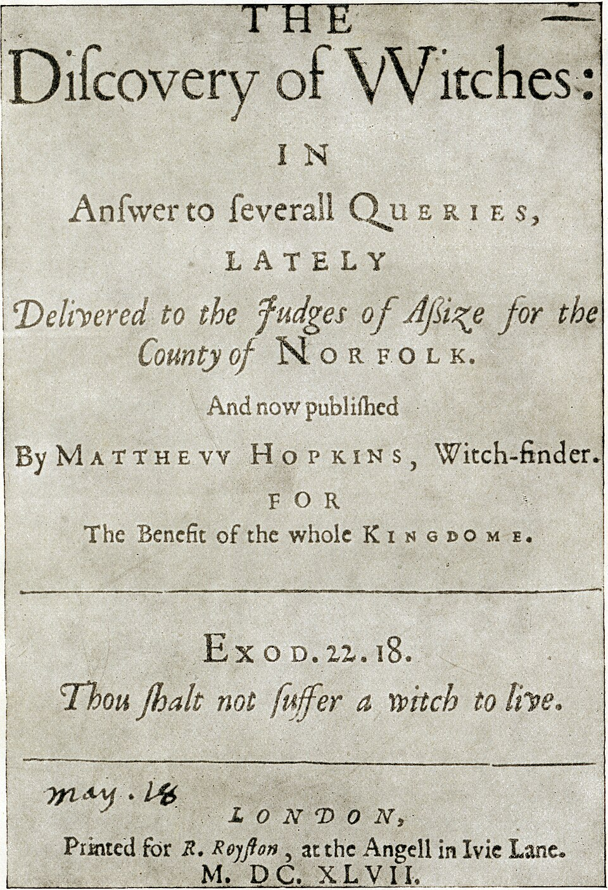
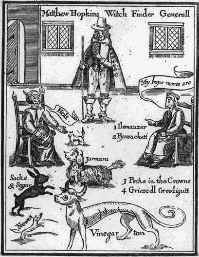

# マシュー・ホプキンス『魔女の発見』
マシュー・ホプキンス著／全訳

- 原題：The Discovery of Witches: in Answer to severall Queries, lately Delivered to the Judges of Assize for the County of Norfolk（ロンドン、R. Royston、1647年）
- 著者：マシュー・ホプキンス（1620年ごろ–1647年）。イングランド東部で活動した魔女捜しの請負人。「魔女発見人総監（Witch-Finder General）」を名のった
- 内容：
  - ホプキンスの魔女の見つけ方に対して出された十四の質問（批判）に、ホプキンス自身が答える小冊子である
  - 自分の腕は学問ではなく「経験」から来たと述べ、1644年にエセックスのマニングトリーで最初の魔女を見つけたいきさつを語る。眠らせずに見張った四晩めに、ヴィネガー・トムやパイワケットといった使い魔が現れたという
  - 体の「魔女の乳首」を探すこと、眠らせないこと、歩かせること、水に投げこむことへの批判に答え、どんな自白なら有効と考えるかを述べる。最後に、金もうけのためだという非難に反論する
- 作業の基にした本文：Wikisource にある、モンタギュー・サマーズによる1928年の復刻（The Discovery of Witches, London: The Cayme Press, 1928）のうち、1647年の本文の部分。扉は同書に載る1647年版の写真、口絵は1647年版の木版画（Wikimedia Commons）
- 著作権：ホプキンスは1647年に死去。日本・米国・英国で保護期間が満了している
- 訳者：人工知能（Claude Fable 5.2）
- 訳の性格：1647年の本文の全訳である。サマーズが1928年版につけた研究は訳していない。訳者の調べたかぎりでは、商業出版の日本語訳は出ていない（個人によるKindle版が出ている）

## この本について

　イングランドの内戦のさなか、1644年から1647年にかけて、東部のエセックス、サフォーク、ノーフォークなどで、短いあいだに数百人が魔女として告発され、多くが絞首刑になった。その中心にいたのが、二十代半ばのマシュー・ホプキンスと、相棒のジョン・スターンである。二人は町々に呼ばれて報酬を受けとり、疑われた者の体に「悪魔のしるし」を探し、眠らせずに見張って、使い魔が現れるのを待った。

　やがて批判が出る。1646年、牧師ジョン・ゴールが、二人のやり方を非難する本を出した。翌1647年には、ノーフォークの巡回裁判の判事たちに、ホプキンスのやり方を問いただす質問が出された。本書は、それに対するホプキンス自身の弁明である。ホプキンスはこの年のうちに死んだ。

　読んでみると、質問のほうがずっとまっとうである。年寄りには誰にでもいぼくらいある。眠らせず歩かせれば、人は何でも言う。縛って水に投げこむのは法にも良心にも反する。金めあてではないのか。ホプキンスはこれらに、拷問は「はじめのころ」のことでいまはやめた、誘導による自白は自分も認めない、報酬は一つの町で二十シリングにすぎない、と答えていく。水に投げこむ試しについては、ジェームズ王の『悪魔学』を根拠に挙げている。

　一方で、使い魔の名を並べ、「生身の人間にはとても思いつけない」名だからほんとうなのだ、と言い切るところには、この人物の考え方がよく出ている。本書に出てくる使い魔の名、ヴィネガー・トムやパイワケットは、のちに小説や芝居や映画でくりかえし使われた。

　本文中の〔　〕は訳者の補いである。

---

## 扉

　魔女の発見

　近ごろノーフォーク州の巡回裁判の判事たちに提出された、いくつかの質問に答えて。

　いま、魔女発見人マシュー・ホプキンスにより、王国全体の益のために出版される。

　出エジプト記22章18節「魔女を生かしておいてはならない」。

　ロンドン、アイヴィ・レーンの「天使」の看板の店、R・ロイストンのために印刷。一六四七年。

## マシュー・ホプキンスの魔女の見つけ方に対して、これまでに出された、またこれから出されそうな質問への答え

**質問一**　彼自身が最大の魔女、妖術師、魔法使いにちがいない。そうでなければ、そんなことができるはずがない。

**答え**　サタンの国が内輪で分かれ争えば、どうして立ちゆくだろうか。

**質問二**　そこまでは行かなかったとしても、彼が悪魔に会い、イングランドのすべての魔女の名が書かれた悪魔の帳面をだまし取ったのは確かだ。そして彼は、どんな魔女でも一目見れば、その顔つきで何者かがわかる。だから、彼の助けは悪魔から来ている。

**答え**　もし彼が悪魔を打ち負かしてその帳面を手に入れたのなら、それは大いにほめられるべきことで、少しも恥ではない。また人相を見る力については、彼はほかの誰とも変わるところがない。

**質問三**　では、彼のこの腕はどこから来たのか。深い学識からか。それとも、その主題についての学者の本をたくさん読んだからか。

**答え**　そのどちらでもなく、経験からである。経験は低く見られているが、判断のよりどころとしては、もっとも確かで安全なものである。

**質問四**　では、その経験はどこで得たのか。そして、なぜほかの者ではなく彼が得たのか。

**答え**　この発見者は、そのために遠くへ旅したことはない。一六四四年の三月、彼の住む町、エセックスのマニングトリーという町に、あの恐ろしい魔女の一派が七、八人住んでいた。ほかの町の、近くの魔女たちもいろいろ加わって、六週間ごとの夜に（いつも金曜の夜だった）、彼の家のすぐそばで集会を開き、そこでそれぞれ悪魔におごそかな犠牲をささげていた。ある夜、この発見者は、そのうちの一人が自分の使い魔（インプ）たちに話しかけ、別の魔女のところへ行けと命じているのを聞いた。その女はそこで捕らえられ、長年悪魔のしるしを知っている女たちに体を調べられた。すると、まっとうな女にはない乳首が三つ、体についているのが見つかった。そこで治安判事の命令によって、二晩か三晩、彼女を眠らせずにおくことになった。そのあいだに彼女の使い魔が見られるだろうと期待したのである。四晩めに、彼女は使い魔たちをそれぞれの名で呼び入れた。そしてそれらが入ってくる十五分前に、どんな姿をしているかを私たちに告げた。部屋には私たち十人がいた。彼女が最初に呼んだのは、次のものだった。

　一、ホルト。白い子猫のような姿で入ってきた。

　二、ジャーマラ。脚がまったくない、太ったスパニエル犬のような姿で入ってきた。彼女は、これを太らせてあるのだと言った。自分の腹をぴしゃりとたたいて、これが自分の体からよい血を吸ったのだと言ったのである。

　三、ヴィネガー・トム。脚の長いグレイハウンド犬のようで、頭は雄牛に似て、尾が長く、目が大きかった。この発見者が話しかけて、おまえとおまえの天使たちのために用意された場所へ行けと命じると、たちまち頭のない四歳の子どもの姿に変わり、家のなかを六回ほどまわって、戸口で消えた。

　四、サック・アンド・シュガー。黒いウサギのような姿だった。

　五、ニューズ。ケナガイタチのような姿だった。

　これらはみな、少しのあいだに消えうせた。そのすぐあと、この魔女は、自分が使い魔をもらった相手である、ほかの何人かの魔女の名を自白した。そしていろいろな女について、そのしるしがどこにあるか、しるしと使い魔がいくつあるか、使い魔の名が何であるかを挙げた。エレマンザー、パイワケット、ペック・イン・ザ・クラウン、グリゼル、グリーディガットなどという名で、生身の人間にはとても思いつけないものである。そして体を調べてみると、同じしるしが、同じ数だけ、同じ場所に見つかった。その女たちからも、同じ使い魔について同じような自白が出た（私たちが前もって聞いていたことを、彼女たちは知らなかったのだが）。こうして、同じいまわしい行いでいっしょになっていた、そのあたりの者たちが互いを告発しあった。そのためエセックスの私たちの郡区（ハンドレッド）では、いちどきに罪に定められ、四人は、この発見者の住むところで絞首刑にされるために二十五マイルを連れてこられた。悪魔を熊の姿で送って、庭で彼を殺させようとしたかどである。

　こうして、男たちの乳首もいろいろ見て、何百人もの者についてやり方を試すうちに、彼はこの経験を得た。そして彼の知るかぎり、ほかの誰でも、同じ腕と経験があれば、彼とその仲間と同じように、それを見つけることができる。

**質問五**　多くの貧しい人々が、体に乳首のようなものがあるというだけで罪に定められている。ところが多くの人は（とくに年寄りは）、体のあちこちに自然にできたいぼや、そのほか痔や出産によるものなどの自然のできものに、長いあいだ悩まされてきたし、いまも悩まされている。それなのに、それがただ一人の男と一人の女だけによって判定され、そうして告発されたり放免されたりするのである。

**答え**　そう判定する者たちは、誰に対しても自分たちの腕が正しいことを示せるし、そうしたしるしがただの自然のものではなく、先に述べたような自然の原因からは生じえないことについて、十分な理由を示すことができる。さらに、彼らだけの勝手な判定だという点について答えれば、それはまったくの偽りで、ほんとうではない。体を調べて試された男で、たいてい教区やそのほかのもっとも有能な男たち十二人ほどが立ち会わなかった者は、一人もいない。女が試されるときには、たいてい同じ数の、年をとった腕のよい婦人と産婆が立ち会う。そのしるしがたいへん疑わしいことは、彼とその仲間だけでなく、見た者みなが証言する。そのなかのもっとも腕のよい者たちも、それをよしとせず、そうしたしるしは上に挙げた原因のどれからも生じえないと、同じように認めるのである。

**質問六**　そうしたしるしについて正しく判定するのは、どんな男にも女にも不可能なことだ。それは自然のできものにあまりにも近い。それを見つける者たちも、それが悪霊に吸われてできたものだと、その場ですぐ誓って言う勇気はない。不法な拷問のやり方を使って、相手に、楽になり休ませてもらうために何でも言わせるまではだ。誰がそうしないでいられよう。だが私は、彼の言う理由を知りたい。どのように、何によって、一方を他方から見分けるのか。それを知って納得したい。

**答え**　理由は手短に言って三つある。いまのところ彼は、それによって自然のしるしと違うと判定する。次のとおりである。

　一、彼は、体のなかや上に乳首が見つかる場所が、ふつうでないことによって判定する。それは、そうした自然のしるしが生じるふつうの場所から遠く離れている。たとえば魔女が、見つかったしるしは痔だと言いはるとしよう。もし私がそれを背骨のいちばん下に見つけたなら、それがあの血管の近くではないと知りながら、相手に同意すべきだろうか。出産によるというほかのものについても同じで、それが反対の部分にあることもあるのだ。

　二、それはたいてい何も感じず、ピンや針や突き錐などを刺しとおしても、何も感じない。

　三、これらのしるしがたびたびいろいろな形に変わり、移ることが、このことを裏づける。たとえば魔女が、「魔女発見人」（と彼らは呼ぶ）が来ると、ひと月かふた月前に聞くと、彼女たちは使い魔をほかの者に預けて乳を吸わせるし、じっさいそうしてきた。自分の幼くかよわい子どもにさえ預けるのだ。そういう者を調べると、乾いた皮と薄皮だけがあって、肉にぴったりついているのが見つかる。その女を二十四時間、霊がどれも目に見える姿で吸いに来ないように、よく目を光らせて見張っておく。すると翌日、女たちは、彼女の乳首が以前のようにいっぱいに伸びて、膿がたまって今にもはじけそうになっているのを見た。そこで十五分だけ彼女をひとりにして、それから女たちをもう一度上がらせると、乳首は使い魔に吸われて、またぴったりしぼんでいる。「実証ずみ」である。さて、拷問についての答えは、しかるべきところで述べる。

**質問七**　悪魔は霊であって、栄養も糧も必要としないのに、どうして血を吸いたがるなどということがありえようか。じっさい、悪魔は霊なのだから、肉も骨も持たず、触れることもできないので、そうしたできものを吸い出すことはできない。

**答え**　悪魔は、その栄養なしには生きられないかのように魔女の血を求めるのではない。そうではなく、魔女の地獄落ちの罪をいっそう重くし、魔女に「契約」を思い出させるために、たびたび彼女たちのもとへ通って、血を得るのである。悪魔は霊であり、空中の君なので、どんな姿ででも彼女たちの前に現れる。その姿は、悪魔が濃く固めた空気をつなぎ合わせてつくるもので、悪魔はたびたびいろいろな生きものの姿をとる。だが何かを創ることは、悪魔にはできない。それは神だけのものである。しかし、この乳首を吸い出す場合には、悪魔はじっさいに、ほんとうの、体のある、実体を持つ生きものの体のなかに入り、（そのなかではたらいて）その生きものを自分の望む目的へと駆りたてる。そしてその体の器官を使ってものを言い、魔女たちとの契約を結ぶのである。その生きものが猫であれ、ネズミであれ、ハツカネズミであれ。

**質問八**　こうした乳首がすっかり見つかっても、それだけでは彼女たちを罪に定めるのに十分ではない。そこで彼女たちは拷問にかけられ、二晩も三晩も眠らせてもらえない。頭を混乱させて、何でも言わせるためだ。それは荒い子馬や鷹などを馴らすやり方である。

**答え**　この発見のはじめのころには、それはふさわしいと考えられただけでなく、エセックスとサフォークでは役人たちによって命じられていた。その意図はただ、彼女たちは眠らされずにいると、それだけ活発に、人の見ている前で、より早く使い魔を助けに呼ぶだろう、ということにあった。じっさい、たびたびそうなったのである。そして見張られているあいだに、休めないことを訴えた魔女は一人もいないか、めったにいなかった。訴えたのは、牢のなかで頭を寄せあって相談してからのことである。そしてこのやり方が判事やほかの役人たちに認められなくなってからは、それ以来一度も使われていない。それは一年半前のことである。それ以来、誰の命令や指図によっても、眠らされなかった者はいない。ただ、眠ってよいとすすめられ、許されても、彼女たち自身のかたくなな意志が眠らせなかったことは、あるかもしれない。

**質問九**　その理不尽な不寝番のほかにも、彼女たちは足にまめができるまで、度を越して歩かされ、その残酷さによってむりやり自白させられた。

**答え**　それもまた、この発見のはじめのころのことである。そして歩かせるというのは、もっとも残酷な場合でも、ただ、見張られている夜に、目を覚ましておくために、彼女たちが自分で歩きまわるということにすぎなかった。その理由はこうである。彼女たちが横になったり椅子に座ったりしていて、うずくまろうとすると、見張りの者はただ、起きて歩きまわってくれと頼むことになっていた。というのも、じっさい、そのようにうずくまることを許すと、たちまち使い魔が部屋に入ってきて見張りの者をおびえさせ、魔女を励ますからである。たしかに、その指図のほんとうの意味に反して、いろいろな者が、（彼女たちが魔女だと自白するのを聞いた）田舎の人々によって、手荒く扱われ、傷つけられ、虐げられた。そのためにそうした人々の何人かは罰を受けた。だが、この発見者がそれに手を貸したとか、同意したとかいうことは、決して証明されなかった。そしてこれもまた、眠らせないことをやめたときから、彼もほかの者も使っていない。

**質問十**　だが、この哀れな者たちを縛って水に投げこむという、いまわしく、人でなしの、無慈悲な試しが行われてきた。それは法によっても良心によっても許されない試しである。その理由をぜひ知りたい。

**答え**　乳首のあった多くの者がそうされ、浮いたことは否定しない。乳首のなかったほかの者も、いっしょに試されて沈んだ。だが、その理由に気をつけてほしい。

　第一に、悪魔のたくらみは大きい。悪魔は多くの者を説きふせて、自分から進んで試されに来させる。おまえのしるしはぴったり隠れているから見つからない、と思いこませるのだ。そのため何人もの者が、十マイルも十二マイルも、自分から体を調べられにやって来て、その骨折りのあげくに絞首刑になった（メッグズというパン屋がそうだった。ノリッジから七マイル以内に住んでいて、魔女術のかどでノリッジの巡回裁判で絞首刑になった）。そして悪魔が嘘をついたとわかると、彼らは悪魔を責める。すると悪魔は（四十人が自白したところでは）、水に入れてもらえとすすめ、おまえは沈んで、それで疑いが晴れると告げる。そしてそのやり方で試されて浮くと、彼らは悪魔にまただまされたとわかり、そうして悪魔の裏切りをあばくことになったのである。

　二、それは、彼らの裁判で、彼らの誰に対しても、証拠として持ち出されたことは一度もない。

　三、ジェームズ王はその『悪魔学』で、それは確かな規則だと言っている。王が言うには、魔女は悪魔と契約するときに自分の洗礼を否定する。洗礼のただ一つの元素は水である。だから、と王は言う。彼女たちが水に投げこまれると、水は彼女たちを（洗礼を否定するような不信心者なので）その胸に受けいれるのを拒み、浮かばせておく。海の泡のようにである。水は泡を受けいれず、あちこちへ投げあげて、ついに土の元素である岸に着くと、そこに残して消えるにまかせる。

　四、この魔女という者たちをよく見てほしい。彼女たちは、住んでいるところの誰かに、売女だの盗人だのと呼ばれて悪く言われると、誰よりも早く泣き、手をもみしぼり、涙をたっぷり流す。そしてたいへん悲しげな叫びをあげながら、どこかの治安判事のもとへ走り、たくさんの涙とともに訴える。だが、彼女たちの無感覚さを見よ。自然、あるいは元素が、彼女たちからそむくのだ。魔女術という、この恐ろしくいまわしい罪で告発されるとき、彼女たちは決して顔色を変えず、一粒の涙も落とさない。

　ついでに言えば、水に入れるこの試しは、（私が敬う有能な神学者たちによって）正しいやり方ではないと断じられた。それで近ごろはやめており、これからも永久にやめる。

**質問十一**　ああ、だが、この拷問好きの魔女捕りが、こうした手段のすべてか、そのどれかによって、ぼんやりした、無知な、わけのわからない、哀れで愚かな者たちの誰かから、一言か二言の自白を絞りだすことができれば（彼のほかに誰も聞いていなくても）、彼はそれにつけ足し、自白しなければ絞首刑だと言って彼女をこわがらせ、自白すれば自由にしてやると言うだろう。そうして彼女の口に言葉を入れ、そうした愚かな者に、自分でも何だかわからないことを自白させるのだ。

**答え**　彼はもっとよい良心を持っている。彼をもっとよく理解してもらうために、彼はここで自分をすべての人の前にさらけだし、どんな自白を（たとえ魔女が自分に不利に述べたものであっても）認めないのか、まったく効力がなく、信じるに値しないとみなすのかを明らかにする。彼はいつもそうみなしてきたし、これからもいつもそうみなす。

　一、魔女の自白が、どんな拷問や暴力によってであれ、彼女から引き出されたものであるときは、彼はそれに効力があることをきっぱり否定する。たしかに、眠らせないこと、歩かせること、水に入れることのあとで、何人もの者が処刑された。だが、おそらく役人たちが、彼女たちが眠り、十分に考えたあとで、大いに気を配り、念を入れて、もっぱら、そして十分に取り調べたのである。

　二、魔女の自白が、甘い言葉によって彼女から引き出されたものであるときは、彼はそれをきっぱり否定する。たとえば「自白すれば家に帰れる、牢には行かずにすむ、絞首刑にもならない」などと言う場合である。

　三、魔女が、ありそうもないこと、ありえないことを自白するときは、彼はその自白をきっぱり否定する。たとえば「空を飛ぶ、ほうきに乗る」などである。

　四、魔女の自白が、問いただされ、言葉を口に入れられて出たものであるときは、彼はそれに何かの力や効き目があることをきっぱり否定する。たとえば、愚かな（とはいえ十分に邪悪な魔女である）者に向かって、「おまえには使い魔が四匹いるだろう」と言う。彼女は「はい」と肯定して答える。「それはおまえの乳を吸っただろう」。「はい」と彼女は言う。「その名前はこれこれだろう」。「はい」と彼女は言う。「おまえはこれこれの使い魔を送って、私の子を殺させただろう」。「はい」と彼女は言う。彼女の自白がこれだけで、このようなやり方によるものなら、彼はそれを無に等しいとみなす。そして彼は、すべての役人と陪審員とが、問いただして得た自白については、これまでより少し念を入れて証人を取り調べることを、切に望んでいる。

**質問十二**　こうした自白がみな否定されるなら、彼はいったい何を自白とするのだろう。というのも、こうしたやり方はみな確かに使われ、よい自白として受けとられてきたし、多くの者がそのために処刑されたのだから。それなら彼は何を自白とするのか、私にはわからない。

**答え**　よろしい、彼は、魔女のどんな自白が、彼の判断では、魔女を絞首刑にするだけの効力と力を持つのかを、手短に明らかにしよう。魔女がまず乳首のあるのを見つけられ、それから家から引き離される。それはただ、昔の仲間を彼女から遠ざけておくためである。そうしてよい助言によって、自分の罪の恐ろしさと、自分に対して告げられている裁きとを理解し、沈んだ心持ちになる。そして悪魔の悪意と巧妙なたくらみとを知り、長いあいだサタンに従い、神の聖なる戒めに背いてきたことを悔い、悲しむようになる。そうなると彼女は、たいへん苦い思いで、心のうちを打ち明けたいと願う。そして、先に述べたようなきびしい扱いも、問いかけも何もなしに、自分から進んで、悪魔が自分の前に現れたきっかけは何だったのか、無知、高慢、怒り、悪意などのどれが自分を支配していたのかを明らかにする。それから、悪魔とどんな言葉を交わしたか、悪魔がどんな姿をしていたか、どんな声だったか、悪魔がどんな使い魔を送ってきたか、霊がいくつで、どんな名前で、どんな姿だったか、それらを使って、どこの誰にどんなことをさせたかを（聞いている者たちの知らないことを）明らかにする。そうした害がみな、じっさいになされたと証明され、彼女がその同じ相手に、同じ理由でしたと自白したのと同じときに、すべて果たされていたなら、それは、彼女がどれほど否認しようと、彼女に対する十分な証拠である。

**質問十三**　悪魔と魔女とが手を組むと、魔女が自白するように、これこれの男や子ども、馬、牛などを殺すほどの力を持つなどと、どうして誰かが信じられようか。もし彼らが思うままに何でもできると信じるなら、私たちは神の力をおとしめることになる。神は確かに悪魔と魔女とに限りをもうけておられる。そして私は、彼らに何かの力があるとは少しも信じられない。

**答え**　神はたびたび、悪魔が大きな害をなすのを許される。そして悪魔はたびたび、この魔女たちに対して、惑わす者、詐欺師の役を演じる。自分が彼女たちの同意を得て行ったこれこれの殺人は、彼女たちが原因なのだと思いこませるのだ。じつは悪魔も彼女たちも、それに何の手も下していないのに。それは次のようにしてである。私たちは、こう論じないわけにはいかない。悪魔は長く、六千年以上も生きている。それなら悪魔は、術と言葉とのあらゆる知識で最高の学者にちがいなく、したがって医術の腕も、人相の判断も、この人やあの人の体のなかでどんな病が盛んで優勢かという知識も（家畜についても同じく）、長い経験のおかげで、最高のものを持っているにちがいない。

　この狡猾な誘惑者は、ある男が肋膜炎や膿瘍などの何か急な病にかかりそうだと知ると（私が経験で見いだしたとおりだ）、何人かの魔女のところへ行く。魔女たちがその男を知っていれば、悪魔は魔女たちとその男とのあいだに仲たがいを起こそうとする。たとえば、あの男はおまえたちを近いうちに調べさせ、魔女として絞首刑にさせると脅している、と告げるのだ。すると彼女たちはみな、自分の身を救うためにサタンに相談する。サタンは用意をととのえて待ちかまえていて、こう言う。「私の地獄の同盟で私と契約し、盟約を結び、おまえたちの血で封印した、私のいとしい、いちばん身近な子どもたちよ、私のかわいい火種たちよ、おまえたちのために何をしてやろうか」〔原注：魔女たちに対する悪魔の言葉〕。「おお、あなた」と彼女たちは言う。「あなたははじめに、僕である私たちを、命とりの敵に見つけられることから救うと約束し、私たちを怒らせる者は、私たちの望むとおりにみな仕返しして殺すと約束なさいました。あなたの忠実な臣下を滅ぼすと脅すあのろくでなしを、すぐに殺してください」。そこで悪魔は、そうすると約束する。次に、その男が死んだという知らせが聞こえる。悪魔は魔女のところへ来て、その力とはたらきのために、たいへんな敬いと信用と尊敬を得る。ところがじっさいには、その男を殺したのは病であって、魔女でも悪魔でもない（ただ悪魔は、そうした病が優勢だと知っていただけだ）。そして魔女は、悪魔と親しくし、同意したことによって、地獄落ちの罪をいっそう重くし、同じく法の及ぶ範囲に入るのである。

　これがサタンのいつものだましと惑わしである。だが、いつもきまってそうするわけではない。悪魔と魔女とは、じっさいに害をなすことが多すぎるほどあるからだ。だが私は、役人と陪審員が、魔女がこれこれの殺人を自白するのを聞いたとき、証人を少し取り調べてほしいと思う。その相手が、ずっと前から、あるいは魔女が疑われるようになったころに、そうした死という結果を招きかねない、何か優勢な病にかかっていなかったかどうかを。

**質問十四**　魔女発見人のしていることは、地方から金を巻きあげることだけだ。だから仕事を得るために馬で町々をまわり、うまい約束をしながら、おそらくそのために何もしない。そして多くの人に、あなたがたの町にはこれだけの魔法使いとこれだけの魔女がいると思いこませ、そうして自分を雇うように彼らをけしかけるのだ。

**答え**　あなたは、その一つ一つの点で、彼にたいへん不当なことをしている。というのも、まず、

　一、彼がどこかの町や場所へ行ったのは、いつも、そこの人々が馬で来たり、手紙を書いたり、たびたび使いをよこしたりして彼を呼んだときだけであり、（彼の知るかぎり）人々は彼が来るのを喜んだ。

　二、彼は、自分が魔女を見つけ出したとか、「おまえは魔女だ」と言ったとかいうことを、いっさい否定する者である。ただ、体を調べる試しと、本人たちの自白とのあとで、ほかの者と同じように判断するだけである。

　三、最後に、彼がそれぞれの町から受けとる莫大な金額を考えて、彼がどれほど地方から巻きあげ、私腹を肥やしているかを判断してほしい。彼は一つの町につき二十シリングしか求めない。そのためにときには二十マイルも馬で行き、行き帰りのあらゆる費用をふくめて、それ以上は受けとらない（しかもそこにおそらく一週間とどまる）。そしてそこで三人か四人の魔女を見つける。たとえ一人だけだとしても、十分に安いものだ。これが、三頭の馬をつれた自分の一行を養うために彼が受けとる、莫大な金額なのである。

　誰でも判断されよ。

おわり
