# エジプトの魔術

フロレンス・ファー（S. S. D. D.）著／全訳

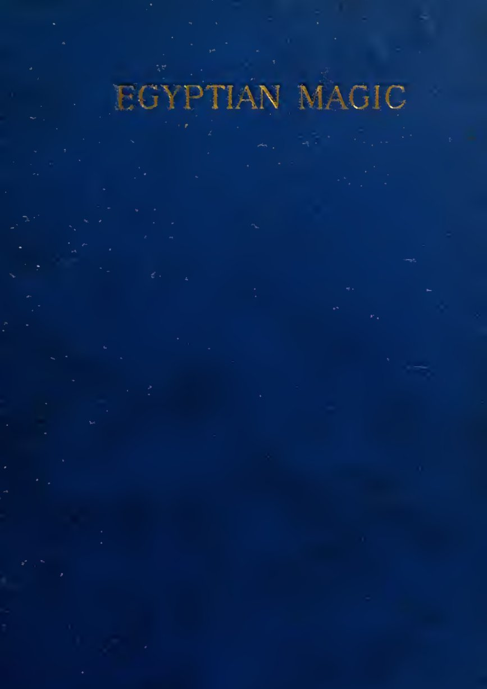

| 項目 | 内容 |
|---|---|
| 原題 | Egyptian Magic（叢書 Collectanea Hermetica 第八巻、W・ウィン・ウェストコット編） |
| 著者 | S. S. D. D.（Florence Farr、フロレンス・ファー、1860〜1917年）。イギリスの女優・作家で、魔術結社「黄金の夜明け団」の幹部。S. S. D. D. は団内での名 "Sapientia Sapienti Dono Data"（知恵は賢き者に贈りものとして与えられる）の頭文字 |
| 初版 | Theosophical Publishing Society, London, 1896年 |
| 作業の基にした本文 | 1896年初版のスキャン（Internet Archive、ウェルカム図書館所蔵本） https://archive.org/details/b24884248 の文字起こしと、ページ画像による確認 |
| 著作権 | 著者は1917年に死去。日本では保護期間が満了している。米国では1931年より前に発表された作品として、パブリックドメインに属する。表紙・扉・口絵・表・印章の図も1896年の初版のもの |
| 訳者 | 人工知能（Claude Opus 5.5） |
| 訳の性格 | 全訳（要約・省略なし。巻末の参考書目は書誌を原文のまま残した）。引用されている『死者の書』、聖書、詩などは、既存の日本語訳を用いず、原著の英文から新たに訳した |

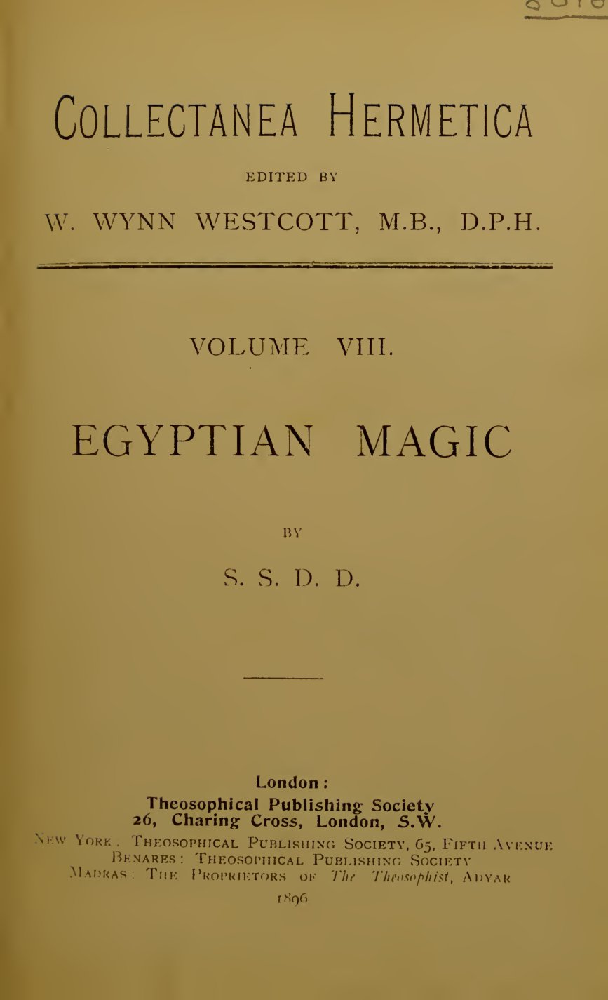

## 要約

　黄金の夜明け団の中心人物の一人だったフロレンス・ファーが、団内の名の頭文字「S. S. D. D.」の名で、ウェストコット編の叢書『ヘルメス文書集成』の一冊として出した、古代エジプトの魔術についての小著である。

　前半では、エジプト人が人間を体（カト）、アストラル体（サフ）、心臓（アブ）、自我（カ）、霊（バイ）、輝く者（クー）など多くの部分から成るものと考えたことを、口絵の図と表を添えて説く。そして、秘儀伝授とは低い自己を高い自己に捧げ、神の姿と一体になることだったと論じる。その証として、『死者の書』第六十四章、ハリス魔術パピルスの賛歌と呪文、ラーとイシスの伝説、エジプトの物語に出てくる魔術の例、王と神への賛歌を引く。

　後半では、時代の下ったアレクサンドリアのグノーシスの魔術に移る。グノーシス主義の考えを概説した後、コプト語のブルース・パピルスから、プレーローマの構造、ひとり子の讃美、イエスが弟子たちに水・火・聖霊の三つの洗礼を授ける儀式などを、印章の図とともに長く訳出する。最後に、エジプトとグノーシスの魔術がともに意志と想像力の育成、定まった思いと繰り返す言葉の力に基づいていたことをまとめ、シェリーの「オジマンディアス」で結ぶ。

## 目次

- 人間を構成する諸部分
- エジプト魔術の原理
- 『死者の書』第六十四章
- ハリス魔術パピルス
- テクストル・ド・ラヴィジ男爵による超自然の出現の理論
- ラーとイシスの伝説
- エジプトの物語に見る魔術の例
- グノーシスの魔術
- 王と神の定式
- グノーシスの哲学と定式
- あるグノーシスのパピルス
- エジプトの魔術とグノーシスの魔術の類似をたどる要約
- 参考書目

---

## 人間を構成する諸部分

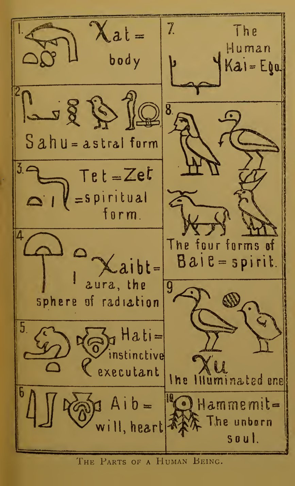

　口絵の図の中の語は、次のとおりである（番号は図の中の番号）。

- 1．カト＝体
- 2．サフ＝アストラルの形
- 3．テト＝ゼト＝霊的な形
- 4．カイビト＝オーラ、放射の圏
- 5．ハティ＝本能的な執行者
- 6．アイブ＝意志、心臓
- 7．人間のカイ＝自我
- 8．バイ＝霊の四つの形
- 9．クー＝照らされた者
- 10．ハンメミト＝まだ生まれていない魂

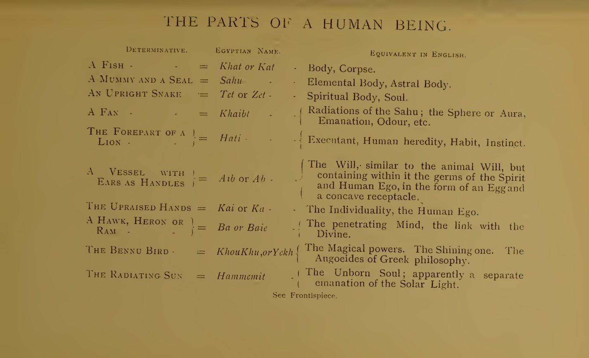

　本文の前に折り込まれた表は、次のとおりである。

| 決定詞 | エジプトの名 | 英語で相当するもの |
|---|---|---|
| 魚 | カト、またはカト（Khat, Kat） | 体、屍 |
| ミイラと印章 | サフ（Sahu） | 元素の体、アストラル体 |
| 立ち上がった蛇 | テト、またはゼト（Tet, Zet） | 霊的な体、魂 |
| 扇 | カイビト（Khaibt） | サフの放射。圏、すなわちオーラ。発散、匂いなど |
| 獅子の前半身 | ハティ（Hati） | 執行者。人間の遺伝、習慣、本能 |
| 耳を取っ手とする器 | アイブ、またはアブ（Aib, Ab） | 意志。動物の意志に似ているが、その内に霊と人間の自我の胚を、卵とくぼんだ受け皿の形で含む |
| 差し上げた両手 | カイ、またはカ（Kai, Ka） | 個性、人間の自我 |
| 鷹、サギ、または雄羊 | バ、またはバイ（Ba, Baie） | 浸透する心。神的なものとのつながり |
| ベンヌ鳥 | クー、クー、またはイェク（Khou, Khu, Yekh） | 魔術的な力。輝く者。ギリシア哲学のアウゴエイデス |
| 光を放つ太陽 | ハンメミト（Hammemit） | まだ生まれていない魂。太陽の光から分かれた流出であるらしい |

（口絵を参照。）

### 訳注

- **口絵と表**：口絵の図と折り込みの表は、どちらも1896年の初版のもので、底本のスキャンから画像を収めた。表は原著では横向きに組まれているので、画像を回転させた。
- **決定詞（determinative）**：象形文字で、語の意味の範囲を示すために語の終わりに添えられる記号。
- **名の綴り**：口絵では「Xat（カト）」「Xaibt（カイビト）」「Xu（クー）」のように、エジプト学で「kh」の音を表す記号を「X」の形で書いている。訳では、本文と同じ片仮名に統一した。表と本文とで、同じ部分の名の綴りや説明が少しずつ違う（たとえばゼトを、表では「霊的な体、魂」、口絵では「霊的な形」とする）が、原著のままにした。

## エジプト魔術の原理

　魔術の研究は今では評判を落としてしまったが、エジプト人のあいだでは、現代において最高の哲学にさえほとんど払われないほどの敬意をもって見られていた。

　古代エジプト人にとって最も優れた人とは、厳しい修練によって、自分自身の体と顕現した世界とがともにそこから形づくられている「元素」を支配するに至った人であった。その「意志」が不死鳥のように自分の欲望の灰の中からよみがえった人であり、物質の幻の汚れを洗い落とした「直観」が澄んだ鏡となって、そこに「過去」と「現在」と「未来」を見ることのできる人であった。

　エジプトの王と神官は、「知恵の学校」で学んで成功を収めた者たちの中から選ばれた者、いわば哲学による貴族であった。彼らが選ばれたのは、賢いからだけでなく、その知恵を用いることができたからである。彼らは国の軍勢に力を与えることができ、自分たちの力を伝える手段をもっていた。「王なる秘儀参入者」の杖はきわめて強い魔術的な力をもっていたので、それを手にした軍の指揮者は、ファラオその人と同じほど強大になったのである。

　王なる神官たちは民衆に顕教の宗教を与え、それによって民衆の歩みを導いた。民衆もまた秘儀を授けられた者たちの列に加われる発達の段階に達するまでのことである（それは、転生に転生を重ねて失敗を繰り返した後のことだったかもしれない）。とはいえ、エジプトの民全体に密儀へのある程度の参加が許されていた可能性はきわめて高いと思われる。秘儀伝授の前の志願者の試験は、相当の完成の域にまで発達した人間でなければ耐えられる見込みのないような性質のものだったからである。

　ミイラにされたのは何らかの位階の秘儀を受けた者だけだったと考える十分な理由がある。エジプト人の目には、ミイラにすることは再生を確実に妨げるものだったからである。再生は不完全な魂、秘儀伝授の試験に通らなかった者たちには必要であった。しかし、秘密の至聖所に入る「意志」と力量をもつ者には、体を壊すことによって成し遂げられるといわれる魂の解放は、ほとんど必要なかったのである。

　それゆえ、秘儀参入者の体は死後に保存され、一種の護符として、すなわち地上で魂が顕現するための物質的な土台とされた。

　エジプトの魔術を研究すると、すぐに徹底して科学的な満足を覚える。漠然とした理論に悩まされることはなく、正確で実際的な細部が与えられる。上の世界と下の世界の一寸四方に至るまで地図に描かれているのがわかる。こうした体系がそれ自体にもつ強さは、古代エジプト文明が長く続いたことによって証明された。

　エジプト魔術の第一原理は、手の込んだ照応の体系の上に立っていた。その体系は、物質的なものの進化は霊的なものの流出の型と象徴に従う、霊と物質とは同じ一つの神秘の表と裏である、という定式にもとづいていた[^1]。エジプトの達人たちは、心の思い、魂の憧れ、口の言葉、体の働きを、互いに類比をもつものとみなし、そこから生と死の規則の完全な体系を組み立てることができると考えた。さらに彼らは、一つひとつの体、すなわち顕現した存在を、形成界・創造界・原型界において霊・魂・心として働く、非物質的な存在の長い連なりの物質的な土台とみなしていた。

[^1]: ウェストコット「カバラについて」（『ルシファー』誌、一八九三年五月号、二〇四ページ）、およびティンダルの「ベルファスト講演」を参照。

　本巻には、現代の理論を学んでいない人のために、「エジプト人の信仰」という主題についての定評ある著作の一覧を収めた。それゆえ、ほかでたやすく見つかる細部にここで立ち入る必要はない。そこで私は、わが国の代表的なエジプト学者たちが示した仮説を引用するのを待たずに、古い伝承の研究から私がまとめるに至った考えを、すぐに述べることにしよう。

　まず、私たちはこれまで人間を魂と体から成るものとして書いてきた。しかし、秘儀を受けたエジプト人は、自分たちを単なる魂と体からはほど遠いものとみなしていた。彼らは人間のいくつかの働きに名を与え、そのそれぞれについて、別々に存在する可能性を想定していたのである。

　カト、またはカト（Khat, Kat）、すなわち体は、地上の人間の生というこの次元で「自我」が働くための乗り物、物質的な土台にすぎなかった。

　エジプトの生の循環の哲学を考えるにあたって、始めから始めよう。ハトシェプスト女王のオベリスクによれば、人間のハンメミト、すなわち根源の存在は、受肉する前に百二十年のあいだ太陽の周りを巡っていた。この期間には、ある宇宙的な力や元素の力が、ほかの力よりも強く働くだろう。それらが根源の存在を取り巻いて、それにある特有の傾きを与え、受肉の手段と時を選ぶ導きとなる。そのあいだに、根源の存在に作用する高い元素の力の映しが、物質の世界で働いている。これらの映しは、同じように人間の両親にも傾きを与える。生まれる時が来ると、印章をつかむ禿鷹によって象徴される「大いなる母なる力」が、選ばれた瞬間に優勢な象徴を根源の存在に刻印する。そして、これが占星術のホロスコープの原理なのである。

　そのあいだに、人間の母は元素の力の中心となっており、それが彼女の周りに幻の魅力を形づくっていた。これがサフ、すなわち未来の人間のアストラル体が、自然の元素の力の魔術のもとで形づくられることである。どれほど器量の劣る女も、ひとときは恋人の目に美しく映るものだからである。しかし、両親の力の協働が果たされるやいなや、サフは急いで生命を得た胚に結びつき、目に見えない型としてそれにとどまって、固い物質がそこへ引き寄せられて物質の体を形づくる。サフのこの働きによって、植物界に関して一部の霊視者が見てきたもの、すなわち種や穀粒が地に蒔かれる前に、それにアストラルの植物の形が結びついているという幻視が説明される。

　こうして元素の体が、生命を得た卵子の周りに集中すると、人間の母は自然の状態に戻され、元素の体が与えていた幻の美しさをはぎ取られる。そして彼女は、育もうとしている人間に対する自分の役目を果たし終えるまで、特別な魅力を取り戻さない。あるいは、取り戻すべきではないのである。

　そこで、まだ生まれていない子は、エジプト人がハティすなわち「全き心臓」と呼んだ原理を与える両親によって、生への出現の準備を整えられることがわかる。それは、民族と個人の遺伝的な本能の座であり、消化、聴覚、視覚、嗅覚などの働きを含む。一言で言えば、ハティとは遺伝である。それは元素の力によって形づくられた体、サフをまとっている。サフすなわちアストラル体は、受胎の前にも後にも放射の力をもっており、それが人間の母の周りに引力の圏を形づくった。その圏は受胎のときに大いなる禿鷹の母なる力によって封印され、ただちに引き揚げられて、未来の人間の圏すなわちオーラを形づくる。これがカイビト、すなわち放射するオーラと呼ばれるものである。

　誕生の瞬間に「自我」が体に加わる。そして、エジプト文明の最盛期にさかのぼる、偉大な王子たちの誕生を表した多くの絵が残っている。それらの絵では、天において生み出された体と、地において生み出された体の二重の姿が見分けられる。すなわち、巡っているハンメミトが今や一つの流出を放ち、それが生まれたばかりの子のカ、すなわち分身と呼ばれる。そしてこれが、もう一つの原理アブによって地上の体とのつながりを形づくる。ハティは、エジプトの文書ではいつもアブすなわち心臓と結びつけて語られる。ちょうど私たちが会話の中で、本能と意志とをしばしば混同し、ひとまとめにするのと同じである。意志はどの動物にも潜んでいる性質であり、人間においては、それを発達させ育てて「自由意志」にすることができる。同じように、アブ（意志）すなわち心臓の赤い器は、『死者の書』では、卵と、くぼんだ胚とを収めたものとして表されている。このくぼんだ胚が育成によって発達したとき、「自我」の本当の生と十分な発達が始まりうる。言いかえれば、体が地上の進化の中で進みうるのと同じように、カは天上の進化の中で進みうるのである。

　もちろん、何千という場合に天上の体は束縛された。受胎の宿命の瞬間が、地上の存在（カト、すなわち物質の体の中のサフ、ハティ、アブから成る）に、破るにはあまりに強い運命の鎖を負わせたのである。そしてカすなわち「自我」は「霊たちの場所」のハンメミトのもとに帰り、アストラルと物質の素材を再生させて、あの「輝く者たち」――霊と生命の主、「一つに成された者」の冠に宝石のようにはめ込まれた者たち――の一人となる機会が再びめぐって来る時を待たなければならなかった。

　この考え方の中に、私たちはただちに、自己を自己に捧げる犠牲についての教えの説明を見いだす。カすなわち「自我」は、熱心で忍耐強い粘りと苦闘によってのみ、成長し、力を得ることができるからである。

> 　「三日のあいだ、私は十字架に掛かった。自らを自らへの犠牲として」と、エッダの神は言う。

> 　「私は私自身の内では無である。あなたの内の何ものかであり、無から出たあなたの何ものかの内に生きる。どうかあなたが私の内に生き、私をあなたの内の何ものかへと連れ出してくださるように」と、ドイツの神秘家は言った。

　「自分自身である」ことのできない人は、プタハの鋳鍋で溶かされなければならない。神々の工匠は、今の組み合わせのままでは再生しえず、また再生しようともしない元素の素材を散らすだろう。彼は、より幸いな仕事の時を待つのである。

　キリストは、この教えを、ルカ十九章二十六節のタラントンのたとえで述べている。「持っている者は誰でも与えられ、持っていない者からは、持っているものまでも取り上げられる。」

　この古いエジプトの教えは、マシュー・アーノルドのソネット「不死」の中にも見いだされる。

> 　いや、いや、生の力は
> 　墓の向こうまで保たれることはあっても、そこで始まることはない。
> 　地上の戦いでくじけることなく、
> 　力から力へと進み、
> 　魂をよく引き締め、すべての戦いに勝った者だけが、
> 　それもかろうじて、永遠の生へと昇るのだ。

　無力な魂を消滅に定めるエジプトの信仰の暗い側面についてしばらく述べたので、次に、生の戦車の手綱を自分の手に取り、その乗り物につながれた元素の力を望ましい目標へと無事に導く者たちの前に開ける道について論じよう。

　心臓すなわちアブの中に置かれた種は、今や「思考」と「意志」の力を象徴するものと考えてよいだろう。それがひとたび、神働術（テウルギア）の修練によって、あるいは意識ある存在の最高の憧れへの献身によって動き出すと、奇妙な結果を生む。アブの表現では、原理が血の器に映ったかのように逆さまになっていて、くぼんだ胚が上にあることを思い出してほしい。すると、くぼんだ塊の両端が回り込んで、卵を受ける器を形づくっているのがわかる。これは、根源の存在すなわちハンメミトからの、より精髄的な流入を象徴しており、それが鷹すなわちバイの姿で、カの差し上げられた両腕の上に降りてくるのである。「思考」と「意志」の育成は、カを表す象形文字の差し上げられた両手によってもまた示されている。憧れのその姿勢によって、カは、刺し貫き、浸透する霊であるバイのための休み場を形づくることができる。この後者の原理は四通りに表される。冠をいただいた鷹すなわちホルスのバイ、人の頭をもつ鷹、ベンヌ鳥、そして雄羊である。バイ（霊）はアブに含まれる卵のような原理を通じて働くことができ、カ（人間の自我）はくぼんだ原理を通じて働くことができる。

　バイという語に用いられたこれら四つの象形文字は、魂のはっきり異なる位階、すなわち類を示していた。たとえば、鷹の魂は王または女王のカの上にとどまるものとしてしか表されない。それは「王の魂」と呼ばれる。人の頭をもつ鷹は大いなる秘儀参入者のミイラの上を舞い、疑いなく、受肉が終わった後の魂を表している。その人の頭は人間の個性の精髄の象徴であり、鳥がそれを「祝福された魂の住まい」へと運んでいくのである。

　雄羊で表されたバイは、障壁を打ち破る、前進し浸透する力であり、それによって、力を得た人間の魂は、より穏やかな探求に対しては持ちこたえる番人たちの守る領域へと入っていくことができるのだろう。

　ベンヌ鳥もまた、獲物を突き刺し、刺し貫くことで知られている。この象形文字にはかなりの難しさがある。一般に考えられてきたように、それが不死鳥を表すのなら、それは、人間の側の長い一連の労苦を通じてのみ進化しうる、より複雑な存在の範囲に属する魂の象徴だと理解するのはたやすいだろう。しかし、それが単にありふれたアオサギの一種の姿なのであれば、私はそれを、魂のより穏やかで、火の気の少ない性質を示すものと受け取るだろう。

　雄羊の頭は、ミイラの体の中で心臓の代わりに置かれる石のスカラベ（自己創造の象徴）の上にしばしば置かれる。これは、中世の神秘家たちが「賢者の石」と言ったときに意味したものを表している。すなわち、自己創造的となり、その天上の、前進し浸透する能力と永遠に結ばれた「意志」である。真の魔術師（マグス）の、聖別された「意志」と浄められた「思考」なのである。

　大英博物館の第一エジプト室には、紀元前一六〇〇年ごろに生きたハトシェプスト女王を描いたといわれる絵が壁に掛けられている（女王の名は塗りつぶされ、トトメス三世の名に置き換えられている）。女王は香を捧げている。この絵は、この女王がカルナックに建てた、今は倒れているオベリスクから写したものである。この絵の版画は、ヴィーデマン『魂の不死』の英訳にも複製されている。

　ここに、完全に秘儀を受けた統治者の姿がある。その神的な力は、頭飾りの上に、次のものによって表されている。天と地の「真理」の羽根。太陽の円盤。始まりと実りを治める二柱の女神。これは角と円盤をもつ聖蛇（ウラエウス）で表され、美と生命と、激しく守る母性の象徴である。すべてを貫く力の雄羊の角。そして、預言と守護の火の蛇を顔の前にまっすぐ立てたネメス頭巾である。

　女王の姿の上には「母なる禿鷹」がいる。それは、万物の母ムトの、復讐し、守り、直観する使いであり、輪と、誕生をつかさどる力の象徴を刻んだ板とから成る印章をつかんでいる。その力が女王に力ある名を与えたのである。

　女王の後ろには、そのカすなわち本当の自我がいる。頭上に憧れをこめて差し上げた両手が、「知恵の門」を表す長方形を囲んでいる。その中には、エジプトの教えによれば秘儀伝授の神働術の儀式によって勝ち取るべきものとされた、ホルスの名、すなわち英雄の名が書かれている。その上には、王のホルスのバイがとまっている。カの両手には杖、すなわち魔術の棒があり、それは正しく理解すれば、女王が自分の「意志」を果たすために選んだ臣下に「王の力」を伝える手段であった。

　プロクロスは『ティマイオス注解』第五巻、三三〇ページで、バイすなわち霊について語ってこう言っている。

> 　「その種は生成の領域へと投げ込まれる。そして魂は、周りを取り巻く物質の揺らぎから自らを浄めなければならない。魂は二重の力を含むからである。一方は生成へと導き、もう一方は生成から真の存在へと導く。一方は魂を生成をつかさどる円の周りに導き、もう一方は知性の円の周りに導く。」

　こうして私たちは、エジプト人がイェク、クー、すなわち「輝く者」と呼んだ、魂の魔術的な力の考察へと至る。ほとんどすべての魔術の物語の中で、本当に魔術的な行いがなされたのはクーの発意によってであったことがわかる。シャバ氏は、ハリス魔術パピルスへの補遺の中で、クーの善い用い方と悪い用い方の例を数多く挙げている。

　あるクーは一人の王女の体に入り、長いあいだ彼女に取り憑いていたが、ついに健康を与える神の力によって追い出された。

　悪魔となり、人類を責めさいなむ者となったのは、堕落したクーであった。そのようなクーの運命は、消極的に悪い者たち、すなわち自分の機会をおろそかにした者たちを犠牲にすることであった。しかし悪いクーたち自身は、消滅させられることはなかった。人類の中の大いなる悪人、破壊者には、悪しき不死が待っていた。ちょうど、死すべき日々に生の美しさを増した「輝く者たち」に、美しい不死が待っていたのと同じである。美と破壊というこの両極のあいだに、無力な者と無知な者がいた。その盲目が、彼らを消滅に定めたのである。

　義とされたクーの至福は、決して純粋に観想的なものではなかった。ハトシェプスト女王のオベリスクの碑文は、彼らが、太陽の周りを百二十年のあいだ巡っているまだ生まれていない魂たちと語り合っていると述べている。彼らは思いつくかぎりのあらゆる形をとり、思うままにあちこち動き回る力をもっていた。

　『死者の儀典』の中には、死者のクーを助けるための手の込んだ定式が見いだされる。義とされたクーは多くの試練に通らなければならなかった。天の園を耕し、怪物を滅ぼし、定められたいくつかの形をとり、天を渡る神々の舟に付き従い、相争う二つの力のあいだの絶え間ない戦いに加わり、燃えさかる荒れ果てた地帯を渡り、飢えと渇きと恐怖の領域で苦しみ、試しに服し、問いに答え、「知恵の門」を守る武装した恐ろしい神のそばを通り過ぎなければならなかった。

　さて、もしあるエジプト人が、秘儀伝授の儀式の中でこうした試練に耐えられなかったなら、その人は、力が発達すれば悪いクーになりかねない者とみなされた。そして神官たちはその知恵によって彼を退け、忘却と、受肉する自我の消滅へと至る無知の中に彼を置き去りにした。そればかりでなく、もし彼が裏の手段で魔術の定式を探り出し、それを効果的に用いることができたなら、その罰は死であった。

　この種の細部は、シャバ氏のハリス魔術パピルスの翻訳の補遺に述べられている。時代はラメセス三世のときであった。次の引用と比べてほしい。

> 　「悪人ハイは羊飼いであった。彼は言った。
> 　『ああ、抗いがたい力を与えてくれる呪文の書があればよいのに。』
> 　彼は、大いなる神、彼の王なる主人ラメセス・メリアメンの定式の書を手に入れた。その神的な力によって、彼は人々に魔法をかけた。彼は道具を備えた深い地下室を手に入れた。人の蝋人形と惚れ薬を作った。そして、心に思いついたあらゆる恐ろしいことを行った。」

　さて、表面から見れば、エジプトの魔術の大部分が一種の催眠術、後の魔術師たちが魅了、幻惑などと呼んだものにあったことは、たやすく見てとれる。知性と魅力のある人なら誰でも、自分の関心を引く無垢な人に催眠をかけることができる。しかしそのような行いは、ありふれた情熱の生活の中で起こる場合でさえ、魅了する者と魅了される者の両方をおとしめる。それが魂の堕落へと至る場合には、なおさらである。このようにして、秘儀を受けていない者が、自分の見つけ出した呪文をうまく行うことができた可能性がわかる。

　今では、その執行に立ち会わなければならない人々から単なる時間の無駄とみなされている儀式や式典も、一つひとつの動作の象徴の意味が十分に認識され、想像力が広げられて鋭敏になり、成し遂げるべき目的に「意志」がしっかりと繰り返し集中されたときには、強い効果をもっていた。儀式を行う者のカは、こうして高い緊張状態にあって、その対となるもの、すなわちアブ（心臓）、意識された欲望の器の中のくぼんだ胚に作用する。これがハティ（本能的な習慣）、すなわち無意識の執行者に反作用を及ぼす。こうして人間の自我全体が神働術の興奮状態にあるとき、バイ（霊）が降り、存在全体が光り輝くクー、すなわち超人的な力をもつ「輝く体」となった。ギリシアの神秘家の言うアウゴエイデスである。

　サフ（元素の体）のただ中に据えられたこのきらめく存在は、それから、その放射によって自然の中に対応する力を目覚めさせることができる。このためにカイビトが「自我」と「非自我」とのつなぎとして用いられ、霊的な体すなわちゼトが確立された。

　この状態がもたらされたとき、人はエジプト人の目に「オシリスと化した」者となった。すなわち、ミクロプロソプス、言いかえればマクロプロソプスの完全な写しとなったのである。しかし、無知で浄められていないままこれらの儀式を行う者は、幻の、宿命的な力のすみかとなり、その力が彼をいつも盲目の力の深い淵へと引きずり下ろした。

　今や私たちは、エジプト人が、永遠の命の木の種が地上に生まれたすべての男と女の心臓に植えられていると考えたこと、それがしおれ、枯れることもありうること、また人が悪しき悪魔にも神にもなるまで育てうるものであることを、おぼろげに理解できる。

　高い秘儀参入者にとって、この事柄に選択の問題はなかった。自分自身へと向きを変えた心臓が、ミクロプロソプスの潜在する神的な力の全体の発達に属する、あの存在の拡大と比べて、きわめて貧しい代わりにすぎないことを、彼は知っていた。言いかえれば、オシリスの魂、すなわち顕現し永遠となった「神的なもの」の聖霊の、完全な形成と比べてである。

　さて、エジプト人は驚くべき象徴の体系を練り上げていた。普遍的な力、すなわち神々の姿は、それぞれ完全なものとして、人間や動物の仮面の後ろに立っていた。その神性は頭飾りによって、その力は手に持つ杖と生命の象徴によって象徴されていた。シャバ氏とテクストル・ド・ラヴィジ氏は、最も強力な魔術の定式は、儀式を行う者が自分の呼び求めている力の神と一体になることであったと語っている。こうして自分を計り知れない大きさにまで広げて、彼はあらゆる体を跳び越え、時を超えて永遠となった。あらゆる高さよりも高く、あらゆる深さよりも低くなった。彼は自分が創造の大いなる鎖の一部であり、同時に生まれず、若く、老い、死んでいることを知った。彼は自分の内に、潜在し、開いていく能力を感じ、はるか昔に過ぎ去った時に得た経験の記憶を保っていた。昨日その目がほとんど見ることのできなかった場所に、今日その足は立っており、その向こう、「見えないもの」の中に、翌日の休み場があった。

### 訳注

- **魔術（Magic）**：本書では、ゴールデン・ドーンの立場から、霊的な修練としての魔術を指す。
- **ハンメミト（Hammemit）、カト（Khat）、サフ（Sahu）、ハティ（Hati）、アブ（Ab）、カ（Ka）、カイビト（Khaibt）、バイ（Baie）、クー（Khou）、ゼト（Zet）**：人間を構成するとされたエジプトの諸部分の名。表記は原著の綴りをもとに片仮名にした。現在のエジプト学の表記・解釈（たとえば「バ（Ba）」「アク（Akh）」など）とは違うところがある。巻頭の図「人間を構成する諸部分」を参照。
- **ハトシェプスト女王のオベリスク**：原文では "Hatshepsu" と "Hatshepset" の二通りの綴りが用いられている。
- **百二十年**：原文の記述による。現在のエジプト学では確かめられない。
- **形成界・創造界・原型界**：カバラの四つの世界（原型界アツィルト、創造界ブリアー、形成界イェツィラー、活動界アッシャー）のうちの三つ。
- **ミクロプロソプスとマクロプロソプス**：カバラの用語で、「小さな顔」と「大きな顔（長い顔）」。神の二つの相を指し、ここでは人間を大宇宙の写しとする考えに用いられている。
- **エッダの神**：北欧神話のオーディン。『エッダ』の「高き者の言葉」で、オーディンは九夜のあいだ木に吊られ、自らを自らに捧げたと語る。原文の「三日」「十字架」はファーの記述による。
- **ドイツの神秘家**：原文はドイツ語のみで、人名が示されていない。ヤーコプ・ベーメの系統の神秘思想の言葉とみられる。原文のドイツ語は綴りがやや崩れているので、意味をとって訳した。
- **プタハ（Phtha）**：メンフィスの創造神で、工匠の神。
- **タラントンのたとえ**：原文は「ルカ十九章二十六節」とするが、ルカでは「ムナ」のたとえ。英文から新たに訳した。
- **マシュー・アーノルド「不死」**：一八六七年の詩集に収めたソネットの後半六行。英文から新たに訳した。
- **ヴィーデマン『魂の不死』**：エジプト学者アルフレート・ヴィーデマンの著書『古代エジプトの魂の不死の教え』の英訳（一八九五年）。
- **プロクロス『ティマイオス注解』**：トマス・テイラーの英訳（一八二〇年）による引用とみられる。英文から新たに訳した。
- **シャバ（Chabas）**：フランスのエジプト学者フランソワ・シャバ。『ハリス魔術パピルス』（一八六〇年）を翻訳した。
- **テクストル・ド・ラヴィジ（Textor de Ravisi）**：フランスの軍人・東洋学者。後の節で、その説が紹介される。
- **『死者の儀典』（Ritual of the Dead）**：『死者の書』の古い呼び名。
- **神働術（テウルギア）**：新プラトン主義で、儀式によって神々と結ばれようとする術。
- **アウゴエイデス（Augoeides）**：新プラトン主義で、「光り輝く姿」をした魂の乗り物。ゴールデン・ドーンでは高い自己を指す語として用いられた。
- **悪人ハイ**：ラメセス三世に対する後宮の陰謀事件の裁判記録（いわゆる「ハーレム陰謀」）に出てくる人物。原文の英訳から新たに訳した。

## 『死者の書』第六十四章

　第四王朝、紀元前三七三三年ごろにさかのぼる『死者の書』の第六十四章では、朱書きの注記がこう語っている。

> 　「この章を知るなら、その人は地上においても冥界においても勝利を得、生きている者が行うすべてのことを行う。この書は秘密であり、見られても眺められてもならない。聖別され、清くあるとき、女に近づかず、山羊の肉も魚も食べずに、この章を唱えよ。」

　本文には次のくだりが含まれている。

> 　「私は昨日であり、今日であり、明日である。私は幾度も幾度も生まれるからである。私は、その力は顕れず、西に住む者たちを養う者である。私は東の導き手である。自らの光によって見る、二つの顔の主である。夕闇から出で、その誕生が死の家から来る、よみがえりの主である。
> 　「持ち場にいる二羽の神なる鷹よ。物質の世界を見張る者たちよ。棺台に付き添ってその永遠の家へ行く者たちよ。太陽の舟を導き、最も高い天から石棺の場所へと進む者たちよ。
> 　「これは地の中心に立つ社の主である。彼は私の内にあり、私は彼の内にある。
> 　「プタハがその天空の上に漂う輝きは、私のものである。
> 　「おお、喜ばしげにほほえむ太陽よ。この日の完全な秩序に心を喜ばせ、天に入り、東に出づる者よ。古の者たち、先に去った者たちが、あなたを讃える。
> 　「あなたの道を私にとって快いものとしてください。
> 　「地と天の広がりを渡るために、あなたの道を私のために広くしてください。おお、刺し貫く力よ、私が西の住まいで耳にするであろう神の言葉に近づくとき、私の上に輝いてください。私を生み出したものの汚れが、私の上にありませんように。夕暮れに目を閉じ、闇の中で終わらせる者から、私を救い、守ってください。（滅ぼす者。）
> 　「私は縛めを破る者である。『極みの広がり』が私の名である。私は自分の内に隠された力を満ちさせる。
> 　「私は門を打ち開く者として出で来る者である。その意志が造った昼の光は永遠である。『私は深い水を知る（支配する）』が私の名である。
> 　……
> 　「私は生命の主として、また光の栄えある掟として輝き出る。
> 　……
> 　「私は主の中の主の使者として、この場所でオシリスの訴えの仇を討つために来る。目にその涙を焼き尽くさせよ。私は、自らの宝のうちに住む者の家への導き手である。
> 　……
> 　「私は高みを行き、天空を踏む。私の目が作った稲妻で炎を上げる。そして、地の住まいを歩き回るすべての人に日ごとに生命を与える太陽の前で、栄化された者たちの輝きへと飛んでいく。
> 　「おお、跳び出る者よ、地から影たちと栄化された者たちを導く者よ。気を失う者たちのため、苦しむ者たちを回復させるために造られた、西の住まいへの美しい道が、私に与えられますように。
> 　「境を見る者たちは幸いである。動かぬ心の神は美しい。彼は奔流に平安を取り戻させる。
> 　「見よ、生命の主、オシリスが出で来る。昼も夜もとどまる、あなたの支えが。
> 　「私は天へ飛び上がり、地に降り立つ。私の目は、私の足跡のほうを振り返る。私は昨日の子である。地の洞窟が私を生んだ。そして私は、定められた時に現される。」

　これは、秘儀を受けたエジプト人の、勝利の死の歌である。彼にとって墓の向こうの生――西の住まい――は、より広い活動の場を開いた。彼にとって秘儀伝授とは、熟した力の時を早めることを意味した。その時、彼は人類の大いなる神オシリスと一つになるかもしれないのである。オシリスは、よみがえるために殺され、苦しみを通じて完成され、辱めを通じて栄化された神である。

　これが魔術の最高の業であった。霊の錬金術、すなわち人間の力から神の力への変成である。偉大なイアンブリコスが『密儀について』第四部第二章で言うとおりである。

> 　「呼び求める神官は人間である。しかし、彼が力に命じるときには、秘められた象徴を通じて、ある意味で神々の聖なる姿をまとっているからである。」

　イアンブリコスはまた、ダイモーン、すなわち元素の支配者は、誕生の時に受けとられると語っている。それは、サフすなわち元素の体に刻印された象徴が人の姿をとったものであり、その働きは「宿命」あるいは「運命」の働きと定義できるだろう。その力は全世界から引き出され、魂が生成へと降りてくる前にサフの中に据えられる。彼はさらにこう言う。

> 　「魂が彼をその導き手として受け入れると、ダイモーンはただちに魂を統べ、その生を完成させ、魂が降りてくるときにそれを体に結びつける。彼はまた、魂の共通の動物（サフ）を治め、その固有の生を方向づけ、私たちのすべての思考と推論の原理を私たちに分け与える。私たちもまた、彼が私たちの知性に示唆することを行う。そして彼は、私たちが神官の神働術を通じて、魂を見守り導く者として神を得るまで、私たちを治め続ける。そのときダイモーンは、より優れた本性にその統治を譲るか引き渡すか、あるいはその見守りに力を添える者としてその本性に服するか、あるいは何か別の仕方で、主に仕えるようにそれに仕えるのである。」

　このことが起こり、運命によって封印された体が、秘儀伝授によって神の力に服させられたとき、それは、秘儀伝授の門の上でバイを支えるカによって象徴されてよいだろう。低い自己が高い自己に捧げられるのである。オシリスの人が確立される。オシリスが「安定の象徴」であるタトによって表される象徴の中でのように。そのとき、そしてそのときにのみ、他者のための犠牲の問題が考慮されるべきなのである。そしてオシリスは、もう一度物質の中に身を投じるかもしれない。もう一度ミイラにされた自分の姿を用いて、失われたものを探し、救うためにである。

　穏やかな聖人らしさは、決してエジプトの神官団の理想ではなかった。自分たちの国の生活への強い実際的な関心と、自然の働きを高めることとが、彼らとインドやキリスト教世界の禁欲者たちとのあいだに、くっきりとした対照を描いていた。「あなたの手がなすべきことを見いだしたなら、力を尽くしてそれをなせ」というのは、古代エジプトから私たちに伝わってきたものであってもおかしくない言葉である。

　自然の生殖の働きは、特別な祭りで彼らによって敬われた。しかし同時に、度を越すことによって自然の働きをおとしめることは、厳しく戒められた。

　モーセの律法は、大部分が古代エジプトの法から引き出されたものであった。それについてほかに何と言われようと、それは確かに、衛生的な状態と、個人と民族の長寿とに役立つものである。

### 訳注

- **『死者の書』第六十四章**：古代エジプトの葬祭文書『死者の書』の一章。「昼に出で立つための章」の長い形で、原文の「第四王朝、紀元前三七三三年ごろ」は、この章の朱書きが第四王朝のメンカウラー王の時代に見つかったと伝えることによる。年代は当時の推定で、現在の年代観とは大きく違う。
- **朱書き（rubric）**：パピルスで赤インクで書かれた、唱え方や効能の注記。
- **本文の引用**：当時の英訳（ル・パージュ・ルヌーフらの訳）をファーが言い換えたものとみられる。英文から新たに訳した。「……」は原文の省略記号。
- **イアンブリコス『密儀について』**：新プラトン主義の哲学者イアンブリコス（三世紀末〜四世紀初め）の著作『エジプト人の密儀について』。トマス・テイラーの英訳（一八二一年）による引用。英文から新たに訳した。
- **ダイモーン（daimon）**：ギリシア語で、神と人とのあいだの霊的な存在。ここでは誕生時に割り当てられる守護霊を指す。
- **タト（Tat）**：ジェド柱。オシリスの背骨を表すとされる柱の形の象徴で、「安定」を意味する。
- **「あなたの手がなすべきことを見いだしたなら……」**：コヘレトの言葉（伝道の書）9章10節。英文から新たに訳した。

## ハリス魔術パピルス

　さて、ユダヤ人のあいだでは、魔術は聖所の中で行われていたが、神官団によって非難されていたことがわかっている。サウルが、聖なる託宣ウリムとトンミムが自分の問いに耳を貸さないとわかったとき初めて、アウブすなわちアストラルの光の女主人に伺いを立てたのである。――サムエル記上二十八章七節。

　同じようにエジプトでも、高い神働術の密儀（それについてはイアンブリコスの書いたものからよい考えが得られる）と並んで、より物質的に発達した魔術の技が見いだされる。ライデン博物館には、時代の下る魔術の定式の大きな収集がある。しかし、今手もとにある最もよい見本は、おそらく第十八王朝にさかのぼる、神官文字で書かれたハリス・パピルスである。それは二十二の定式を含み、それは三つの部分に分けることができる。第一の部分は、シュウ、ヘルモポリスの五柱の大いなる神々、アメン・ラーに捧げる歌を含んでいる。ここにその翻訳を次のように示す。

### 水に住む者たちに対して力ある歌の書

#### 一　シュウへの賛歌

　ラーの子よ、初めに生まれた者よ、その肉の肉よ、あなたに挨拶する。あなたは生まれてこのかた、彼によって試されてきた。勇ましき者、変容の主、日ごとに不敬な者を打ち倒す者よ。あなたの口の息に舟は喜び、船は楽しむ。ラーの子シュウが敵に勝ち、不浄な者をその槍で撃つのを見るからである。彼は日ごとの夜明けから、太陽を天の高みへと導く。テフヌトが彼の頭の上にとどまる。彼女は彼の敵に向かって炎を放ち、見よ、敵はもういない。ラーによって形づくられ、偉大さを授けられ、父の王座を継ぐ者よ。彼の力は広がり、ラーの力と一つになる。

#### 二

（このパピルスに帰される起源は、エジプト人に啓示が伝えられた、いつもの経路である。）

　彼（シュウ）は、ハルマキスの南の住まい、ヘルモンティスの宮殿の塔門にある、ヘルモポリスの主の書物を収めた書庫のために、この書を書いた。そして彼は、それを彫り刻んで、ラー・ハルマキスの足もとに置いた。

#### 三　シュウへの賛歌

　ラーの子よ、トゥムに生み出され、実体なしに自ら造られた者よ、あなたに挨拶する。あなたは二重の真理のまことの主である。神々に命じる主人である。あなたは父ラーの視線を導く。自らの手で神々の思いを方向づけたあなたに、すべての誉れあれ。

　大いなる女神の怒りは、あなたによって鎮められる。その意志の火によって、彼はその力を引き出し、すべての神々は彼の顔を恐れる。彼はシュウの地の高みと深みの王、ラーの子、清く強い生命である。時の朝の神である。父の敵に打ち勝つために、ヘルモンティスで太陽の実体から形づくられた者である。あなたは舟で穏やかに航行し、舟人たちは喜びに満たされる。すべての神々はあなたを呼び求め、あなたの名を聞くとき、あなたを讃える。あなたは神々よりも神秘であり、ラーの子シュウというあなたの名において、二重に偉大である。

#### 四　鰐への命令

　止まれ、鰐マコ、サテムの子よ。私は剣の大いなる主人、アンフルである。

　**シュウへの連祷**

1. あなたは、大いなる女神というあなたの名において、神々よりも偉大で広大である。
2. あなたの二重の羽根は、二重の羽根を掲げる神というあなたの名において、天を超えてそびえる。
3. あなたは、盾の上に立つ神というあなたの名において、あなたの盾の上に自らを支える。
4. あなたは、アンフルというあなたの名において、あなたの王座から上の天を導く。
5. あなたは、嵐を滅ぼす神というあなたの名において、嵐を滅ぼし、荒れ地を照らす。
6. あなたは、鰐を祓う神というあなたの名において、深淵から上ってきた鰐を祓う。
7. あなたは、角ある神というあなたの名において、不敬な者たちの頭を刺し貫く槍をもつ。
8. あなたは、二本の角で撃つ者というあなたの名において、近づく者たちを撃つ。
9. あなたは、テヌの町の主神というあなたの名において、その姿は神々よりも広大である。
10. あなたは、ラーの子シュウというあなたの名において、あなたが出で来たとき、太陽が出で来た。
11. あなたは、ホルス・テヌというあなたの名において、槍をつかんで不敬な者たちを攻める。
12. あなたは、太陽の住まいというあなたの名において、地上の世の不義を滅ぼす。
13. あなたは、初めに生まれた子というあなたの名において、アジア人とサティを殺す。
14. あなたの名は、あなたの舟の中央に座す神というあなたの名において、神々よりも力強い。
15. あなたの鼻に与えられた若さの力は、初めに生まれた子というあなたの名において、テーバイ地方の果てにまで及ぶ。
16. あなたは、犠牲の主というあなたの名において、不敬な者たちの頭を撃つ。
17. あなたは、女神マアトというあなたの名において、順風で舟を進ませる。
18. おお、自らの体を形づくった存在よ。
19. おお、ヌンから出た、ただ一人の主よ。
20. おお、自ら造られた神的な実体よ。
21. おお、自らの内にある実体を造った神よ。
22. おお、その父を形づくり、その母を実り豊かにした神よ。

#### 五

　ヘルモポリスから来た五柱の大いなる神々よ、あなたがたに挨拶する。天にもおらず、地にもおらず、どんな光の中にも輝かない者たちよ。私のもとに来よ。私のために川を試せ。そこに住むものを縛れ。泳ぐものを通すな。口を閉ざせ、口を閉ざせ。顎を締めよ、顎を締めよ。地が東から明るくなるとき、剣が鞘に収まるように、大いなる女神アナトとアスタルテの剣の刃は隠される。彼女らは身ごもるが、産まない。彼女らは神々によって封じられている。彼女らはセトによって造られた。彼女らは、上にあって善を生み出すものによって打ち負かされる。

#### 六

　自らを造り、初めから地を所有していたアメン・ラー・ハルマキスへの礼拝。神プタハの神なる狒々たちが、アメン・プタハの尊い神の威光を、女神ヌウであるヌンの上に輝くときに崇めるために作ったもの。これらの言葉は水と地の上で唱えられるべきである。

　自らを形づくった聖なる者よ、あなたに挨拶する。その大きさは広大で、限りなく、自らを造る力を喜ぶ神なる長よ。広大で燃えさかる知恵の蛇たち、至高の力、神秘の姿。見えない霊。打ち勝ちがたいその力の創り手。上の国と下の国の王、アメン・ラー。完全で力強い光。自らから造られた者。二重の地平。東の鷹。輝く者。照らす者。燃え立つ者。神々よりも知的な知性。あなたは大いなるアメンの内に隠れている。その変容の中で、あなたは太陽の円盤の中を巡る。神トトネン、神々よりも広大な者よ。あなたは老いて、再び生まれる。幾世紀をさすらう者。万物の内にある永遠のアメン。その思いが世界を生んだ神よ。

（水に住むすべてのものに対する命令。）私のもとに来よ、神々の強く力に満ちた生命よ。水の中にある草から、私を取り巻く危険を滅ぼせ。それらを私にとって地の上の小石のようなものにせよ。実り豊かな国で飢えが消えるように、危険を消し去れ。

#### 七

　神プタハの神なる狒々たちが唱える、アメン・ラーへの賛歌。水の中にいる神、その骨は銀、その肉は金、その頭の後ろはまことのラピスラズリである神への、大いなる礼拝の中で。

　神なる狒々たちは言う。

　おお、その目の中心に隠れたアメンよ、聖なる目の中に輝く霊よ。聖なる変容者たち、知られていない者たちに礼拝あれ。その姿は輝き、光の炎に覆われている。神秘の中の神秘、隠された神秘よ。天のただ中にいるあなたに挨拶する。真理であるあなたは、神々を生み出した。真理のしるしは、あなたの神秘の聖所の中にある。あなたによって、あなたの母メロンは輝かされる。あなたは照らす光線を放つ。あなたは、アケルの国にある山に戻るまで、その光で地を取り巻く。あなたは水の中で崇められる。実り豊かな地があなたを崇める。あなたの行列が隠された山へと過ぎるとき、野の獣はねぐらで身を起こし、東の霊たちはあなたを讃え、あなたの円盤の光を恐れる。ケナクの霊たちは、あなたの光が彼らの顔を照らすとき、あなたを歓呼して迎える。あなたは、あなたの敵が渡ることのできない、もう一つの天を渡る。あなたの熱の火は怪物ハヘルを攻める。魚テシュトゥがあなたの舟の周りの水を守る。あなたは怪物ウンティのすみかを定め、ヌブティがその剣でそれを撃つ。これは、その嵐の中で天と地をつかんだ神である。その力は、敵を滅ぼすのに強い。その槍は、怪物ウブンロにとって死の道具である。不意に彼をつかんで押さえつけ、彼を支配して、そのすみかに戻るよう強いる。それから彼の目を食らい、そこに彼の勝利がある。それから怪物は燃える炎に食らい尽くされる。頭から足まで、そのすべての肢体がその熱に焼かれる。あなたは、あなたの僕たちを順風で港へ連れていく。あなたのもとで、風は安らぎを見いだす。あなたの舟は喜び、あなたの道は広げられる。あなたが悪の創り手の道に打ち勝ったからである。

　航行せよ、さまよう星々よ。航行せよ、輝く星々よ、風とともにさまよう者たちよ。あなたは天の懐に憩い、あなたの母があなたを抱くからである。あなたが西の地平に来るとき、地はあなたを迎えようと腕を差し上げる。存在するすべてのものに崇められる者よ。

　**獅子、鰐、爬虫類に対する命令**

　私のもとに来よ、おお、神々の主よ。メムの獅子たちを去らせよ。川から上がってくる鰐たちと、穴から這い出る毒ある爬虫類の針を去らせよ。止まれ、マコ、鰐、セトの子よ。泳ぐな、手足を使うな、顎を開くな。三十七柱の神々が形づくったおまえ、太陽の大いなる蛇に縛られ、ラーの舟の前で金属の大いなる鎖に縛られたおまえの前で、水が燃える火となれ。私を守れ、アメンよ、あなたの存在の実体を実り豊かにする者よ。

　これを、四つの雄羊の頭をもつ神の姿のアメンの像の上で唱えよ。それは白い粘土の板に描き、足の下に鰐を置き、右手と左手に礼拝する神なる狒々たちを置く。

---

　このパピルスの第二の部分は、唱える者を水の怪物から守り、それに魔法をかける定式から成る。これらすべてにおいて、守護の大いなる定式は、何らかの神――場合に応じてケム、シュウ、あるいはアヌビス――の姿をまとうことである。

　古代エジプトにおいて鰐は、『ザノーニ』の作者の心において「敷居の住人」が占めていたのと同じ位置を占めていたように思われる。見えないものの流動する領域に思い切って入っていく者たちを、何か恐ろしいものが襲うことになっていた。ナイル川とその中の鰐は、志す魂が渡らなければならない、迷妄に満ちた「空想の川」の象徴なのである。

　ハリス・パピルスの最後の三章には、興味深い定式が含まれている。一つは南、北、西、東で行われる追放の儀式で、あらゆる攻撃する力にとって恐ろしいものとなる、犬の姿をした守り手を形づくることを伴う。その翻訳は次のとおりである。

> 　「起きよ、悪の犬よ、おまえに今の務めを教えよう。おまえは閉じ込められている。そうだと認めよ。この命令を下したのはホルスである。おまえの顔を、嵐に裂かれた空のように恐ろしくせよ。おまえの顎を容赦なく閉じよ。神ヘルシャフィのように犠牲を捧げよ。女神アナトのように殺せ。おまえの毛を火の棒のように逆立てよ。ホルスのように偉大に、セトのように恐ろしくあれ。南にも、北にも、西にも、東にも等しく。全土がおまえのものである。おまえが私を守るために顔を向けているあいだ、野獣に向かって顔を向けているあいだ、私の道を守るために顔を向け、敵に立ち向かっているあいだ、何ものもおまえを止めはしない。私はおまえに、追い払う力、音を立てず目に見えなくなる力を授ける。おまえは私の守り手、勇ましく恐ろしい者だからである。」

　次の定式も同じようなものだが、眠る者が恐れる危険を正確に挙げており、それは「見張る者」によって防がれることになっている。

　最後の定式は名の一覧で、シャバ氏はそれについて何の説明も示していない。それについては、「呼び出しの異国の名を変えるな」という戒め[^2]を心に留めておいてよいだろう。

[^2]: ウィン・ウェストコット編『カルデア神託』四七ページを参照。

### 訳注

- **ハリス魔術パピルス**：大英博物館所蔵の魔術パピルス（第十九〜二十王朝ごろのものとされる）。原文の「第十八王朝」は当時の推定。ここに示された訳は、シャバのフランス語訳（一八六〇年）をもとにした英訳で、ファー自身の訳か、ほかの英訳を手直ししたものとみられる。英文から新たに訳した。
- **サウルと口寄せの女**：サムエル記上28章。原文の「アウブ（Aub）」は、ヘブライ語「オーブ（口寄せ、霊媒）」を、西洋魔術でアストラルの光を指す語として解したもの。
- **ウリムとトンミム**：古代イスラエルの大祭司が神意を問うために用いた道具。
- **シュウ、テフヌト、トゥム（アトゥム）、ヌン、マアト、アヌビス、ケム（ミン）、セト、ヘルシャフィ**：エジプトの神々。表記は現在の一般的な片仮名表記に近づけたが、本文中の神名・地名の綴りは原文（当時のフランス語経由の綴り）に従ったものが多い。
- **アンフル（An-Hur）**：オヌリス。戦いの神で、シュウと同一視された。
- **アナト（Anata）とアスタルテ（Astate）**：シリア・パレスチナ起源の女神で、エジプトでも崇められた。
- **アジア人とサティ**：「サティ」はエジプトの東方の異民族を指す語。
- **狒々（cynocephali）**：トト神の聖獣で、日の出に太陽を崇める姿で描かれる。
- **『ザノーニ』と「敷居の住人」**：エドワード・ブルワー＝リットンの小説『ザノーニ』（一八四二年）で、秘儀の道に入ろうとする者の前に現れる恐ろしい存在。
- **「呼び出しの異国の名を変えるな」**：『カルデア神託』の断片の一つ。英文から新たに訳した。
- **小見出し**：「一」〜「七」の番号は原文のローマ数字の章番号による。原文では第六の番号が見えないが、訳では補った。

## テクストル・ド・ラヴィジ男爵による超自然の出現の理論

　テクストル・ド・ラヴィジ男爵は、一八七五年にサンテティエンヌで開かれたフランス東洋学者会議の紀要の二八六ページで、エジプト人が描いた超自然の出現のさまざまな種類を定義している。

> 　「体の完全な復活の前に」と彼は言う。「義とされたカは、望むなら、死者の体を再び生き返らせることができた。そのような出現は、たいてい何らかの悪人を脅すか、命令を与えるか、死を予言する。」

　思い出してほしいが、これはまた吸血鬼の成り立ちでもあるだろう。吸血鬼の場合、屍は墓に納められた日と同じほど新しいまま見つかるといわれるのである。ラヴィジは、目には見えるが触れることができず、頭ははっきり見えるが手足はもやのようである出現を、カとゼトから成るものと定義している。その性質は優しく、慰めに満ちている。死者の体の姿に似ているが触れることのできない出現は、カとサフから成る。それはたいてい恐ろしいものである。ゼト（霊的な体）の中で再び結びついたアブとハティの出現は、霊的な感覚にしか見えない。霊媒を通じて得られる死すべき者の像の出現は、カイビトだけによるものであり、カの個性はまったく含んでいない。

　秘儀を受けた王は四つの名を受けた。その第二がカの名であった。さて、ある人の秘密の名すなわちレンを知ることは、エジプト人の目には、その人に影響を及ぼす最も強力な手段を知ることを意味した。それは、その名の力を通じて、その人の個人的な性質を働かせる手段として用いることができたのである。ユダヤ人が何らかの聖なる目的のほかには決して神をその名で呼ばなかったことは、私たちの知るところであり、これはおそらくモーセを通じてエジプトから伝わった伝統であった。

　父の名を生かし続けた息子には、最大の功績が帰された。それは、死者のカが生き残り、呼び求められ、供物を受け、その後継者たちによって自分の栄光や徳が歌われるのを聞くことを意味したからである。

　さて、次の伝説の中で、「レン」すなわち真の名は、最も強力な定式の知識を望む者たちが勝ち取るべき秘密であったことがわかる。ちょうどキリスト教の信仰において、「言葉」が神の子であり、永遠の生命を顕す者であり、イエスの名にはすべての膝がかがまなければならないのと同じである。

### 訳注

- **テクストル・ド・ラヴィジ（Textor de Ravisi）**：アナトール・テクストル・ド・ラヴィジ男爵。フランスの植民地行政官で東洋学者。一八七五年のサンテティエンヌでのフランス東洋学者会議に、エジプトの死後観についての論考を寄せた。
- **レン（Ren）**：エジプト語で「名」。名は人の本質の一部とされた。
- **イエスの名にはすべての膝がかがまなければならない**：フィリピの信徒への手紙2章10節。

## ラーとイシスの伝説

**第二十王朝**

　さて、イシスは魔力ある言葉を知る女であった。彼女の心は人間の群れに倦み、神々の群れを、とりわけ「輝く者たち」の群れを選んだ。そして彼女は心の中で思いめぐらして言った。「私もまた、輝く力の名によって、天の太陽神のようになれないものだろうか。」

　さて、ラーとその力の環は、日ごとに地平の住まいに据えられていた。神なる者は年老いて、その口からは水が垂れていた。その水は地に落ち、その唇からの露が地面に落ちた。イシスはこれを土とこね合わせ、神の力をもつ蛇の形、矢の姿に作った。彼女はそれを自分の額の前には置かず、大いなる神の意志がその二つの領地のあいだに置いた道に、横たえておいた。冠をいただいた聖なる力の神には、生命と力と健康をそなえた、二重の住まいの神々が付き従っていた。さて、ラーはいつものように進んでいった。

　聖なる蛇からその存在が輝き出て、生命の火がその体から放たれ、杉のあいだに住む者は打ち倒された。そこで神々の神ラーは口を開き、その力と生命と強さと安寧の叫びは天にまで届いた。神々の一座は叫んだ。「何事か。」神々はまた言った。「何事か。」しかしラーは答える声を見いだせなかった。歯はがちがちと鳴り、手足は震え、毒はナイルの神がその流れを行くように、その血管を流れた。そこで神の力がその意志を固め、彼は付き従う者たちに叫んだ。

> 　「私のもとに来よ、私から出た者たちよ。私から出た力たちよ。創造の姿に告げよ、私が死をもたらすものに傷つけられたと。私の心はそれを知っている。私の目はそれを見ていない。私の手はそれを作っていない。誰がこのものを作ったのか、私は知らない。これほどの痛みを私は味わったことがない。これに似た痛みはない。私は王子であり、神に造られた王子の子である。私は力ある者の力ある子であり、『父の力』が私の名である。私は多くの名と多くの姿をもち、私の存在の神なる像はすべての神の内にある。私は、形なきものを形づくる者、トゥムとホルスによって告げ知らされた。私の父と母は、幼子の私に名を与えた。それは私の体の中に隠され、魔法使いがその魔法で私を支配する力を得ないようにされた。私は、自分の造った世界を見ようと住まいから出て、自分の創造の上を過ぎていたとき、何ともわからないものに撃たれたのだ。それは火か。それは水か。私の心は火に満ち、手足は震え、肉は瘧（おこり）にかかったようにつかまれている。
> 　「どうか、私の神なる子孫を私のもとに連れて来てくれ。彼らの言葉には光があり、彼らの口には知恵があり、彼らの力は天にまで届く。」

　彼の叫びは、神なる子らを彼のもとに呼び寄せた。イシスは光の言葉をたずさえてやって来た。生命の息が彼女の口にあり、病を滅ぼす彼女の呪文、沈黙した心に生命を与える彼女の言葉があった。彼女は言った。

> 　「おお、神なる父よ、これは何事ですか。何事ですか。蛇があなたを恐れさせたのですね。あなたの矢の一つが、あなたに向かって頭をもたげたのですね。それは恵みの力ある言葉によって打ち倒されるでしょう。私がそれをあなたの目の前から去らせましょう。」

　聖なる神は口を開いて言った。

> 　「私は、自分の二重の支配を分ける道を通り過ぎていた。心の中で、自分の創造を見たいと願いながら。私は蛇に噛まれた。私はそれを見なかった。それは火か。それは水か。私は水よりも冷たく、火よりも熱い。手足は汗をかく。私は震える。目はかすむ。私は天を見ることができない。悲しみの時のように、汗が顔に浮かぶ。」

　イシスはラーに言った。

> 　「おお、あなたの名を教えてください、わが神なる父よ。生命はあなたの名の力の内にあるのですから。」

　ラーは言った。

> 　「私は天と地の造り主、山々を支え、その上にあるものを造る者である。私は水の造り主、洪水をもたらし、宇宙を実り豊かにし、増し加える者である。私は天の造り主であり、地平を美しくした。私はその中に神々の霊の場所を与えた。私は、目を開けば光をもたらし、目を閉じれば闇をもたらす者である。私は、その名を神々も知らないナイルの神であり、私の言葉によって氾濫をもたらす。私は時刻の造り主、日々の創造者である。私は年ごとの祭りを開く者、ほとばしる水の創造者、生ける火の造り主である。私は喜びの住まいを建てさせる。私は闇の中ではケペラ、真昼にはラー、夕べにはトゥムである。」

　しかし、毒はその進路から追い出されず、大いなる神は安らぎを得なかった。そこでイシスはラーに言った。

> 　「あなたは私にあなたの名を告げていません。おお、それを私に告げてください。そうすれば毒は去るでしょう。生命はあなたの名の力の内にあるのですから。」

　毒は燃えに燃え、火の炎よりも強かった。ラーの威光は語って言った。

> 　「私は自らをイシスに探らせよう。私の名は、私の体から彼女の体へと移るであろう。」

　神なる者は神々から隠され、百万年の舟の中のその座は広く（空に）なった。彼の心臓が出ていく時が来たとき、彼女は息子ホルスに言った。

> 　「彼に、神なる生命にかけて、その神なる両目を私に与えると誓わせなさい。」

　こうして大いなる神の名は取られた。魔法の力ある者イシスは言った。

> 　「去れ、毒よ。ラーから出て行け。おお、ホルスの目よ、神から出て、その口の外に輝け。私が、この私が働いたのだ。私は毒を追い払い、地の上に散らす。それは打ち負かされた。まことに、大いなる神の名は彼から取られた。ラーよ、生きよ。毒よ、死ね。毒よ、死に、ラーよ、生きよ。某の母の子、某よ、生きよ。毒よ、死ね。」

　神々の女主人、ラーをその本当の名によって知った力あるイシスは、このように言った。

　これがラーとイシスの伝説である。その出来事は、マーリンと魔女ヴィヴィアンの古い物語によって私たちに知られている。それは明らかに太陽神話であり、もちろん日食の寓意である。古代の象徴法では、竜すなわち蛇の頭と尾は、黄道十二宮における日食と月食の場所を表していた。食の瞬間が、いつの世にも不吉な隠れた力をはらんでいると感じられてきたことは、よく知られている。

　ラーの名について、彼には七つ以上のバイと十四のカがあり、そのそれぞれが、富、安定、威厳、栄光、力、勝利などの異なる属性に対応する固有の名をもつとされていたことを知るのは興味深い。それは、カバラのセフィロト、すなわち神性の流出に似ている。

　一人ひとりの人のカは、体の死に際して、それを受け入れるために用意された像や絵や魔術の道具の中に入ることができた。今ギゼー博物館にある民衆文字のパピルス「セトナの物語」――フリンダーズ・ピートリ教授が『エジプトの物語』第二集で翻訳したもの――には、こう書かれている。

> 　「さて、墓の中にはナネフェルカプタハがおり、彼とともに妻アフラのカがいた。彼女はコプトスに葬られたが、そのカは、彼女の愛した夫とともにメンフィスに住んでいたからである。」

　つまり、そのカは、それを受け入れるために用意された像の中に住んでいたのである。さて、ミイラがサフとカイビトの物質的な土台であったように、生きている人の姿を描いたミイラの棺は、低い位階の秘儀参入者のカ、あるいは十分に備えのできた達人のクーを保存するための物質的な土台であった可能性がきわめて高いと思われる。

　人間のさまざまな部分がとくに挙げられている『死者の書』からの引用を、いくつか付け加えておく。

**第三十章**

　私の母のものである私のアブよ。私が存在へと至ったときのハティよ。あなたは私のカト（体）の中にいる私のカ（自我）である。私の手足を形づくり、強める工匠である。

**第二十六章**

　私は自分のアブ（意志）を知っている。私は自分のハティ（本能）を支配する力を得た。私は自分のカ（自我）の喜ぶことを行う力を得た。

**第八十九章**

　バイ（霊）がカト（体）と再び結ばれるための、アンニトゥへの祈り。

　見よ。オシリスのバイ（霊）が出て来られるようにしてください。彼がそのカト（物質の体）を見ますように。彼がそのサフ（アストラルの形）の上に休みますように。彼のゼト（霊的な体）が決して滅ぼされませんように。

**第九十一章**

　霊の中の霊への呼びかけで、こう言う。

　彼はクー（照らされた者）のために、オシリスのバイ（霊）のために、道を作る。……私は備えを整えられた（あるいは、衣をまとわされた、武装させられた）。私は武装したクーであり、ラーとハトホルの住む場所へと道を進んだ。

**第九十二章**

　バイウ（霊たち）の道が開かれた。私の魂はそれを見る。ラーの舟の中の大いなる神、魂たちの光が、私の魂である。私のバイが閉じ込められませんように。私のカイビトが鎖につながれませんように。私のバイと私のカイビト（放射）のために道が開かれますように。……あなたのアブはあなたとともにある。

**第四十六章**

　おお、日の出ごとに、夜明けに次ぐ夜明けに、その冠を所有するシュウの新しい子孫たちよ。おお、人間の未来の世代たちよ。（この章は、まだ生まれていない者たち、すなわちハンメミトに向けられている。）

### 訳注

- **ラーとイシスの伝説**：トリノのパピルスなどに伝わる神話で、イシスが策略によって太陽神ラーの秘密の名を手に入れる話。当時の英訳（バッジらのもの）をファーが言い換えたものとみられる。英文から新たに訳した。
- **杉のあいだに住む者**：原文 "the dweller among the cedars"。ラーを指すとみられる。
- **ケペラ（Kephera）**：ケプリ。朝の太陽神で、スカラベの姿で表される。
- **某の母の子、某よ**：原文 "May Main son of Mainthe live"。呪文を唱えるとき、病人の名と母の名を入れるための決まった言い回し（「誰それの母の子、誰それ」）が、名のように訳されたものとみて意訳した。
- **マーリンと魔女ヴィヴィアン**：アーサー王伝説で、ヴィヴィアン（湖の乙女）がマーリンから魔法の秘密を聞き出し、彼を封じ込める話。
- **竜の頭と尾**：月の軌道が黄道と交わる二つの点（昇交点と降交点）。日食・月食はこの近くで起こる。
- **セフィロト**：カバラで、神の属性が段階的に流出したものとされる十の球。
- **フリンダーズ・ピートリ『エジプトの物語』**：イギリスのエジプト学者ピートリが編んだ古代エジプトの物語の英訳集（第一集・第二集、一八九五年）。「セトナの物語」は第二集に収められている。引用は英文から新たに訳した。
- **ギゼー博物館**：当時のカイロのエジプト博物館は、ギザに置かれていた。
- **『死者の書』の章からの引用**：章番号は原文のまま。訳文は英文から新たに訳し、（　）内の説明は原著のもの。原文の「……」は省略記号。
- **アンニトゥ（Annitu）**：原文の綴りのまま。第八十九章の呼びかけの対象となる神。

## エジプトの物語に見る魔術の例

　フリンダーズ・ピートリ教授は、自分の訳したエジプトの物語の中で、魔術の行いの例をいくつか挙げている。第四王朝にさかのぼる最初の物語では、ウバアネルがこう言った。

> 　「黒檀と琥珀金の私の小箱を持って来い。」

　そこで彼は、長さ七指の蝋の鰐を作った。それを水に投げ込むと、それは長さ七キュビトになって敵を呑み込み、やがて許しを受けて姿を消した。

　バウフラの物語では、朗読神官の長が魔法の言葉を唱えて水を分けた。望んでいたものを見つけると、彼は再び唱え、水はもとの場所に戻った。

　ホルデデフの物語には、一人の魔術師の様子が描かれている。

> 　「彼はパンを五百個と牛の脇腹肉一枚を食べ、今日に至るまでビールを百杯飲むのです。彼は、切り落とされた頭をもとに戻す術を知っています。獅子に、端綱を地面に引きずらせて自分の後についてこさせる術を知っています。彼はトトの住まいの設計図を知っています。上下エジプトの陛下は、それをご自分のピラミッドの壁に写させるために、トトの住まいの設計図を長いあいだ探してこられました。」（これは王のホロスコープを意味するのかもしれない、という別の説もある。）魔術の儀式のために、老いた魔術師は自分の書物と若者たちの助けを求めた。王は彼に、トトの住まいの設計図の数を知っているかと尋ねた。彼は答えた。「その数は存じませんが、どこにあるかは存じております。」「それはどこか。」「ヘリオポリスの、設計図の間と呼ばれる部屋の、砥石の箱の中です。それはこの箱の中にしまわれております。」

　探索が行われたが、その詳細を記したパピルスの最後の部分は失われている。

　バタの物語では、自分の体を傷つけることによって、バタは自分のハティ（人間の遺伝）を取り出し、アカシアの木のいちばん上の花の上に置くことができた。そのため、木が切り倒されないかぎり、彼は殺されることがなかった。それが起こったとき、彼のハティは一粒の種の中に見つかった。それを水の杯に入れると、それは育ち、彼の体は生き返って、その水を飲んだ。それから彼は聖なる牡牛に変わったが、それはやがて犠牲にされた。その血が二滴地面に落ち、その中にバタのハティが含まれていた。それは二本のペルセアの木に育った。それらは切り倒されたが、その一本の削りくずを彼の不実な妻が飲み込み、彼女は一人の子を産んだ。その子にバタが生まれ変わったのである。

　アフラの物語では、トトの書がこう描かれている。

> 　「彼はそれを自らの手で書いた。それは人を神々のもとへ連れていく。二ページを読めば、天と地と深淵と山々と海に魔法をかけることができる。空の鳥や這うものが何を言っているかがわかる。深みの魚を見ることができる。神の力がそこにあって、それらを深みから連れ出すからである。そして二ページ目を読めば、もし死霊の世界にいるなら、地上にいたときの姿に再び育つ。太陽が空に、すべての神々とともに輝いているのを見、満月を見るだろう。」

　その書は、コプトスの川の真ん中に、鉄の箱に入れて隠されていた。その内側には、青銅、シカモア、象牙と黒檀、銀、金の箱が重ねて入れられ、それは蛇と蠍に守られていた。書のあるところには光があった。それが持ち去られると、闇が支配した。

　ハリス魔術パピルスの一六七ページに引かれている葬送の碑文[^3]は、クーに取り憑かれていると伝えられた一人の王女の話を語っている。王の書記には、この悪霊を追い出すだけの力がない。ついにコンス神が彼女を救った。神は健康を与える儀式を行い、クーは穏やかに退いたが、思いのままにほかの体を占める、その本来の能力を奪われはしなかった。同じ話は、神殿の聖所に（特別な係の者の管理のもとに）秘密の書物が保管されていて、ファラオは困ったときにそれを調べた、とも伝えている。シャバ氏は、生きている者は、好ましい状況のもとで唱える神秘の定式によって、また護符や象徴の像によって、墓の向こうの生にあるクーを助けることができたのだと見ている。クーの側でも、生きている者に姿を現すことができ、人間に取り憑いたり、とりついたりすることができた。そして生きている者は、定式や護符や神の像の助けによってしか、身を守ることができなかったのである。

[^3]: 原文にはここに注の記号があるが、注の本文は底本では見当たらない。シャバ『ハリス魔術パピルス』の該当ページを指すとみられる（訳者）。

　前に触れた、シャバ氏の引くパピルスでは、羊飼いハイは、王なる主人の持ち物である魔術の定式の書を手に入れた。そして「ネテル・パウ」、すなわち神の姿に自分を結びつけることと呼ばれる方法によって、人々に魔法をかけ、魅了する力を手に入れた。彼はメンフの像を作った。それは蝋、あるいはもっと隠秘な調合物を意味するのかもしれない。彼は愛をかき立てる呪いの品と護符を作った。彼はこれらのことを実際に行い、そのすべてを神なる者たちの恐れおののくうちに成し遂げた。彼はある人の手を麻痺させ、奴隷を使って、王が自分の家の主人にさえ行うことを許さなかったことを行った。「彼が語り、これこれのことが生じるようにと言い、彼が働きかけると、それが生じたのである。」

　ここに、ありうる魔術の定式についてのおぼろげな手がかりがある。しかし、古代エジプト人によって行われた魔術の、より実際的な書かれた細部の名残りを見いだすには、はるか後の時代まで下らなければならない。昔は、それらは俗人から注意深く守られていたからである。

### 訳注

- **ピートリ『エジプトの物語』**：前の節の訳注を参照。ここで挙げられた物語のうち、ウバアネル、バウフラ、ホルデデフの物語は、いわゆる「ウェストカー・パピルス」（クフ王と魔術師たちの物語）に含まれる。「バタの物語」は「二人兄弟の物語」、「アフラの物語」は「セトナの物語」の一部である。引用は英文から新たに訳した。
- **キュビト**：古代の長さの単位で、肘から指先までの長さ（約五十センチ）。
- **朗読神官の長（chief reciter）**：儀式の文を読み上げる神官の長。
- **ペルセアの木**：エジプトで聖木とされた木。
- **コンス神と王女の話**：いわゆる「ベントレシュ碑文」。異国の王女に取り憑いた霊を、エジプトから遣わされたコンス神の像が追い払う話。
- **ネテル・パウ（Neter Pauf）、メンフ（Menh）**：原文の綴りのまま。シャバの読みによるもので、現在の読みとは違う可能性がある。

## グノーシスの魔術

　しかし、大英博物館に保存されているパピルス第四十六番（ギリシア語）から採られた断片がある。またライデン博物館には、ギリシア語の訳を伴う民衆文字のパピルスがあり、それについてレーマンスは、内容の次のような要約を示している。

1. 大いなる奇跡を起こす力とみなされた愛によって行う、魔術の儀式。
2. ヘルメリウスという者による、治療薬の処方。
3. 幸福と幸運のための処方。
4. アガトデスによる、夢を生じさせる処方。
5. 夢を得るための処方。
6. 夢を保つための処方。
7. 神に伺いを立てるための処方。
8. 人の怒りを鎮めるための処方。
9. 神への呼びかけ。
10. 夢を得るための処方。
11. と12. 金に錆を生じさせるための処方。
13. あらゆる企てを成功させ、幸運をもたらす性質をもつ指輪を作ること。
14. 同じような指輪の説明。
15. 病人の回復か死かを計算によって予言するための、デモクリトスの球。
16. 引き離しの手段。夫と妻、あるいはほかの人々のあいだを引き離すための定式。
17. ある人に、死ぬまで眠れない夜を過ごさせるための定式。この項には、エジプトの神の絵が添えられている。
18. 自分を愛させ、いつも友をもつためのまじない。
19. 植物やほかの物の、ある神秘的な名の説明。

　テーベで見つかったらしいこれらの著作を、ロイフェンスは、紀元三世紀か四世紀のマルコス派の誰かグノーシス主義者の作としている。

　グッドウィン教授によれば、この時代の魔術師たちは、モーセの力、アブラハムの神、エジプト、ペルシア、ギリシアの神々にかけて呼び求めた。彼らは、知られているすべての神話の神々とダイモーンを同一視している。彼らの根本の考えは古いエジプトの宗教から引き出されたものと思われ、教授は、これらのパピルスの著者たちは、イシスかセラピスの神官であったかもしれず、ポルピュリオスが批判し、イアンブリコスが擁護した特定の種類の神働術を行っていたのだろうと考えている。イアンブリコスはポルピュリオスへの返答として書き、次のように言っている。世界は、自然の働きを監督する多くのダイモーンの世話のもとにあり、正しく秘儀を受けた神官あるいは魔術師は、宇宙の神的で支配的な力と一体となり、こうしてこれらの下位の仕え手たちに対してある権威を得る、と彼は考えている。彼は、呼びかけを神々だけに向けるカルデアの魔術師たちは脅しを用いなかったが、エジプト人はときに脅しを用いた、ただしそれはダイモーンに対してだけであった、と述べている。定式については、エジプト人とアッシリア人は聖なる民族であるから、その言語には特別な神聖さが結びついており、それが神と交わるのにふさわしい媒体となっている、と彼は言う。彼はまた、これらの民族のあいだで用いられている神の名は、遠い古代から伝えられ、侵されず変わらずに保たれてきたので、変わることのない神々と特別な親和性をもっている、とも言っている。

### 訳注

- **大英博物館のパピルス第四十六番**：ギリシア語の魔術パピルス（現在の分類で PGM V）。
- **ライデンのパピルス**：民衆文字とギリシア語の魔術パピルス（いわゆる「ライデン・パピルス」）。オランダの古典学者コンラート・レーマンスが目録と翻訳を出した。項目の番号は原文のまま（原文は11と12を一つにまとめている）。
- **ロイフェンス（Reuvens）**：オランダの考古学者カスパル・ロイフェンス。ライデン博物館の初代館長。
- **マルコス派**：二世紀のグノーシス主義者マルコスの一派。数と文字の神秘主義で知られる。
- **グッドウィン教授**：イギリスのエジプト学者チャールズ・ウィクリフ・グッドウィン。ギリシア語魔術パピルスの研究（一八五二年）がある。
- **ポルピュリオスとイアンブリコス**：ポルピュリオスが『アネボーへの手紙』で神働術に疑問を投げかけ、イアンブリコスが『エジプト人の密儀について』でそれに答えた。

## 王と神の定式

　エジプト人は、これまでに作られた国民生活のうちで、疑いなく最もよく機能する国民生活の体系を考え出し、実行した。その文明の力と持続が、疑いの余地なくこれを証明している。その国の栄光は、ただ一つ粘り強い中国人を除いて、ほかのどの国の栄光のほとんど五倍も長く続いた。エジプトの学問は、言葉の最も厳密な意味で応用の学問であった。漠然とした夢想が、彼らの形而上学に入り込む余地はなかった。自然学も形而上学も同じように実地に用いられたからである。思考と観念と想像のあらゆる分野が、秘儀を受けたエジプト人の心の中で、自分の国の州（ノモス）と町と同じほどはっきり地図に描かれていた。そればかりか、彼の国、体、魂、心と、観念と創造と形成の領域とのあいだに、できるかぎり正確な照応が打ち立てられていた。

　古代エジプト人は、原罪という極端な教義はとらなかったが、すべての人が自由で平等に生まれるとは確かに考えていなかった。確かめうるかぎりでは、エジプト人のあいだに厳格なカーストの制度はなかった。貴族が統治したが、その貴族の一人ひとりが、偉大な本性の者でなければ通り抜けられないほど厳しい、肉体と知性と霊の試練に服さなければならなかった。きわめて現実的で、きわめて実際的な性質の、聖別と浄めの体系が、古代エジプトの選ばれた者たちのあいだで抜きん出るための道であった。イアンブリコスの時代のエジプト人は、自分たちの祖先の宗教が物質的であることを責めている。しかし、その物質性こそが、それをいっそう強力なものにしていた。宗教は、その背後に秘儀を受けた王と達人の神官団があったとき、現実の力だったのである。

　ファラオは、北と南、デルタと上エジプト、赤冠と白冠、パピルスと蓮、ホルスとセト、そしてプタハとアメンの力を、その身に合わせもっていた。マスペロは、エジプトについての著書の四六ページで、王への次のような呼びかけを示している。それは疑いなく一種の催眠的な暗示として働き、信者たちが唱えたとき、王の王たる性を高める傾向があった。

> 　「あなたは、なさることのすべてにおいてラーに似ておられます。それゆえ、あなたの心の願いはいつもかなえられます。夜のあいだに何かを望まれれば、夜明けにはもうそれがあります。『山の上に上れ』とあなたが言われれば、天の水があなたの言葉に従って流れます。あなたは受肉したラー、肉において造られたケペラだからです。あなたはあなたの父トゥムの生ける像であり、太陽の町の主です。命じる神があなたの口にあります。知恵の神があなたの心にあります。あなたの舌は真理の聖所であり、神があなたの唇の上に座しています。あなたの言葉は日ごとに成就し、あなたの心の願いは、プタハがその業を造るときの願いのように実現します。あなたは永遠であるので、すべてはあなたの企てのとおりに働き、すべてはあなたの言葉に従います。」

　また、目覚めたファラオへの次のような挨拶もある。

> 　「私に顔を向けてください、おお、昇る太陽よ。その美しさで世界を照らし、人々のあいだにきらめく円盤、エジプトの闇を追い払う方よ。あなたは、天に昇るときのあなたの父に似ておられ、あなたの光線は地のあらゆるところに差し込みます。あなたの美しさを奪われた場所はありません。あなたの言葉がすべての国の運命を治めるからです。宮殿で休んでおられるときも、あなたはあらゆる国で言われることをすべて聞かれます。あなたには百万の耳があるからです。あなたの目は天のどの星よりも輝き、太陽よりも鋭いのです。誰かが語れば、たとえ語る口が家の壁の内にあっても、その言葉はあなたの耳に届きます。何か隠れた行いがなされれば、あなたの目はそれを見抜きます。おお、王よ、恵み深い主よ、すべての者に生命の息を与える方よ。」

　次に、大いなる神々に割り当てられた属性をいくらか知ってもらうために、次の賛歌を引く。

**プタハ・タネンへの賛歌**

> 　「プタハ・タネンよ、あなたに挨拶する。その姿を隠す大いなる神よ。……あなたは休んでいるときも見張っている。すべての父の父、すべての神々の父である。……永遠の果てしない時代を渡る見張り手よ。天はまだ造られず、地もまだ造られず、水も流れていなかった。あなたは地を形づくり、あなたの手足を一つに合わせ、あなたの肢体を数えた。離れて見いだしたものを、あなたはその場所に置いた。おお、神よ、世界の建築家よ、あなたには父がなく、あなた自身の成長によって生み出された。あなたには母がなく、あなた自身の映しによって生まれた。あなたはその目の光線で闇を追い払う。あなたは天の天頂に昇り、昇ったときと同じように降りてくる。あなたが冥界に住むとき、あなたの膝は地の上にあり、あなたの頭は上の天にある。あなたは自らの造った実体を支える。あなたが動くのは自らの力による。あなたは自らの腕の力によって持ち上げられ、あなたの内にある神秘によって固く保たれて、自らの上に重みをかける。あなたの声のとどろきは雲の中にあり、あなたの息は山々の頂にある。あなたの氾濫の水は、あらゆる地方の高い木々を覆う。……天と地は、あなたの下した命に従う。……あなたが休むと夜になる。あなたの目が輝き出ると、私たちは照らされる。おお、天を持ち上げ、ムトの胸の上にその円盤を浮かばせる神に、栄光を捧げよう。神々と人間とそのすべての世代を造った神に。……日ごとに生み出される幼子よ。おお、時の果てに達した古き者よ。あらゆる道を渡る、動かぬ者よ。到達しえない高みよ。」

### 訳注

- **州（ノモス）**：古代エジプトの行政区分。
- **上エジプト**：原文 "the Said"。アラビア語で上エジプトを指す「サイード」。
- **赤冠と白冠、パピルスと蓮**：それぞれ下エジプトと上エジプトの象徴。
- **マスペロ**：フランスのエジプト学者ガストン・マスペロ。ここでの「エジプトについての著書」は『古代エジプトの生活』（英訳一八九二年）とみられる。引用は英文から新たに訳した。
- **プタハ・タネン**：メンフィスの神プタハと、原初の大地の神タテネンが合わさった神。この賛歌は当時の英訳による。「……」は原文の省略記号。
- **ムト**：アメンの妻で、天や母性と結びつけられた女神。

## グノーシスの哲学と定式

**エジプトのグノーシスの魔術**

　古代エジプトの最もよい時代に教えられ、行われた魔術のさまざまな面を示す引用を挙げたので、次に、紀元二世紀と三世紀のアレクサンドリアに存在した、高い魔術の後の形の考察に移ってよいだろう。G・R・S・ミード氏は、グノーシスの徒の最も貴重で完全な遺品とみなされている『ピスティス・ソフィア』の翻訳を私たちに与えてくれた。この本は今では出回っているので、私はそれにはこれ以上触れない。しかし、ほぼ同じ時代のコプト語のパピルスから、かなりの抜粋を示すつもりである。それはブルース氏によって上エジプトで見つけられたもので、これまで英語に訳されたことは一度もない。

　このパピルスの魔術の言葉と定式は、秘儀参入者たちが、ヘブライ人の「IHVH」や、エジプト人の象形文字の語群のような象徴の下に隠されていると理解していた音が、どのようなものであったかをいくらか教えてくれる。残念ながら、象形文字の研究を通じてエジプトの母音の秘密を見いだすことは決してできない。ヘブライ語と同じく、子音だけが書き記されているからであり、後のエジプト人は母音符号に当たる方式を取り入れなかった。それゆえ、魔術の名の本当の古代の発音の痕跡をいくらかでも見いだす望みがあるのは、コプト語のパピルスの研究においてだけなのである。

　このコプト語の文書は、上エジプトの方言に似ている。最初にそれを書き写したヴォイデは、このパピルスの出所をテーベとしている。しかしE・アメリノー氏は、原本はギリシア語で書かれたと考えている。年代はおそらく紀元二世紀か三世紀である。エジプトの最も偉大な二人のグノーシス主義者、バシレイデスとウァレンティノスは、エジプトで信奉者を得るためにできるかぎりのことをし、おそらくこの種の著作をいくつか生み出した。私はこのパピルスの最も興味深い部分の翻訳を示した。ここで言っておくが、その大部分は印章と鍵と数、そして見張り手や守り手の名から成っており、それは学ぶ者にすぐに『死者の書』を思い起こさせる。とりわけ、さまざまな場所の定式を知っていなければならない第十八章、二十一の塔門（門）とその守り手と見張り手を扱う第百四十六章、そして最後に、門番、見張り手、先触れの名を挙げる第百四十七章である。

　これらの部分には、エジプトの秘教の秘儀伝授の方法とのはっきりした類似がある。しかし、「秘密の定式」を用いる本当のやり方が今では知られていないので、古代のグノーシスの文書のこうした部分は、オカルトを学ぶ大方の者にとって面白くないものになっている。このため、例として一つの定式だけを示すことにする。この見本は一般的な性質のものだが、「秘められた知識をもって行えば、魂が志しうるすべての門を開くに足る」と言われたものの一つである。

　しかしまず、グノーシス主義の本質的な原理を考えてみよう。それは手短に言えば次のとおりである。

　第一に、人格をもつ至高の神という教義を否定し、最も純粋な「光」から成る至高の神的な本質を主張すること。それは、ギリシア人がプレーローマと呼んだ、完成された物質の果てしない空間に行き渡っている。この「光」が「大いなる父」と「大いなる母」を存在へと呼び出し、その子らがアイオーン、すなわち神なる霊たちであった。言いかえれば、至高のものからヌース、すなわち神の心が出て、そこから次々と流出が出る。それぞれは前のものより崇高さに劣る。それぞれの中の神の生命は次第に弱まり、ついにプレーローマ、すなわち神の満ちあふれの境に達する。そこから不完全さの汚れが生じる。流産した欠けのある進化であり、物質性の源、造られた宇宙の起源である。それは神的なものに照らされてはいるが、その無限と完全からはるかに隔たっている。（後に引く本文の「小さな思い」がこれである。）

　さて、グノーシス主義者たちは、この造られた宇宙と、そこに住む善悪の存在との実際の支配者であり形づくり手であるのは、ソフィアすなわち知恵から出た力、デーミウルゴスであると考えた。ある者たちは、魂たちの進歩への願いが、その中で彼らが進化し神的なものへと昇りうる宇宙の起源を生んだのだ、と言った。

　グノーシス主義者たちは、世界と時代と人間の進化の歩みにおける、上昇と回帰の循環の理論をはっきりと信じていた。魂の上昇と下降。今この世の生にあるすべての人間の魂の先在。そして、最高のものを願うすべての魂は物質へと降り、物質から生まれなければならないという確信である。彼らは哲学するキリスト教徒であった。

　しかし、キリスト教会の支配は、哲学を欠いた情緒的な宗教を奨励する者たちの手に落ちた。その信徒たちは、高い真理を知的に受け入れることによってよりも、崇高な受難者であり説教者である方への、人間的な共感という個人的なきずなによって結ばれるべきだとされたのである。

　グノーシス主義者たちは、当時定められつつあった信条に異を唱えた。キリストを英雄として崇めることは、キリストが教えたと彼らが考える、天上の心の霊的な知識に劣るというのが、その理由であった。

　グノーシス主義者たちは、ほとんど例外なく、ソクラテスとプラトンの教えに深く染まっていた。そして、道徳の決まり文句と結びついた情緒と崇敬の宗教は、エジプト、インド、ペルシアの宗教的な密儀、ユダヤ人の神政、あるいはギリシアの神話に隠された崇高な真理に取って代わるにふさわしいほど、十分に強い崇高さをもつとは思えなかったのである。

　グノーシスの博士たちは、何よりもまずギリシアの教養を受けた人々であった。彼らの体系は、彼らが哲学者たちの著作を知っており、それをエジプト、カルデア、ペルシア、インドの古い宗教から流れ出た、純粋に東方的な考えと結び合わせていたことを証明している。彼らの目的は、東方の考えとギリシア人の哲学とを、キリスト教の信仰の生まれながらの力と融合させることであった。

　三つの洗礼の重要な定式を、私は省略せずに示した。学ぶ者が、それらが魔術的な秘儀伝授の儀式と、ローマの、とりわけギリシアのキリスト教会の秘跡とのあいだに作り出すつながりに気づけるようにである。ギリシア正教会の儀式には、ローマ教会に見られるよりもいっそう密接に、古代の知恵の定式が守られているからである。

　ウァレンティノスはプレーローマの図を示しており、それは次のように描くことができる。

　まず「点」、すなわちモナドがある。（大いなる深淵。）

　次に「三角形」、すなわち点と線の結びつき。（大いなる深淵、心、真理。）

　次に「正方形」、二本の縦の線と二本の横の線。（言葉、生命、人間、集会。）

　最後に五芒星と六つ組。これらはその映された流出とともに十と十二に数えられ、合わせて神の心の二十八の流出すなわち観念を形づくる。

　プレーローマは、点すなわちモナドから流出する円周によって境づけられている。これはホロスすなわち境、スタウロスすなわち十字架、メタエケウスすなわち分かちあずかる者と呼ばれる。

　この円周の外に「ソフィア」の流出がある。それはときに「流産したもの」と呼ばれ、ときには私たちの本文のように「小さな思い」と呼ばれる。それが、私たちの知っている宇宙である。

　この序論を、『ピスティス・ソフィア』からの一つの引用で終えよう。

> 　「救い主の霊は彼の内で動き、彼は叫んだ。『いつまで私はあなたがたを我慢しなければならないのか。いつまであなたがたを忍ばなければならないのか。あなたがたはまだわからないのか、知らないのか。あなたがたは知らないのか、悟らないのか、あなたがたはみな天使であり、みな大天使であり、神々であり、主であり、すべての支配者であることを。……あなたがたはすべてのものから出ており、互いに自分自身から、また自分自身の内に、一つの塊、一つの物質、一つの本質から出ていることを。』」

### 訳注

- **G・R・S・ミード**：イギリスの神智学者・グノーシス研究者。『ピスティス・ソフィア』の英訳（一八九六年）を出した。引用は英文から新たに訳した。「……」は原文の省略記号。
- **ブルース・パピルス（ブルース写本）**：スコットランドの探検家ジェイムズ・ブルースが十八世紀に上エジプトで手に入れたコプト語のグノーシス文書。オックスフォードのボドリアン図書館所蔵。ここで言う本文は、現在『イェウの書』『無題の書』と呼ばれる部分に当たる。
- **「これまで英語に訳されたことは一度もない」**：原文の主張のまま。ファーの訳は、アメリノーのフランス語訳（一八九一年）からの重訳とみられる（作業メモを参照）。
- **IHVH**：ヘブライ語の神名「ヨッド・ヘー・ヴァヴ・ヘー（YHWH）」。母音が書かれず、本来の読みが失われたとされる。
- **ヴォイデ（Woide）**：ドイツ生まれの東洋学者カール・ゴットフリート・ヴォイデ。ブルース写本を書き写した。
- **E・アメリノー**：フランスのコプト学者エミール・アメリノー。ブルース写本のフランス語訳を出した。
- **バシレイデス、ウァレンティノス**：二世紀のアレクサンドリアで活動したグノーシス主義の代表的な教師。
- **プレーローマ、アイオーン、ヌース、デーミウルゴス、ソフィア**：グノーシス主義の用語。それぞれ「満ちあふれ（神の世界の全体）」「永遠の存在（神的な流出）」「知性」「造物主」「知恵」。
- **ホロス、スタウロス、メタエケウス**：ウァレンティノス派で、プレーローマの境となる存在の名。

## あるグノーシスのパピルス

**グノーシスのパピルスからの抜粋**（ブルースが発見し、ボドリアン図書館に保存されているもの）

（各段落の初めの斜体の語は、内容の短い要約にすぎない。訳では太字で示す。）

　**見えないものの知識の書。**――生命の主、真理を知る者イエスは、語って言った。「私はあなたがたを愛した。あなたがたのために生命を望んだ。」

　これは、選ばれた民を導く書の中に隠され、救い主によって父の生命の平安の中に隠された神秘に従う、神の見えなさの知識の書である。彼は、生命の主イエスの知識によって、すべての生命の上に昇ったこの生命の言葉を受けることのできる魂を買い取った。彼は光のアイオーンにいる父から、プレーローマ（完全な本性）の満ちあふれの中から、唯一の真の存在である知識の中から降りてきた。その知識をイエスは使徒たちに教えて言った。

> 　「私はあなたに、すべての知識を含む知恵を与える。」

　生命の主イエスは、弟子たちに語って言った。

> 　「世を十字架につけ、世に十字架につけられなかった者は幸いである。」

　使徒たちは声をそろえて彼に答えて言った。

> 　「私たちが世を十字架につけ、世が私たちを十字架につけず、私たちが失われることも、私たちの生命が衰え果てることもないようにするには、どうすればよいかを教えてください。」

　生命の主イエスは彼らに答えて言った。

> 　「世を十字架につける者とは、私の言葉を守り、私を遣わした方の意志を果たす者である。」

　使徒たちは彼に答えて言った。

> 　「主よ、語ってください。私たちはあなたに聞きます。私たちは心を尽くしてあなたに従ってきました。父も母も、牧場も畑も後にしてきました。富も王の偉大さも捨てて、あなたを遣わした父の生命をあなたに教えていただくために、あなたに従ってきたのです。」

　生命の主イエスは答えて言った。

> 　「私の父の生命とはこれである。あなたがたが霊の賜物を受け、私がこれから言うことによって、あなたがたの魂がもはや重荷に押しひしがれないようになることである。それは、あなたがたが私の言葉を果たし、このアイオーンのアルコーン（支配者）とその永遠の迷妄から救われるためである。しかしあなたがた、私の弟子たちよ、固い信仰をもって急いで私の言葉を受け、それを心に蓄えなさい。私にあずからないアイオーンのアルコーンが、あなたがたに打ち勝たないように。そして、おお、私の使徒たちよ、あなたがたもまた、私を通じて私の言葉を成し遂げるために。汚れのない聖なる自由の中で生きるように、あなたがたを自由にしたのは私である。そしてパラクレートス（聖霊）が浄められたように、あなたがたもまたパラクレートスを通じて聖とされるように。」

　すべての使徒たち、マタイとヨハネ、フィリポ、バルトロマイ、ヤコブは、声をそろえて答えた。

> 　「おお、生命の主イエスよ。あなたの知恵とあなたの似姿を得た者たちの上に、あなたから力が流れます。あなたは、光の中にある光を自ら照らし、その光が私たちの心を照らして、私たちが生命の光、真理の言葉を受けられるようにしました。それは悟りによって、生命の主の内に隠されたすべての知識を私たちに教えるのです。」

　生命の主イエスは言った。

> 　「これらのことを知り、天を地に引き降ろし、地を取って天へと引き上げ、両者がもはや分かたれないようにした人は幸いである。」

　使徒たちは答えて言った。

> 　「生命の主イエスよ、どうすれば天を降らせることができるのか、私たちに教えてください。私たちは、あなたが真理の光を示してくださるように、あなたに従ってきたのです。」

　生命の主イエスは答えて言った。

　**見えない言葉について。**――「言葉は、宇宙（コスモス）が存在する前から天にあった。私の言葉を知るなら、あなたがたは天を地の上に降らせ、それがあなたがたの内にとどまるようにすることができる。天とは父の見えない言葉である。それを知るなら、あなたがたはそれを自分のもとに引き降ろす力をもつ。地については、それをどうすれば天へと引き上げられるかを示そう。天へと昇る地とは、知恵の言葉を聞き、地上の霊であることをやめて天上のものとなった地だからである。」……

　**プレーローマの像について。モナド、すなわち点。**――プレーローマの像とは、私たちがその中で生き、死ぬものである。それは父の住まい、子の衣、母の力である。それは万物の最初の父であり、最初の永遠なる者であり、誰も近づくことのできない者たちの王である。それは万物がその中で失われるものであり、万物の形を自らの内にもつものである。それは自らを知り、自らから生まれる住まいである。それは万物の深淵であり、深淵の中にある偉大さと真理である。それはプレーローマを生み、そのために死んだものである。人々はそれに名を与えなかった。それは名づけえないからである。未来においてあらゆる場所にあるであろう、最初の源。これから聞かれるであろうすべての音を含む、最初の音。その肢体は数えきれない無数の力を形づくり、その一つひとつが一つひとつの中に含まれている。

　**父、デーミウルゴス、創造の神について。線、すなわち二つ組。**――第二の住まいは、デーミウルゴス、父、言葉、源、ヌース、人間、永遠なる者、無限なる者と呼ばれるものである。それは柱であり、見張り手である。それは万物の父であり、アイオーンたちがその頭の上に輝く冠を形づくる者である。外の世界はその顔の満ちあふれを語ることができない。彼らはいつもその光を探している。彼の言葉が彼らに届いたので、彼らは彼を見たいと願うのである。彼の目の光は外のプレーローマの住まいを貫き、彼の言葉はその口から出て、天に住む者たちにも、深淵に住む者たちにも届く。彼の頭の髪の数は、隠された世界の数に等しい。彼の顔の形はアイオーンたちの型であり、彼のひげの房は外の世界の数である。彼の両手を広げることは十字架の顕現であり、十字架の上での広がりは九つ組（エンネアス）である。右にあるものと左にあるものは十字架の種であり、それはとらえがたい存在である。それは父であり、沈黙の中で響く泉である。それは私たちがいつも探しているものであり、モナドが光の火花のように輝き出る父である。それはその輝きの光の中に万物を含むものである。彼らは知識、生命、希望、平和、信仰、第二の誕生、そして印章を受けた。これが、始まりなく父から出た九つ組である。自らの父であり、自らの母である者。プレーローマが取り囲む十二の深淵である。

　**十二の深淵。**――第一の深淵は普遍の泉であり、そこからすべての泉が出る。

　第二の深淵は普遍の知恵であり、そこからすべての知恵が出る。

　第三の深淵は普遍の神秘であり、そこからすべての神秘が出る。

　第四の深淵は普遍の知識であり、そこからすべての知識が出る。

　第五の深淵は普遍の清らかさであり、そこからすべての清らかさが出る。

　第六の深淵は、すべての沈黙を含む沈黙である。

　第七の深淵は根源の本質であり、そこからすべての本質が出る。

　第八の深淵は始祖であり、そこからすべての始祖が存在する。

　第九の深淵は万物の父であり、自らの存在の創造者である。すべての父性がその内にある者であり、自らただ一人、万物の父である者である。

　第十の深淵は全能なる者であり、そこからすべての力が流出する。

　第十一の深淵は最初の見えない者であり、そこからすべての見えなさが来る。

　第十二の深淵は真理であり、そこからすべての真理が来る。万物の上にある真理、父の像、万物の終わり、すべてのアイオーンの母、すべての深淵を取り囲むものである。

　**モナドとデーミウルゴスについて。**――これは、知りえず、誰も知ったことのないモナドである。それには象徴がない。すべての象徴はその内にあり、それは代々にわたって祝福されている。これは言い表しえない父であり、思い描きえず、考えることもできず、動かない。これは万物がそれに似るようになったものである。万物は喜び、幸福に満たされ、喜びのうちに幾千万ものアイオーンを生み出す。父とともに喜んだからである。これらは、スタウロス（十字架）が顕れ、人間がその体をもたない肢体から出てきた世界である。これは父であり、すべての存在の根であって、その肢体は彼から流出した。父から、すべての名が存在する。言い表しえない者、朽ちない者、見えない者、合成されない者、ただ一人の者、力ある者、全能なる者。沈黙の中に隠されたすべての名がそこにあり、それらは父の中に隠されている。これは、顕れた世界がみな夜の天空の星々のように見る者である。人々が太陽を見たいと願うように、顕れた世界は、自分たちを取り巻く神秘の原因を見たいと願う。これは、いつもアイオーンたちに生命を与えてきた者であり、彼らはその言葉によって存在する。聖なるプレーローマは、その言葉によって存在する。これは父、第二のデーミウルゴスである。その口の息によって、プロノイア（前もって企て、知るもの）は、まだ存在に至っていない者たちの観念を宿した。彼らはその意志によって存在するであろう。彼は万物が存在するよう命じたからである。彼はこのようにして聖なるプレーローマを造った。

　**宇宙の四つの見張り塔の描写。**――プレーローマの四つの見張り塔には四つのモナドがあり、それぞれの見張り塔に一つのモナドがある。そしてそれぞれの門に六人の守り手がいて、合わせて二十四人の守り手がおり、それぞれの門に二十四万の力がある。それぞれの門に九つの九つ組、十の十組、十二の十二組、力の五つの五つ組がある。それぞれの門に、三つの顔をもつ見張り手がいる。生まれながらの顔、真の顔、言い表しえない顔である。これらの顔の一つは外へ向いて顕れたアイオーンたちの顔のほうを見、もう一つは内へ向いてセテウス（隠された場所）のほうを見、三つ目は上を見る。それぞれのモナドの中にはムンツェレ（生み出す力、流出）がある。そこにはアプレドン（心臓なきもの）が見いだされ、十二のキリストとともに大いなる祖先がおり、またアダム、光のアダムが、その三百のアイオーンとともにいる。そこには完全な心がある。それらは、もう一つの不死の深淵に接している。見張り手の言い表しえない顔は、上の至聖所を見上げている。それは無限なる者、聖所の長である。この長には二つの顔があり、一つは深淵の場所のほうを向き、もう一つは「仕える者」と名づけられた見張り手の住まいのほうを向いている。

　**光の深淵。**――「光」、すなわち光を与えるものと呼ばれる深淵がある。この深淵の中に、ひとり子が隠されている。彼は三つの力を顕した。彼は力の中の力であり、分かたれえず、決して自らから離れることがない。万物は彼に開かれている。力が彼とともにあるからである。

　**もう一つの深淵について。**――深淵と呼ばれてきたもう一つの場所もあり、そこには三つの父性がある。第一はカリュプトの住まいであり、これは隠された神である。第二には五本の木があり、その真ん中に一枚の板がある。一つの言葉、ひとり子すなわちモノゲネスがこの板の上にあり、万物の心の十二の顔である。そしてすべての存在の祈りが、彼の前に置かれる。プレーローマは彼のゆえに喜ぶ。彼が自らを顕したからである。見えない者がその神秘を示したのは彼であり、人間が出てきたのは彼を通じてである。第三の父性には、沈黙と、十二のキリストが自分たちの映る姿を見つめる泉がある。その中にはまたアガペー（愛）と、プレーローマのヌース（心）と、最も聖なるパンメートール（万物の母）があり、そこから九つ組が出た。その名は、プロティア、パンティア、パンゲニア、ドクソファニア、ドクソゲニア、ドクソクラテイア、アルセノゲニア、ロイア、イオイエルである。これが最初の知りえない者、知りえない者のモナドから流出する十組を完成させる九つ組の母である。

　**測り知れない深淵。**――プレーローマを取り囲む大いなる宝が隠されている、さらに広大な住まいがある。これが測り知れない深淵である。そこには一枚の板があり、その上に三つの力が集められている。ただ一人の者、知りえない者、無限なる者である。その真ん中にムンツェレ（子であること）があり、それはキリスト、栄光を与える者と呼ばれる。これは一人ひとりに栄光を与え、その上に父の印章を刻む者である。すべての者を、ただひとり在る最初の父のアイオーンへと導く者である。万物はその方によって存在し、その方なしには何ものも存在しない。

　**セテウスの深淵、隠された場所。**――この後にセテウスの深淵がある。これは十二の父性を取り囲む万物がその中にある深淵であり、セテウスはそのただ中に住む。それぞれの父性には三つの顔がある。全体で、それらは三十六という数を形づくる。これらは、顕れた者たちがその印章と刻印を受けたものであり、それゆえ彼らはいつも栄光を受けてきたのである。

　さらに、その頭を取り囲み、自らも冠をいただいた十二の者がいる。彼らは、その内に隠され、すべての者に探し求められているひとり子の光のゆえに、自分たちを取り巻く世界の上に光を放つ。

　**ひとり子の本性について。**――これこそ彼、真の神、ひとり子、すべてである。プレーローマのアイオーンたちは、自分たちが神々になったのは彼によってであることを知っており、この名において聖とされた。これは、ヨハネがこう言った方である。「初めに言葉があった。言葉は神の内にあった。言葉は神であった。」彼なしには何ものも存在せず、彼が生み出したものは生命である。これは、モナドの中にとどまり、町に住むようにそこに住んだひとり子である。そしてモナドは思いのようにセテウス（隠された場所）の中にあり、セテウスは王のように神殿に座し、神である。これはデーミウルゴスの言葉であり、プレーローマに働くよう命じたものである。これは、父なる神の律法に従うデーミウルゴスの心である。すべての被造物がその神、その主として懇願する方であり、存在するすべてのものが服従する方である。

　**ひとり子に対するプレーローマの礼拝。**――プレーローマ（完全な本性）は、その美しさと善さのゆえに彼を崇める。プレーローマの中にいる者たちはその冠を形づくり、外にいる者たちはその足の下にあり、そのただ中にいる者たちは彼を取り巻いている。彼らは彼を祝福して言う。「聖なるかな、聖なるかな、聖なるかな、アアア、エエエ、エエエ、オオオ、ユユユ、オーオーオー。」それはつまり、こういうことである。「あなたは生ける者たちの中の生ける者。あなたは聖なる者たちの中の聖なる者。あなたは存在する者たちの中にいる。あなたは父たちの中の父。あなたは神々の中の神。あなたは主たちの中の主。あなたはアイオーンたちの中のアイオーン。」

　すると彼は彼らを祝福して言った。

> 　「あなたは住まいである。住まいに住む者はあなたである。」

　そして彼は彼らを祝福し、自分の内に隠された子に言った。

> 　「あなたは在る。あなたは在る、おお、ひとり子よ、光と生命と恵みよ。」

　**清らかな型について。**――そこでセテウス（隠された者）は、見えない者のほうへ一つの火花を送った。それは燃えて、プレーローマの神殿全体の光となった。彼らはその火花の光によって見て喜び、セテウスをたたえ、顕れた光の火花をたたえて、幾千万もの賛美を歌った。その中に自分たちすべての像があるのを見たからである。そして彼らはその火花を、照らされた真理の人として思い描いた。彼らは彼をパントモルフェー（あらゆる形をもつ者）、清らかな者と名づけた。彼をアサレウトス（静かな者）と名づけ、すべてのアイオーンは彼をパントデュナモス（全能の者）と呼んだ。彼はアイオーンたちに仕える者であり、プレーローマに仕える。そして分かたれえない者はプレーローマから火花を送り出し、三つの雷が自ら生まれた者の場所に降った。彼らはアイオーンたちの恵み、自分たちに与えられた光を見、自分たちのもとに出てきたものを喜んだ。

　そのとき天空が開かれ、光は最も低い深みにまで、形も似姿もない者たちのほうへと降った。こうして彼らは光の似姿を得た。彼らのうちのある者は、光が自分たちのもとに来て、自分たちが豊かになったことを喜んだ。ほかの者は、自分たちが貧しくなり、取り去られたもののために泣いた。出ていった恵みは、このようにして受けとられたのである。

　それゆえ、それは閉じ込められた。火花を受けたアイオーンたちに栄光が与えられ、守り手たちが彼らのもとに遣わされた。それはガマネル、エトレンプスコス、アグラマスである。彼らは、火花の光を信じた者たちに助けをもたらす。

　**十二の泉と十二の父性について。**――そして分かたれえない者の住まいには十二の泉があり、その上に十二の父性がいて、これらの深淵、あるいはこれらの天空と同じように、分かたれえない者を取り巻き、分かたれえない者の上に冠を形づくっている。その中に、あらゆる種類の生命、すなわちアコレートス（据えられた者）、無限なる者、言い表しえない者、沈黙、知られない者、ただ一人の者、アカレウトス（満ち引き）、プロートファネース（最初の光）、自ら生まれた者、真理の、三つの雷のすべての被造物が見いだされる。これらはみな彼の内にある。彼の内にすべての被造物、すべての知識、すべての力がある。彼の内ですべての者は光を受け、すべての心は顕れる。

　**三百六十五の放射の冠について。**――これは、プレーローマの父が分かたれえない者の上に置いた冠であり、それは三百六十五の種類を含み、輝いて、完全で朽ちない光でプレーローマを満たしている。これは、すべての不死の者が声高く求める冠である。そして、知りえない者の意志によって最初に顕れた者たち、すなわちプロティア、パンティア、パンゲニアと、彼らとともにいる者たちは、それによって、またそれの中で、喜びの日まで見えなくなる。この後、すべての見えないアイオーンたちが彼からその冠を受け、見えない者の冠の中でその冠を受けた見えない者たちのほうへと出ていけるようにする。そしてプレーローマは、朽ちない者からその完成を受けるのである。

それゆえ、彼らのうち体をとった者たちは、朽ちないアイオーンの中で自分たちのために取っておかれた冠を受けるために、体を捨てることを願って祈るのである。そしてこれが、すべての祝福の上にある祝福を喜んだものより前に、最初のアイオーンであった見えない者である。九つ組は十二の九つ組から成り、その中心に「神々を生み出す実体」と呼ばれる場所がある。これは、こう言われる実体である。「この実体を用いる者はパンに満たされ、その境は広げられる。」また、「耕された畑の主は、すべての良いものを所有する。」そして、神々を生み出す実体の中にあるこれらの力はみな冠を受けた。頭の上にある冠のゆえに、彼らは、パラレームプトール（創造する力）が分かたれえない者から出たかどうかを知るのである。

　**万物の母について。**――彼らから万物の母が出る。その中には七つの知恵、九つの九つ組、十の十組があり、そのただ中に大いなるカノーン（釣り合いの中心）がある。その上には、大いなる見えない者が、大いなる生まれながらの者、大いなるアコレートス（据えられた者）とともに立っており、それらには三つの顔がある。そして祈りと祝福と被造物の賛歌が、万物の母のただ中にあるこのカノーンの上に、知恵と九つ組と十組とともに置かれている。そしてこれらは、アイオーンたちの実りによって完全にされたカノーンの上にまっすぐに立った。分かたれえない者の中に隠されたひとり子が自分たちとともにあるよう定めた者たちである。そして彼の周りの力たちは言う。

　**ひとり子を取り巻く力たちの賛歌。**――「あなたを通じて、私たちは栄光を受け、あなたによって、私たちはプレーローマの父アアアオオオと、すべての祝福の母を見る。彼女は万物の内に隠れ、すべてのアイオーンの思い、すべての神々とすべての主のエンノイア（観念、思い）である。彼女はすべての見えない者の知識であり、その映しはすべてのアコレートス（据えられた者たち）の母、無限なる者の力である。おお、ひとり子よ、あなたの映しのゆえに、私たちはあなたを見、あなたのもとに急ぎ、あなたにすがり、朽ちない冠を受ける。それは自らによって知られるものである。おお、ひとり子よ、永遠にあなたに栄光あれ。」そして彼らはみな声を合わせて「アーメン」と言った。そして彼らは光り輝く一つの体となり、分かたれえない者のアイオーンたちを通り抜けて、ついにモナド――静けさと孤独の住まい――の中にいるひとり子のもとに来た。そして彼らはひとり子から、すなわちそのキリストであることから、恵みと永遠の冠を受けた。これは光のすべての火花の父、すべての不死の体の長、体の復活の原因であるものである。

　**測り知れない深淵と五つの力、愛、希望、信仰、知識、平和。**――そして測り知れない深淵のただ中に、次の言い表しえない名で呼ばれる五つの力がある。第一はアガペー（愛）であり、そこからすべての愛が出る。第二はエルピス（希望）であり、それを通じて私たちは神のひとり子に望みをかける。第三はピスティス（信仰）であり、それを通じて私たちは言い表しえない者の神秘を信じる。第四はグノーシス（知識）である。彼女を通じて私たちは、私たちをあらしめる最初の父、万物の前に語る沈黙の神秘を知る。それは隠されている。最初のモナドであり、それを通じてプレーローマは実体となった。この神秘の頭の上には、三百六十五の実体が人間の髪のように冠を形づくり、プレーローマの神殿は彼の足の下の地面のようである。これが神の門である。第五はエイレーネー（平和）であり、それを通じて、外にいる者にも内にいる者にも、すべての者に平和が与えられる。万物は彼女の内で造られるからである。測り知れない深淵、その中に三百六十五の父性が存し、それを通じて私たちは一年の区分を得る。

　**プレーローマ全体がおののいた。**深淵とその中のすべてのものは揺り動かされ、母のアイオーンのほうへと急いで去った。神秘は、見張り手が再びそれらを据えるまで、アイオーンたちの帳を取り除くよう命じた。そして見張り手は、書かれているとおりに、アイオーンたちを再び据えた。

> 　「彼は地を据えた。地は揺るがない。」

　また、

> 　「地は溶け、その上にあったすべてのものも溶ける。」

　そのとき三重の力が出て行った。子は彼の内に隠れ、確証の冠が彼の頭の上にあって、幾千万もの栄光を生み出した。そして彼らは叫んだ。

> 　「主の道をまっすぐにし、神の恵みを受けよ。あなたがたのすべてのアイオーンは、ひとり子と聖なる父の恵みに満たされ、完成されて、測り知れない深淵の上に立つであろう。彼の内にすべての完全さが見いだされ、その満ちあふれから、私たちは恵みを受けた。」

　**測り知れない深淵が据えられる。**――そのときアイオーンは確かにされ、もはや震えなかった。父はそれを確かにし、それはもはや恐れなかった。そして母のアイオーンは、それまで最初の父――神秘はそこから来た――の内に隠されていた者たちで満たされた。それは彼の子が、プレーローマを包むはずの知識の中に、プレーローマを再び据えるためであった。

　**言葉の流出。**――そのときセテウス（隠された場所）はデーミウルゴスなる言葉を送り出した。それは、頭に冠をいただき、光線を放つ力の雲を伴っており、その体の輝きが彼らを顕していた。彼らの口から出た言葉は永遠の生命であり、彼らの目から出た光はその休み場であった。彼らの手の動きは、彼らが来た場所への道を示し、彼らの手の広がりは安定を与える。彼らの耳の聞くことは、彼らの心の中にある知覚である。彼らの結びつきはイスラエルの再結集である。彼らが自らを理解することは、言葉の観想である。彼らの指の数は、こう書かれている数である。

> 　「星々の多さを数え、そのひとつひとつに名を与える者たち。」

　そしてデーミウルゴスなる言葉の結びつきは、かつて起こったおののきから出てきた者たちとのものであり、書かれているとおりに、彼らは一つの同じものとなった。

> 　「彼らは、ただ一人の者の内で一つの同じものとなった。」

　そのときデーミウルゴスなる言葉は、力ある神、主、救い主、キリスト、王、善き者、父、母となった。その業は善かった、と言われるのは彼である。彼は栄光を受け、彼を信じた者たちにとって父となった。彼はアプロドニアにおいて律法となり、力ある者となった。

　**大いなる母とその秩序。**――すべてを据えられた者が出て行った。彼女は頭に冠をいただいており、それを信じた者たちの上に置いた。そして処女なる母、アイオーンの力、その世界の位階は、内なる場所の秩序に従っていた。彼女はモナドの型に従って、光の輝きを自らの内に据えた。彼女は自分を取り巻くカタリュプトス（裁き）を据えた。彼女は分かたれえない者の型に従ってプロパトール（大いなる祖先）を据え、その周りを十二のキリストが取り巻いていた。彼らは頭に冠をいただき、右手に栄光の印章を持っていた。愛が彼らのただ中にあり、泉の中に三重の力の顔があり、十二の父性が取り巻くカノーン（休み場）があって、その中にムンツェレ（生み出す力）が隠されていた。彼女は、象徴をもたない九つ組の型に従ってアウトパトール（自らの父）を据え、彼を生んだ父に対する力を彼に与え、あらゆる栄光で彼に冠をかぶせ、愛と平和と真理と幾千万の力を与えた。それは、彼が喜びのうちに出てきた瞬間に起こったおののきによって散らされた者たちを、彼が集めるためであった。

　生と死の力をもつプレーローマの主について、彼女は三重の力の型に従って、最初に生まれた子を据えた。彼女は彼に九つ組の九倍を与え、十組の五倍の十倍を与えた。それは、彼に課された戦いを戦い抜く力を彼がもつためであった。そして彼女は、自分の内にあったムンツェレ（創造する力）の初物を彼に与えた。彼は三重の力となる力をもち、ムンツェレの約束を受けた。それは彼のためにプレーローマに与えられた約束であった。彼は自分に託された戦いを引き受け、物質の中の清らかなものをすべて立ち上がらせた。彼は一つの世界、一つのアイオーン、一つの町を造った。これが「朽ちないもの」、また「エルサレム」と呼ばれる世界である。それはまた「新しい地」、「アウトテレース（それ自体で完全なもの）」とも、また「王なきもの」とも呼ばれる。この地は神々を生み出す地であり、生命を養う地である。これは大いなる母が据えるよう命じたものである。それゆえ母は、この地に位階の秩序を置き、そこにプロノイア（先見）と愛を据えた。これは、こう書かれている地である。

> 　「幾度も雨を飲む地。」

　すなわち、その出発から帰還までに、自分の内で光を幾千幾万倍にも増やす地である。すなわち、人がそれゆえに感覚あるものと呼ばれる、そのものである。それはこの地の型に従って形づくられ、造られている。そしてこれは、プロトゲニトール（最初に生む者）が自ら散らばりから救ったものである。

　このため、プレーローマにいるすべての者の父は、プレーローマにいるすべての者の名が記された冠を送った。

　**冠について。**――これは、こう書かれている冠である。

> 　「それは、心が高められた日に、ソロモンに与えられた。」

　最初のモナドは彼に言い表しえない衣を送った。それはすべてが光、すべてが生命、すべてが愛、すべてが希望、すべてが信仰、すべてが知恵、すべてが悟り、すべてが真理、すべてが平和、すべてが証し、すべてが万物の母、すべてが万物の神秘、すべてが万物の泉、すべてが万物の完成であった。……プレーローマ全体がその内にあり、それはプレーローマがそこに顕れるものであって、万物は彼女に知られている。彼女は、自らの言い表しえない光からすべての光を与えた。……彼女は彼らに、四方から包む帳を与えた。……彼女は彼らを位階に従って分けた。

　そのとき、在るものが在らぬものから分けられた。在らぬものとは、物質として顕れた悪であった。そして力の衣が、存在したものを、存在しなかったものから分けた。

　**真に存在する者たちの秩序。**――彼女は存在したものをアイオーニオス（永遠のもの）と呼び、存在しなかったものをヒュレー（物質）と呼んだ。彼女は存在する者たちに律法を与え、母を支配者とした。彼女は十のアイオーンを与え、それぞれに一万の力を、それぞれのアイオーンに一つのモナドと一つの九つ組を与えた。彼女はその内に万物の母からの光線を置き、誰も彼女を見ることがないよう、見えなくなる力を彼女に与えた。彼女はその内に大いなるカノーン（釣り合いの場所）を据え、その上に三つの力、生まれざる者、アサレウトス（静けさ）、清らかさを置いた。彼女は、冠をいただき、彼女を取り巻くほかの十二の力を彼女に与えた。そして七人のストラテーラテース（軍の指揮者）を与えた。彼らは完全なる者の印章をもち、頭には、ダイヤモンドの人アダムから来た十二のダイヤモンドの冠をいただいている。

　**最初の父が据えられる。**――彼女はプロトパトール（最初の父）を自分のアイオーンの中に据えた。彼女は彼に父性と従順の力を与えた。十二の種類の冠と、三重の力の力――それはパントデュナモス（第一の力）である――を与え、ムンツェレ（流出の力）と、幾千もの栄光と、生と死の力を与えた。プロパトールに与えられた力は、最初に顕れたものであったのでプロートファネース（最初の光）と呼ばれた。誰もそれを造らなかったので、生まれざるものと呼ばれた。それはまた、言い表しえないもの、名なきものとも呼ばれた。また、自らの意志によって顕れたので、アウトゲネース（自ら生まれたもの）、またアウトテレトス（それ自体で完全なもの）とも呼ばれた。また、自らの内にあった栄光とともに顕れたので、アウトドクサストス（自ら輝くもの）とも呼ばれた。また、隠されていたので、見えないものとも呼ばれた。彼女はまた、それにもう一つの力、光を現させる力を与えた。それは聖なるものと呼ばれる。それはプロティア、すなわち最初のものである。それはパンティア、すなわち万物がその中にあるものと呼ばれる。また、パンゲニア、万物を生み出したもの。また、ドクソゲニア、栄光を生み出したもの。また、ドクソファニア、栄光を顕したもの。また、ドクソクラテイア、栄光を治めるので。また、アルセノゲニア、息子たちを生むので。また、ロイア、「われらとともにいる神」の意。また、イオイエル、「永遠の神」の意。これは力たちが現れるよう命じた者である。また、パネイア、その意味は顕現である。それらとともに現れる天使は、ドクソゲネース、ドクソファネースと名づけられた栄光の天使である。その解き明かしは、栄光を生むもの、栄光を顕すものである。それは、ドクソクラトールと名づけられた大いなる力の周りに立つこれらの栄光の一つであり、その顕現において大いなる栄光たちを支配するからである。母のアイオーンに置かれたプロパトールに与えられた力は、このようなものである。彼には、物質に仕えるようにと、幾千万の栄光、天使、大天使、奉仕者が与えられた。彼には万物に対する力が与えられた。彼は大いなるアイオーンを造り、その中に大いなるプレーローマ、大いなる神殿、そして自分が受け取り、自分の内に置いたすべての力を置いた。彼はそれらとともに喜び、これらの富を彼に送った、沈黙のうちに与えられた父の秩序に従って、自分の被造物をもう一度生み出した。そして、自分の後に存在したものの父とされたので、父性の冠が彼に与えられた。

　そのとき、彼は叫んで言った。

> 　「キリストがあなたがたの内に形づくられるよう、私が新たに生み出す私の子らよ。」

　また、

> 　「私は聖なる処女とともに、花婿キリストの前に立つ用意ができている。」

　しかし、隠された父が自分に与えた恵みを見たとき、彼はプレーローマを父のほうへ向けたいと願った。プレーローマが自分のほうを向くことは、父の意志だったからである。

　そして母は、自分のプロパトールに与えられたすべての輝きを見たとき、大いに喜び、躍り上がった。それゆえ彼女は言った。

> 　「私の心は喜び、私の声は高められる。」

　**大いなる母の喜び。**――そのとき彼女は、父のアイオーンのそばに立っていた無限の力、この大いなる栄光の力、栄光たちの中で「三度生まれた者」と呼ばれるものに向かって叫んだ。それはトリゲネースとも、ハルメースとも呼ばれる。彼女はまた、あらゆる場所に隠されているものを取った。それが、退いたものの母を彼女に送るためであった。隠された父は、すべてのアイオーンを取り巻く神秘と、パンテレース、すなわち完全な者の冠を形づくった栄光たちを送った。それは、それが隠された、分かたれえず、朽ちず、生まれざる者の頭の上に、アルセノゲニアと呼ばれる、栄光のすべてのアイオーンを満たすその一座の大いなる力たちとともに、冠を置くためであった。こうしてプレーローマは、彼から冠を受けた。

　**自らを存在へともたらす者が据えられる。**――そのとき彼女は、父であり永遠なるアウトパトールを据えた。彼女は彼に、隠された者のアイオーンを与えた。その中では万物が、種類、図形、像、形、問い、違い、変化の姿をとっており、数えるものと数えられるもの、考えるものと考えられるものがある。彼女はそれを、その中に含まれるすべてのものを覆う衣とし、求める者に与えられるようにした。彼女はそれに十の力、九つの九つ組、五つのアイオーン、そしてフォーステール（光たち）を与え、隠されたすべてのものに対する力を彼に与えた。それは、戦い、物質を後にし、アウトパトールのアイオーンへと急いだ者たちに、彼が恵みを与えるためであった。彼らは、語られた約束を求めたのである。

> 　「父、母、兄弟、姉妹、妻、子、富を捨て、自分の十字架を負って私に従う者は、私が約束した約束を受けるであろう。私は彼らに隠された父の神秘を与えよう。彼らは自分の存在の目的を果たし、不正に自分たちを追ったものの前から逃れたからである。」

　彼は彼らに、栄光、喜び、高揚、幸福、平和、希望、信仰、愛、そして変わることのない真理を与えた。これが、物質から逃れる者たちに彼が報いとして与える九つ組である。彼らは幸いとなり、完全となり、神と真理を知り、人類の中で働いた神秘を悟る。なぜ彼が顕されたのか。彼らが生きるために、彼らは盲目にされた。そして彼のゆえに、言葉は彼がそれを知るように顕された。十字架を負う者たちが神となり、完全となるためである。

　**最初に生まれた者が据えられる。**――そのとき母は、プロトゲンネートールを自分の子として据えた。彼女は彼に力を与え、天使と大天使の軍勢と十二の力を与えた。彼女は彼に、すべての体がその中に存在する衣を与えた。火、水、空気、土、風の体、天使、大天使、力、勢力、神々、主たちの体、一言で言えばすべての体である。それは、何ものも彼が高みに昇ること、あるいはヌンの深みに降ることを妨げないためであった。これがプロトゲニトール（最初に生む者）である。外にあるものも内にあるものも、彼を喜ばせるすべてのものを約束した。彼はすべての物質の中にあるものを見分け、鳥が卵の上に翼を広げるように、彼女（物質）の上を覆って温める。プロトゲンネートールが物質に対してふるまったのはこのようにであり、彼は幾千万もの観念を昇らせた。物質が温まると、それは多くの力を生み出し、植物のように育って、それらを型と観念に従って分けた。こうしてそれは彼らに、神をたたえ、彼を祝福し、彼が誰であり何であるかを探し求めるための生命の律法を与えた。それは、彼らが自分たちの来た場所を驚きをもって見るためであった。その場所がどれほど狭く悲しいものであったかを見、自分たちはそこへ戻ることはできず、自分たちに律法を与え、自分たちの母である物質の影から自分たちを出させたもののほうへ行くべきであることを見るためであった。彼は彼らに言った。

> 　「光あれ。」

　彼らは、光が存在するのかしないのかを知らなかったからである。そこで彼は、自分自身を滅ぼさないようにと彼らに命じ、プレーローマの母のもとへ、プロパトールのもとへ、自らの父のもとへと去っていった。それは彼らが、物質から出てきた者たちを超えるようになるためであった。そしてプレーローマの母、プロパトール、自らの父、プロゲンネートール、母のアイオーンの力たちは、ただ一人の者を祝福する大いなる賛歌を上げて、彼に言った。

　**これらすべてが据えられて、賛美の歌を上げる。**――「あなたはただ一人の無限なる者、ただ一人の深淵、ただ一人の知られない者です。すべての者があなたを探し、見いださなかった。あなたの意志に逆らって誰もあなたを知ることはできず、あなたの意志に逆らって誰もあなたを祝福することはできないからです。あなたの意志だけが。あなたの意志だけが、あなたにとっての住まいです。あなたは万物の住まいであるので、何ものもあなたにとっての住まいとはなりえないからです。私はあなたに呼びかけます。世の者たちに位階を与え、その種をあなたの意志に従って配してください。私たちを悲しませないでください。あなたによって悲しまされたものはまだ何もないのですから。誰もあなたの企てを知りません。外にいる者も内にいる者も、みなあなたを必要としています。あなたはただ一人のアコレートス（据えられた者）、ただ一人の分かたれえない者、ただ一人のアヌーシオス（心をもたない者）だからです。あなたは、あなたの被造物に象徴を与え、あなた自身から彼らを顕したただ一人の者です。あなたはまだ顕れていないもののデーミウルゴスです。あなただけが知り、私たちが知らないこれらのことは、それらのために私たちがあなたに呼びかけるときに、あなたによってしか私たちに示されえないからです。あなたがそれを私たちの理解に明らかにしてくださるように。それができるのはあなただけだからです。あなただけが隠された世界にまで昇り、彼らがあなたを知るようにしました。あなたは彼らがあなたを知りうるようにしました。あなたの体をもたない体から彼らを生んだからです。そしてあなたは、あなたの心の流出から、ディアノイア（論証的な思考）と完全な思いの中で人間を生み出しました。それは心によって生み出され、思いが形を与えた人間です。人間にすべての祝福を与えたのはあなたであり、人間はそれを衣としてまといます。それは覆いであり、守りでもあります。プレーローマが知りたいと望んだのは人間です。あなただけが命じました。

あなたを人間を通じて知られるようにと、人間が顕されることを。あなたは人間を生み出し、あなたの意志に従って現れました。私はあなたに呼びかけます。おお、すべての父性の父、すべての主の主よ。私の観念と私の種に位階を与えてくださるよう、あなたに願います。私があなたの名とあなたの力を喜べるように。おお、ただ一人の君主、ただ一人の変わらない者よ。私に力を与えてください。あなたが彼らの救い主であることを、私の子孫に知らせることができるように。」

　そして母が、プレーローマを満たし、彼らに永遠の生命を与えた無限なる者、知りえない者への祈りを終えたとき、彼は彼女と、彼女とともにいる者たち、彼女に属する者たちの声を聞いた。そして彼は彼らに、人類からの一つの力、彼らの心が望んだものを送った。

　**顕現。**――そして無限なる者は無限の火花を送り出した。すべてのアイオーンは、無限の父の外から顕される前に隠れていた場所で、それをたたえた。そこからまた、プレーローマと、その内に隠されていたものが顕された。隠されたアイオーンたちの力は、それらが顕されるまで彼女に従い、プレーローマの神殿となった。彼女は、隠された場所から出てきた力たちのあいだに身を隠し、それらで一つの世界を造って、それを神殿の中に置いた。そのときプレーローマの力たちは彼女を見て、彼女を愛した。彼女は、人間の舌では語りえない、心の奥底で思いめぐらすにふさわしい、言い表しえない賛歌で彼らを祝福した。彼女は彼らの賛歌を受け、それを、彼らの世界を壁のように取り巻く帳とした。そして彼女はプレーローマの母の境へと去り、万物のアイオーンの上に立った。プレーローマは万物の主の前で揺り動かされ、アイオーンはうろたえて息もしなかった。理解できないものを見たからである。

　**栄光の主が王座に就いた。**――栄光の主は王座に就いた。彼は物質を二つの部分、二つの場所に分け、それぞれの境を定め、彼らがただ一人の父とただ一人の母から出たことを彼らに教えた。急いで彼のもとに来て彼を崇めた者たちには、右の場所を与え、永遠の生命と不死の賜物を与えた。彼は自分の右側の場所を生命の地と名づけ、左側の場所を死の地と名づけた。また右のものを光の地、左のものを影の地と、右のものを安息の地、左のものを悲しみの地と名づけた。彼はそれらのあいだに境と帳を置き、互いを見ることがないようにした。そして自分を崇めた者たちに数えきれない栄光を与え、自分に逆らい、敵対した者たちの主とした。彼は右手の地を多くの住まいに配し、それを一つひとつの位階、一つひとつのアイオーン、一つひとつの世界、一つひとつの天、一つひとつの天空、諸天の中、あらゆる場所、あらゆるコーレーマ（場所）に置いた。彼は彼らに律法を与え、命令を与えて言った。

> 　「私の言葉を守れ。そうすれば、私はあなたがたに永遠の生命を与えよう。私はあなたがたに力を送り、力ある霊たちをあなたがたの内に据え、あなたがたの望むだけの力を与えよう。誰も、あなたがたが望むことを行うのを妨げることはできない。あなたがたはアイオーンと世界と天を生み出すだろう。それは、知性の圏の霊たちが来て、あなたがたとともにとどまるためである。あなたがたは神々となるだろう。あなたがたは、自分が神から出てきたことを知り、自分の内に神を見るだろう。神はあなたがたのアイオーンに住むであろう。」

　プレーローマの主はこれらの言葉を語ると、彼らのもとから退き、身を隠した。そして物質から生み出された者たちは、自分たちの思いが成就したことを喜んだ。狭く悲しい場所から出てきたので、彼らは喜んだ。そして彼らは隠された神秘に祈って言った。

　**物質から生み出された者たちの祈り。**――「主よ、あなたがあなたの僕たちに誓われたとおり、あなたが語られたアイオーンと世界を、私たちが自分のために造る力を私たちに与えてください。あなただけが動かない者、ただ一人の無限なる者、ただ一人のアコレートス（据えられた者）、ただ一人の生まれざる者、自らから生まれた者、自ら生じた者だからです。あなたはアカレウトス、知りえない者です。あなたは沈黙、愛、プレーローマの泉です。あなただけが非物質の者です。あなただけが汚れもしみももちません。その生まれは言い表しえず、その顕れは思い描きえません。それゆえ、私に聞いてください。おお、朽ちない父、不死の父、隠された存在の神、ただ一人の光と生命、ただ一人の見えない者、ただ一人の分かたれえない者、ただ一人のアミアントス（汚れなき者）、ただ一人のアランペトス（隠れた者）、根源の存在よ。あなたがいる前には何もありませんでした。隠されている者たちに私たちが捧げるこの祈りを聞いてください。私たちに聞いてください。体をもたない霊たちを私たちに送り、私たちとともに住まわせ、あなたの約束されたことを私たちに教えさせてください。彼らが私たちの内に住み、私たちが彼らのすみかとなりますように。そうなることがあなたの意志なのですから。そうなりますように。私たちの業を配し、あなたの意志に従ってそれを据えてください。隠されたアイオーンたちの配置に従って、あなたの望むとおりに私たちを配してください。私たちはあなたのものですから。」

　**祈りへの答え。**――そして彼は彼らの声を聞き、隠されたアイオーンたちの配置を知る、見分ける力のある力たちを彼らに送った。彼は、隠されているものの配置に従ってそれらを送った。彼は、上にあるものの位階に従い、秘密の配置に従って、位階を据えた。それらは最も低いものから最も高いものにまで及び、教えが彼らをその仲間と結びつけるようにした。彼は、出てきた者たちの住む場所として大気の領域を造り、彼らの下にいる者たちが据えられるまで、彼らがそこに住めるようにした。それから彼は真理の住まいを造った。その中心に悔い改めの住まいを、その中にアエロディオス（大気の神々）の対型を、その中にアウトゲネース（自ら生まれた者）の対型を造った。この場所で、彼らの上の神であるアウトゲネースの名において浄めが行われた。そして力たちが、ここ、生命の水の源の上に置かれている。生命の水の上に置かれた力の名は、ミカルとミケウであり、彼らはバルファランゴスの名において浄められる。これらの内には知恵のアイオーンがあり、また絶対の真理があって、ピスティス・ソフィアがそこにとどまる。またプロオントス、生命の主イエス、アエロディオスとその十二のアイオーンもいる。そこには、ケラオ、エレイノス、ゾゲネトレス、セルメルケ、そしてアイオーンたちのアウトゲネースが置かれている。

### それぞれの神秘の大いなる言葉の書

　イエスは、自分の周りに集まった弟子たち、十二人と、彼らとともにいた聖なる女たちに言った。

　**宝のアイオーンについて。**――「私の周りに集まりなさい、おお、私の弟子たちよ、男たちも女たちも。見えない神の内に隠され、誰も知らない宝のアイオーンの神秘を、あなたがたに語ろう。もしあなたがたがそれを行うなら、見えない神のアイオーンたちはあなたがたに逆らって立ち上がることができないだろう。それは至聖所の大いなる神秘だからである。もしあなたがたがそれを行うなら、アイオーンのアルコーン（支配者）たちはそれに抗うことも、あなたがたを責めさいなむこともできない。しかし宝のアイオーンのパラレームプテース（創造する力）は、魂を体から引き出し、それがすべてのアイオーンと見えない神の住まいを通り抜けられるようにし、宝のアイオーンへと導くことができる。そして意識して犯した罪も意識せずに犯した罪もすべてぬぐい去られ、清らかな光が生じる。そして魂は世界から世界へと移りながらその中にとどまり、ついに宝のアイオーンに至る。それから魂は、宝のアイオーンの守り手たちの聖所へと移る。その向こうは三つのアーメンの聖所へ、その向こうは双子の聖所へ、その向こうは三つの雷の聖所へ、その向こうは五本の木の聖所へ、その向こうは七つの声の聖所へ、その向こうは聖所の中にある住まいへと移る。これは宝のアイオーンのアコレートス（据えられた者）の住まいである。そしてこれらすべての位階は、あなたがたに自分たちの印章と神秘を与えるだろう。あなたがたの魂は、体から引き出される前に神秘を受けているからである。」

　これらの言葉を言い終えると、彼は語って彼らに言った。

　**神秘を秘密に守ることについて。**――「私があなたがたに与える神秘を心に蓄え、ふさわしくない者には誰にも与えるな。父にも、母にも、兄弟にも、姉妹にも、親族にも。食べ物のためにも、飲み物のためにも、情欲のためにも、金のためにも、銀のためにも、この世のどんな財のためにも。それを蓄え、金のために誰にも与えるな。聖くない女にも、八十二[^4]の支配者を信じる者にも、それに仕える者たちにも与えるな。大いなるアルコーンの第八の力に仕える者たちに、それを明かすな。それは汚れを喜ぶ者たちである。私たちは真理を知り、真理を崇める。しかし彼らの神は悪しき神である。私に聞け。この神のありさまをあなたがたに教えよう。彼は大いなるアルコーンの第三の力である。その名はタリクタス、サバオト・アダマスの子である。彼は天の国の敵である。その顔には目鼻立ちがなく、その歯は口から突き出し、その後ろには獅子の顔がある。用心し、彼を信じる者たちに私たちの神秘を与えるな。そのような者たちに、宝の住まいのことも、そこに住む者たちのことも語るな。それは、変わらない神が形づくったアイオーンだからである。

[^4]: 原注：これは十二と読むこともできる。

> 　「ふさわしい者たちのほかには、宝のアイオーンの神秘を語るな。それは世界の向こう、万物とその神々とその神性の向こうにある。神秘を汚させるな。それに属する者たちは光の子ら、互いに聞き合い、互いに従い合う、宝のアイオーンの子らだからである。
> 　「これらの神秘について私があなたがたに言うことを見よ。さて、あなたがたは父も母も兄弟も、全世界を後にして私に従い、私が与えたすべての戒めを果たしたのだから、神秘を聞け。
> 　「まことに、まことに、あなたがたに言う。私はあなたがたに、十二の神なるアイオーンとそのパラレームプトール（創造する力）の神秘と、彼らの住まいに入るために彼らに呼びかける仕方を与えよう。また、神の見えなさとそのパラレームプトールの神秘を与えよう。その後、中にいる者たちとそのパラレームプトールの神秘を教えよう。それから、右手にいる者たちとそのパラレームプトールの神秘を与えよう。」

　**三つの洗礼について。**――「しかしその前に、私はあなたがたに三つの洗礼を与えなければならない。水の洗礼、火の洗礼、聖霊の洗礼である。そしてアルコーンたちの悪い影響を祓う神秘を与えよう。その後、生命の息（ルーアッハ・エロヒム）の聖とする恵みを与えよう。そして何よりもまず、これらの神秘を授ける者たちに命じよ。偽りの誓いを立てるな、いや、まったく誓うな。淫らなことをするな、姦淫するな、盗むな、銀や金をむさぼるな、アルコーンたちやその天使たちの名をみだりに唱えるな、と。彼らが欺く者、悪口を言う者、嘘をつく者、中傷する者でないように。彼らの『はい』は『はい』、『いいえ』は『いいえ』であるように。一言で言えば、聖なる戒めを守るようにと。」

　**弟子たちはへりくだる。**――イエスが弟子たちにこれらのことを言い終えると、彼らは大きな悲しみに満たされた。彼らは泣き叫びながら彼の足もとに身を投げ、彼に言った。

> 　「主よ、なぜ私たちに、『宝の神秘をあなたに与えよう』と言われたのですか。」

　しかし彼の心は弟子たちのために乱れた。彼らはすべてを捨てて、十二年のあいだ彼に従い、彼の与えた戒めを守ってきたからである。彼は彼らに答えて言った。

　**罪の赦しについて。**――「まことに、あなたがたに言う。私はあなたがたに、宝の神秘と、宝のアイオーンの三つの門の守り手と、私が語ったすべての神秘を知らせよう。まことに、私はそれをあなたがたに与えよう。私はあなたがたに、五本の木の神秘、七つの声の神秘、そして大いなる名の神秘を行うよう命じる。大いなる名とは、宝のアイオーンを取り巻く至高の宝である。これらを行う者は、光の国のほかのどの神秘も必要としない。ただ罪の赦しの神秘だけは別である。宝の国を信じる者は、浄められ、犯した罪がぬぐい去られて清らかな光となり、宝の中の宝に入れるように、罪の赦しの神秘を行わなければならない。そしてあなたがたに言う。彼らはまだ地上にいるうちに神の国を受け継ぐであろう。彼らの分け前は宝のアイオーンの中にあるからである。彼らは不死の神々である。そして罪の赦しの神秘を受けた者たちが体から出ていくとき、すべてのアイオーンは彼らの前から逃げ、罪の赦しの神秘を受けた魂の栄光のゆえに、西に、左にある領域に身を隠す。そして彼らの魂は宝のアイオーンの門に来て、門の守り手は彼らのために門を開くであろう。」

　**ほかの神秘について。**――「彼らが宝の位階に着くと、ほかの位階が彼らに自分たちの印章を押し、自分たちの神秘の大いなる名を与え、自分たちの聖所に入らせる。こうして彼らは、五本の木、七つの声、アパトール、トリプネウマトス、イエウ、シゲーすなわち沈黙の位階を通り抜けていく。私はまた、あなたがたにすべての神秘を与えよう。あなたがたは宝の国の神秘において完全にされ、すべての神秘において完全な、プレーローマの子らと呼ばれるであろう。」

　そしてイエスは弟子たちに言った。

> 　「アルコーンの神秘を語る前に、私のもとに来て三つの洗礼を受けなさい。」

　そこで男たちと女たちは彼の周りに集まった。イエスは彼らに言った。

> 　「ガリラヤへ行き、その不義を赦された男か女、すなわち清らかな生活を始めた者を見つけなさい。その人の手から二つの器のぶどう酒を受け取り、ぶどうの枝を私のもとに持って来なさい。」

　**水の洗礼。**――弟子たちはぶどう酒とぶどうの枝を持って来た。そこでイエスは犠牲の供え物を整えた。供え物の左と右にぶどう酒の杯を一つずつ置き、供え物の上にねずの実を、乾いた肉桂（シナモン）と甘松（ナルド）とともに置いた。彼は弟子たちに亜麻布の衣を着せ、その口に犬頭草の根を含ませた。彼は彼らの両手に、七つの声の数、すなわち九八七九を置き、また彼らの手に太陽の草を置いた。彼は弟子たちを供え物の前に立たせ、イエスはその反対側に立った。彼は亜麻布を広げ、その上にぶどう酒の杯一つと、弟子たちの数と同じ数のパンのかけらを置いた。彼は供え物の場所にオリーブの枝を置き、オリーブの冠を彼らにかぶせた。イエスは弟子にこの印章を押した。

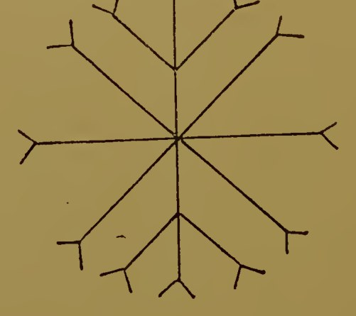

　その解き明かしはエエゾザズ、その名はサザファラスである。イエスは弟子たちとともに四方に向かった。彼は彼らに、それぞれ隣の者の足のそばに自分の足を置くよう命じた。彼は祈って言った。

> 　「イオアザゼト、アザゼ、アサゼト、アーメン、アーメン、アーメン。エイアゼイ、エアイゼイ、ケト、ザエト、ザエト、アーメン、アーメン、アーメン。アブラザザザ、バオザザズ、ザズーズ、アーメン、アーメン、アーメン。アザアカザラカ、ザラカ、ザレアト、ザルバトズ、ザラエイ、ザラエイ、ザラエイ、アザラカ、カルザ、バルカ、タザト、タザト、タザト、アーメン、アーメン、アーメン。私に聞いてください、おお、私の父、すべての父性の父、宝のアイオーンにとどまる無限なる者よ。そこから、生命の洗礼に好意を寄せる宝の七人の処女に仕える五人のパラスタテース（そばに立つ者）が来ます。その言い表しえない名は、アストラパ、テフォイオデ、オントニオス、シネトス、ラコン、ポリタノス、オパキス、パイドロス、オドントコオス、ディアクティオス、クネシオン、ドロモス、エウイデノス、ポリュパイドス、エントロポンです。彼らが来て、宝の七人の処女からの生命の水で私の弟子たちに洗礼を授けますように。彼らに罪の赦しを与え、その不義を浄め、その名を生命の国の書に記しますように。そしてもしあなたが私に聞き、私の弟子たちを憐れみ、その名を光の国の相続の書に記し、その罪を赦し、その不義を洗い流してくださるなら、私たちの祈りをかなえ、ゾロコトラに生命の洗礼の水を持って来させ、それをこれらのぶどう酒の杯の一つに入れさせてください。」

　するとたちまち、イエスの望んだ奇跡が起こった。犠牲の右にあったぶどう酒が水に変わったのである。弟子たちはイエスの前に進み出た。イエスは彼らに洗礼を授け、犠牲の供え物を分け与え、この印章を押した。

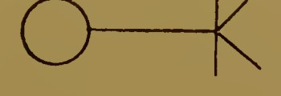

　弟子たちは大きな喜びに喜んだ。彼らの罪は赦され、その不義は覆われ、その名は光の国の相続人として記されたからである。彼らは宝の七人の処女からの生命の水で洗礼を受け、神聖で聖なる印章を受けたのである。そしてイエスはさらに語って、弟子たちに言った。

　**火の洗礼。**――「火の洗礼を受けられるよう、ぶどうの枝を私のもとに持って来なさい。」

　そこで弟子たちはぶどうの枝を持って来た。彼はそれを香の上に置き、その上に没薬を置き、レバノンの乳香、乳香樹（マスティック）の樹脂、甘松、ねずの花、テレビン油、ゴムを加えた。彼は供え物の場所に亜麻布を広げ、その上にぶどう酒の杯一つと、弟子たちの数と同じ数のパンのかけらを置いた。彼らは再び亜麻布の衣を着せられ、「オシリスのクマツヅラ」と呼ばれる草の冠をかぶせられた。彼は彼らの口に犬頭草と呼ばれる草を含ませ、その両手に七つの声の数、すなわち九八七九を置いた。彼はまた、彼らの手にキンセンカの草を与えた。同じ花の束を彼らの足の下に置き、自分の用意した芳しい香を彼らの前に置いた。彼は彼らに、それぞれ隣の者の足のそばに自分の足を置くよう命じた。そして彼は香の反対側に立ち、この印章を彼らに押した。

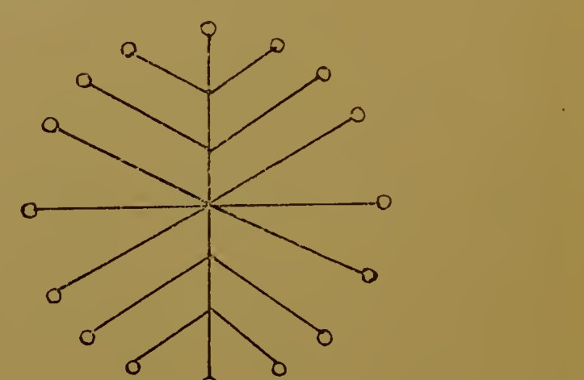

　その名はテザエエズ、その解き明かしはゾザエズである。イエスは弟子たちとともに四方に向き、祈って言った。

> 　「私に聞いてください、おお、私の父、すべての父性の父、無限の光よ。この私の弟子たちを、火の洗礼を受けるにふさわしい者としてください。彼らの罪を赦し、彼らが意識して、あるいは意識せずに犯した不義を浄めてください。幼いころから今日に至るまで犯したもの、彼らの思慮のない言葉、悪口、偽りの証言、盗み、嘘、欺きの中傷、淫行、姦淫、むさぼり、強欲、そして彼らが犯したかもしれないすべての罪をぬぐい去り、それらから彼らを浄めてください。そしてゾロコトラをひそかに来させ、宝の処女の火の洗礼の水を彼らに持って来させてください。私に聞いてください、おお、私の父よ。私は、とこしえにアイオーンたちの中に隠されている、あなたの朽ちない名に呼びかけます。アザラカザ、アアマトクラティタト、イオイオイオ、ザメン、ザメン、ザメン、イアオト、イアオト、イアオト、ファオフ、ファオフ、ファオフ、キオエフォズペ、ケノビュニト、ザルライ、ラザルライ、ライザイ、アーメン、アーメン。ザジザヤ、ネベオユニスフ、ファモイ、ファモイ、ファモイ、アモイナイ、アモイナイ、アモイナイ、アーメン、アーメン、アーメン。ザザザジ、エタザザ、ゾタザザザ。私に聞いてください、私の父、すべての父性の父、無限の光よ。私は、光のアイオーンの中にあるあなたの朽ちない名に呼びかけます。ゾロコトラが光の処女から火の洗礼の水を送り、私が弟子たちに洗礼を授けられるように。私にもう一度聞いてください、おお、私の父、すべての父性の父、無限の光よ。光の処女が来て、私の弟子たちに火で洗礼を授け、彼らの罪を赦し、

その不義を浄めてくださるように。私は、ゾトオザ、トイタザザオトという、あなたの朽ちない名に呼びかけます。アーメン、アーメン、アーメン。私にまた聞いてください、おお、光の処女よ、真理の裁き手よ。私の弟子たちの罪を赦してください。そして、おお、私の父よ、もしあなたが彼らの不義をぬぐい去ってくださるなら、彼らが光の国の相続人として記されますように。そのために、この甘い香りの香炉の上に奇跡を行ってください。」

　するとたちまち奇跡が起こった。そしてイエスは弟子たちに洗礼を授け、犠牲の供え物を分け与え、彼らの額に光の処女の印章を押した。弟子たちは、火の洗礼と罪の赦しの印章を受け、その名が光の国の相続人として記されたことを喜んだ。その印章を見よ。

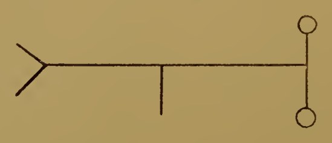

　そしてイエスは弟子たちに言った。

> 　「さあ、水の洗礼と火の洗礼を受けたあなたがたは、聖霊の洗礼を受けられるよう、私のもとに来なさい。」

　**聖霊の洗礼。**――彼は霊の洗礼の香料をそれぞれの場所に置き、その上にオリーブ、ねず、肉桂の枝、乾いたサフラン、乳香樹の樹脂、桂皮、没薬、蜜を加えた香油を置いた。彼は香料の右と左に二つのぶどう酒の杯を置き、ほかに弟子たちの数と同じ数のパンを置いた。イエスは弟子たちにこの印章を押した。

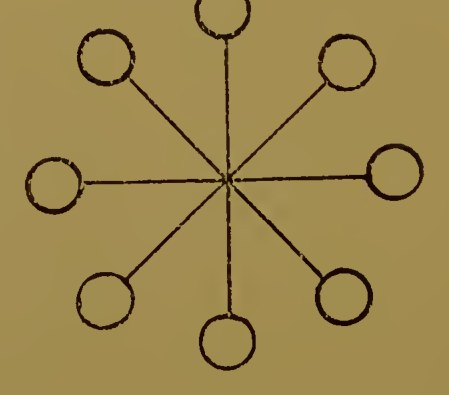

　その名はズッコゾク、その解き明かしはトゾノズである。彼らが印章を押されたとき、イエスは香料の後ろに立ち、弟子たちをその前に並べた。彼らは亜麻布の衣を着ており、七つの声の神秘の数、すなわち九八七九が彼らの両手にあった。イエスは語って言った。

> 　「私に聞いてください、おお、私の父、すべての父性の父、無限の光よ。私は光のアイオーンの朽ちない名、ザザザオイ、ゾトザゾト、トザクサゾト、ケノイビュニエ、アタエエイ、オゼオザエオズ、クロンブラトによってあなたに呼びかけます。私に聞いてください、おお、私の父、すべての父性の父、無限の光よ。私は光のアイオーンの朽ちない名に呼びかけます。私の弟子たちの罪を取り去り、彼らが知りながら、あるいは知らずに犯した不義、幼いころから今日に至るまで犯した悪から彼らを清めてください。彼らの名を光の国の相続の書に記してください。もしあなたが彼らの罪を取り去り、彼らの不義を浄め、彼らの名を光の国の相続の書に記してくださるなら、おお、私の父よ、奇跡をお与えください。」

　彼が語っているうちに、供え物の上に奇跡が起こった。そして彼は弟子たちすべてに聖霊の洗礼を授けた。彼らは供え物にあずかり、彼は、その名が光の国の相続に記されるように、彼らの額に光の七人の処女の印章を押した。弟子たちは、聖霊の洗礼と、罪を取り去り不義を浄める印章を受けたことを大きな喜びをもって喜んだ。彼らの名は光の国の相続に記されたからである。

　その印章を見よ。

　イエスがこの神秘を行い終えると、弟子たちはみな亜麻布の衣を着て立った。彼らはモルシュネの冠をかぶり、口にはクレタの犬頭草の枝をくわえ、両手にはヨモギを持っていた。彼らの足は互いに並べて置かれ、彼らは世界の四方を向いた。

　そしてイエスは、アルコーンたちの悪しき欲望から弟子たちを救い出す神秘を行うのに必要なやり方で、香料を整えた。彼はアンドロサケの上に香炉を置いた。彼はぶどう、ねず、肉桂の葉、ショウブの枝、また磁石、瑪瑙、乳香を取った。彼は弟子たちに亜麻布の衣を着せ、ヨモギの冠をかぶせ、口に乳香を含ませた。彼は最初のアーメンの数を彼らの片手に置き、香料の前に足を並べて立たせた。イエスは弟子たちにこの印章を押した。

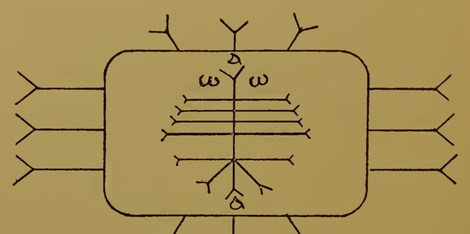

　その本当の名はゼゼオイアゾズ、その解き明かしはゾゾザイである。イエスはこの印章を弟子たちに押すと、香料の反対側に位置をとり、祈って言った。

> 　「私に聞いてください、おお、私の父、すべての父性の父、無限の光よ。私は光のアイオーンの朽ちない名、ネレテル、ゾフォネル、ゾイルトゾイバオ、クソイバオによってあなたに呼びかけます。アーメン、アーメン、アーメン。私に聞いてください、おお、私の父よ。サバオト・アダモスとすべてのアルコーンが出て来て、私の弟子たちの不義を取り去りますように。」

　これらの言葉を唱え、弟子たちとともに世界の四方に向いた後、彼は彼らに第二のアーメンのしるしを刻んだ。それはこれである。

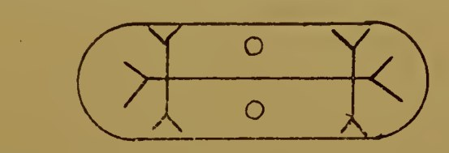

　その本当の名はザロザコズ、その解き明かしはズコゾゾである。そしてイエスが終えると、まさにその瞬間、アルコーンたちは弟子たちから不義を取り去った。弟子たちは、アルコーンたちの不義が自分たちの内でやんだことを大きな喜びをもって喜んだ。そしてアルコーンたちの不義がもはや彼らの内に存在しなくなると、イエスに従った弟子たちは、入っていくあらゆる場所で不死となった。

　イエスは弟子たちに言った。

> 　「私は、その神秘を与えたすべての場所における力の言葉をあなたがたに与えよう。洗礼、供え物、印章、パラレームプトール、数、真理の名と力の言葉、またそれらの隠された場所に入れるよう、それらに呼びかけるのに必要な仕方を与えよう。力の言葉と数をあなたがたに与えよう。今、私に聞きなさい。これらの神秘と、その印章と数を明かしたのだから、あなたがたの魂の出ていくことについて語ろう。あなたが体から出ていき、すべてのアイオーンとその中にいる者たちの神秘を行うとき、彼らはあなたの前から逃げ、ついにあなたは六つの大いなるアイオーンに至る。彼らは西へ、左手へと逃げるだろう。六つのアイオーンに来ると、あなたは罪の赦しの神秘を受けるまで止められるだろう。これは至聖所のアイオーンの中にある大いなる神秘であり、魂に健康を与えるからである。この神秘を受けた者は、すべての神々、すべての主、すべてのアイオーン、すなわち見えない神の十二のアイオーンを超えるであろう。これは至聖所のアイオーンの中にいる、変わらない者の大いなる神秘だからである。それゆえ、光の子を信じるすべての人は、罪の赦しの神秘を受けなければならない。そしてすべてのアイオーンがあなたの前から逃げ去ったとき、浄めのアイオーンの光が第十二のアイオーンを浄め、あなたの道がすべて照らされ、光のアイオーンが顕れて、あなたが遠くから諸天と光の道を見ることができるようになる。……これらの神秘を受け、体から出てあちこちに行くとき、あなたは清らかな光となり、光のアイオーンにまで旅するであろう。」

　それからイエスは弟子たちに、光のアイオーンの本性を描いてみせた。

　すると弟子たちはイエスに言った。

> 　「おお、主よ、なぜこれらの住まい、いや、その中にある父性はみな存在するのですか。なぜそれらは、その含む位階とともに存在するのですか。なぜそれらは存在し、なぜ私たちは存在するのですか。」

　イエスは彼らに答えて言った。

> 　「これらのものは、父の外にある一つの『小さな思い』のゆえに存在する。父はそれを自分のほうへ引き寄せなかった。この、まだ外にあって父の一部ではない『小さな思い』だけを除いて、父は万物を自分のもとに引き寄せた。私はこの『小さな思い』の中で輝き出た。私は水の噴き出るように跳び出た。私はそのほうへ身を向けた。私はその中で輝き出た。それが私を生み出した。私はそれから出た者たちの最初の者である。出てきた今、私はその像であり、似姿である。私はその前にいる。再び『小さな思い』は輝き出て、もう一つの叫び、第二の叫びを上げた。その叫びはすべての世界で聞かれ、そのとき第二の流出が出た。次には第二の流出が自ら出ていき、自分に似た者たちに従った。それは、自分の似姿に従って出ていったすべての世界の中に存在した。『小さな思い』がこれらの世界をみな生み出したのである。再びそれは第三の叫びを上げ、流出をアイオーンたちの力のほうへ動かした。そして世のすべての君たちが存在に至り、最初の者から最後の者まで、それぞれの世界の中にいた。私の父自らが、これらの長たちに動きを与えた。父は一つずつ十二の流出を生み出し、すべての宝の最初のものから最後のものまでの世界の中に、それらを配した。おお、私の弟子たちよ、私はあなたがたに、これらの住まいの聖なる場所とその位階を示した。それは、あなたがたが、私の入っていくすべての住まいに私について来られるように、私の行くすべての場所で私に仕えられるように、そして私があなたがたを私の弟子と呼べるようにするためである。さて、これらの場所に入るときには、私が教えた名を唱え、自分に押すべき印章をもって自分にしるしをつけなさい。印章の名を唱え、数を手に持ちなさい。そうすれば守り手たち、位階たち、天空たちが、あなたがたが彼らの父性の場所に入れる道を示し、あなたがたは内へと入っていって、ついに真理の神の世界、すなわち私があなたがたに知らせた宝の完成に至るであろう。」

　そのとき、キリストの弟子たちは彼に言った。

> 　「主よ、私たちが『すべての世界に通用する名を私たちに与えてください』と言ったとき、あなたは私たちに答えて、『私がすべての世界を通り抜け、あなたがたをそこから連れ出したとき、それをあなたがたに告げよう』と言われました。見てください、今や私たちはすべての世界を通り抜け、その中にあるものをすべて見ました。あなたはそれらの名と、その印章の名と、その数を教えてくださったので、それらは最初のものから最後のものまで私たちの前に開くでしょう。では、あなたの言われたあの名を教えてください。私たちがそれをアイオーンのすべての世界で唱え、それらが私たちの前に開くように。」

　そこでイエスは彼らに言った。

> 　「では聞きなさい。告げよう。それを心に守りなさい。」

　すると彼らは言った。

> 　「それは、初めから存在したあなたの父の大いなる名ですか、それとももっと偉大な方の名ですか。」

　するとキリストは言った。

> 　「いや、それはすべての世界にある大いなる力の名である。その言葉を唱えるなら、すべての世界は服従しなければならない。最初のものから最後のものまで、真理の神の宝に至るまで、アイオーンの中にいる者たちが。守り手たち、位階たち、天空たちは、あなたがたの前に開くであろう。私があなたがたに告げる名はこれである。
> 　AAAOOOZORAZAZZZAIEOZAZAEEEIIIZAIEOZOAKHOEOOOYTHOEZAOZAEZEEEZZEEZAOZAKHOZAEKHEYEITYXAALETHYKH
> 　「これが、内なる世界で唱えなければならない名である。真理の神の名は外なる世界である。それゆえ外なる世界に生き、この名を唱え、印章で自分にしるしをつけなさい。

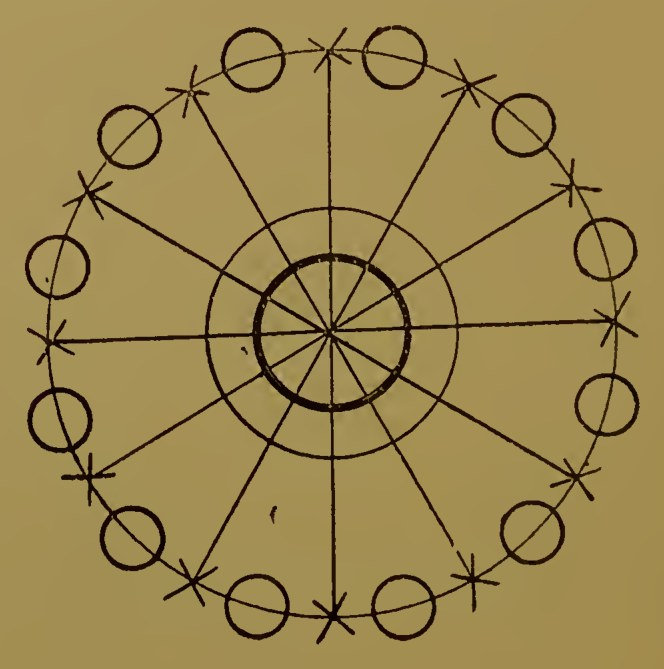

> 　その名はZZEEOOKHAAAEZAZAである。それを唱え、手に数ZONSTTHを取りなさい。行き着くところに着いたら、この名を唱えなさい。まずそれを唱え、それから聖所の四方に向き、印章のしるしをし、手に持っている数の名を唱えなさい。」

　グノーシスのパピルスから引く必要があると思われるのは、ここまでである。

### 訳注

- **ブルース写本の本文**：ここに訳出された部分は、ブルース写本の『イェウの第一の書・第二の書』と『無題の書』と呼ばれる文書からの抜粋に当たる。ファーは、アメリノーのフランス語訳（一八九一年）から英語に訳したとみられる。章の並びは原写本とは必ずしも一致しない。訳は英文から新たに訳した。
- **太字の小見出し**：原著では各段落の初めに斜体で置かれた要約で、ファー（あるいはアメリノー）が付けたもの。原写本にはない。
- **ギリシア語由来の名**：アコレートス（据えられた者、場所を占めない者）、パラレームプトール／パラレームプテース（受け取る者）、カノーン（基準、物差し）、プロパトール（祖先）、アウトパトール（自らの父）、プロトゲニトール（最初に生む者）などは、原文の綴りに近い片仮名にし、原著の（　）内の説明を訳して添えた。原著の説明は、ギリシア語の本来の意味と違うものがある（たとえば「パラレームプトール」を「創造する力」とする）が、原著のままにした。
- **ムンツェレ（mntshere）**：コプト語で「子であること」。原著は「生み出す力」「流出」などとも説明している。
- **呪文と力の名**：アルファベットで書かれた呪文の音は、片仮名に移した。ただし最後の「大いなる力の名」と、印章の名・数は、音の切れ目がわからないので原文のローマ字のままにした。
- **印章の図**：原著の図を、底本のスキャンから切り出して収めた。
- **数「九八七九」**：原文 "9,879"。七つの声の神秘の数とされる。
- **犬頭草（cynocephalus）、オシリスのクマツヅラ（vervain of Osiris）、モルシュネ（morsyne）、アンドロサケ（androsace）**：儀式に用いられる植物の名。原文のままで、どの植物に当たるかは確定できない。
- **「主の道をまっすぐにせよ」**：イザヤ書40章3節。「その満ちあふれから、私たちは恵みを受けた」はヨハネ1章16節。「彼は地を据えた。地は揺るがない」は詩編104編5節。「星々の多さを数え……」は詩編147編4節。「幾度も雨を飲む地」はヘブライ人への手紙6章7節。「キリストがあなたがたの内に形づくられる」はガラテヤ4章19節。「聖なる処女とともに、花婿キリストの前に」はコリントの信徒への手紙二11章2節を踏まえる。「私の心は喜び……」はルカ1章46〜47節（マリアの賛歌）や詩編を思わせる表現。「父、母……を捨て、自分の十字架を負って私に従う者」はマタイ19章29節、16章24節など。いずれも英文から新たに訳した。
- **「八十二の支配者」**：原注に「これは十二と読むこともできる」とある。

## エジプトの魔術とグノーシスの魔術の類似をたどる要約

　結びに、人間にとって運命とは、しばしば自分自身の宿命的な本能によって表されるものだということを指摘しておこう。それは、ありとあらゆる機会に人を誤らせる本能である。それに導かれて、溺れる人は両手を上げる。怒った人は拳を握り、筋肉をこわばらせ、言葉にならなくなる。若者は熟す前に生の実を摘む。老人は生の流れから身を閉ざし、よどみのうちに死ぬ。ゆがめられた本能こそ、人類にかけられた呪いである。

　さて、すべての古代の体系によれば、本能の座は心臓である。そして『死者の書』の第百二十五章では、心臓の器が、羽根すなわち真理の像と、言いかえれば知覚の力と、天秤にかけて量られた。

　昔のエジプト人にとって、識別力を養うことは生の目的であった。それを欠くことは彼らの目には死に至る罪であり、個性の消滅に終わった。真理の知覚を得て、そうしてこれらの宿命的な本能を導くことが、秘儀伝授の目的であった。最初の一歩からして、志願者は、自分を本能的な力の宇宙の中心とみなすよう教えられた。それは、彼がその顕微鏡的な一部をなす広大な宇宙の型に従って造られた宇宙である。彼の上には見えないものの翼が覆いかぶさっていた。宇宙が光を与える者たちの光線に満たされているように、彼のプレーローマは彼の神性の属性に満たされていた。秘儀参入者は日ごとに名を学び、このプレーローマの内にある絶対者のアイオーンたちの住まいを象徴する音と形の内なる意味について瞑想した。そして照応をさらに推し進めて、エジプトの州（ノモス）の首都は、それぞれ神の位階の一つの駅を表していた（『死者の書』第十八章と比べよ）。神々はまた、人間の体の二十一の部分に割り当てられていた（『死者の書』第四十二章と比べよ）。これらの考えが持続していることの中に、古代エジプト人とグノーシス主義者とを結ぶ一つの強いつながりが見られる。両者はまた、定まった思いと繰り返される言葉の効力を信じていた。たとえば、王の徳と力をたえず言い立てることは、単なるへつらいではなく、本当に君主の内に徳と力を引き起こすと信じられていた。同じ手段によって、神官たちは、私たちが神々として知っている自然の力の型と自分を同一視することで力を得た。「真理の審判の間」でなされる潔白の宣言に伴わなければならない確信は、後の、信仰による罪の赦しの教えにきわめて近いものであった。これはまた、上にブルース・パピルスから引いた中で触れた、罪の赦しの神秘への秘儀伝授とも比べられるだろう。

　エジプト人のあいだで魔術を学ぶ第一の必要は、人間の本性の中に眠っているすべての能力を育てることであった。彼らは、人間の力を限るのは、意志の弱さと想像力の貧しさだけだと考えていたからである。意志のエネルギーと想像する思考は、しばしば火と水によって象徴され、霊の力は空気、すなわちカバラのルーアッハによって象徴される。これらは父、母、子（ときに天、地、人類と呼ばれる）の神的な三位一体である。ブルース・パピルスの三つの洗礼は、『死者の書』第五十四章から第六十三章に描かれた、空気と水と火の賜物と、はっきりした類似をもっている。

　最後に、エジプト人の魔術は、宇宙についての手の込んだ構図の上に打ち立てられていた。そして自然の力の相互作用は、きわめて注意深く観察され、研究されていた。もちろん、一年の本当の長さや、太陽が宇宙の中心の天体であるという事実や、生命力のある人が、自分自身と宇宙全体がそこから進化してきた混沌の、より弱い形成物に催眠や磁気術をかける力を、神秘にしておくのは、私たちにはばかげたことに思える。しかしエジプトの神官団にとって、これらの事実の知識には、その類比の深い意味と、そうした知識が与える力とについての確信が含まれていた。同時に、これらの男たち女たちが実際的な統治者であって、自分たちの握る力を保つことに心を傾けていたことを、忘れてはならない。もし彼らがダイナマイトの秘密をもっていたとしても、決してそれを大衆に明かしはしなかっただろう。

　四十世紀の偉大さのあいだのエジプトの魔術はこのようなものであった。では、今何が残っているのか。その答えをシェリーに求めよう。彼はこう語っている。

> 　古い国から来た旅人に会った。
> 　彼は言った。「胴のない巨大な石の脚が二本、
> 　砂漠に立っている。そのそばの砂の上には、
> 　なかば埋もれて砕けた顔が横たわり、そのしかめ面と、
> 　しわの寄った唇と、冷たい命令の冷笑は、
> 　彫り手がそれらの情念をよく読み取っていたことを語っている。
> 　その情念は、それをあざ笑った手と、それを養った心より生きながらえ、
> 　この命のないものの上に刻まれて今も残っている。
> 　そして台座の上には、こんな言葉が見える。
> 　『わが名はオジマンディアス、王の中の王。
> 　力ある者たちよ、わが業を見よ、そして絶望せよ。』
> 　ほかには何も残っていない。その巨大な残骸の
> 　朽ちたまわりには、果てしなく、むき出しの、
> 　寂しく平らな砂が、遠くまで広がっている。」

**終わり**

### 訳注

- **節の題**：原著の目次では「エジプトとグノーシスの魔術の類似をたどる要約」とあるが、本文には見出しがなく、「グノーシスのパピルスから引く必要があると思われるのは、ここまでである」の後に続いている。訳では目次の題を見出しとした。
- **『死者の書』第百二十五章**：死者の心臓を真理の女神マアトの羽根と天秤で量る「死者の審判」の章。「真理の審判の間」はこの審判の場所。
- **ルーアッハ**：ヘブライ語で「息、霊」。
- **「太陽が宇宙の中心の天体である」**：原文のまま。当時の表現では、太陽系の中心を指すとみられる。
- **シェリー「オジマンディアス」**：パーシー・ビッシュ・シェリーのソネット（一八一八年）。英文から新たに訳した。オジマンディアスはラメセス二世のギリシア語名。

## 参考書目

　以下の著作は、ロンドン、チャリング・クロス二十六番地の神智学出版協会で入手できる。注文はすべて同協会宛てに送られたい。

（書名・刊行地・刊行年・価格は原文のままとし、内容の説明だけを訳した。）

- ADAMS (W. Marsham): *The House of the Hidden Places, A clue to the Creed of Early Egypt from Egyptian Sources.* Cloth, 8vo. London, 1895. 7s. 6d.（『隠された場所の家――エジプトの資料による初期エジプトの信条への手がかり』）
- AMÉLINEAU (E.): *Essai sur l'Évolution historique et philosophique des idées morales dans l'Égypte Ancienne.* Wrappers, 8vo. Paris. 8s.（『古代エジプトにおける道徳観念の歴史的・哲学的発展についての試論』）
- AMÉLINEAU (M. E.): *Essai sur le Gnosticisme Égyptien, ses développements et son origine Égyptienne.* Wrappers, 4to. Paris, 1887. 15s.（『エジプトのグノーシス主義についての試論――その発展とエジプト起源』）
- AMÉLINEAU (M. E.): *Notice sur le Papyrus Gnostique Bruce. Texte et Traduction.* Wrappers, 4to. Paris, 1891. 15s.（『グノーシスのブルース・パピルスについての報告――本文と翻訳』）
- AMÉLINEAU (E.): *Histoire de la Sépulture et des Funérailles dans l'Ancienne Égypte.* Avec nombreuses vignettes et 112 planches hors texte. First series. Wrappers, 4to. 2 vols. Paris, 1896. £2 10s.（『古代エジプトの埋葬と葬儀の歴史』、多数の挿絵と別刷図版百十二枚付き）
- BONOMI (Joseph) and SHARPE (Samuel): *The Alabaster Sarcophagus of Oimenepthah I., King of Egypt.* Beautifully illustrated. Boards, 4to. London, 1864. 5s.（『エジプト王オイメネプタハ一世〔セティ一世〕の雪花石膏の石棺』、美しい挿絵入り）
- BOOK OF THE DEAD: *Facsimile of the Papyrus of Ani in the British Museum.* Second edition. With 37 coloured double plates. Folio. London. £2 10s.（『死者の書――大英博物館所蔵アニのパピルスの複製』、第二版、見開き彩色図版三十七枚付き）
- BUDGE (E. A. W.): *Book of the Dead.* Reprint of the Egyptian text of the papyrus of Ani in the British Museum, with interlinear transliteration, and an English literal translation, a running translation, an introduction and notes, cxxxii. and 377 pp. 4to half calf. 1895. 10s.（『死者の書』。大英博物館所蔵アニのパピルスのエジプト語本文の復刻に、行間の翻字、英語の逐語訳、通しの訳、序論と注を付したもの。序論には、『死者の書』の諸版、オシリス伝説、永遠の生命の教え、エジプトの神観念、祝福された者の住まい、『死者の書』の神々、地理と神話の場所、葬儀などの章を含む。）
- BUDGE (E. A. Wallis): *An Egyptian Reading Book for Beginners.* Cloth, thick, 8vo. London, 1896. 15s.（『初心者のためのエジプト語読本』）
- BUDGE (E. A. Wallis): *First Steps in Egyptian. A Book for Beginners.* Cloth, 8vo. London, 1895. 9s.（『エジプト語の第一歩――初心者のための本』）
- BUDGE (E. A. Wallis): *The Sarcophagus of Anchnesraneferab, Queen of Amasis II, King of Egypt.* Text and Translation. Cloth 4to. London, 1885. 5s. 6d.（『エジプト王アマシス二世の王妃アンクネスラーネフェルイブの石棺――本文と翻訳』）
- BRIMMER (Martin): *Egypt. Three Essays on the History, Religion and Art of Ancient Egypt.* Beautifully illustrated. Leather, 8vo. Cambridge, U.S.A. 1892. 21s. net.（『エジプト――古代エジプトの歴史・宗教・芸術についての三つの論考』、美しい挿絵入り）
- CHABAS (F.): *Le Papyrus Magique Harris.* Wrappers, 4to. Chalon-sur-Saône, 1860. Out of print.（『ハリス魔術パピルス』、絶版）
- CORY (J. P.): *Ancient Fragments of the Phoenician, Carthaginian, Babylonian and other Authors.* New edition by E. Richmond Hodges. Cloth, 8vo. London, 1876. 4s. 6d.（『フェニキア、カルタゴ、バビロニアなどの著作家の古代断片集』、ホッジズによる新版）
- DIVINE PYMANDER OF HERMES. Translated by Dr. Everard. Preface by Dr. W. W. Westcott. Cloth, 8vo. London, 1894. 3s.（『ヘルメスの神なるポイマンドレス』、エヴェラード訳、ウェストコット序）
- ERMAN (Adolf): *Egyptian Grammar* with table of signs, bibliography, exercises for reading, and glossary. Translated by J. H. Breasted. Cloth, 8vo. London, 1894. 18s.（『エジプト語文法』、記号表・文献目録・読解練習・語彙集付き、ブレステッド訳）
- KING (C. W.): *The Gnostics and their Remains, Ancient and Mediaeval.* Second Edition. Illustrated. Cloth 8vo. London, 1887. 10s. 6d.（『グノーシス主義者とその遺物――古代と中世』、第二版、挿絵入り）
- KING (C. W.): *Plutarch's Morals. Theosophical Essays.* Cloth, 8vo. London, 1889. 5s.（『プルタルコス倫理論集――神智学的論考』。名高い論考「イシスとオシリスについて」の翻訳を含む。）
- LE PLONGEON (A.): *Queen Móo and the Egyptian Sphinx.* Illustrated. Cloth, 8vo. New York, 1896. 30s.（『モー女王とエジプトのスフィンクス』、挿絵入り）
- LOCKYER (J. Norman): *The Dawn of Astronomy. A Study of the Temple-Worship and Mythology of the Ancient Egyptians.* Cloth, 8vo. London, 1894. 21s.（『天文学の夜明け――古代エジプト人の神殿崇拝と神話の研究』）
- MAHAFFY (J. P.): *The Empire of the Ptolemies.* Cloth, 8vo. London, 1895. 12s. 6d.（『プトレマイオス朝の帝国』）
- MALLET (D.): *Le Culte de Neit à Saïs, étude de Mythologie Égyptienne.* Wrappers, 8vo. Paris 1888. 15s.（『サイスのネイト崇拝――エジプト神話の研究』）
- MASPERO (G.): *The Dawn of Civilisation. Egypt and Chaldaea.* Illustrated. Second Edition, revised and brought up to date. Cloth, 4to. London, 1896. 25s.（『文明の夜明け――エジプトとカルデア』、挿絵入り、改訂第二版）
- MASPERO (G.): *Life in Ancient Egypt and Assyria,* with one hundred and eighty-eight illustrations. Cloth, 8vo. London, 1892. 5s.（『古代エジプトとアッシリアの生活』、挿絵百八十八点）
- MASPERO (G.): *Manual of Archaeology and Guide to the Study of Antiquities in Egypt,* with three hundred and nine illustrations. Cloth, 8vo. London, 1895. 6s.（『考古学提要とエジプト古物研究の手引き』、挿絵三百九点）
- MEAD (G. R. S.): *Orpheus.* Cloth, 8vo. London, 1896. 4s.（『オルフェウス』）
- MEAD (G. R. S.): *Pistis Sophia. A Gnostic Gospel* (with extracts from the Books of the Saviour appended). Translated with an introduction. Cloth, 8vo. London, 1896. 7s. 6d.（『ピスティス・ソフィア――グノーシスの福音書』、『救い主の書』からの抜粋を付す、序論付きの翻訳）
- PETRIE (W. M. Flinders): *A History of Egypt from the earliest times to the XVI. Dynasty.* With numerous illustrations. Cloth, 8vo. London, 1895-6. Two vols. each 6s.（『エジプト史――最古の時代から第十六王朝まで』、多数の挿絵入り、全二巻）
- PETRIE (W. M. Flinders): *Egyptian Tales, translated from the Papyri.* Illustrated. Cloth, 8vo. First and second series. 3s.（『エジプトの物語――パピルスからの翻訳』、挿絵入り、第一集・第二集）
- PIERRET (Paul): *Le Livre des Morts.* Traduction du rituel Funéraire Égyptien. Wrappers, 8vo. Paris. 10s.（『死者の書――エジプトの葬祭儀典の翻訳』）
- PIERRET (P.): *Le Panthéon Égyptien.* Illustrated. Wrappers, 8vo. Paris, 1880. 10s.（『エジプトの神々』、挿絵入り）
- RENOUF (P. Le Page): *Book of the Dead.* [The Egyptian.] Being a complete translation, commentary, and notes. Small 4to. London, 1893-96. To be completed in eight parts, of which five are already published. Out of print.（『〔エジプトの〕死者の書』、完訳・注解・注。全八部で完結予定、うち五部既刊。絶版）
- RENOUF (P. Le Page): *The Religion of Ancient Egypt.* Cloth, 8vo. London, 1893. 10s. 6d.（『古代エジプトの宗教』）
- SHARPE (Samuel): *Egyptian Mythology and Egyptian Christianity,* with their influence on the opinions of Modern Christendom. Cloth, 8vo. London, 1896. 2s.（『エジプトの神話とエジプトのキリスト教――近代キリスト教世界の見解への影響』）
- TAYLOR (Thomas): *Jamblichus on the Mysteries of the Egyptians, Chaldeans and Assyrians.* Translated from the Greek. Cloth, 8vo. London, 1895. 7s. 6d.（『イアンブリコス、エジプト人・カルデア人・アッシリア人の密儀について』、ギリシア語からの翻訳）
- TAYLOR (Thomas): *The Mystical Hymns of Orpheus.* Translated from the Greek, and demonstrated to be the Invocations used in the Eleusinian Mysteries. Cloth, 8vo. London, 1896. 5s.（『オルフェウスの神秘の賛歌』、ギリシア語からの翻訳。エレウシスの密儀で用いられた呼びかけであることを論証したもの）
- WIEDEMANN (Alfred): *The Ancient Egyptian Doctrine of the Immortality of the Soul.* With twenty-one illustrations. Cloth, 8vo. London, 1895. 3s.（『古代エジプトの魂の不死の教え』、挿絵二十一点）

（奥付）Women's Printing Society, Limited, 66, Whitcomb Street, W.C.（女性印刷協会、ロンドン）

### 訳注

- **参考書目**：本文の第二節で「本巻には……定評ある著作の一覧を収めた」と言っているもの。出版元の販売目録を兼ねている。書名の綴りは、文字起こしの誤りを直したほかは原文に従った。
- **4to、8vo**：本の判型（四つ折り判、八つ折り判）。**s.、d.、£**：当時のイギリスの通貨単位（シリング、ペンス、ポンド）。
- **女性印刷協会**：女性の植字工を育てるために一八七六年に設立された、ロンドンの印刷会社。

---

## 出典

> 原作：S. S. D. D.（Florence Farr）, *Egyptian Magic*（Collectanea Hermetica, Vol. VIII, Theosophical Publishing Society, London, 1896年）
> 本訳は、原作を全訳したものです。原作は著作権保護期間が満了しています。表紙・扉・口絵・表・印章の図は、1896年初版のスキャン（Internet Archive、ウェルカム図書館所蔵本）によります。訳文は人工知能（Claude Opus 5.5）による翻訳であり、誤りを含む可能性があります。

#フロレンス・ファー #黄金の夜明け団 #エジプト #魔術 #グノーシス #翻訳 #パブリックドメイン
