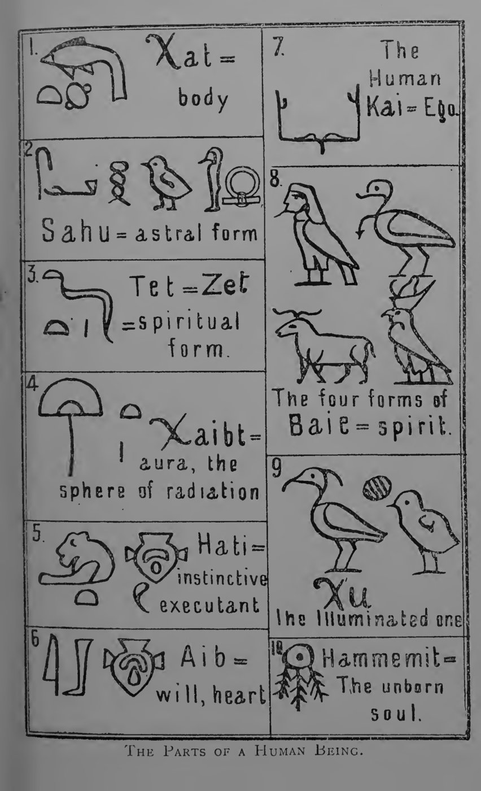
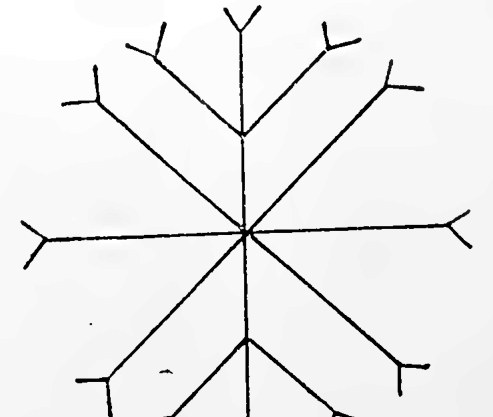
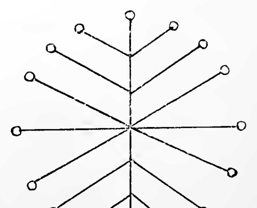
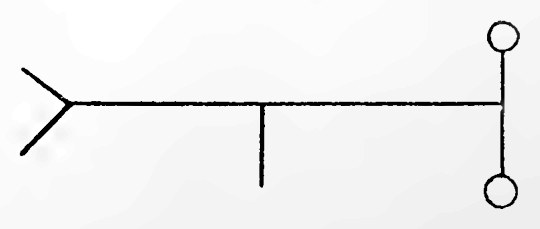
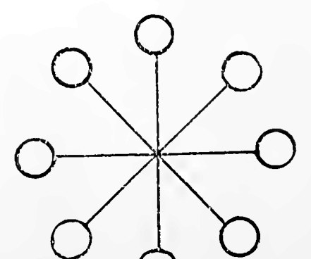
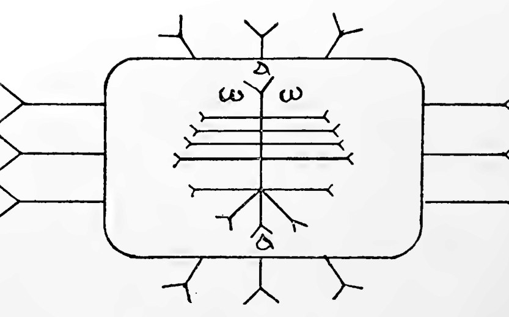
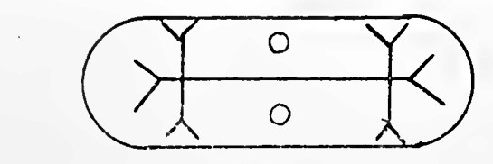

# エジプト魔術（フローレンス・ファー）

S・S・D・D（フローレンス・ファー）著／全訳

- 原題：Egyptian Magic, by S. S. D. D.（Collectanea Hermetica, edited by W. Wynn Westcott, Volume VIII）
- 内容：黄金の夜明け団の中心メンバーの一人だった女優フローレンス・ファーが、古代エジプトの「人間の諸部分」（カ、バ、アブ、ハティ、サフ、クーなど）の教えを魔術の理論として読み解き、『死者の書』第六十四章、ハリス魔術パピルス、「ラーとイシスの伝説」などを引く。後半では、グノーシス文書「ブルース写本」の抜粋を、当時初めて英語に訳して紹介している。三つの洗礼の儀式とその印章を含む
- 刊行：London, Theosophical Publishing Society, 1896年
- 作業の基にした本文：Internet Archive 所蔵の1896年初版（ウェルカム図書館所蔵本のスキャン）
- 著作権：ファーは1917年、編者ウェスコットは1925年に死去。日本・米国・英国で保護期間が満了している
- 訳者：人工知能（Claude Opus 5.5）
- 訳の性格：口絵と「人間の諸部分」の表、本文の全体を訳し、原書の印章の図八点を収めた。巻末にある版元の参考書目録（価格つき）は省いた。訳者の調べたかぎりでは、日本語訳は出ていない

## この本について

　フローレンス・ファー（一八六〇〜一九一七）は、イプセン劇やバーナード・ショーの芝居で知られたロンドンの女優で、W・B・イェイツの朗唱の協力者でもあった。一八九〇年に黄金の夜明け団に入り、まもなくその指導的な位置につく。S・S・D・D（Sapientia Sapienti Dona Data＝知恵は賢き者に与えられる）は団での彼女の標語である。晩年は教師としてセイロン（スリランカ）に渡り、その地で没した。

　本書は、団の創設者の一人ウィリアム・ウィン・ウェスコットが編んだ叢書『ヘルメス文書集成（コレクタネア・ヘルメティカ）』の第八巻である。同じ叢書の『カルデア神託』や『錬金術の学』と同じく、ウェスコットの周囲の秘儀参入者たちが、それぞれの専門を持ち寄った一冊といえる。

　前半では、エジプト人が人間をカト（体）、サフ（アストラル体）、カ（自我）、バ（霊）、クー（輝く者）など多くの部分から成るものと考えていたことを出発点に、受肉の過程、秘儀参入の意味、魔術の原理が語られる。ファーの解釈は今日のエジプト学から見れば自由すぎるところも多いが、のちの西洋魔術でエジプトの神々が担う役割の源流の一つがここにある。ハトシェプスト女王の像の読み解き、悪人ハイの魔術事件、「ラーの真の名」を奪うイシスの伝説、ホルデデフ王子の物語に出てくる大食いの魔術師など、引用される素材も多彩である。

　後半の中心は、十八世紀にジェイムズ・ブルースが上エジプトで手に入れたコプト語のグノーシス写本（いわゆる「ブルース写本」）の抜粋である。ファーは、アメリノーのフランス語訳（一八九一年）から英訳したとみられる。プレーローマ（充満）とその深淵、アイオーンたちの位階、「小さな思い」から生じたこの世界、そしてイエスが弟子たちに授ける水・火・聖霊の三つの洗礼が、印章と数と異国の名とともに語られる。原書に図で示された印章も、スキャンから切り出して収めた。

　なお、本書の引用は当時の英訳・仏訳からの重訳であり、神名や固有名の綴りも当時のものである。本訳ではおおむね原書の綴りに従って片仮名にした。

　note では二回に分けて公開する。第一回は「人間の諸部分」からエジプトの物語と讃歌まで、第二回はグノーシスの魔術と結びである。

---

## 人間の諸部分

| 決定詞（ヒエログリフ） | エジプト語の名 | 英語（本訳では日本語）での相当語 |
|---|---|---|
| 魚 | カト（Khat）またはカト（Kat） | 体、亡骸 |
| ミイラと印章 | サフ（Sahu） | 元素の体、アストラル体 |
| 直立した蛇 | テト（Tet）またはゼト（Zet） | 霊的な体、魂 |
| 扇 | カイビト（Khaibt） | サフの放射。球体あるいはオーラ、発散、匂いなど |
| 獅子の前半身 | ハティ（Hati） | 執行者。人間の遺伝、習慣、本能 |
| 耳を取っ手にした器 | アイブ（Aib）またはアブ（Ab） | 意志。動物の意志に似ているが、その内に霊と人間の自我との芽を、卵と凹んだ受け皿との形で含んでいる |
| 挙げた両手 | カイ（Kai）またはカ（Ka） | 個体性、人間の自我 |
| 鷹、鷺、あるいは雄羊 | バ（Ba）またはバイエ（Baie） | 浸みとおる心。神的なものとのつながり |
| ベンヌ鳥 | クー（Khou）、ク（Khu）、あるいはイェク（Yekh） | 魔術的な力。輝く者。ギリシア哲学のアウゴエイデス（光の姿） |
| 光を放つ太陽 | ハンメミト（Hammemit） | 生まれていない魂。太陽の光の別個の発散であるらしい |

口絵を見よ。

## エジプト魔術の原理

　魔術の研究は、いまでは評判を落としてしまったが、エジプト人のあいだでは、近代において最高の哲学にさえほとんど与えられないほどの崇敬をもって見られていた。

　古代エジプト人にとって最も卓越した人とは、厳しい修練によって、自らの体と顕現した世界とがともに形づくられている元素を支配するに至った者であった。その意志が、自らの欲望の灰の中から不死鳥のようによみがえった者であり、その直観が、物質の幻影の汚れから清められて、過去・現在・未来を見てとることのできる澄んだ鏡となった者であった。

　エジプトの王と祭司とは、「知恵の学院」で首尾よく学んだ者たち、すなわち哲学的な貴族の中から選ばれた者であった。彼らは、単に賢いだけでなく、その知恵を用いることができるがゆえに選ばれたのである。彼らは国の軍勢に力を与えることができ、その力を伝える手段をもっていた。「王なる秘儀参入者」の杖は、きわめて強い魔術的な力をもっていたので、それを手にした軍の指揮者はファラオ自身と同じほど強大になったのである。

　王にして祭司である者たちは、民衆に顕教の宗教を授けた。それによって民衆の歩みを導き、ついには彼らもまた秘儀参入者の列に加わることのできる発達の段階に達するまで（それは何度もの失敗ののち、転生に転生を重ねたのちのことであったかもしれない）導いたのである。しかし、エジプトの全住民がある程度は秘儀にあずかることを許されていた、ということはきわめてありそうである。というのも、秘儀参入の前の志願者の試験はたいへんな性質のものであったので、かなりの完成の度合いにまで発達した人間でなければ、それに耐えることを望めなかったのだから。

　何らかの位階の秘儀参入を受けた者だけがミイラにされた、と考えるべきあらゆる理由がある。エジプト人の目には、ミイラにすることは転生を確実に妨げるものであったことは確かなのだから。転生は、不完全な魂、すなわち秘儀参入の試験に通らなかった者たちには必要であった。しかし秘密の至聖所（アデュトゥム）に入る意志と能力とをもつ者にとっては、体を滅ぼすことによってなされるといわれるあの魂の解放は、ほとんど必要なかったのである。

　それゆえ秘儀参入者の体は、死後も、一種の護符として、あるいは地上における魂の顕現のための物質的な基盤として保存された。

　エジプトの魔術を学ぶと、ただちにまったく科学的な満足が得られる。漠然とした理論に悩まされることはなく、正確な実地の詳細を受けとる。上界と下界とのどの一平方インチも地図に描かれていることがわかる。このような体系がうちに秘めている強さは、古代エジプト文明の長い存続によって証明された。

　エジプト魔術の第一原理は、照応の精緻な体系にもとづいていた。それは、物質的なものの進化は霊的なものの発散の型と象徴とに従う、霊と物質とは同じ一つの神秘の相対する面である、という定式によるものである（＊）。エジプトの達人たちは、心の思い、魂の熱望、口の言葉、体の働きを、そこから生と死との規則の完全な体系を組みたてることのできる類比をそなえたものとみなした。さらに彼らは、それぞれの体、すなわち顕現した存在を、形成界、創造界、元型界において霊と魂と心として働く、非物質的な存在たちの長い連なりの物質的な基盤とみなしたのである。

　（＊）『ルシファー』誌一八九三年五月号二〇四頁のウェスコットのカバラについての論と、ティンダルの『ベルファスト講演』とを見よ。

　本書には、「エジプト人の信仰」の主題についての標準的な著作の一覧を、その主題についての近代の理論を学んでいない人々のために収めてある。それゆえ、ほかでたやすく見つけられる詳細にここで立ち入る必要はない。そこで私は、我々の主だったエジプト学者たちが示した仮説を引用するのを待たずに、古い伝承の研究によって私が定式化するに至った考えを、ただちに述べることにしよう。

　まず第一に、我々はこれまで人間を魂と体とから成るものとして書いてきた。しかし秘儀を受けたエジプト人たちは、自分たちをただ魂と体とであるとはまったくみなしていなかった。彼らは人間のいくつもの能力に名を与え、そのそれぞれについて、別々に存在する可能性を想定したのである。

　カト（Khat, Kat）、すなわち体は、人間の地上の生のこの次元において自我が働くための乗り物、あるいは物質的な基盤にすぎなかった。

　エジプトの生命の循環の哲学を考察するにあたって、初めから始めよう。ハトシェプス女王のオベリスクによれば、人間のハンメミト、すなわち原初の存在は、受肉する前に百二十年のあいだ太陽のまわりをめぐる。この期間に、ある種の宇宙的・元素的な力がほかの力よりも強くなる。それらが原初の存在を取り巻いて、それにある特徴的な偏りを与え、受肉の手段と時との選択においてそれを導くのである。そのあいだに、原初の存在に影響するより高い元素的な力の反映が、物質界で働いているであろう。これらの反映は、人間の両親に同じように偏りを与えるであろう。誕生の時期が来ると、印章をつかむ禿鷲によって象徴される大いなる母なる力が、選ばれた瞬間に優勢な象徴を原初の存在に刻印する。これが占星術のホロスコープの原理である。

　人間の母は、そのあいだに元素的な力の中心となっており、その力は彼女のまわりに幻の魅力をつくりだす。これが、自然の元素的な力の魔術のもとでの、未来の人間のサフ、すなわちアストラル体の形成である。どんなに器量の悪い女でも、しばらくのあいだは恋する男の目に美しく映るのだから。しかし両親の力の協力がなしとげられるやいなや、サフは生気を与えられた胚に急いで取りつき、目に見えない型としてそれとともにとどまる。固い物質はその型に向かって引き寄せられ、物質的な体を形づくるのである。サフのこの働きによって、ある透視者たちが植物界について見たという幻、すなわち地にまかれる前の種や穀粒に、アストラルな植物の形が取りついているという幻の説明がつく。

　そこで元素の体は、生気を与えられた卵のまわりに集中してしまうと、人間の母を自然の状態に残し、それが彼女に与えていた幻の美しさをはぎとる。そして彼女は、自分が育てようとしている人間に対して自分の役目を果たし終えるまでは、その特別な魅力を取り戻さない、あるいは取り戻すべきではないのである。

　それゆえ我々の見るとおり、生まれる前の子は、エジプト人がハティ、すなわち「心臓の全体」と呼んだ原理を与える両親によって、生への出現の準備をされる。それは人種的・個人的な遺伝した本能の座であり、消化、聴くこと、見ること、嗅ぐことなどの働きを含む。ひと言でいえば、ハティとは遺伝である。それは元素的な力によって形づくられた体、すなわちサフをまとっている。サフ、すなわちアストラル体は、受胎の前にも後にも、人間の母のまわりに引きつける球体をつくりだしたあの放射の力をもっていた。その球体は、受胎のときに大いなる禿鷲の母なる力によって封印され、ただちに引きあげられて、未来の人間の球体すなわちオーラを形づくる――これがカイビト、すなわち放射するオーラと呼ばれるものである。

　誕生の瞬間に「自我」が体に加わる。偉大な王子たちの誕生を描いた多くの絵が（エジプト文明の最盛期のものが）現存しているが、そこには天上で生まれた体と地上で生まれた体との二重の形が認められる。すなわち、めぐっていたハンメミトがいまや一つの発散を投げ出し、それが新しく生まれた子のカ、すなわち分身と呼ばれる。そしてこれが、もう一つの原理であるアブによって、地上の体とのつながりを形づくるのである。ハティはエジプトの文書の中で、つねにアブすなわち心臓と結びつけて語られる。ちょうど我々が会話の中でしばしば本能と意志とを混同し、結びつけるように。意志はすべての動物に潜んでいる性質である。人間においては、それは発達させ培うことができ、ついには自由意志となる。同じように、アブ（意志）すなわち心臓の赤い器は、『死者の書』の中で、卵と凹んだ芽とを含むものとして表されている。この凹んだ芽が培われて発達するとき、自我の真の生命と完全な発達とが始まりうる。すなわち、体がその地上の進化において進みうるのとちょうど同じように、カはその天上の進化において進むことができるのである。

　もちろん、何千もの場合に天上の体は制限された。受胎の宿命の瞬間が、地上の存在（カブすなわち物質的な体〔原文 Kab〕の中のサフ、ハティ、アブから成る）に、彼が打ち破るにはあまりに強い運命の鎖を負わせたのである。そしてカすなわち自我は、霊たちの場所にあるハンメミトに戻り、ふたたびアストラルな物質と物質的な物質とを再生させる機会を得て、霊と生命との主の冠に宝石のようにはめこまれ、一つとされた、あの「輝く者たち」の一人となる時を待たなければならなかった。

　この考えの中に、ただちに、自己による自己への犠牲についての教義の説明がある。カすなわち自我は、熱烈で忍耐強い粘りと闘いとによってしか、成長して力あるものとなることはできないのだから。

　「三日のあいだ私は十字架にかかった、私自身を私自身への犠牲として」とエッダの神は言う。

　「私は私の中では無である。あなたの中では何ものかである。そしてあなたの何ものかの中に、無から生きる。どうかあなたが私の中に生き、私をあなたの中の何ものかへと導き出してください」〔原文はドイツ語〕と、ドイツの神秘家は言った。

　「自分自身である」ことのできない人間は、プタハの鋳造の杓の中で溶かされなければならない。神々の工匠たる職人は、いまの組み合わせでは再生されえない、また再生されようとしない元素の材料を散らしてしまう。彼は、仕事にとってもっと幸いな時を待つのである。

　キリストは、タラントンのたとえの中でこの教えを述べている。ルカによる福音書十九章二十六節、「だれでも持っている人は、さらに与えられ、持っていない人は、持っているものまでも取り上げられる」。

　この古いエジプトの教えは、マシュー・アーノルドのソネット「不死」の中にふたたび見いだされる。

> いや、いや、生命の力は
> 墓の向こうまで保たれることはあっても、そこで始まりはしない。
> 地上の争いにひるまず
> 力から力へと進んだ者、ただその者だけが、
> 魂をよく鍛え、すべての戦いに勝って、
> 永遠の生命へと昇るのだ、それもやっとのことで。

　無力な魂を消滅に定めるエジプトの信仰のあの暗い面にしばらくとどまったので、次に、生の戦車の手綱を自らの手に取り、その乗り物につながれた元素の力を望ましい目標へと無事に導く者たちの前に開かれる道について論じることにしよう。

　心臓すなわちアブの中に置かれた種は、いまや思考と意志との力を象徴するものとみなしてよい。これらが、神働術（テウルギア）の修行によって、あるいは意識ある存在の最高の熱望への献身によって、いったん働きはじめると、奇妙な結果を生む。アブの表現においては、原理は血の器に映ったかのように逆さまになっている――凹んだ芽が上にある――ことを思い出そう。そうすれば、凹んだ塊の両端がぐるりと伸びて卵のための受け皿を形づくっているのがわかる。これは、原初の存在すなわちハンメミトから、鷹すなわちバイエの姿でカの差しのべた腕の上に降りてくる、いっそう精髄的な流入を象徴している。思考と意志との培養は、カを表すヒエログリフの挙げた両手によっても示されている。そして熱望のこの姿勢によって、カは、貫き浸みとおる霊であるバイエのための休み場をつくることができるのである。この後者の原理は四つの仕方で表される。冠をいただいた鷹、すなわちホルスのバイエによって、人間の頭をもった鷹によって、ベンヌ鳥によって、あるいは雄羊によって。バイエ（霊）はアブの中に含まれる卵のような原理を通して働くことができ、カ（人間の自我）は凹んだ原理を通して働くことができる。

　バイエという語に用いられるこれら四つのヒエログリフは、魂のはっきり異なる位階すなわち類を示していた。たとえば、鷹の魂は、王あるいは女王のカの上にとまっている姿でしか表されない。それは王の魂と呼ばれる。人間の頭をもった鷹は、偉大な秘儀参入者のミイラの上を舞っており、疑いなく受肉がやんだのちの魂を表している。その人間の頭は人間の個体性の精髄の象徴であり、鳥はそれを祝福された魂たちの住まいへと運ぶのである。

　雄羊で表されるバイエは、障壁を打ち破り、力を与えられた人間の魂が、もっとおとなしい探求には持ちこたえてしまう番人たちのいる領域へと入っていくことを可能にする、前進し浸みとおる力であろう。

　ベンヌ鳥もまた、その獲物を突き刺し貫くことで目立っている。このヒエログリフについてはかなりの難しさがある。もしそれが、ふつう考えられてきたように不死鳥を表しているのなら、それは、その人間の相手方の側の長い一連の労苦によってしか進化させることのできない、より複雑な存在の領域に属する魂の象徴であったと容易に理解できよう。しかしもしそれが単にふつうの青鷺の一種の姿であるなら、私はそれを、魂のより穏やかでより火のようでない本性を意味するものと受けとるであろう。

　雄羊の頭はしばしば、ミイラの体の中で心臓のかわりに置かれる石のスカラベ（自己創造の象徴）の上に置かれる。これは、中世の神秘家たちが「賢者の石」について語ったときに意味していたものを表している。すなわち、自己創造的となり、その天上の、前進し浸みとおる能力と永遠に結ばれた意志である。真のマグスの聖別された意志と浄められた思考とである。

　大英博物館の第一エジプト室の壁に、紀元前一六〇〇年ごろに生きたハトシェプセト女王を描いたものといわれる絵がかかっている（女王の名は塗りつぶされ、トトメス三世の名に置きかえられている）。彼女は香の捧げ物をしている。この絵は、この女王がカルナックに建てた、いまは倒れているオベリスクから写したものである。この絵の版画は、ヴィーデマンの『魂の不死』〔原文 Immovtality〕の英訳に収められている。

　ここに我々は、完全に秘儀を受けた統治者の姿を見る。彼女の神的な力は、その頭飾りの上に、天の真理と地の真理との羽根によって、太陽の円盤によって、始まりと実りとを統べる二柱の女神――美と生命と激しく守る母性との象徴である、角と円盤とをもつウラエウス（聖蛇）によって表される――によって、すべてを貫く力の雄羊の角によって、そして予言と守護との火の蛇が顔の前に直立しているネメス頭巾〔原文 nemess〕によって表されている。

　女王の姿の上には母なる禿鷲がいる。万物の母ムトの、復讐し、守護し、直観する使者である。それは、輪と板とから成る印章をつかんでいる。その板には、女王に力の名を与えた、誕生をつかさどる力の象徴が刻まれている。

　彼女の後ろには、彼女のカすなわち真の自我がいる。熱望のうちに頭の上に挙げた両手は、知恵の門を表す長方形を囲み、その中には、エジプトの教義によれば秘儀参入の神働術の儀式によって勝ちとられるべきものであった、ホルスの名すなわち英雄の名が書かれている。その上には王のホルスのバイエがとまっている。カの手には杖すなわち魔法の杖がある。それは、正しく理解すれば、自らの意志を実行させるために彼女が選んだ臣下たちに王の力を伝える手段であった。

　プロクロスは『ティマイオス注解』第五巻三三〇頁で、バイエすなわち霊について語ってこう言っている。

　「その種は生成の領域へと投げこまれる。そしてそれは、まわりを取り巻く物質の揺らぎから自らを浄めなければならない。それは二重の力を含んでいるのだから。一方は生成へと導き、他方は生成から真の存在へと導く。一方はそれを生成をつくりなす円のまわりに導き、他方は知性の円のまわりに導く」。

　こうして我々は、魂の魔術的な力の考察に至る。エジプト人によってイェク、クー、すなわち輝く者と呼ばれたものである。ほとんどすべての魔術の物語において、真に魔術的な行為が行われたのはクーの主導によってであったことがわかる。シャバ氏は、ハリス魔術パピルスへの補遺の中で、クーの善い用い方と悪い用い方との例を多く挙げている。

　あるクーは、長いあいだ憑かれていた王女の体に入りこみ、ついに健康を与える神性によって追い出された。

　堕落させられたクーこそが、悪霊となり、人類を苦しめる者となったのである。そのような者の定めは、消極的に悪い者たち、すなわち自分の機会をおろそかにした者たちを犠牲にすることであった。しかし悪いクーそのものは消滅させることができなかった。人類の中の大いなる悪をなす者、あるいは破壊する者には悪い不死が待っていた。ちょうど、死すべき日々に生の美しさを増し加えた輝く者たちに美しい不死が待っていたように。美と破壊とのこれら両極のあいだに、無力な者と無知な者とがいた。その盲目さが彼らを消滅へと運命づけたのである。

　義とされたクーの至福は、けっして純粋に観想的なものではなかった。ハトシェプス女王（ハトシェプセトとも綴られる）のオベリスクの銘文は、彼らが、生まれていない魂たちが太陽のまわりをめぐる百二十年のあいだ、それらの魂と語りあうと述べている。彼らは想像しうるあらゆる姿をとり、望むままにあちこちへ動く力をもっていた。

　『死者の祭文』〔『死者の書』〕の中に、死者のクーを助けるための精緻な定式が見いだされる。義とされたクーは多くの試験を通らなければならなかった。それは天の園を耕し、怪物を滅ぼし、ある定められた姿をとり、天を渡る船に乗る神々を護衛し、相争う二つの力のあいだの絶えまない闘いに加わり、燃える荒れはてた地帯を渡り、飢えと渇きと恐怖との領域で苦しみ、試練に服し、問いに答え、知恵の門を守る武装した恐ろしい神のそばを通り過ぎなければならなかった。

　さて、もしあるエジプト人が、その秘儀参入の儀式の中でこのような試験に耐えられなかったなら、彼は、もしその力が発達させられたら悪いクーになりかねない人間とみなされた。そして祭司たちはその知恵によって彼を退け、忘却と、受肉する自我の消滅とへと導くあの無知の中に彼を残した。それだけでなく、もし彼が不正な手段で魔術の定式を探り出し、それを効果的に用いることができたなら、その罰は死であった。

　この種の詳細は、シャバ氏のハリス魔術パピルスの翻訳への補遺に与えられている。時代はラメセス三世の時代であった。次の引用を比べてみよ。

　「悪人ハイは羊飼いであった。彼はこう言っていた。

　『ああ、抗いがたい力を与えてくれる呪文の書がもてたらなあ』。

　彼は、大いなる神である彼の王たる主人、ラメセス・メリ・アメンの定式の書を手に入れた。その神的な力によって、彼は人々に魔法をかけた。彼は道具をそなえた深い地下室を手に入れた。彼は人々の蝋人形と惚れ薬とを作った。そしてそれから、彼の心が思いついたあらゆる恐ろしいことをやってのけた」。

　さて、表面から見れば、エジプト魔術の大部分が、のちの魔術師たちによって魔法、魅惑などと呼ばれた一種の催眠術にあったことは、たいへんたやすく見てとれる。知性と魅力とをもつ者なら誰でも、自分の興味をひく無垢な人に催眠をかけることができる。しかしそのような行いは、ふつうの情念の生活の事柄で起こる場合でさえ、魅惑する者と魅惑される者との両方をおとしめる。それが魂の堕落に導くときには、なおさらである。こうして我々は、秘儀を受けていない者が、自分の見つけた呪文を首尾よく行うことがありうることを見てとるのである。

　儀式や式典は、いまではそれを執り行うのに立ちあわなければならない者たちによって単なる時間のむだとみなされているが、それぞれの行為の象徴が十分に理解され、想像力が広げられて過敏になり、意志がなしとげるべき目的にしっかりとくり返し集中されたときには、強力な効果をもっていた。儀式を行う者のカは、こうして高い緊張状態において、アブ（心臓）すなわち意識的な欲望の器の中の凹んだ芽という自らの相手方に働きかけた。これがハティ（本能的な習慣）、すなわち無意識の執行者に反作用する。こうして人間の自我の全体が神働術的な興奮の状態にあると、バイエ（霊）が降りてきて、存在の全体が光り輝くクー、すなわち超人的な力をもつ輝く体、ギリシアの神秘家たちのアウゴエイデスとなったのである。

　サフ（元素の体）のただなかに打ちたてられたこのきらめく存在は、そこでその放射によって、自然の中の対応する力を目覚めさせることができる。この目的のためにカイビトが自我と非我とのあいだのつながりとして用いられ、霊的な体すなわちゼトが打ちたてられた。

　この状態がもたらされると、人はエジプト人の目にはオシリス化されたのである。すなわち、ミクロプロソプス、すなわちマクロプロソプスの完全な写しとなったのである。しかし無知で浄められていない者がこれらの儀式を行うと、彼は幻の宿命的な力の住みかとなり、その力はいつも彼を盲目の力の深い淵へと引きずりおろすのであった。

　いまや我々はぼんやりとながら、エジプト人が、永遠の生命の木の種は地上に生まれたすべての男と女との心臓に植えつけられていると考えていたことを見てとることができる。それがいかにしてしぼみ色あせうるか、いかにしてそれが培われて、ついにその人が悪い悪霊にも神にもなりうるかを。

　高い秘儀参入者にとっては、この事柄について選択の余地はなかった。彼は、自分自身へと内向きになった心臓は、ミクロプロソプスの潜在する神的な力の全体の発達に属するあの存在の拡大に比べれば、たいへん貧しい代わりにすぎないことを知っていた。言いかえれば、オシリスの魂、すなわち神的なものの聖霊〔原文 Ploly Spirit〕を完全に定式化し、顕現した永遠のものとすることである。

　さて、エジプト人は驚くべき象徴の体系を練りあげていた。普遍の力、すなわち神々の姿は、それぞれ完全なものとして、人間あるいは動物の仮面の後ろに立っていた。その神性はその頭飾りによって、その力はその手にもつ杖と生命の象徴とによって象徴された。シャバ氏とテクストール・ド・ラヴィジ氏とは、最も強力な魔術の定式は、儀式を行う者を、その力を呼び求めている神と同一化することであったと我々に告げている。こうして自らを計り知れない大きさにまで増し加えて、彼はすべての物体を越えて跳び、時を超越して永遠となった。彼はすべての高さよりも高く、すべての深さよりも低くなった。彼は自分を、生まれていない、若い、老いた、死んだ、そのすべてである創造の大いなる鎖の一部として知った。彼は自分のうちに潜在する、開きつつある能力を感じ、とうに過ぎ去り死んだ時の中で得た経験の記憶を保っていた。昨日は彼の目にもほとんど見えなかった場所に今日は彼の足が立ち、彼のかなたの見えないものの中に、彼の明日の休み場があった。

　第四王朝、紀元前三七三三年ごろにさかのぼる『死者の書』の第六十四章において、朱書き（ルブリック）は我々にこう告げている。

　「もしこの章が知られるなら、その人は地上においても冥界においても勝ち誇る者とされ、生ける者のなすすべてのことを行う。この作品は秘密である――見られても眺められてもならない。聖別され清らかなときに、女に近づかず、山羊の肉も魚も食べずに、この章を唱えよ」。

　本文には次のような一節が含まれている。

　「我は昨日であり、今日であり、明日である。我はくり返しくり返し生まれるのだから。我はその力が顕れず、西方に住む者たちを養う者である。我は東方における導き手である。自らの光によって見る二つの顔の主である。たそがれから出で、その誕生が死の家からである復活の主である。

　「汝ら持ち場にある二柱の神なる鷹よ。物質界の見張り手よ。棺台とともにその永遠の家へ行く者たちよ、太陽の船を導く者たちよ。最も高い天から石棺の場所へと進みゆく者たちよ。

　「これは大地の中心に立つ社（やしろ）の主である。彼は我の中にあり、我は彼の中にある。

　「プタハがその大空の上に浮かぶ輝きは我のものである。

　「おお、喜ばしく微笑む太陽よ。汝が天に入り東方に出でるとき、その心臓はこの日の完全な秩序を喜ぶ。古き者たちと先に逝った者たちとが汝をたたえる！

　「汝の道を我のために快いものとせよ。

　「大地と天の広がりとを渡るために、汝の道を我のために広くせよ。おお、浸みとおる力よ、我が西方の住まいで我が耳の聞くべき神の言葉に近づくとき、我の上に輝け。我を生み出したものの汚れが我の上にあることのないように。たそがれにその目を閉じ、闇の中で終わりをもたらす者から我を救い、我を守れ。（消滅させる者である）

　「我は縛めを断ち切る者である。極みの広がりが我の名である。我は我のうちに隠された力をその満ちるまでもたらす。

　「我は門を打ち開く者として出で来る者である。そして彼の意志が創った昼の光は永遠である。我は深い水を知る（支配する）、それが我の名である。

　　……

　「我は生命の主として、また光の栄光ある法として輝き出る。

　　……

　「我は主たちの主の使者として来て、この場所でオシリスの訴えのために報復する。目にその涙を飲みつくさせよ。我はその宝の中に住む者の家への導き手である。

　　……

　「我は高みを旅し、大空を踏み、我が目の作った稲妻で炎を上げ、太陽の前の栄光を受けた者たちの輝きに向かって飛び進む。太陽は、地上の住まいを歩きまわるすべての人に日々生命を与える。

　「おお、跳び出る者よ！　影と栄光を受けた者たちとを地上から導く者よ！　気を失う者たちのために、また苦しむ者たちの回復のために作られた西方の住まいへの美しい道が、我に与えられんことを。

　「境を見る者たちは幸いである。動かぬ心臓をもつ神は美しい。彼は急流に平安を取り戻させる。

　「見よ！　生命の主〔原文 Lite〕、オシリス、昼も夜もとどまる汝の支えが出で来る。

　「我は天に飛び昇り、地に降り立つ。我が目は我が足跡のほうへと振り返る。我は昨日の子である。大地の洞窟が我を生んだ。そして我は我の定められた時に現れる」。

　これは秘儀を受けたエジプト人の、勝ち誇る死の歌である。彼にとって墓の向こうの生――西方の住まい――は、いっそう広い活動の場を開いた。彼にとって秘儀参入とは、熟した力の時を早めることを意味した。そのとき彼は人類の大いなる神オシリスと一つになることができる。よみがえるために殺され、苦しみを通して完成され、卑しめを通して栄光を受けたオシリスと。

　これが魔術の最高の仕事、霊的な錬金術、すなわち人間の力から神的な力への変成であった。偉大なイアンブリコスが『秘儀について』第四部第二章で言っているとおりである。

　「呼び求める祭司は人間である。しかし彼が力に命じるときには、それは、秘められた象徴を通して、彼がある意味で神々の聖なる姿をまとっているからである」。

　イアンブリコスはまた、ダイモーンすなわち元素の支配者は誕生の時に受けとられる、と告げている。それはサフすなわち元素の体の上に刻印された象徴の擬人化であり、その働きは宿命あるいは運命の働きと定義することができる。その力は全世界から引き出され、魂が生成へと降りる前にサフの中に打ちたてられる。彼はさらにこう言う。

　「そして魂が彼を導き手として受けいれると、ダイモーンはただちに魂の上に立ち、その生に完成を与え、魂が降りるとき魂を体に結びつける。彼はまた魂の共通の動物（サフ）を統べ、その固有の生を導き、我々のすべての思考と推論との原理を我々に授ける。我々もまた彼が我々の知性に示唆することを行う。そして彼は、祭司の神働術によって我々が魂の見守る守護者にして導き手として神を得るまで、我々を統べつづける。そのときダイモーンは、より卓越した本性にその統治をゆずるか引きわたすか、あるいはその守護に寄与するものとしてそれに従属するか、あるいはほかの何らかの仕方で、自らの主に仕えるようにそれに仕えるのである」。

　このことが起こり、運命によって封印された体が、秘儀参入によって神的な力に従わされるとき、それは秘儀参入の門の上でバイエを支えるカによって象徴されるのがまことにふさわしい。低い自己が高い自己に犠牲として捧げられるのである。オシリス人間が打ちたてられる。オシリスが安定の象徴であるタト（ジェド柱）によって表される象徴においてのように。そのとき、そしてそのときにのみ、他者のための犠牲という問題が考慮されるべきである。そしてオシリスはふたたび物質の中に飛びこむかもしれない。ふたたびそのミイラにされた姿を用いて、失われたものを探して救うために。

　穏やかな聖人らしさは、エジプトの祭司階級の理想ではけっしてなかった。自分の国の生活への強い実際的な関心と、自然の働きを高貴にすることとが、彼らとインドやキリスト教世界の禁欲者たちとのあいだにくっきりとした対照を描いていた。「あなたの手のなしうることはすべて力をつくしてせよ」というのは、古代エジプトから我々に伝わったものであってもおかしくない句である。自然の生殖の過程は、彼らによって特別な祭りで敬われた――しかし同時に、度を越すことによる自然の働きの堕落は厳しく戒められた。

　モーセの律法は、大部分が古代エジプトの法から引き出されたものであった。そして、それについてほかに何が言われようとも、それはたしかに衛生的な条件と、個人と人種との長寿とに役立つものである。

　さて我々の知るとおり、ユダヤ人のあいだでは魔術は聖所で行われていたが、祭司階級によって非難された。サウルが、ウリムとトンミムとの聖なる託宣が自分の問いに耳を貸さないのを見て、アウブすなわちアストラルの光をつかさどる女に相談したのは、そのときになってからのことであった。――サムエル記上二十八章七節。

　それと同じように、エジプトでは、高い神働術の秘儀（それについてはイアンブリコスの著作からよい考えを得ることができる）と並んで、魔術の術のより物質的な発達が見いだされる。ライデン博物館には、後代の魔術の定式の大きな収集がある。しかしいま手もとにある最良の見本は、おそらく第十八王朝にさかのぼるヒエラティックのハリス・パピルスである。それには二十二の定式が含まれており、三つの部分に分けることができる。第一の部分は、シュウ、ヘルモポリスの五柱の大いなる神々、アモン・ラーにささげられた歌を含んでいる。その翻訳を次に掲げる。

## 水に住むものどもに対して力ある歌の書（ハリス魔術パピルス）

### 一　シュウへの讃歌

　汝に挨拶する、ラーの子、初めに生まれた者、彼の肉の肉よ。汝は生まれたときから彼に試されてきた。勇ましき者、変容の主、日ごとに不敬な者どもを打ち倒す者よ。汝の口の息に船は喜び、舟は楽しむ。彼らは、ラーの子シュウがその敵に勝ち、不浄な者をその槍で打つのを見るのだから。彼は日ごとの夜明けから、太陽を天の高みへと導く。テフヌトが彼の頭の上に休む。彼女はその炎を彼の敵に向かって放ち、見よ、敵はもういない。ラーによって形づくられ、偉大さを授けられ、その父の王座を継ぐ者よ。彼の力は広がり、ラーの力と一つである。

### 二

　（このパピルスに帰せられている起源は、エジプト人に啓示が伝えられたふつうの源である）

　彼（シュウ）はこの書を、ハルマキスの南の住まいにある、ヘルモポリスの主の書が収められている書庫のために、ヘルモンティスの宮殿の塔門において書いた。そして彼はそれを彫り刻んで、ラー・ハルマキスの足もとに置いた。

### 三　シュウへの讃歌

　汝に挨拶する、ラーの子、トゥムに生まれ、実質なしに自ら創られた者よ。汝は二重の真理のまことの主である。神々に命じる主である。汝は汝の父ラーの視線を導く。自らの手で神々の性向を導いた汝に、すべての誉れあれ。

　大いなる女神の怒りは汝によって鎮められる。彼はその意志の火によってその力を引き出し、すべての神々は彼の顔を恐れる。彼はシュウの地の高みと深みとの王、ラーの子、清く強き生命である。時の朝の神である。その父の敵を打ち負かすために、ヘルモンティスにおいて太陽の実質から形づくられた者である。汝は小舟に乗って安らかに渡り、舟子たちは喜びに満たされる。すべての神々は汝を呼び求め、汝の名を聞くとき汝をたたえる。汝は神々よりも神秘であり、ラーの子シュウという汝の名において二倍偉大である。

### 四　鰐への命令

　止まれ、サテムの子、鰐のマコよ。我は剣の大いなる主、アン・フルである。

**シュウへの連祷**

　一、大いなる女神という汝の名において、汝は神々よりも大きく広い。

　二、二重の羽根を立てる神という汝の名において、汝の二重の羽根は天よりも高くそびえる。

　三、その盾の上に立つ神という汝の名において、汝は汝の盾の上に身を支える。

　四、アン・フルという汝の名において、汝は汝の王座から上なる天を導く。

　五、嵐を滅ぼす神という汝の名において、汝は嵐を滅ぼし、荒れ野を照らす。

　六、鰐を祓う神という汝の名において、汝は深淵から昇った鰐を祓う。

　七、角ある神という汝の名において、汝は不敬な者どもの頭を貫く槍をもつ。

　八、二重の角で打つ者という汝の名において、汝は近づく者どもを打つ。

　九、テヌの町の首たる神という汝の名において、汝の姿は神々よりも広い。

　十、ラーの子シュウという汝の名において、汝が出でたとき太陽が出でた。

　十一、ホルス・テヌという汝の名において、汝は汝の槍をつかみ、不敬な者どもを攻める。

　十二、太陽の住まいという汝の名において、汝は地上の世の不義を滅ぼす。

　十三、初めに生まれた子という汝の名において、汝はアジア人とサティ人とを殺す。

　十四、汝の船の中央に座す神という汝の名において、汝の名は神々よりも力強い。

　十五、初めに生まれた子という汝の名において、汝の鼻孔に与えられた若さの力はテーバイの地の果てまで及ぶ。

　十六、犠牲の主という汝の名において、汝は不敬な者どもの頭を打つ。

　十七、女神マアトという汝の名において、汝は順風をもって小舟を走らせる。

　十八、おお、自らの体を形づくった者よ！

　十九、おお、ヌンから出たただ一人の主よ！

　二十、おお、自ら創られた神的な実質よ！

　二十一、おお、自らのうちにある実質を創った神よ！

　二十二、おお、その父を形づくり、その母を実り豊かにした神よ！

### 五

　汝らに挨拶する、おお、ヘルモポリスから来た五柱の大いなる神々よ。天にもおらず、地にもおらず、いかなる光の中にも輝かない汝らよ。我のもとに来たれ。我のために川を試せ。そこに住むものを縛れ。泳ぐものを通すな。口を閉ざせ、口を閉ざせ、顎を固めよ、顎を固めよ。

　大地が東から明るくなるとき、剣が鞘に収まるように、大いなる女神アナタとアスタテとの剣の刃は隠される。彼女らははらんでも産まない。彼女らは神々によって封じられている。彼女らはセトによって創られた。彼女らは上にあって善をもたらすものによって打ち負かされる。

　〔原文、第六節の番号を欠く〕

　自らを創り、初めから大地を所有したアモン・ラー・ハルマキスへの礼拝。尊き神アモン・プト・トが、女神ヌであるヌンの上に輝くとき、その威厳をあがめるために、神プト・アピの神なる狒々たちによって作られたもの。これらの言葉は水と土との上で唱えるべし。

　汝に挨拶する、自らを形づくった聖なる者よ。その寸法は広大で、限りなく、自らを創る力を喜ぶ神なる首長よ。知恵の広大な燃える蛇たち、至高の力、神秘な姿。見えない霊。その打ち勝ちがたい力の作り手。上の国と下の国との王、アモン・ラー。完全で力強い光。自らから創られた者！　二重の地平。東の鷹。輝く者。照らす者。燃えたつ者。神々よりも知的な知性。汝は大いなるアモンのうちに隠れている。汝の変容において、汝は太陽の円盤の中でめぐる。神、トトネン〔原文 Totnen〕、神々よりも広大な者。汝は老いて、また生まれる。幾世紀をさまよう者。万物の中で永遠なるアモン。その思いが世界を生んだ神である汝。

　（水に住むすべてのものに対する命令）我のもとに来たれ、神々の強く力ある生命よ。水の中にある草木から我を取り巻く危険を滅ぼせ。それらを我にとって地上の小石のようにせよ。実り豊かな地で飢えが消えるように、危険を消えさせよ。

### 七　アモン・ラーへの讃歌

　神プト・アピ・トの神なる狒々たちによって唱えられるもの。その骨は銀、その肉は金、その頭の後ろにはまことのラピスラズリがある、水のただなかにいる神への大いなる礼拝において。

　神なる狒々たちは言う。

　おお、その目の中心に隠れたアモン、聖なる目の中に輝く霊よ。聖なる変容者たち、知られざる者たちに礼拝を！　彼の姿は輝き、光の炎の中に覆われている。神秘の中の神秘、隠された神秘よ。天のただなかにいる汝に挨拶する。真理である汝は神々を生み出した。真理のしるしは汝の神秘な聖所にある。汝によって汝の母メロンは輝かされる。汝は照らす光線を放つ。汝はアケルの国にある山に帰るまで、汝の光で大地を取り巻く。汝は水の中であがめられる。肥えた大地は汝をあがめる。汝の行列が隠れた山へと通るとき、野の獣はその巣の中で起きあがり、東の霊たちは汝をたたえ、汝の円盤の光を恐れる。ケナク〔原文 Khenac〕の霊たちは、汝の光が彼らの顔を照らすとき汝を歓呼して迎える。汝は汝の敵の渡ることのできない別の天を渡る。汝の熱の火は怪物ハ・ヘルを襲う。魚テシュトゥは汝の小舟のまわりの水を守る。汝は怪物ウン・ティの住まいを定め、ヌブ・ティはそれをその剣で打つ。これは天と地とをその嵐の中につかんだ神である。彼の力はその敵を滅ぼすのに強い。彼の槍は怪物ウブン・ロにとって死の道具である。突然それをつかんで、彼はそれを押さえつける。彼はそれを支配し、それをその住まいに戻らせる。それから彼はその目をむさぼり食う。そこに彼の勝利がある。それから怪物は燃える炎にむさぼり食われる。頭から足まで、そのすべての肢体はその熱の中で燃える。汝は順風をもって汝の僕たちを港に運ぶ。汝のもとで風は安らぎを見いだす。汝の小舟は喜び、汝の道は広げられる。汝が悪の作り手の道に打ち勝ったのだから。

　航行せよ、さまよう星々よ！　航行せよ、輝く星々よ、風とともにさまよう汝らよ！　汝は天のふところに休み、汝の母が汝を抱くのだから。汝が西の地平に来るとき、大地は汝を受けとるためにその腕を差しあげる。存在するすべてのものにあがめられる汝よ！

**獅子、鰐、爬虫類に対する命令**

　我のもとに来たれ、おお、神々の主よ！　メムの獅子どもを去らせよ。川から上ってくる鰐どもを、穴から這い出る毒ある爬虫類の針を！　止まれ、セトの子、鰐のマコよ！　泳ぐな、汝の手足を使うな、汝の顎を開くな！　三十七柱の神々が形づくった汝よ、汝の前で水が燃えさかる火となれ。太陽の大いなる蛇によって縛られ、ラーの小舟の前で大いなる金属の鎖で縛られた汝よ。我を守れ、アモンよ、汝の存在の実質を実らせる者よ。

　これを、四つの雄羊の頭をもつ神の姿のアモンの像の上で唱えよ。それは白い粘土の板の上に描かれ、その足の下には鰐がおり、右と左とでは神なる狒々たちが礼拝しているものとする。

　このパピルスの第二の部分は、唱える者を水の怪物から魔法で守る定式から成る。これらすべてにおいて、守りの大いなる定式は、ある神――場合によってケム、シュウ、あるいはアヌビス――の姿をとることである。

　古代エジプトにおいて鰐は、『ザノーニ』の作者の心の中で「戸口の住人」が占めていたのと同じ位置を占めていたように思われる。見えないものの流動的な領域に踏みこむ者たちを、何か恐ろしいものが襲うのである。ナイルとそこに住む鰐とは、志す魂が渡らなければならない、迷妄に満ちた空想の川の象徴である。

　ハリス・パピルスの最後の三章は、興味深い定式を含んでいる。一つは、南、北、西、東で行うべき追放の儀式で、攻めてくるすべての力にとって恐ろしい犬の姿の守護者を形づくるものである。その翻訳は次のとおりである。

　「起きよ、悪の犬よ、汝のいまの務めを汝に教えるために。汝は囚われている。そうであることを白状せよ。この命令を下したのはホルスである。汝の顔を、嵐に裂かれた空のように恐ろしくせよ。汝の顎を容赦なく閉じよ。神ヘル・シャフィのように犠牲を捧げよ。女神アナタのように殺せ。汝の毛を火の棒のように逆立てよ。ホルスのように大きく、セトのように恐ろしくあれ。南にも、北にも、西にも、東にも等しく。全土は汝のものである。汝がその顔を我の守りに向けているあいだ、汝がその顔を野獣に向けているあいだ、汝がその顔を我の道を守るために向け、敵に立ちはだかっているあいだ、何ものも汝を止めることはない。我は汝に、追い払う力を、音を立てず見えないものとなる力を授ける。汝は我の守護者、勇ましく恐ろしい者なのだから」。

　次の定式は同様のものであるが、眠っている者が恐れる危険を正確に挙げ、見張りがそれを防ぐべきものとしている。

　最後の定式は名の一覧であり、シャバ氏はそれについて何の説明もしていない。それについては、「喚起の異国の名を変えるな」という戒めを心に留めておいてよいであろう（＊）。

　（＊）ウィン・ウェスコット編『カルデア神託』四七頁を見よ。

## テクストール・ド・ラヴィジ男爵による超自然の出現の理論

　テクストール・ド・ラヴィジ男爵は、一八七五年にサン・テティエンヌで開かれたフランス東洋学者会議の紀要二八六頁で、エジプト人の述べたさまざまな種類の超自然の出現を定義している。

　「体の完全な復活の前に」と彼は言う。「義とされたカは、望むなら、死者の体を生き返らせることができた。そのような出現はたいてい、何かの悪人を脅かしたり、命令を与えたり、死を予言したりする」。

　思い出してほしいが、これはまた吸血鬼の成り立ちでもあろう。吸血鬼の場合、その亡骸は墓に横たえられた日と同じように新しいまま見いだされるといわれるのだから。ラヴィジは、目には見えるが触れることのできない顕現、その頭ははっきり見えるがその手足は蒸気のようである顕現を、カとゼトとから成るものと定義する。その性質は甘く慰めに満ちている。死者の体の姿に似ているが触れることのできない顕現は、カとサフとから成る。それらはたいてい恐ろしい。ゼト（霊的な体）の中にふたたび結びあわされたアブとハティとの顕現は、霊的な感覚にしか見えない。霊媒によってもたらされる死すべき者の像の顕現は、カイビトだけによるものであり、その中にはカの個体性はまったくない。

　秘儀を受けた王は四つの名を受けた。その二番目がカの名であった。さて、ある人の秘密の名すなわちレンを知ることは、エジプト人の目には、その人に影響を及ぼす最も強力な手段を知ることを意味した。それは、その名の力によってその人の個人的な性質を働かせる手段として用いることができた。我々の知るとおり、ユダヤ人は何か聖なる目的のためでなければけっして彼らの神をその名で呼ばなかった。そしてこれはおそらく、モーセを通じてエジプトから引き出された伝統であった。

　父の名を生かした息子には、最大の功績が帰せられた。それは、死者のカが生きのこり、呼び求められ、捧げ物を受け、後継者たちによってその栄光あるいはその徳〔原文 Aurtues〕が歌われるのを聞くことを意味したのだから。

　さて次の伝説の中に、我々は「レン」すなわち真の名が、最も強力な定式の知識を望む者たちによって勝ちとられるべき秘密であったことを見いだす。ちょうどキリスト教の信仰において、言葉が神の子、永遠の生命を顕す者であり、イエスの名にすべての膝がかがむべきであるように。

## ラーとイシスの伝説

　第二十王朝。

　さてイシスは魔術の力ある言葉を知る女であった。彼女の心は大勢の人間に倦み、大勢の神々を、とりわけ大勢の輝く者たちを選んだ。そして彼女は心の中で思いめぐらして言った。「私もまた、輝く力の名によって、天の太陽神のようになれないものだろうか」。

　さてラーとその力の環とは、日ごとに地平の住まいに打ちたてられていた。神なる者は年老いて、その口からは水がしたたり落ちた。その水は地に落ち、その唇からの露は地面に落ちた。イシスはこれを土とこねあわせ、神的な力をもつ蛇の姿に、また投げ槍の形に作った。彼女はそれを自分の額の前には置かず、大いなる神の意志が彼の二つの領土のあいだに置いた道の上に横たえておいた。冠をいただいた聖なる力の神には、二重の住まいの神々が従っていた。生命、力、健康あれ。

　さてラーは、日ごとの習いのとおり進んでいった。

　聖なる蛇からその存在が輝き出た。生命の火がその体から放たれ、杉のあいだに住む者は倒れ伏した。そのとき神々の神ラーはその口を開き、その力、生命、強さ、安寧の叫びは天にまで届いた。神々の一団は叫んだ。「何事か」。また神々は言った。「何事か」。しかしラーには答える声がなかった。その歯はがちがち鳴り、その手足はふるえ、毒はナイルの神がその流れを流れるように彼の血管を流れた。そのとき神の力がその意志を固め、彼はその供の者たちに叫んだ。

　「我のもとに来たれ、我から出でた者たちよ。我から出でた力たちよ、創造の姿に告げよ、我が死をもたらすものに傷つけられたと。我が心臓はそれを知っている。我が目はそれを見なかった。我が手はそれを作らなかった。誰がこれを作ったのか我は知らない。我はこのような痛みを味わったことがない。これほどの痛みはない。我は君主であり、神によって創られた君主の子である。我は力ある者の力ある子であり、我が父の力が我が名である。我は多くの名と多くの姿とをもち、我が存在の神的な像はすべての神の中にある。我はトゥムとホルス、形なきものに形を与える者たちによって告げ知らされた。我が父と母とは、幼い我に我が名を与えた。それは我が体の中に隠された。魔法使いがその魔法によって我に力を得ることのないように。我は我が作った世界を見ようと我が住まいから出て、我が創造の上を通っていたとき、何とも知れぬものに刺されたのだ。火であろうか。水であろうか。我が心臓は火に満ち、我が手足はふるえ、我が肉はおこりのようにとらえられている。

　「頼む、我が神なる子らを我のもとに連れてきてくれ。その言葉には光があり、その口には知恵があり、その力は天にまで届く」。

　彼の叫びは彼の神なる子らを彼のもとに呼び寄せた。イシスはその光の言葉をもって来た。生命の息が彼女の口にあった。そして病を滅ぼす彼女の呪文、沈黙した心臓に生命を与える彼女の言葉があった。彼女は言った。

　「おお、神なる父よ、これは何ですか。何事ですか。蛇があなたを恐れさせたのですね。あなたの投げ槍の一つがあなたに向かって頭をもたげたのですね。それは恵みの力ある言葉によって打ち倒されるでしょう。私はそれをあなたの目の前から去らせましょう」。

　聖なる神はその口を開いて言った。

　「我は、我が二重の領土を分ける道を通っていた。我が創造を見たいと心に望んで。我は蛇に刺された。我はそれを見なかった。火であろうか。水であろうか。我は水よりも冷たく、火よりも熱い。我が手足は汗をかく。我はふるえる。我が目はかすむ。我は天を見ることができない。悲しみの時のように、汗が我が顔に浮かぶ」。

　イシスはラーに言った。

　「おお、あなたの名を教えてください、おお、私の神なる父よ。生命はあなたの名の力の中にあるのですから」。

　ラーは言った。

　「我は天と地との造り手、山々を支え、その上にあるものを創る者である。我は水の造り手、洪水をもたらし、宇宙を実り豊かにし、増し加える者である。我は天の造り手であり、地平を美しくした。我は神々の霊にそこに場所を与えた。我は、その目を開けば光をもたらし、その目を閉じれば闇をもたらす者である。我は神々もその名を知らないナイルの神、我が言葉によって氾濫をもたらす者である。我は時の造り手、日々の創り手である。我は年ごとの祭りを開く者、ほとばしる水の創り手、生きた火の造り手である。我は喜びの住まいを建てさせる。我は闇の中ではケペラ、真昼にはラー、夕べにはトゥムである」。

　しかし毒はその道から追い出されず、大いなる神は安らぎを見いださなかった。そこでイシスはラーに言った。

　「あなたは私にあなたの名を言っていません。おお、それを私に言ってください。そうすれば毒は去るでしょう。生命はあなたの名の力の中にあるのですから」。

　毒は燃えに燃え、火の炎よりも強かった。ラーの威厳は語って言った。「我は自らをイシスに探らせよう。我が名は我が体から彼女の体へと移るであろう」。

　神なる者は神々から隠れ、百万年の船の中の彼の座は広く（空っぽに）なった。彼の心臓が出ていく時が来たとき、彼女は自分の息子ホルスに言った。

　「彼に、神なる生命にかけて、その神なる両目を私に与えると誓わせなさい」。

　こうして大いなる神の名は取られた。魔法の力ある者イシスは言った。

　「去れ、毒よ。ラーから出でよ。おお、ホルスの目よ、神から出でて、その口の外に輝け。私が、この私が働いた。私は毒を追い払い、地の上に散らせる。それは打ち負かされた。まことに大いなる神の名は彼から取られた。ラーが生きますように。毒が死にますように。毒が死に、ラーが生きますように。マインテの子マイン〔原文 Main son of Mainthe〕が生きますように。毒が死にますように」。

　こう言ったのは、ラーをその本当の名によって知った、神々の女主人、力あるイシスであった。

　これがラーとイシスとの伝説である。そのいきさつは、マーリンと魔女ヴィヴィアンとの古い物語によって我々に知られている。それは明らかに太陽神話であり、もちろん日蝕の寓意である。古代の象徴において、竜すなわち蛇の頭と尾とは、黄道における太陽と月との蝕の場所を表していた。蝕の瞬間がいつも不吉な隠秘の力をはらんでいると感じられてきたことはよく知られている。

　ラーの名について、彼には七つ以上のバイエと十四のカとが帰せられ、そのそれぞれが、富、安定、威厳、栄光、力、勝利などのさまざまな属性に対応する固有の名をもっていたことを知るのは興味深い。それはカバラのセフィロト、すなわち神性の発出に似ている。

　各人のカは、体の死にさいして、それを受けいれるために用意されたどんな像や絵や魔術の道具にも入ることができた。いまギゼー博物館にあり、フリンダーズ・ピートリー教授がそのエジプト物語集の第二集で訳した民衆文字のパピルス「セトナの物語」の中に、こう書かれている。

　「さて墓の中にはナ・ネフェル・カ・プタハがおり、彼とともにその妻アフラのカがいた。彼女はコプトスに葬られたが、そのカは愛する夫とともにメンフィスに住んでいたのである」。

　すなわちそれは、それを受けいれるために用意された像の中に住んでいたのである。さて、ミイラがサフとカイビトとの物質的な基盤であったように、生きている人の姿を描いたミイラの棺は、低い位階の秘儀参入者のカ、あるいは完全にそなえた達人のクーを保存するための物質的な基盤であった、ということはきわめてありそうに思われる。

　人間のさまざまな部分がとくに言及されている『死者の書』からの引用をいくつか付け加えよう。

**第三十章**

　我が母のものである我がアブよ。我が生成のハティよ。汝は我がカト（体）の中にある我がカ（自我）である。我が手足を形づくり強める工匠である。

**第二十六章**

　我は我がアブ（意志）を知る。我は我がハティ（本能）に対する力を得た。我は我がカ（自我）の喜ぶことを行う力を得た。

**第八十九章**

　バイエ（霊）がカト（体）とふたたび結ばれるようにという、アンニトゥへの祈り。

　見よ！　オシリスのバイエ（霊）が出で来ることを許したまえ。彼が彼のカト（物質の体）を見ますように。彼が彼のサフ（アストラルの姿）の上に休みますように。彼のゼト（霊的な体）がけっして滅ぼされませんように。

**第九十一章**

　は霊の中の霊への呼びかけで、こう言う。

　彼はクー（照らされた者）のために、オシリスのバイエ（霊）のために道を作る。……我は装われた（あるいは衣を着せられ、武装させられた）。我は武装したクーである。我はラーとハトホルとの住む場所へと道を進んだ。

**第九十二章**

　バイウ（霊たち）の道は開かれた。我が魂はそれを見る。ラーの船の中の大いなる神、魂たちの光は、我が魂である。我がバイエを閉じこめるな。我がカイビトを鎖でつなぐな。我がバイエと我がカイビト（放射）とのために道を開け。……汝のアブは汝とともにある。

**第四十六章**

　おお、夜明けごとに日の出のときその冠を所有するシュウの、新しい子孫たちよ。おお、未来の世代の人々よ。（この章は、生まれていない者たち、すなわちハンメミトに向けられている）

## エジプトの物語に見える魔術の例

　フリンダーズ・ピートリー教授は、彼が訳したエジプトの物語の中で、魔術の実践の例をいくつか挙げている。第四王朝にさかのぼる最初の物語で、ウバ・アネルはこう言った。

　「私の黒檀とエレクトルムとの小箱をもってこい」。そこで彼は七指の長さの蝋の鰐をこしらえた。それは水に投げこまれると七キュビトの長さになり、敵を飲みこみ、ついに許しを受けて消えた。

　バウフラの物語では、首席朗唱者がその魔法の言葉を唱えて水を分けた。望むものを見つけると、彼はふたたび唱え、水はもとの場所に戻った。

　ホルデデフの物語では、魔術師の描写が与えられている。

　「彼は今日に至るまで、パンを五百個と牛の脇腹肉一枚とを食べ、ビールを百杯飲む！　彼は打ち落とされた首をもとに戻すすべを知っている。彼は獅子を、その綱を地に引きずりながら自分についてこさせるすべを知っている。彼はトトの住まいの図面を知っている。上下エジプトの陛下は、自分のピラミッドの壁にそれを写させようと、長いあいだトトの住まいの図面を探しておられた。（これは彼のホロスコープを意味するのかもしれないという別の示唆がある）魔術の儀式のために、老魔術師は自分の書物と若者たちの助けとを必要とした。王は彼に、トトの住まいの図面の数を知っているかと尋ねた。彼は答えた。『その数は知りませんが、それがどこにあるかは知っております』。『それはどこか』。『ヘリオポリスの図面室と名づけられた部屋にある、砥石の箱の中です。それはこの箱の中に保管されております』」。捜索が行われたが、その詳細を記したパピルスの最後の部分は失われている。

　バタの物語では、自らの体を傷つけることによって、彼は自分のハティ（人間の遺伝）を引き出して、アカシアの木のいちばん上の花の上に置くことができた。そのため、その木が伐り倒されないかぎり彼を殺すことはできなかった。それが起こったとき、彼のハティは一粒の種の中に見いだされた。それを一杯の水の中に置くと育ち、彼の体は生き返って、彼はその水を飲んだ。それから彼は聖なる雄牛に変わり、それはついに犠牲に捧げられた。その血の二滴が地に落ち、それにバタのハティが含まれていた。それは二本のペルセアの木に育ち、それらは伐り倒されたが、その一本の削りくずを彼の不実な妻が飲みこみ、彼女は子を産み、その子の中にバタは生まれ変わった。

　アフラの物語では、トトの書が次のように描かれている。「彼はそれを自らの手で書いた。それは人を神々のもとに導くであろう。二頁を読めば、天、地、深淵、山々、海に魔法をかけることができる。空の鳥と這うものとが何を言っているかがわかる。深みの魚を見るであろう。神的な力がそこにあって、それらを深みから連れ出すのだから。そして二頁目が読まれると、もしあなたが亡霊の世界にいるなら、地上にいたときの姿でふたたび育つであろう。あなたは太陽がすべての神々とともに空に輝き、満月が輝くのを見るであろう」。その書はコプトスの川の真ん中に、鉄の箱に入れて隠されていた。その内側には青銅、シカモア、象牙と黒檀、銀、金の箱が入れ子になっており、蛇と蠍とに守られていた。その書のあるところには光があった。それが取り去られると、闇が支配した。

　ハリス魔術パピルス一六七頁に引用されている葬祭用の石碑は、クーに憑かれたと伝えられる王女の話を伝えている。王の書記にはこの悪霊を追い出すだけの力がなかった。ついに神コンスが彼女を救い出した。神は健康を与える儀式を行い、クーはおとなしく退いたが、思いのままに別の体に住みつくその生まれつきの能力を奪われはしなかった。同じ話は、神殿の聖所に秘密の書物が（特別な係の者の管理のもとに）保管されており、ファラオは困ったときにそれを調べたことを我々に教えている。シャバ氏は、生きている者は、好都合な状況のもとで唱える神秘の定式によって、また護符や象徴の像によって、墓の向こうの生にあるクーを助けることができたと推しはかっている。クーのほうでは、生きている者に顕現し、人間に取りついたり憑いたりすることができた。そして生きている者は、定式や護符や神の像の助けによってしか身を守ることができなかった。

　前にふれた、シャバ氏の引用するパピルスの中で、羊飼いハイは、彼の王たる主人のものである魔術の定式の書を手に入れた。そして「ネテル・パウフ」すなわち神の姿と自らを結びつけることと呼ばれる手順によって、人々に魔法をかけ魅惑する力を得ることに成功した。彼はメンフの像を作った。メンフとは蝋のことか、何かもっと隠秘な調合物のことかもしれない。彼は愛をそそる呪符と護符（テレスマ）とを作った。彼はこれらのことを実際に行い、それらをみな神なる者たちの恐れおののくほどに作った。彼は人の手を麻痺させ、奴隷を使って、王がその家の主人にさえ許さなかったことを行った。「彼は語り、これこれのものが生じるべしと言い、働きかけた。するとそれが生じた」。

　ここに我々は、ありうる魔術の定式についてのおぼろげな暗示を見る。しかし古代エジプト人の行った魔術の、より実際的な書かれた詳細の名残を見いだすには、ずっと後の時代まで下らなければならない。昔はそれらは俗人から注意深く守られていたのだから。

　しかしながら、大英博物館に保存されている第四十六番（ギリシア語）のパピルスから取った断片がある。またライデン博物館にもギリシア語訳を伴う民衆文字のパピルスがあり、レーマンスはその内容を次のように要約している。

　一、偉大な奇跡を行う力とみなされた愛によって行われる魔術の儀式。

　二、ヘルメリウスなる者による治療の処方。

　三、幸福と幸運とのための処方。

　四、アガトデスによる、夢を生じさせる処方。

　五、夢を得る処方。

　六、夢を保つ処方。

　七、神に伺いを立てる処方。

　八、人の怒りを抑える処方。

　九、神の呼び求め。

　十、夢を得る処方。

　十一と十二、金に錆を生じさせる処方。

　十三、あらゆる企てを成功させ、幸運をもたらす性質をもつ指輪を作ること。

　十四、同様の指輪の記述。

　十五、病人の回復あるいは死を計算によって予知するためのデモクリトスの球。

　十六、引き離す手段。夫と妻、あるいはほかの人々のあいだを引き離す定式。

　十七、ある人に、死ぬまで眠れない夜を過ごさせる定式。この節にはエジプトの神の絵が添えられている。

　十八、自分を愛させ、いつも友をもつためのまじない。

　十九、植物そのほかの物の、ある神秘な名の説明。

　テーバイで見つかったらしいこれらの著作を、ロイフェンスは紀元三世紀か四世紀のマルコス派のあるグノーシス主義者に帰している。

　グッドウィン教授によれば、この時代の魔術師たちは、モーセの力、アブラハムの神、エジプト、ペルシア、ギリシアの神々にかけて呼び求めた。彼らはあらゆる知られた神話の神々とダイモーンとを同一視している。その根本の考えは古いエジプトの宗教から引き出されたものであるらしく、彼は、これらのパピルスの著者たちはイシスかセラピスの祭司であったかもしれず、ポルピュリオスが批判し、イアンブリコスが擁護した特別な種類の神働術を行っていたのだろうと考えている。イアンブリコスはポルピュリオスへの答えとして書いて、次のように言っている。世界は、自然の働きを監督する大勢のダイモーンの世話のもとにあり、正しく秘儀を受けた祭司あるいは魔術師は、宇宙の神的な支配する力と一体となり、それによってこれらの従属する役人たちに対してある権威を得る、と。彼はまた、神々だけに呼びかけるカルデアの魔術師たちは脅しを用いなかったが、エジプト人はときに脅しを用いる、ただしダイモーンに対してだけである、と述べている。定式については、エジプト人とアッシリア人とは聖なる民であるから、彼らの言葉には独特の神聖さが付与されており、それが神と交わるためのふさわしい媒体となっている、と言う。彼はまた、これらの民のあいだで用いられている神の名は、遠い昔から伝えられ、侵されず変わらずに保たれてきたので、変わることのない神々と独特の親和性をもっている、とも言っている。

　エジプト人は、疑いなく、これまでに定式化された国民生活としての国民生活のうちで、最もよく機能する体系を考案し実行した。彼らの文明の力と持続とが、そのことを疑いの余地なく証明している。彼らの国の栄光は、根気強い中国人のほかのどの国の栄光よりも、ほとんど五倍も長く続いた。エジプトの学問は、その語の最も厳密な意味で応用の学であった。彼らの形而上学には漠然とした夢想の入る余地はなかった。自然学も形而上学も等しく用いられたのだから。思考と観念と想像とのあらゆる部門が、秘儀を受けたエジプト人の心の中で、彼自身の国のノモス（州）や町と同じくらいはっきりと地図に描かれていた。そのうえ、彼の国、彼の体、彼の魂、彼の心と、観念、創造、形成の領域とのあいだに、できるかぎり正確な照応が打ちたてられていた。

　古代エジプト人は原罪という極端な教義を採らなかったが、すべての人が自由かつ平等に生まれたとはたしかに考えていなかった。確かめうるかぎりでは、エジプト人のあいだには厳格なカースト制度はなかった。貴族が統治したが、その貴族の一人ひとりは、偉大な性質の者でなければ通れないほど厳しい肉体的・知的・霊的な試験に服さなければならなかった。きわめて現実的で実際的な性質の聖別と浄化との体系が、古代エジプトの選ばれた者たちのあいだで抜きんでることへの道であった。イアンブリコスの時代のエジプト人は、自分たちの父祖をその宗教の物質性のゆえに責めている。しかしまさにその物質性こそが、それをそれだけいっそう強力なものにしたのである。宗教は、その背後に秘儀を受けた王と達人の祭司団とがいたとき、現実の力であった。

　ファラオは自らのうちに、北と南との、デルタと上エジプト（サイード）との、赤冠と白冠との、パピルスと蓮との、ホルスとセトとの、プタハとアモンとの力を一つにしていた。マスペロはそのエジプトについての本の四十六頁で、王への次のような呼びかけを挙げている。これは疑いなく一種の催眠暗示として働き、忠実な者たちによって唱えられたとき、王の王たることを高めるのに役立った。

　「汝はそのなすすべてにおいてラーに似ている。それゆえ汝の心の望みはつねにかなえられる。汝が夜のあいだに何かを望めば、夜明けにはそれはすでにそこにある。汝が『山々に上れ』と言えば、天の水は汝の言葉に従って流れるであろう。汝は受肉したラー、肉において創られたケペラなのだから。汝は汝の父トゥムの生ける像であり、太陽の町の主である。命じる神は汝の口の中にいる。知恵の神は汝の心臓の中にいる。汝の舌は真理の聖所であり、神が汝の唇の上に座し、汝の言葉は日ごとに成就し、汝の心の望みは、プタハがその作品を創るときのように自らを実現する。汝は永遠であるから、すべてのものは汝の企てに従って動き、すべてのものは汝の言葉に従う」。

　また、目覚めたファラオへの次のような挨拶もある。

　「我に汝の顔を向けよ、おお、昇る太陽よ、その美しさで世界を照らす者よ、人々のあいだにきらめき、エジプトの闇を追い払う円盤よ。汝は天に昇るときの汝の父に似ており、汝の光線は地のすべての部分に浸みとおる。汝の美しさを奪われた場所はない。汝の言葉がすべての国の運命を支配するのだから。汝がその宮殿に休んでいるとき、汝はあらゆる国で語られることのすべてを聞く。汝には百万の耳があるのだから。汝の目は天のどんな星よりも輝き、太陽よりも鋭い。誰かが語れば、たとえ語る口が家の壁の中にあっても、その言葉は汝の耳に届く。何か隠れた行いがなされれば、汝の目はそれを見てとる。おお！　王、恵み深い主、すべての者に生命の息を与える者よ」。

　大いなる神々に帰せられた属性について何ほどかの考えを与えるために、次の讃歌を引用しよう。

**プタハ・タネンへの讃歌**

　「汝に挨拶する、おお、プタハ・タネン、その姿を隠す大いなる神よ……汝は休むときにも見張っている、すべての父たちの、またすべての神々の父よ。永遠の果てしない時代を渡る見張り手よ。天は創られておらず、地は創られておらず、水は流れていなかった。汝は大地を形づくり、汝の手足を結びあわせ、汝の肢体を数えた。汝が離れて見いだしたものを、汝はその場所に置いた。おお！　神よ、世界の建築家よ、汝には父がなく、汝自身の成長によって生まれた。汝には母がなく、汝自身の反映によって生まれた。汝は汝の目の光線によって闇を追い払う。汝は天の天頂に昇り、昇ったのと同じように降りてくる。汝が冥界に住むとき、汝の膝は地の上にあり、汝の頭は上の空にある。汝は汝の作った実質を支える。汝が動くのは汝自身の力によってである。汝は汝自身の腕の力によって高められ、汝のうちにある神秘によって堅く保たれて、汝自身の上に重みをかける。汝の声のとどろきは雲の中にある。汝の息は山々の頂にある。汝の氾濫の水はあらゆる地方の高い木々を覆う……天と地とは汝の下した命令に従う……汝が休むと夜である。汝の目が輝き出ると我々は照らされる。おお！　空を挙げ、その円盤をムトの胸の上に浮かばせる神に栄光を帰そう。神々と人々とそのすべての世代とを作った神に……日ごとに生み出される幼子である汝。おお、時の限りに達した古き者よ。あらゆる道を渡る動かざる者よ。達することのできない高みよ」。

## エジプトのグノーシスの魔術

　古代エジプトの最もよい時代に教えられ行われていた魔術のさまざまな面を例示する引用を挙げてきたので、次に、紀元二世紀と三世紀とにアレクサンドリアに存在した、より高い魔術の後代の形態の考察に移ってよいであろう。G・R・S・ミード氏は、グノーシスの徒の最も貴重で完全な遺物とみなされている『ピスティス・ソフィア』の翻訳を我々に与えた。この本はいま出回っているので、これ以上それにはふれない。しかし私は、ほぼ同じ時代の、ブルース氏が上エジプトで見つけたコプト語のパピルスから、かなりの抜粋を掲げるつもりである。それはこれまで英語に訳されたことがない。

　このパピルスの魔術の言葉と定式とは、ヘブライ人の「I H V H」や、エジプト人のヒエログリフの語群のような象徴の下に隠されていると秘儀参入者たちが理解していた音が、どのようなものであったかについて、何ほどかの考えを与えてくれる。残念ながら、ヒエログリフの研究によってエジプト語の母音の秘密を見いだすことはけっしてできない。ヘブライ語と同じく子音だけが記され、後代のエジプト人は母音符号に類する体系を採用しなかったのだから。それゆえ、魔術の名の真の古代の発音のいくらかの痕跡を見いだすことを望めるのは、コプト語のパピルスの研究においてだけなのである。

　このコプト語の本文は、上エジプト（サイード）の方言に似ている。最初の転写者ヴォイデ〔原文 Woi'de〕は、このパピルスの出所をテーバイであると言明している。しかしE・アメリノー氏は、もとの著作はギリシア語で書かれたと考えている。年代はおそらく紀元二世紀か三世紀である。エジプトの二人の最も偉大なグノーシス主義者、バシレイデスとウァレンティノスとは、エジプトで信奉者を得るためにできるかぎりのことをし、おそらくこの種の著作をいくつも生みだした。私はこのパピルスの最も興味深い部分の翻訳を掲げたが、ここで述べておくと、その大部分は印章（シジル）、鍵、数、見張り手と守護者との名から成っており、それはただちに学ぶ者に『死者の書』を思い出させる。とりわけ、さまざまな場所の定式を知らなければならない第十八章、二十一の塔門（門）とその守護者と見張り手とを扱う第百四十六章、そして最後に、門番、見張り手、伝令の名を挙げる第百四十七章を。

　これらの部分には、エジプトの秘教的な秘儀参入の方法との明らかな類比がある。しかし「秘密の定式」を用いる真のやり方がいまでは知られていないため、古代グノーシスの小冊子のこれらの部分は、隠秘学を学ぶ大多数の人々にとって興味のないものとなっている。この理由から、例として一つの定式だけを掲げることにする。この見本は一般的な性質のものであるが、「もし秘められた知識をもって行われるなら、魂が志しうるすべての門を開くのに足りるであろう」と言われたものの一つである。

　しかしまず、グノーシス主義の本質的な原理を考察しよう。それは手短かに言えば次のとおりである。

　第一に――人格的な至高の神という教義を否定し、最も純粋な光から成り、ギリシア人がプレーローマ（充満）と呼んだ完成された物質の果てしない空間に行きわたる、至高の神的本質を主張すること。この光が大いなる父と大いなる母とを存在へと呼び出し、その子らがアイオーンすなわち神なる霊たちであった。すなわち、至高のものからヌース、すなわち神的な心が出で、そこから次々に発出が出る。それぞれは前のものよりも崇高さにおいて劣る。それぞれのうちの神的な生命は、プレーローマ、すなわち神の充満の境界に達するまで、しだいに強さを減じていく。そこから不完全さの汚れが生じる。流産した欠陥のある進化であり、物質性の源であり、神的なものに照らされてはいるが、その無限と完全とからははるかに遠く離れた、創られた宇宙の起源である。（下に引用する本文の「小さな思い」である）

　さてグノーシス主義者たちは、この創られた宇宙と、その善い存在と悪い存在との実際の支配者にして形づくり手は、ソフィアすなわち知恵から出た力であるデーミウルゴスであると考えた。ある者たちは、進歩を求める魂たちの欲求が、彼らがその中で進化し神的なものへと昇ることのできる宇宙の起源をひき起こしたのだと言った。

　グノーシス主義者たちは、世界と時代と人間との進化の歩みにおける上昇と帰還との循環の理論を、はっきりと信じていた。魂の上昇と下降とを、いま世俗の生にあるすべての人間の魂の先在を、そして最高のものを望むすべての魂は物質へと降り、物質から生まれなければならないという確かさを信じていた。彼らは哲学的なキリスト教徒であった。

　しかしキリスト教会の支配は、哲学を欠いた情緒的な宗教を奨励する者たちの手に落ちた。その信者たちは、高い真理を知的に受けいれることによってよりも、崇高な受難者にして説教者への人間的な共感という個人的な絆によって、互いに結ばれるべきだとされた。

　グノーシス主義者たちは、そのとき定められつつあった信条に異を唱えた。キリストの英雄崇拝は、彼らの考えではキリストが教えた天上の心の霊的な知識に劣るというのがその理由であった。

　グノーシス主義者たちはほとんど例外なくソクラテスとプラトンとの教えに深く浸っていた。そして道徳上の決まり文句と結びついた情緒と崇敬との宗教は、エジプト、インド、ペルシアの宗教的な秘儀や、ユダヤ人の神政や、ギリシアの神話に隠された崇高な真理にとって代わるにふさわしいほど十分に強い崇高さをもっているとは、彼らには思えなかった。

　グノーシスの博士たちは、何よりもまずギリシアの教養を受けた人々であった。彼らの体系は、彼らが哲学者たちの著作を知り、それをエジプト、カルデア、ペルシア、インドの古代宗教から流れ出る純粋に東方的な観念と結びつけていたことを証明している。彼らのめざしたのは、東方の観念とギリシア人の哲学とを、キリスト教信仰の生まれつきの力と融合させることであった。

　三つの洗礼の重要な定式は全文を掲げておいた。学ぶ者が、それが秘儀参入の魔術の儀式と、ローマの、とりわけギリシアのキリスト教会の秘跡とのあいだにつくりだすつながりを見てとれるようにするためである。ギリシア教会の儀式には、ローマ教会に見られるよりもさらに密接に、古代の知恵の定式が守られているのだから。

　ウァレンティノスはプレーローマの図を与えており、それは次のように説明できる。

　まず、点、すなわちモナド（一者）。（大いなる深淵）

　次に三角形、点と線との結合。（大いなる深淵、心、真理）

　次に正方形、二本の縦線と二本の横線。（言葉、生命、人間、教会）

　最後に五芒星と六つ組とで、これらはその反映した発出とともに十と十二とに数えられ、あわせて神的な心の二十八の発出すなわちイデアをなす。

　プレーローマは、点すなわちモナドから発する円周によって境づけられている。これはホロスすなわち境界、スタウロスすなわち十字架、メタエケウスすなわち分かちあう者と呼ばれる。

　この円周の外に「ソフィア」の発出がある。それはときに「流産」と呼ばれ、ときに我々の本文のように「小さな思い」と呼ばれる。それが我々の知る宇宙である。

　この序論を『ピスティス・ソフィア』からの一つの引用で終えよう。

　「救い主の霊は彼のうちで動かされ、彼は叫んだ。『いつまで私はあなたがたに耐えなければならないのか。いつまで私はあなたがたを忍ばなければならないのか。あなたがたはまだ知らず、無知なのか。あなたがたはみな天使であり、みな大天使であり、神々であり主たちであり、すべての支配者であることを、知らず、悟らないのか。……あなたがたはすべてから出たのであり、あなたがた自身から、またあなたがた自身のうちで、順に、一つの塊、一つの物質、一つの本質から出たのだということを』」。

## グノーシスのパピルスからの抜粋

（ブルースによって発見され、ボドリアン図書館に保存されているもの）

　各段落の冒頭の太字の言葉は、内容の短い要約にすぎない。〔原書ではイタリック〕

　**見えないものの知識の書。**――生命の主、真理を知る者イエスは語って言った。「私はあなたがたを愛した。私はあなたがたのために生命を望んだ」。

　これは、選ばれた民を導く書の中に隠され、父の生命の平安の中に隠された神秘に従って、救い主によって与えられた、神的な不可視性の知識の書である。彼は、あらゆる生命の上に昇ったこの生命の言葉を受けとることのできる魂を、生命の主イエスの知識によって買いとった。彼は光のアイオーンの中の、プレーローマ（完全な本性）の充満の中の、唯一の真の存在である知識の中の、その父から降りてきた。その知識をイエスはその使徒たちに教えて言った。

　「私はあなたに、すべての知識が含まれている知恵を与える」。

　生命の主イエスは語ってその弟子たちに言った。

　「世を十字架につけ、世に十字架につけられなかった者は幸いである」。

　使徒たちは声をそろえて彼に答えて言った。

　「どうすれば世を十字架につけ、世が我々を十字架につけないようにし、我々が滅びず、我々の生命がむなしく費やされないようにできるかを教えてください」。

　生命の主イエスは彼らに答えて言った。「世を十字架につける者とは、私の言葉を守り、私を遣わした方の意志を果たす者である」。

　使徒たちは彼に答えて言った。

　「主よ、語ってください、我々があなたに聞けるように。我々は心をつくしてあなたに従ってきました。我々は父も母も、牧場も畑も捨てました。我々は富と王の偉大さとを捨てて、あなたに従ってきました。あなたを遣わした父の生命を、あなたが我々に教えてくださるように」。

　生命の主イエスは答えて言った。

　「私の父の生命とはこれである。あなたがたが霊の賜物を受け、私がいまあなたがたに言おうとすることによって、あなたがたの魂が重荷を負わされるのをやめ、あなたがたが私の言葉を果たし、このアイオーンのアルコーン（支配者）とその永遠の迷妄とから救われることである。しかしあなたがた、私の弟子たちよ、固い信仰をもって私の言葉を急いで受けいれ、それをあなたがたの心に蓄えよ。私に何のかかわりもないアイオーンのアルコーンがあなたがたに打ち勝つことのないように。おお、私の使徒たちよ、あなたがたもまた、私を通して私の言葉をなしとげることができるように。あなたがたを自由にしたのは私である。あなたがたが、どんな汚れもない聖なる自由のうちに生きるために。そしてパラクレートス（聖霊）が浄められたように、あなたがたもまたパラクレートスを通して聖められるように」。

　使徒たちはみな、マタイとヨハネ、フィリポ、バルトロマイ、ヤコブは、声をそろえて答えた。

　「おお、生命の主イエスよ、あなたの知恵とあなたの似姿とを得た者たちの上に、あなたから力が流れ出ます。あなたはご自身によって光の中にある光を照らし、それが我々の心を照らして、我々が生命の光を受けられるようにしてくださいました。真理の言葉を。それは悟りによって、生命の主のうちに隠されたすべての知識を我々に教えるのです！」

　生命の主イエスは言った。

　「これらのことを知り、天を地に降ろし、地を取って天へと挙げ、そのためにそれらがもはや分かたれていない人は幸いである！」

　使徒たちは答えて言った。

　「生命の主イエスよ、どうすれば天を降ろすことができるのかを教えてください。我々は、あなたが真理の光を我々に示してくださるように、あなたに従ってきたのですから」。

　生命の主イエスは答えて言った。

　**見えない言葉について。**――「言葉は宇宙が存在する前に天にあった。もしあなたがたが私の言葉を知るなら、天を地の上に降ろし、それがあなたがたのうちにとどまるようにすることができる。天とは父の見えない言葉である。もしあなたがたがそれを知るなら、それをあなたがたのもとに降ろす力をもつ。地については、それを天へと挙げるやり方をあなたがたに示そう。天へと昇る地とは、知恵の言葉を聞き、地上の霊であることをやめて天上のものとなった地なのだから」。……

　**プレーローマの像について。モナドすなわち点。**――プレーローマの像とは、その中で我々が生き死ぬものである。それは父の住まい、子の衣、母の力である。それはすべてのものの最初の父である。それは最初の永遠なる者である。それは誰も近づくことのできない者たちの王である。それはすべてのものがその中で失われるものである。それはすべてのものの形を自らのうちにもつものである。それは自らを知り、自らから生まれる住まいである。それはすべてのものの深淵である。それは深淵の中にある偉大さと真理とである。それはプレーローマを生み、そのために死んだものである。彼らはそれに名を与えなかった。それは名づけえないものなのだから。未来においてあらゆる場所にあるであろう最初の源。かつて聞かれるであろうすべての音を含む最初の音。その肢体が数えきれない無数の力をなし、そのそれぞれがそれぞれのうちに含まれているものである。

　**父、デーミウルゴス、創造の神について。線すなわち二つ組。**――第二の住まいは、デーミウルゴス、父、言葉、源、ヌース、人間、永遠なる者、無限なる者と呼ばれるものである。それは柱である。それは見張り手である。それはすべてのものの父である。それは、その頭の上でアイオーンたちが輝く冠をなす者である。外の世界はその顔の充満を言いあらわすことができない。それらはいつもその光を求めている。その言葉がそれらに届いたので、それらは彼を見たいと望むのである。その目の光は外のプレーローマの住まいに浸みとおり、その言葉はその口から出ていく。それは天に住む者たちにも深淵に住む者たちにも届く。その頭の髪の数は隠れた世界の数に等しい。その顔の形はアイオーンたちの型であり、そのひげの房は外の世界の数である。その両手を広げることは十字架の顕現である。十字架の上に伸ばすことは九つ組（エンネアド）である。右にあるもの、左にあるものは十字架の種であり、それはとらえがたい存在である。それは父である。それは沈黙の中で響く泉である。それは我々がいつも求めているものである。それは、モナドが光の火花のように輝き出る父である。それはその輝きの光の中にすべてのものを含むものである。彼らは、知識、生命、希望、平安、信仰、第二の誕生、印章を受けとった。これが、初めなしに父から出た九つ組である。彼は自らの父であり自らの母である。プレーローマが取り巻く十二の深淵である。

　**十二の深淵。**――第一の深淵は普遍の泉であり、そこからすべての泉が出る。

　第二の深淵は普遍の知恵であり、そこからすべての知恵が出る。

　第三の深淵は普遍の神秘であり、そこからすべての神秘が出る。

　第四の深淵は普遍の知識であり、そこからすべての知識が出る。

　第五の深淵は普遍の清らかさであり、そこからすべての清らかさが出る。

　第六の深淵は、すべての沈黙を含むあの沈黙である。

　第七の深淵は原初の本質であり、そこからすべての本質が出る。

　第八の深淵は先祖であり、そこからすべての先祖が存在する。

　第九の深淵はすべてのものの父であり、自らの存在の創り手であり、そのうちにすべての父性がある者、ただひとりで万物の父である者である。

　第十の深淵は全能なる者であり、そこからすべての力が発出する。

　第十一の深淵は最初の見えない者であり、そこからすべての不可視性が来る。

　第十二の深淵は真理であり、そこからすべての真理が来る。すべてのものの上にある真理、父の像、すべてのものの終わり、すべてのアイオーンの母、すべての深淵を取り巻くものである。

　**モナドとデーミウルゴスとについて。**――これは、知りえない、誰も知ったことのないモナドである。それは象徴をもたない。すべての象徴はそのうちにある。それは代々にわたって祝福されている。これは言いあらわしえない父、考えられず、思いえず、動かない者である。これは、すべてのものがそれに似たものとなったものである。それらは喜び、幸福に満たされ、喜びのうちに無数また無数のアイオーンを生みだす。それらは父とともに喜んだのだから。これらは、その中でスタウロス（十字架）が顕れ、人間がその非物体的な肢体から出てきた世界である。これは父、すべての存在の根であり、その肢体は彼から発出した。父からすべての名が存在する。言いあらわしえない者、朽ちない者、見えない者、合成されない者、孤独な者、力ある者、全能なる者として。そこには沈黙の中に隠されたすべての名がある。それらは父のうちに隠されている。これは、すべての顕れた世界が夜の大空の星々のように見る者である。人々が太陽を見たいと望むように、顕れた世界は自分たちを取り巻く神秘の原因を見たいと望む。これは、いつもアイオーンたちに生命を与えてきた者である。それらが存在するのは彼の言葉によってである。聖なるプレーローマは彼の言葉によって存在する。これは父、第二のデーミウルゴスである。プロノイア（前もって企て、あるいは知るもの）が、まだ存在に至っていない者たちの観念を懐胎したのは、彼の口の息によってである。彼らは彼の意志によって存在するであろう。彼はすべてのものが存在するように命じたのだから。彼は聖なるプレーローマをこのようにして創った。

　**宇宙の四つの物見の塔の記述。**――プレーローマの四つの物見の塔には四つのモナドがあり、それぞれの物見の塔に一つのモナドがあり、それぞれの門に六人の守り手がいる。全部で二十四人の守り手と、それぞれの門に二十四万の力とがある。それぞれの門に九つの九つ組、それぞれの門に十の十組、それぞれの門に十二の十二組、それぞれの門に力の五つの五つ組がある。それぞれの門に三つの顔をもつ見張り手がいる。一つは生得の顔、一つは真の顔、一つは言いあらわしえない顔である。これらの顔の一つは外へ向いて顕れたアイオーンたちの顔を見、もう一つは内へ向いてセテウス（隠れた場所）を見、三つ目は上を見ている。それぞれのモナドの中にはムンチェレ（生み出す力、発出）〔原文 Mntshere〕があり、そこにはアプレードン（心臓のない者）が見いだされる。十二人のキリストとともに大いなる先祖がおり、またアダム、光のアダムがその三百のアイオーンとともにいる。そこには完全な心がある。彼らはもう一つの不死の深淵に接している。見張り手の言いあらわしえない顔は、上の至聖所を見ている。それは無限なるもの、聖所の首長である。この首長は二つの顔をもち、一つは深淵の場所のほうを、もう一つは仕える者と名づけられた見張り手の住まいのほうを見ている。

　**光の深淵。**――光、すなわち光を与えるものと呼ばれる深淵がある。この深淵の中に独り子が隠れている。彼は三つの力を顕した。彼は力の中の力であり、分かたれえず、けっして自らから離れることがない。すべてのものは彼に開かれている。力は彼とともにあるのだから。

　**もう一つの深淵について。**――また深淵と呼ばれてきたもう一つの場所があり、そこには三つの父性がある。第一はカリュプトの住まいであり、これは隠れた神である。第二には五本の木があり、その真ん中に板がある。一つの言葉、独り子すなわちモノゲネスがこの板の上にあり、すべてのものの心の十二の顔である。そしてすべての存在の祈りは彼の前に置かれる。プレーローマは彼のゆえに喜ぶ。彼は自らを顕したのだから。見えないものがその神秘を示したのは彼にである。人間が出てきたのは彼を通してである。第三の父性には沈黙があり、十二人のキリストが自分たちの姿がそこに映るのを見て観想する泉がある。そこにはまたアガペー（愛）と、プレーローマのヌース（心）と、最も聖なるパンメートール（万物の母）とがあり、そこから九つ組が出た。その名はプロティア、パンティア、パンゲニア、ドクソファニア、ドクソゲニア、ドクソクラテイア、アルセノゲニア、ロイア、イオエル〔原文 loYEL〕である。これは最初の知りえない者であり、知りえない者のモナドから発出した十組を完成させる九つ組の母である。

　**計り知れない深淵。**――もう一つのより広大な住まいがあり、そこにはプレーローマを取り巻く大いなる宝が隠されている。これは計り知れない深淵であり、そこには三つの力が集められた板がある。一つは孤独な者、一つは知りえない者、一つは無限なる者である。その真ん中にムンチェレ（子であること）があり、それはキリスト、栄光を与える者と呼ばれる。これは、一人ひとりに栄光を与え、その上に父の印章を押す者である。すべての者を、ただひとり存在する最初の父のアイオーンへと導く者である。すべてはその者によって存在し、その者なしには何も存在しない。

　**セテウスの深淵、隠れた場所。**――このあとにセテウスの深淵がある。これは、その真ん中に住む十二の父性を取り巻くすべてのものがある場所である。それぞれの父性は三つの顔をもつ。全体としてそれらは三十六という数をなす。これらは、顕れた者たちがその印章と性格とを受けとったものであり、それゆえ彼らはいつも栄光を受けてきたのである。

　さらにその頭を取り巻くほかの十二がおり、彼ら自身も冠をいただいている。彼らは、彼のうちに隠れ、すべての者に求められている独り子の光のゆえに、まわりを取り巻く世界の上に輝きを放つ。

　**独り子の本性について。**――これは彼、真の神、独り子、すべてである。プレーローマのアイオーンたちは、自分たちが神々となったのは彼によってであることを知っており、この名において聖なるものとなった。これは、ヨハネが次のように言った者である。初めに言葉があった。言葉は神のうちにあった。言葉は神であった。それなしには何も存在せず、それが生みだしたものは生命である。これは、モナドの中にとどまり、町の中に住むようにそこに住んだ独り子である。そしてモナドは思いのようにセテウス（隠れた場所）の中にあり、セテウスは王のように神殿の中に座し、神である。これは、プレーローマに働くよう命じたデーミウルゴスの言葉である。これは父なる神の法に従ったデーミウルゴスの心である。すべての被造物がその神、その主として嘆願する者である。存在するすべてのものはその者に服従している。

　**独り子のプレーローマの礼拝。**――プレーローマ（完全な本性）はその美しさとその善さとのゆえに彼をあがめる。プレーローマの中にいる者たちは彼の冠をなす。外にいる者たちは彼の足の下にあり、その真ん中にいる者たちは彼を取り巻く。彼を祝福して言う。「聖なるかな、聖なるかな、聖なるかな、アアア、エエエ〔原文 Fee〕、エーエーエー、オオオ、ユユユ、オーオーオー〔原文 066〕」。すなわち「汝は生ける者たちの中の生ける者である。汝は聖なる者たちの中の聖なる者である。汝は存在する者たちの中にいる。汝は父たちの中の父である。汝は神々の中の神である。汝は主たちの中の主である。汝はアイオーンたちの中のアイオーンである」。

　そして彼は彼らを祝福して言った。

　「汝は住まいである。住まいの中に住むのは汝である」。

　そして彼は彼らを祝福し、自分のうちに隠れている子に言った。

　「汝はある、汝はある、おお、独り子よ。光、生命、恵みよ」。

　**清らかな型について。**――そのときセテウス（隠れた者）は、見えないもののほうへ一つの火花を送った。それは燃えて、プレーローマの神殿の全体のための光となった。彼らはその火花の光によって見、喜び、セテウスをたたえて、顕れた光の火花をたたえて、無数また無数の頌栄を歌った。その中に自分たちすべての像があるのを見たからである。そして彼らはその火花を、真理の照らされた人として思い描いた。彼らは彼をパントモルフェ（すべての形をもつ者）、清らかな者と名づけた。彼らは彼をアサレウトス（静かな者）と名づけ、すべてのアイオーンは彼をパントデュナモス（全能の者）と呼んだ。彼はアイオーンたちに仕える者であり、プレーローマに仕える。

　そして分かたれえない者は火花をプレーローマから送り出し、三つの雷が自ら生まれた者の場所へと降りた。彼らはアイオーンたちの恵みを、彼らに与えられた光を見、自分たちのもとに出てきたものを喜んだ。そのとき大空が開かれ、光は最も低い深みにまで、形もなく似姿もない者たちのほうへと降りていった。そしてこうして彼らは光の似姿を得たのである。彼らのうちのある者は、光が自分たちのもとに来て、自分たちが豊かになったことを喜んだ。ほかの者たちは、自分たちが貧しくなり、取り去られたもののために泣いた。出ていった恵みはこうして受けとられたのである。

　それゆえそれは閉じこめられた。火花を受けとったアイオーンたちには栄光が与えられ、彼らのもとに守護者たちが送られた。それはガマネル、エトレンプスコス〔原文 Etrempsoykhos〕、アグラマスである。彼らは、火花の光を信じた者たちに助けをもたらす。

　**十二の泉と十二の父性とについて。**――そして分かたれえない者の住まいには十二の泉があり、その上には十二の父性がいて、これらの深淵やこれらの大空と同じように分かたれえない者を取り巻き、分かたれえない者の上に冠をなしている。その中には、あらゆる種類の生命が見いだされ、アコレートス（打ちたてられた者）の、無限なる者の、言いあらわしえない者の、沈黙の、知られざる者の、孤独な者の、アカレウトス（満ち干）の、プロトファネス（最初の光）の、自ら生まれた者の、真理の、三つの雷のすべての被造物がある。これらはみな彼のうちにある。彼のうちにすべての被造物、すべての知識、すべての力がある。彼のうちですべての者は光を受け、すべての心は顕される。

　**三百六十五の放射の冠について。**――これは、プレーローマの父が分かたれえない者の上に置いた冠であり、三百六十五の種類を含み、それらは輝いて、プレーローマを完全で朽ちない光で満たしている。これはすべての不死なる者が叫び求める冠である。そしてそれによって、またそのうちで、彼らは喜びの日まで見えないものとなる。知りえない者の意志によって最初に顕れた者たち、すなわちプロティア、パンティア、パンゲニアと、彼女らとともにいる者たちである。このあとで、すべての見えないアイオーンは彼から自分たちの冠を受けとる。見えない者の冠の中で自分たちの冠を受けた見えない者たちのほうへと出ていくことができるように。そしてプレーローマは朽ちない者からその完成を受けとる。

　それゆえ、彼らのうちで体をとった者たちは、朽ちないアイオーンの中で自分たちのためにとっておかれた冠を受けるために、体を捨てたいと望んで祈る。そしてこれは、すべての祝福にまさる祝福を喜んだものの前に、最初のアイオーンであった見えない者である。九つ組は十二の九つ組から成り、その中心には「神々を生む実質」と呼ばれる場所がある。これは、「この実質を用いる者はパンに満たされ、その境は広げられるであろう」と言われる実質である。またこうも言われる。「耕された畑の主はすべての善いものを所有する」。そして神々を生む実質の中にいるこれらすべての力は冠を受けた。彼らは、その頭の上にある冠のゆえに、パラレンプトール（創造の力）が分かたれえない者から出ていったかどうかを知るのである。

　**普遍の母について。**――彼らから普遍の母が出る。その中には七つの知恵、九つの九つ組、十の十組があり、その真ん中には大いなるカノーン（均衡の中心）〔原文 Kanoyn〕がある。その上には大いなる見えない者が、大いなる生得の者とともに立っている。大いなるアコレートス（打ちたてられた者）であり、それらは三つの顔をもつ。そして祈りと祝福と被造物の讃歌とが、普遍の母の真ん中にあるこのカノーンの上に、知恵たちと九つ組たちと十組たちとともに置かれている。そしてこれらは、アイオーンたちの実りによって完成されたカノーンの上にまっすぐに立った。彼らは、分かたれえない者の中に隠れた独り子が自分たちとともにあるべきことを定めた者たちである。そして彼のまわりの力たちは言う。

　**独り子を取り巻く力たちの讃歌。**――「我々が栄光を受けるのは汝を通してであり、汝によって我々はプレーローマの父、アアアオオオ、とすべての祝福の母とを見る。彼女はすべてのもののうちに隠れ、すべてのアイオーンの思いであり、すべての神々とすべての主たちとのエンノイア（懐胎あるいは観念）である。彼女はすべての見えない者たちの知識であり、その反映はすべてのアコレートス（打ちたてられた者たち）の母、無限なる者の力である。おお、独り子よ、汝の反映のゆえに、我々は汝を見、汝のもとに急ぎ、汝にすがり、朽ちない冠を受ける。それ自身によって知られるものを。おお、独り子よ、とこしえに汝に栄光あれ」。そして彼らはみな声をそろえて「アーメン」と言った。そして彼らは光り輝く一つの体となり、分かたれえない者のアイオーンたちを渡って、ついにモナドの中にいる独り子、静けさと孤独との住まいにまで来た。そして彼らは独り子から、すなわちそのキリストであることから恵みを受け、永遠の冠を受けた。これはすべての光の火花の父、すべての不死の体の首長、体の復活の原因であるものである。

　**計り知れない深淵と五つの力、愛、希望、信仰、知識、平安。**――そして計り知れない深淵の真ん中には、次の言いあらわしえない名で呼ばれる五つの力がある。第一はアガペー（愛）であり、そこからすべての愛が出る。第二はエルピス（希望）であり、それを通して我々は神の独り子を望む。第三はピスティス（信仰）であり、それを通して我々は言いあらわしえない者の神秘を信じる。第四はグノーシス（知識）である。それを通して我々は、我々を存在させる最初の父を知る。すべてのものの前に語る沈黙の神秘を、隠されたものを、それを通してプレーローマが実質となった最初のモナドを。この神秘の頭の上には、三百六十五の実質が人間の髪のように冠をなし、プレーローマの神殿はその足の下の地面のようである。これが神の門である。第五はエイレーネー（平安）であり、それを通して、外にいる者にも内にいる者にも、すべての者に平安が与えられる。すべてのものが創られたのは彼女のうちにおいてなのだから。計り知れない深淵、その中に三百六十五の父性が存在し、それを通して我々は年の区分を得るのである。

　プレーローマの全体が騒ぎ、深淵とその中にあるすべてのものとが動かされ、彼らは母のアイオーンのほうへ急いで去った。神秘は、見張り手がふたたびそれらを打ちたてるまで、アイオーンたちの覆いを取り去るよう命じた。そして見張り手は、書かれているとおりに、ふたたびアイオーンたちを打ちたてた。

　「彼は大地を打ちたてた。それは動かされることがない」。

　またこうも。

　「大地は溶け、その上にあったすべてのものも溶ける」。

　そのとき三重の力が出ていった。子は彼のうちに隠れ、確証の冠が彼の頭の上にあり、無数また無数の栄光をなして、彼らは叫んだ。

　「主の道をまっすぐにし、神の恵みを受けよ。汝らのすべてのアイオーンは、独り子と聖なる父との恵みに満たされ、完成されて、計り知れない深淵の上に立つであろう。彼のうちにすべての完全さが見いだされ、その充満から我々は恵みを受けた」。

　**計り知れない深淵の確立。**――そのときアイオーンは確かにされ、もはやふるえなかった。父はそれを確かにし、それはもはや恐れなかった。そして母のアイオーンは、そのときまで最初の父のうちに隠れていた者たちで満たされた。神秘はその父から出たのである。その子が、プレーローマを包むべき知識のうちにプレーローマを立て直すことができるように。

　**言葉の発出。**――そのときセテウス（隠れた場所）は、デーミウルゴスの言葉を送り出した。それとともに、その頭に冠をいただき、光線を放つ力たちの雲がいた。そしてその体の輝きがそれらを顕した。その口から出た言葉は永遠の生命であり、その目から出た光はその休み場であった。その手の動きは、それらが来た場所への道を示した。その手を伸ばすことは安定を与える。その耳で聞くことは、その心のうちにある知覚である。その結合はイスラエルの再結合である。それら自身についてのその理解は、言葉の観想である。その指の数は、次のように書かれている数である。

　「星の多さを数え、そのそれぞれに名を与える者たち」。

　そしてデーミウルゴスの言葉の結合は、かつてあったふるえから出てきた者たちとともにあった。そして彼らは、次のように書かれているとおり、一つの同じものとなった。

　「彼らはただ一者のうちで一つの同じものとなった」。

　そのときデーミウルゴスの言葉は力ある神、主、救い主、キリスト、王、善き者、父、母となった。その働きが善かったのは彼である。彼は栄光を受け、彼を信じた者たちにとって父となった。彼はアフロドニア〔原文 Aphrodonia〕において法となり、力ある者となった。

**大いなる母とその秩序。**――すべてに打ちたてられた者が出ていった。彼女はその頭に冠をいただき、それを信じた者たちの上に置いた。そして処女なる母、アイオーンたちの力、その世界の位階は、内なる場所の秩序に従っていた。彼女は自らのうちに、モナドの型に従って光の輝きを打ちたてた。彼女は自らを取り巻くカタリュプトス（裁き）を打ちたてた。彼女は分かたれえない者の型に従ってプロパトール（大いなる先祖）を打ちたて、それを取り巻く十二人のキリストを打ちたてた。彼らはその頭に冠をいただき、その右手に栄光の印章をもっていた。愛が彼らの真ん中にあり、泉の中に三重の力の顔が一つあり、十二の父性が取り巻くカノーン（休み場）があって、その中にムンチェレ（生む力）が隠されていた。彼女は象徴なき九つ組の型に従って自らの父を打ちたて、彼を生んだ父に対する力を彼に与え、彼をすべての栄光で冠し、彼に愛、平安、真理、無数の力を与えた。彼が喜びのうちに出てきた瞬間に起こったふるえによって散らされた者たちを、彼が集めることができるように。

　生と死との力をもつプレーローマの主については、彼女は三重の力の型に従って初めに生まれた子を打ちたてた。彼女は彼に九つ組の九倍を与え、十組の五の十倍を与えた。彼に課された戦いを戦いぬく力を彼がもつように。そして彼女は彼に、彼女のうちにあったムンチェレ（創造の力）の初穂を与えた。彼は三重の力となる力をもち、ムンチェレの約束を受けた。それは彼のためにプレーローマに与えられた約束であった。彼は自分に委ねられた戦いを引き受け、物質の中にあった清らかなものをすべて昇らせた。彼は一つの世界、一つのアイオーン、一つの町を作った。これは朽ちなさ、またエルサレムと呼ばれる世界である。それはまた新しい地、アウトテレス（自らのうちで完全なもの）とも、また王なきものとも呼ばれる。この地は神々を生みだす地である。地を養う生命である。これは大いなる母が打ちたてるよう命じたものである。それゆえ母は位階の秩序をこの地に置き、そこにプロノイア（先見）と愛とを打ちたてた。これは次のように書かれている地である。

　「幾たびも雨を飲む地」。

　すなわち、その出発からその帰還まで、自らのうちで光を何千倍何万倍にも増やす地である。すなわち、人が感覚あるものと呼ばれるゆえんのものである。それはこの地の型に従って形づくられ創られる。そしてこれこそ、プロトゲニトール（最初に生む者）〔原文 E'irstbegetter〕が自ら散らばりから救ったものである。

　このためにプレーローマにいるすべての者の父は、プレーローマにいるすべての者の名が記された冠を送った。

　**冠について。**――これは、次のように書かれている冠である。

　「それはソロモンの心が高められた日に、彼に与えられた」。

　最初のモナドは彼に言いあらわしえない衣を送った。それはすべて光、すべて生命、すべて愛、すべて希望、すべて信仰、すべて知恵、すべて悟り、すべて真理、すべて平安、すべて明証、すべて普遍の母、すべて普遍の神秘、すべて普遍の泉、すべて普遍の完全さであった……

　プレーローマの全体がその中にあり、それはプレーローマがその中に顕されるものであり、すべてのものは彼女に知られている。彼女はその言いあらわしえない光からすべての光を与えた……彼女は彼らを四方から包む覆いを与えた……彼女は彼らを位階に従って分けた。

　そのとき、存在しないものから分けられたものがあった。存在しないものとは物質として顕れた悪であった。そして力の衣は、存在したものを存在しなかったものから分けた。

　**真に存在する者たちの秩序。**――彼女は存在したものをアイオーニオス（永遠なるもの）と呼び、存在しなかったものをヒュレー（物質）と呼んだ。彼女は存在する者たちに法を与え、母を支配者とした。彼女は十のアイオーンを与え、それぞれに無数の力を与え、それぞれのアイオーンに一つのモナドと一つの九つ組とを与えた。彼女はその中に普遍の母からの一条の光を置き、誰にも見られないように見えないものとなる力を与えた。彼女はその中に大いなるカノーン（均衡の場所）を打ちたて、その上に三つの力、生まれざる者、アサレウトス（静けさ）、清らかさを置いた。彼女はそれに、冠をいただいてそれを取り巻くほかの十二の力を与えた。また七人のストラテラテス（軍の将）を与えた。彼らは全き完全な者の印章をもち、その頭には、ダイヤモンドの人アダムから来る十二のダイヤモンドの冠をいただいている。

　**最初の父の確立。**――彼女はそのアイオーンたちの中にプロトパトール（最初の父）を打ちたてた。彼女は彼に父性と従順との力を与えた。彼女は彼に十二種の冠と、パントデュナモス（最初の力）である三重の力とを与えた。そして彼女は彼にムンチェレ（発出の力）と、何千もの栄光と、生と死との力とを与えた。プロパトールに与えられた力は、最初に顕れたものであったのでプロトファネス（最初の光）と呼ばれた。誰もそれを創らなかったので生まれざるものと呼ばれた。また言いあらわしえないもの、名なきものとも呼ばれた。また、それ自身の意志によって顕れたのでアウトゲネス（自ら生まれたもの）とも、アウトテレトス（自らのうちで完全なもの）とも呼ばれた。また、そのうちにある栄光とともに自らを顕したのでアウトドクサストス（自ら輝くもの）とも呼ばれた。また、隠れていたので見えないものとも呼ばれた。彼女はそれにもう一つの力をも与えた。光を現れさせる力であり、人が聖なるものと呼ぶものである。それはプロティア、すなわち最初のものである。それはパンティア、すなわちその中にすべてのものがあるものと呼ばれる。またパンゲニア、すべてのものを生んだもの。またドクソゲニア、栄光を生んだもの。またドクソファニア、栄光を顕したもの。また栄光を支配するのでドクソクラテイア。また子らを生むのでアルセノゲニア。またロイア、我らとともにある神を意味する。またイオエル、力たちが現れるよう命じた永遠の神を意味する。またパネイア、その意味は顕現である。彼らとともに現れる天使は、ドクソゲネスとドクソファネスと名づけられた栄光の天使である。その解き明かしは、栄光を生むものと栄光を顕すものとである。それは、ドクソクラトールと名づけられた大いなる力を取り巻いて立つ栄光の一つだからである。その顕現において大いなる栄光を支配するからである。これらが、母のアイオーンに置かれたプロパトールに与えられた力である。彼には無数の栄光、天使、大天使、奉仕が与えられた。彼が物質的なものに仕えるために。彼にはすべてのものに対する力が与えられた。彼は大いなるアイオーンを作り、その中に大いなるプレーローマ、大いなる神殿と、彼が取り、自らのうちに置いたすべての力とを置いた。そして彼はそれらとともに喜び、これらの富を彼に送った、沈黙のうちに与えられた父の秩序に従って、ふたたび彼の被造物を生みだした。そして父性の冠が彼に与えられた。彼はそれを、彼のあとに存在したものの父としたのだから。

　そのとき彼は叫んで言った。

　「キリストがあなたがたのうちに形づくられるように、私がふたたび生む私の子らよ」。

　またこうも。

　「私は聖なる処女とともに、花婿キリストの前に立つ用意ができている」。

　しかし隠れた父が自分に与えた恵みを見たとき、彼はプレーローマを父のほうへ向けたいと望んだ。プレーローマが自分のほうへ向くことは父の意志だったのだから。

　そして母は、その先祖（プロパトール）に与えられたすべての輝きを見たとき、大いに喜び、歓喜した。それゆえ彼女は言った。

　「私の心は喜び、私の声は高められる」。

　**大いなる母の喜び。**――そのとき彼女は、父のアイオーンの近くに立つ無限の力、この大いなる栄光の力、栄光の中で三たび生まれた者と呼ばれるものに向かって叫んだ。これはまたトリゲネスとも、またハルメスとも呼ばれる。彼女はまた、あらゆる場所に隠れているものを取った。それが彼女に、退いたものの母を送るように。隠れた父は、すべてのアイオーンを取り巻く神秘と、パンテレス、すなわち完全な者の冠をなす栄光とを送った。それを、隠れた、分かたれえない、朽ちない、生まれざる者の頭の上に、アルセノゲニアと呼ばれる、栄光のすべてのアイオーンを満たすその一団の大いなる力とともに置くように。こうしてプレーローマは彼から冠を受けた。

　**自らを存在へともたらす者の確立。**――そのとき彼女はアウトパトール、父にして永遠なる者を打ちたてた。彼女は彼に隠れた者のアイオーンを与えた。その中ではすべてのものが、種類、図形、像、形、問い、差異、変異の形で、数えるものと数えられるもの、考えるものと考えられるものとしてある。彼女はそれを、その中に含まれるすべてのものを覆う衣とした。それが求める者に与えることができるように。彼女はそれに十の力、九つの九つ組、五つのアイオーンとフォステール（光たち）とを与え、彼にすべての隠れたものに対する力を与えた。戦い、物質を後に残し、アウトパトールのアイオーンへと急いだ者たちに、彼が恵みを与えることができるように。彼らは語られた約束を求めたのである。

　「父、母、兄弟、姉妹、妻、子供、富を捨て、その十字架を負って私に従う者たちは、私が彼らに約束した約束を受けるであろう。そして私は彼らに隠れた父の神秘を与えよう。彼らはその存在の目的を果たし、不正をもって彼らを追うものの前から逃れたのだから」。

　彼は彼らに、栄光、喜び、高揚、幸福、平安、希望、信仰、愛、変わることのない真理を与えた。これが、物質から逃れる者たちに彼が報いる九つ組である。彼らは幸いとなり、完全となり、神と真理とを知り、人類の中で働いた神秘を悟る。なぜ彼が顕れたのか、彼らが生きるために彼らは盲目にされ、彼のゆえに言葉が顕れて彼がそれを知ることができるように、十字架を負う者たちが神となり完全となるように。

　**初めに生まれた者の確立。**――そのとき母はプロトゲンネトール（最初に生む者）を自らの子として打ちたてた。彼女は彼に力を与え、天使と大天使との軍勢と十二の力とを与えた。彼女は彼に、その中にすべての体が存在すべき衣を与えた。火、水、空気、地、風、天使、大天使、力、勢力、神々、主たちの体、ひと言でいえばすべての体を。何ものも、彼が高みへと昇ることも、ヌンの深みへと降りることも妨げないように。これがプロトゲニトール（最初に生む者）である。外にあるものと内にあるものとは、彼を喜ばせるすべてのものを約束した。そして彼はすべての物質の中にあるものを見分け、鳥がその卵の上に翼を広げるように、彼女〔物質〕の上で卵を抱く。プロトゲンネトールが物質に対して行ったのはこのようにであった。そして彼は無数また無数のイデアを昇らせた。物質が温まると、それは多くの力を生み、草木のように育ち、それらを型とイデアとに従って分けた。こうしてそれは彼らに、神をたたえ、彼を祝福し、彼が誰であり何であったかを求めるための生命の法を与えた。彼らが、自分たちの来た場所がいかに狭く悲しいかを見て、驚きをもってそれを眺め、そこへは戻ることができず、彼らに法を与え、彼らの母であった物質の影から彼らを出させたものへと行かなければならないことを知るように。彼は彼らに言った。

　「光あれ」。

　彼らは光が存在するのかしないのかを知らなかったのだから。それから彼は、自分自身を滅ぼさないよう彼らに命じ、彼らを残して、プレーローマの母の住まいへ、プロパトールへ、自らの父へと向かった。彼らが物質から出てきた者たちにまさるように。そしてプレーローマの母、プロパトール、自らの父、プロゲンネトール〔原文 Progennetor〕、母のアイオーンの力たちは、ただひとりの者を祝福する大いなる讃歌を挙げて、彼に言った。

　**これらすべてが確立されて、賛美の讃歌を挙げる。**――「汝はただひとりの無限なる者、汝はただひとりの深淵、汝はただひとりの知られざる者である。すべての者が求めて見いださなかったのは汝である。誰も汝の意志に反して汝を知ることはできず、誰も汝の意志に反して汝を祝福することはできないのだから。ただ汝の意志だけが。汝の住まいとなるのはただ汝の意志だけである。汝はすべてのものの住まいであるから、何ものも汝の住まいとなることはできないのだから。私は汝に願う。世にある者たちに位階を与え、その種を汝の意志に従って配したまえ。我々を悲しませないでください。汝によって悲しませられたものはまだ何もないのだから。誰も汝の企てを知らない。外にいる者たちも内にいる者たちも、みな汝を必要としている。汝はただひとりのアコレートス（打ちたてられた者）、汝はただひとりの分かたれえない者、汝はただひとりのアヌーシオス（心なき者）〔原文のまま〕である。汝はただひとり、汝の被造物に象徴を与え、汝自身から彼らを顕した者である。汝はまだ顕れていないもののデーミウルゴスである。汝だけが知り、我々が知らないこれらのことは、我々がそれらのために汝を呼び求めるときに、汝によってしか我々に示されえない。汝がそれらを我々の悟りに明らかにしてくださるように。それができるのは汝だけなのだから。汝だけが隠れた世界にまで昇った。それらが汝を知ることができるように。汝はそれらに汝を知る力を与えた。汝は汝の非物体的な体からそれらを生みだしたのだから。そして汝は汝の心の発出から、ディアノイア（論証的な思考）と完全な思いとのうちに人間を生みだした。それは心によって生みだされ、思いが形を与えた人間である。人間にすべての祝福を与えたのは汝である。人間はそれを衣として身にまとう。それは覆いでもあり守りでもある。プレーローマが知りたいと望んだのは人間である。汝だけが、人間を通して汝が知られるように、人間が顕れることを命じた。汝は彼を生みだし、汝の意志に従って現れた。私は汝を呼び求める、おお、すべての父性の父、すべての主の主よ。私の観念と私の種とに位階を与えたまえと汝に嘆願する。私が汝の名と汝の力とを喜ぶことができるように。おお、ただひとりの君主、ただひとりの変わらぬ者よ。私の子孫に汝が彼らの救い主であることを知らせることができるように、私に力を与えたまえ」。

　そして母が、プレーローマを満たし彼らに永遠の生命を与えた無限なる者、知りえない者に祈り終えたとき、彼は彼女と彼女とともにいる者たち、彼女に属する者たちの声を聞き、彼らに人類からの一つの力を送った。彼らの心が望んだものを。

　**顕現。**――そして無限なる者は無限の火花を送り出した。すべてのアイオーンは、無限なる父の外から顕される前に隠れていた場所で、それをたたえた。そこからプレーローマも、その中に隠れていたものも顕されたのである。隠れたアイオーンたちの力は、それが顕されるまで彼女に従い、プレーローマの神殿となった。彼女は隠れた場所から出てきた力たちのあいだに身を隠し、彼らから一つの世界を作り、それを神殿の中に置いた。そのときプレーローマの力たちは彼女を見て、彼女を愛した。彼女は、人間の舌では語ることのできない、心の奥底で思いめぐらすにふさわしい、言いあらわしえない讃歌で彼らを祝福した。彼女は彼らの讃歌を受けとり、それを壁のように彼らの世界を取り巻く覆いとした。そして彼女はプレーローマの母の境へと去り、普遍のアイオーンの上に立った。プレーローマは宇宙の主の前で動かされ、アイオーンは騒ぎ、息をしなかった。それが理解できないものを見たのだから。

　**栄光の主は王座についた。**――栄光の主は王座についた。そして彼は物質を二つの部分と二つの場所とに分け、それぞれの境を定め、それらがただひとりの父とただひとりの母とから出たことを教えた。彼のもとに急ぎ彼をあがめた者たちには右の場所を与え、永遠の生命と不死との賜物を与えた。彼は自分の右側の場所を生命の地と名づけ、左側の場所を死の地と名づけた。右のものを光の地、左のものを影の地と、右のものを安らぎの地、左のものを悲しみの地と名づけた。彼はそれらのあいだに境と覆いとを置き、互いに見ることのないようにした。そして彼は、彼をあがめた者たちに数えきれない栄光を与え、彼に逆らい敵対した者たちの主とした。彼は右手の地を多くの住まいに配し、それをそれぞれの位階、それぞれのアイオーン、それぞれの世界、それぞれの天、それぞれの大空、天において、あらゆる場所に、あらゆるコレーマ（場所）に置いた。彼は彼らに法を与え、命令を与えて言った。

　「私の言葉を守れ。そうすれば私はあなたがたに永遠の生命を与えよう。私はあなたがたに力を送り、あなたがたのうちに力ある霊を打ちたて、あなたがたの望むような力をあなたがたに与えよう。誰もあなたがたが望むことをするのを妨げることはできないであろう。あなたがたはアイオーン、世界、天を生みだすであろう。知性の天球の霊たちが来てあなたがたとともに住むように。あなたがたは神々となるであろう。あなたがたは自分が神から出たことを知るであろう。そしてあなたがたは自分のうちに神を見るであろう。神はあなたがたのアイオーンの中に住むであろう」。

　プレーローマの主はこれらの言葉を語ると、彼らのもとから退き、身を隠した。そして物質から生みだされた者たちは、自分たちの思いがかなえられたことを喜んだ。そして狭く悲しい場所から出てきたことを喜び、隠れた神秘に祈って言った。

　**物質から生みだされた者たちの祈り。**――「主よ、我々に、我々自身のためにアイオーンを、汝の語った世界を創る力を与えたまえ。汝が汝の僕たちに誓ったとおりに。汝だけが動かされず、汝はただひとりの無限なる者、ただひとりのアコレートス（打ちたてられた者）、汝はただひとりの生まれざる者、汝自身から生まれ、自ら生まれた者、汝はアカレウトス、知りえない者、汝は沈黙、愛、プレーローマの泉である。汝だけが非物質的である。汝だけが汚れも染みももたない。その生成において言いあらわしえず、その顕現において思いえない者よ。それゆえ私に聞きたまえ、おお、朽ちない父、不死の父、隠れた存在の神、ただひとりの光と生命、ただひとりの見えない者、ただひとりの分かたれえない者、ただひとりのアミアントス（汚れなき者）、ただひとりのアランペトス（隠れた者）、原初の存在よ。汝がある前には何もなかった。我々が隠れた者たちに捧げるこの祈りを聞きたまえ。我々に聞きたまえ。我々に非物体的な霊を送り、我々とともに住まわせ、汝の約束したことを我々に教えさせたまえ。彼らが我々のうちに住み、我々が彼らの住まいとなるように。そうなることは汝の意志なのだから。そうなりますように。我々の働きを配し、汝の意志に従ってそれを打ちたてたまえ。そして隠れたアイオーンたちの配置に従って、汝の望むままに我々を配したまえ。我々は汝のものなのだから」。

　**祈りへの答え。**――そして彼は彼らの声を聞き、彼らに見分ける力をもち、隠れたアイオーンたちの配置を知る力たちを送った。彼は隠れたものの配置に従ってそれらを送った。彼は上にあるものの位階に従って、また秘密の配置に従って、位階を打ちたてた。それらは最も低いものから最も高いものにまで始まった。教えが彼らをその仲間たちと結びつけるように。彼は、出てきた者たちのための住まいの場所として空気の領域を創った。彼らの下にいる者たちが打ちたてられるまで、彼らがそこに住むことができるように。それから彼は真理の住まいを創った。その中心に悔い改めの住まいを、その中にアエロディオス（空気の神々）の対型を、その中にアウトゲネス（自ら生まれた者）の対型を。この場所で、彼らの上にある神であるアウトゲネスの名において浄めが行われた。そしてここでは生命の水の源の上に力たちが置かれている。生命の水の上に置かれた力の名は、ミカルとミケウであり、彼らはバルファランゴスの名において浄められる。これらの中に知恵のアイオーンたちがあり、またさらに絶対の真理があり、ピスティス・ソフィアがそこにとどまり、またプロオントス、生命の主イエス、アエロディオスとその十二のアイオーンもいる。そこにはケラオ、エレイノス、ゾゲネトレス、セルメルケ、アイオーンたちのアウトゲネスが置かれている。

## 各秘儀の大いなる言葉の書

　イエスは、彼のまわりに集まった弟子たち、すなわち十二人と、彼らとともにいた聖なる女たちとに言った。

　**宝〔のアイオーン〕について。**〔原文、見出しの一語を欠く〕――「私のまわりに集まれ、おお、私の弟子たちよ、男たちも女たちも。見えない神のうちに隠れ、誰も知らない宝のアイオーンの秘儀を、あなたがたに告げよう。もしあなたがたがそれを行うなら、見えない神のアイオーンたちはあなたがたに逆らって立ちあがることができないであろう。それは至聖所の大いなる秘儀なのだから。もしあなたがたがそれを行うなら、アイオーンたちのアルコーン（支配者）たちはそれに抵抗することも、あなたがたを苦しめることもできない。しかし宝のアイオーンのパラレンプテス（創造の力）は、魂を体から引き出すことができる。それがすべてのアイオーンと見えない神の住まいとを渡り、それを宝のアイオーンへと導くことができるように。そして意識したものも意識しないものも、すべての罪はぬぐい去られるであろう。清らかな光が育まれるであろう。そして世界から世界へと移っていく魂は、宝のアイオーンに着くまでその中に休むであろう。そのとき魂は宝のアイオーンの守護者たちの聖所へと移る。その向こうに三つのアーメンの聖所へ、その向こうに双子の聖所へ、その向こうに三つの雷の聖所へ、その向こうに五本の木の聖所へ、その向こうに七つの声の聖所へ、その向こうに聖所の中にある住まいへと。これは宝のアイオーンのアコレートス（打ちたてられた者）の住まいである。そしてこれらすべての位階は、あなたがたにその印章とその秘儀とを与えるであろう。あなたがたの魂は、体から引き出される前に秘儀を受けているのだから」。

　これらの言葉を言い終えると、彼は語って彼らに言った。

　**秘儀を秘密に保つことについて。**――「私があなたがたに与える秘儀を、あなたがたの心に蓄えよ。ふさわしくない者には誰にも与えるな。父にも母にも、兄弟にも姉妹にも、あなたがたの親族にも与えるな。食べ物のためにも、飲み物のためにも、情欲のためにも、金のためにも、銀のためにも、この世のどんな財のためにも与えるな。それを蓄えよ。金のために誰にも与えるな。聖くない女にも、八十二〔＊〕の支配者たちを信じる者にも、それらに仕える者たちにも与えるな。大いなるアルコーンの第八の力に仕える者たちにそれを明かすな。それは汚れを喜ぶ者たちである。我々は真理を知り、真理を拝む。しかしその者たちの神は悪い神である。私に聞け。この神の性質についてあなたがたに教えよう。それは大いなるアルコーンの第三の力である。その名はタリクタス、サバオト・アダマスの子である。それは天の王国の敵である。その顔には目鼻がなく、その歯は口から突き出し、その後ろには獅子の顔がある。用心せよ。彼を信じる者たちに我々の秘儀を与えるな。そのような者たちに、宝の住まいのことも、そこに住む者たちのことも告げるな。それは変わることのない神が形づくったアイオーンなのだから。

　（＊）これは十二と読むこともできる。

　「ふさわしい者たちのほかには、宝のアイオーンの秘儀を告げるな。それは世を越え、すべてのものを越え、その神々とその神性とを越えている。秘儀を汚させるな。それに属する者たちは光の子らであり、互いに聞きあい、互いに従いあう、宝のアイオーンの子らなのだから。

　「これらの秘儀の主題について私があなたがたに告げることを見よ。さて、それゆえ、あなたがたはあなたがたの父と母と兄弟と全世界とを捨てて私に従い、私があなたがたに与えたすべての戒めをなしとげたのだから、秘儀を聞け。

　「まことに、まことに、私はあなたがたに言う。私はあなたがたに、十二の神なるアイオーンとそのパラレンプトール（創造の力）との秘儀を、またその住まいに入るためにそれらを呼び求めるやり方を与えよう。私はまた、神的な不可視性とそのパラレンプトールとの秘儀をもあなたがたに与えよう。そのあとで、真ん中にいる者たちとそのパラレンプトールとの秘儀を教えよう。それから右手にいる者たちとそのパラレンプトールとの秘儀をあなたがたに与えよう。

　**三つの洗礼について。**――「しかしその前に、私はあなたがたに三つの洗礼を与えなければならない。水の洗礼、火の洗礼、聖霊の洗礼である。そして私はあなたがたに、アルコーンたちの悪い影響を祓う秘儀を与えよう。そしてそのあとで、生命の息（ルーアハ・エロヒム）の聖める恵みをあなたがたに与えよう。そして何よりもまず、あなたがたがこれらの秘儀を授ける者たちに、偽って誓わないよう、いや、まったく誓わないよう、淫行も姦淫も盗みもしないよう、銀や金をむさぼらないよう、アルコーンたちの名もその天使たちの名もみだりに唱えないよう命じよ。欺く者、悪口を言う者、嘘をつく者、中傷する者であってはならない。彼らの然りは然り、否は否であれ。ひと言でいえば、聖なる戒めを守らせよ」。

　**弟子たちはへりくだる。**――そしてイエスが弟子たちにこれらのことを言い終えたとき、彼らは大きな悲しみに満たされた。そして泣き叫びながら彼の足もとに身を投げた。彼らは彼に言った。

　「主よ、なぜあなたは我々に、宝の秘儀をあなたに与えようと言われたのですか」。

　しかし彼の心は弟子たちのために騒いだ。彼らはすべてを捨てて十二年のあいだ彼に従い、彼が与えた戒めを守ってきたのだから。そして彼は彼らに答えて言った。

　**罪の赦しについて。**――「まことに私はあなたがたに言う。私はあなたがたに、宝の秘儀と、宝のアイオーンの三つの門の守護者たちと、私があなたがたに述べたすべての秘儀とを知らせよう。まことに、私はそれらをあなたがたに与えよう。私はあなたがたに、五本の木の秘儀、七つの声の秘儀、そして宝のアイオーンを取り巻く至高の宝である大いなる名の秘儀を行うよう命じる。これらを行う者は、罪の赦しの秘儀のほかには、光の王国のどんな秘儀も必要としないのだから。宝の王国を信じる者は、罪の赦しの秘儀を行わなければならない。彼が浄められ、彼の犯した罪がぬぐい去られ、清らかな光となって宝の中の宝に入ることができるように。そして私はあなたがたに言う。彼らはまだ地上にいるうちに神の王国を受け継ぐであろう。彼らの分け前は宝のアイオーンにあるのだから。彼らは不死の神々である。そして罪の赦しの秘儀を受けた者たちがその体から出ていくとき、すべてのアイオーンは彼らの前から逃げ去り、罪の赦しの秘儀を受けた魂の栄光のゆえに、西に、左にある領域に身を隠す。そして彼らの魂は宝のアイオーンの門に来て、門の守護者は彼らのために門を開くであろう。

　**ほかの秘儀について。**――「彼らが宝の位階に着いたとき、ほかの位階が彼らに自分たちの印章で封印し、その秘儀の大いなる名を彼らに与え、彼らをその聖所に入らせるであろう。こうして彼らは、五本の木、七つの声、アパトール、トリプネウマトス、イエウ〔原文 leoy〕、シゲーすなわち沈黙の位階を通り過ぎるであろう。私はまたあなたがたにすべての秘儀を与えよう。そしてあなたがたは宝の王国の秘儀において完全にされ、すべての秘儀において完全な、プレーローマの子らと呼ばれるであろう」。

　そしてイエスは弟子たちに言った。

　「アルコーンたちの秘儀をあなたがたに告げる前に、私のもとに来て三つの洗礼を受けよ」。

　そして男たちと女たちとは彼のまわりに集まった。イエスは彼らに言った。

　「ガリラヤへ行け。その不義が赦された男か女、すなわち清らかな生活を始めた者を見つけよ。そのような者の手からぶどう酒の器を二つ受けとり、ぶどうの枝を私に持ってこい」。

　**水の洗礼。**――弟子たちはぶどう酒とぶどうの枝とを持ってきた。そのときイエスは犠牲のための捧げ物を整えた。彼は捧げ物の左と右とにぶどう酒の杯を一つずつ置き、捧げ物の上にネズの実を、乾いた肉桂と甘松とともに置いた。彼は弟子たちに亜麻の衣を着せ、その口にキュノケファロス（犬頭草）の根を含ませた。彼は彼らの両手に七つの声の数、すなわち九八七九を置き、またその手に太陽の草を置いた。彼は弟子たちを捧げ物の前に立たせ、イエスはその反対側に立った。彼は亜麻の布を広げ、その上にぶどう酒の杯一つと、弟子たちと同じ数のパンのかけらとを置いた。彼は捧げ物の場所にオリーブの枝を置き、彼らにオリーブの冠をかぶせた。イエスはその弟子にこの印章をしるした。

　その解き明かしはエエゾザズ〔原文 Eezozaz〕であり、その名はサザファラスである。イエスはその弟子たちとともに四方に向かった。彼は彼らに、各自がその足を隣の者の足のそばに置くよう命じた。彼は祈って言った。

　「イオアザゼト、アザゼ、アサゼト、アーメン、アーメン、アーメン。エイアゼイ、エアイゼイ、ケト、ザエト、ザエト、アーメン、アーメン、アーメン。アブラザザザ、バオザザズ、ザズゾオス、アーメン、アーメン、アーメン。アザアカザラカ、ザラカ、ザレアト、ザルバトズ、ザラエイ、ザラエイ、ザラエイ、アザラカ、カルザ、バルカ、タザト、タザト、タザト、アーメン、アーメン、アーメン。私に聞きたまえ、おお、私の父よ、すべての父性の父、宝のアイオーンにとどまる無限なる者よ。そこから、宝の七人の処女に仕え、生命の洗礼に好意をもつ五人のパラスタテス（傍らに立つ者）が来る。その言いあらわしえない名は、アストラパ、テフォイオデ、オントニオス、シネトス、ラコン、ポリタノス、オパキス、パイドロス、オドントコオス、ディアクティオス、クネシオン、ドロモス、エウイデノス、ポリュパイドス、エントロポンである。彼らが来て、宝の七人の処女からの生命の水で私の弟子たちに洗礼を施し、彼らに罪の赦しを与え、彼らの不義を浄め、彼らの名を生命の王国の書に書きこみますように。そしてもし汝が私に聞き、私の弟子たちを憐れみ、彼らの名を光の王国の相続の書に書きこみ、彼らの罪を赦し、彼らの不義を洗い流してくださるなら、我々の祈りをかなえ、ゾロコトラが生命の洗礼の水をもたらし、それをこれらのぶどう酒の杯の一つに置くことを許したまえ」。

　するとたちまち、イエスの望んだ奇跡が起こった。犠牲の右にあったぶどう酒が水に変わったのである。弟子たちはイエスの前に来た。イエスは彼らに洗礼を施し、犠牲を彼らに分け与え、この印章で彼らを封印した。

　弟子たちは大きな喜びをもって喜んだ。彼らの罪は赦され、彼らの不義は覆われ、彼らの名は光の王国の相続人として書きこまれたのだから。彼らは宝の七人の処女からの生命の水で洗礼を受け、聖なる清らかな印章を受けたのだから。そしてイエスはさらに語りつづけ、弟子たちに言った。

　**火の洗礼。**〔原文 Five〕――「ぶどうの枝を私に持ってこい。あなたがたが火の洗礼を受けられるように」。

　そして弟子たちはぶどうの枝を彼に持ってきた。彼はそれを香の上に置いた。彼はその上に没薬を置き、レバノンの乳香、マスティックの乳香樹、甘松、ネズの花、テレビン油、ゴムを加えた。彼は捧げ物の場所に亜麻の布を広げ、その上にぶどう酒の杯一つと、弟子たちと同じ数のパンのかけらとを置いた。彼らはふたたび亜麻の衣を着せられ、オシリスのクマツヅラと呼ばれる草で冠をかぶせられた。彼は彼らの口にキュノケファロスと呼ばれる草を含ませ、その両手に七つの声の数、九八七九を置いた。彼はまた彼らの手にキンセンカの草を与えた。彼は同じ花の束を彼らの足の下に置き、彼らの前に、彼が用意した芳香の香を置いた。彼は彼らに、各自がその足を隣の者の足のそばに置くよう命じた。そして彼は香の反対側に立ち、この印章で彼らを封印した。

　その名はテザエエズであり、その解き明かしはゾザエズである。イエスはその弟子たちとともに四方に向き、祈って言った。

　「私に聞きたまえ、おお、私の父よ、すべての父性の父、無限の光よ。私のこれらの弟子たちを、火の洗礼を受けるにふさわしい者としたまえ。彼らの罪を赦し、彼らが意識して、あるいは意識せずに犯した不義を浄めたまえ。彼らが子供のころからこの日に至るまで犯したもの、その思慮のない言葉、その悪口、その偽証、その盗み、その嘘、その欺きの中傷、その淫行、その姦淫、そのむさぼり、その強欲、そして彼らが犯したかもしれないすべての罪を、ぬぐい去り、それから彼らを浄めたまえ。そしてゾロコトラをひそかに来させ、宝の処女の火の洗礼の水を彼らにもたらさせたまえ。私に聞きたまえ、おお、私の父よ。私は、アイオーンたちの中にとこしえに隠れている汝の朽ちない名を呼び求める。アザラカザ、アアマトクラティタト、イオイオイオ、ザメン、ザメン、ザメン、イアオト、イアオト、イアオト、ファオフ、ファオフ、ファオフ、キオエフォズペ、ケノビニュト、ザルライ、ラザルライ、ライザイ、アーメン、アーメン。ザジザヤ、ネベオユニスフ、ファモイ、ファモイ、ファモイ、アモイナイ、アモイナイ、アモイナイ、アーメン、アーメン、アーメン、ザザザジ、エタザザ、ゾタザザザ。私に聞きたまえ、私の父よ、すべての父性の父、無限の光よ。私は、光のアイオーンにある汝の朽ちない名を呼び求める。ゾロコトラが光の処女から火の洗礼の水を送るように。私が私の弟子たちに洗礼を施すことができるように。ふたたび私に聞きたまえ、おお、私の父よ、すべての父性の父、無限の光よ。光の処女が来て、私の弟子たちに火で洗礼を施し、彼らの罪を赦し、彼らの不義を浄めるように。私は汝の朽ちない名、ゾトオザ、トイタザズザオト、アーメン、アーメン、アーメンを呼び求めるのだから。私にまた聞きたまえ、おお、光の処女よ、おお、真理の裁き手よ、私の弟子たちの罪を赦したまえ。そしてもし、おお、私の父よ、汝が彼らの不義をぬぐい去ってくださるなら、彼らが光の王国の相続人として書きこまれますように。そしてそのために、これらのかぐわしい香の香炉の上に奇跡を行いたまえ」。

　するとたちまち奇跡が起こった。そしてイエスは弟子たちに洗礼を施し、彼らに犠牲を与え、光の処女の印章で彼らの額を封印した。そして弟子たちは、火の洗礼と、罪の赦しのための印章とを受けたことを喜んだ。彼らの名は光の王国の相続人として書きこまれた。印章を見よ。

　そしてイエスは弟子たちに言った。「いまや水の洗礼と火の洗礼とを受けたあなたがたよ、聖霊の洗礼を受けるために私のもとに来よ」。

　**聖霊の洗礼。**――彼は霊の洗礼の香をそれぞれの場所に置き、その上にオリーブ、ネズ、肉桂の枝、乾いたサフラン、マスティックのゴム、シナモン、没薬、蜜をまぜた香油を置いた。彼は香の右と左とにぶどう酒の杯を二つ置き、そのほかに弟子たちと同じ数のパンを置いた。イエスはこの印章で弟子たちにしるしをつけた。

　その名はゼエゾゼ〔原文 Zkkzozk〕であり、その解き明かしはトゾノズである。そして彼らがその印章でしるしをつけられたとき、イエスは香の後ろに立ち、弟子たちをその前に並べた。彼らは亜麻の衣を着ていた。七つの声の秘儀の数が彼らの両手にあった。それは九八七九である。イエスは語って言った。「私に聞きたまえ、おお、私の父よ、すべての父性の父、無限の光よ。私は光のアイオーンの朽ちない名、ザザザオユ、ゾトザゾト、トザザゾト、ケノユビニュエ、アタエエユ、オゼオザエオズ、クロンブラトによって汝を呼び求める。私に聞きたまえ、おお、私の父よ、すべての父性の父、無限の光よ。私は光のアイオーンの朽ちない名を呼び求めるのだから。私の弟子たちの罪を取り去り、彼らが知って、あるいは知らずに犯した不義、彼らが幼いころからこの日に至るまで犯した悪から彼らを清めたまえ。彼らの名を光の王国の相続の書に書きこみたまえ。もし汝が彼らの罪を取り去り、もし汝が彼らの不義を浄め、もし汝が彼らの名を光の王国の相続の書に書きこんでくださるなら、おお、私の父よ、奇跡を与えたまえ」。

　そして彼が語っているまさにそのあいだに、捧げ物の上で奇跡が起こった。そして彼はすべての弟子たちに聖霊の洗礼を施した。彼らは捧げ物にあずかり、彼は光の七人の処女の印章で彼らの額にしるしをつけた。彼らの名が光の王国の相続のうちに書きこまれるように。そして弟子たちは、聖霊の洗礼と、罪を取り去り不義を浄める印章とを受けたことを、大きな喜びをもって喜んだ。彼らの名は光の王国の相続のうちに書きこまれたのだから。

　印章を見よ。

　そしてイエスがこの秘儀を行い終えたとき、すべての弟子たちは亜麻の衣を着て、ミルテ〔原文 morsyne〕の冠をかぶり、クレタのキュノケファロスの枝を口にくわえ、両手にヨモギをもって立った。彼らの足は互いに寄せあわされ、彼らは世界の四方に向いた。

　そしてイエスは、アルコーンたちの悪い欲望から弟子たちを救い出す秘儀を行うのに必要なやり方で香を整えた。彼はアンドロサケの上に香炉を置いた。彼はぶどう、ネズの枝、肉桂の葉、ショウブ、また磁石、瑪瑙、乳香を取った。彼は弟子たちに亜麻の衣を着せ、ヨモギで冠をかぶせ、その口に乳香を含ませた。彼は最初のアーメンの数を彼らの一方の手に置き、香の前に立つ彼らの足を並べた。イエスはこの印章で弟子たちにしるしをつけた。

　その真の名はゼゼオイアゾズであり、その解き明かしはゾゾザイである。イエスがこの印章で弟子たちにしるしをつけ終えたとき、彼は香の反対側に自分の場所をとり、祈って言った。「私に聞きたまえ、おお、私の父よ、すべての父性の父、無限の光よ。私は光のアイオーンの朽ちない名、ネレテル、ゾフォネル、ゾイルトゾユバオ、クソユバオ、アーメン、アーメン、アーメンによって汝を呼び求めるのだから。私に聞きたまえ、おお！　私の父よ、サバオト・アダモスとすべてのアルコーンたちとが出てきて、私の弟子たちの不義を取り去りますように」。これらの言葉を唱えると、弟子たちとともに世界の四方に向いてから、彼は彼らの上に第二のアーメンのしるしを押した。それは次のものである。

　その真の名はザロザコズであり、その解き明かしはズコゾゾ〔原文 Zkhozozo〕である。そしてイエスが終えたとき、まさにその瞬間に、アルコーンたちは弟子たちからその不義を取り去った。そして弟子たちは、アルコーンたちの不義が彼らのうちでやんだことを、大きな喜びをもって喜んだ。そしてアルコーンたちの不義がもはや彼らのうちに存在しなくなったとき、イエスに従った弟子たちは、彼らの入るすべての場所で不死の者となった。

イエスはその弟子たちに言った。

　「私は、その秘儀をあなたがたに与えたすべての場所における力の言葉を、あなたがたに与えよう。洗礼、捧げ物、印章、パラレンプトール、数、真理の名、力の言葉、またあなたがたがそれらの隠れた場所に入ることができるようにそれらを呼び求めなければならないやり方を。私はあなたがたに力の言葉と数とを与えよう。さあ聞け〔原文 now*〕。私はこれらの秘儀、その印章、その数を明かしたのだから、あなたがたの魂が出ていくことについて語ろう。あなたが体から出て、すべてのアイオーンとその中にいる者たちとの秘儀を行うとき、彼らはあなたがたの前から逃げ去り、ついにあなたがたは六つの大いなるアイオーンに来る。彼らは西へ、左手へと逃げるであろう。あなたがたが六つのアイオーンに来たとき、罪の赦しの秘儀を受けるまでは止められるであろう。これは至聖所のアイオーンにある大いなる秘儀であり、魂に健やかさを与えるのだから。この秘儀を受けた者は、すべての神々、すべての主たち、すべてのアイオーン、すなわち見えない神の十二のアイオーンにまさるであろう。これは至聖所のアイオーンにいる変わらぬ者の大いなる秘儀なのだから。それゆえ光の子を信じるすべての人は、罪の赦しの秘儀を受けなければならない。

　「そしてすべてのアイオーンがあなたがたの前から逃げ去ったとき、浄めるアイオーンの光は第十二のアイオーンを浄めるであろう。あなたのすべての道が照らされ、光のアイオーンが顕れ、あなたがたが遠くから天と光の道とを見ることができるように。……

　「あなたがたがこれらの秘儀を受け、体から出てあちこちへ行くとき、あなたがたは清らかな光となり、光のアイオーンにまで旅するであろう」。

　それからイエスは、その弟子たちに光のアイオーンの本性を説明した。

　そして彼の弟子たちはイエスに言った。

　「おお、主よ、なぜこれらすべての住まいが、いやむしろその中にある父性が存在するのですか。なぜそれらは、それらが含む位階とともに存在するのですか。なぜそれらは存在し、なぜ我々は存在するのですか」。

　イエスは彼らに答えて言った。

　「これらのものは、父の外にある小さな思いのゆえに存在する。彼はそれを自分のほうへ引き寄せなかった。彼は、なお外にあって彼の一部でないこの小さな思いのほかは、すべてのものを自分のほうへ引き寄せた。私はこの小さな思いの中に輝き出た。私は噴き出る水のようにほとばしり出た。私はそれのほうへ向いた。私はその中に輝き出た。それが私を生んだ。私はそれから出てきた者たちの最初の者である。私が出てきたいま、私はその像であり、その似姿である。私はその前にいる。ふたたび小さな思いは輝き出て、もう一つの叫び、二番目の叫びを叫んだ。この叫びはすべての世界で聞かれ、そのとき第二の発出が出てきた。今度は第二の発出が自ら出ていき、それと似た者たちに従った。それは、それぞれの似姿に従って出ていったすべての世界の中に存在した。小さな思いはこれらすべての世界を生みだしたのである。ふたたびそれは三番目の叫びを叫び、発出をアイオーンたちの力のほうへ動かした。そして世のすべての君主たちが存在に至り、最初のものから最後のものまで、それぞれの世界にいた。私の父自身がこれらの首長たちに動きを与えた。一つまた一つと彼は十二の発出を生みだし、すべての宝の最初のものから最後のものまで、それらを世界に分け与えた。おお、私の弟子たちよ、私はあなたがたにこれらの住まいの聖なる場所とその位階とを示した。あなたがたが、私の入るすべての住まいへと私に従うことができるように、私の行くすべての場所で私に仕えることができるように、私があなたがたを私の弟子と呼ぶことができるように。さて、それゆえ、あなたがたがこれらの場所に入るときには、私が教えた名を、あなたがたが自分にしるしをつけなければならない印章とともに唱えよ。印章の名を唱え、数を手にもて。そうすれば守護者たち、位階たち、大空たちは、あなたがたがその父性の場所に入ることのできる道を示すであろう。そしてあなたがたは、真理の神の世界、すなわち私があなたがたに知らせた宝の完成に来るまで、内へと入っていくであろう」。

　そのときキリストの弟子たちは彼に言った。

　「主よ、我々が『すべての世界に通用する名を我々に与えてください』と言ったとき、あなたは我々に答えて、『私がすべての世界を通り過ぎ、あなたがたをそこから連れ出したら、そのときそれをあなたがたに告げよう』と言われました。さあ見てください、我々はすべての世界を渡り、それらが含むすべてのものを見ました。あなたは我々にそれらの名と、その印章の名と、その数とを教えてくださいました。それらが最初のものから最後のものまで我々の前に開くように。それでは、あなたが語られたあの名を我々に教えてください。我々がアイオーンたちのすべての世界でそれを唱え、それらが我々の前に開くように」。

　そのときイエスは彼らに言った。

　「それでは聞け。私はあなたがたに告げよう。それをあなたがたの心に守れ」。

　そのとき彼らは言った。

　「それは、初めから存在したあなたの父の大いなる名ですか、それとももっと大いなる者の名ですか」。

　そしてキリストは言った。

　「いや、それはすべての世界の中にある大いなる力の名である。もしあなたがたがその言葉を唱えるなら、すべての世界は従わなければならない。最初のものから最後のものまでアイオーンたちの中にあるものは、真理の神の宝に至るまで。守護者たち、位階たち、大空たちはあなたがたの前に開くであろう。これが私があなたがたに告げる名である。

> AAAOOOZORAZAZZZAIEOZAZAEEEIIIZAIEOZOAKHOEOOOYTHO-
> EZAOZAEZEEEZZEEZAOZAKHOZAEKHEYEITYXAALETHYKH

　「これは、あなたがたが内なる世界で唱えなければならない名である。真理の神の名は外なる世界である。それゆえ外なる世界に生き、この名を唱え、その名がZZEEOOKHAAAEZAZAである印章で自らにしるしをつけよ。それを唱え、ZONSTTHという数を手に取れ。あなたがたの目的地に着いたら、この名を唱えよ。まずそれを言い、それから聖所の四方に向き、印章のしるしをなし、あなたがたが手にその数をもっている名を唱えよ」。

　グノーシスのパピルスから引用する必要があると思われるのは、これだけである。

## 結び

　結びとして、次のことを指摘しておこう。人間にとって運命は、しばしば自分自身の宿命的な本能によって表される。あらゆる機会に彼を誤らせる本能である。それに導かれて、溺れる者は両手を上げ、怒った者はこぶしを握りしめ、筋肉をこわばらせて言葉にならなくなる。若者は生の果実を熟す前に摘み、老人は生の流れから身を閉ざして、よどみのために死ぬ。ゆがめられた本能こそ、人類ののろいである。

　さて、すべての古代の体系によれば、本能の座は心臓である。そして『死者の書』の第百二十五章では、心臓の器が、羽根すなわち真理の像と、つまり知覚の力と、天秤にかけて量られた。

　昔のエジプト人にとって、識別の力を培うことは生の目的であった。それを欠くことは彼らの目には死に至る罪であり、個体性の消滅に終わった。真理の知覚を得て、それによってこれらの宿命的な本能を導くこと、これが秘儀参入の目的であった。最初の一歩からすでに、志願者は、自分を本能的な力の宇宙の中心とみなすよう教えられた。その宇宙は、彼がその微小な一部分をなす広大な宇宙の型に従って作られている。彼の上には見えないものの翼が覆いかぶさっていた――宇宙が光を与える者たちの光線で満たされているように、彼のプレーローマは彼の神性の属性で満たされていた。日ごとに秘儀参入者は名を学び、このプレーローマの中にある絶対者のアイオーンたちの住まいを象徴する音と形との内なる意味を瞑想した。そして照応をさらに進めて、エジプトの州（ノモス）の首都はそれぞれ神的な位階の中の一つの駅を表していた（『死者の書』第十八章を比べよ）。また人体の二十一の部分にも神々が割りあてられていた（『死者の書』第四十二章を比べよ）。これらの観念が持続していることの中に、我々は古代エジプト人とグノーシス主義者とのあいだの一つの強いつながりを見る。両者はまた、固定した思考とくり返される言葉との効力を信じていた。たとえば王の徳と力とを絶えず言明することは、単なるへつらいではなく、実際に君主のうちに徳と力とを引き起こすと信じられていた。同じ手段によって、祭司たちは、我々に神々として知られている自然の力の型と自らを同一化することで力を得た。真理の審判の広間でなされる無罪の言明に伴わなければならない確信は、のちの、信仰による罪の赦しの教義にきわめて近いものであった。これはまた、上のブルース・パピルスからの引用の中でふれた、罪の赦しの秘儀への秘儀参入と比べることもできる。

　エジプト人のあいだでの魔術の研究の第一の必要は、人間の本性のうちに眠っているすべての能力を培うことであった。彼らは、人間の力を制限するのは意志の弱さと想像力の貧しさとだけだと考えていたのだから。意志の力と想像する思考とは、しばしば火と水とによって象徴され、霊の力は空気、カバラのルーアハによって象徴される。これらは父と母と子との神的な三位一体である（ときに天と地と人類と呼ばれる）。ブルース・パピルスの三つの洗礼は、『死者の書』の第五十四章から第六十三章に述べられている空気と水と火との賜物と、はっきりした類比をもっている。

　最後に、エジプト人の魔術は宇宙の精緻な図式にもとづいており、自然の力の相互作用はこの上なく注意深く観察され研究された。もちろん我々には、一年の本当の長さや、太陽が宇宙の中心の天体であるという事実や、生命力のある人間が、彼自身と全宇宙とがそこから進化してきた混沌の、より弱い形成物に催眠術や動物磁気術をかける力を、秘密にするのはばかげたことに思われる。しかしエジプトの祭司階級にとっては、これらの事実の知識には、その類比の深い意味と、そのような知識が与える力とについての確信が含まれていた。同時に我々は、これらの男女が、自分たちのもつ力を保つことに意を注ぐ実際的な統治者であったことを思い出さなければならない。もし彼らがダイナマイトの秘密をもっていたなら、彼らはたしかにそれを大衆に明かしはしなかったであろう。

　四十世紀の偉大さのあいだのエジプトの魔術とはこのようなものであった。それで、いま何が残っているか。その答えをシェリーに求めよう。彼は我々にこう告げる。

> 古き国から来た旅人に会った。
> 彼は言った。「胴のない巨大な石の脚が二本
> 砂漠に立っている。そのそばの砂の上に、
> なかば埋もれて、砕けた顔が横たわる。そのしかめ面と
> ゆがんだ唇と冷たい命令の冷笑とは、
> 彫り手がその情念をよく読みとっていたことを告げている。
> それらを写しとった手と、それらを養った心とよりも長く、
> 情念はこの命なきものに刻まれて、いまも生きのこっている。
> そして台座にはこう記されている。
> 『わが名はオジマンディアス、王の中の王。
> 力ある者どもよ、わが業を見よ、そして絶望せよ！』
> ほかには何も残っていない。その巨大な残骸の
> 朽ちたまわりには、果てしなく、むきだしの、
> さびしく平らな砂が、遠くまで広がっている」。

**終わり**
