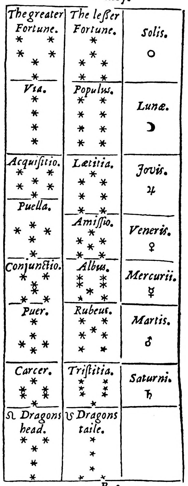
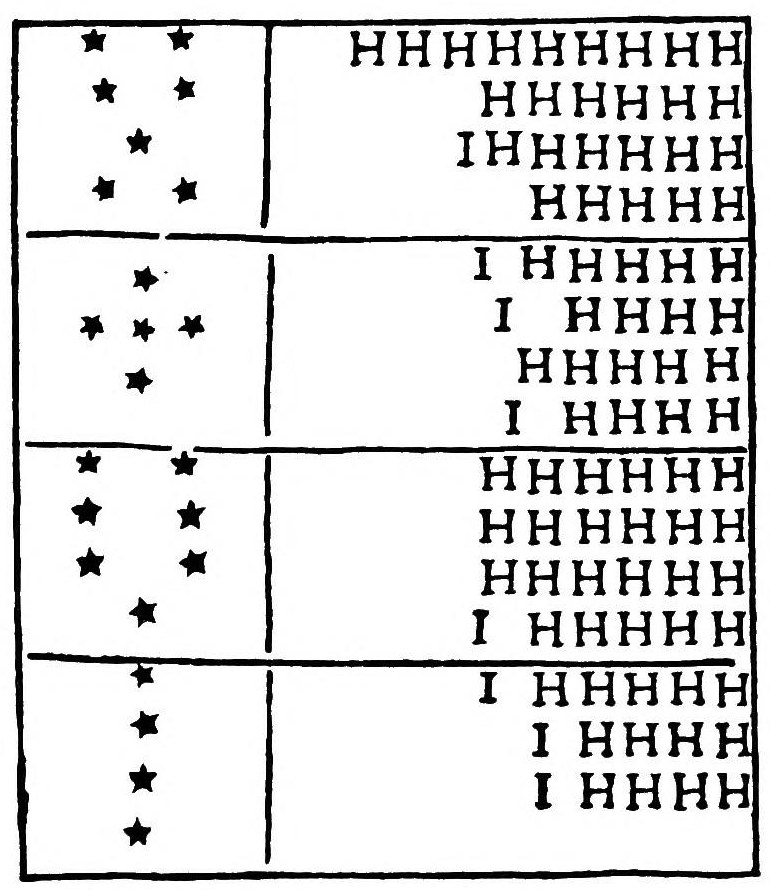
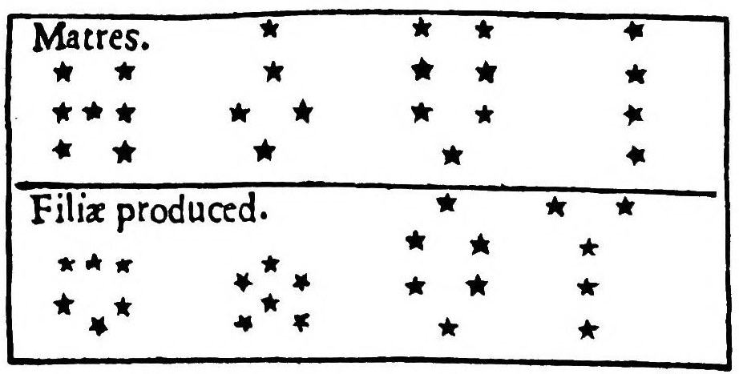
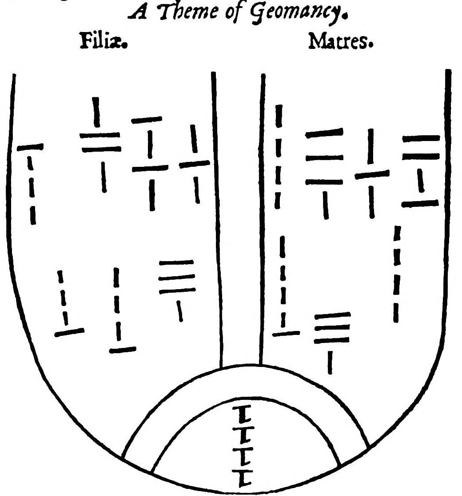
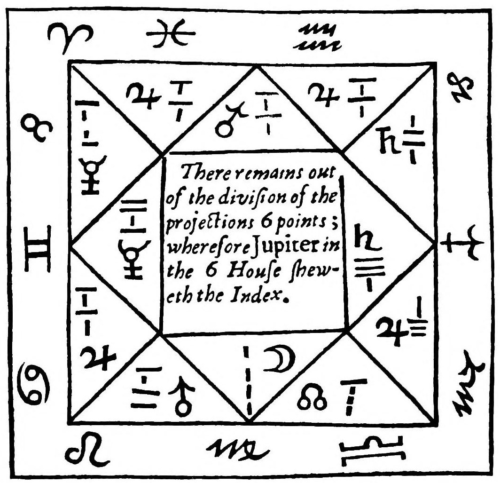
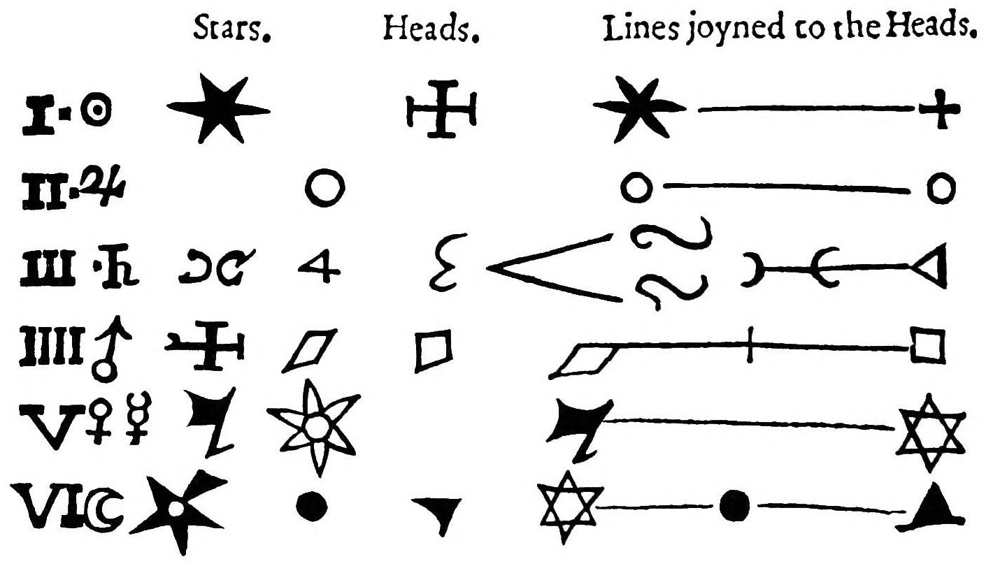
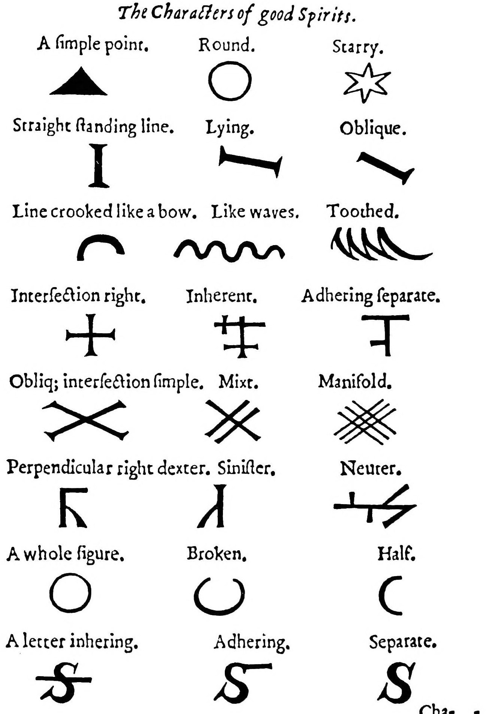
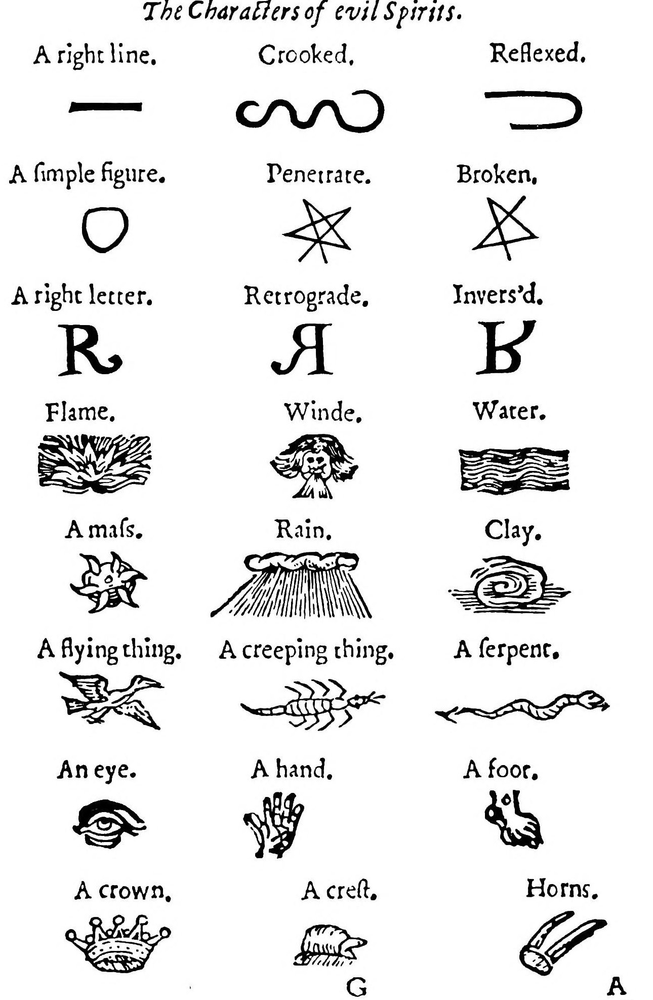
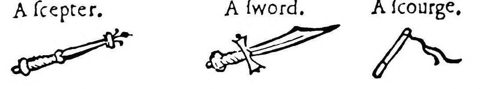
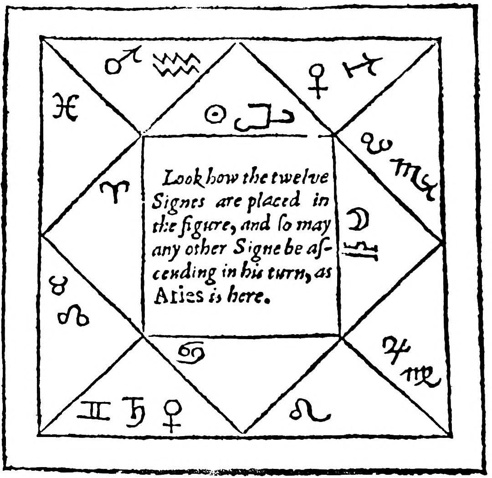

# 『アグリッパのオカルト哲学第四の書』ほか（ロバート・ターナー英訳、1655年）　全訳

ロバート・ターナーが1655年にロンドンで刊行した英訳本のうち、扉、ターナーの序文と献詩、および「ジオマンシーについて」「オカルト哲学第四の書」「イサゴーゲー（霊の本性について）」「天文的ジオマンシー」の4篇の全訳。同じ本に収められた「ヘプタメロン」と「アルバテル」は、それぞれ `heptameron/` と `arbatel/` に訳してある。作業の記録は `第四の書_作業メモ.md` にある。

---

## 扉

ヘンリー・コルネリウス・アグリッパの
オカルト哲学
第四の書

ジオマンシーについて
ピエトロ・ダバノの魔術の要素
天文的ジオマンシー
霊の本性について
アルバテルの魔術

ロバート・ターナー英訳

ロンドン
J. C. 印刷、ポール大聖堂東端「子羊」のジョン・ハリソンのために、1655年

---

## 序文――偏見なき読者へ

　人の堕落が、人間自身とほかのすべての被造物とを虚しさに服させたように、そのために、理性ある魂に授けられたもっとも高貴で優れた諸学芸もまた、時という錆びた腐れによって堕落へと至った。かつて古人がかくも神々しく観想した魔術そのものが、あらゆる悪魔的な妖術の徽章を負わされて、そしりを受けているのである。この術について（ミランドラの言うように）「わずかの者が理解し、多くの者が非難する。そして犬が知らぬ者にいつも吠えかかるように」、多くの人々は自分の理解しないものを断罪し、憎む。マグスという名、その語そのものを嫌悪する人は多い。それはシモン・マグスのせいである。彼は実はマグスではなくゴエース、すなわち悪霊と親しむ者であったのに、その称号を僭称したのだ。しかし魔術と妖術とは、まったく異なる学である。プリニウスはそれを知らずに、魔術を嘲っている。プリニウスによれば、ネロは、自分のもとでアルメニア王国を保っていたアルメニア王ティリダテスから東方のもっとも優れた魔術師たちを遣わされたが、長い研究と労苦の末に、この術がまったくばかげたものだと見いだしたという〔プリニウス『博物誌』第三十巻〕。さて妖術と呪術とは、まったく悪魔によってなされる業であって、悪魔は人と結んだなんらかの契約にもとづき、人を道具として用いて自らの悪しき目的を遂げるのである。その実例は、あらゆる時代、あらゆる民と国の歴史が、また聖書もまた、数多く示している。

　しかしマグスとは、もともとペルシアの言葉であって、まったく神的な事柄に通じた者を表す。プラトンが言うように、魔術とは神を崇める術である。ペルシア人は彼らの神々をマゴイと呼んだ。それゆえアポロニオスは、マグスとは本性によって神である者か、あるいは神に仕える者かのいずれかだと言う。すなわちマグスとは、ときには本性によって神である者の名であり、ときには神に仕える者の名なのである。後者の意味で、この語は『マタイによる福音書』第二章第一〜二節、博士たちがイエスを拝みに来たところで用いられている。これが第一の、もっとも高い種類で、神的魔術と呼ばれる。ラテン人はこうした人々を「サピエンテス」すなわち賢者と名づけた。神を畏れ崇めることは知識の始まりだからである。この賢者たちを、ギリシア人は哲学者と呼び、エジプト人のあいだでは祭司と称された。ヘブライ人は彼らをカバリスト、預言者、律法学者、ファリサイ派と呼び、バビロニア人のあいだではカルデア人の名で区別され、ペルシア人には魔術師（マギ）と呼ばれた。古代の魔術師の一人であるソステネスについて語るある人は、こう言っている。「ソステネスはまことの神にふさわしい威厳を帰し、天使たちを神の奉仕者・使者として、まことの神の礼拝に仕えるものと認めた。また、地上をさまよう悪霊があって、人類の敵であることを伝えた」。

　それゆえマグスという語は、それ自体としては神的・天的な学の観想者を意味する。しかし魔術という名のもとには、あらゆる不法な術が含められている。降霊術や妖術、また悪魔との結託によってなされ、悪魔がその当事者となるような術がそれである。こうした妖術使いや降霊術師は、マレフィキあるいはウェネフィキ、すなわち呪術師または毒殺者とも呼ばれる。魔女がこの名で呼ばれるのは正当である。彼女らは魔術の術によらずに、じっさいに悪魔そのものの助けを借りて害をなし、死体の粉を、悪魔の助けで用意したほかのものと混ぜ合わせたり、またあるときは蝋や粘土などで像を作って（いわば秘跡のようにして）、悪魔がほかの手段でもたらす事柄を成し遂げようとしたりする。こうしたものが、魔術という名そのものを忌まわしいものにしてきた堕落であったし、今日もなお、すっかりとは言わないまでも部分的にはそうなのである。あらゆる詐欺がそうであるように、それらはとりわけ、魔術のもっとも高く、もっとも高貴な部分を偽ろうとしてきたのだ。

　第二の種類の魔術は占星術である。これは、星々の運動と、この下界の諸元素への星々の影響とによって、自然と人事における未来の出来事を判断するものであり、星々はこれらを観察し理解している〔原文のまま〕。ユダヤ人フィロンの言うところでは、アブラハムはカルデアに住んでいたとき、魔術のこの部分すなわち占星術によって、また星々やほかの天体の運動によって、まことの神の知識を見いだした。ダマスコスのヨアンネスの言うように、「被造物の観想によって創造主を知った」のである。ヨセフスは、アブラハムがエジプト人に算術と天文学を教えたと伝えている。エジプト人は、アブラハムが来るまで、これらの学をまったく知らなかったのである。「アブラハムは、あらゆる人のうちもっとも聖く、もっとも賢く、まずカルデア人に、ついでフェニキア人に、最後にエジプトの祭司たちに、占星術と神的な事柄を教えた」。

　疑いもなく、あの神的な魔術師にして哲学者ヘルメス・トリスメギストスは（ある人々によればノアよりはるか以前に生きていたというが）、魔術と占星術の研究によって創造主についての多くの神的な知識を得た。今日なおわれわれのあいだに伝わる彼の著作が、それを証している。

　第三の種類の魔術は、自然の哲学の全体を含むものである。これは、もっとも内なる諸力を明るみに出し、それらを自然の隠れた懐から引き出して人の用に供する。化学者たちの言う「中心の中心に隠れた諸力」である。アルベルトゥス、ヴィラノヴァのアルナルドゥス、ライムンドゥス、ベーコンらがこの種の人々であった。

　これらの人々が奉じた魔術は、こう定義される。「魔術とは、賢者によって、自然による作用者を、それにふさわしく応ずる被作用者と結びつけることであり、そこから、原因を知らぬ者には驚くべき業が生じる」。すなわち魔術とは、互いに応じ合う自然の作用者と被作用者とを賢者が結びつけ、その原因を知らぬ者には驚くべきものとなる結果を生み出すことである。

　ゾロアスターはこれらすべてに、とりわけ第一の、もっとも高い種類に深く通じていた。彼はその託宣において、神が第一にして至高であることを告白し、三位一体を信じつつも、それを自然の知識によって詮索しようとはしなかった。彼は天使と楽園について語り、魂の不死を認め、真理と信仰と希望と愛とを教え、マギの節制と慈愛について論じている。

　このゾロアスターについて、エウセビオスは『フェニキア人の神学』のなかで、ゾロアスター自身の言葉を引いている。エウセビオスの言うには、彼は一語一語このように書いた。「神は第一の者、朽ちることなく、永遠にして、生まれざる者、部分をもたず、何ものよりも自らに似た者、あらゆる善きものの御者、報いを待たず、最善にして最賢、正義の父、教えられずして正義を学び、完全にして、本性によって賢く、それの唯一の発見者」。

　それゆえ魔術師とは、「神的な事柄の崇拝者にして解釈者」、すなわち神的な事柄の熱心な観察者・解説者にほかならず、術そのものは「自然哲学の絶対的な完成」にほかならない。とはいえ、あらゆるものには善と悪、偽りと真、腐敗と純粋の混ざり合いがある。どの種類においても、善きもの、真なるもの、純なるものは、受け入れてよいのである。古くは犠牲によって神を崇めていたが、長老たちのうちで神を知る者のなかに、悪魔がバアル、ダゴン、アシュタロテ、ケモシュ、ユピテル、アポロンなどの像において同じように崇められていたからといって、全能の神を崇めることを控えたり、その種の礼拝を断罪したりした者はいなかった。

　また（もっとも古く、もっとも敬虔な著作家たちを信じるならば）占星術の濫用も、アブラハムを怯えさせて、天体の運動と性質を観察することをやめさせはしなかった。同様に、今日の賢く学識ある人々に、神がその栄光ある被造物である星々やほかの天の光に与えた力と影響と傾向とを、それらに帰することを思いとどまらせることもできないのである。

　これに対しては、悪意ある偏見の人や、怠惰な無知の愛好者たち――今の時代にはそういう者がうようよしている――から、いくらかの中傷や非難を覚悟しなければならない。だが蛇の声と鵞鳥の声とは同じことである。しかしわれわれの胃は、これほど長く堅固な神学を糧としてきた今となっては、もうそれほど弱く敏感ではない。またわれわれは、これほど長く神の道に照らされてきたのだから、フランスのある会議でアリストテレスの『形而上学』を読むことが禁じられた、あの子供じみた時代に逆戻りするほど臆病で物におびえる者でもない。

　しかし私は、罪なき意図についてのキリスト者としての誓いをもって、読者にこれについての寛大な見方を促し、タベウスのこの忠告に従うよう読者に乞う。「争う者は、二人ともあなたの目には悪しき者、罪ある者であれ」。もしこの私の企てに何かつまずきがあるとしても、それは受け取られたものであって、与えられたものではない。そして私は、トリスメギストスの公理「敬虔な者は至高の哲学をする」に慰めを得ている。それゆえ私はこれを飾ることなく差し出し、公正で偏りのないすべての人に示す。ある人が述べているとおり、読者には四つの種類がある。区別なくすべてを吸い込む海綿。受け取ったのと同じ速さで流し出す砂時計。香料のかすだけを残して葡萄酒を逃がす袋。そして最良のものだけを残す篩である。最後の種類の人々もいくらかはいて、私はその人々にこのオカルト哲学を差し出す。彼らがそこから益を得られることを知っているからである。そしてこれに厳しい人々には、その厳しさが自らのやましさから出ているのだという私のこの意見を許していただき、エンノディウスの言葉、すなわち「自らのよこしまさの本性は、自らにふさわしいことを他人について思うことにある」をあてはめることを許していただきたい。罪ある者のもつ慰めとは、罪なき者を一人も見いださないことに尽きるのである。ともあれ、これがほかの書物のあいだでいくらかでも受け入れられることを願うものである。

　ロンドン、一六五四年八月末日　　R・ターナー

---

## 献詩

### わが特別の友ターナー氏の、コルネリウス・アグリッパの思慮深い翻訳に寄せて

　昏睡から醒めたばかりの人が
　見慣れぬ光景に驚き、ひそかな恐れも
　まだ去りやらず、己の目を信じてよいものか
　疑いながら、なおそれらのものに
　じっと目を据えて動かぬように、私も立ちつくす。
　術によって神々に近づくことのできる人を見て、
　あの輝く天球に住まう天使たちにまさる人を見て、驚きに打たれて。
　見よ、アグリッパは高い天へと昇り、
　神々と語らう。と思えばたちまち
　大地の深い戸棚をのぞきこむ。メルクリウスに対するように、
　あらゆる種類の霊が、進んで彼に従う。
　彼の書が与えるのはそれ以上のものだ。だがわれら
　盲目の人間は、灯火なしには
　その光を見るよう導かれることはできなかった。そこで君が、われらにとって
　アグリッパにしてオイディプスとならねばならない。
　アグリッパはふたたび現れる、君によって
　古代の灰の中から引き出されて。
　藪睨みの妬みなど痩せ衰えるがよい、君は
　ふさわしいその額に、称賛の冠をいただくのだから。

　　I・P・B、ケンブリッジの人

### わが才ある友ターナー氏の、その翻訳に寄せて

　三たび高貴な魂よ、学問と
　オカルト哲学の名高き要約よ、
　君は知られざるジオマンシーを伝え、
　あの難解な術の深い秘密を明かす。
　君の務めは自然魔術を説き明かすこと、
　地獄生まれの降霊術の仮面を剥ぐことではない。
　これまでごくわずかの者しか知らなかった
　神秘を、公衆の目にさらすのだ。
　君は己の知識を己ひとりにとどめておかない。
　（卑しく貪欲な守銭奴がその財貨にするようには。
　彼らの錆に食われた金貨の詰まった数多の袋は、
　彼ら自身が土に横たえられるまで、誰の益にもならない。）
　君は公共の善を思い、
　君の労苦の果実をすべての人に分け与える。
　それゆえ、もし揚げ足取りの批評家が
　君の書きものを咎めるなら、きっとその判断は足が萎えているのだ。
　術を憎む者は空っぽの頭よりほかになく、
　それは真似ることより、けちをつけることにはるかに長けている。
　いや、ゾイロスもモモスも、
　君の翻訳を咎めようとはすまい。比類なく
　優れたものだから。たとえ自然の女神が
　百の舌と青銅の肺を授けてくれたとしても、
　君の称賛をしかるべく吹き鳴らすには、
　洗練された言葉はもとより、力も足りないだろう。
　だがもし神々が私の願いをかなえてくれるなら、
　君はエノクのように天へ移されるだろう。

　　W・P、ケンブリッジ、セント・ジョンズ・カレッジ

### わが友なる著者の、この翻訳に寄せて

　なんと、シビュラもカッサンドラも残っていないのか。
　アポロンは黙したか。鋭い牙の時が
　われらから託宣を奪ったのか。ドドナの森は
　切り倒されたか。ユピテルから一言も
　テイレシアスの魂を、あるいは偉大なカルカスの霊を
　受け継ぐ人間の耳に届かないのか。
　自然の意図を予告した鳥卜官たちはどうなった。
　あらゆる天球で起こることを語りえた
　マギは死に絶えたのか。われらは
　遠い国で起こることを、大旅行をせずには
　知ることができないのか。下界にいて
　天上の神々の心を見てとることはできないのか。――すべては汝によってなされた、
　アグリッパよ。彼らのすべての術は汝のうちに収められている。
　かつてさまざまな頭の中にあった術が、
　今は一つの専売へとまとめられた。
　だがすべては空しい。われらには、その意味を
　解き明かしてくれるオイディプスが欠けていた。
　君はそれをかくも巧みに成し遂げ、
　おそらくは著者の見なかったものまで付け加えた。
　だからわれらは言えるのだ、君がこの術を新たにした、と。
　称賛の大半は君にこそふさわしい。

　　J・B、ケンブリッジの人

### 著者の、コルネリウス・アグリッパの翻訳に寄せて

　女神と呼んでよいならば、君は学問のパラス、
　その原型を君の知識が説き明かした。
　自然はそれを結び合わせようと努め、
　学知と学問とを、この君の形のうちに結んで、
　われらに暗くではなく、はっきりと示す、
　神秘の知識を、君のうちなる聖所として。
　君の許しによってこそ、われらは
　ジオマンシーへの入口を得た。それは今なお、
　君がその秘密の覆いを剥がなかったなら、
　人間には説き明かしがたい難事として埋もれていただろう。
　君がそれを忘却の川の流れから
　救い出したのだから、われらは月桂樹の若芽を
　君に捧げよう。（ポイボスを退けて）君のものとなるのだ、
　危難のときにすべての人が逃れゆく
　託宣は。君の予言は、
　君の命ずるものへと、われらの
　進んで従う心をとりこにするだろう。そうだ、君こそは
　唯一の預言者、われらは君に従う者。

### 著者の、コルネリウス・アグリッパの翻訳に寄せて

　ポイボスはわれらの問いに答えるのをやめたのか。
　それとも人間の手から、悲しい
　雷の祠の供えを受けようとしないのか。シビュラの洞窟は
　住めぬところとなったのか。テイレシアスには
　後継者も好敵手もないのか。それならわれらは
　どうやってオイディプスを世に導けばよい。彼が
　父殺しに近親の交わりを重ねたなら、必ず来るはずのことを
　予言しえた人々は口を閉ざしている。
　われらの政体に、いつ下剤と瀉血を
　施すべきかを知っていた人々も黙している。
　大胆な盗人がわれらの財宝を奪っても、誰が
　失われた品を取り戻し、まじないによって
　罪人を呼び戻すのか。――この術は君によって救われた。
　君のうちにマギはよみがえったかに見える。
　ポイボスは狂ってはおらず、ユピテルの鳩は死んではいない。
　託宣はやんではいない。アグリッパの寝床は
　（自ら築いた巣が、はじめはその墓となり、
　ついでその命を吹き返す憩いの場となる、あのアラビアの鳥のように）
　君を生み出した、たしかに彼に劣らぬ者を。
　さもなければこの術は今なお埋もれたまま、
　俗人には奇跡、誰にもよく知られず、
　もっとも深い理解をもってしてもほとんど読み解けなかっただろう。
　それでは、こう結ぼう。君が彼を説き明かすのだから、
　弟のほうが、すぐれた頭脳をもっている、と。

　　ジョン・トムリンソン、ケンブリッジ、セント・ジョンズ・カレッジ

### わが良き友なる著者の、オカルト哲学とジオマンシーの翻訳に寄せて

　なんと高貴な企て。まるで術と
　賢慮とが取引を結び、輝かしい光彩を
　分かち合おうとしたかのよう。君の放つ光は
　もっとも高貴な後援者たちでさえ示しえなかったもの。
　ディアナが君を愛し、
　君のもっとも高貴な才に天の火を吹き込むのも当然だ。
　その才のきらめく想像は、魔術の呪文よりも
　強い力で鎮め、すみやかに征服する。
　著者は（この書を書いたとき）思いもしなかった、
　より高い姿にしのがれ、
　より誇らかな調べに上をゆかれ、
　その当時もっとも快かった彼の詩才が、さらに高められようとは。
　だが後の世の子孫が
　彼の名誉を忘却から奪い返した今、
　二人はともによみがえり、観る者に
　月桂冠にもっともふさわしい者を知らしめるだろう。
　ここでは自然と術とが勝利を
　得ようと争う。そして彼は譲ることを拒むけれども、
　先んじたのは君だ。彼が称賛のうちに凱旋しようとも、
　その月桂樹は、君の月桂冠に仕えることになろう。

　　M・S、ケンブリッジの人

### 著者の、このコルネリウス・アグリッパの巧みな翻訳に寄せて

　何を見るのか。アグリッパが
　イギリスの装いをまとっている。まことに珍しいことだ。
　それとも彼のローマの衣が、君の機知によって
　かくもぴったりのイギリス風の装いに仕立て直され、
　彼を照らし出したのか。というのも、われらの見るとおり、君は
　彼の曖昧な哲学を明るくし、
　かくも入り組んだままだったものを、
　どんな凡庸な頭にもわかるようにしたのだから。
　君の光がこれほど暗い作品を通してさえ明るく輝くなら、
　君自身の作品においては、どれほどまばゆく現れることだろう。
　それでは進みたまえ、勇敢な魂よ、学問のかくも大いなる光を
　世界中に広め、君の称賛を語らしめるために。
　批評家など恐れるな。君は呪文によって
　彼らの舌を歯の奥に閉じこめておけるのだから。

　　ジョン・テイバー、ケンブリッジ、セント・ジョンズ・カレッジ

---

## ヘンリー・コルネリウス・アグリッパ　ジオマンシーについて

　ジオマンシー（土占い）とは占いの術であって、これによって、どんな事柄のどんな問いにも、籤すなわち運命によって判断を下すことができる。この術はとりわけ一定の点から成り立ち、その点から、等しいか等しくないか、似ているか似ていないかという理あるいは規則にしたがって、一定の図形が導き出される。これらの図形はさらに天の図形にも帰せられ、宮と惑星の運行と形にしたがって、それらの性質と特性を帯びるのである。とはいえ、まず第一に考えねばならないのは、この種の術は、なんらかの崇高な力に根ざしていなければ、真実を何ひとつ告げることも示すこともできないということである。そしてこの学の著者たちは、その力が二通りであることを示してきた。その一つは宗教と儀式にある。それゆえ彼らは、この術の点を打つことを、地面に印をつけて行うようにと定めている。このためこの術は大地という元素に割りあてられる。ちょうど火占いが火に、水占いが水という元素に割りあてられるのと同じである。そのうえ彼らは、点を打つ者あるいは術を行う者の手が、地の霊たちによってもっとも力強く動かされ導かれると考えたので、まず一定の聖なる呪文と祈願を、ほかの儀礼や作法とともに用いて、この種の霊たちをこれへと呼び寄せ、誘ったのである。

　この籤あるいは運を導き支配するもう一つの力は、点を打つ者の魂そのもののうちにある。彼が自らの欲求の大いなる発露をもってこの業へと運ばれるときである。というのもこの術は魂そのものに自然に従うものであって、必然的に効力をもち、魂そのものが欲するものへと動かされるからである。この道のほうがはるかに真実で純粋である。そしてこの場合、点をどこで、どのように打つかは問題ではない。それゆえこの術は、占星術の問いの術と同じ根をもつ。占星術の問いもまた、問う者自身の不変で過度なまでの思いなしには、ほかのどんな仕方でも確かめられないのである。さて、この術の実践へと進むために、まず知っておかねばならないのは、この術全体の基礎となる図形はわずか十六しかないということである。以下の表に、その名とともに記しておくので見られたい。

| 図形 | 図形 | 惑星 |
|---|---|---|
| 大いなる幸運（フォルトゥナ・マヨル） | 小さな幸運（フォルトゥナ・ミノル） | 太陽 |
| 道（ウィア） | 民（ポプルス） | 月 |
| 獲得（アクィシティオ） | 喜び（ラエティティア） | 木星 |
| 少女（プエラ） | 喪失（アミッシオ） | 金星 |
| 結合（コンユンクティオ） | 白（アルブス） | 水星 |
| 少年（プエル） | 赤（ルベウス） | 火星 |
| 牢獄（カルケル） | 悲しみ（トリスティティア） | 土星 |
| 竜の頭（カプト） | 竜の尾（カウダ） | |

　次に、これらの図形がどの惑星に配されるかを明らかにしよう。図形の特性と性質のすべて、そしてこの術全体の判断は、これにかかっているからである。大いなる幸運と小さな幸運は太陽に帰せられる。ただし前者すなわち大いなる幸運は、太陽が昼にあって自らの品位にあるときであり、後者すなわち小さな幸運は、太陽が夜にあるか、より低い品位に置かれているときである。ウィアとポプルス（すなわち道と民）は月に帰せられる。前者は月の始まりと満ちゆくときから、後者は月の満ちた光と欠けゆく弦からである。アクィシティオとラエティティア（すなわち利得・儲けと、喜び・楽しみ）は木星のものである。ただし前者は大いなる幸運としての木星をもち、後者はより小さな、しかし損なわれていない木星をもつ。プエラとアミッシオは金星のものである。前者は幸運な金星、後者はいわば逆行しているか燃焼している金星である。コンユンクティオとアルブスはともに水星の図形で、どちらも吉であるが、前者のほうがより幸運である。プエルとルベウスは火星に帰せられる図形で、前者は善意の火星を、後者は悪意の火星をもつ。カルケルとトリスティティアはともに土星の図形で、どちらも凶であるが、前者のほうが害が大きい。竜の頭と竜の尾は、それぞれ自らの性質にしたがう。

　以上が図形の誤りのない対応である。ここから、それらの宮の対応も容易に見分けることができる。すなわち、大いなる幸運と小さな幸運は太陽の家である獅子宮をもつ。ウィアとポプルスは月の家である蟹宮をもつ。アクィシティオは双魚宮を、ラエティティアは人馬宮をもち、これらはともに木星の家である。プエラは金牛宮を、アミッシオは天秤宮をもち、これらは金星の家である。コンユンクティオは処女宮を、アルブスは双子宮をもち、水星の家である。プエル〔原文のまま。プエラとあるのはプエルの誤り〕とルベウスは火星の家である天蝎宮をもつ。カルケルは磨羯宮を、トリスティティアは宝瓶宮をもち、土星の家である。竜の頭と尾は次のように分けられる。頭は磨羯宮に、竜の尾は天蝎宮に属する。ここから、獣帯の宮の三宮組（トリプリシティ）と同じ仕方で、これらの宮の三宮組を容易に得ることができる。すなわち、プエルと二つの幸運とラエティティアは火の三宮組を支配し、プエラ、コンユンクティオ、カルケル、竜の頭は地の三宮組を、アルブス、アミッシオ、トリスティティアは風の三宮組を、そしてウィア、ポプルス、ルベウスに竜の尾とアクィシティオは水の三宮組を支配する。この順序は宮の進み方にしたがってとられたものである。

　しかしもし誰かが、これらの三宮組を惑星と図形そのものの性質にしたがって組み立てようとするなら、次の規則を守るがよい。フォルトゥナ・マヨル、ルベウス、プエル、アミッシオが火の三宮組をなし、フォルトゥナ・ミノル、プエラ、ラエティティア、コンユンクティオが風の三宮組をなす。アクィシティオ、竜の尾、ウィア、ポプルスが水の三宮組を支配し、地の三宮組はカルケル、トリスティティア、アルブス、竜の頭によって支配される。この道のほうが、先に述べた最初のものよりも守られるべきである。宮の規則と仕方にしたがって組み立てられているからである。

　この順序はまた、世間でふつう用いられているものよりもはるかに真実で理にかなっている。世間のものは次のように記される。火の三宮組にはカウダ、フォルトゥナ・ミノル、アミッシオ、ルベウス。風の三宮組にはアクィシティオ、ラエティティア、プエル、コンユンクティオ。水の三宮組にはポプルス、ウィア、アルブス、プエラ。そしてカプト、フォルトゥナ・マヨル、カルケル、トリスティティアが地の三宮組である。

　彼らはまた、これらの図形を獣帯の十二宮に次のように配している。アクィシティオは白羊宮に、フォルトゥナはマヨルもミノルも金牛宮に、ラエティティアは双子宮に、プエラとルベウスは蟹宮に、アルブスは獅子宮に、ウィアは処女宮に、竜の頭とコンユンクティオは天秤宮に、プエルは天蝎宮に、トリスティティアとアミッシオは人馬宮に、竜の尾は磨羯宮に、ポプルスは宝瓶宮に、そしてカルケルは双魚宮に配される。

　さて次に、これらの図形を打ち出す、すなわち書き下ろす仕方について述べよう。それは次のとおりである。点を、その進みにしたがって四つの行に、右手から左へと打ち、これを四回くり返す。すると、それぞれの行の偶数か奇数かにしたがって、四つの別々の行から四つの図形が得られる。この四つの図形は「マトレス（母たち）」と呼ばれるのが習わしで、これがほかの図形を生み出し、判断の図全体を満たし完成させる。その例を次に見られたい。

　この四つのマトレスから、さらに四つの二次的な図形が生み出される。これを彼らは「フィリアエ（娘たち）」あるいは「後続のもの」と呼ぶ。それは次のようにして集められる。すなわち、四つのマトレスをその順序どおりに一つずつ横に並べ、それから各行から得られるものが、フィリアエの図形をなす。その順序は、上の点から二つの中ほどを通って最下部へと下っていくものである。この例のとおりである。

　そしてこの八つの図形が、図形を左手から右へと並べることによって、次のように天の八つの家をなす。四つのマトレスが最初の四つの家をなすように、四つのフィリアエが続く四つの家、すなわち第五、第六、第七、第八の家をなす。残りの家は次のようにして見いだされる。すなわち、第一と第二から第九が、第三と第四から第十が、第五と第六から第十一が、第七と第八から第十二が導かれる。各図形に残る点の偶数・奇数の規則にしたがって、二つの図形を組み合わせる、すなわち結び合わせることによってである。同じ仕方で、最後の四つの図形、すなわち第九、第十、第十一、第十二から、「コアディウトリケス（補佐たち）」あるいは「テステス（証人たち）」と呼ばれる二つの図形が生み出される。そしてこの二つからさらに一つが組み立てられ、これが図全体の、すなわち問われた事柄の「インデックス（判定者）」と呼ばれる。次の例に見られるとおりである。

　以上述べたことは、ジオマンシー師たちが守っているふつうのやり方であって、われわれはこれをまったく退けもしないが、褒めそやしもしない。それゆえこれもまた判断において考慮すべきである。さて、ここで占星術の正しい理にしたがって組み立てたジオマンシーのまことの図を示そう。それは次のとおりである。

　前述のマトレスが家の四つのアングル（角）をなすように、すなわち第一のマトレスが第一のアングルを、第二が第二のアングルを、第三が第三のアングルを、第四が第四のアングルをなすように、マトレスから生じた四つのフィリアエは四つのサクシデント（後続）の家をなす。第一のフィリアは第二の家を、第二は第十一の家を、第三は第八の家を、第四は第五の家〔原文は「第一の家」。サクシデントの家は第二・第五・第八・第十一なので、第五の誤りと思われる〕をなす。残りの家、すなわちケーデント（下降）の家は、その三宮組の規則にしたがって算出される。すなわち、第四と第五から第九を、第十と第二から第六を、第七と第十一から第三を、第四と第八から第十二をつくるのである〔原文のまま〕。

　これで、真実で効力ある理にしたがって組み立てられた、まことの判断の図全体が得られた。それをどう完成させるかを示そう。第一の家にある図形が、上昇する宮を与える。それは第一の図形が示す宮である。これがすんだら、残りの家にも宮の順序にしたがってそれぞれの宮を割りあてる。次に各家に、図形の性質にしたがって惑星を書きこむ。それから、これらすべてから判断を組み立てる。惑星が見いだされる宮と家における惑星の意味にしたがい、惑星相互のアスペクト（角度）にしたがい、問う者と問われる事柄の場所にしたがってである。そして、それぞれの家で上昇する宮の性質にしたがい、さまざまな家に置かれた図形の性質と特性にしたがい、それらにアスペクトをなすほかの図形との混じり合いにしたがって判断するのである。ジオマンシー師たちが多くの場合つくってきた図のインデックスが、前の図でどのように見いだされるかは、先に示したとおりである。

　しかしここで、この術全体の秘密、すなわち後続の図におけるインデックスの見つけ方を授けよう。それは次のとおりである。点を打った行に含まれるすべての点を数え、それを十二で割る。そして残った数を、上昇宮から順に各家へと送っていき、最後の一が落ちる家の図形が、問われた事柄について十分な判断を与える。これを先に述べた判断の意味と合わせて用いる。しかし、もしどちらの側も同等であるか、あいまいであるなら、インデックスだけが問われた事柄について確かに告げるであろう。この図の例をここに置く。

　残るのは、問いがどの事柄、どの家に属するかを明らかにし、ついで、各図形がそれぞれの家におけるあらゆる問いについて何を示し、意味するかを明らかにすることである。

　そこでまず、家の意味を扱おう。それは次のとおりである。

　第一の家は、問いが問う者自身について、その人自身の事柄について、あるいはその人に属する何かについて出されるときには、つねに問う者の人物を示す。そしてこの家は、生命、姿、身分、境遇、身なり、気質、体つきと容貌、そして人の顔色の判断を告げる。第二の家は、財産、富、貧困、利得と損失、幸運と不運、そして財産にかかわる出来事、たとえば損失や不注意の判断を含む。第三の家は、兄弟、姉妹、傍系の血縁を意味し、短い旅と、人の誠実さを判断する。第四の家は、父と祖父、世襲財産と相続、所有地、建物、畑、宝、隠されたものを意味し、また盗み、紛失、不注意によって何かを失った人々の様子を与える。第五の家は、使節、使者、うわさ、知らせ、名誉、死後の出来事について、また身ごもった女や、はらんだ生き物について出される問いについて判断を与える。第六の家は、病と薬、身内の者と召使い、家畜と家の動物について判断を与える。第七の家は、婚姻、売春、私通を意味し、友人、争い、論争、そして裁判官の前で争われる事柄について判断を下す。第八の家は、死と、死によってもたらされるもの、すなわち遺贈と相続財産、妻の持参金あるいは取り分を意味する。第九の家は、旅、信仰と節操、夢、神的な学、宗教を示す。第十の家は、名誉と官職を意味する。第十一の家は、友人と、君主の財産を意味する。第十二の家は、敵、召使い、投獄、不運、そして死と病のほかに起こりうるあらゆる悪を意味する。死と病の判断は、第六の家と第八の家に求めるべきである。

　あとは、先に述べた各図形がこれらの場所で何を意味するかを示すことである。それを今から明らかにしよう。

### フォルトゥナ・マヨル（大いなる幸運）

　フォルトゥナ・マヨルが第一の家に見いだされると、長命を与え、病の煩いから解き放つ。高貴で、度量が大きく、行儀のよい人を示す。背は中くらい、顔色は赤らみ、髪は巻き毛で、上半身が下半身より大きい。第二の家では、明らかな富と明らかな利得、幸運、失くしたり置き忘れたりしたものを取り戻すこと、盗人を捕らえ、盗まれたものを取り返すことを意味する。第三の家では、兄弟と親族、貴人、素行のよい人々を意味し、旅が順調で利益があり、名誉を伴うことを示す。人々が誠実で、その友情が偽りのないことを示す。第四の家では、父が高貴で評判がよく、多くの人に知られていることを表す。町なかの所有地を広げ、世襲財産を増やし、隠された宝を見つけ出す。この場所ではまた盗みを意味し〔盗まれたものについて〕、失われたものをすべて取り戻す。第五の家では、子供による喜びを与え、子供たちを大いなる名誉に至らせる。使節を首尾よく運ばせるが、それは骨折りと嘆願によって得られる。うわさが真実であることを示す。公の名誉を授け、人を死後に大いに名高くする。身ごもった女が男の子を産むことを予告する。第六の家では、病から解き放ち、病の者が短いうちに回復することを示す。医者が誠実で正直で、よい薬を処方し、疑いをかける必要がないことを意味する。家の召使いや仕える者が誠実であることを示す。動物については、とりわけ馬を意味する。第七の家では、富裕で、貞節で、行儀がよく、愛情深く感じのよい妻を与える。争いと口論に打ち勝つ。ただしもし問いが争いそのものについてなら、相手方がきわめて強力で、大いに寵愛を受けていることを意味する。第八の家では、誰かの死について問いが出されたなら、その人は生きるであろうことを意味する。死に方はよく自然なものであること、まっとうな埋葬と名誉ある葬儀を示す。妻が豊かな持参金をもつこと、遺贈と相続を予告する。第九の家では、旅が順調であること、それも徒歩よりは馬で陸路をゆく旅で、長くかかり、すぐには終わらないことを意味する。不在の者の帰還を示す。人々が信義に厚く、その意図において一貫し、信心深く、決してその信仰を変えたり改めたりしないことを意味する。夢が真実であることを予示し、真実で完全な学を意味する。第十の家では、大いなる名誉を予告し、公職、官職、裁判の職、君主の宮廷での名誉を授ける。裁判官が公正で、贈り物に買収されないことを意味する。訴訟がたやすく、すみやかに片づくようにする。王たちが強力で、幸運で、勝利を収めることを示す。勝利が確かであることを表す。母が高貴で長命であることを意味する。第十一の家では、まことの、役に立つ友人、富裕で気前のよい君主を意味し、人を幸運にして、その君主に愛されるようにする。第十二の家では、敵の性質について問いが出されたなら、敵が強力で高貴で、抗しがたいことを示す。しかし敵についてほかの状態や点について問いが出されたなら、その裏切りから救い出すであろう。誠実な召使いを意味し、逃げた者を連れ戻す。馬、獅子、牡牛といった動物を意味し、投獄から解き放ち、差し迫った危険を和らげるか取り除く。

### フォルトゥナ・ミノル（小さな幸運）

　フォルトゥナ・ミノルが第一の家にあれば、長命を与えるが、さまざまな煩いと病に悩まされる。背が低く、やせた体で、額か右目にほくろか痣のある人物を意味する。第二の家では、財産を意味するが、それはあまりの浪費によって使い果たされる。盗人をかくまい、盗まれたものは大いなる骨折りによらなければほとんど取り戻せない。第三の家では、兄弟と親族のあいだに不和を引き起こす。旅に危険があることを脅かすが、それは免れる。人々を信義には厚いが、心を閉ざし隠す者とする。第四の家では、世襲財産と相続を損ない、宝を隠し、失われたものは大いなる困難によらなければ取り戻せない。父が正直ではあるが、浪費によって財産を使い果たし、子供たちにはわずかな取り分しか残さないことを意味する。フォルトゥナ・ミノルが第五の家にあれば、子供は少ない。身ごもった女は女の子を産むであろうことを意味する。使節は名誉あるものだが利益は少ないことを意味する。中程度の名誉へと引き上げる。死後によい名声を与えるが、それほど広まらず、長く記憶されることもない。第六の家では、多血質と胆汁質の両方の病を意味する。病人が大いなる危険にあるが、回復するであろうことを示す。誠実だが怠惰で役に立たない召使いを意味し、ほかの動物についても同様である。第七の家では、よい家柄の出の妻を与えるが、あなたは彼女のために多くの面倒に煩わされるであろう。愛を不安で移り気なものにする。争いを長引かせ、相手方が多くの言いがかりであなたを出し抜こうとするが、時がたてば勝利を与える。第八の家では、死に方はよくまっとうなものだが、人知れず、あるいは見知らぬ土地や巡礼の途上であることを示す。遺贈と所有地を明らかにするが、それは訴えと困難によって得られる。葬儀と埋葬がひっそりとしたものになること、妻の取り分は手に入れにくく、しかもたやすく使われてしまうことを表す。第九の家では、旅を危険なものにし、不在の者はなかなか戻らない。人々を宗教の務めに携わらせる。学は成就しないことを示すが、信仰と宗教における節操は保たせる。第十の家では、王や君主が強力であることを意味するが、その力は戦争と暴力によって得られる。追放された者はやがて戻るであろうことを示す。同様に名誉、大いなる官職と恩恵を明らかにするが、あなたはそのために絶えず骨折り努めねばならず、そこに安定して長くとどまることはない。裁判官はあなたに好意を示さない。訴えと争いを長引かせる。父と母がまもなく死ぬこと、そしていつも多くの病に冒されていることを示す。第十一の家では、多くの友人をつくるが、それは貧しく役に立たず、あなたの窮乏を救うことのできない者たちである。君主たちの愛顧を得させ、大いなる望みを与えるが、利得は小さい。君主から授けられた禄や官職に長くとどまることもない。第十二の家では、敵が狡猾で、抜け目なく、欺きに満ち、多くのひそかな党派によってあなたを出し抜こうとたくらんでいることを示す。獄にある者は長く留め置かれるが、ついには解き放たれることを意味する。動物は実りがなく、召使いは役に立たないこと、そして運の移り変わりが頻繁で、よいことから悪いことへ、悪いことからよいことへと変わることを示す。

### ウィア（道）

　ウィアが第一の家にあれば、長く順調な生を授ける。よそ者を意味する。やせて背が高く、色白で、ひげの少ない人物で、気前がよく感じがよいが、のろく、あまり労働を好まない。第二の家では、財産と富を増やし、盗まれたり失われたりしたものを取り戻すが、盗人は町の外へ去ったことを意味する。第三の家では、兄弟と親族を増やし、絶えず続く順調な旅を意味する。世に知られた、正直で素行のよい人々を意味する。ウィアが第四の家にあれば、父が正直であることを意味する。世襲財産と相続を増やし、豊かな畑を生む。問い求める場所に宝があることを示し、失われたものを取り戻す。第五の家では、男の子の数を増やす。身ごもった女が男の子を産むことを示す。見知らぬ遠い地へ使節を送る。公の名誉を増やす。まっとうな種類の死と、多くの地方にわたって知られることを意味する。第六の家では、ウィアは病から守り、病人がすみやかに回復することを意味する。役に立つ召使いと、実り多く役に立つ動物を与える。第七の家では、美しく感じのよい妻を授け、あなたは彼女とともに絶えることのない幸福を味わうであろう。争いと論争をきわめてすみやかに決着させ、相手方はたやすく打ち負かされ、進んでその争いを善良な人々の仲裁にゆだねるであろう。第八の家では、死に方が粘液質の病から来ること、まっとうで評判のよい死であることを示す。死者から大いなる遺贈と豊かな相続を得ることを明らかにする。そして誰かが死んだとうわさされていたなら、その人が生きていることを示す。第九の家では、水路の、とりわけ海の長い旅を引き起こし、それによってきわめて大きな利得が得られることを予示する。聖職と、教会の務めからの利益を表す。人々を良い宗教の、まっすぐで、信仰に堅固な者とする。夢が真実で、その意味がにわかに現れることを示す。哲学と文法の学、そして子供の教育と養育に関わる事柄を増進する。第十の家にウィアが見いだされれば、王や君主を幸いで幸運な者とし、同盟者と絶えず平和を保たせ、さまざまな使節によって多くの君主のあいだに親交と友好を求めさせる。民衆と庶民のあいだでの、あるいは水に関わる事柄、旅、租税や賦課金の徴収に関わる公の名誉と官職と役職を推し進める。裁判官が公正で慈悲深く、自らの前にかかった訴訟をすみやかに処理することを示す。母が評判よく、健康で、長命であることを表す。第十一の家では、多くの富裕な友人を起こし、異国の地方や国々に誠実な友人を得させる。彼らはそれを求める者を、あらゆる助けと熱意をもって進んで救うであろう。君主たちのあいだで利益と信任を得させるが、絶えず旅に煩わされるような官職に用いられる。ウィアが第十二の家にあれば、多くの敵を生じるが、それはほとんど害や危険を恐れる必要のない者たちである。召使いと動物は役に立つことを意味する。獄にある者は逃れるか、すみやかにそこから解き放たれることを意味する。そして運の悪しき出来事から人を守る。

### ポプルス（民）

　ポプルスが第一の家に見いだされれば、その家について問いが出された場合、中くらいの人生、中年の、しかし移ろいやすく、さまざまな病と運のさまざまな成り行きを伴う人生を示す。背が中くらいで、体ががっしりして手足の整った人を意味し、おそらく左目のあたりにほくろか痣がある。しかしもし人の姿について問いが出され、この図形に土星の図形かルベウスのいずれかが結びついていれば、その人がひどく醜い異形であり、その醜さは生まれつきであることを意味する。ただしもし第五の家で、凶のアスペクトに囲まれていれば、その異形はこれから生じるのである。第二の家では、ポプルスは中程度の財産、それも大いなる困難をもって得られる財産を示す。また人にいつも骨の折れる労苦を感じさせる。盗まれたものは決して取り戻されず、失われたものはすっかりとは回復されず、隠されたものは見つからない。しかしもし問いが盗人についてなら、まだ逃げ去っておらず、町のなかに潜んでいることを告げる。第三の家では、ポプルスは兄弟や親族のなかに友人をわずかしか起こさない。旅を予告するが、骨折りと面倒を伴う。それでもいくらかの利益は得られよう。信義の定まらない人を表し、人がしばしば仲間に欺かれるようにする。第四の家では、父が病弱で骨の折れる生を送り、その地上の所有地と相続財産を奪われることを意味する。水から利益が得られることを示す。宝は隠されていない、あるいは隠されていても見つからないことを示す。世襲財産は大いなる骨折りによって保たれる。第五の家では、まっとうな使いを示さず、使者を荷運び人か公の運送人にする。偽りのうわさを広めるが、それでもいくらか真実に似ており、真実から出ているように見える。ただ、事が起こったとおりには伝えられないのである。女が不妊であることを意味し、身ごもった女に流産させる。不名誉な葬儀と、死後の悪評を定める。第六の家では、ポプルスは冷えの病を示し、とりわけ体の下部を冒す。医者が病人に薬を施すのに不注意で怠慢であることを告げ、病に冒された者が死の危険にあり、ほとんど回復しないことを意味する。召使いの不実と、家畜の損失を示す。第七の家では、美しく感じのよい妻を示すが、多くの求愛者の愛に言い寄られる妻であり、その愛は偽りで見せかけであることを意味する。弱く力のない相手方に、まもなく訴えを取り下げさせる。第八の家では、長い病や苦しみのない急な死を表し、しばしば水による死を示す。死者からの相続、所有地、遺贈を与えず、もしあっても、間に入る争いやほかの不和によって失われるであろう。妻の持参金はわずかか、まったくないことを意味する。ポプルスが第九の家にあれば、偽りの夢を示し、学問も学識もない粗野な才の人を表す。宗教においては、教会の掃除をしたり鐘を鳴らしたりするような下位の務めを意味し、宗教にあまり関心も熱意もなく、良心にもあまり煩わされない人を意味する。第十の家では、多くの場合その支配と領土から追われるか、あるいはその周辺に絶えず面倒と損失をこうむる王や君主を意味する。水に関わる事柄、すなわち艦隊、橋、漁場、岸辺、牧草地などに属する官職と役職を意味する。裁判官を移り気で、自らの前の訴訟の処理に遅い者とする。母が病弱で短命であることを告げる。第十一の家では、友人はわずかで、へつらう者が多く、君主のもとでは愛顧も幸運も与えない。第十二の家では、弱く身分の低い敵を示し、獄にある者は解き放たれないことを告げ、水や水辺の場所での危険を明らかにする。

### アクィシティオ（獲得）

　アクィシティオが第一の家に見いだされれば、長命と順調な老年を与える。背が中くらいで、頭が大きく、きわめて見分けやすい、すなわちよく知られる顔立ちで、鼻が長く、ひげが濃く、髪は巻き毛で、目が美しく、飲み食いには鷹揚だが、ほかのすべてのことには倹約で気前がよくない人を意味する。第二の家では、きわめて大きな富を意味し、あらゆる盗人を捕らえ、失われたものは何であれ取り戻させる。第三の家では、多くの兄弟、それも富裕な兄弟、多くの利益ある旅を意味し、信義に厚い人を意味する。第四の家では、多くの富をもつ世襲財産、実りの豊かな多くの所有地が意味される。どこかに隠された宝が見つかることを意味し、父が富裕だが貪欲であることを示す。第五の家では、アクィシティオは男女ともに多くの子供、ただし女より男が多いことを意味する。女が身ごもっていて、危険なく出産することを示す。そしてもしある子の性別について問いが出されたなら、男であることを意味する。利益ある使節と使いを増やすが、死後の名声はそれほど遠くまで広げない。それでも人に自らのものを相続させ、うわさが真実であることを意味する。第六の家では、多くの重い病、それも長く続く病を意味し、病人を死の危険に陥らせ、しばしば死なせる。それでも医者が学識あり正直であることを告げる。多くの召使いと家畜を与え、それらから利得が得られる。第七の家では、妻が富裕であるが、寡婦か、十分に年のいった女であることを意味する。訴えと争いが大きく長く続くこと、愛と婚姻が籤によって果たされることを意味する。第八の家では、ある人の消息が問われたなら、その人は死んでいることを示す。死に方は短く、病は数日しか続かないことを意味する。きわめて利益ある遺贈と相続を明らかにし、妻が豊かな持参金をもつことを意味する。第九の家では、長く利益ある旅を意味する。誰かが不在なら、まもなく戻ることを示す。宗教者や聖職者、あるいは学者から利得を得させ、真実で完全な学の人を意味する。第十の家では、君主にその領土を広げさせる。裁判官は好意的だが、絶えず贈り物をしなければならない者である。官職と役職をきわめて実入りのよいものにする。母が富裕で幸せであることを意味する。第十一の家では、アクィシティオは友人を増やし、彼らから利益をもたらし、君主たちの愛顧を増す。第十二の家では、人が多くの強力な敵をもつことを意味する。逃げた召使いと迷った家畜を連れ戻し、獄にある者は解き放たれないことを意味する。

### ラエティティア（喜び）

　ラエティティアが第一の家にあれば、繁栄と多くの喜びと楽しみを伴う長命を意味し、人にそのすべての兄弟よりも長生きさせ、勝ち誇らせる。背が高く、手足が美しく、額が広く、大きく幅広い歯をもち、顔立ちが整って血色のよい人を意味する。第二の家では、富と多くの利得を意味するが、出費も大きく、境遇と身分にさまざまな変動がある。盗みや失われたものは取り戻され、返される。しかしもし問いが盗人についてなら、逃げ去ったことを告げる。第三の家では、ラエティティアは兄弟が素行はよいが短命であること、旅が楽しく快いこと、信用と信義のある人々を示す。第四の家では、幸いな世襲財産と所有地を意味し、父が高貴で、なんらかの君主の官職の位をもって遇されることを意味する。問い求める場所に宝があることを示すが、それは思われているより値打ちが低い。そしてそれが見つかるようにする。第五の家では、従順で行儀のよい子供を与え、その子らのうちに老年の最大の喜びと慰めが得られるであろう。身ごもった女が娘を産むことを意味する。名誉ある使節を示し、うわさと知らせがまったく真実であることを告げ、死後によい、大きな名声を残す。第六の家では、病人が回復することを示し、よい召使い、よく役に立つ家畜と動物を表す。第七の家では、ラエティティアは美しく麗しい若い妻を与え、争いと口論に打ち勝ち、その結果を愛とする。第八の家では、ラエティティアは遺贈と所有地、妻とともにほめるべき取り分を与える。もしある人の消息について問いが出されたなら、その人が生きていることを意味し、まっとうで、静かで、穏やかな死に方を告げる。第九の家では、ラエティティアはきわめて少ない旅を意味する。そして旅に出る人々の旅は、君主の使いや使節に関するものか、あるいは聖なる誓いを果たすための巡礼である。良い宗教の、ほどほどの知識をもち、生まれつきの才でなんでもたやすく理解する人を示す。第十の家では、王と君主を名誉と大いなる名声へと高め、その治世に平和を保つことによって名高くする。裁判官が残酷で厳しいことを意味する。まっとうな官職と役職、すなわち教会の事柄、学校、あるいは裁きの執行に関わる務めを意味する。母がもし寡婦であれば、再婚することを示す。第十一の家では、ラエティティアは君主たちの愛顧を増し、友人を増やす。そして第十二の家では、ラエティティアは敵に対する勝利を与え、よい召使いと家の者をもたらし、投獄から解き放ち、これから来る悪から守る。

### プエラ（少女）

　プエラが第一の家にあれば、短命で、体質が弱く、背が中くらいで、やや太っているが美しく、女性的で好色な人物、そして生涯のうちに女への愛のために多くの面倒と危険をこうむる人物を意味する。第二の家では、富を増やしもせず、貧困を減らしもしない。盗人が町から去っていないこと、盗まれたものは手放され、処分されてしまったことを意味する。ある場所の宝について問いが出されたなら、そこには何もないと解かれる。第三の家では、プエラは兄弟より姉妹が多いことを意味し、彼らのあいだのよい友情と親しみを増し、長続きさせる。旅が楽しく喜ばしいこと、素行のよい人々を表す。第四の家では、プエラはごくわずかな世襲財産と、長生きしない父を意味するが、畑をよい実りで豊かにする。第五の家では、身ごもった女が女の子を産むことが意味される。使節はないことを表し、女たちとの多くの交わりを生じ、彼女らからなんらかの職を得させる。第六の家では、プエラは病人がひどく弱っていることを意味するが、病人をまもなく回復させる。医者は無学で未熟だが、民衆の評判では大いに重んじられている者であることを示す。よい召使い、侍女、家畜と動物を与える。第七の家では、プエラは美しく麗しく感じのよい妻を与え、夫と平和で穏やかに暮らすが、それでも大いに情欲に燃え、多くの男に求められ、欲される妻である。裁判官の前にかかる訴えや論争はないことを表すが、庶民どうしのいざこざや言い争いがあり、それはたやすく解け、終わる。第八の家では、死んだとうわさされている者について問いが出されたなら、プエラはその人が生きていることを告げる。妻とともにわずかな取り分を与えるが、それは夫を満足させるものである。第九の家では、プエラはきわめて少ない旅を意味する。良い宗教の、学問にはほどほどの技量しかもたない人を示すが、ことによると声楽と器楽の音楽は別である。第十の家では、プエラは君主たちがあまり強力ではないが、それでもその領土のなかを平和に治め、隣人と臣下から愛されることを意味する。彼らを人当たりがよく、穏やかで丁重な者とし、いつも絶えることのない楽しみ、遊戯、狩りに興じさせる。裁判官をよく、敬虔で、慈悲深い者とする。女に関わる、とりわけ高貴な女から授かる官職を与える。第十一の家では、プエラは多くの友人を与え、女たちの愛顧を増す。第十二の家では、プエラは敵が少ないこと、ただし女との争いがあることを意味し、友人のとりなしによって囚人を獄から解き放つ。

### アミッシオ（喪失）

　アミッシオが第一の家にあれば、病人は長く生きないことを意味し、短い命を示す。体の手足の釣り合いが悪く、よこしまな生き方とふるまいをし、体のどこかに、足が不自由であるとか、手足が欠けているとかいった、目立つ著しい欠陥の印をもつ人を意味する。第二の家では、アミッシオはすべての財産を使い果たし、人にみじめな貧困の重荷を負わせ、耐えさせる。盗人も盗まれたものも見つからない。探し求める場所に宝はなく、それを探せば損失と損害を伴うことを意味する。第三の家では、アミッシオは兄弟の死、あるいは兄弟がいないこと、また親族と友人の死や欠如を意味する。旅はないことを意味し、多くの者に欺かれるようにする。第四の家では、アミッシオは世襲財産のまったくの破滅を意味し、父が貧しく、息子が死ぬことを示す。第五の家では、アミッシオは子供の死を示し、人をさまざまな悲しみで苦しめる。女が身ごもっていないか、あるいは流産したことを意味する。名声も名誉も起こさず、偽りのうわさを広める。第六の家では、アミッシオは病人が回復したか、まもなく回復することを意味するが、召使いと家畜によって損失と損害を生じる。第七の家では、アミッシオは姦通する妻、絶えず争って夫に逆らう妻を与える。それでも彼女は長くは生きない。そして争いを終わらせる。第八の家では、アミッシオはその人が死んでいることを意味し、妻の持参金を使い果たし、相続も遺贈も授けず、送りもしない。第九の家では、アミッシオはきわめて大きな損失を伴うもののほかには旅を生じない。人々が宗教において移り気で、しばしばある宗派から別の宗派へと意見を変え、学問にはまったく無知であることを意味する。第十の家では、アミッシオは君主をこのうえなく不運にし、彼らが流浪と追放のうちに生涯を終えることを余儀なくされることを示す。裁判官はよこしまである。官職と役職が損害をもたらすことを意味し、母の死を示す。第十一の家では、アミッシオは友人が少ないことを意味し、友人をたやすく失わせ、敵に変わらせる。そして人が、自らに害をなす場合のほかは、君主の愛顧を得られないようにする。第十二の家では、アミッシオはすべての敵を滅ぼし、獄に長く留め置くが、危険からは守る。

### コンユンクティオ（結合）

　コンユンクティオが第一の家にあれば、順調な人生をつくる。背が中くらいで、やせても太ってもおらず、顔が長く、髪はまっすぐで、ひげは少なく、指と腿が長く、気前がよく、愛想がよく、多くの人の友である人を意味する。第二の家では、コンユンクティオは富が得られることは意味しないが、人を貧困の災いから安全に免れさせる。盗人と盗まれたものの両方を見つけ出し、隠された宝を手に入れる。第三の家では、さまざまな成り行きを伴うさまざまな旅を与え、信義と節操を意味する。第四の家では、コンユンクティオは中程度の世襲財産を示し、父を正直で、評判がよく、理解力に優れた者とする。第五の家では、鋭い才知と機知をもつ子供を与える。身ごもった女が男の子を産むことを示し、人々をまったく自分自身の才知と機知によって名誉へと高め、その名声と信用を遠く広める。また知らせとうわさが真実であることを意味する。第六の家では、コンユンクティオは病が長引き、長く続くことを意味するが、医者が学識があり経験を積んでいることを予告する。召使いが誠実で非の打ちどころがなく、動物が役に立つことを示す。第七の家では、夫にきわめて従順で、素直で、忠実で、才知と機知に優れた妻を与える。困難な訴えと論争、そして狡猾で抜け目なく悪意ある相手方を生じる。第八の家では、問いが出された人について、コンユンクティオはその人が死んでいることを意味し、その死によってなんらかの利得が得られることを予示する。妻はあまり富裕でないことを示す。第九の家では、少ない、しかし長くうんざりする旅を与え、不在の者は長い時ののちに戻ることを示す。この家でコンユンクティオは、さまざまな術と学と宗教の秘儀を増進し、すばやく、明晰で、効力ある機知を与える。第十の家では、コンユンクティオは君主を気前よく、人当たりよく、善意ある者とし、さまざまな学や秘密の術、そしてそれに通じた学識ある人々を大いに好み、愛するようにする。裁判官を公正で、鋭く精妙な洞察によって、自らの前にかかった争いの訴えをたやすく見分ける者とする。文字、学問、健全な教えと学に関わる官職を広げる。母が正直で、才知と機知に優れ、また順調な生を送る人であることを意味する。第十一の家では、コンユンクティオは友人の大いなる増加を意味し、君主や力ある貴人たちの恩寵と愛顧をきわめて多く得させる。第十二の家では、コンユンクティオは用心深く機転のきく敵を意味する。獄にある者をきわめて長くそのままとどまらせ、人に生涯のきわめて多くの危険を避けさせる。

### アルブス（白）

　アルブスが第一の家にあれば、絶えぬ病と重い疾患に悩まされる人生を意味する。背が低く、胸が広く、腕が太く、髪は巻き毛か縮れ毛で、口が大きく厚く、大のおしゃべりで、むだで役に立たない話を好むが、陽気で楽しく快活で、人々を大いに喜ばせる人を意味する。第二の家では、アルブスは遊戯、芝居、卑しく下賤な術や営み、ただし楽しく愉快なもの、たとえば芝居、娯楽、踊り、笑いによって得られる財産を広げ、増やす。盗人と盗み、すなわち盗まれたものの両方を見つけ出し、宝を隠し、覆い隠す。第三の家では、アルブスはきわめて少ない兄弟を意味し、多くはないがうんざりする骨の折れる旅を与え、あらゆる欺く者を意味する。第四の家では、ごくわずかか、まったくない世襲財産を示し、父がよく知られた人だが、なんらかの卑しい下位の官職と仕事に就いている人であることを告げる。第五の家では、アルブスは子供を与えず、あってもすぐに死ぬ。女が卑屈であることを告げ、身ごもった者に流産させるか、あるいは異形の子を産ませる。すべてのうわさが偽りであることを表し、名誉へとは高めない。第六の家では、アルブスはきわめて長引く病と疾患を生じ、召使いの詐欺と欺きとよこしまさを暴き、家畜の病と不調が命取りになることを意味し、医者を病人に疑われる者とする。第七の家では、アルブスは子を産まないが美しく麗しい妻を与える。訴えや論争は少ないが、それはきわめて長く続く。第八の家では、ある人について問いが出されたなら、アルブスはその人が死んでいることを示す。妻とともにわずかな取り分すなわち持参金しか与えず、しかもそれを大いに争わせる。第九の家では、アルブスはいくつかの旅が果たされるが利益は中程度であることを表す。不在の者を引き止め、戻らないことを意味する。そして人が宗教において迷信深く、偽りの欺く学に傾いていることを告げる。第十の家では、アルブスは君主と裁判官を悪意ある者とする。卑しく下賤な官職と役職を示す。母が娼婦であるか、姦通の疑いを大いにかけられている者であることを意味する。第十一の家では、アルブスは見せかけの偽りの友人をつくり、愛と愛顧を移ろいやすいものにする。第十二の家では、アルブスは卑しく、力のない、粗野な敵を表す。獄にある者は逃れられないことを示し、人生のきわめて多くのさまざまな面倒と不便を意味する。

### プエル（少年）

　プエルが第一の家にあれば、かなり長いが骨の折れる生を与え、軍事上の位によって人々を大いなる名声へと高める。体が強く、顔色が赤らみ、顔立ちが美しく、髪の黒い人物を意味する。第二の家では、プエルは他人の財産によって、すなわち略奪、強奪、没収、軍法などによって得られる財産を増やす。盗人と盗まれたものの両方を隠すが、宝は見つけ出さない。第三の家では、プエルは人をその兄弟たちより名誉ある者に高め、兄弟たちから恐れられるようにする。旅が危険であることを意味し、信用のある人々を表す。第四の家では、プエルは疑わしい相続と所有地を意味し、父が暴力によってその財産と地所を手に入れることを意味する。第五の家では、プエルはよい子供、名誉と位に達する子供を示す。女が男の子を産むことを意味し、軍事の規律によって名誉が得られること、大いなる、満ちた名声を示す。第六の家では、プエルは激しい病と不調、すなわち傷、転落、打撲、打ち身を生じるが、病人をたやすく救い、医者と外科医がよいことを示す。召使いと動物がよく、強く、役に立つことを表す。第七の家では、プエルは妻を女丈夫、気性の強い、信義に厚い、家の支配と切り盛りを好む女とする。残酷な争いと口論、そして法によってもほとんど抑えられない相手方を生じる。第八の家では、プエルは死んだと思われている者が生きていることを示す。死に方は苦しくも骨の折れるものでもなく、なんらかの熱い体液から、あるいは鉄すなわち剣から、あるいはそのたぐいのほかの原因から来ることを意味する。遺贈もほかの相続もないことを示す。第九の家では、プエルは旅が危険と命の危険なしには行われないことを示すが、それでも旅が首尾よく安全に果たされることを告げる。宗教心が薄く、良心をあまり用いない人々を示すが、それでも自然哲学と医学、そのほか多くの自由で優れた学芸の知識を与える。第十の家では、プエルは君主たちが強力で、栄光あり、武勲において名高いことを意味するが、勝利の移ろいやすくさまざまな成り行きのために、彼らは安定せず定まらないであろう〔原文は「不変で」とあるが、文意から「定まらない」と解した〕。この家でプエルは裁判官を残酷で無慈悲にする。軍事の官職を増やす。役職が火と剣によって行われることを意味する。母を損ない、その命を危うくする。第十一の家では、プエルは高貴な友人と貴人、君主の宮廷に足しげく出入りし、戦に従う人々を示す。そして多くの者を残酷な人々に付き従わせる。それでも君主のもとで大いに重んじられるようにするが、その愛顧は疑ってかかるべきである。第十二の家では、プエルは敵を残酷で有害な者とする。獄にある者は逃れ、多くの危険を避けさせる。

### ルベウス（赤）

　ルベウスが第一の家にあれば、短い命と悪しき最期を意味する。汚らわしく、役に立たず、悪しく、残酷で、悪意ある顔つきをし、体のどこかに目立つ著しい印か傷跡をもつ人を意味する。第二の家では、ルベウスは貧困を意味し、盗人と強盗、偽りの、よこしまな、悪しき、不法な術を用いて生計と暮らしを得ようとする人々をつくる。盗人をかばい、盗みを隠す。宝は隠されてもおらず、見つかりもしないことを意味する。第三の家では、ルベウスは兄弟と親族を憎しみに満ち、互いに忌み嫌う者とし、彼らが行儀が悪く性質の悪い者であることを示す。旅をきわめて危険なものにし、偽りの信義と裏切りを予告する。第四の家では、世襲財産を滅ぼし使い果たし、相続財産をまき散らし浪費して無に帰させる。嵐の季節と土地の悪さによって畑の実りを滅ぼし、父をすみやかで急な死に至らせる。第五の家では、ルベウスは多くの子供を与えるが、彼らはよこしまで不従順であるか、さもなければ悲しみと不名誉と悪評によって両親を苦しめる。第六の家では、ルベウスは致命的な傷、病、疾患を生じる。病の者は死に、医者は誤り、召使いは偽りで裏切り者となり、家畜と獣は害と危険を生む。第七の家では、ルベウスは妻が悪名高く、公然と姦通し、争い好きであることを意味する。欺きと裏切りに満ちた相手方が、狡猾で抜け目ない策略と法の抜け道によってあなたを打ち負かそうと努める。第八の家では、ルベウスは公の裁きの執行によって加えられる非業の死を意味する。また誰かの消息が問われたなら、その人は確かに死んでいること、そして妻には取り分も持参金もないことを意味する。第九の家では、ルベウスは旅が悪しく危険であること、人が盗人や強盗に身ぐるみはがれるか、略奪者や強盗に捕らえられる危険にあることを示す。人々が宗教においてもっともよこしまな意見をもち、信義が悪く、ほんのささいな機会にもたやすくその信仰を否み、捨てるよう仕向けられることを告げる。学が偽りで欺くものであり、それを奉じる者が無知であることを表す。第十の家では、ルベウスは君主が残酷で暴君的であり、その権力が悪しき最期を迎えることを意味する。すなわち自らの臣下によって残酷に殺され滅ぼされるか、征服者に捕らえられて不名誉で残酷な死に処せられるか、あるいは過酷な投獄のうちにみじめに生涯を終えるかである。裁判官と役人が偽りで、盗人のようで、高利貸しに走る者であることを意味する。母がまもなく死ぬことを示し、悪しき評判とうわさに汚されていることを表す。第十一の家では、ルベウスはまことの友人も、誠実な友人も与えない。人々がよこしまな生き方とふるまいをすることを示し、人を善良で高貴な人々とのあらゆる交わりと付き合いから退けられ、追い出されるようにする。第十二の家では、ルベウスは敵を残酷で裏切りに満ちた者とし、われわれは彼らに用心深く警戒しなければならない。獄にある者は悪しき最期を迎えることを意味し、人の生涯にきわめて多くの不都合と災いが起こることを示す。

### カルケル（牢獄）

　カルケルが第一の家に置かれれば、短い命を与える。人々がもっともよこしまで、汚らわしく、残酷で、不潔な姿と形をしており、すべての人に憎まれ、蔑まれる者であることを意味する。第二の家では、カルケルはもっとも残酷でみじめな貧困を生じる。盗人と盗まれたものの両方が捕らえられ、取り戻されることを意味し、宝は隠されていないことを示す。第三の家では、カルケルは兄弟のあいだの憎しみと不和、悪しき旅、もっともよこしまな信義とふるまいを意味する。第四の家では、カルケルは人が所有地も相続ももたないこと、父がもっともよこしまで、急で悪しき死を遂げることを意味する。第五の家では、カルケルは多くの子供を与える。女が身ごもっていないことを示し、身ごもった者を自ら望んで流産させるか、子を殺させる。名誉はないことを意味し、もっとも偽りのうわさを広める。第六の家では、カルケルは病人に長い病をこうむらせる。召使いがよこしまで、むしろ役に立たないこと、医者が無知であることを意味する。第七の家では、カルケルは妻が夫に憎まれることを示し、訴えと争いの終わり方と決着が悪いことを意味する。第八の家では、カルケルは死に方が、なんらかの転落、災難、偽りの告発によるものであること、あるいは人々が獄中で、あるいは公の裁きにおいて有罪とされることを告げ、死に処せられるか、あるいはしばしば自らに暴力的な、死に至る手をかけることを示す。妻に取り分と遺贈があることを否む。第九の家では、カルケルは不在の者は戻らないことを示し、旅の途中で何か悪いことがその人に起こることを意味する。宗教心のない、よこしまな良心をもち、学問に無知な人々を表す。第十の家では、カルケルは君主をきわめてよこしまにし、みじめに滅びさせる。彼らはその権力が確立されると、あらゆる官能的な欲情と快楽と暴政にすっかりふけるからである。裁判官を不正で偽りの者とする。母が残酷で悪名高く、姦通の印を負っていることを告げる。官職も役職も与えないが、嘘によって、あるいは盗みと卑しく残酷な強奪によって手に入れ、得られるものは別である。第十一の家では、カルケルは友人も、愛も、人々のあいだの愛顧も生じない。第十二の家では、敵を起こし、獄に留め置き、多くの悪を加える。

### トリスティティア（悲しみ）

　トリスティティアが第一の家にあれば、命を縮めはしないが、多くの煩いでそれを苦しめる。行儀も身のこなしもよいが、孤独で、あらゆる仕事と用事に遅い人を意味する。孤独で、憂鬱で、めったに笑わないが、あらゆるものにこのうえなく貪欲な人である。第二の家では、多くの財産と富を与えるが、それをもつ者はそれを楽しまず、むしろ隠し、そこから自分のための食物や糧さえもほとんど惜しむ。宝は見つからず、盗人も盗みも見つからない。第三の家では、トリスティティアは人の兄弟が少ないことを意味するが、その人が彼ら全員より長生きすることを示す。不幸な旅を生じるが、信義は与える。第四の家では、トリスティティアは畑、所有地、相続を使い果たし滅ぼす。父を年老いた長命の者とし、金をひどく貪欲にため込む者とする。第五の家では、子供がないか、あってもすぐに死ぬことを意味する。身ごもった女が女の子を産むことを示し、名声も名誉も与えない。第六の家では、トリスティティアは病人が死ぬことを示す。召使いはよいが怠惰であり、家畜は安く値打ちが低いことを意味する。第七の家では、トリスティティアは妻がまもなく死ぬことを示し、訴えと争いがきわめて有害で、あなたに不利に決着することを告げる。第八の家では、死に方が長く重い病と多くの苦しみと痛みを伴うことを意味する。遺贈と相続を与え、妻に取り分をもたせる。第九の家では、トリスティティアは不在の者が旅の途中で滅びることを示すか、あるいは何か悪い災難がその人に起こることを意味する。旅をきわめて不運なものにするが、人々が良い宗教の、敬虔で、学識の深い学者であることを告げる。第十の家では、トリスティティアは君主が厳しいが、きわめてよく正義を愛する者であることを意味する。公正な、しかし訴訟の決着にうんざりするほど遅い裁判官を生じる。母を、高潔で正直な生のうちに、ただしさまざまな不便と不運の混じった、よい老年に至らせる。大いなる官職へと高めるが、それを長く楽しむことも保つこともできない。水、耕作、土地の肥やしに関わる官職、あるいは宗教と知恵の事柄に用いられる官職を意味する。第十一の家では、トリスティティアは友人の乏しさと友人の死を意味し、また愛と愛顧が少ないことを意味する。第十二の家では、敵がないことを示す。囚われた者をみじめに断罪し、人の生涯に多くの不便と不利益を起こす。

### カプト・ドラコニス（竜の頭）

　カプト・ドラコニスが第一の家にあれば、命と運を増す。第二の家では、富と財産を増やし、盗人を救って隠し、宝が隠されていることを意味する。第三の家では、カプト・ドラコニスは多くの兄弟を与え、旅、親族、よい信義と信用を生じる。第四の家では、豊かな相続を与え、父を老年に至らせる。第五の家では、カプト・ドラコニスは多くの子供を与え、身ごもった女が女の子を産み、しばしば双子をもつことを意味する。大いなる名誉と名声を示し、知らせとうわさが真実であることを意味する。第六の家では、カプト・ドラコニスは病と疾患を増やす。医者が学識あることを意味し、きわめて多くの召使いと家畜を与える。第七の家では、人が多くの妻をもつことを意味し、多くの相手方と訴えを増やし、かき立てる。第八の家では、死が確かであることを示し、遺贈と相続を増やし、妻とともによい取り分を与える。第九の家では、カプト・ドラコニスは多くの旅、多くの学、良い宗教を意味し、不在の者がまもなく戻ることを示す。第十の家では、栄光ある君主、偉大で壮麗な裁判官、大いなる官職、実入りのよい役職を意味する。第十一の家では、多くの友人を生じ、すべての人に愛されるようにする。第十二の家では、カプト・ドラコニスは人々が多くの敵と多くの女をもつことを意味する。囚われた者を留め置き、ひどく罰する。

### カウダ・ドラコニス（竜の尾）

　カウダ・ドラコニスは、先に述べたそれぞれの家のすべてと一つひとつにおいて、カプトとは反対の判断を与える。そして以上が、ジオマンシーの図形の性質と、それらのすべての家の一つひとつにおける判断であって、どんな事柄や物について出されるあらゆる種類の問いにも適用される。

　さて判断に進む仕方においては、とくに次のことを守らねばならない。どの家かに含まれる問いがあなたに出されたときには、その家に含まれる図形によってだけ答えるのではなく、すべての図形と、二つの家にあるインデックスそのものとを見て、念入りに考え合わせ、判断の顔を立てねばならない。それゆえ、問われる事柄すなわち探し求められる事柄の図形が、図のほかの場所にも自らを増やしているかどうかを考え、それらの場所もまたあなたの判断にあずからせねばならない。たとえば、盗人について第二の家の問いが出され、第二の家の図形が第六の家にも見いだされたなら、それは盗人が自分の家の者か召使いの誰かであることを告げる。そしてこの仕方で、残りのものについても判断し考えるがよい。というのもこの術全体は図形の混じり合いとその性質にあるのであって、これを正しく実践する者は、どんな個々の事柄についても、つねにもっとも真実で確かな判断を告げるであろう。

---

## オカルト哲学について、あるいは魔術の儀式について――第四の書（ヘンリー・コルネリウス・アグリッパ著）

　われわれはオカルト哲学の諸巻において、魔術そのものの原理と根拠と理由、またその実験をどのように選び、選り分け、組み立てれば多くの驚くべき効果を生み出せるかを、簡潔にというよりはむしろ詳しく明らかにしてきた。しかしそれらの巻では、それらは実践的というよりも理論的に扱われており、またあるものは完全かつ十分には論じられておらず、ほかのものはきわめて比喩的に、いわば謎めいた、わかりにくい謎として述べられている。それらはわれわれが大いなる研究と勤勉、きわめて念入りな探索と探究によって到達したものであり、これまではより粗く、形の整わない仕方で示されてきたからである。そこでこの書を、われわれのオカルト哲学のほかの諸巻と、あらゆる魔術の操作との、いわば補完であり鍵であるものとして著し、ここで汝に、聖く汚れなき真理の教え、打ち破られえず抗いえない魔術の規律、そして聖なる神々のもっとも快く喜ばしい実験を授けよう。汝はわれわれのオカルト哲学のほかの諸巻を読むことでこれらの事柄の知識を切に求めたであろうが、それと同じく、この書を読むことで汝はまことに勝利を得るであろう。それゆえ、沈黙をもってこれらの事柄を汝の敬虔な胸の秘密の小部屋に隠し、変わらぬ寡黙をもってそれらを秘しておくがよい。

　そこで知っておかねばならないのは、諸惑星のそれぞれをつかさどる知性的な主宰者たちの名が、次のようにして組み立てられるということである。すなわち、世界の図（ホロスコープ）から、惑星の本体の上昇点から、宮の進む順にしたがって各度を通じて文字を集め、また各度から、惑星自身のアスペクトにもとづいて、上昇宮の度から計算を行うのである。同じ仕方で悪霊たちの君主の名も組み立てられる。それらはすべての惑星のもとで、主宰者たちの〔名とは〕逆の順序でとられ、第七の家の始まりから、宮の進む順とは逆に投じて求める。さて、多くの者が世界霊魂と考えている至高にして最高の知性の名は、すでに述べた仕方で、世界の図の四つの基点（アングル）から集められる。そして反対の、逆の道によって、四つのケーデント（下降）の角の上で、大いなるダイモーンすなわち悪霊の名が知られる。同様にして、サクシデント（後続）の家の四つの角から、大気を支配する大いなる主宰の霊たちの名を理解するがよい。つまり善霊の名を得るには、上昇宮の度から始めて宮の進む順に計算を行い、悪霊の名に至るには、逆の道で操作するのである。

　また次のことも守らねばならない。悪霊の名は、善霊の名からも悪霊の名からも抽き出される。ただし、もしわれわれが第二の位の善霊の名をもって表に入るなら、悪霊の名は君主・統治者の位から抽き出される。しかしもし第三の位の善霊の名をもって、あるいは統治者たる悪霊の名をもって表に入るなら、それらがどんな仕方で抽き出されるにせよ、すなわちこの表によってであれ天の図からであれ、そこから出てくる名は、下位の位の奉仕者たる悪霊の名となる。

　さらに注意すべきは、第二の位の善霊をもってこの表に入るたびに、抽き出される名は第二の位のものであり、もしそれらのもとで悪霊の名を抽き出すなら、その悪霊は上位の統治者の位に属するということである。上位の位の悪霊の名をもって入る場合も、同じ順序となる。それゆえ、もし第三の位の霊の名をもって、あるいは善霊であれ悪霊であれ奉仕する霊の名をもってこの表に入るなら、抽き出される名は下位の位の奉仕する霊の名となるであろう。

　しかし少なからぬ権威をもつ多くの魔術師たちは、この種の表をラテン文字で広げることを望む。そうすれば同じ表によって、なんらかの職務あるいは効果の名から、善霊であれ悪霊であれどんな霊の名をも、上に述べたのと同じ仕方で、すなわち職務あるいは効果の名を、文字の列のなかで、それぞれの行に、それぞれの星のもとでとることによって見いだすことができるのである。そしてこの実践の大いなる著者はトリスメギストスであって、彼はこの種の計算をエジプト文字で伝えた。また宮に割りあてられた理由から、ほかの言語のほかの文字にそれらをあてはめても不適当ではない。まことに、霊の名に到達することを論じたすべての人のうちで、ただ彼だけが伝わっているのである。

　それゆえ、霊の聖なる名がどのようにしてまことに正しく見いだされるかという力と秘密と能力とは、霊の名をなし、まことの名と正しい言葉を組み立てる母音の配置にある。さてこの術は次のようにして完成され、成し遂げられる。まず第一に、第二の位の霊すなわち主宰者・統治者の名を見いだすために、天の図の計算によって見いだされた文字の母音を置くことに注意しなければならない。善霊においては、これは次のようにしてなされる。文字を組み立て作りなす星々を考え、それらをその順序にしたがって置くことによってである。まず、順序において第一である星の度から第十一の家の度を引き、その残りを上昇宮の度から投じる。その数の終わるところに、第一の文字の母音の部分がある。そこでこれらの文字の母音を、その数と順序にしたがって計算し始めよ。そして順序において第一である星の場所に落ちる母音、その母音が第一の文字に割りあてられる。次に、第二の順序の星の度を第一の星から引き、その残りを上昇宮から投じることによって、第二の文字の部分を見いだすであろう。そしてこれが母音の計算を始める部分であって、第二の星に落ちる母音が第二の文字の母音となる。こうして順に、つねに後続の星の度をすぐ前の、先行する星の度から引くことによって、続く文字の母音を探り出すことができる。またこのように、善霊の名におけるすべての計算と数え上げは、宮の進む順にしたがって行わねばならない。そして悪霊の名を計算するときには、善霊の名において第十一の家の度をとるところで、第十二の家の度をとらねばならない。そしてすべての数え上げと計算は、第十の家の度から始めて、宮の進む順に行ってよい。

　しかし表による抽出においては、母音は別の仕方で置かれる。そこでまず第一に、名そのものをなす文字の一定の数をとり、それを第一の文字の、すなわちその名が抽き出される列の始まりから数える。そしてその数が落ちる文字を、アルファベットの順序にしたがって一方から他方への距離をとることによって、抽き出された名の第一の文字に関係づける。そしてその距離の数をその列の始まりから投じ、その終わるところに第一の母音の部分がある。そこから母音そのものを、同じ列のなかで、その数と順序において計算し、名の第一の文字に落ちる母音、それがその名に割りあてられる。さて続く母音は、先行する母音から続く母音への距離をとることによって、そしてそのように順にアルファベットの順序にしたがって見いだすであろう。そしてその距離の数をそれ自身の列の始まりから数え、それのやむところに、求める母音の部分がある。それゆえそこから、上に述べたように母音を計算せねばならず、それぞれの文字に落ちる母音がそれらに割りあてられる。もしある母音が母音の上に落ちたなら、前のものは後のものに場所を譲らねばならない。そしてこれは善霊についてのみ理解すべきである。悪霊においても同じ道で進んでよいが、ただ数え上げを、アルファベットの順序とは逆に、また列の順序とも逆に、すなわち上昇する方向に、逆の後ろ向きの順序で行うことだけが異なる。

　善天使の名と、あらゆる人の名とを、われわれはオカルト哲学第三の書でその仕方にしたがって見いだす方法を教えたが、それは小さからぬ権威をもち、つまらぬ基礎に立つものではない。しかし今ここで、むなしくない理由に照らされたほかのいくつかの方法を汝に授けよう。その一つは、出生図において、ヒレグの五つの場所をとることによる。それを記したら、文字の字形を白羊宮の始まりから順に、その数どおりに投じる。そして前述の場所の度に落ちる文字が、その順序と品位にしたがって配され、アスペクトを受けて、天使の名をなす。またほかの方法もあって、そこではアルムテン、すなわち前述の五つの場所を支配し統べる星々をとり、上昇宮の度から投じる。これはアルムテンに落ちる文字を集めることによってなされ、それらをその品位にしたがって順に置くと、天使の名をなす。さらにエジプト人のあいだで用いられ、大いに守られてきたもう一つの方法がある。上昇宮の度から計算を行い、第十一の家のアルムテンにしたがって文字を集めるのである。この家を彼らは善きダイモーンと呼ぶ。それらをその品位にしたがって置くと、天使の名が組み立てられる。さて悪天使の名も同様の仕方で知られるが、ただ投じることを宮の進む順と道筋とは逆に行わねばならない点だけが異なる。すなわち善霊の名を求めるには白羊宮の始まりから計算すべきであるのに対し、悪霊の名に到達するには逆に天秤宮の始まりから数えねばならない。また善霊においては上昇宮の度から数えるのに対し、悪霊においては逆に第七の家の度から計算せねばならない。しかしエジプト人によれば、〔悪〕天使の名は、彼らが悪しき霊と呼ぶ第十二の家のアルムテンにしたがって集められる。さて、われわれがほかのところ、すなわちオカルト哲学第三の書ですでに伝えたこれらすべての儀礼は、どんな言語の文字によっても行うことができる。（上に述べたように）そのすべてには神秘的で神的な数と順序と形があり、そこから同じ霊がさまざまな名で呼ばれるということが起こる。しかしほかのものは、善霊であれ悪霊であれ霊自身の名から、この目的のために作られた表によって見いだされる。

　さて、これらの天の文字（カラクテル）は線と頭とから成る。頭は六つで、星々の六つの等級にしたがっており、惑星もまたそれに帰せられる。第一等級は太陽とともに星形、あるいは十字をとる。第二等級は木星とともに円い点をとる。第三等級は土星とともに半円、三角形をとり、それは曲がったもの、丸いもの、鋭いもののいずれかである。第四等級は火星とともに、線を貫く小さな画をとり、それは四角いもの、まっすぐなもの、斜めのもののいずれかである。第五等級は金星と水星とともに、尾をもつ小さな画あるいは点をとり、それは上がるか下がるかする。第六等級は月とともに、黒く塗った点をとる。これらはすべて次の表に見ることができる。そこで頭を天の図のなかの星々の位置にしたがって置いたら、それらの性質の一致すなわち調和にしたがって線を引き出すのである。そしてこれは恒星について理解すべきことである。しかし惑星を立てる場合には、頭をそれら相互の運行と性質にしたがって置いて、線を引き出す。

　そこで、宮のある度あるいはデーカン（相）において上昇する天の像で、同じ等級と性質の星々から成るものの文字を見いだそうとするときには、これらの星の数をその場所と順序にしたがって置き、それから示された像に似せて、できるかぎり豊かに線を引くのである。

　しかし霊の名にしたがって抽き出される文字は、次の表によって、各文字にそれにふさわしい名を表から与えることによって組み立てられる。これはそれを理解する者にはたやすく見えるかもしれないが、そこには小さからぬ難しさがある。すなわち、名の文字が文字の行か数字の行に落ちたとき、どの数字、どの文字をとるべきかを知らねばならないのである。それは次のようにして知ることができる。もし文字が文字の行に落ちたなら、その文字が名の順序において何番目であるか、たとえば二番目か三番目かを考え、次にその名がいくつの文字を含むか、たとえば五つか七つかを考える。そしてこれらの数を順に掛け合わせ、その積を三倍する。それから〔合わせた〕全体を、アルファベットの順序にしたがって文字の始まりから投じる。その数が落ちる文字を、その霊の文字として置かねばならない。しかしもし名のある文字が数字の行に落ちたなら、次のように操作する。この文字が名の順序において何番目であるかという数をとり、それを、この文字がアルファベットの順序において何番目であるかという数で掛ける。そしてそれを合わせて九で割ると、その余りが、文字のなかに置くべき図形すなわち数を示す。これは幾何学的な数の図形でも算術的な数の図形でも置いてよいが、それは九という数、すなわち九つの角を超えてはならない。

　しかし霊の啓示によって知られる文字は、そこからその力を得る。それらはいわば、なんらかの神性の調和をなす隠された印章であって、結ばれた契約、約束され誓われた信義、あるいは服従のしるしだからである。そしてそれらの文字は、ほかのどんな手段によっても探り出すことはできない。

　さらにこれらの文字のほかに、悪霊のある慣れ親しんだ姿と像があって、悪霊はその形のもとで現れ、自らを呼び出す者に服従するのが常である。そしてこれらの文字あるいは像はすべて、霊自身の名をなす文字の進みにしたがって、次の表によって見ることができる。それゆえ、もしある文字に一つの霊の名より多くが見いだされるなら、その霊の像が優位を保ち、ほかのものはそれぞれ自らの序列を分け与える。すなわち第一の序列にあるものには、それ自身の形にしたがって頭、すなわち体の上部が帰せられる。もっとも低いものは腿と足をもつ。同様に中間の文字は体の中間部を自らに似たものとして帰する、あるいはふさわしい部分を与える。しかしもし何か相反することが起これば、数においてより強い文字が支配する。そしてもしそれらが等しければ、すべてが等しいものを分け与える。さらに、もしある名が表からなんらかの著しい文字あるいは道具を得るなら、その名は像のなかにも同じ文字をもつであろう。

　われわれは同じ文字と像の表によって、悪霊の位を知ることもできる。どの霊であれ、文字の表からなんらかの優れたしるしあるいは道具が落ちる霊は、その位をもつからである。たとえば冠があれば、王の位を示す。羽根飾りすなわち羽飾りがあれば公の位を、角があれば伯の位を示す。これらがなくて笏、剣、あるいは二叉の道具があれば、支配と権威を示す。同様に像の表から、王の首位を帯びる者たちを見いだすであろう。冠からは位を、道具からは支配と権威を判断せよ。最後に、人の姿と形をとるものは、獣の形と像のもとで現れるものより大いなる位をもつ。また乗り物に乗るものは、徒歩で現れるものにまさる。こうして、それらのすべての混じり合いにしたがって、霊どうしの位と優劣を判断できる。さらに理解しておかねばならないのは、下位の序列の霊は、どんな位であろうと、つねに上位の序列の霊に服するということである。同様に、彼らの王や公が上位の序列の主宰者たちに服し、仕えることも不似合いではない。

### 土星の霊の慣れ親しんだ姿

　彼らはたいてい、背が高く、やせて細い体で、怒った顔つきをし、四つの顔をもって現れる。一つは頭の後ろに、一つは頭の前に、そして両側に一つずつ、鼻の突き出た、あるいは嘴のある顔である。また両膝にも一つずつ、黒く光る色の顔が現れる。その動きは風の動きで、一種の地震を伴う。そのしるしは、どんな雪よりも白い白土である。

　個々の形は次のとおりである。

- ひげを生やし、竜に乗った王
- ひげを生やした老人
- 杖にすがる老婆
- 豚
- 竜
- 梟
- 黒い衣
- 鉤あるいは鎌
- 杜松（ねず）の木

### 木星の霊の慣れ親しんだ形

　木星の霊は、多血質で胆汁質の体をもち、背は中くらいで、恐ろしく怖い動きをするが、顔つきは穏やかで、言葉は優しく、鉄の色をして現れる。その動きは稲妻と雷のひらめきである。そのしるしは、円のまわりに人々が現れ、獅子に食い尽くされているように見えることである。

　個々の形は次のとおりである。

- 抜き身の剣を持ち、牡鹿に乗った王
- 長い衣をまとい、司教冠をかぶった男
- 花で飾った月桂冠をいただく乙女
- 牡牛
- 牡鹿
- 孔雀
- 紺青の衣
- 剣
- 黄楊（つげ）の木

### 火星の霊の慣れ親しんだ形

　彼らは背の高い体で、胆汁質で、汚らわしい顔つきをし、色は褐色か浅黒いか赤く、牡鹿の角のような角とグリフィンの爪をもち、野生の牡牛のように吼えて現れる。その動きは燃える火のようであり、そのしるしは円のまわりの雷と稲妻である。

　個々の姿は次のとおりである。

- 武装して狼に乗った王
- 武装した男
- 腿に盾を載せた女
- 牡山羊
- 馬
- 牡鹿
- 赤い衣
- 羊毛
- ワラジムシ〔原文 cheeslip。欄外のラテン語は multiceps〕

### 太陽の霊に慣れ親しんだ姿

　太陽の霊は、たいてい大きく、満ちた、大いなる体で、多血質でがっしりとし、血の色合いを帯びた金色をして現れる。その動きは天の稲妻のようであり、そのしるしは、彼らを呼ぶ者を汗ばませることである。しかし個々の形は次のとおりである。

- 笏を持ち、獅子に乗った王
- 冠をいただく王
- 笏を持つ女王
- 鳥
- 獅子
- 雄鶏
- 黄色すなわち金色の衣
- 笏
- 尾のあるもの

### 金星の霊の慣れ親しんだ姿

　彼らは美しい体で、背は中くらい、愛らしく感じのよい顔つきをし、色は白か緑で、上の部分は金色をして現れる。その動きはいわばもっとも澄んだ星のようである。そのしるしとして、円の外で乙女たちが遊んでいるように見え、それが呼び出す者を遊びへとそそのかし、誘う。しかし個々の形は次のとおりである。

- 笏を持ち、駱駝に乗った王
- 美しく装い着飾った乙女
- 裸の乙女
- 牝山羊
- 駱駝
- 鳩
- 白か緑の衣
- 花
- サビナ（ビャクシンの一種）の草

### 水星の霊の慣れ親しんだ形

　水星の霊は、たいてい中くらいの背の体で、冷たく、液のように潤い、美しく、言葉は人当たりがよく、人の姿と形で、武装した騎士のように、明るく輝く色をして現れる。その動きはいわば銀色の雲である。そのしるしとして、彼らは自らを呼ぶ者に戦慄と恐れをもたらし、引き起こす。しかし個々の姿は次のとおりである。

- 熊に乗った王
- 美しい若者
- 糸巻き棒を持つ女
- 犬
- 牝熊
- カササギ
- さまざまに移り変わる色の衣
- 杖
- 小さな棒

### 月の霊に慣れ親しんだ形

　彼らはたいてい、大きく満ちた体で、柔らかく粘液質で、黒く暗い雲のような色をし、腫れた顔つきで、目は赤く水っぽく、頭は禿げ、歯は猪のようである。その動きはいわばきわめて大きな海の嵐である。そのしるしとして、円のまわりにきわめて大きな雨が現れる。そして個々の姿は次のとおりである。

- 弓を持つ射手のような姿で、牝鹿に乗った王
- 小さな少年
- 弓矢を持つ女狩人
- 牝牛
- 小さな牝鹿
- 鵞鳥
- 緑か銀色の衣
- 矢
- 多くの足をもつ生き物

　しかし次に、聖なる神聖なペンタクル（護符）と印章について語ろう。さてこれらのペンタクルは、いわば悪しき災難や出来事からわれわれを守り、悪霊を縛り、根絶し、追い払うのを助け支え、善霊を誘い、われわれと和解させる、ある聖なるしるしである。そしてこれらのペンタクルは、上位の序列の善霊の文字か、あるいは聖なる文字や啓示の神聖な絵に、ふさわしく適切な聖句を添えたものから成る。それらの多くの仕方と様式にしたがって、幾何学的な図形と神の聖なる名から組み立てられるか、あるいはそれらのすべて、あるいはきわめて多くを混ぜ合わせて組み立てられる。そしてペンタクルを組み立て作るのにわれわれに役立つ文字は善霊の文字であり、とりわけ主として第一と第二の序列の善霊の文字、ときには第三の序列の善霊の文字である。そしてこの種の文字はとりわけ聖なるものと呼ぶべきであり、われわれが上で聖なるものと呼んだ文字がそれである。それゆえ、この種のどんな文字を据えるにせよ、そのまわりに二重の円を描き、そこにその天使の名を書かねばならない。そしてもしその霊と職務にふさわしいなんらかの神名を加えるなら、いっそう大きな力と効力をもつであろう。またもしその数の仕方にしたがって、そのまわりになんらかの角のある図形を描こうとするなら、それもまた許される。しかしペンタクルをなす聖なる絵とは、旧約・新約ともに預言者たちと聖なる書物のいたるところでわれわれに伝えられているものである。たとえば十字架に掛けられた蛇の図などであって、その類のものは預言者たちの幻視、たとえばイザヤ、ダニエル、エズラなどの幻視から、また黙示録の啓示から、きわめて多く見いだすことができる。われわれはそれらについて、聖なる事柄に触れたオカルト哲学第三の書で語った。それゆえ、これらの聖なる像のどれかの絵を置くときには、そのまわりの四方に円を描き、そこにその図形の効果にふさわしく合致するなんらかの神名を書くか、あるいはそのまわりに、望む効果を確かなものにするか祈り求めるような、聖書の本文の一部からとった聖句を書いてよい。たとえば、目に見える敵と見えざる敵とに対して勝利あるいは復讐を得るためのペンタクルを作るなら、図形は『マカバイ記二』からとることができる。すなわち抜き身の金の剣を握る手であって、そのまわりに、そこに含まれる聖句「聖なる剣、神の賜物を取れ。これによって汝はわが民イスラエルの敵を打ち倒すであろう」を書く。あるいはそのまわりに、詩篇第五篇の聖句〔原文のまま〕「汝の腕の力のうちに。汝の面前には死がある」、あるいはほかのそのたぐいの聖句を書いてもよい。しかしもし図形のまわりになんらかの神名を書こうとするなら、恐れ、剣、怒り、神の復讐、あるいはそのたぐいの、望む効果にふさわしく合致する名をとるがよい。またもしなんらかの角のある図形を書くなら、われわれがオカルト哲学第二の書で数とそのたぐいの操作を論じたところで教えたとおり、数の理と規則にしたがってとるがよい。そしてこの種のもののうちに、崇高な力と大いなる能力をもち、実験と霊の聖別において用いるのにきわめて役立ち必要な二つのペンタクルがある。

　その一つは黙示録第一章にあるもので、すなわち玉座に座し、口に両刃の剣をもつ神の威厳の図であって、そこに書かれているとおりである。そのまわりに次のように書く。「われはアルファにしてオメガ、初めにして終わり、今いまし、昔いまし、のちに来たる者、全能者なり。われは最初にして最後の者、生ける者にして死にたる者なり。見よ、われは世々限りなく生き、死と地獄の鍵をもつ」。それからそのまわりに次の三つの聖句を書く。

> 神よ、汝の力に命じたまえ。
> 神よ、われらのうちに汝の業を堅くしたまえ。
> 彼らを風の前の塵のようにし、主の天使に彼らを散らさせたまえ。彼らの道をすべて暗く不確かにし、主の天使に彼らを追わせたまえ。

　さらにそのまわりに十の一般的な名を書く。それはエル、エロヒム、エロヘ、ツェバオト、エリオン、エスケルキエ、アドナイ、ヤー、テトラグラマトン、シャダイである。

　もう一つのペンタクルがあって、その図は、七つの目と七つの角をもつ屠られた子羊のようであり、その足もとに七つの封印で封じられた書物がある。黙示録第五章にあるとおりである。そのまわりに次の聖句を書く。「見よ、ユダ族の獅子、ダビデの根が勝利を得た。われはその書物を開き、その七つの封印を解くであろう」。またもう一つの聖句。「われはサタンが稲妻のように天から落ちるのを見た。見よ、われは汝らに、蛇と蠍を踏みつけ、敵のあらゆる力に打ち勝つ権能を授けた。何ものも汝らを害することはできないであろう」。そしてそのまわりにも、前述のとおり十の一般的な名を書く。

　しかしこのように図形と名から作られるペンタクルは、次の順序を守るがよい。なんらかの確かな効果あるいは力を生み出すために、なんらかの数に合致する図形を置くときには、そのそれぞれの角に、望む事柄の力と効力を得るなんらかの神名を書かねばならない。ただしそれでも、この種の名は、図形が組み立てうる数とちょうど同じだけの文字から成るか、あるいはその名の文字を互いに合わせたときに図形の数をなすだけの文字から成るか、あるいは過不足なく割り切れるなんらかの数から成らねばならない。さてそのような名が見いだされたら、それが一つの名だけであれ、より多くの、あるいはさまざまな名であれ、図形のそれぞれの角に書かねばならない。しかし図形の中央には、その名の巡り（回転）を完全に、すっかり、あるいは少なくとも主として置くがよい。

　またしばしばわれわれは、なんらかの種類の名の巡りを四角い表のなかに作り、そのまわりに一重か二重の円を描き、そこにこの名にふさわしく似つかわしい聖句、あるいはその名がそこから抽き出された聖句を書くことによって、ペンタクルを組み立てる。そしてこれがペンタクルを、そのそれぞれの異なる形と様式にしたがって作る方法であって、われわれは望むままにそれらを増やすことも、互いに順に混ぜ合わせることもでき、それによっていっそう大きな効力と、力と能力の拡大・増大とを生み出すのである。

　たとえば、敵の打倒と破滅のための祈りをするなら、神が大洪水において地の全面を滅ぼしたこと、火と硫黄を降らせてソドムとゴモラを滅ぼしたこと、同様に神がファラオとその軍勢を紅海に覆したことを心に留め、思い起こさねばならない。また聖書にほかの呪いあるいは呪詛が見いだされるなら、それを思い起こす。そのたぐいの事柄においても同様である。同じく、水の危険と危難に対して祈り求めるときには、大洪水におけるノアの救い、イスラエルの子らの紅海の渡り、またキリストが水の上を歩き、嵐で難破しかけた舟を救ったこと、風と波に命じるとそれらが彼に従ったこと、また溺れかけたペトロを水から引き上げたことなどを思い起こさねばならない。そして最後に、これらとともに、われわれの望みを果たすことを示し、望む効果にかなった神の聖なる名を呼び求める。たとえば敵を打ち倒すのであれば、神の怒り、復讐、恐れ、正義、剛毅の名を呼び求め、なんらかの悪や危険を避け逃れようとするなら、神の慈悲、守り、救い、剛毅、善、そのたぐいの名を呼び求める。またわれわれが神に望みをかなえてくださるよう祈るときには、同じくそこに、われわれの望みを実行することを職務とするなんらかの善霊の名を、一つだけであれより多くであれ、混ぜ合わせねばならない。ときにはまたなんらかの悪霊に抑えさせ、あるいは強いさせることを求め、その名も同様に混ぜ入れる。それはとりわけ、復讐、罰、あるいは破滅といった悪しき業を実行させるのであれば正当である。

　さらに、詩篇あるいは聖書のほかの部分に、われわれの望みにふさわしく合致すると思われる聖句があれば、それをわれわれの祈りに混ぜるべきである。さて神に祈りを捧げたあとは、先の神への祈りにおいてわれわれに仕えてくれるよう望んだ実行者に、それが一人であれより多くであれ、天使であれ星であれ魂であれ、あるいは高貴な天使の誰かであれ、あとで弁論（呼びかけ）を行うのが適切である。しかしこの種の弁論は、われわれがオカルト哲学第二の書で呪文の組み立て方を論じたところで伝えた規則にしたがって組み立てるべきである。

　さらに知っておくがよい。この種の束縛には三通りの違いがある。第一の束縛は、自然の事物によって誓言を課すときである。第二は、宗教の秘儀、すなわち秘跡、奇跡、そのたぐいのものによって組み立てられる。そして第三は、神名と聖なる印章によって組み立てられる。そしてこの種の束縛によって、われわれは霊だけでなく、ほかのあらゆる被造物、すなわち動物、嵐、火災、洪水、武器の力と能力をも縛ることができる。またしばしばわれわれは、前述の束縛を誓言によってだけでなく、ときには祈願と祝福の手段を用いても行う。さらに、ふさわしいものが見いだされるなら、聖書のなんらかの章句を結びつけることは、この目的に大いに役立つ。たとえば蛇に誓言を課すには、地上の楽園での蛇への呪いと、荒野での蛇の掲揚とを記念し、さらに「汝は蝮と毒蛇の上を歩むであろう」などの聖句を加えるのである。迷信もまたここで大いに効力をもつ。それはわれわれが妨げようとするものを縛るために、なんらかの秘跡の儀礼を転用することによる。たとえば破門、埋葬、葬儀、墓に納めることなどの儀礼である。

　さて次に、この術で用いるのに必要なあらゆる道具と物について人が行うべき聖別を論じよう。この聖別の力は、主として二つのことにある。すなわち聖別する人物の力と、聖別をなす祈りの力とである。というのも聖別する人物には、生の聖さと、聖化する力とが求められ、この二つはともに位を授かることと秘儀に入ることによって得られる。そしてその人物自身が、堅く疑いのない信仰をもってその力と能力と効力とを信じることが求められる。次に聖別をなす祈りそのものにも、同様の聖さが求められる。それは祈りそのもののうちにだけある場合もある。たとえば聖書の多くの箇所にあるように、それが神的な霊感によってこの目的のために定められたものであるとき、あるいは教会の定めにおいて聖霊の力によってこのために制定されたものであるときである。そうでない場合、祈りには、それ自体によるだけでなく、聖なる事柄の記念による聖さがある。すなわち聖書、歴史、業、奇跡、効果、恩寵、約束、秘跡と秘跡的なものなどの記念である。それらの事柄は、ある類似によって、聖別される物に本来的にか非本来的にか属するように見えるのである。

　またなんらかの神名の呼び求めと、聖なる印章の押印、そのたぐいの、聖化と贖いに役立つ事柄も用いられる。すなわち聖水を振りかけること、聖油を塗ること、聖なる礼拝に属する芳しい薫香などである。それゆえあらゆる聖別においては、とりわけ水、油、火、薫香の祝福と聖別が用いられ、どこでも聖なる蝋燭あるいはともされた灯火とともに用いられる。灯火なしには、どんな秘跡も正しく行われないからである。それゆえ次のことを知り、堅く守らねばならない。なんらかの汚れや穢れのある俗なる物の聖別を行うべきときには、聖別に先立って、それらの物の悪魔祓いと浄めを行わねばならない。そのようにして浄められた物は、神的な力の流入を受けるのにいっそう適したものとなる。またあらゆる聖別の終わりには、祈りが正しく行われたのち、聖別する者は、聖別した物を、なんらかの言葉を吐き出すことによって、現在の聖別の神的な力と能力をもって、その力と権威の記念とともに、いっそうふさわしく行われるよう、熱心で一心な心で祝福せねばならないことも守るべきである。そこでここにその例をいくつか示し、それによってその全き完成への道がいっそうたやすく汝に明らかになるようにしよう。

　そこで水の聖別においては、神が水のただなかに大空を置いたこと、神が地上の楽園に水の泉を置き、そこから四つの聖なる川が湧き出て全地を潤したことを記念せねばならない。同様に、全地にわたる大洪水における巨人たちの滅び、紅海におけるファラオの軍勢の転覆において、神が水をその正義を実行する道具としたことを思い起こさねばならない。また神が自らの民を海のただなかの乾いた地を通り、ヨルダン川のただなかを通って導いたこと、同様に荒野で岩から驚くべき仕方で水を引き出したこと、サムソンの祈りに応えて、驢馬の顎骨の奥歯から流れる水の泉を湧き出させたこと、同様に神が原罪の贖いのために水をその慈悲と救いの道具としたこと、またキリストがヨルダン川で洗礼を受け、それによって水を聖め浄めたことを思い起こす。さらに、これにふさわしいなんらかの神名を呼び求めねばならない。たとえば、神は生ける泉、生ける水、慈悲の泉であるといった、そのたぐいの名である。

　同様に火の聖別においては、神が火を、罰、復讐、罪の贖いのためにその正義を実行する道具として創造したこと、また神が世界を裁きに来るときには、自らの前に火の大火を進ませるよう命じるであろうことを記念せねばならない。また神が燃える柴のなかでモーセに現れたこと、火の柱となってイスラエルの子らの前を進んだこと、火なしには何ものもふさわしく捧げられず、犠牲とされず、聖別されえないこと、神が契約の幕屋で火を絶えず燃やし続けるよう定めたこと、それが消えたときに驚くべき仕方でふたたび燃え立たせ、またほかのところでは水の下に隠されたそれを消えないように保ったこと、そのたぐいの事柄を思い起こさねばならない。同様に、これに合致する神の名を呼び求めねばならない。たとえば律法と預言者において神は焼き尽くす火であると読まれるように。また火を意味する神名、あるいはそのたぐいの名、たとえば神の栄光、神の光、神の輝きと明るさなどがあれば、それも呼び求める。

　同様に油と香料の聖別においては、この目的にかなう聖なる事柄、すなわち出エジプト記で聖なる注ぎ油について読むところと、これを意味する神名、たとえば油注がれた者を意味するキリストという名を思い起こさねばならない。またそれについての秘儀、たとえば黙示録の、神の面前で燃える灯火に聖なる油を滴らせる二本のオリーブの木のことなどである。

　また灯火、蝋、ともし火の祝福は、火と、炎の実体を含む祭壇とからとられる。また秘儀のうちにあるほかのそのたぐいの似姿、たとえば神の面前で燃える七つの燭台と灯火のことからもとられる。

　それゆえこれらが、あらゆる種類の信心においてまず第一に用いるべき必要な聖別であって、それに先立たねばならず、それなしには聖なる儀礼において何ものもふさわしく行うことはできない。

　次に場所、道具、そのたぐいのものの聖別を示そう。

　それゆえ何かの場所あるいは円を聖別しようとするときには、神殿の奉献においてソロモンが用いた祈りをとらねばならない。さらにその場所を、聖水を振りかけ、薫香を焚いて祝福せねばならない。祝福のなかで聖なる秘儀を記念しつつである。たとえば次のようなものである。神の玉座の聖化、シナイ山の、契約の幕屋の、至聖所の、エルサレムの神殿の聖化。またキリストの磔刑によるゴルゴタの丘の聖化、キリストの神殿の聖化、キリストの変容と昇天によるタボル山の聖化など。そしてこれを意味する神名を呼び求める。たとえば神の場所、神の玉座、神の座、神の幕屋、神の祭壇、神の住まい、そのたぐいの神名であって、これらを聖別すべき円あるいは場所のまわりに書くのである。

　また道具と、この術に役立つほかのあらゆる物の聖別においても、同じ仕方で進めるがよい。すなわち聖水を振りかけ、聖なる薫香で香りづけ、聖油を塗り、なんらかの聖なる印章で封じ、祈りをもって祝福し、聖書、宗教、そして聖別すべき物にふさわしいと見いだされる神名から聖なる事柄を記念することによってである。たとえば剣を聖別するには、福音書の「二枚の上着をもつ者は」云々という箇所と、『マカバイ記二』の、剣が神によって奇跡的にユダ・マカバイに送られたという箇所とを思い起こさねばならない。また預言者のうちにそのたぐいのものがあれば、たとえば「汝らに両刃の剣を取れ」云々という箇所も思い起こす。同じ仕方で、実験と書物、また書きもの、絵、そのたぐいのものに含まれる同じ性質のあらゆるものを、振りかけ、香りづけ、塗り、封じ、聖なる記念をもって祝福し、秘儀の聖化を思い起こすことによって聖別するがよい。たとえばシナイ山でモーセに神から授けられた十戒の石板の聖化、神の旧と新の契約（聖書）の聖化、聖霊によって公布された律法と預言者と聖書の聖化である。さらに、これにふさわしく似つかわしい神名を記念せねばならない。たとえば神の契約、神の書、生命の書、神の知識、神の知恵などである。そしてこのたぐいの儀礼をもって、人格的な〔原文のまま。「人による」の意か〕聖別が行われる。

　さらにこれらのほかに、驚くべき力と大いなる効力をもつ、もう一つの聖別の儀礼がある。そしてこれは迷信の種類から出たものである。すなわち、教会におけるなんらかの秘跡の聖別あるいは執行の儀礼を、われわれが聖別しようとする物に転用するときである。

　また誓願、奉納、犠牲は、物的なものにも人格的なものにも聖別の力をもつことも知っておかねばならない。それらはいわば、それらがなされる名と、それらをなすわれわれとのあいだの、ある契約と取り決めであって、われわれの望みと願う効果に強く結びつくのである。たとえば、なんらかの名あるいは物をもって、すなわち薫香、塗油、指輪、像、鏡、またそれほど物質的でないもの、たとえば神々〔原文のまま〕、印章、ペンタクル、呪文、祈り、絵、書きものをもって奉献し、捧げ、犠牲とするときである。これらについてはオカルト哲学第三の書で詳しく語った。

　悪霊の奉仕をもっとも多く用いる魔術師たちのあいだには、あらかじめその目的のために聖別した書物によって霊を呼び出す、ある儀礼が伝わっている。これはまさしく「霊の書」と呼ばれるものであって、これについて今いくらか述べよう。この書物は聖別されるべきもので、悪霊の書物であり、その名と序列にしたがって儀式をもって組み立てねばならない。彼らはそこに書かれた霊の、すみやかで即座の服従を、ある聖なる誓いによってそこへと縛りつけるのである。

　さてこの書物は、これまで一度も用いられたことのないもっとも純粋で清い紙で作らねばならず、それを多くの者は処女紙と呼ぶ。そしてこの書物には次の仕方で書きこまねばならない。すなわち左側に霊の像を、右側にその文字を置き、その上に誓いを書く。そこには霊の名と、その位と場所、その職務と力を含める。しかしきわめて多くの者は、文字や像を省いて、この書物を別様に組み立てる。だがそれに役立つものは何ひとつおろそかにしないほうが、より効力がある。

　さらに、これらの霊がそのもとにあり、合致すると見られる星々にしたがって、場所、時、時刻の状況を、その位置と儀礼と序列をあてはめて守らねばならない。

　このように書かれ、よく綴じられた書物は、聖別ののちに意図しない箇所で開いて術者を危険に陥れることのないよう、しおりと封印で飾り、整え、安全に保たねばならない。さらにこの書物はできるかぎり敬虔に保たねばならない。心の不敬は、汚れと冒瀆とともに、その力を失わせるからである。

　さて、この聖なる書物をすでに述べた仕方にしたがってこのように組み立てたら、その聖別に二通りの道で進まねばならない。その一つは、書物に書かれたすべての霊を一つひとつ、われわれが先に教えた儀礼と順序にしたがって円へと呼び出し、聖別すべき書物は円の外の三角形のなかに置くことである。

　そしてまず第一に、霊たちのいる前で、その書物に書かれたすべての誓いを読み上げる。それから、聖別すべき書物を円の外の、そこに描いた三角形のなかに置き、すべての霊に、自らの像と文字が描かれているところに手を置かせ、特別の誓いと共通の誓いとをもってそれを確かめ、聖別させる。それがすんだら書物を取って閉じ、先に述べたように保管し、霊たちには、しかるべき儀礼と順序にしたがって立ち去る許しを与える。

　霊の書を聖別するもう一つの仕方があって、こちらのほうがたやすく、あらゆる効果を生み出すのに大いに効力がある。ただしこの書物を開いても、霊がいつも目に見える姿で来るとはかぎらない。その道は次のとおりである。先に示したように霊の書を作るが、その終わりに、あらゆる霊を縛ることのできる呼び出しと束縛と強力な誓言を書いておく。それからこの書物を二枚の板すなわちラーメン（胸牌）のあいだに綴じ、その内側に、先に黙示録から示し記した神の威厳の聖なるペンタクルを描く。そしてその第一のものを書物の初めに、第二のものを書物の終わりに置く。この仕方で完成させた書物を、晴れて美しい日に、われわれが先に伝えた術にしたがって十字路に用意した円へと運ぶ。そしてそこでまず第一に書物を開き、聖別について先に明らかにした儀礼と方法にしたがって聖別する。それがすんだら、書物に書かれたすべての霊を、それぞれの順序と場所において呼び出し、書物に記された束縛によって三たび誓言を課し、三日のうちにその場所へ来て、そのように聖別される書物に対して服従を誓い、それを確かめるよう命じる。それから書物を清い亜麻布に包み、円の中央に埋めて、そこにしっかりと塞いでおく。そして霊たちに許しを与えたのち、円を壊して日の出前に立ち去る。三日目の真夜中ごろに戻り、円を新しく作り直し、膝をかがめて神に祈りと感謝を捧げ、貴い香を焚き、穴を開けて書物を取り出す。そしてそれを開かずにそのまま保管する。それから霊たちに順に許しを与え、円を壊して日の出前に立ち去る。そしてこれが聖別の最後の儀礼と仕方であって、霊へと向かうどんな書きものや実験にも役立つ。先に示したとおり、それを二枚の聖なるラーメンすなわちペンタクルのあいだに置くのである。

　しかしこのように聖別した書物によって操作しようとするときには、術者は、霊たちがもっとも乱されていない晴れた美しい時節にそれを行い、霊たちの領域のほうへ身を向けるがよい。それからしかるべきしおりのもとで書物を開き、そこに記され確かめられた霊たちの誓いによって、またその文字と像の名によって、汝の望む目的のために霊たちを呼び出す。そして必要なら、書物の終わりに置かれた束縛によって誓言を課す。そして望む効果を得たら、霊たちに立ち去る許しを与えるのである。

　さて次に、善霊であれ悪霊であれ、霊の呼び出しについて語ろう。

　善霊はさまざまな仕方でわれわれに呼び出されうるし、またさまざまなやり方で自らわれわれのもとに現れる。目覚めている者に公然と語りかけ、われわれの目の前に姿を現し、あるいは望む事柄について夢のなかで託宣によって知らせるのである。それゆえ、誰であれなんらかの善霊を呼んで語らせたり姿を現させたりしようとする者は、とりわけ二つのことを守らねばならない。その一つは呼び出す者の心構えに関わり、もう一つは、呼び出す霊にかなうように、呼び出しに外から添えるべき事柄に関わる。それゆえ呼び出す者自身が、そのような秘儀に向けて多くの日々、敬虔に心構えをしていなければならない。そこでまず第一に、内にも外にも告解して悔い改め、毎日聖水で身を洗って正しく浄めておかねばならない。さらに呼び出す者は、その間ずっと貞潔と節制を保ち、できるかぎりあらゆる心の乱れ、あらゆる種類の外のことや世俗の仕事から身を離していなければならない。また、その間、自らに適当と思われるだけ断食を守る。また毎日、日の出から日の入りまでのあいだに、聖なる亜麻布の衣をまとって、七たび神に呼びかけ、先に教えた規則にしたがって、呼び出すべき天使たちに祈願する。さて断食と準備の日数は、ふつう一太陰月まるごとの期間である。カバリストたちのあいだでは、四十日というもう一つの数も守られている。

　さてこの呼び出しの儀礼に属する事柄については、第一に、清く、純粋で、閉ざされ、静かで、あらゆる物音から免れ、よそ者の目にさらされない場所を選ぶことである。この場所はまず悪魔祓いをして聖別せねばならない。そしてそこに、清い白い亜麻布で覆った机あるいは祭壇を東に向けて置き、その両側に聖別した蝋燭を二本ともす。その炎はこの期間中ずっと消してはならない。祭壇の中央にはラーメン、すなわち先に述べた聖なる紙を、清く細かい亜麻布で覆って置く。それは聖別のこの期間が終わるまで開いてはならない。また貴い香と純粋な塗油とを用意しておき、そのどちらも聖別しておく。また祭壇の頭に香炉を置き、そこで聖なる火をともし、祈る日には毎日香を焚かねばならない。また前後が閉じた、全身と足を覆う白い亜麻布の長い衣を用意し、帯で締める。また清く純粋な亜麻布のヴェールを用意し、その前の部分に、テトラグラマトンの名を刻んだ金あるいは金めっきのラーメンを留める。これらはすべて順に聖化し聖別せねばならない。しかしまず身を洗い、聖なる衣をまとってからでなければ聖なる場所に入ってはならず、入るときは素足で入らねばならない。そして入ったら、そこに聖水を振りかけ、それから祭壇の上で香を焚き、そのあと膝をかがめ、先に指示したとおり祭壇の前で祈る。しかしこの期間の終わり、最後の日には、いっそう厳しく断食せねばならない。そして翌日も断食したまま、日の出に聖なる場所に入ってよい。先に述べた儀式を用い、まず自らに振りかけ、ついで香を焚き、額に聖油で印をし、目に塗る。これらすべての聖別において祈りを用いる。それから聖なるラーメンを開き、上に述べたとおり祭壇の前でひざまずいて祈る。そして天使たちへの呼び出しを行えば、汝の望む天使たちが汝に現れるであろう。それを好意ある貞潔な交わりをもってもてなし、立ち去る許しを与えるがよい。

　さて、なんらかの善霊を呼び出すのに用いるラーメンは、次の仕方で作る。ふさわしい金属で、あるいはふさわしい材料と色を混ぜた新しい蝋で作るか、あるいは清い紙に適当な色で作ってもよい。その外形すなわち形は、数の規則にしたがって、四角形、円形、三角形、あるいはそのたぐいのものでよい。そこには一般的な名も特別な名も、神名を書かねばならない。そしてラーメンの中心には六つの角のある文字（六角形）を描き、その中央に、呼び出すべき善霊が服している星の、あるいはその統治者である霊の名と文字を書く。そしてこの文字のまわりに、一度に呼び出そうとする霊の数だけ、五つの角のある文字（五角形）を置く。そしてたとえ一つの霊だけを呼び出す場合でも、四つの五角形を作り、そこに霊の名を、その文字とともに書かねばならない。さてこの板は、月が満ちつつあるときに、その霊にかなう日と時刻に組み立てねばならない。そしてこれに幸運な星をとれば、なおよい。この仕方で作った板は、上に伝えた規則にしたがって聖別せねばならない。

　そしてこれが、どんな善霊の呼び出しにも役立つ一般的な板を作る方法である。とはいえ、聖なるペンタクルについて上に述べた規則によって、それぞれの霊にかなう特別の板を作ることもできる。

　さて次に、このことを行うためのもう一つの、よりたやすい儀礼を明らかにしよう。すなわち、善霊から託宣を受けようとする者は、貞潔で、純粋で、告解をすませていなければならない。それから純粋で清く、いたるところを白い亜麻布で覆った場所を用意し、新月の主日に、清い白い衣をまとってその場所に入る。そして場所の悪魔祓いをし、祝福し、聖化した炭でそこに円を描く。円のいちばん外側には天使の名を書き、その内側には神の力ある名を書く。そして円のなかの、世界の四つの角に、香を焚くための香炉を置く。それから断食し身を洗ってその場所に入り、東に向かって、詩篇第百十九篇〔ウルガタでは第百十八篇〕「道に汚れなき者は幸いなり」の全体を、香を焚きながら唱え始める。そして終わりに、前述の神名によって天使たちに、彼の望むことを見いだし明かしてくださるよう祈願する。これを、身を洗い断食を続けながら六日間行う。そして七日目、すなわち安息日に、身を洗い断食したまま円に入り、香を焚き、聖なる注ぎ油で自らに塗る。額に、両目の上に、両手のひらに、両足に塗るのである。それからひざまずいて、前述の詩篇を神と天使の名とともに唱える。それを唱えたら立ち上がり、前述の円のなかを東から西へと回って歩き始め、頭がくらくらして疲れ果てるまで歩く。そして円のなかに倒れこみ、そこで休んでよい。すると直ちに彼は脱魂（エクスタシス）に包まれ、霊が現れて、あらゆることを彼に知らせるであろう。また円のなかでは、世界の四方に四本の聖なる蝋燭をともし、まる一週間その灯を絶やしてはならないことも守らねばならない。そして断食の仕方は、感覚をもつ生命あるものすべてと、それらから出るものとを断つようなものでなければならない。そして純粋な流れる水だけを飲み、日が沈むまでは何も食べてはならない。そして香と聖なる注ぎ油は、出エジプト記と聖書のほかの聖なる書物に示されているとおりに作る。またつねに、円に入るたびごとに、先に述べたとおりテトラグラマトンの名を書いた金のラーメンを額につけていることも守らねばならない。

　しかし自然の事物とその混ぜ合わせもまたわれわれに関わり、夢によってなんらかの霊から託宣を受けるのに役立つ。それは香、塗油、食べ物や飲み物であって、これについてはわれわれのオカルト哲学第一の書で理解できるであろう。

　しかしいつでもたやすく夢の託宣を受けようとする者は、この目的のために太陽か土星の指輪を作るがよい。またこの効果をもたらすのにすぐれた効力と力をもつ像も作られる。眠りにつくときにそれを頭の下に置くと、心があらかじめ決め、思い巡らしていたどんな事柄についても、効果的にまことの夢を与える。数の表もまた、それぞれの星座のもとでしかるべく作れば、託宣を受けるのに役立つ。これらのことはオカルト哲学第三の書で知ることができる。

　聖なる板と紙も、特別に組み立てて聖別すれば、この効果に役立つ。たとえばソロモンのアルマデル、テトラグラマトンの名の巡りの板である。そしてこの種のもので、これらのために書かれたものは、さまざまな図形、数、聖なる絵から成り、神と天使の聖なる名の銘を伴う。その組み立ては、聖書、詩篇、聖句のさまざまな箇所、そして神的な啓示と預言のある約束からとられる。

　同じ効果に役立つのが、神に対しても、聖なる天使や英雄たちに対しても捧げる聖なる祈りと祈願である。これらの祈りの祈願は、先に示したように、奇跡、恩寵、そのたぐいのなんらかの宗教的な類似にしたがって、われわれが行おうとする事柄に触れつつ組み立てるべきである。たとえば旧約聖書からは、ヤコブ、ヨセフ、ファラオ、ダニエル、ネブカドネツァルの夢。新約聖書からは、祝福された処女マリアの夫ヨセフの夢、三人の博士の夢、主の胸にもたれて眠った福音書記者ヨハネ。そして宗教、奇跡、啓示のうちに見いだされるそのたぐいのものなら何でも、たとえばヘレナへの十字架の啓示、コンスタンティヌスとカール大帝の啓示、ビルギッタ、キュリロス、メトディオス、メヒティルト、ヨアキム、メルリン〔原文 Merhir〕などの啓示である。これらにしたがって祈願を組み立てる。眠りにつくときに堅い意図をもってそうし、そのほかの点でもよく身を整えて敬虔に祈るなら、疑いなく力強い効果が得られるであろう。

　さて、今述べた事柄を組み立てる術を知る者は、夢のもっとも真実な託宣を受けるであろう。そしてそのためには、オカルト哲学第二の書でこの事柄について指示されていることを守るがよい。それゆえ託宣を受けたいと望む者は、夕食と飲み物を断ち、ほかの点でもよく身を整え、頭が乱れた蒸気から解き放たれているようにする。また寝室を美しく清くし、望むなら悪魔祓いをして聖別する。それからふさわしい薫香でそこを香らせ、こめかみにこの目的に効力ある軟膏を塗り、上に述べた材料の指輪を指にはめる。なんらかの像か、聖なる板か、聖なる紙をとって頭の下に置く。それから敬虔な祈りを捧げて床につき、知りたいと望む事柄を思い巡らしながら眠る。そうすれば夢によって、もっとも確かで疑いのない託宣を受けるであろう。それは月が、その人の出生図の第九の家にあった宮を通るとき、またその人の出生図の回帰図（ソーラー・リターン）の第九の家の宮を通るとき、そして完成の宮から九番目の宮にあるときである。そしてこれが、われわれの理解のまことの照明とともに、どんな学と術をもにわかに、また完全に得ることのできる道と手段である。とはいえ、下位のあらゆる使い魔の霊もこの効果に役立ち、またときには悪霊も、内からあるいは外から感覚的にわれわれに知らせるのである。

　しかしもしなんらかの悪霊を円へと呼び出そうとするなら、まずその性質を考え、知らねばならない。すなわちその霊がどの惑星に合致し、その惑星からどんな職務が割りあてられているかである。それがわかったら、惑星の性質と前述の霊の職務の性質とにしたがって、できるかぎりその呼び出しにふさわしく適切な場所を探す。たとえば、その力が海や川や洪水に及ぶのであれば、場所は岸辺に選ぶ。ほかの場合も同様である。それから適当な時を選ぶ。それは、晴れて、澄み、静かで、霊が体をまとうのにふさわしい大気の性質にとっても、また惑星と霊の性質と本性にとってもふさわしい時、すなわちその霊の日、あるいはそれが支配する時である。星と霊の求めに応じて、それは幸運なときもあれば不運なときもあり、昼のときもあれば夜のときもある。これらのことを考えたら、選んだ場所に、呼び出す者の守りのためにも、霊を確かめるためにも、円を作る。そして円そのもののなかには、一般的な神名と、われわれに守りを与える事柄を書く。またそれとともに、この惑星と霊自身の職務を支配する神名を書き、さらに、支配し、われわれが呼ぼうとするその霊を縛り強いることのできる善霊の名も書く。そしてもしわれわれの円をさらに固め強めようとするなら、業にかなう文字とペンタクルを加えてよい。またもし望むなら、円の内か外に、われわれの業にとって互いに合致する適当な数を刻んだ角のある図形を作ってもよい。それらもまた数と図形の仕方にしたがって知るべきものであり、それについてはオカルト哲学第二の書で十分に語られている。さらに、惑星と霊の性質にしたがって調合した灯火、香、軟膏、薬を用意しておかねばならない。それらは一部はその自然の力と天の力のゆえに霊に合致し、一部は宗教的・迷信的な崇拝のために霊に供されるのである。それから、呼び出す者とその仲間の守りのためにも、霊を縛り強いる束縛としても必要な、聖なる聖別された物を備えておかねばならない。たとえば聖なる紙、ラーメン、絵、ペンタクル、剣、笏、ふさわしい材料と色の衣、そのたぐいのものである。それから、これらすべてが用意され、主（術師）とその仲間が円のなかにいるときには、まず第一に、円と用いるすべての物を聖別する。それをふさわしい身ぶりと顔つきで行ったら、大きな声で次のように祈り始める。まず神に向かって弁論（呼びかけ）をし、それから善霊たちに嘆願する。そしてもし自らの守りのためになんらかの祈り、詩篇、福音書を読もうとするなら、それらが最初に来るべきである。これらの祈りと呼びかけを唱えたら、望む霊を、優しく愛情のこもった呪文をもって、世界のあらゆる方角に向かって、自らの権威と力の記念とともに呼び出し始める。それから少し休み、霊が現れないかとあたりを見回す。もし霊が遅れるなら、上に述べたとおり呼び出しを、三度行うまでくり返す。そしてもし霊が頑固で強情で、現れようとしないなら、神の力をもって誓言を課し始める。そのさい誓言とすべての記念が、霊自身の性質と職務にかなうようにし、それを三たび、より強いものからさらに強いものへとくり返し、叱責、侮辱、呪詛、罰、その職務と力からの停止などを用いる。そしてすべての手順を終えたら、少しやめる。そしてもし霊が現れたなら、呼び出す者はその霊のほうに向き直り、丁重に迎え、熱心に嘆願して、まずその名を尋ね、ほかの名でも呼ばれるかどうかを尋ねる。それからさらに進んで、望むことを何でも尋ねる。そしてもしなんらかのことで霊が強情であったり嘘をついたりするなら、適当な誓言によって縛る。また嘘を疑うときには、円の外に聖別した剣で三角形あるいは五角形の図を描き、霊をそこに入らせる。そしてもし誓いで確かめてほしい約束を受けたなら、剣を円の外に差し出し、霊にその剣に手を置かせて誓わせる。それから望むものを霊から得たら、あるいはほかの点で満足したら、害をなさぬよう命じつつ、丁重な言葉で立ち去る許しを与える。そしてもし立ち去ろうとしないなら、力ある誓言によって強い、必要なら悪魔祓いと、反対の薫香を焚くことによって追い払う。そして霊が立ち去ったら、円から出ずにとどまり、神と善天使たちに祈りと感謝を捧げ、また自らの守りと保全を祈る。そしてこれらすべてを順序正しく行ったら、立ち去ってよい。

　しかしもし望みがくじかれ、どの霊も現れなくとも、そのために絶望してはならない。円を離れ、別のときにまた戻って、前と同じようにするがよい。そしてもし何かで誤ったと判断するなら、加えるか減らすかしてそれを改めよ。くり返しの堅忍は、しばしば汝の権威と力を増し、霊たちに恐れを打ちこみ、へりくだらせて服従させるからである。

　それゆえある者たちは、円のなかに出入りのできる門を作り、望むままにそれを開け閉めし、聖なる名とペンタクルでそれを固めるのを常としている。

　またこのことにも注意しておかねばならない。どの霊も現れず、主（術師）が疲れてやめることにし、断念したときにも、霊たちに許しを与えずに立ち去ってはならない。これを怠る者は、なんらかの崇高な守りで固められていないかぎり、きわめて大きな危険にあるからである。

　またしばしば霊たちは、目に見えなくとも、呼び出す者に恐れを起こさせるために、彼の用いる物のうちに、あるいは操作そのもののうちにやって来る。しかしこの種の許しは単純には与えられず、続く期日に彼らが服従するまで、一種の停止を伴う猶予によって与えられる。また円なしにも、上に書物の聖別について伝えた方法にしたがって、これらの霊を呼んで現れさせることができる。

　しかし姿を現すことが必要でない場合に、悪霊によってなんらかの効果を実行しようとするときには、われわれにとって実験そのものの道具あるいは対象となる物を作り、形づくることによってそれを行う。それが像であれ、指輪であれ、書きものであれ、なんらかの文字、蝋燭、犠牲であれ、そのたぐいのものであれ、実験の必要に応じて、そこに霊の名をその文字とともに書く。なんらかの血で書くか、あるいは霊にかなう香を用いるかする。またしばしば悪霊を呼び出す前に、神と善天使たちに祈りと呼びかけを捧げ、神の力によって悪霊に誓言を課す。

　オカルト哲学第三の書で語った、もう一つの種類の霊がある。それはそれほど有害ではなく、人間にもっとも近い。そのため人間の情念に動かされ、人々との交わりを喜び、自由に人々とともに住む。ほかのものは森や荒野に住み、ほかのものはさまざまな家畜や野獣の仲間を喜び、またあるものは泉や牧草地のあたりに住む。それゆえ誰であれこの種の霊を呼び出そうとする者は、彼らの住む場所で、芳しい香をもって、またその仕事のために特別に作った甘い音と楽器をもって、歌、呪文、快い詩を用い、称賛と約束をもってそれを行わねばならない。

　しかしこれらのことに頑固に屈しないものは、脅し、威嚇、呪い、欺き、侮辱をもって、とりわけ彼らの住む場所から追い出すと脅すことによって強いねばならない。

　さらに必要なら、悪魔祓いを用いてもよい。しかしもっとも守らねばならないのは、心の堅さと大胆さ、恐れから解き放たれ、恐れと無縁であることである。

　最後に、この種の霊を呼び出そうとするときには、呼び出しの場所に、清い亜麻布で覆った机を用意し、その上に新しいパンと、新しい土器に入れた流れる水か乳と、新しいナイフを置かねばならない。そして火をおこし、その上で香を焚く。しかし呼び出す者は机の上座に着き、そのまわりに望むままに霊たちのための席を置く。そして霊たちが呼ばれたら、飲み食いするよう彼らを招くのである。しかしもしかして何か悪霊を恐れるなら、そのまわりに円を描き、呼び出す者が座る机の部分は円のなかに、机の残りは円の外にあるようにする。

　オカルト哲学第三の書で、魂がどのようにして、どんな手段によって体と結びつくか、また死後に魂に何が起こるかを教えた。

　さらに知っておくがよい。それらの魂は死後もなお、いわばある親和性に誘われて、自らが捨てた体を愛している。有害な人々の魂、暴力によって体を捨てた魂、そしてしかるべき埋葬を欠いた魂がそうであって、それらはなお液のような乱れた霊のうちに、自らの死骸のまわりをさまよっている。これらの魂は、かつて自らが体と結びついていた既知の手段、すなわち同様の蒸気、液、香りによって、たやすく体へと引き寄せられるからである。

　ここから、死者の魂は血なしには、あるいは彼らの遺骸の一部をあてがうことなしには呼び出されないということになる。

　これらの影を呼び起こすには、新しい血、死者の骨、肉、卵、乳、蜜、油、そのたぐいの、魂にその体を受けるのにふさわしい手段を与えるものを焚いて香らせねばならない。

　また理解しておかねばならないのは、死者の魂を呼び起こそうとする者は、この種の魂がもっともよく出没することが知られている場所で、それを行わねばならないということである。それは、なんらかの縁がそれらの魂を見捨てた体へと誘うためか、生前に刻みつけられた過去のなんらかの愛着が前述の魂をある場所や物や人へと引き寄せるためか、あるいはこれらの魂を浄めたり罰したりするのに適し整えられたなんらかの場所の強い性質のためである。それらの場所はたいてい、幻視、激しい襲来、出現、そのたぐいの見られた怪異の経験によって知ることができる。

　それゆえこれらのことにもっともふさわしい場所は墓地である。それよりよいのは、刑事の裁きの執行が行われる場所である。さらにそれよりよいのは、近年なんらかの公然たる人の殺戮があった場所である。さらにそれらよりよいのは、非業の死を遂げたなんらかの死骸が、まだ浄められず、正しく埋葬されずにいて、最近埋められた場所である。というのもそれらの場所の浄めもまた、体の埋葬にしかるべく施される聖なる儀礼であって、しばしば魂が体に来ることを禁じ、遠く裁きの場所へと追いやるからである。

　そしてここから、死者の魂は、われわれが悪人であったと知っている者か、非業の死によって滅び、その体が正しくしかるべき埋葬を欠いている者の魂でないかぎり、たやすくは呼び起こせないということになる。

　さてわれわれはこの種の場所について語ったが、そこへ行くのは安全でも便利でもないであろう。むしろ、選ぶべきどんな場所へでも、遺された体のなんらかの主要な部分を持っていき、それをもってしかるべき仕方で香を焚き、そのほかのふさわしい儀礼を行うべきである。

　また知っておかねばならないのは、魂はある霊的な光であるから、人工の光、とりわけ真の規則にしたがって調合したある適当な物から作り、名と印章のふさわしい銘を添えたものは、去った魂を呼び起こすのに大いに役立つということである。

　さらに、今述べたこれらのことは、魂を呼び起こすのにいつも十分であるとはかぎらない。というのも、自然を超えた理解と理性の部分があって、それは上にあり、天と運命とその力にのみ知られているからである。

　それゆえわれわれは、前述の魂を、しかるべく施された超自然的で天的な力によって誘わねばならない。すなわち、想像的な魂にも理性的・知性的な魂にも、魂の調和そのものを動かすもの、たとえば声、歌、音、呪文によって、また宗教的なもの、たとえば祈り、誓言、悪魔祓い、そのほかの聖なる儀礼によってである。これらはここに用いるのにきわめて都合がよいのである。

　アグリッパの第四の書、終わり。

---

## イサゴーゲー――霊の本性について（ゲオルク・ピクトリウス）

イサゴーゲー（入門）。月下の領域で働く霊たちの本性、すなわちその起源、名、職務、幻惑、力、予言、奇跡について、また彼らをいかにして追い払い退けることができるかについての入門的な論。医学博士ゲオルク・ピクトリウス・フィリンガヌス著。カストルとポルックスの対話による。

　**カストル**　ギリシア人の伝えるところでは、カストルとポルックスはともに一つの卵から生まれたという。しかし君たちの心の違いからすると、私にはそれがほとんど信じられない。君は天を好むが、彼女〔原文のまま〕は地と殺戮を思っているのだから。

　**ポルックス**　だからこそおそらく、「嘘をつく自由はいつもギリシア人に割りあてられてきた」という言い分も生まれたのだろう。

　**カストル**　とりわけそうだ、ポルックス。

　**ポルックス**　しかしギリシア人がすべてにおいてむなしいと考えるべきではない。多くの人々が三脚台から語るときのようにね。詩人オウィディウスも詩にそう言っている。

　　――ギリシア人がすべてを作りごとにするのではない。

　**カストル**　この諺において、ギリシア人はまったく例外なくもっとも真実だと私は断言する。すなわち「人間は人間にとってダイモーン（悪霊）である」というものだ。

　**ポルックス**　どうしてそれがもっとも真実だと信じるのかね、カストル。

　**カストル**　まことに、人間は人間にとって悪霊であり貪欲な狼であるということは、日々の出来事がもっとも確かに証明している。人が日々互いにたくらむ裏切り、強盗、窃盗、略奪、強姦、殺戮、欺き、姦通、そしてこの種の百もの毒蛇に目を留めさえすればね。父は蛇のような毒ある噛みつきで息子を迫害し、友は友を食い尽くそうとし、客は主人のもとで安全でいられない。

　**ポルックス**　君の言うことが真実であることは認める。しかし私の聞くところでは、君はこの諺で比べられている語の語源を取り違えている。ここでいうダイモーンは恐ろしい、忌まわしい名ではなく、他者に助けや救いを与える者の名であって、プリニウスはそれを神と呼んでいるのだ〔『博物誌』第二巻第七章〕。

　**カストル**　それでは君は、この諺のダイモーンという語が、狡猾で悪意ある告発者以外のものを意味すると言うのかね。

　**ポルックス**　君は的を外していない。というのも、君の理解する月下のダイモーンのほかにもダイモーンがいることは、もっとも優れたプラトンの見解をおろそかに読まなかった者なら誰でもたやすくわかるからだ。

　**カストル**　では、彼のそうした書きものを隠さず、その骨髄をつかめるようにしてほしい。

　**ポルックス**　君のその望みを喜んで受けよう。まことに、この主題について君と論じるのは私の喜びなのだ。だからよく聞いて、注意を払ってくれたまえ。

　プラトンは悪霊すなわち霊の序列を三つの段階に分けた。それらは位の大きさにおいて区別されるように、場所の距離と保持においても異なる。そして第一の序列を彼は、もっとも純粋な空気の元素によって体を養われる霊たちに帰している。その体はいわば輝く糸で織り合わされているが、目に透けて見えるほど火の元素にあずかってはおらず、触れたり感じたりできるほど土にあずかってもいない。彼らは天の劇場に住み、人間のどんな舌によっても語りえない、あるいはもっとも賢明な神の命を超えては語りえない彼らの君主に侍り仕えている。

　しかしもう一つの段階は、アプレイウスが心において受動的で、時において永遠の理性的動物と呼ぶ霊たちから成る。それは背教の霊たちのことを言っているのであって、彼らは月の境から下、われわれのもとまで、その君主ベルゼブブの支配のもとに広がっている。彼らはルシファーの堕落以前には純粋で澄みきった体をもっていたが、今は罪を犯したのち、前者に似て、空気のような性質の姿でさまよい歩いている。

　**カストル**　これらがギリシアの諺で考えられているとは私は思わない。こちらは害をなし、人間の告発者であり裏切り者だからね。だが先を続けてくれたまえ。

　**ポルックス**　霊の第三の段階は神的な神性のもので、ヘルメスは、人間がその最初の姿の王者の装いから堕落しないならば、それを「人間にとっての神的な奇跡」と呼んでいる。それゆえギリシア人とプラトンはこの種の者をダイモーン、すなわち神と呼んだ。そして人間が神に似たものとなり、互いに有益で役立つ者となりうるということだ。そのように（シリア人が証人となって）プラトン自身がダイモーンと呼ばれていたことをわれわれは知っている。彼が国家の善のために、きわめて高い事柄について非常に多くのことを示したからだ。同様にアリストテレスも、月下のもの、運動と感覚に服するあらゆるものについて大いに論じたからそう呼ばれた。ホメロスは神も悪霊も区別せずダイモーンと呼んでいる。

　**カストル**　君は舟を波にゆだねたのだよ、ポルックス。だから進むことをやめず、プラトンが第二の段階を割りあて、月の霊と呼んでいるこれらの霊の職務と務めについて、もう少し明らかにしてくれたまえ。

　**ポルックス**　何を言えばよいかね。

　**カストル**　まず第一に、なぜ君はさっきこれらの霊を狡猾で物知りの告発者と呼んだのかを明らかにしてくれ。

　**ポルックス**　聖アウグスティヌスがこの難問を解いてこう言っている。「悪魔とは、その欺く知恵のすばやさと活発さとをそれほどまでに表すものであって、元素のふさわしく合致した種子の混ぜ合わせによって、人間の秘密と知られざる力をよく知っている。それゆえ、自然の道筋にしたがってそれ自体によって順にゆっくりと果たされ作り出される事柄を、彼は自然の業をすみやかに急がせ、あるいは強いることによって、あるいは自らの術によって、より早くもたらすのである」。その例として彼はファラオの賢者たちを挙げている。彼らは王の命令でただちに蛙と蛇を生み出したが、自然はそれをもっとゆっくりと産むのである。

　**カストル**　見事に問いに答えてくれたね、ポルックス。だが、徳に抗い、それを拒むこれらの霊の起源についても何か付け加えてくれたまえ。というのも私はしばしば疑いつつも、神から来るようなエリニュスたちは地中からは現れないと思いこまされてきたのでね。

　**ポルックス**　教会の聖書はいたるところで彼らの起こりに触れている。だがその疑いを解いてあげよう。著作家たちのあいだにはさまざまな多くの意見が生じているが、もっとも一般的には、ペトルス・ロンバルドゥスがその『命題集』〔第二巻第七区分〕において、聖アウグスティヌスの創世記注解から論拠を引いている。すなわち「悪魔は堕落以前は大天使であって、神が天空と大気のもっとも晴れやかで純粋な物質から組み立てた、繊細で柔らかな体をもっていた。しかし大天使から堕ちたのち、彼は背教者となり、その体はもはや繊細で精妙ではなくなった。その体は、より暗く、黒く、濃い空気の性質から、より粗い実体の作用をこうむるようにされたのである。その体はまた傲慢の激情と狂気に打たれ驚き、当時天使であった非常に多くの者を自らとともにその奉仕と隷属へと引きこみ、悪魔とならせた。彼らはこの騒がしい世界で彼のためにその卑しい務めを行い、その住人を強いる、いやむしろ誘惑するのである。そしてこの目的のためにさまざまな努力を企て、神に忌まわしいさまざまな多様の恐ろしい探究を試み、自らの君主ベルゼブブに隷属と束縛のうちに仕え、もっとも強い捕囚のうちにとらえられているのだ」。

　**カストル**　なんだって。この大天使の堕落は、聖アウグスティヌスの書きもののほかには、聖書のどこにもないのかね。

　**ポルックス**　ほかの天使たちの堕落もある。

　**カストル**　どこに。

　**ポルックス**　イザヤ書だ。イザヤには預言者というより福音書記者の誉れを与えるべきだろう。彼はキリストとその王国についてかくも十分にはっきりと予言したのだからね。彼はその第十四章でこれに触れている。また使徒ペトロも、「神は罪を犯した天使たちを容赦しなかった」〔ペトロの手紙二、第二章〕と言うとき、彼らについて語っている。

　**カストル**　悪魔たちには、神から定められた住むべき選ばれた場所があるのかね。

　**ポルックス**　教会の頭ペトロは、先に引いた箇所で、彼らは地獄へと真っ逆さまに投げこまれ、地獄の鎖に繋がれて留め置かれていると断言している。そこから（コルテシウスの言うように）彼らは人を誘惑し、そそのかし、欺くためでなければ決して出てこない。しかしキリストの闘士聖アウグスティヌスは、その『キリスト者の戦い』において、この種の霊は月下の領域に住むと教えている。そしてその第四十九書簡で、空気のもっとも暗くおぼろな部分が、彼らにとって牢獄として予定されており、それによって彼らは誘い、引き止める網をいっそう近くに投げることができるのだと述べている。

　**カストル**　オリゲネスは、悪魔たちの罰は一定の期間に定められていると教えた。これについて君はどう言うかね。

　**ポルックス**　何を言えばよいかね。これほど偉大な人の意見を嘆き悲しむほかには。

　**カストル**　なぜそうするのかね。

　**ポルックス**　まことに、彼らが悪のうちに自らをかたくなにしたのであれば、時は彼らを浄めることも清めることもできない。また彼らがどれほどそれを望んだとしても、決してそれを果たすことはできないのだ。彼らには悔い改めの猶予も、過ぎたことを呼び戻す時も与えられていないのだから。

　**カストル**　君は今、背教者となった大天使がその堕落にあたって、非常に多くのほかの天使を自らとともに引きこみ、悪魔とならせたと明らかにした。彼は堕落ののち、自分自身の離れがたい悪意によって、ともに堕ちた天使たちなしに、自らの領地を十分に支配することはできなかったのかね。

　**ポルックス**　できただろう。しかし彼は、神の威厳をあれほど傲慢に求めさせたあの傲慢に誘われて、神に似ようとあれほど努めたので、自らのために非常に多くの奉仕者を選んだのだ。そして彼は一般に、果たさせたいすべてのことを彼らにゆだねるのではなく、さまざまなことをさまざまな奉仕者にゆだねるのである。これはヘブライの天文学者たちから集めることができる。われわれがユピテルのダイモーン、午前のダイモーンと呼ぶ者たちは偽りの神々、すなわち嘘つきであって、神々として重んじられ崇められることを望む。そして彼らは君主たる悪魔の召使いとして、奴隷として定められ、地上の民を自らへの共通の愛へと誘う。それをペトロは「あらゆる悪の泉」と言っている。彼らが権威と偉大さを望み、豪奢に装うことを欲し、永遠の力をもつ地上の君主、地上の神々と呼ばれたがるようにするためである。われらの救い主に語りかけ、地上のすべての王国を示して「もし汝がひれ伏して私を拝むなら、これらすべてを汝に与えよう」と言ったのは、彼らの一人だったと言われる〔マタイによる福音書第四章〕。

　**カストル**　確かにこれらの南の〔午前の〕霊たちは、リビアのサッポー〔古典に伝わるリビア人プサフォンのこと〕と皇帝ディオクレティアヌスのうちに狂気を明らかにした、と私はほとんど言いきったも同然だ。彼らは神々とみなされることを至福の極みと考えたのだからね。

　**ポルックス**　まことに、これは心と人間の本性のある自然な愚かさだ。前者は、ある飼いならした鳥を捕らえ、少しずつ人間の言葉を発することを教え、「サッポーは大いなる神なり」と言わせた。その鳥たちがその言葉を完全に発することができるようになると、彼はそれらをあちこちに放った。それらがいたるところへ飛び回り、その言葉をくり返すためにね。そして彼の欺きの発明を知らない民は、その言葉が神の霊感によって語られたものと信じこまされ、そこで彼を神として崇め拝んだのだ。もう一人〔ディオクレティアヌス〕は臣下にこれを強い、ひれ伏し、手を上げて、全能の者として自分を拝ませようとした。

　**カストル**　しかし戦争をかき立てる者たち、聖書で「血を流す者」と呼ばれる者たちは、悪魔の捕囚ではないのかね。

　**ポルックス**　世界の北の部分の戦士の霊たちは、復讐の執行者、荒廃の張本人、悪の種蒔く者と呼ばれ、アスモデウスとともに裁きを働かせ執行する。彼らの王はアバドンすなわちアポリュオンであって、聖ヨハネはその黙示録で、彼が追放され追い出されると述べている。というのもこれらの霊には、強奪、憎しみ、ねたみ、略奪、怒り、憤り、罪への扇動と挑発、戦争と狂暴がゆだねられており、ときには南の霊を自らの使者とするからだ。そして復讐の霊アリオクがいて、その業は兄弟のあいだに不和を起こし、婚姻を破り、夫婦の愛を解いて、二度と新たにできないようにすることである。これらについてはシラ書〔集会の書〕第三十九章に触れられている。また天の預言者イザヤは、エジプト人を迷わせるために神から遣わされた別の霊について語っており、それは闇の霊、すなわち嘘の霊であった。この種の霊を彼らはボフキムと呼ぶ。

　**カストル**　不法な情欲と度を越した大食も、悪魔のせいにすべきなのかね。

　**ポルックス**　そうとも、とりわけね。というのもイアンブリコスは断言している。「世界の西の部分の水の霊と、ある南の霊とは、この目的のために定められている。ネフラクとケレンのように、恥と不品行、乱痴気騒ぎと大食い、度を越した酩酊を伴う飽食、淫らな踊り、大食と嘔吐を生む不法な愛をたくらみ企てる者たちである。彼らは湖、沼、池、川のあたりをさまよい、もっとも悪く、汚れ、もっとも欺きに満ちた種類の霊である。そして西の霊アルキナクによって、難破、嵐、地震、雹、雨を引き起こし、しばしば船を覆し転覆させる。そしてもし目に見える姿で現れようとするなら、女の姿で現れ、見られる」。先に述べたヘブライの天文学者たちは、「空気の霊が雷、稲妻、落雷を起こすのは、それによって空気を腐らせ汚し、疫病と破滅を生むためである」と言っている。そのような種類の霊について、聖ヨハネは黙示録第九章で触れており、彼らはメケルティを守護者としている。それは真昼どきに熱を起こす霊である。聖パウロは彼を「空中の権能の君、不従順の子らのうちに働く霊」と呼んでいる〔エフェソの信徒への手紙第二章〕。

　**カストル**　プレゲトン〔冥府の火の川〕にはそんなに多くの怪物がいるのかね、ポルックス。

　**ポルックス**　もっと多くいるとも。同じヘブライの論者たちは、こう明言し主張しているのだ。「火の元素の霊がいて、獰猛な豹のように走り回り、月の領域の下に出没し、自らにゆだねられたことは何であれ直ちに実行する。また地の霊がいて、森や林や荒野に住み、狩人の疫病であり災いである。ときには開けた野原に足しげく出て、旅人や道行く人をその正しい道から迷わせ、あるいは偽りのよこしまな幻で欺こうとし、あるいは有害な憂鬱で人を苦しめて狂暴にしたり狂わせたりして害をなし、ときにはほとんど殺してしまう。これらの長はサニアブとアキマエルであって、東の霊であり、その気質の堅さのゆえに悪には向かない種類である。また地下の霊がいて、地の洞穴や洞窟、山の遠い空洞に住み、深い坑や地の臓腑に侵入する。彼らは金属を掘り出し、宝を守り、それをしばしばある場所から別の場所へと運び、人がそれを用いないようにする。燃え上がる火の炎とともに風を起こし、建物の土台を打ち、夜に恐ろしい踊りを演じ、そこから鐘の音と響きを立てながらにわかに消え去り、それによって見る者に恐れを起こさせる。ときには偽り、死者の魂であるふりをする。それでも彼らは女に対して欺きをめぐらすことには疎い。降霊術師たちの言うところでは、その仲間にはガザエル、フェゴル、アナラゾルがいる。〔これらは〕南の霊である」。

　**カストル**　ポルックス、これほど多くの罠と網のあいだを、人はどれほど用心して歩かねばならないことか。

　**ポルックス**　人は神の武具で身を固め強めないかぎり、決して安全には歩めない。すなわち「腰に真理の帯を締め、正義の胸当てを着け、平和の福音の備えを足に履いて歩み、信仰の盾と救いの兜を取る」ことであって、それによって敵のすべての矢を打ち砕くのである。さらに聞きたまえ。これらのほかに、嘘の霊もいる（もっとも彼らはみな嘘つきだが）。こちらはいっそう嘘に長けており、ピュトンと呼ばれる。そこからアポロンはピュティオスと呼ばれるのだ。彼らには君主がいて、列王記で触れられている。そこには「われはすべての汝の預言者の口において嘘の霊となろう」とある。彼らとほとんど違わないのが不義の霊であり、怒りの器とも呼ばれる。ベリアルは、彼らが「比べるものなき者」と解したもので、パウロは彼を背教者すなわち違反者と呼んでいるが、もっとも悪い発明に汚らわしく仕えている。プラトンは、テウトがそのような者であって、遊戯と賽子を最初に見つけ発明した者だと断言している。これに、戦の機械に火薬を用いることを発明した修道士を加えよう。ヤコブは創世記でその息子たちを祝福するとき、これらに触れて言う。「シメオンとレビは不義の血の器である。わが魂よ、彼らの謀に加わるな」〔創世記第四十九章〕。詩篇作者はこれらの霊を死の器と呼び、イザヤは憤りの器、エレミヤは怒りの器、エゼキエルは死と破滅の器と呼んでいる。降霊術師たちは前述のベリアルをコダルと呼び、東の霊であって、その配下に手品師の霊ももつ。彼らはあらゆる奇跡を真似ようと努め、偽りの魔術師やよこしまな者を誘惑するのである。エバを欺いた蛇がそのような誘惑者であったことは明らかであり、サタンがその君主であって、彼については黙示録で、全世界を欺くであろうと語られている。テュービンゲンで多くの人々の見ている前で、荷車と何頭かの馬をまるごと平らげたのも、そのような者だった。

　**カストル**　それでこれらの偽預言者と悪の働き手の終わりはどうなるのかね。世界の全構造のなかに、彼らから免れた隅や片隅があるとはほとんど信じられない。

　**ポルックス**　目に見えるもっとも小さな鼠の穴さえほとんどないね。

　**カストル**　それでは君は、世界をそれらの偽りの光の容れ物と呼ぶのが正しいのだね。

　**ポルックス**　もし世界が神の言葉の剣によってもっとも確かに浄められていなかったなら、たちまちもっと悪くなっていただろう。

　**カストル**　疑いもなく。

　**ポルックス**　それでも、まだこの狂乱の目録に書き入れていない多くの者が残っているのを私は見てきた。

　**カストル**　それは誰かね。

　**ポルックス**　偽りの告発者と間者だ。彼らはアスタロトに従う者で、アスタロトはギリシア人のあいだでディアボロスと呼ばれ、ヨハネは彼を「兄弟たちを訴える者」と呼んでいる。また欺こうと待ち伏せる誘惑者と欺き手がいて、あらゆる人のそばにいる。これをわれわれは悪天使と呼び、彼らはマモンを王として、人を飽くことのない貪欲と、権威と支配への渇いた欲望で冒す。ほかにルキフギ、すなわち光から逃れる者と呼ばれる者がいて、昼には決して現れず、闇を喜び、悪意をもって人を悩まし苦しめ、ときには神の許しによって、なんらかの接触や息や吹き込みによって人に害をなす。しかしまことに、彼らは多くの悪をなすには向かない種類だ。人との交わりを避け、逃れるからね。小プリニウスは、アテネのある広い家にそのような霊がいて、哲学者アテノドロスがたまたまその家を買ったという話を伝えている。またスエトニウスはその『皇帝伝』第六巻で、ラミアの庭に長く居続けた別の霊について触れている。

　**カストル**　もしひどく面倒でなければ、このアテノドロスの霊についてプリニウスの語ることを明らかにしてほしい。

　**ポルックス**　話はいくらか長く冗長だが、語るのはそれほど苦にならない。こういうことだ。プリニウスはその書簡集第七巻にこう書いている。「アテネに、ある大きな広い家があった。そこには霊が夜に襲ってくるので、誰も住もうとしなかった。それは住人にとってあまりに恐ろしく、ときには昼間、目覚めているときにさえ彼らを夢へと投げこみ、そのとき見た姿や形がいつも記憶に残るほどだった。ついに、アテノドロスという名のある哲学者がたまたまその家を買い、自分が住むために整え調えた。すべての人がその家に悪い疑いを抱いていたので、彼は直ちに召使いたちに、寝台と机を用意するよう命じた。研究を終えたら床につくためである。そこで彼は（とプリニウスは言う）、（晩に）入って研究に没頭していると、にわかに錠ががたがたと開き、鎖が動く音を聞いた。それでも彼は目を上げず、書物から身を動かさず、指で耳をふさいだ。あの激しい騒ぎが自分にむなしい恐れを起こさないようにである。しかし物音はなおいっそう彼に近づいてきたので、ついに彼は目を上げ、指で手招きし呼ぶような姿を見た。彼はそれをほとんど気にとめなかったが、それが三度彼に触れ、物音が机に近づいてくると、彼は目を上げ、灯火を取り、霊を見た。それはいわば、しなびたやせ衰えと醜さにすり減った老人で、ひげは長く垂れ、髪は恐ろしく醜く、脚と足はいわば鎖と足枷を負っていた。それは閂のかかった門のほうへ行き、そこで哲学者を置いて消え去った」。

　**カストル**　なんと恐ろしいことを語るのかね、ポルックス。だがこの悲しい光景の顛末はどうなったのかね。

　**ポルックス**　翌日彼は、見たとおりに事の次第をすべて役人たちに順を追って話し、扉の敷居のあたりを念入りに掘るよう忠告した。そこで、家を静かで住めるものにする何かが見つかるだろうと思われたからだ。

　**カストル**　彼らは何を見つけたのかね。

　**ポルックス**　土を掘り起こすと、とプリニウスは言う、「彼らは鎖と足枷に縛られ絡まった死骸を見つけた。その肉は貪り食う時に食い尽くされていた。彼らはそれをためらわず、キリスト教の儀式にしたがって埋葬させた」〔原文のまま〕。

　**カストル**　だがそれがなされたあと、家は静かで住めるものになったのかね。

　**ポルックス**　そうとも、とてもよくね。

　**カストル**　それでは、墓地を汚し荒らし、聖なる祝福された霊の聖なる器官が休むところを壊し、死者の骨を霊ザザエルの食べ物として与える者たちは、どんな狂気にとらわれているのかね。この霊については列王記の第三巻に触れられており、またパウサニアスのデルポイの物語のなかに、エウリュノモスと呼ばれていたと読まれる。

　**ポルックス**　キリスト教徒の意見と判断をもつ町の統治者たちが、これらの聖なる場所を覆し、壊し、汚したことがあるのがわかるだろう。そこで若者たちが太鼓や小太鼓の激しい音に合わせてふざけた余興を踊り、「イオー・パイアン」と歌ったり、あるいは貧しい身分の低い老婆たちが安物の小間物やルピナス豆を売ったりするためにね。神はそれらの場所が、魂の救いのために、あるいは飢えた者にパンを裂くために、聖なる祈りによって浄められることを望んでいたのに。

　**カストル**　しかし神の油注がれたものにそのように触れるのは、不敬で異教徒的なことだ。

　**ポルックス**　異教徒的よりも悪い。というのも異教徒たちは埋葬の儀礼と儀式を大いに重んじていたからだ。ホメロスでエルペノルが命を引き渡すところがその証人だ。ホメロスにおいて彼はオデュッセウスにこう語る。「頼む、オデュッセウスよ、私を心に留め、私を埋葬せずにここを去らないでくれ。正しく葬られずに、私が神々の怒りの的とされることのないように」。また哲学者アルキュタスはフラックス〔ホラティウス〕においてこう水夫に語る。

> 私をもまた、沈みゆくオリオンの激しい道連れ、
> イリュリアの南風が波の下に沈めた。
> だが水夫よ、意地悪く惜しまずに、さまよう砂のひとつまみを
> 葬られぬわが骨と頭とに与えてくれ。
> そうすれば東風がヘスペリアの波をどれほど脅かそうとも、
> ウェヌシアの森が打たれるだけで、君は無事であり、
> 正しきユピテルと、聖なるタレントゥムの守り手ネプトゥヌスから、
> 来うるかぎりの多くの報いが君に流れ来るであろう。
> 君は罪なき子孫に害をなす罪を犯すことをなおざりにするのか。
> もしかすると、しかるべき裁きと傲れる報いとが
> 君自身を待っているかもしれない。私が祈りを聞かれずに捨て置かれることはなく、
> どんな贖いの供えも君を解き放ちはしないだろう。
>
> 〔ホラティウス『歌章』第一巻第二十八歌より。原文はラテン語〕

　またウェルギリウスの『アエネイス』第六巻で、パリヌルスはアエネアスにこう言う。

> 今や波が私をとらえ、風が私を岸辺に転がしている。
> それゆえ天の快い光と大気にかけて、
> 父君にかけて、伸びゆくユルスへの望みにかけて、
> 不敗の人よ、この災いから私を救い出してくれ。あるいは私の上に
> 土をかけてくれ。あなたにはそれができるのだから。

　**カストル**　異邦人たちはそれほどまでに埋葬の儀式を重んじたのかね。

　**ポルックス**　そうとも、大いにね。というのも彼らの宗教では、埋葬されない体の魂は知性的な本質を欠き、荒れ狂う激しい想像の力と命令にゆだねられ、身体的な性質の責め苦と苦しみに服すると考えられていたからだ。それで魂は空気の体であるから、去った影がときには残された友人に語りかけ、ときには敵をひどく悩まし、復讐で苦しめる。詩人において、ディドがアエネアスを脅して「不実な者よ、私は影となってあらゆるところに現れよう。あなたは罰を受けるだろう」と言うようにね〔『アエネイス』第四巻〕。

　スエトニウスは、先に示したとおり、皇帝ガイウス・カリグラの死骸についても同様のことを付け加えている〔『皇帝伝』第四巻〕。それはラミアの庭にあって、しかるべく埋葬されていなかった。この体は軽い芝土で覆われていただけだったので、夜の激しい襲来によって庭の持ち主たちを大いに悩まし苦しめた。ついに追放から戻った彼の姉妹たちによって掘り出され、彼女たちによって正しくしかるべく埋葬されるまでね。

　**カストル**　そして同じ皇帝が死んだ家も、歴史が伝えるとおり、焼き払うほかには、どんな道や手段によっても影すなわち霊の狂暴から解き放つことができなかった。

　**ポルックス**　アリストテレスは驚異について語るなかで、ノルウェーのヘッケルベルクという名の、まわりを海に囲まれたある山に触れている。それは絶えず地獄の悪魔の叫びと吠え声のような悲しげな声を発し、その恐ろしい唸りの物音と叫びはほとんど一マイル先まで聞こえるほどで、その近くに大きな鴉と禿鷲が群がっていたので、誰もそこに近づけなかった。また彼は、アイオロス諸島に近いリパラに、ある丘があって、そこから夜にシンバルと、ちりちりと鳴る真鍮の楽器の音とともに、霊たちのひそかな隠れた金切り声と笑い声と唸り声が聞こえたと伝えている。だがカストル、君はついさっきザザエルに触れ、彼がパウサニアスによってエウリュノモスと呼ばれていたと断言したね。この霊についてもう少し詳しく教えてくれたまえ。

　**カストル**　彼はまったく死者の肉によって生きていると言われる。ときには骨さえ残さないほどにね。

　**ポルックス**　デンマークの文法家は、『デンマーク人の事績』第五巻で、君のこの主張にもっとも真実な同意と合致の署名をしている〔サクソ・グラマティクスのこと〕。というのもそこで彼は、アスウィトゥスとアスムンドゥスという者の驚くべき話をわれわれの目の前に示していて、それが君の言うことをすべてたやすく証明するのだ。

　**カストル**　ポルックス、どうかそれを私に話してくれたまえ。

　**ポルックス**　聞きたまえ。こういうことだ。アスウィトゥスとアスムンドゥスは互いに誓いを立て合っていた。二人のうち長く生きたほうが、生きたまま自らを墓に葬ろうと。さてアスウィトゥスがアスムンドゥスより先に衰えて死んだ。そこでアスムンドゥスは友情の誓いのために、犬と馬とともに、広く深い穴に生きたまま自らを葬った。いくらかの食べ物を持っていき、それで長いあいだ暮らしたのだ。そしてついに、スウェーデンの王エリクスが軍勢を率いてその場所に来て、アスウィトゥスの墓を破って開けた（そこに宝が隠されていると思ってね）。しかし洞穴が開かれると、彼はアスムンドゥスを引き出して光のもとに連れ出した。その人は醜くとがった顔つきに覆われ、死のような醜さを帯び、新しい傷から流れる血にまみれていた。

　**カストル**　だがこの話はわれわれの目的には関わらないね。

　**ポルックス**　いや、関わるとも。彼の傷の原因を述べたこの詩に念入りに目を留めればね。

　**カストル**　その詩をもっているなら見せてくれたまえ。

　**ポルックス**　次のとおりだ。

> 色の失せた私を見て、なぜ驚くのか。
> 生ける者はみな死者のあいだで衰えるのだ。
> 冥府のいかなる大胆さによってかは知らぬが、
> 地獄から遣わされた霊がやって来て、
> 恐ろしい歯で翼ある足の馬を食い、
> 口にした犬を忌まわしい口に与えた。
> 馬と犬を食らうだけでは飽き足らず、
> やがて私にその素早い爪を移し、
> 頬を裂き、耳を奪い去った。
> それゆえ裂かれた顔の像はおぞましく、
> 獰猛な傷から血がほとばしる。
> だがその怪物は罰を受けずにはすまなかった。
> 私はすぐに剣でその頭を切り落とし、
> その体を杭で刺し貫いたのだから。

〔欄外注：アスムンドゥスは自らについて、霊が彼の馬と犬を食い尽くし、そのあと彼を食い始めたが、彼がその霊を打ち、傷つけたと語っている〕

　**カストル**　ここで気づくのは、アスムンドゥスが霊ザザエルすなわちエウリュノモスの頭を切り、その体を棍棒で打ち刺し貫いたということだ。なんだって。霊は人に見られ、触れられる体をもっているのかね。

　**ポルックス**　プロクロス〔原文は「プロクトゥス」とも読める〕は、彼らの本性が植物的な体の装いと覆いを受け、さまざまな種類の姿に変容しうることを否定していない。それによって彼らは人の不用心な知恵をいっそう狡猾に巧みに欺き、迷わせることができるのだ。大バシレイオスも同じことを証言し、純粋な天使たちと同様に、彼らも自らにふさわしい体をもっていると証している。降霊術師のプセロスも同じことを伝えている。そして彼はまた、彼らがときには眠ったり休んだりし、場所を変え、人の感覚に見える姿を示すことも教えている。ソクラテスは、ある霊が彼と語り、彼はときにそれを見たり触れたりもしたと断言している。しかし彼らの体は性別において違いがあるとは見分けられない。しかし霊の本性のすぐれた探究者であるマルクス・ケロネソス〔プセロスの対話篇の人物〕は、彼らは単純な体をもち、性別の違いは複合的な体に属すると書いている。それでも彼らの体はたやすく動きとしなやかさへと引き寄せられ、生まれつきあらゆる形を受けるのに適している。彼は言う。「ちょうど雲がときには人の、ときには汝の思い描くあらゆるものの現れと似姿を示すように、同様に霊の体も望むままにさまざまな姿を受ける。そのためにときには男の、ときには女の姿に自らを変える」。それでもこれはすべての霊に許されているわけではなく、火と空気の霊にだけ許されている。というのも彼は、水の霊はより遅く活発でない体をもっていて、その元素の遅さと柔らかさのために、とりわけ鳥と女に似ると教えているからだ。詩人たちに歌われるナイアスとネレイスはこの種のものである。トリテミウスは、「悪魔はほかのどんな形よりも人の姿をとることを望むが、それは空気の素材がその目的にふさわしく適していないときのことである」と証言している。そして彼は、「彼らは反対の体液あるいは蒸気が許すような種類の現れを自らに作る。それゆえときには獅子、狼、雌豚、驢馬、ケンタウロス、角があり山羊のような足をもつ人の形と姿で見られる」と言う。ある恐ろしい唸り声が聞こえたトラキアの〔原文 Thrus…〕山で見られたと伝えられるものがそうだ。

　**カストル**　ポルピュリオスはエウセビオスの『福音の準備』第四巻において、これらのうちあるものは善霊であり、あるものは悪霊であると教えている。しかし私は彼らをすべて悪いものと考えてきた。

　**ポルックス**　それでは君は、ポルピュリオスやアプレイウスやプロクロス、あるいはほかのプラトン派の主張に惑わされてはいないようだ。彼らについては聖アウグスティヌスの『神の国』の第一、第二、第三章〔原文のまま〕に触れられている。彼らもまたこれらの霊のうちあるものは善いと断言しているのだ。というのもエウセビオスは前述の書の第六章で、そして聖アウグスティヌスは同じことについて『神の国』第九巻第八章〔原文のまま〕で、きわめて大きく強力な論証をもって、これらのダイモーンのうち善いものは一つもなく、すべてが悪いことをプラトン派に納得させているからだ。そしてわれわれもそれを、聖書のいたるところに示されている彼らの名から認めている。というのも悪魔はディアボロスと呼ばれ、それは「下へ流れる」ことを意味するからだ。カッシオドルスの書くように、傲慢に膨れあがって高いところで支配しようと決めた者が、激しい流れの奔流のように、下へ流れ落ちてもっとも低いところへと堕ちたのである。また彼はサタン、すなわち敵対者と呼ばれる。聖ヒエロニムスの証言するとおり、自らの悪意の腐敗のために、彼は絶えず至高の善である神に抗い、敵対するからだ。ヨブ記第四十章では彼はベヘモトと呼ばれ、それは牛を意味する。というのも牛が干し草を欲しがるように、彼はその唆しの歯をもって、霊的な人々のまっすぐな生を滅ぼそうと欲するからだ。また同じ箇所でレヴィアタンと呼ばれ、それは付加を意味する。悪魔はいつも悪に悪を、罰に罰を加えようと努めるからだ。また黙示録第十五章〔原文のまま〕ではアポリュオンと呼ばれ、根こそぎにする者を意味する。神が魂に植える徳を根こそぎにするからだ。黙示録第十二章では、その毒のゆえに蛇と呼ばれる。ペトロの手紙一の最後の章では、誰を食い尽くそうかと探して吼えまわる獅子と呼ばれる。イザヤ書第五十四章〔原文 Isa. 54。「五十五章」とも読める〕では、その悪意によって選ばれ認められた器を〔害するがゆえに〕、狡猾な職人と呼ばれる。イザヤ書第三十四章では、オノケンタウロス、セイレーン、毛深い者、セイレーン、ラミア、梟、駝鳥と呼ばれる。そしてダビデの詩篇第九十篇〔ウルガタ。新共同訳では第九十一篇〕では、蝮、バシリスク、竜と呼ばれる。福音書ではマモン、この世の君、闇の支配者と呼ばれる。

　**カストル**　それではなぜ神学者たちは、全能者が人間に二種類の霊を与えたと明言したのかね。一つは善く、彼らの生の守り手であり保護者であって、もう一つは悪く、善に抗うものだと。彼らがすべて悪いのならば。

　**ポルックス**　聖なる博士たちは、善霊ということで善天使を理解しているのだ。トビアにとってのラファエルがそうであったとわれわれは読む。ラファエルは、トビアがいっそう安全であるように、悪霊アスモデウスをエジプトのはるか奥地の荒野に縛ったのだ。

　**カストル**　悪霊がいなければ、あらゆる人にとってもっと安全だったろうに。それでは彼らについての天の父の御心は何だったのかね。

　**ポルックス**　善霊の助けによって、われわれが悪霊に対して勇敢に絶えることのない戦いを挑むこと、そして正義の鎧をまとって、勇敢な兵士のように腰に真理の帯を締め、信仰の盾をもって彼のすべての矢に抗い、戦うことだ。

　**カストル**　もしわれわれがこの霊たちの戦いに身を投じるなら、悪魔が害をなす力を神から授けられているのか、それとも自ら望むだけ害をなせるのかを尋ねるのがよいと思われる。

　**ポルックス**　もし後者が真実なら、誰が彼らの害の終わりを推し量れるだろう。しかし、上からの彼らの権威がきわめて大きな必要性をもっていることはきわめて明らかであって、福音書記者ヨハネは悪魔たちを地の君と呼ぶことをためらわない。

　**カストル**　それでは彼らはどのようにして害をなすのかね。

　**ポルックス**　彼らはもっとも強大で力ある霊であるが、許しによらなければ、あるいはダマスコスのヨアンネスの言うように「計らいによらなければ」、害をなすことはできない。またクリュソストモスは「彼らには限られた力がある。まことに神の御心なしには、どんな人の頭の髪一本にも触れることはできない」と言う。悪魔は、神から力を受けていなかったなら、アハブの預言者たちを欺くことはできなかっただろう。また神が彼に与えた力によらなければ、ヨブの体にも財産にもどんな損害ももたらすことはできなかっただろう。出エジプト記第七章では、魔術師たちが悪魔の力によって、許されて蛙と蛇を作ったが、しらみは、それを禁じる神のより大きな力のために生み出すことができなかった。また福音書でも、悪霊たちはキリストが許しを与えるまでは豚に害をなすことができなかった。

　**カストル**　それでは恐れるべきは悪魔よりも、われらの主なる神なのだね。悪魔がわれわれに対して荒れ狂うのを神が許さないように、あるいはもし神がいつか自らの定めた計らいによってその鎖を解くなら、そのときは神がわれわれを守り、憐れみをもって保ってくださるように、と。

　**ポルックス**　よく言った。というのも、猪が縛られ、その猪の獰猛さを力で抑えることのできる強い力ある人によって強い鎖でつながれていれば、猪を恐れる必要はなく、むしろその人を恐れ、猪を放たないよう頼むべきであるように、サタンも全能者の綱に縛られているかぎり恐れる必要はなく、むしろ彼を綱で押さえている全能者を恐れるべきなのだ。全能者がいつか綱を緩めて、われわれに対して自らの意志を行わせることのないようにね。

　**カストル**　われわれは、言葉の受肉ののちに悪魔たちが地の主と呼ばれたことを知っている。だが私が不思議に思うのは、言葉がまだ受肉していないところでも、彼らが人間に対して力をもつのかどうかだ。

　**ポルックス**　もし神の御心にかなえば、きわめて多くもつ。だがカストル、その証拠をカルデア人からとりたまえ。彼らのあいだで悪魔はあれほどの力と支配をもって荒れ狂ったので、彼らはまことの神をまったく重んじず、元素を崇めた。ギリシア人の証拠は必要ない。悪魔の狂暴は彼らのあいだであまりに支配したので、彼の論法によって、彼らはわが子を食らうサトゥルヌスを大いなる神とみなし、姦通者であらゆる汚れの父であるユピテルを神々と人間の父と名づけ、あらゆる隷属と束縛のもっともよこしまな見本であるバッコスを自由な父と呼び、娼婦ウェヌスを純潔な処女と称し、遊女フローラを処女性の型あるいは模範として崇めたのだからね。エジプト人が悪魔の生気なき唆しによって自分たち独自の神々を作ったとき、ギリシア人より悪かったことを知らない者はいない。ある者は羊を、ある者は山羊を、ある者は子牛を崇め、非常に多くの者が豚、鴉、鷹、禿鷲、鷲、鰐、猫、犬、狼、驢馬、竜を崇め、また玉葱、大蒜、茨のような生えるものまで崇めた。読書を好む者なら誰でも、ダマスコスのヨアンネスの『バルラームとヨアサフの物語』〔原文は「ヨサファトとバルラーム」〕や、エウセビオスの『福音の準備』第四巻第一章に見いだすだろう。また私は、父アブラハムの子孫であることを誇るヘブライ人も、前の者たちよりよかったとは考えない。彼らもまたエジプトから上ってきたのち、悪魔の唆しによって、残酷な手で神の預言者と聖なる人々に激しく襲いかかり、ついには殺したのだから。異邦人の神々、いやむしろ悪魔たちを、彼らがどれほど熱心に自分たちの宗教に持ちこんだかについては黙っていよう。

　**カストル**　君のこれらの主張から、私はある悪魔も別の悪魔も神々として崇められてきたことがわかる。というのも君は今、ギリシア人が悪魔にとりつかれた狂気によって、サトゥルヌス、ユピテル、バッコス、ウェヌス、フローラを自らの神々としたと言ったからね。ラクタンティウスもその『真の知恵について』第四巻で、彼らを悪魔とみなしている。

　**ポルックス**　どうかラクタンティウスの言葉を明らかにしてくれたまえ。

　**カストル**　聞きたまえ。こうだ。「同じ悪魔たちが異邦人の神々である。しかしもし誰かがわれわれの言うことを信じないなら、大いなるユピテルを大いなる悪魔たちに結びつけるホメロスを信じるがよい。またほかの詩人や哲学者たちも、彼らをときには神々、ときには悪魔と呼ぶ。そのうち一方は真実で、他方は偽りである。というのももっともよこしまな霊たちは、誓言を課されると自らが悪魔であることを告白するが、崇められるところでは自らを神々だと言い張る。それは人々を誤りに突き落とし、まことの神の崇拝から引き離すためである。永遠の死を免れうるのは、ただまことの神によってのみなのだ」。

　**ポルックス**　さて私はこの論のなかで、もっと問いただすのが適切だろう。悪魔たちに未来の事柄を予言する力が与えられているのかどうか。これについて私はこれまで正しい的を射ることができずにいた。この問いは私には十分に疑わしく思われるのだ。

　**カストル**　聖アウグスティヌスはその『悪霊の占いについて』〔原文 De Natura Daemonum〕においてこのゴルディオスの結び目を解き、こう言っている。「堕ちた霊たちは、あらゆる種類の不敬と悪に満ちていて、ときに未来の事柄を予見する力を自らに要求する。それは彼らの空気の体の感覚において、地の体をもつ人間がもちうるよりもはるかに強く優れた予知の力をもつからである。あるいは彼らの空気の体の比べもののない素早さのゆえである。それは人や野獣の速さばかりか、鳥の飛翔をも驚くほどしのぐ。その手段によって彼らは、事柄が知られるようになるずっと前にそれを告げることができる。それをわれわれは、感覚の地上的な遅さのゆえに、驚き感嘆してやまないのである。あるいは彼らの絶えることのない生の恩恵のゆえに、彼らは事柄のこの驚くべき経験を得るのである。それにわれわれは、いわば泡にすぎない束の間の生の短さのゆえに到達することができない」。

　**ポルックス**　聖アウグスティヌスのこの最後の主張が、ほかのものより真実に思われる。長年の連なりが大いなる経験をもたらすからね。

　**カストル**　もし誰かがアウグスティヌスのこれらの意見を誤りだと否定するなら、ダマスコスのヨアンネスがこれらの事柄についてのより大いなる証人を、まったく例外なくわれわれの目の前に示している。彼はその『正統信仰論』第二巻でこう言っている。「悪魔たちは未来の事柄を予知することはできない。それは神のみに属するからである。しかし彼らが知りうるかぎりのことは、天体と下界の物体の配置から得ている」。

　**ポルックス**　それではなぜ悪魔たちはあれほど進んで、自ら好んで預言を引き受け、託宣に答えるのかね。そこからどんな益を得るのかね。

　**カストル**　何もない。ただそれによって大いなる評価を得ようとし、驚嘆に値すると思われることを欲し、神々の代わりに崇められたいのだ。

　**ポルックス**　カストル、われわれは悪魔が嘘の父であることを知っている。そこから、彼が予言することは、彼自身の嘘から抽き出したものだと敬虔に信じるべきだ。

　**カストル**　さらに預言者イザヤはこう言う。「後に来る事柄を示し、われらに告げよ。そうすれば汝らが神々であることをわれらは知るであろう」〔イザヤ書第四十一章〕。また使徒ペトロもこう言う。「預言は昔、人の意志によってもたらされたのではなく、神の聖なる人々が聖霊に動かされて語ったのである」〔ペトロの手紙二、第一章〕。

　**ポルックス**　それでは誰も、彼らがときに未来の事柄を予言することを否定はしないだろうね。

　**カストル**　確かに誰も。しかしそれがどんな理由で得られるのかは、クリュソストモスがもっともはっきりとこの言葉で教えている。彼は言う。「悪魔がときに真実を語ることは認められている。それはまれな真実によって自らの嘘を推奨するためである。もし彼が決して真実を語らなければ、誰も欺くことはできず、また彼の嘘も誘惑するのに役立たないであろう」。クリュソストモスはここまでである。とはいえ、もし彼が自らに真実を予言する恵みが与えられていないと悟るなら、それでも彼は事柄を予言するが、聖アウグスティヌスの言うようにあまりにおぼろげに予言するので、自ら予言した事柄の責めをいつもその解釈者に負わせるのである。ポルピュリオスはその『託宣について』において、悪魔のもっとも大いなる擁護者であり、悪魔的な術のもっとも熟達した教師であるにもかかわらず、前述の博士たちとともに、「未来の事柄の予知は人間にとって入り組んでいるばかりでなく、神々にとっても不確かであり、多くの曖昧さに満ちている」と言っている。

　**ポルックス**　君は、悪魔の予言は、信じやすい民のあいだで自らの権威を得て、神々の代わりに崇められるためにこのようになされると言った。では悪霊たちは何の目的で奇跡を行うのかね。

　**カストル**　ポルックス、奇跡とは何かね。

　**ポルックス**　新しく、ふだんにない出来事で、その道筋と慣わしに反して起こり、人々をそれへの驚嘆へと引きこむものだ。

　**カストル**　しかし彼らは奇跡を行うのかね。

　**ポルックス**　行うとも。君は、アスクレピオスがその奉献において神として崇められたのは、彼がエピダウロスからローマへ蛇を運んだときの奇跡という手段によるほかに何によると信じるかね。ユノにあれほどの権威を与えたのは、奇跡を行ったことのほかに何があったか。フリウス・カミルスがその木の像に「ローマへ運ばれたいか」と尋ねると、それは人間の声で「そうしたい」と答えたのだ。また、そこから運命の女神フォルトゥナは女神とされた。ラティウムへの道にあったその像が、多くの人々の聞いている前で、一度ならず幾度も人間の声で語ったからだ。使徒言行録第八章では、ラケルの子〔原文のまま〕シモンの行った奇跡について読み、出エジプト記第八章では、多くの人々の見ている前で蛙と蛇を生み出し、水を血に変えたファラオの魔術師たちについて読む。アプレイウスは、人間の呪文における力がきわめて大きく、悪魔は人間を手段として奇跡を行うばかりでなく、自然を覆すこともでき、悪霊的な呪文によって激しい流れの進みを止め、風を向け変え、太陽を止め、月の運行を破り、星々に妨げを置き、昼を延ばし夜を縮めることができると証言している。ルカヌスが見事に示しているように。

> 事物の移り変わりはやみ、長くなった夜に
> 昼はとどまり、天は掟に従わず、
> 呪文を聞いて真っ逆さまの宇宙は凍りついた。
>
> 〔ルカヌス『内乱』第六巻〕

　またティブルスも、ある悪霊的なまじないについてこう言っている。

> 私はこの女が星々を天から引き下ろすのを見た。
> 彼女は呪文で激しい川の流れを向け変える。
> 彼女の歌は大地を裂き、墓から亡霊を
> 呼び出し、温かい火葬の薪から骨を呼び寄せる。
> 望めば悲しい天からこの光を追い払い、
> 望めば夏のさなかに雪を呼び集める。
>
> 〔ティブルス『詩集』第一巻第二歌〕

　**カストル**　モーセが神を「驚くべき方」と呼んだことに、私はもう驚かない。神はこの悪のどぶと、もっともよこしまな誘惑者たちを大目に見て、彼らにそのようなことをかくも自由に行う力を与えるのだからね。

　**ポルックス**　フィルミアヌス〔ラクタンティウス〕は、その『神の創造について』という神の業についての最後から二番目の書で、なぜ神がそうするのかを見事に示している。彼は言う、徳は、それを支配することによってその力を示し働かせるなんらかの似たもの〔原文のまま。「相手」の意か〕をもたなければ徳ではない、と。彼は言う。「勝利が徳なしには立ちえないように、徳もまた敵なしには存続しえない。全能者は人間に徳を授けるや否や、直ちにそれに敵を加えた。徳が怠惰によって鈍らされ、その本性を失うことのないように」。彼は言う、人は、いつも活発な敵をもっていなければ、ほかの仕方では最高の段階に達することはできず、絶えることのない戦いと争いによって自らの救いを打ち立て、築き上げるのだ、と。というのも神は、死すべき人間がたやすい旅で不死の至福へと至ることを望まず、あらゆる悪と誤りの作り手であり発明者であり、忌まわしい事柄と奇跡を引き起こし働く者に対して、帆と櫂をもって格闘し、努めねばならないのだ、と。

　**カストル**　しかしときには、悪魔がわれわれに対して、とりわけ単純な人々に対してかくも狡猾に用意する精妙な罠と策略のために、われわれが彼に抗えないということが起こる。彼はそういう人々をむなしい宗教でからめとるのだ。あるいはわれわれが自分は彼に十分に抗えると思っても、それでも大いに彼に欺かれる。トリテミウスが触れている、善良だがほとんど愚かな牧人に、彼がしばしばそうしたとわれわれは読むようにね。

　**ポルックス**　だが君が単純と呼ぶこの善良な牧人に何が起こったのかね。

　**カストル**　トリテミウスは言う、「彼は信仰が強くなかったので、神すなわち最善にして最大の善の名よりも聖ブラシウスの名を重んじ、それに多くの力と守りを帰した」と。

　**ポルックス**　どのようにしてかね。

　**カストル**　彼は歩くための杖、すなわち牧人の杖のなかに、聖ブラシウスの名を記した紙片を入れていた。そしてその杖の力と効き目によって、自分の豚が狼の貪りから安全に守られると信じていた。そして彼はその紙片にあまりに大きな神性を帰したので、豚の群れを野原にひとりで草を食ませておくほどだった。ところがあるとき、牧人が群れを離れていたあいだに、ある男がやって来て、悪魔が豚の番をしているのを見た。男は、人間の救いのもっとも悪い迫害者であるおまえがここで何の番をしているのかと尋ねた。彼は答えた。「この豚の番をしているのだ」。男は言い返した。「誰の命令でか」。悪魔は言う。「牧人の愚かな信頼によってだ。彼は杖のなかにある紙片を入れ、それに、あるいは聖ブラシウスの名の銘に神の力を帰している。そして今や自らの律法に反して、それによって豚が狼の害から守られると信じ、偽りの迷信で私に頼っている。そこで私が何度呼ばれても〔聖ブラシウスが〕現れなかったので、私は聖ブラシウスの代わりにこの番を引き受けたのだ。私はいつも神とその聖人たちの代わりに進んで立つ。それで今も聖ブラシウスのためにもっとも進んで彼の豚の番をしているのだ。この愚かな男をそのむなしい信頼のうちに大きくし固めるためにね。そしてそれによって彼を誘惑し、神よりもこの紙片を重んじるようにさせるのだ」。

　**ポルックス**　これは愉快な話だ。だが悪魔がそんなに単純な牧人をそれほどまでにだましたことには驚かない。もっと賢い者たちに対しても、彼らが悪魔の好機に身を委ねるなら、多くの事柄で打ち勝つのだから。それには教会が反対しているがね。だが人々が奇跡と呼ぶあらゆることは、悪魔によって働かれ、もたらされるのかね。

　**カストル**　いいや。自然に属すると思われるものは自然に帰さねばならない。自然は奇跡のもっとも偉大な働き手と言われているのだからね。われわれが石アスベストスで経験したことがそうだ。ソリヌスの証言するとおり、それはひとたび火がつくと消すことができない。またヨセフスがエルサレムの歴史に記した根バアラスもそうだ。彼の証言によれば、それは火の炎の色をして夜に輝き光るが、取るのがきわめて難しく、取ろうとする者の手の下からいつも逃げ、月経中の女の尿を振りかけられるまで、その人の目を欺き続ける。そしてこの手段で押さえたとしても、危険なしに摘んだり抜いたりすることはできない。同じ根の守りを首にかけて身を固めていないかぎり、それを摘んだり抜いたりする者には即座に死が続くのだ。そのため、その根をもたない者たちは、そのまわりを掘り、根を紐で縛って、それを犬につなぎ、にわかに立ち去る。すると犬は主人のあとを追おうとあまりに努めるので、根を引き抜き、いわば主人の役目を果たすかのように直ちに死ぬ。そしてそのあとはその根を、誰も危険なしに取り扱うことができる。そして同じヨセフスは、同じ根が浄めにきわめて即効の力をもち、汚れた霊に悩まされ苦しめられている者も、この根を身に帯びれば直ちに救われると教えている。とはいえ、術もまた奇跡を働くことにおいて自然を真似ることができないということはない。アリストテレスで、水の中で燃えるギリシアの火について読むようにね。前述の著者は、これについての特別の論考で、非常に多くの調合を記している。また油で消え、冷たい水を振りかけられると燃え上がる火についても〔記している〕。

　**ポルックス**　悪魔たちはときにはより薄い、ときにはより粗い装いをまとい、それによってさまざまな姿と様相で現れる幽霊とともに、恐ろしい幻と恐ろしい光景で人々を大いにおびえさせ、悩ますことが起こる。なんと、われわれは彼らを強いて、われわれから逃げさせるための何ものによっても身を固めることはできないのかね。

　**カストル**　オリゲネスはその『ケルソス駁論』で、まことの神イエスの名を唱えることほど確かな道はないと言っている。彼は、数えきれない霊がそのようにして人々の魂と体から追い払われるのをしばしば見たと言うのだ。聖アタナシオスはその『さまざまな問いについて』で、悪霊の侮辱に対するもっとも即効の救済は、詩篇第六十七篇〔ウルガタ。新共同訳では第六十八篇〕の冒頭「神は立ち上がり、その敵は散らされよ」であると証言している。キプリアヌスはその『偶像が神でないことについて』で、悪魔たちはまことの神によって誓言を課されて追い払われるべきだと命じている。ある人々は、あらゆる元素のうちもっとも聖なる火と、信経と、また火を運んだ道具とが、この目的にきわめて役立つと明言している。そこから彼らは死者の墓のまわりでの犠牲において、灯火の使用を念入りに守ったのだ。あるいはピュタゴラスが、神は灯火をともさずにはまったくまことに崇めることができないと定めたことに由来する。またある者たちはこの意図と目的のために剣を帯びる。それはホメロスの『オデュッセイア』第十一巻〔原文は「オード」〕からとったもので、そこにはオデュッセウスが母に犠牲を捧げたとき、抜き身の剣をそばに置き、それで霊たちを犠牲の血から追い払い退けたと書かれている。またウェルギリウス〔『アエネイス〕第六巻で、シビュラがアエネアスを冥界に導くとき、彼女はこう言う。

> 去れ、去れ、俗なる者どもよ。
> そして汝は道を進み、鞘から剣を抜け。

　フィロストラトスは、アポロニオスが、自らと仲間の前に現れた霊を、侮辱と恐ろしい呪詛によって逃げさせ、その幻は物音を立て、大いなる恐ろしさとともに彼らから消え去ったと書いている。非常に多くの人々は、この場合に用いるものとして、カラミント、芍薬、ミント、ヒマ（パルマ・クリスティ）、パセリの香をおおいに勧める。多くの人々はこの目的のために、赤珊瑚、ヨモギ、オトギリソウ、ヘンルーダ、あるいはクマツヅラを身につけている。ある人々はこの仕事のために、鍵のちりちりという音、聖別した鐘の響き、あるいは武具の恐ろしいがちゃがちゃという音を用いる。

　**ポルックス**　私はときに長老たちから、彼らは五角形を刻んだ印章を作り、その力によって霊を追い払い退けることができたと聞いたことがある。これについて君はどう言うかね。

　**カストル**　アヴェロエスはアルガゼル〔ガザーリー〕を論駁して書くなかで、そのようなものは、霊と結託した者にとってでなければほとんど何の値打ちもないと断言している。それゆえ、もしアヴェロエスが真実を言っているなら、それならどうして悪魔の王国は自らに分かれて争いながら立ちうるだろうか。

　**ポルックス**　しかし神のもとで比類なき人であったソロモンが、そのような印章を作ったと読むが。

　**カストル**　まことにソロモンがそれらを作ったと読む。しかしそれは彼が偶像を崇めていたときであって、救いの状態にあったときではない。テルトゥリアヌスはこれまでのすべてより確かな解毒剤を差し出し、神のもっとも強い闘士ヨブのように、誘惑のあらゆる攻撃に対して戦うようわれわれに勧めている。彼は、誠実の絹の衣、慎みと恥じらいの紫の衣、そして忍耐の外套をまとうようわれわれに忠告し、悪魔がわれわれの全き正しさを覆そうと考え出し発明するあらゆることを思い巡らすよう説く。その堕落がわれわれの堅忍の栄光と証明されるように、また神がこの目的のために許すあらゆる企みに対して、堅く進んで戦うようにである。そして預言者エレミヤも同じことをこの言葉で教えている。「万軍の主は正しい者を試す方」。

　聖マクシモスは、その『愛について』で、悪魔を縛り、殺すようにわれわれに命じている。彼は言う、われわれが神の戒めを念入りに守ることによって、われわれのうちに沸き立つ情念を減らし押しつぶすとき、われわれは彼らを縛るのだ、と。そしてわれわれが自らの欲望をまことに殺し、彼から訴えるあらゆる機会を断つとき、われわれは彼らを殺すと言われる。預言者とともにこう言ってね。「去れ、人殺しよ。強い戦士なる主がわたしとともにおられる。汝は倒れ、永遠にわたしによって打ち負かされるであろう」。オリュンピオドロスは、教会史を解釈したとき、その第十章で言う。「すべての感覚的な欲求は閉め出され、排除されねばならない。悪魔が、目の誘惑によっても、むずがゆい耳によっても、有害な舌のずうずうしさと強情さによっても入りこめないようにである」。というのも彼は、これを悪魔の力に対するもっとも完全な封印とみなしているからだ。ある人々は、悪魔に対する戦いに出ていくにあたって、二種類の武器を用いるようわれわれに忠告している。一つは純粋な祈りであって、われわれの情念を天へと引き上げる。もう一つはまことの完全な知識であって、われわれの理解を健全な教えに通わせ満たし、何を祈るべきかをわれわれに示し、聖ヤコブにしたがって疑うことなく熱烈に祈れるようにする。イザヤの預言と聖パウロの書簡にも同じことが見いだされる〔イザヤ書第五十九章、エフェソの信徒への手紙第六章、テサロニケの信徒への手紙一第五章〕。それはむなしい幽霊に対する救済となり、それらを追い払えるようにするのである。

　**ポルックス**　幽霊に対する救済だって。君は、幽霊は霊とは異なり、違ったものだと考えるのかね。

　**カストル**　まことに、これについて何と考えればよいのかわからない。多くの意見のこれほど広い海に漂って、私はあまりに疑いに導かれ、判断の確かな港にたやすく着くことができないのだ。というのもある者たちは、これらの幽霊は悪魔だと考える。夜に家のなかで人々を荒々しく悩ます大いなる恐れと恐怖のためであり、またときにはその生まれつきの本性のために害をなすからだ。ほかの者たちは、これらの霊は欺く幻であって、悪しき信仰の者を欺き、その偽りの幻と想像によって家の住人を欺き、おびえさせるのだと信じる。そして彼らが本当に霊であることを否定する。霊は手も足もない体をもつのだから、誰をも害することも、騒ぎを起こすこともできないというのだ。（同じく手も足もない体をもつ）天使が、ハバククをその食事ごと、頭の髪をつかんでバビロンへ運び、そのあと連れ帰って元の場所に置いたことを知らずにね。また体のない主の霊も、フィリポをさらってアゾトへ運んだことを考えずに。ある非物体的な霊については言わずにおこう。それは私の祖父の家をあまりに騒がせたので、およそ三十年のあいだ、灯火をともしているとき以外はその家を住めないものにしたのだ。しかもそれでさえ十分にはそれを静めなかった。家から出ていくと、通りで上から石を投げて人々を悩ませたので、彼らは松明に用いていた松の芯材を手から放り出したのだからね。哲学者アテノドロスの家に出た幽霊と、ガイウス・カリグラの騒がしい霊については、もっと語ることができる。だが君はさきの論でそれらの話をすでに理解した。これらすべてから、霊は歩いたり何かの動きをしたりすることができないと否定する人々の意見を、たやすく論駁できるのだ。だが、これらの騒がしい霊は悪魔でも幻でもなく、死者の魂だと考える人々の主張を、どれほどの真実をもって受けとるべきか、今聞きたまえ。

　**ポルックス**　そういう意見の人々がいるのかね。

　**カストル**　両方の意見の人々がいる。というのも彼らは、これらは罪を負い、罪に縛られて体から去った人々の魂だと明言しているからだ。そのため、その罪の感じとれる燃える火花をより多く、あるいは少なくもっているのに応じて、家のなかでより多く、あるいは少なく騒がしく聞こえる。それで、そのあいだにそこから追い払われるか、あるいは施しやとりなしによって贖われるかしないかぎり、彼らはある自由の境界に強いられて、最後の審判を待ちながらそのあたりをさまようのだ、と。

　**ポルックス**　なぜかね。

　**カストル**　というのも私は、キリストのうちに眠る人々の魂はキリストとともに生きていて、地上をさまよい歩いたりはせず、自らの罪の重い重荷に押しつぶされ、苦しめられている人々の魂は、サタンの手足であるから、サタンとともに闇の鎖に縛られ、地獄で裁きを待っていると信じているからだ。

　**ポルックス**　しかしフィルミアヌス〔ラクタンティウス〕は、決して凡庸でない判断の著作家だが、その『神の報いについて』と題する書で反対のことを考えている。

　**カストル**　それはどういうことかね。

　**ポルックス**　これが彼の言葉だ。「死者の魂が死後ただちに裁かれると考える者はいないように。彼らはみな一つの共通の拘留所に留め置かれ、全能の裁き主が彼らの行いを調べ、取り調べる時が来るまで待つのである。そのとき正しいと見いだされた者は不死の報いを受けるが、その罪と悪がそのとき明らかにされる者は、ふたたび起き上がることなく、悪人とともに闇に閉じこめられ、永遠の罰へと定められるであろう」。

　**カストル**　聖アウグスティヌスはその『エンキリディオン』でラクタンティウスに同意して言っている。「人の死と最後の復活とのあいだに置かれた時は、魂をひそかな隠れた容れ物のなかに収めており、そこでおのおのの魂は、生きているあいだに体においてなした善あるいは悪に応じて、ふさわしい安らぎあるいは悲惨を受けるのである」。

　**ポルックス**　聖アンブロシウスもこれと異ならない。その『カインとアベル』第二巻で、彼は「魂は体から解き放たれ、この生の終わりののち、最後の審判の定かならぬ時まで宙づりにされる」と言う。

　**カストル**　またある人々は、皇帝トラヤヌスの魂はさまよい歩いていたが、聖ゲオルギウスの魂はそのような〔さまよいの〕苦しみから解き放たれていたと明言している。

　**ポルックス**　君はさっき、これらの霊についてのさまざまな意見の海は広いと言ったが、それは本当だ。まさにそのとおりなのだからね。だが君がどの港に着くのか、それを私に告げるのが面倒に思われないことを願う。私はまだわれわれの論によってこの確かさに満足していないのだ。

　**カストル**　君の望むことは、こういうことだと思う。私は、これらの騒がしい霊はサタンの単なる像であると考える。それは恐れるべきものではなく、その答えに信を置くべきでもない。そして決して死者の魂ではない。死者の魂は、善をなしたならキリストとともに生きているか、悪をなしたならサタンとともに鎖に縛られているかなのだ。

　**ポルックス**　カストル、残るのはこれを吟味することだ。というのも今ときどき、私の父が眠っている私に現れることがあるのだ。おそらくそれも君には霊に思われるだろう。

　**カストル**　そう思われるかもしれない。だが私は道理を超えて何ごとでも君に逆らうつもりはない。私からは何も付け加えないが、少なくとも聖アウグスティヌスの主張によって君の意見を打ち消そう。

　**ポルックス**　それはどんな主張かね。

　**カストル**　彼は『死者のための配慮について』と題する書の第十一章で、それらを手段として示してこう言う。「人間の弱さは自らについてこのように信じる。眠りのなかで死んだ誰かを見るときには、その死者の魂を見ていると思う。しかし生きている誰かを夢に見るときには、その人の魂でも体でもなく、その人の似姿が現れたのだと疑わない。あたかも、死者の魂が夢に現れるのではなく、死んだ人々の似姿だけが現れるのだということを知らずにいられるかのように」。そして彼はこの両方が起こることを、ミラノで起こった二つの例によって証明している。そのうち第一のものは、ある死んだ父の像であって、それが息子に現れ、父がすでに支払っていた借金を不正な債権者にふたたび払わないよう忠告したことを示している。彼の言うには事情はこうだった。父はある債権者に借金を払っていたが、父の死後、その債権者は、支払いを知らない息子から力ずくでそれをふたたび取り立てようとした。その息子が眠っていると父の像が現れ、証文が隠されている場所を示した。そこで息子は眠りから覚め、指示された場所でその紙を探して見つけ、それによって欺きに満ちた債権者の悪意を打ち砕いた。第二の例は、同じ聖アウグスティヌスが、生きている者が眠りのなかで生きている者に現れることを示すものだ。彼は言う、修辞学者エウロギウスがカルタゴでキケロの修辞学を講じていたとき、自分には明らかにされていない難しくわかりにくい箇所に出会い、そのため覚めても眠っても自らの無知に悩んでいた。しかしある夜、アウレリウス・アウグスティヌスの像が彼に現れ、その暗く難しい箇所をどのように理解すべきかを教えた、と。

　**ポルックス**　それではアウグスティヌスは、疑いなくそれらは魂ではないと結論するのだね。

　**カストル**　そう結論する。そしてその判断をいっそう強めるために、こう付け加えている。もし死者の魂が生ける者の事柄になんらかの関わりや助言をもつのなら、自分の敬虔な母は、一夜たりとも自分を見捨てなかったはずだと彼は疑いなく知っていた。母は生きているあいだ、海でも陸でも彼についてきたのだから。そして彼はいつのときも心の苦悩を負わず〔原文のまま〕、母は彼の悲しみを慰めたのだ、と。そしてこれがあまりに厳しい言葉に思われないように、キリストの前例は、善天使が神の定めと神の計らいによって、ときには生きている人々や眠っている人々のもとに、またときには魂が罰を耐える場所に来て訪れると断言する人々は誤っていないと教えている。とはいえそれはすべての人にではなく、神がこの憐れみにふさわしいと判断するように生きた人々にだけ、あるいは神がその功績にかかわりなく、その言い表しえない憐れみを栄化しようと望む人々にだけである。生ける者の祈りによって、彼らが罪の赦しと責め苦の牢獄からの救いを得られるようにである。

　**ポルックス**　私はときに、同じ聖アウグスティヌスが、不確かな事柄について争うよりも、秘められた事柄について疑うほうがよいと書いていたのを読んだことがある。

　**カストル**　それはまさに真実だ。そして彼は、これらすべてのことを神の測りがたい裁きにゆだね、その秘密を見いだそうと骨折らない人々を咎めるつもりはないと明言しているのだ。

　**ポルックス**　これまで君の答えをたやすく理解できたので、君がこの主題について私を十分に得心させてくれるまでやめないつもりだ。そこで知りたいのは、悪魔たちの行うすべての奇跡が実際になされるのか、それとも想像上の幻なのかということだ。

　**カストル**　彼らが多くのことを実際に行い、多くのことを見かけだけ行うことは、すでに聖アウグスティヌスの書きものから明らかにした。というのもキリスト教会のあの偉大な高位聖職者は、その『三位一体論』第十一章〔原文のまま〕でこう書いているからだ。「悪霊にとって、その体の空気のような実体によって、（地の体に押しつけられた魂にとって）驚くべきものと見える多くの事柄を行うのはきわめてたやすいことである」。彼はまたこう言う。「地の体も術と鍛錬によってそのように仕込まれ、公の劇場で驚くべき事柄を行うことができる。それを見たことのない者は、それが悪魔とその奉仕者の助けによって、肉が驚くような空気の元素の体を作ることによってなされたのだと信じるほかないほどである」。あるいはさらに大事なことに、彼はこうも言う。「彼らはひそかな吹き込み、像の形と幻をたくらんで人間の感覚を欺き、それによって人は目覚めていても眠っていても欺かれるのである」。アウグスティヌスはここまでだ。しかしポルックス、もし望むなら、例外なしのもう一人の証人も示そう。

　**ポルックス**　それが誰なのか教えてほしい。

　**カストル**　トリテミウス修道院長は、先に触れたマクシミリアヌス皇帝〔原文 St. Maximus Emilianus〕への第三の問い〔の答え〕でこう言っている。「悪魔たちは、信仰のない民のあいだで死者をよみがえらせ、好奇心の強い人々に奇跡を示すように見える。それは、奇跡の代わりに彼らを誤りで呑みこむためであり、彼らはまったく頑固で強情である。しかし彼らはまことに実際に死者をよみがえらせることはできず、死者の偽りの似姿を示して、さまざまに人の感覚を欺くのである。悪魔は、まことの聖なる奇跡の偽りの似姿によるほかは、何でもできるというのは確かに明らかだからである」〔原文のまま〕。

　**ポルックス**　ある人々は、悪魔は悪意が似ているゆえによこしまな人々に従うと言う。君にはそれがどう思われるかね。

　**カストル**　私には、彼らは悪人に従うが、すべての人にではないと思われる。

　**ポルックス**　では誰に従うのかね。

　**カストル**　確かに、彼らが契約を取り結び、約束と契約を交わした者たちにだ。彼らがピュトニッサ（巫女）と呼ぶ女たちがそうみなされている。彼女たちは約束によって彼に身を捧げているのだ。

　**ポルックス**　しかし彼らがそのように仕えることを強いられているとしても、その奉仕は真実なのか、偽りなのか。

　**カストル**　確かに偽りだ。彼らは自ら好んで、自らの本来の業として人に仕えるのであって、それは人を欺き、自らへと誘うためなのだ。とはいえ、彼らの奉仕がときには真実であることも否定はしない。ただし主イエス・キリストへの信仰が、その聖さの功績によって、主に受け入れられ、その友とされた人々に対してだけだ。そしてラクタンティウスもまた、その『誤りの起源について』第二巻第十六章でこの言葉で証言している。「悪魔たちは正しい者、すなわち神を崇める者を恐れる。その名によって彼らは体から去るよう誓言を課され、その言葉によって彼らはいわば鞭で打たれるように打たれる。そして彼らは自らが悪魔であることを告白するばかりか、自らの名を明かす。また正しい者に嘘をつくこともできない」。そして同じラクタンティウスはその『真の知恵について』第四巻第二十七章で、まことのキリスト教の宗教に属する者は、悪魔の道筋と序列を知り、その精妙さを理解し、その力を抑え、霊的な武器で彼らを征服し屈服させ、自らに従わせることが必要であると言っている。

　**ポルックス**　これで私は、これまで知りたいと望んでいたすべてのことを君から十分に教えてもらった。だからもう君を私の問い、いやむしろ謎で煩わせず、君を君自身の用事にゆだねよう。

　**カストル**　私も君に答えることを怠惰だとは思わなかった。ただその益が、われわれ互いに等しい報いをもたらすように。それではさらば。

　**ポルックス**　君もさらば。

---

## クレモナのゲラルドゥス　天文的ジオマンシー

　天文学（占星術）はそれ自体きわめて超越的で精妙な術であって、それによってまことの判断に到達するまでには、人はきわめて多くの事柄に顧慮しなければならない。理解の目はその半分にも届かず、近ごろの博士たちのうちで、それによってどう判断すべきかを十分に知るほどそれに通じた者はわずかしか見いだされない。そこで私はこの著作を組み立て、それを『天文的ジオマンシー』と名づけることにした。そこで私は、より少ない労苦と研究で判断する方法を十分に教えよう。というのもこの学においては、占星術のように、上昇宮も時刻も表で見る必要はないからである。

　そこで、偶然に打った点によって四つの不揃いな行をつくり、それらの点を結び合わせるのが適切である。そして結び合わされずに行の頭に残った点から（ジオマンシーで行うように）一つの図形を抽き出し、その図形に対応する獣帯の宮を、仮にとして上昇宮に置く。もしこの四つの行の頭からアクィシティオが生じたなら、白羊宮を上昇宮に置く。ラエティティアか小さな幸運なら、金牛宮を上昇宮に置く。プエルかルベウスなら双子宮を置く。アルブスなら蟹宮、ウィアなら獅子宮、コンユンクティオか竜の頭なら処女宮、プエラなら天秤宮、アミッシオかトリスティティアなら天蝎宮、竜の尾なら人馬宮、ポプルスなら磨羯宮、フォルトゥナ・マヨルなら宝瓶宮、カルケルなら双魚宮を上昇宮に置く。そのあと第二の家には、それにすぐ続く宮を置く。第三の家には第三の宮を、そして宮の終わりに来るまで残りを順に置く。そして十二の等しい部分に分けた一つの四角い図をつくり、そこに占星術でするように、またこの図に見られるように、宮を順に置く。ここではジオマンシーに属する証人も判定者もほかの何ものも顧みる必要はなく、ただ十六の図形だけを顧みて、それによってそれらに合致する十二の宮を得るのである。そしてここに置いた図の仕方を守るがよい。

　そのあとは、各惑星について、また竜の頭についても、上昇宮についてしたように、偶然に打った点によって四つの行を順につくり、それらの点を十二で割らねばならない。そして十二を超えて残ったもの、あるいはそれより大きな数が残らなければ十二そのものを取っておき、投じた〔点の〕対象である惑星を、余りの数の家に置く。すなわち、十二が残ればその惑星を第十二の家に、十なら第十の家に、一なら第一の家に、二なら第二の家に置き、ほかも同様である。そしていつもまず太陽から始め、ついで月、ついで金星と水星、そして土星、木星、火星、竜の頭と竜の尾の順にせねばならない。しかしいつも注意しなければならないのは、雨の、曇った、あるいはひどく風の強い天候のときや、汝が怒っているとき、あるいは心が多くの用事でふさがっているときに問いを立てないことである。また誘惑する者や嘲る者のために立てないこと、同じ問いを同じ図すなわち形のもとで新たにくり返さないことである。それは誤りだからである。

### 第一の家の問い

　もし誰かの生命について、それが長いか短いかを知りたいなら、上昇宮の主を見よ。もしそれが強いアングルにあれば長命を、サクシデントにあれば中くらいの年齢を、ケーデントの家にあれば短命を意味する。また強いアングルにあれば大年数を、サクシデントにあれば中年数を、ケーデントにあれば小年数を意味する。土星の小年数は三十、中年数は四十四、大年数は五十八である。木星の小年数は十二、中年数は四十、大年数はそれに応じて四十七である〔原文のまま〕。火星の小年数は十五、中年数は四十、大年数は四十七である。太陽の小年数は十九、中年数は四十五、大年数は八十二である〔原文のまま〕。金星の小年数は八、中年数は四十五、大年数は八十二である。水星の小年数は二十、中年数は四十九、大年数は八十である。月の小年数は十五、中年数は三十九、大年数は百七である。また火星か土星が第一の家にあり、第八の主がそれらとともにあり、太陽が第八にあれば、問う者は生きないであろう。同様に、上昇宮の主がたまたまボイド・オブ・コース（運行の空白）であり、火星が第八にあれば、問う者は生きないであろう。しかし太陽と月が第七の家で合にあり、金星が第二にあれば、その人はよく生きるであろう。

　出生の偶有もまた考えねばならない。もし土星か水星を第一に見いだせば、その人は愚かでおしゃべりである。火星と水星なら、卑屈ではないが口論好きで嘲る者となる。太陽と水星なら、真実を語る者となる。そしてもし太陽が白羊宮にあれば、聞くことは何でも学ぼうと励むであろう。もし金星が第七にあれば、好色であろう。そしてもし土星、水星、金星がその失墜にあれば、男色者であろう。もし太陽と金星が第十にあり、月が第一にあれば、きわめて気前がよいであろう。もし金星、水星、竜の頭が第一にあれば、貪欲であろう。もし月と火星が第一にあれば、大いなる隷属に服するであろう。そしてもし火星が出生の主であれば、富裕で、口が悪く、訴訟好きであろう。そしてもし太陽が第一にあれば、ねたみ深く、美しい体をもち、ひどくやせても太ってもいない。もし金星が第一にあれば、色白で美しい。もし水星が第一にあれば、落ち着かず、いつも動いている。しかしもし月がそこに見いだされれば、優美な顔と胸と腕をもつことを表す。もし土星がそこにあれば、その人は色黒で汚らしい。木星なら、丸い顔、美しい額、少し白の混じった赤らんだ顔色をもつ。もしその人の職あるいは術を知りたいなら、もし月が土星とともに第七に、あるいは第四、第十、第一にあれば、町に家を建てることも、船を造ることもその人にはよくない。また土地を耕す者となることも、葡萄を手入れすることも、木を植えることもよくない。むしろ水に属する職か、取引に関わる職に就くか、あるいは飛脚か使者となるがよい。また主人にあまり仕えこまないがよい。彼から名声を得ることはないからである。もし月が第五か第三にあれば、それはその人によいであろう。第二、第八、第六、第十二なら、よくも悪くもない。

　木星は、司教、高位聖職者、貴人、権力者、裁判官、賢者、商人、高利貸しを意味する。

　火星は、戦士、放火者、人殺し、医者、床屋、首斬り役人、金細工師、料理人、炉、あらゆる火の業を意味する。そしてもし火星が強い宮にあれば、その人は貧しく、なんらかの兵士か臣下とともに武器をとらないかぎり、捕囚のうちに死ぬであろう〔原文のまま〕。

　太陽は、皇帝、王、君主、貴人、領主、裁判官を意味する。

　金星は、女王と貴婦人、結婚、交わり、友情、薬屋、仕立屋、芝居の装飾を作る者、布を売る者、道化、葡萄酒商、賽子打ち、娼婦と盗人を意味する。

　水星は、書記、哲学者、占星術師、幾何学者、算術家、ラテン語の書き手、画家、男女を問わずあらゆる精妙な職人とその術を意味する。

　問う者の意図については、上昇する宮とその主を見よ。そして上昇宮の主を見いだすところ、その家に属する何かについて尋ねに来ているのである。そしてもし太陽が上昇宮の主であれば、その問いはある人について抱いている恐れに関わる。金星なら、術について尋ね、なんらかの固有の術を知ろうとしているか、あるいは女に属する事柄について尋ねている。もし水星が上昇宮の主であれば、失われた何かを探しているか、なんらかの病について尋ねている。月なら、やはり失われた何かを探しているか、病、あるいは目のなんらかの病について尋ねている。もし土星が上昇宮の主であれば、なんらかの病について、あるいは君主について尋ねている。そして黙っているが、心に何か大きな悲しみか苦悩を抱えている。もし木星が上昇宮の主であれば、その問いはなんらかの病について、あるいは返還について、あるいは得たいと望むなんらかの職についてである。火星なら、なんらかの恐れ、あるいは敵、死、病、富、財産について尋ねている。

### 第二の家の問い

　もし誰かの財産について、その人が富裕になるかならないかを知りたいなら、第二の主を見よ。もしそれが吉星とともにあり、また吉星が第二にもあれば、その人は富裕になるであろう。しかしもし第二の主が凶星と結び、凶星が第二にあれば、その人は貧しくなるであろう。

　もし貸したものがふたたび返ってくるかどうかを知りたいなら、凶星が第二にあり、その主と合わないかどうかを見よ。そうであれば、貸したものを留めている者は進んでそれを返さないであろう。しかしもし吉星が第二にあり、その主と合っていれば、たやすく取り戻せるであろう。そしてもし第二の主が高揚していて凶であるか、凶星がそれとともに第二にあるか、あるいは第二の主が高揚していれば、預けたものを保っている者は進んでそれを返さないが、望もうと望むまいと返すであろう。そしてもし凶星が第二にあれば、取り戻せる〔原文のまま〕。しかしもし水星が第二にあって、その主であり、反対をもたらすなら、それは取り戻せるであろう。そしてもし吉星が第二の家にあれば、たとえそれがその主であっても、回復を意味する。

　それゆえ惑星の和合と不和に注意せよ。月と木星は友であり、月と火星は敵である。水星と太陽は友であり、水星と金星は敵である。金星と木星は友であり、木星と月は敵である。

　惑星が一つの性質と質において一致するとき、友であると言われる。たとえば火星と太陽は、どちらの性質も熱く乾いているからそうである。金星と月は冷と湿において一致する。あるいは惑星が実体と性質において一致するとき、たとえば木星と金星は友である。あるいは一方の家が他方の高揚であるとき、またその逆のときである。

### 第三の家の問い

　もしある人に兄弟が何人いるかを知りたいなら、第三の主を見よ。それが結んでいる惑星の数だけ、問う者には兄弟がいると考えるべきである。男性の惑星は兄弟を、女性の惑星は姉妹を意味する。そして土星と火星、太陽、木星と竜の頭は男性であり、月、金星、竜の尾は女性であることに注意せよ。しかし水星は雑多で、ときには男性、ときには女性である。男性の惑星と結ぶとき、あるいは獣帯の男性の四分円にあるときは男性であり、女性の惑星と結ぶとき、あるいは獣帯の女性の四分円にあるときは女性である。

### 第四の家の問い

　もしある土地、町、村、領地、あるいは家にとどまるのが汝にとってよいかどうかを知りたいなら、上昇宮の主、第四の主、第七の主を見よ。そしてもし第四の主が第七にあってよく、第一と第十の家の主がよく、吉星とともにあれば、汝は今いる場所にとどまり続けるのがよい。そしてもし第七の主が吉星とともにあり、第四の主が凶星とともにあれば、そこにとどまるのはよくない。もしそこにとどまり続けるなら、多くの損失をこうむり、その土地で汝について悪い評判が立てられるであろう。

　しかしもし不在の者がいつ戻るかを知りたいなら、上昇宮の主を見よ。もしそれを四つのアングルのどれかに見いだせば、その年のうちに戻るであろう。そしてもしアングルになければ、それが第一のアングルからどれほど離れているかを見よ。家がいくつあるかに応じて、それだけ長く、それだけの年数とどまるであろう。

　もし物の欠乏あるいは豊富について知りたいなら、強い家、サクシデント、ケーデントを見よ。強い家は欠乏と不足を、サクシデントは高すぎも安すぎもしない中くらいの時節を、ケーデントは物の豊富と有利を意味する。また惑星とその場所を考えよ。もしそれらが強い家にあれば、その惑星が意味する物は稀になるであろう。そして注意せよ。土星は畑、葡萄畑、畑仕事の道具、革を意味し、果実では穀物、どんぐり、没食子、柘榴を意味する。木星は油、蜜、蚕、布、葡萄酒、草、芳しいものをもつ。火星は葡萄酒と肉、とりわけ豚、戦争と武具、それに属するもの、赤い衣を意味する。太陽は小麦、葡萄酒、紫の色、布、金に同化されるあらゆるもの、馬、鷹や隼のような鳥を意味する。金星は脂肪と葡萄、無花果となつめやし、魚と娯楽を意味する。水星は大麦、黍、穀物、貨幣、水銀をもつ。月は燕麦、乳、チーズ、火と塩、牝牛、牡羊、雌鶏、銀を意味する。そしてそれに応じて、それらの豊富と欠乏を意味する。

### 第五の家の問い

　もしある女が身ごもっているか、あるいは子供をもつかもたないかを知りたいなら、上昇宮の主が第七にあるか、第五の主が第一にあるか、第一の主が第五にあるか、あるいは第五の主が第七にあるか、第七の主が第五にあるか、あるいは月がそれらとともにあるかを見よ。あるいはもし吉星が第一か第五に、あるいは第五の主とともにあるか、あるいは＊R＊〔原文のまま。意味不明〕がアングルにあれば、その女は身ごもっているか、子供をもちうる。しかしもしそれらのどれも見いださず、同じ場所に凶星だけを見いだすなら、その女は身ごもってもおらず、子供をもつこともないであろう。そしてもし前述の場所に吉星と凶星の両方があれば、ことによると子供をもつかもしれないが、その子らは生きないであろう。しかしもし蟹宮、天蝎宮、双魚宮が第一か第五の家にあれば、その女は子供をもちうる。しかしもし獅子宮か処女宮がそこにあれば、身ごもってもおらず、決して子供をもつこともないであろう。あるいは第五の主がそれらの家にある場合も同様である。

　そしてもし何年のうちに子供をもつかを知りたいなら、第五の主を見いだす場所を見よ。その年に子をもつであろう。第一にあれば一年目に、第二にあれば二年目にというように、第十二の家まで数えることができる。そしてもし中間の宮〔柔軟宮〕が上昇宮にあれば、身ごもった女は胎内に双子を宿しており、吉星が第一にあればその子らは生きる。凶星なら死ぬであろう。そして一つが吉で一つが凶なら、一人は生き、一人は死ぬであろう。そしてもし中間の宮が上昇していて、火星がその宮にあれば、母は死ぬが子は死なない。土星なら母も子も死ぬであろう。そしてもし竜の尾がそこにあれば、二人とも死ぬ見込みが高いが、幼子は免れないであろう〔原文のまま〕。そしてもし竜の尾が第一にあり、第十の家が失墜していれば、母は死ぬであろう。同様にもし火星と月、あるいは火星と土星が第一、第七、第十にあれば、母は死ぬであろう。

　身ごもった者が流産するかどうか。活動宮が上昇しているかどうかを考えよ。もしそうなら、その女は流産するであろう。

　もし女が男の子を産むか女の子を産むかを知りたいなら、上昇宮とその主を見よ。もしそれが男性で、男性宮にあるか、図の男性の四分円にあれば、男の子である。しかしもし上昇宮の主が女性で、女性宮にあるか、円の女性の四分円にあれば、女の子であろう。月についても同様に考えるがよい。またより多くの惑星が男性宮にあれば男の子であり、多くの惑星が女性宮にあれば女の子であることも考えよ。

　そしてもし子が嫡出か不義の子かを知りたいなら、土星、火星、あるいは竜の尾が第五に、あるいは第五の主とともにあるかどうかを見よ。もしそうなら不義の子である。しかしもし吉星がそこにあれば嫡出である。またもし第一の主が第五に、あるいはその主とともにあれば嫡出である。同様にもし第五の主が第一に、あるいは第一の主とともに見いだされる場合もそうである。

　もしうわさが真実か偽りかを知りたいなら、上昇宮に土星、火星、あるいは竜の尾を見いだすかどうかを見よ。もしそうなら、うわさは偽りである。しかしもしそこに太陽、木星、あるいは竜の頭を見いだせば、それは真実である。そしてもし男性の惑星が男性宮に、女性の惑星が女性宮にあれば、それは真実である。そしてもし吉星と凶星の両方がそこにあれば、一部は真実で一部は偽りである。そしてもし惑星とともによい宮があれば、それは真実を証する。そしてもし惑星が悪い宮とともに落ちれば、それは偽りである。同様にもし水星が第一にあれば、知らせは偽りである。しかしもし月が第一にあって女性宮にあるか、上昇宮の主と女性宮で結んでいれば、うわさは真実である。またもし吉星が第一、第五、第九にあり、女性宮にあれば、それは真実である。しかしそうでなければ、真実ではない。

　もし不在の者が戻るかどうか、またいつ戻るかを知りたいなら、上昇宮の主と第一〔原文のまま〕を見よ。もしそれらがともにあるのを見いだせば、その人は確かに来るであろうし、今まさに旅を始めている。同様にもし第五の主が第一に、あるいは第一の主とともにあり、それがその失墜にあれば、使者は途中で病んでいる。しかしもし第五の主が高揚していれば、その人は喜んでやって来る。そしてもしそれがケーデントの宮にあれば、その人はひどく病に苦しむか、死ぬであろう。

　もしその人が出かけていった目的のものを携えてくるかどうかを知りたいなら、第七の主を見よ。もしそれがよければ、探し求めたものを携えてくる。そしてもしそれがその失墜にあるか、凶星がそこにあれば、何も携えてこない。

### 第六の家の問い

　病人が健康を回復するか、死ぬか。もし問いがその病についてであれば、土星、火星、あるいは竜の尾が第一にあるかどうか、またその主が凶星と結んでいるかどうかを見よ。そうであれば、その人はまもなく死ぬであろう。そしてもし第一の主がよくても、凶星がその主とともに第一にあるか、同様に第一か第八にあれば、確かに死ぬであろう。しかしもし第一の主が第八に、あるいは第八の主とともにあるか、第八の主が第一に、あるいは第一の主とともにあれば、その死は疑わしい。そしてもし凶星がアングルを占めていれば、病人には悪と破滅が脅かされる。しかしもし吉星が第一、第六、第八に、同様にアングルにあり、第一の主が第八とその主から〔離れて〕いれば、病人は生き、健康を回復するであろう。

　もし薬によって治るかどうかを知りたいなら、第一の家を医者に、第十を病人に、第七をその病に、第四を薬に割りあてよ。もし凶星が第一にあれば、医者はその人の役に何も立たないであろう。それどころか凶星は、これが病人にとってより悪くなることを証する。しかし幸運星は、医者がその人に役立つことを意味する。そしてもし凶星が第十の家を占めていれば、病人自身が原因である。凶星は、その人自身が自らの病の原因であることを証するからである。しかし幸運星がそこにあれば、反対を意味する。しかしもし凶星が第十の家にあれば、病人の状態を一つの病から別の病へと変える。しかし幸運星がそこにあれば、医者や薬の助けなしに救い出す。また凶星が第四にあれば、薬がその人の苦しみを増すことを証し、幸運星がそこにあれば、和らげ癒す。

　もし汝がその人のもとへ行って癒すべきかどうかを知りたいなら、そのときの場所を考えよ。もしそれが土星、火星、竜の尾とともにあるか、＊R＊〔原文のまま〕が太陽とともにあれば、その人のもとへ行くな。しかしもし木星、金星、竜の頭が第一か第七にあれば、行け。それはよいであろう。そしてもし月が吉星とともにそこにあれば、行って薬を与えよ。しかしもし月が凶星とともに、とりわけ第七の家にあれば、行ってはならない。何の役にも立たないからである。そしてもし吉星がそこにあれば、行って、どこに、どの手足にその人が苦しんでいるかを念入りに診よ。白羊宮は頭を、金牛宮は首を、蟹宮は胸と肺を、獅子宮は心臓と胃を、処女宮は腹と腸を、天秤宮は腎と腰を、天蝎宮は陰部を、人馬宮は腿を、磨羯宮は膝を、宝瓶宮は脚を、双魚宮は足をもつからである〔双子宮は原文に欠けている〕。

### 第七の家の問い

　盗みについては、第七の主を見よ。もしそれが第一にあれば、盗まれたものはふたたび返されるであろう。しかしもし第一の主が第七にあれば、長いあいだ探し求められ、ついには見つかるであろう。しかしもし月が第一に、あるいはその主とともにあれば、見つかるであろう。もし月が第五に、あるいは第一の主とともにあるか、＊R＊が第一にあれば、見つかりうる。しかしもし太陽と月が第五にあり、第八の主が第一の主とともに第一にあれば、見つかるであろう。しかしもし第二の主が第八にあれば、見つからないであろう。そしてもし土星、火星、竜の尾が第二にあれば、見つかりもせず、まったく失われもしないであろう。そしてもし第二の主が第一にあれば、失われたものは見つかるが、それがどこから来たかは知られないであろう。もし第一の主が第二にあれば、多くの骨折りのあとで見つかりうる。そしてもし第二の主がその失墜にあれば、決して見つからないであろう。しかしもし高揚していれば、きわめてよく見つかるであろう。しかし第七の家は盗人を示す。

　しかしもし盗まれたものが何かを知りたいなら、第二の主を見よ。もしそれが土星なら、鉛、鉄、やかん、五徳、衣、あるいはなんらかの黒いもの、あるいは革である。もし木星なら、なんらかの白いもの、たとえば錫、銀、あるいは白と黄の筋の混じったものである。太陽は金と貴い真珠を意味する。火星は火に属するものを意味する。金星は、手袋、指輪、美しい装身具のような、女に属するものを意味する。月は、馬、騾馬などの獣、香料、戦争〔原文のまま〕を意味する。水星は、貨幣、書物、書きもの、絵、あるいはさまざまな色の衣を意味する。

　もし盗人が何人いたかを知りたいなら、第六の主を見よ。もしそれが第二に、あるいは第二の主とともにあれば、盗人は多かった。そしてもしそれらが第三にあれば、問う者の兄弟か親族が盗みを犯したのである。

　もし盗人がまだ町にとどまっているかどうかを知りたいなら、もしそれらがサクシデントの家にあれば、遠くへは行っていない。しかしもしケーデントの家にあれば、遠く離れている。

　もし盗人がどの地方へ逃げたかを知りたいなら、第七の主がどの宮にあるかを見よ。白羊宮にあれば、東の真ん中にいる。金牛宮なら南の東寄り。双子宮なら西の南寄り。蟹宮なら真北。獅子宮なら東の北寄り。処女宮なら南の西寄り。天秤宮なら真西。天蝎宮なら北の西近く。人馬宮なら東の北近く。磨羯宮なら真南。宝瓶宮なら西の北寄り。そして双魚宮なら北の西寄りである。

　もし盗人が盗んだものをすべて持ち去ったかどうかを知りたいなら、第七と第八の主を見よ。そしてもし第七の主がアングルにあれば、それを持ち去りたいと望んだができなかった。もし第八の主が中間の家か、ケーデントの家にあり、第二の主が強い家にあれば、盗んだものをすっかり持ち去った。そしてもし第七と第八の主がともにケーデントの家にあれば、持ち去りもせず、もってもいない。第七によって、誰がその仲間で、何がその儲けかを見よ。

　もし男か女の家柄あるいは高貴さを知りたいなら、第七の主を見よ。もしそれをアングルに見いだし、第一の主がサクシデントかケーデントにあれば、女のほうが男より高貴である。しかしもし上昇宮の主がアングルにあり、第七の主がサクシデントかケーデントの家にあれば、男のほうが女より高貴である。そして同じ仕方で、二人の仲間、あるいはほかのどんな人々についても判断できる。そしてもし第七の主が第九の家にあれば、その人は外国から妻をめとるであろう。

　もし予定している結婚が成るかどうかを知りたいなら、問う者については上昇宮とその主と月を、女については第七の家とその主を見よ。そしてもし上昇宮の主か月が第七の主と結ぶか、第七にあれば、結婚は成るであろう。あるいはもし第七の主が第一に、あるいは第一の主とともにあれば、たやすく成就し、女のほうが男よりそれを望んでいる。

　もし汝の妻あるいは恋人がほかに愛人をもっているかどうかを知りたいなら、火星が第七にあって、それ自身の家にないかどうかを見よ。そうであれば、彼女はほかに愛人をもっていない〔原文のまま〕。そしてもし土星がそこにあれば、彼女はほかの者を愛しているが、彼は彼女と寝てはいない。そしてもし竜の尾が第七にあれば、彼は彼女と寝ている。そしてもし木星がそこにあれば、彼女はかろうじて貞潔を保った。金星なら、彼女は陽気で、遊びと笑いを大いに好み、そのために娼婦とみなされるかもしれないが、そうではない。もし水星が第七にあれば、彼女には愛人がいたが、今はいない。しかしもし月が第七にあれば、彼女にはまだ愛人がいなかったが、これからもち、誰にでも身を許すようになるであろう。しかしもし太陽か竜の頭がそこにあれば、彼女は貞潔である。そして同じ仕方で、第九において友人や恋人について判断できる〔原文のまま〕。

　もし二人のうちどちらが長く生きるかを知りたいなら、第一と第七の主を見よ。どちらがより強くよい場所にあるか、あるいはもっとも強い惑星と結んでいるか、また第八の主とその関与からもっとも自由で遠く離れ、その家の主がそれに応じている者が、もっとも長く生きるであろう。

　もし組合あるいは同盟を結ぼうとして、それが成るかどうか、あるいはそこから何が起こるかを知りたいなら、第七と第一に吉星があるかどうかを見よ。もしそうなら、組合は結ばれ、そこから善が生じるであろう。そしてそれは、第七の主が意味するだけの年数、月数、日数続くと判断してよい。

　もしそのような組合がいつ結ばれるかを知りたいなら、第七にどの惑星があるかを見よ。もしそれがよければ、その同じ年に起こるであろう。あるいは問いがそれについてであれば、婚姻、＊R＊〔原文のまま〕。

　もし彼らがよく合うかどうかを知りたいなら、問う者の表示星である第一とその主を見、仲間、妻、内縁の妻の家である第七の家とその主を見よ。もしそれらが互いに和合していれば、彼らのあいだには平和と一致があり、利益を得るであろう。しかしもし惑星が不和であれば、彼らのあいだに争いがあり、組合は利益を生まないであろう。

　もし彼らのうちどちらがもっとも儲けるかを知りたいなら、第一とその主、第七とその主を見て、どちらがもっともよく立っているか、あるいはもし悪ければどちらが失墜しているかを見よ。失墜している者は失い、高揚している者は得るであろう。あるいはほかの、よりよい仕方として、第二とその主、第八とその主を見よ。どちらの家により吉い惑星があるか、あるいはその主がよりよい場所に見いだされるか、よりよい惑星と結んでいれば、その者がより大きく儲けるであろう。第二の家とその主は問う者の儲けを意味し、第八の家とその主はその仲間の儲けすなわち取り分を意味する。そしてもしその両方がよければ、二人とも儲けるであろう。両方が悪ければ、二人とも失うであろう。一方がよく他方が悪ければ、表示星がよい者は儲け、悪い者は失うであろう。

　そしてもし二人の仲間が互いに愛し合うかどうかを知りたいなら、第一と第七の主が友であり合っているかどうかを見よ。そうであれば互いに愛し合うであろう。しかしもしそれらが敵で合わなければ、愛し合わないであろう。

　もしなんらかの訴訟、事柄、争いにおいて誰が勝つかを知りたいなら、第一と第七の主を見よ。もしそれらがアングルにあれば、どちらも勝たないであろう。そしてどちらが凶星と結んでいるかを見よ。その者が勝つであろう〔原文のまま〕。そしてもしその惑星が両者にとって凶であれば、勝者は敗者を殺すであろう。もし一方が強く他方が弱く、強い家にある惑星が失墜しておらず、凶星をともなっておらず、そして弱いほうがそれ自身の家にも高揚にもなく、吉星とともにもなければ、惑星が強い家にある者が勝つであろう。同様に、表示星が中間の家にある者は、心に大きな恐れと疑いを抱くであろう。ときには勝つことを望み、ときには負けることを恐れるからである。そして注意せよ。戦争と王国についての問いにおいては、惑星の家よりもその高揚にいっそう大きな力と効力と強さがあると言われるが、ほかのすべての問いにおいてはその反対である。

　もし戦いに出かけた誰かが無事に戻るかどうかについて知りたいなら、上昇宮の主を見よ。もしそれがよければ、すなわち吉星とともにあり、吉星が第一にあれば、その人は無事に戻るであろう。しかしもし太陽が問いのどの部分においても第一の主とともにあれば、その人を行かせてはならない。太陽がその人を焼くからである。そしてもし第七の主が吉星とともにあり、第一の主も同様に吉星とともにあれば、その人は途中でなんらかの妨げにあうが、死にはしないであろう。そしてもし凶星が第一の主とともにあり、吉星が第一にあれば、もし行けば大きな損害をこうむるが、死にはしない。それでもひどく傷を負うかもしれない。そしてもし土星が第一に、あるいは第一の主とともにあれば、行かせてはならない。出会うある人によって、なんらかの妨げがその人に起こるからである。そしてもし凶星が第一の主とともにあるか、土星が第一に、あるいは第一の主とともにあれば、その人は木か石で傷を負うであろう。もし火星と竜の尾が第一に、あるいは第一の主とともにあるか、あるいは凶星が第一に、あるいは第一の主とともにあれば、その人は傷か死をこうむるであろう。同様に凶星が第八にあるかどうかを見よ。そうであれば死が恐れられるからである。そしてもし太陽が第七の主とともに、あるいは第八にあれば、行くのは悪いことを意味する。第七と第十についても同様の判断がなされる。

　そしてもし戦争の成り行きについて問いが立てられたなら、第七と第一とその主を見よ。第一の家とその主は問う者を、第七の家とその主は敵対者を意味するからである。それでもしよい惑星が第一に、悪い惑星が第七にあり、第一と第七の主が悪ければ〔原文のまま〕、問う者が勝つであろう。しかしもし凶星が第一の主とともにあり、凶星が第一にあり、第七の主がよいか、＊R＊が第七にあれば、問う者は打ち負かされるか、捕らえられるか、殺されるであろう。そしてもし両者の主が第一にあり、第一の家の部分から問いの真ん中である家の終わりまで吉星があり、凶星が問いの残りの半分、すなわち第七から第十二の家の終わりまでを占めていれば、敵対者が勝つであろう〔原文のまま〕。しかしもし両方の主が上昇宮にあり、それらが第一の部分からはよく、第七の部分からは悪ければ、両者とも大きな損失をこうむるが、最後には問う者がまさるであろう。しかしもし上昇宮の主が第七に、あるいはその問い〔の側〕にあれば、敵対者の強さを意味する。そしてもし第七の主が第一に、あるいはその問い〔の側〕にあれば、訴える側の強さを意味する。そしてもし上昇宮の主が第八に、あるいは第八の主とともにあるか、第八の主が第一に、あるいは第一の主とともにあれば、問う者の死を意味する。そしてもし第七の主が第二に、あるいはその主とともにあるか、第二の主が第七に、あるいは第七の主とともにあれば、敵の死を意味する。

　もし戦争が長く続くかどうか、中くらいかどうかを知りたいなら〔原文のまま〕、もし第一と第七の主が合っていれば、当事者たちは戦争ののちに和解するであろう。

　もし汝が今いる場所を離れて、どこかほかの場所へ移ろうとし、とどまるのと行くのとどちらがよいかを知りたいなら、あるいは二つの仕事について、どちらを引き受けるのが汝にとってもっとも得策かを知りたいなら、汝が今いる場所とそこで得る儲けについては第一と第二の主を、汝が行こうとする場所とそこで得られる儲けについては第七と第八とその主を考えよ。そしてその主がよりよいか、よりよい惑星と結んでいる場所を選べ。あるいはほかの仕方として、上昇宮の主と月を見よ。もしそれらが凶星から離れ、よく幸運な惑星と結んでいれば、汝は今いる場所にとどまるよりも、そこを去り、心にあるどんな仕事でも行うほうがよい。そしてもし上昇宮の主と月が幸運星から離れ、凶星と結んでいれば、汝が移ることも、仕事を行うこともよくない。あるいはこうせよ。月を見よ。もし月が離れていく惑星が、月が結ぼうとする惑星よりよければ、移ってはならない。そしてもし月が結ぶ惑星が、離れていく惑星よりよければ、行くがよい。

### 第八の家の問い

　男であれ女であれ、どんな種類の死に方をするかを知りたいなら、獅子宮、天蝎宮、あるいは＊R＊〔原文のまま〕あるいは火星が第八にあるかどうかを見よ。そうであれば、その人は獣によって死ぬであろう。そしてもし土星が第八に、あるいは第八の主とともに天蝎宮、蟹宮、双魚宮にあれば、水中で死ぬであろう。そしてもし凶星が第八に、あるいは第八の主とともにあるか、あるいは火星か竜の尾がそこにあれば、火、鉄、あるいは熱病で死ぬであろう。そしてもし吉星が第八に、あるいは第八の主とともにあれば、よい死を遂げるであろう。

### 第九の家の問い

　長い旅については、第八〔原文のまま。第九の誤りか〕の主が吉星をともなっているかどうかを見よ。そしてもし土星が第九にあり、第十で高揚していて、それ自身の家にないなら、行ってはならない。多くの障害と戦争に出会うからである。そしてもし凶星が第九に、あるいは第九の主とともにあり、第九の主がその失墜にあれば、その人は途中で大きな損害をこうむるであろう。水路で行けば難破をこうむり、陸路で行けば不運にあい、捕らえられ、あるいは死ぬであろう。もし土星が第九に、あるいはその主とともにあれば、安心して行け〔原文のまま〕。そしてもし吉星が第九に、あるいは第九の主とともにあれば、道はよく安全である。そしてもし火星が第九にあれば、行ってはならない。途中で命取りの敵に出会うからである。そしてもし第九の主が凶星か太陽とともにあれば、悪いことを意味するが、捕らえられはしないであろう。そしてもし第九の主が近くに吉星をもっていれば、免れるであろう。しかしもし凶星なら、捕らえられるであろう。もし金星が第九に、あるいは第九の主とともにあれば、道はよいであろう。女から慰めを得るからである。そしてもし水星が第九にあり、第九の主が吉星とともにあれば、道はきわめてよいであろう。そしてもし凶星とともにあれば、悪いであろう。月についても水星と同じことが言われる。もし竜の尾が第九にあれば、盗人か、なんらかの悪い人々に出会うであろう。そしてもし竜の頭が第九にあれば、道はよいであろう。貴人に伴われるからである。そしてこの仕方で、短い旅について第三の家で判断できる。

　もし旅がいつ果たされるかを知りたいなら、第九の主を見て、その強さか弱さにしたがって判断せよ。それがある場所に応じて、年、月、あるいは日が意味されるからである。そしてそのように、その人の滞在について、いつごろ来るかを、第九の主の年数を日数に変えることによって判断せよ。その惑星がそのある場所で意味する日数だけ、その人はとどまるであろうから。あるいはほかの仕方として、弱いアングルはすみやかな旅を、中間のアングルは中くらいの旅を意味する。そして第九の主も同様に、それが見いだされる場所に応じて〔意味する〕。

　そしてこれを私はその人の帰還について言う。もしその人が旅から、航海を果たさずに戻るかどうかを知りたいなら、月が第一、第三、あるいは第九の主と結び、その惑星がその失墜にあるかどうかを見よ。そうであれば、その人は航海を果たさずに戻るであろう。そしてもし月がその高揚にあれば、旅はすみやかに果たされるであろう。そしてもし二つの強い惑星と一つのケーデントのものがあれば、旅はなされるであろう。そしてもし一つが強く、もう一つがその失墜にあれば、その人は引き返すであろう。

### 第十の家の問い

　もし汝が王、司教、あるいは領主からなんらかの名誉あるいは恩恵を受けるかどうかを知りたいなら、第一の家と第九〔原文のまま〕とその主を見よ。そしてもし第一の主が第九に、あるいは第九の主とともに、あるいはほかのなんらかの吉星とともにあるか、あるいは第九の主が第一に、あるいは第一の主とともに、あるいは金星、木星、竜の頭のようなほかのなんらかの吉星とともにあるか、あるいはそれらのどれかが第九の主であるか、＊R＊が第一の〔原文のまま〕であれば、その人は彼らから名誉と恩恵を受けるであろう。

　そしてもしそれを自分の国で受けるか、外国で受けるかを知りたいなら、第九の主がアングルにあるかどうかを見よ。そうであれば自分の国においてであろう。そしてサクシデントにあれば近くで、しかしケーデントの家にあれば、きわめて遠くにおいてであろう。

### 第十一の家の問い

　もし船を海に出すのにいつがよいかを知りたいなら、上昇宮を見よ。もしそれが不動宮であれば、船は重いであろう。しかしもしその主が吉星とともにあれば、船は大きな重さを支えるであろう。そしてもし上昇宮が活動宮で、吉星とともにあれば、船は速く、よい積荷を運ぶであろう。そしてもし上昇宮が中間〔柔軟宮〕であれば、中くらいである。そしてこの仕方で、もし問いが馬についてなら、馬について判断できる。

　そしてもしなんらかの活動宮が上昇していて、その主がその高揚にあるか、ほかの点で幸運であり、月がそれに低い〔原文 lowring〕アスペクト、すなわちセクスタイルで見ているなら、船を水に下ろせ。船はきわめて速いであろうから。そしてもし何か悪が船に課されるか、船がそれに引きこまれそうであれば、不動宮が上昇しているとき、あるいは月が第三、第五、第八、第九、第十の家あるいは宿にあるときに船を出せ。

　もし船がどんな風を得るかを知りたいなら、上昇宮とその主を見て、それが吉星とともにあるか凶星とともにあるか、またどの場所にあるかを見て、それに応じて判断せよ。

　そしてもし強い風を得たいなら、蟹宮の上昇時に帆を広げよ。小さな風なら、天秤宮が上昇しているときに帆布を広げよ。中くらいの風なら、双子宮のもとで帆を向けよ。

### 第十二の家の問い

　投獄については、第十二と第一を考えよ。そしてもし第十二の主が第一に、あるいは第一の主とともにあれば、云々〔原文はここで終わる〕。
