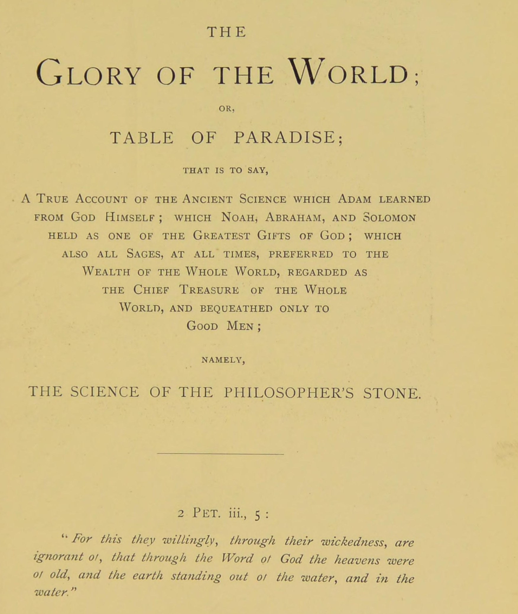

# 世界の栄光、あるいは楽園の板

著者不詳／全訳

- 原題：Gloria Mundi, alias Paradeiss Taffel（ドイツ語で書かれ、のちにラテン語訳が1678年の『ヘルメス博物館』〔Musaeum Hermeticum〕増補版に収められた。A・E・ウェイトが The Glory of the World, or, Table of Paradise として1893年の英訳第一巻に収めた）
- 内容：
  - 第一部は、この術を愛する人々への勧めに始まり、石を見分けるいくつもの方法、チンキの中の宝、体と霊、塩、土の浄め、太陽を父とし月を母とすること、第一の物質（金属の種）を説く。著者が子らに宛てた「遺言」も含む
  - 第二部は、アダムとセツと十字架の木の伝説、まことの術の説明、金属の起源、火と水、「子どもの尿」と「賢者たちのメルクリウス」、エメラルド板、アルベルトゥスによる組成を述べる
  - 第三部は、アダム、アベル、セツからピタゴラス、ヘルメス、モリエヌス、ゲベル、ノアに至る六十七人の「賢者たちの言葉」を並べ、そのうちのいくつかを一語ずつ解き明かす
  - 巻末の「もう一つの論文」は、天地と人の創造、アダムの堕落と、楽園を追われたアダムを支えた医薬、セツが植えたオリーブの種から十字架の木が育ったという伝説を語り、石の作業をアダム（体）とエバ（霊）の結婚になぞらえて説く
- 作業の基にした本文と扉：Internet Archive 所蔵の1893年英訳第一巻のスキャン（OCR の崩れた見出しは画像と照合した）
- 著作権：原典は十七世紀前半、ウェイトは1942年に死去。日本・米国・英国で保護期間が満了している
- 訳者：人工知能（Claude Opus 5.5）
- 訳の性格：全文を訳した。訳者の調べたかぎりでは、日本語訳は出ていない

## この本について

　『世界の栄光』は、『ヘルメス博物館』第一巻でいちばん長い作品である。著者の名は伝わらない。表題の「楽園の板」とは、アダムが楽園で神から直接に教わった学問、という意味で、本書は錬金術をアダムに始まり、ノア、アブラハム、ソロモンを経て代々の賢者に伝えられた神の賜物として描く。

　本書の中心は、同じ一つのことを何度も言い直す反復にある。石は「どこにでもあり、誰もが見ているのに、誰も気にとめないもの」であり、その物質は「一つのもの」で、体（土）と霊（水）とに分けられ、ふたたび結ばれる。著者は賢者たちの寓意を嘆き、自分は平明に書くと何度も約束しながら、肝心の物質の名だけは最後まで明かさない。その代わりに、六十七人もの「賢者たち」――アダムやノアや女預言者レアから、ピタゴラス、プラトン、アリストテレス、ゲベル、モリエヌスまで――の言葉を並べ、一致しているのは見かけの言葉ではなく、ただ一つの物質だと説く。この格言の部分は、中世の『哲学者たちの群衆（トゥルバ・フィロソフォルム）』の伝統を引いたものである。

　もう一つの特色は、聖書の物語と錬金術を重ねる語り口である。アダムは堕落ののち、神から石の秘密を教えられ、それで九百年を生きた。セツが楽園の門で受け取ったオリーブの種から十字架の木が育ったという中世の「十字架の木」伝説も、ここでは「魂の医薬」とその地上の対型である「体の医薬」という対比に組みこまれている。

　英訳の格言の中には、前後で文言の食い違うもの（格言と、のちの解説とで引用が違う）や、意味のとりにくい箇所がある。そうした箇所には〔　〕で注記した。

---

## 世界の栄光、あるいは楽園の板

**すなわち、アダムが神ご自身から学び、ノアとアブラハムとソロモンとが神の最大の賜物の一つとして保ち、またあらゆる時代のすべての賢者たちが全世界の富よりも重んじ、全世界の主な宝と見なし、ただ善き人々にのみ遺した古の学問、すなわち賢者の石の学問のまことの記述**

> 「天は昔から神の言葉によって成り、地は水から出て水の中に立っていたことを、彼らはその邪悪さのゆえに、わざと知ろうとしない」――ペトロの手紙二、三章五節

### 世界の栄光、あるいは楽園の板

**地上にその類の見いだされない術を含むもっとも貴い書。まことの哲学と、もっとも高貴な薬と、値のつけられないチンキとについての真理を、ほかのさまざまな貴重な術と、それに必要な道具とともに示す**

　さて、全能の創造主であり、この世界の保持者である神の名において、私はあえて、神が自然の中に植え、人に明かすことをよしとされる自然の隠れた秘儀を示そう。ものがいかに驚くべく創られ、自然物のあらゆる類がいかに不思議に生み出されるかを、人々が見るためである。すべての信じるキリスト者への証しとして、またすべての苦しみ悩む心への慰めとして。創られたすべてのものは、ただその種類に従って新たにされ、殖やされ、生かされ、完成されるためにのみ滅び分解されるのだから。創られたもの、生まれたもので休んでいるものは何もなく、それは日々、自然の側から増加あるいは増殖を受け、ついに全人類の宝となるよう創られ定められたものになるのである。

　それゆえ、この術を理解し、その祝福によってそれを神ご自身の栄光と隣人の益とのためにめでたく成しとげることのできる知恵と悟りとを授けてくださるよう、神に願え。

　それなら、もしこの知識を神の手から得ようとするなら、あなたは自分がみじめな罪人であることを告白し、神の祝福を懇願せねばならない。ただ神の祝福だけが、あなたにその賜物をふさわしく受けさせることができるのである。そして神がそれをまったくの憐れみからあなたに授けたこと、あなたのどんな高慢や僭越な傲慢も、神の怒りと永遠の断罪とに加えて、まちがいなくその喪失を招くことを心にとめねばならない。あなたはこの祝福された神的な作業を、神の名において、すべての善きキリスト者への奉仕と我々の信仰の建て上げとのために始めると決意せねばならない。不信仰者との戦いにおいて良い闘士となり、邪悪な人々の交わりを避け、けっして正しい者に対して口を開かず、困っている人々に施しを与えること。それはこの世の生ののちに、永遠の喜びと至福との冠を受けるためである。この宝は、地上のほかのあらゆる宝にまさるものであり、人の本性の弱さが許すかぎり、へりくだり、正直で、温和で、忠実な者であることを示し、神の恵みと祝福とによって神の掟を守り、賜物のまことの本性を取り違えたり、自分の永遠の幸いに反してそれを悪用したりしそうにない者だけに授けられるからである。それは聖霊の賜物であり、偉大な神の愛の恵みであり、光の父から降ってくる。この術を習得する者は、神に知恵を求めて得たにちがいない。その人は金と銀と、この世のあらゆる富ばかりでなく、完全な健康と長い寿命とを持ち、さらによいことには、我々の主であり救い主であるイエス・キリストの苦い受難と死、その陰府降り、三日目のその栄えあるもっとも聖なる復活、罪と死と悪魔と地獄とに対するその勝利と凱旋――命の息のあるすべての者に喜びと慰めとをもたらさずにはおかない勝利――の、心強い型から得られる慰めをも持つからである。

　では、イエス・キリストの人性と神性とが、一つの位格のうちにいかに驚くべく結び合わされたかを示そう。キリストの魂と体とその神性とは、あまりに分かちがたく結ばれていたので、永遠にわたって引き離すことはできない。それでもキリストは死なねばならず、その魂はその体から分けられ、三日目にふたたびそれと結ばれねばならなかった。その体が栄化され、その魂と霊と同じほど精妙にされるためである。キリストはその体をもっとも祝福された処女マリアの実体から受けたので、それはその魂と霊とからの一時の分離によって完成されねばならなかったからである。それでもその神性は、キリストの体と魂とともに一つの本質のうちに結ばれたままであった――墓の中では体とともに、楽園ではその魂とともにあった。

　キリストの体は、同じ力と栄光とを受けるために、その魂から分けられねばならなかった。しかし今や、キリストは死に、その魂はのちにその体とふたたび結ばれたので、それらはこれからのち、分かちがたく一つの精妙な本質へと結ばれている。キリストが父から受け、天と地のあらゆるものを治め、永遠から等しく完全なその神の全能は、今や、苦しみ、死に、よみがえり、天に昇った、限りない力と栄光と威厳と力と誉れとのうちにあるキリスト・イエスと一つの位格である。

　それゆえ、おお罪深い人よ、あなたに示された恵みと父の愛の慈しみとを全能の神に感謝せよ。そしてキリストに与えられた栄化をあなたも得られることを確信せよ。キリストが最初によみがえったのは、あなたのために天の父への道を開くためだからである。キリストのように、あなたもまた多くの困難と艱難と不安とによって、この世に対して十字架につけられねばならない。しかし体の栄化と永遠の命へのその更新とを理解するために、あなたは堕落した人間に対する神の父の愛と憐れみとを熱心に考えねばならない。神から降ってくるすべてのものは良い完全な賜物であることを心にとめよ。それゆえ、あなた自身の何の功徳もなしに無償で授けられた賜物を、魂の滅びにいたるまで汚く悪用することのないよう気をつけよ。むしろあなたのあらゆる行いが、あなたが神を愛し畏れていることを示すようにせよ。そうすれば、あなたが手をつけるあらゆる労苦は栄え、あなたははじめから終わりまで作業をめでたく喜ばしく進めるであろう。あなたの心配を神にゆだね、そのみ言葉を信頼し、その聖なる戒めを守れ。そうすれば神はあらゆることにおいてあなたとともにおり、あなたの労苦を祝福し、その父の愛によってあらゆる損失と害とを防いでくださるであろう。そのときあなたの術は、あなたにまことの慰めを与え、必要なものをすべてもたらし、あらゆる困難のうちにあなたを元気づけ、他人の必要を救う手段を備え、あなた自身の栄えある復活と、すべてのキリスト教の信者の復活との生きた型を、たえずあなたの目の前に置いてくれるであろう。それによって我々は、この地上の死すべき命を、限りない喜びと、永遠の朽ちない至福の栄光とに取り替えねばならないのである。

　それなら、この術のまことの愛好者になろうとするあなたに言おう。この術はまず楽園でアダムに神によって伝えられた。それは多くの秘密と秘儀とのまことの啓示だからである。それはあなたにあなたの体とこの世の命とのむなしさを示す。しかしそれはまた永遠の救いの希望であなたを慰めもする。それは、もし神がただの命のない自然物にこれほど驚くべき力を注ぎこんだのなら、それよりはるかにすぐれた我々は、きっと何か高い栄えある運命のためにとっておかれているにちがいない、という思いをあなたに起こさせる。それゆえ、あなたのするあらゆることにおいて賢くふるまい、急がず、そしてこの秘儀を、この術を愛し、敬虔で、誠実で、憐れみ深い気性の者でないかぎり、どんな死すべき人間にも明かさないよう懇願する。聖霊の霊感によってこの知恵を明かされた古の賢者たちの慣わしはそうであった。また、イエス・キリストが全能の天の父から出て、清い処女からも生まれたことを信じようとしない人々のために、あなたはこの術が本物であることを告白せねばならない。そのうえ、聖霊の賜物によってあなたを照らし、あなたの悟りを鋭くし、あなたの目を開き、我々の術の中に隠れ、どの賢者もその著作の中で言い表すことのできなかったあの測りがたい知恵への深い洞察を授けてくださるよう、神に願わねばならない。自然の中には、助けのない我々人間の理性ではとらえることのできない多くの秘密があるからである。もしあなたが私の指図に従い、神の恵みに導かれるままになるなら、神の栄光と隣人の益とのためにあなたが企てる作業は喜ばしい結末を迎えるであろう。飢えた者に食べさせ、渇いた者に飲ませ、裸の者に着せ、苦しむ者を慰め、病人と囚人とを訪ねよ。そうすればあなたは望むものを手にするであろう。

〔次の詩の題は OCR が崩れていて読めない〕

> 「内には一つの霊があり、汝はそれを熟慮した技によって体から分けねばならない。ただ物質の部分を蒸気から引き離せ。それから泉の冷たい水を加えよ。それで両方をたゆまず注ぎかけよ。そうすれば汝はこのすべてのまことのエリクシルを手にするであろう」〔詩の結びの数語は OCR が崩れていて読めない〕

### この術を愛するすべての人々への勧めと知らせ

**その中で彼らは、鏡の中でのように、術のあらゆる根本的で本質的な要件を見ることができる。まことの術に達することが可能かどうか、またそれについて**

　私はだれにでも、しかしとりわけ愛する弟子であるあなたがたに、あらゆる空想的な教えに用心し、私がこれから与えるまことの知らせに耳を傾けるよう、はっきりと力強い言葉で警告したい。

　第一に、俗衆の偽りの錬金術には近寄らないようにせよ。私はこれをあまりに多く経験してきたので、だれにもこの作業を企てることを勧めるのは気が進まない。この術はあまりによく隠されていて、ソル〔太陽〕とルナ〔月〕とが出会わないかぎり、地上のどんな死すべき者もそれを見いだすことができないからである。もし私の警告に熱心に耳を傾けるなら、あなたはその知識に達するかもしれない。しかしそうしなければ、けっしてそれに近づくことはないであろう。また知れ、石の組成に入るものは全世界にただ「一つ」のものしかなく、それゆえ、さまざまな成分の凝固や混合はみな、あなたがまったく誤った匂いをたどっていることを示すであろう。たとえあなたが我々の術のさまざまな作業をすべて行えたとしても、あなたの溶解、凝固、分解、蒸留、増量、白化などはみな、我々の物質のまことの知識がなければ役に立たないであろう。我々の術は良く貴いものであり、神によって明かされるか、熟練した師に教えられるかしないかぎり、だれもそれにあずかることはできないからである。それは全世界が買うことのできない宝である。それゆえ、わが子らよ、何に作業すべきかを知るまでは、労苦を費やしてはならない。たとえ正しい物質を知っていても、それを調製する方法の知識がなければ、その知らせは役に立たないであろうから。

　最後の効き目のある形の石は、全世界のどこにも、上なる天にも下なる地にも、どんな金属にも、どんな育つものにも、金や銀にさえも見いだされない。それは調製され、すなわちその最後の形へと発達させられねばならない。けれどもそれでも、厳密に言えば、それは神が創ったよりよいものにされることはできず、それからチンキを作ることもできない。「チンキ」はそれに加えられねばならず、それゆえ我々の主な目的とは何のかかわりもない。まったく別のものだからである。もしそれが何かの金属の中にあるなら、我々はきっとそれを太陽か月かの中に探さねばならないであろう。けれども月はそれを含むことができない。さもなければ月はずっと前に太陽になっていたであろう。またそれは水銀にも、どんな硫黄や塩にも、草やそういった性質のものにもない。それはのちに見るとおりである。さて、勧めを結び、術そのものの記述に進もう。

### ここに我々の石を見分けるいくつかの方法が続く

**一**

　知れ、我々の石は「一つ」であり、正当に石と呼ばれる。それは石「である」からであり、賢者たちの石という名ほど特徴をよく表す名を持つことはできなかったであろう。けれどもそれは現存する我々の石のどれでもなく、ただそれらに似ていることからその呼び名を得ているにすぎない。我々の石は四つの元素から成るように調製されるからである。このゆえにそれはさまざまな名で呼ばれ、さまざまな形をとってきたが、それは「一つ」のものであり、地上にはその類が見いだされない。それは石であって、何か一つの石の本性を持つという意味での石ではない。それは火であるが、火の外見も性質も持たない。それは空気であるが、空気の外見も性質も持たない。それは水であるが、水の本性に何の似たところも類縁もない。それは土であるが、土の本性も外見も持たない。それはそれ自体で一つのものだからである。

### 我々の貴い石を知るもう一つの方法

**二**

　ある古い哲学者は言う。我々の石は聖なる岩と呼ばれ、四つの仕方で分けられ、あるいは示される。第一に土に、第二にその増加に、第三に火に、第四に火の炎に。もしだれかがそれを溶かし、その塩を抽き出し、それを完全に凝固させる方法を知っているなら、その者は賢者たちの秘儀を授けられている。それゆえ、もし塩が白くなり、油のような外観を帯びるなら、それは染める。我々の術には三つの段階がある。第一に、全体を一つの塩に変成させること。第二に、三つの精妙な体を触れえないものにすること。第三に、全体の溶解全体をくり返すこと。もしこれがわかるなら、作業に手をつけよ。物質はただ一つのものであり、たとえそれについて十万冊の書物が書かれたとしても、一つのものにとどまるであろう。この術はあまりに大きな宝なので、全世界でもそれに十分な償いにはならないからである。それは曖昧な言葉で述べられているが、すべての人によってあからさまに名指され、すべての人に知られている。しかしもしすべての人がその秘密を知ったなら、だれも働かなくなり、それはその値打ちを失うであろう。このゆえに、それをだれにでもわかる言葉で述べるのは不敬であろう。神がそれを明かす者は、この暗い言い回しを理解しうるであろう。しかし大部分の人はそれを理解しないので、我々の術を不可能と見なしがちであり、賢者たちは邪悪な人間、詐欺師という烙印を押される。我々のことをこのように語る学識ある博士たちは、毎日それを目の前にしているのに、それに注意を払ったことがないので理解しない。そしてそれから、なんと、石を見いだす可能性を否定する。また彼らが盲目的に自分の気持ちと好みとに従っているかぎり、だれも我々の術の実在を彼らに納得させることはできないであろう。手短に言えば、彼らはそれを見分けるには賢すぎるのである。それは人の知性の範囲を越えており、へりくだって神の手から受けねばならないものだからである。

### 我々の祝福された石を知るさらにもう一つの方法

　哲学者モリエヌスは我々の石を水と呼ぶ。そして彼がそう名づけたのには十分な理由があった。おお、元素を保つ苦い味の水よ。おお、自然そのものに打ち勝つ栄えある本性よ。おお、自然に似て、その素直な本性を溶かし、自然を高め、光で冠され、汝自身のうちに第五精髄の作られる四つの元素を保つ汝よ。汝は単純な者のためのものである。汝はその働きにおいてもっとも単純だからである。自然の過程によってみごもると、汝は蒸気を産み出し、良い母である。汝は外からの助けを必要としない。自然は自然を保ち、自然の働きによって自然から分けられない。そのものは見つけやすく、その知識はたやすく、まったくなじみ深いものであるが、多くの者にとっては奇跡のようである。汝の溶解は大いなる栄光であり、汝を愛するすべての者は上に名を挙げられている。汝は大いなる奥義であり、多くの者には不可能に見える。

### 説明

　知れ、わが子よ、我々の石は書物で十分に述べることのできないものである。それは石であり、蒸発によって水になる。けれどもそれは石ではなく、もし化学の過程によって水の形を受けるなら、はじめはほかのどんな液体の水とも同じように薄い液体である。けれどもその本性は地上のほかのどんな水とも似ていない。全世界にこの水を得ることのできる泉はただ一つしかない。その泉はユダヤにあり、救い主の泉、あるいは至福の泉と呼ばれる。神の恵みによって、その場所は賢者たちに明かされた。それは秘密の場所から湧き出し、その水は全世界に流れる。それはすべての人になじみ深いが、泉を見つける原理も理由も道も、ユダヤへの道を見つける方法も、だれも知らない。しかし正しい泉を知らない者は、けっして我々の術の知識に達しないであろう。このゆえに、あの賢者が「おお、きつく苦い味の水よ」と叫んだのはもっともである。まことに、その泉は見つけにくいが、それを知る者は費用も労苦も骨折りもなしにたやすくそこに達することができるからである。その水はその本性上きつく苦く、だれもそれを飲むことができない。そしてそれは人類の大部分にとってほとんど役に立たないので、賢者はまたこう叫ぶ。「おお水よ、汝の大いなる力を悟らない俗衆に軽んじられている汝の中には、いわば四つの元素が隠れている。汝は、地上のほかのどんなものも持たない、自然を溶かし、保ち、結び合わせる力を持つ」。もしこの石の性質と外見とを知りたいなら、知れ、その外見は水のようであり、水はまず石に変えられ、次に石が水に、そして水がついに薬に変えられる。もし調製の方法を知らずに石を知っているなら、あなたの知識は、まことの物質を知らずに正しい方法を知っているのと同じく役に立たないであろう。それゆえ我々の心は、両方の知識について神への感謝に満たされる。

### チンキの中の宝について

　言っておくが、赤い〔チンキ〕を持つとき、あなたは世界のすべての宝でも買えないものを持っているのである。それはすべての金属をまことの金に変成させ、それゆえ太陽の調製物よりもはるかにすぐれている。薬としてはほかのあらゆる金にまさる。チンキを一滴、コップ一杯のぶどう酒に入れて飲めば、あらゆる病が癒される。そしてそれは、ここで長々と述べることのできないほかの多くの驚異をなす力を持つ。もし月のためのチンキを作りたいなら、赤いチンキを半オンスの五倍取り、火の作用にかけた月〔銀〕の半オンスの五百倍とよく混ぜよ。それから溶かせ。そうすれば全体はチンキと薬とに変わるであろう。このうち半オンスを取り、ウェヌス〔銅〕かほかのどんな金属かの半オンスの五百倍に投げ入れよ。そうすればそれは純粋な銀に変成されるであろう。あなたが熱心に調製した赤いチンキを一部分、金の千部分に対して取れ。そうすれば全体は赤いチンキに変わるであろう。このうちまた一部分をウェヌスかほかのどんな金属かの千部分に対して取ってもよい。そうすればそれは純粋な金に変わるであろう。このためには金も銀も買う必要はない。最初の投げ入れは両方とも約一ドラクマでできる。それからチンキでますます多く変成させることができる。

また知れ、我々の術において、我々は二つのもの、体と霊とを区別する。前者は不変すなわち固定しており、後者は揮発性である。この二つは互いに一方から他方へ変えられねばならない。体は水にならねばならず、水は体にならねばならない。それからまた体はそれ自身の内なる働きによって水になり、二つのもの、すなわち乾いたものと液体のものとは、もう一度分かちがたい結合のうちに結び合わされねばならない。この結合は、二つが「一つ」のものから得られたのでなければ起こりえないであろう。永続する結合は同じ本性のもののあいだでしか可能でないからである。我々の術において起こる結合はこの種類のものである。物質の構成部分は、人の手によってではなく、自然の働きによって結び合わされるからである。物質は、のちに説明するように、二つの部分に分けられる。たとえば鷲は「水」であり、それが抽き出されると、残りは死んだ命のない体である。もしそれが命に戻されねばならないなら、霊がもう一度それに結び合わされねばならない。それも独特の仕方で。我々が見るように、それはしだいにまた一羽の鷲のあとにもう一羽を食い尽くすからである。そのとき体はそのあらゆる粗さを失い、新しく純粋になる。またこの体と魂とはけっして死ぬことができない。最後の日の我々の体と魂との結合のような、永遠の結合に入ったからである。

### 我々の石のもう一つの記述

　賢者たちの謎（石）は術全体の塩であり根であり、いわばその鍵であって、それなしにはだれもその秘密の入口を閉じることも開けることもできない。塩とその調製とを知らない者は、この術を理解できない。その調製は湿って温かい、ふさわしい場所で行われる。そこでその液体の溶解がなしとげられねばならず、そのあいだその実体は損なわれずに残る。これはゲベルの言葉である。

### 説明

　知れ、ゲベルの語る塩は、塩の種に固有の性質を何も持たないが、それでも塩と呼ばれ、塩「である」。それは黒く悪臭を放ち、化学的に調製されると血の外観を帯び、ついに白く、純粋で、澄んだものにされる。それは良い貴い塩であり、それ自身の働きによって、はじめは不純で、それから純粋になる。それは自らを溶かし凝固させる。あるいは賢者の言うように、自らを閉じ、自らを開く。賢者たちの塩のほかに、この性質を持つ塩はない。その化学の発達を、それは湿ったふさわしい場所で受けることができる。そこでその湿り気は（賢者の言うように）マリアの浴の中で溶かされうる。彼の意味するのは、その水が蒸留されるほど温かくなければならないが、新しくない馬糞よりも温かくてはならない、ということである。

### 我々の石のもう一つの記述

　マケドニアの王アレクサンドロス大王は、その『哲学』の中で次の言葉を記している。知れ、塩は火であり乾きである。火は凝固させ、その本性は熱く、乾き、最も内なる部分にまでも浸透する。その性質は、火の、すなわち自然の火の極みの変化とともに、太陽と月とのように白くなることであり、そのあいだ太陽は赤さを、月は白さを回復させ、体をその霊的な状態へと導き、同時にその黒さと悪い硫黄とを取り除く。それによって体は焼成される。それは赤と白とのチンキの秘密、すべてのものの土台であり根であり、人の理性ある魂に次いで創られたすべてのもののうちで最善のものである。全世界のどんな石もこれより大きな効験を持たず、地上のどんな子もこの石なしに術を見いだすことはできないからである。すべてのものの変成のためにこの術を塩の中に創られた天の神はほむべきかな。それはすべてのものの上にあり、すべてのものの中にある第五精髄だからである。いと高き神は天からこのように被造物を祝福されただけでなく、賛美、すぐれたさま、力、知恵がこの塩の中に存在すると認められるべきである。それを溶かし凝固させることのできる者は、この術の奥義によく通じている。我々の塩は、ある貴い塩の中に、またすべてのものの中に見いだされる。このゆえに古の賢者たちはそれを「普通の月」と呼んだ。すべての人がそれを必要とするからである。もし富みたいなら、この塩を甘くなるまで調製せよ。ほかのどんな塩もこれほど永続せず、これほど「魂」を固定し火に抵抗する力を持たない。大地の塩は魂である。それはすべてのものを凝固させ、大地が滅ぼされるときには大地のただ中にある。また地上にはそのチンキに似たものは何もない。それはレビス（二つのもの）と呼ばれ、石であり、塩であり、「一つの」体であり、人類の大部分にとっては卑しく軽んじられたものである。けれどもそれは体を浄め回復させ、我々の術全体の鍵を表し、すべてのものはその中に要約されている。ただその入りこみはあまりに精妙なので、それに気づく者は少ない。けれどももしそれが体に入れば、それを染め、完成へと導く。それなら、この塩とその入りこみとのほかに、神に何を望むべきであろうか。

　もし人が十万年生きたとしても、この高貴な宝が灰から得られ、またふたたび灰に還元される驚くべき仕方に、十分に驚嘆し尽くすことはけっしてできないであろう。灰の中には塩があり、灰を焼けば焼くほど、それはますます多くの灰を与える。また気づくがよい、〔その〕大地から出たものは、火から出て火に帰るのである。だれもが、塩の中にはメルクリウスを殺す二つの塩があることを告白せねばならない。これはまことに深い言葉である。硫黄と根本の液体とは、もっとも精妙な本性の土の中に生み出され、こうして賢者の石が調製される。それは、哲学者たちの述べるとおり、異物を何も加えずに、すべてのものを「一つ」のもの、一つの本性から生じさせる。我々の物質は地上でもっともありふれたものの一つであり、それ自身のうちに四つの元素を含んでいる。じっさい、これほど多くの人がこれほどありふれたものを探しながら、それを見つけられないのは驚くべきことにほかならない。この塩のほかの多くの特徴を書き記すこともできようが、私はこの主題のさらなる詳論は読者にまかせ、その実と入りこみと命とについて、園を開いて栄えある薔薇をちらりと見る仕方について、それが殖え千倍の実を結ぶ仕方について、またいかにして死んだ体を現れさせ、不死の命へとよみがえらせ、その力によって不完全な体に入り、それを浄め、完成へと、変わらない永続の状態へと導くことができるかについて、もっと詳しく述べることに限りたい。

　私は今、石について三つの面から、すなわち植物の石、動物の石、鉱物の石として、またそのうちで、すべてのものに命を与えるあの四つの元素を含むものについて語ろうと思う。この一つの物質を空気を通さない蒸留器に入れ、のちに述べる我々の術の教えに従って扱え。そうすれば畑に種をまくことができ、鉱物の石と、自分の霊をあれほど多く吸いこむ緑の獅子とを得る。そのとき命は蒸留器を通してその霊に戻り、死んだ体は器の底に横たわる。後者の中にはなお火が引き離すことのできない二つの元素がある――〔それより〕先に灰が火そのものの中で焼かれ、塩はそれによっていっそう強くなるからである。土は白くなるまで焼成されねばならない。そうすれば土はおのずから分けられ、それ自身の土と結び合わされる。あらゆるものはそれに似たものと結ばれようとするからである。それに冷たく湿った元素を飲ませ、二つがよく混じるよう八日間置いておけ。そのあと何をするのが最善かは、あなた自身で見なければならない。今のところ、これ以上の情報を与えることはできないからである。太陽と月とは、男と女とのそれのような交わりを持たねばならない。さもなければ我々の術の目的は達せられない。ほかの教えはみな偽りで誤っている。この塩を我々の術のまことの土台と考えよ。その値打ちはこの世のすべての宝にまさるからである。それ自身はチンキへと発達させられるのではなく、チンキがそれに加えられねばならない。また我々の術の物質はどんな金属の中にも見いだされない。

### 物質と方法とのもう一つの記述（セニオルによる）

　この賢者によれば、自然のものとは、自然の物質から自然の方法によって生み出され産み出されたものである。さて、その第一の、すなわち月の段階において、我々の石は凝固した白い土から生み出される。賢者の言うとおりである。我々の白い土の中に我々の太陽を見よ。また我々の術における結合がそれによってなされるものを。それは二度水に変成され、その揮発性の発散物は、我々の物質のうちでもっとも貴いものを表し、人の体の最高の慰めである。この水によって金属の内なるメルクリウスを抽き出さねばならない。それゆえ、我々の石は二つの光体（金と銀）の元素から得られ、我々の水銀、燃えない油、体の魂であり光であると呼ばれることになる――それだけが死んだ不完全な体に永遠の光と命とを与えうるのである。それゆえ、わが子よ、知性と大いなる活動とをもって、我々の物質から水銀を絞り出すよう、祈り、懇願する。

### 「土」をその余分な土から浄めること

　前述の土すなわち物質を、その水と霊とを抽き出すように、浄めるか焼成するかせねばならない。後者を瓶に閉じこめ、物質が指三本か四本の高さまでおおわれるまで普通の生命の水〔アルコール〕を注げ。それから一時間火の作用にかけ、浴によって熱心に蒸留せよ。残ったものはまた焼成し、「土」の中にもう何も見いだされなくなるまで、その水で抽き出さねばならない。土は過程の第二の段階のためにとっておけ。抽き出した水はおだやかな火で蒸留せよ。そうすれば蒸留器の底に、水晶の石に似たある美しい物質が見いだされるであろう。それはあらゆる土の粗さから浄められており、「我々の土」と呼ばれる。この物質をガラスの（かぼちゃ形の）蒸留器に入れ、乾いて白くなり、しかもなお液体であるまで焼成せねばならない。そのときあなたはこの世の宝を得たのである。それは地上のあらゆるものを浄め完成させる力を持ち、すべてのものに入り、メルクリウスすなわち体によって、すべてのものの中の固定した塩を養う。

### 我々の石のもう一つの記述

　知れ、わが子らよ、我々の術がそこから練り上げられる石は、その生成ののちけっして大地に触れない。もしそれが大地に触れれば、我々の目的には役に立たない。もっともそれは、その最初の誕生においては太陽と月とによって生み出され、ある土の元素を体現しているのだが。それは大地の中で生み出され、それから砕かれ、滅ぼされ、殺される。そこから一つの蒸気が起こり、それは風とともに海へ運ばれ、そこからふたたび陸へ連れ戻され、そこでほとんどすぐに消えてしまう。それは地面に触れる前に、空中でとらえねばならない。さもなければ蒸発してしまう。それが海から陸へ運ばれるやいなや、すばやくそれをつかまえ、瓶に閉じこめ、それから述べた仕方で扱わねばならない。その到来は、それに伴う風と雨と雷とによって知ることができる。それゆえそれをとり逃がしてはならない。それは毎日新たに生まれるけれども、世のはじめから存在していた。しかし地面に落ちるやいなや、それは我々の術の目的には役に立たなくなる。

> 「我々の土から実り豊かな泉が湧き出し、そこから二つの貴い石が流れ出る。第一のものはまっすぐ太陽の昇るほうへ急ぎ、もう一つはその沈むほうへ道をとる。それらから二羽の鷲が飛び立ち、炎の中へ飛びこみ、もう一度大地に落ちる。どちらも羽を備えており、太陽と月とはその翼の下に置かれて完成される」

　また知れ、この泉からは二つの水が流れ出る。一つ（それが「霊」である）は昇る太陽のほうへ、もう一つ、「体」は沈む太陽のほうへ。二つは本当はただ「一つ」のまことに澄んだ水であり、まったく飲めないほど苦い。この水の量はあまりに多く、全地に流れているが、この術の知識のほかには何にも導かない。それはまた、それを望む人々によってあまりにしばしば誤用される。また「火」を取れ。その中にあなたは石を見いだすであろう。全世界のほかのどこにもない。それはすべての人に、若い者にも老いた者にもなじみ深く、田舎にも村にも町にも、神の創ったあらゆるものの中に見いだされる。けれどもそれはすべての人に軽んじられている。富める者も貧しい者も毎日それを扱う。それは下女たちによって通りに投げ捨てられる。子どもたちはそれで遊ぶ。けれどもだれもそれを重んじない。それは人の魂に次いで、地上でもっとも美しくもっとも貴いものであり、王や君主を倒す力を持っているのに。それでもそれは地上のものの中でもっとも卑しく下等なものと見なされている。それはすべての人に投げ捨てられ、退けられる。じっさいそれは、ソロモンの建築者たちが退けた石である。しかしもしそれが正しい仕方で調製されるなら、それは値のつけられない真珠であり、じっさい、天の隅の親石キリストの地上の対型である。キリストがこの世でユダヤの民にさげすまれ退けられながら、天と地とよりも貴かったように、我々の石も地上のもののあいだでそうである。それが見いだされる泉は自然の泉と呼ばれるからである。自然によってすべての育つものが太陽の熱によって生み出されるように、我々の石もまた、生み出されたのち、自然によって生まれるのである。

　我々の石を含む水を見いだしたら、それから何も取り去らず、それに何も加えてはならない。それはそれ自身のうちに含むものによって、すっかり調製されねばならないからである。それから蒸留器の中で水を抽き出し、液体を乾いたものから分けよ。そうすれば体はガラスの上にひとりで残り、水は下の部分へ流れ落ちる。そこで上に述べた仕方で水をもう一度体に結び合わせよ。そうすればあなたの仕事はなしとげられるであろう。また知れ、我々の石のある水は、四つの元素のよく釣り合った割合から成っている。化学の過程において、あなたは土と油と水と、すなわち体と霊と魂とを見分けることを学ぶであろう。土はガラスの器の底にあり、油すなわち魂は土とともにあり、水はそれから蒸留される霊である。同じようにあなたは二つの色、すなわち月と太陽とを表す白と赤とに出会うであろう。油は火すなわち太陽、水は空気すなわち月であり、太陽と月とは結合に入らねばならない銀と金とである。しかしもう十分である。この書簡で私の言ったことで、あなたは石を見いだせるはずである。そしてもしここでそれを見いだせないなら、それがけっしてあなたに知られることはないと確信せよ。それゆえ術を愛する者であれ。そして永遠にいたるまで、全能の神にゆだねられてあれ。主の降誕ののち一五二六年に記す。

　このように賢者たちは、二つでありながらただ「一つ」の水について書いている――そしてその中にのみ石は見いだされる。また知れ、土の部分が欠けているだけ、天の部分はいっそう豊かにある。さて、この石はあらゆる乾いた干からびた体を湿らせ、あらゆる冷たい体を温め、あらゆる不純な体を澄んで純粋にする。それは自身のうちに、師の術と火の生かす霊とによって吹きこまれたあらゆる癒しと変成との力を含んでいる。それゆえいつの時も神に感謝あれ。

### 太陽がその父、月がその母である

　もしその二つの霊を持つなら、それらは石を産み出す。石は硫黄すなわち太陽の一部分と、メルクリウスすなわち月の四部分とから作られる。硫黄は温かく乾き、メルクリウスは冷たく湿っている。以前に水であったものはふたたび水に溶かされねばならず、以前にメルクリウスであった体はふたたびメルクリウスにならねばならない。

### 第一の物質、すなわち金属の種について――夫の種と妻の種とを含めて

　金属は、ほかのすべての被造物と同じく、それ自身の種を持つ。生成と出産とは、ほかのすべての育つものと同じく、それらの中でも起こる。もしそうでなかったら、我々はけっして金属を持たなかったであろう。さて、種は土から液化される金属の物質である。種は「その」土に投げこまれ、ほかのあらゆる被造物の種と同じようにそこで育たねばならない。それゆえ我々は土すなわち我々の第一の物質を調製し、その中に種を投げこまねばならない。そうすればそれはその種類に従って実を結ぶであろう。この運動は、「一つ」のもの、すなわちあの第一の物質からの生成のために必要とされる。体は霊にならねばならず、霊は体にならねばならない。そこから、一つの色から別の色へと変成される薬が生じる。さて、白の中に求められるものは白を生み、赤も同じように赤を与える。第一の物質は「一つ」のものであり、人の手ではなく神の手によって今の形に形づくられ、自然だけによって結び合わされ、その〔存在〕本質へと変成された。これを我々は取り、溶かし、ふたたび結び合わせ、それ自身の水で、それが白くなり、それからまた赤くなるまで洗う。こうして、今その中に我々の太陽と月とをたやすく見ることのできる我々の土は浄められる。太陽は金属の父であり、月はその母だからである。そしてもし生成が起こるべきなら、それらは夫と妻とのようにいっしょにされねばならない。どちらも単独では何も生み出せず、それゆえ赤と白とはいっしょにされねばならない。そしてそれについて千冊の書物が書かれたとしても、それでも第一の物質は一つより多くはない。それは我々が我々の穀粒、すなわち我々の太陽と月とを投げこむ土であり、それらはそれからその種類に従って実を結ぶ。もしそれ自身が金属に投げこまれるなら、それは最善のもの、すなわち太陽と月とに変えられる。これはまことに真実である。神に感謝あれ。

### まことの術の単純な説明

　賢者たちによれば、どんな体も霊の凝固なしには溶かされない。霊が体に変成されるやいなや、〔石は〕その力を受けるからである。霊が揮発性で蒸発しやすいあいだは、何の効果も生み出せない。それが固定されると、ただちに働きはじめる。それゆえ、パン屋がパンを作るようにそれを調製せねばならない。霊を少し取り、パン屋が粉にパン種を加えるように、全体がふくらむまでそれを体に加えよ。我々の霊すなわちパン種についても同じである。物質は、すっかりふくらむまで、たえずパン種で浸透されねばならない。こうして霊は体を浄め霊化し、ついに両者は一つに変成される。そのときそれらは、投げ入れられるすべてのものをそれら自身の本性に変成させる。二つは、雌鶏が卵をかえすのと同じ度合いの温かさを与える、おだやかで絶えまない火によって結び合わされねばならない。それから熱すぎも冷たすぎもしない聖マリアの浴に置かれねばならない。湿ったものは乾いたものから分けられ、またそれと結び合わされねばならない。結び合わされると、それらはメルクリウスを純粋な金と銀とに変える。そのときから、あなたは貧しさの苦しみから安全であろう。しかし、多くの人から隠されたその恵み深い賜物を神に感謝するよう気をつけよ。神がその秘密をあなたに明かしたのは、あなたがその聖なる御名をほめたたえ、困っている隣人を助けるためである。それゆえ、あなたにゆだねられたタラントンを隠すことのないよう、よく気をつけよ。むしろ神の栄光と隣人の益とのために、それを利子つきで貸し出せ。人はみな仲間を助け、その必要を救う神の手の道具となる義務があるからである。この規則について、聖書はヨセフ、ハバクク、スザンナその他の例で一つのたとえを与えている。

### ここに、愛するわが子らよ、心を尽くしてあなたがたのために書いた私の遺言が続く

　この術の愛する学徒よ、いとしい子らよ、あなたがたのために、私はこの遺言を書き記した。物質について、方法について、避けるべき落とし穴について、賢者たちの書物を理解する唯一の道について、あなたがたを教え、諭し、警告し、知らせるためである。全能の神がすべてのものを乾いた元素と湿った元素とから創ったように、我々の術も、神の恵みによって、まったく同じ道をたどると言ってよい。それゆえ、もしだれかが創造する自然の原理と方法とを知っているなら、その人は我々の術をよく理解するはずである。もしだれかが自然の方法を知らないなら、その人には我々の術が難しく思われるであろう。じっさいには、麦芽を砕いてビールを醸すのと同じくらいたやすいのだが。聖書の証しによれば、はじめに神が天と地とを造ったとき、ただ「一つ」の物質しかなかった。湿ってもおらず乾いてもおらず、土でも空気でも火でも光でも闇でもなく、蒸気か霧に似た、目に見えず触れることもできない一つの単一の物質であった。それはヒュレー、すなわち第一の物質と呼ばれた。もし何かがもう一度無から作られるべきなら、その「無」は結び合わされて「一つ」のものとならねばならない。この「一つ」のものから触れうる物質が生じ、触れうる物質から「一つの」体が生じ、それに生きた魂が与えられねばならない。そこから、神の恵みによって、それはその種の形を得る。神が物質を造ったとき、それは乾いていたが、湿り気によってまとまっていた。もしその湿り気から何かが育つべきなら、それは乾いたものから分けられ、火はそれだけで、土はそれだけで得られねばならなかった。それから、もしそれから何か湿ったものが育つべきなら、土は水を注がれねばならなかった。湿り気なしには何も育たないからである。同じように、水の中では、根を下ろす土がなければ何も育たない。それなら水が土をうるおすべきなら、水を土に触れさせる何かがなければならない。たとえば風は、普通の水がみな海へ流れてそこにとどまるのを防ぐ。こうして一つの元素はほかの元素の助けなしには実を結ぶことができない。もし風を動かすものが何もなかったら、風はけっして吹かないであろう――それゆえ火が、風を駆り立て、その仕事をさせる務めを受けたのである。このことは、火の上で水を沸かすとき見ることができる。そのとき湯気が立ちのぼるが、それは本当は「空気」である。「水」は凝固した空気にほかならず、空気は太陽の熱によって水から生み出されるからである。太陽は水を照らし、湯気が出てくるのが見えるまでそれを熱する。この蒸気は風になり、〔その〕空気の量が多いために、我々は湿り気と雨とを得る。こうして空気はもう一度水すなわち雨に変えられ、あるいは凝固させられ、地上のすべてのものを育て、川と海とを満たす。

　我々の石も同じである。それは日々太陽と月とによって〔その〕空気から、ある蒸気の形で生み出される。そう、紅海を通ってさえ。それはユダヤで自然の水路を流れ、我々はそこへそれを導かねばならない。もしそれをつかまえたら、我々はその手と足とを切り落とし、その頭を引きちぎり、それを赤〔い色〕へ導こうと努める。もしその中に何か黒いものを見つけたら、それをはらわたや汚物とともに投げ捨てる。それが浄められたら、我々はその肢体を取り、それをふたたび結び合わせる。すると我々の王は生き返り、二度と死なず、あらゆる硬い体に行き渡り、それを自分よりもさらに精妙にするほど純粋で精妙になる。また知れ、全能の神がアダムを楽園に置いたとき、神は次の言葉でこの二つのものを彼に示した。「見よ、アダムよ、ここに二つのものがある。一つは固定して永続し、もう一つは揮発性である。その秘密の力を、汝はその子ら「すべて」に知らせてはならない」。

　わが兄弟よ、土は不変であり、水は揮発性である。何かが燃やされるときに見られるとおりである。そのとき不変なものは残り、揮発性のものは蒸発する。残るものは灰に似ており、それに水を注ぐとアルカリになり、灰の効力は水に移る。もしその灰汁を澄ませ、鉄の器に入れ、火の上で湿り気を蒸発させるなら、底に、以前灰汁の中にあった物質、すなわち灰がそこから得られた物質の塩を見いだすであろう。この塩は、「本当の」石を作るのに用いられるのとまったく同じ過程で得られることから、賢者の石と呼んでもまったく差し支えないであろう。もっとも同時に、それは我々の作業には何の役にも立たないが。我々の石を含む物質は一種の灰汁であるが、それはもちろん人の手で灰と水とから作られたものではなく、神の創造と定めとに従って自然によって結び合わされ、四つの元素から混じり合わされ、その完全な化学の発達に必要なものをすべて持っているからである。もし我々の石を含む物質を取り、蒸留器の中で聖マリアの浴にかけて蒸留すれば、水は受け器〔原文 antisternium〕に流れ落ち、塩すなわち土は底に残り、あまりに乾いていて水をまったく含まない。湿ったものを乾いたものから分けたからである。体を細かく搗き、聖マリアの浴に入れ、すっかり分解されるまで熱にさらせ。それからその水を、ゆっくりと、長い間隔をおいて、それが澄むまで飲ませよ。それは自らを凝固させ、溶かし、浄めるからである。蒸留された水はその体に命を与える霊であり、そのただ一つの魂である。水は風（空気）であり、風は命であり、命は魂〔の中〕にある。化学の過程において、あなたは水と油とを見いだす――しかし油はつねに体とともに残り、いわば焼いた血である。それから、それは長く続くおだやかな熱によって体とともに浄められる。しかし、この第一部の終わりに遺言の形であなたに遺す私の指図を理解する前に、この術に取りかからないよう気をつけねばならない。石は、本質的に一つであるこの物質のほかには、全世界の何からも作られないからである。それを知らない者はけっして術に達することができない。それは、金や銀や硫黄や塩などのように鉱山や大地の洞窟から掘り出されるのではなく、神がもともとそれに与えた形のままで見いだされるあの一つのものである。それは空気の過度の濃縮によって形づくられ現れる。その体を離れるやいなやはっきりと見えるが、大地に触れるやいなや跡形もなく消えうせ、二度と見られないので、まだ空中にあるうちにつかまえねばならない――前にも一度告げたとおりである。私はそれをさまざまな名で呼んできたが、もっとも単純なのはたぶん「ヒュレー」、すなわちすべてのものの第一原理であろう。それはまた、敵対する元素から成る哲学者たちの一つの石、太陽の石、金属の石、逃亡する奴隷、空気の形の石、ティルニアの石〔原文 Thirnian〕、マグネシア、物体の石、宝石の石、自由な者の石、黄金の石、地上のものの泉、クセリス、すなわちシレクス（火打ち石）、クシダル、すなわちラディクス（根）、アトロプ、すなわちポルタ（門）とも名づけられる〔いずれも綴りを逆さにした語〕。これらやほかの多くの名でそれは呼ばれるが、それはただ「一つ」である。もしまことの錬金術師になりたいなら、ほかのあらゆる物質に近寄らず、ほかのあらゆる助言者に耳を貸さず、我々の石とその調製とその力とをよく知るよう努めよ。

　わが子よ、私のこの遺言を大いに重んじよ。私はその中で、あなたへの愛と憐れみとから、明かすべき以上のことを明かすよう私を駆り立てる熱い衝動に手綱をゆだねたのだから。しかし、我々の主であり救い主であるイエス・キリストの受難にかけて願う。私の遺言を無知な者、ふさわしくない者、邪悪な者に伝えてはならない。神の正しい復讐があなたの上にくだり、あなたを永遠の罰の口を開けた淵に投げこむことのないように。同じ憐れみ深い神が、我々をそこからもっとも憐れみ深く守ってくださいますように。

　前述のヒュレーの本性を示すのは、けっして軽いことではない。ヒュレーは第一の物質、賢者たちの塩、アゾト、すべての金属の種であり、それは「マグネシア」と月との体から抽き出される。

　ヒュレーはすべてのものの第一原理――はじめからあった物質である。それは湿ってもおらず、乾いてもおらず、土でも水でも光でも闇でもなく、これらすべてのものの混合であった。そしてこの混合こそヒュレーである。

## この書の第二部

　はじめに、全能の神が、ほかのすべての地上と天の体とともに我々の始祖アダムを創ったとき、神は彼を楽園に置き、永遠の死の罰のもとに、善悪の知識の木の実を食べることを禁じた。アダムが神の掟に従っているあいだ、彼は不死であり、完全な幸いに必要なものをすべて持っていた。しかし禁じられた実にあずかったとき、彼は神の命によってこの世に追い出され、そこで彼とその子孫とはそれ以来、貧しさと病と不安と苦い悲しみと死とのほかは何も味わってこなかった。もし神の命令に従っていたなら、彼は楽園で千年を完全な幸いのうちに生き、それから天へ移されたであろう。そして同じ幸いな運命が彼のすべての子孫を待っていたであろう。その不従順のために、神はあらゆる種類の苦しみと病とで彼を罰した。しかしその憐れみによって、彼に一つの薬をも示した。それによって、罪によって持ちこまれたさまざまな欠陥が癒され、飢えと病との痛みに抵抗できるようにするためである。ちょうど我々が体の食べ物と飲み物とによって保たれ強められるように。

　この原罪のために、アダムはその大きな知恵と、神が彼に教えた多くの術とにもかかわらず、まる千年を満たすことができなかった。しかしもし草の力と薬とを知らなかったなら、彼はきっとあれほど長くは生きなかったであろう。けれどもついにその薬がもはや命を保つのに役立たなくなったとき、彼は息子セツを楽園に遣わして命の木を取って来させた。セツはそれを霊的な仕方で得た。しかしセツはまた、憐れみの油の木のオリーブの実をいくつか求めて与えられ、それを父の墓の上に植えた。そこから聖なる十字架の祝福された木が生え出た。それは我々の贖い主のあがないの死によって、我々みじめな罪深い人間にとって、もっとも力ある命の木となった。我々の始祖アダムの願いの恵み深い成就として。他方、アダムの堕落によって人ばかりでなく植物や動物にももたらされた苦しみと病と不完全さとは、エリクシルあるいはチンキと呼ばれる全能の神のあの貴い賜物のうちに薬を見いだした。それは人の体ばかりでなく金属の体の不完全さをも浄め去る力を持ち、太陽の輝きが月と星々とをはじ入らせるように、ほかのあらゆる薬にまさる。このもっとも高貴な薬によって、アダムの死から第四の王国にいたるまで、多くの人々が完全な健康と大いなる長寿とを得た。それゆえ、薬をよく知っていた人々は三百歳に、ほかの人々は四百歳に、ある人々はアダムのように五百歳〔原文のまま〕に、またほかの人々はメトシェラやノアのように九百歳に、そしてその子らのある者はさらに長い年月に達した。たとえばバカム、イルレフル、カリクス〔いずれも原文の綴り〕、ヘルメス、ゲベル、アルバヌス、オルトゥラヌス、モリエヌス、マケドニアのアレクサンドロス、アナクサゴラス、ピュタゴラス、そのほか祝福された石の薬を黙して持ち、それを悪い目的に用いず、邪悪な者に知らせもしなかった多くの人々である。ちょうど神ご自身があらゆる時代に、高慢な者、不純な者、ひねくれた者からこの知識を隠してきたように。しかし、神が石にこれほどすぐれた力を入れ、動物の体を回復させ金属を完成させる力を与えたことを不思議に思うのはやめよ。私は「世界の栄光」と題した私の書の三つの部分で、事柄全体をあなたに説明したいと望んでいるのだから。もし私の教えを受け入れ、私の指図に従うなら、あなたは自分の幸いな経験によって私の主張の真実を証明できるであろう。さて、この大いなる成果に達したなら、あなたのタラントンを隠さないよう気をつけよ。それを苦しむ者の慰めのため、キリスト教の学校と教会とを建てるため、聖なる三位一体の栄光のために用いよ。さもなければ、神はその賜物をあなたが罪深くもないがしろにしたことについて、永遠の清算を求めるであろう。神がそのような罪から我々を守り、その聖なる言葉のうちに我々を固く立たせてくださいますように。

### 読者へ

　親切な読者よ、もし私の書を読み通し消化するのが退屈なことに思われるなら、あなたの目の前にある大いなる目的を心にとめて自分を励ますよう勧める。そうすれば、この書がまことに楽しい読み物であり、まさに喜びであることがわかるであろう。神が――その聖なる尊い御名があらゆる時にほめたたえられますように――その言いあらわしえない憐れみによって、このもっとも真実で高貴な術のマギステリウムを私に知らせてくださったので、私は兄弟愛に動かされ、駆り立てられて、この宝を生み出す仕方をあなたに示そうとする。私が長い実りのない探索の途中で強いられた、身を滅ぼすような骨折りと出費とを、あなたが避けられるように。私はできるかぎりはっきりと率直であるよう努めよう。詐欺や悪意や貪欲のありうる非難から自分の身の潔白を明かすために。私は、神が私の信託にゆだねた賜物が、私の手の中で錆びたり、腐ったり、役に立たなくなったりしないことを、何よりも切に望んでいる。このもっとも貴い薬は栄えある力にあまりに満ちているので、あなた自身の悟りが示すであろう理由によって、まことに正しく憐れみの油と呼ばれるのだから。それゆえこの前置きの問題に長々と立ち入る必要はない。私はただちに術そのものの説明に進み、あらゆる惑わす詐欺師に用心させ――手短に言えば、石の知識と所有とに、またこの術の作業に至る、まことの、あやまたぬ、喜ばしい道をあなたに開くことができる。

　それゆえ私――石を持ち、この書をあなたに伝える者――は、この私の「楽園の板」と「世界の栄光」とを、貧しい者を虐げるすべての高慢で不正な者から、すべての僭越な、浅はかな、あざける、中傷する、邪悪な者から守り、神の永遠の罰の苦しみにかけて、彼らの手に渡さないよう、忠実に諭し、懇願する。この警告を心にとめるよう願う。しかし他方、私のこの板を、神の憐れみの賜物を感謝して敬い、正しく用い、ふさわしくない者から隠すであろう、すべてのまことの、貧しい、敬虔な、正直な、慈悲深い人々には、伝え分け与えよ。それでも、たとえ私の書が邪悪な人々の手に渡っても、神は彼らを盲目で打ち、私の意味をあまり多く悟ることを妨げ、私の指図を実行しようとするあらゆる試みをくじくであろう。神は邪悪な者を混乱させ、その僭越を無にする方法を知っているからである。ダビデがその詩編で我々に告げるとおりである。「汝はその敵を手に握り、その心の罠のうちに彼らを抑えるであろう」〔原文のまま。聖書の本文どおりではない〕。それゆえ、わが子らよ、私の教えに熱心に耳を傾けるよう願う。そうすればあなたはこの世の生を健康と幸いとのうちに過ごし、ついには永遠の喜びを受け継ぐであろう。父なる神、子なる神、聖霊なる神が、この私の願いを聞き届けてくださるよう祈る。

### まことの術の説明

　この術のすべての率直な学徒に知らせる。賢者たちは、真実の印象をも偽りの印象をも与えうる言葉を用いる習いである。前者は自分の弟子と子らとに、後者は無知な者、愚かな者、ふさわしくない者にである。哲学者たち自身はけっして偽りの主張をしないことを心にとめよ。誤りは（もしあるとすれば）彼らにではなく、その鈍さのために意味を悟るのが遅い人々にある。それゆえ、こうした経験のない人々は、賢者たちの水の代わりに、黄鉄鉱、塩、金属、そのほかさまざまな物質を取る。それらはたいへん高価であるが、我々の目的にはまったく役に立たない。まことの物質を薬屋で買おうと夢にも思う者はいないであろう。いや、あの商人は毎日それを値打ちのない屑として通りに投げ捨てている。けれども我々の石の物質は、無知ないかさま師たちの用いるあらゆるものの中に見いだされる。それは我々の石、我々の塩、我々のメルクリウス、我々の緑青、ハロニトルム〔原文 halonitre〕、塩化アンモニウム、マルス、硫黄などだからである。それは普通の山からつるはしで掘り出されるのではない。我々の石は我々の山と泉との中に見いだされ、我々の塩は我々の塩泉の中に、我々の金属は我々の土の中に見いだされ、同じ場所から我々は我々のメルクリウスと硫黄とを掘り出すのだから。しかし、我々が我々の鉱山と泉とで何を意味しているのかを、あのいかさま師たちは理解できない。神が彼らの心を盲目にし、その感覚を鈍くし、あらゆる種類の偽りの物質で実験を続けるにまかせたからである。また彼らは自分の誤りを悟ることも、たえまない失敗によって怠惰な空想から目を覚まされることもできないように見える。おだやかな熱で蒸留すべきところで、彼らは激しい火で昇華させ、生かす温かさによってその内在する原理を発達させる代わりに、その物質を灰にしてしまう。また、溶かすべきところで、代わりに凝固させる、等々。こうした偽りの方法によっては、もちろん何の良い結果も得られなかった。しかし彼らは自分の無知を責める代わりに、その教師に罪を着せ、我々の術の本物であることさえ否定する。じっさい、彼らのあらゆる誤りは、彼らを正しい匂いへと導くはずであった言葉の意味を誤って解釈することから生じる。たとえば、賢者たちが焼成について語るとき、この人々はその語を「燃やすこと」と理解し、その結果、物質を燃やして灰にすることで役に立たなくしてしまう。賢者たちが「溶かす」、すなわち「水」に変成させるとき、この浅はかな人々は強水で腐食させる。彼らは、溶解が外の道具によってではなく、我々の物質の中に含まれている何かによってなされねばならないことを理解しない。こうした愚かな工夫と我々の術との関係は、暗い穴と透きとおった水晶との関係と同じである。まことの知識に達するのを妨げているのは彼ら自身の無知である。しかし「彼ら」は我々の書物に罪を着せ、我々をいかさま師、詐欺師と呼ぶ。彼らは、もし石が少しでも見いだせるものなら、自分たちの目はこれほど鋭く、心はこれほど鋭敏なのだから、ずっと前に見つけていたはずだと論じる。「見よ」と彼らは言う。「我々は昼も夜も骨を折り、なんと多くの書物を読み、なんと多くの年月を実験室で過ごしてきたことか。もしこの術に何かあるなら、それが我々の目を逃れられたはずがない」。こう言うことで、彼らはただ自分の僭越と愚かさとをさらけ出すにすぎない。彼ら自身には目がないのに、それを我々の高く聖なる術を冒瀆する論拠にするのである。それゆえ、この仕事に手をつける前に、まず自然の働きの秘密と、世界の元素の原理とをよく知るよう努めよ。この知識を得たのち、この書をはじめから終わりまで注意深く読め。そうすればあなたは、我々の術が真か偽かを判断できる立場にあるであろう。またどんな物質を取らねばならないか、それをどう調製せねばならないか、そしてあなたの熱心な探索がどうすればめでたく成就しうるかもわかるであろう。それゆえ、厳しく沈黙を守り、自分のしていることをだれにも知らせず、心をしっかり持つよう命じる。そうすれば神はあなたのあらゆる願いをかなえてくださるであろう。

### ここに私自身の意見と哲学の言葉とが続く

　私は今、この事柄について私のとる見方を手短に書き記そうと思う。私の意味を理解する者は、書の終わりに置いたさまざまな賢者たちの意見へとすぐに進んでよい。私の意味をとらえない者は、次の論文の中にその説明を見いだすであろう。

　私は祝福されたまことの術と、石の本性と物質とを知っているので、それを、法律家の文体でも大げさな言葉でもなく、わずかな単純な言葉で、惜しみなくあなたに伝えるのが私の務めだと考えた。自然の関係の初歩の知識をもってこの書を注意深く読む者はだれでも、私の伝えようとする秘密を見逃すことはありえない。これほどあからさまに語ることで、私は非難を浴びせられるのではないかと恐れる。この術は、世のはじめから、私がこの書で説明しようとするほどはっきりと説明されたことがないのだから。それでも私は、自分が今、この世の賢い者たちと、自分のうぬぼれに凝り固まった人々とからは永遠に隠されたままでなければならない秘密を告げていることをよく知っている。しかし今は私の経験の結果を与えることに進まねばならない。

　愛するわが子らと弟子たちよ、そしてこの術を学ぶすべての者よ。私はここに、キリスト教の信仰と慈愛との満ちあふれるうちに、あなたがたに知らせる。賢者の石は「我々の」木の上に「だけ」育つのではなく、その効果と働きとにかんするかぎり、ほかのすべての木の実の中に、すべての被造物の中に、動物と植物との中に、育つものの中にも育たないものの中にも見いだされる。それは太陽と月とによってかき立てられ蒸留されて昇るとき、神の恵みによって、それら自身の独特の形と性質とをすべての生き物に与えるからである。それは花に、黒であれ赤であれ黄であれ緑であれ白であれ、その特別な形と色とを与える。同じように、すべての金属と鉱物とは、この石の働きからその独特の性質を得ている。すべてのものは、と私は言う、この石の働き、すなわち太陽と月との結合によって、その特徴的な性質を授けられている。太陽はこの石の父であり、月はその母であり、石はその両親の力を自身のうちに兼ね備えているからである。これが我々の石の独特の性質であり、それによって石は知られうる。もしこの石の働きと形と性質とを理解するなら、あなたはそれを調製することができるであろう。しかしもし理解しないなら、この仕事をなしとげようという考えをすっかり捨てるよう、忠実に忠告する。

　さらに見よ、育つすべてのものの種、たとえば小麦や大麦の粒が、石の働きと太陽と月との発達させる影響とによって、いかに大地から芽を出し、空気の中へと育ち上がり、しだいに熟し、実を結び、その実がまたそれ自身のふさわしい土にまかれねばならないかを。畑は穀粒のために整えられ、よく耕され、よく腐った肥やしで肥やされる。大地は、体がその食べ物を同化するように、肥やしを食い尽くし同化し、精妙なものを粗いものから分けるからである。それによって大地は種の命を呼び出し、母が幼な子を養うようにそれをそれ自身のふさわしい乳で養い、それを大きくし、上へと育たせる。大地は、と私は言う、良いものを悪いものから分け、それを養分としてすべての育つものに与える。「一つ」のものの滅びは別のものの生成だからである。我々の術でも同じであり、そこでは液体が大地からそのふさわしい養分を受ける。それゆえ大地はすべての育つものの母である。そして麦が育ち、毒麦に打ち勝ち、それに窒息させられないよう、大地は肥やされ、耕され、まぐわでならされ、よく整えられねばならない。麦の一粒は、それ自身のふさわしい土にまかれたなら、太陽と月との湿り気の蒸留によって大地から引き上げられる。太陽と月とはまた、もしそれが実を結ぶべきなら、それを実を結ぶよう駆り立てねばならない。

太陽はすべての育つものの父であり、月はその母だからである。

　同じように、「我々の」土の中で、我々の種から、我々の石は太陽と月との蒸留によって育つ。そして育つにつれて、それはいわば空気の中へ上へと昇り、そのあいだその根は地中にとどまる。上にあるものは下にあるものと同じであり、同じ法則が行き渡っている。誤りも取り違えもない。また、草が上へ育ち、栄えある花と花房とを咲かせ、実を結ぶように、「我々の」穀粒も花咲き、その実を熟させ、打穀され、ふるわれ、もみがらを浄められ、ふたたび土に入れられる。ただしその土は、前もってよく肥やされ、まぐわでならされ、ほかの仕方で整えられていなければならない。それがその自然の土に置かれ、雨と露、すなわち天の湿り気で水を注がれ、太陽と月との温かさによって命へと呼び覚まされると、それはその種類に従って実を結ぶ。この二度の種まきは我々の術の独特の特徴である。太陽と月とは我々の穀粒であり、我々はそれを魂と霊として我々の土に入れるからである――そして父と母とがそうであるように、彼らの生む子もそうであろう。こうして、わが子らよ、あなたがたは我々の石、我々の土、我々の穀粒、我々の粉、我々の酵母、我々の肥やし、我々の緑青、我々の太陽と月とを知る。あなたがたは我々のマギステリウムの全体を理解し、私の語ったあの盲目のいかさま師たちの水準をついに越えたことを、喜んで自らを祝ってよい。この言いあらわしえない憐れみのために、我々の主イエス・キリストによって、万物の創り主に感謝と賛美とをささげよう。アーメン。

### 金属の起源について

　わが子よ、今度は金属の生成と、それがその成長と発達とをその特別な形と性質とともに受ける仕方とを、もっと詳しく説明しよう。それによってあなたは、我々の術全体の根底にある原理を、まさにその土台から、驚くべき正確さと明晰さとで理解できるようになるであろう。それゆえ知らせることを許してほしい。すべての動物、木、草、石、金属、鉱物は、必ずしも人の手に触れられることなく、育ち、完全さに達する。種はただ自然の影響の働きによって、大地から引き上げられ、花を咲かせ、実を結ぶからである。植物がそうであるように、金属もそうである。それらはその自然の鉱石の中で大地の中心に横たわっているあいだ、四つの元素の影響によって日ごとに育ち、発達する。その火は太陽と月との輝きである。大地はその子宮に太陽の輝きをみごもり、それによって金属の種は、畑の穀粒とちょうど同じように、よく等しく温められる。この温かさによって大地の中に一つの蒸気すなわち霊が生み出され、それは上へ昇り、もっとも精妙な元素をいっしょに運ぶ。それは第五の元素と呼んでもよかろう。それは第五精髄「であり」、すべての元素のもっとも揮発性の部分を含んでいるからである。この蒸気は山の頂を通って上へ漂い出ようとするが、大きな岩におおわれているので、岩がそれを妨げる。それが岩にぶつかると、ふたたび降りるよう強いられるからである。それは太陽によって引き上げられ、岩によってふたたび押し下げられ、落ちるにつれて蒸気は液体、すなわち硫黄とメルクリウスとに変成される。そのそれぞれの一部はあとに残される――しかし揮発性のものは昇り、また降り、降りるたびにますます多くがあとに残って固定する。この「固定した」物質が金属であり、それは土と石とにあまりに固くこびりつくので、赤熱した炉で溶かし出さねばならない。

　山の石と土とが粗ければ粗いほど、金属は純粋でなくなる。土と石とが精妙であればあるほど、蒸気と、その凝縮によって形づくられる硫黄とメルクリウスとは精妙になり――そして後者が純粋であればあるほど、もちろん金属そのものも純粋になる。山の土と石とが粗いと、硫黄とメルクリウスとはこの粗さにあずからねばならず、そのふさわしい発達に達することができない。そこから異なる金属が、それぞれその種類に従って生じる。畑のそれぞれの木がそれ独特の形と外見と実とを持つように、それぞれの山はそれ独特の鉱石を産するからである。あの石とあの土とが、金属の育つ土壌なのである。この土壌の性質は、大きく惑星の影響にかかっている。山が惑星に近ければ近いほど、そこには金属がよく育つ。金属の性質は惑星の影響によって定められるからである。太陽に向いている山は精妙な石と土とを持ち、金のほかには何も産しない。もしそれが月の影響を受けるのにより都合よく位置していれば、その金属の物質は銀に変えられる。すべての金属は、完全に発達すれば、ついには月と太陽とにならねばならないからである。もっともあるものはほかのものより長く太陽と月とに働きかけられる必要があるが。太陽はすべての育つものの父であり、月はその母だからである。こうしてあなたは、金が太陽のように、銀が月のように輝くのを見る。さて、子はいつも親に似る。そしてすべての金属の体はそれ自身のうちに太陽の性質を含んでいる。卑しい金属を金と銀とに変えるには、おだやかな太陽の温かさのほかに、まったく何も欠けていないのである。この点で、動物と植物との成長のあいだには近い類比がある。冬に太陽が退くと、花はしおれて死に、木は葉を落とし、あらゆる植物の発達は一時止まる。また夏には、太陽の熱が強すぎて月の冷やす影響によって十分に和らげられないと、あらゆる植物はしおれ焼け焦げる。完全な成長があるためには、太陽と月とがともに働き、一方が温め、他方が冷やさねばならない。もし月の影響が不当に優勢なら、それは太陽の温かさによって正されねばならない。太陽の過度の熱は月の冷たさによって和らげられねばならない。あらゆる発達は太陽の火によって支えられる。不完全な金属がそうであるのは、ただそれがまだ太陽の影響によってしかるべく発達させられていないからにすぎない。

　さて、神の特別な恵みによって、我々の術によってこの自然の火を不完全な金属に及ぼし、自然の状態では完全さを妨げるいかなる障害もなしに、金属の成長の条件を与えることが可能である。こうして我々の自然の火をあてることによって、我々は、太陽が千年かけてなすよりも多くのことを、不完全な体と金属とを「固定する」ために一瞬でなしうる。このゆえに我々の石はまた、すべての育つものを、それぞれその種類に従って働きかけて、癒す力を持つ。我々の物質は四元素の完全で分かちがたい結合を表しており、それはじっさい我々の術の総和であって、それゆえあらゆる種類の金属とすべての育つものとのあらゆる不和を和解させ癒し、あらゆる病を退散させることができるからである。病とは、動物の体においても金属の体においても、元素の不和（一つの元素がほかのものに対して不当に威張ること）だからである。さて、我々の祝福された薬があてられるやいなや、元素はただちに浄められ、友愛のうちに結び合わされる。こうして金属の体は固定され、動物の体はそのあらゆる病から癒され、宝石と貴い石とはそれ自身のふさわしい完全さに達する。

　また知れ、すべての石は太陽と月とによって硫黄と揮発性のメルクリウスとから生み出される。もしそれらが金属にならないなら、それはまったくそれ自身の粗さによるのである。同じように、すべての植物は硫黄とメルクリウスとから、太陽と月との熱によって生み出される。太陽と月とは我々の物質の中のメルクリウスだからである。太陽は温かく乾き、月は温かく湿っている〔原文のまま〕。〔その〕土の中には温かく乾いた火が隠れており、その火の中には温かく湿った空気が住んでいる――そしてこれらから、温かくかつ湿ったメルクリウスが生み出される。それゆえ二つの主な構成原理、すなわち湿ったものと乾いたもの、すなわち土と風と水とを区別することができ、それにメルクリウスが結びつけられ、それは温かく湿っている。メルクリウスと硫黄とは、我々の物質においても、すべてのものにおいても、湿ったものと乾いたものとから生じ、湿ったものと乾いたものとは太陽の温かさによってかき立てられ、蒸留され、昇華される――それぞれのものにおいて、その種に固有の本性に従って。こうして我々の石は、乾いたものと湿ったものとから混じり合ったあのメルクリウスである。しかし普通のメルクリウスは我々の目的には役に立たない――それは揮発性だが、我々のメルクリウスは固定して不変だからである。それゆえ普通のメルクリウスとはかかわらず、人のであれ植物のであれ金属のであれ、すべての体の成長の原理であり、すべての花にその香りと色とを与える我々のメルクリウスを取れ。このメルクリウスは、四元素、熱いものと乾いたもの、太陽と月との調和した混合を表している。それは太陽の温かさによって、畑と山とで蒸気の形で生み出される。その蒸気は湿り気に凝縮され、そこから硫黄とメルクリウスとが生じ、それらからまた金属が生じる。同じ過程が我々の術でも起こり、それは温かさによる温かいものと湿ったものとの結合を表している。我々の物質は温かさと湿り気とから蒸気の形で生み出され、硫黄に変えられるからである。この火と水との中に、ほかのどこでもなく、我々の石は見いだされる。蒸気はもっとも精妙な土、もっとも精妙な火、もっとも精妙な水、もっとも精妙な空気をいっしょに上へ運び、こうしてもっとも精妙な元素の緊密な結合を示すからである。これが第一の物質であり、水と土とに分けることができる。その二つはふたたびおだやかな熱によって結び合わされる。ちょうど森と山とでメルクリウスが、節度ある温かさによって生きた土と希薄な水と結び合わされ、長い時の過程のうちに金属に変えられるように。我々の術でもそのように定められており、ほかの仕方で過程が起こることはない。それゆえ、まず蒸気の形で生み出された我々の物質が、水と土とに分けられることを許すのを見たら、石が四つの元素から成ることを知るがよい。また知れ、山の中の蒸気はまことのメルクリウスである（それは普通のメルクリウスについては言えない）。山の中に蒸気のあるところにはどこでも、まことのメルクリウスがあり、それは上に述べた仕方で昇り降りすることによって固定し、その土と分かちがたくなる。それゆえ一方のあるところには、他方もとどまらねばならないのである。

　こうして私は、金属がどのように生み出されるか、メルクリウスとは何か、それがどのように金属に変成されるかを、十分はっきりとあなたに告げた。それゆえ私の論文のこの部分を結び、次の節で、どうすれば化学の過程をじっさいに行えるかを告げよう。おわかりのように、すべての金属が金と銀とに変成され、すべての動物の体があらゆる種類の病から救われるということは、結局それほど信じがたいことではない。そして神が、あなたにこの主張の真実を実地に経験させてくださることを望み、信じている。

### さて、赤と白とのチンキに必要なメルクリウスがそこで作られる火と水とを、どのように生み出さねばならないかを告げよう

　火、すなわち賢者たちの生石灰を取れ。それはすべての木の生命の火であり、その中で神ご自身が神の愛によって燃えている。その中でメルクリウスを浄め、我々の術の目的のためにそれを殺せ。わかってほしい、それは水か火の中で固定しようとする俗のメルクリウスのことである。しかしこの水すなわち火の中に隠れているメルクリウスは、その中でおのずから固定している。火の中にあるメルクリウスは、神が太陽の中に置いたような種類の、消えない、生きた、すなわち神的な火によって、分解され、澄まされ、凝固させられ、固定されねばならない。その火の中で神ご自身が、全人類の慰めのために神の愛によるように燃えている。この火なしには我々の術はめでたく成しとげられない。これが賢者たちの火であり、彼らはそれをあまりに曖昧な言葉で述べたので、多くの罪のない人々を破滅に誘いこむ間接の原因となった。哲学者たちのこの火を知らなかったために、貧しさのうちに滅びた人々さえいる。それは神が大地の中に創ったもっとも貴い火であり、千の効能を持つ――いや、あまりに貴いので、神の力そのものがその中で効果的に働いていると人々は断言してきた。それは煉獄の浄める力を持ち、すべてのものがそれによってよりよくされる。それゆえ、火がメルクリウスを固定し澄ませ、それをあらゆる粗さと不純とから清めることができても驚くにはあたらない。賢者たちはそれを生きた火と呼ぶ。神がそれにご自身の神的な、生かす力を授けたからである。

　賢者たちの書物の中で、この火はさまざまな名で通っている。ある人々はそれを「焼いた」ぶどう酒と呼び、ほかの人々は聖なる三位一体の三つの位格、父なる神、子なる神、聖霊なる神との類比から、それに三つの名、すなわち体、魂、火あるいは霊を与える。

　賢者たちはさらに言う。火は火であり、また水であり、自身のうちに冷たさと熱さ、湿りと乾きとを含み、それ自身のほかに何もそれを消すことはできない、と。それゆえほかの人々は、それは消せない火であり、たえず燃え、すべての金属を浄め染め、そのあらゆる不純を焼き尽くし、メルクリウスを太陽と、一つの分かちがたいものとなるほど固い結合のうちに結びつける、と言う。

　それゆえ我々の偉大な師たちは言う。父なる神と子と聖霊とが三つの位格でありながら一つの神であるように、この火は三つのもの、すなわち体と霊と魂、あるいは太陽とメルクリウスと魂とを結び合わせる。火は体と霊とを結び合わせる魂を養い、こうして三つはみな一つになり、永遠に結ばれたままとなる。また、普通の火が燃料を与えられれば広がって全世界を満たしうるように、このチンキは殖やされ、この火はすべての金属に入ることができる。そしてその一部分は、ほかの金属の二百、三百、あるいは五百部分〔原文 two, three, or five hundred〕を金に変える力を持つ。

　また賢者たちはこの火を聖霊の火と呼ぶ。キリストの神性がその神の本性を何も失うことなくまことの肉と血とをとったように、太陽と月とメルクリウスとはまことのチンキに変成され、それはあらゆる外の影響に損なわれずにとどまり、永遠に耐え、また耐えるであろうからである。もう一度、神が多くの邪悪な罪人をその血で養うように、このチンキはあらゆる粗い不純な金属を、それと触れることによって損なわれることなく染める。それゆえまた、それはもっとも聖なる聖餐のいとも聖なる秘跡にもたとえられる。そこからは、どれほど不純であったとしても、どんな罪人も締め出されないからである。こうしてあなたはこの火のほとんど奇跡的な力を知った。この術を学ぶ者はだれもそれなしにはすまされないことを思い起こせ。別の賢者はこう言うからである。「この目に見えない火の中に、汝は術の秘儀の全体を持つ。聖なる三位一体の三つの位格がまことに一つの実体のうちに含まれているように」。この火の中に、まことの術は三つの触れうるもののうちに要約されている。けれどもそれらは聖霊のように目に見えず、とらえがたい。この三つのものなしには我々の術はけっして完成されない。その一つは火、第二は水、第三は土である。そしてこの三つはみな、目に見えずに「一つ」の本質のうちにあり、自然におけるあらゆる完全さの道具としての原因である。

### 今度は我々の術におけるこの三つのものの働きも述べよう。ただちにその三つから始めよう

　我々の賢い師プラトンは言う。「良い種をまく農夫はみな、まず肥えた畑を選び、それをよく耕し肥やし、あらゆる毒麦を取り除く。また自分の穀粒があらゆる異物の混じらないものであるよう気をつける。種を土にゆだねたなら、彼は穀粒を分解させ、新しい命へと引き上げるために湿り気すなわち雨を必要とする。またそれを成熟へと導くために、火、すなわち太陽の温かさを必要とする」。我々の術の必要も同じ性質のものである。まず、あなたは種を整え、すなわち物質をあらゆる不純から清めねばならない。その方法は、この論文に付け加える賢者たちの言葉の中に詳しく述べられているのを見いだすであろう。それから、あなたのメルクリウスと太陽とをまく良い土を持たねばならない。この土は、良い実りをもたらすべきなら、まずあらゆる異質な元素を取り除かれねばならない。それゆえ賢者は命じる。「生きた火で整えられた実り豊かな畑に種をまけ。そうすればそれは多くの実を結ぶであろう」。

### 子どもの尿とは何か

　子どもの尿について、また賢者たちの尿について、今まことにあなたに知らせよう。金属から抽き出される霊が子どもの尿である。それは金属の種であり第一原理だからである。この種なしには我々の術の完成はなく、赤いチンキも白いチンキもない。金の硫黄とメルクリウスとが赤いチンキであり、銀の硫黄とメルクリウスとが白いチンキだからである。太陽と月とのメルクリウスは、不完全な金属の中のすべてのメルクリウスを固定し、普通のメルクリウスにさえすぐれたさまと持続とを与える。ディオスコリデスはこの子どもの尿について優雅な論文を書いており、彼はそれを金属の第一の物質と呼んでいる〔原文のまま〕。

### 賢者たちのメルクリウスとは何か

　メルクリウスとは、長い時間にわたって自然の熱にかけられて一つに結び合わされた水と塩とにほかならない。これがメルクリウス、すなわち湿ってもおらず何も湿らせない乾いた水である。もちろん私は生の普通の水銀のことを言っているのではなく、賢者たちのメルクリウスのことを言っている。賢者たちはそれを第五の元素と呼ぶ。それはすべての植物を成熟と完成とへと導く生命原理である。もう一つの第五精髄は、大地の中にあって部分的に物質的であり、それ自身のうちにその土から育つそれ自身の種を含んでいる。天の第五精髄は地の第五精髄を助けに来て、その土の粗さを取り除き、前述の種を成熟へと導く。メルクリウスと天の第五精髄とは、地の第五精髄からあらゆる有害な湿り気を排出させるからである。このメルクリウスはまた空気の硫黄とも呼ばれる。硫黄はメルクリウスが硬くなったものだからである。あるいは我々はそれらを夫と妻とと述べてもよい。彼らから地の中に多くの子が出るのである。私が自分の本当の意味をあなたに隠そうとしていると思ってはならない。いや、さらに次のようにしてそれを例示するよう努めよう。普通の硫黄は、知ってのとおり、普通の水銀を凝固させる。硫黄は有毒であり、水銀は命取りである。それなら、両方とも何か外の働き手に助けられる必要があるのに、どうしてそのどちらからも他方を完成させるのにふさわしい何かを得られようか。他方、私はあなたに告げる。もし我々の固定した硫黄を我々の昇華したメルクリウスと結合させたのち、そのほんのひとかけを生の水銀にふりかけるなら、後者はただちに完成へと導かれる。また、地の第五精髄は大地が霜で閉ざされる冬にその働きを持ち、星の第五精髄は夏に働いて、下位の第五精髄の中の有害なものをみな取り除き、こうしてすべてのものを力強い成長へと生かすことを、はっきり見てとれるであろう。二つの第五精髄は水の中へ追いやり、そこに保つこともできる。地上での一つの現れを、太陽の光線が雨を通して輝くときの虹の色に見ることができる。しかしじっさい、二つの第五精髄を含まない石も動物も植物もない。手短に言えば、それらは我々のマギステリウム全体の秘密を体現しており、それらから我々の石が調製される。ヘルメスはその『エメラルド板』の中で次のように言い表している。「良い物質であり魂を持つ我々の祝福された石は、地から天へ昇り、また天から地へ降りる。その効果ある働きは空気の中にある。それはメルクリウスと結ばれている。それゆえ太陽はその父、月はその母であり、風はそれをその胎に宿し、大地はその乳母であり、ついには上にあるものはまた下にあるものである」〔『エメラルド板』の本文どおりではない〕。全体は自然の混合を表している。それは石であって石でなく、固定していて揮発性で、体であって魂であり、夫であって妻であり、王であって女王であるからである。私の言ったことで、ほかの多くの言葉とたとえとの代わりとして足りるとしよう。

### 組成

　アルベルトゥスは石の結合について次のように言い表している。「元素はあまりに精妙なので、どんな普通の混ぜ方も役に立たない。それらはまず水に溶かされ、それから混ぜられ、温かい場所に置かれねばならない。そこでそれらはしばらくして自然の温かさによって結び合わされる。エリクシルと二つの溶液とは、エリクシル三部分と砕いた体一部分との割合で結合させられねばならないからである。これはふたたび凝固させられ溶かされねばならず、全体が何の変成もなしに「一つ」になるまで、さらにまたそうされねばならない。これはみな我々のメルクリウスの水の力によってなしとげられる。それによって体は溶かされるからである。それは浄め、結合させ、溶かし、赤く白くするものである」。アリストテレスはそれについて次のように言う。この水は、ヘルメスが種をまくよう命じる土である。セニオルの言うように、太陽あるいは月は、硫黄とメルクリウスとの神的な水を抽き出すためのものであり、その水は火であって、その火の力によって温め実らせる。これがメルクリウスであり、それが手を濡らさない水である。それはすべての賢者たちが愛し用い、生きているかぎりその力を認めてきたメルクリウスである。

## この論文の第三部――賢者たちの言葉を含む

**一**　今度は、この点について、さまざまな賢者たちのまさにその言葉を引くことに進もう。あなたが我々の意味をいっそうたやすく理解できるように。それなら知れ、全能の神はまずこの術を楽園で我々の父アダムに伝えた。神は彼を創りエデンの園に置くやいなや、次の言葉でそれを彼に分け与えたからである。「アダムよ、ここに二つのものがある。上にあるものは揮発性であり、下にあるものは固定している。この二つのものが秘儀の全体を含んでいる。それをよく見よ。そしてその中に眠る力を汝の子らに知らせてはならない。この二つのものは、天の下のほかのすべての被造物とともに汝に仕えるであろう。そして私はこの世のあらゆるすぐれたさまと力とを汝の足もとに置こう。汝自身が小さな世界なのだから」。

**二**　アダムの子**アベル**は、その『原理』の中で次のように書いた。神が我々の父アダムを創り楽園に置いたのち、神はすべての動物と植物と鉱物と金属とを彼の支配の下に置いた。人は山のうちの山、石のうちの石、木のうちの木、根のうちの根、土のうちの土だからである。これらすべてのものを人は自身のうちに含み、神は人にすべてのものの保持者であることを与えた。

**三**　アダムの子**セツ**はそれを次のように述べる。知れ、わが子らよ、我々の術によって酸が煮熟にかけられ、灰に還元されればされるほど、物質のより多くが抽き出され、白い体になる。もしこれをよく煮て、あらゆる黒さから解き放てば、それは一つの石に変えられ、それは砕かれるまでは白い石と呼ばれる。

それをよく調えた口の水に溶かせ。すると、その白さはまもなく赤さに変わる。工程の全体は、この鋭い酸と神の力とによって成し遂げられる。

**四**　**イシンドルス**。我々の偉大で尊い物質は空気である。空気は、粗かろうと希薄であろうと、温かろうと湿っていようと、物質をよりよくするからである。空気の粗さは、太陽が沈み、近づき、昇ることから生じる。それゆえ空気は熱くも冷たくも、乾いて希薄にもなりうる。その度合いによって夏と冬とが分かれる。

**五**　**アナクサゴラス**は言う。神とその善とが万物の第一原理である。それゆえ神の穏やかさは地の下にまで及び、万物の実体となり、したがって地の下の実体ともなっている。神の穏やかさは創造のうちに、その完全さは地の下にある堅固さのうちに、自らを映している。けれども、我々はその善を、形ある体においてでなければ見ることができない。

**六**　**セニオル**、すなわち**パンドルフス**は言う。私は後の世の人々に知らせる。空気の薄さ、すなわち柔らかさは水の中にあり、ほかの元素から切り離されてはいない。もし土がその生命の汁を持っていなかったなら、土の中には湿り気がまったく残らないであろう。

**七**　**アリステウス**はこう手短に述べる。知れ、地は丸く、平らではない。もし完全に平らであったなら、太陽はあらゆる所を同じ瞬間に照らすであろう。

**八**　**ピタゴラス**。触れられるが見られないもの、また知られているが眺められないもの、それはただ天と地だけである。また、知られていないものは世界の中にあって、視覚、聴覚、嗅覚、味覚、触覚によって知覚される。視覚は黒と白の違いを示し、聴覚は善と悪の違いを〔原文のまま〕、味覚は甘いと苦いの違いを、触覚は細かいと粗いの違いを、嗅覚はかぐわしいと臭いの違いを示す。

**九**　**アリステウス**はその『第二の板』で言う。私が汝に知らせた体を打ち延ばして薄い板にせよ。その上に我々の塩水、すなわち生命の水を注ぎ、穏やかな火で熱せよ。その黒さが消え、まず白く、ついで赤くなるまで。

**一〇**　**パルメニデス**。賢者たちは多くの水、石、金属について書いた。それは汝を欺くためである。我々の術の知識を望む者よ、太陽、月、土星、金星を捨てて、我々の鉱石と我々の土を取れ。なぜか。あらゆるものは、無なるものの性質をもつからである。

**一一**　**ルカス**。月の生ける水を取り、我々の慣わしに従ってそれを凝固させよ。この最後の言葉で私が言おうとするのは、それがすでに凝固しているということである。月の生ける水を取り、それを我々の土の上に置け、白くなるまで。ここに我々のマグネシアがあり、本性のうちの本性たちがよろこぶ。

**一二**　**エテル**。我々の石を煮熟にかけよ、白い大理石のように輝くまで。そのとき、それは大いなる効力ある石となる。硫黄に硫黄が加えられ、その特性を保っているからである。

**一三**　**ピタゴラス**。我々はこれらのことにかかわる処方を汝らに示す。物質はその水を飲まねばならない。汝が調えた月の火のように。それは白くなるまで、自らの水と湿り気とを飲み続けねばならない。

**一四**　**フィレトゥス**。知れ、哲学の子らよ。その探求のために多くの者が乞食に成り果てるその物質は、ただ一つのもの、きわめて効力ある特性をもつ一つのものにすぎない。それは無知な者には見下されるが、賢者たちには大いに重んじられる。ああ、俗衆の愚かさはいかに大きく、その思い上がった無知もいかに大きいことか。もし汝らがこの物質の力を知っていたなら、王も君主も貴族も汝らを羨むであろう。我々賢者はそれを最も鋭い酸と呼ぶ。この酸がなければ何も得られない。黒さも、白さも、チンキも。

**一五**　**メトシェラ**。空気と蒸気と霊とによって、我々は俗の水銀を、熱のないところで鉱物の本性が許すかぎりのよい銀に変えるであろう。

**一六**　**シクシオン**。哲学の子らよ、もし我々の物質を赤くしたいのなら、まずそれを白くしなければならない。その三つの本性は、白さと赤さとに要約される。それゆえ我々の土星を取り、生命の水（アクア・ウィタエ）の中で煮熟にかけよ。それが白くなり、濃くなり、凝固するまで。そしてさらに赤くなるまで。そのときそれは赤い鉛であり、この賢者たちの鉛なしには何事も成し遂げられない。

**一七**　**ムンディヌス**。この術にならう者たちよ、学べ。哲学者たちはその書物の中で多くのゴムについてさまざまに書いたが、彼らの言う物質は、固定した生ける水にほかならない。我々の尊い石は、ただそれのみから調えることができる。多くの者が、いわゆる本質的な「ゴム」を探し求めて、見つけられない。私は汝らに、このゴムの知識と、その中に宿る秘儀とを明かそう。知れ、我々のゴムは太陽や月よりもすぐれている。それゆえそれは賢者たちに大いに重んじられている。それはきわめて安いものなのだが。そして彼らは言う。「我々のゴムを少しも無駄にしないよう気をつけよ」と。しかし彼らは書物の中でそれをありふれた名で呼ばない。それが多くの者から隠されている理由であり、神がアダムに与えた命令に従ってのことである。

**一八**　**ダルダニウス**。知れ、わが子らよ。賢者たちは生ける、滅びない水を取る。それゆえ、この水の力と効能を知るまでは、この仕事に手をつけてはならない。我々の術においては、この滅びない水なしには何もなしえないからである。賢者たちは、その力と効能を霊的な血のそれとして描いた。この水を体と霊とに変えよ。そうすれば神の恵みによって、霊が体の中にしっかりと固定されたものを得るであろう。

**一九**　**ピタゴラス**はその『第二の書』の中で次のように述べる。賢者たちはこの物質にさまざまな名を用い、滅びない水を白く、また赤くせよと我々に告げた。彼らはまた、見たところさまざまな方法を示したが、本質的なことすべてについて彼らは実は互いに一致しており、見かけの不一致を生むのは彼らの秘教的な言葉づかいだけである。我々の石は石であって、石ではない。それは石の見かけも特性も持たないが、それでも石である。多くの者はそれを、見いだされる場所にちなんで名づけ、ほかの者はその色にちなんで名づけた。

**二〇**　**ネオフィデス**。私は汝らに、あの秘められた物質、白いマグネシアを取れと命じる。そして石が純粋で輝いているよう気をつけよ。それからそれをその水の器に入れ、穏やかな熱にかけよ。それがまず黒くなり、ついでまた白くなり、それから赤くなるまで。工程の全体は四十日で成し遂げられるべきである。これを成したとき、神は汝に石の第一の物質を示す。それは鷲石であり、すべての人に知られている。

**二一**　**テオフィルス**。白いマグネシア、すなわち月と混ぜられた水銀を取れ。それを薄い水になるまで搗け。四十日のあいだ煮熟にかけよ。すると太陽の花が大いなる輝きをもって開くであろう。フラスコの口をよく閉じ、四十日のあいだ煮熟にかけよ。すると美しい水が得られる。それをさらに四十日のあいだ同じように扱え。それがその黒さから完全に清められ、白くかぐわしくなるまで。

**二二**　**ベルス**は言う。私は汝らに、月のマグネシアである水銀を取り、それをその体とともに煮熟にかけよと命じる。それが柔らかく、薄く、流れる水のようになるまで。さらにそれを熱せよ。その湿り気がすべて凝固し、それが石になるまで。

**二三**　**バサン**は言う。黄色い物質をその配偶者とともに浴槽に入れよ。浴槽を熱くしすぎてはならない。二人が意識を失わないように。夫と妻とが一つになるまで穏やかな温度を保て。それにその汗をふりかけ、静かな所に置け。熱しすぎてその力を追い出さないよう気をつけよ。それゆえ王とその妃とを敬い、彼らを焼いてはならない。穏やかな熱にかければ、彼らはまず黒く、ついで白く、それから赤くなるであろう。これを理解するなら、汝らは幸いである。だがもし理解しないのなら、哲学を責めず、汝ら自身のひどい無知を責めよ。

**二四**　**アリストテレス**。知れ、わが弟子たちよ。賢者たちは我々の石を、あるときは土と呼び、あるときは水と呼ぶ。火の調節においては自然の導きに従え。液の中には、まず水があり、ついで石があり、それから哲学者たちの土がある。その土に彼らは穀物を蒔き、それは芽を出し、その種類に従って実を結ぶ。

**二五**　**アゴディアス**。我々の土を煮熟にかけよ、それが第一の物質になるまで。それを手に触れないほどの粉に搗き、ふたたびその器に封じよ。それ自身の湿り気をふりかけよ、結合がなされるまで。それからよく見よ。もし水が「)(」〔原文 )(。記号は不明〕の見かけを呈するなら、搗くことと熱することを続けよ。もしそれを水に還元できないなら、水は見いだされえないからである。それを水に還元するには、火によって体をかき立てねばならない。私の言う水は雨水ではなく、滅びない水である。それはその体なしには存在しえず、その体のほうもまた、それ自身の滅びない水なしには存在することも働くこともできない。

**二六**　**シレトゥス**。我々の術に必要なのは、我々の水と我々の土である。それは黒く、白く、赤くならねばならず、その間に多くの中間の色が次々に現れる。万物は我々の生ける、滅びない水によって生み出される。真の賢者たちはこの生ける水のほかには何も用いない。それはほかのあらゆる物質と工程に取って代わる。煮熟、加熱、蒸留、昇華、乾燥、湿潤、白化、赤化は、すべてこの一つの物質の自然な発展のうちに含まれている。

**二七**　**モシヌス**。賢者たちは我々の物質とその調製の方法とを多くの名のもとに描き、それによって我々の書き物を理解しなかった多くの者を迷わせた。それは赤い硫黄と白い硫黄、そして固定した、すなわち滅びない水、恒久の水と呼ばれるものから成っている。

**二八**　**プラトン**。この水で体を溶かすことで満足せよ、それらが焼かれないように。物質を生ける水で洗え、その黒さがすべて消え、白いチンキになるまで。

**二九**　**オルフルス**。まず物質を穏やかな煮熟にかけよ。めんどりが卵を孵すほどの温度で。湿り気が焼き尽くされ、我々の土の霊が損なわれないように。フラスコをしっかり閉じよ。土が我々の物質を砕き、その霊を抽き出せるように。賢者たちは言う。水銀は我々の土の花から抽き出され、我々の火の水は二つのものから抽き出されて、我々の酸に変えられる、と。けれども彼らは多くのものについて語りながら、ただ一つのものを意味している。すなわち、我々の物質であり我々の酸である、あの滅びない水を。

**三〇**　**バトン**。もし汝が我々の石の物質と、その煮熟を調節するやり方と、それが経る色の変化とを知っているなら――それはまるで、自分の名がその示す色と同じほど多いことを汝に警告しようとしているかのようである――そのとき汝は腐敗、すなわち第一の煮熟を行うことができる。それは我々の石をすっかり黒くする。このしるしによって、汝は我々の術の鍵を手にしていることを知り、それを秘められた白と赤とに変えることができるであろう。賢者たちは言う。石は自らを溶かし、自らを凝固させ、自らを殺し、それ自身に内在する力によって生き返る。そしてキリスト教の愛と根本の真理のうちに、自らを黒、白、赤に変える、と。

**三一**　**ブロディウス**。いたる所に見いだされ、レビス（二つのもの）と呼ばれ、二つの山に生える石を取れ。それがまだ新しいうちに、その固有の血とともに取れ。その成長はその皮の中に、またその肉の中にあり、その食物はその血の中に、その住まいは空気の中にある。好きなだけそれを取り、浴槽に浸せ。

**三二**　女預言者**レア**は手短にこう書く。知れ、ナタンよ、金の花こそ石である。それゆえ、定められた日数のあいだそれを熱にかけよ。それが白い大理石のまばゆい見かけを帯びるまで。

**三三**　**アルキウス**。汝らは、夫と妻とを含む山々を日々見ている。それゆえ彼らの洞穴へ急ぎ、その土が滅びる前に掘り出せ。

**三四**　**ボネルス**。この術を愛するすべての者よ、私は信と愛をもって汝らに言う。汝らの方法と物質の多さを捨てよ。我々の物質は一つのものであり、生ける、滅びない水と呼ばれるからである。多くの言葉に迷わされる者は、どのような人々に用心すべきかを知るであろう。

**三五**　**ヒエロニムス**。悪意ある者たちが我々の術を暗くし、多くの言葉でそれをゆがめた。彼らは我々の土と我々の太陽、すなわち金とを、多くの誤った名で呼んだ。彼らの言う塩づけ、溶解、昇華、成長、搗砕、酸への還元、白い硫黄、火の蒸気の煮熟、その凝固、赤い硫黄への変成は、ただ一つの同じものの異なる相にすぎない。それは、その第一の段階においては、燃えない、滅びない硫黄と呼んでよいものである。

**三六**　**ヘルメス**。汝らが我々の物質の土を火に変えないかぎり、我々の酸は昇らないであろう。

**三七**　**ピタゴラス**はその『第四の板』で言う。違いのただ中にあって、賢者たちの一致はなんと驚くべきことか。彼らは皆、俗衆からは地上で最も卑しいものと見なされている物質から石を調えたと言う。実際、もし我々が俗衆に我々の物質のありふれた名を告げたなら、彼らは我々の言い分を大胆な嘘と見なすであろう。だがもし彼らがその力と効能を知っていたなら、実はこの世で最も尊いものであるそれを軽んじはしないであろう。神はこの秘儀を、愚かな者、無知な者、邪な者、嘲る者から隠した。彼らがそれを悪しき目的に用いないように。

**三八**　**ハギエヌス**。我々の石は、すべての山、すべての木、すべての草、動物の中に、またすべての人とともに見いだされる。それは多くの異なる色をまとい、四元素を含み、ミクロコスモス（小宇宙）と名づけられてきた。石を求める無知な者たちよ、かくも多くの物質と方法とを試し、しかもむなしく試している汝らには見えないのか。我々の石が一つの土、一つの硫黄であり、汝らの目の前に豊かに育っていることが。それをどこで見つけられるかを教えよう。第一の場所は二つの山の頂にあり、第二はすべての山の中に、第三は通りのごみの中に、第四は木々と金属の中にある。その液は太陽と月、水星、土星、木星である。器は一つ、方法は一つ、成就も一つである。

**三九**　**モリエヌス**。知れ、我々の物質は、ほかの何ものとよりも人間の本性と一致しているわけではない〔原文のまま。文意がとりにくい〕。それは腐敗と変成によって発展するからである。もしそれが分解されなければ、そこから何も生み出されえないであろう。我々の術の目標は、太陽と月とが結び合わされ、いわば一つの体になるまでは達せられない。

**四〇**　**エメラルド板**。それは真実であり、いかなる誤りもなく、真理の総和である。上にあるものはまた下にあるものである。ある一つのものの驚異を成し遂げるために。そして万物が一つの石から生じるように、それらはまた一つの共通の実体から生み出された。それは神によって創られた四元素を含んでいる。そしてほかの驚異の中でも、この石は第一の物質から生まれる。太陽はその父、月はその母、風はそれを胎内に宿し、それは大地によって育てられる。それ自体が大地全体の父であり、その力の全体である。もしそれが土に変えられるなら、そのとき土は火から、最も精妙なものを固いものから、穏やかに、大いなる技巧をもって分ける。そのとき石は地から天へ昇り、ふたたび天から地へ降り、天と地との両方の最もすぐれた影響を受ける。もし汝がこれを成し遂げられるなら、汝は世界の栄光を手にし、あらゆる病を追い払い、あらゆる金属を変成させることができる。それは精妙な水銀に打ち勝ち、あらゆる固く堅い体を貫く。それゆえそれは世界になぞらえられる。それゆえ私はヘルメスと呼ばれる。哲学の全世界の三つの部分を持つ者として。

**四一**　**レプリヌス**は言う。一つの本質のうちに固定し、神が創ったあの欠くべからざる一つの物質から引き出されたエリクシルを得る前に、石は二重の物質から抽き出されねばならない。その物質なしには誰も術に達することはできない。この二つの部分は、あらためて結び合わされる前に、ともに浄められねばならない。体は別のものにならねばならず、揮発する霊もまたそうならねばならない。そのとき汝は医薬を得る。それは健康を回復させ、万物に完全さを与える。固定した原理と揮発する原理とは、火の破壊する力にさえ抗う、分かちがたい結合のうちに結び合わされねばならない。

**四二**　**レメク**。哲学者たちの石の中には、鉱物の最初の元素と最後の色、すなわち魂、霊、体が、一つに結ばれてある。これらすべてを含む石はジベト〔原文 Zibeth〕と呼ばれ、自然の働きはそれを不完全なままに残した。

**四三**　**ソクラテス**。我々の秘儀は万物の生命、すなわち水である。水は体を溶かして霊にし、死者たちの中から生ける霊を呼び出すからである。わが子よ、私の『実践の指図』を軽んじてはならない。それは、汝が本当に必要とするすべてを、短い形で与えるのだから。

**四四**　**アレクサンドロス**。善きものは、それを悪用するかもしれない悪人たちのために隠されたままである必要はない。神がその神的な意志に従って万物を治めているからである。それゆえ、石の塩は水銀から引き出されるものであり、我々が探し求めている、万物のうちで最もすぐれたあの物質であることに注意せよ。それはまたあらゆる秘密をそのうちに含んでいる。水銀こそ我々の石であり、それは乾いた元素と湿った元素から成り、それらは穏やかな熱によって分かちがたい結合のうちに結び合わされている。

**四五**　**セニオル**は、灰から塩を作り、ついでさまざまな工程によってそれを賢者たちの水銀に変えることを教える。我々のマギステリウムは、ただ我々の水にのみ依っており、ほかに何も必要としないからである。

**四六**　**ロサリウス**。それは石であって石ではない、すなわち鷲石である。その物質はその胎内に一つの石を宿しており、それが溶かされると、その中で凝固していた水がほとばしり出る。それゆえ石は、我々の滅びない体から抽き出された霊である。それはその体、すなわち固定した土の中に、水銀、すなわち液状の水を含んでおり、その土はその本性を保っている。この説明は十分に明らかである。

**四七**　**パンフィルス**。宝石の塩とは、それ自身のはらわたの中にあるものである。それは水とともに蒸留器の頂まで昇り、分離ののち、自然の温かさによってふたたび水と結ばれ、一つの体とされる。あるいは、アレクサンドロス王とともに、この結合を魂とその体との結合になぞらえてもよい。

**四八**　**デモクリトス**。我々の物質は、乾いた元素と湿った元素との結合である。それらは蒸気、すなわち熱によって分けられ、それから水のような液に変えられ、その中に我々の石が見いだされる。蒸気は最も精妙な土に最も精妙な空気を結びつけ、最も精妙な元素をすべて含んでいるからである。この第一の物質は水と土とに分けることができ、後者は目に見える。蒸気の土は、昇るときには揮発するが、分離が起こるときには固定していることがわかり、元素がふたたび結び合わされるとき、それは固定した水銀になる。神のこの尊い賜物を享受するために、我々賢者は絶えず神の聖なる御名をたたえ、祝福する。

**四九**　**シロス**。賢者たちの体は、焼成されると永遠の水と呼ばれ、それは我々の水銀を恒久的に凝固させる。そしてもし体が浄められ溶かされているなら、その結合はきわめて緊密で、分離させようとするあらゆる試みに抗う。

**五〇**　神の人**ノア**はその『板』にこう書く。わが子らよ、兄弟たちよ、知れ。この世には、この石よりも多くの力をもつ石はほかに見いだされない。死すべき人は誰も、この石なしに真の術を見いだすことはできない。この特性を塩のうちに、すなわち宝石の塩のうちに創りたもうた天の神は、ほむべきかな。

**五一**　**メナルデス**。賢者たちの火は、あらゆる自然物から抽き出すことができ、第五元素（クインテッセンス）と呼ばれる。それは土、水、空気、火から成る。それには腐敗の原因も、ほかの反対の性質もない。

**五二**　**ヘルメス**はその『第二の板』にこう書く。灰を第二の元素の中で溶かし、この物質を凝固させて石にせよ。これを七度行え。シリア人ナアマンがヨルダン川で七度身を洗ってらい病から清められたように、我々の物質も、焼成と溶解によって、またしだいに深まってゆくさまざまな色を示しながら、七重の浄めを経なければならない。我々の水の中には四元素が隠されており、その水を呑みこむこの土こそ、自分の尾を呑む竜、すなわちその力である。

**五三**　**ヌンディヌス**。我々の化学のすべての工程を含む火は三重である。すなわち、空気の火の元素、水の火の元素、土の火の元素である。これが我々のマギステリウムに必要なすべてである。

**五四**　**アナニアス**。知れ、自然の探究者たちよ。火は万物の魂であり、神ご自身が火であり魂である。体は火なしには生きられない。火がなければ、ほかの元素は何の効力ももたないからである。それゆえそれは、神ご自身とともに至聖なる三位一体のうちに宿る、きわめて聖なる、畏るべき、神的な火である。そのことのためにも、我々は神に永遠の感謝をささげる。

**五五**　**ボニドゥス**。自然の泉の中に我々の物質は見いだされ、地上のほかのどこにも見いだされない。そして我々の石は火であり、火の中で生み出されたが、それでいて火によって焼き尽くされることはない。

**五六**　**ロシヌス**。二つのものが二つのものの中に隠れており、我々の石を示している。土の中には火が、水の中には空気がある。けれども外に現れているものは二つだけ、すなわち土と水である。水銀こそ我々の石であり、それは湿った元素と乾いた元素の両方から成っている。水銀はその本性そのものにおいて乾いていて湿っており、万物は乾いた元素と湿った元素とから成長する。

**五七**　**ゲベル**。我々は火の中に、恒久的な、すなわち固定したものを何一つ見いだせない。ただ、あらゆる金属の根である、粘り気のある自然の湿り気があるだけである。我々の尊ぶべき石には、水銀的な物質のほかに何も要らない。それが我々の術によってよく浄められ、火の激しい熱に耐えられるならば。この物質は金属の根そのものにまで浸透し、その不完全な本性に打ち勝ち、エリクシル、すなわち医薬の力に応じてそれらを変成させる。

**五八**　**アンロス**。我々の医薬は二つのものと一つの本質から成る。固定した物質と揮発する物質とから成る一つの水銀があり、それは体と霊とから、冷と湿、温と乾とから組み立てられている。

**五九**　**アルノルドゥス**。水銀的な物質の煮熟を調節することだけを、汝の唯一の心がけとせよ。それ自体が高められるに応じて、それは体を高めるであろう。

**六〇**　**アルフィディウス**。本性を変成させよ。そうすれば汝は望むものを見いだすであろう。我々のマギステリウムにおいては、まず粗いものから精妙なもの、すなわち霊を得、ついで湿ったものから乾いたもの、すなわち水から土を得るからである。こうして我々は、体的なものを霊的なものに、霊的なものを体的なものに、最も低いものを最も高いものに、最も高いものを最も低いものに変成させる。

**六一**　**ベルナルドゥス**。中間の物質は凝固した水銀にほかならず、第一の物質は二重の水銀にほかならない。我々の医薬は二つのもの、すなわち固定したものと揮発するもの、体的なものと霊的なもの、冷たいものと温かいもの、湿ったものと乾いたものから成っているからである。水銀は三つの仕切りのある器の中で煮熟にかけられねばならない。能動的な火の乾きが、物質を包む油の蒸気状の湿り気に変えられるように。ありふれた火は我々の物質を消化しない。乾きに変えられたその熱こそが真の火である。

**六二**　**ステファヌス**。金属は土的な体であり、水の中で生み出される。水は石から蒸気を抽き出し、土の湿り気から、太陽の働きによって、神は金を育て、蓄えさせる。こうして土と水とが一つの金属の体に結ばれる。

**六三**　**グイド・ボナトゥス**は、あらゆる元素よりも純粋なものとしての第五元素について手短に書く。第五元素は四元素を含んでいる。すなわち第一の物質であり、そこから神は万物を創り、いまも創っている。それはヒュレーであり、あらゆる被造物の特性を混沌とした混合のうちに含んでいる。

**六四**　**アルリドス**。あらゆるものの力と効能は、その本性が温であれ冷であれ湿であれ乾であれ、その第五元素のうちに見いだされる。この第五元素は想像しうるかぎり最も甘い芳香を放つ。それゆえ、最高の完全さが求められるのである。

**六五**　**ロンギヌス**はその工程を次のように述べる。汝の器をしっかりと閉じ、むらのない温かさにさらせ。この水は乾いた灰の中で調えられ、二つが一つになるまで煮熟にかけられる。一方が他方に結ばれるとき、体はその霊へと連れ戻される。それから火を強めねばならない。固定した体が、それ自身の熱によって、固定していないものを保持するまで。これによって汝は、ほかの物質の一万の一万倍を染めることができる。

**六六**　**ヘルメス**はその『秘儀』の中で言う。知れ、我々の石は恩知らずの大衆には軽んじられているが、賢者たちにはきわめて尊い。もし君主たちが、太陽と我々の石とのひとかけらからどれほどの金が作れるかを知っていたなら、それが自分の領地から持ち出されるのを決して許さないであろう。

> 「賢者たちは体が溶かされるときによろこぶ。我々の石は二つの水によって調えられるからである。それは病める体から、人間のものであれ金属のものであれ、あらゆる病を追い払う」。

我々の術によって、我々は自然が千年かけても成し遂げられないことを一か月で行う。我々は部分を浄め、それから分かちがたく解きがたい結合のうちにそれらを結び合わせるからである。

**六七**　**ネロ**。知れ、我々の水銀は乾いていて湿っており、太陽と月とに結び合わされている。太陽と月とは、本性においては冷たく湿った水銀と熱く乾いた硫黄であり、両者は一つのものに結ばれることによって自然な繁殖を得る。

## 以下は前掲の哲学的格言のいくつかについての真の解説であり、その意味を一語一語、一点一点、明らかに説き示す

私はいまから、私が引いた賢者たちの何人かが用いた、わかりにくい寓意的な表現の意味について、いくらか述べようと思う。彼らが皆、真の賢者であり、本当に我々の石を所有していたことは確かである。アダムの時代以来、もっと多くの人がそれを所有していたかもしれないが、上の一覧は私が聞いたことのある人々をすべて含んでいる。ここで彼らの言葉をすべて検討する必要はない。彼らのうち最も小さい者の言葉でさえ、汝にこの術の知識を授けるのに十分だからであり、私の望みもそれ以上のところにはない。私がこれほど多くの権威を数え上げたのは、ただ、汝がこの術の理論と実践とをよりよく理解し、無用な出費をすべて免れるようにするためである。このために私は、神が私に与えた技のかぎりを尽くして、この真の哲学を明らかにした。秘儀を授かった人々が、私の陥った言葉の不正確さを大目に見てくれること、そして私の例にならって、真剣に求める人々をわざと惑わすことを控えるよう促されることを願う。細部ではいくらか誤りに陥ったかもしれないが、私の仕事の要点については、自分が何を書いたかを知っており、それが神ご自身の真理であることを知っている。

### アダムの言葉の解説

神が我々の始祖アダムを創り、楽園に置いたとき、神は彼に二つのもの、すなわち土と水とを示した。土は固定していて滅びず、水は揮発性で蒸気状である。この二つがあらゆる被造物の元素を含んでいる。水は空気を、土は火を含み、この四つのものから創造の全体が成っている。土の中には、火、石、鉱物、塩、水銀、あらゆる種類の金属が閉じこめられており、水と空気の中には、獣、鳥、魚、肉、血、骨、木材、木々、花、葉など、あらゆる種類の生ける有機の物質がある。これらすべてのものに神はその効能と力とを授け、それらをアダムの支配と用益の下に置いた。ここから汝は、これらすべてのものがいかに人の体に適合し、その本性の求めを満たすようにできているかを見ることができる。人は外の物質を食物のかたちで同化することによって、その力を体内に取りこむことができる。同じように、人の心は、物質界についての理にかなった知識を得るのにふさわしく作られている。そうであることは、『創世記』第一章から見て取れる。

世界の第一年の第六日、すなわち三月十五日に、神は最初の人アダムを、ダマスコ近くの野で、赤い土から、美しい体をもって、ご自身の似姿に創った。アダムは創られると、裸で主の前に立ち、両手を差し伸べて主に感謝をささげ、こう言った。「主よ、あなたの御手が私を形づくりました。どうか、あなたが肉をまとわせ、骨で強めたあなたの御手の業を思い起こし、私に命と慈しみとをお与えください」。

そこで主はアダムに大いなる知恵と驚くべき洞察とを授けた。彼はただちに、いかなる師の助けもなく、ただその原初の義の力によって、七自由学芸と、あらゆる動物、植物、石、金属、鉱物とについて完全な知識を持った。いや、それどころか、彼は聖なる三位一体と、肉におけるキリストの到来とについても完全な理解を持っていた。さらにアダムは、ほかのすべての被造物の主であり王であり支配者であった。被造物は神の命によって天使に連れられて彼のもとに来て、名を受けた。こうしてすべての被造物はアダムを主と認めた。万物の特性と力とが知らされるべきは彼であったからである。さて、アダムが受けた万物の知恵と知識によって、彼は万物の特性と起源と終わりとを観察することができた。彼は物体の分割と破壊、誕生と衰退とに目をとめた。彼は、それらが乾いた元素と湿った元素からその起源を引き出し、ふたたび乾いたものと湿ったものとに変成されることを見た。これらすべてのことにアダムは注意を払い、とりわけ第一の物質と呼ばれるものに注意を払った。万物がいかにしてその第一の物質に変成されるかを知る者は、もはや何も問う必要がないからである。それは、神が天と地とを創る前、初めに存在していたものであり、そこから、以前には存在しなかった一つの新しいもの、新しい土、火、水、空気、太陽、月、星、要するに新しい世界を作ることができる。

初めに万物が新しく創られたように、我々の術においても、第一の物質から一種の新しい創造がなされる。さて、神はアダムに、この第一の物質――すなわち湿った元素と乾いた元素――を明かさないよう大まかに戒めたが、その知識を息子セツに授けることは許した。アベルは神が与えた知恵によって自ら術を発見し、その記述をブナの板に刻んだ。彼はまた初めて書く術を発見した者でもあった。さらに彼は洪水による世界の滅びを予言し、これらすべてのことを木の板に書いて石の柱の中に隠した。それはずっと後になってイスラエルの子らによって見つけられた。こうして汝は、我々の術が初めから秘密であったこと、そして世の終わりまで秘密であり続けることを見る。それゆえ、それについて言われていることすべてを、とりわけ主がアダムに語った言葉を、注意深く考えることが必要である。それは術全体の秘密を簡潔なかたちで示しているからである。

### アベルの言葉の解説

この言葉は、一部はそれ自身で明らかであり、一部は神がアダムに語った言葉について我々が述べたことによって説明されている。けれども、それについていくらか付け加えよう。人はそのうちに万物の力と効能とを持っている。それゆえ人は小さな世界と呼ばれ、大きな世界になぞらえられる。その皮の下にあってその体を支える骨は山と石に、その肉は大地に、その血管は川に、その細い血管は川に注ぐ小川になぞらえられるからである。心臓は大小の川が流れこむ海であり、その髪は生い茂る草に似ている。体のほかのすべての部分も同様である。また、心臓、肺、肝臓のような内臓は金属になぞらえられる。髪はその頭を土（すなわち肉）の中に、その根を空気の中に持っている。賢者たちが、彼らの鉱物の根は空気の中にあり、その頭は土の中にある、と言うように。蒸留によって昇るものは揮発性で空気の中にあり、底に残って固定しているものは頭であって、土の中にある。それゆえ、効力を持つためには、一方は常に他方と結びついて存在しなければならない。ここから人は逆さまの木になぞらえられる。人はその根、すなわちその髪を空気の中に持ち、ほかの木々はその髪、すなわちその根を土の中に持っているからである。

そして我々の石についても、賢者たちは正しく、それはその頭を土の中に、その根を空気の中に持つ、と言った。このたとえには二通りの解釈がある。第一には、我々の物質が見いだされる場所に関して。第二には、石の溶解と第二の結合に関して。我々の石が蒸留器の中を上へ昇るとき、それはその根を空気の中に持つ。だがもしその力と強さを取り戻そうとするなら、それはふたたびその土へ戻らねばならず、そのときそれはその頭と完全な力とを土の中に持つ。それゆえ我々の石もまた、小さな世界と呼ばれるのはあながち不適切ではない。それは山のうちの山と呼ばれ、そこから我々の鉱石が得られる。それは、大きな世界が創られたのと類比的なしかたで、第一の物質から展開されるからである。知れ、もし汝が何かを土に埋め、それが腐るなら――食物が人の体の中で消化されるように――そして粗いものが精妙なものから、臭いものが純粋なものから分けられるなら、そのとき純粋なものこそ、腐敗によって解き放たれた第一の物質である。これを理解するなら、汝は真の術を知っている。だがそれを自分の胸にしまっておき、豚に真珠を投げてはならない。俗衆は我々の術を無知な侮りをもって見るからである。

### アダムの子セツの言葉の解説

「煮熟にかけられ、灰に変えられる酸」という言葉で、賢者セツは蒸留された水、我々が種子と呼ぶものを意味している。これが入念な煮熟によって凝縮されて体――彼が灰と呼ぶもの――になるなら、その体は白くなるまで洗われることによってその黒さを失う。絶えざる煮熟によって、あらゆる黒さと粗い不純物とが取り除かれるからである。もしこの土がなかったなら、霊は決して凝固しないであろう。霊が入りこめる体がないことになるからである。霊はそれ自身の体の中でなければ、どこでも凝固し固定することができないのだから。他方、霊はセツの言うとおりその体を浄め、白くする。彼はさらに言う。「もし汝がそれを入念に熱し、その黒さから解き放つなら、それは一つの石に変えられ、それは石の白い貨幣と呼ばれる」〔前掲の格言では「白い石」〕。すなわち、それが穏やかな火でゆっくりと熱せられるなら、それはしだいに火に耐える体に変えられ、石と名づけられる。それは固定しており、まばゆく白い見かけをもつ。それが貨幣と呼ばれるのは、貨幣を持つ者がそれでパンでもほかに必要なものでも買えるように、この石を持つ者は、健康、知恵、長寿、金、銀、宝石などを自分のために買えるからである。それゆえそれは正しく貨幣と呼ばれる。世界のあらゆる富をもってしても手に入れられないものを、それは買えるのだから。それは賢者たちによって鋳造され、彼らは君主の像の代わりに自分自身の像をそれに刻印する。それゆえそれは「賢者たちの貨幣」と名づけられる。それは彼ら自身の鋳造所で鋳造された、彼ら自身の金だからである。

また、賢者が「石を、それが砕けるまで熱し、それをよく調えた月の水に溶かせ」〔前掲の格言では「口の水」〕と言うとき、彼の意味するところは、石はそれ自身のうちにあるものによって熱せられ、水に変えられる、すなわち溶かされるまでそうされねばならない、ということである。これはすべてそれ自身の働きによってなされる。体は水に変えられたとき月と呼ばれ、抽き出された霊、すなわち蒸留された水は太陽と呼ばれるからである。その中には空気の元素が隠されているからである。だが体はそれ自身の水の中で砕かれ、すなわちそれ自身によって溶かされねばならない。「よく調えた月の水」とは、それを水に変える穏やかな内なる熱であり、それは二つの水、すなわち蒸留された霊と、溶かされた体とを生む。この二つの水は、ゆっくりとした穏やかな煮熟によってふたたび結ばれ、蒸留された霊は凝固して体になり、溶かされた体は霊になる。溶解と凝固によって、固定したものは揮発性になり、揮発性のものは固定し、両者はまず白い色を、ついで赤い色を帯びる。白と赤への変化は同じ水によって生み出され、黒の後に白が続くように、白の後には常に赤が続く。賢者が結びに「その全体は、最良の酸によって、ただ神の力によってのみ成し遂げられる」と言うとき、彼の意味するところは、我々の石をそこからのみ得ることのできるあの一つのものは最も鋭い酸になぞらえられること、そして我々の術によってこの酸が地上の最良のものに変えられること、それはあらゆる王と君主のあらゆる財宝をもってしても買うに足りない、ということである。

### イシンドルスの言葉の解説

なんということか。賢者たちはこの事柄を、なんと巧みに隠しおおせたことか。いっそ書くことをまったく控えていたほうが、はるかによかったに違いない。彼らの文体のはなはだしいわかりにくさは、何千もの人々を破滅に陥れ、ひどい貧困に突き落としてきたからである。とりわけ、自然についても我々の術の求めるものについても、ごくわずかな知識すらなしにこの仕事に取りかかる人々を。賢者たちの書くことは厳密に真実である。だが、すでにこの術の秘密を授かっているのでなければ、それを理解することはできない。そうだ、たとえ汝が博士の中の博士であり、世の光であったとしても、この知識なしには、彼らの言葉に何の意味も見いだせないであろう。彼らは書いたが、汝は少しも賢くならない。彼らは半ばはその秘密を後の世に伝えたいと願ったが、嫉みの念が、それを平明な言葉で行うことを妨げた。秘儀を授かっていない読者には、イシンドルスのこの言葉はまったくのたわごとにしか見えないに違いない。「空気は大いなるものである。空気は、それが薄くても厚くても、熱くても冷たくても、ものを正すからである」〔前掲の格言とは文言が異なる〕。だが賢者の意味するところはこうである。それが水とともに昇るとき、それは熱い空気である。火と空気とは、その中に隠された秘密の火のように我々の石を運ぶからである。そして土から昇る水は、その上昇によって空気になり、薄くなる。そしてそれが降りるとき、それは火を含む水の中へ降りる。こうして土は浄められる。水が火を伴って土の中へ入るからである。火は魂であり、月は霊だからである。それゆえ空気は大いなるものである。それは水と火とを伴い、それらを万物に授けるからである。もっとも、それによって（この水の喪失によって）空気自身は冷たくなるのだが。そして空気がその火とともに体へと変成されるとき、空気は厚くなり、こうして空気はその厚さによってものを正す。空気は我々の石を運び入れるのと同じように運び出し、その上昇においても下降においても石を浄めるからである。同じように空気は、育つすべてのもの（すなわち植物）を浄め、それらにその食物（すなわち水）を与え、それらを支えるその火を授ける。このことは目で見て確かめることができる。空気は雲を運び、それを雨のかたちで地上に注ぐ。その雨は、土から来た秘密の火と、それを上へ引き上げた太陽の光線とを含んでいる。そしてこの火を、雨は食物として万物に与える。太陽と月の光線は計り知れないほど精妙で速く、触れることができないものだが、我々の太陽と月の光線は、植物が成長の中で受け取る光線よりもはるかに速く精妙である。土は太陽と月の光線を消化し、それらはこの上なく驚くべきしかたで草木の成長を支える。そして太陽と月のあらゆる生ける光線は、あらゆる被造物を養う。この消化によって、それらは命を得るからである。この理由で、空気は大いなるものと呼ばれてよい。神の恵みによって、それは大いなることを成し遂げるからである。

また、賢者が「もし空気が厚くなるなら」、すなわち「太陽が傾くとき、あるいは変えられるとき、それが昇るまで厚さがある」と言うとき、彼の意味するところはこうである。太陽、すなわち火と見なされる蒸留された水がその体に近づき、それに変えられるなら、そのとき太陽は地へと身をかがめる。それによって空気は土に結ばれて厚くなり、もし太陽がふたたび高められるなら、空気は薄くなる。すなわち、蒸留器によって水が土から抽き出されるとき、火は上へ昇り、すなわち太陽が高められ、空気は薄くなる。また彼が「これもまた熱く冷たく、厚く薄く、すなわち柔らかい」と言うとき、賢者の意味するところは、太陽は熱く、月は冷たいということである。溶かされた土は月であり、火を宿す水は太陽だからである。この二つは分かちがたい結合のうちに結び合わされねばならない。この結合によって、それらは、注ぎこまれるあらゆる金属と動物の体の元素を、完全な純粋さと健やかさとに導くことができる。賢者が、厚さと薄さとは夏と冬とを表すと付け加えるとき、彼の意味するところは、我々の術は厚さと薄さ、すなわち二つの元素から混ぜ合わされており、それらは冬と夏を合わせたような穏やかな温かさによって結ばれねばならない、ということである。浴槽の温かさに似たこのほどよい温かさが、太陽と月とを引き合わせる。こうして私は神の恵みによって、イシンドルスのたとえの言葉を汝に解き明かした。

### アナクサゴラスの言葉の解説

万物の初めから神はある。神は光と火とになぞらえられ、その本質においては後者になぞらえられてよい。火は、見え、また育つあらゆるものの第一原理だからである。同じように、我々の術の第一原理も火である。熱は自然を働きへと駆り立て、その働きの中に体と霊と魂、すなわち土と水とが現れる。土は体、油は魂、水は霊である。そしてこれらすべては神の善と穏やかさとによって成し遂げられる。それなしには自然は何もなしえない。あるいは賢者の言うように、「神の穏やかさが万物を治める。そして創造ののち、土の厚さの下に、穏やかさと完全さとが現れる」〔前掲の格言とは文言が異なる〕。すなわち、もし土が水から分けられ、それ自身が油と水とに溶かされるなら、油は完全さであり、水は穏やかさである。水は油と体とに魂を授け、〔体は〕天によって、すなわち水によって授けられるもののほかには何も受けないからである。そして水は油の下に、油は土の下に現れる。火は精妙であり、精妙な水とともに土から上へと漂い昇り、そして土の中に隠されているからである。さて、油と空気と土とは、それ自身の霊によって浄められる。それゆえ油は体の中の完全さであり、霊は穏やかさである。そして霊は第一の操作において体へ降り、体に命を返す。油は純粋で体とともに残るが、霊の助けなしには体を救うことができない。体は溶かされ浄められる間、暴力と苦悶とを被るからである。それからまた、「土の厚さ」は水や油のような薄い物質へと変成され、こうして「穏やかさ」が体の中に見られる。体は、以前にはすっかり乾いていたにもかかわらず、水や油に変えられるほど穏やかで柔らかいからである。それゆえ土の中に油が見られる。それは水の脂、すなわち命であり、つまり火と空気と水との結合である。さて、体に水を飲ませよ。そうすれば体は命を取り戻すであろう。そしてこの三つの元素は土から昇ったけれども、力は体とともに残っている。それを油と水とに溶かしてみればわかるとおりである。だが油は霊なしには働けず、霊も油と体となしには実を結べない。それゆえそれらは結ばれねばならない。そして体が白と赤とに変成されるとき、あらゆる「穏やかさ」と「完全さ」とが体の中に見られる。

### ピタゴラスの見解の解き明かし

この賢者は、触れられるが見られないものとは何かと問う。彼の意味するところは、我々の術によって調えられる物質は一つのものであり、それは触れられるが目に見えない、ということである。すなわち、それは感じられるが見られず、その働きのしかたも知られていない。それを知っていても、その働きを知らない者は、まだ知るべきようには何も知らない。我々の術の目的にただ一つ役立つこの一つのものは、ある暗い場所から出てくる。そこではそれは見られず、その働きも力も、秘儀を授かった者のほかには誰にも知られていない。物質そのものの中にも大いなる秘儀が隠されている。すなわち空気と火、あるいは太陽、月、星々である。これはその中に隠されていて、しかも目に見えない。賢者の言うとおりである。見られず知られないものは、ただ天だけである。感じられて見られないものは土である。賢者の言う土とは、厚さ、すなわち体であり、それは物質の底に見いだされ、物質の中に蓄えられ、感じられ知られうる。「天と地とのあいだにあって知られていないもの」（すなわち世界の中に）という言葉で、賢者が意味しているのは、我々の石の物質は小さな世界の中に見いだされる、ということである。岩や山の中でも、地の中でもなく、天と地とのあいだ、すなわち空気の中に。また彼が「その中には感覚と全体性とがある。嗅覚、味覚、聴覚、触覚のように」〔前掲の格言とは文言が異なる〕と言うとき、彼は、人間の本性の中には心と知覚との全体性があることを教えようとしている。人は知り、感じ、理解することができるからである。彼はまた、我々の石がどのようにして見いだされるべきかを教えようとしている。すなわち、視覚、聴覚、嗅覚、味覚、触覚によって。視覚によってというのは、石の物質が厚く、あるいは薄く澄んでいて、黒、白、赤に変わるからである。嗅覚によってというのは、その不純物が取り除かれると、それがこの上なく甘い芳香を放つからである。味覚によってというのは、それがはじめは苦くいやなものであるが、のちにはこの上なく快いものになるからである。触覚によってというのは、その感覚によって我々が、固いものと柔らかいもの、粗いものと精妙なもの、水と土、そして物質が経てゆく蒸留、腐敗、溶解、凝固、発酵、投入のさまざまな段階とを見分けることができるからである。仕事のさまざまな工程は感覚によって知覚され、それは四十六日のうちに成し遂げられるべきである。

### アリステウスの結び目のほどき

「私が汝に示した体を取り、それを打ち延ばして薄い葉にせよ」。すなわち、我々の物質に付着している土を取れ。それは乾いたことによって目に見え、知りうるものになる。いまやそれは水と土だからである。土はこうして打ち延ばされ、二つの部分、土と水とに分けられる。その土を取り、フラスコに入れ、温かい浴槽に置け。その温かさによって、土はそれ自身の内なる煮熟を通じて水に溶かされる。これを賢者は、打ち延ばして薄い葉にすることと呼ぶ。こうして得られる体は、さまざまに、哲学者の石とも、葉の石とも呼ばれる。「我々の塩水をいくらか加えよ。これが生命の水である」。その意味はこうである。水に溶かされたのち、それは我々の塩水を飲まされねばならない。この水はあらかじめそれから蒸留されたものであり、生命の水だからである。体の魂と霊とがその中に隠されており、それは我々の海の水と呼ばれる。それはまたその自然な名でもある。それは賢者たちの目に見えない隠れた海、より小さな世界の海から得られるからである。我々の術はより小さな世界と呼ばれ、それゆえそれは我々の海の水なのである。この水が体に加えられ、それとともに熱せられ浄められるなら、体は長い煮熟によって清められ、その色は黒からまばゆい白に変わり、そのあいだに水は凝固し、体との解きがたい結合によって、滅びない哲学者の石を形づくる。汝はそれを、神の栄光と隣人の益とのために用いねばならない。

### パルメニデスの言葉の説き明かし

嫉み深い賢者たちは、ただ汝を欺くために、多くの水と金属と石の名を挙げた。ここで哲学者たちは、秘儀の全体が全世界の前にあらわにされないよう秘密を用いたのだと、我々に警告しようとしている。その指図の字義に従う者は必ず迷わされ、我々の術の真の基礎をすっかり取り逃がす。しかし、その咎は賢者たちよりも、むしろ読者の無知にある。賢者たちはそれを石と名づける。そしてそれはたしかに石であり、我々の鉱山から掘り出される。彼らは金属について語る。そして我々の鉱石から溶かし出される金属というものがたしかにある。彼らは水について語る。だが我々の水は、我々自身の泉から得られる。彼らの言う赤い硫黄と白い硫黄とは、我々の空気から得られる。彼らの塩は我々の塩坑から得られる。それは我々の太陽、我々の緑青、ハロニトルム〔原文 halonitre〕、アルカリ、雄黄、砒素、我々の毒、我々の医薬などである。彼らがそれをどんな名で呼ぼうと、それを一つのもの以上にすることはできない。それはすべての賢者たちによって正しく描かれているが、秘儀を授かっていない探求者にとっては十分に平明ではない。そのような者は、物質もその働きも知らないからである。賢者は言う。「太陽、月、金星を捨てて、我々の鉱石を取れ」。すなわち、それは地上のいかなる金属の中にも見いだされず、ただ我々の鉱石の中にのみ見いだされる。賢者の結びの言葉を正しく理解する者は、神の御手から大いなる祝福を受けたのである。

### ルカスの言葉の解説

月の生ける水という言葉で、この賢者は我々の水を意味している。それは二重である。蒸留された水は月であり、太陽、すなわち火はその中に隠されていて、万物の父である。それゆえそれは男になぞらえられる。太陽が水の中にあるからである。それはまた生ける水とも呼ばれる。死んだ体の命が水の中に隠されているからである。それが月の水であるのは、太陽が父であり、月が母だからである。それゆえ、両者はまた夫と妻とも見なされる。体は月、すなわち母であり、蒸留された水、すなわち男性原理は土から上へ昇る。そしてその理由で、それはときに月とも呼ばれる。それは月の水、すなわち体の水だからである。それは体を離れたのであり、我々の術が完成されるにはふたたびそこへ入らねばならない。それゆえ、体、すなわち月は、女性原理と呼ばれるのがふさわしく、水、すなわち太陽は男性原理と呼ばれるのがふさわしい。その理由は本書の中で詳しく述べてきたとおりである。

また、賢者が「我々の慣わしに従ってそれを凝固させよ」と言うとき、その最後の言葉の意味するところはこうである。体はその霊を、しだいに、少しずつ飲まされねばならない。それがその命と健康と強さとを取り戻すまで。それは、胃の中で食物を消化し、その場で果実を熟させるのと同じ穏やかな熱によって起こる。穏やかな温かさの中で食べ、飲み、生きるのが我々の慣わしだからである。この養生によって我々の体は保たれ、汚れて役に立たないものはすべて我々の体から追い出される。同じ穏やかな煮熟の慣わしに従って、臭く黒いものはすべて、しだいに我々の石から清め出される。賢者が「我々の慣わしに従って」と言うとき、彼は、石の調製が人間の体の工程と厳密な類比をなしていることを汝に教えようとしているのである。我々の物質の化学的な発展が内的なものであり、自然とその四元素の働きによって引き起こされることを、賢者は「すべてはすでに凝固している」という言葉によって示している。物質は必要なものをすべて含んでいる。加えるべきものも取り去るべきものも何もない。それはそれ自身に内在する特性によって溶かされ、ふたたび結び合わされるのだから。賢者が続けて「私は汝に、月から降りる生命の水を取り、それが白くなるまで我々の土に注げと命じる」と言うとき、彼の意味するところはこうである。水と土とが互いに分けられるなら、そのとき乾いた体が我々の土であり、抽き出された水が月の水、すなわち生命の水である。この注ぎかけ、乾燥、摩砕、凝固などの工程は、体が白くなるまで繰り返され、それから我々の膠着が起こる。それは解きがたい。賢者の言うように、「そのとき我々は我々のマグネシアを得、本性のうちの本性がよろこぶ」。その霊と体とは一つのものになる。それらは一つのものであり、分離ののちふたたび一つのものになった。それゆえ、一方の本性は他方の回復をよろこぶのである。

### エテリウスの言葉の説き明かし

彼は言う。「我々の石を、まばゆい大理石のように輝くまで熱せよ。そのときそれは大いなるものとなり、秘められた石となる。硫黄に加えられた硫黄は、その適合性のゆえにそれを保つからである」。すなわち、湿ったものと乾いたものとが分けられたとき、底にあって我々の石と呼ばれる乾いたものは、鴉のように黒い。それは（それから分けられた）我々の水の煮熟にかけられねばならない。それがその黒さを失い、まばゆい大理石のように白くなるまで。そのときそれは、煮熟によって、神の祝福のもとに固定した水銀へと変成された、秘められた石である。石が秘められている、すなわち秘密であるのは、それが秘密の場所に、誰もが軽んじる物質の中に見いだされるからである。そこに世界最大の宝を探す者は誰もいない。それゆえそれは「隠れた石」と呼ばれてもよい。二つの硫黄の結合とその相互の保持という言葉で、彼が意味しているのはこうである。霊と体とが分けられたのちには二つの物質があるように見えるが、実はただ一つの物質しかない。だから下にある体は「硫黄」であり、上にある霊もまた「硫黄」である。さて、霊が体に戻るとき、一つの硫黄がもう一つの硫黄に加えられる。そして両者は相互の適合性によって結ばれる。体は霊なしにはありえず、霊も体なしにはありえないからである。それゆえ体の中には二つの硫黄、赤と白とがあり、白い硫黄は黒い体の中にあり、赤い硫黄はその下に隠れている。霊がしだいに体に加えられるなら、それはすっかり凝固して体となり、硫黄が硫黄に加えられ、両者のあいだにある適合性によって完全さが達せられる。体はそれ自身の霊のほかには何も受けない。体はその魂を保っており、ある体から抽き出されたものは、その同じ体のほかの何ものとも結ばれえないからである。霊は、それ自身の魂とそれ自身の体ほどに何ものをもよろこばない。それゆえ賢者は言う。「霊が体に、硫黄が硫黄に、水が土に戻され、すべてが白くなったとき、そのとき体は霊を保ち、もはや分離はありえない」。こうして汝は賢者たちのよく清められた土を得る。そこに我々は我々の穀物を、限りなく、多くの実を結ぶように蒔くのである。

### ピタゴラスの言葉の解説

賢者たちが同じことをかくも多様なしかたで言い表してきたことに、汝が驚くのはもっともである。それでも、彼らの記述はただ一つの物質にのみあてはまり、彼らの言葉はただ一つの物質にのみかかわっている。我々の賢者が「我々はこれらのことについて汝らに指図を与える。我々は汝らに言う、それは乾いた水であり、汝が調えた月の水のようなものである」〔前掲の格言とは文言が異なる〕と言うとき、彼の意味するところは、我々賢者は力のかぎり指図を与えねばならない、ということである。もしその指図が、正しく理解されたうえで目的にかなわないなら、汝は我々を詐欺とぺてんのかどで責めて当然である。だがもし我々の意味を汲み取らないために失敗するのなら、汝は自分自身の言語に絶する愚かさを責めねばならない。それは我々の指図の字義に従い、その精神には従わないのだから。賢者がさらに、それはそれ自身の水を飲まねばならないと言うとき、彼は汝にこう教えようとしている。乾いたものが湿ったものから分けられたのち、体から抽き出された水こそが正しい水であり、腐敗と蒸留によって調えられた月の水である、と。この抽き出された水は男性原理と見なされ、土、すなわち体は女性原理と見なされる。いまや夫の水は、夫婦の結合のうちに妻の水と結ばれねばならない。体は間をおいてそれ自身の調えられた水を飲まねばならず、飲めば飲むほどますます純粋になり、ついにはこの上なく驚くべき白さになる。そのときそれは「我々の石灰（カルクス）」と呼ばれ、汝は我々の石灰の水を体に注がねばならない。それが凝固し、染まり、この上なく輝かしい性質がそれに戻り、体そのものがそれ自身の湿り気で満たされるまで。もし赤いチンキを得たいなら、溶かし、凝固させ、工程の全体をもう一度くり返すべきである。まことに、これは神ご自身の真理であり、我々の術の求めるところについての、正確で、単純で、平明な言明である。

### ヘルメスのエメラルド板の解説

ヘルメスが、我々の術は真実であり、賢者たちによって正しく伝えられてきた、と言うのは正しい。それについてのあらゆる疑いは、哲学者たちの秘教的な言葉の誤った解釈から生じたのである。だが、人は自分の無知を認めたがらないので、読者たちはむしろ、賢者たちの言葉はぺてんであり虚偽だと言いたがる。咎は実は、哲学者たちの文体を理解しない無知な読者にある。もし彼らが我々の書物を解釈するにあたって、自分自身の愚かな考えよりも自然の教えに導かれることを受け入れるなら、彼らはこれほど絶望的に的を外しはしないであろう。続く言葉、「上にあるものはまた下にあるものである」によって、彼は我々の術の物質を描いている。それは一つでありながら二つのものに分けられる。上へ昇る揮発性の水と、底にあって固定する土とに。だが再結合が起こるとき、体は霊になり、霊は体になり、土は水に変えられて揮発性になり、水は体に変成されて固定する。体が霊になり、霊が体になるとき、汝の仕事は終わる。そのとき、上へ昇るものと下へ降りるものとは一つの体になるからである。それゆえ賢者は、上にあるものは下にあるものである、と言う。その意味は、（一つの物質であったものが）二つの物質に分けられたのち、それらはふたたび結び合わされて一つの物質になる、すなわち決して解かれることのない結合になる、ということである。それは、太陽が千年かけても成し遂げられないことを一瞬のうちに成しうるほどの力と効能をもつ。そしてこの奇跡は、大衆に軽んじられ退けられているものによって成し遂げられる。また賢者は我々に告げる。万物は一つの第一の物質から創られ、いまもそこから生み出されており、同じ元素的な素材から成っている、と。そしてこの第一の物質の中に神は四元素を定めた。それは、おそらく万物をそこへ解体することのできる共通の素材を表している。その発展は太陽と月の蒸留によってもたらされる。それは太陽と月の自然な熱によって働きかけられ、その熱がその内的な作用をかき立て、各々のものをその種類に従って増やし、物質に固有の形相を授けるからである。魂、すなわち養う原理とは、太陽と月の光線を受け、それによって母の乳のようにその子らを養う土である。こうして太陽は父、月は母、土は乳母であり、この物質の中に我々の求めるものがある。それを取り、調えることのできる者は、まことに羨まれるべきである。それは太陽と月とによって蒸気のかたちで分けられ、それが見いだされる場所に集められる。ヘルメスが付け加えて「空気はそれを胎内に宿し、土はその乳母であり、全世界はその父である」〔前掲の格言とは文言が異なる〕と言うとき、彼の意味するところはこうである。我々の石の物質が溶かされるとき、そのとき風はそれを胎内に宿す。すなわち、空気が物質を水のかたちで担い上げ、その水の中には石の魂である火が隠されている。そして火は全世界の父である。こうして揮発性の物質は上へ昇り、底に残るものが「全世界」である（我々の術は「小さな世界」になぞらえられるのだから）。それゆえヘルメスは火を全世界の父と呼ぶ。それは我々の術の太陽であり、空気と月と水とがそこから昇るからである。土は石の乳母である。すなわち、土が太陽と月の光線を受けるとき、母の胎内の新しい胎児のように、新しい体が生まれる。土は太陽と月の光を受けて消化し、日ごとにその胎児に食物を与える。それが大きく強くなり、その黒さと汚れとを脱ぎ捨て、別の色に変えられるまで。「我々の娘」と呼ばれるこの「子」は、太陽と月とから新たに生まれる我々の石を表している。霊、すなわち昇った水がしだいに体へと変成され、体が新たに生まれ、母の胎内の胎児のように育ち大きくなるとき、汝はそれをたやすく見ることができるであろう。こうして石は、四元素を含む第一の物質から生み出される。それは二つのもの、体と霊とによって生み出される。風はそれを胎内に宿す。風は石を地から天へ担い上げ、ふたたび天から地へ担い降ろすからである。こうして石は上からも下からも増大を受け、あらゆるほかの胎児が母の胎内で生み出されるのとちょうど同じように、二度目に生まれる。あらゆる被造物がその子を産むように、空気、すなわち風もまた我々の石を産むのである。ヘルメスが付け加えて「その力、すなわち力能は、それが土に変成されるとき完全である」と言うとき、彼の意味するところは、霊が体に変成されるとき、それはその十分な強さと力とを受ける、ということである。いまのところ霊は揮発性で、固定しておらず恒久的でもないからである。それを固定させるには、パン屋がパンを焼くときのように進めねばならない。パン屋が粉にほんの少しのパン種を入れ、それで練り粉の全体をふくらませるように、我々も一度にほんの少しの霊を体に授けねばならない。我々のパン種である霊は、同じようにして体の全体をそれ自身の実体に変成させる。それゆえ体は、練り粉の全体がパン種の力にくまなく行きわたられるまで、くり返しパン種を加えられねばならない。我々の術においては、体が霊をふくらませてそれを一つの体に変成させ、霊が体をふくらませてそれを一つの霊に変成させる。そして両者は一つになったとき、投入されるあらゆるものを、それ自身の力でふくらませる力を受けるのである。

賢者は続ける。「もし汝が穏やかに土を水から、精妙なものを固いものから分けるなら、石は地から天へ昇り、ふたたび天から地へ降り、上からも下からもその力を受ける。この工程によって汝は全世界の栄光と輝きとを得る。それによって汝は貧困と病と疲れとを追い払うことができる。それは精妙な水銀に打ち勝ち、あらゆる固く堅い体を貫くからである」。彼の意味するところは、この仕事を成し遂げようとする者は皆、湿ったものを乾いたものから、水を土から分けねばならない、ということである。水、すなわち火は精妙なので昇り、体は固いのでその場にとどまる。分離は穏やかな熱によって、すなわち賢者たちのほどよい浴槽の中で成し遂げられねばならない。それはゆっくりと働き、熱すぎも冷たすぎもしない。そのとき石は天へ昇り、ふたたび天から地へ降りる。霊と体とはまず分けられ、それからめんどりが卵を孵すのに似た温度の穏やかな煮熟によって、ふたたび結び合わされる。これが物質の調製であり、それは全世界に値する。それゆえそれはまた「小さな世界」とも呼ばれる。石を所有することは、汝に最大のよろこびと、言いようもなく尊い慰めとをもたらすであろう。それはまた、世界の創造を範型のかたちで汝に示すであろう。それによって汝は人の体からあらゆる病を追い出し、貧困を追い払い、自然の秘密をよく理解することができるであろう。石には、水銀を金と銀とに変成させ、宝石や金属のようなあらゆる固く堅い体を貫く力がある。あらゆるほかの賜物よりも大いなるこの賜物にまさる賜物を、汝は神に願うことはできない。それゆえヘルメスは、「知恵の全世界の三つの部分を持つヘルメス・トリスメギストス」という誇らしい称号で自らを呼んでも当然なのである。

## もう一つの論文――第一の論文に対応するもので、大いに益を得て読むことができる

### 序文

この最も尊く秘密な術について書いた賢者たちが、かくも多くの隠秘で寓意的な表現を考え出す必要があると考えたことに、我々が驚くのはもっともである。それによって我々の術は、ふさわしくない者からだけでなく、真理を真剣に勤勉に学ぶ者からも隠されている。たしかに愚かな人々は、彼らの書物を読み、この術がもたらす富やそのほかのあらゆる善いものについて聞くと、耳を心地よくくすぐられる感じを覚え、たちまち自分が黄金の玉座に座って宇宙のあらゆる宝を意のままにしている幻を見る。彼らは術がまたたくまに学べると思いこみ、まもなく自分を偉い博士と見なすようになり、自分がまちがえたり賢者たちに迷わされたりする可能性など思いもよらない。まして彼らは、この術の根本の事実を隠し、それを自分の息子たちや弟子たちにだけ、格言めいた寓意的な言葉で明かすのが、昔から哲学者たちの慣わしであったことなど知りもしない。賢者たちがこの主題についてこれまでに書いたすべてを読み通すことは不可能である。だが、彼らの書物から我々の術について十分で満ち足りた知識を集めることは、なおいっそう望みのない企てである。神が汝の悟りを開き、事物の自然な特性への、そしてそれによってそれらについて語る人々の言葉への、真の洞察を与えるのでないかぎり。我々の術のさまざまな工程を成し遂げるのはただ自然だけであり、自然を正しく理解することが、その秘密を見て取る目を汝に与えるであろう。それゆえバソンは言う。「ほかに何も加えないよう気をつけよ。ほかのあらゆるものに打ち勝つのが、我々の物質の特性なのだから」。そしてボンディヌスは、工程の全体は石から出る水によって成し遂げられる、と我々に告げる。アルフィディウスは、哲学者の石は四つの異なる本性を含み、それによってほかのいかなる石にも見いだされない力と効能をもつ、と言明する。それゆえ、地上に我々の石になぞらえうる、同じ驚くべき特性をもつ別の石があるかという王たる賢者ハリの問いに、モリエヌスは次の言葉で答える。「私は、これと等しい卓越と力能と力とをもつ石をほかに知らない。それは四元素を目に見えるかたちで含み、世界のあらゆる被造物の中でその種類において唯一のものだからである。それゆえ、もし誰かがこのマギステリウムの求める石以外の〔ほかの〕石を取るなら、その労苦は失敗に終わるほかない」。さらに古の賢者アロスは言う。「我々の石は、その粗い土から清められるまでは、我々の目的には役に立たない」。同じようにモリエヌスは我々に教える。体がその粗さから清められないかぎり、それはその霊と結ばれえない。だが体がその粗い本性を脱ぎ捨てたとき、霊はそれと結びつき、それをよろこぶ。両者ともあらゆる不純から解き放たれているからである、と。彼の言葉の真実は、『群衆』〔『哲学者たちの群衆（トゥルバ・フィロソフォルム）』〕の中のアスカニウスによって証しされている。彼は言う。「霊は不純な体と結びつくことができない。だが体がよく清められ、煮熟によって消化されたとき、霊は、世界のあらゆる色のめざましい現れのただ中で、それと結ばれる。そして不完全な体は、酵素の滅びない色に染められる。この酵素とは魂であり、その中で、またそれを通じて、霊は体と結ばれ、体とともに酵素の色へと変成される。そうして三つすべてが一つのものになる」。それゆえ賢者たちが、いくぶん謎めいてはいるが、夫と妻との夫婦の結合が起こり、二人からその似姿に従って子が生まれる、と言うのはもっともである。人が人を生み、金属が金属を生み、ほかのあらゆるものが自分に似たものを生むのとちょうど同じように。

それゆえ、この術を営もうとする者は皆、その最も高貴な物質の特性を知り、自然の導きに従わねばならない。だが多くの探求者は行きあたりばったりに操作を行い、暗闇の中を手探りし、自分の術が自然の模倣であるのかないのかも知らない。それでいて彼らは自然の働きを正し、強めようと企てる。そのような人々について、アルノルドゥスは言う。彼らは、ろばが飼い葉桶に近づくように我々の術に近づき、何のために口を開けるのかも知らない、と。彼らは自分が何をしようとしているのかを知らず、自然の教えに耳を傾けねばならないことにも気づいていないからである。彼らは自然の業をなそうとするが、自分がまねていると称するその女の手もとを見ようとはしない。けれども我々の術は自然の事実のうちに真の基礎をもっている。自然は地中で金属を調える。あるものは金や銀のように完全に、あるものは金星、火星、土星、木星のように不完全に、惑星の労と影響とに応じて。それゆえ、我々のマギステリウムを成し遂げ、この最も高貴な術にあずかりたいと望む者は、金属が地中で自然に生み出されるもとである種子を知らねばならない。その種子を我々は自然によって取り出し、術によって浄め調え、それをきわめて輝かしく驚くべき力能に満ちたものにする。それによって我々は、人と金属の不完全な体に、たちどころに純粋さと完全さとを授けることができる。望む目的に達しようとするなら、我々はこの種子を、完全で純粋で成熟した体から抽き出さねばならない。さて、汝がこの知識によりたやすく達するように、私は自然の第一原理と、人の創造と生成とについて、以下の論文を書いた。我々のマギステリウムを学ぶ者は、これを入念に読み、考え、消化すべきである。そうすれば、それほどたやすく正しい道を外れはしないであろう。

### 主を畏れることは知恵のはじめである

真の賢者と哲学者は皆、その驚くべき御業のうちに現れたままの全能の神の知識を得ようと熱心に求めてきた。この知識を彼らは、人の心に達しうるかぎりにおいて、万物の起源と第一原理とを入念に考察することによって得た。彼らは、造り主が自然物に注ぎこんだ秘められた力と奇跡的な効能とを観想することによって、造り主の全能を悟ることができたからである。彼らは、自分たちの知識をいかに人類の益のために用いうるか、いかにそれを他の人々に明かしうるかを考えるよう導かれ、自然物の第一原理、とりわけ人の誕生と死とを、おおよそ次のようなしかたで説き明かす知恵を受けた。初めに神は万物を、精妙な液、すなわち手に触れることのできない蒸気から創った。それは湿ってもおらず、乾いてもおらず、冷たくも熱くもなく、明るくも暗くもなく、混沌とした渾沌であった。この精妙な蒸気を神はまず水に変え、それからそれを固い部分と液状の部分とに、すなわち土と水とに分けた。さらに元素的な水から神は空気を展開させ、元素的な土から火、すなわち元素的な火を生み出した。そして最初の二つの元素があとの二つを含んでいることは、いまでも見て取ることができる。日々の経験が、水の中には空気があり、土の中には火があることを我々に教えるからである。これらから神は、天空、太陽、月、星々、そしてほかのあらゆる自然物を創った。最後に神はご自身の似姿に一つの存在を創った。神はそれを湿った土から、すなわち大部分は（火を包む）土を（空気を含む）水で湿らせたものから形づくった。それゆえ人は四元素から創られたと言われ、「小さな世界」と呼ばれる。だが人は、神がその鼻に命の霊を吹きこむまで、死んだ者のように地に横たわっていた。そしてアダムは生ける魂となった。同じように神は、ほかのあらゆる動物と、あらゆる植物と鉱物とを、四元素から創った。それから神はアダムを、エデンの園、すなわち楽園に置いた。そこは神がご自身の手で植え、あらゆる種類の花、果実、根、草、葉、芝が栄えていた所である。そのときアダムの心はよろこびに満たされ、彼は造り主の大いなる力を悟り、その唇で造り主をほめたたえあがめた。そのころ彼は何一つ欠けることがなく、心の望むものをすべて持ち、ほかのあらゆる被造物の主に定められた。それゆえ永遠の造り主は聖なる天使たちに命じて、ほかのあらゆる生き物をアダムのもとに連れて来させた。すべてのものが彼を主と認め、アダムがそれぞれにその名を与え、一つ一つを見分けるためである。

さて、神は、動物たちが楽園の中を、それぞれ自分のつれあいとともに歩きまわっているのを見た（ただアダムには、つれあいが見つからなかった）。神は、動物たちが彼に近づいては、彼が起こさせる畏敬と畏れのために、すぐにも彼から逃げ出そうとするのを見た。そこで神は言った。「人がひとりでいるのはよくない」。それゆえ神はアダムに深い眠りを下し、その心臓から遠くないところのあばら骨の一本を取り、それを美しい女に形づくった。この女を神は男のもとに連れて来て、エバと呼び、彼に妻として与えた。彼が彼女を守り、彼女が彼に従い、二人が産めよ増えよとなるためである。

### アダムの栄光と卓越

神は、アダムとエバが楽園で千年を過ごし、それから体と魂のまま天の永遠の命へと移されるように定めていた。同じ輝かしい運命が、その子孫のためにも用意されていた。そのころ人はまだ純粋で、善く、罪がなく、いかなる種類の不調にも病にもかからず、またかかりうるものでもなかったからである。人は造り主の目に好ましく完全であった。造り主は人をご自身の似姿に造り、楽園の産物をすべて食べるよう与えた。ただ知恵の木の実だけは別であり、それを食べれば体と霊との両方に永遠の罰を受けるので、人はそれを控えねばならなかった。だが人が悪しき者の誘惑の言葉に耳を貸し、禁じられた実を食べたとき、人はたちまち貧しく惨めになり、自分の裸を悟り、園の木々のあいだに身を隠した。人は永遠の死に値し、もし神の子、我らの主にして救い主イエス・キリストが人のために償いをなすと約束しなかったなら、それは人の上に下ったであろう。それでもこの世において神はアダムを、惨めさと苦難と貧困と病という重いくびき、そしてそれに続く死の苦い苦しみによって罰した。神はまた彼を楽園から追い出し、地に重い呪いを置いた。それ以後、地はひとりでに実を結ぶことなく、いばらとあざみを生じるようにと。さて、アダムは荒れた耕されていない地のただ中に置かれ、額に汗して畑を耕すことでパンを得、多くの苦しみと心配と不安とに耐えねばならなくなったとき、自分が何をして神の怒りを招いたのかを真剣に考えはじめ、自分の重い罪を深く悲しみ、神の恵み深いあわれみとゆるしとを乞い求めた。その祈りは神の父なる心をなだめ、アダムに置かれた重いくびきを軽くするよう神を動かした。けれども罰の中心となる事実は残り、死は、先に延ばされたとはいえ、ついに彼に追いついた。

だが、いま言ったように、神はアダムの罰をやわらげ、迫りくる災いの打撃をかわす手段を彼に示すことによって、苦しみの重いくびきを彼の首から取り去った。この目的のために、聖霊の霊感によって事物の自然な特性がアダムに明かされた。そして彼は草と石と金属とから薬を調えることを教えられた。それによって彼は、自分の厳しい運命をやわらげ、病をかわし、その日々の終わりまで――それはしかし神のみが知っていたのだが――体を健やかに保つことができた。アダムはそもそもの初めから自然界の働きについて明らかな洞察を持っていたけれども、あらゆる秘密のうちで最大のものは、なお彼から隠されていた。ある日、神が彼を楽園へ呼び、この驚くべき秘儀――我々の石の秘儀――を次の言葉で彼に説き示すまでは。

「見よ、アダムよ、ここに二つのものがある。一方は固定していて変わらず、他方は揮発性で移ろいやすい。それらの中に眠る大いなる力と力能とを、汝は汝の息子たちに明かしてはならない。私はそれらを特別な目的のために創ったのであり、その目的をいまはもう汝に隠すまい」。さて、アダムは神ご自身の口からこの秘儀を学ぶと、それを息子たちすべてに対して固く秘密にしておいた。ついに、その生涯の終わり近くになって、彼は神から、石の調製を息子セツに知らせる許しを得た。もしアダムがこの大いなる秘儀の知識を持っていなかったなら、その命を三百年まで（まして九百年など）延ばすことはできなかったであろう。彼は自分の罪の苦しい自覚から、また自分の不従順によって自分自身とその子孫とに招いた恐ろしい災いの自覚から、一瞬たりとも解き放たれることがなかったからである。その子孫は、彼の咎によって、一人残らず永遠の死の断罪に巻きこまれたのである。これを考えるなら、アダムが堕落ののちたった一年でも生き長らえられたことは驚くべきことに思われるに違いない。そして我々は（彼がかくも長い日数に達したという事実から）、神の善が彼に何らかの命を保つ薬を備えたに違いないことを、はっきりと悟る。もしアダムが我々の医薬、すなわちチンキを持っていなかったなら、かくも多くの苦難、不安、惨めさ、悲嘆、悲しみ、病に耐えることはできなかったであろう。だが、これらすべての災いに対して彼は我々の医薬を用いた。それは彼の手足と力とを衰えから守り、その能力を引き締め、その心を慰め、その霊を新たにし、その不安を和らげ、その死すべき体をあらゆる種類の病に対して強め、要するに、その生涯の最後の時まで彼をあらゆる悪から守ったのである。

しかしついにアダムは、その薬にもはや自分を強める力も、命を延ばす力もないことに気づいた。そこで彼は自分の終わりを考えはじめ、もはや医薬を用いることを控え、神のあわれみに身をゆだね、（秘密を打ち明けておいた）息子セツを楽園の門へ遣わし、命の木の実をいくらか求めさせた。その願いは退けられ、セツは戻って、父に天使の答えを持ち帰った。それはアダムにとって重い知らせであった。彼はいまや自分の終わりが近づいていると感じ、それゆえセツをもう一度遣わして、あわれみの油を取って来させた。セツが戻る前にアダムは死んだ。だが神の命によって、セツは天使から、あわれみの油の木のオリーブの種をいくつか得て、それを父の墓の上に植えた。そこでそれらは育って木となり、その木から我らの祝福された贖い主の十字架が作られた。こうして、肉の意味ではその油はアダムに拒まれ、この世の死からの休みを彼にもたらさなかったけれども、霊の意味ではそれは彼に惜しみなく与えられ、彼とそのすべての子孫とに、永遠の命と、そのすべての罪の、無償の、恵み深い、あわれみに満ちたゆるしとを得させたのである。その罪について、神はもはや思い出さないと約束した。

こうして天の命の木を通じて、神は我々の始祖アダムの祈りをかなえ、彼が思いもよらなかったしかたでその願いを聞き届けた。そして彼はいま、神の右にあるよろこびを味わい、飢え、渇き、暑さ、寒さ、死、そして肉が受け継ぐほかのあらゆる災いの敵意ある力から、永遠に遠ざけられている。それゆえ我々は、贖いの秘儀こそ、神が人に明かした秘儀のうちで最も尊く、最もすぐれ、最も畏るべきものであり、いかなる人の思いも測りえず、いかなる人の唇も決して語り尽くせない秘儀であることを、入念に悟ろうと努めようではないか。だがこの畏るべき秘儀、すなわち魂の医薬について、神はまた我々に地上の対型、すなわち体の医薬をも授けた。それによって惨めな人は、この世においてさえ、あらゆる体の不調から身を守り、不安と心配とを追い払い、苦難の時にその心を新たにし慰めることができる。すなわち賢者たちの秘儀、哲学者たちの医薬である。それゆえ、もし人がこの世でも来るべき世でも完全に幸福でありたいなら、この二つの薬を手に入れようと、熱心に敬虔に努めるべきである。そしてこの目的のために、全き心をもって神に向かい、その恵み深い助けを乞うべきである。それなしにはどちらも得られないのだから。そしてとりわけ、魂を罪という死に至る病から癒すあの薬を受けることに、最も熱心であるべきである。

これこそ賢者たちの真の泉である。そして地上にこれに似たものは何もない。ただ一つの永遠のもののほかには。それによって死すべき体は、この涙の谷において、あらゆる偶然の病に対して強められ、貧困の苦しみから守られ、健全で健やかで強いものとされ、最後の最後まであらゆる不運から守られる。またそれによって金属の体は、自然が地の中心で用いる工程を速めることによって、金に変えられる。この石の調製と効果とは、世界の創造と密接な類比をなすと考えられているが、それは不当なことではない。それゆえ私は、そもそもの初めからそれについて述べるのがよいと考えたのである。

私はいまから、この術についての私の見解を手短に説き明かそう。それは、すべての賢者が証しするとおり、人の創造と生成とに最も密接に対応している。聖なる三位一体の栄光とすべてのキリスト教信徒の益のために、私はあえて許されるかぎり、自分の意味を平明にするよう努めよう。神が世界を創り、それをあらゆる種類の緑のもの、草、根、葉、花、芝で、また動物と鉱物とで飾ったとき、神はそれらを祝福し、すべてのものがその種類に従って実と種とを生じるよう定めた。ただアダム（これが我々の物質である）だけは、まだ自分自身から何の実も生み出せる状態になかった。彼がその種を増やせるようになる前に、彼の一部が取り去られ、ふたたび彼に結ばれること、すなわち彼の妻エバが必要であった。ここから我々は、我々の物質がまだ粗く分かたれていないうちは、何の実も生み出せないことを理解しなければならない。それはまず分けられねばならない。精妙なものを粗いものから、すなわち水を土から。水はエバ、すなわち霊であり、土はアダム、すなわち体である。そして男が女と結ばれるまでは生殖の目的に役立たないように、我々の土も、水との結合によって生気を与えられるまでは死んでいる。これこそ、あの古の賢者ヘルメスが、死者を命へとよみがえらせ、弱い者を強くしなければならない、と言うときに意味していることである。

それゆえ、体と魂とを結び、下にあるものを上にあるものに、すなわち体を霊に、霊を体に変えることが必要である。この表現によって汝は、霊がそれだけで体に変えられるとか、体がそれだけで霊に変えられるとかではなく、両者が結ばれること、そして霊、すなわち水が、体、すなわち土を溶かし、すなわちよみがえらせ、他方、体は霊、すなわち水を引き寄せること、そしてこうして両者が一つの物質に結ばれ、土は水によって柔らげられ、水は土によって固められることを理解すべきである。ちょうど通りの子供たちが乾いた土ぼこりに水を注ぎ、全体をこねて一つの塊にするように。この理由で、賢者たちは我々の工程を子供の遊びと呼ぶ。そこでは一方の死が他方の命であり、すなわち一方の固さが他方によって柔らげられ、またその逆も起こる。両者は、もともと互いに属していた体と霊とにほかならないのだから。この結合を観想して、賢者ヘルメスは次のような叫びをあげる。「おお、その補いとなる本性をかくも言いようもなく慰めるこの本性は、なんと強く、勝ち誇り、尊いことか」。この本性とは水であり、それが体の本性をかき立て、生気を与える。それゆえ、アダム、すなわち体は、エバ、すなわち霊なしには死んでいるであろう、と言われる。水が我々の物質から蒸留されたとき、体は蒸留器の底に死んで不毛に横たわり、賢者たちはそれを、その霊を失ったのちは黒く、毒をもち、死をもたらすものと描くからである。もし体をよみがえらせようとするなら、それはその黒さと悪臭から清められることによって生殖に適したものとされ、それからその汗、すなわち霊がそれに戻されねばならない。体がそのエバ、すなわち霊を抱くことを許されないかぎり、霊は身ごもることができない。セニオルは言う。上の蒸気は下の蒸気へと連れ戻されねばならない。神的な水は天から降りる王であり、魂をその体へと連れ戻し、体はそれによって死者の中からよみがえらされる、と。体の中には固定した塩が隠されており、それはちょうど男の種子がアダムの中に眠っていたように、そこに眠っていることに注意せよ。これを霊、すなわちエバが引き寄せ、こうして身ごもる。すなわち、我々が固定した塩と呼ぶ体の種子は、それ自身の水（それはあらかじめ体から分けられていた）によって体から抽き出され、きわめて精妙で揮発性のものにされて、霊とともに天へ昇る。そのとき我々は、固定したものが揮発性になった、死んだものがよみがえった、体がその霊から命を受けた、と言う。この理由で、ある賢者たちは水を人の生ける水と呼ぶ。それは体、すなわち人から抽き出されるからである。そしてルカスは、それを取り、自然の慣わしに従って熱せよと我々に命じる。ほかの賢者たちは体を「黒い土」と呼ぶ。その中に、地中の種子のように、固定した塩が目から隠されているからである。またほかの者たちはそれを「黒い鴉」と呼び、それはその胃袋の中に「白い鳩」を持っているという。そして体から蒸留される水を彼らは「処女の乳」と呼び、それによって白い鳩が黒い鴉から生み出されねばならないという。要するに、これらのことは賢者たちによって実にさまざまな名のもとに描かれているが、その名の意味は同じである。このようにして水は体に抱かれ、体の種子、すなわち固定した塩が水を身ごもらせる。水は体を溶かし、固定した塩のいくらかの粒子を自分とともに上へ運ぶからである。そしてこの工程が繰り返されればされるほど、水はますます濃くなる。それゆえ工程の繰り返しは最も重要な点である。ヘルメスは言う。水がしだいに濃く固くなってゆくのを見たとき、彼はよろこんだ。それによって、自分の求めるものを見いだすであろうことを知ったからである、と。それゆえ水は体に注がれ、体が溶けるまでそれとともに熱せられ、それから体が凝固するまでふたたび抽き出されねばならない。こうして体はよく砕かれ、洗うことによって浄められねばならない。この注ぎかけと抽出の工程は、体からすべての塩、すなわち力能と効能とが抽き出されるまで繰り返されねばならない。それは、水が白く濃くなり、冷たいところでは氷のように固く堅くなり、熱いところではバターのように溶けるときである。さて、体からもう何も抽き出せなくなったら、残り滓は取り除かれねばならない。それは物質の余分な部分だからである。これが、賢者たちが次のように言うときに意味していることである。調製において我々は余分なものを取り除く。だがそれ以外の点では、我々のマギステリウムの全体はただ一つの物質によって成し遂げられ、何も加えられず、本当に余分なもののほかは何も取り去られない。それは必要なものをすべて豊かに持っているからである、と。すなわち水、すなわち「白い、薄片状の土」であり、それは「生ける水銀」に投入されねばならない。そうして、よい固定した銀への変成が起こるように。だがこの水（固定した塩）の中には、もっとはるかに高貴で尊いものが隠されている。それは母の胎内の幼子のように育ちに育つ。子宮の中の胎児が、はじめはただの種子であるのに育ってゆき、しだいに肉と血に、すなわちより濃い物質に変成され、ついには手足が形づくられるように、この水も、はじめにそれを特徴づける白い色から育ってゆき、ついには別の色に変えられる。（胎児もまた、胎児の自然な色から肉と血へと変成されるのだから）。物質がついに赤い色を帯びることは、幼子の手足が形づくられることになぞらえられる。そのときはじめて、我々はそれが何になるのかを見るのである。この最後の変成――その芽は初めからずっと物質の中にあった――を認めるとき、汝は大いによろこんでよい。汝は望みの目的に達したのだから。

こうして私は男と女、すなわち体と霊との結合を描いた。それによって子は水の中に宿され、白さが黒い体から抽き出される。そして我々には、モリエヌスの言うように、時と忍耐とのほかには何も要らない。この凝固した水こそ「白い、薄片状の土」であり、賢者はそこに我々の金と銀とを蒔けと命じる。それらが十万倍の実を結ぶように。これがトレヴィザン伯の「澄んだ泉」である。そこで王は湯浴みをするが、その家臣たちは誰も手を貸さず、ただ王の衣を見張っているだけである。やがて王は泉をすっかり干し上げ、そのとき家臣たちを皆、王が浴槽に入ったときの自分と同じような領主と王とにする。だがいまや王の威厳は以前の三倍になっている。王はその頭に三重の冠をいただき、紅玉と紫水晶のように輝く衣をまとい、その下には純潔の下衣を着、義の帯を締めている。王は命の最も輝かしい王であり、その力はあらゆる人の思いを超えている。王のかたわらには、王自身の種から生まれた、清く貞潔な王妃が座っている。そしてこの二人から多くの王子王女が生まれる。赤さは白さの中に隠され、保たれている。それは抽き出されてはならず、その真紅の栄光が燃え出るまで、穏やかな煮熟にかけられねばならない。この白さについて、『群衆』はこう述べている。「黒さの後に白さが続くのを見たら、白さの後には赤さが来ると確信せよ。赤さは白さの中に眠っているのであり、抽き出されてはならず、全体が赤くなるまで穏やかに熱せられねばならないからである」。いま私が述べたことで、汝には十分であろう。

---

**ヘルメス**〔は言う〕。

汝は、自然の物質と人工の物質との両方の真の原理について、よい知識を持たねばならない。真の第一原理を知らない者は、決して終わりに達しないであろうから。

**神への愛と、汝の隣人への愛とは、あらゆる知恵の完成である。**

**神を愛することは最高の知恵であり、そして時は我々の所有である。**

**かの方にこそ、すべての誉れと賛美と栄光とがあるように。**
