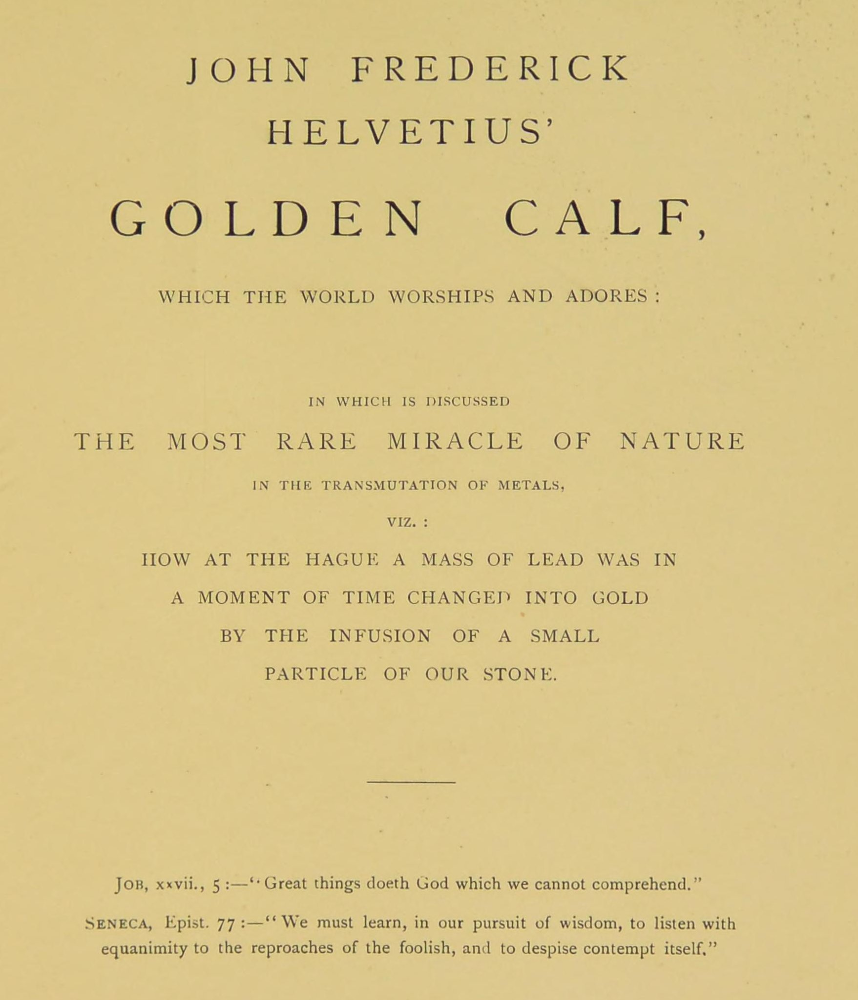
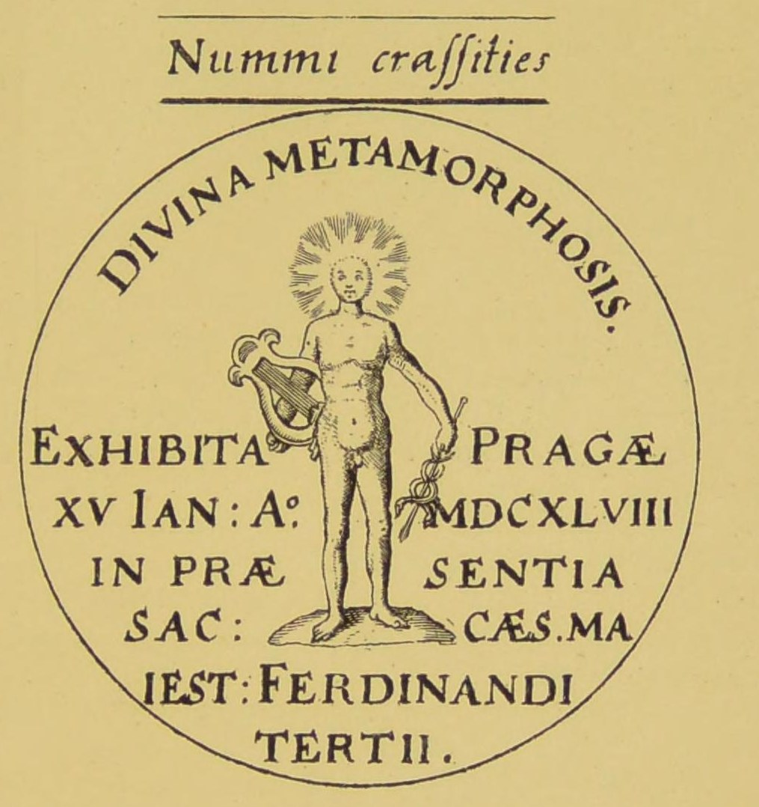

# 金の子牛（ヘルヴェティウス）

ヨハン・フリードリヒ・ヘルヴェティウス／全訳

- 原題：Vitulus Aureus, quem mundus adorat et orat（ラテン語、1667年、アムステルダム。1678年の『ヘルメス博物館』〔Musaeum Hermeticum〕増補版に収められ、A・E・ウェイトが John Frederick Helvetius' Golden Calf, which the World worships and adores として1893年の英訳第二巻に収めた）
- 内容：オランダ・ハーグのオラニエ公の侍医ヘルヴェティウスが、一六六六年十二月二十七日に自宅を訪れた見知らぬ真鍮鋳物師「術師エリアス」から賢者の石を見せられ、菜種粒ほどのかけらをもらい、それで鉛を金に変えたという、錬金術史上もっとも名高い変成の報告。前半ではファン・ヘルモントやクンラート、パラケルススの証言、一六四八年プラハでの皇帝フェルディナント三世の前での変成を記念するメダル、ハーグの銀細工師グリルの例などを挙げて術の真実を主張し、次いでエリアスの訪問、五枚の金のメダル、変成の実験、造幣局長立ち会いの試金を物語る。後半は医者（ヘルヴェティウス）とエリアスとの対話で、普遍の薬が病の症状ではなく「命の精気」に働くこと、寿命を越えて命を延ばすことはないことなどが語られる
- 作業の基にした本文と図版：Internet Archive 所蔵の1893年英訳第二巻のスキャン（OCR を画像と照合した）
- 著作権：原典は1667年、ウェイトは1942年に死去。日本・米国・英国で保護期間が満了している
- 訳者：人工知能（Claude Opus 5.5）
- 訳の性格：全文を訳した。訳者の調べたかぎりでは、日本語訳は出ていない

## この本について

　ヨハン・フリードリヒ・ヘルヴェティウス（シュヴァイツァー、一六二五〜一七〇九年）は、ドイツ生まれでハーグに住んだ医師である。もともと錬金術に懐疑的で、ディグビー卿の「共感の粉」を批判する論文も書いていた。その彼が「自分の目で見、自分の手で行った」と書いたこの変成の話は、たちまちヨーロッパ中に広まった。哲学者スピノザも、知人を通じてこの件を調べ、試金を行った銀細工師を訪ねたことを書簡（一六六七年）に記している。

　「金の子牛」という題は、出エジプト記でイスラエルの民が拝んだ金の子牛にちなみ、世の人々が金を崇拝することへの皮肉をこめたものである。本文の冒頭近くに出てくるメダル（一六四八年一月十五日、プラハで皇帝フェルディナント三世の前で行われた変成を記念するもの）も、錬金術の「証拠」としてしばしば引かれた。

　本サイトで訳してきた『ヘルメス博物館』の諸篇の多くが理論や寓意を語るのに対して、この書は日付と人名と場所とをはっきり記した「目撃証言」の体裁をとる。その真偽は今もわからないが、十七世紀の人々が錬金術をどのように信じ、また疑ったかを生き生きと伝える記録である。

---

## 世が拝みあがめる金の子牛

**ここに論じるのは、金属の変成における自然のもっとも珍しい奇跡、すなわちハーグにおいて、我々の石のわずかなひとかけを加えることによって、鉛の塊が一瞬のうちに金に変えられた次第である**

> 「神は我々の悟りえない大いなることを行われる」――ヨブ記〔原文 xxvii., 5。じっさいは三十七章五節〕
>
> 「知恵を求めるにあたっては、愚かな者の非難に平然と耳を傾け、軽蔑そのものを軽蔑することを学ばねばならない」――セネカ『書簡』七十七

**いとも尊くすぐれた テオドール・ケッチェス博士**（トルコそのほかの外国を旅した偉大な医師、今はアムステルダムで開業、私の親しい友）、

**いとも尊く深い学識ある ヨハン・カスパル・ファウジウス博士**（ハイデルベルクのプファルツ伯の顧問官にして侍医）、

**および クリスティアン・メンツェリウス博士**（ブランデンブルク選帝侯の顧問官にして侍医）、

**わが尊い後援者にして愛する友たちに**

### 献辞

　前記の高貴で尊い友にして師たちに

　私は、わが尊く愛する友たちに、このスパギリアの術と、もっとも貴く奇跡的な奥義との知識を、隠しておくことはできないし、隠すつもりもない。私はそれを自分の目で見たばかりでなく、我々の変成の粉のわずかなひとかけを加えることによって、鉛の塊を、どんな火の試験にもたえず耐える堅固な金に変え、自分の手で行ったのである。もはや、我々の術がそれの主張する力を持たないとか、賢者たちのメルクリウスがあらゆる自然の驚異の大いなる栄えある泉ではないとか言いはることはできない。この驚くべき秘密は神の恵みによって私に明かされた。そして神のかたちに創られた人間が、もの言わぬ獣のように神の奇跡のみわざについて沈黙を守るのはふさわしくないので、私はこの大いなる奥義を、わが愛する友たちよ、あなたがたに明かそうと決めた。そして今、大いなる術師エリアスの言葉と行いとについて私が知り、聞いたことのすべてを語るべく身支度をしよう。大いなる秘密を私に明かしたのは、たしかに彼ではなかった。けれども彼の話はまことに教えに富んでいたので、それを一語一語あなたがたに伝えずにはいられない。尊い友にして師たちよ、この書があなたがたの手に好意をもって迎えられ、あなたがたがそれから楽しみと益とを汲みとられることを、切に願う。この望みを抱きつつ。

あなたがたのつつましい僕　ヨハン・フリードリヒ・ヘルヴェティウス

### 第一章

　わが尊い友にして師たちよ、巨人たちを打ち負かす哲学の小人〔こびと〕について書きはじめる前に、ヘルモンティウス〔ファン・ヘルモント〕の著作（『生命の木』〔原文 Arbor Vitae〕六三〇葉）から一節を書き写すのを許してほしい。

> 「私は、金と銀とを作る石というものがあると信じないではいられない。同時に、何百人もの骨身を惜しまぬ錬金術師たちが、詐欺師やスパギリアの術の無知な教師たちによって日々迷わされているという事実にも、目をつぶることはできない」

　このゆえに私は、私の書物を読むやいなや、こうした惑わされた犠牲者が大勢立ち上がり、私がこの術の真実について行った主張に反論しても、驚かないであろう。この連中のある者は錬金術を悪魔のわざだと非難し、ある者はまったくのたわごと、まやかしだと言い、三人目は金属を金に変成させる可能性は認めるが、過程全体はその値打ち以上に金がかかると言いはる。しかし私はこうした意見に驚きはしない。我々はその目的を理解しないものにはぽかんと口を開け、知って楽しいものは調べる、というのは人間の性についての言い古された言葉である。それゆえ賢者たちは、セネカ（『道徳について』）の言葉を思い起こすべきである。「群衆があなたを笑わないなら、あなたはまだ幸いではない」。しかし私は、彼らが金属の変成についての私の教えを信じようと反論しようと、気にかけない。私はそれを自分の目で見、自分の手で行ったという知識のうちに、安らかに満足している。我々の堕落した時代においてさえ、こうした驚異はなお可能である。今でさえ、二十トンの金に値する、いや、それ以上の薬が作られている。それは世界のすべての金をもってしても買えないもの、すなわち健康を授ける力を持っているからである。死と病との大いなる万能薬、我々のなだめるメルクリウスの飲み薬を知る医者は幸いである。

　しかし神は、この栄えある知識をすべての人に無差別に明かしはしない。そしてある人々は（裁きとしての盲目によって）あまりに鈍いので、もっとも単純な自然の力の働き、たとえば磁石が鋼に及ぼす引きつける力にさえ驚く。しかし（彼らが信じようと信じまいと）金にはメルクリウスを引きつける、銀には銅を引きつける、それに対応する磁気の力があり、ほかのすべての金属、鉱物、石、草、植物なども同じである。……真理へのこのしつこい反対に驚いてはならない。太陽の光は梟の目を痛めるのだから。

　じっさい、我々人間は、自分の理解しないものを性急に独断的に判断することで、分を越えたことをしすぎている。我々は地上のものに対する星の影響を否定し、その否定によって自分の無知をさらけ出しているにすぎない。植物の中に眠る秘密の力について、我々が何を知っているというのか。あなたは天使たちの栄光、天の輝き、空気の透明さ、水の澄みきったさま、花の色の多様さ、石と金属との硬さ、人と動物との釣り合いのとれた美しさ、再生した魂のうちなる神のかたち、信じる者の信仰、心の理性などについて、何も知らないかもしれない――我々は盲目で、感覚も悟りも持たないかもしれないのだから――。それでも、これらすべてのものの美しさは、我々の無知によっていささかも損なわれはしない。

　これらの考えを心にとめるなら、我々の石にこれほど驚くべき変成の力が備わっている可能性を否定したくなったとき、それは我々の口をふさぐはずである。とはいえ、私がこの知識をだれかに押しつけたいと望んでいると考えてはならない。神はそれをふさわしい者のためにとっておかれ、邪悪な者、不信心な者、あざける者にはけっして知られえないことを、私は知っている。私がしようとするのは、この石の本性について術師エリアスと私とのあいだに交わされた会話を、読者の熱心な考察のために、その前に置くことだけである。その石の輝きは（曙よりも栄え、紅玉よりもまばゆく、太陽や金よりも明るく）、まだ私の心から色あせていない。あざける者の軽蔑と愚かな者の無知とを、私は軽んじる。彼らのはかないおしゃべりは、まもなく忘却の川に押し流されるであろう。しかし我々の勝ち誇る術は、金剛石の土台の上に、神ご自身の真理の土台の上に据えられており、あらゆる時代を通じてゆるがずにとどまるであろう。

　古い経験に従って、達人たちは、この自然の秘儀がただ世界の中心にサトゥルヌス的に置かれたエホバのもとにのみ見いだされる、と請け合ってきた〔原文の文意はやや不明〕。しかし我々が幸いな者と呼ぶのは、賢者たちの女王をその不純から浄めることができ、我々の水晶のような物理魔術の術によって普遍の処女の土を循環させることができ、そして王が、頭に冠をいただき、内なる火の力を持って、その水晶の墓の部屋から出てくるのを見た者である。その体の姿は、世界が与えるもっとも美しいあらゆる色で栄化され、輝く紅玉のよう、あるいは透きとおった、緻密な、透明な水晶のようであり、あらゆる水を吐き出し、卑しい金属のらい病を火で洗い流すサラマンダーのようである。

　そのうえ彼らは、スパギリアの術の深淵を見るであろう。鉱物界において、その同じまことに王者の術が、いわばもっとも安全な隠れ家に、ある程度、長年にわたって隠れて横たわってきたところを。賢者たちは見てきたのである。アエネアスがその死すべきさだめを洗い清められた川を。ミダス王が浴して金に変わったリュディアのパクトロス川を。ディアナの浴場を。ナルキッソスの泉を。ウェヌスの雪のような胸に滴り、そこからアネモネが生まれたアドニスの血を。美しいヒヤシンスの花が生え出たアイアスの血を。ユピテルの雷に打たれて死んだ巨人たちの血を。アルタイアが金の衣を脱いだときに流した涙を。草と花とが生え出たメデイアの魔法の水を。メデイアが老いたアイソン〔原文 Jason〕を若返らせるためにさまざまな草から作った飲み薬を。アスクレピオスの薬を。イアソンが金の羊毛を得るのに助けとなった魔法の汁を。木々が黄金のりんごを豊かに実らせるヘスペリデスの園を。三つの黄金のりんごによって競走からそらされたアタランテを。ユピテルによって神に変えられたロムルスを。ユリウス・カエサルの魂の彗星への変容を。デウカリオンの洪水ののち腐った土から生まれたユノの蛇ピュトンを。メデイアが七本の松明をともした火を。パエトンの大火によってともされた月を。ユピテルがよく歩きまわったアルカディアを。その玄関に三つ頭のケルベロスが横たわるプルトンの住まいを。ヘラクレスが、母から受けた肢体を火で焼き、ついに父から受けた固定した燃えない元素だけが残って神となった、あの火葬の薪の山を。そして屋根が純金でできていた田舎の小屋を。

　エホバが、あの神的な塩を作る方法を明かした人は幸いである。まことに三重に幸いである。その塩によって金属あるいは鉱物の体は腐らされ、滅ぼされ、殺されるが、そのあいだにその魂は、哲学の体の栄えある復活のためによみがえらされる。幸いである、と私は言う、聖霊のためにするそのすべての作業を通じて、祈りに答えて我々の術の知識を授けられた人は。これこそ我々の術のなかの術が人に授けられる唯一の道であることを思い起こすべきであり、それに達したいなら、神に仕えることがあなたの主な務めでなければならない。敬虔のこの聖なる実践の道と、ただエホバとの神智学的な語らいとに身をゆだねることによって、この術のまことの学徒はみな、しかるべき時に、その心を喜ばせる光景を見るであろう。何かの達人が恵み深くも知識の門を大きく開け放ち、王の黄金の道がこうして明らかにされた人もまた幸いである。……

　この序文がすべての読者を喜ばせはしないのではないかと恐れる。それでも、そのよりすぐれた部分を元気づけ励ますであろうと、大いに望んでいる。友よ、私がこれから書き記す対話の中に湧き出る真理の泉から飲み、それで魂の渇きをいやしてほしい。私の言葉はあなたがたにとって神酒や神饌よりも甘いであろう。私は、ユリウス・カエサル・スカリゲルの「知恵の目的はその伝達にある」という言葉と、「善き人々は自分の知識を他人に分け与えることを喜ぶ。役に立つことが彼らにとって最大の喜びだからである」と断言するニュッサのグレゴリオスの教えとを、心にとめているのである。

### 第二章

　この術の真実は、多くの名高い著者によって主張されている。そのうちもっとも際立った代表者は次の人々である。

　パラケルスス（『自然物について』第九巻、三五八葉〔原文 Rev. Natur.〕）には次の言葉がある。「自然学者たちのチンキが知られるまことの徴は、そのわずかなひとかけを、るつぼの中で溶かしたそのような金属の塊に投げ入れれば、あらゆる不完全な金属を（それが白ければ）銀に、（赤ければ）金に変成させる力である」。

　またこう言う。「金属の不敗の星はすべてのものに打ち勝ち、それらを自分に似た本性に変える。この金と銀とは、そこから秘薬を作るためには、鉱山で見いだされるものよりもすぐれている」。

　またこう言う。「金の星を持つ錬金術師はだれでも、すべての金属をあの貴い物質に変えることができると、私は言う」。

　またこう言う。「我々の金のチンキは星を含み、もっとも固定した物質であり、増殖において変わることなく、（ほとんどサフランの色合いを帯びた）赤い粉であり、樹脂のように流動的で、水晶のように透きとおり、ガラスのようにもろく、ルビーの色をしており、比重が非常に大きい」。

　またパラケルススは『賢者たちの天』と題する書と『自然物の変成について』第七巻とで、同じ事実を証言している。「変成は自然の大いなる秘儀であって、愚か者の思うように、自然の運行や神の法に反するものではけっしてない。この賢者の石なしには、不完全な金属は金にも銀にも変成されえない」。

　パラケルススは『薬としての賢者の石についての手引き』で言う。「我々の石は天の超完全な薬である。金属のあらゆる不純を洗い去るからである」。

　ハインリヒ・クンラートは、その『永遠の知恵の円形劇場』（一四七葉）で次のように言う。「私は多くの国を訪ね、多くの学識ある人々と語り合った。私は緑の普遍の獅子と、獅子の血、すなわち賢者たちの金とを、自分の目で見、自分の手で触れ、自分の舌で味わい、自分の鼻で嗅いだ。それによって私は、命を絶望視されていた多くの人々を癒した」。

　またこう言う（二〇二葉）。「私の述べることは作り話ではない。汝はそれを手で扱い、目で見るであろう――あのアゾト、すなわち賢者たちの普遍のメルクリウスを。それは内なる火と外なる火とともに、共感の調和のうちに、避けられない必然によって物理魔術的に結び合わされて、それだけで我々の石の調製に足りるのである」。

　またこう言う。「汝は賢者の石、我々の王にして主の主が、その水晶の墓の部屋からこの世へと出てくるのを見るであろう。その栄化された体は、再生し、超越的に完全であり、輝く紅玉であって、そのもっとも精妙で十分に浄められた部分は、調和して混じり合い、分かちがたく一つに結ばれ、まったくなめらかで、水晶のように透きとおり、緻密で、ひどく重い。それは火の中で樹脂のようにたやすく溶け、人工の水銀が逃げ去ったのちには蝋のように溶ける。煙を出さずに、油が紙にしみこむように固い体に入り浸透する。どんな液体にも溶け、それと溶け合い混じり合う。ガラスのようにもろく、粉ではサフラン色であるが、固い塊ではルビーのように赤い。その紫の色は完全な固定と固定した完全さとの徴である。火にも、腐食する水にも、燃える硫黄にもさらされても、それは固定して燃えずにとどまるからである。それはサラマンダーのように火に焼き尽くされることがない」。

　またこう言う。「白いチンキを酵母として金属に加えると、それはそれらをもっとも純粋な銀に変成させる。赤いチンキを純粋な金と混ぜると、それは三日のうちに金の量だけ殖やされる」。

　ヘルモンティウス（『永遠の生命について』五九〇ページ）には次の言葉がある。「私は石を見、自分の手で触れた。……私はこの粉の一グレーンの四分の一を紙に包み、るつぼの中の沸き立つ水銀八オンスの上に投げた。するとただちに混合物全体が黄色い蝋のような塊に凝結した。溶融が終わると、るつぼにはもっとも純粋な金が八オンス（十一グレーン欠ける）入っていた。こうして我々の粉の一グレーンは、それ自身の重さの一万九千百八十六倍の水銀を、もっとも純粋な金に変成させたのである。そしてこの過程は限りなくくり返すことができる。粉は金属をあらゆる不純から浄め、さびと腐朽と火などから守る」。

　また同じヘルモンティウスは、その『生命の木』（六三〇ページ）で言う。「私は、金と銀とを生み出す石があると信じざるをえない。私は何度か自分の手で、一グレーンの粉を千グレーンの沸き立つ水銀の上に投げ入れたが、それは大勢の見物人の前で、ただちに貴い金に変わったからである。最初にこの変成の粉をいくらか私に与えた人は、少なくとも二十万ポンドの金を作るに足りるほどの量を持っていた。彼は私に約半グレーンの粉をくれ、私はそれで九オンス四分の三の水銀を変成させた」。

　そのうえ、アムステルダム在住の著名な医師で、いとも尊く深い学識あるテオドール・ケッチェス博士は、次の銘のあるメダルを私に与えてくれた。

〔図：上に「貨幣の厚さ（Nummi crassities）」。メダルの縁に「神的な変身（DIVINA METAMORPHOSIS）」、中央の太陽の頭をした裸の少年（竪琴とカドゥケウスとを持つ）の両脇に「一六四八年一月十五日、神聖なる皇帝フェルディナント三世陛下の御前にて、プラハにおいて示された（EXHIBITA PRAGAE XV IAN. A° MDCXLVIII IN PRAESENTIA SAC. CAES. MAIEST. FERDINANDI TERTII）」とある〕

　メダルの表〔原文 obverse〕には次の言葉があった。

> この術が人のあいだでまれであるように、
> それが示されることもまれである。
> 無限の力の一部を、そのもっともいやしい被造物である我々に
> 分け与えられた神は、とこしえにほむべきかな。

　また一六六〇年に、アレクサンダー（スコットランドの達人）がケルンやハノーファーなどで不完全な金属を金に変えたとも言われている。

　このような変成が起こったという記録には、ほかの例もある。

　次はクフラー博士〔原文 Kuffler〕の書いた手紙からの確かな抜き書きである。

> 「まず私は自分の実験室で、次にカール・ド・ロワ〔原文 Charles de Roy〕の実験室で、強水を見つけ、普通の方法で作った金の灰にそれを注いだ。三度目の再蒸留ののち、それはレトルトの首のところに金のチンキを自らとともに昇華させた。私はそれを普通の方法で沈殿させた銀と混ぜた。すると、昇華した金のチンキ一オンスが、るつぼの中で普通の融剤とともに、沈殿した銀二オンスを、最良の金一オンス半に変成させ、三分の一は銀のままであるのを見た。その金は白く固定していたが、残りの二部分は、どんな火の試験にも固定している最良の銀であった。これが私の経験であり、それが私をもっとも熱心な錬金術の信奉者にしたことは言うまでもない」

　私ヘルヴェティウスは、チンキなしの、この白い金を見た。

　この術が本物であることのもう一つの証拠が、一六六四年にハーグで示された。グリルという名の銀細工師が、多くの証人の前で、一ポンドの鉛を、一部は金に、一部は銀に変えたのである。グリルはそのチンキを、ヨハン・カスパル・クネットナーという名のある織工から、金属にだけ用いよという言いつけとともに手に入れていた。グリルはそれをいくらかの鉛とともにガラスの菓子皿に入れ、二週間ほどのちに、上に述べた変化が起こっているのが見いだされた。私はこの例が本物であることを証言できる。グリルとは個人的に知り合いであり、変成した鉛を見たからである。それはその表面に、まるで円を用いたもっとも巧みな細工で作られたかのような、星の形のまことに美しい銀の結晶を示していた。残念なことに、グリルは強情でずる賢かったので、変化をもたらしたのがクネットナーの「塩の霊」であったかどうかをクネットナーに知らせようとしなかった。しばらくして、ついにグリルの強情が折れたときには、クネットナーは自分の多くの化学調製物のどれを彼に与えたかを忘れてしまっていた。そしてそれを見つけ出せないうちに、彼とその家族とはペストに押し流され、グリルは水に落ちて溺れた。そののち、数多くの金探しのだれ一人として、彼らとともに死んだ秘密を見いだすことはできなかった。それでも、賢者の石が、鉛の鈍く重い本性をこれほど短い時間で銀と金との明るく輝かしい本性へと変成させる力を持つことは、たえず驚嘆の的である。しかしこの自然の法則については、鋼が磁石に触れることによってその磁力を得るという事実に、一つのたとえがある。

### 第三章

　約束は早く果たされるほど喜ばれるものだから、これ以上ぐずぐずせずに、私が成しとげようと定めた仕事に取りかかろう。

　一六六六年十二月二十七日の午前、ある男が私の家にやって来た。私にはまったく見知らぬ人であったが、正直で重々しい顔つきと、威厳のある物腰をしており、メノー派の人のような質素な服を着ていた。中背で、顔は長く、いくらかあばたがあり、髪は黒くてまっすぐ、あごはきれいに剃っていた。年は四十三か四十四ほど、生まれの州は、私の見たところでは北ホラントであった。

　挨拶を交わしたのち、彼は私と少し話をしてもよいかと尋ねた。火の術について私に何か言いたいことがあるという。私の論文の一つ（ディグビー博士の「共感の粉」を論駁したもの）を読んだのだが、その中で私は、賢者たちの大いなる奥義も結局は巨大なまやかしではないかという疑いをほのめかしていたのである。そこで彼はその機会をとらえて、生命の臓器が取り返しのつかないほど損なわれていないかぎり、どんな病人をも医者が回復させられるような大いなる秘儀が、ものの本性のうちにありうると私は信じられないのか、と尋ねた。私は答えた。「そのような薬は、どんな医者にとってもまことに望ましい獲得物でしょう。自然の中にどれほど多くの秘密が隠れているかは、だれにもわかりません。けれども、私はこの術の真実について多くを読んできましたが、錬金術の学問のまことの師に出会う幸運には、一度も恵まれたことがありません」。私はまた、彼が普遍の薬についてあまりに学識深く語るので、医者なのかと尋ねた。答えて彼はつつましく私の当て推量を打ち消し、自分は真鍮鋳物師で、火によって金属から薬の飲み物を抽き出すことに、いつも大きな関心を持ってきたのだと言った。

　さらに少し話したのち、術師エリアス（彼こそがそうであった）は私にこう言った。「錬金術師たちの著作で、この石と、その物質と、その色と、その驚くべき効果とについてそれほど多く読んでこられたのなら、ひとつお尋ねしてよいでしょうか。ご自分でそれを作ったことはないのですか」。私がいいえと答えると、彼は袋から巧みに細工した象牙の小箱を取り出した。その中には、ガラスか淡い硫黄に似た物質の大きなかけらが三つ入っていた。そして、ここには二十トンの金を作るに足りるチンキがある、と私に告げた。私はその貴い宝を十五分ほど手に持っていたが（そのあいだ、その驚くべき治療の効能の話を聞いていた）、持ち主に返さねばならなかった。それをいくらか名残惜しく思わずにはいられなかった。見せてくれた親切に礼を言ったのち、私は、なぜ彼の石は、賢者の石の特徴だと教えられてきたあのルビーの色を見せないのかと尋ねた。彼は、色は何の違いもなく、物質はあらゆる実際の目的に十分なほど熟していると答えた。彼の石を一かけら（たとえコエンドロの種より大きくなくとも）くれないかという私の頼みを、彼はいくらかそっけなく断り、もっとやわらかな口調で、私の持つすべての富と引きかえにしてもあげられない、それはその大きな貴さのためではなく、明かすことの許されない何か別の理由のためだ、と付け加えた。いや、もし火がそのようにして滅ぼされうるものなら〔原文のまま〕、すぐにでもそれをみな火に投げこむだろう、と。

　それから、しばらく考えたのち、彼は、通行人に見られるおそれの少ない、家の奥の部屋に案内してもらえないかと尋ねた。私が彼を客間に案内すると（彼は汚れた長靴をぬぐいもせずに入ってきた）、彼は私に金貨を一枚求めた。私がそれを探しているあいだに、彼は胸のポケットから緑の絹のハンカチを取り出した。その中には五枚のメダルが包まれていて、その金は私の金貨の金よりも比べものにならないほどすぐれていた。メダルには次の銘があった。

> **〔第一のメダル〕** 聖なるかな、聖なるかな、聖なるかな、我らの神なる主。全宇宙はその栄光に満ちる。――獅子。天秤。
>
> **〔第二のメダル〕** 普遍の自然の書におけるエホバの驚くべき奇跡の知恵。――私は一六六六年八月二十六日に作られた。
>
> **〔第三のメダル〕** ☉ ☿ ☽（太陽・メルクリウス・月）――神と自然とスパギリアの術とは、何ものもむだには作らない。
>
> **〔第四のメダル〕** 聖なる、聖なる霊よ。ハレルヤ、ハレルヤ。退け、サタン。光なしに神を語るな。アーメン。
>
> **〔第五のメダル〕** 永遠の、目に見えない、三にして一なる、三度聖なる、ただひとり賢い神、治め保つ方に、今もとこしえに賛美あれ。

　私は賛嘆に満たされ、訪問者に、その全世界についての驚くべき知識をどこから得たのかと尋ねた。彼は、自分の家に数日泊まった友人が惜しみなく授けてくれた賜物だと答えた。その友人はまた、普通の火打ち石や水晶を、ルビーや貴かんらん石やサファイアよりも貴い石に変えることを教えてくれた、と。彼はまた、鉄のサフラン（赤痢のあやまたぬ薬）や金属の液（水腫によく効く薬）や、そのほか多くのあやまたぬ薬の作り方を私に明かしたが、私はそれにはたいして注意を払わなかった。すべてのうちで主な秘密を明かしてもらいたくて、気が気でなかったからである。術師は私に語った。彼の師は彼に温かい湯をいっぱい入れたコップを持って来させ、それに白い粉を少し加えると、その中で一オンスの銀が、ぬるま湯の中の氷のように溶けた。その飲み物の半分を師は飲み干し、残りを彼に与えた。「その味は新鮮な牛乳に似ていて、その効き目はまことに気分を晴れやかにするものでした」。

　私は訪問者に、その飲み物は賢者の石から作ったものかと尋ねた。しかし彼は答えた。「そんなに詮索好きであってはいけません」。

　それから彼は語った。術師の命令で、鉛の水道管を一本取り外し、その鉛を壺の中で溶かした。すると術師は小さな箱から硫黄のような粉をナイフの先に取り出し、溶けた鉛に投げ入れた。そして合わせたものをしばらく激しい火にさらしたのち、台所のれんがの床の上に、溶けた金の大きな塊を流し出した、と。

　「師は私に、その金の十六分の一を記念に自分のものとし、残りは貧しい人々に分け与えるよう命じました。私はそれを、大金をスパーレンダムの教会に信託として寄付することで行いました。とうとう別れを告げる前に、わが友はこの神的な術を私に教えてくれたのです」。

　見知らぬ訪問者がその話を終えると、私は、私の目の前で何かの金属に変成の作業を行って、その主張の証拠を見せてくれるよう懇願した。彼はあいまいに、今はできないが、三週間したらまた来る、そのときもし許されるなら、目を見張るようなものを見せよう、と答えた。彼は約束の日にきちんと現れ、私を散歩に誘った。その道すがら、我々は火の中の自然の秘密について深く語り合ったが、私の連れが大いなる奥義について情報を明かすことにはたいへん慎重であることに私は気づいた。彼は術の神聖さについて（まるで聖職者のように）まことに学識深く重々しく語り、神は秘儀を授けられた者に、その秘密をふさわしい者にだけ知らせるよう命じた、と言った。とうとう私は単刀直入に、金属の変成を見せてくれと頼んだ。私の家に来て食事をし、泊まっていってくれと懇願した。頼みこみ、抗議もしたが、むだであった。彼はゆるがなかった。私は彼に約束を思い出させた。彼は、あの約束は秘密を私に明かすことが許されるという条件つきだったと言い返した。

　けれども、ついに私は、彼の貴い石を一かけら――菜種の粒ほどの大きさしかない一かけら――くれるよう彼を説き伏せた。彼はそれを、まるで世界でもっとも王侯にふさわしい贈り物であるかのように私に手渡した。それで鉛を四グレーン以上染めるのに足りるだろうかと私が疑いを口にすると、彼はそれを返せと熱心に求めた。私は、もっと大きなかけらと取り替えてくれるかと期待して応じた。ところが彼はそれを親指で二つに割り、半分を投げ捨てて、もう半分を私に返して言った。「今でもあなたには十分です」。そこで私はいっそうひどく失望した。これほど小さな薬のかけらで何かができるとは信じられなかったからである。けれども彼は、二ドラクマ、すなわち半オンスの鉛か、あるいはもう少し多くを取り、るつぼの中で溶かせと命じた。薬は、それが足りる以上の卑しい金属をけっして染めはしないから、と。私は、これほどわずかな量のチンキがこれほど大きな鉛の塊を変えられるとは信じられないと答えた。しかし与えられたもので満足せねばならず、私の主な難題はチンキの用い方であった。私は、彼の象牙の箱を手に持っていたとき、彼の石の小さなかけらをいくつかうまく削り取ったが、それは私の鉛を金にではなく、ただガラスに変えただけだったと白状した。彼は笑って、あなたはチンキを用いることよりも盗むことのほうに長けている、と言った。「その獲物を黄色い蝋で守っておくべきでした。そうすれば鉛に浸透し、それを金に変成させることができたでしょう。ところがあなたの薬は、共感の過程によって、金属の煙の中で蒸発してしまったのです。すべての金属、金も銀も錫も水銀も、鉛の煙によって腐らされ、ガラスに堕落してしまうからです」。私はるつぼを見せた。すると彼は、黄色い薬のかけらがまだそれにくっついているのを見つけた。彼は翌朝九時にまた来ると約束し、そのとき私の薬が鉛を金に変成させるのに十分使えることを見せようと言った。この約束で私は満足したと言うほかなかった。

　それでも私は、奥義の調製について何か教えてくれるよう頼んだ。彼は費用と時間とについては何も言おうとしなかった。「その物質については」と彼は続けた。「二つの金属あるいは鉱物から作られます。鉱物のほうがよい。熟した硫黄をより多く含んでいるからです。溶剤はある天の塩で、それによって賢者たちは土の金属の体を溶かし、この過程が賢者たちの貴いエリクシルを引き出すのです。作業ははじめから終わりまで、るつぼの中で、むき出しの火の上で行われます。四日で完成し、その費用はわずか三フローリンほどです。卵から出た鉱物も、溶かす塩も、たいして高価ではありません」。私は、彼の言うことは、作業の期間を七か月か九か月とする賢者たちの言葉と矛盾すると答えた。彼のただ一つの答えは、賢者たちの言葉は哲学的な意味で理解されるべきであり、無知な者にはその真の意味はつかめない、ということであった。私は、見知らぬ人が彼にこの貴い秘儀を知らせたように、彼も私に同じ親切を及ぼし、せめて私の道からもっとも手ごわい障害をみな取り除くような情報をいくらか与えてくれるよう懇願した。一つのことを知れば、それにつながるほかの事実はたやすく見いだされるからである。しかし術師は答えた。「我々のマギステリウムではそうではありません。もし作業の全体をはじめから終わりまで知らなければ、何も知らないのと同じです。私はあなたにすべてを告げました。それでもあなたは、ヘルメスの水晶の封印がいかにして破られるか、太陽がいかにしてその金属の光線の驚くべき輝きでそれを彩るか、どんな鏡の中で金属がナルキッソスの目で自分の変成の可能性を見るか、あるいは達人たちがどんな光線から完全な金属の固定の火を集めるかを、知らないのです」。

　こう言って、翌朝九時にまた来ると約束して、彼は私のもとを去った。しかし翌日の約束の時刻に、彼は姿を見せなかった。その代わり、数時間のちに一人の見知らぬ人がやって来て、友人の術師はやむをえず引きとめられているが、午後三時に訪ねるだろう、と告げた。午後が来た。私は七時半まで彼を待った。彼は現れなかった。そこで妻がやって来て、自分で変成を試してみるよう私をそそのかした。けれども私は翌日まで待とうと決め、そのあいだ息子に火を起こすよう命じた。もう彼が詐欺師だとほとんど確信していたからである。けれども翌朝、私は、受け取った「チンキ」のかけらで少なくとも実験はしてみてもよかろうと考えた。もし彼の指図に厳密に従ったにもかかわらず失敗に終わるなら、そのときこそ、訪問者がこの術の知識をただ装っていただけだと確信できるだろう。そこで私は妻にチンキを蝋に包むよう頼み、そのあいだに自分で鉛を六ドラクマ用意した。それから蝋に包んだままのチンキを鉛の上に投げ入れた。それが溶けるやいなや、しゅうという音とわずかな泡立ちとがあり、十五分ののち、鉛の塊全体がもっとも上質の金に変わっているのを私は見いだした。この変化が起こる前に、合わせたものは強い緑になったが、それを溶融鍋に注ぐやいなや、血のような色を帯びた。冷えると、それは金のようにきらめき輝いた。我々はすぐにそれを金細工師のところへ持って行った。金細工師はただちに、これまで見たうちで最上の金だと断言し、一オンスにつき五十フローリン払おうと申し出た。

　うわさはもちろん、たちまち野火のように町中に広まった。午後には、この術の名高い学徒たちが大勢私を訪ねてきた。造幣局長とほかの何人かの紳士も訪ねてきて、通常の試験にかけるため、その金を少し使わせてほしいと求めた。私は承知し、我々はブレヒテルという名のある銀細工師の家へ行った。彼は私の金を少し取り、「四分の一法」と呼ばれる試験にかけた。三、四部分の銀を一部分の金とともにるつぼで溶かし、それから薄い板に打ち延ばし、その上に強い強水を注ぐのである。この実験の普通の結果は、銀が溶かされ、金は黒い粉の形で底に沈み、強水を注ぎ捨ててふたたびるつぼで溶かすと、もとの形を取り戻すというものである。……我々が今この実験を行ったとき、はじめは金の半分が蒸発してしまったと思った。しかしのちにそうではなく、逆に、銀の二スクループルが金への変化を受けていたことがわかった。

　それから我々はもう一つの試験、すなわちアンチモンの七倍量によって行う試験を試みた。はじめは金の八グレーンが失われたように見えたが、のちには、銀の二スクループルが金に変わっていたばかりでなく、銀そのものも質においても延性においても大いに改良されていた。私はこのあやまたぬ試験を三度行い、金一ドラクマごとに金一スクループルの増加が生じることを見いだしたが、銀はすぐれていて、きわめてしなやかであった。

　こうして私は、話の全体をはじめから終わりまで、あなたがたに明かした。金は今も私の手もとにあるが、術師エリアスがどうなったかは告げることができない。我々の親しい交わりの最後の日に私のもとを去る前、彼は聖地への旅に出かけようとしているところだと言った。神の聖なる天使たちが、彼がどこにいようと彼を見守り、キリスト教世界の祝福の源として末長く彼を保ってくださいますように。これが彼と我々とのための、私の切なる祈りである。

### 第四章

　さて今度は、術師エリアスが私の家を親切に訪ねてくれた折に、彼と私（医者）とのあいだに交わされた会話を伝えよう。読者は、術師が私の部屋に入って来て、次の言葉で自己紹介するところを思い描いてほしい。

**術師エリアス**　ヘルヴェティウス博士、こんにちは。私は、あなたがディグビー博士とその共感の丸薬とを論駁して書かれた論文の読者の一人で、このことや、これに類する主題について、あなたと少しお話ししたいのです。私は自然の秘密を熱心に学ぶ者で、同じ目的を持つ人々との交わりを喜びとしています。そしてたしかに、私のつまらない探究の結果からでさえ、どんな自然の驚異も軽々しく不可能と断じてはならないことを見いだしました。

**医者**　心から歓迎します。自然の秘密についての語らいは、あなたにとってと同じく、私の心の大きな喜びです。どうぞ私の書斎へおいでください。

**術師エリアス**　あなたはまことに、驚くほど設備の整った実験室をお持ちですね。それによって錬金術の秘密の深みをすべて測られたにちがいありません。しかし、なぜこれほど多くの薬を置いておられるのですか。心臓も肝臓も肺もすっかり滅ぼされておらず、命の汁がすっかり尽きていないかぎり、どんな場合にも病に打ち勝つことのできる薬が、一つあるいはいくつか、ものの本性のうちにあるとはお信じにならないのですか。

**医者**　あなたのお話から、あなたは同業者か、さもなければ化学の術の師であると推察します。おっしゃるとおり、自然の中には、私の持つどれよりもすぐれた薬があると私は信じています。この見方は自然で理にかなっており、多くの名高い著者の権威に支えられています。彼らは、選ばれた者だけに知られているという、ある普遍の薬について語ります。それはその持ち主に、あらゆる病を（ほかには治らない病さえ）癒し、命をほとんど限りなく延ばすことを可能にする、と。けれども、この命を与える水が汲まれる奇跡の泉へと、我々を導いてくれる人がだれかいるでしょうか。それは望みのない願いではないかと恐れます。

**術師エリアス**　お考えのように、私は医者ではなく、ただの真鍮鋳物師です。けれども、ごく幼いころから、錬金術と金属の秘密の性質とに夢中になってきました。そして（つつましいものではありますが）私の探究の結果、あなたのおっしゃる薬の発見は、我々の堕落した時代においてさえ、祈りと労働との報いとして、だれか熱心な学徒に授けられるだろうと、私ははっきり信じるようになっています。

**医者**　神がご自分を愛する者に、惜しみなく、とがめることなく賜物を与えられるのはたしかです。けれども私はまた、昔も今と同じく、ことわざに言うように、ふるいで水をすくって一生を費やした化学者が大勢いたことも知っています。そのうえ、まことの賢者たちの著作から、この普遍の賢者の石の物質についても調製の仕方についても、わかりやすい情報を得ることはまったく不可能に思われます。……そのあいだ、病を治すためにじっさいに手の届く手段を最大限に生かすのが、良い医者の務めです。もし普遍の薬を見いだすまで何の薬も与えないとしたら、患者はその愚かさと不注意とのために苦しむでしょう。そのうえ、人の体質の大きな多様さを考えると、一つの薬がどうしてあらゆる病を治しうるのか、私には本当にわかりません。病の物質が、人によって腺と命の汁とに及ぼす作用がまったく異なることは、よく知られているのですから。ペトロにある量のぶどう酒を与えると、けんか早く、それどころか怒り狂わせさえします。パウロには小羊のようなおとなしさと臆病さとを生みます。マタイには陽気さと笑いとを引き起こし、ルカは憂鬱で涙もろくなります。同じように、壊血病の毒として知られる病の物質は、ペトロの場合には酸となって命の汁と器官とをすっかり食い尽くし、手と足とに青みがかった変色したできものとなって吹き出します。同じ毒がパウロの体の中では苦い下剤に変わり、腕と足とに皮下の赤い斑点となって、蚤に食われたような点を伴って現れ、ペストの流行時には炭疽に変わります。マタイの体の中では毒の液は甘い味がして、腕と脚とに水腫の人に見られるような水っぽい腫れを生じ、ペストの流行時にはペストのはれものに変わります。ルカの場合には体液は塩辛く刺すようで、腕と脚との腫れは乾いて炎症を起こし、空気中に伝染性の物質があると、はれものはあまりに赤く悪性になって、狂気と死とをもたらします。それなら、これらの異なる症状には異なる治療が必要であり、どんな一つの草や薬もこれほど異なる場合に足りるはずがないのは道理です。ペトロを楽にするトモシリソウの揮発性の苦い塩は、パウロを悪化させます。固定した酸い塩はルカの症状を重くするだけですが、パウロの場合にはしばしば完全な治癒をもたらすに足ります。どの場合にも、すでに体内にある病の物質とは異なり、それゆえそれに対抗できる薬が必要なのです。病の個々の形ごとに特定の薬が必要であることを前にすれば、医者が普遍の薬の可能性をよく理解できなくても、どうか赦してください。

**術師エリアス**　植物界にかんするかぎり、あなたのおっしゃることがみな真実であることは認めます。もっとも、この治療の方法を用いる医者はごくわずかですが。同時に、あなたが挙げられたさまざまな植物の薬の効能をすべて兼ね備えた普遍の薬が、鉱物界にあってはならない理由は、私にはわかりません。この恵みの賜物がわずかな人にしか授けられないことは認めます。しかし錬金術の真実は、どんな疑いも許さないほど強く裏づけられているのです。

**医者**　この普遍の薬の存在に対して理をもって唱えうる反論の一覧を、私はまだ言い尽くしてはいません。いったい、どうして同じ薬が、男にも女にも、ひ弱な人にも頑健な人にも、病のはじめの段階にも終わりの段階にも、慢性の病にも急性の病にも、等しくふさわしいことがありえましょうか。

**術師エリアス**　普遍の薬に対するあなたの論はまことに学識深く正統的で、私もそれにいくらかの重みを認めるにやぶさかではありません。同時に、「十人十色」という言葉にもいくらかの重みがあり、何かを経験によって知っている者こそ、それについて語るのにもっともふさわしいことをお認めになるでしょう。もっとも甘い音楽もすべての聞き手を喜ばせはしません。最良の物語も、ある読者には退屈に思われます。ある人はある種の食べ物やぶどう酒を好み、ある人は別のものを好みます。そのように、この普遍の薬についても、（自称の）判定者の数だけ異なる判定があります。しかしその性質を知る者だけが、権威ある意見を述べる権利を持っています。さて、病の個々の症状あるいは現れだけに対抗しようとする、あなたがたの普通の、つぎはぎの医術には、普遍の薬の入る余地がないことは、まったくそのとおりです。しかしまことの医者は、あらゆる病は（どんな形をとろうとも）命の精気の衰えにほかならず、命を強めるものは何でも、病の可能性をまさにその源で断ち、それぞれ独特の病を生む体液を追い出すことを知っています。そして我々の普遍の薬は、このような根本からの薬だと私は主張します。それは命の精気の動きをおだやかに促し速め、こうして命の源を新たにすることによって、体全体を新たにし生かし、あらゆる部分に新しい活力と強さとを注ぎこみます。このゆえに達人たちはそれを、自然の大いなる秘儀、老いと病との予防と呼ぶのです。その助けによって、だれでも生まれつき割り当てられた日数を満たして生きることができ、ペストやほかの悪性の疫病が隣人を何百人と打ち倒しているときでさえ、伝染を恐れる必要はありません。

**医者**　お考えがわかったとすれば、この薬は、ただ堕落した体液を正そうとするのではなく、命の精気そのものを直接に回復させるのですね。そして創り主がはじめにそれぞれの人に割り当てた寿命を越えて生存を延ばすことはできないが、弱さや病によって早まって断たれるのを防ぐ、と。これはみな、まことに理にかなって聞こえます。しかしもう一つお尋ねしたいことがあります。この薬は人の気質を変えて、粘液質の人を多血質の人に、憂鬱な人を陽気で楽しい飲み仲間に変えるのでしょうか。

**術師エリアス**　もちろん変えません。どんな種類の薬も人の本性を変えることはできません。ちょうどぶどう酒が人に変化を生むのではなく、その人の本当の性格を引き出すだけなのと同じです。普遍の薬の効果もそれに対応する種類のものです。それは太陽の温かさのようなもので、太陽はさまざまな花の形や色や香りを変えたりわずかに改めたりさえせず、ただそのこころよい影響によって、その中にあるものすべてを十分に発達させるだけです。……もし我々の普遍の薬が、神の予知によってそれぞれの人に定められた期限を越えて人の命を延ばす性質を持っていたなら、疑いもなく、ヘルメス・トリスメギストス、パラケルスス、ライムンドゥス・ルルス、ベルナール伯、そのほかこの大いなる秘儀の多くのまことの所有者のような賢者たちが、今も生ける者の地に我々とともにいるでしょう。世界中のどんな薬も、人が早まって、すなわち定められた時より前に断たれるのを防ぐ以上のことができると考えるのは、愚かで狂気の沙汰です。

**医者**　この祝福された普遍の薬の働きについてあなたがおっしゃったことはみな、理にかなっており、自然の一般の働き方とも調和しているように思われます。いちばん困るのは、今は薬の存在を十分に信じているのに、それを見つけようとする私のあらゆる努力が、これまで、もろい小舟で沖へ出ようとして、風と波との合わさった力にくり返し岸へ押し戻される船乗りのむなしい試みに似ていたことです。多くの名高い人々がその調製について書いてきましたが、彼らはそれをまことに用心深く覆い隠したので、望むところに達するために踏むべき手順を知りうる者はできるかぎり少なくなっています。いちばんよいのは、実験室にとどまり、働き、祈り、神の祝福を待つことだと思います。

**術師エリアス**　よく考えておられますね、友よ。けれども錬金術の秘密を学ぶことに絶望してはなりません。とりわけ、だれか達人をあなたの師になるよう説き伏せることができるなら。しかし今度は、我々のもっとも貴い石の変成の力について論じましょう。それはその薬としての性質よりもさらに驚くべきものです。

**医者**　ああ、わかりました。金属の変成について論じたいのですね。そのような変成の可能性は、たしかに信じざるをえないと感じています。どんな疑いも許さない例、もっとも確かで信頼できる証人たち（クフラー博士、ヘルモント、スコトゥスなど）によって、そのような変成がじっさいに起こったと証言されている例を、聞きもし読みもしてきたからです。とりわけ私が考えているのは、プラハでドイツ皇帝フェルディナント三世の御前で行われた、あの金属の変化の驚くべき実験です。そのときチンキ一グレーンによって、水銀三ポンドが最良の金に変えられました。その出来事は、帝室造幣所で鋳造されたメダルによって記念されたのですから。しかしそのような変成のチンキの可能性は固く信じていても、私はこれまでの生涯で、それを持っている人に一度も出会ったことがありません。

**術師エリアス**　おっしゃるとおりです。もっとも、あなたが信じようと信じまいと、我々の術の真実には何の違いもありません。あなたがそれを信じなくても、磁石は鋼を引きつけつづけ、そのような接触によって鋼を磁気を帯びたものにするのと同じです。また、これまで我々の秘密が、もっとも曖昧な言葉でそれについて書いた人々によって、明かされるよりもむしろ隠されてきたことも事実です。しかし、自分の目で見るものを、あなたはもはや疑う気にはなれないでしょう。ここ、この箱の中に、あなたは賢者たちのまことの物質を大量に見ています。さあ、調べてごらんなさい。

**医者**　この黄色い、硫黄のような、ガラスのような物質が、本当にまことの賢者の石なのですか。ご自分で作られたのですか。きっと私をからかっておられるのでしょう。

**術師エリアス**　いいえ、本当です。あなたは今、この世のもっとも貴い宝を手にしているのです。そして私自身がそれをはじめから終わりまで作りました。もっと人目につかない部屋へ案内してくださるなら、それによって得た金をお見せしましょう（そして客間に通されると、彼は上に述べた五枚のメダルを取り出した）。これらは、と彼は言った、師の記念にとっておいているのです。

**医者**　では、あなたにはこの栄えある秘密を学んだ師がいたのですね。この瞬間に私がまことの物質を手にしているとは、なんと驚くべきことでしょう。そのごく小さなかけら、四グレーンの鉛を金に変成させるのにちょうど足りるだけを、くださるわけにはいきませんか。そうすれば、あなたのおっしゃることの真実を試すことができます。せめてからし種ほどの大きさのかけらをください。試させてください。たいへんなご親切になるでしょう。

**術師エリアス**　ある見知らぬ人が、かつてこの術の可能性とその進め方とを私に教えてくれたことは認めます。しかし、たとえこの部屋いっぱいのドゥカート金貨と引きかえにすると言われても、私のチンキのほんの小さなかけらさえあげることはできません。その物質が私の目にそれほど貴いからではなく、明かしてはならない別の重大な理由のためです。じっさい、もし火が火を焼き尽くせるものなら、このチンキをみなすぐにでも炉に投げこむでしょう。けれども三週間たったらまた来て、あなたを驚かせ喜ばせるような美しい実験をいくつかお見せしましょう。もしそのときまでに許しを得ていたら、あなたの目の前で鉛を金に変えて、あなたの好奇心も満たしてあげましょう。それまでのあいだ、さようなら。そしてこの術の追求にあまり多くの財産をつぎこまないよう警告しておきます。みな灰になってしまうでしょうから。

**医者**　わざわざ来てくださり、この石を見せてくださったご親切に深く感謝します。しかし、ただそれを見ただけで私が満足するとは、とても期待なさらないでしょう。私は魂がいつも知識に渇いている者の一人です。そして、禁じられた果実に触れて楽園を失った我々の始祖アダムが今日生きていたなら、「アトラスの園の黄金のりんご」を手に入れるために、もう一度その生涯の幸いを賭けるだろうと思います。それでも、三週間後に戻ってくださるという見込みで私を慰めてくださったことには、心から感謝します。そのあいだを、あなたの賢く親切な忠告に厳密に従って過ごすよう努めましょう。しかし私の心にいちばん強くある気持ちが、あなたの約束の成就を待ちわびる熱い望みであることは、たやすく察していただけるでしょう。また、この術の達人として私に身を明かしてくださったことに示された信頼のしるしにも感謝します。もし私に安全に預けてくださった秘密が、何かの偶然で暴君の君主や貴族の耳に入ったら、あなたはその脅しにおびえて秘密を漏らしてしまうでしょうか。

**術師エリアス**　私はこの秘密を、あなたと一人の善良な老人とのほかには、だれにも知らせたことがありません。またこれからも、どんな人間にもそのようなことを聞かせたり見せたりしてはなりません。しかしもしどこかの君主や王が私を牢に投げこんだり拷問台にかけたりしても、考えうるかぎりのもっとも残酷な拷問によっても、直接にも間接にもひとことの情報も私から引き出すことはできないでしょう。死そのものさえ、私を務めの道からしりごみさせたり、信託に不忠実にさせたりはしないでしょう。

**医者**　錬金術の著者のうちで、ほかの人々よりわかりやすい人、あるいは少なくとも、人に教えようと引き受けていることについて本当の知識を持っていると請け合える人はいますか。

**術師**　私はそうした書物をたくさんは読みません。しかし私が学んだ錬金術の著者すべてのうちで、コスモポリタ〔世界市民〕のセンディウォギウスがもっとも信頼できると思いました。またバシリウスの『十二の鍵』も。真理はセンディウォギウスの曖昧な文体を隠れ家に選んだのです。それを見つけることさえできれば。ちょうど我々の物質が、まことに真に、あらゆる金属と鉱物との外の体の中に隠れ、秘められているのと同じように。

**医者**　ご親切と友情ある忠告とに、あらためて心からの感謝を受けてください。おっしゃるとおり、金属の本質は、木の実の中に核が隠れているように、その外の体の中に隠れていると、私もまことに信じます。地上のあらゆる体は、動物のものであれ植物のものであれ鉱物のものであれ、その命と成長との原理であるあの天の霊、あるいは影響の住まいであり、地上の宿りです。錬金術の秘密は体の破壊であり、それによって術師は生きた魂に手を届かせ、それを自分の目的に用いることができるのです。しかし、だれがこの驚くべき秘密を探り出すに足りるでしょうか。

**術師エリアス**　ものの自然の破壊について、あなたは真実に語り、正しく判断されました。そしてもしあなたが神の目に恵みを得るなら、神は私か、我々の術のほかのだれかの達人に命じて、金属の外の体を滅ぼし、内なる、命ある、命を与える魂をとらえる正しい道を、あなたに明かさせてくださるでしょう。この恵みの賜物を、と私は言う、神は敬虔で熱心な祈りに答えて、あなたが思うより早く授けてくださるかもしれません。もう一度、さようなら。私がいつまでもあなたの友であることを確信してください。まもなく、健康にあふれたあなたにまた会えることを心から望んでいます。

　こう言って彼は去った。そして三週間ののち彼が戻ってきて、変成のチンキの小さなかけらを私にくれた次第は、すでにお話しした。しかし二度目に別れてから、私は彼の姿を見たことも、彼について、あるいは彼から、何かを聞いたこともない。

　けれども彼は、私の心に深く確信を刻みつけていった。金属を通して、金属から、高度に精錬され霊化された金属によって浄められて、賢者たちの生きた金と水銀とが作られうること、そしてそれが金属をも人の体をも完成へと導くことを。もし我が友が、このマギステリウムを進める最良の方法について、一つ二つ実際の手がかりを与えてくれていたなら、私は、太陽と月との光線をそれ自身のふさわしい子宮の中に集め、それによって磁気の共感による金属変成の力を引き出す、あの大いなる秘密を見いだしていたかもしれない。こうして私は、金に変成させる赤い種と、銀に変成させる白い種とを得ていたかもしれない。術師エリアスは私に、センディウォギウスのカリュブス〔鋼〕こそ、腐食剤の助けなしに、太陽と月との固定した光線をその体から分け、彼が私に見せ、そののち私がその効き目を経験した乾いた哲学のチンキのために、それを揮発性のメルクリウス的なものにするのに足りる、あのまことのメルクリウス的な金属の体液である、と告げたのである。これは、今も日々大地のはらわたの中で金属が生み出され、石がそのさまざまな塩の子宮の中で、霊的な、染める、硫黄の種から育てられているのと同じ方法である。……金属の硫黄は、硝石と混ぜると、おだやかな熱によって、雛が一見命のない卵からおだやかな熱によって育つように、まず固い土に、次に空気に、次に澄んだ水に、そしてもっとも美しい色の、火よりもすぐれた浸透力を持つガラスに変えることができる。異なる金属のあいだには、磁石と鋼、金と水銀、銀と銅とのあいだのような共感がある。そしてこの共感こそ、金属の変成の「理」である。他方、鉛の錫に対する、鉄の金に対する、鉛の水銀に対する反感のような、金属の反感もあり、それは動物界や植物界にもそれに対応するものを持つ。これらの共感と反感との正確で包括的な知識こそ、この術の師になろうと志すすべての人の一つの大きな資格である。

　私が見、経験したことのすべてをあなたがたに知らせるにあたって、私はただ、知識を望むのはおもにそれを他人に分け与えるためだと言ったセネカの格言に従っているにすぎない。もしだれかが私の述べたことの真実を疑うなら、その人はただこの世で敬虔なキリストにならう生活を送ればよい。そうすれば、上なる新しいエルサレムで、あらゆることの真実を学ぶであろう。この栄光の分け前があなたがたとその人とに授けられることを祈る、

あなたがたの忠実で愛情深い僕　医学博士ヨハン・フリードリヒ・ヘルヴェティウス

**（終わり）**
