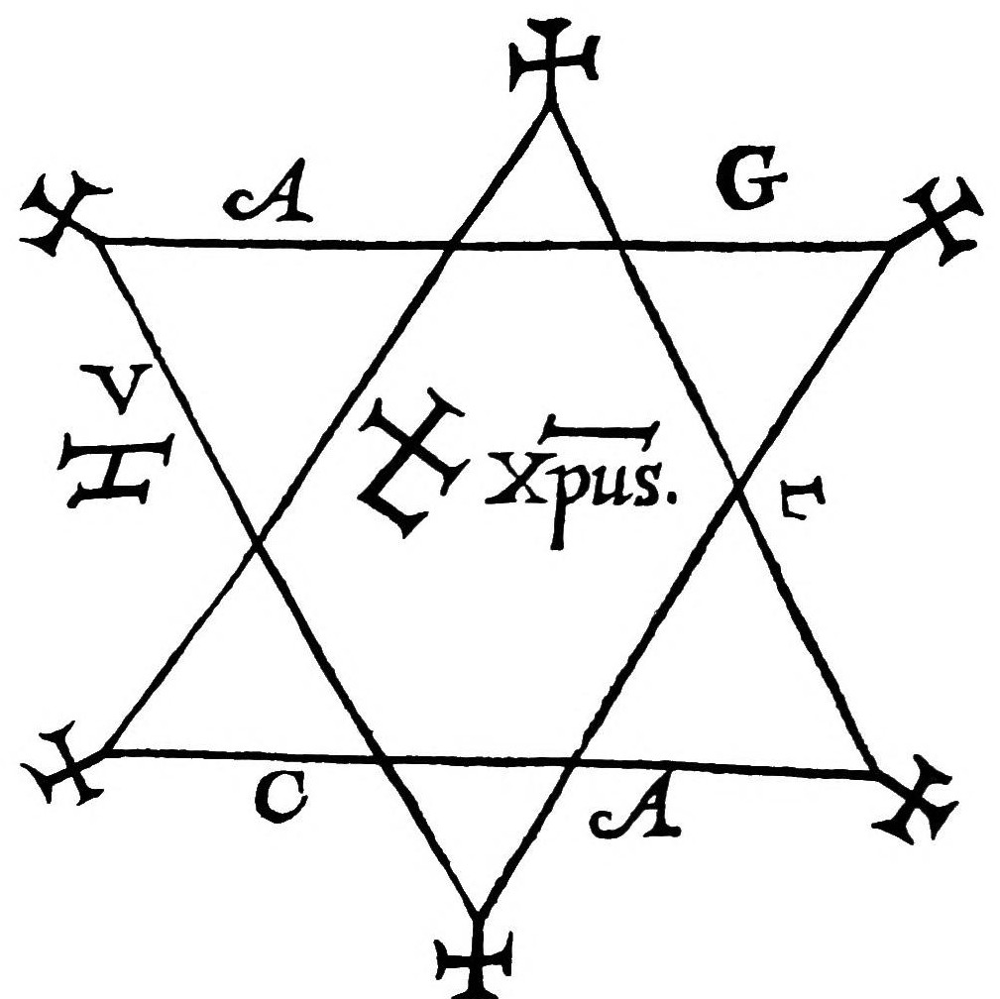
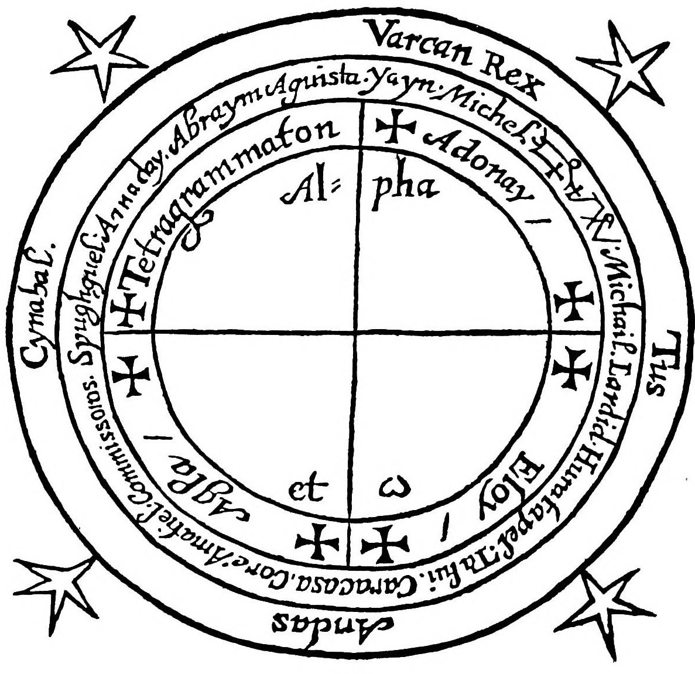
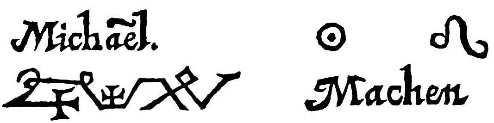
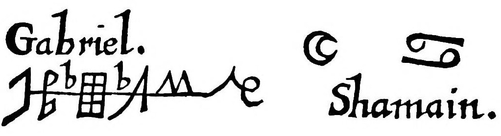
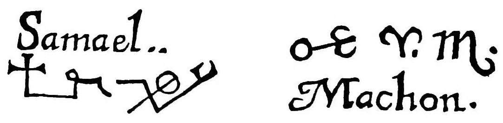
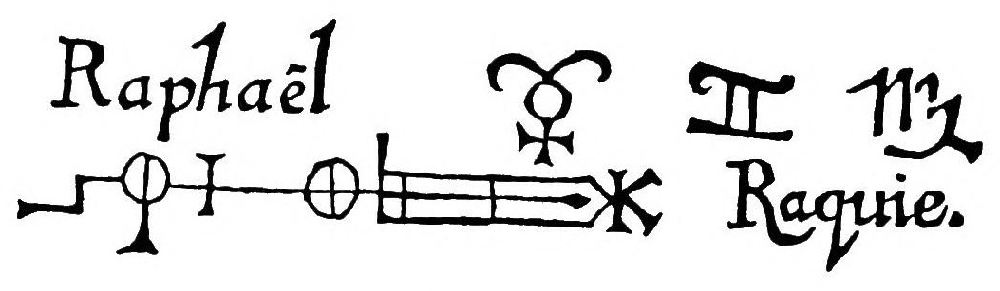
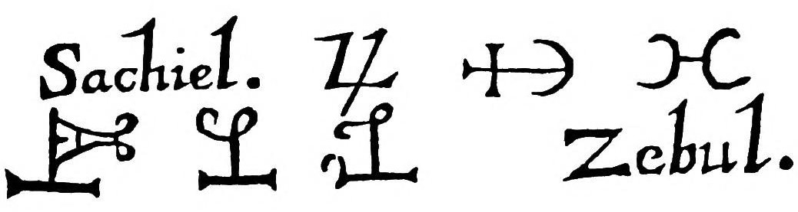
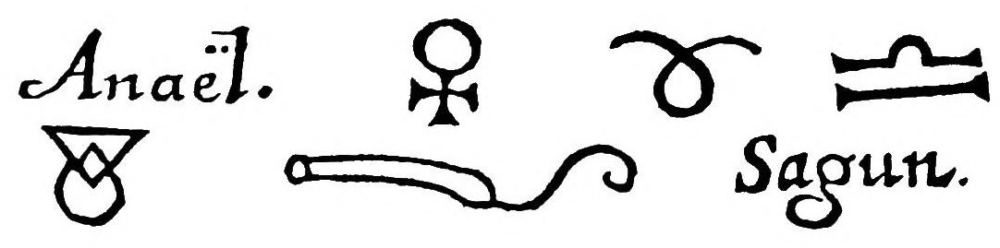
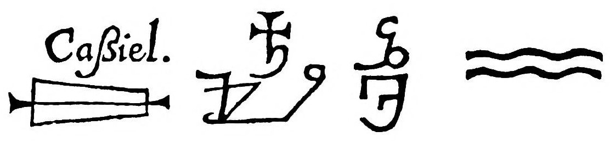

# ヘプタメロン――魔術の要素（伝ピエトロ・ダバノ）

伝ピエトロ・ダバノ著／ロバート・ターナー英訳／全訳

- 原題：Heptameron: or, Magical Elements of Peter de Abano, Philosopher（ラテン語版 Heptameron seu Elementa Magica）
- 内容：中世末からルネサンスに流布した儀式魔術の手引き。魔法円の作り方、昼夜の時刻・季節・太陽と月の名、円・香・火・衣の聖別、五角形の護符、業の行い方、空気の霊の祓いと神への祈り、霊の出現と退去のさせ方、そして日曜から土曜まで七曜ごとの天使・印章・空気の王と臣・四方の天使・香・呼び出しの言葉・霊の性質、時刻を治める天使の表
- 刊行：ラテン語版は16世紀にアグリッパの著作集に付されて流布。英訳はロバート・ターナー訳『Henry Cornelius Agrippa his Fourth Book of Occult Philosophy』（ロンドン、1655年）所収
- 作業の基にした本文：Internet Archive 公開のスキャン（cu31924006718757、コーネル大学図書館蔵の1655年版の複製本）。霊名・ラテン語の祈りはページ画像で確かめた。図版も同じスキャンから取った
- 著作権：1655年刊。日本・米国・英国で保護期間が満了している（複製本に付いている現代の解説は訳していない）
- 訳者：人工知能（Claude Opus 5.5）
- 訳の性格：全訳（本文・祈り・呼び出し・表。要約・省略なし）。英訳を介した重訳で、英訳本に含まれるラテン語の祈りは日本語に訳した。訳者の調べたかぎりでは、日本語訳は出ていない。表は箇条書きにした

## この本について

　『ヘプタメロン』（「七日」の意）は、パドヴァの医師・哲学者ピエトロ・ダバノ（一二五〇年ごろ〜一三一六年ごろ）の名のもとに伝わる儀式魔術の書である。実際の作者はわからないが、十六世紀にアグリッパの『隠秘哲学』の著作集に付されて広く読まれ、のちの『ソロモンの鍵』や近代の魔術師たちにも大きな影響を与えた。

　内容はきわめて実践的である。三重の魔法円に何を書きこむか、時刻と季節と太陽・月の秘密の名、円と香と火と衣の清め方、AGLA の文字を配した五角形の護符、九日間の潔斎と告解、剣に Agla と On の名を刻むこと。そして空気の霊をおびえさせる長い祓いの言葉、現れる幻（オルガンを鳴らす者、弓兵、おそろしい獣の群れ）と、それを退けるソロモンの護符。後半は、日曜のミカエル、月曜のガブリエル、火曜のサマエル、水曜のラファエル、木曜のサキエル、金曜のアナエル、土曜のカッシエルと、七曜それぞれの天使・印章・空気の王・四方の天使・香・呼び出しの言葉・霊の性質を一覧にしている。一六五五年版に載る魔法円の図、五角形の護符、七曜の天使の印章も収めた。

## 目次

- 前置き
- 円と、その作り方について
- 時刻の名と、それを治める天使とについて（季節の名・天使・太陽と月の名）
- 聖別と祝福（円・香・火）
- 衣と五角形の護符について／衣を着るときに唱える祈り
- 業の行い方について
- 空気の霊たちの祓い／神への祈り
- 幻と出現
- 春の主の日の第一の時刻のための円の図
- 七曜の考察（日曜〜土曜）
- 曜日の運行にしたがう時刻の天使の表

---

## ヘプタメロン、あるいは哲学者ピエトロ・ダバノの魔術の要素

　前の書、すなわちアグリッパの第四の書では、魔術の儀式と秘儀参入とについて十分に語られている。

　しかし彼は、この術に学があり経験を積んだ人々に向けて書いたように思われ、また儀式について特に論じるのでなく、むしろ一般的に語っているので、ここにピエトロ・ダバノの『魔術の要素』を加えるのがよいと考えた。これまで無知で、魔術の迷信を味わったことのない者たちが、それにどう励めばよいかを手もとに備えられるように。というのも、この書の中には、いわば魔術のむなしさへの手引きがあり、まるで実際に行っているかのように、霊たちのはっきりした務め、霊たちをどのように語らいと交わりへと引き寄せうるか、毎日毎時なすべきこと、そしてそれらがどのように読まれるべきかが、一音節ずつ記されているかのように見てとれるからである。

　要するに、この書には魔術の伝授の原理が収められている。しかし最大の力は円に帰せられているので（円は、術者を悪しき霊から安全に守る砦なのだから）、まず第一に円の作り方について論じよう。

### 円と、その作り方について

　円の形はつねに一つで同じではなく、呼び出すべき霊の位階、その場所、時、日、時刻にしたがって変えるのがならいである。円を作るにあたっては、一年のどの時に、どの日、どの時刻に円を作るのか、どの霊を呼ぶのか、その霊がどの星とどの領域に属するのか、どんな務めをもつのかを考えなければならない。それゆえ、幅九フィートの円を三つ作り、互いに手のひらの幅だけ離せ。そして中の円には、まず、業を行う時刻の名を書け。第二に、その時刻の天使の名を書け。第三に、その時刻の天使の印章。第四に、業を行う日を治める天使の名と、その配下の名。第五に、現在の季節の名。第六に、その季節を治める霊たちとその長たちの名。第七に、業を行うその季節を治める宮の頭の名。第八に、業を行うその季節にしたがった地の名。第九に、中の円を仕上げるために、同じ季節の規則にしたがって、太陽と月の名を書け。季節が変われば、名も変えなければならないのだから。そして最も外の円には、四つの隅に、業を行おうとするその日の空気を治める天使たちの名、すなわち王とその三人の臣の名を描け。円の外の四つの隅には、五角形を作れ。内の円には、四つの神の名を、間に十字を置いて書け。円の中央には、東に向けてアルファ、西に向けてオメガを書き、十字で円の中央を分けよ。いま書いた規則にしたがって円がこのように仕上がったなら、先へ進め。

### 時刻の名と、それを治める天使とについて

　天使たちは、天と、自分の従う惑星との運行にしたがって、順に時刻を治めることも知っておかなければならない。それで、その日を治める霊は、その日の第一の時刻をも治める。それから二番目の者が第二の時刻を治め、三番目の者が第三の時刻を治め、以下同様である。そして七つの惑星と時刻とがひとめぐりすると、ふたたびその日を治める最初の者に戻る。それゆえ、まず時刻の名について語ろう。

- 昼の時：1 Yayn、2 Janor、3 Nasnia、4 Salla、5 Sadedali、6 Thamur、7 Ourer、8 Thamic、9 Neron、10 Jayon、11 Abai、12 Natalon
- 夜の時：1 Beron、2 Barol、3 Thami、4 Athar、5 Mathon、6 Rana、7 Netos、8 Tafrac、9 Sassur、10 Aglo、11 Calerva、12 Salam

　天使たちの名とその印章とについては、それぞれのふさわしい場所で語る。いまは季節の名を見よう。一年は四つに分かれ、春、夏、秋、冬に分けられる。その名はつぎのとおりである。

- 春――Talvi
- 夏――Casmaran
- 秋――Ardarael
- 冬――Farlas

#### 春

- 春の天使：Caracasa、Core、Amatiel、Commissoros
- 春の宮の頭：Spugliguel
- 春の地の名：Amadai
- 春の太陽と月の名：太陽 Abraym、月 Agusita

#### 夏

- 夏の天使：Gargatel、Tariel、Gaviel
- 夏の宮の頭：Tubiel
- 夏の地の名：Festativi
- 夏の太陽と月の名：太陽 Athemay、月 Armatus

#### 秋

- 秋の天使：Tarquam、Guabarel
- 秋の宮の頭：Torquaret
- 秋の地の名：Rabianara
- 秋の太陽と月の名：太陽 Abragini、月 Matasignais

#### 冬

- 冬の天使：Amabael、Ctarari
- 冬の宮の頭：Altarib
- 冬の地の名：Geremiah
- 冬の太陽と月の名：太陽 Commutaff、月 Affaterim

### 聖別と祝福。まず円の祝福について

　円がしかるべく仕上がったなら、聖水あるいは清めの水をそれにふりかけ、こう言え。「主よ、あなたはヒソプでわたしを清めたもう。そうすればわたしは清くなる。あなたはわたしを洗いたもう。そうすればわたしは雪よりも白くなる」

### 香の祝福

　「アブラハムの神、イサクの神、ヤコブの神よ、ここにこれらの種類の被造物を祝福し、それらがその香りの力と効力とを満たすようにしたまえ。敵も、どんな偽りの想像も、その中に入りこむことのできないように。我らの主イエス・キリストによって、云々」。それから香に聖水をふりかけよ。

### 香をのせる火の祓い

　燻香に用いる火は、土か鉄の新しい器に入れ、つぎのように祓わなければならない。「火の被造物よ、万物を造りたもうたかたによって、汝を祓う。ただちに汝からあらゆる幻影を投げ捨て、何事においても害をなしえないように」。それからこう言え。「主よ、この火の被造物を祝福し、聖別したまえ。それがあなたの聖なる名の賛美をあらわすために祝福され、術者にも見物人にも何の害も及ばないように。我らの主イエス・キリストによって、云々」

### 衣と五角形の護符について

　できるなら祭司の衣とせよ。しかしそれが得られないなら、清い亜麻布のものとせよ。それから、月が満ちてゆくあいだに、水星の日と時刻とに、子山羊の皮で作った羊皮紙に書いて作った、この五角形の護符をとれ。しかしまず、その上で聖霊のミサを唱えさせ、洗礼の水をそれにふりかけよ。

### 衣を着るときに唱える祈り

　「Ancor、Amacor、Amides、Theodonias、Anitor。主よ、あなたの天使の功徳によって、わたしは救いの衣を着る。わたしの望むこのことを成就させることができるように。いと聖なるアドナイよ、あなたによって。その王国は世々限りなく続く。アーメン」

### 業の行い方について

　月が満ちてゆき、等しくあれ。もしそのときそれができるなら。そして月が燃焼〔太陽に近すぎる状態〕にないようにせよ。

　術者は、業を始める前の九日のあいだ清くあり、身を清め、告解し、聖体を受けるべきである。業を行おうとする日にふさわしい香を用意せよ。また祭司からの聖水、火を入れた新しい土の器、衣と五角形の護符をもつべきである。そしてこれらすべてを、正しく、しかるべく聖別し、準備せよ。従者のひとりは火を満たした土の器と香とを運び、もうひとりは書物を、もうひとりは衣と五角形の護符を運び、師は剣を運べ。その剣の上では聖霊のミサを一度唱えなければならない。そして剣の中ほどには、この名「Agla †」を書き、その裏側には、この名「† On †」を書け。そして聖別された場所へ向かうあいだ、師はたえず連祷を唱え、従者たちが応えよ。そして円を立てようとする場所に来たなら、先に教えたとおりに円の線を引け。そして円を作り終えたなら、「主よ、わたしにふりかけたまえ」（*Asperges me Domine*）などと言いながら、円に聖水をふりかけよ。

　それゆえ師は、業の日の前のまる三日のあいだ、断食と貞潔と、あらゆる贅沢を慎むこととによって清められるべきである。そして業を行おうとする日には、清い衣をまとい、五角形の護符と香と、そのほかこれに必要なものを備えて、円に入り、世界の四方から、週の七日の七つの惑星、色、金属を治める天使たちを呼べ。その名はそれぞれの箇所で見るであろう。そして膝をかがめて、先の天使たちを一人一人呼び求めながら、こう言え。「おお、先に名をあげた天使たちよ、わが願いの助け手となり、わが事とわが願いとにおいて、わたしの助けとなりたまえ」（*O Angeli supradicti, estote adjutores meae petitioni, & in adjutorium mihi, in meis rebus & petitionibus.*）

　それから、業あるいは実験を行うその同じ日に空気を治める天使たちを、世界の四方から呼べ。そして円に書かれたすべての名と霊とをとくに呼び求めたのち、こう言え。「おお汝らすべてよ、アドナイの座にかけて、ハギオス、オー・テオス、イスキュロス、アタナトス、パラクレトス、アルファとオメガにかけて、またこれら三つの秘密の名、アグラ、オン、テトラグラマトンにかけて、汝らに誓わせ、証し立てる。今日、わたしの望むことを成就すべきことを」

　これらのことを行ったなら、先に述べたように、実験を行うその日に割りあてられた呼び出しを読め。しかしもし霊たちがかたくなで手に負えず、その日に割りあてられた呼び出しにも、先にささげた祈りにも従おうとしないなら、つぎの呼び出しと祓いとを用いよ。

### 空気の霊たちの祓い

　「我らは神の似姿に造られ、神の力を授けられ、神の意志によって造られた者として、神のいと力強く、堅められた名 El、強く驚くべき名によって、汝らを祓う（ここで、どんな位階のものであれ、現れてほしい霊たちの名を挙げよ）。そして、言いたまえば成ったかたによって、また神のすべての名によって、また Adonay、El、Elohim、Elohe、Zebaoth、Elion、Escerchie、Jah、Tetragrammaton、Sadai の名によって、主なる神、いと高きかたによって、汝らを祓い、力強く命じる。ただちに我らの前に、この円のそばに、美しい姿、すなわち人の姿で、どんな醜さもゆがみもなく現れよ。汝らみなそのように来たれ。我らは汝らに命じるのだから。アダムが聞き、語った名 Y と V にかけて。ロトが聞き、その家族とともに救われた神の名 Agla にかけて。ヤコブが自分と格闘した天使から聞き、兄エサウの手から救い出された名 Joth にかけて。アロンが聞き、雄弁で賢い者となった名 Anephexeton にかけて。モーセが名を呼び、エジプトの地のすべての川と沼とが血に変わった名 Zebaoth にかけて。モーセが名を呼び、すべての川が蛙を湧き出させ、蛙がエジプト人の家々に上ってすべてを荒らした名 Eccerchie Oriston にかけて。モーセが名を呼び、世の初めからなかったほどの雹が降った名 Elion にかけて。モーセが名を呼び、いなごが現れてエジプト人の地をおおい、雹の残したものを食い尽くした名 Adonay にかけて。ヨシュアが呼び、太陽がその運行を止めた名 Schemes amathia にかけて。ダニエルが名を呼び、ベルを打ち砕き、竜を殺した名アルファとオメガにかけて。三人の若者シドラク、ミサク、アベデナゴが燃える炉の中で歌い、救い出された名 Emmanuel にかけて。Hagios の名と、アドナイの座と、オー・テオス、イスキュロス、アタナトス、パラクレトスとにかけて。またこれら三つの秘密の名、Agla、On、Tetragrammaton にかけて、汝らに誓わせ、証し立てる。そしてこれらの名と、我らの主なる全能の神、生けるまことの神のほかの名とによって、自らの罪によって天から地獄の場所まで投げ落とされた汝らを、我らは祓い、雄々しく命じる。言いたまえば成ったかた、すべての被造物が従うかたによって。神のおそるべき裁きにかけて。神の威厳の御前にある、万人にとって定かならぬ、ガラスのような海にかけて。神の威厳の座の前を進み、前にもうしろにも目をもつ四つの神なる生き物にかけて。神の玉座を取り巻く火にかけて。天の聖なる天使たちにかけて。神の教会と呼ばれるものにかけて。全能の神の至高の知恵にかけて、我らは雄々しく汝らを祓う。この円の前に我らの前に現れ、すべてにおいて我らの意にかなうとおりに、我らの意志を行うように。Baldachia の座にかけて、またモーセが名を呼び、ダタン、コラ、アビラムが深淵の洞穴に沈められ、あるいは呑みこまれた名 Primeumaton にかけて。そしてこの名 Primeumaton の力によって、天の全軍が強いるなかで、我らは汝らをのろい、汝らのすべての務め、場所、喜びを奪い、深淵の底まで、最後の審判の日まで汝らを置き、永遠の火の中へ、火と硫黄の池の中へと追いやる。もし汝らがただちに、ここ我らの前に、円のそばに現れ、我らの意志を行わないならば。それゆえ、これらの名、Adonay Zebaoth、Adonay Amioram によって来たれ。来たれ、来たれ。Adonay、Saday、王の王、いと力強く、いとおそるべきかたが汝らに命じる。どんな被造物もその力を逃れることはできない。もし汝らが従わず、この円の前にただちに親しく現れないなら、いとかたくなな汝らに、ついには嘆かわしくみじめな破滅と、消えることのない永遠の火とが待っている。それゆえ、Adonay Zebaoth、Adonay Amioram の名において来たれ。来たれ、来たれ。何をためらうのか。急げ。Adonay、Saday、王の王、El、Aty、Titeip、Azia、Hyn、Jen、Minosel、Achadan、Vay、Vaa、Ey、Haa、Eye、Exe、A、El、El、El、A、Hy、Hau、Hau、Hau、Va、Va、Va、Va が汝らに命じる」

### 円の中で世界の四方に向かって唱える、神への祈り

　「Amorule、Taneha、Latisten、Rabur、Taneha、Latisten、Escha、Aladia、アルファとオメガ、Leyste、Oriston、Adonay。おお、わがいとあわれみ深い天の父よ、罪人ではありますが、わたしをあわれみたまえ。今日わたしのうちに（あなたのふさわしからぬ子ではありますが）、これらのかたくなで有害な霊たちに対して、あなたの力の腕を現したまえ。あなたの意志によって、わたしがあなたの神なる業を観想する者とされ、すべての知恵によって照らされ、つねにあなたの名を崇め、あがめることができるように。わたしはへりくだって願い、懇願いたします。あなたの裁きによってわたしが呼ぶこれらの霊が、縛られ、強いられて来たり、わたしが問うことに真実で完全な答えを与え、わたしあるいは我々が命じることを、どんな被造物も害さず、わたしもわたしの仲間も傷つけず脅かさず、ほかのどんな被造物も害さず、誰をもおびえさせずに、我々に告げ、示しますように。そして、わたしが命じるこれらすべてのことにおいて、わたしの願いに従いますように」

　それから円の中央に立ち、五角形の護符に手を向けて、こう言え。「ソロモンの五角形の護符によって、わたしは呼んだ。彼らがわたしに真実の答えを与えんことを」（*Per Pentaculum Salomonis advocavi, dent mihi responsum verum.*）

　それからこう言え。「Beralanensis、Baldachiensis、Paumachia、そしてアポロギアの座よ、王たちと大いなる力とにかけて、またいと力ある君主たちにかけて、守護霊よ、Liachida よ、地獄の座の仕え手たちよ。Primac よ、アポロギアの座の君主、第九の軍団にある者よ。わたしは汝らを呼び、呼びつつ汝らに誓わせ、至高の威厳の力に守られて、力強く命じる。言いたまえば成ったかた、すべての被造物が従うかたによって。またこの言いがたい名 Tetragrammaton יהוה Jehovah によって。この名のうちにすべての世は形づくられ、この名を聞けば元素はくずれ、空気は揺り動かされ、海は退き、火は消え、地はふるえ、天と地と地獄とのすべての軍勢はおののき、乱れ、くずれる。それゆえ、すみやかに、遅れることなく、どんな口実もなしに、世界のあらゆる方角から来たれ。わたしが問うすべてのことに筋道立てて答えよ。穏やかに、目に見える姿で、親しく来たれ。今、遅れることなく、我らの望むことを明らかにせよ。永遠に生けるまことの神 Helioren の名によって誓わされた者として、我らの命令を果たし、わたしの目的と意図との終わりまでたえずとどまり、我らに目に見え、親しく、はっきりした声で、わかるように、どんなあいまいさもなく」

### 幻と出現

　「これらのことがしかるべく行われると、限りない幻と幻影とが現れるであろう。オルガンを鳴らすものや、あらゆる種類の楽器を鳴らすものが。そしてそれは霊たちによってなされ、仲間たちが恐怖に駆られて円から立ち去るようにする。霊たちは師に対しては何もできないからである。そのあと、おまえは限りない数の弓兵と、おそろしい獣の限りない群れとを見るであろう。それらは仲間たちをむさぼり食おうとするかのように身構える。それでも彼らは何も恐れてはならない。そのとき祭司あるいは師は、五角形の護符に手をあてて、こう言え。『神の旗の力によって、汝らの邪悪はここから逃げ去れ』。そうすれば霊たちは師に従うよう強いられ、仲間たちはそれ以上何も見ないであろう」

　それから術者は、五角形の護符に手を伸ばしてこう言え。「見よ、汝らの前に持ち出したソロモンの五角形の護符を。見よ、祓いのただなかにいる祓う者の姿を。彼は神によってこのうえなく守られ、恐れを知らず、思慮深く、力強く汝らを祓い、呼び出し、呼んでいる。それゆえ、これらの名の力によって、急いで来たれ。Aye Saraye、Aye Saraye、Aye Saraye。来るのを遅らせるな。生けるまことの神の永遠の名 Eloy、Archima、Rabur にかけて。汝らの上に力強く命じるこの今ある五角形の護符にかけて。汝らの主である天の霊たちの力にかけて。そして祓う者の姿にかけて。誓わされた者として、Octinomos と呼ばれる汝らの師に急いで来て従え」

　これらのことを行ったなら、世界の四隅に向かって口笛を吹け（*sibiles*）。そうすれば、ただちに大きな動きが見えるであろう。そしてそれを見たなら、こう言え。「何をためらうのか。何をぐずぐずしているのか。何をしているのか。身支度をして汝らの師に従え。主 Bathat、あるいは Vachat の名において。Abrac の上に襲いかかり、のしかかる者、Aberer の上の Abeor の名において」

　そのとき、ただちに霊たちはそれぞれ自分の姿で来るであろう。そして円のそばに彼らを見たなら、聖なる亜麻布でおおった五角形の護符を彼らに示し、そのおおいを取り、こう言え。「見よ、汝らの結末を。従わぬ者となるな」。するとたちまち、おまえは彼らが穏やかな姿になるのを見るであろう。そして彼らはおまえに言うであろう。「望むことを求めよ。我らはおまえのすべての命令を果たす用意がある。主が我らをこれに従わせたもうたのだから」

　霊たちが現れたときには、こう言え。「よく来た、霊たちよ、あるいはいと高貴な王たちよ。わたしは汝らを、天のもの、地のもの、地獄のもののすべての膝がかがむかたによって呼んだのだから。そのかたの手にすべての王の王国はあり、その威厳に逆らいうる者は誰もいない。それゆえ、汝らを縛る。ここ円の前に、目に見え、親しくとどまれ。わたしの許しなしには、そのように長く、そのように変わらず立ち去らずにいよ。どんな欺きもなく、真実にわたしの意志を果たすまで。海にその越えることのできない境を定め、その力の法によって海がその境を越えないようにしたかた、すなわち万物を創りたもうたいと高き神、王、主の力の効力によって。アーメン」

　それから望むことを命じよ。そうすればそれはなされるであろう。そのあと、つぎのように彼らを去らせよ。「† 父と、† 子と、† 聖霊との名において、汝らの場所へ安らかに行け。そして我らと汝らとのあいだに平和あれ。呼ばれたときには来る用意をしておけ」

　以上が、ピエトロ・ダバノが魔術の要素について語ったことである。

　しかし、円の作り方をいっそうよく知ることができるように、ひとつの図を掲げよう。もし誰かが春の時期に、主の日の第一の時刻のために円を作ろうとするなら、つぎの図と同じ仕方でなければならない。

### 春の時期の主の日の第一の時刻のための円の図

　残るは、週とその各日とを説明することである。まず主の日から。

## 七曜の考察

### 主の日（日曜日）の考察

　主の日の天使、その印章、惑星、惑星の宮、そして第四天の名。

- 主の日の天使：Michael、Dardiel、Huratapal
- 主の日を治める空気の天使：王 Varcan
- その臣：Tus、Andas、Cynabal
- 前記の空気の天使たちの従う風：北風
- 主の日を治める第四天の天使たち。世界の四方から呼ぶべきもの。
  - 東：Samael、Baciel、Atel、Gabriel、Vionatraba
  - 西：Anael、Pabel、Ustael、Burchat、Suceratos、Capabili
  - 北：Aiel、Aniel（あるいは Aquiel）、Masgabriel、Sapiel、Matuyel
  - 南：Haludiel、Machasiel、Charsiel、Uriel、Naromiel
- 主の日の香：赤い小麦

#### 主の日の呼び出し

　「強く聖なる神の天使たちよ、汝らに誓わせ、堅く命じる。Adonay、Eye、Eye、Eya の名において。それは、あったかた、あり、あるであろうかたである。Eye、Abraye。また Saday、Cados、Cados、Cados の名において。ケルビムの上に高く座したもうかたの名において。強く力ある神そのかたの、すべての天の上に高められた大いなる名、Eye、Saraye によって。世々の造り主、第一の日に世界と天と地と海と、その中にあるすべてのものを創り、その聖なる名 Phaa によってそれらを封じたもうたかたによって。第四の軍勢を治め、いと力ある大いなる尊い天使 Salamia の前に仕える聖なる天使たちの名によって。太陽という星の名によって。その印によって。生ける神の測りがたい名によって。そして前に述べたすべての名によって、主の日を治める者である大いなる天使ミカエルよ、汝に誓わせる。またイスラエルの神、世界とその中にあるすべてのものを創りたもうたアドナイの名によって。わたしのために働き、わたしの事と用件とにおいて、わたしの意志と願いとにしたがって、わたしのすべての願いを成就するように」。そしてここで、自分の用件と事柄とを、また何のためにこの呼び出しを行うのかを述べよ。

　主の日の空気の霊たちは北風のもとにある。その性質は、金、宝石、紅玉、富を手に入れさせ、人に恩恵と好意とを得させ、人々の敵意を解き、人を誉れへと引き上げ、病をもたらし、あるいは取り去ることである。しかし彼らがどのような姿で現れるかは、前の『魔術の儀式』の書ですでに語られている。

### 月曜日の考察

　月曜日の天使、その印章、惑星、惑星の宮、そして第一天の名。

- 月曜日の天使：Gabriel、Michael、Samael
- 月曜日を治める空気の天使：王 Arcan
- その臣：Bilet、Missabu、Abuzaha
- 前記の空気の天使たちの従う風：西風
- 月曜日を治める第一天の天使たち。世界の四方から呼ぶべきもの。
  - 東から：Gabriel、Gabrael、Madiel、Deamiel、Janael
  - 西から：Sachiel、Zaniel、Habaiel、Bachanael、Corabael
  - 北から：Mael、Uvael、Valnum、Baliel、Balay、Humastrau
  - 南から：Curaniel、Dabriel、Darquiel、Hanun、Anayl、Vetuel
- 月曜日の香：アロエ

#### 月曜日の呼び出し

　「強くよき天使たちよ、汝らに誓わせ、堅く命じる。Adonay、Adonay、Adonay、Eie、Eie、Eie、Cados、Cados、Cados、Achim、Achim、Ja、Ja、強き Ja の名において。王 Adonay、Saday、Zebaoth、Anathay、Ya、Ya、Ya、Marinata、Abim、Jeia の栄光とともにシナイの山に現れたかた、第二の日に海と湖とすべての水とを、あるものは天の上に、あるものは地に創りたもうたかたの名において。そのかたは海をその高き名によって封じ、自らに定めた境を海は越えない。また第一の軍勢を治め、大いなる尊い貴い天使 Orphaniel に仕える天使たちの名によって。月という星の名によって。そして前に述べた名によって、汝に誓わせる。すなわち、第二の日である月の日を治める者ガブリエルよ。わたしのために働き、成就するように、云々」。主の日の呼び出しと同じように。

　月曜日の空気の霊たちは、月の風である西風に従う。その性質は、銀を与え、物を場所から場所へと運び、馬を速くし、現在と未来との人々の秘密をあらわすことである。しかし彼らがどのような姿で現れるかは、前の書に見ることができる。

### 火曜日の考察

　火曜日の天使、その印章、その惑星、その惑星を治める宮、そして第五天の名。

- 火曜日の天使：Samael、Satael、Amabiel
- 火曜日を治める空気の天使：王 Samax
- その臣：Carmax、Ismoli、Paffran
- 前記の天使たちの従う風：東風
- 火曜日を治める第五天の天使たち。世界の四方から呼ぶべきもの。
  - 東：Friagne、Guael、Damael、Calzas、Arragon
  - 西：Lama、Astagna、Lobquin、Soncas、Jazel、Isiael、Irel
  - 北：Rahumel、Hyniel、Rayel、Seraphiel、Mathiel、Fraciel
  - 南：Sacriel、Janiel、Galdel、Osael、Vianuel、Zaliel
- 火曜日の香：胡椒

#### 火曜日の呼び出し

　「強く聖なる天使たちよ、汝らに誓わせ、堅く命じる。Ya、Ya、Ya、He、He、He、Va、Hy、Hy、Ha、Ha、Ha、Va、Va、Va、An、An、An、Aie、Aie、Aie、El、Ay、Elibra、Eloim、Eloim の名によって。また、乾いた地を現れさせ、それを地と名づけ、そこから木々と草とを生じさせ、その貴く尊くおそるべき聖なる名によってその上を封じたもうた、高き神そのかたの名によって。第五の軍勢を治め、大いなる強く力ある尊い天使 Acimoy に仕える天使たちの名によって。火星という星の名によって。そして前に述べた名によって、汝に誓わせる。火星の日を治める大いなる天使サマエルよ。また生けるまことの神アドナイの名によって。わたしのために働き、成就するように、云々」。主の日の呼び出しと同じように。

　火曜日の空気の霊たちは東風のもとにある。その性質は、戦争、死亡、死、火災を起こし、一度に二千の兵を与え、死、病、あるいは健康をもたらすことである。彼らの現れ方は前の書に見ることができる。

### 水曜日の考察

　水曜日の天使、その印章、惑星、その惑星を治める宮、そして第二天の名。

- 水曜日の天使：Raphael、Miel、Seraphiel
- 水曜日を治める空気の天使：王 Mediat あるいは Modiat
- 臣：Suquinos、Sallales
- 前記の空気の天使たちの従う風：南西風
- 水曜日を治める第二天の天使たち。世界の四方から呼ぶべきもの。
  - 東：Mathlai、Tarmiel、Baraborat
  - 西：Jeresous、Mitraton
  - 北：Thiel、Rael、Jariahel、Venahel、Velel、Abuiori、Ucirnuel
  - 南：Milliel、Nelapa、Babel、Caluel、Vel、Laquel
- 水曜日の燻香：乳香樹脂（マスティック）

#### 水曜日の呼び出し

　「強く聖なる力ある天使たちよ、汝らに誓わせ、堅く命じる。強く、いとおそるべき、祝福された Ja、Adonay、Eloim、Saday、Saday、Saday、Eie、Eie、Eie、Asamie、Asaraie の名において。また、昼と夜とを分けるために大いなる光を創りたもうたイスラエルの神アドナイの名において。大いなる、強く力ある天使 Tetra の前で第二の軍勢に仕えるすべての天使たちの名によって。水星という星の名によって。いと強く尊い神によって封じられたその印の名によって。前に述べたすべてによって、大いなる天使ラファエルよ、汝に誓わせる。第四の日を治める者よ。また、いと高き創り主の祭司アロンの額に書かれていた聖なる名によって。救い主の恵みのうちに堅められた天使たちの名によって。六つの翼をもつ生き物たちの座の名によって。わたしのために働くように、云々」。主の日の呼び出しと同じように。

　水曜日の空気の霊たちは南西風に従う。その性質は、すべての金属を与え、過去、現在、未来の地上のすべてのことをあらわし、裁き手をなだめ、戦いに勝利を与え、建て直し、実験と衰えたすべての学とを教え、元素のまじった物体を条件つきで一つから別のものへと変え、病あるいは健康を与え、貧しい者を引き上げ、高い者を引き下ろし、霊を縛りあるいは解き、錠や閂を開けることである。この種の霊たちはほかの霊の働きをもつが、その完全な力においてではなく、効力あるいは知識においてである。彼らがどのような姿で現れるかは、先に語られている。

### 木曜日の考察

　木曜日の天使、その印章、惑星、惑星の宮、そして第六天の名。

- 木曜日の天使：Sachiel、Castiel、Asasiel
- 木曜日を治める空気の天使：王 Suth
- 臣：Maguth、Gutrix
- 前記の空気の天使たちのもとにある風：南風

　しかし第五天より上には空気の天使は見いだされないので、木曜日には世界の四方に向かってつぎの祈りを唱えよ。

- 東に向かって：「おお、大いなる、高き、尊い神よ、限りない世々にわたって」
- 西に向かって：「おお、賢く、輝かしく、正しく、神のいつくしみに満ちた神よ。いと慈しみ深い父よ、あなたにお願いいたします。今日わたしが、わたしの願いと、わたしの業と、わたしの骨折りとを成就し、完全に理解することができますように。限りない世々の世々に生き、治めたもうあなたよ。アーメン」
- 北に向かって：「おお、力ある、強い、始めのない神よ」
- 南に向かって：「おお、力ある、あわれみ深い神よ」

- 木曜日の香：サフラン

#### 木曜日の呼び出し

　「聖なる天使たちよ、汝らに誓わせ、堅く命じる。Cados、Cados、Cados、Eschereie、Eschereie、Eschereie、Hatim Ya、世々を堅めたもう強きかた、Cantine、Jaym、Janic、Anic、Calbat、Sabbac、Berisay、Alnaym の名によって。また第五の日に、水の中の魚と這うものとを、地の面の上を天に向かって飛ぶ鳥とを創りたもうたアドナイの名によって。聖なる大いなる力ある君主である天使 Pastor〔羊飼い〕の前で第六の軍勢に仕える天使たちの名によって。木星という星の名によって。その印の名によって。至高の神、万物の創り主アドナイの名によって。すべての星の名によって、その力と効力とによって。そして前に述べた名によって、木星の日を治める大いなる天使サキエルよ、汝に誓わせる。わたしのために働くように、云々」。主の日の呼び出しと同じように。

　木曜日の空気の霊たちは南風に従う。その性質は、女の愛を得させ、人を陽気で喜ばしくし、争いと口論とをしずめ、敵をなだめ、病人を癒し、健康な者を病ませ、損失をもたらし、あるいはそれを取り去ることである。彼らの現れ方はすでに語られている。

### 金曜日の考察

　金曜日の天使、その印章、その惑星、その惑星を治める宮、そして第三天の名。

- 金曜日の天使：Anael、Rachiel、Sachiel
- 金曜日を治める空気の天使：王 Sarabotes
- 臣：Amabiel、Aba、Abalidoth、Flaef
- 前記の空気の天使たちのもとにある風：西風
- 金曜日を治める第三天の天使たち。世界の四方から呼ぶべきもの。
  - 東：Setchiel、Chedusitaniel、Corat、Tamael、Tenaciel
  - 西：Turiel、Coniel、Babiel、Kadie、Maltiel、Huphaltiel
  - 北：Peniel、Penael、Penat、Raphael、Raniel、Doremiel
  - 南：Porna、Sachiel、Chermiel、Samael、Santanael、Famiel
- 金曜日の香：コショウソウ（ペッパーワート）

#### 金曜日の呼び出し

　「強く聖なる力ある天使たちよ、汝らに誓わせ、堅く命じる。On、Hey、Heya、Ja、Je、Adonay、Saday の名において。また、第六の日に四つ足のものと這う生き物と人とを創り、アダムにすべての生き物を治める力を与えたもうた Saday の名において。それゆえ、創り主の名はその場所において祝福されよ。大いなる、強く力ある君主である天使 Dagiel の前で第三の軍勢に仕える天使たちの名によって。金星という星の名によって。まことに聖なるその印によって。そして前に述べた名によって、第六の日を治める者アナエルよ、汝に誓わせる。わたしのために働くように、云々」。前の主の日の呼び出しと同じように。

　金曜日の空気の霊たちは西風に従う。その性質は、銀を与え、人をかきたてて贅沢に傾かせ、贅沢によって敵を和解させ、結婚をととのえ、男たちを誘って女を愛させ、病を起こし、あるいは取り去り、動きをもつすべてのことを行うことである。

### 土曜日、すなわち安息日の考察

　土曜日の天使、その印、その惑星、そしてその惑星を治める宮。

- 土曜日の天使：Cassiel、Machatan、Uriel
- 土曜日を治める空気の天使：王 Maymon
- 臣：Abumalith、Assaibi、Balidet
- 前記の空気の天使たちのもとにある風：南西風
- 土曜日の燻香：硫黄

　第五天より上には空気を治める天使がいないことは、すでに木曜日の考察で述べた。それゆえ、世界の四つの隅では、木曜日にその目的のために掲げた祈りを用いよ。

#### 土曜日の呼び出し

　「強く力ある天使たち、Caphriel あるいは Cassiel、Machatori、Seraquiel よ、汝らに誓わせ、堅く命じる。Adonay、Adonay、Adonay、Eie、Eie、Eie、Acim、Acim、Acim、Cados、Cados、Ina あるいは Ima、Ima、Saclay、Ja、Sar、第七の日に休みたもうた世々の造り主なる主の名によって。またその御心によってイスラエルの子らに、それを守るべき嗣業として与え、彼らがそれを堅く守り聖別して、そこから来世におけるよい報いを得るようにしたもうたかたによって。大いなる力ある君主である天使 Pooel の前で第七の軍勢に仕える天使たちの名によって。土星という星の名によって。その聖なる印によって。そして前に述べた名によって、第七の日、すなわち安息日を治める者 Caphriel よ、汝に誓わせる。わたしのために働くように、云々」。主の日の呼び出しに記されているとおりに。

　土曜日の空気の霊たちは南西風に従う。その性質は、不和、憎しみ、悪い思いと考えとをまき散らし、誰でも思うままに殺し打ち倒すことを許し、どの肢体をも不具にし、傷つけることである。彼らの現れ方は前の書に述べられている。

## 曜日の運行にしたがう時刻の天使の表

　（原文の表を箇条書きにした。各時刻の名のあとに、その時刻を治める天使を記す。表の時刻の名の綴りは本文の一覧と少し異なるところがあり、表のほうの綴りによった。）

#### 日曜日

- 昼の時：1 Yayn＝ミカエル、2 Janor＝アナエル、3 Nasnia＝ラファエル、4 Salla＝ガブリエル、5 Sadedali＝カッシエル、6 Thamur＝サキエル、7 Ourer＝サマエル、8 Tanic＝ミカエル、9 Neron＝アナエル、10 Jayon＝ラファエル、11 Abay＝ガブリエル、12 Natalon＝カッシエル
- 夜の時：1 Beron＝サキエル、2 Barol＝サマエル、3 Thanu＝ミカエル、4 Athir＝アナエル、5 Mathon＝ラファエル、6 Rana＝ガブリエル、7 Netos＝カッシエル、8 Tafrac＝サキエル、9 Sassur＝サマエル、10 Aglo＝ミカエル、11 Calerna＝アナエル、12 Salam＝ラファエル

#### 月曜日

- 昼の時：1 Yayn＝ガブリエル、2 Janor＝カッシエル、3 Nasnia＝サキエル、4 Salla＝サマエル、5 Sadedali＝ミカエル、6 Thamur＝アナエル、7 Ourer＝ラファエル、8 Tanic＝ガブリエル、9 Neron＝カッシエル、10 Jayon＝サキエル、11 Abay＝サマエル、12 Natalon＝ミカエル
- 夜の時：1 Beron＝アナエル、2 Barol＝ラファエル、3 Thanu＝ガブリエル、4 Athir＝カッシエル、5 Mathon＝サキエル、6 Rana＝サマエル、7 Netos＝ミカエル、8 Tafrac＝アナエル、9 Sassur＝ラファエル、10 Aglo＝ガブリエル、11 Calerna＝カッシエル、12 Salam＝サキエル

#### 火曜日

- 昼の時：1 Yayn＝サマエル、2 Janor＝ミカエル、3 Nasnia＝アナエル、4 Salla＝ラファエル、5 Sadedali＝ガブリエル、6 Thamur＝カッシエル、7 Ourer＝サキエル、8 Tanic＝サマエル、9 Neron＝ミカエル、10 Jayon＝アナエル、11 Abay＝ラファエル、12 Natalon＝ガブリエル
- 夜の時：1 Beron＝カッシエル、2 Barol＝サキエル、3 Thanu＝サマエル、4 Athir＝ミカエル、5 Mathon＝アナエル、6 Rana＝ラファエル、7 Netos＝ガブリエル、8 Tafrac＝カッシエル、9 Sassur＝サキエル、10 Aglo＝サマエル、11 Calerna＝ミカエル、12 Salam＝アナエル

#### 水曜日

- 昼の時：1 Yayn＝ラファエル、2 Janor＝ガブリエル、3 Nasnia＝カッシエル、4 Salla＝サキエル、5 Sadedali＝サマエル、6 Thamur＝ミカエル、7 Ourer＝アナエル、8 Tanic＝ラファエル、9 Neron＝ガブリエル、10 Jayon＝カッシエル、11 Abay＝サキエル、12 Natalon＝サマエル
- 夜の時：1 Beron＝ミカエル、2 Barol＝アナエル、3 Thanu＝ラファエル、4 Athir＝ガブリエル、5 Mathon＝カッシエル、6 Rana＝サキエル、7 Netos＝サマエル、8 Tafrac＝ミカエル、9 Sassur＝アナエル、10 Aglo＝ラファエル、11 Calerna＝ガブリエル、12 Salam＝カッシエル

#### 木曜日

- 昼の時：1 Yayn＝サキエル、2 Janor＝サマエル、3 Nasnia＝ミカエル、4 Salla＝アナエル、5 Sadedali＝ラファエル、6 Thamur＝ガブリエル、7 Ourer＝カッシエル、8 Tanic＝サキエル、9 Neron＝サマエル、10 Jayon＝ミカエル、11 Abay＝アナエル、12 Natalon＝ラファエル
- 夜の時：1 Beron＝ガブリエル、2 Barol＝カッシエル、3 Thanu＝サキエル、4 Athir＝サマエル、5 Mathon＝ミカエル、6 Rana＝アナエル、7 Netos＝ラファエル、8 Tafrac＝ガブリエル、9 Sassur＝カッシエル、10 Aglo＝サキエル、11 Calerna＝サマエル、12 Salam＝ミカエル

#### 金曜日

- 昼の時：1 Yayn＝アナエル、2 Janor＝ラファエル、3 Nasnia＝ガブリエル、4 Salla＝カッシエル、5 Sadedali＝サキエル、6 Thamur＝サマエル、7 Ourer＝ミカエル、8 Tanic＝アナエル、9 Neron＝ラファエル、10 Jayon＝ガブリエル、11 Abay＝カッシエル、12 Natalon＝サキエル
- 夜の時：1 Beron＝サマエル、2 Barol＝ミカエル、3 Thanu＝アナエル、4 Athir＝ラファエル、5 Mathon＝ガブリエル、6 Rana＝カッシエル、7 Netos＝サキエル、8 Tafrac＝サマエル、9 Sassur＝ミカエル、10 Aglo＝アナエル、11 Calerna＝ラファエル、12 Salam＝ガブリエル

#### 土曜日

- 昼の時：1 Yayn＝カッシエル、2 Janor＝サキエル、3 Nasnia＝サマエル、4 Salla＝ミカエル、5 Sadedali＝アナエル、6 Thamur＝ラファエル、7 Ourer＝ガブリエル、8 Tanic＝カッシエル、9 Neron＝サキエル、10 Jayon＝サマエル、11 Abay＝ミカエル、12 Natalon＝アナエル
- 夜の時：1 Beron＝ラファエル、2 Barol＝ガブリエル、3 Thanu＝カッシエル、4 Athir＝サキエル、5 Mathon＝サマエル、6 Rana＝ミカエル、7 Netos＝アナエル、8 Tafrac＝ラファエル、9 Sassur＝ガブリエル、10 Aglo＝カッシエル、11 Calerna＝サキエル、12 Salam＝サマエル

　しかしついでに注意しておかなければならないのは、どの国でも、どの季節においても、昼の第一の時刻は日の出、すなわち太陽が地平線に昇って最初に現れるときにあてるべきであり、夜の第一の時刻は、昼の第一の時刻から数えて第十三の時刻とすべきだ、ということである。だがこれらのことについては十分に語った。

　終わり

### 訳注

- 底本は、ロバート・ターナーの英訳による『ハインリヒ・コルネリウス・アグリッパの隠秘哲学第四の書……ピエトロ・ダバノの魔術の要素……』（ロンドン、一六五五年）である。コーネル大学図書館蔵本の複製のスキャン（Internet Archive、cu31924006718757）を用いた。OCR は霊名とラテン語の祈りの読み誤りが多いため、霊名・神名・ラテン語の祈りは、すべてページ画像（七三〜一〇六ページ）で確かめて訳した。
- 『ヘプタメロン』はピエトロ・ダバノ（一二五〇年ごろ〜一三一六年ごろ、パドヴァの医師・哲学者）の作とされるが、実際の作者は不明である。ラテン語版は十六世紀に、アグリッパの著作集に付されて流布した。
- 原文の英語の本文中にあるラテン語の祈りと呼び出しは、日本語に訳した。神名・霊名は原綴のまま残した。数か所、ラテン語の原文を斜体で添えた。
- 冒頭の段落（「前の書、すなわちアグリッパの第四の書では……」）は、この英訳本の編者による前置きである。
- 時刻の表は、惑星時の規則（ミカエル〔太陽〕、アナエル〔金星〕、ラファエル〔水星〕、ガブリエル〔月〕、カッシエル〔土星〕、サキエル〔木星〕、サマエル〔火星〕の順にくり返す）にしたがって並んでいる。日曜日から火曜日の表を画像で照合し、規則どおりであることを確かめた。
- 本文の時刻の名の一覧と、末尾の表とで、いくつかの名の綴りが異なる（Thamic と Tanic、Thami と Thanu、Athar と Athir、Calerva と Calerna など）。どちらも原文のまま掲げた。
- 原本のページ番号には乱れがある（九九、一〇一、一〇一、一〇三、一〇二、一〇四と続く）。本文は続いており、欠けはない。
- 「魔術の儀式の前の書」とは、同じ英訳本に先に収められた、伝アグリッパ『隠秘哲学 第四の書』を指す。そこに各惑星の霊の現れる姿が述べられている。
