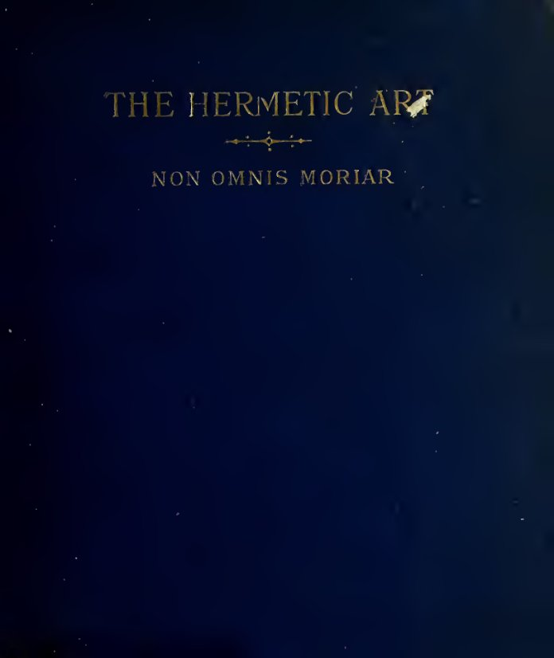
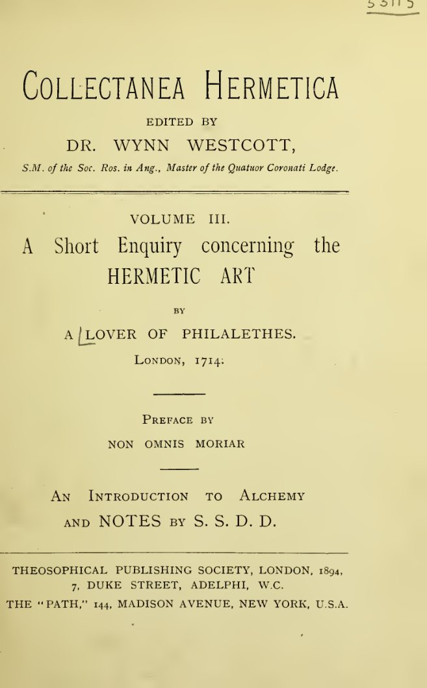

# 錬金術についての短い探究

フィラレテスを愛する者 著（1714年）／ウェストコット序文、フロレンス・ファー（S. S. D. D.）錬金術入門・注／全訳

| 項目 | 内容 |
|---|---|
| 原題 | A Short Enquiry concerning the Hermetic Art（叢書 Collectanea Hermetica 第三巻、W・ウィン・ウェストコット編） |
| 著者 | 本文：A Lover of Philalethes（「フィラレテスを愛する者」、匿名、1714年）。序文と要約：Non Omnis Moriar（W・ウィン・ウェストコット、1848〜1925年）。「錬金術入門」と注：S. S. D. D.（Florence Farr、フロレンス・ファー、1860〜1917年） |
| 初版 | 本文は London, 1714年。この版は Theosophical Publishing Society, London, 1894年 |
| 作業の基にした本文 | 1894年版のスキャン（Internet Archive、ウェルカム図書館所蔵本） https://archive.org/details/b24887341 の文字起こしと、ページ画像による確認 |
| 著作権 | 本文は1714年の匿名の著作。ウェストコットは1925年、ファーは1917年に死去。日本では保護期間が満了している。米国では1931年より前に発表された作品として、パブリックドメインに属する。表紙・扉の画像も同じ本のもの |
| 訳者 | 人工知能（Claude Opus 5.5） |
| 訳の性格 | 全訳（要約・省略なし）。本文中の詩や引用、聖書の言葉は、既存の日本語訳を用いず、原著の英文から新たに訳した |

## 要約

　黄金の夜明け団の創設者ウェストコットが編んだ叢書『ヘルメス文書集成』の第三巻である。一七一四年に「フィラレテスを愛する者」と名乗る匿名の著者が出した錬金術の小論を復刻し、ウェストコットの序文と要約、フロレンス・ファー（S.S.D.D.）の「錬金術入門」と三十余りの注を添えている。

　ファーの「錬金術入門」は、変成の過程で現れる色の連なりを人間の魂の歩みになぞらえる。そして錬金術を、驚嘆と想像力と純粋な理性によって自らを浄め、世の悲しみの中にとどまる救い主の道として説く。

　一七一四年の本文は、錬金術を志す者がなぜ失敗するのかを問う。資格のなさ、わざと矛盾させ散らして書く哲学者たちの文体、複数の業の取り違えを挙げる。そのうえで、ノートン、リプリー、センディヴォギウス、フィラレテス、『アシュ・メツァレフ』などを読み比べ、「哲学者のメルクリウス」「緑の獅子」「ディアナの鳩」「秘密の火」などの象徴を探る。結論は、師と神の恵みと瞑想なしに術には至らない、というものである。ファーの注は、これを当時の化学と霊的な修養の両面から読み解く。

## 目次

- 叢書編者の付記
- 序文
- 『短い探究』の要約
- 錬金術入門
- 錬金術についての短い探究
- S・S・D・D・による注

---

## 叢書編者の付記

　『ヘルメス文書集成』の第一巻は好評をもって迎えられた。実際、ジャン・デスパーニュの『ヘルメスの秘奥』が、錬金術を学ぶ者の関心を引かないはずはなかった。叢書の第二巻『ヘルメス・トリスメギストスの神なるポイマンドレス』が、さらに広く行き渡るであろうことも疑いなかった。今ここに、「フィラレテスを愛する者」による『錬金術についての短い探究』を、「ノン・オムニス・モリアル」の序文と、わが友S・S・D・D・の「錬金術入門」とを添えて復刻するにあたり、この第三巻も同じく成功を収めるであろうと大いに確信している。

W・ウィン・ウェストコット（医学士、公衆衛生学修了）

## 序文

　一七一四年に初めて刊行されたこの『錬金術についての探究』が、一八五〇年に匿名で刊行された、いっそう広く、いっそう霊的に構想された一巻『ヘルメスの神秘と錬金術についての示唆に富む探究』を生むもととなったと信じる大きな理由がある。この後者の本は、長年手に入らないものとなっており、二人の著者のうち生き残った一人の同意なしには、まだ誰も復刻することができない。それは、霊的な次元における錬金術を、ほとんど余すところなく概観したものである。

　ここにある本は、人間の向上という次元に当てはめた錬金術の学問にはっきりと言及している。もっとも、それは物質の次元での変成という、同じくありうることでありながらほとんど信じがたい力にも、明確に関わっている。

　この『短い探究』は、とりわけ、今ではほとんど手に入らないカバラの著作『アシュ・メツァレフ』を念頭に置いて書かれた。それは、物質の錬金術をカバラ――神と人と宇宙の観念に関わることでよく知られている――と結びつける論考である。この哲学の体系は、故ブラヴァツキー夫人が、その大著『シークレット・ドクトリン』で一部明かした、東方世界の達人たちの人間と宇宙の生成の驚くべき体系を支え、裏づけるために、きわめて大いに用いたものである。夫人はその驚くべき直観によって、刊行され今も残っているカバラの論考が、より真実なカルデア・ヘブライの教えの堕落した写しにすぎないことを見抜いた。というのも、夫人は、今も存在するカバラとヘルメスの秘密結社のどちらの系統にも、決して完全には秘儀を授けられていなかったからである。夫人の上にかくも惜しみなく差した東方の光から、夫人は批判することはできたが、カバラの照明の本性を十分に理解することは決してできなかった。

　近代のもう一人の卓越した神智学者、すなわち神の真の観念の探求者であるアンナ・キングスフォード博士は、インドの思想の流派にはわずかしか通じていなかったが、ヘルメス的と呼ばれる――あるいは傍系の流れとして薔薇十字的と呼ばれる――教えとは、かなり十分に交わっていた。

　この『短い探究』の匿名の著者は、明らかに薔薇十字の達人であった。その通り名は知られていないが、その素性は当時の秘儀を受けたオカルティストたちには知られており、その歩みの記録は、薔薇十字の同胞団の彼の支部の、刊行されていない名簿に記されている。

　『示唆に富む探究』は、『アシュ・メツァレフ』の代わりに、錬金術についての二つの古い論説を教えの本文として選んだ。「ヘルメスの黄金論説（アウレウス）」と「エウドクソスの六つの鍵」である。後者は、名高い『ヘルメスの勝利』の三つの部分の一つをなし、ほかの二つの断片は「騎士たちの戦い」と「エウドクソスとピュロフィルスの対話」と名づけられている。これらの珍しい小論の版で私の知る最も古いものは、一六九九年の日付のある「リモジョン・ド・サン・ディディエ」のフランス語訳である。そのほかに、一七二三年の英語版が今も手に入る。

　すでに準備中の『アシュ・メツァレフ』に続いて、これらの珍しい小論を順に復刻するつもりである。それは、錬金術の教えと、ヘブライ人の旧約聖書の多くのくだりの寓意的な解釈とのあいだの類比を指し示すので、オカルトの諸学を真に学ぶすべての者の関心を引くに違いない。

　同学の士の探究を助けるために、私はここに『短い探究』の要約を付け加え、また学識ある姉妹S・S・D・D・に「錬金術入門」を寄せてもらうよう説き伏せた。それは、神の霊感を受けた者には意味に満ちたものとわかるだろう。もっとも、好奇心だけでヘルメスの本を手に取るふつうの読者にとっては、彼女の論考は最も細心の注意をもって学ばれる必要があるだろう。

## 『短い探究』の要約

　匿名の著者は、錬金術の定義から始め、この学問には確かな土台があるに違いないと論じる。異なる時代の、遠く隔たった国々の多くの著者が、教えと技の本質についてみな一致しており、多くの場合、互いにまったく知らない達人たちが、同じ時代にありながら、ほとんど同じ結果を記しているからである。彼は、これらの教えの真偽は、実際にこれらの研究を調べた人々によってしか正しく判断できないと、まことにもっともな主張をする。失敗した者たちの否定的な証言や、自分で探究したことのない者たちの判断は、このような入り組んだ形の哲学を評価する基準にはならないのである。さらに彼は、錬金術で成功を収めた人々の多くが偉大な学識と敬虔な熱意の生涯をもっていたことは、彼らが示し、明かそうとした教えに、前もっての信頼を求めてよいものだと主張する。いったん議論の糸を離れて、彼は、真の達人たちの警告をものともせず、彼らが成功に欠かせないと定めた条件を顧みずに、この心と霊の道に押し入った多くの者たちの失敗と、むだにされた精力を嘆く。彼はとりわけ、至高の善（スンムム・ボヌム）に至るのに欠かせないものとしていつも強調されてきた三つの条件を指摘する。すなわち、生まれてから試練の時まで、官能の楽しみに汚されない、清く徳のある生活。ふつうの社会と仕事の責務から、ある程度自由であること。そして、象徴と寓意の言葉を理解する、生まれながらの力である。

　次に彼は、錬金術師たちが顕教の学問の平明な言葉よりも、象徴と例えを用いる必要があるとされることを熱心に支持する。そして、まことにもっともなことに、自らの内に成功する力をもつ弟子には、直観的な知覚の光がきっと差し、そうして彼は伝えようとされた理想を理解できるようになり、同時に、真の達人たちの著作にある、そうしたヴェールを掛け直すことの知恵を認めるだろう、と述べる。

　『探究』はそれから、表面上はアッシャー界すなわち物質の次元に移りながら、いつも霊的な顕現の実際の構図を保ちつつ、対照という大いなる教えを考察し、完全な金属と不完全な金属との本質的な違いに触れ、こうして三位一体の理想を導き入れる。顕現と物質には三つの原理があり、変成の過程さえ三つある。次に、普遍の溶媒すなわち結合のきずなが考察される。それは、二つ組をなす対照的な二つの力のあいだに立つ、単一性の雪のような輝きである（『セフェル・イェツィラー』を参照）。この主題は詳しく論じられ、物質の次元においてさえ、二つの物質の形のあいだに「中間の鉱物」を必要とする過程に言及がある。それから多くの例が挙げられる。とりわけ、ブリドリントンの律修司祭で、聖職者としても化学者としても名高いジョージ・リプリー卿の教えである。彼は第三の元素――それによってのみ両極を完全な結びつきへと編み合わせることのできる中間のもの――の型として、「緑の獅子」の理想を打ち立てた。

　再び学ぶ者の助けに戻って、『探究』は、成功しようとする者は、刊行された著作において、一人の真の師だけでなく何人かの師を学ぶべきだと勧める。どの著者も、一冊の本だけでは秘密の全体を学べないよう気をつけていたからである。それは探究を促し、直観を養うためだけでなく、ふさわしくない者が、善用もできれば悪用もできる変成という大いなる獲得物を得ることのないようにするためでもあった。

　次に、われらの著者は話題を広げ、示唆に富む語り方で、「ディアナの鳩」やヘルメスの杖（カドゥケウス）といった象徴や言い換えの意味と意図を、また、ナアマン、エリシャ、ゲハジの物語のようなカバラの寓意のいくつかを、明らかにする（あるいはヴェールを掛け直す）。学ぶ者にとってさらに役立つものとなって、われらの著者は学徒の条件と目的に立ち返り、大いなる秘密は学びだけによってはほとんど到達できず、師が必要であり、錬金術の土台の上で修養する生まれながらの能力をもつ者には師が現れるであろう、とはっきり告げる。そして最後に、金の種が金を生むことと、麦の一粒によってのみ麦の収穫が得られることとの類比を示して、学ぶ者の努力を励まして論を終える。人間の必要と益のために収穫を生み出そうと働く自然の太陽の熱もまた、錬金術師が不純なものから純なものを分け、世俗の心とありふれた物質の滓の中から神秘の金を生み出すことのできる、隠された火の型なのである。

　結びに彼は、達人たちは秘密を隠すために寓意と象徴と直喩をかくも自由に用いたが、人の直観がそのうちの一つをしっかりとつかみさえすれば、一連の全体の神秘が開け、物質と手段と過程の発見が、物質の次元においても、私たちが神の内にのみ安らぎを見いだす、あの高い世界においても成し遂げられる、と述べている。

N・O・M（薔薇の紅と金の十字架の団）

## 錬金術入門

**S・S・D・D・**

　錬金術について書く者たちは、自分のほうからあまりに多くの前置きを述べるのが常なので、その本には序文などほとんど要らない。もっとも、編者が、著者があれほど注意深く隠している秘密を明かそうと企てるのなら、話は別である。私はただちに、それをするつもりはないと言っておかなければならない。しかし一つのことには、益をもって注意を促すことができる。それは、錬金術の研究が、オカルトの学のほかのどの部門にもまして、人間とその宇宙との関係の神秘の本当の意味を探るうえで、類比がどれほど価値をもつかを示しているということである。一連の色を見せる変成の過程は、エジプト人の宗教を思い起こさせる。それは、夜の黒さ、夜明けの虹の色、真昼の白さ、そして夕べの赤い輝きを象徴していたのである。この象徴法の第一の段階は、無知の黒さを指している。宇宙の秘密への鍵を退ける人々の混沌とした闇である。その鍵は、虹の色の中に、音の振動に、香り、味、感触、微妙な心の印象の中に見いだされる。人の心が、こうした感覚の印象の秩序と関係をつかみ始めるとき、その人は無知の闇から知恵の白い光へと進み、やがては選ばれた者のまとう帝王の紫に至る見込みが十分にある。

　そうするためには、人は自らの内に、驚嘆という神の賜物をもっていなければならない。この能力を通じて、人は生の煩いの上に自分を高めるからである。好奇心に導かれて、顕現を観想することからその原因を観想することへと進む人こそ、その本能が大いなる業に取りかかる準備をさせている人なのである。

　満足は命取りである。何かに満足している人、最も成功した瞬間にも、最も神聖な地上の喜びのさなかにも、欠けたものと失望の鋭い感覚を覚えない人は、賢者の石――真の知恵と完全な幸福――を見つける望みを決してもてない。

　しかし、幸福な人は十分にまれなので、私の言ったことで錬金術の研究を思いとどまる読者はわずかだろうと望んでいる。私たちはみな、顔の周りに蛇がのたうち、その恐ろしさが見る者すべてを石に変えたメドゥーサの首を、恐怖をもって見るよう教えられてきた。しかし、もし時代の秘められた知恵を学ぼうとするなら、私たちはあの驚くべき目から一瞥を受けることを慕うようにならなければならない。その一瞥は、個人の喜びと悲しみに無関心である賜物を私たちに授けてくれるのである。賢者は宝石のようでなければならないからである。近づくすべての者にとっての光の中心となり、自らの内に最高の喜びの像を宿しているゆえに他者に喜びを与え、世から何も望まず、天上の光――盾に蛇の冠をいただく首をつけた、あの「知恵の女神」――から霊感を引き出すのである。

　ロバート・フラッドはよく言った。「死んだ石から、生きた哲学の石へと変えられよ。神と等しくあれ。おまえたちはこれらすべてを聞くが、信じない。ああ、自らの破滅をかくも気ぜわしく追いかける、みじめな死すべき者たちよ。」

　それからこの哲学者は、つまらない目的と弱い意志をもつふつうの人が、高い錬金術の、いや、それについて言えば低い錬金術の目標にさえ決して達しないことの空しさを指摘する。

> 　「おお、みじめな者よ、おまえはもっと幸福になりたいのか。
> 　おお、高ぶる者よ、おまえはこの世の環の上に高められたいのか。
> 　おお、野心ある者よ、おまえはこの地と、おまえの暗い体の上の天において命じたいのか。
> 　おお、ふさわしくない者たちよ、おまえたちはあらゆる奇跡を行いたいのか。
> 　退けられた者たちよ、それを求める前に、それがどのような性質のものかを知れ。」

　こうして、古い、古い教え、グノーティ・セアウトン、「汝自身を知れ」に戻ってくる。深い思いと瞑想によって、言葉がおまえにとって言葉以上のものとなるまで、おまえがそれを分析し、分け、考えうるあらゆる形に置き換え、ついにそこからその精髄と霊的な意味を引き出すまで、古の哲学者たちがおまえに語るどの言葉も、おまえは理解しないだろう。

　たとえば、「想像力」のような言葉に結びつけられている、ゆるい意味を取り上げてみよう。この物質主義の時代には、それは途方もない空想、いや嘘とさえ同じ意味になってしまった。しかし、パラケルススが、力の隠秘な顕れとしての想像力について語ることを聞くがよい。「人間には目に見える工房と目に見えない工房がある。目に見えるものは体であり、目に見えないものは想像力である。……想像力は、われらの太陽系の太陽が地に働きかけるように、人間の魂の中で自らの圏において働く太陽である。後者が照らすところではどこでも、土に植えられた種が育ち、植物が芽生える。想像力は魂の中で同じように働き、生命の形を存在へと呼び出す。……霊が主人であり、想像力が道具であり、体が形づくられる素材である。想像力とは、意志が思考から星辰の存在を形づくる力である。それは病を生み出すことも、癒やすこともできる。」

　おそらくこのくだりは、近ごろ催眠術の問題を扱う中で、この能力をあれほど軽蔑して扱ってきた人々に、新しい光を与えるだろう。

　実のところ、想像力とは、心の中に像を形づくる力である。それは一つの観念の発展と強化である。観念はまず存在し、次に思考の圏で受動的に思い抱かれる。それから心は（その観念が用いられうることを知覚して）欲望を働かせ、それが意志の行為へと発展し、これが観念の受動的な思い抱きを能動的な想像力へと変える。こうして魔術の過程が始まる。その先は、私が明かすべきことではない。

　この主題については、エリファス・レヴィの言葉を付け加えるだけにしておこう。「大いなる業の第一質料は、われらの内にも周りにもある。そして光を同化する知的な意志が、実体的な形の働きを導き、化学はまったく二次的な道具としてしか用いない。」

　ここで扱う著作より一世紀後に刊行された『示唆に富む探究』は、大いなる業を完成させるのに欠かせない、人間の本性の徹底した分析に用いるべき方法を指し示している。その著者は言う。

> 　「輪廻は、人間の同一性（あるいは意識）を、動物の存在から、その元来の形成のエーテル的な元素へと連れていく。」

　すなわち、穏やかで哲学的な心で内へと思いをめぐらすことによって、私たちは、自分の見、感じる顕れた生から、その生を動かす力へ、そしてついにはその動かす力の原因へと進むことができる。この世から超世へ、知的なものから可知的なものへ、地から天空へ、水から、万物の源である中心の光から現れる熱の燃える光線へと。

　同じ本は続ける。「これらの元素は自然の普遍的な基本である。ただ人間の形においてのみ、それらは、その第一原因へと帰っていく理性の至上性に達しうる。」

　理性は私たちを導く光である。急いで付け加えておかなければならないが、偽りの理性と、直観が浄められ、低い情念の上に昇るときに私たちが知覚する天上の理性とを区別することは、どれほど必要なことか。偽りの理性とは、私たちの釣り合いを失った力が、悪を行う自分を正当化するために打ち立てた像にすぎない。自分の行いに理由を挙げて自分を正当化しようとしているのに気づいたら、私たちはひそかに恥じている何かをしていたのだ、とはよく言われたことである。

　真の理性とは、あらゆる見せかけの上にあるものから私たちの上に降りてくる、澄んだ光である。聖トマス・ア・ケンピスが、自分を引き留めようとする人々に、一人の方が自室で待っているので行かなければならないと告げたとき、彼が望んだのは、この能力との交わりであった。偽りの理性は多くの議論で自分を正当化しようとする。純粋な理性は真理を知っており、沈黙していることができる。

　『示唆に富む探究』はこう続ける。「ただ人間の形においてのみ、神の形を理解することができる。人間の形がそうしたとき、意識して結ばれた理解の中での光の三重の成長によって、それは第四の形を流出する。それは真実で神のようであり、魔術的に描かれた、その人格の明白な似姿である。」

　錬金術師が軽い仕事を引き受けるのではないことを示すには、もう十分に語ったと思う。今なお世に夢中な関心を抱いている人々に、私は成功の望みを差し出すことはできない。達人は世の中にいることはあっても、世のものではない。錬金術は嫉妬深い女主人であり、弟子たちに命そのものを求める。彼女のために、おまえはヘラクレスの十二の功業を果たさなければならない。彼女のために地獄に降り、彼女のために天に昇らなければならない。力と忍耐をもたなければならず、何ものにも怯えてはならず、涅槃の喜びに誘われてはならない。自分の業を選んだからには、その目的のために朽ちる欲望から自らを浄め、輝く者たちの光を引き降ろして、それがここ地上でおまえの上に輝くようにしなければならない。これが錬金術師の業である。その真の理想はまた、東方の神智学の最高の理想でもある。自分に開かれた涅槃を受け入れるよりも、自分の種族の悲しみと触れ合うような生を選ぶこと。そして世のほかの救い主たちのように、天上の本性と地上の本性とのあいだの生ける絆として、顕れたままとどまることである。

S・S・D・D・（薔薇の紅と金の十字架の団）

### 訳注

- **『ヘルメス文書集成』（Collectanea Hermetica）**：黄金の夜明け団の創設者の一人、W・ウィン・ウェストコット（一八四八〜一九二五年）が編んだ叢書（全十巻）。第一巻はデスパーニュ『ヘルメスの秘奥』、第二巻は『ポイマンドレス』、本書が第三巻、第八巻がファーの『エジプトの魔術』。
- **ノン・オムニス・モリアル（Non Omnis Moriar）**：「私はすべてが死ぬのではない」（ホラティウス）。ウェストコットの黄金の夜明け団での名。序文と要約はウェストコットの筆である。
- **S・S・D・D・**：ファーの団内での名 "Sapientia Sapienti Dono Data" の頭文字。
- **R.R. et A.C.**：黄金の夜明け団の内陣（第二団）「薔薇の紅と金の十字架の団（Ordo Rosae Rubeae et Aureae Crucis）」。
- **フィラレテスを愛する者（A Lover of Philalethes）**：一七一四年の原著の匿名の著者の名乗り。フィラレテスは十七世紀の錬金術師エイレナエウス・フィラレテス（ジョージ・スターキーとされる）。
- **『示唆に富む探究』**：メアリー・アン・アトウッドが一八五〇年に匿名で出した『ヘルメスの神秘と錬金術についての示唆に富む探究』。刊行後まもなく著者自身が回収・焼却したため、稀覯書となった。序文の「二人の著者のうち生き残った一人」は、父トマス・サウスとの共著とみなされていたことによる。アトウッドは一九一〇年に死去。
- **『アシュ・メツァレフ（Aesch Mezareph）』**：「精錬者の火」の意。錬金術とカバラを結びつけた著作。この叢書の第四巻として刊行された。
- **ブラヴァツキー夫人**：神智学協会の創設者（一八三一〜一八九一年）。『シークレット・ドクトリン』は一八八八年の主著。夫人についての評価は、序文の筆者ウェストコットの見解である。
- **アンナ・キングスフォード**：神秘家・医師（一八四六〜一八八八年）。ヘルメス協会を設立した。
- **リモジョン・ド・サン・ディディエ**：アレクサンドル・トゥサン・ド・リモジョン。『ヘルメスの勝利』の著者とされる。
- **『セフェル・イェツィラー』**：カバラの古典『形成の書』。
- **アッシャー界（Assiatic）**：カバラの四つの世界のうち、最も下の「活動界」、すなわち物質の世界。
- **ジョージ・リプリー**：十五世紀イングランドの錬金術師。ブリドリントンのアウグスチノ会律修司祭。「緑の獅子」は錬金術の象徴の一つ。
- **ディアナの鳩、ナアマン、エリシャ、ゲハジ**：後の本文で論じられる。
- **メドゥーサと知恵の女神**：アテナはメドゥーサの首を盾（アイギス）につけていた。
- **ロバート・フラッド**：十七世紀イングランドの医師・神秘哲学者で、薔薇十字の擁護者。引用の出典は示されていない。英文から新たに訳した。
- **グノーティ・セアウトン**：ギリシア語で「汝自身を知れ」。デルポイのアポロン神殿の格言。
- **パラケルススの引用**：フランツ・ハルトマンの英語の要約（『パラケルスス』一八八七年）によるとみられる。英文から新たに訳した。「……」は原文の省略記号。
- **エリファス・レヴィ**：十九世紀フランスの魔術思想家（一八一〇〜一八七五年）。引用は英訳からとみられる。英文から新たに訳した。
- **トマス・ア・ケンピス**：『キリストに倣いて』の著者とされる十五世紀の修道者。この逸話の出典は示されていない。
- **ヘラクレスの十二の功業**：ギリシア神話の英雄ヘラクレスが課された十二の難業。

## 錬金術についての短い探究

**フィラレテスを愛する者（一七一四年）**

（本文中の（注1）などは、巻末の「S・S・D・D・による注」の番号を示す。題の「錬金術（ヘルメスの術）」には注1と注2が付いている。脚注は叢書の編者によるもの。）

　すべての不完全な金属を完全へともたらすこの術は、世のほとんどあらゆる時代に、ほとんどあらゆる身分の人々によって、真実であると主張されてきた。その人々の本の多くが今も残っている。

　彼らは、この大いなる宝を作り、所持したと明言している。それは、すべての不完全な金属をソルとルナ（注3）の完全さへともたらす（薬の質に応じて）ばかりでなく、人間の体のあらゆる病を癒やし、若さを新たにし、命を延ばしさえするのである。

　これらの著者たちは、代々互いの証言を正しいと認めてきた（注4）。そして、術のさらなる証拠として、これを理解した者はみな、同じ時代にあって、互いに面識も文通もなかったにもかかわらず、きわめてよく一致してこれについて書いている、と主張してきた。

　これらの人々の書いたものがどれほど受け入れられてきたかは、ほんの少し調べればわかる。たいていの人は、これら（錬金術の）本を巧みに作られた作り話としか見ず、術そのものをまったく不可能なものと見ているからである（注5）。

　これに対して（錬金術の）著者たちは答える。術の法則も事実も知らない判定者によって術を退けるのは、正当でも称賛すべきことでもない。そのような人々の無知な否定は、疑いようのない信用と敬虔と徳をそなえ、争いがたい力をもつ論証と状況に支えられた多くの人々の肯定的な知識を退けるには、決して十分ではない、と。

　このことから、また事柄そのもの（すなわち長寿と富。『至福への道』[^1]を見よ）のすばらしさから、多くの人がこの術を信じ、追い求めるよう促されてきた。

　これらの人々について私が抱いてきた憂鬱な見方こそが、私自身の考えを、ここに見るような順序に整える機会となった。どの師も気を悪くされず、どの探究者も不快に思われないよう願っている。

　すなわち、これらの人々の運命、力量、そのほかの資質のさまざまを、哲学者たちが成功しそうな人について定めたものと比べると、私は憐れみに満たされ、ノートン[^2]の次の言葉を繰り返すのにほとんど震えるほどである。

> 　「百万人のうち、錬金術に
> 　定められた者は、三人もいない。」

　おお、そのような人々にとっての悲しい知らせよ。損なわれた健康、傷ついた身代、実りのない実践が、日ごとに彼らをますます不向きにし、その労苦に成功の冠を戴かせるはずのものに至るどころか、ついには術そのものを否定し、いや呪いさえしかねないのである。

　探究者の大方につきまとうこの不首尾がどこから来るのかを、かなり徹底して調べてみたい。そこで、私の考える主な障害（注6）をいくつか挙げよう。

　第一に、この術を求める者のうち、哲学者たちの言うところに従ってそれに至る資格のある者はわずかである。彼らは、それを見いだすには人間の全体が要る[^3]と主張し、また見いだされたときには、それが人間を占有するとも主張している。また、それは偶然や行き当たりばったりの試み、たまたまの実験によって誰かに見いだされることは決してなく、心[^4]が神の光の一条によって燃え立たされないかぎり、この最も隠された学問を見抜くことはできない、とも主張している。

　これらのことは、ほかの多くの戒めとともに、彼らの本の中にふんだんに書き記されている。こうした事柄にあまりに軽率に関わっている多くの人々に知らせ、改めさせるためである。それなのに、その忠告に従う人のなんと少ないことか。人間の半分にもはるかに足りない心構えでこの研究に取りかかり、自分のつまらない空想のほかに何の権威もない実験をいつも試みている。それゆえ、この学問に関しては、真夜中のように暗い心をもっているのである。

　それに加えて、ほとんど乗り越えがたい困難がある（人間の全体を捧げることができ、実践においてきわめて慎重で、自然の事物一般、とりわけ鉱物界についてかなりよく理解している人々でさえ、乗り越えるのは十分に難しい）。それは、ヘルメスの哲学者たちに特有の、文体の巧妙さである。

　これについて彼らはしばしば私たちに警告し、もしこれがなければ、自分たちの秘密を明かし、同時に隠すことはできないだろう、とも告げている。光を与えると同時に暗くする、というのは逆説だが、彼らはほかの多くの十分に理解しがたいことと同じく、それを真実だと断言する。それでも、それらを役立てる前に理解されなければならないのである。センディヴォ[^5]などがその証人である。

　ノートンもまた、この神秘的な書き方（注7）をほのめかしている。それは確かに、私たちがその教えを見分けられるかどうかにかかわらず、それが覆い隠すものであることを十分に示している。すなわち、

> 　「業の各部分が、
> 　古の学僧たちによってどれほど順序を乱して置かれているかを考えるなら。」

　いくつもの業をこのようにばらばらにすることが、初心者に彼らの書いたものを符合させることをほとんど不可能にしている。どの一部分でも正しく当てはめられなければ、全体は不完全になるのである。

　別の者は、哲学的な巧妙さに並外れた率直さを混ぜ合わせて、秘密が公然と語られながらも安全であるようなやり方でそうしたのだ、と私たちに告げている。そして、これらの事柄について用心するよう、読者に忠告することも怠らない。すなわち、

> 　「だが用心せよ、
> 　思い違いをせぬように。私は断言する、
> 　これらの行は入りまじった教えを告げているのだ。
> 　わがこの書では、二つの道がともに分け前を求めているのだから。
> 　一つひとつの文をよく見分けることを学べ、
> 　そしてそれがどの業に属するかを知れ。
> 　これは大いなる技であり、私の知るかぎり、
> 　読書のすべてを尽くしても、それに達した者はわずかである。
> 　それでいて、理論においてはこれこそが肝心なのだ。」

　それゆえ、彼らの言葉がどの業に関わるのかを学ぶまでは、成功の見込みがまったくないことは明らかである。それはまことに容易ではなく、理論の頂点である。そして、ほかのどんなものによっても、どれほど巧みに紡がれ、どれほど愛着をもって抱かれようとも、うまくいくことはない。

　また哲学者たちは、ときに自分たちの物質は多く、業もまた多いと断言するが、それとまったく同じ権威と真実をもって、しばしばその反対を主張する。アルテフィウス[^6]は言う。

> 　「われらは多くの箇所で、これを取れ、あれを取れと言うが、それは、汝がただ一つのもの（注8）を取るべきだという意味である。これらのことは、嫉妬深い哲学者たちが、不用心な者を欺くためにそのように書き記したのだ。愚か者よ、われらが秘密の中の秘密を公然と教えると信じるのか。われらの言葉を字義どおりの響きに従って受け取るのか。確かに知れ、ほかの哲学者たちの言葉を、そのふつうの意味と響きに従って受け取る者は、アリアドネの糸[^7]を失って、すでに迷宮のただ中をさまよっており、自分の金を破滅に定めたも同然なのである。」

　これらの見かけの矛盾によって、彼らのうちのある者たちは、そうでなければしなかったであろうほど大胆な歩みで、この術を明かしてきた。ある者たちは、まねることさえ、いや、繰り返すことさえあえてした。

　ここから私は次のように推論する。期待できるかぎりのこと、あるいは神が書くことによってなお明かされるのを許されるかぎりのことは、すでに世に伝えられている、と。というのも、この術は、それについて知りながら書いた人々によって、神の直接の守護のもとにあると宣言されているからである。また、それを知るに至った者は、その保存に驚嘆するであろう。そして彼らの驚きをさらに増すのは、かくも薄いヴェールがそれを守っており、神がそれを、ふさわしくない者たちのあらゆる攻撃に対する十分な守りとしておられることであろう。センディヴォなどを見よ。

　同じく、誰かが文字の見かけの意味から哲学者たちの意図を見分けるや（注9）、無知の暗い夜は逃げ去り、光と知識の栄光ある朝が明けそめるであろう。そのときディアナ（注10）は、あれほど求められてきた最も快い泉で水浴びしながら、自らのヴェールを取り去るであろう。

　そして彼は、自分が自然の大道、すなわち哲学者たちの秘密の道（注11）にいることに気づくであろう。それは、最もたやすく、楽しく、速い道であり、そこには嵐もなく、異質なものもなく、生成の穏やかな火のほかにどんな火もない。

　ノートンは、この業を理解する学僧はわずかしかいないと断言している。それはまことに哲学的なものだからである。また彼は言う。この業では、別の業でならそうしてもよいように、水銀（注12）と金属から始めてはならない、と。その別の業は、と彼は付け加える、もし三年で成し遂げられれば幸いな偶然というべきものであり、偉い人々に属するものである。貧しい人々にはそれに手を出さないよう忠告している。その中では百を超えるやり方で誤りが犯されうるし、それは苦痛と労苦の業であり、危険にも満ちているからである。

　これらのことがそのとおりであることを、私たちは、多くの人によく知られているように、ある近代の著者によって悲しくも確かめさせられている。『開かれた入口』[^8]。

　さて、彼らの業が異なるように、彼らの水（注13）すなわちメルクリウスもまた異なる。完全な金属を焼成しようとするなら、それはメルクリウスによってなされなければならない。しかし、不完全な体（完全への途上にあるもの）を溶かそうとするなら、それはメルクリウスの水によってなされなければならない。それは哲学者たちの露、あるいは雨水である。

　完全な体（注14）は、粗い湿り気によって、退屈な労苦をもって焼成される。しかし不完全な体は、はるかに精妙なメルクリウスの中で、穏やかな火とわずかな骨折りで溶かされ、浄められる。

　そしてこの精妙な溶媒は、不完全な体のメルクリウスではあるが、（ある目的のためには）温かい水が氷を溶かすようにソルを溶かし、その体をまったくの霊にするであろう。

　これが化学すなわちヘルメスの哲学の泉[^9]であり、それについてこう言われている。

> 　「この水の秘法を正確に知る者には、哲学者たちのどんな言葉も秘密も、格言も書き物も謎も、隠されることはない。さらに、それはその効力において驚くべきものであり、それが直接引き出されるものは、他の何ものにもまして最も秘密である。またそれを抽出する手段も、最も驚くべきものである。その知識の中に、彼らのすべての火、重さ、処方が隠されている。」

　同じ著者は、それを見るのでなければ、誰もその輝きを想像できないと断言している。そのときあなたは、ある天の体を見ているのだと思うだろう。私を信じよ、と彼は言う、私はこの雪のような輝き（注15）を見たのだ、と。

　センディヴォは、私を信じよ、私はそれを見たのだから、その水は雪のように白かった、という趣旨の言葉で同じことを確かめるばかりでなく、それがどこから引き出されたかをも付け加えている。すなわち、太陽と月の光線から（注16）である。

　このことを言っているのは彼だけでなく、ほかにも多くの者がいる。いくつか例を挙げよう。

　アルテフィウスは、それは太陽と月の光線から引き出される、いや、この溶かす水は太陽と月の魂、その湿った火であり、この術のための世界でただ一つの作用者である、と主張している。

　『ヘルメスの秘奥』の著者[^10]は言う。「汝のメルクリウスに、これら二つの光の両方からその起源を引き出させよ。」

　フラメルは太陽と月について語って言う。「それらはメルクリウスの源と、硫黄の起源をもつ。」

　別の者、すなわち『至福への道』の著者は言う。「太陽は万物の父であり、月はその妻にして母である（というのも、太陽はこれらの生み出す光線を直接に送り下すのではなく、月の腹を通して送るからである）。そしてこの二重の霊は、風と霊に乗せられて地[^11]の中へ運ばれ、そこで形づくられ、養われる。」

　この二重の霊すなわち炎を、ゲベルは金属の直接の質料と呼んでいる。

　ヘルメス自身も、その追随者のほとんども、これらのことについて一致していることを、あなたはよくご存じである。そして彼らがどこで一致しているかに注意することが、私たちの務めである。

　アルノルドゥス[^12]は言う。「われらの不完全な金属の中には、効力において、また近い力において、太陽と月がある。」哲学の業は、この天のメルクリウスと、浄められた不完全な体とから始まる。

　「純粋な質料がある」と別の者は言う。「それは金の質料であり、増加を与える熱をその内に含んでいる。」（生成の火。）これは、ふつうの金の中に厚い襞の下に閉じ込められており、強く退屈な煎じによらなければ抽出されない。それは多くの誤りを犯しやすい業であり、それに携わった者たちに、その長さと煩わしさを嘆かせてきた。しかしもう一つの業では、体は甘く穏やかな浴、すなわち湿った火（注17）によってすぐに溶かされる。

　前者の道が業を果たすのに多くの苦痛と忍耐を要するように、後者は、深く隠されているので、それを見いだすのに大いなる技と専心を要する。

　これらの秘密の師たちはまた、これらの業（初めはすべて一つである）は結び合わされて、彼らの大いなる薬とされうると断言している。そして私は、それらを一つにするやり方は、ほんのわずかしか隠されていないと聞いている。というのも、彼らがそれを隠すために好んで用いる一音節の、ときに二音節の言葉（注18）を、三音節の、ときに四音節以上の言葉に置き換えさえすれば、初心者でもそれを思いつくのは難しくないだろうからである。そしてこの薄い覆いの理由として挙げられているのは、もし誰かがそれを見分けても、両者の手段を知らなければほとんど役に立たず、もし手段を知っていれば、実践について長く知らずにいることはできない、というものである。だから手段の知識こそが、まず第一に絶対に必要であるように思われる。

　これらをノートンは自分の「中間の鉱物」と呼び、それはマグネティア[^13]と、その兄弟リサージ[^14]にほかならない、と言っている。そして彼は、それらを清澄にすることこそ、すべての中で最も汚い業だと断言している。

　そして彼はこれらの手段を二つとしながらも、それらがどう違うかを告げている。すなわち、母が子と違うように、あるいは男が女と違うように、と。これで、彼の話が哲学者たちの一般的な教え、すなわち作用者と受容者に至ることがわかる。それは、彼らが自分たちの言葉を紛らわしくするためにどんな技を用いようとも、彼らのただ一つの意図であるように思われる。

　リサージは、と彼は言う、精妙な土であり、褐色で、赤みを帯び、輝いてはいない。

> 　「古の父祖たちはそれを、値打ちのないものと呼んだ。
> 　商いとしては何の価値もないからである。
> 　それを見つけた者は誰も、持ち帰ろうとはしない。
> 　一オンスの粘土（注19）を持ち帰ろうとしないのと同じく。」

　彼はまた、それはキリスト教の地のどこでも売られてはおらず、汝は自らそれを作らざるをえない、と言っている。

　マグネティアは美しく輝き、それを知る者はわずかで、高い所にも低い所にも見いだされ、プラトンによってティタノスと呼ばれた。これらがエリクシルを作るための材料である、と言い、こう付け加える。

> 　「この秘密は、今日この日まで
> 　かくも真実に示されたことはない。汝の獲物として受け取れ。」

　さて、これらのことを哲学者たちの教えに当てはめると、リサージは彼らの真鍮、すなわち哲学のソルでなければならない。マグネティアは、彼らの精妙な湿り気、すなわち哲学のメルクリウスと理解されなければならない。それは生きており、それだけでなく生かすものであり、清く、それだけでなく清めるものであり、揮発性で、それだけでなく、ソルの最も固定した体さえ揮発させるものであり、金属の根源の湿り気である。

　これがどのようにして得られるかは、私たちの探究に値する。そして彼らが、それがどこから引き出されるか、すなわち太陽と月から、ということについてだけでなく、それを調える仕方についても一致しているかどうかも。というのも、それは両方の影響を受けていなければならないように思われるからである。

　しかし、これらの効力を集めるには、リプリー[^15]が「緑の獅子」（注19A）について語って言うように、媒介が要る。

> 　「彼は媒介、太陽と月のあいだにあるもの、等々。」

　また、『緑の獅子狩り』[^16]の著者は言う。

> 　「獅子は司祭、太陽と月は結ばれる二人。
> 　けれども二人はともに、司祭の寝床で生まれたのだ。」

　この緑の獅子によって、と別の者は言う、「すべての哲学者は、増やすことができ、種を宿し、まだ自然によって完成されていない緑の金を意味している。あるいはアサフェティダ（阿魏）を意味している。この操作すなわち蒸留のまさに最初に、悪臭を放つ白い煙が立ちのぼるからである。」フラメルがこの主題を知ったのは、この強い匂いによってであった。

　これがほかの哲学者たちと一致していることは、彼らの本を読む人々にはよく知られているので、詳しく示すまでもない。

　この蒸留は、ヘルメスもほかの多くの者も宣言しているように、穏やかな火で、少しずつ、大いなる分別をもって行わなければならない。濃いものが薄いものと、精妙なものが粗いものと、汚れたものが清いものと混ざらないようにである。ルルス[^17]は、この操作を、ぶどう酒の蒸留の形で巧みに描いたことで名高い。彼はそれをときにルナリアの汁とも呼び、そこから穏やかな火で、白い水の形の汗を抽出するのである。

　これはまた別の名でも呼ばれる。アドロプ、サトゥルヌス（注20）、真鍮、癩病の金、不完全な体などである。そして彼らはみな、それが大いなる暗がりの中にあり、サトゥルヌス的で汚く、それを作るときには大いなる悪臭があり、それは固定されておらず、金属と鉱物のあいだの媒介で両方の性質を分かちもち、きわめて生のままで、彼らの貴い薬の基盤と土台である生きた銀（アルゲント・ヴィーヴ）を含んでいる、と一致して言う。そしてこうして、と哲学者は言う、汝はサトゥルヌスがこの術の最大の秘密をいかに含んでいるかを理解するに至るであろう、と。これこそ、「あれほど隠された金の枝であり、すべての森が影で覆い、暗い谷間が隠しているもの。それは、ウェヌス女神の鳥を知る者、幸いな一対の鳩をもつ者のほかには、誰にも従わない」等々。――『ヘルメスの秘奥』[^18]。

　この学問の師たちは、このことについて声をそろえて一致している。すなわち、この質料は正確に浄められ、ほかのどこにも見いだしえない効力をもつ生きた銀へと溶かされなければならない、と。

　これは驚くべき反復蒸留（コホベーション）によって行われる。その回数はさまざまに言われているが、完全な溶解と完全な純粋さが認められるまで、それだけの回数を重ねなければならないという点で、彼らはみな一致している。

　これを行う時間は、ある人々によれば、『ヘルメスの秘奥』の中でほのめかされているという。そこにはこう言われている。「竜に、魔術の数七の三倍を飲ませよ。酔って、そのおぞましい衣を脱ぎ捨てるまで[^19]。」

　こうして、三かける七は二十一であり、ある人々はこれを日と解し、ほかの哲学者たちもこれに同意しているように見える。しかしそれが二十一日なのか、二十一回の反復蒸留なのかは、彼らの「光をもたらすウェヌスと、角あるディアナ」――『ヘルメスの秘奥』――の知識に恵まれる者が、正しく決めるであろう。

　同じく哲学者たちは、この水の効力について一致している。すなわち、それは両性の性質を分かちもつので、両方の役割、すなわち溶かすことと凝固させることを果たす、と。というのも彼らは、それが（作り手の企てに応じて）何も加えることなしに、自らを月の性質にも太陽の性質にも凝固させると主張しているからである。

　不完全な体を調合する際の割合についても、またその溶解に関しても、いくつかの戒めが与えられている。重さや量が適切でなければ、その効力は損なわれないまでも大いに減じるであろう。しかし適切な割合が守られ、ふさわしい火が与えられれば、真のしるしが続くであろう。

　不完全な癩病の体とその水との真の結合を、彼らは深く隠してきた。哲学者たちが認め、探究者たちが見いだすとおりである。というのも、彼らの言うところでは、生成の業においては残りがあまりにたやすいので、このように結合され浄められた彼らの驚くべきメルクリウスを得た者なら、それを取り逃がすことはまずないからである。

　これについて彼らは、啓かれた心には十分なほのめかしを与えたと宣言し、誰であれ、神の呪いなしにこれ以上公然とそれを行うことは決してあえてしないであろう、と言っている。

　しかし、すべての者が同じ率直さで、同じ直喩と謎によってそうしたわけではない。『新しい光』[^20]はカリュブス（鋼）の名のもとに、『至福への道』はヘルメスの巧みな火の名のもとに、というふうに。ノートンは言う。

> 　「ベーコン[^21]はそれを暗く、その三通の手紙すべてで行った。
> 　しかしライムンドゥス[^22]は、その『普遍の術』でよりよく行った。」

　そして読者は、この驚くべき結合の手段と媒介について、哲学者たちが自分たちの本で教えた以上のよい説明を私から期待できないのだから、それについてのより十分な満足と知識は、そちらに譲らなければならない。ノートンが言うとおりである。

> 　「それゆえ、一冊の本を読むことに頼るな。
> 　多くの著者の作を見るがよい。
> 　『書は書を開く』と、大学僧アルノルドゥスは言う。
> 　アナクサゴラス[^23]もその業について同じことを言った。
> 　多くの本を見るのを怠る者は、
> 　実践においても決して手際よくはならない。」

　このように多くの本を読み比べることについて彼の挙げる理由は、

> 　「どの一人も、一つか二つの要点しか教えなかった。
> 　それによって仲間たちは確信した、
> 　彼が自分たちの兄弟であることを。
> 　どの一人も互いを理解していたからである。」

　私がノートンをことさらに挙げてきたのは、彼とその同時代人リプリーが、この術についてきわめて学識豊かに、また驚くほど一致して書いているように私には思われるからである。二人はほぼ同じ時期に、おそらく一人はイングランドで、もう一人は外国で書いたのであり、私の知るかぎりでは、その当時互いに知り合いではなかった。また、リプリーの『錬金術の合成』は、ノートンの『オーディナル』のわずか六年前に書かれたのだから、ノートンがそれを見ていたとは考えられない。とりわけその種の本は、当時はすぐには世に出なかったのである。またノートンは、割合について見事に書いた人々を数え上げるとき、リプリーに何も触れていない。リプリーは疑いもなく、その点で抜きん出ているのに。

　同じ時代に、互いに知らずにこの術について書いた著者たちのこの調和を、先の二人と同じ国の一人の近代の達人が、（ほかの論拠とともに）術の存在を証明する説得力のある論拠として挙げている。そしてそれは、私にとっても大きな重みをもち、彼の目的に役立つように思われる。

　この著者は、自分より前のすべての者を凌いだと公言し、彼の言うところでは、世がそれまでまったく知らなかったようなことを明かした。それなのに、彼の弟子たちは自分たちの不首尾をひどく嘆いてきた。ほかの哲学者たちよりも彼をより十分に理解したように見えたにもかかわらず、である。そのため、多くの人が、この術における彼の進め方は、ほかの多くの者のやり方とは違うと結論してきた。いや、ついには、彼の率直さにひどい報い方をして、彼がかくも厳かに真実と公言している事柄――告発者たちこそそれに値しないのだが――について、彼は無知なのだと非難する者まで出てきた。

　彼は読者が自分の書いたものをこのように誤解するであろうことを予見していたようで、それゆえ、受け入れようとする人々のために、あちこちに必要な戒めを散りばめている。

> 　「われらの物質を闇から光へともたらす真の鍵を知らない者は、われらの本に心地よい教えを期待するな」と彼は言う。「まことに、われらは術の真の子を照らすために書くが、同時に、太陽の光を見ることも、われらの月の輝きに耐えることもできない、あらゆる梟や蝙蝠を宿命的に盲目にするためにも書くのである。そういう者たちには、彼らのさもしい空想に合った珍しい手品を差し出す。貪欲な者には費用のかからないたやすい道を、性急で向こう見ずで移り気な者には蒸留の繰り返しを。
> 　「世においてわれらの書いたものは、念入りに研いだナイフ[^24]のようであるだろう。ある者にはごちそうを切り分け、ほかの者にはただ指を切るのに役立つだけである。太陽が明るく輝けば輝くほど盲目になるのは、梟のしるし（注21）である。――もし汝が不注意であるなら、汝はこれまでの生涯で読んだどの本よりも先に、われらの本につまずくであろう。……自分の書いたことの意味を最もよく知る者から、これを受け取れ。われらが最も平明に語るところでこそ、最も用心せよ（われらは自然の秘密を裏切ろうとしているのではないのだから）。とりわけ、汝が望むほど平明な処方を与えているように見える箇所では、隠喩を疑うか、さもなければ、汝が（霊感なしには）自分ではほとんど見つけられない何かが伏せられていると確信せよ。しかし術の子には、これまで誰によっても明かされたことのないものを書いたのである。」

　この著者だけでなく、ほかの著者たちの、彼らの本を読むことに伴う困難についての戒めを、さらに多く加えることもできよう。私がこれだけのものを挙げたのは、この著者のものをいくつか挙げることがとりわけ必要だと思われたからにほかならない。ほとんど誰もが、彼はほかの者たちよりもたやすく理解できるという考えを抱いているからである。しかし、それがどれほど役に立ったかは、彼ら自身が判断できよう。

　彼らの誰かが業のこの部分やあの部分を明かしたときには、それを容易には見分けられない――とりわけ不用心な者には――暗がりと釣り合わせなかったことはない、ということを知らないとすれば、私たちは自分自身に対して公正でないだろう。

　それゆえ、この術を学ぶ者たち、とりわけこの著者の著作を学ぶ者たちが、哲学者たちは技量に劣らぬ狡知をもっていると信じ、彼らの与えた忠告に従いさえするなら、哲学者たちではなく自分自身を責める余地しかないであろう。

　理論においても実践においても、探究者を軽率な結論から引き留めるために、この著者がしたこと以上に、誰が何を言いえただろうか。すなわち、

> 　「わたしの言葉だけを頼りに実践しようと危険を冒すな」と彼は言う。「というのも、知れ、わたしがほのめかしただけのことは、わたしが明かしたことよりはるかに多い。そしてわたしが汝の最初の理解に向けて最も公然と宣言したことにも、緑の葉の下に潜む蛇がいる。すなわち、汝が理解すべき何か隠されたものである。それを汝は、一目見て自信満々になって、おろそかにするであろう。」

　人々が、この著者の書いたものをほかの師たちよりも完全に、あるいはたやすく理解しているという愚かな思い込みを抱いてきたことは、私には、ヘルメスの哲学者たちが標榜し、誇りとしている特有の書き方、すなわち、術を術の子らには公然と示しながら、ふさわしくない者からはそれを守ることができるという書き方における、彼の大いなる技量の証拠である。

　これが真実であることは、彼らの書いたものすべてが示している。というのも、彼らのうちのある者は、自ら認めるように、本から術を学んだのであり、それが本の中で教えられていなかったなら、そんなことはありえないからである。そういう者たちは、同じ本を読みながら、その中に同じものを読み取らないために術を学ばない者たちに比べれば、まことにごくわずかである。この著者は、そういう人々を再び見事に描いている。すなわち、

> 　「ある者たちは、ほかの本を扱ってきたように、わたしの本も扱うであろう。そこから自分自身の空想の過程を読み取るのだ。わたしが夢にも思わず、自然の中にもない過程を。われらは英語で書くが、われらの物質はある者たちにとってはギリシア語のように難しいであろう。彼らは、われらの意味をこの上なくひねくれて誤解しているときに、われらをよく理解していると思うであろう。また、自然において愚かな者たちが、自然への証言であるわれらの本において賢くあるなどとは、想像もできない。」

　この著者は、リプリーへの並外れた敬意を表明し、（多くの点で）その率直さをまねたが、それをノートンの狡知とあまりに明らかに混ぜ合わせているので、両者を見分けるのは難しい。そしてそれは、彼の与えた戒めと、その点での読者の用心に十分に値する。

　彼はその本の中で、専心して読む大方の者がかなりたやすく見通せるような哲学的なヴェールのもとに、道のいくらかを私たちを導いてきた。そういう読者たちは、彼の隠喩のいくつかを見抜くやいなや、喜びに圧倒され、自分の能力についての思い込みに舞い上がって、たちまち叫ぶ。見つけた、見つけた、と。では何を見つけたのか。迷宮への道[^25]である。

　というのも、この短い散歩道の終わりに、彼はほかのどれよりも理解しがたい一つの隠喩を立てておいたからである。すなわち、「ディアナの鳩」である。これは大いなる迷宮の入口に立っており、その中では今日でもおびただしい探究者がさまよっている。その多くは、互いに気づかれずにいる。

　私自身もその中を何度か歩き回ったが、そこで出会う者はごくわずかである。迷宮はあまりに広く、ほとんど誰もが違う道を行くので、めったに出会わないのである。

　しかし、そこがひどく憂鬱な場所だとわかったので、私はそこから出ようと決め、むしろ入口の前の小さな庭を歩くことで満足することにした。そこでは、すべてではないにせよ多くのものが、整然と見られたのである。再び荒れ野に踏み込むよりも、そこにとどまって、立てられた隠喩について観想することを選んだ。荒れ野では、いくつもの奇妙な、貪り食う生き物たちの物音と声が聞こえ（そのうちのいくつかからは、私はかろうじて逃れたのだった）、そのほとんどが一つひとつ違う響きをもっていた。

　この著者は、自分の建てさせた柱のところで完全に立ち止まらせるつもりだったようで、旅人が知らずにあの危険な暗い荒れ野へ駆け込むのを防ぐために、柱にこの銘を刻ませた。「ディアナの鳩とは何かを学べ。それは獅子をなだめることによって打ち負かす。緑の獅子のことだ、と私は言う。それはまことにバビロンの竜であり、その毒ですべてを殺す。それから最後に、メルクリウスのカドゥケウスの杖を知ることを学べ。彼はそれで驚くべきことを行う」等々。それゆえ私は、導き手なしには一歩も先へ進むまい。迷宮に再び入ることを恐れるからである。

　この導き手は、たぐいまれな賜物をそなえた、きわめて賢い人でなければならない。というのも、彼は私に解き明かしを告げるだけでなく、夢そのものをも告げなければならないからである。そしてこれによって、私は彼の力量を判断できよう。

　というのも、ケリーが言うように、「道を知らないかぎり、誰も先導するな」だからである。

　それゆえ、私が道を尋ねることを、道を教えることと誰も取り違えないでほしい。もし誰かがそうして、そのために損をしたなら、責めるべきは私ではなく自分自身である。私は尋ねているのであって、道を教えているのではない、と言っておく。師たちは欺かれることはないが、探究者は欺かれうるのである。

　この鳩の謎は、ほかの多くの謎ほど頻繁には用いられていない。そしてそれらもまた、理解するのがきわめて難しい。これらの象徴は、俗人の手の届くはるか上にある知識と学問の根から生じたのだと私は考える。というのも、ある者が言うように、この術はカバラ的で、神秘に満ちているのではないか。だからラビの学問に通じたこれらの師の一人は、鳩の名が何を意味し、また何を意味しないかを、私たちに告げている。すなわち、「鳩（注22）の名は、決して金属そのものには当てはめられない（これは探究者によく注意されるべきことである。多くの者がこのように誤ってきたのだから）。そうではなく、仕え、調える性質に当てはめられる。そして（浄めのための）燔祭の本性を理解する者は、山鳩そのものではなく、二羽の家鳩の雛（それは子孫である）、すなわち鳩の子らを取るであろう。」

　そしてこの秘密の一対を、彼はむしろノガ（ウェヌス）に割り当てている。それは惑星の中で第五のものである。それで『ヘルメスの秘奥』の著者は、それらをウェヌスの鳥と呼んでいる。もっとも、このカバリストは鳩の名をディアナにも当てている[^26]。

　『自然の事物の歴史』の中で、と彼は言う。「ルナ（注23）は白のための薬と呼ばれる。彼女は太陽から白くする輝きを受け取り、それが同じように輝くことによって、すべての地――すなわち不完全な金属――を照らし、彼女自身の本性へと変えるからである。そしてイザヤ書三十章二十六節のくだりは、神秘的にこのことについて理解してよいであろう。業が成し遂げられると、彼女は太陽の輝きを得たのだから（注24）。しかしその状態においては、雅歌六章九節のくだり（注25）が彼女にふさわしい。しかし同じ名で業の質料も呼ばれる。そしてまことに、それは最初の固さの状態においては角ある月のようであり、流動性と純粋さの最後の状態においては満月のようである。」

　別の箇所で、彼は二羽の鳥について語って、次のくだりを書いている。このくだりを、『開かれた入口』の著者が、生きた銀――彼はそれを豹、濡らさない水、賢者のヨルダン川などと呼んでいる――について、よく考えたことを、いや、その初期の知識をそこから引き出したことを、私は疑わない。「そして彼はその背に鳥の四つの翼をもつであろう。四つの翼は二羽の鳥のものであり、それがその羽根でこの獣をいきり立たせる（注26）。獣が入っていって獅子と熊と戦うためである。そして獣には彼らを支配する力が与えられ、それは彼らに打ち勝ち、その粘り気のある血を抽出する。これらすべてから一つの第四の獣が作られる。それは恐ろしく、すさまじく、きわめて強い。……自らと他のものを食らい、砕き、……残りを足で踏みにじる（注27）。」

　この導き手は頼ってよいと思う。解き明かしだけでなく、もとの形象そのものをも告げることによって、その力量を証明したのだから。

　私の探究で出会ったのはこれ以上ではない。それゆえ、かくも多くの者がつまずいて誤りに陥る、この大いなるつまずきの石について、これ以上を私から期待することはできない。

[^1]: エリザベス女王の時代に書かれた匿名の錬金術の論考。一六五八年にイライアス・アシュモールが刊行した。この名高い好古家は、「ジェイムズ・ハソル、英国のメルクリウス愛好者」の名で錬金術の本も出している。
[^2]: 『クレーデ・ミーヒー（われを信ぜよ）』すなわち『錬金術のオーディナル』の著者。一四七七年ごろに書かれた。
[^3]: デスパーニュ『ヘルメスの秘奥』第四節を参照。
[^4]: 達人は、詩人と同じく、作られるのではなく生まれるのである。
[^5]: アラブの錬金術師ゲベルは七四〇年ごろに死んだ。本名はアブー・ムーサー・ジャーファル・アッ＝スーフィー。ミハエル・センディヴォギウスは一六三六年ごろの人で、師アレクサンダー・セトンが構想し、あるいは完成させた『メルクリウスと自然と錬金術師の対話』などの著作の編者であった。
[^6]: 一一六〇年ごろの人。『賢者の石について』と『命を延ばす術』の二著を書き、それらは一六五七年にパリで刊行された。
[^7]: クレタ王ミノスの娘アリアドネは、テセウスに一本の糸を与えた。テセウスはそれによって迷宮を抜け、ミノタウロスのもとに至り、これを殺したのである。
[^8]: 本名の知られないエイレナエウス・フィラレテスによる『王の閉ざされた宮殿への開かれた入口』。一六六八年にアムステルダムで初めて刊行された。きわめて興味深い、見事な著作。
[^9]: トレヴィゾのベルナルドゥスを見よ。泉は彼がとりわけ用いた象徴であった。
[^10]: ジャン・デスパーニュ。『ヘルメス文書集成』第一巻を見よ。
[^11]: ヘルメス・トリスメギストスの『エメラルド板』と比べよ。
[^12]: ヴィラノヴァのアルノルドゥス。一二四五年生まれの医師で、バルセロナ大学の教授。
[^13]: マグネシアは、近代の化学では金属マグネシウムの酸化物である。ここで言われているのはそれではない。
[^14]: リサージ（密陀僧）は、鉛の不純な酸化物である。ここで意図されているのはそれではない。
[^15]: ブリドリントンの律修司祭ジョージ・リプリー卿。一四九〇年ごろの人。
[^16]: 著者名は知られていない。ルルスか、その友人のウェストミンスターのクレーマーの作とされてきた短い論考である。
[^17]: スペインの司祭ライムンドゥス・ルルス。一三一四年にアフリカの海岸で、イスラム教徒に石で打たれて死んだ。
[^18]: ジャン・デスパーニュ。『ヘルメスの秘奥』第十五節を見よ。
[^19]: 『ヘルメスの秘奥』第五十二節を見よ。
[^20]: セトンとセンディヴォギウスによる『化学の新しい光』。
[^21]: ベーコンは一二七〇年ごろの人。
[^22]: ライムンドゥス・ルルス。
[^23]: イオニア学派のギリシアの哲学者。紀元前五〇〇年生まれ。
[^24]: 「わたしが来たのは平和をもたらすためではなく、剣をもたらすためである」と比べよ。
[^25]: フリーメイソンのロイヤル・アーチの儀式には、この象徴法と関わりがあるように思われる部分がある。――S・A・
[^26]: 煙に巻くことの楽しい見本。――N・O・M・

これらのことから、私にはきわめて明らかである。この術は、本当の知識なしには、どれほど多くの行き当たりばったりの試みや実験によっても見いだされえない。センディヴォが書いたとおりである。すなわち、「また確かに知れ、この術は運や偶然の発明にではなく、本当の学問に置かれている。そして世界には、それによって、またそれから賢者の石が作られる、ただ一つの質料しかない。すなわち、哲学者たちのメルクリウス（注28）である。」

　これが何から作られるかを、彼は『硫黄論』の中で、またほかの箇所でも教えている。これこそ、と別の者は言う、三月に、すなわち白羊宮に戻ってくる太陽がいたるところに振りまくメルクリウスであり、そこからまた硫黄も求められなければならない。

　この業においてその硫黄は、とセンディヴォは言う、まことに男の代わりであり、メルクリウスは女の代わりである。これら二つの合成と作用から、哲学者たちのメルクリウスが生み出される。彼らは二重の硫黄をもつように、二重のメルクリウスをもつからである。すなわち白のためのものと、赤のためのものである。これはめったに、それもきわめて用心深くしかほのめかされない。そしてこれらのメルクリウスは、色においても性質においても異なる。注意深い読者なら、彼らの本からたやすく読み取れるであろう。

　『開かれた入口』の著者は、まことに、白のためには二つのメルクリウスがあり、二つの異なる業で用いられると教えている。ふつうのソルのためのメルクリウスの鋭化は、哲学のソルのためのそれとは異ならなければならない、と主張しているのである。さらに彼は言う。「もし汝がふつうのソルの煎じにおいて、われらのソルで用いるのと同じメルクリウスを用い（両者は一般的には同じ根から流れ出るが）、賢者たちがその本でわれらの石に当てはめた熱の処方を当てはめるなら、汝は疑いもなく誤った道にいる。そしてそれこそ、ほとんどすべての若い実践者が捕らえられる大いなる迷宮である。その書いたものの中で、両方の道に触れていない哲学者はほとんど一人もいないのだから。」

　この点で、彼は誰にも引けをとらなかったと言ってよい。というのも、彼は一つの業を別の業と、一つの処方を別の処方と（前に言ったように、明かしたことと釣り合わせるために）織り交ぜているので、理論においてすべてを知るのに近いことをしなければ、たとえ全体の領域が知られた後でさえ、これらの細部のどこかで絶えず誤りに陥ることを避けられないからである。それは彼自身にも起こったことを、彼は告白している。それについては、私の探究の中で話が及んだときに触れよう。

　これら（ほかの多くとともに）が、この術の探究者たちが立ち向かわなければならない困難である。そしてそれは、多くの人々がしているようにそれを追い求めるよう励ますよりも、むしろ思いとどまらせるはずのものだと思われる。とりわけ、死ぬ日までこの研究を続け、無知と絶望のうちに生涯を終えるたいていの人々につきまとう逆運を考えるならば。この憂鬱な見通しは、と私は言う、私たちに深い印象を残し、この珍しく難しい哲学に、もっと用心深く関わらせるはずのものである。それは、師なしには、あるいは神の特別な恵みなしには、決して到達されないのである。『新しい光』の著者が私たちに告げるとおりである。すなわち、神がよき知恵によって、あるいは友によってそれを明かさないかぎり、それはほとんど知られない、と。

　たいていは後者によって、ごくまれに前者によってである。というのも彼はこう付け加えているからである。「ルルスは精妙な知恵の人であったが、もしアルノルドゥスから術を受けていなかったなら、確かに、苦労してそれを見いだす者たちと同じようであっただろう。そしてアルノルドゥスもまた、友からそれを受けたのである。どんな術も学問も、師にはたやすいが、学ぶ者にはそうではない。」

　それゆえこの術は、どれほど機敏な知恵と才能をもつ者にも、それを知る者のほかには、たやすくはない。

　前に挙げたカバリストは、賢く善い人々をエリシャによって、この術の愚かな僭称者たちをゲハジによって、生き生きと前もって描いている。ゲハジはまことにエリシャの僕であった。しかしそれが何のためであったかは、列王記下にある彼らの物語が示している。

　エリシャは自然の知恵の手本であり、富を軽んじる者であった。彼は毒のある水を正して健やかにし、自然のふつうの成り行きを超えて宝を増やす方法を知っていた。最悪の病を癒やし、いや、死者を生き返らせることさえできた。探究者の目をいつ、どのようにして盲にし、また開くか、嘲る者をどう罰するかを知っており、鉄を浮かべることさえできた。そうだ、彼の遺骸でさえ、死んだ後も効き目があったのである。

　ゲハジはむなしく働き、永遠に僕のままであった。あれほど偉大な人と語り合う利点をもっていたにもかかわらず、決して師となる資格を得なかった。彼は貪欲で、嘘つきで欺く者であり、他人の行いを自慢するおしゃべりであった。うぬぼれが強く性急で、師が彼に杖を取って死んだ子の上に置くよう命じたとき、師を十分に理解したと思い込んで、異質な質料でただちに企て、それゆえ自然の法を見分けることなく、何も成し遂げられなかった。しかしエリシャは生きた同質の作用者を当て、そうして死者は生き返ったのである。そして師の知識の二倍の分け前（それをエリシャは望み、師エリヤによって得た）の代わりに、ゲハジはその行いの報いとして癩病を得たのである。

　エリシャとゲハジのこの物語からは、多くのことが見て取れるだろう。二人は、賢く善い人々と、その反対、すなわち愚かで俗な人々の著しい例である。後者は、ゲハジがそうしたように、賢者の超自然の子を得ることについて語るかもしれないが、それを成し遂げることはできない。今日でさえ少なくない彼の後継者たちも同じである。彼らは資質においてだけでなく、成功においても彼を継いでいるのである。

　哲学者たちは声をそろえて一致している。この学問にふさわしい者は、厳しく徳があり、聖い生活を送っていなければならない。さもなければ神は彼を栄えさせない。十分な理解力をもたなければならない。さもなければ思い描くことができない。勤勉で骨身を惜しまない者でなければならない。さもなければ思い描いたものを成し遂げることができない。そして人目につかずにいなければならない。さもなければ成し遂げたものを静かに享受できない、と。これらに、忍耐と暇と、それに十分な財産を加えなければならない。それはこの研究ではとりわけ必要である。すでに言ったように、手段を見いだすのに人間の全体が要り、それから業を成し遂げるには注意深い専心が絶対に必要だからである。

　哲学者たちは、あなたもよくご存じのように、自分自身とも互いとも、見かけ上矛盾する自由を行使する。業はきわめてたやすいと主張するときもあれば、きわめて難しい、困難だと主張するときもある。短いと言うかと思えば、ひどく退屈なものだと言う。また、わずかな費用とたやすい労苦で成し遂げられると言うかと思えば、出費と骨折りを嘆く。その物質はただ一つのものにすぎないと断言するときもあれば、いくつかのものから合成されていると言うときもある。業は穏やかな火で行われると言うかと思えば、強い火なしには行われないと言う。また、それは均等で同じ度合いだと言いながら、それでいて日ごとに増されると言う。

　これらが、名を挙げればほかにも多くある、探究者が負っている困難である。それでも哲学者たちは、この術の鍵、すなわち哲学者たちのカリュブスがひとたび得られれば、それらはみな消え去ると断言する。初心者はもはや偽りの著者を好むことも、真の著者たちを和解させようと途方に暮れることもないであろう。最初の門が開かれるやいなや、残りはすべてひとりでに開くからである。

　多くの人が不満に思ってこう言うのではないかと恐れる。これらの困難はもう十分すぎるほど知っている、繰り返してもらうより、どうすればそれを乗り越えられるかを教えてほしいのだ、と。こういう人々に、私は哲学者の言葉で答えよう。哲学者たちの書いたものを、空想に従ってではなく、自然に従って解き明かせ、と。さて、彼らは、自分たちの石は、純粋さと精妙な固定性の最高度まで消化された金にほかならないと言う。多くの人がこれに同意しながらも、ふつうの金は意味されていないと言い張るであろう。それに答えて私はこう付け加えよう。センディヴォの『火の元素について』や『至福への道』などを読み、そこで語られている金の延性、持続性、純粋さを考えてみよ、と。また、自分たちがこの術によって生み出そうとしているのは、ふつうの金と呼ばれるような金ではないのか、考えてみよ。それから、生み出そうとしているのがふつうの金であるなら、ふつうの金こそ、そのような生産のための自然の体ではないのか。ふつうの人間が自分の種を生み、ふつうの麦が麦を生み、自然全体を通じてそうであるように。

　納屋の中のふつうの麦は、箱の中のふつうの金と同じく死んでいる。もっとも、どちらも生命、すなわち存在と、自分の種を増やす力とをもっている。その生命は、力が働きへともたらされる前に死ななければならない。そしてこれがなされたとき、それらはまさしく生きた金、生きた麦と呼ばれるのであり、それより前ではない。

　さて、麦がどうしてそうなるのかを、私たちはかなりよく知らされている。すなわち、それはそれにふさわしい器である地に蒔かれ、それにふさわしい湿り気で湿らされ、それにふさわしい熱で消化され、そうして育ち、増えるのである。

　そしてもし自然を手本にするのであれば、金も同じやり方で扱われなければならない。器、湿り気、熱は、金属の場合と植物の場合とで異なるが、どちらもこれらのものの不足と過剰にさらされている。

　というのも、麦がしかるべき資質をそなえた母胎をもたなかったり、湿り気が多すぎたり少なすぎたり、熱についても同様であれば、それに応じた結果になるからである。もう一方もそうでなければならない。自然が一方においても他方においても同じであるならば。疑いもなく同じなのである。さもなければ、何のためにこれほどしばしば自然を考えるよう勧められるのか。センディヴォは、未熟な探究者を煙に巻くために書かれた哲学者たちの多くの巧妙さを退けて、自然に従えと私たちに命じている。

　この項目を締めくくるなら、もしあらゆる増殖が種からであり、あらゆるものの完成がその種子の力を得ることであり、その種において不完全なものは何もこれをもたないとするなら、こう帰結するだろう。もし金属に種子の力があり、金属がみな同じ本性をもつなら、種子の力（すなわち増殖する力）は、最も完全なもの、すなわち金のほかにはどこにもありえない、と。『金属の術』を見よ。

　これらのことは、自然と健全な理性と、最も嫉妬深い者を含む哲学者たちの教えとにかなっているので、私としては、自分の探究においてこれらを規則としよう。ほかの人々は好きなようにすればよい。

　そして『至福への道』の著者は、（多くのほかの者たちとともに）金の種がどこにあるか、すなわち金の中にあると私たちに告げただけでなく、それがどのようにあるかをも告げた。この金の種とは、自らの水の中でほぐされ、柔らかくされたその体全体である。そこに汝の材料と調製のすべてがある、と。

　彼はまた同じ率直さで、それが死ぬ水、それによって起き上がらされる水をも私たちに示した。そこで彼は、（ふつうの用途において）金と水銀のあいだに知られている親和性について語っている。彼は水銀を石の祖母、そのすべての善さの泉と呼んでいる。それゆえ、と彼は言う。「この精妙で清い水銀の体が、自然と術によって、さらにずっと精妙で澄んだものとされ、またそれだけいっそう貫き通す霊的なものとされ、それを成し遂げられるようにされたなら、彼女はどれほどたやすく自分に似たものへと駆け寄り、それ、すなわち金属の清く精妙で霊的な部分、水銀的な部分を貪り食うことか。そしてもし彼女がそれを貪り食えば、それは失われることはありえず、必ずよりよい本性、まさに私たちの望む本性へと入っていくのである。」

　これは、と彼は言う、ヘルメスの巧みな火をよく整えることによってなされる。「ここにすべての難しさがあり、ここで全世界が盲にされている。残りはすべてたやすい。それゆえこの珍しい種類の熱を探せ。ここにすべての巧みさがある。これがすべての鍵である。これが種を作り、生み出す。賢く探せ。そしてそれのあるところ、天と地のただ中で。それはこれら両方の場所のただ中にあり、それでいてまことにただ一つである。それは土のようであり、それでいて水のようで、空気のようで、きわめて火のようである」等々。彼は付け加える。「この星の血の露を母胎の周りに打ちつけさせよ。そうすれば汝の種は喜び、栄えるであろう。わが言葉をよく思いめぐらし、推し量れ、自然に向いており、自然に通じている汝らよ。これはまことに自然な熱であり、それでいて全世界が盲にされているのだから。いや、まことに、もし人が少し読んで、自然の道について多く考えるなら、この術にたやすく行き当たるかもしれない。そしてそれより前には、決して。」

　こうしてこの機知に富む著者は、すべての哲学者の慣習に従って、私たちを完全に立ち止まらせ、探究者をその道の途中でしばしば止めるレモラ[^27]を取り除くために、自然について考えるよう私たちを残していった。

　前に挙げたカバリストが、その驚くべき書を『アシュ・メツァレフ』[^28]すなわち「精錬の火」と名づけたのは、疑いもなくこの火のすばらしさと効力からであった。

　この火は、多くの人々から、種を蒔くべき畑を全般的に知った後も長いあいだ隠れていた。哲学者たちの燃える炉は、と彼らの一人は言う、長いあいだ私から隠れていた。しかしこれを知り、それがどのようにしてそれにふさわしい器に合わせられるかを知った後、数日のうちに私は、われらの水の驚くべき輝きを見た。それを見て、私は驚かずにいられなかった。

　ポンタヌスもまた、この火の驚くべき効果に驚いたようである。その知識を欠いていたために、彼は長く、しばしば誤ってきたのだった。そして彼は、誰が彼にそれを教えたかを私たちに告げている。すなわちアルテフィウス（注29）である。その本は今も残っていて、たいていの探究者に読まれているが、同じ成功を収めているわけではない。ある者はその言葉を一つのやり方で解き、ある者は別のやり方で解くが、真の意味と意図に従って解く者はわずかである。それゆえ彼らは誤ってきたし、もっとよく学ばないかぎり、いつも誤るであろう。それを学ぶ道は、今しがた『至福への道』の著者によって告げられたとおりであり、それはポンタヌスの示す道と一致している。すなわち、ゲベルやほかのすべての哲学者をどれほど長く読んでも、それを理解することはできない。その火は深く深遠な瞑想によってのみ見いだされるからである。そしてそのとき初めて本から拾い集めることができるのであり、それより前にはできない。

　私たちはこの火の知識をもつだけでなく、しばしば告げられているように、その炉に対する火の本当の度合いを知らなければならない。どちらも俗人の目からは遠く離れているように思われる。これが知られたとき、金の緊密で固定した体を根本から溶かすことに伴う困難は消え去る。そしてこれがなされる前に、この頑丈で固定した体は焼成され、できるかぎり精妙な灰へと還元されなければならない。このことは哲学者たちによってしばしばほのめかされているが、それを隠すつもりでほのめかされているのである。

　ゲベルは証言している。焼成されたものはみな溶解しやすい。焼成された体の部分は火によっていっそう精妙にされているので、水とよりたやすく混ざり、水へと変えられるからである。この前もっての焼成なしには、どんな溶解も見いだされない。

　それゆえ、金の緊密で粗い体に働きかけることによって、生成の道で金を溶かそうとする試みに、かくも多くの者が失敗するのも不思議ではない。ソルとルナの粗い体は溶解に適さず、ただその変えられた油性の灰だけが適するように、メルクリウスも、その粗い体のままではこれを行うことができず、その変えられた、より精妙で霊的な本性においてのみそれができるのである。それは硫酸塩の洞窟から引き出され、その純粋な塩と貫き通す硫黄によって鋭くされたものであり、そのときそれは万物に、いや自分自身にさえ打ち勝つ。というのも、それはソルとルナを自らの本性へと溶かすばかりでなく、ふさわしい熱だけによって、自らを彼らの本性へと、真に、固定して凝固させるからである。

　ある人は言うかもしれない。これらはみな、もう十分に教えられているので、ただ繰り返しても何の役にも立たない、と。

　それらがこの学問の師たち自身によってすでに教えられているということが、それらを繰り返す私の保証である。そしてもしあなたがすでにこれらのことを学んでいるなら、不安に思う理由はない。もし学んでいないなら、たとえ一探究者によってであれ、それらを思い出させられることはあなたの益である。悲しい経験が示すとおり、過去と現在の探究者のうち、哲学者たちが教えたとしばしば自慢するそれらのことを学ぶ者はごくわずかである。そしてついには、自分の無知を覆うために傲慢に陥り、それを隠したといって哲学者たちを責める。（いくら称賛しても足りない）率直なリプリーが見て取ったとおりである。彼はそれに対して、ただ控えめにこうたしなめている。

> 　「すべての哲学者は記し、同じことを言う。
> 　しかし単純な探究者たちは彼らを責めて、
> 　隠していると言う。だが責められるべきは、
> 　学僧でもないのに哲学に手を出す者たちなのだ。」

　ここでこの善き人は、わずかな言葉で真の哲学者たちを正当とし、責めを負うべきところ、すなわち哲学に手を出す未熟な者たちに責めを負わせている。

　ほかの者たちが鳩、カリュブス、秘密の火などの下に、ある者はある形象の下に、ある者は別の形象の下に、それぞれの目的、すなわち術をふさわしくない者から隠すという目的に最もかなうものの下に隠してきたように、彼が術の鍵を自分の緑の獅子の下に隠したからといって、それが何であろう。

　ふさわしい者にそれを明かすために彼らがしたことは、最大の感謝に値するのであって、彼らが何の借りもないと宣言している探究者たちからの非難に値するのではない。

　またこれらの異なる用語がみな同義だと私は断言しているのではない。それらがそうであるか、そうみなしうるかは、探究者が彼らの書いたものから自ら納得すべきことである。

　私があえてリプリーの緑の獅子を業の鍵と呼んだのは、その注釈者がそう呼んだも同然だからである。「それゆえ学べ」と彼は言う。「この緑の獅子と、その調製とを知ることを。それが術のすべてである。それがただ一つの結び目である。それを解け、そうすれば汝は師も同然である。というのも、そうすれば残るのは、自然の内なる業を助けるための、火の外からの処方を知ることだけなのだから。」

　そして同じ著者は、はっきりとカリュブスをそう呼んでいる。すなわち、汝に告げよう（もし汝が悟るなら）、それは『新しい光』の著者によってカリュブスと呼ばれ、それは業の真の原理、（扱いようによっては）哲学者たちの最も隠された秘密を開く真の鍵である、と。

　また、われらのカリュブスはわれらの業の真の鍵であり、それなしにはランプの火は、どんな術によってもともされえない、と。彼はそれをさらにこう描いている。すなわち、それは金の鉱石であり、ほかのものにまさってきわめて純粋な霊である、等々。

　センディヴォギウスはこの物質を、カリュブスの名でもマグネット（磁石）の名でも呼んでいる。すなわち、もっと平明に言えば、と彼は言う、それはわれらのマグネットであり、それを私は先の論考[^29]でカリュブスすなわち鋼と呼んだ。空気がこのマグネットを生み、マグネットが空気を生み、あるいは現れ出させる。私はここに、汝に真理をまったく示した、と。

　この著者は、『開かれた入口』の著者が三つの章、すなわちカリュブス、マグネット、空気に分けたことを、わずかな言葉にまとめている。後者はそれらすべてを第四の章、すなわち混沌（カオス）に集中させた。地は、と彼は言う、重い体であり、鉱物の母胎である。木々や動物を明るみに出すけれども、鉱物はひそかに自らの内に保っているからである。天は、大いなる光が星々とともに巡るところであり、それは空気を通じて下のものへとその効力を送り下す。

　ここまで来ると、彼はセンディヴォギウスの技と率直さをまねて付け加える。しかし初めには、すべてが混ぜ合わされて、混沌をなしていた、と。

　見よ、私は汝に真理を忠実に開いた。われらの混沌は、等々。

　おお、これら二人の大いなる師の調和と技、そして率直さよ。汝がこれらのことを見分け、それにあずかる者となれるよう、神に乞え。そして、これらとぴったり符合する、最も率直なリプリーを忘れないようにしよう。すなわち、

> 　「一つの塊から万物が正しく作られたように、
> 　われらの実践においてもそうでなければならない。
> 　それゆえ、見ようとする者には、哲学者たちの本で、
> 　われらの石は小世界、一にして三と呼ばれている。
> 　マグネシアとも、硫黄とメルクリウスとも、
> 　自然によって最も完全に釣り合わされたものと。」

　こうして私たちは、リプリーの「一つの塊」、フィラレテスの「混沌」、センディヴォギウスの「古の哲学者たちの質料」が同じものであり、三つ、すなわちマグネット、カリュブス、空気、あるいはマグネシア、硫黄、メルクリウスを含んでいることを見る。これらはまた哲学者たちの本で、おびただしいほかの名でも呼ばれている。たとえばアルテフィウスは、合成物すなわちマグネシアについて語って、それは人間のように体と魂と霊とから合成されている（注30）と言い、それをこう解き明かしている。

> 　「体とは太陽の固定した土であり、それは最も精妙なもの以上のものであって、われらの神の水の力によって重々しく持ち上げられる。魂とは太陽と月のチンキであり、これら二つの結合あるいは交わりから出てくる。しかし霊とは、二つの体と水の鉱物的な効力であり、それが魂を運ぶ、等々。また、それゆえ霊は貫き、体は固定し、魂は結び合わせ、色づけ、白くする。これら三つが一つに結び合わされて、われらの石が作られる。すなわち、太陽と月とメルクリウスから。フラメルは言う、自分はこの体と魂と霊について、きわめて明瞭な比較と解説をたやすく与えることができるが、そうすれば、神を恐れ愛する者たちに明かすために神が取っておかれ、それゆえ書かれるべきではない事柄を、必然的に語らなければならなくなる、と。」

それでも彼は、それらを太陽、月、メルクリウスと呼ぶ点でアルテフィウスに同意することを怠らず、その解き明かしにおいてもぴったり一致している。

　さまざまな言い方と理解しがたい直喩のもとに、この一の中の三という教えを確かめ、絶えず主張している哲学者たちの用いる異なる表現をすべて挙げるのは、いわば果てしなく、またまことに不必要であろう。

　しかし、探究に値する緑の獅子のことに少しとどまろう。リプリーはその血について語って、この秘密はすべての哲学者によって隠されていると主張している。すなわち、

> 　「その月経水とは（汝にひそかに言う）
> 　われらの緑の獅子の血であって、硫酸塩の血ではない。
> 　ウェヌス女神がこの真実を汝に告げることができる、
> 　初めに、汝が彼女に助言を求めるなら。
> 　この秘密は、大小すべての哲学者によって隠されている。
> 　緑の獅子から引き出されたその血は、
> 　熱が足りなかったために、完全な消化を得なかったのだ。」

　同じく『ヘルメスの秘奥』の著者は言う。最も貴い実体はウェヌスであり、古の人々の両性具有者であり、両性において栄光ある（あるいは力ある）ものである、と。

　『アシュ・メツァレフ』の著者は、金属の輝きを促すのに必要な道具であるウェヌスについて、ノガとホドの名のもとに語って言う。それは女よりも男の役割を多くもっている、と。そして緑の獅子について語って彼は言う。お願いだから、それがその色のほかの理由でそう呼ばれていると思うな。というのも、汝の物質が緑でなければ――水へと還元される前のすぐの状態においてだけでなく、それから金の水が作られた後においても――、と。なぜそれが獅子と呼ばれるのかは、別の者によってほのめかされている。すなわち、体をその第一質料へと打ち負かし還元し、固定したものを揮発性で霊的なものにする力をもつ。それゆえそれはふさわしく獅子と呼ばれる、と。

　緑という名を、色からではなく、主題の生のままであること、すなわち熟していないことから引き出す者たちもいる。すなわち、

> 　「その色は疑いもなくそうではない、
> 　そして汝の知恵がよく知るように。
> 　しかしわれらの獅子は熟していないので、
> 　未熟ゆえに緑と呼ばれるのだ、信じよ。」
> 　――『緑の獅子狩り』

　別の者は言う。

> 　「それはその超越した力のゆえに、
> 　またその源の生のままであることのゆえに――
> 　その似たものはどこにも見られない――、
> 　それが彼らの緑の獅子と名づけられたのだ。
> 　われらの主題は決して打ち延ばせない。
> 　それは金属のようで、その色は黒い。」
> 　――『ソフィーの饗宴』

　これらもまた見かけの矛盾であり、哲学者たちはそれに欺かれず、それを和解させることを学ぶよう警告している。これらの困難は瞑想によってのみ乗り越えられる。

　さて、緑の獅子についてのこれらの矛盾を和解させることができるかどうか、あるいはどこまでできるかを試してみよう。カバリスト（私の大いに称賛する）は、質料は溶かされる前にもその後にも実際に緑であると言う。これは、それがさまざまな状態において語られ、考察されていることを否定するのではなく、確かめるものである。そしてそうであれば、それが、ある者によってはある状態と完成の度合いにおいて、ほかの者によっては別の状態において描かれうるし、また描かれていると考えるのも不合理ではないかもしれない。ある者によってはその不純さにおいて、別の者によってはそこから純粋さへと移る途中で（リプリーはそれが不浄だと言っているのだから）、第三の者によっては浄められたときに。というのも、質料は、多かれ少なかれ純粋であり熟しているとき、異なる組織をもつように、色においても異なるからである。哲学者たちは、この主題に関してだけでなく、この意味で理解されるべきだと私は疑わない。それゆえ、汚いもの、緑のもの（リプリーが言うには、愚か者たちが自分たちの緑の獅子だと思っている硫酸塩のように）が何でもこの驚くべき名に値するのではない。いや、それは、哲学者たちによって割り当てられたほかのすべての効力と力をその内にもっていなければならない。そのものはきわめて暗く横たわり、見かけは卑しいが、その純粋さと高められた効力においては、彼らの驚異の主題なのである。それを生み出すには、この愛すべき鉱石を、純粋で同質の水――それはそれ自身の血であり、乳のように白い――の中で溶かし、正確に浄めなければならない、と彼らは告げる。ある者たちはむしろ乳という名をそれに課した。この癩病の体を、センディヴォやほかの者たちはサトゥルヌス、サトゥルヌスの子と呼んできた。そしてある者たちが血や乳と呼んだものを、彼は尿と呼んでいる。

　こうしてこの学問の師たちは、自分たちの秘密を偽装するために、さまざまな直喩で自分を表現する自由を行使する。心ある人は、彼らの意図のどれか一つを見分けるやいなや、それを見抜き、それによって進歩するであろう。残りは、彼ら自身が証言するように、どれほど多くのやり方で変えられていようとも、順を追ってついてくるのである。

　ある者たちが血、ぶどう酒などと呼んだものを、学識ある『ソフィーの饗宴』の著者は、燃える水などと呼んでいる。すなわち、

> 　「彼らの緑の獅子に、彼らは
> 　カドモスの仲間たちを餌食とさせた。そして争いが
> 　終わると、ディアナの魔法で彼を縛り、
> 　水の下にとどまらせた。
> 　そして彼を清く洗い、それから翼を与えて、
> 　竜のように飛ばせた。その鋭い
> 　燃える水の泉こそ、アポロンにその竪琴の弦を
> 　鳴らさせる、ただ一つの道として見いだされたものだった。
> 　これこそわれらの試した真のニンフの浴であり、
> 　賢者たちのメルクリウスであると証されたものである。」（注31）

　これが得られたとき、すべての疑いと困難はここで終わる。それゆえ私はこれをもってこの探究を終えよう。同じ探究者たちに、私がどのようにしてその中に縛りつけられてきたかを示したのだから。前に挙げた著者の言葉で結ぶことにする。すなわち、

> 　「新たに昇る太陽を
> 　見逃さずに見いだす者たちは幸いである。
> 　さらに幸いなのは、新たにされた心をもって、
> 　ただ神の内にのみ安らぎを見いだす者たちである。」（注32）

[^27]: 問い。妨げのことか。（レモラはコバンザメのことで、船を引き留めると信じられた。）
[^28]: この叢書の今後の巻で復刻される予定。
[^29]: センディヴォギウス。

## S・S・D・D・による注

（番号は本文中の（注1）などに対応する。本文中の位置は、底本の文字起こしで注の記号が崩れているため、一部は内容から判断した。作業メモを参照。）

**1．ヘルメスの（Hermetic）**――ヘルメス・トリスメギストスを指す。西洋のオカルティズムと錬金術についての多くの論考にその名を与えてきた、伝説上の魔術師である。テュロスの王ヒラム、ヒラム・アビフ、ヘルメスの名は互いに取り違えられてきた。そしてこの名にカバラの鍵を当てはめると、錬金術の過程の実際の意味にいくらか光が投げかけられる。ヘブライ文字 Ch I R M をとると、生命の再生産のあの原理――窒素――を含んで降る露が、完成されうる体の上に闇の中で働いていることが得られる。また熟達者なら、ここに、塩素が金に対してもつ驚くべき力への言及を見分けるかもしれない。化学のほんの初心者でも、古代の名高い王水が、硝酸と塩酸の混合によって得られる液によく似た、巧みに作られた液体であったことを知っている。

**2．術（Art）**――ヘルメスの学は西洋オカルティズムの倫理の側面であり、ヘルメスの術は、それをあらゆる次元に実地に当てはめたものとみなしてよい。純粋な理性と高められた意識の次元から、人間の生の次元を経て、最も物質的な次元に至るまで。魂の再生と浄化から、卑しい金属の再生と浄化に至るまで。

**3．ソルとルナの完全さへと**――これらの言葉は、自分の意味を隠したいと望む密儀の師たちに大いに好まれる。それは百通りものやり方で用いられ、能動と受動、男と女、突然の速い振動と固く抵抗する実体、金と銀、鉄の赤錆、青い硫酸塩すなわち硫酸銅、緑の硫酸鉄、硫化アンチモンを意味する。錬金術の過程を通じて、それらは力と実体、変成させるものと変成させられるものを表すのに用いられてきた。そして、自分を取り巻く月の陰の中に真理を見分ける、貫き通す力をもった太陽の力をもつ者こそ賢いのである。

**4．互いの証言を正しいと認めてきた**――ここに一条の希望がある。多くの錬金術の論考を読んだ人は、最もよい著作のいくつか、たとえばクラウィウス、ローゼンシュタイン、ベッカー、ポニアらの教えに、驚くべき一致があることに気づくだろう。彼らは、ゲベル、ベーコン、フラメルのような漠然とした著者たちよりも、実際的な指示を与えている。

**5．術はまったく不可能**――とられているこの立場は、まことに自然なものである。成長しきった楡の木を樫に変えようと、理にかなった成功の望みをもって望む人はいないだろう。銅の塊を金の塊に変成させるのも、同じく不可能に思えるだろう。しかし錬金術師たちは、両方の金属が一つの根源的な基礎の実体――彼らがヒュレーと呼び、私たちが鉱物界ではプロタイル、動物界では原形質と呼ぶもの――へと還元されるまでは、これが可能だとは主張しなかった。彼らが変成を可能だと主張したのはこうした条件のもとであり、この関係においてこそ、オシリス、ブッダ、キリストの神秘的な死と復活の深い意味が見いだされるのである。「新たに生まれなければ、完全の国に入ることはできない。」不完全な金属は、滅ぼされなければ、完全へと再び起き上がることはできない。エウゲニウス・フィラレテスの一六五五年刊行の小論『ユーフラテス、あるいは東方の水』も見よ。

**6．主な障害**――百万人のうち三人が錬金術に定められうる、とノートンは言う。さて、この言葉によって、この術の真の本性にいくらか光が投げかけられるかもしれない。必要なのはありふれた賜物ではない。そして議論を待つまでもなく、この割合は、天才をもつ人々だけがこの術の中の術の完成に至る望みをもてるという事実を、ただちに指し示していると、私は安んじて断言できる。それは神の光の中に生きる術であり、知る術であり、最高の普遍的意識と「一つである」術である。自分の魂のこの再生をもたらすことのできない人には、どんな才能も洞察を与えないだろう。宇宙の生命を自分の小さな生から締め出してしまった人には、どんな労苦も役に立たないだろう。天才をもつ人、自分の魂の神なる工匠は、自らを被造物の最も小さなものと一つにし、そうであると知らなければならない。そうして初めて、そしてそのときにのみ、創造主と一つであるとはどういうことかを知るであろう。

**7．この神秘的な書き方**――古代と中世の錬金術の著者たちを学ぼうとする人々の手引きのために、こう言っておいてよいだろう。業はおのずから三つの部分に分かれ、そのそれぞれがさらに三つの過程、煎じ、蒸留、反復蒸留に分かれる。第一の部分は体すなわち質料の調製であり、第二は魂すなわち媒介の調製であり、第三は霊すなわち能動の原理の調製である。錬金術師たちの三つの原理、すなわち真理がその下に隠されてきた由緒あるヴェールをとってみよ。体を硫黄、魂を塩、霊をメルクリウスと呼べ。それぞれを別々に浄めよ。それからこれら三つは一つにならなければならない。それらは昇り、降り、器の中を巡らなければならない。そしてこれが第四の業である。これはまことに単純であり、熱で昇華させ、分かれた部分を反復蒸留し、再び昇華させることを繰り返すという、ふつうの過程にすぎない。ついには体が霊的になり、霊が体をもち、不純なものが純粋になり、何も失われず、すべてがしかるべき場所に見いだされ、完成すなわち正しい割合が得られるまで。

**8．ただ一つのものを取れ**――人間の次元で一人の人間をとり、思考においてそれを細胞の単位にまで還元するように、錬金術師たちは自分たちの一つの実体をその最も単純な形にまで還元し、すべてのものがそこに潜んでいるのを見いだしたのである。

**9．**すなわち、人が直観の力、行間を読む力、神秘家や宗教の著者たちに浸透している東洋的な寓意への情熱を理解する力を発達させるやいなや、字義どおりに解釈すればまったくばかげた多くの言葉の意味が、啓かれた心には明らかになるだろう。

**10．ディアナ**――月の女神。近ごろアストラル体あるいはオーラと呼ばれてきたものに当たる。その感じやすい放射が、私たちの体の感覚器官に印象を伝えるのである。泉とは、オカルトを学ぶ者が自分のアストラルの生をそれと触れ合わせることを目的とする、生命と光の普遍的な源を指している。

**11．哲学者たちの秘密の道**――哲学者たちは、人類にとっての第一の研究が人間であることをよく知っている。汝自身を知ることは自然を知ることである。力ある達人になることは、自然のすべての秘密の鍵を所有することである。汝は汝自身の本性への鍵を所有しているのだから。

**12．**上のことが、この業においてなぜ水銀から始めないかを説明している。

**13．**これは、この論考の中で、金属の主題について最初になされた実際的な言及である。ふつうの水銀は、一対十の割合で硝酸と混ぜると、見かけは水に似た液体に溶けることを、ここで述べておいてよいだろう。

**14．完全な体**――金は水銀と混ぜられると、かなりの変化をこうむる。不完全な体である水銀は、硝酸によって精妙な水へと還元されうる。

**15．**ふつうに売られている昇汞（塩化第二水銀）をきわめてよく描いている。

**16．**水星（メルクリウス）の記号が、月と太陽の記号を組み合わせていることを、ここで述べておいてよいだろう。

**17．**湿った火とは、自然のどんなものよりも、売られている液体の酸を正確に描いている。しかし学ぶ者は警告されたい。多くの著者が、これがこの語の本当の意味であることをはっきり否定しているのである。

**18．**前に注3でソルとルナという言葉について言われたことを見よ。

**19．**一六八〇年ごろの、「秘密の私印。破滅の罰のもとに、軽々しく破り開けてはならず、大いなる注意と多くの戒めをもってでなければ誰にも明かしてはならない」という手の込んだ論考があり、その中で、「哲学者たちの第一質料は、粘り気のある、すなわち粘土のような実体である」と主張されている。

**19A．緑の獅子**――この神秘の動物、あるいはその原型を作るための古い処方を、ここに再録する。

　処方。海の塩。それを露に溶かして浄めよ。それを広い鉢に入れ、覆いをせずに月の光にさらせ。ガラスの蓋で覆い、太陽の光の中に置け。これを四十の夜と昼繰り返せ。それを大きな背の高いガラスの容器に入れ、十分に薄まるまで、きわめて強く澄んだ蒸留酢を少しずつしみ込ませよ。封をして、穏やかな熱の中で二、三日腐敗させよ。これを砂浴の中で蒸留器によって蒸留せよ。酢の精が出てくる。緑の油が出てきたら、受け器をすばやく取り替えよ。蒸留した酢を戻して腐敗させておけ。再び蒸留すれば、さらに緑の油が得られるだろう。

**20．**「パラケルススのサトゥルヌスの球を作るには。硝石二オンス、炭酸カリウム一オンス、レグルス・アンチモン・マルティス（鉄でつくったアンチモンのレグルス）四と二分の一オンス、結晶の酒石一オンス、ふつうの塩半オンスを取れ。別々に粉にして混ぜ合わせよ。全体を大きなるつぼに入れ、風炉の中で穏やかに溶かせ。赤く焼けたタバコのパイプでかき混ぜ、材料をよく合わせ、鉄の円錐に注げ。そうすれば底に汝の宝を見いだすであろう。」

**21．**「神々は、滅ぼそうと定めた者を盲にする（あるいは狂わせる）。」クェム・デウス・ウルト・ペルデレ・プリウス・デメンタト（神は滅ぼそうとする者をまず狂わせる）。

**22．**鳩はヘブライ語で I U N H、ヨーネーと読み、ゲマトリアでは 10＋6＋50＋5＝71＝8 である。これに二（二羽の鳩）を掛けると十六となり、それはさらに七、すなわちウェヌスの数に還元できる。鳩はまた鳥であるので、昇華された金属、すなわち熱の影響のもとで上へと飛ぶ部分を意味している。

**23．**ルナはヘブライ語で I R Ch、ヤーレーアハと読む。

**24．**イザヤ書三十章二十六節。「そのうえ、月の光は太陽の光のようになる」等々。

**25．**「わたしの鳩、わたしの汚れのない者は、ただ一人。」

**26．二羽の鳥の四つの翼**――この豹を、昇汞の相におけるメルクリウスとみなすなら――一、二世紀前、それは水銀を硝酸すなわちアクア・フォルティスに溶かし、塩酸を含む海の塩と結合させて作られた――、二羽の鳥は窒素と塩素の気体を意味していると理解することができる。それは熱を加えれば、疑いもなく「獣をいきり立たせる」であろう。

**27．**これらのばらばらの引用の原文は、クノル・フォン・ローゼンロートのラテン語の『ヴェールを脱いだカバラ』の中に見いだされる。その『アシュ・メツァレフ』は、この叢書で再刊される予定である。この著作の錬金術の部分、すなわち『アシュ・メツァレフ』すなわち「精錬の火」は、エリファス・レヴィの『大いなる神秘の鍵』に、ばらばらの段落で載せられている。そして彼は、それがユダヤ人アブラハムの書であって、ニコラ・フラメルにかくも多くを明かしたものだと主張し、その内なる意味の説明を、フラメルのよく知られた図版で例示している。

**28．哲学者たちのメルクリウス**――さて、ノートンの材料の一覧が証明しているように、錬金術師たちは水銀を用いたけれども、彼らが何度も何度も主張している一つのことがある。それは、「哲学者たちのメルクリウス」は水銀ではないということである。「硫黄論」として言及されながら引用されていない『アシュ・メツァレフ』のくだりは、次のとおりである。「多くの者がその抽出を教え、またたやすい、金と鉄の硫黄。また金、鉄、銅の硫黄。また金、鉄、銅、アンチモンの硫黄。それらは爆燃の後、灰汁から酢によって集められ、湿ったヒュドラルギュルム（水銀）とともに赤い油に変えられて、銀を染めるのである。」

**29．**ポンタヌスが言及している言葉は、アルテフィウスの『秘密の書』の第三章にある。「アンチモンはサトゥルヌスの部分に属し、あらゆる点でその本性をもつ。サトゥルヌスのアンチモンは、ソルに適う。」サーモン版を見よ。

**30．**注7と比べよ。

**31．**われらの著者は、私の学識ある友人が「泥のように澄んでいる」と呼ぶであろう詩で締めくくっている。しかし、それが投げかける謎のいくつかに光を当てるよう努めてみよう。緑の獅子は、海の塩とほかの材料から調合されたある腐食性の液体を意味すると解してよいことは、すでに見た。これを、マルスのカドモスと浄めの薬すなわちディアナと混ぜなければならない。この混合物には海の塩を用いなければならない。それは普遍的な月のメルクリウス、すなわちメルクリウスの第一のエンスを含んでいるからである。硫酸第一鉄か硫酸第一銅を加えて、銅か鉄のメルクリウスを、できる昇華物の中に導き入れるべきである。それは本文で言及されている翼によって示されている。全体は、秘密の火を含み、物質を働きへとかき立てるサル・アレンブロートの製法を指しているのである。

**32．**新たに昇る太陽とは、もちろん、金を作る物質の業を指している。そして著者は、ただ神の内にのみ安らぎを見いだす者たちのより幸いな状態をたたえて締めくくっている。これに関連して、半世紀前に刊行された『示唆に富む探究』から引用してよいだろう。

> 　「どんな想像力が、満ちた信仰の中を一瞥するほど強く、大胆でありえようか。全自然がその流出であるあの光を理解すること。第一の動者とともに動き、その意志となること。――汝自身を計り知れない大きさにまで増し加え、あらゆる体を跳び越え、時を超えて永遠となれ。そうすれば汝は神を理解するであろう。もし汝があらゆる高さよりも高く、あらゆる深さよりも低くなれるなら、汝はすべての被造物の性質を汝自身の内に把握するであろう。同じく、汝が同時にいたるところにいられると思い描け。汝自身を、まだ生まれず、若く、老い、死んでいるものとして、死の後のものとして、そしてこれらすべてを同時に知ることを学べ。さもなければ汝はまだ神を理解できない。しかし、もし汝が汝の魂を閉じ込め、それを盲にし、縛りつけて、わたしは何も理解しない、何もできない、海が怖い、天に昇ることはできない、自分が誰かわからない、自分が何になるか言えない、と言うなら、汝は神と何の関わりがあるのか。人間の内に神の力が潜んでいることを知らないのは、最大の悪である。」

　カバラにおいて「われ在り」とは、万物の主観的な統一を意味している。すなわち、全自然がそこから流れ出る一つの泉があるという肯定である。その第一の実体において自然とこのように同一であることを知ることが、色彩、数、和音、惑星の循環、そしてすべての振動の顕れの魔術的な調和による奇跡の源である。見えるものは見えないものから生じる。「人間の力は、その想像力の貧しさと、その意志の卑小さによってのみ限られている。」

S・S・D・D・（薔薇の紅と金の十字架の団）

### 訳注

- **注の内容について**：ファーの注には、錬金術を当時の化学（硝酸、塩素、昇汞など）で読み解こうとするものと、霊的な修養として読むものとが混在している。当時の化学の知識による記述は、原文のまま訳した。
- **注19A・注20の処方**：歴史的な資料として訳したもので、実際に試すことを勧めるものではない。昇汞や硝酸を扱う工程を含み、危険である。
- **注20の「Reg. Ant. Mart.」**：原文の略記は文字起こしで崩れており、"Regulus Antimonii Martialis"（鉄によって作ったアンチモンのレグルス）と読んだ。
- **注21のラテン語**：原文の文字起こしは崩れているが、よく知られた格言 "Quem Deus vult perdere prius dementat" と読んだ。
- **注22のゲマトリア**：ヘブライ文字に数値を当てて計算する、カバラの解釈法。
- **注25**：雅歌6章9節。英文から新たに訳した。
- **注27のクノル・フォン・ローゼンロート**：十七世紀ドイツのキリスト教カバリスト。『ヴェールを脱いだカバラ』（一六七七〜八四年）は、カバラの文献をラテン語に訳した大著。
- **注29のラテン語**：アルテフィウスの言葉。原文のラテン語を訳した。「サーモン版」は、ウィリアム・サーモンの錬金術書の英訳集を指すとみられる。
- **注32の引用**：『示唆に富む探究』（一八五〇年）からの引用。そのもとは『ヘルメス文書』第十一章で、『エジプトの魔術』第二節にも似た言い回しがある。英文から新たに訳した。最後の「人間の力は……」の出典は示されていない。

---

## 出典

> 原作：A Lover of Philalethes, *A Short Enquiry concerning the Hermetic Art*（London, 1714年）。Preface by Non Omnis Moriar（W. Wynn Westcott）; An Introduction to Alchemy and Notes by S. S. D. D.（Florence Farr）（Collectanea Hermetica, Vol. III, Theosophical Publishing Society, London, 1894年）
> 本訳は、原作を全訳したものです。原作は著作権保護期間が満了しています。表紙・扉の画像は、1894年版のスキャン（Internet Archive、ウェルカム図書館所蔵本）によります。訳文は人工知能（Claude Opus 5.5）による翻訳であり、誤りを含む可能性があります。

#フロレンス・ファー #黄金の夜明け団 #錬金術 #ヘルメス主義 #神秘主義 #翻訳 #パブリックドメイン
