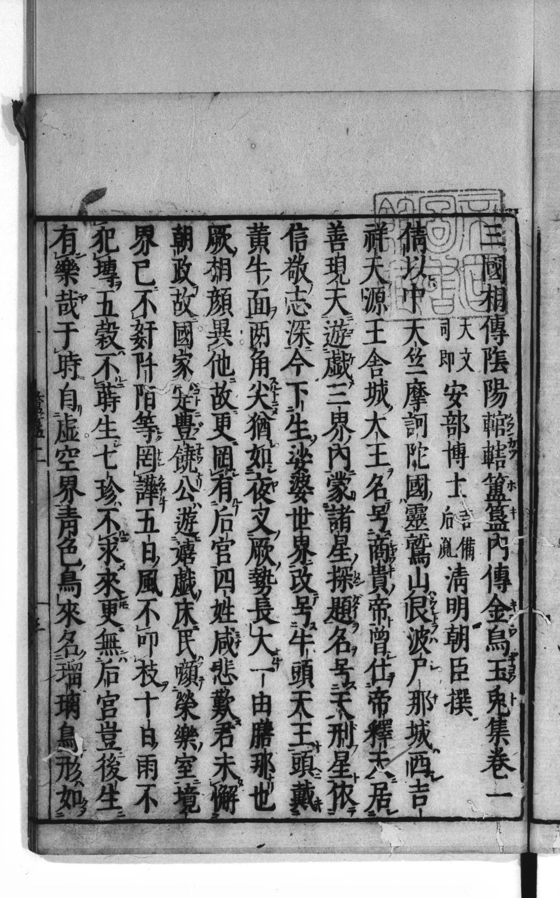

<!-- note投稿用 -->

# 【現代語訳】牛頭天王と蘇民将来――『簠簋内伝』巻一の縁起と『備後国風土記』逸文

『簠簋内伝金烏玉兎集』巻一の巻頭の縁起と、『備後国風土記』逸文「疫隈国社」の現代語訳と解説

- 内容：疫病の神・牛頭天王（ごずてんのう）と、その神に宿を貸した貧しい男・蘇民将来（そみんしょうらい）の物語を伝える古い文献二つの全訳と、その比較・解説
- 原典一：『備後国風土記』逸文「疫隈国社（えのくまのくにつやしろ）」。奈良時代の風土記の一節で、鎌倉時代中期に卜部兼方（うらべのかねかた）が著した『釈日本紀』巻七に引かれて残ったもの
- 原典二：『三国相伝陰陽輨轄簠簋内伝金烏玉兎集』巻一の巻頭の縁起。安倍晴明の著とされるが、実際には十四世紀ごろの成立
- 底本：原典一は『釈日本紀』所引の本文（国史大系本系統）を、井上通泰『上代歴史地理新考』（昭和十六年）の校訂に従って整えた。原典二は天和二年（一六八二年）村上勘兵衛刊本（国立国会図書館デジタルコレクション、info:ndljp/pid/14487791）の版面から訳者が読み起こした
- 著作権：いずれも保護期間が満了している
- 訳者：人工知能（Claude Opus 5.5）

- この記事の位置づけ：先に公開した『簠簋内伝』巻第五の訳の付録では、巻一の物語をあらすじで紹介するにとどめました。ここでは、その物語を原文から全訳し、さらに源流にあたる『備後国風土記』の話と並べて読めるようにしました

## はじめに

　夏、神社の境内に大きな茅（ちがや）の輪が立てられ、人々がそれをくぐって半年の穢れをはらう「茅の輪くぐり」。京都の祇園祭で配られる、「蘇民将来子孫也（そみんしょうらいのしそんなり）」と書かれた札のついた粽（ちまき）。伊勢・志摩地方で一年じゅう玄関に飾られる、「蘇民将来子孫家門」の札をつけた注連縄（しめなわ）。信州の国分寺で正月に授けられる、六角形の木の護符「蘇民将来符」。

　これらはみな、ひとつの古い物語から生まれた習俗です。旅の途中の神が一夜の宿を求め、豊かな者は断り、貧しい者は精いっぱいもてなした。神はのちに戻ってきて、断った者を滅ぼし、もてなした者の子孫を疫病から守ると約束した――という話です。

　この物語のもっとも古い形は、奈良時代の『備後国風土記』に見えます。そこでは、宿を求めた神は「武塔神（むとうのかみ）」と呼ばれ、最後にみずから「速須佐雄（はやすさのお）の神」、つまりスサノオだと名のります。ところが、それから六百年ほどのちの中世になると、同じ話はまったく違う姿で語られるようになります。主人公は天竺（インド）の王子「牛頭天王」となり、舞台は龍宮と鬼の国、そして話は正月の鏡餅や五節句の起源、暦の方角の神々の起源にまでつながっていきます。その代表が、安倍晴明の著とされた陰陽道の書『簠簋内伝（ほきないでん）』の巻頭の物語です。

　この記事では、この二つの文献を原文とともに全訳し、何が受け継がれ、何が変わったのかをたどります。

---

## 一　『備後国風土記』逸文「疫隈国社」

### 原文

> 備後国風土記曰、疫隈国社。
> 昔、北海坐志武塔神、南海神之女子乎与波比爾出坐爾、日暮。彼所将来二人在伎。兄蘇民将来甚貧窮、弟〔巨旦〕将来富饒、屋倉一百在伎。爰〔武〕塔神借宿処、惜而不借。兄蘇民将来借奉。即以粟柄為座、以粟飯等饗奉。爰畢出坐。
> 後爾、経年、率八柱子還来天詔久、「我将奉之為報答。〔又〕汝子孫其家爾在哉」止問給。蘇民将来答申久、「己女子与斯婦侍」止申。即詔久、「以茅輪令著於腰上」。随詔令著。即夜爾、蘇民之女子一人乎置天、皆悉許呂志保呂保志天伎。
> 即詔久、「吾者速須佐雄能神也。後世爾疫気在者、汝蘇民将来之子孫止云天、以茅輪著腰在人者将免」止詔伎。

### 現代語訳

　『備後国風土記』にいう。疫隈国社（えのくまのくにつやしろ）。

　昔、北の海においでになった武塔神（むとうのかみ）が、南の海の神の娘のもとへ妻問い（よばい）にお出かけになったところ、途中で日が暮れてしまった。その土地には将来という者が二人いた。兄の蘇民将来はたいへん貧しく、弟の巨旦将来（こたんしょうらい）は豊かで、家と倉を百も持っていた。そこで武塔神が宿を借りようとすると、弟は惜しんで貸さなかった。兄の蘇民将来は宿をお貸しした。粟（あわ）の茎を敷いて座とし、粟の飯などでおもてなしした。もてなしが終わると、神はお発ちになった。

　その後、何年もたってから、神は八柱の御子を率いて戻って来られ、こうおっしゃった。「わたしは、あのときの恩に報いようと思う。おまえの子孫は、その家にいるか」。蘇民将来は答えて申しあげた。「わたしの娘と、この妻がおります」。すると神はおっしゃった。「茅の輪を腰の上に着けさせよ」。おことばのとおりに着けさせた。その夜のうちに、神は蘇民の娘一人だけを残して、ほかの者をみな殺し、滅ぼしてしまわれた。

　そしておっしゃった。「わたしは速須佐雄（はやすさのお）の神である。後の世に疫病がはやったら、『蘇民将来の子孫だ』と言って、茅の輪を腰に着けている人は、疫病をまぬがれるであろう」。

### 補足

- **出典について**　奈良時代に諸国で編まれた風土記のうち、『備後国風土記』は本体が失われ、他の書物に引用された断片（逸文）だけが残っています。この一節は、鎌倉時代中期に卜部兼方が著した『日本書紀』の注釈書『釈日本紀』の巻七に、スサノオが神々に宿を乞う場面の注として引かれています。ただ、言葉づかいなどから、奈良時代の風土記そのものではなく、のちの時代のものが混じっているのではないかという説もあります。
- **本文について**　残っている写本には字の脱落や誤りが多く、研究者によって読みが少しずつ違います。この記事では国史大系本系統の本文をもとに、井上通泰の校訂に従って「出」「巨旦」「武」「又」の字を補いました（〔　〕の字）。「蘇民之女子一人乎置天」の箇所は、流布本では「蘇民与女人二人乎置天（蘇民と女の二人を残して）」となっています。この読みなら蘇民将来の夫婦も殺されなかったことになり、井上はこちらを正しいとしています。
- **原文の小さな字**　「坐志（ましし）」「在伎（ありき）」「爾（に）」「天（て）」「止（と）」などは、漢字の音を借りて日本語の助詞や助動詞を書き表したもの（万葉仮名）です。風土記がもとは日本語の文として読まれていたことがわかります。
- **疫隈国社**　「えのくまのくにつやしろ」と読みます。現在の広島県福山市新市町にある素盞嗚（すさのお）神社にあてる説が有力です。
- **「将来」**　蘇民将来・巨旦将来の「将来」が何を意味するのかは、よくわかっていません。人名の一部とも、「来たるべき福を将（ひき）いる」という意味の呪術的な言葉とも言われます。
- **「よばひ」**　原文は「与波比（よばひ）」で、いまの「夜這い」の語源にあたる言葉ですが、古代では、男が女のもとに通って求婚することを広く言いました。
- **茅の輪**　茅（ちがや）で作った輪です。この話のように、もとは腰に着ける小さな輪だったと考えられています。それが、のちに神社の鳥居の下などに立てる大きな輪となり、人がそれをくぐる「茅の輪くぐり」になりました。

---

## 二　『簠簋内伝』巻一の巻頭の縁起

　『簠簋内伝』巻一は、目録のあと、見出しのないまま次の物語で始まります。原文は漢文で、底本には返り点・送り仮名が付いていますが、ここでは省いて句読点を補いました。段落分けと小見出しは訳者が付けたものです。字のつぶれや異体字で読みに自信のない字には（？）を付けました。

### 1　天刑星、牛頭天王となる

> 三国相伝陰陽輨轄簠簋内伝金烏玉兎集巻一
> 天文司郎安部博士吉備后胤清明朝臣撰
> 備以、中天竺摩訶陀国霊鷲山艮、波尸那城西、吉祥天源王舎城大王、名号商貴帝。曽仕帝釈天、居善現天、遊戯三界内、蒙諸星探題、名号天刑星。依信敬志深、今下生娑婆世界、改号牛頭天王。頭戴黄牛面、両角尖、猶如夜叉。厥勢長大、一由膳那也。厥相顔異他、故更罔有后宮。四姓咸悲歎。君未懈朝政、故国家寔豊饒。公遊嬉戯、床民顔栄楽、室境界已不奸、阡陌等罔譁。五日風不叩枝、十日雨不犯塊。五穀不蒔生、七珍不求来。更無后宮、豈後生有楽哉。

**現代語訳**

　つつしんで思うに、中天竺の摩訶陀国（まかだこく）、霊鷲山（りょうじゅせん）の東北、波尸那城（はしなじょう）の西、吉祥天の源である王舎城（おうしゃじょう）の大王は、名を商貴帝（しょうきてい）といいました。かつては帝釈天に仕えて善現天に住み、三界のうちに遊んで、もろもろの星をつかさどる役目を受け、「天刑星（てんぎょうしょう）」と呼ばれていました。信仰の心が深かったので、いま娑婆世界に生まれ下り、名を改めて「牛頭天王（ごずてんのう）」と称しました。

　頭には黄色い牛の面をいただき、二本の角はとがって、まるで夜叉のようでした。背丈は高く、一由旬（ゆじゅん）もありました。その顔かたちが人と違っていたので、后になろうとする者がまったくありませんでした。国じゅうの人々はみな悲しみ嘆きました。

　王は政治を怠ることがなかったので、国はまことに豊かでした。役人は遊び楽しみ、民の顔は栄え楽しみ、家々の境を犯す者もなく、道々に争う声もありません。五日に一度の風は枝を鳴らさず、十日に一度の雨は土くれを崩しません。五穀は蒔かずとも生え、七つの宝は求めずともやって来ます。それでも后がいないのでは、どうして後の世まで楽しみがありましょうか。

**補足**　「天刑星」は、道教や陰陽道で疫病の鬼を食う恐ろしい星の神とされたもので、平安時代末の「辟邪絵（へきじゃえ）」（奈良国立博物館蔵、国宝）には、疫鬼をつかんで食べる天刑星の姿が描かれています。その天刑星が牛頭天王の前身だとするのが、この縁起の大きな特徴です。「五日風不叩枝、十日雨不犯塊」は、中国で太平の世をたたえる決まり文句です。

### 2　瑠璃鳥のお告げ

> 于時、自虚空界青色鳥来、名瑠璃鳥。形如翡翠、声似鳩鴿。来居帝王檻前、等唱天王曰、「我是為天帝使者。汝元為同朋而已。汝名号天刑星、我名曰毘首羅天子。士与我親昵、尚如共命鳥、口言雖替、大旨無違。故事天帝、如一鳥双翼、似大轍両輪。雖爾、士因信敬志深、今下生閻浮提、預転輪聖王位。爾因罔御宮采女、故天帝令我教告。自是南海有娑竭羅龍宮。是有三人明妃。第一名金毘羅女、第二名帰命女、嫁請北海龍宮、収難陀跋難陀城。爰第三号頗梨采女、紫磨黄金美膚、備八十種好、花粧閻浮檀金、麗容写三十二相、月桂。汝至彼宮、須嫁請」。如斯唱、終帰虚空界。

**現代語訳**

　そのとき、虚空から青い色の鳥が飛んで来ました。名を瑠璃鳥（るりちょう）といいます。形はかわせみのようで、声は鳩に似ていました。鳥は王の欄干の前にとまって、天王にこう語りかけました。

　「わたしは天帝（帝釈天）の使いです。あなたとはもともと仲間でした。あなたの名は天刑星、わたしの名は毘首羅天子（びしゅらてんし）。あなたとわたしは、共命鳥（ぐみょうちょう、一つの体に二つの頭をもつ鳥）のように親しく、口にする言葉は違っても、思うところに違いはありません。ですから天帝にお仕えするのも、一羽の鳥の両の翼、大きな車の両輪のようでした。けれども、あなたは信仰の心が深かったために、いまこの世に生まれ下って、転輪聖王（てんりんじょうおう）の位につかれました。それなのに、宮中にお妃がいらっしゃらない。それで天帝が、わたしに教えを告げさせたのです。

　ここから南の海に、娑竭羅（しゃから）龍王の宮殿があります。そこには三人の姫君がいます。一番目は金毘羅女（こんぴらにょ）、二番目は帰命女（きみょうにょ）といい、北の海の龍宮に嫁いで、難陀（なんだ）・跋難陀（ばつなんだ）の城におさまりました。三番目の姫は頗梨采女（はりさいじょ）といい、紫がかった黄金の美しい肌をもち、八十種の好ましい姿をそなえ、閻浮檀金（えんぶだごん）の金で花のように装い、そのうるわしい顔には仏の三十二相が写されていて、月の桂のようです。あなたはその宮殿に行って、妃に迎えなさい」。

　こう語ると、鳥は虚空へ帰っていきました。

**補足**　娑竭羅龍王・難陀龍王・跋難陀龍王は、仏典に出てくる八大龍王です。「八十種好」「三十二相」は仏の身体の特徴をいう言葉で、それを姫の美しさにあてています。頗梨采女は、のちに暦の吉方である「歳徳神（としとくじん）」とされます（第四章を参照）。

### 3　巨旦大王の拒絶と、蘇民将来のもてなし

> 然后、天王歓、三日斎而宜企車馬、甚率眷属、欲趣南海。厥道遼遠、八万里程也。君未遷三万里、人馬労驤。爰南天竺傍有一国、曰夜叉国。望彼花洛、厥国鬼王名号巨旦大王。厥国四姓為魍魎魑魅類。天王安然望彼鬼関、鬼王弾呵、閉戸不通。天王厭之弾舌、空去。
> 爰千里有松園。陰彼林中、爰有一賤女。手持竿、肩擔篇、拾松翠葉。天王問曰、「汝有室宅哉。暫為体留」。賤女曰、「我則巨旦為奴婢、宿少局内。自是去東方一里程、有浅茅生原。彼曠野中有蕃（？）貧生、掛庵貧賤禄之。彼曰蘇民将来。外抱慈哀志、内含悲敬」。許彼往求宿。
> 天王歓喜、決然向東、攀車輪、駆駒、急至彼野中。爰有柴門、同有藁屋扉。見彼庵主、齢長老翁、手抱柴箒、掃室内塵、足踏藁履、竭庭前草。爰天王轟車、羚羊陌、驪馬兎狢径、速往而問旅宿。将来微笑曰、「我為貧賤主、家屯不遷、三閣豈収留若干眷属」。天王曰、「我一宿留、正可慰念」。
> 于時将来抱粱粟茎、為上閣席。天王歓喜、座彼席上。然后、将来后宮収中閣、夫属下閣。室内雖狭、独罔不宿。天王曰、「我爰若干長途、人馬共疲労。汝有粮食哉」。翁曰、「我是貧賤禄之、更無一升米。爰有一瓢、瓢中収粟米、幽不過半器」。是収瓦釜中煮熟、刹那程也。是置楠葉上、饗天王等、配補眷属。天王曰、「汝志足哉。大哉、禄劣鰥寡孤独人心、勝富能貴徳君。謝汝其志」。抱千金、報亭主。

**現代語訳**

　そこで天王は喜び、三日のあいだ物忌みをしてから、車馬をととのえ、大勢の眷属を引きつれて、南の海へ向かいました。その道ははるかに遠く、八万里もあります。まだ三万里も進まないうちに、人も馬も疲れはててしまいました。

　ちょうどそのとき、南天竺のかたわらに一つの国がありました。「夜叉国」といいます。その都を眺めると、国の鬼王の名は巨旦大王（こたんだいおう）で、国の民はみな魑魅魍魎（ちみもうりょう）のたぐいでした。天王が何の気なしにその鬼の関所に近づくと、鬼王は激しくののしり、門を閉ざして通しません。天王はいやな思いをして舌打ちをし、むなしく立ち去りました。

　そこから千里ほど行くと、松の林がありました。その林の木陰に、一人の身分の低い女がいて、手に竿を持ち、肩にかごをかついで、松の青い葉を拾っていました。天王はたずねました。「おまえの家はあるか。しばらく体を休めたいのだが」。女は言いました。「わたしは巨旦の召使いで、小さな部屋に寝泊まりしております。ここから東へ一里ほど行くと、浅茅（あさじ）の生えた野原があります。その野の中に、貧しく暮らす者がいて、粗末な庵を結んでおります。その者は蘇民将来といい、外には慈しみの心をいだき、内には哀れみと敬いの心をもっております」。そして、そこへ行って宿を求めるよう勧めました。

　天王は喜び、すぐさま東へ向かい、車を引かせ、馬を走らせて、急いでその野にやって来ました。そこには柴の門と、藁ぶきの家の扉がありました。庵の主を見ると、年老いた翁で、手に柴の箒を持って家の中の塵を掃き、足に藁の草履をはいて、庭先の草を刈っていました。天王は車をとどろかせ、羚羊（かもしか）の通る道や、馬や兎や狢（むじな）の通る小道を、急いで進んで、宿を求めました。

　将来はほほえんで言いました。「わたしは貧しい家の主で、家は傾いて移すこともできません。三間しかないこの家に、どうしてこれほどの眷属をお泊めできましょう」。天王は言いました。「一夜の宿さえ借りられれば、それでじゅうぶん心がなぐさむのだ」。

　そこで将来は、粟の茎を抱えて来て、上の間の敷物としました。天王は喜んでその上に座りました。それから将来は、后（妻）を中の間に、自分は下の間に移りました。家の中は狭かったのですが、一人として泊まれない者はありませんでした。

　天王は言いました。「わたしはここまで長い道のりを来て、人も馬も疲れきっている。何か食べるものはあるか」。翁は言いました。「わたしは貧しい身で、一升の米もございません。ここに瓢箪（ひょうたん）が一つあって、その中に粟が入っておりますが、器の半分にもなりません」。それを土の釜に入れて煮ると、たちまち煮えました。それを楠（くすのき）の葉の上に盛って、天王たちをもてなし、眷属にも分けました。

　天王は言いました。「おまえの志は満ち足りている。なんと偉いことか。貧しく、身寄りもない者の心が、富み栄えた身分の高い者にまさっている。おまえのその志に礼を言おう」。そして千金を与えて、宿の主に報いました。

**補足**　風土記では、蘇民と巨旦は兄弟でしたが、ここでは巨旦は鬼の国の王、蘇民はその国の外に住む貧しい老人で、兄弟ではありません。巨旦の召使いの女が天王を蘇民のもとへ案内するという筋は、風土記にはなく、のちに彼女だけが巨旦の一族のなかで救われる伏線になっています。「粟の茎を座とし、粟の飯でもてなす」ところは、風土記の「以粟柄為座、以粟飯等饗奉」をそのまま受け継いでいます。

### 4　宝の船で龍宮へ、八王子の誕生

> 天王終夜感厭志、漸到五更、聴鳳凰鳴、急企車馬、為至南海。将来曰、「君自何方奈処往」。天王詫曰、「我為中天主、未罔后宮。故南海有明妃、欲嫁娵彼女。自是娑竭羅城、凌幾長途哉」。将来曰、「自中天至南海、厥道八万里程也。君未遷三万里程。自茲到彼巨海深遠、少車馬行路。以何到南海、依何合龍女」。于辰天王愁然、已欲帰中天。将来重曰、「我有一宝船、名曰隼鷁。両端高大、学龍頭鷁首。脚早行速、刹那過数万里程」。于辰天王住歓喜踊躍、擲車馬、移彼船中、忽然須臾到龍宮城。
> 爰天王我大旨奏龍王。龍王快然、奉周章。天王急開不老門、移長生殿、合歓頗梨采女、賀祥縁亀丹鶴。然龍王尽山海珍物、調国土美食、饗日久。已経三七余歳。天王与女御無別、不浅故、夜鴛鴦衾下学偕老同穴契、世昼連理花陰雛比翼相思契。裳絲竹声不休、金石少有暇、四声遠叩宮外、幽幽通広天。故契宜得八王子。一総光天王、二魔王天王、三倶摩羅天王、四得達神天王、五良侍天王、六侍神相天王、七宅神相天王、八蛇毒気神也。

**現代語訳**

　天王は一晩じゅう、将来の志に感じ入っていました。やがて明け方になり、鳳凰の鳴く声を聞くと、急いで車馬をととのえ、南の海へ向かおうとしました。

　将来がたずねました。「あなたさまは、どちらから来て、どちらへ行かれるのですか」。天王は打ち明けました。「わたしは中天竺の王だが、まだ后がいない。南の海にすぐれた姫がいると聞いたので、その娘を妃に迎えたいのだ。ここから娑竭羅の城まで、どれほど遠いことか」。将来は言いました。「中天竺から南の海までは、八万里の道のりです。あなたさまはまだ三万里も来ておられません。ここから先、あの大海までは深く遠く、車馬の通る道もほとんどございません。どうやって南の海に行き、どうやって龍の姫と結ばれましょう」。

　それを聞いて天王は憂い沈み、もう中天竺に帰ろうと思いました。将来は重ねて言いました。「わたしは一艘の宝の船を持っております。名を隼鷁（はやぶさげき）といいます。船の両端は高く大きく、龍の頭と鷁（げき、水鳥）の首をかたどっており、足が速く、またたく間に数万里を進みます」。天王は喜んで躍りあがり、車馬を捨ててその船に乗り移りました。すると、たちまち龍宮城に着きました。

　天王が龍王にわけを申しあげると、龍王は快く承知し、あわただしくもてなしの用意をしました。天王は急いで不老門を開き、長生殿に移り、頗梨采女と結ばれました。亀や丹頂の鶴がめでたい縁を祝いました。龍王は山海の珍しい品を尽くし、国の美食をととのえて、長く饗応しました。

　こうして二十一年あまりがたちました。天王と姫は片時も離れることなく、夜は鴛鴦（おしどり）の衾（ふすま）の下で「偕老同穴（かいろうどうけつ、ともに老いて同じ墓に入る）」の契りを結び、昼は連理の枝の花陰で比翼の鳥のように睦みあいました。管弦の音は絶えることなく、楽の響きは宮殿の外にまで遠く聞こえて、はるかな空に通じました。

　こうして二人のあいだに八人の王子が生まれました。一は総光天王（そうこうてんのう）、二は魔王天王、三は倶摩羅天王（くまらてんのう）、四は得達神天王（とくたつじんてんのう）、五は良侍天王（りょうじてんのう）、六は侍神相天王（じじんそうてんのう）、七は宅神相天王（たくじんそうてんのう）、八は蛇毒気神（じゃどくけじん）です。

**補足**　風土記の「八柱の子」が、ここで八王子として名前を得ます。この八人がのちに暦の「八将神」とされます。蘇民将来が宝の船を持っているのは、貧しいはずの老人としては不思議ですが、蘇民がただの人ではない、福をもたらす存在であることを示しているのでしょう。

### 5　巨旦大王の滅亡

> 然后、天王欲帰中天。或時、命八王子曰、「我為中天主、往昔南海趣時、中間有国、曰広達国。彼国主名巨旦大王、咸是魑魅魍魎類也。已望彼鬼門、欲求一宿。巨旦恚怒、令我弾呵。我已斎、故恐然退去。今欲到彼国、破却鬼王城郭」。于時八王子等、各相率四衆八龍等百千若干眷属、上著瞋恚鎧、手抱降伏剣、神通弓・飛行矢・刀杖罔限、干戈交色、已令蜂起。
> 彼国于辰鬼王、忽然有阿羅監鬼相、寔成不思議想。命博士問卜曰、「有何妖孽哉。深受阿羅監鬼相、精気不貞、胸躍動揺。汝以深察」。士謹勘天地陰陽員数、亀甲八卦経、曰、「昔中天有王、号牛頭天王。為求将婦趣南海。頭有牛角相、雖望鬼関門、閉戸弾呵、王斎故罔為妨礙。早経二十一年、宜至南海、嫁請頗梨采女、而生八王子。今厥八王子等、相具四衆八龍等百千若干眷属、欲破却此城郭。豈以可遁此禍哉」。鬼王曰、「以何祭祀令解除」。士曰、「供養一千人苾芻、正可得退散」。鬼王曰、「勤修奈（何）法」。士曰、「行太山府君王法、頗可解除」。
> 于辰鬼王歓喜。天張鉄網、地敷盤石、四方構長鉄築地、同外堅大沢溝、内造玉宝殿、同飾清浄床。嬉慢歌舞、八句人衆安座。四維鈎索鐶鈴、四衆薩埵侍立四方。同宝高座上掛羅綾打敷、并天蓋瓔珞幢幡花慢、纏覆四維。風中有清浄明僧、唱満諸大陀羅尼。爰天王安然望彼鬼館、鉄城高大、神力方便術意、更罔可者也。
> 于辰天王以阿你羅・摩你羅両鬼令鑑見。爰有懈怠比丘、深沈睡眠、誦偈句、故真言不詳、已成大穴。爰天王得便、刷神力、剣入彼鬼館。諸眷属共乱入、没彼一族、如蒔沙揣。

**現代語訳**

　その後、天王は中天竺へ帰ろうとしました。あるとき、八人の王子に命じて言いました。「わたしは中天竺の王である。昔、南の海へ向かったとき、途中に国があった。広達国という。その国の主は巨旦大王といい、国の者はみな魑魅魍魎のたぐいであった。わたしはその鬼の門に行って一夜の宿を求めたが、巨旦は怒って、わたしをののしり追い払った。わたしはそのとき物忌みの身であったので、こらえて引き下がった。いま、あの国へ行って、鬼王の城を打ち破ろうと思う」。

　そこで八人の王子たちは、それぞれ四衆（仏の弟子たち）・八龍など百千もの眷属を引きつれ、身には怒りの鎧を着け、手には降伏（ごうぶく）の剣を持ち、神通の弓・飛行の矢・刀や杖は数かぎりなく、武器のきらめきが入りまじって、いっせいに攻め立てました。

　そのとき、その国の鬼王に、突然「阿羅監鬼（あらかんき）の相」が現れ、なんとも不思議な思いにとらわれました。鬼王は博士に占わせて言いました。「どんな災いの兆しであろう。わたしには阿羅監鬼の相が深く現れ、気力は定まらず、胸は躍り、心は揺れ動いている。よくよく調べよ」。

　博士は、天地陰陽の数と、亀の甲羅の占いや八卦の書とを、つつしんで考え合わせて言いました。「昔、中天竺に王がいて、牛頭天王と号しました。妃を求めて南の海へ向かう途中、頭に牛の角があるその王が、この鬼の関所に来たのに、門を閉ざしてののしりました。王は物忌みの身だったので、手出しをしなかったのです。それから二十一年がたち、王は南の海に行って頗梨采女を妃とし、八人の王子をもうけました。いま、その八王子たちが四衆・八龍など百千の眷属をそろえて、この城を打ち破ろうとしています。どうしてこの災いを逃れることができましょう」。

　鬼王は言いました。「どんな祭りをすれば、はらいのけられるだろう」。博士は言いました。「千人の僧を供養すれば、きっと退けることができましょう」。鬼王は言いました。「どんな法を修めさせればよいか」。博士は言いました。「泰山府君（たいざんふくん）の法を行えば、なんとかはらいのけられましょう」。

　鬼王は喜びました。天には鉄の網を張り、地には大きな岩を敷き、四方には長い鉄の築地（ついじ）を構え、その外側には大きな堀を固め、内には玉の宝殿を造り、清らかな床を飾りました。幔幕をめぐらし、歌い舞い、八句の偈を唱える人々を座らせました。四隅には綱を張って鈴を掛け、僧たちを四方に並ばせました。宝の高座の上には薄絹の敷物を掛け、天蓋・瓔珞（ようらく）・幢幡（どうばん）・花鬘（けまん）で四方を覆いました。その中に清らかな高僧たちがいて、さまざまな大陀羅尼を唱えつづけました。天王がその鬼の館を眺めると、鉄の城は高く大きく、神通力と方便の術がめぐらされていて、つけいるすきがありませんでした。

　そこで天王は、阿你羅（あにら）・摩你羅（まにら）という二人の鬼に見張らせました。すると、怠け者の僧が一人いて、深く眠りこんで偈を唱えていたため、真言の文句がとぎれ、そこに大きな穴があいていました。天王はそのすきをとらえ、神通力をふるって、剣を手に鬼の館に討ち入りました。眷属たちもいっしょに乱入し、巨旦の一族を、まるで砂をまき散らすように滅ぼしてしまいました。

**補足**　巨旦の国の名が、前では「夜叉国」、ここでは「広達国」となっています。鬼王が頼みにする「泰山府君の法」は、人の寿命をつかさどる冥界の神・泰山府君を祭る陰陽道の祭りで、安倍晴明が得意としたことで知られます。晴明の著とされる本書で、その泰山府君祭が鬼王を守るために行われ、しかも一人の僧の居眠りで破られる、という筋立ては興味深いところです。阿你羅は、薬師如来を守る十二神将の一人、頞儞羅（あにら）大将と関係があるかもしれません。

### 6　桃の札と「急急如律令」

> 爰天王曰、「我昔到此国時、此松園中有一賤女。雖巨旦奴婢、女為我思恩徳。人欲助彼女」。削桃木札、書写急急如律令文、令弾指彼牒、収賤女袂中。然退此禍災矣。

**現代語訳**

　天王は言いました。「わたしが昔この国に来たとき、あの松林に一人の召使いの女がいた。巨旦の召使いではあるが、わたしに恩を施してくれた。あの女だけは助けたい」。そこで桃の木を削って札を作り、それに「急急如律令（きゅうきゅうにょりつりょう）」の文を書き、指ではじいてその札を女の袂（たもと）の中に入れました。こうして女は、この災いを逃れることができたのです。

**補足**　風土記では、腰に着けた「茅の輪」が目印となって蘇民の娘が助かりました。ここでは、それが「桃の木の札」に変わっています。桃は中国で古くから邪気をはらう木とされ、「急急如律令（急いで律令のごとくせよ）」は、もとは漢代の役所の文書の決まり文句でしたが、のちに道教や陰陽道の呪符を結ぶ言葉として広く使われるようになりました。ここに、陰陽師の護符の起源を語る意図が読みとれます。また、助かるのが蘇民の娘ではなく、巨旦の召使いの女になっているのも大きな違いです。

### 7　巨旦の死骸と五節句

> 然后、切断彼巨旦屍骸、各配当五節、行調伏威儀。後至蘇民将来所、変為祐長者、久期。天王帰国、造五宮、構八殿、請入八王子。三日停車、尽諸珍菓。故天王喜快、彼夜叉国報蘇民将来。然誓願曰、「我末代成行疫神。八王子眷属等国乱入日、汝子孫不可妨碍」。定一守護所以、授二六秘文。
> 然濁世末代衆生、必耽三毒煩悩増長、四大不調、甚受寒熱二病。牛頭天王部類眷属所行也。若欲退失此病痛、外不違五節祭礼、内収二六秘文、須信敬厥。
> 五節祭礼者、正月一日赤白鏡餅、巨旦骨肉。三月三日蓬莱草餅、巨旦皮膚。五月五日菖蒲結粽、巨旦鬢髪。七月七日小麦索麺、巨旦継（筋）。九月九日黄菊酒水、巨旦血脈。総鞠打・鞠頭・的眼・門松・墓験・修正導師・葬礼威儀、咸是巨旦調伏儀式。
> 然牛頭天王自龍宮界還帰閻浮提。長保元年六月一日、於祇園精舎三十日間調伏巨旦。至于今世学此威儀。六月一日歯堅肝要也。悪可悪巨旦邪気残族魍魎魑魅類、信可信牛頭天王八王子等。其八王子者、大歳・大将軍・大陰・歳刑・歳破・歳殺・黄幡・豹尾等也。

**現代語訳**

　そののち天王は、巨旦の死骸を切り分けて、それぞれを五節句にあて、調伏の儀式を行いました。

　それから蘇民将来のところへ行き、蘇民を富み栄える長者に変えて、末長くと約束しました。天王は国へ帰る途中、五つの宮を造り、八つの御殿を構えて、八人の王子を招き入れ、三日のあいだ車をとどめて、さまざまな珍しい果物を尽くしてもてなしを受けました。

　天王は喜び、夜叉国でのことに報いようと、蘇民将来に誓って言いました。「わたしは末の世に、疫病をはやらせる神（行疫神）となろう。八人の王子や眷属たちが国々に乱れ入る日にも、おまえの子孫だけは妨げない」。そして、守りとなるしるしを定めて、「二六の秘文（にろくのひもん）」を授けました。

　濁った末の世の人々は、必ずや貪り・怒り・愚かさの三毒の煩悩に溺れ、それがつのって、体をつくる地・水・火・風の四大の調和が乱れ、寒気と熱の病に苦しむことになります。それは牛頭天王とその眷属たちのしわざなのです。もしこの病の苦しみを退けたいと思うなら、外には五節句の祭りを欠かさず、内には二六の秘文を身に収めて、深く信じ敬わなければなりません。

　五節句の祭りとは、次のとおりです。正月一日の紅白の鏡餅は、巨旦の骨と肉。三月三日の蓬莱の草餅は、巨旦の皮膚。五月五日の菖蒲で結んだ粽（ちまき）は、巨旦の髪。七月七日の小麦の素麺は、巨旦の筋。九月九日の黄菊の酒は、巨旦の血。そのほか、蹴鞠（けまり）や毬打（ぎっちょう）、弓の的の中心、門松、墓じるし、修正会（しゅしょうえ）の導師、葬礼の作法なども、みな巨旦を調伏する儀式なのです。

　さて、牛頭天王は龍宮から人間の世界に帰り、長保元年（九九九年）六月一日、祇園精舎で三十日間、巨旦を調伏しました。いまの世まで、この儀式を受け継いでいます。六月一日に「歯固め」をするのが肝心なのです。憎むべきは巨旦の邪気の残党である魑魅魍魎のたぐい、信じるべきは牛頭天王と八王子たちです。その八王子とは、大歳・大将軍・大陰・歳刑・歳破・歳殺・黄幡・豹尾、すなわち八将神のことです。

**補足**

- 正月の鏡餅や節句の食べ物が、退治された鬼の体だという話は衝撃的です。神話学でいう「死体化生（したいけしょう）型」の起源神話――殺された神の体から作物などが生まれる話（日本では『古事記』のオオゲツヒメや『日本書紀』のウケモチ）――と似た発想ですが、ここでは食べ物を「鬼の体を食べて滅ぼす」調伏の儀式として説明しています。年中行事に呪術的な意味づけを与えて、陰陽師や祇園社の宗教者の役割を高めようとしたものでしょう。
- 「長保元年六月一日」に祇園精舎で巨旦を調伏した、というのは、京都の祇園社（いまの八坂神社）の祭り（祇園御霊会、のちの祇園祭）を念頭に置いたものです。ただし、祇園御霊会の始まりは、一般に貞観十一年（八六九年）とも天禄元年（九七〇年）ともいわれ、長保元年とする根拠ははっきりしません。
- 「六月一日の歯固め」は、旧暦六月一日に固い餅などを食べて健康を祈る「氷の朔日（ついたち）」「歯固めの祝い」の習俗のことです。
- 「二六の秘文」が何なのか、本書には書かれていません。「二六」を十二と解して十二の文字や十二神将とする説などがありますが、確かなことはわかりません。
- 最後に八王子を八将神に結びつけて、物語は暦の話へと移ります。このあとに続くのが、巻一本文の「天道神の方」「歳徳神の方」「八将神の方」などです。

---

## 三　二つの話をくらべる

### 何が受け継がれたか

- 旅の途中の神が宿を求め、豊かな者が断り、貧しい蘇民将来がもてなす。
- もてなしは粟の茎の座と粟の食事。
- 神は八人の子を連れて戻り、断った者を滅ぼす。
- 一人の女性だけが、目印を身に着けて助かる。
- 神は蘇民将来の子孫を疫病から守ると約束する。

### 何が変わったか

- **神の名と出自**　風土記では「北海の武塔神」で、最後に速須佐雄（スサノオ）と名のる。『簠簋内伝』では、天竺の王・商貴帝が天刑星の生まれ変わりとして「牛頭天王」となる。スサノオの名は出てこない。
- **妻問いの相手**　風土記では「南海の神の娘」。『簠簋内伝』では娑竭羅龍王の第三の姫・頗梨采女と名前が与えられ、龍宮での結婚と八王子の誕生が詳しく語られる。
- **巨旦**　風土記では蘇民の弟の巨旦将来（富裕な人間）。『簠簋内伝』では夜叉国の鬼王・巨旦大王で、蘇民とは兄弟ではない。
- **滅ぼし方**　風土記では一夜のうちに殺す。『簠簋内伝』では泰山府君祭と千人の僧の守りを、居眠りした一人の僧のすきから破る、という合戦物語になっている。
- **助かる女性と目印**　風土記では蘇民の娘で、目印は腰の茅の輪。『簠簋内伝』では巨旦の召使いの女で、目印は「急急如律令」と書いた桃の札。
- **後日譚**　風土記にはない。『簠簋内伝』では巨旦の死骸が五節句の食べ物になり、八王子が八将神になり、祇園社の祭りの起源が語られる。
- **守りの約束**　風土記では「蘇民将来の子孫」と名のり、茅の輪を着けること。『簠簋内伝』では五節句の祭りを欠かさず、「二六の秘文」を信じること。

　一言でいえば、風土記の話は一つの神社（疫隈国社）の由来を語る素朴な地方の伝承です。それに対して『簠簋内伝』の話は、仏教・道教・陰陽道の要素を取りこんで、疫病の神の信仰、年中行事、暦の方角の神々をまとめて説明する「中世神話」になっています。

### あいだをつなぐもの

　この二つのあいだには、いくつかの文献がはさまります。

- **『釈日本紀』**（鎌倉時代中期）　卜部兼方は、父・兼文の説として、この風土記の話が「祇園社の本縁（由来）」であると記しています。少なくとも鎌倉時代には、武塔神＝スサノオ＝祇園社の祭神という理解があったことがわかります。
- **『祇園牛頭天王御縁起』などの縁起類**（室町時代ごろ）　牛頭天王が南海の龍宮へ妻を求めに行く話は、『簠簋内伝』のほかにも、祇園社や各地の牛頭天王社の縁起として多く伝わっています。細部はそれぞれ違い、蘇民将来と巨旦将来を兄弟とするものもあります。
- **『二十二社註式』**（室町時代、吉田兼倶）　祇園社の項に、風土記の話を少し書き改めた「神社本縁記」が引かれています。

　研究者のあいだでは、『簠簋内伝』のこの縁起は、祇園社の周辺で育った牛頭天王の物語を、陰陽道の暦注の書の冒頭に置いたものと考えられています。

---

## 四　蘇民将来の信仰のその後

### 祇園社と牛頭天王

　京都の祇園社は、平安時代から疫病をしずめる神をまつる社として朝廷にも重んじられ、その祭神は牛頭天王とされました。祇園御霊会（祇園祭）は、もとは疫病の流行を鎮めるための祭りです。牛頭天王はスサノオと同じ神とされ、その妃の頗梨采女はクシナダヒメと、八王子はスサノオの八柱の御子神と重ね合わされました。

　明治元年（一八六八年）の神仏判然令（神仏分離令）によって、仏教色の強い「牛頭天王」の名は神社から外されることになりました。祇園社は「八坂神社」と改称され、祭神は素戔嗚尊とされました。全国の「天王社」「祇園社」の多くも、このとき「八坂神社」「須賀神社」「素盞嗚神社」などと名を改めています。

### 蘇民将来の札と茅の輪

- **祇園祭の粽**　祇園祭の山鉾で授けられる粽には、「蘇民将来子孫也」と書いた札が付けられ、一年間、玄関に飾って厄除けとします。八坂神社の境内には、蘇民将来をまつる「疫神社（えきじんじゃ）」があり、七月三十一日の夏越祭（なごしさい）には茅の輪が立てられます。
- **茅の輪くぐり**　六月三十日の「夏越の祓（なごしのはらえ）」に、各地の神社で茅の輪をくぐる行事は、風土記の「茅輪を腰上に着けよ」に由来するとされます。
- **伊勢・志摩の注連縄**　三重県の伊勢・志摩地方では、正月だけでなく一年じゅう玄関に注連縄を飾り、そこに「蘇民将来子孫家門」（あるいは「笑門」など）と書いた木札をつけます。
- **蘇民将来符**　長野県上田市の信濃国分寺では、毎年一月七日・八日の「八日堂縁日」に、六角形の柱に「大福長者蘇民将来子孫人也」などと書いた木の護符「蘇民将来符」が授けられます。同じような護符は、岩手県・京都府・岡山県など各地に伝わっています。
- **蘇民祭**　岩手県奥州市の黒石寺（こくせきじ）では、旧正月に裸の男たちが「蘇民袋」を奪い合う「蘇民祭」が千年以上続いたといわれますが、担い手の高齢化などのため、二〇二四年を最後に終了しました。

### 暦の神々として

　『簠簋内伝』の物語は、江戸時代の暦にも大きな影響を残しました。この本では、牛頭天王は「天道神」、その妃の頗梨采女は「歳徳神」、蘇民将来は「天徳神」、八王子は「八将神」、そして滅ぼされた巨旦の怨念は「金神（こんじん）」とされます。毎年の暦の巻頭には八将神の方位図が描かれ、人々は「恵方（歳徳神のいる方角）」を拝み、「金神の方角」を避けました。いまの節分の「恵方巻」の「恵方」も、この歳徳神の方角のことです。

　つまり、宿を断った者と貸した者の小さな物語が、中世の『簠簋内伝』を通って、暦の方角の吉凶という、日本人の生活のすみずみにまで及ぶ体系の「神話的な起源」になったのです。

---

## 読むうえでの注意

- 『備後国風土記』逸文の本文は、写本によって字句が大きく異なり、研究者によって読みが違います。この記事の本文と訳は一つの読み方にすぎません。
- 『簠簋内伝』の原文は、訳者が江戸時代の版本の版面から読み起こしたもので、字の誤りや読みの不確かなところがあります（とくに第3節の「蕃（？）貧生」、第7節の「巨旦継（筋）」など）。言葉づかいが難しく、意味のとりにくいところは、文脈から補って訳しました。
- 本文中の宗教的な効験や吉凶に、科学的な根拠はありません。
- 訳文と解説は人工知能（Claude Opus 5.5）によるもので、誤りを含む可能性があります。

---

## 出典

> 原典一：『備後国風土記』逸文（卜部兼方『釈日本紀』巻七所引）。本文は井上通泰『上代歴史地理新考』附録「疫隅國社」（三省堂、昭和十六年。国立国会図書館デジタルコレクション）の校訂を参照して整えた。
> 原典二：『三国相伝陰陽輨轄簠簋内伝金烏玉兎集』巻一（伝 安倍晴明撰、十四世紀ごろ成立）。底本：天和二年（一六八二年）村上勘兵衛刊本（国立国会図書館デジタルコレクション）。図版も同本による。
> 原典・底本とも保護期間が満了しています。訳文と解説は人工知能（Claude Opus 5.5）によるもので、誤りを含む可能性があります。

#牛頭天王 #蘇民将来 #簠簋内伝 #備後国風土記 #スサノオ #祇園祭 #茅の輪 #現代語訳
