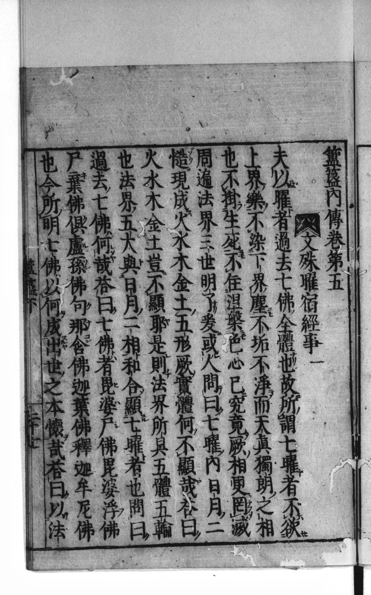

# 簠簋内伝金烏玉兎集　巻第五　現代語訳

伝 安倍晴明（あべのせいめい）撰／巻第五の現代語訳と、巻第一〜第四の解説

- 原題：三国相伝陰陽輨轄簠簋内伝金烏玉兎集（さんごくそうでんいんようかんかつほきないでんきんうぎょくとしゅう）。略して『簠簋内伝』『簠簋』とも。巻によっては『三国相伝宣明暦経註』とも題する
- 内容：陰陽道の暦注（暦の日々の吉凶）、方角の神々、家の建て方、宿曜（インド由来の星占い）を、牛頭天王や盤牛大王の神話とともに説いた全五巻の書。中世から近世にかけて、民間の陰陽師や暦の作り手のあいだで「陰陽道の秘伝書」として重んじられた
- 撰者：巻頭に「天文司郎安部博士吉備后胤清明朝臣撰」とあり、安倍晴明（九二一〜一〇〇五）の著とされる。ただし実際の成立は鎌倉時代末から南北朝時代（十四世紀）ごろと考えられ、晴明の名は後から仮託されたもの
- 底本：天和二年（一六八二年）京都・村上勘兵衛刊の五巻本（国立国会図書館デジタルコレクション、info:ndljp/pid/14487791。巻第五は五三〜六一コマ）。全文テキストがないため、版面の画像から訳者が一字ずつ読み起こした
- 著作権：原著・底本ともに保護期間が満了している
- 訳者：人工知能（Claude Opus 5.5）
- 訳の性格：巻第五（宿曜の巻）の全訳。各章に、訳者が句読点を補った原文（漢文）と、です・ます調の現代語訳、訳者の補足を付けた。巻第一〜第四は訳さず、付録で章ごとに内容を解説した
- 既訳について：本書全体の現代語訳として、藤巻一保『安倍晴明「簠簋内伝」現代語訳総解説』（学研、二〇〇〇年。のち戎光祥出版）がある。本訳はそれを参照せず、底本の原文だけから作った

## この本について

　安倍晴明の名は、いまでは小説や映画、漫画を通じてよく知られています。平安時代中期の陰陽師で、天文の観測と占い、まじないにすぐれ、藤原道長らに重んじられた実在の人物です。その晴明が書いたとされ、中世から江戸時代にかけて「陰陽道の秘伝書」として重んじられたのが、この『簠簋内伝金烏玉兎集』です。

　書名の「簠簋（ほき）」は、古代中国で神に穀物を供えるのに使った祭器の名です。四角いものを簠、丸いものを簋といいます。「金烏玉兎（きんうぎょくと）」は、太陽にすむという三本足の烏（金烏）と、月にすむという兎（玉兎）のことで、日と月、つまり暦を表します。頭に付いた「三国相伝陰陽輨轄」は、「天竺（インド）・震旦（中国）・本朝（日本）の三国に伝わった、陰陽道のかなめ」という意味です。

　もっとも、この本は晴明自身の著作ではありません。晴明より三百年以上後の、鎌倉時代の終わりから南北朝時代ごろに、祇園社（いまの京都の八坂神社）とかかわりのある人々のあいだで作られたと考えられています。巻第一が祇園社の祭神である牛頭天王（ごずてんのう）の物語から始まること、その祭りの起こりを「長保元年（九九九年）六月一日」としていることなどが、その手がかりです。江戸時代の初めには、この本の注釈書『簠簋抄（ほきしょう）』が作られ、晴明が唐に渡って伯道上人から秘法を授けられた、という伝説も広まりました。本書の巻第三・第四の巻頭に「清明朝臣入唐伝」とあるのも、その伝説とかかわります。

　全五巻の内容は、おおよそ次のとおりです（くわしくは付録で解説します）。

- **巻第一**　牛頭天王と蘇民将来の物語。年の方角の神々（天道神・歳徳神・八将神・天徳神・金神など）と、日や時の「塞がり」の方角
- **巻第二**　天地を生んだ盤牛大王（ばんごだいおう）の物語。その五人の妃と王子たちを、十干・十二支・十二直・九図・七箇善日にあてる。毎日の暦注（天恩・天赦・母倉・血忌・天一神・没日・赤口・往亡・八専など四十三項目）
- **巻第三**　太歳神の前後対位、凶会日、大将軍と土公の遊行、彼岸・土用・三伏、五宝日・五提時、仏と神の吉日、納音、空亡、赤口・赤舌の時刻など
- **巻第四**　「造屋篇」。土地の形と四神相応、屋敷の形の吉凶、五姓ごとの家造りの年、犯土・柱立て・棟上の吉日など（いわゆる家相・地相）
- **巻第五**　宿曜経にもとづく二十八宿と七曜の占い（本稿で訳したもの）

　この本の特徴は、暦注や方角の吉凶を、それぞれ「神」の行いとして語るところにあります。たとえば八将神は牛頭天王の八人の王子で、十二直は盤牛大王の第三の妃が生んだ十二人の王子です。同じ時代の賀茂在方『暦林問答集』（一四一四年）が、中国の書物を引いて暦注の根拠を理屈で説明しようとしたのに対し、『簠簋内伝』は神話と仏教の言葉で説明します。このわかりやすさと神秘めいた語り口によって、本書は民間の陰陽師や、暦を作って売る人々のよりどころとなり、江戸時代を通じて何度も版を重ねました。いまのカレンダーに見える「三りんぼう」「天赦日」「土用の間日」「八専」「赤口」といった言葉のいくつかは、この本を通って広まったものです。

　巻第五は、この本のなかでは少し毛色が違い、インド由来の星占いである宿曜道を扱っています。生まれた日の「宿」によって一生の運勢を占う方法（命宿・業宿・胎宿）、二十八宿それぞれの性質、年・月・日・時刻に宿や曜を配する表、そして「甘露日」「金剛峯日」「羅刹日」といった、宿と曜の組み合わせによる吉凶日などです。今日「宿曜占星術」として知られる占いの、中世日本での姿を伝える資料です。

　訳文について。原文は漢文で、訓点（返り点・送りがな）が付いています。訓点は省き、訳者が句読点を補って、通行の字体に改めました。表の多い巻なので、版面の表は読みやすい形に組み直しました。字がつぶれていたり、小さな字の注が読みにくかったりして、読みに自信のないところには〔？〕を付け、補足にそのことを書きました。

　本書は中世の陰陽道・宿曜道の考え方を伝える歴史資料です。ここに書かれた日や方角、生まれ日による吉凶に、科学的な根拠はありません。

## 目次

- 巻第五の目録
- 一　文殊曜宿経のこと
- 二　七曜の姓のこと
- 三　命・業・胎の三宿のこと
- 四　二十八宿の姓のこと
- 五　年に配する宿
- 六　四季の宿
- 七　月に配する宿
- 八　同じく異説
- 九　閏月の宿
- 十　同じく異説
- 十一　三百六十日の宿
- 十二　同じく時の宿
- 十三　曜宿の七種三重の相伝
- 十四　嘉辰縁会の時のこと
- 付録　巻第一〜第四の解説／用語集／読むうえでの注意

---

## 目録

　巻第一の巻頭にある全巻の目録のうち、巻第五の分は次の十四項目です。

| 原文 | 訳 |
|---|---|
| 曜宿経之事 | 宿曜経のこと |
| 七曜姓之事 | 七曜の姓のこと |
| 命業胎三宿 | 命・業・胎の三宿 |
| 廿八宿姓事 | 二十八宿の姓のこと |
| 歳配宿之事 | 年に配する宿のこと |
| 四季宿之事 | 四季の宿のこと |
| 月配宿之事 | 月に配する宿のこと |
| 同異説之事 | 同じく異説のこと |
| 閏月宿之事 | 閏月の宿のこと |
| 同異説之事 | 同じく異説のこと |
| 日配宿之事 | 日に配する宿のこと |
| 時宿配当様 | 時の宿の配当のしかた |
| 曜宿七種三事 | 曜宿の七種三重のこと |
| 嘉辰縁会時事 | 嘉辰縁会の時のこと |

　本文の見出しは目録と少しずつ違います。以下、本文の見出しと番号（第十四項には番号がありません）に従って訳します。

---

## 一　文殊曜宿経のこと

**原文**

> 夫以、曜者過去七仏全体也。故所謂七曜者、不欲上界楽、不染下界塵、不垢不浄而天真独朗之相也。不掛生死、不住涅槃、色心已究竟、厥相更罔滅、周遍法界、三世明了。
> 爰或人問曰、七曜内日月二慥現成、火水木金土五形、厥実体何不顕哉。答曰、火水木金土豈不顕耶。是則法界所具五体五輪也。法界五大与日月二相和合、顕七曜者也。
> 問曰、過去七仏何哉。答曰、七仏者毘婆尸仏・毘婆浮仏〔毘舎浮〕・尸棄仏・倶盧孫仏・句那含仏・迦葉仏・釈迦牟尼仏也。今所明七仏、以何成出世之本懐哉。答曰、以法華二十八品成出世本懐也。故二十八宿法華二十八品也。
> 曰、七曜已行度二十八宿、何謂乎。答曰、過去七仏法華二十八品開題、番番修行道理也。爰知、一切生成是過去七仏所成也。然二十八宿配当一年三百六十日、以生日宿可顕一期吉凶者也。
> 爰有命・業・胎三宿、此経所文也。逢明師伝之。問曰、以何宿為業胎耶。答曰、以生日宿為命宿、自命宿当十為業宿、自業宿当十為胎宿。然二十八宿内除牛宿勘之。若人前生宿因拙悪、宿生合、則依愛染明王法、退七曜凌逼難者也〔日光顕現、諸星隠没之道理也〕。

**現代語訳**

　そもそも、曜とは過去七仏の全体そのものです。ですから七曜というものは、天上の世界の楽しみを欲せず、下界の塵にも染まらず、垢れも浄めもなく、本来の真実がただひとり明らかに輝いているすがたなのです。生死にとらわれず、涅槃にもとどまらず、物と心はすでにきわまり、そのすがたはけっして滅びることがなく、法界（全宇宙）のすみずみまでゆきわたり、過去・現在・未来の三世にわたって明らかです。

　ここで、ある人がたずねました。「七曜のうち、日と月の二つはたしかに目に見えるかたちで現れています。けれども火・水・木・金・土の五つの星は、その本体がどうして現れていないのでしょうか」。

　答え。「火・水・木・金・土が、どうして現れていないことがあるでしょう。これはつまり、法界にそなわっている五つの体、五輪なのです。法界の五大（地・水・火・風・空）が、日と月の二つとたがいに和合して、七曜として現れているのです」。

　問い。「過去七仏とは何ですか」。

　答え。「七仏とは、毘婆尸仏（びばしぶつ）・毘舎浮仏（びしゃぶぶつ）・尸棄仏（しきぶつ）・倶留孫仏（くるそんぶつ）・倶那含仏（くなごんぶつ）・迦葉仏（かしょうぶつ）・釈迦牟尼仏です」。

　問い。「いまおっしゃった七仏は、何をもって世に出た本当の目的（出世の本懐）とされたのですか」。

　答え。「『法華経』の二十八品（二十八章）をもって、出世の本懐とされたのです。ですから、二十八宿とは『法華経』の二十八品のことなのです」。

　問い。「七曜が二十八宿をめぐっていくのは、どういうわけですか」。

　答え。「過去七仏が『法華経』二十八品の題を開き、順番に修行していく道理を表しているのです。ここから、一切の生まれ成るものは、過去七仏の成したものだとわかります。そして二十八宿を一年三百六十日に割り当て、生まれた日の宿によって、その人の一生の吉凶を明らかにすることができるのです」。

　ここに命・業・胎の三つの宿があります。これはこの経（宿曜経）に書かれていることです。すぐれた師に会って伝えを受けなさい。

　問い。「どの宿を業宿・胎宿とするのですか」。

　答え。「生まれた日の宿を命宿とし、命宿から数えて十番目にあたる宿を業宿とし、業宿から数えて十番目にあたる宿を胎宿とします。ただし、二十八宿のうち牛宿を除いて数えます」。

　もし前世からの宿縁がつたなく悪いものであって、宿のめぐり合わせが悪ければ、愛染明王の法によって、七曜が迫ってくる難を退けるのです〔日の光が現れると、もろもろの星が隠れてしまうのと同じ道理です〕。

**補足**

- 見出しの「文殊曜宿経」は、唐の不空（七〇五〜七七四）が訳したとされる『文殊師利菩薩及諸仙所説吉凶時日善悪宿曜経』（略して『宿曜経』）のことです。インドの占星術を密教の経典の形で伝えたもので、平安時代に空海らによって日本に持ち帰られ、「宿曜道（すくようどう）」という占いの流派のもとになりました。巻第五は、まるごとこの宿曜経の占いを扱っています。
- 「七曜」は日・月・火星・水星・木星・金星・土星の七つの天体のことで、いまの曜日の名のもとです。七曜を過去七仏にあて、二十八宿を『法華経』二十八品にあてるのは、宿曜経そのものには見えない説で、中世の日本で生まれた仏教的なこじつけ（付会）と考えられます。
- 「七曜が二十八宿をめぐる」というのは、日や月や惑星が、星座にあたる二十八宿のあいだを動いていくことをいいます。
- 命宿・業宿・胎宿は宿曜経の「三九の秘法」と呼ばれるものの基本です。生まれた日の宿を「命」として、そこから九つずつ三つの組（命の組・業の組・胎の組）に分け、それぞれを過去・現在・未来にあてます（次の第三章の図を参照）。宿曜経では、二十八宿から牛宿を除いた二十七宿を使います。インドの月宿（ナクシャトラ）がもともと二十七で、中国の二十八宿と合わせるときに牛宿が別扱いになったためです。
- 「宿生合」の三字は読みがはっきりしません。宿のめぐり合わせが悪いこと、と解しました。
- 愛染明王（あいぜんみょうおう）は、密教の明王の一つで、煩悩をそのまま悟りに変える力をもつとされます。愛染明王を本尊とする修法は、宿曜の災いをはらう「星供（ほしく）」の一つとしても行われました。

---

## 二　七曜の姓のこと

**原文**

> 日・月・火・水・木・金・土〔日は火、月は水、余は各順に名に。説は曜宿経に記す〕

**現代語訳**

　日・月・火・水・木・金・土〔日曜は火の姓、月曜は水の姓、そのほかはそれぞれ名前のとおりの姓です。くわしい説は宿曜経に記されています〕。

**補足**

- 「姓」は、木・火・土・金・水の五行のどれに属するか、ということです。この本では、人や神、日や宿を五行のどれかの「姓」に分け、その相性（相生・相剋）で吉凶を判断します。日（太陽）を火に、月を水にあてるのは、陰陽五行説で太陽が陽（火）、月が陰（水）の精とされることによります。
- 割注は小さな字で、読みに自信のないところがあります。

---

## 三　命・業・胎の三宿のこと

**原文（図）**

| | 一 | 二 | 三 | 四 | 五 | 六 | 七 | 八 | 九 |
|---|---|---|---|---|---|---|---|---|---|
| 命（過去） | 室 | 壁 | 奎 | 婁 | 胃 | 昴 | 畢 | 觜 | 参 |
| 業（現在） | 井 | 鬼 | 柳 | 星 | 張 | 翼 | 軫 | 角 | 亢 |
| 胎（未来） | 氐 | 房 | 心 | 尾 | 箕 | 斗 | 女 | 虚 | 危 |
| （名） | 命 | 栄 | 衰 | 安 | 危 | 成 | 壊 | 友 | 親 |

> 正月朔日、室宿有誕生人、主宿也。
> 右命宿者、依此宿姓授寿命長短吉凶。謂此九宿用功徳善根、大作仏事、堂塔建立、経巻書写等。若推成殺生悪行者、寿命短約矣。
> 同業宿者、依此宿姓授善悪業、用因果。謂此九宿行過厳刑、夜討生捕、山海猟師、総作諸悪業、則子孫断絶。但悪事得口伝可用矣。
> 同胎宿者、依此宿姓授胎内五位八点〔？〕。然此九宿半吉半凶、故万事有用不用義矣。八美事・星供等支度具出〔？〕、特故註損、故都省之。
> 〔私云、二十八宿如撰定鈎〔？〕、八美於其人知吉凶主、五姓与宿五姓相生而具三世、無五臓欠処、宿命・現業・来生都知、珍重。先紀文良前後〔？〕、故于此改入、而更作便宜而已。〕

**現代語訳**

（上の図）

　正月一日に生まれた人は、室宿の日に生まれたので、室宿がその人の主となる宿（命宿）です。

　右のうち命宿は、その宿の姓によって、寿命の長い短いと吉凶とが授けられます。つまり、この九宿（命の組）にあたる人は、功徳と善根を積み、仏事を盛んに行い、堂や塔を建て、経典を書き写すなどしなさい。もし殺生や悪い行いをすれば、寿命が短くなります。

　同じく業宿は、その宿の姓によって、善と悪の業（ごう）が授けられ、因果がはたらきます。つまり、この九宿（業の組）にあたる人が、度を越した厳しい刑罰を行ったり、夜討ちや生け捕りをしたり、山や海の猟師となったり、そのほか総じてさまざまな悪業をなせば、子孫が絶えてしまいます。ただし、悪事に用いる場合は、口伝を受けたうえで用いなさい。

　同じく胎宿は、その宿の姓によって、母の胎内での五位・八点〔？〕が授けられます。そしてこの九宿（胎の組）は、半分は吉で半分は凶です。ですから、何ごとについても、用いてよい場合と用いてはならない場合があります。八美事や星供（ほしく）などの手順はくわしく出ているのですが、とくに注を付けるとかえってそこなうので、すべて省きました。

〔わたくしの考え。二十八宿を選び定めるときは、鉤〔？〕のように、八美によってその人の吉凶の主を知り、その人の五姓と宿の五姓とが相生して三世をそなえ、五臓に欠けるところがなければ、宿命（過去）・現業（現在）・来生（未来）のすべてを知ることができる。たいへん尊いことである。もとの書き方は文の順序が前後していたので、ここに改めて入れ、さらに使いやすくしただけである。〕

**補足**

- 図は、命宿を室宿とした場合の例です。命宿から数えて一番目から九番目までが「命」の組（過去）、十番目から十八番目までが「業」の組（現在）、十九番目から二十七番目までが「胎」の組（未来）です。各組の一番目がそれぞれ命宿・業宿・胎宿で、二番目以下には「栄・衰・安・危・成・壊・友・親」の名がつきます。これが宿曜経の「三九の秘法」で、今日の「宿曜占星術」でも使われている配置です。たとえば自分の命宿から見て「栄」にあたる宿の日は栄える日、「壊」にあたる宿の日は物事がこわれる日、というふうに、日々の吉凶や人と人との相性を占います。
- 版面の図では、三段の宿の名を線でつなぎ、最下段に「栄衰安危成壊友親」を記しています。表の形に直しました。
- 「主宿」は版面では「王宿」とも読めますが、文脈から「主」と解しました。
- 胎宿の段落と、その後の「私云（わたくしの考え）」の小字の注は、字が小さく、言葉づかいも難しいため、読みと訳に自信のないところがあります（〔？〕を付けました）。「五位八点」「八美」「鈎」が何を指すのか、確かめられませんでした。「私云」以下は、この本が後の人の手を経て整えられたことを示す書き込みと思われます。

---

## 四　二十八宿の姓のこと

**原文（表）**

| 宿 | 姓 | 禽獣 | 三世 | 五臓 | 本地（仏菩薩） | 宿の性 |
|---|---|---|---|---|---|---|
| 室 | 木 | 猪 | 過去〔・現在・未来〕 | 肝・心・脾・肺・腎 | 師子吼菩薩 | 不信宿 |
| 壁 | 土 | 貐（ゆ） | 過去 | 肝・心 | 宝積菩薩 | 寿命宿 |
| 奎 | 木 | 犲狼 | 過去〔・現在・未来〕 | 肝・心・肝（脾か）・肺・腎 | 観世音菩薩 | 因業宿 |
| 婁 | 火 | 狗 | 現在 | 肝・心・脾・肺・腎 | 薬王菩薩 | 田業宿 |
| 胃 | 金 | 雉 | 未来 | 肝・心 | 薬上菩薩 | 田業宿 |
| 昴 | 水 | 雞 | 未来 | 脾・肺 | 日光菩薩 | 敬信宿 |
| 畢 | 土 | 烏 | 未来〔脾・肺〕 | ― | 跋陀婆羅菩薩 | 悪性宿 |
| 觜 | 水 | 猴 | 現在 | 肝・心・脾・肺・腎 | 龍樹菩薩 | 慚愧宿 |
| 参 | 火 | 猿 | 現在 | 肝・心・脾・肺・腎 | 提婆菩薩 | 炭（？）富宿 |
| 井 | 水 | 犴（？） | 過去 | 肝・心 | 宝積菩薩 | 過寝（？）宿 |
| 鬼 | 木 | 羊 | 過去〔・現在・未来〕 | 肝・心・脾・肺・腎 | 不空菩薩 | 諍論宿 |
| 柳 | 火 | 獐 | 過去〔・現在・未来〕 | 肝・心・脾・肺・腎 | 妙音菩薩 | 財宝宿 |
| 星 | 金 | 馬 | 過去 | 肝・心・腎 | 千手観音 | 諂曲宿 |
| 張 | 金 | 鹿 | 過去 | 肝・心・腎 | 金光明菩薩 | 音楽宿 |
| 翼 | 水 | 蛇 | 未来 | 肝・心 | 馬頭観音 | 無家宿 |
| 軫 | 木 | 蚓 | 未来 | 肝・心・脾・肺・腎 | 解脱菩薩 | 巨富宿 |
| 角 | 木 | 蛟 | 現在 | 肝・心・脾・肺・腎 | 文殊師利菩薩 | 妻子悪（？）宿 |
| 亢 | 火 | 龍 | 過去 | 心・腎・肺 | 地蔵菩薩 | 業有宿 |
| 氐 | 火 | 貉 | 現在 | 肝・心・脾・肺・腎 | 得大勢至菩薩 | 富性宿 |
| 房 | 水 | 兎 | 過去〔・現在・未来〕 | 肝・心・脾・肺・腎 | 日光菩薩 | 富貴宿 |
| 心 | 火 | 狐 | 現在 | 肝・心・脾・肺・腎 | 如意輪観音 | 貴多宿 |
| 尾 | 火 | 虎 | 未来 | 肝・心・脾・肺・腎 | 大明星天子 | 富智宿 |
| 箕 | 金 | 豹 | 未来 | 肝・心・肺・腎 | 虚空蔵菩薩 | 無財宿 |
| 斗 | 土 | 獬（かい） | 過去〔心・脾・腎〕 | ― | 陀羅尼菩薩 | 不家宿 |
| 女 | 木 | 蝠（？） | 未来 | 心・腎 | 吉祥天女 | 眷属宿 |
| 虚 | 土 | 鼠 | 過去〔心・脾・腎〕 | ― | 虚空蔵菩薩 | 富貴宿 |
| 危 | 土 | 燕 | 三世なし〔脾〕 | ― | 越三界菩薩 | 無性宿 |

**現代語訳**

　上の表のとおり、二十八宿（牛宿を除く二十七宿）のそれぞれについて、その姓（五行）、その宿にあてられる鳥獣、過去・現在・未来のどれにあたるか、五臓のどれをつかさどるか、本地の仏・菩薩、そしてその宿に生まれた人の性質を示します。

**補足**

- 版面は、宿ごとに縦一行で、宿の名（右に小さく姓）・禽獣・三世・五臓・菩薩・宿の性を上から下に並べています。表の形に直しました。三世・五臓の欄は小字の書き込みが入りまじっていて、どこまでが三世でどこからが五臓かわかりにくいところがあります。版面のとおりに分けて示しました。
- 二十八宿に鳥獣をあてる「二十八禽」は、中国で古くから行われたもので、たとえば角は蛟（みずち）、亢は龍、氐は貉（むじな）、房は兎、心は狐、尾は虎、箕は豹……となります。この本の表もおおむねそれに一致します。字のつぶれた井宿は、二十八禽の通説では犴（かん、野犬の一種）、女宿は蝠（こうもり）なので、それによって補いました。欄外に「瑯琊代酔編には獐に作り、天台止観には麞に作る」という書き込みがあり、柳宿の禽獣についての異説を記したものと思われます。
- 「姓」の欄は、通説の二十八宿と七曜の対応（角は木曜、亢は金曜……）とは合いません。この本独自の配当と思われます。
- 「宿の性」の欄に並ぶ「不信宿」「寿命宿」などの名は、宿曜経そのものには見えないもので、出典がわかりませんでした。字のつぶれている「炭富宿」「過寝宿」「妻子悪宿」は読みに自信がありません。
- 牛宿が表にないのは、第一章にあるとおり、宿曜経では牛宿を除いて二十七宿で数えるからです。

---

## 五　年に配する宿

**原文（表）**

| 年 | 子 | 丑 | 寅 | 卯 | 辰 | 巳 | 午 | 未 | 申 | 酉 | 戌 | 亥 |
|---|---|---|---|---|---|---|---|---|---|---|---|---|
| 宿 | 女 | 斗 | 尾 | 房 | 亢 | 翼 | 星 | 鬼 | 参 | 昴 | 婁 | 室 |

**現代語訳**

　子の年は女宿、丑の年は斗宿、寅の年は尾宿……亥の年は室宿が、その年の宿です。

---

## 六　四季の宿

**原文**

> 春宿奎　夏宿婁　土用宿壁　秋宿張　冬宿房

**現代語訳**

　春の宿は奎、夏の宿は婁、土用の宿は壁、秋の宿は張、冬の宿は房です。

---

## 七　月に配する宿〔いま用いている暦には合わない〕

**原文（表）**

| 月 | 正 | 二 | 三 | 四 | 五 | 六 | 七 | 八 | 九 | 十 | 十一 | 十二 |
|---|---|---|---|---|---|---|---|---|---|---|---|---|
| 宿 | 室 | 奎 | 胃 | 畢 | 参 | 鬼 | 張 | 角 | 氐 | 心 | 斗 | 虚 |

**現代語訳**

　正月は室宿、二月は奎宿、三月は胃宿……十二月は虚宿が、その月の宿です。〔ただし、いま取っている暦には合いません。〕

**補足**

- これは宿曜経で、各月の一日（朔日）の宿とされるものです。次の第十一章「三百六十日の宿」は、この宿を一日として順に数えていきます。
- 見出しの割注「今取の暦に不合」は、実際の暦の日の宿（日本では江戸時代の貞享暦以後、二十七宿を連続して日に配する方式が具注暦・仮名暦に書かれました）とは一致しない、という断り書きと思われます。

---

## 八　同じく異説

**原文（表）**

| 月 | 正 | 二 | 三 | 四 | 五 | 六 | 七 | 八 | 九 | 十 | 十一 | 十二 |
|---|---|---|---|---|---|---|---|---|---|---|---|---|
| 宿 | 尾 | 房 | 亢 | 翼 | 星 | 鬼 | 参 | 昴 | 婁 | 室 | 女 | 斗 |

**現代語訳**

　月に配する宿には、上のような別の説もあります。

**補足**　この異説は、第五章の「年に配する宿」の並び（子＝女、丑＝斗、寅＝尾……）を、正月＝寅から始めて月に当てたものです。

---

## 九　閏月の宿

**原文（表）**

| 閏月 | 正 | 二 | 三 | 四 | 五 | 六 | 七 | 八 | 九 | 十 | 十一 | 十二 |
|---|---|---|---|---|---|---|---|---|---|---|---|---|
| 宿 | 婁 | 昴 | 觜 | 井 | 柳 | 張 | 角 | 房 | 尾 | 斗 | 危 | 壁 |

**現代語訳**

　閏正月は婁宿、閏二月は昴宿……閏十二月は壁宿です。

---

## 十　同じく異説

**原文（表）**

| 閏月 | 正 | 二 | 三 | 四 | 五 | 六 | 七 | 八 | 九 | 十 | 十一 | 十二 |
|---|---|---|---|---|---|---|---|---|---|---|---|---|
| 宿 | 壁 | 婁 | 昴 | 觜 | 参 | 鬼 | 張 | 角 | 氐 | 尾 | 女 | 危 |

**現代語訳**

　閏月の宿には、上のような別の説もあります。

---

## 十一　三百六十日の宿

**原文（表）**

| 日 | 正月 | 二月 | 三月 | 四月 | 五月 | 六月 | 七月 | 八月 | 九月 | 十月 | 十一月 | 十二月 |
|---|---|---|---|---|---|---|---|---|---|---|---|---|
| 一日 | 室 | 奎 | 胃 | 畢 | 参 | 鬼 | 張 | 角 | 氐 | 心 | 斗 | 虚 |
| 二日 | 壁 | 婁 | 昴 | 觜 | 井 | 柳 | 翼 | 亢 | 房 | 尾 | 女 | 危 |
| 三日 | 奎 | 胃 | 畢 | 参 | 鬼 | 星 | 軫 | 氐 | 心 | 箕 | 虚 | 室 |
| 四日 | 婁 | 昴 | 觜 | 井 | 柳 | 張 | 角 | 房 | 尾 | 斗 | 危 | 壁 |
| 五日 | 胃 | 畢 | 参 | 鬼 | 星 | 翼 | 亢 | 心 | 箕 | 女 | 室 | 奎 |
| 六日 | 昴 | 觜 | 井 | 柳 | 張 | 軫 | 氐 | 尾 | 斗 | 虚 | 壁 | 婁 |
| 七日 | 畢 | 参 | 鬼 | 星 | 翼 | 角 | 房 | 箕 | 女 | 危 | 奎 | 胃 |
| 八日 | 觜 | 井 | 柳 | 張 | 軫 | 亢 | 心 | 斗 | 虚 | 室 | 婁 | 昴 |
| 九日 | 参 | 鬼 | 星 | 翼 | 角 | 氐 | 尾 | 女 | 危 | 壁 | 胃 | 畢 |
| 十日 | 井 | 柳 | 張 | 軫 | 亢 | 房 | 箕 | 虚 | 室 | 奎 | 昴 | 觜 |
| 十一日 | 鬼 | 星 | 翼 | 角 | 氐 | 心 | 斗 | 危 | 壁 | 婁 | 畢 | 参 |
| 十二日 | 柳 | 張 | 軫 | 亢 | 房 | 尾 | 女 | 室 | 奎 | 胃 | 觜 | 井 |
| 十三日 | 星 | 翼 | 角 | 氐 | 心 | 箕 | 虚 | 壁 | 婁 | 昴 | 参 | 鬼 |
| 十四日 | 張 | 軫 | 亢 | 房 | 尾 | 斗 | 危 | 奎 | 胃 | 畢 | 井 | 柳 |
| 十五日 | 翼 | 角 | 氐 | 心 | 箕 | 女 | 室 | 婁 | 昴 | 觜 | 鬼 | 星 |
| 十六日 | 軫 | 亢 | 房 | 尾 | 斗 | 虚 | 壁 | 胃 | 畢 | 参 | 柳 | 張 |
| 十七日 | 角 | 氐 | 心 | 箕 | 女 | 危 | 奎 | 昴 | 觜 | 井 | 星 | 翼 |
| 十八日 | 亢 | 房 | 尾 | 斗 | 虚 | 室 | 婁 | 畢 | 参 | 鬼 | 張 | 軫 |
| 十九日 | 氐 | 心 | 箕 | 女 | 危 | 壁 | 胃 | 觜 | 井 | 柳 | 翼 | 角 |
| 二十日 | 房 | 尾 | 斗 | 虚 | 室 | 奎 | 昴 | 参 | 鬼 | 星 | 軫 | 亢 |
| 二十一日 | 心 | 箕 | 女 | 危 | 壁 | 婁 | 畢 | 井 | 柳 | 張 | 角 | 氐 |
| 二十二日 | 尾 | 斗 | 虚 | 室 | 奎 | 胃 | 觜 | 鬼 | 星 | 翼 | 亢 | 房 |
| 二十三日 | 箕 | 女 | 危 | 壁 | 婁 | 昴 | 参 | 柳 | 張 | 軫 | 氐 | 心 |
| 二十四日 | 斗 | 虚 | 室 | 奎 | 胃 | 畢 | 井 | 星 | 翼 | 角 | 房 | 尾 |
| 二十五日 | 女 | 危 | 壁 | 婁 | 昴 | 觜 | 鬼 | 張 | 軫 | 亢 | 心 | 箕 |
| 二十六日 | 虚 | 室 | 奎 | 胃 | 畢 | 参 | 柳 | 翼 | 角 | 氐 | 尾 | 斗 |
| 二十七日 | 危 | 壁 | 婁 | 昴 | 觜 | 井 | 星 | 軫 | 亢 | 房 | 箕 | 女 |
| 二十八日 | 室 | 奎 | 胃 | 畢 | 参 | 鬼 | 張 | 角 | 氐 | 心 | 斗 | 虚 |
| 二十九日 | 壁 | 婁 | 昴 | 觜 | 井 | 柳 | 翼 | 亢 | 房 | 尾 | 女 | 危 |
| 三十日 | 奎 | 胃 | 畢 | 参 | 鬼 | 星 | 軫 | 氐 | 心 | 箕 | 虚 | 室 |

**現代語訳**

　一年三百六十日の、毎日の宿を示します。各月の一日を第七章の宿（正月は室、二月は奎……）とし、そこから牛宿を除いた二十七宿を順に一日ずつ当てていきます。

〔欄外の囲みの注〕日に配した宿には黒い点を付けたものがある。巳・午・酉・亥・子〔？〕に配したものがそれで、八宿が逆に〔？〕なるので黒点を刻んで示した。黒星を付けた宿を選び、それで祭るのは、別に星祭りに用いるためである〔？〕。

**補足**

- 版面は、上の欄に月（正月〜十二月）とその月の月建（寅〜丑）を書き、一日から三十日まで、一行ずつその日の宿を並べた大きな表です。規則どおりに並んでいることを確かめたうえで、表に組み直しました（月建は省きました）。
- 版面の表では、いくつかの宿の右に黒い点が付いています。欄外の囲みの注はその説明ですが、小さな字で読みにくく、訳には自信がありません。黒点の位置は表では省きました。
- 当時の暦は太陰太陽暦で、大の月（三十日）と小の月（二十九日）がありました。小の月には三十日の欄は使いません。

---

## 十二　同じく時の宿

**原文**

> 夫時宿者、厥日当宿当丑時、越午時可配当也。然昔二十八宿厥尽配時、故長安城人死千万人。是故彼帝王哀傷、而勤天刑星法時、牛頭天王現給、託曰、我所王牛宿雑乱、故衆人滅。若取此宿毎日配当丑時、不可苦于民。帝王歓喜、而今略之也。

**現代語訳**

　そもそも時の宿は、その日の宿を丑の刻に当て、午の刻を越えて配当していくものです。

　ところが昔、二十八宿をすべて時刻に配当していたため、長安の都で千万人もの人が死にました。そこで唐の帝王は嘆き悲しみ、天刑星の法を修めたところ、牛頭天王が現れて、お告げをなさいました。「わたしがつかさどる牛宿が乱されたので、多くの人が滅びたのだ。もしこの宿を毎日丑の刻に配当するなら、民を苦しめることはないであろう」。帝王は喜びました。それで今は、（時の宿を）略しているのです。

**補足**

- 牛頭天王（ごずてんのう）は、この本の巻第一で、天刑星（てんぎょうしょう）が地上に生まれ変わった姿として語られる神です（付録を参照）。ここで牛頭天王が牛宿をつかさどるとされるのは、「牛」の字のつながりによるものでしょう。宿曜の牛宿の除外を、牛頭天王の神話で説明しているところに、この本の性格がよく出ています。
- 「越午時」の意味がはっきりしません。時の宿の配当のしかたは、本文では略されています。

---

## 十三　曜宿の七種三重の相伝

**原文（表）**

| 七種の宿 | 曜 | 金剛峯 | 羅刹 | 甘露 | その種の宿 | 吉凶 |
|---|---|---|---|---|---|---|
| 安重（安任）宿 | 日 | 尾 | 胃 | 軫 | 畢・翼・斗・壁 | 上吉 |
| 和善宿 | 月 | 女 | 鬼 | 畢 | 觜・角・房・奎 | 上吉 |
| 毒害宿 | 火 | 壁 | 翼 | 尾 | 参・柳・心・危 | 不吉 |
| 急速宿 | 水 | 昴 | 参 | 柳 | 鬼・軫・胃・婁 | 上吉 |
| 猛悪宿 | 木 | 井 | 氐 | 鬼 | 星・張・箕・室 | 不吉 |
| 危蹔（？）宿 | 金 | 張 | 奎 | 房 | 井・亢・女・虚 | 半吉 |
| 剛柔宿 | 土 | 亢 | 柳 | 星 | 氐・昴・心・鬼 | 大吉 |

> 右如件、安住・和善・急速三宿、縦雖配羅刹日、推可用。若当毒害・猛悪、縦雖金剛・甘露日、敢勿用之。

**現代語訳**

　右の表のとおりです。安重・和善・急速の三つの宿は、たとえ羅刹日に当たっても、押して用いてかまいません。もし毒害・猛悪の宿に当たったら、たとえ金剛峯日・甘露日であっても、けっして用いてはなりません。

**補足**

- 宿曜経では、二十七宿を性質によって七つの種類（七種）に分けます。安重宿・和善宿・毒害宿・急速宿・猛悪宿・軽燥宿・剛柔宿です。それとは別に、七曜と宿の組み合わせによって、とくに吉い「甘露日（かんろにち）」「金剛峯日（こんごうぶにち）」と、とくに凶い「羅刹日（らせつにち）」の三つ（三重）が決まります。たとえば日曜日に軫宿が当たれば甘露日、日曜日に胃宿が当たれば羅刹日です。表の三・四・五列目がその組み合わせです。
- 版面の表は、七種の名・七曜・七つの宿・吉凶を一行に並べ、欄外に小さく「甘露」「羅刹」「金剛」と記しています。七つの宿のうち初めの三つが、その曜の金剛峯日・羅刹日・甘露日の宿にあたることは、宿曜経の通説（日曜なら金剛峯＝尾、羅刹＝胃、甘露＝軫）と照らし合わせて確かめました。残りの四つが、その種の宿です。
- 七種の宿の内訳は、宿曜経の通説（安重＝畢翼斗壁、和善＝觜角房奎、毒害＝参柳心尾、急速＝鬼軫胃婁、猛悪＝星張箕室、軽燥＝井亢女虚危、剛柔＝昴氐）とほぼ一致しますが、毒害宿の「危」（通説は尾）、剛柔宿の「心・鬼」などに違いがあります。七種の名のうち「安任」は「安重」の、「危蹔」は「軽燥」にあたるものの、字の誤りか別の伝えと思われます。本文の次の一節では「安住」と書いています。
- 七種を七曜に一つずつあて、吉凶をつけるのは、この本独自の整理のようです。

---

## 十四　嘉辰縁会の時のこと

**原文（表）**

| 日の曜 | 寅 | 卯 | 辰 | 巳 | 午 | 未 | 申 | 酉 | 戌 | 亥 | 子 | 丑 |
|---|---|---|---|---|---|---|---|---|---|---|---|---|
| 日曜の日 | **日** | **月** | 火 | 水 | **木** | 金 | 土 | **日** | **月** | 火 | 水 | **木** |
| 月曜の日 | **月** | 火 | 水 | **木** | 金 | 土 | **日** | **月** | 火 | 水 | **木** | 金 |
| 火曜の日 | 火 | 水 | **木** | 金 | 土 | **日** | **月** | 火 | 水 | **木** | 金 | 土 |
| 水曜の日 | 水 | **木** | 金 | 土 | **日** | **月** | 火 | 水 | **木** | 金 | 土 | **日** |
| 木曜の日 | **木** | 金 | 土 | **日** | **月** | 火 | 水 | **木** | 金 | 土 | **日** | **月** |
| 金曜の日 | 金 | 土 | **日** | **月** | 火 | 水 | **木** | 金 | 土 | **日** | **月** | 火 |
| 土曜の日 | 土 | **日** | **月** | 火 | 水 | **木** | 金 | 土 | **日** | **月** | 火 | 水 |

（太字が嘉辰縁会の時。そのうち木曜に当たる刻が幸時・万倍時）

> 右如是、厥日曜当寅時、日・月・木三曜、名嘉辰縁会時、最上吉時也。就中木曜撰出、号幸時・万倍時、尤為吉辰者乎。
> 某云、総撰時有三種。謂合干支定時、五提時、撰七種三十重曜宿辰。唯曜取嘉辰縁会時也。五提通善悪、曜宿唯善、嘉辰幸時急速善事極秘辰也。文段撰定之様、皆如前矣。
> 又云、二十八宿中牛宿、諸宿惣体、能成本宿。故一切皆除之。諸宿主牛故、殆丑意可思矣。
> 又星・軫・箕三宿、経説寡宿。故別凶嫁娵等也。
> 以上断再校之日載之。庚申暦弥生之候。
> 三国相伝宣明暦経註巻之五竟

**現代語訳**

　右のとおり、その日の曜を寅の刻に当て、（そこから一刻ごとに日・月・火・水・木・金・土の順にめぐらせて、）日・月・木の三つの曜に当たる刻を「嘉辰縁会（かしんえんかい）の時」と名づけ、もっとも上吉の時刻とします。なかでも木曜に当たる刻を選び出して「幸時（こうじ）」「万倍時（まんばいじ）」と呼び、とりわけ吉い時刻とするのです。

　ある人がいいます。時刻を選ぶ方法には、総じて三種類あります。干支を合わせて時を定めるもの、五提の時、七種三重の曜宿の時を選ぶもの、です。ただし曜だけで選ぶのが、この嘉辰縁会の時です。五提の時は善事にも悪事にも通じ、曜宿の時は善事だけに用い、嘉辰・幸時は急いで行う善事のための、ごく秘密の時刻です。文の段落ごとに選び定めるやり方は、どれもこれまでに述べたとおりです。

　また、こうもいいます。二十八宿のうちの牛宿は、もろもろの宿の総体であり、本となる宿をなすことができます。ですから、（日々に配当するときには）すべて除くのです。もろもろの宿の主が牛なのですから、丑（うし）の意味をよくよく考えなさい。

　また、星・軫・箕の三つの宿は、経の説では「寡宿（かしゅく）」とされます。ですから、とくに嫁入り・婿取りなどには凶なのです。

　以上は、断定して再び校訂した日に載せたものです。庚申の年の三月。

　三国相伝宣明暦経註　巻の五　おわり

**補足**

- 時刻の七曜は、一日を十二刻（寅〜丑）に分け、寅の刻にその日の曜を当て、以下一刻ごとに日・月・火・水・木・金・土の順に進めます。たとえば日曜日なら、寅の刻＝日、卯の刻＝月、辰の刻＝火……。表は版面の規則どおりに組み直したもので、版面では上の欄の曜の並びが「日・金・水・月・土・木・火」となっていますが、ここでは日・月・火・水・木・金・土の順に並べ替えました。
- 「万倍時」は、今日の暦でもよく見る「一粒万倍日（いちりゅうまんばいび）」と同じ発想の名前で、少しのことが万倍にもなって返ってくる時刻という意味です。
- 「七種三十重」は、前章の見出しの「七種三重」のことと思われます。
- 「五提の時」は巻第三で説かれる時刻の吉凶です（付録を参照）。
- 「寡宿」は、中国の占いで、夫婦の縁が薄く独り身になる星とされるものです。宿曜経に星・軫・箕を寡宿とする説があるかどうかは、確かめられませんでした。
- 最後の「以上断再校之日載之。庚申暦弥生之候」は、写本を校訂した人の奥書が版本にそのまま残ったものと思われます。何年の庚申かはわかりません。
- 巻末の題は「三国相伝宣明暦経註」です。この本は巻ごとに『三国相伝陰陽輨轄簠簋内伝金烏玉兎集』と『三国相伝宣明暦経註』の二つの題を使い分けています（付録を参照）。
- 天和二年版では、このあとの丁に「天和弐壬戌年仲夏吉日　書林村上勘兵衛刊行」の刊記があります。

---

## 訳者による付録

　付録では、本稿で訳さなかった巻第一〜第四について、章ごとに内容を解説します。各巻とも、天和二年刊本の版面と、大正八年（一九一九年）刊の活字本（国立国会図書館デジタルコレクション、info:ndljp/pid/1911335。巻第一・第二を収める）の全文テキストを読んでまとめました。章の番号は底本の見出しに従っています。原文を引くときは「　」に入れ、訳者の言葉に直したところと区別しました。そのあとに、本書全体にかかわる用語集と、読むうえでの注意を付けます。

### 一　巻第一　牛頭天王の物語と、年・月・日・時の方角の神

#### 巻頭の物語――牛頭天王と蘇民将来

　巻第一は、目録のあと、見出しのないまま一つの長い物語から始まります。本書でもっとも有名な部分です。

　昔、北天竺の摩訶陀国（まかだこく）、霊鷲山（りょうじゅせん）の東北にある波尸那城（はしなじょう）の西、吉祥天の源である王舎城に、商貴帝（しょうきてい）という大王がいました。かつては帝釈天に仕えて善現天に住み、三界のもろもろの星をつかさどって「天刑星（てんぎょうしょう）」と呼ばれていました。信仰の心が深かったため、娑婆世界に生まれ変わって「牛頭天王（ごずてんのう）」と名を改めました。頭には黄色い牛の面をいただき、両の角はとがって夜叉のようで、背の高さは一由旬（ゆじゅん）もありました。その恐ろしい姿のため、后になろうとする者がいませんでした。

　天王が嘆いていると、虚空から青い鳥（瑠璃鳥）が飛んできました。鳥は帝釈天の使いで、「南海の娑竭羅（しゃから）龍宮に三人の娘がいる。第三の娘、頗梨采女（はりさいじょ）は美しく、あなたの后にふさわしい」と告げます。天王は三日の物忌みをして、車馬と眷属をひきいて南海へ向かいました。

　道は八万里。三万里ほど来たところで日が暮れ、人も馬も疲れはてました。そこには「夜叉国」という国があり、鬼王の巨旦大王（こたんだいおう）が治めていました。天王は一夜の宿を求めましたが、巨旦は門を閉ざして追い払いました。困っていると、松林で薪を拾う賤しい女が、「東へ一里ほどの野に、蘇民将来（そみんしょうらい）という貧しい老人がいます」と教えてくれます。蘇民将来は貧しいながら天王を喜んで迎え、粟の茎を敷いて座とし、ひょうたんに半分ほど残っていた粟を煮てもてなしました。天王は感激し、その心をほめたたえます。翌朝、蘇民将来は宝の船を出して天王を龍宮へ送りました。

　天王は龍宮で頗梨采女を后に迎え、二十一年（三七の年）を過ごして八人の王子をもうけました。総光天王・魔王天王・倶摩羅天王・得達神天王・良侍天王・侍神相天王・宅神相天王・蛇毒気神の八人で、これがのちの「八将神」です。

　帰り道、天王は巨旦への恨みを晴らそうと、八王子と眷属をひきいて夜叉国に攻め入ります。巨旦は博士に占わせ、千人の僧に「泰山府君の法」を修させ、鉄の網を張って城を守りました。ところが、一人の怠けた僧が居眠りをして経を一字読み落としたため、そこに穴が開き、天王の軍勢はそこから攻め入って巨旦の一族を滅ぼしました。ただ、松林で宿を教えてくれたあの女だけは、桃の木の札に「急急如律令」と書いて袖に入れさせて救いました。

　天王は巨旦の死骸を切り分けて、五節句の祭りにあてました。正月一日の鏡餅は巨旦の骨と肉、三月三日の草餅は皮膚、五月五日の粽（ちまき）は髪、七月七日の素麺は筋、九月九日の菊酒は血脈であり、門松や修正会の行事も、みな巨旦を調伏する儀式だというのです。そして天王は、蘇民将来の子孫には「二六の秘文」を授け、「末代に疫病がはやっても、蘇民将来の子孫だけは守る」と約束しました。牛頭天王が龍宮から閻浮提（人間の世界）に帰り、祇園精舎で三十日間、巨旦を調伏したのが長保元年（九九九年）六月一日で、いまの世でもその儀式をまねる、と結ばれます。

　この物語のもとになったのは、『備後国風土記』逸文に見える「武塔神（むとうのかみ）」と蘇民将来の話です。武塔神は宿を断った巨旦将来（こたんしょうらい）を滅ぼし、宿を貸した蘇民将来に「茅の輪を腰につけよ」と教えて疫病から守りました。いまも各地の神社で行われる「茅の輪くぐり」や、「蘇民将来子孫也」と書いた護符は、この話に由来します。『簠簋内伝』はこの話を、天竺を舞台にした仏教風の神話に作りかえ、さらに五節句の起源の話と、暦の方角の神々（八王子＝八将神）の起源の話につなげました。牛頭天王は、京都の祇園社（八坂神社）の祭神であり、疫病をもたらし、また防ぐ神として信仰されました。祇園祭は、もとはこの神を鎮める御霊会です。

#### 一　天道神の方

　月ごとに天道神の向かう方角を示します（たとえば三月は北、九月は南というように、毎月めぐります）。天道神は牛頭天王そのものであり、この方角に向かって行うことは万事大吉で、とくに鞍を置きはじめる（乗馬はじめ）など、物事を始めるのによい方角とされます。

#### 二　歳徳神の方

　年の十干によって歳徳神のいる方角が決まります。甲・己の年は東宮（甲の方、寅と卯のあいだ）、乙・庚の年は西宮、丙・辛の年は南宮（丙の方）、丁・壬の年は北宮（壬の方）、戊・癸の年は中宮です。歳徳神は牛頭天王の后、頗梨采女で、八将神の母にあたります。容顔美麗で慈悲深い神なので、何ごとにもこの方角を用いるのがよい、とされます。いまでも節分に恵方巻を食べるときの「恵方」は、この歳徳神のいる方角のことです。

#### 三　八将神の方

　大歳神・大将軍・大陰神・歳刑神・歳破神・歳殺神・黄幡神・豹尾神の八将神が、年の十二支によってどの方角にいるかを示す表です。八将神は牛頭天王の八人の王子で、春夏秋冬・四土用に疫病をはやらせる「行疫神（ぎょうやくじん）」とされます。それぞれに本地（本来の仏・菩薩の姿）と性格が与えられています。

- 第一　**大歳神**（総光天王、本地は薬師如来）　この方角に向かって造作するのは大吉。ただし木を伐ってはならない。
- 第二　**大将軍**（魔王天王、本地は他化自在天）　この方角は万事凶。世の人はこれを「年ふさがり」と呼ぶ。
- 第三　**大陰神**（倶摩羅天王、本地は聖観音）　この方角は万事凶。とくに嫁取り・婿取りが凶。
- 第四　**歳刑神**（得達神天王、本地は堅牢地神）　この方角に土を犯すのは凶。ただし兵具を納めるのは大吉。
- 第五　**歳破神**（良侍天王、本地は河伯大水神）　この方角に向かって海や川を渡らない。造作すれば牛馬が死ぬ。
- 第六　**歳殺神**（侍神相天王、本地は大威徳明王）　この方角に向かって弓矢を取らない。嫁取り・婿取りは凶。
- 第七　**黄幡神**（宅神相天王、本地は摩利支天）　この方角に向かって軍の旗を開くのは吉。財宝を納めるのは凶。
- 第八　**豹尾神**（蛇毒気神、本地は三宝荒神）　この方角に向かって大小便をしない。六畜（家畜）を飼い入れない。

　八将神は、もとは中国の暦注の「歳神」です。それを牛頭天王の王子とし、仏教の本地仏を配したのが本書の独創で、江戸時代の暦（仮名暦・伊勢暦など）の巻頭に毎年描かれた「八将神の図」のもとになりました。

#### 四　天徳神の方

　月ごとの天徳神の方角です（正月は丁、二月は坤、三月は壬……）。天徳神は蘇民将来のことで、「武答天神（武塔神）」ともいう、と書かれています。病を避けるにも、船に乗るにも、勇ましいことにも、家を建てるにも、出かけるにも吉です。蘇民将来は牛頭天王の大檀那（大施主）なので、八万四千の行疫神が流行しても、この方角だけは犯さない、という理由づけです。

#### 五〜九　金神（こんじん）のこと

- **五　金神七殺の方**　年の十干によって金神のいる方角を示します。甲・己の年は午未申酉、乙・庚の年は辰巳戌亥、丙・辛の年は子丑寅卯、丁・壬の年は寅卯戌亥、戊・癸の年は子丑申酉。金神は巨旦大王の精魂で、南閻浮提の衆生を殺しつくそうと遊行しているので、もっとも厭うべきだとされます。この方角を犯すと家族七人が殺される（七殺）という恐ろしい神で、近世には「金神の祟り」として広く恐れられました。
- **六　金神七殺の異説**　暦の説による別の配当です。
- **七　金神の毎月の遊行**　甲寅の日から五日間は南、丙寅から五日間は西……と、金神が干支の日によって方角を移ることを示します。世間で「千方塞がり」というのは誤りだ、と注意しています。
- **八　金神の四季の遊行**　春は乙卯の日から五日間東、夏は丙午から南、秋は辛酉から西、冬は壬子から北にいます。
- **九　金神の四季の間日**　季節ごとに、金神の祟りを避けなくてよい「間日（まび）」の十二支を示します（夏は申の日、冬は酉の日など。版面・テキストとも一部が読みにくい）。

　金神の信仰は、とくに『簠簋内伝』を通じて中世末から近世に広まりました。幕末の金光教が、民衆に恐れられた「金神」を、かえって人を救う神（天地金乃神）としてとらえ直したことはよく知られています。

#### 十〜十二　月・日・時の塞がりの方

- **十　月塞がりの方**　正月・五月・九月は北、二月・六月・十月は東……と、月ごとに塞がる（行ってはならない）方角です。
- **十一　日塞がりの方**　月の日付によって塞がる方角を示します（八日・十八日・二十八日は艮〈東北〉など、八日ごとにめぐる）。「この方角は日の大将軍である。深く凶」とされます。
- **十二　時塞がりの方**　子の刻には子の方角、というように、その時刻と同じ方角が塞がります。

　平安時代の貴族が行った「方違え（かたたがえ）」は、こうした塞がりの方角を避けるため、いったん別の方角に泊まってから目的地へ行くことでした。

#### 十三　三鏡の方

　月ごとに三つの方角を「三鏡（さんきょう）」として示します。三鏡は日・月・星の三光、天・地・人の三才、法身・報身・応身の三身、阿・鑁・吽の三字、仏部・蓮華部・金剛部の三部、弥陀・釈迦・薬師の三尊、さらに聖天・弁才天・荼枳尼天の三天である、と仏教の三つ組を次々に重ねて説明し、三弁宝珠の形で拝む「三玉女」だと結びます。吉の方角です。

### 二　巻第二　盤牛大王の物語と、毎日の暦注

#### 巻頭の物語――盤牛大王と五人の妃

　巻第二もまた神話から始まります。天地がまだ分かれず、鶏の卵のように混沌としていたとき、その中に「盤牛王（ばんごおう）」が生まれました。身の丈は十六万八千由旬、頭は円くて天となり、足は四角くて地となり、胸は猛火、腹は四海となり、左の目は日、右の目は月となって、目を開けば昼、閉じれば夜、吐く息は風と雲、声は雷となりました。上に居ては大梵天王、下に座しては堅牢地神と呼ばれ、本地は大日如来です。

　これは、中国の天地開闢神話「盤古（ばんこ）」の話を、仏教の言葉で語り直したものです。盤古の死体から日月・山川・風雲が生まれたという話は、三国時代の『三五暦紀』などに見えます。

　盤牛大王は五方に五つの宮を構え、五人の妃をめとって、それぞれから王子たちが生まれます。この王子たちが暦の要素そのものだ、というのが巻第二の骨組みです。

- **第一の妃、伊采女（いさいじょ）**　青帝青龍王（春をつかさどる）を生み、その妃の愛金貴女が十人の王子を生む。これが**十干**（甲乙丙丁戊己庚辛壬癸）。
- **第二の妃、陽専女（ようせんにょ）**　赤帝赤龍王（夏）を生み、その妃が十二人の王子を生む。これが**十二支**。
- **第三の妃、福采女（ふくさいじょ）**　白帝白龍王（秋）を生み、その妃が十二人の王子を生む。これが**十二直**（建・除・満・平・定・執・破・危・成・納・開・閉。本書は「十二客」と呼ぶ）。
- **第四の妃、癸未女（きびにょ）**　黒帝黒龍王（冬）を生み、その妃が九人の王子を生む。これが**九図**（一徳・二義・三生・四殺・五鬼・六害・七陽・八難・九厄）。
- **第五の妃、金吉女（こんきつにょ）**　黄帝黄龍王（四季の土用）を生み、その妃が四十八人の王子を生む。これが**七箇善日**をはじめとする毎日の暦注の神々。

　四季と土用を五行の五帝にあて、暦の要素を王子として擬人化する、本書らしい構成です。

#### 十干・十二支・十二直・九図

　**十干**の章では、甲乙（木）・丙丁（火）・戊己（土）・庚辛（金）・壬癸（水）のそれぞれについて、本地仏（甲乙は薬師と降三世夜叉、丙丁は軍荼利夜叉、戊己は大日・不動、庚辛は大威徳夜叉、壬癸は金剛夜叉）、方角、五臓、その日にしてはならないことと、してよいことを並べます。たとえば甲乙の日は「金を使わず、財を納めず、倉を開かず、木を伐らず……ただし仏事・祭礼・嫁取り・堂塔供養・写経・服薬・出行は吉、鍼灸と牛馬の治療は凶」というぐあいです。

　**十二支**の章では、子は鼠で水の姓、本地は釈迦、毘羯羅大将――というように、各支の動物・五行・本地仏と、薬師如来の眷属である十二神将を当て、その日の吉凶を記します。丑の日は「一切万事に用いない日。とくに食べはじめ（食初め）は凶。ただし勇ましいことは吉」など。

　**十二直**（本書では十二客）の章では、建は「世界建立の日」で物事の始めに吉、除は「一切を除く日」で掃除・療病・精進に吉、満は「一切満つる日」で五穀を納め財を求めるに吉……と、名前の意味から吉凶を説明します。十二直は中世以後の暦で「中段」として必ず書かれたもので、今日の暦にも残っています。

　**九図**の章では、一徳（大上・水）・二義（虚空・火）・三生（造作・木）・四殺（剣鉄・金）・五鬼（欲土・土）・六害（江河・水）・七陽（国土・火）・八難（森林・木）・九厄（土中・金）の九つを挙げます。

#### 七箇善日と毎日の暦注

　第五の妃の王子たちとして、毎日の暦注が四十項目ほど続きます。おもなものを、本書の説明とともに挙げます。

- **七箇善日**　歳徳日・歳徳合日・月徳日・月徳合日・天恩日・天赦日・母倉日の七つの吉日。「上界の七賢聖、あるいは七星神で、七仏の方便の現れ」とされます。とくに**天赦日**（春は戊寅、夏は甲午、秋は戊申、冬は甲子の日）は、天がすべての罪を赦す最上の吉日として、いまの暦でも人気があります。
- **天牢神**　帝釈天の右に仕える官領で、奉行人や役職を定めるのに大吉。
- **社日**（春分・秋分にもっとも近い戊の日）と**臘日**（十二月中にもっとも近い辰の日）　神事や嫁取りは凶。
- **復日・重日**　善事を重ねるには吉、悪事は重なるので凶。ただし護摩・灌頂・嫁取りは凶。
- **血忌日**　人や馬の身から血を取らない日。鍼灸も凶。
- **九坎日・五貧日・八貧日・減食日**　蓄えや春法（米つき）などを避ける日。
- **受死日**　「病を受けて死ぬ日」。万事不吉。
- **三箇悪日**（大禍日・狼藉日・滅門日）　貪欲・瞋恚・愚癡の三毒の神で、万事に用いない。仏法・神事にとくに凶。
- **無翹日・厭日・厭対日**　嫁取り・出行・出仕・対面などに凶。
- **天一神**（なかがみ）　四十四日で八方をめぐり、十六日は天上（紫微宮）にいる方角の神。天上にいるあいだ（天一天上）は、どの方角へ行ってもよい。
- **方伯神・阿律智神・斗賀神・天官神・八岡神**　それぞれ方角の神。方伯神は第六天の魔王で万事不吉、斗賀神は三宝荒神の遊行の方、など。
- **没日・滅日**　暦の計算で日と月の運行がずれる日（『暦林問答集』の没日・滅日と同じもの）。
- **赤口日・赤舌日**　**赤口**は太歳神の東門の番神で、八大鬼を率いる「赤口神」が衆生を悩ます日、**赤舌**は西門の番神で六大鬼を率いる「赤舌神」の日とされます。のちに六曜の「赤口（しゃっく）」とまぎれていきました。
- **四季悪日**　春は八龍日、夏は七鳥日、秋は九虎日、冬は六蛇日。
- **帰忌日・往亡日**　旅立ちや帰宅、引っ越しに凶。
- **十死一生日・不弔人日・不視病日・不問病日**　葬礼や見舞いを避ける日。
- **忌遠行日・忌夜行日・道虚日**　遠出・夜歩き・出行を避ける日。
- **不成就日**　正月・七月は三日・十一日・十九日・二十七日……と、月ごとに決まった日付で、「万事成就しない日。もし用いれば三刻のうちに災難が来る」とされます。いまの暦にも「不成就日」として残っています。
- **八専**　壬子の日から癸亥の日までの十二日間のうち、干と支の五行が同じになる八日。**八専の間日**は、そのうちの丑・辰・午・戌（牛・龍・馬・犬）の四日です。

　巻第二の暦注は、平安時代以来の具注暦の暦注と、名前の上ではほとんど重なります。違うのは、それぞれを神や鬼の行いとして説明し、本地仏を当てているところです。

### 三　巻第三　神々の遊行と、日・時の吉凶

　巻第三の巻頭には「三国相伝陰陽輨轄簠簋内伝金烏玉兎集巻三　天文司郎安部博士吉備后胤清明朝臣入唐伝」とあり、晴明が唐に渡って伝えたもの、という体裁になっています。

#### 一　太歳神の前後対位のこと

　春夏秋冬それぞれの三か月について、甲子の日から十日、甲戌から六日、庚辰から五日、乙酉から六日、辛卯から十五日、丙午から六日、壬子から五日、丁巳から六日、癸亥の一日、というように六十干支を九つの期間に分け、それぞれを「太歳位」「太歳前」「太歳後」「太歳対」に当てる表です。

　説明によれば、太歳神はつねに天刑星の法を行い、広寒殿に坐して、四空・四禅・六欲の諸天がみなそのまわりで仁王会を勤めます。その時を「太歳位」といい、任官・願をかけての修行・公事・沐浴精進などに吉。太歳神の前を「太歳前」といい、奴僕の出入り・掃除・はらえに吉。太歳神が東空殿で玉女神と合会する時を「太歳後」といい、嫁取り・結婚・出仕・対面に吉。太歳神が陽門（南）と陰門（北）を開き、娑婆世界の諸神祇が集まり、冥官の眷属が出入りする時を「太歳対」といいます。

#### 二　十二か月の凶会日のこと

　「二十四の凶会日」の表です。月ごとに、陰錯・陽錯・陰陽倶錯・絶陰・絶陽・孤辰・行狼・了戻・歳博・遂陳・衝陽・陰道・陰位・単陰・単陽・三陰・陰陽衝撃・陰陽交破など、凶会の名を持つ干支の日を挙げます。

　その由来の説明が印象的です。娑婆と冥途の境に、広い山と「死出の川」（三途の川）があり、川のほとりに高大な鉄の樹が立っている。その二十四の枝が二十四の凶会の名で、樹はすなわち刀剣の輪である。この刀剣の花が開く時、天上天下の諸神と大歳神の眷属が集まって会議をし、閻浮提の一切衆生のあらゆる幸せや祝いごとを止めてしまう、というのです。そのうえで、三陰には衣を裁たない、陽錯には病人を見舞わない、衝陽には公事を勤めない、絶陽には結婚しない、単陽には財宝を出さない、陰陽衝撃には人や家畜を打たない、陰錯には死者を弔わない（死人が身に付く）、遂陳には仏神を拝まない……と、凶会ごとの禁忌を一つずつ挙げています。凶会日は具注暦以来の大凶日で、『暦林問答集』第四十四章にも説明があります。

#### 三　大将軍の遊行のこと

　大将軍は甲子の日から五日間は東宮に、丙子から五日間は南宮に、戊子から五日間は中宮に、庚子から五日間は西方に、壬子から五日間は北宮に遊びに出て、それぞれ己巳・辛巳・癸巳・乙巳・丁巳の日に本宮に帰ります。大将軍は一つの方角に三年とどまる（三年塞がり）とされますが、遊行して留守のあいだは、その方角の禁忌がゆるむ、という考え方です。師伝に准じるように、とあります。欄外の書き込みには、四季の土用に遊行することなどの異説が記されています。

#### 四・五　土公（どくう）のこと

　土公（土公神）は土をつかさどる神で、その居る所の土を犯す（掘る・動かす）と祟るとされました。

- **四　土公の出入りと居座、大土・小土のこと**　春は戊寅の日から東宮の青帝青龍王の宮殿に六日、夏は甲申の日から南宮の赤帝赤龍王の宮殿に六日、秋は庚子〔？〕の日から西宮、冬は甲寅〔？〕の日から北宮の黒帝黒龍王の宮殿に六日いて、それから本宮に帰ります。土公が本宮にいるあいだは犯土・殺生をしてはならず、遊行している日なら用いてよい。世の人が「大土」「小土」の日といって土を犯すのを避けるのはこのことだ、とあります。
- **五　土公の変化のこと**　土公は季節によって居場所を変えます。春三月は竈（かまど）、夏三月は門、秋三月は井戸、冬三月は庭にいます。それぞれに「龍臥（りゅうが）」の向き（北南・東西など）が記されています。土公は三千大千世界の主、堅牢大地神であり、安座するところが家の内だから犯してはならない、龍臥の変化は腹・背・頭・足の四つの威儀で、柱を立てるときの肝要の口伝だ、と説きます。

#### 六　追加、四季の土用に土を犯す深さの違い

　土用に土を犯すとき、土公が沈んでいる深さは、春が九尺、夏が三尺、秋が七尺、冬が一尺で、四季のうち冬季がもっとも慎むべきだとされます。また、人の五姓（木・火・土・金・水）によって許される深さが違い、それを越えて深く掘ると土公の頭を断ち切ることになって禍を受ける、とあります。

#### 七　二季の彼岸のこと

　二月と八月の「中」（春分・秋分）の前三日目を彼岸の入りとし、その間に没日があれば四日目とします。彼岸の七日間は、東方の薬師（因の曼荼羅、胎蔵界）と西方の阿弥陀（果の曼荼羅、金剛界）、日と月の両輪が和合する時で、昼と夜の長さがちょうど等しくなる。東から西へ、上品上生の紫磨黄金の蓮台に至る道理であり、衆生はひたすら願行すべきだ、と説きます。彼岸の行事を、仏教の浄土信仰と陰陽の均衡とで説明しています。

#### 八・九　土用と土用の間日

- **八　四季の土用のこと**　三月清明・六月大暑・九月寒露・十二月大寒の各節気から十三日目を土用の入りとし（没日があれば十四日目）、その間は犯土・造作・殺生・悪行をしません。
- **九　土用の間日のこと**　春は巳・午・酉、夏は卯・辰・申、秋は未・酉・亥、冬は寅・卯・巳の日が間日です。この日は、大聖文殊が衆生を哀れんで、土公とその王子・眷属を清涼山（五台山）に参詣させる日なので、衆生は土を犯してもよい、とされます。いまの暦に書かれる「土用の間日」は、この説に由来します。

#### 十・十一　半夏生と三伏

- **十　半夏生**　五月の中（夏至）から十一日目。不浄を行わず、五辛（にんにく・にらなど）や酒肉を食べない日です。
- **十一　三伏日のこと**　六月節（小暑）以後の最初の庚の日を初伏、次の庚の日を中伏、立秋後の最初の庚の日を末伏とします。極熱が盛んな日で、五穀の種を蒔かず、遠出や嫁取りを避けます。

#### 十二　五宝日のこと

　十干と十二支の五行の関係によって、日を五つに分けます。干と支がたがいに生み合う関係で「上が下を生む」日を**保日**、「下が上を生む」日を**儀日**、上下が同じ五行の日を**専日**、「上が下を剋す」日を**制日**、「下が上を剋す」日を**伐日**といいます。これは内典（仏教）でいえば五戒、外典（儒教）でいえば五常にあたる、とされます。

　保日は君子が臣下を愛する日で、三宝への奉仕・主君への拝謁・出仕・訴訟・入学などに吉。儀日は臣下が君に仕える日で、恩賞を受けるのに吉。専日は上下がともに並ぶ日で、嫁取り・奴婢や牛馬の出し入れ・護摩・灌頂・堂塔供養・入仏遷宮に深く凶。そのなかに壬子から始まる「八専」がある。制日は君が臣を罰する日、伐日は臣下が君を覆す日（丙子から始まる「八伐」）で凶、と説明します。

#### 十三　同じく五提の時のこと

　十干の日（甲乙・丙丁・戊己・庚辛・壬癸）ごとに、寅卯・巳午・丑未辰戌・申酉・亥子の時刻に「立・命・罰・刑・徳」の五つを当てる表です。

- **立**　諸神が国土を建立した時。堂塔の造立・柱立て・棟上に吉。
- **命**　諸神が衆生を憐れむ時。三宝への奉仕・出仕・対面・立願に吉。
- **罰**　衆神が怒る時。善事は避け、悪事に用いる。
- **刑**　諸神が入滅する時。仏神のことや入仏遷宮に凶。
- **徳**　諸神が一切衆生に幸せを賜う時。万事に用いる。

　巻第五の最後の章で「五提の時」として触れられているのは、これのことです。

#### 十四　三宝の吉日

　干支の日ごとに、仏教の故事をあてて吉日とします。上吉・中吉・下吉の三段に分かれています。たとえば、丙寅は舎利弗の誕生日、甲午は釈迦が雪山に入った日、丁酉は大迦葉が法を授けられた日、己酉は目連が仏の室に入った日（上吉）。丙寅は阿闍世王が悪逆をひるがえして仏弟子となった日、丁卯は妙荘厳王が悪心を改めた日、癸酉は吉祥天女の誕生日で四天王が仏法を護る日（中吉）。庚午は普明王が八句の偈を伝えて斑足王の殺害を止めた日、丁丑は雪山童子が半偈のために身を捨てた日、丙午は尸毘王が鳩のために身を与えた日（下吉）、などです。故事の多くは経典に見えるものですが、それを特定の干支の日に結びつける根拠は示されていません。

#### 十五　神の吉日

　同じように、日本の神々の故事を干支の日にあてます。

- 上吉：乙丑は法身大日如来が出羽国の大梵字川の水上に湯殿山権現として現れた日。己巳は江の島・竹生島・厳島の三人の女神（弁才天）が天女として飛来した日。壬申は伊弉諾・伊弉冉の二柱の神が天の逆鉾を下ろし、男体・女体として鹿島・香取に現れた日。癸酉は素戔嗚尊が出雲で八岐大蛇を退治し、稲田姫をめとった日。壬午は鹿島大明神が阿久留王を退治した日。甲申は天照大神が天岩戸を開き、伊勢の二見浦・内宮・外宮に垂迹した日。甲午は熊野三所権現が震旦から来て紀伊国牟婁郡の音無川に宝殿を建てた日。甲辰は伊勢の御神殿を再興し、宝幣を収めた日。乙巳は二所（箱根・伊豆）・三島・若宮八幡を造立し、富士権現が震旦から来て垂迹した日。戊申は藤原の太政大臣が春日社を造り、子孫が繁昌した日。
- 中吉：庚午は神功皇后が豊前国宇佐で七日七夜の祭礼を行った日。乙酉は日本武尊が東夷を退治し、天叢雲剣を草薙剣と名づけた日。
- 下吉：丁丑は菅原道真（菅丞相）が筑紫の大宰府から上洛した日。丙午は吉田大明神が関白の官を賜って日本の神主を領した日。戊午は藤原鎌足が多武峰に天上大神宮を建立した日。

　最後に「三宝と神の吉日の二篇の深い意味は、灌頂の壇で明らかにする」とあり、秘伝であることを強調しています。中世の神仏習合の世界観と、熊野・富士・湯殿山などの山岳信仰が色濃く表れた章です。

#### 十六　五墓日のこと

　人の一生を胎・養・長生・沐浴・冠帯・臨官・帝旺・衰・病・死・墓・絶の十二段階に分ける「十二運」の考え方で、五行それぞれの「墓」にあたる日を五墓日とします。土姓の人には戊辰、水姓の人には壬辰、火姓の人には丙戌、金姓の人には辛丑、木姓の人には乙未が墓日です。墓は死骸を埋める塚、人間の父母の肉身が破れこわれるところなので、もっとも凶だとします。十二運を五帝龍王の「生住異滅」や十二因縁の道理に重ねて説明しています。

#### 十七　十五（六十干支）の納音のこと

　六十干支を二つずつ組にして五行にあてる「納音（なっちん）」の説明です。干支を、上段（鼠・馬・牛・羊の四畜）・中段（虎・猿・兎・鶏の四畜）・下段（龍・犬・蛇・猪の四畜）の三段に分けて配当し、甲子・乙丑は金、丙寅・丁卯は火……と、甲の鼠と甲の馬の二畜を一つ越して配すると説きます。干支が和合するところを一つの姓とし、王・相・死・囚・老の五位で計り、相生なら用い、相剋なら嫌う、口伝が深いので師伝によらなければ計れない、と結びます。

#### 十八　万通十二星

　月ごとに、殺星・禍星・凶気・吉慶・嘉星・幽微・死気・天却・万徳・凶星・口舌・活曜の十二星を日の十二支に当てます。このうち吉慶・幽微・万徳・活曜の四星（四・六・九・十二番目）を吉曜とし、それぞれに百千万億の勝れた徳がある、とします。

#### 十九・二十　五離日と五合日

- **五離日**　春の甲申・乙酉は天地離別日、夏の丙申・丁酉は日月離別日、土用の戊申・己酉は国家離別日、秋の庚申・辛酉は山河離別日、冬の壬申・癸酉は人民離別日。天地離別日は天道地鎮や夫婦の和合に、日月離別日は日待・月待・星祭に、国家離別日は君臣・父子・家業に、山河離別日は山の祭り・堤の普請・海川を渡ることに、人民離別日は嫁取り・師弟の和合・養子に凶で、いずれも「大いに嫌うべし」。
- **五合日**　反対に、春の甲寅・乙卯は天地和合日、夏の丙寅・丁卯は日月和合日、土用の戊寅・己卯は国家和合日、秋の庚寅・辛卯は山河和合日、冬の壬寅・癸卯は人民和合日で、それぞれ作事・国の調え・船乗り・和合ごとに吉。

#### 二十一　大最後日

　毎月の一日・九日・十七日・二十五日の一日一夜を当てます。太歳神の北門の使者八人――毒祖神・毒蠱神・禍害神・禍厄神・絶命神・絶体神・厭魅神・魍魎神――がいて、三界の衆生に四百四病を起こさせ、五体を乱すので、もっとも厭うべきだとされます。

#### 二十二　小空亡日

　月の一日の昼、四日の夜、八日の昼、十一日の夜、十五日の昼、十八日の夜、二十二日の昼、二十五日の夜、二十九日の昼を当てます。太歳神の南門の番神七人――諸恚鬼・諸災鬼・諸患鬼・諸悩鬼・諸苦鬼・諸病鬼・諸疾鬼――がいて、第一の諸恚鬼は両の角がとがって夜叉のような悪鬼で、人の家の垣や壁の下に入りこんで万事に障りをなす「魔王」だとされます。

#### 二十三　同じく空亡の時のこと

　六十干支を十日ずつの「旬」に分けると、十干は十で十二支は十二なので、各旬で二つの支が余ります。甲子の旬（甲子〜癸酉）では戌・亥が余り、これを「空亡」とします。同様に、甲戌の旬は申・酉、甲申の旬は午・未、甲午の旬は辰・巳、甲辰の旬は寅・卯、甲寅の旬は子・丑が空亡です。この余った支の時刻を「空亡時」として避けます。今日の四柱推命などでいう「空亡（天中殺）」と同じ考え方です。

#### 二十四　大赤・小赤の時のこと

　日の十干によって、赤口・赤舌の時刻を定めます。甲・乙の日は丑の刻が赤口・辰の刻と未の刻が赤舌、丙・丁の日は申の刻が赤口・酉の刻が赤舌、戊・己の日は亥の刻が赤口・子の刻が赤舌、庚・辛の日は寅の刻が赤口・卯の刻が赤舌、壬・癸の日は巳の刻が赤口・午の刻が赤舌（いずれも版面の読みによる）。四つの日取り・時取りは専ら厭うべきで、いずれも物事が成就しない時刻だ、とします。巻第三はここで終わります。

### 四　巻第四　造屋篇――家と土地の吉凶

　巻第四は「造屋篇」と題され、家を建てるための土地・屋敷の形、年・月・日の選び方をまとめた巻です。のちの「家相」の書の源流の一つとされます。

#### 一　まず土地の形を判ずること

　土地の高低によって、五つの「龍地」に分けます。東が低く西が高いのは青龍地、南が低く北が高いのは赤龍地、西が低く東が高いのは白龍地、北が低く南が高いのは黒龍地、中が低く四方が高いのは黄龍地、四方が低く中が高いのは四龍地です。龍地ごとに、住む人の五姓（木・火・土・金・水）によって、栄える・貧しくなる・富む・病む・患う・死ぬ、などの吉凶が定まります。たとえば青龍地（木姓の神の屋敷）は、木姓の人は貧しく、火姓の人は富み、土姓の人は病み、金姓の人は災いにあい、水姓の人は栄える、というぐあいです。四龍地だけは五姓とも嫌うべき「主のない土地」で、住む人は身を滅ぼし命を断つ、口論・争い・火事・風の難・家屋の破損・盗難が絶えない、とされます。

#### 二　四神相応の地

　東に流れる水があるのを青龍、南に沢やくぼ地があるのを朱雀、西に大きな道があるのを白虎、北に高い山があるのを玄武といい、この四つがそろった土地を「四神相応の地」として大吉とします。一つでも欠けると、その方角から災禍が来る、とされます。

　ここで本書は、大聖文殊の説として、欠けているものを木を植えて補う方法を説きます。東に流水がなければ柳を九本、南に沢がなければ桐を七本、西に大道がなければ梅を八本、北に山がなければ槐（えんじゅ）を六本植えればよい。柳は水辺の木で青龍（鱗のある魚類）の、桐は鳳凰の、梅は虎の、槐は甲虫（亀）のすみかだからです。そして中央には「裸の虫」である人間が住み、四方にそれらを安んじれば、富貴自在で子孫が繁昌する、と結びます。平安京が四神相応の地とされたことはよく知られていますが、木を植えて補うという方法は、近世の家相書や風水の書で広く引かれました。

#### 三　屋敷の二十二相の図と文

　屋敷の敷地の形を二十二通りに分けて、吉凶を示します。四角で円い形は如意相、八角で円い形は富貴相、東西に長いのは貧窮相、南北に長いのは豊饒相、東南が欠けているのは吉祥相、西南が欠けているのは憂患相、西北が欠けているのは貧賤相、東北が欠けているのは息災相、前が広く後ろが狭いのは困窮相、前が狭く後ろが広いのは富貴相、右が短く左が長いのは貧窮相、右が長く左が短いのは歓喜相、まっすぐで整った形は大吉相、形のさだまらないのは滅亡相、などです。

　また、屋敷には八方に八神がいるとされます。東方は天尼神、東南方は三障神、南方は祖毒神、西南方は歓喜神、西方は咤枳尼（だきに）神、西北方は宇賀神、北方は摩訶迦羅（大黒）神、東北方は羅刹神です。この八神の威徳を心得て判断すべきで、師伝なしに計らってはならない、とあります。

#### 四　五姓の人の家造りの吉凶

　人の五姓ごとに、十二運（長生・沐浴・冠帯・臨官・帝旺・衰・病・死・墓・絶・胎・養）を年の十二支に当て、その年に家を造る吉凶を示します。たとえば木姓の人は、子の年は「没身（身を滅ぼす）」、卯の年は「富貴」、午の年は「大吉」……と、年ごとに没身・富貴・大吉・出世・登位・不吉・豊饒・福来・半吉・得病・逢災・繁昌のいずれかが当たります。悪い年には家を造ってはならず、姓については口伝による、とあります。

#### 五　五星神の有無のこと

　年の十二支ごとに、正月から十二月までのどの月に木・火・土・金・水の五星神がいるかを示す表です。五星神のいる月に土を犯して造作すれば、日々の福徳が消え、夜ごとに災難が来る、とされます。木星神のいる月なら家内に疫病が絶えず九人が死に、火星神なら火災が常に起きて三人が死に、土星神なら風の災いで五人が、金星神なら水難で七人が死ぬ（水星神は土に准じる）、というものです。これも大聖文殊の説とされます。

#### 六　八神の吉凶のこと

　毎月の日付を八神に配します。一・九・十七・二十五日は朱雀日（大凶）、二・十・十八・二十六日は白虎頭（吉）、三・十一・十九・二十七日は白虎脇（吉）、四・十二・二十・二十八日は白虎足（凶）、五・十三・二十一・二十九日は玄武日（半吉）、六・十四・二十二日・晦日は青龍首、七・十五・二十三日は青龍脇（凶）、八・十六・二十四日は青龍足（半吉）です。造屋と出行の両方に用いるもので、白虎頭・白虎脇がもっとも上吉の日。世の人はこれを「小八神」と呼ぶ、とあります。

#### 七　四火日のこと

　月ごとに、天火・地火・人火・雷火の日を十二支で示します。造作・犯土・耕作・堂塔の建立のいずれにも大悪日です。正月・五月・九月は「火の位の月」なので、四火の日でなくても用いない、と付け加えています。

#### 八　十三箇の悪日

　地獄（地激）日・地破日・地賊日・地謝日・土府日・天燭日・地燭日・乱火日・落火日・八風日・棟折日・天下滅亡日・地火日の十三の悪日を、月ごとの十二支で示します。初めの五つは犯土を凶とし、残りの八つは家造りに嫌うべきものです。八風日・地火日には種を蒔いてはならない、ともあります。

#### 九　七箇の悪日

　三隣亡日・宅蝕日・滅門大悪日・飛廉三殺日・鬼神屋造日・四季八風日・宝臣風日の七つです。

　なかでも**三隣亡（さんりんぼう）**の由来話が目を引きます。昔、北天竺に珍財国という国があり、その大王は「守宅神」と呼ばれた。大王には天老・太破・句陳・金貴・大徳の五人の子があり、みな家屋の主であった。彼らが十月の亥の日に病を受けて死に、二月の卯の日に病を受けて死に、辛の日に塚に入ったので、この月日はとくに大悪日なのだ――というものです。三隣亡は、建築の上棟などを避ける日として、いまも暦に書かれ、建築業界で気にされることがあります。「三隣亡」の名前は、もとは「三輪宝（さんりんぼう）」で吉日だったのが、字を誤って凶日になったという説もありますが、本書ではすでに凶日として語られています。

　七箇の悪日でも、七箇善日（巻第二）と重なれば、その善日の力によって用いてよい、ともあります。

#### 十〜十七　地曳・杣入り・材木などの吉日

- **十　追加、地曳の吉日**　地ならし（地曳）には、十二直の除・平・定・収・開の五日が大吉。干支ごとの吉日も示されます。
- **十一　杣山（そまやま）に入る吉日**　木を伐りに山へ入る日。臘日・滅日・没日などの四季の悪日は深く凶。
- **十二　山神の腹立ちの日**　月ごとに、山の神が怒っている日（十二支）。山鳴日・木鳴日・蝕日と重なるときは深く凶。
- **十三　山鳴日**　大の月は十一日・二十六日・二十七日、小の月は五日・七日・十八日（版面の読みによる）。
- **十四　木鳴日**　大の月は五日・十三日・十六日・二十八日、小の月は五日・十八日・二十八日。
- **十五　水鳴日**　月ごとの十二支で示す。
- **十六　材木を取る吉日**　丙寅・庚午・壬子・癸酉など。木を伐るのに甲・乙の日（木の日）は用いない、とあります。
- **十七　巧匠（大工）と木の道具を招き据える吉日**　甲子・乙卯・丙午・丁酉・庚子・辛酉・壬申・癸丑など。

　山や木、水が「鳴る」日という考え方には、木を伐り出す杣人や大工たちの、山の神への畏れが表れています。

#### 十八〜二十　礎・柱立て・棟上の吉日

- **十八　礎を据え、柱を立てる吉日**　甲寅・乙卯・丙子・庚申・辛酉・壬寅・癸卯など。家造りでは柱立てがもっとも肝要だ、とあります。
- **十九　柱立てについての龍伏の口伝**　大聖（文殊）いわく、大地の底には一匹の大きな蛇（龍）がいて、その大きさは量りしれない。季節によって伏す向きが違い、春三月は頭が西・腹が南・足が東・背が北、夏三月は頭が東・腹が北・足が西・背が南、秋三月は頭が南・腹が東・足が北・背が西、冬三月は頭が北・腹が西・足が南・背が東にある。龍の頭の上に柱を立てれば父母や師・主君が死に、足の上に立てれば眷属や召使いが死に、背の上に立てれば妻子と自分がともに死ぬ。腹の上に立てれば、福は求めずとも来たり、七つの妖（わざわい）は思わずとも退き、子孫は繁昌して家内は安全である。柱立ての時の腹・背・頭・足の口伝はこれが第一だ――という説です。土地の下に龍や蛇が伏しているという観念は、地鎮祭の考え方ともつながります。
- **二十　棟上の吉日**　甲子・甲午・乙卯・乙酉・庚申・辛酉・壬子・癸酉など。棟折日（巻第四の八）と重なるときは、とくに凶。

　「簠簋巻之四畢　屋作篇畢」で巻第四が終わります。

### 五　用語集

- **陰陽道（おんみょうどう）**　陰陽五行説にもとづいて、天文・暦・占い・まじないを行う学問と技術。日本では律令制のもとで陰陽寮が置かれ、平安時代中期以後は、暦道を賀茂氏、天文道を安倍氏が世襲した。安倍晴明は安倍氏（のちの土御門家）の祖。
- **宿曜道（すくようどう）**　『宿曜経』などにもとづく密教系の占星術。平安時代から、陰陽道と並んで日や人の運勢を占った。
- **暦注（れきちゅう）**　暦の日々に書かれた吉凶や禁忌などの注記。
- **具注暦（ぐちゅうれき）・仮名暦（かなごよみ）**　具注暦は朝廷の陰陽寮が作った漢字の暦で、暦注が詳しく書きこまれていた。仮名暦は室町時代ごろから広まった仮名書きの民間の暦。
- **五行（ごぎょう）**　木・火・土・金・水。本書では人・神・日・宿などをこのどれかの「姓」に分ける。
- **相生（そうしょう）・相剋（そうこく）**　五行の関係。木→火→土→金→水→木と生み出す関係が相生、木→土→水→火→金→木と打ち負かす関係が相剋。
- **十干・十二支・六十干支**　甲乙丙丁戊己庚辛壬癸の十干と、子丑寅卯辰巳午未申酉戌亥の十二支。組み合わせた甲子・乙丑……の六十通りで年・月・日・時を数える。
- **十二直（じゅうにちょく）**　建・除・満・平・定・執・破・危・成・納（収）・開・閉。日々にめぐる十二の吉凶。本書では「十二客」と呼ぶ。
- **八将神（はっしょうじん）**　大歳・大将軍・大陰・歳刑・歳破・歳殺・黄幡・豹尾。本書では牛頭天王の八王子とされる。
- **金神（こんじん）**　方角の凶神。本書では巨旦大王の精魂とされ、犯すと七人が殺されるという。
- **土公（どくう）**　土をつかさどる神。季節によって竈・門・井戸・庭と居場所を変え、その場所の土を犯すと祟るとされた。
- **方違え（かたたがえ）**　凶の方角へ行かなければならないとき、前の夜に別の方角に泊まって、方角を変えてから行くこと。
- **二十八宿（にじゅうはっしゅく）**　月の通り道にそって天を二十八に分けた星座。角・亢・氐・房・心・尾・箕（東方）、斗・牛・女・虚・危・室・壁（北方）、奎・婁・胃・昴・畢・觜・参（西方）、井・鬼・柳・星・張・翼・軫（南方）。
- **二十七宿**　宿曜経では、インドの二十七の月宿にならい、二十八宿から牛宿を除いて二十七宿で数える。
- **七曜（しちよう）**　日・月・火星・水星・木星・金星・土星。七曜を日に配した七日のめぐりが、いまの曜日のもと。
- **命宿・業宿・胎宿**　宿曜経で、生まれた日の宿を命宿とし、そこから十番目を業宿、十九番目を胎宿とするもの。三九の秘法。
- **甘露日・金剛峯日・羅刹日**　七曜と宿の組み合わせによる特別な日。甘露日と金剛峯日は大吉、羅刹日は大凶とされる。
- **本地垂迹（ほんじすいじゃく）**　日本の神々や、本書でいえば暦の神々は、仏・菩薩（本地）が衆生を救うためにかりに姿を現したもの（垂迹）だとする考え方。本書は暦の神々に一つ一つ本地仏を当てる。
- **牛頭天王（ごずてんのう）**　祇園社（八坂神社）の祭神。疫病をもたらし、また防ぐ神。本書では天刑星の化身で、八将神の父。明治の神仏分離以後、多くの神社で素戔嗚尊に改められた。
- **蘇民将来（そみんしょうらい）**　牛頭天王（武塔神）に宿を貸した貧しい人。その子孫は疫病を免れるとされ、「蘇民将来子孫也」の護符が各地に伝わる。
- **口伝（くでん）・師伝**　書物に書かず、師から弟子へ口で伝える秘伝。本書はしばしば「口伝あり」として説明を省く。

### 六　読むうえでの注意

- 本書は十四世紀ごろの陰陽道・宿曜道の考え方を伝える歴史資料です。ここに書かれた日・方角・時刻・生まれ日による吉凶や、家の形による吉凶には、科学的な根拠はありません。
- 本書は安倍晴明の著とされていますが、実際には晴明の時代から三百年以上後に作られたものです。晴明本人の思想を伝えるものではありません。
- 巻第五の訳は、天和二年刊本の版面を訳者が読み起こしたものです。表の多くは、規則を確かめたうえで読みやすい形に組み直しました。字のつぶれや小さな注のために読みに自信のないところには〔？〕を付けました。
- 付録の巻第一〜第四の解説は、版面と全文テキストを読んで訳者がまとめたもので、本文の全訳ではありません。表の細かな数値（方角・干支・日付）は代表的なものだけを挙げ、版面の読みが不確かなところは「版面の読みによる」と記しました。
- 宿曜経や陰陽道の通説との違いは、気づいたかぎり補足に記しましたが、すべてを照らし合わせたわけではありません。
- 訳文と解説は人工知能（Claude Opus 5.5）によるもので、誤りを含む可能性があります。
