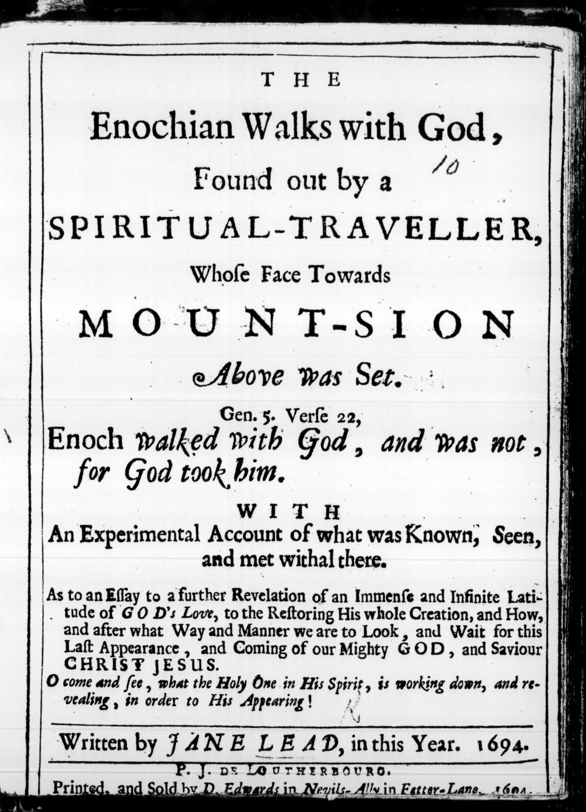

# エノクの神との歩み（ジェイン・リード）

ジェイン・リード著／全訳

- 原題：The Enochian Walks with God, Found out by a Spiritual-Traveller, Whose Face Towards Mount-Sion Above was Set, by Jane Lead
- 内容：十七世紀イングランドの女性神秘家・預言者が、七十歳の年に「最後の別れ」として世に出した霊的な旅の書。地上にありながら霊のうちにシオンの山の天の宮廷へと昇る「エノクの歩み」を、旅の準備、七人の守護の天使、三つの休み場、到着と花婿キリストとの対話として描き、天上の聖徒との交わり、永遠の処女なる知恵、最後にはすべての堕ちた霊が回復されるという「普遍の救い」、キリストの現れ方、四つの円の幻を語る
- 刊行：London, D. Edwards, 1694年
- 作業の基にした本文：1694年初版（Internet Archive 所蔵のマイクロフィルム版スキャン）。判読には Pass the Word Services による翻刻を参照した
- 著作権：リードは1704年に死去。原著は1694年刊。日本・米国・英国で保護期間が満了している
- 訳者：人工知能（Claude Opus 5.5）
- 訳の性格：扉、序、本文、付録の「上なる聖徒と下なる聖徒との交わり」「キリストの現れ方」「追伸」「幻」、販売の告知まで、全部を訳した。訳者の調べたかぎりでは、日本語訳は出ていない

## この本について

　ジェイン・リード（一六二四〜一七〇四）は、ノーフォークの郷紳の家に生まれ、十五歳で回心の体験をもち、夫の死後、四十代から幻を見るようになった女性である。ドイツの神秘家ヤーコプ・ベーメの思想を英国に広めたジョン・ポーデジの仲間となり、のちに彼女を中心に「フィラデルフィア協会」が生まれた。その思想は、ベーメの「ソフィア（神の知恵）」の教え、すなわち永遠の処女である神の知恵が魂のうちにキリストを生むという考えと、千年王国の待望とを軸にしている。

　本書はリードが刊行した三冊目の預言書で、序の言葉によれば、盲目に近く貧しい晩年の彼女が「この宝が私とともに死んでしまわないように」急いで公にしたものである。表題の「エノク」は、創世記で「神とともに歩み、神が彼を取られたのでいなくなった」とされる人物で、死を経ずに天に移された者として、地上にありながら天に住む生の象徴とされている。

　前半の「心の花」と「エノクの生」とでは、世のわずらいを捨て、心に湧く想念の浮きかすを聖霊の泉に浸して清め、忍耐・謙遜・希望・知恵・信仰・愛・力という七人の天使に守られて、シオンの山へと旅する道筋が描かれる。到着した魂を花婿キリストが「わが花嫁よ」と迎える対話の場面は、本書の頂点である。後半では、天上の聖徒たちとの交わり、預言・啓示・幻・力の鍵・按手と癒しという「五つの金のタラントン」、そして処女マリアを永遠の処女なる知恵の「像」とみなす独特のソフィア論が語られる。

　とりわけ注目されるのは、すべての魂、さらには堕ちた天使たちまでもが、死後の浄めの領域を経て、時の終わりにはみな神のもとに回復されるという「普遍の救い（アポカタスタシス）」を、リードがはっきりと説いていることである。追伸では、神のうちにあった光と闇との原理から、ルシファーの霊たちの反逆と人の堕落とがいかに生じたかを、ベーメ流に説明している。

　なお、原文には欄外注がいくつかあり、本訳では〔欄外注：〕として本文中に示した。

---

## 扉

**エノクの神との歩み**

**その顔を上なるシオンの山に向けた霊の旅人によって見いだされたもの**

　創世記五章二十二節〔原文のまま。引用句は二十四節〕
　エノクは神とともに歩み、神が彼を取られたので、いなくなった。

**そこで知られ、見られ、出会ったことについての経験にもとづく記録とともに**

　すなわち、神の全被造物を回復させる神の愛の、測り知れない無限の広がりについての、さらなる啓示への試みとして。また、我々の力ある神であり救い主であるキリスト・イエスのこの最後の現れと到来とを、どのような道と仕方とで待ち望むべきかについて。

　おお、来たりて見よ、聖なる方がその霊において、その現れのために何を降ろし、何を明かしておられるかを！

　ジェイン・リード著、この一六九四年に。

　フェター・レインのネヴィルズ小路のD・エドワーズにより印刷・販売、一六九四年。

## 以下の論考への序とおわび

　わが友らよ、愛の神の普遍の愛のうちに住むあなたがたに、この論考の内容はきっと受けいれられると私は信じて疑わない。それは上からの使信であり、時の初めからその最後の終わりと広がりとに至るまで、全被造物への善き知らせ、喜びの便りなのだから。神の惜しみない恵みはそこまで届くのである。しかしこの愛は、罪を犯し背いたことの正当な報いである終わりなき罰から救い出すことによってだけ、自らを表すのではない。それは、罪のための捧げ物となった方によって、堕ちたアダムの子孫全体に告げ知らされている。だが知っておいてほしい。もしここで――おお、もし――キリストによるこの目に見える贖いの道でそれがとどまるなら、神の愛はそれほどはっきりとは見えず、明らかにもされないのである。そうではなく、それははるかに深く進み、魂のうちに新しく創られた神に似た姿を生みださなければならない。損なわれ消えてしまったものが、聖霊の誕生によって――懐胎され、こうして内側から芽生えて、魂のあらゆる部分を徹底して新たにするために――修復されるように。これが、ここに書かれたものの全体の目当てであり趣旨であることがわかるであろう。神がその霊によって、内なる贖いのこの大いなる神秘において私を教えてくださったので、私は自分の死の前に（七十歳になったので）それを公にするよう駆りたてられ、迫られているのを感じた。この宝が私とともに死んでしまわないように。それがこの世への私の最後の別れになるかもしれないのだから。それゆえ、上からの曙の光が私の上に輝いているうちに、私の主人なる主の仕事を急いで果たしたのである。もし私の生の外なる日がさらに延ばされるなら、それは（そのすべてを生かして）、上から召された私の最も喜ばしい務めとなるであろう。

　さて本題に入ると、この主題が帯びている題について言えば、それは外側の華やかな響きからではなく、最も本質的な、経験にもとづく根底から出ているものである。もしそうでなければ、私の境遇にあって、私は自分を公にはしなかったであろう。というのも、頭に覆いをかけずに祈ったり預言したりする女はみな、自分の頭をはずかしめるのだから。コリントの信徒への手紙一、十一章五節。しかしキリストが私の頭の覆いであるので、私には委任と武装の力とがあり、それにもとづいて私は進み、まず第一の部分について何かを語ろう。それは心の春の花であり、死ぬことのない根のうちに本質をもち、心の顔を美しさにおいて完全にする。父の光のまぎれもない輝きである方の愛と喜びとのためにである。その中にあなたがたは（鏡に映すように）王の位階と霊的な昇り〔原文 Assents〕とを、霊のうちに備えられた祝宴のもてなしとともに見るであろう。それは天に生まれた霊たちにとって、またまだ生まれていない者たちにとっても、ならうよう招くものとなりうる。みながそのような天の心のありようのうちに見いだされるよう努めるために。

　次に読者にすすめたい部分は、本の題（エノクの生）に従うものである。それはかくも隠され知られずにきたが、霊の巡礼者、旅人によって見いだされた。そして肉と世の道とに従って歩むのをやめ、霊において神とともに歩むことを決意する者たちによって、なお見いだされうる。というのも、もしひとたびここから――これらの低い、足にまといつく、重い砂の道から――抜け出して離れることができれば、そのときあなたがたは神とのこれらの高く楽しい歩みに入ることができる。そこにひとたび入れば、さまざまな甘美さと喜びとに出会い、それがあなたがたをそこにとどまるようつなぎとめるであろう。そこではよい仲間に出会うのだから。死すべき者のうちにはわずかであっても、天の交わりの者たちは数多く、あなたがたの旅の向かうあの上の領域から、あなたがたとともに歩み、語るであろう。それについて私は、聖なる、分かたれた霊たちをここへと引き寄せる励ましと動機とするために記録を与えた。彼らは、この天の国の富と楽しいものとを前もって知り、それを観想する自由と機会とをもっているのである。その目的のために、私はこの第一の部分に、去年、一六九三年に私に開かれ啓示されたものを結びつけ、付け加えた。そこには、なおこの下の世界にとどまっている聖徒たちが、上の世界の聖なる、分かたれた霊たちとの交わりをどのように享受しうるかについての、特別な知識と経験とが見られるであろう。それは大いに益となりうる。

　また、主イエスの現れを我々がどのような道と仕方とで待ち望みうるかについて、最近示された小論も加えた。それについてはこの時代に、かくも多くの預言と響きとが出ていった。私は自分の賜物に従って、この世における彼の現在の現れと未来の現れとの両方のための確かな土台を据えた。たしかに彼は、その顔の前に使者を遣わしているし、また遣わすであろう。それは精錬する火の霊であり、彼の王国におけるいっそう目に見える輝かしい到来を備えるため、また彼のうちで、彼とともに地上を治める王、祭司、預言者を作るためである。そしてこの祝福された希望と、キリストのこの上なく栄光ある統治とを待ち望む者たちの上に、聖霊のこの増し加わる油がもっと注がれるのを見るとき、そのとき我々は彼が近づいているかもしれないと期待してよいであろう。

　それゆえ、このために、すべての公の、また私的な牧者と教師とは、何をもって出ていき、宣べ伝えるべきかを知らなければならない。すなわち、霊の務めを説き、すべての国民、民族、言語の者を呼び入れる用意をさせることである。永遠の福音の力によって。その力ある響きは、キリストの霊のうちに、体にあっても体を離れても、自由な者にも縛られた者にも届きうる。というのも、この福音は時の限界をはるかに越えて、なお閉じこめられている時代の被造物にまで及ぶのだから。贖う愛のこの広がりについては、この巻の中で、私が世から隠しておくべきではなかった啓示された真理として宣べられているのを見いだすであろう。そしてそれに反対して持ち出されうる聖書の箇所については、それらは私に解き明かされた。この点を和解させるように、またこのように開かれて。すなわち、主キリストが、ノアの時代に（あるいはそれ以前にもそれ以後にも）従わなかった獄の中の霊たち――低い領域に縛られてとどまっていた者たち――のところへ行って宣べ伝え、彼の現れにさいしてそのとき彼らが救いを見いだしたように――さもなければ、何の目的で彼は彼らに宣べ伝えたのか。ペトロの書に見るとおりである――、同じように彼の二度目の最後の現れにおいても、生きている者と死んだ者とを裁くために来るとき、各人のわざに応じて正しい義の判決が下されるが、それでもこの裁き主は、燃える浄めを経て、それによってへりくだらされたすべての者に、釈放を与え、赦しを授ける自由を自らのうちに留保するであろう。

　この事柄について使徒パウロが語っていること、すなわち火を通るようにして救われる、ということに注意せよ。そしてキリストの言葉、「呪われた者ども、永遠の刑罰に入れ」から持ち出される大きな反論については（それはこの世の短い限りに対置されるものであり、なお続きうる苦しみと罰との時代の数を認めるだけである）、それでもそれはキリストの時（主がそれを完成し、王国を父に引き渡すとき）を越えるものではない。というのも神は、キリストにおいて、ご自分と仲たがいしていたすべてのものをご自分と和解させるのであったし、いまもそうであり、そう計画されたのだから。第二のアダムであるキリストの効力が、その流された血の功徳と、そこに与えられたその霊とによって、第一のアダムが悪くしたすべてのものをふたたび善くするであろうことは、少しも疑うべきではないのだから。

　なおもっと敷衍することもできるが、これで足りると望む。ただローマの信徒への手紙五章十四、十五、十六節のあの聖句をよく考えてほしい。それは、備えられた膏薬が、罪の傷のつけたものよりもはるかに広いことをはっきりさせ、納得させるのに十分である。

　これについて、（おお読者よ）あなたが誰であれ、知ってほしい。私は天の力によってここへと駆りたてられ、聖なる三位一体の王者らしい寛大な善と愛とを明らかにし、弁明するよう迫られたのである。三位はみな一致して、霊的な性質をもつもので散らされ分かたれたものを何であれ和解させ、ご自身のうちへとふたたび連れ戻そうとしておられる。それは、時の満ちる時の摂理のうちに、驚くべき驚嘆のうちに明らかにされるであろう。神のすべての被造物が、このような普遍の贖いを完成した慈悲深い創造主を愛し、たたえ、あがめ、礼拝を捧げるために。ただ、警告と勧告とのこの一言を許してほしい。誰も、この神の恵みを、悪徳に満ちた不注意な生き方に変えるような思い上がりをしてはならない。というのも、魂の苦悶と恐怖と苦しみとが、この世でも後の世でも彼らの上に臨むであろうから。そのすべては、この生の時のうちに、霊における内なる割礼によって、また悪い本性を殺してそれを聖なる霊の法に服させることによって、防ぐことができる。というのも私は、だらしなくむなしく生きるすべての者に厳かに告白しなければならないが、彼らは第一の復活にあずかることはなく、神と小羊との臨在からの、あの楽しい想像もつかない喜びと、栄光ある満たす新たな泉とから断たれるであろう。それはこの現在の生において、満ちた収穫の初穂として味わうことができるのである。私はこのことを（私自身の身に知ったことから）断言する。もしこの生が終わるときに未来の至福の幸いな状態という報いがないとしても、キリストの霊にいまあずかり、それによって彼の神的な本性をまとい、私がここに経験に従って現実の記録を与えたあの言いあらわしえないすべての特権をいま享受しつつ生きることを、私はたいへん大きな幸福と考えるであろう。そして私は望み、祈りのあらゆる力をもって祈る。インマヌエルの聖霊によってここに開かれたものが、したたるオリーブの木からの金の油として受けいれられ、もてなされるように。主の油注がれた者たちが、この地上で祭司の王国のために増えていくように。（この主題は著者によって一六八三年に『神の啓示によって開かれた七つの封印』と題して論じられ、刊行された。その何部かはまだ私の手もとにある）。そして霊の日が、この現在の世代において心と頭とのうちにさらに昇り、輝き出るにつれて――それは油注ぎが豊かに注がれた者たちからしか期待できないのであるが――彼らがあの純粋な穀粒と金の種とを十分に蓄え、種まく者としていたるところに出ていってそれをまくことができるように。おお、いかに望ましいことであろう、そしてこの我々の時代にそのような力ある種まく者を知ることは、いかに私の喜びとなるであろう。彼らは霊の純白な百合の実りを生みだすかもしれない。そこで我々の王なる羊飼いキリストが歩み、養われるであろう。そのとき彼は、もはやこの地上の彼の囲いにとって見知らぬ者ではなく、いつも我々を養う牧場としてよく知られるであろう。しかし私はここでやめ、この言葉をもって（まるで私の臨終の言葉であるかのように）結ぶことにする。それを私はすべての階級、種類、身分の者に、とりわけ真の霊の務めを行うよう召され、その自由をもつ者たちに向ける。彼らがこの季節と時が何を求めているかを知るように。いまや時の第一と第二との数は過ぎ、半時に来ているのだから。それゆえ、あなたがたの油注がれた盾をもって、霊の油で満たされたあなたがたの角をもって出ていけ。霊のらっぱを吹くことを惜しむな。地の果てから集めるために。彼らが、まず我々の心のうちに昇るこの夜明けと明けの明星とを見、知り、それにあずかり、そこから、我々の君なる贖い主を王の威厳のうちにまのあたりに見ることのできるところへ最も正しく導かれるように。その目的のために、我々の主キリストのこの先駆け、すなわち霊の務めを広めることは、あなたがたの責務であり、あなたがたに課されている。それが、ここにキリストの霊によって述べられたこの霊の道を愛し、歩む者であるあなたがたに、私が残し、ゆだねるべき一つにしてすべてのものである。

　ジェイン・リード

## 心の花

　一六九四年五月十二日

　楽園の地から一輪の花が現れた。その本性と性質とはけっして色あせず、死なないことである。その由来は上から、すなわち主から、永遠から生かす霊からだからである。

　これこそ、私のうちで外なる本性とは別に芽を出した草木である。それはその快い香りによってよく知られる。かぐわしい愛をもって性質づけ、たいへん甘く穏やかなので、魂をそれほどまでに調和させ、魂は霊なる神性のほかにどんな生命も感じなくなるほどである。それが、心のこの薔薇色の花を、ある種の香油のような効能で養う根であり、そのためその美しさはいつも頬を染めたようなみずみずしさをもっている。

　さてここに、すべての神秘の中で最も大きな神秘がある。すなわち、死すべき人間の姿の覆いの下に、そのような油注がれたケルブが、そこで生き、動いている、ということである。それは火の火花を散らす目をもち、それは天に浸みとおり、そこで、あの上の領域へと移し植えられた、自分と同じ種類、同じ性質のものを眺め、見るのである。というのも、私には知られているのだから。この粗い地から分かたれた純粋な霊たちは、頭であるキリストとも、栄光の高みにいる彼の聖徒の体とも、ともにいることができるということが。

　しかも、互いの挨拶と語らいとが許されることがある。一つの永遠の根と土台とから芽生えたものとして、永遠の一致という愛の金の鎖でともに結ばれているのだから。

　しかし私に理解させられたところでは、まだ体のうちにある（すなわちまだ肉体をもつ）聖徒たちは、たいへん高く霊化され、外なる被造物の生として見られた自分自身からひどく遠ざかっていなければならない。というのも、この体のうちにある魂が、王なる羊飼いと、あの上の囲いとの交わり、あるいは霊的な語らいをもとうとするときにはいつも、その部分は黙らされ、閉じこめられなければならないのだから。

　さてここから、この天の宮廷へとここまで昇ってくる特権を与えられるのは、高い位階に達した魂でなければならない、と結論すべきである。それぞれの霊は、その成長と到達とに応じて、上にいる者たちと位置づけられる。それぞれが天の場所で自分に似た者と結ばれる。というのも、時の体のうちにあるあいだもそうであろうし、そこから分かたれたときには（おお、わが友らよ、これを知るに至る者は誰であれ）、彼らは上にあるもの以外のどんな交わりもほとんど気にかけなくなるであろうから。栄光を受けたキリストは、純粋な霊たちを、彼らの最もふさわしい中心であり住まいである自分のもとにいるよう、力強く引き寄せるのだから。

　罪と肉との体は、まことに、霊の飛翔のためのこの心の自由のうちにあろうとするそのような天を思う魂にとって、大きな妨げであった。しかしこの地のひき臼が彼らを縛り、押さえつけているので、彼らは昇ることができない。

　それでは問題は、神とキリストとすべての天の家族とのこのこの上なく望ましい交わりを保つために、自由になるには何をなすべきか、ということである。

　私は、私自身が教えられ、ある程度実行に移して、それによって私の霊が神の喜ばしい臨在の内なる幕屋に入り、とどまるためのこのまったく秘密の通路（あるいは道）を見いだしたこと以外の指示を与えることはできない。それは、私のこの体が崩れ去るときに私が住まうことを望み、期待してよいものの、先立つ保証のようなものである。

　それゆえ、自分たちの生命であるキリストをこのように愛するすべての聖なる、心正しい魂たちを励まして、この外なる体のうちに生きるよう割りあてられた時のあいだ、彼の交わりを奪われないようにするために、私が自分の経験として与えるこれらの規則を守らせよう。

　第一に、心の上のわずらいであり重荷であるすべての厄介な世俗の事柄をわきへ置け。どうしても必要でないものは何ひとつ取りこむな。世のものはわずかで満足せよ。神をはるかに多く得るために。

　そしてもしあなたがこれらの外なるものを豊かにもっているなら、それらからの離脱の証しを必ず示せ。それらをすべて、神殿を建てる者たちへの捧げ物として差し出し、聖なる、霊を思う魂たちが築くべき内なる聖所を推し進め、整えるために。それゆえ、そこにおいて励ましを与えることは、この世のものをより豊かに享受している者たちによってなされうるであろう。

　そして神をたたえよ。神をあがめ、神が知恵と啓示と預言との霊を授け、満たし、あらゆる清い生活〔原文 Conversation〕をもつ者たちを支えることによって、神の王国の啓示を広めるという、このような宝が自分たちの手に置かれていることを。

　たしかに私は思う。もしこのように大きく、よく心を備えた者が誰か見いだされたなら、それは神へのこの上なくかぐわしい犠牲となるであろう。そうすれば、敬虔な霊たちの隔離と献身とが保たれ、天におけるように地においても神の意志がなしとげられるであろう。上の世界の聖徒たちに、愛し、たたえ、賛嘆し、すべての敬意と神殿の礼拝とを、神のうちで、神と小羊とに捧げることにおいて、こだまを返すのである。

　私は、そしていまも、同じ考えである。もしそのような聖なる集会が、完全な合意と霊の一致とのうちに集められうるなら、それに大いなる証しが与えられ、力あることがそれに続いて起こるであろう、と。しかし、悲しいかな、ああ（それゆえ嘆きの声を上げてもよい）、魂のうちの生命の清い泉は、地によって息をふさがれ、詰まらされてきた。

　私は悲しみとともに観察してきた。被造物の大部分が、そのさまざまな階級と身分とにおいて、いかに深く地上の生に埋もれているかを。この世の上の身分は、この世が与えうるすべての望ましいものに満ちていることによってあらゆる利点をもち、それによって高い天の召しに心を傾ける機会をもっている。ほかの者たちが従事しなければならない骨折りと労働となしに、生活し暮らしていけるのだから。それゆえ、この一時の世の大いなる者、富める者は、信じ、知るがよい。その財産をもって何よりも神をあがめることは彼らに課されており、神は彼らにそれ以下のことを期待していないのだ。そして神は彼らに自分の時間をかくも自由に使う権限を与えたのだから、それを高く尊び、王国の真珠を確かに自分のものとせよ。この外なるものに属するすべてを残していかなければならないとき、あの宝は彼らとともに天の世界へと行くことができるのだから。

　さていま、私には下の階級の者たちのためにも一言が与えられている。彼らはじっさい、生計を立てなければならない仕事に従事しているので、時間と自由とがないという、より正当な申し立てをすることができるかもしれない。それゆえ彼らは、天の動きを待つのにそれほど暇があるわけではない。

　これに対して、キリストの霊はこの警告と勧告とを与える。

　体の部分のための思い煩いが、生命と霊とを食いつくし、こうして魂にとってのすべての霊的な養いと衣とを奪うことのないよう、また天の召しと召命との位階に進むことから退けられ締め出され、天の場所での交わりのすべての益を失うことのないよう気をつけよ。

　それゆえ目を覚ましていよ。外なるものに内なるものを押しのけさせてはならない。あなたの外なるものの蓄えに、ただ一粒の信仰を入れ、そこにおいて神を見つめよ。そうすれば増加の祝福があなたに来るであろう。義人は霊的にも一時的にも、その信仰によって生きるのだから。

　神に信頼したとき信仰の霊が何を生みだしたかの例を、我々はもっている。それは、頭のあらゆる研究と手のあらゆる労働よりも千倍も多くを生みだした。そして信仰のこの百合が伸び、それを縛ってきた感覚のよじれた紐から自らを解き放つとき、ソロモンでさえ、その栄華のすべてにおいて、信仰の世継ぎたちのこの芽吹く百合の日には比べられないであろう。

　この信仰へと生まれる者たちは、どんな一時のものについても思い煩う必要はない。すべての祝福が豊かにもたらされるであろうから。それゆえ、あの滅びゆくマモン（富）のためにそれほど働かず、むしろ、何千人もの者をパンで養った、純粋な信仰のあの白い石のために働け。

　主の教えを思い起こして。すなわち、何を食べようか、何を飲もうか、何を着ようかと思い煩うな。主は、信仰の霊と力とによって、すべての必要なものの支えと供給とがあるであろうことを知っておられたのである。

　しかし、この種の信仰はまだごくまれにしか誰のうちにも芽生えていない、と言われるかもしれない。

　よろしい、いまのところはそうだと認めよう。しかしそのような信仰がかつてあったし、それを詰まらせ、息をふさいできた（いや、信仰のこの百合を縛りつけてきた）すべてのものに死ぬことをいとわない者たちのうちに、きっとふたたびよみがえるであろうことは真実である。

　さて、神のうちの生命によく通じ、そこに安らうことを望むそのような霊を思う魂たちのための、指示の第二の規則に進もう。

　第一の規則が、外的に、すべての不必要な足かせと重荷とを取り除き、解き放つことであったように、これはより内的なものである。それは、朽ちる本性から煮え立ってくる浮きかすを、心と頭とから取り除くようあらゆる注意を払うことによる。そこから、とめどない想像の多様さが生じ、それを止めることはできない。ただ聖霊の泉が開いて、神殿の体を汚すあの籾殻のような塵を押し流すほかは。

　さてこの技を、魂は聖霊から学ばなければならない。この種の泥のようなものが心に湧き上がるやいなや、ただちに、生命の水が湧き出る泉の池に身を浸し、沐浴せよ。それこそが我々の癒しであり、それはもう一方の反対の源と同じくらい我々の近くにある。こうして我々は、祭司なる霊が仕えるための最も聖なる聖所として、神とキリストとが我々のうちにご自身を現すための聖なる分かたれた場所を備えるために、我々の心をすっかり清く、いっそう澄んで保っておくことができる。

　このために聖霊は約束され、また与えられた。内的に曲がった道を備え、まっすぐにするために。キリストのその霊的な人性が清い心のうちに住まうために。ちょうど洗礼者ヨハネが先に行って彼を備え、世の罪を取り除く神の小羊であると告げたように。ヨハネの務めによって、生命に至る改革と悔い改めとが与えられるために。

　しかしこれらすべては、いま明かされるに至った霊の務めには及ばなかった（ヨハネが告白したように）。キリストはまったく霊的な体において栄光を受けておられるので、この聖霊が前もってとどまって心の打ち場を精錬し清めているところでなければ、どんな魂とも結びつくために来ることはできないのである。

　これが霊の務めである。さてここから、我々はこの聖なる使者を手厚くもてなす務めを負っていることがわかる。それは無限に価値ある賜物である。おお、それゆえ彼を高く尊べ。彼によって、彼を通して、我々は父の家と、あの天の家族すべてとからのすべての知識と知らせとを得るのだから。この良い友、聖なる油注ぎが神の多様な知恵の宝庫から明らかにしてくれるのでなければ、我々は死後のあの生の状態について何ひとつ知ることはないであろう。

　それゆえ、かくも大きな益のために、そのような慰め主が自分とともにとどまるよう、心をすっかり空にし、清く保たない者がいるだろうか。彼は、まだ来ていないことを、現在の時と永遠とのように我々に告げることができるのである。そして彼は、彼の交わりを愛し喜ぶ者たちのために、それをしているし、なおし続けるであろう。

　私は言わなければならないし、生きた証しとして後に残しておかなければならない。もしこの聖霊のこの尊い封印の賜物がなかったなら、私は日々を陰鬱と悲しみと、嘆きと悲惨とのうちに過ごさなければならなかったであろう。この霊の賜物を受けたことによって、私の生涯の歳月は大いなる平安と楽しみと喜びとのうちに過ぎた。この世のわずらいにしばしば押し寄せられたけれども、霊を自分とともにとどめておくことさえできれば、それはけっして私を苦しめることはできなかった。霊はいつもその蓄えから新しいものを取り出して、いつであれ私のうちで乱され、ひどく騒がされたものを静め、なだめてくれたのである。

　このことを私がふれたのは、この論考を読む者たち、あるいはできるだけ多くの者を促して、それを真の霊のうちでまじめに思いめぐらしてもらうためにすぎない。そうすれば彼らは、これがどこから書かれているかを知り、それを大いに尊び、まさにこの同じ輝く照らす星が彼らの心から昇るよう、賢く備えをするであろう。それは、王なるキリストが、罪と呼びうるすべてのものを打ち倒すまで治めるための道を備えるであろう。そのために聖霊は与えられ、いまも与えられつつあるのだから。ただしさまざまな量と度合いとにおいて。ある者には一つの分け前、ほかの者には二倍、三倍、魂の献身と準備とが見いだされるのに応じて。神的な観想の生のための最も大きな静けさと隠れとが定められているところに、この聖なる客はたびたび訪れるであろう。それによって霊は、神の威厳がその栄光をもって照らす天の国と王の都とで何がなされ、行われているかを、敬虔な魂によく知らせ、なじませるのである。

　この上の世界の事柄について霊が我々と交わしうる語らいは、我々を力強くとらえ、我々の心を巻きあげるので、我々はそれをこの汚す世へと降ろすことを恐れるであろう。それが天と我々とのあいだに隔ての雲を立ちのぼらせないように。あまりにも悲しいことに、それはたびたび知られてきたのだから。それゆえ目を覚まして祈り、いつも見張りを怠るな。

　しかしいま、こう言われるかもしれない。神の宝庫から新しいものと古いものとを取り出すこの霊を受けることは、栄光ある高い特権である。しかしこの賜物を得る道はたいへん高くつく。定められた規則は、肉と肉的な感覚とのうちにある被造物の生の、それほどまでの自己否定と放棄とに至るので、この尊い聖なる油注ぎ――それによって我々は神の秘密の深いことを知るに至る――を得て保つことのできる者はごくまれである、と。

　たしかに、この宝石はふつうの地上の土地には見いだされない。私が述べたように、いくつもの量がある。キリストのこの霊を少しももたない者は、彼のものではありえないのだから。しかしもし、罪を戒め責めるだけのこの光があり、それに従うなら、そのとき霊ははっきりと増し加わって勧告と慰めとを与え、こうして、心が彼のとくべつな住まいの場所として明け渡されるのを見いだすにつれて、いっそうはっきりと自らを現していくであろう。それは、伝えられるべきさらに並はずれたことのための備えとして、すべてを聖なる秩序のうちに保つためである。というのも、魂がそれ自身から空にされるにつれて、霊はますます高く昇るのだから。

　しかし、この時代に、使徒たちの時代のように聖霊によって洗礼を受けたことの例を示せる者がいるのか、と問われるかもしれない。

　然り、たしかに。その継承は、それ以来どの時代にも誰かによって証しされてきた。もっとも、分かれた舌や激しい風のような同じ仕方においてではないが。霊のこの目に見える証示は、その時代をもち、こうして過ぎ去るはずのものであった。そしていまは、それにふさわしく整えられた器のうちで、より内在的な仕方と方法とで働いている。それゆえ、目に見えるかたちでなされたことは、いまではより目に見えず、心のうちに燃える炎として吹きこみ、開き、そこに生きて燃える炭として横たわっている。それが聖霊のまことの洗礼であることを我々は知っており、それはいま感じられている。そしてそれがその最も高い浸みとおる力にあるときにはいつでも、そのときの必要に応じて、奇跡的な行いとわざとのうちに自らを働かせることがある。このことはこの時代のある者たちに知られ、経験されてきた。

　それからまた、霊のもう一つの証しは、内なる突風と神的な空気の息吹とである。それによって魂はしばしば霊のこの言葉、すなわち息吹の翼に乗せられて、こうして天へと昇り、永遠の天球の中に入る。その外なる体は時のうちにとどまっているあいだに。このことはある者たちに知られている。

　というのも、過越の祭りを食べるために目に見えるエルサレムへと外的に自ら上っていくことがあったように――それは、いま上なる新しいエルサレムで守られているあの大いなる祭りの日の予型であった。そこでは主キリストが、その霊的な人性において現れ、そこにいる彼の聖徒の体とともにあの霊的な祭りの厳かさを守っておられ、ときには、なお目に見える肉の体のうちにある純粋な霊たちが上ってきて、あの祭りの堂々たる秩序と統治とを眺め、それを味わうことを許される――これこそ小羊の晩餐をまことに食べることであり、彼の王国においてキリストとともに新しい契約の王のぶどう酒を飲むことであり、それはすべての象徴的な儀式に終わりをもたらすのである。

　この過越の小羊を食べにここへ上ってくるよう召され招かれたすべての者に、我々は祝福と喜びと栄光とを告げてよい。彼らは、ここから出ていって、より低い務めの中に住まうことを、けっして気にかけも望みもしないであろう。というのも、これこそすべての総計であり実質なのだから。第五元素の体と、ぶどうの純粋な血とを糧とすること。それは自らをしぼり出すたびにまた満ち、絶えず注ぎ出されるので、ここまで上ってきた者は誰も、もう渇くことがないのである。

　これこそ、私がここにあなたがたに述べた、まことの仮庵の祭りである。というのも、誰も自分の幕屋の体――それは聖霊の燃える心である――をまとわずにはここに上ることはできないのだから。

## エノクの生

　しかしいま、これを読んでこう言う人々の声が聞こえる気がする。おお、あなたは高く崇高な状態について述べた。それはこれまで宣べられたことのない新しいことのようである。この現在の生において、新しいエルサレムへと昇り、そこで宴にあずかり神を礼拝する者が見いだされるなどとは。これはエノクの生に属することだ、とあなたがたは言うであろう。しかし世のあの時代はまだ来ておらず、移された状態を知るには至っていない、と。我々はそれを認める。それはふつうのことではなく、エノクの霊のうちに高められて神とともに歩み、こうしてすっかり霊のうちに取りあげられる、ある者たちにだけ固有のことである。しかし霊のこの日が近づきつつあることを我々は望んでよい。それによってそれはいっそう普遍的に知られるであろう。そのとき天使のような霊たちが昇り、かくも長く閉ざされてきたあの神的な原理が開くであろう。そのときあなたがたは、これまで知らなかった新しい生き方を知るであろう。それは、すべての死すべきものへの愛を心の戸口から追い出すであろうから。このことはまことに知られるであろう。

　この神的な神秘を開くことにここまで進んできたのだから、我々はここで止まらず、さらに進んで、この聖なる都、新しいエルサレムへと私の旅の仲間となることを望む者たちに、明かし伝えよう。その道筋は私に示されたのである。昔のように幻によってだけではなく。一六八三年に刊行された私の『神の啓示』の本の中に、私が幻によって得たものを見ることができる。しかしいま、霊は別の度合いへと動き、幻を本質的な享受へともたらした。それは詩編八十四編七節のあの聖句を裏書きする。「彼らは力から力へと進み、それぞれシオンにおいて神の前に現れる」。

　さてこれを、シオンで神の前に現れるべき部分については、二重の意味に取るべきであることを私は見いだす。第一は、まだ肉体のうちにあるあいだ。第二は、そこから踏み出して、もう二度とそこへ戻らないときである。さてここから私は（しかし私ではなく、私のイエスの霊が）あなたがたを第一の部分へと導こう。その道をよく知っており、天使の手にある測り縄によってその寸法を測ったのだから。それはそこへの旅人のほかには誰にも説明のつかないものである。

　このために、いくつかの項目と命題とを順に立てておこう。我々の旅の仲間が確かな足場を見いだしそこなわないように。

　第一は、そのような旅を志す者に、どのような準備あるいは資格が必要か。

　第二に、どのような種類、あるいはどのような仕方の道か。

　第三に、道の途中のいくつかの段階、すなわち休み場。

　第四に、この神の都への彼らの到着。

　そして第五に、旅人たちがそこでシオンの山の大集会（神の宮廷）のすべてから受ける歓迎ともてなし。

　それではまず第一に、この旅人が何でなければならないかを考えるべきである。

　粗い、手に触れられる体ではなく、地上の生から天の生へと分かたれ、移されて、このようにエノクの歩みを始めるべき霊である。これが我々の霊の旅人の最初の変化である（地上の被造物が霊的なものに変えられるのである）。

　さていよいよ道に入る。それは最初の取りつきでは、涙の水門を開くバカの谷のように見える。そして霊の光にあまりに取り囲まれているので、その光は魂に、本性のうちに芽生える罪の根によって天使の像を失った、内なる、また外なる醜さを見いださせたのである。それゆえこの嘆きと悲しみとは、悔いるべきものではない。そしてこの最初の始まりの道にいるあいだ、魂は戦うべき多くの敵と、内からも外からも誘惑とに出会うであろう。そして攻撃はいっそう多く来るであろう。魂はこの悪い世の歩みを引き裂いて離れ、この新しい生きた道へと身を向けようとしているのだから。しかし我々の旅の仲間は落胆してはならず、帯を締めて前に進め。この日の旅には終わりがあるであろう。この最初の日は重く進むかもしれないが――第二の日はもっと明るく、元気づけるものとなるであろう。もし魂がこの試練に耐え、ヤコブがしたようにそれを組み打ちで戦いぬきさえすれば。

　そのとき神の天使たちが疲れた旅人を迎え、その道のあいだずっと伴ってくれるであろう。

　この危険な道にいるあいだ、旅する魂の護衛として任命された七人の天使（あるいは七つの霊と呼んでもよい）がいる。私は彼らの名を挙げよう。私自身、まさにこの日に至るまでの私の旅のすべてにおいて、彼らを力の砦として見いだしてきたのだから。この完全な道を厳密に守ろうとする企てる者たちにとっても、そうでありうるであろう。

　護衛のためのこれら七つの資格を与える霊と力とのうちの第一は、聖なる、受け身の忍耐である。これはこの道に絶対に必要な仲間である。忍耐強い心を授けられていなければ、耐えぬくことはできない。それは、あらゆる反対と、この高い天の歩みから引きずり降ろそうと申し出てくるものとに対して、耐えぬくことができるのである。

　第二は、深い、すなわち柔和な謙遜であり、低く、へりくだって保つことである。それが旅人を安全にするのだから。神は、静かに、着実に歩む魂を大いに重んじられるのだから。

　第三の資格は、生き生きとした希望である。それは魂のうちの目のようなもので、天のシオンの眺望を携えている。それは魂を力強く強め、支える。

　第四に、超天上の知恵である。それは魂を、旅を進めるのに最もふさわしい時と季節とについて、すなわち、事柄の求めるままに、いつ止まり、いつ前へ移るべきかについて、導き、取り仕切り、統べる。

　第五は信仰の霊である。これはすべての困難を通して運んでくれる、この上なくすぐれた仲間である。それは目に見えない天の事物の対象の証拠なのだから。それは魂をたいへん高く飛ばせる翼であり、這いまわる地の虫のどれも、魂を悩ませたり傷つけたりするために届くことができない。

　旅人に付き添う第六の神的な力は、燃える愛の生きた炭である。それは、神とキリストと、祝福された完全な霊たちの栄光を受けたすべての列とを、幻のうちに享受するに至ることを、かくも激しく切望する。この愛の強風はたいへん力強いので、魂を奮い立たせ、この競走をすばやく走らせる。

　第七に、この聖なる護衛を最も完成させるものは、打ち破られない強さと力とである。というのも、もし神がご自分の打ち勝ちがたい強さで旅する魂を固めることに心を配られなかったなら、新しいエルサレムの状態というこの目標に達する可能性はないであろうから。しかし主キリストは十分に心を配り、この天の旅をなしとげるための武装の力を備えることを怠らないであろう。というのも主キリストは、魂がご自分の前に現れることを望む以上に、魂の旅人がご自分の愛のふところに無事に着くのを見ることを切望しておられるのだから。それゆえ、この相互の愛の合意によって、ひとたびそこに着いたとき、婚姻の結合の永遠の結び目が結ばれるであろう。

　さてそれでは、このときまでに、旅のあいだ魂を支える仲間が何であるかがわかったであろう。しかしすべての中で首たるものは、霊におけるキリストである。彼は、七つの金の燭台のただなかにおけるように、この聖なる資格を得た魂のうちを歩まれる。

　第二の命題は、疲れた旅人がしばらく住まうことを許されうる段階、すなわち休み場が何かということで、それは三つある。

　この第二の日の旅はもっと楽で、元気づけるものである。その歩みは福音の約束から甘い香りを放ち、契約のあがないの血によって、すべての罪の咎がぬぐい去られたという確信を与え、それによって魂は励まされ慰められる。

　しかしここから魂は第二の休み場へと進む。それは霊の証しと封印とである。いまや一般的な（文字どおりの）約束からのものであったものには、とどまるべきではない。肉におけるキリストは退き、もはやその姿では知られず、霊の満たしつくす力と臨在とにおいて知られるであろう。それによって魂は彼を自分自身のうちに知るであろう。こうしてそのとき彼は、まことに救いとなるのである。

　キリストの外的なあてはめは、内なるキリストほどの効力をもたない。内なるキリストは、その救う名を香油のように注ぎこみ、それが魂の堕ちた状態の治療を果たす。内なる病には内在的な薬がなければならず、それが内なる部分に浸みとおって、すべてが癒されるようにするのだから。

　これがキリストによって意図された贖いであり、これに及ばないものは何ひとつ、魂をふたたび正しい状態に置いて、シオンの山の王国の完全な霊たちのあの大集会の前に出る大胆さを与えることはないであろう。

　さて我々は第三の休み場へと進む。それはなおいっそう楽しい。楽園のものだからである。

　旅人がこの国を通っていくとき、さまざまな喜ばしいもてなしがあり、この神的な原理のうちで仕える天使たちと霊たちとが魂を迎える。

　そこにはまたシャロンの散歩道があり、香料の花壇で飾られていて、うっとりさせる香りを放っている。

　これはときに魂のうちに、甘い味わいと元気づける飲み物とともに開く。というのも神性がその風土のすべてに自らを行きわたらせているので、多くの霊が力づけられ、喜ばしくされ、満たしつくす甘美さのほかには何も知らず、心のうちはすべて穏やかで静かであり、この世の恐ろしい思い煩いと騒乱とから自由である（その中にいながら）。少なくとも、この光と天の楽園とに四方を囲まれているあいだは、この世に忘れられているのである。それゆえ魂は、ふたたび死すべきものへとより低く降りることについて、かき乱されることを恐れる。

　さて我々は第三の項目に来る。それは、ヘブライ人への手紙に述べられているあのシオンの山へと引きあげる、最後の移動である。

　こうして疲れを知らない魂は力から力へと進み、いまや第四の項目に来た。

　すなわち、シオンにおいて神の前に現れるための到着である。

　これは高い、栄光ある到着である。これはけっして乱されることのない休息である。いまや永遠の門が開いて、その試練の状態を耐えぬいた忠実な旅人を迎える。

　さらに残っているのは、（第五の項目として）そこでの旅人の歓迎について、あなたがたに記録を与えることである。

　最初に現れるのは、王座の前に立つ天使の位階である。彼らは到着した者を案内するよう命じられており、王の衣を持ち出してくる。それはまったく清く、光であり、堕ちた夜のしみがない。それは魂に、あの新しい世界、すなわち光の原理〔原文 Principal〕の中に現れる聖なる大胆さを与える。すべてが明らかになるのにふさわしく。こうして王なる祭司キリストが魂に現れる。そして花婿として、次のような愛の祝いの言葉で魂に挨拶する。

　「わが花嫁、わが妻よ、私はあなたの魂が私の義のうちにあるのを見て喜ぶ。あなたが危険な、悪い、誘惑する世を通り過ぎ、私のあの柔らかな生命を（あなたのうちに）携えて逃れ、それによってここへ勝利者として上ってきたことを。さあいま、父が私を置き、上の高みにおいても下の地においても、すべての支配、権威、主権の上に置いてくださった私の王国の栄光を見、眺めよ。それゆえ私は、望む者に、私とともに所有させることができる。喜びには喜びを、栄光には栄光を、私とともに。私が父から受けたように、私は惜しみなくあなたに与える。また、悪い世から抜け出し、離れて、清い裸の霊のうちに、愛の炎のうちに、こうして昇ってくる者すべてに。

　「さあ（おお、わが妻よ）、私がさらにあなたのために何をなすべきかを求めよ。私はあなたに、まったく自由に求める自由を与える。あなたは父からも私からも恵みを得たのだから」。

　そこで到着した旅人は、神と小羊との王座の前で礼拝し、身をかがめる。そして大いなる謙遜のうちに、霊の言葉で次のように答えて言う。

　「おお、わが主よ！　私はこの位階にまで上ってまいりましたが、それがすべて、わが神、わが父からの慈しみ深い恵みと愛とによるものであり、おお主キリストよ、あなたの霊がこの私の旅における私の導きと守護の力であったことを、私はよくわきまえております。力強い護衛と、あなたの泉なる心からの絶えまない補給とについて、私は一つの大きな証しをもちました。さもなければ私は途中で気を失い、倒れていたでしょう。

　「そのことを思うと、たいへん深い印象が私に刻まれ、私は途方に暮れ、わが神、わが王なるあなたに、感謝という負債の捧げ物を何をもってお支払いすべきかわかりません。ただ、私のもっているものをお受けください。それはあらゆる言葉の響きを越えております。言葉は、私の霊がかくも豊かに味わった限りない善に対する賛美を表すには、あまりに有限なのですから。

　「それゆえいま、私は、あなたから私に与えられた愛の燃える霊によって精錬され浄められたものを、あなたに捧げようと努めております。

　「それゆえ、あなた自身のものであるこれをお受けください。私はそれをすべて、あなたへのまことの感謝の捧げ物として手放すことを喜びます。その一部たりとも、あなたからとどめておくことはいたしません。たとえ私にあなたに差し出すべき一万の汚れなき生命があったとしても、私のためにかくも大いなる贖いをなしとげてくださったあなたのうちへその愛の力を注ぎこむには、すべてがあまりに少ないでしょう。

　「そしていま、わが主よ、私はこうしてあなたの臨在のうちにここまで入ることを許され、あなたに恵みを求める自由を与えられたのですから――あなたは私がそれをどれほど必要としうるかをよくご存じです。私はまだ時の領域にあって、そこでは多様な攻撃と誘惑とにさらされております。あなたのうちでかなりの度合いの光に照らされてはいても、この世から、またアストラルの王国からの霊たちによって引きずり降ろされるおそれがあり、彼らは心の超天上の部分と混じりあうことによって歪めるかもしれません。私の時代に、大いに照らされた聖徒たちのあいだで、どれほどの過ちがあったかを私は知り、見てまいりました。彼らは輝く星のように輝き、それからまた雲の下にあったのです。それゆえ、おおわが主よ（これらのことを前置きして）、私は恐れと謙遜とのうちにあり、正しい道から足を踏みはずすことのないよう、いつのときも自分を信頼することができません。それゆえこれが私のあなたへの第一の願いです。あなたの霊が、父から直接に、またあなたから流れ出る知恵の泉として、私の絶えまない監督者、導き手、教師であってくださいますように。そうすれば真理からのどんな迷いもありえません。

　「これこそ絶対に必要な一つの願いです。我々はみな微妙な点に立っているのですから。そしてもしソロモンの願いがその時代に神にかくも喜ばれたのなら、私は（おおわが主よ）あなたに真理の霊を求めることを少しもためらいません。それが（あなたによって約束されたように）私のうちに、また正しく導かれることを望むすべての者のうちに据えられた神託であることを、けっしてやめませんように。というのも、正しいもののふりをする姿を変えた光に用心せよという警告として、それはすでにあなたによって与えられているのですから。しかしあなただけがまことの光であり、内から本質的に湧き出るのです。そしてあなたが私のうちでこの証しであられたように、おお、知恵とまことの啓示とのこの霊をなおいっそう豊かに増し加えてください。あなたの計らいと思いとのうちでなお宣べられ知られるべく残っているものが、なお（照らす光線として）私を通り、またエノクの歩みのうちに、その顔をシオン（あなたの満たしつくす威厳の宮廷）に向けて見いだされる者たちをも通っていきますように。

　「おお！　とこしえに、私と、あなたの現れを愛するあなたのものすべてとのために、余地と場所とを見いだしてください。

　「あなたをありのままに見ることは、きっと我々をあなたと同じ似姿に変えるでしょう。というのも、語らいのためにその道を開いて自由に保とうとするすべての者にとって、それがふさわしいのですから。王国の拡大へと与えられるすべての特権とともに。わが主よ、あなたとの生命と霊との一致にかなうすべての完全さの確かな保証としての聖霊とともに。こうして私は願いを捧げました。そしてすべての地上の事柄と物事とにおいて、自分をあなたの処置にゆだねます」。

**ここに、魂のインマヌエルの優しく丁重な答えが続く**

　「愛と平和と善意とをもって、ようこそ。処女なる妻よ。あなたは霊のうちにここまで上ってきて、父の心と私の心とにかくもよくかなうものを願い求めた。

　「それゆえこの答えを受けよ。このあなたの願いは、私の霊の側で果たされるであろう。霊は、秘密の封印の下に置かれてきたものを、あなたのうちで開くことを怠らないであろう。あなたはただ彼に心を向けよ。そうすれば彼もあなたに心を向けるであろう。またその心のうちに彼の動きを見守る者は誰でも。というのも彼は輝く明けの明星であり、私がこの下の世界から身をもって不在であるいま、私の小さな群れの導き手、指導者となるべき者なのだから。そこでは悪い誘惑の木がすべての魂のうちに芽生える。それゆえ彼らには、この私の油注がれた盾が大いに必要であることを私は知っている。それは、歪める霊のあらゆる襲撃に対する守りとなりうるのだから。この元素の体のうちにあるあいだ、すべての者がその危険のうちにあるのだから。

　「それゆえ私は、勧告と慰めとのために、またあなたを私のところまで守って連れてくるために、この真理の霊があなたとともにあるよう備えた。そこであなたは、霊のこの鏡によって、私が現在の日のために、また未来の日のために（死すべき衣をも脱いだときのために）、何をし、何を備えているかを知り、見ることができる。しかしいまは、来て、見て、天の糧と、私の王国の力と喜びとを味わえ。生命と愛との泉は、あなたの霊を飲みつくすほど高く湧き上がるであろう。

　「こうしてあなたは私とともに宴にあずかり、晩餐をとり、けっして空になって去ることはない。それはあなたが、なお霊のうちにあなたの愛する者である私とともに、私の秘密の天幕の中にいるよう、すべての力を傾けさせる励ましの動機となるであろう。そこであなたは、新しいエルサレムの状態に属するあの重大な事柄について、私と語らう自由をもつことができる。それゆえ（おお、わが妻よ）、もしこれがあなたのもてなしであるなら、あなたは光の火花のように、体――すなわちすべての光の体であり満ちみちたもの――へと飛んでいくであろう。これらが、私が私の婚約した者たちに、さらなる日が明けるまで（死の陰を通ってであっても）元気づける支えとして食べるために残していく甘い菓子である。その日は、あなたのキリストであり生きた頭である私との、すべての王の交わりとの、そして小羊と花嫁との婚礼の日と婚宴とに喜びのらっぱを吹き鳴らす無数の天使たちとの、永遠の婚宴を完成させるであろう」。

　こうして、我々の愛するインマヌエルの口からの蜜のしたたりは終わる。

　さて、ここに宣べたすべてのことによって、我々の神の都への疲れを知らない忠実な旅人の祝福された結末を見ることができる。それは、まだこの道に足を踏みいれていない者たちを招き、誘うかもしれない。またすでに踏みいれた者たちには、同じ歩みを進めるよう促すかもしれない。それは、ここで道の途中で受けた損失と苦労とを千倍にも報いるであろう。

　おお、この道の友であり愛する者であり、上なる宮廷で神とキリストと、そこにいる清く栄光ある霊たちの数多くの交わりとともに同じ都の民となることを望むあなたがたよ。結ぶ前に、この生命の道を進み、すばやく進んでいくための励ましとして、次の動機をすすめることを許してほしい。

　第一の動機は、すべての愛の受容の、愛しい抱擁と最も自由な交わりとの、十分な確信である。すべての覆いと閂とが取り去られ、あなたの主キリストはこの山の上で自らを示し、神がモーセとしたようにあなたと語るであろう。ただ、あなたは履物を脱がなければならない。あなたが歩むのは聖なる地なのだから。すなわち、すっかり裸で、清く、澄んでここに来よ、世の地上の塵を帯びさせるものはすべて山のふもとに残せ、というのと同じである。そうすればあなたがたは、あなたがたのすべての神的な感覚を養うためにかくもうっとりさせるものを知り、聞き、見るであろう。そしてあなたがたは、ここに幕屋を張るのはよいことだ、と言うであろう。そしてそれは許されるかもしれない。キリストの霊の変容した衣をまとってとどまることのできるかぎりのあいだは。しかしそれはある時と季節とにだけであろう。それでも、まだ肉体のうちにありながら、このようなことがあると知るだけで十分であろう。

　さて第二の動機は、これによって魂が、この低い世界で死すべき身をすっかり離れる前に、この天の国になじみになるということである。自分の場所と仲間とを前もって見、知ることは、高い、並はずれた特権である。というのも我々の主キリストは、霊を思う者たちに、ご自分の王国の支配と主権と権威とを示し、同じ栄光においてご自分とともに共同の世継ぎであるという確かな保証を与えることに、たいへん惜しみないのだから。ヨハネによる福音書十七章とローマの信徒への手紙八章とに見るとおりである。これらすべては、次々に続くどの時代においても、最も聖なる霊によって与えられる、新たに封印された証拠となりうるものを確かめるためである。

　おお、これらの封印された者たちの数のうちにありたいと思わない者がいようか。たしかに、主とあの天の国の民たちとの交わりを保つことを妨げ、押しのけるかもしれないこの一時の生の状態のものは何であれ、それを捨て、否むだけの価値がある。あなたがたがもってきたこれらの大いなる特権を保つ道は、経験ある旅人によって述べられたのである。

　さてもう一つの動機はこれである。霊のこの衣をまとうことによって、魂は、主キリストと使徒たちとからその時代に出ていった、あの古い賜物と力とのいくらかを備えられうるということ。それは（きっと）新たにされ、キリストの聖徒たちのうちにおける地上の統治がたいへん近づいていることの先駆けとなるであろう。というのも、この時代には、序曲として出ていくために、いっそう力ある奇跡的な力が与えられなければならないのだから。

　キリストの世への現れの大いなる日は近づいている。そしてこのために、そのような深い内なることが前もって明かされ、しみなくすっかり美しく清らかに見いだされる、婚約した花嫁を備えるのである。というのも、キリストはこの地上で彼をもてなすために、そのような教会を備えさせなければならないのだから。このことについては、私の刊行したほかの論考で詳しく述べた。

　それゆえ、この日、キリストがその王国のうちに現れることへの期待にふくらんでいる者たちに、それを愛し待つすべての者に、使徒パウロのテサロニケの信徒への手紙一、五章二十三節のあの言葉をすすめたい。あなたがたがすべての霊の賜物と徳とを備え、彼に責められるところのない者として見いだされるように。そのような資格を得た魂は彼の到来を早めるかもしれない。というのも彼が現れるのは、「見よ、ここだ、あそこだ」という叫びに応えてではなく、ご自分の霊によって、ご自分の内なる霊的な体のうちに生かし、起こした者たちにであり、その者たちに彼はまず現れ、そうして稲妻のようにいたるところに出ていくのだから。

　多くの者が外に彼を見ようとじっと見つめている。しかし、内に心と頭とのあらゆる清らかさのうちに見張っている者は誰か。それこそ彼を降ろす備えのできた道であろう。彼は（まことにこの最後の時代に）すべての国民の望みとなるであろう。

　問い。しかしここで一つの問いが私に出会う。眠っているところを見つけられた愚かなおとめたちは、また罪と咎とのうちに死んで葬られているほかの階級と種類の者たちは、彼の現れのためにこの最後のらっぱが鳴るとき、どうなるのか。まことにそれは、神もキリストもなく生き、この天の国にまったく見知らぬ者であり、この世を愛し抱きしめてそれを自分の神とした、このような者たちにとっては望ましい日ではないであろう。まことにいま彼らには災いがあり、一方、地から贖われたすべての者には、頭を上げる言い知れぬ喜びがある。キリストを自分の生命として鳩のようにそこへ飛んでいく者たちが長く待ち望んできた、彼らの至福の日が来たのである。

　しかし、悪い、新たに生まれていない状態でこの生から去った多くの魂について、またなお、自分の魂のあの不死の火花がどうなろうとかまわずに、捨て鉢の冒険を続けている者たちについて、私にはさらにいくらかのことが明かされた。ここで述べた特権と愛の恩典とを得ることのできたはずのものを、彼らがぐずぐずと費やしてしまったことは、なんと恐ろしく嘆かわしいことであろう。というのも、もし彼らが自分のタラントンを生かしさえしていたなら、その増し加わりは、ここでの現在の喜びにとって、そして彼らにとって時がもはやなくなるときにはなおさら、幾重にもなっていたであろうから。彼らの損失と苦しみとはあまりに大きく、その魂の苦悶はあまりに深いので、どんな舌もそれを言い表すことはできない、と彼らに告げさせてほしい。それゆえ、まだ生きている者たちに、一部新たに生まれた者にも、まだそれが何ひとつ始まっていない者にも、警告のらっぱを鳴らさせよ。おお！　あなたがたと同じ誘惑の領域に生きていた者たちが打ち勝ち、勝利者として主キリストとともにその王座に座しているのを苦痛のうちに見ながら、あなたがたは神の御顔から締め出され、王なる羊飼いの囲いから突き出され、まったくの闇の獄舎へと去れと命じられるのではないか。

　たとえ、すべての世代と時代との終わりに、そこから救い出しがあるとしても、それでもあなたがたは、これらの浄め試す炉の中に、なんと多くの年月とどまるかもしれないことか。ここで（体のうちにあるあいだ）の一日は、あなたがたが閉じこめられるべきあの中心での何年よりも、あなたがたの仕事をいっそう進めたであろう。それゆえ、自分の魂の幸福、現在と未来との至福の状態にかくも不注意なこの種類のすべての者にとって、これが受けいれられる、時宜にかなった仕事となるように。

　さていま、一部照らされてはいるが、なお生まれ出るところで行きづまって出てこられない者たちに一言。地上の一時の世がそれをせき止めているので、この清い生命はその完成へと昇ることができない。問題は、それより先へ進まず、こうして達しないまま死ぬ者たち、何百万もの魂が日々、キリストを衣としてまとわずにこの世から去っていくが――それなしには三つの天においてはっきりと彼とともにいるに至ることはできない――その者たちはどうなるのか、ということである。

## ある適切な問いへの答え

　この問いに答えて、知っておいてほしい。賢く先を見通す恵み深い神は、いくつもの住まいと領域とを備えておられる。神は、この事柄について、ご自分の創った存在の大多数がどうなるかを知っておられたのである。たとえ神が、肉のうちに現れたキリストによって、肉から罪を滅ぼし清めるために、すべての者に愛の贖いを告げ知らせたとしても、それはこの生の時のうちにはごくまれにしかなされないことを我々は見る。一人がこの目標に達するところで、千人がそれを逃すのである。それゆえ、永遠の言葉によって生まれ、霊の歩みにおいてあらゆる善意をもって進みつつある者たち（それを終えずに死ぬ者たち）は、楽園の領域にいることを許され、そこで霊の能力を働かせ、ここでこの生のうちに妨げられ阻まれたことをなしとげるであろう。こうして、さらに高い移動をなすのにふさわしくし、いっそう栄光あるシオンの山の状態に達させる、あの完全さの状態を完成させていくのである。そしてこれは理解されも信じられもしてこなかったけれども、それは私が確かな筋から受けた真理である。それゆえ私はあえてそれを公にする。すべての魂は、その浄めのために備えられた、精錬し焼き尽くす〔原文 Calcining〕領域を通らなければならないのだから。そしてこの種のことについて、ここでこの生のうちに彼らが達する量と度合いとに応じて、来るべき生でなすべきことはそれだけ少なくなり、それははるかに容易になるであろう。

　それゆえ、彼らが体のうちにあるあいだに復活の目標を得るように走るよう、先へと進むことを促すのは、私にとって大きな務めである。それは平安と喜びと栄光との、いまの勘定になるのだから。

　しかし我々には、堕ちた種族全体への我々の神の無限の測りがたい愛を明らかにし、弁明することについて、さらに宣べるべきことがある。すべての人類を欺き誘惑する時をもった天使たちについても。それにはその期限と終わりとがあるであろう。というのも、神の知恵の驚異を愛と力と義とのうちに現すはずであったさまざまな場面のすべてが結末を迎えるとき、すべての者は贖われ、その最初の状態へと回復されなければならないのだから。

　しかしあなたがたは、これは私的な啓示にすぎない、と言うであろう。そうであっても、私はそれがどこから来たかを知っている。そしてもし確かな地盤の上に立っていなかったなら、それを宣べる勇気はなかったであろう。それが多くの者をつまずかせるかもしれないことを知っているのだから。しかし私はそれを越えていかなければならず、気むずかしい胃袋のために、知らせるよう与えられた真理を避けてはならない。それでもこれをためらう者たちには、あらゆる優しさをもって忍耐しよう（私自身も、神的な見ることと聞くこととによってこの点に納得するまでは、同じようにしていたのだから）。しかしあなたがたが私の証言だけにすっかり残されることのないよう、エフェソの信徒への手紙一章十節のあの聖句に心を留めよ。時が満ちるに及んで、天にあるものも地にあるものも、すべてをキリストのうちに集めるため。そのキリストのうちですべては完成され、父は罪が無秩序な混乱へともたらしたものの回復のために彼に封印されたのである。

　なおいくつかの聖句をここに挙げることもできる。それらはほかの箇所で私が手短かにふれたものであるが、ここではしない。

　おお、わが友らよ！　罪と死とが支配したすべての時代を、この世の創造以来あったすべての悲惨な結果とともに飲みこむであろう、この一つの永遠の時代ほど、喜ばしい知らせが我々の耳に届くことがあろうか。しかし神は、新しく創られた状態のうちに、新しい驚くべき型を生みだされるであろう。見よ、と主は言われる、私はすべてを新しくする。終わりはその本来の第一の存在へと戻るであろう。神の恵みがこれほどの広がりをもち、完全な回復をなすことを、誰もねたんではならない。というのも、罪もその中心もなかったように、神の裁きの時が来て、それについて最終の判決を下し、すべてを、罪と死と悲しみと呪いとのすべてが無となるあの湖と底なしの穴とに投げこむとき、ふたたびそうでなければならないのだから。そのとき、悪魔的な霊たちのものは何もなくなる（もはや神に逆らう者も、神の被造物をかき乱し苦しめる者もいない）。このすべては永遠の預言のうちに知られ、とこしえに喜ばれるであろう。この至福のヨベルの先駆けとして、愛と平和と和解との永遠の福音のらっぱが、肉のうちにあっても肉の外にあっても、まだすっかり贖われていない、それを受けうるあらゆる被造物に響くのである。

　この福音は、耳で聞かれるだけの単なる響きではない。それは入りこむ霊であり、自分ではどうしても起き上がることのできなかった死者たちに、復活の生命の力を与える。体のうちにある者も、体の外にある者も（それぞれの閉じこめの場に見いだされるように）、それによって解かれ、自由にされるであろう。

　しかし、背いたすべての霊と被造物とがふたたびその神であり創造主である方の恵みと友情とのうちにあるという、そのような全般的な普遍の回復はいつあるのか、と問われるかもしれない。

　さて、この問いに答えると、その時については、それは神の計らいの秘密の小部屋のうちに神だけが知っておられる。ただ私に明かされたのはここまでである。それは大いなる神秘の完成のときであろう。すべての魂が、ここで欠けていたものについて、それぞれの度合いにおいて浄めを通り終えたときである。というのも、すべての中心に、そのすべての悪行についての徹底したへりくだりによって浄められた状態へともたらされるべき魂が見いだされるのだから。そしてまた、この世で（肉の誕生に従った）生殖がやむとき、そのときこの全般的な贖いは完成され、我々の大祭司の仲介の務めは終わるであろう。それゆえ彼には、こうして完成された王国を父に引き渡すほかに何もなすべきことがなく、神がすべてにおいてすべてとなり、このご自分の新しい創造のすべてのうちにご自分を所有し満たされるのである。それは、永遠を満たすさまざまな驚異と楽しみとから、初めにそうであったように一致のうちにある聖なる三位一体への、調べを合わせた賛美の楽器とともに、終わりなき喜びの永続となるであろう。

　こうして私は、私の霊の旅において、ある時と季節とにあの天の宮廷に入ることを許されて、見、知り、理解したことの真実で飾らない記録をあなたがたに与えた。そしてこの生きた証しを、霊を思う者たちに残して、それを判断してもらう。ほかの者は誰も、神のこの深い知恵を受けいれることも測ることもできないのだから。ただ、私の結びの部分として、この警告と忠告とを残すことにする。

　警告は、（ここで述べたような）キリストの第一の復活の囲いのうちにあろうとする者たちへのものである。心の清い者のうちに霊が昇るその輝きについて、疑い深いねたみから、屁理屈を言い、議論して聖霊を自分から追い払わないように。こうしてそれによって、この最も価値ある尊い賜物から自分を遠ざけることのないように。この霊だけが神の思いのまことの伝え手であり、封印された宝を開く者である。それはたいへん重大な意味をもつので、ここでその善さと甘美さとを見いだした魂は、心のうちにおけるその現れと働きとを妨げるすべての障害を投げ捨てるであろう。

　しかし、自分は神から出ていると称する惑わされた霊が多くいる、と反論されるかもしれない。それゆえ疑いの余地があり、正しい霊を知るための吟味が必要である、と。

　たしかに、霊を試すことはよく認めてよい。しかしそれは、まことの霊に属し、健全な判断と識別とをもち、ここで生き、キリストの霊のうちを歩んでいることを自ら証しできる者たちによってなされなければならない。そして、あなたがたのこの油注ぎがどこに注がれているかは、そのような者たちの結ぶ実によって知ることができる。それは、偽りのマグスがまねることのできない別の種類の生をもたらす。偽りのマグスは、誤った警報と空しい響きとをもって出ていくかもしれないし、じっさい出ていく。それが今日かくも頻繁であることは嘆かわしく、悲しむべきことである。それは、主キリストが近づいていることの先駆けとして、また世の終わりが我々に臨んでいることとして、そうなるであろうという聖書を成就している。しかしそれにもかかわらず、キリストの約束に従って、豊かに注がれている、また注がれるであろう真理の霊がある。またこの後の時代には、偽りの混じりあった霊も許されてはいるが、それはキリストのまことの霊から出たものを無にし、むなしくしようとする敵のたくらみなのである。

　しかしこのことに、この祝福された霊にあずかる我々の権利を揺るがされたり、くじかれたりしてはならない。むしろそれによって、熱心に求め、どんな霊があなたがたのうちに入ってくるかを最も注意深く見張り、かくもすばやく数多い動きを抑えるよう促されよ。それらをすべて、謙遜なためらいのうちに王座の前に携えていけ。霊のうちにおられる主が、何がご自身から出た清いものであり、何がそうでなく、混じりもののように転がりこんだものかについて、正しい裁きを与えてくださるように。私はこれを自分自身の実験としてすすめる。こうして、誤って導かれることについて優しく、恐れを抱いている者として見いだされるなら、あなたがたは封印される、すなわちこの証しの印をもつであろう。それは天の証しとも、ここ地上の聖書の証しとも一致し、それによってあなたがたは、このゆれ動く危険な時に、確かな土台の上に据えられ、堅く立てられるであろう。その時には（ダニエル書に言われるように）多くの者が、「見よ、ここだ」「見よ、あそこだ」とあちこち走りまわり、それによってそれが試されるのである。

　しかし私がキリストの思いを知らされたかぎりでは、私は判断を述べずにはいられない。各人がそれぞれ自分の分の地に、自分のうちに張られた霊の天幕のうちにとどまり、第七の天使が正しいまことのらっぱを吹き鳴らすまで待つほうが、より安全である。そのとき鷲の霊たちの正しい集まりがあり、栄光の輝く体がすべての雲を通して現れるであろう。そして永遠の太陽として、全世界のいたるところで見られるよう一度に輝き出るであろう。我々の目に見える大空のこの外なる太陽のように。そのようにこの子は、一つの見えない元素のうちで、ご自身から全地を照らすであろう。彼らが鳩のように、その永遠の安息の休みへと飛んでいくことができるように。

　まさにそのように、我々の力ある神であり救い主である方のこの祝福された栄光ある現れを待ち望んでいる者として見いだされようではないか。そのとき死すべきものは不死に飲みこまれるであろう。まさにそのように、主イエスよ、すぐに来てください（と、小羊の婚宴に来るために身を整えている花嫁の霊は言う）。そこに私は霊のうちに、備えられた喜びと調べとの祝宴を前もって見ているのである。

　それゆえ私の最後の結びの言葉と祈りとはこうである。あなたがたがみなその見張りの塔の上に立ち、この世のどんなものにも、死に至る危険な眠りに陥らされないよう気をつけるように。こうして、この小さな巻にふれられたあの言いあらわしえない至福と甘美な特権とを、いま所有することを妨げられないように。その希望のうちに、ここに書かれたこのことが届いている者、また届くであろう者にとって、それが帯をしっかりと締め、この世から汚れずに自分を保つことを覚えるための警告と励ましとなるように。そうすればあなたがたは生命の木から食べる権利をもつであろう。それでは、さようなら。

**終わり**

## 上なる聖徒と下なる聖徒との交わり

　一六九三年七月十六日

　私の心が神的な光に取り巻かれ、その光が、全人類の堕ちた状態の贖いにおける神の愛の大いなる企てを開いたとき、あの聖句がわたしの前に置かれた。コリントの信徒への手紙一、十五章四十五節、ローマの信徒への手紙五章十二節から終わりまで。最初の人は生きた魂となった。天からの主である第二の人は、生かす霊となった。そしてここから私に示されたのは、最初に創られた像と形とは、とどまる状態として意図されたのではけっしてなかったということである。たとえ彼が最初に創られたままでいたとしても、神は世の基が据えられる前から、はるかに高い、まさった栄光を意図しておられた。霊は、その性質と本質とにおいて、魂のなりたちのものよりもまさっているのだから。主キリストは一つの永遠の霊であり、そのうちで、またそれによって、我々は堕落から起こされ、霊へと生かされ、それによって彼との一致した清らかさと知恵と力と栄光とにあずかるに至るのである。

　しかしここで、このことはいまだ明らかでなく、なお背いた状態にあるように見える全世界にまでは現れていない、と言われるかもしれない。

　しばらくはそうでなければならない。一時と二時と半時のあいだ。そしてそのとき、背きと罪との終わりがあるであろう。そのとき、義の永遠の根であるキリストが、すべてのうちに、すべての上に芽生えるのだから。こうして、すべての堕ちた天使と霊とへの普遍の回復として、体のうちにある者も体の外にある者も、生かす霊であるキリストによって自由にされるであろう。

　しかしこのヨベルについては、このより全般的な救いをなしとげるための時の猶予があるであろう。すべての魂が通らなければならない浄めの度合いは多いのだから。そして、この生の時のあいだ、新生と再生とについて自分の日をおろそかにする者たちには、この生の時ののちに、ほかの世界に備えられた中心と領域とでそれを通りぬけなければならない必然の法がある。〔欄外注：福音は死者に、すなわち去った魂に宣べられる〕

　しかしここから一つの反論が起こる。もし神の恵みがすべての者を普遍に救うほどの広がりをもつなら、それはある者たちに思い上がった気ままを与える戸口を開くかもしれない。恵みはこの生が終わったのちにも贖いの望みをもたせるほどにまで及んでいるのだから、と。

　さてこれについては、すべての者に知らせよ。自分の仲間の被造物たちが休息と喜びとに入ったのを見ながら、自分たちは労苦と仕事とのうちにあり、新たにされることに向かうすべてのことをなさなければならないのは、それだけで十分な罰であり地獄である。そして彼らがどれほど長く罰のうちにあるかは、ここでの彼らの生き方の邪悪さが、あらゆる種類の悪と罪とにおいてどれほどであったかに応じるであろう。数多くの年月が過ぎるかもしれない。そのあいだずっと、彼らは主の喜びの臨在から締め出されて生きる。このすべては、すべての者に、その死すべき日を生かすための論拠と動機とになりうる。もしほかの者たちが何を所有しているかを知っていたなら、彼らは、まさにこの世にとどまっているあいだに永遠の世界の力から享受しうるものを失いはしないであろう。それは体の解体ののちに入るべきものの先駆けであり、確かな保証である。ここに励ましのために、ある者たちが到達したことからいくつかの例を挙げよう。彼らはまず、多くの生命を失われたものとして手放し、あの一つの生命、キリストを生きた。それだけが、休みない世と疲れた生とからの休息を与えるのである。というのも、霊におけるキリストのうちなる神がかくも清くとどまるところでは、彼らはしばしば霊のうちに天の宮廷へと取りあげられ、そこで天に生まれた家族をなすものを見、眺めることができるのだから。

　しかし心に留めよ。ここまで上ってくる者は、神との歩みを保つことのできる、もう一人の移されたエノクとして自分を見いだすであろう。その光の道には、セラフィムとケルビムとが、このシオンの栄光の座までずっと護衛しているのが見られるであろう。そこは栄光の光の吹き流しに満ち、聖徒たちの天の列を喜ばせている。そこではすべての者がきらめく衣をまとって現れ、ここで彼らの頭であるキリストに、各人の位階に従って大いなる秩序のうちに従い、彼らがそれによってすべての世界に打ち勝ち勝利を得た方とともに喜び、いまや彼らの力ある主であり王であるキリストとともに王として治めている。このシオンの山の世界が、このように覆いを取られて、見られたのである。

　そのとき私は、これらすべての数えきれない王座の君たちが、高く崇高なアルファに敬意と礼拝とを捧げ、贖いの賛美を勝ち誇って歌いあげるのを見た。おお、これらの栄光を受けた聖徒たちの最も高い位階から最も低い位階に至るまで、なんと一致した愛の調和があるのを見るのは楽しいことか。みな冠をいただいているが、ある者はさらに高い位にあった。王なる祭司として、火の火花を散らす石をすべてはめこんだ胸当てをつけていた。

　これらはみな、キリストの栄光を受けた人格のすぐそばにあって、金の天幕と礼拝のための神殿とをもっていた。その形は、至高の威厳である神がその栄光として開かれた、いっそう水晶のような光にすぎなかった。下の階級と位階の霊たちも、ときにはそこで礼拝することを許された。

　こうしてこの聖なる天の集会は、永遠の岩への神的な礼拝に向かうあらゆる種類の動きのうちに用いられ、働かされている。それは彼らのあいだに最も驚くべき、新たにされた驚異を増し加え、それが愛の賛嘆を新たにする絶えまない材料を与える。それゆえ私は、この世界には霊の召しのやむことがないと理解させられた。というのも、神の無限の深みと満ちみちたものとから、なお材料は新たにされつづけ、また力を授けられるのだから。謙遜のうちに据えられて、すべて巧みに、学識をもって、彼らの生命の根であり存在である神のやり方と道とに従って働き、行い、いつもこの新しい世界と王国との法に服しているのである。

　しかし、最も高い聖徒の位にあるこの聖なる位階の多くの者には、まだその位階に上ってきていない者たちと交わる自由が与えられている。彼らは、これらの仲間の肢体をさらに高く引きあげることに向けて、彼らを大いに助けることができる。大いなる聖徒たちは、仲間の肢体へのこの務めと奉仕とを大いに喜ぶであろう。というのも、すべての者が清い神化する霊のうちに愛の一致へと上ってくるまでは、彼らの喜びは完成されえないのだから。

　さてこれを明らかにするために、愛の務めにおける何人かの首たる者たちが私に示された。エノク、アブラハム、使徒ヨハネ、パウロ、そして彼らの位階のほかの者たちである。彼らには、油注ぎと癒しとのために注ぎ出す金の鉢が与えられていた。またペトロとその位の何人かは、中心の錠を開け、あの上の領域で、またこの下の世界でも、完全に自由にされることを必要としている者たちを自由にするのである。

　さていま、問いが続く。この体を去って、それへのいかなる愛も楽しみも残していないこれらの聖なる敬虔な魂たちと、まだここに生きている者たちとのあいだに、交わりと往来とが保たれうるのではないか、と。そのような者たちはたしかに、キリストの栄光を受けた人格と、不死の体をまとった栄光を受けた聖徒たちの天の組織とに、聖なる盟約とたいへん近い親しさとを保ち、もつことが十分にできる。というのも、ここでキリストの霊をもって霊化され、しかしなお肉の体のうちにとどまっている高く照らされた魂たちは、霊によって、古の尊い人々のいる神的な光の原理へと往来する自由をもちうるのだから。彼らは、キリストの王国への我々の歩みにかかわる事柄について、喜んで我々と会い、語りあうであろう。彼らは完全な生にかかわることについて、たいへん惜しみなく我々と語らう。我々が、三位一体の神――そこにいるすべての者を光の満ちた体で満たす神――への愛の一致のうちに、彼らのところへ上ってくるのにふさわしくされるように。

　しかし、霊たちはどのように、どのような仕方で、ここにいる霊的な魂に伴うのか、と問われるかもしれない。出現によってか、それとも霊によって混じりあうことによってか、と。これに答えて、私のいまの量と経験とに従えば、この後の時代に彼らが目に見える出現によって魂を訪れることはたいへんまれであると私は見いだす（ときにはそうかもしれないが）。モーセとエリヤとが主キリストに現れたように。彼の昇天以来、この種のことはすべていっそう目に見えない、本質的なかたちで行われている。霊の道をとおって、我々の魂をもち、影響することによって。それを通して甘美な調和と、相互の愛とがあり、それはまた我々の霊のうちにも彼らに向かってある。それによって彼らはしばしば、我々のより上位の天使を、天の場所で彼らとともにいるよう引き上げる。彼らはたいへん愛想よく親しみ深く、その君主の王座と、三位一体の神の絶えまない動きから彼らが得ている喜ばしい慰めと享受とを示してくれる。さて、ここ下にいるどの魂も、自分のうちにキリストを自分の愛の根として、自分のまことの起源として見いだし、その愛をまず永遠の父と、主キリストのうちなる霊とに確保しているなら、そのとき我々は、霊的な偶像崇拝の罪を犯すことなく、これらの大いなる権力者たちに愛の敬意と高い尊敬とを払うことが、たいへんたやすくできる。彼らは多くの点で我々の味方となる力をもち、我々は彼らの助けを必要とするかもしれないのだから。というのも、この生における我々の試練の時のあいだ、この高い天の宮廷の僕たちと知り合いになることは、まったく得策なのだから。彼らはその頭である君主であり王である方から大きな信任の職にあるので、我々に多くの親切をしてくれるかもしれない。聖なる善い魂たちが、神的な技術と、キリスト、モーセ、エリヤ、使徒たちがその時代にしたように多様な知恵のうちに天の力の驚異を行い、働かせる聖なる巧みさとについての知識を、大いに失ってしまったことが、私に知らされている。

　さていま、この主張、あるいは啓示を裏づけるものとして、聖書に何があるのか、と求められるかもしれない。

　まず我々は、ヘブライ人への手紙のあの言葉を挙げる。あなたがたが近づいたのは、シオンの山、すべての者の裁き主である神、完全にされた義人の霊たちである。さらにヘブライ人への手紙十二章二十二節から二十五節を見よ。ほかに何もなかったとしても、それは、ここ地上の聖徒たちが天の場所でシオンの山の完全な霊たちのところへ上っていくことを許され、互いに聖なる語らいを保つことを確かめるのに、目的に十分かなうことを語っている。ヨハネの黙示録五章五節に例があるように。長老たちが使徒ヨハネと語り、いくつものことを示したさまである。七章十三、十四節も。また同じくダニエル書には、ダニエルが問いを発し、天からの一人の聖者がほかの者に語って、ダニエルの問いを解いてやるのを聞いたことがある。それゆえここに、それを裏づける雲のような証人たちがいる。そのほかに、この種のことはこの現在の時と時代とのある者たちにも知られている。彼らはこれらの天の知性たちのいくつかを得て保ち、それによって知識が伝えられ、そこの見えない事物と対象とが、肉の姿のうちにある者たちに明らかにされるのである。

　さて、これにかかわることをいくらか例示すると、まず第一に、この特権を知り、聖なる天使たち、あるいは分かたれた魂たちとともにそれを享受するに至ろうとする者は誰であれ、すべての死すべきものの絡みあいから、心と頭とにおいて解き放たれ、隔離されなければならない。まるで粗い体とその障害とを脱ぎ捨てたかのように。そして心と頭との最も内なる清らかさのうちに自分を保っておかなければならない。霊性のこのありようがなければ、天使とも、族長、預言者、使徒とも、あるいはそれらの時代以後のどの福音の聖徒とも、この知り合いを始めることはない。というのも彼らは朽ちないものと栄光とをまとい、地からすっかり贖われたので、朽ちるものによって汚れた者たちとはもう触れあおうとしないのだから。さて、このように清く澄んで立つ者たちは、彼らの天の国への道と旅とにおいて、これらの王座の霊と力とから多くの助けを得ることができる。かつて肉のうちに生きたあの天使のような霊たちは、我々のすべての弱さにいっそう近く同情するのだから。それゆえ彼らはみな身をもって感じつつ、我々の誘惑される状態を優しく思いやり、我々の助けのために最もすすんで身を差し出す。いや、彼らは弁護者であり、主イエスに彼らの預言を思い起こさせ、それが我々の上で成就するようにする。この種類と位階との者は、我々の主の王国で最も選ばれた最も大いなる者であり、エホバなる神の威厳のまわりに張られたたいへん堂々とした天幕をもっている。神の天幕は恐ろしいほどに輝き、数多くの色が混じりあっていて、たいへん鮮やかで美しく、きらめく石のように輝いている。そしてその上には驚くべき元素が広げられ、それはこれらの上の天のいたるところに広がっている。それはただ透きとおった金の霧から成っているように見え、この天の球の住民の楽しみと喜びとのために、驚くべき金の光沢を与えている。ここにときおり主キリストが、聖霊と、輝くきらめく炎として現れる七つの霊とともに、父の王権のうちに入られる。そして私がそれらについて、その務めは何かと尋ねると、首たる長老の一人が私に告げた。それらは七人の見えない顧問官であり、三位一体と等しい力ある力であって、それによって古い天と地とは死すべき被造物において過ぎ去り、またその代わりにすべての新しいものが芽生えるのだ、と。

　被造物のこの新しい型は、ここでもほかの領域でも、これら七つの霊によって、またこれら七重の力が出ていくことによってなしとげられるべきものである。それらは最も高い天で大いなる驚異を行い、こうしてこの下の地へと降ってくる。それらが送り出される時はたいへん近づいている、と私は知らされた。そのときそれらが動き、すべての天球をひっくり返すのが見られるであろう。さて次に開かれた驚くべき出現は処女であった。彼女の場所と住まいとは、父の至高の威厳と主キリストの栄光の王座とのあいだに張られていた。彼女の美しさと麗しさとは大きく、雲をまとっていた。その雲の中には銀の輝きがあり、その上に金の星がちりばめられ、金の髪が垂れ下がり、頭にはほかの者たちにまさる冠をいただいていた。そして数多くの処女たち、ここ地上で主キリストを愛し仕え、また彼女にも仕えた誉れある者たちが、彼女の座のまわりに座をもっていた。この天の宮廷の栄光と壮麗さとの大きさを詳しく述べるなら、大きな一巻を満たすであろう。この集会の中に場所と名とを書きこまれることは、千倍もの至福である。

　さて、この栄光ある処女は、主キリスト〔欄外注：あるいはキリストなる主〕が肉において生まれた方であり、永遠からあった永遠の処女の像であることが私に示された。その永遠の処女によって、処女の清らかさが汚されたエバの世代の失われた誕生がすべて回復される。この処女の胎から、時のうちにふたたび天使的な誕生が生み出され、明らかにされた。聖霊によって生まれた、霊において生まれた被造物の新しく創られた群れのために。そこにおいて、神の知恵と愛との測りがたい神秘が、アダムとエバとによって入りこんだ堕ちた状態に明らかにされる。それゆえ我々は、死者の中から最初に生まれた我々のキリストとともに、完全さのすべての清らかさに向かう一致のうちに新たに生まれたと自らを数えるべきであり、この永遠の処女を我々の超自然の母として自分のものとすべきである。我々の主が十字架の上で、愛する弟子ヨハネにもらされたあの言葉に注意すべきである。「見よ、あなたの母を」（それは処女マリアであり、永遠の処女の代表者であった）。それゆえここから、主は養子とされるこの特権を移し、それによって我々がこの処女を我々のまことの母と呼ぶことができる、と結論してよい。さてそれでは、ここから、いまや知恵と威厳と力とにおいてたいへん大いなるこの我々の永遠の処女なる母から、我々がどれほど大きな善を期待し、自分に約束してよいかを考えよう。彼女は自分の子らに、より生来の同情を寄せずにはいられない。子らは、その処女なる母の似姿に従うように、知恵と聖性とにおいてあの高く生まれた位階と性質とに従って育てられるべきなのだから。さていま、子らがこの危険な、誘惑する、悪い世にあり、そこを通りすぎているあいだ、彼らをそこに保つための子らの神的な霊的な教育にかかわることについて、少なからぬ配慮と関心とが彼女の上にある。それゆえ、我々は天の場所に、父と子と霊との三位一体、処女なる知恵、七つの霊、仕える天使たちの宮廷、そしてすべての福音の霊たちという、力ある父なる力をこの最も聖なる分かたれた場所での我々の友としてもっているのだから――それらがみな協力して、我々を地から、またそこから我々を取り囲む誘惑から、そして我々の心に偽りの注入を見えないかたちで巻きつけ絡みつかせる霊の軍団から、引き離すことができるのだから――このことに奮い立たされて、我々の助けのためにこれらすべての確かな尊い方々を用いるべきである。

　次に考えるべきことは、こうして上から生まれ、しかもなお元素の体のうちにここ下で生きているのが見いだされる新しい子らにかかわることである。

　ここから問いは、彼らの務めと仕事とは何であるべきか、ということである。天の世界では誰も怠けていないのだから、ここ地上の処女なる知恵のすべての子らも、何かしらに従事していることが期待される。それは、彼らの永遠の霊的な系譜にふさわしくかなうものであり、天からの主とともに生かされ一つの霊とされた者たちにふさわしい、天のものである。我々はここで、外なる人の職業、この世で彼に属するものに干渉するのではなく、ここで神的な知恵の規則を、その子らについて示すのである。それは数において三つである。第一は、彼らが、父なる神のうちにおける自分たちの本来の先在について自分を知り、永遠の処女の胎を通して、清い単純にされた霊として生み出されたことを知るように学ぶことである。

　第二の規則は、三位一体の神を、そのような霊たちの聖なる確かな父として考え、観想することである。その多様な知恵のうちに明らかにされたその創造のわざの鏡を見て。愛、力、全能、そして創ったものへのあらゆる善と親切とを。

　第三の規則は、このすべての知識から、愛し、たたえ、畏れ、あがめ、あらゆる崇敬とキリストの生への実践的な一致とを捧げるに至るよう学ぶことである。そのすべては、この高い天の召しに伴うのに必要なことに向かう、次に来るものの土台を据えるであろう。それは上の世界の聖徒たちの王国に応じうるものである。それらは大いに失われ、この後の時代の聖徒たちのあいだで途絶えてしまった賜物である。しかしいま処女なる母は、その子らに、その回復を求めるよう呼びかけている。彼らが、主キリストが彼を信じた者たちに伴うであろうと語ったわざに用いられ、働かされるように。それは、聖霊が来て、死すべき者を通して働く力のうちに出ていくことの封印の証しとなるべきものである。さていま、知恵の子らにかくも必要でふさわしいこれらの賜物とは何か、と問われるかもしれない。

　第一は主イエスの証し、すなわち預言の賜物である。それはここ地上の教会にとってたいへん大きな用と奉仕とをもつ。まだ来るべきことの予見と知識とをもち、花婿の友であるすべての者が、彼の王国と現れとのために備えるよう警告されるためである。それはいまやまことに我々の戸口を叩いている。預言の声を理解し、それを自分のうちにもつ者は幸いである。

　第二の賜物は、啓示の賜物が泉のように開かれ、天の教えが流れ出ることである。まことの教えの務めがそれをもって出ていき、洗っていない足に汚されていない新しい牧場から養いを与えるために。聖霊はいまある者たちのうちに、そのような首たる羊飼いたちがこの後の日に地上に立つべきであることを予告している。彼らは文字の伝承から語るのではなく、聖なる油注ぎの啓示から、知恵の清い最もすぐれた言葉を語るであろう。それは文字の弱さのうちにではなく、こうして知らされた霊の強さと力とのうちにあるであろう。

　第三は幻の賜物である。それは死すべき目の視覚によるのではない。それは霊的な対象を見るにはあまりに粗い。さて、最も確かで正しい種類の幻を述べるなら、それは、輝く明晰な理解という頭に据えられた内なる目をもつことである。この視覚の器官を通して、清い神的な光から、キリストのうちなる神を、父の栄光のうちにあるようにキリストを、そして父と子との両方から流れ出る永遠の霊を見ることができる。ときにはこのようにすべてが一つのうちに見られ、ほかのときには区別されて、しかもけっして分かたれずに見られる。こうして聖なる三位一体は、永遠の知恵の清い水晶の球を通して見られるのである。おお、このように神的で霊的であり、見ることによって、天の光の世界を眺め思いめぐらすことに取りあげられる者には、一万倍もの幸福がある。その世界は、セラフィム、ケルビム、神の王座のまわりのそれらのいくつもの位階、そしてかつて死すべき姿のうちに生き、いまはみなきらめく光の体をまとってそこに見られる数多くの天使的な霊の交わりといった、あらゆる愛すべき対象の多様さに満ち、整えられている。霊と心との目がここで見るものは、心を豊かに引きつけ、動かすであろう。

　さて第四の賜物に進むと、それは力の王国を開く鍵である。それを授けられた者は、天の場所の力と協力して、縛り、解き、閉じ、開く。その力は、前の時代の聖徒たちがこの世で行うよう運ばれたことに従って、力ある驚くべき驚異を働かせ、行うために与えられるであろう。そしてたしかに、我々がいま生きている現在の時と時代とは、これまでなされたよりも大いなる、いっそう驚くべきわざを求めている。すべての国々の混乱と苦難とがかくも恐ろしく我々に迫っているのを見れば、我々のあいだにエリヤの霊が起こることが大いに必要である。それは父の心を子に向けさせ、和解のための油を注ぎ、すべての国々に炎となって燃えあがった戦争と分裂との血を流す傷を癒すことができる。ただ油注ぎの霊に満たされた強い力を与えられた天使たちだけが、この後の日に起こり、この世の嵐の海からかくも激しく吹くこれらの北風を静めるであろう。というのも、この国への救いは、殺戮の肉の武器によってなされるのではなく、ただ神の力の霊の旗を掲げることによってのみなされることが見られるのだから。さてその力が出てくるのを、我々は、全地に広がらなければならない平和と愛とのあの王国への道を備えるために待ち望み、急いでいる。まさにそのように、主イエスよ、来て、あなたの聖徒たちのうちに力強く地上を治めてください。

　第五の賜物は、聖霊によって洗礼を受けた者たちによる按手である。聖霊に満たされた彼らは、それを待ち望んできた備えられた魂たちに伝え、入れることができる。彼らはそれにあずかり、そのような力ある火の触れによって吹きこまれ、そこからたいへん高く照らされ神化されて、まことに新しい被造物とされうる。このルビー色に染める染料から、神のような清らかさと力とが突然起こり、粗い、腐った、地上の部分を解剖し、焼きつくすことができる。

　というのも我々は、聖霊が入って内なる器を精錬し清めるまでは、すべての霊的な薬は罪の毒を根こそぎにするにはあまりに足りず弱いことを、経験によって見いだしているのだから。それはある者たちの上には、神ご自身の手によって、より直接に来ることがある。そしてまた、聖霊が誰かを取りあげてその按手によって自らを伝えるときには、媒介によって来る。それは単に外の手と理解すべきではなく、信仰と祈りとの霊のうちの内なる力と豊かな効能とが吹き出されることとして理解すべきである。というのも、使徒たちによってその時代に聖霊が与えられたときもそうであったのだから。おお、この賜物はなんと大いなる、なんと尊いものか。それは、内なるものも外なるものも、すべての奇跡的なわざがそこから出てくる根であり泉なのだから。

　さてこの聖なる油注ぎから、癒しの賜物もまた芽生えることがある。すべての体の弱さを治すためである。我々の帯びている死すべき形と姿とは聖霊の神殿なのだから。そしてそれは朽ちる物質、肉と血とから成り、腐敗にさらされ、そこから苦しい病が生じるが、それでもこれはしばしば助けられてきたし、死すべき被造物を通して動く聖霊の全能によって、無力な体に治療がなされてきた。旧約にも新約にも、またキリストと使徒たちの後にも、より低い位階の聖徒たちによる数多くの例があるように。彼らは病と死の床にある者たちに役立ち、その者たちはこの上なく奇跡的に起こされた。そしてこの力は、世の終わりまで、この万能の癒しの香油をその器のうちに保つことのできる聖なる魂たちに、なお伴うであろう。仲間の肢体への愛の憐れみをもって、彼らは最大の窮地において大いに解き放ち、助けることができる。しかしこの力は、いつでもどんな被造物の意志によっても命じられるものではない。使徒たち自身でさえ、聖霊が彼らの上に動いたときでなければ、病人にそれを働かせることはできなかった。この賜物を受けた者も誰も、聖霊が彼らのうちのこの癒しの池をかき立てるのでなければできない。癒しの水を見張っていれば、それはすべての体の治療を果たすために流れ出ることがある。それは、知恵のすべての規則と命令とに最もすすんで従う知恵の子らに属する大いなる特権である。

　こうして、彼のために婚約した花嫁を作りあげるべき者たちを完成させるために何が期待され求められているかについて、キリストの霊が与えたものの記録を述べた。それゆえ、我々が、いと高き神の初子であり世継ぎである方とのそのような高い婚姻の結合にふさわしくする力と賜物とを備えることは、絶対に必要である。彼はここにふれたこれら五つの金のタラントンを、最もすすんで与え、遺贈してくださる。霊的な財の元手が取りこまれて、天の召しを支え、それを続けていくために。もしそこにおいて勤勉であると見いだされるなら、それは力強い増し加わりへと昇り、我々がめあわされるべき方にいくらかでもふさわしいほど大きく豊かな持参金となりうるであろう。それゆえここに、聖徒たちの務めと仕事として定められ、切り出されたものが何であるかを見る。それは卑しくはなく、高く高貴であり、上の世界の栄光を受けた聖徒たちのそれに応じるものである。彼らはこの聖なる召しにおいて、我々の代理人であり文通相手であって、たびたび我々に会うであろう。そして死すべき者よりもこの道においていっそう巧みで知識ある者として、無知な者にたいへん親切に教えてくれるであろう。また我々のうちでいっそう知識のある者たちにも、永遠の処女の中心から、さらに秘密で深い何かが我々に出会うまで。このすべてによって、ここ地上の聖徒たちは、天の高い位階の者たちの仲間となるのにふさわしくされうるのである。

　私はいまこの主題を結び、霊のうちのあらゆる祈りをもって、この高く力ある、最も益のある召しの熱心な追随者となる者の数が増すよう祈る。選んでこの天の召しにあずかる者とされ、その特権をかくも尊んで、このまったく霊的な務めの自由を妨げ止めるすべてのものを軽んじる者たちは、千倍も幸いで祝福されている。その務めに、高く生まれた霊として従事しつつ、彼らは永遠の一致を愛しているのである。

## キリストの現れ方

　聞け、おおシオンの娘よ。見よ、あなたの花婿が来る。もはや僕としてではなく、すべての肉に仕えられるために。肉のうちに現れた言葉は霊のうちに治め、キリストの王国がここ地上で目に見える主権へと来るための備えをしている。肉の姿のうちに霊によって行われるしるしと奇跡とによって、主キリストがその聖徒たちのうちに現れ、彼らを地の上に立てるために来つつあることを確かめるために。

　シオンの娘には、神の小羊との婚姻の結合を通して、主権が回復されるであろうから。

　これが聖なる民の第一の復活であり、それは罪のうちに死んで横たわるほかの者たちを目覚めさせるらっぱの声となるであろう。

　神の裁きの時は、これまで人のうちに支配してきた悪い本性の上に、このようにして来るであろう。これら最初によみがえった者たちの上に霊がたいへん豊かに注がれるので、彼らは生かす生命をもって出ていき、死者を霊的にも体においても起こすであろう。これが主の恐るべき日となる。（人々をではなく）肉のうちの罪を罪に定め、滅ぼすための日である。私にはそう宣べられた。それはその季節と時とに成就するであろう。その時とは、霊の風がいっそう強く起こるときである。というのも聖霊こそ、預言された後の日の栄光であり、ここ地上に現されるべき待望されたキリストの王国だからである。その王国において彼は、まず高く聖める霊の量によって油注がれた彼の聖徒たちのうちに、自ら治められる。それは預言された千年の統治のこの大いなる日への備えをする。もっとも、それが我々の年の数に従って理解すべきものかどうかは定められない。しかし、キリストがその栄光を受けた人格においてはっきりと地上に来られる前に、霊のうちの栄光ある統治があるであろう。彼は地を楽園に変え、地のこれらの低い部分を栄光あるものとし、時の最後にその上に立って、それを水晶の国に形づくられる。それは、聖書に宣べられているとおり、新しい地と天となるであろう。それゆえここから、我々の現在の時代と日とのわざと務めとが何であるかが私に知らされた。それは日ごとに洗礼の川を通ることであり、それはすべての罪を溺れさせ、押さえこんでおくことができる。義の泉が、まことの再生の洗いのために湧き上がるように。そのとき聖霊は新たにされ、魂のうちにその統治を打ちたて、力と主権とをふるわれるであろう。エホバ・シャンマ（主はそこにおられる）、主にして力ある王がここに生き、治めておられることが知られるように。というのも、これこそが、ご自身の人格の栄光のうちに現れることについての、キリストのいっそう大いなる、いちじるしい日の先駆けでなければならないのだから。この世の王国において、これまでにあったよりも豊かな霊の注ぎによってなされるべきことが多くあると、私は告げられた。それゆえ各人は、内なる自分のエルサレムのうちで、霊の日を待ち望め。それは、世をひっくり返す大いなる増し加わりと力ある力とである。それゆえ、我々の主の現れのこの祝福された日を早めるのに、これ以上ふさわしいことはない。

　それゆえ、すべての見張り人と聖なる見者とは、霊のあのらっぱを吹き鳴らすべきである。それは鳩の霊たちを集めて、愛の一致のうちに待たせることができる。千年の統治が速やかに始まり、入ってくるように。それに続いて、この霊の統治と主権とへの探求が、それへと励まされるであろう。まさにそのように、アーメン、霊のうちに、主イエスよ、すぐに来てください。

**キリストと私の心の霊との対話**

　私が、わが主の現在の持参金と妻とに迎え入れられ、父の世継ぎとして主ご自身が受け継いでおられる天の所有にあずかることができないかを尋ねたときのもの。

　そして私にこう答えられた。然り、たしかに。主キリストの神の姿〔原文 Deiformation〕をまとった魂にとっては、そうなるであろう。そのような魂は、彼の人格と所有とに対して正当な権利をもつ。そしてこのように信じ、把握されるとき、そのときの必要に応じて、この元手と宝庫とから引き出す自由が与えられる。この満ちみちたものから、最も聖なる聖められた器へと、その成長と度合いとに比例して、最もたやすく注ぎこまれうるのだから。というのも、わが主は私にこう言われたのである。

　「私と一致のうちにあるものを、私がすすんで出し惜しみしていると、無知に思ってはならない。しかしもし何か妨げがあるなら、それには原因がある」。

　そこで私の霊は答えた。「おお、わが主よ！　妨げがどこにあったのかを、知り、理解させてください」。

　私は答えられた。「それは、私の処女なる妻に当然属する、伝えられたことを知らず、信じないという覆いである。また、自由に来て私のものを取り、それをあなたがた自身のものとする聖なる大胆さと勇気とが欠けている。というのも知っておいてほしい。父が私にかくも多く、惜しみなく授けてくださったものを、私が独り占めするなどとはとんでもないことだ。それは私がそれを同じく豊かに分け与えるためではなかったか。それゆえ、信仰の十分な確信をもって私のもとに来よ。そうすればあなたがたは、恵みに恵みを、知恵に知恵を、愛に愛を、力に力を受けるであろう。私が天の父から得、受けたように、あなたがたも私からそれに応じてすべてを受けるのである」。

　わが主のこれらの言葉を霊のうちで思いめぐらしながら、

　私は答えた。「霊がこのようにあなたと混じりあい、一つの清い塊とされて、それ自身のものは何ひとつなくなる、ということがどうしてありうるのでしょうか」。

　答えられた。「それは、被造物の感覚から死ぬことによってなしとげられる。それによって、聖霊が内に一つの完全な霊の体として起こり、芽生え、動くための場所の空きができる。というのも、外なる星の誕生から来る渦巻く思いと動きとのやみ、休みがあるときにはいつでも、そうなるのだから。

　「これが、この後の日に私が来て地の上に立つやり方となるであろう。地はこうして空にされ、けっして消えない火によって精錬されている。その火は神のあの種であり、自らを増し加えて、あなたがたのキリストを生み出し、すべてが新たに形づくられるまで、この世を数多く覆い広がるであろう。

　「こうして各人は、自分の魂のうちに開くこの神化された根から、一人のキリスト（すなわち油注がれた者）となるであろう。

　「そしてキリストのこの生命がその未成年を脱し、知恵と力との成熟に至るとき、そのとき、あなたがたが時の時代のうちにとどまっているあいだに、何の世継ぎとされ、何を所有するかが知られるであろう。というのも、すっかり成長したキリストはそのような益をもたらし、天の力の列が開いて稲妻のように飛び、一つの国から別の国へと届くであろうから。それによって地の暗い隅々が明るくなるであろう。

　「これこそ、あなたがたの主キリストがいまご自身を現しはじめる、新しい生きた型である。それゆえこのために、聖なる油注がれた者たちは、自然と被造物の霊とであるすべてのものの上に力が来るまで、いつも私を待っていよ」。

　「（おお、わが主よ）あなたのこの深くへりくだった愛について、さらに尋ね進む言葉の自由を私はいただいておりますので、私の霊に動くことを申しあげます。すなわち、

　「あなたをかくも大いに愛する熱烈な魂が、あなたの言われたようなこれほど高い度合いの一致に役立ちうることを知り、聞き、学ぶために、どうすればたびたびあなたの評議の間に入ることを許されるのでしょうか。というのもあなたは偉大さと威厳とにかくもおおわれておられるので、これほど高い重要さの事柄に求められるようにあなたへの近づきを保つことは、軽いことでもたやすいことでもないのですから。あなたの王国にかかわる秘密と、あなたのうちなる私の喜びと栄光とを知るために。おお、わが主よ、どうかこのことについて私を満足させてください」。

　それにわが主は、この上なく甘く穏やかに、次の言葉で答えられた。

　「おお、私のものなる魂よ！　あなたは、わずかな者しか見いだしていない生命の道を見いだそうと、深く探り求めた。それはすべて聖なる地であり、私の霊の体をまとった霊たちのほかは誰も昇ることができず、この道筋に足をしっかりとどめることができないのだから。その道を私は父なる神へと自由に通った。そしてあなたもそうできる。私があなたのうちでこのよみがえった体を生かすにつれて。こうして、これによってあなたは、そのような霊たちのこのへりくだった愛の試みを妨げるのは、私の人格の栄光ではないことを知ることができる。というのも、あなたがたの主である私はよく知っている。あなたがこのように私との知り合いを保つことは、ほかならぬ得策なのだ。これによって、天の神秘についての知恵と知識との、そのような新しい驚くべき補給を私から取り、受けることにおいて、あなたの益は大きいであろう。それは、落ち着かない、かき乱す世のただなかで、心を満足させ静めるであろう。

　「そしていま、あなたが何において特権を与えられているかを知らせたのだから、霊のこの道をすっかり自由に清く保つようあらゆる注意を払え。あなたの飛翔が止められないように。そうすればあなたは、天において私とともに上に安全に住まいを保ち、下の世に何が起ころうと思い煩う必要はない。神のうちなるあなたの山の位置は、けっして動かされないのだから。

　「それゆえ、私をこのように自分たちの新しい生きた昇る道として知る者だけが、言いあらわしえないほど幸いである。彼らは私の霊の体とともに出入りし、聖性の信仰のうちに来る者として、私からすべて惜しみなく得ることのできる、いま必要なものを取るのである」。

　さて、わが主からこれらの交わりを受け取ったのち、私はそれによって尊い養いを見いだし、まるですべての部分がキリストで満たされたかのような、広がり生かす生命が私に臨むのを感じた。それは、エリヤが死んだ子の上に身を伸ばし、それによって子が生き返ったことにたとえられよう。

　こうして主キリストは、魂のあらゆる部分にご自身の生き生きとした写しを描き、ご自身の王の血でそれを養われる。その血はあらゆる血管を流れ、それによって我々は、自分がその復活の霊と内なる体とにおいてキリストをまとったことを知る。その完全なものが来るとき、贖いは完了するのである。

　ここに到達する者は高く祝福されている。

　これらすべての現れによって、私は愛の日が全地を包むために明けつつあるのを見る。そしてキリストはもはや見知らぬ者ではなくなるであろう。というのも彼は私のうちでこう預言しておられるのだから。聖霊のうちに、世のこの最後の時代に、彼はいっそう驚くべく現れるであろう、と。それゆえ私は霊のうちに迫られて、彼を現在の助言者、慰め主として見、感じ、知ることを愛し、切望するすべての者を励ますのである。心と頭との清らかさによってこのように備え、この愛の星が昇り、自らを増し加えて数えきれない愛と力との星々となり、キリストの王国の栄光を告げ知らせる天の軍勢となるのを待つように。

　まさにそのように、来たれ、力ある栄光の王よ。そして我々を王として、地上の生のすべてのものの上に治めさせてください。あなたによってこのように贖われた者として。神の小羊よ、ハレルヤはあなたに捧げられる。

## 追伸

　著者に向けられた問い。すなわち次のもの。

　問い。神はご自身においてかくも清く、聖く、善であられるのに、悪と罪とはどうして目覚めたのか。神はすべての創られた存在がそこから出てきた起源であるのに。（いまや）天使もすべての理性ある被造物も、それにすっかり感染しているのだから。

　これは私的に答えられたものであるが、（すべての人一般の公の納得のために）ここに挿入することが必要で役に立つと考えられた。解決されるべき重大な関心事なのだから。（それは人間の知識や知恵の及ぶところからではなく、キリストの霊の啓示から（こうして与えられ、このように開かれたもの）である）。すなわち、

　答え。偉大な力ある神であり創造主である方は、光と闇との、また善と悪との、死と生との、すべての原理と中心とをご自身のうちにもっておられた。しかしこれらすべては（相反するように見えても）一致と調和とのうちに境づけられていた。それゆえ闇は混じりあって光を蝕むことはなく、悪が善を減じ損なうこともなく、死が生を害することもなかった。

　神的な知恵は、すべてをご自身のうちでその場所と持ち場とに侵されずに保っていた。しかし力ある神がご自身から生み、生み出したもの、その種の天使たち（その最初の持ち場を守らなかった者たち）は、その創造主から、光においても闇においても、すべての本質を受けていて、たいへん高貴で、力強く、偉大であった。しかし（いまや）その本来の根（神の存在）から区別され離れていたので、彼らは自分のうちに、どの原理あるいは本質でも望むものを目覚めさせる力を見いだした（善へも悪へも自由の立場に立って）。しかし、柔和な謙遜のうちにすべてをその境界〔原文 our Bounds〕のうちに保つよう見張っていなかったので、罪深い無秩序が噴き出し、ルシファーの霊たちが創造主に逆らった。創造主は（これにより）彼らを清い天使的な原理から追い出したので、彼らはその罰の数が満ちるまで、神からの背教者としてとどまらなければならない。さてここから、全人類の感染が来た。これら堕ちた天使たちは、あの新しい天の像をねたんだ。というのも神は、この後、（光の世界の虚ろで空っぽの空間を補い満たすために）人を造り、生み出されたのだから。神は彼らの代わりに人を創られたのである。そこで彼らは、この新しく創られた存在を、自分たちと同じ不従順の運命に巻きこむにはどうすればよいかを共謀した。というのも彼らは狡猾な知恵ある霊であって、アダムがどのような原理の構成のうちに立っているかを、アダム自身よりもよく理解していたのだから。そして（誘惑を仕掛けることによって）悪の隠れた本質が彼のうちに目覚めさせられうることを。というのも彼は善と悪との両方のうちに本質をもっていたので、それだけたやすく腐らされ汚されたのである。

　こうして我々は、罪が最初どのようにして入ってきたかという問いに、問う者に答えを与える。さていま残っているのは、罪のこの毒が（アダムのすべての子孫に感染したものが）どのようにして和らげられ、追い出されるかを知らせることである。そのもとの治療はよく知られているので、私がそれを述べる必要はない。キリストが、肉において犯された罪のための宥めの供え物となるために肉において来られたことは、一般に信じられているのだから。

　しかしいま、私はこれよりも深いことを宣べ、知らせなければならない。それは次のとおりである。我々は、すべての外なる誕生が罪のうちに宿されたことを知っている。それでも、（自然の本来の根から）何かしら善いものが（各人のうちに）そこから芽生えてきた。さていま、知り、考えよ。完全な治療をなすには、罪の刺を抜き取ることによるほかに道はない。それは、魂のうちに宿されるもう一つの誕生（それは生かす霊であるキリストであり）（罪のない誕生）によってである。そしてそれが育ち、霊において強くなるにつれて、罪深い部分はしおれ、死に絶える。こうして神人キリストは、堕ちた本性の性質のうちで罪を取り除き、こうして勝利のうちに贖いを完成される。というのも、このように神から生まれたものは世に打ち勝つのだから。ヨハネの手紙一、五章。

　しかしここで一つの問いが私に出会う。すなわち、キリストは救いのために、各人のうちにそのように内在的に宿され、生まれなければならないのか。然り、たしかに。これこそ、父なる神が、愛する御子のまぎれもない像として我々を認め、救い出してくださる土台の封印であり、そうでなければならない。

　しかしまた、こう反論されるかもしれない。あなたは、神の愛はかくも大きく広く、すべての堕ちた天使と霊とが贖われるであろう、と確証した。しかし問題は、あなたの言うこの新生の現れをまったくもたずに死ぬ者がかくも多いのに、どうしてそうなりうるのか、ということだ、と。たしかに、何百万もの魂がそのように（この世から）去っていく。それは彼らの大きな損失と苦しみとになるであろう。しかし知れ。永遠の神の根は、どの魂のうちにもある。その魂が住んだこの体のうちでどれほど卑しく悪く生き、そのようにして死んだとしても。というのもキリストは、世に来るすべての人を照らした光なのだから（ヨハネによる福音書一章）。キリストのこの光と生命とが閉じこめられ、罪が上に立ってしまったとしても、それでもキリスト（永遠の生命の火花）は、ご自身から背いたすべての者のうちでご自身を救われるであろう。裁きと燃焼とを通ることのできない悪いわざの燃料のほかは、何ものも損失を被ることはないであろう。そしてもしこの生が過ぎ、このことがほとんど、あるいはまったくなされなかったなら、この生ののち、そのために定められた領域で、この恐ろしい精錬のわざを通ることを恐れつつ待つことのうちにとどまらなければならない。おお！　この生で負った卑しい物質と悪いわざとを清め、取り除くために通らなければならない苦しい骨折りを知らない、すべての不注意な捨て鉢の魂の冒険者たちよ。それゆえ、すべての者は警告を受けて、地上の誕生を殺し、捨てよ。不義のわざの上に来る燃える怒りを逃れることができるように。

　おお！　それではいま、あなたがたの魂のうちに愛の永遠の陽光の日があるうちに、それへと向き直れ。そうすればそれはあなたがたを澄ませ輝かせ、（このように救われて）あなたがたがすべての未来の罰から外れ、我々の主の喜びに入ることができるようにするであろう。それはいま、この現在の時に、清い心の天のうちに知ることができる。その幸いな至福を、私はこの論考ですでに述べた。

　それゆえ、これが、覆いの下にあった（それはいま引き裂かれつつある）神秘についての知らせのために、偏らない、冷静な心の者たちに納得を与えることを望みつつ。その夜明けのために、熱心に祈ろうではないか。

## 幻の現れ、すなわち預言

　一六九四年七月十五日

　突然、一つの丸い球の像が私の前に現れた。卵形のようなもので、四つの円をもっていた。第一の円の中には清い白い光のガラスがあり、その中に栄光の君がその人格において現れ、数えきれない輝く体の姿がともにいて、長老たちも彼とともにいた。彼らはこの世に打ち勝ち、いま享受しているものへの信仰のうちに去った者たちであった。そして囲まれたその円は、輝く炎の色であった。

　それから、その次は空色の青い円であった。そしてここには、まだこの世に体の姿で生きている多くの人々の顔だけが現れた（その何人かは私の知っている者で、ほかの者は知らない者であった）。そして彼らの額に書かれた銘はこうであった。「これらは、主キリストが、地から贖い出されたすべての者とともにいる、シオンの山の原理へと突き破って入ろうと待っている者たちである」。

　それから、青白い稲妻のように見えた第三の円の中に、セラフィムとケルビム、輝く天使たちがたいへん数多く現れて昇っていった。彼らは護衛として任じられ、いつもあの者たちに仕えていた。そして私は、彼らがその円を破って、光の世界へと押し入ろうとしているあの者たちのあいだに来るのを見た。

　第四の円はもっと暗い、くすんだ色であった。そしてここには、まだ集め入れられ、新たに生まれるべき者たちがいた。その中の何人かは顔で私の知っている者であった。彼らはまだ闇の原理のうちを（光から閉ざされて）動いているだけであった。このすべてがはっきりと私に開かれた。

　そして私がその幻をさらに待っていると（それは閉じ、次の夜ふたたび開いた）、そのとき私は一人の力ある強大な天使が、栄光を受けた人格と長老たちとのいる円を突き破るのを見た。そして大いなる叫びがあり、叫んで言った。「救いの原理は突き破られた。いまや獣の王国はすぐに倒れるであろう。この力ある征服者は、（神の小羊とともに）力と富、知恵と強さ、誉れ、栄光、祝福を受けるにふさわしい。同じ信仰の霊のうちにあって、その感覚的な推論を捨てる者たちが後に続くために、道は突き破られたのだから」。

　それから私は、多くの者が入ろうとして努めているのを見た。しかし彼らは、獣の名と刻印と（それはこの世の原理である）を、そのすべての汚れた浸りこみ〔原文 Immercements〕とバビロンの取引ともども捨てるまでは入ることができなかった。すべてに打ち勝つこの天使の姿を見て、彼らはそうするよう説き伏せられたのである。

　それから多くの者（姿と名とで知られた者たち）のために自由な通り道が作られ、彼らは入って、シオンの山の栄光をこの地の全面に増し加え広げる相互の力を受けた。

　こうして、この輝く東方の霊が昇るとき、すべての国民が流れこむようにされるであろう。まことに、大いなる力が天から動きつつあるのだから。

　おお、力あるイエスよ！　あなたこそこの円を破る方です。あなたが取りあげ、用いようとされる者たちによって、また彼らのうちで、大いなる驚異の泉を開くために。それによって失われた清らかさはふたたび回復され、天は（幕のように）全世界の上に広げられるでしょう。

　これは預言的な幻であり、その成就は近づいている。それゆえ私は、これを前の部分に付け加えるのがよいと思った。

　著者はこの種のものを（写本で）多く手もとにもっており、それはまだ明るみに出るかもしれない。神が効果ある扉を開き、さらに多くのことが明かされて、新しいエルサレムの花嫁が汚れのない神の小羊とめあわされるよう備え、整えるのに役立つときには。そのために私はすべての者に言う。来たれ。おお、急いで来たれ。

　キリストの掲げられた旗。その霊のらっぱがいま鳴り響いている。罪のうちに死んだ者たちが、キリストの復活の生命から、新しい状態のうちにふたたび生きるように。キリストは燃える洗礼の雲のうちに降りてこられる。それによって彼は、罪に汚れたこの衣を取り去られることをいとわない魂のうちに入られるであろう。

　霊の油はなお流れている。しかしいまは、それを受けいれる器が見いだされ、整えられるまで、しばらく止まらなければならない。そのために、清い祈りの香はなお天へと昇りつづけるであろう。

**終わり**

　この本は、著者ジェイン・リードによって販売される。ステップニー教会の真向かいのレディ・ミコの学寮に住む。また彼女の娘バーバリー・ウォルトンのところ、ディーン・ストリートの端、三つの大樽の真向かいの、ニュー・ストリートのマイルマン氏方でも。

　そしてもし誰か、この本で扱った何かの点に納得がいかない者があれば、著者は、まだ生きているあいだは、それに答える用意がある。
