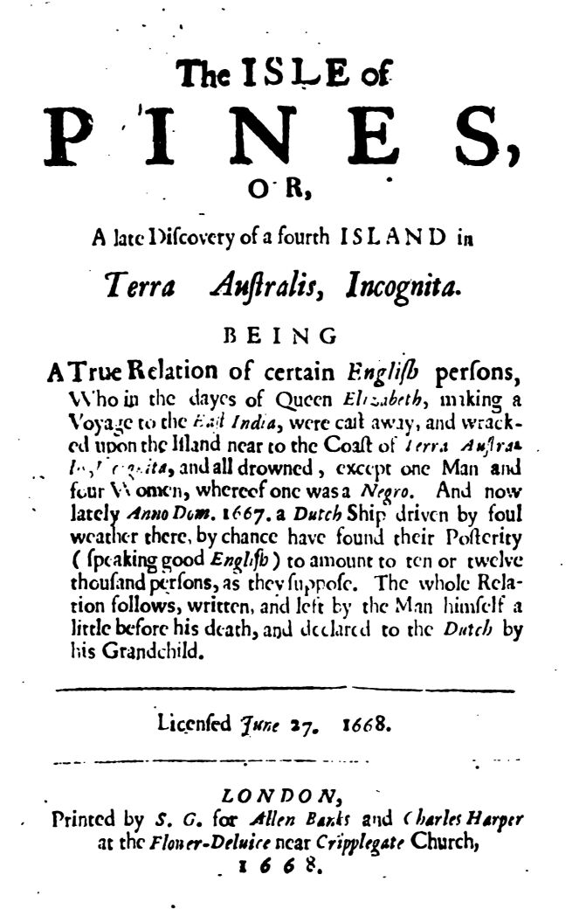

# パインズ島（ヘンリー・ネヴィル）

ヘンリー・ネヴィル著／全訳

- 原題：The Isle of Pines, or, A Late Discovery of a Fourth Island near Terra Australis, Incognita, by Henry Cornelius Van Sloetten
- 内容：エリザベス女王の時代に東インドへ向かう途中で難破し、名も知れぬ南の島に一人の男と四人の女だけが流れ着いた。百年ののち、オランダ船がその島で、裸で暮らし英語を話す一千人以上の子孫を見いだす――という体裁の、架空の航海記。男ジョージ・パインの手記と、それを持ち帰ったオランダ人船長の手紙とから成る
- 刊行：London, 1668年。まず6月にジョージ・パインの手記の部分が、7月に船長の手紙で前後をはさんだ完全版が出た
- 作業の基にした本文：Project Gutenberg 第21410番（W・C・フォード編、1920年）所収の「1668年に出た両部をあわせた版」
- 著作権：ネヴィルは1694年に死去。日本・米国・英国で保護期間が満了している
- 訳者：人工知能（Claude Opus 5.5）
- 訳の性格：扉、二通の手紙、船長の手紙とジョージ・パインの手記、追伸を全部訳した。訳者の調べたかぎりでは、日本語訳は出ていない

## この本について

　ヘンリー・ネヴィル（一六二〇〜一六九四）はイングランドの政治家・著述家で、ピューリタン革命期には共和派の論客として知られ、ハリントンの共和主義のサークルに加わった人物である。『パインズ島』は署名もなく、「オランダ人船長ヘンリー・コルネリウス・ファン・スルッテン」の報告として出版された。もっともらしい経度・緯度や、「ラ・ロシェルから届いた手紙」まで添えたこの小冊子は、たちまちオランダ語、フランス語、ドイツ語、イタリア語に訳され、本当の発見の報告として読まれもした。編者フォードはこれを「十七世紀に仕掛けられたいたずら（ホークス）」と呼んでいる。

　物語の骨組みは、のちの『ロビンソン・クルーソー』（一七一九年）を先取りする漂流記である。難破船から品物を引きあげ、火口箱で火をおこし、小屋を建てる。しかしクルーソーが孤独と労働の物語であるのに対し、こちらは怠惰と満ち足りた暮らしとの中で、一人の男が四人の女と子をなし、八十年ほどで千七百八十九人の民を生みだす物語である。労働も衣服も武器もいらない楽園は、そのまま一夫多妻と近親婚との楽園でもある。

　ところが三代目になると、聖書の朗読はなおざりにされ、淫行と暴力とがはびこり、死刑と身体刑とを定めた六か条の法が作られる。最後には、オランダ人たちの銃の力を借りて反乱が鎮められる。楽園からも統治は逃れられないという苦い結末は、王政復古の時代に共和派だったネヴィルの政治的な寓意として、また女たちの名をそのまま家名とした「イングリッシュ」「スパークス」「トレヴァー」「フィル」の四つの家は、王家と植民地とをめぐる当てこすりとして、さまざまに読まれてきた。白人の男と三人の白人女と一人の黒人女という設定と、その子孫フィル家だけが罪人として描かれることとは、十七世紀の人種観をあらわに映している。

　なお、本書には一夫多妻と性についての率直な記述が含まれている。原文どおりに訳した。

---

## 扉

**パインズ島**

**あるいは、未知の南方大陸（テラ・アウストラリス・インコグニタ）の近くに最近発見された第四の島**

**ヘンリー・コルネリウス・ファン・スルッテン著**

　ここに収めるは、エリザベス女王の御代に東インドへ航海し、未知の南方大陸の沿岸近くで難破して、一人の男と四人の女とのほかはみな溺れ死んだ、あるイングランド人たちの真実の物語である。そして最近、主の年一六六七年、東インドへ航海していたオランダの船が悪天候によってそこへ流され、思いがけず彼らの子孫を見いだした。その子孫は（りっぱな英語を話し）、（彼らの推測では）一万人から一万二千人にのぼるという。その物語の全体（男自身が死の少し前に書き残し、その孫によってオランダ人に渡されたもの）を、島の経度と緯度、その位置と幸福、そのほか注目すべき事柄とともに、ここに付す。

　一六六八年七月二十七日認可。

　ロンドン、フリート街、聖ダンスタン教会の向かい、「三匹の栗鼠（りす）」の隣の、アレン・バンクスとチャールズ・ハーパーとのために印刷、一六六八年。

## パインズ島について、コヴェント・ガーデンの信頼すべき人に宛てた二通の手紙

　ラ・ロシェルからの最新の郵便で、当市のある商人に宛てて次のように書いてきた。フランスの船が一隻到着し、その船長〔原文 Mailer〕と乗組員とが報告するところでは、フィニステレ岬から北西へ二、三百リーグほどのところで一つの島に行きあたり、上陸してみると、およそ二千人のイングランド人が、着物もなく、ただ腰のまわりに小さな覆いをつけているだけで暮らしていた。彼らが語ったところでは、彼らが初めてこの島に来たとき（それはエリザベス女王の御代のことであった）、彼らは男女あわせてわずか五人で、難儀のためか何かで岸に打ちあげられ、それ以来ずっとそこにとどまり、ほかのどんな民とも交わることなく、どんな船も彼らのところへ来たことがなかったという。この話はたいそう作り話めいているが、それでもその手紙は名の知れた商人のもとに、しかもフランスの確かな筋から届いたものであるから、私はお伝えするのがよいと思った。フィニステレ岬からのリーグの数にも、羅針盤の正確な方位にも、何かまちがいがあるのかもしれない。私はもっと詳しく問いあわせてみよう。当地のあるイングランド人たちは、それは、アイルランドの南西にあってあれほどたびたび探し求められてきたブラジル島かもしれないと推測している。もし本当なら、さらに詳しいことを聞くであろう。あなたの友にして兄弟、アブラハム・ケーク〔原文 Keek〕。

　アムステルダム、一六六八年七月六日。

　前便でほのめかしたあの島を発見した船は、ラ・ロシェルを出て、ゼーラントへ向かう途中だということです。当地の何人もの人々が、この件の真相を知るために、その船について問いあわせる手紙をあちらへ書きました。フランスから来た、上述の島の発見を知らせる手紙の写しをもらう約束をしていたのですが、まだ手もとに届きません。それが来たら、あるいはこの島についてさらに何か知らせがあったら、お知らせしましょう。

　あなたの友にして兄弟、

　A・ケック〔原文 Keck〕。

　〔原文、この二通目の手紙の中ほどに「アムステルダム、一六六八年六月二十九日」の日付が挟まっている〕

## ヘンリー・コルネリウス・ファン・スルッテンが、ロンドンの友人に宛てた手紙の中で、自分の東インドへの航海の真相を明らかにした、未知の南方大陸の沿岸近くで発見された〔パインズ島〕

　拝啓

　今月二日付のお手紙を受けとりました。その中であなたは、去年の夏に我々が悪天候の難儀によって流れ着いたパインズの地について、さらに詳しく話してほしいと望んでおられます。あなたが送ってくださった、それについての印刷された本も読みました。その原稿はこっそりと私の手から持ち去られたもので、そうでなければ、我々がどういういきさつでそこへ行ったか、どのようにもてなされたか、またその物語に欠けているそのほかの注目すべき事情について、もっと詳しい話をしていたはずなのです。それゆえあなたのお望みを満たすため、簡潔に、しかしすっかり〔原文 sully〕、それについての詳しい話を、物語そのものの真正な写しとともにお伝えしましょう。私は学者というよりは船乗りですので、ぶっきらぼうな言いまわしはお許しください。

　一六六七年四月二十六日、我々は東インドをめざしてアムステルダムから出帆した。我々の船は、我々の出てきた土地の名をとってアムステルダム号といい、積載量は三百五十トンであった。順風を得て、続く五月二十七日にはカナリア諸島に属するテネリフェの高い峰を見た。我々はパルマ島に寄ろうとして二度試みたが、風が逆であったので、ヴェルデ岬諸島（インスラ・カピティス・ウィリディス）のほうへ進路をとり、その聖ヤコブ島で新鮮な水と、山羊と鶏とをいくらか積みこんだ。その島にはそれらがたくさんいるのである。

　六月十四日、我々はマダガスカル、すなわち聖ローレンス島を見た。周囲四千マイルの島で、南の回帰線の下に位置している。我々はそこへ進路をとり、住民とナイフ、ビーズ、ガラス玉などを取引して、そのかわりに丁子（クローブ）と銀とを得た。そこを出ると、我々は激しい嵐に出会い、二週間のあいだ風が逆に吹きつづけたため、ほとんどプリンシペ島のあたりまで押し戻された。そのあいだに我々の仲間の多くが病気になり、何人かは死んだ。しかしその終わりに、神のおぼしめしで風はふたたび我々に味方し、我々は十日のあいだ陽気に航路をたどった。そのとき突然、まるで四方の風がそろって我々の破滅をたくらんだかのような、たいへん激しい嵐に出会った。我々の中でいちばん豪胆な者さえおじけづき、あの無慈悲な水という元素にいまにも飲みこまれるものと覚悟した。この嵐は十六日のあいだ続いた。もっとも初めのような激しさではなかったが。そのあいだずっと空はひどく暗く、海はひどく荒れていたので、我々は自分たちがどこにいるのかわからなかった。ついに突然風がやみ、空気は澄み、雲はすっかり散って、ごく晴れやかな空が続いた。我々は全能の神に心から感謝した。あの嵐の猛威をまぬがれようとは思ってもみなかったのだから。

　ついに我々の一人が大檣（メインマスト）に登って火を見つけた。近くに何かの陸地がある明らかなしるしである。まもなく我々ははっきりとその陸地を見つけ、さらに近くへと進路をとると、何人もの人々が岸のあたりをばらばらに走りまわり、まるで見ているものに驚き感嘆しているようすであった。陸のすぐ近くまで来ると、我々は大艇に十人を乗りこませた。彼らは岸に近づき、オランダ語で「これは何という島か（ワット・アイラント・イス・ディット）」と尋ねた。それに対して彼らは英語で「あなたがたが何と言っているのかわからない」と答えた。我々の仲間の一人で、英語をたいへんよく解するイェレミアス・ハンツェンという者が彼らの言葉を聞いて、彼らの言葉で話しかけた。そうして結局、我々はたいへん親切に上陸するよう招かれ、大勢の者が我々のまわりに群がって、我々の着ている服に感嘆した。我々のほうでも、こんな見知らぬ場所で、英語を話すことのできる者がこれほど大勢いながら、しかも裸で歩いているのを見て感嘆したのであった。

　我々のうち四人が大艇で船の仲間のところへ戻ったが、自分たちが見聞きしたことが本当だと信じさせるのにひどく苦労した。しかし我々が船を港へ入れると、裸の島民たちがどんなふうに我々のところへ群がってきたか、あなたがご覧になったら十字を切ったことでしょう。彼らは我々の船に驚き、それがまるで全世界における自然の最大の奇跡であるかのようであった。

　我々は彼らにたいへん丁重にもてなされた。彼らはその土地の産する食べ物を我々にふるまってくれたが、それはじっさい軽んじてよいものではなかった。我々は獣と鳥との肉を食べた。彼らはそれをきれいに調理していたが、その材料に事欠くため、たいして凝った料理ではなかった。パンのかわりに、我々はりんごほどの大きさのある大きな木の実の中身、すなわち核を食べた。それはたいへん体によく健やかで〔原文 found〕、口にはとてもおいしく感じられた。

　元気を取り戻すと、彼らは我々を、上陸した場所から二マイルほど離れた、彼らの君主すなわち首長の宮殿へと招いた。それは我々の国のふつうの村の家くらいの大きさで、粗く切りっぱなしの材木で支えられ、枝でたいへん巧みに葺かれていたので、どんなひどいにわか雨も防げるほどであった。その側面は、そこのかぐわしい野がたいへんさまざまに生みだすいろいろな種類〔原文 forts〕の花で飾られていた。君主自身（その名はウィリアム・パインといい、この島に最初に上陸したジョージ・パインの孫であった）が宮殿の戸口に出てきて、たいへん丁重に我々に挨拶した。彼には王者の威厳というものは何もなかったが、あなたがたイングランドの国民（とりわけその郷紳たち）が大いに備えているような、丁重で高貴で優雅な気性をもっていたのである。

　彼が我々に挨拶をし終えるかどうかというときに、その奥方すなわち妻も、二人の侍女をしたがえて、家すなわち宮殿から出てきた。彼女はこの上なく美しい女で、頭にはいわば花の冠をのせていたが、それはさまざまな色が混じりあっていて、彼女にたいへんよく似合っていた。彼女の陰部は古い衣服の切れはしで隠されていた。それは（思うに）最初にここへ来た人々の着物の名残であった。しかも花で飾られているので、そのぼろでさえ美しく見えた。じっさい、この島の女性はみな慎みを大いに重んじていて、草と花とを編みあわせ、若いニレの皮（そこにはニレがたくさん生えている）で丈夫にしたものを、自然が隠しておきたいと思う部分を覆うのに足りるだけ、つなぎあわせるのである。

　我々は彼に贈り物として、彼らが大いに必要としているだろうと思ったナイフをいくらかと、木を伐るための斧すなわち手斧とを持っていった。手斧はたいそう喜ばれた。最初に岸に打ちあげられた古い斧が、彼らがもったただ一つの斧であったが、それはいまではすっかり刃がつぶれ鈍くなって、まったく切れなかったのである。ほかにもいくつかの品を我々は彼に与え、彼はそれをたいへん感謝して受けとり、我々を彼の家すなわち宮殿の中へと招き入れて、ともに座らせた。そこで我々は、前に味わったものと何ら変わらない、その土地の食べ物をさらにいくらか食べて、ふたたび元気を取り戻した。ここでは君主も農民も同じものを食べており、その飲み物にも何の違いもない。それはただ新鮮な甘い水であり、川がそれをたいへん豊かに与えてくれるのである。

　しばらく間をおいてから、我々の仲間（英語を話せる者）が我々の頼みで、彼らの起源について、また、我々の見るかぎり、彼らをそこへ運んでくる手段である船や舟を一つももたず、しかもそのうえ、その手段にいちばん欠かせない船や航海というものをまったく知らず、それにまるでなじみがないのに、こんな遠い国の言葉を話す民がどうしてそこに住むようになったのかについて、何か知りたいと彼に願った。我々のこの願いに、丁重な君主は次のように答えた。

　「友人がたよ（あなたがたの行いがそうであることを示しているし、我々の行いによってもあなたがたはそれに劣らぬものを見いだすであろう）、知ってほしい。我々はこの島の住民となってからさほど長くはない。私の祖父がこの岸に足を踏みいれた最初の者であった。祖父が我々に言い聞かせたところでは、その生まれ故郷はイングランドという場所で、我々のこの土地からはるかに遠く離れていた。祖父は、船と呼ばれるもの――それについてはあなたがたもきっと聞いたことがあるだろう――に乗って、水の上をその場所からやって来た。ほかにも何人もの者が一緒にいたが、（祖父の言うところでは）ここへ来るつもりではなく、インドと呼ばれる場所へ行くつもりであった。ところが嵐が祖父とその仲間とをこの岸に運び、岩の間に落ちて船はこなごなに裂けてしまった。一行はみな水の中で死に、ただ祖父と四人の女とだけが、その船の割れたかけらにすがって、神の助けによって陸に上がったのである。

　そのあと祖父の生涯のあいだに何があったかは」と彼は言った。「祖父自身の手で書かれたその物語によってお見せしよう。祖父はそれを長男である私の父に渡し、それをとくに大切にするよう命じ、いつか時が何かの人々をここへ連れてくるであろう、その人々にこれを伝えてほしい、そうすれば我々がここに最初に住みついたことの真実がすっかり失われることはないであろう、と請けあったのである。父はこの命令に忠実に従った。しかし誰も来なかったので、父は死ぬときに同じ命令とともにそれを私に渡した。そしてあなたがたは（我々自身のほかに）この島に足を踏みいれた最初の人々であるから、私は祖父と父との命令に従って、喜んでそれをあなたがたに伝えよう」。

　それから彼は、我々の思うに彼の寝室であるらしい一種の奥の部屋へ入って、きれいな英語〔原文 Englishy〕で書かれた二枚の紙を持ってきた（それは、あなたがロンドンで印刷させたのと同じ物語である）。そしてそれを我々にたいへんはっきりと読んで聞かせ、我々は大いに喜び感嘆して耳を傾けた。彼はその写しを我々に気前よく申し出てくれ、我々はのちにそれを取って持ち帰った。その写しが以下に続くものである。

## ジョージ・パインの手記

　ある種のポルトガル人たちによって、アフリカの南をまわって東インドへ行く海路が最近発見され、それはそれまでのものよりはるかに安全で利益が多かった。そこで、ある種のイングランドの商人たちは、東方の産物から生じる大きな利益に励まされて、交易の便のためにそこに商館を置こうとした。そしてその目的のために、主の年一五六九年、エリザベス治世十一年あるいは十二年に、女王の勅許を得て、かの地へ向けて四隻の船を仕立てた。私の主人は彼らのために取引し交渉するための代理商として送られ、そこに住みつくことになったので、家族全員を連れていった。すなわち、その妻と、十二歳ほどの息子一人と、十四歳ほどの娘一人と、二人の女中と、一人の黒人の女奴隷と、そして主人の下で帳簿係として行く私自身とである。この一行とともに、翌年の四月三日の月曜日に（向こうに着いたときの家財道具はすべてそろえて）、我々は積載量四百五十トンほどのインディア・マーチャント号という良い船に乗りこんだ。順風を得て、我々は五月十四日にカナリア諸島を見、まもなくヴェルデ岬諸島を見た。そこで航海に必要なものといくらかの新鮮な食糧とを積みこみ、南微東に進路をとって、八月一日ごろにセント・ヘレナ島の見えるところまで来た。そこで新鮮な水をいくらか積みこみ、それから喜望峰へと向かった。神の祝福により、そこまでは、いくらか病人が出て仲間のうち何人かが死んだものの（我々の家族からは一人も死ななかった）、ずっと穏やかな天気にしか出会わなかった。ところが神のおぼしめしで、船乗りたちの言うところでは世界で最も大きな島の一つである聖ローレンス島がもう少しで見えるというころ、我々は大嵐に襲われて散り散りになった。嵐はたいへんな激しさで何日も続いたので、我々は助かる望みをすっかり失い、自分たちの知っている海域の外に出てしまい、夜には浅瀬に乗りあげるのか岩に乗りあげるのかもわからず、少しの明かりもなくて、何よりも恐れながら、いつも昼を待ち望み、それから陸を待ち望んだ。しかし陸は、我々のためにはあまりに早くやってきた。十月一日ごろ（恐ろしさのために、時がどれだけ過ぎたかを確かには覚えていなかったのであるが）、我々は夜明けごろに陸を見つけた（しかしそれが何の陸かはわからなかった）。陸は高く岩だらけに見え、海はなおひどく荒れ狂っていたので、助かる望みはないように思え、いまにも死ぬものと覚悟した。陸に近づくにつれ、船の中にいても助からず、船はいまにも打ち砕かれるだろうと見てとって、船長と私の主人とそのほか何人かは、それで命が助かるものと思って大艇に乗りこんだ。そしてすぐそのあとで、水夫たちはみな、泳いで命を助けようと思って船べりから身を投げた。私と、主人の娘と、二人の女中と、黒人の女とだけが船に残された。我々は泳げなかったからである。しかし我々を残していった者たちも、我々と一緒にとどまっていればよかったのである。我々は彼らが、あるいはその大部分が死ぬのを見たのだから。我々自身もいまにもそのあとを追う覚悟でいたが、神はいわば奇跡によって我々の命を助けてくださった。もっともそれはさらなる悲しみのためであったが。我々が岩にさしかかると、我々の船は二度三度岩にぶつかって（もう壊れて水の中にすっかり沈んでいたが）、我々はやっとの思いで船首の斜檣（バウスプリット）にしがみついた。それは折れて、波によって小さな入江へと運ばれた。そこには小さな川が流れこんでおり、まわりを岩に囲まれていて風から守られていたので、我々は（ほとんど溺れかけていたが）上陸することができた。黒人の女のほかに全部で四人であった。岩の上にあがると、我々はその惨めな難破のありさまを見て、たいへん恐ろしく思った。私はポケットに小さな火口箱と、いつでも必要なときに火を打ち出せる火打ち金と火打ち石とをもっていた。それがいま大いに役に立った。ぴったりと閉まっていたので、火口が乾いたまま保たれていたのである。これと、寄せ集めた古い朽ち木の助けとで、我々は火をおこして体を乾かした。それがすむと、私は女たちの一行を残して、助かった船の仲間が誰かいないかと探しに行った。しかし、大声で呼び、できるかぎりの音をたてても、誰の消息も聞けなかった。また生き物の足跡も見つからなかった（いくらかの小鳥やそのほかの鳥のほかは）。ついに夕方近くになったので、私は一行のもとへ戻った。彼女たちは私がいないのでひどく心配していた。この途方に暮れた有様では、私がいまや彼女たちのすべての頼りだったのである。我々は初めは、その土地の野蛮な人々が我々を見つけだすのではないかと恐れた。もっとも、そのような者の足跡は一つも、小道一つさえ見なかったのであるが。まわりの森は茨や野いばらでいっぱいであった。我々はまた野獣を恐れたが、そのようなものも一つも見ず、そのしるしもなかった。しかし何よりも、そして我々がいちばん恐れる理由があったのは、食べ物がなくて飢え死にすることであった。しかし神は、あとでわかるとおり、我々のために別の備えをしてくださっていた。こうしてから、我々は割れた板や厚板、いくらかの帆や索具を岸に引きあげて雨露をしのぐのに時を費やした。私は二、三本の柱を立て、二、三本の綱や索を木から木へと張りわたし、その上に帆布を何枚かかぶせ、手もとに薪を集め、乾かしておいた水夫の外套を三、四着用意して、その夜はみな一緒に寝た（黒人の女はほかの者より目ざといので、見張りにした）。我々はその夜ぐっすり眠った。それまで三、四晩は眠っていなかったのだから（起こったことへの恐れがそれを妨げていたのである）。硬い寝床も、恐れも危険も、我々の眠りを妨げることはできなかった。それほど我々は寝不足で疲れきっていたのである。

　翌朝、眠ってすっかり元気を取り戻すと、風はやみ、天気はたいへん暖かかった。我々は干潮のときに岩を下って砂浜へ降りた。そこで我々は、積み荷の大部分が岸に打ちあげられているか、その近くに浮いているのを見つけた。私は一行の助けを借りて、その大部分を岸へ引きあげた。重すぎるものは壊し、樽や長持〔原文 Cherts〕の箍（たが）や縄をほどいて品物を取り出し、すべてをしまいこんだ。こうして我々は衣服にも、そのほか家事に必要などんな品にも事欠かず、我々の手に入りそうなどんな家よりもりっぱな家をしつらえることができた。しかし食糧はなかった（最後の海水がすべてを台なしにしていた）。ただビスケットの樽が一つだけ、ほかのものより軽かったので乾いていた。これがしばらくのあいだパンの役をした。また我々は陸で、白鳥ほどの大きさの、ひどく重く太った一種の鳥を見つけた。その重さのために飛ぶことができず、それを殺すのにほとんど苦労はなかったので、それが我々の当座の食べ物となった。我々は途中で食べるためにイングランドから雌鳥と雄鳥とを何羽か持ってきていたが、その何羽かが船が壊れたときにどうにかして陸にたどりつき、たいそう殖えたので、のちには我々の大きな助けとなった。我々はまた、小さな川のそばの菖蒲の中に、我々の国の鴨によく似た一種の鳥の卵をたくさん見つけた。それはたいへんよい食べ物であったので、生きていくのに何も事欠かなかった。

　その翌日、すなわち三日目、夜が明けるとすぐ、我々を妨げるものが何も見えなかったので、私は住むのに都合のよい場所を探した。天候から、また（もし我々を見つけるものがあれば）野獣に悩まされるほかのどんな危険からも身を守るために、小屋を建てようと思ったのである。そこで、海を見おろす高い丘から湧き出る大きな泉のすぐそば、森の脇で、海のほうへ見晴らしのきく場所に、斧とそのほかいくつかの道具の助けで（海の働きで我々の品物の大部分が打ちあげられていたので、必要なものはすべてそろっていた）、私は見つけられるかぎりまっすぐな柱を、私の目的に足りるだけ伐り倒した。一行の助けを借りて（必要が我々の主人であった）、私は地面に穴を掘り、柱を等しい間隔に立て、樽や長持や船室などの壊れた板をそれに釘で打ちつけ、戸口を海の側に設け、てっぺんを張って釘で打ちつけた帆布で覆った。こうして一週間のうちに、我々の品物と我々自身とをみな入れられるほどの大きな小屋を作りあげた。私はまた寝るためのハンモックをつり、（もし神のおぼしめしでどこかの船がこの方へ送られてきたら）故郷へ運んでもらえるようにと心づもりをしていた。しかしそれはついに起こらなかった。我々のいる場所は（私の考えでは）航路からひどく外れていたのである。

　我々はこうしてまる四か月暮らしたが、野蛮な人々も、我々自身のほかの仲間の誰も（彼らはみな溺れ死んだことが、いまや経験によってわかった）、見ることも聞くこともなかった。その場所は、のちにわかったところでは大きな島で、ほかのどの陸地からも離れていて見えず、どんな人々もまったく住んでいなかった。我々を悩ます有害な獣も一頭もいなかった。それどころか、その土地はとても気持ちがよく、いつも緑に覆われ、おいしい果物とさまざまな鳥とに満ち、いつも暖かく、イングランドの九月より寒くなることはけっしてなかった。それゆえこの場所は（腕のよい人々がほどこしうるような耕作がほどこされれば）楽園となるであろう。

　森は、大きなりんごほどの大きさの一種の木の実を恵んでくれた。その核はおいしく乾いているので、我々はそれをパンのかわりに用いた。前に述べたあの鳥、鴨のような一種の水鳥とその卵、それに山羊ほどの大きさでほとんど山羊のような獣がいた。それは一度に二頭の子を、年に二度産み、低地や森にはそれがたいへん多くいた。たいへんおとなしく人に慣れた生き物なので、我々はたやすく捕まえて殺すことができた。魚、とりわけ貝類も（それがいちばん手に入れやすかった）たくさんあったので、結局のところ食べ物については何ひとつ事欠かなかった。こうして、またそのような助けによって、我々は六か月のあいだ、何の妨げも欠乏もなく暮らしつづけた。

　怠惰と、何もかも満ち足りていることとが、私の中に女たちを楽しみたいという欲望を生んだ。女たちはいまやだんだん打ちとけてきていたので、私は二人の女中を説きふせて、私と寝ることを承知させた。私は初めはそれを人目を忍んでしたが、のちには、習慣が恥を取り去って（我々のほかには誰もいなかったので）、欲望の許すままにもっと公然とするようになった。のちには私の主人の娘も、我々のするとおりにすることに満足した。実のところ、彼女たちはみな、着物を着ていたときには美しい女たちであり、よく食べていたので姿もよかった。我々は食べ物に事欠かず、怠惰に暮らし、自分たちが思いのままにふるまえる自由の身であり、故郷へ帰る望みもまったくないと見てとったことが、我々をこのように大胆にしたのである。私の慰め手のうち最初に交わった一人（いちばん背が高く美しい女）がすぐに子を宿し、二人目は私の主人の娘で、もう一人もまもなく同じ状態になった。いまや残っているのは私の黒人の女だけであったが、彼女は我々のすることを見て、自分の分け前もほしがった。ある夜、私が眠っていると、私の黒人の女は（ほかの女たちの同意を得て）、暗いから私をだませるだろうと思って私のそばにぴったりと寄ってきた。しかし私は目を覚まして彼女に触れ、それが誰であるかを悟ったが、その違いを試してみたくもあったので、ほかの女の一人と同じように彼女とも思いをとげた〔原文 satissied〕。その夜、初めてであったにもかかわらず、彼女もまた子を宿した。こうして、我々がここに来た年のうちに、私の女たちはみな私の子を宿し、みな違う時期に産み月を迎えたので、互いに大いに助けあった。

　最初の女は私にりっぱな男の子を産んだ。私の主人の娘はいちばん若かったが、私に女の子を産んだ。もう一人の女中もそうであった。彼女はいくらか太っていたので、お産はいちばん重かった。黒人の女はまったく痛みもなく、私にきれいな白い女の子を産んだ。こうして私は男の子一人と女の子三人とを得た。女たちはすぐにまた元気になり、最初の二人は、あとの二人が産褥につく前にふたたび子を宿した。私の習いは、女たちの誰かが子を宿したら、ほかの女たちも同じようになるまでは、その女とは寝ないことであった。黒人の女とは、子を宿してからはまったく寝なかった。彼女はたいてい私が初めて寝たときに子を宿した。それは夜のことで、ほかの時ではなかった。私の気が進まなかったのである。もっとも彼女は私がそれまでに見た黒人の中でもいちばん美しい一人であり、その子供たちもほかの誰の子にも劣らず器量よしであったが。我々には子供たちに着せる着物がなかったので、乳を飲ませたら苔の上に寝かせ、それ以上は世話をしなかった。いなくなってもまた生まれてくることを知っていたからである。女たちは少なくとも年に一度はかならず子を産んだ。そして子供たちの誰ひとり（我々が彼らにあれほどつらい思いをさせたにもかかわらず）病気になったことはなかった。こうして、いまや着物のほかには何も事欠かず、それも体裁のため以外にはたいして必要でもなく、土地の暖かさと習慣とがその欠けたところを補ってくれたので、我々は自分たちの境遇にすっかり満足した〔原文 satissied〕。我々の家族は大きくなりはじめ、我々を害するものは何もなかったので、我々はしばしば木陰などの苔むした土手の上に寝ころんだ（ほかに何もすることがなかったので）。私は昼の暑いさなかに女たちと眠るための四阿（あずまや）をいくつも作り、そこで私と女たちとは時を過ごした。女たちは私のそばを離れたがることがけっしてなかったのである。

　そしていまや故郷に帰ることなどまったく考えず、互いに別れたり離れたり、この場所を去ったりはけっしてしないと、互いに心を決めて誓いあった。何人もの妻たちによって四十七人の子供、男の子と女の子とを得て、それもたいていは女の子であったが、子供たちはすくすくと育っていった。我々はみなたいへん肉づきがよかった。土地がたいへんよく我々に合っていたので、我々はどこも病んだことがなかった。私の黒人の女は十二人を産んで、最初に子を産まなくなったので、私はもう彼女にかかわらなかった。私の主人の娘（いちばん若く美しかったので、彼女によっていちばん多くの子を得た）がいちばん私を慕い、私もいちばん彼女を慕った。こうして我々は十六年暮らした。そのころ私の長男が、我々のすることを見て、自然のふつうの営みに心を向けているのに気づいたので、私は彼に連れあいを与えた。そしてほかのすべての子にも、育って一人前になるにつれ、つぎつぎにそうした。私の妻たちが子を産まなくなると、私の子供たちがすみやかに子を産みはじめたので、我々はたいへんな大勢になりそうであった。私の第一の妻は私に十三人の子を産み、第二の妻は七人、私の主人の娘は十五人、黒人の女は十二人、全部で四十七人であった。

　我々がそこで二十二年暮らしたのち、私の黒人の女が急に死んだ。しかし私には彼女がどこを病んでいたのかわからなかった。私の子供たちの大部分は大きくなっていたので、結婚させるそばから、互いにわずらわしくないように、川の向こうへ送って、それぞれ別々に住まわせた。そしていまや彼らはみな大きくなって出ていき、我々のやり方で結婚した（いちばん若い二、三人を除いて）。というのも（私自身年をとってきたので）若い者たちの浮かれ騒ぎのわずらわしさが好きではなかったのである。

　こうして私の齢五十、そこに来て四十年目まで生きたとき、私は彼ら全員に子供を連れてくるよう呼び集めた。この四人の女によって私から出た者は、私の子供、孫、曾孫、男女あわせて五百六十五人いた。私はある家族の男たちを取って別の家族の女たちと結婚させ、かつて我々が必要からしたように姉妹と結婚することは誰にも許さなかった。こうして神の摂理と恵みとをたたえて、私は彼らを解散させた。私はかつて子供たちの何人かに読むことを教えていた。聖書はまだ残っていたので、私はそれを毎月一度、総会で読むよう命じた。ついに妻の一人が六十八歳で死んだ。私はそのためにとくに定めておいた場所に彼女を葬った。それから一年のうちにもう一人が死んだ。こうして私には主人の娘のほかに誰も残っていなかった。我々はさらに十二年ともに暮らしたが、ついに彼女も死んだ。そこで私は彼女も、私自身が葬られるつもりの場所の隣に葬った。そして背の高い女中、すなわち私の第一の妻をもう一方の側の私の隣に、黒人の女をその外側の隣に、もう一人の女中を私の主人の娘の隣に葬った。私はもうたいへん年をとり、ほとんど八十歳になっていたので、いまや自分の行くべき場所のほかには何も心にかけることがなかった。私は小屋と残った家具とを、私の死後、長男に与えることにした。彼は私の愛する妻によって生まれた私の長女と結婚していた。私は彼をほかのすべての者の王にして統治者とした。私は彼らにヨーロッパの風習を教え、もしこののち誰かが来て彼らを見いだすことがあれば、同じ言葉を話す人々のやり方に従ってキリスト教を覚えておき、ほかのどんな宗教も受けいれないようにと命じた。

　そしていまや最後にもう一度、彼らの数を数えるために私のもとに来るよう呼び集め、そうしてみると、私の齢八十、そこに来て五十九年目のころに、総数は、あらゆる者をあわせて千七百八十九人であることがわかった。こうして神が彼らを殖やし、福音の真の光を彼らに授けてくださるよう祈りながら、私は最後に彼らを解散させた。もうたいへん年をとり、目も衰えていたので、長くは生きられないと思ったのである。私はこの物語（私自身の手で書いたもの）を、いま私と一緒に住んでいる長男に与え、それを保管しておき、もし見知らぬ人々がたまたまここへ来ることがあれば、それを見せ、望むなら写しをとらせるように命じた。我々の名が地上から失われることのないようにである。私は（私から出た）この民に「イングランドのパインズ（イングリッシュ・パインズ）」という名を与えた。私の名がジョージ・パインであり、私の主人の娘の名がサラ・イングリッシュだったからである。私のほかの二人の妻はメアリー・スパークスとエリザベス・トレヴァーであったので、それぞれの子孫〔原文 Defendants〕はイングリッシュ家、スパークス家、トレヴァー家と呼ばれ、また黒人の女の洗礼名がフィリッパで、彼女には姓がなかったので、フィル家と呼ばれる。そして全体の総称がイングランドのパインズである。神が彼らを天の露と地の肥えたところとをもって祝福されますように。アーメン。

## ファン・スルッテンの手紙（続き）

　この物語を読み、その写しを我々に渡してしまうと、彼はそれから話を続けた。

　「お聞きのとおり、祖父がこれを書いたとき、彼は八十歳であった。その腰からは千七百八十九人の子らが出ていた。祖父はそれを前に述べた四人の女によって得たのである。私の父は祖父の長男で、ヘンリーといい、妻メアリー・スパークスから生まれた。祖父は父をほかの者たちの上に立つ首長にして支配者に任じた。そして、彼らは父方の血を分けた兄弟なのだから（そのことには偽りの疑いのありようがない）、彼らに対して暴虐をふるわないよう命じ、彼らのあいだで正義と誠実とを行い、宗教を自分とともに死なせず、自分が教えた戒めを守り保つよう勧めたのち、祖父は静かにその魂を引きわたし、すべての子供たちの大いなる嘆きのうちに葬られた。

　父が支配するようになり、民がますます殖えると、父は彼らにさらに遠くまで行かせて土地を探らせた。彼らはその土地が彼らの望みにかなうものであることを見いだした。鳥と獣とに満ち、しかもそれは人間に害をなさないものばかりであった。まるでこの土地は（我々は摂理によって、身を守るための、あるいは他人を攻めるための武器もほかの得物もなしにここへ打ちあげられたのであるが）、同じ摂理によって、我々の命を守るためにそのような破壊の武器をまったく必要としないように、住まわされているかのようであった。

　しかし大勢の中では乱れが生じずにはいないもので、強い者は弱い者を虐げようとする。人間の堕落した本性をつなぎとめておけるほど強い宗教の絆はない。それと同じく、彼らのあいだにも悪事が起こりはじめ、彼らはまもなく祖父の定めたあのよい秩序から堕ちてしまった。それらの悪事のわき出た源は、私の思うに、初めは聖書の朗読を聞くのを怠ったことであった。それは祖父の定めに従って月に一度の総会で行われていたのであるが、いまや彼らの多くは土地の奥深くまでさまよい出ていたので、ほかのすべてのキリスト教の教えの手段とともに、そこに来ることをすっかり怠るようになった。それによって彼らの中から罪の感覚がすっかり失われ、彼らは淫行、近親相姦、姦通に陥った。こうして祖父が必要に迫られてしたことを、彼らは放縦からしたのである。いや、どんな慎みの境界の中にもとどまらず、兄と妹とが公然と寝た。彼らのみだらな抱擁に応じようとしない者は力ずくで犯され、いや、しばしば命さえ危険にさらされた。これらの非道を正すため、父は身近にいる仲間をみな集め、彼らの兄弟たちの邪悪さを告げた。彼らはみな一致して、その者たちは厳しく罰せられるべきだと同意した。そこで彼らは枝や石などの得物で武装して彼らに向かって進んだ。相手は彼らの来るのを知らされて、当然受けるべき罰を恐れ、ある者は森へ逃げ、ほかの者は我々の土地の中心を流れる大河を、罰をまぬがれるために溺れる危険をおかして渡った。しかし彼らのうちで最大の罪人が捕らえられた。その名〔原文 whole name〕はジョン・フィルといい、祖父と一緒にこの島に来た黒人の女の次男であった。

　彼は自分の犯したさまざまな強姦と暴虐との罪が証明されて、死罪と判決され、それに従って高い岩から海へ突き落とされ、水の中で死んだ。彼の刑が執行されると、ほかの者たちは過去のことを赦された。そのことが広く知らされると、彼らは隠れていた人里離れた〔原文 Defait〕暗い場所から戻ってきた。

　さて、悪臭を放つ糞の中にまかれた種が人の生命の維持〔原文 Indentation〕のためによい健やかな穀物を生むように、悪い風俗は人間社会の保持のためによい健やかな法を生む。まもなく父は、評議会の何人かの者の助言を得て、彼らの守るべき次の法を定め、公布した。

　一、神の名を冒涜し、あるいは不敬に語る者は、死刑に処する。

　二、反対の十分な理由を示さずに、聖書の朗読を聞くための月例の集会を欠席した者は、最初の怠りについては四日のあいだ一切の食べ物も飲み物も与えずにおき、もしふたたびそれに背けば、死刑に処する。

　三、乙女あるいは女を力ずくで犯した者は、焼き殺す。その者を焼く薪には、犯された当人が火をつける。

　四、姦通を犯した者は、最初の罪については、男は陰部を失い、女は右目をえぐり出される。そののちふたたび現場を押さえられれば、女は容赦なく死ぬ。

　五、手足を不具にし、あるいはその所有するものを奪うことによって隣人を害した者は、自らも手足を失うことによって同じ種類の罰を受ける。また隣人をだました者は、二倍の償いをし終えるまで、その隣人の召使となる。

　六、統治者を中傷し、あるいは悪しざまに言い、あるいは召喚されてもその前に出ることを拒んだ者は、笞（むち）で打たれる罰を受け、そののちほかの住民の社会から追放される。

　これらの法を公布すると、父は自分の下に、それが執行されるのを監督する四人の者を選んだ。その一人はサラ・イングリッシュの子孫であるイングリッシュ家から、もう一人は父自身の部族であるスパークス家から、三人目はトレヴァー家から、四人目はフィル家から選び、毎年定まった時に彼の前に出て、それらの法を遂行するにあたって何をしたかを報告するよう命じた。

　土地がこのように落ち着くと、父は九十四歳になるまで静かに平和に暮らし、死ぬと私がその地位を継いだ。私はまさにいまこの時まで、その地位に平和に静かにとどまっているのである」。

　彼が話を終えると、我々は教えてもらったことに心から感謝し、彼が望むことで彼を喜ばせることができ、我々の力の及ぶことならば何であれ、彼のためにけっして惜しまないと請けあった。そしてそれから辞去しようとした。しかし我々が立ち去る前に、彼は、翌日は彼らの宗教の行事を祝うための大集会すなわち月例の集まりがあるので、ぜひまた会いに来るようにと我々に約束させた。

　それに従って、翌日我々はふたたびそこへ行き、前と同じく丁重にもてなされた。まもなく、我々が驚くほどの大勢の民がそこに集まってきた。そして最初に、いくつもの結婚式が挙げられた。そのやり方は次のとおりであった。花婿と花嫁とが、それぞれの両親とともに、彼らの司祭すなわち聖書の朗読者である者の前に出る。あるいは両親のどちらかが死んでいれば、それにいちばん近い親族が出る。結婚する当人たちの同意とともに、その者たちの同意がなければ、司祭は彼らを結びあわせない。しかしそれらの点について満足すると〔原文 satissied〕、短い祈り〔原文 Oraizons〕と手を結びあわせることとののち、司祭は彼らが夫婦であることを宣言する。そして互いに愛しあって暮らし、隣人に対しては穏やかに暮らすよう勧めて、いくつかの祈りで結び、彼らを去らせる。

　結婚式が終わると、民はみな御言葉の朗読を聞くためにそれぞれの席についた。新たに結婚した者たちは、その日は司祭のすぐ近くにいる栄誉を与えられた。司祭は三、四章を読んだのち、その中のいちばん難しい箇所を説き明かしにかかった。そのあいだじゅう民はたいへん熱心に聞いていた。この行事は二、三時間続き、それが終わると、司祭はいくつかの祈りで結んだ。しかしその日の残りはずっと、民によってたいへん厳格に守られ、ほかの日に時を過ごすのに用いるあらゆる種類の遊びや娯楽を慎んだ。彼らは食べ物のほかには何も必要とせず、その食べ物もほとんど手もとに用意されているほど豊かにあるのだから。

　彼らの宗教の行事が終わると、我々はふたたび船に戻った。そして翌日、鳥撃ち銃を二、三挺持ち、仲間の半分を船の見張りに残して、残りの我々はさらに土地を探るためにもっと奥地へ行くことに決めた。最初の朝に通った道すがら、我々はこの住民たちのたくさんの小さな小屋すなわち掘っ立て小屋を見た。それは木の下に作られ、日光と雨とを防ぐために枝や草などで組みたてられていた。我々が進んでいくと、彼らは小屋から出てきて我々の服装にたいへん驚き、まるで恐れているかのように我々から離れて立っていた。しかし英語を話す我々の仲間が彼らの言葉で呼びかけ、やさしい言葉をかけると、彼らは近寄ってきて、何人かは我々と一緒に行こうと気前よく申し出た。我々は喜んでそれを受けいれた。しかし何マイルか進んだところで、我々の仲間の一人が、山羊のような獣が自分をじっと見ているのを見つけて、銃を撃ち、その腹に二発の弾を撃ちこんだので、獣は地面に倒れて死んだ。このかわいそうな、裸で武器をもたない人々は、銃の音を聞き、獣が血の中でのたうちまわっているのを見ると、ひと言も言わずに一目散に逃げ出し、できるかぎりの速さで走って戻っていった。彼らに何の害も及ばないと請けあう我々の仲間の説得も、まったく何の効き目もなかったので、我々は彼らと一緒に行くことなしに進まざるをえなかった。我々の行く道すがらずっと、歌う鳥たちの楽しい調べが聞こえ、大地には樹木と草と、術の助けなしに自然の生み出すままに育つ花々とがたいへん豊かであった。我々は多くのさまざまな種類の獣を見たが、それらはほかの国々の獣ほど荒々しくなかった。それが、ほかのものを襲わなくても十分に腹を満たせるからなのか、それとも以前に人の姿を見たことも、人殺しの銃の音を聞いたこともなかったからなのかは、ほかの人々の判断にまかせよう。野生の果実をつける木々もいくらか見かけ、そのうちいくつかを味わってみたが〔原文 tailed〕、体に悪くもなく口にまずくもなかった。そして疑いなく、もしここで自然にそれに加えて術の恵みがあったなら、それは我々のヨーロッパの多くの国々に、まさらないまでも匹敵するであろう。谷はいたるところで流れる小川がまじりあい、疑いなくその土地には、どんなに強欲な者の望みをも満たすに足るほどの、豊かな鉱物の鉱脈があるであろう。

　これまで人が住んだことのないこのような肥沃な土地で、それにもかかわらず、このような種類の島の大部分にはびこっている藪や茨などのがらくた〔原文 fluff〕に妨げられることなく、これほど自由に障害なく通っていけるのは、我々にはたいへん不思議であった。草の長さ（それもまた花々とたいへんよく混じりあっていたが）だけが、我々の見いだした唯一の妨げであった。

　六日のあいだ続けて我々はこうして旅をした。帰り道で星の導きの恵みにあずかれるかどうかわからなかったので、帰りやすいように、進みながら道にいくつも目印をつけた。それを帰りの道中で我々は用いたのである。ついに我々は島の向こう側の広大な大洋に出た。そしてその沿岸を伝ってみて、島は卵形で、ただところどころにいくつかの岬が突き出ているだけであると考えた。島に属するよい港は少ないと私は考える。たいていの場所では岩のために近づけないのである。その長さはおよそ二百マイル、幅は百マイル、周囲は全部でおよそ五百マイルであろう。

　島はおよそ経度七十六度、緯度二十度にあり、第三の気候帯の下に位置していて、最も長い日はおよそ十三時間四十五分である。天候は、すべての南の国々と同じように、我々のヨーロッパよりもはるかに暑い。しかし昼に太陽に焼かれたものを、夜がまた冷たい真珠のような露で生き返らせる。空気がたいへん健康によいことは、いまの住民の長寿によってわかる。そこでは、十分に成熟した年齢になるまで死ぬ者はわずかであり、多くの者がきわめて高齢にまで達するのである。

　さて彼らの寿命の長さについて話したついでに、ここで彼らの葬儀について少し話しても不都合ではあるまいと思う。彼らはそれを次のように行っていた。

　ある者が死ぬと、彼らはその亡骸を一面に花で刺し飾り、それから埋葬のために定められた場所へ運んでいく。そこに亡骸を下ろし（司祭が生命のはかなさについて敬虔な勧めを与えたのち）、それから彼らは石を取り（そのために石の山がそこに用意されている）、いちばん近い親族が最初の石を亡骸の上に置きはじめ、そのあとでほかの者たちが続く。どんな獣も亡骸に近づけないように、体を石で深く覆ってしまうまで、彼らはけっしてやめない。そしてこれを彼らは最初にせざるをえなかったのである。墓を掘るための鋤もシャベルもなかったのだから。彼らのこの欠乏を見てとって、我々はつるはし一本とシャベル二本とを彼らに贈った。

　ここで彼らの子供の洗礼のやり方を付け加えてもよいのであるが、それはあなたがたイングランドのやり方とほとんど違わず、最初にジョージ・パインが彼らに教え、それ以来彼らが続けているものであるから、それについて話すのは控えることにしよう。

　土地の探検から戻ったのち、風が我々の目的に合わず、また我々の仲間もそれを望んだので、我々は切る道具をみな陸に揚げて、木を伐り倒しにかかった。そしてそれで、ほどなく（人手が多ければ仕事は軽い）、この土地の領主ウィリアム・パインズのために宮殿を建てた。それは、あなたがたイングランドの郷紳の家にははるかに劣るものであったが、それよりよいものを見たことのない彼らには、たいへん領主らしい住まいに見えた。我々のこの行いは、言葉に言いあらわせないほど彼に喜ばれ、彼はこのような大きな恩恵に対して我々を感謝攻めにし、それにはけっして報いることができないだろうと言った。

　そしていまや、機会がありしだい島を去るつもりであること、また我々が彼の先祖の出てきたイングランドという国の近い隣人であることを彼に知らせると、彼はその知らせを聞いて、我々が彼のもとを去ることにたいへん不満なようすであった。もし我々の都合がよければ、いつまでも彼のもとにとどまってほしいと望んだのである。しかし思いどおりにならないと見ると、彼は翌日の食事に我々を招いた。我々はそうすると約束した。その時までに彼は我々のために（その身分に応じて）たいへん豪勢な用意をし、いまや彼は、召使の数においても料理の多さにおいても、それまでに見たどんなときよりも王者らしいかしずかれ方をしていた。我々はそれをたいへん旺盛に食べた。しかし彼には我々に飲ませる飲み物として水しかなかったので、我々は船からブランデーを一箱取ってきて、その一部を彼に飲むよう差し出した。しかし彼はそれを味わうと、どうしてももう二度とそれに手をつけようとはしなかった。（彼の言うところでは）どんな酒よりも自分の国の水のほうがよいというのである。

　食事がすむと、我々は野原に招かれて、彼らの土地の踊りを見た。彼らはそれを体をたいへん身軽に動かして踊った。彼らには声の音楽のほかに何もなかったが（そのあいだじゅう何人もの者が歌っていた）、それでもたいへんきれいに軽やかに踊り、見ている者すべてを十分に満足させた。

　翌日、我々は君主ウィリアム・パインズを我々の船に招き、彼をもてなすために、我々にできるかぎりのことは何ひとつ欠けることがなかった。彼には一ダースほどの召使がかしずいていた。彼は我々の船の索具にたいへん感嘆したが、我々が大砲を一、二発撃つと、火薬の奇妙な効果を見て驚きあきれた。彼は食事をたいへん控えめにし、彼も彼の供の者の誰も、水のほかには何ひとつ飲もうとはしなかった。我々はそこで、何かしら彼らのためになると思ういくつもの品を、割くことのできるだけ彼に贈った。彼はそれをみなたいへん感謝して受けとり、我々がふたたびそこへ来るときにはいつでも、真実の愛と好意とを示すと我々に請けあった。

　そしていまや、風は南微東から穏やかな微風となって順調に吹いていたので、我々は翌日いとまを告げるつもりでいた。しかし我々が帆を揚げ、錨を巻きあげていると、突然岸からの騒ぎで警報が発せられた。君主W・パインズが、彼らのあいだで起こった反乱について我々の助けを乞うているのであった。その原因は次のとおりであった。

　ヘンリー・フィルは、フィル家の部族すなわち家族の首長で、ジョージ・パインズが黒人の女によって得た子孫であった。この男がトレヴァー家の主だった者の一人の妻を犯した。その行いが知れわたると、トレヴァー家の者たちは罪人を裁きにかけるためにみな集まった。しかし彼は、自分の罪が命を失うほどに重いことを知っていたので、不法に犯したことを力ずくで守ろうと戦った。そのため島全体が大騒ぎになった。両者はあまりに大きな力をもつ党派であったので、互いにやりあうことは国全体の破滅をおびやかした。

　統治者ウィリアム・パインズはこの件に割って入ったが、自分の権威がこのような乱れを鎮めるにはあまりに弱いことを知った。統治の垣根がいったん壊されると、最も卑しい者が最も大きな支配をふるうのである。そこで彼は我々の助けを望み、我々はすぐにそれを承知した。そして我々のうち十二人が武装して上陸した。戦いというよりは不意打ちに行くようなものであった。裸の者が武器に立ち向かって何ができようか。彼に案内されて敵の軍勢のところへ行くと、我々はまず談判に入り、力よりもむしろ穏やかな手段で彼らを従わせようとした。しかしそれが功を奏さなかったので、我々はやむなく暴力を用いた。このヘンリー・フィルは不屈の決意の持ち主で、仲間を棍棒と石とで武装させ、我々の中に石の雨を降らせたので、我々は初めは後退した。それに勢いづいて、彼らはたいへんな勢いで我々を追ってきた。しかし我々が銃を三、四発撃つと、彼らは仲間の何人かが傷つくのを見、銃の発する恐ろしい音を聞いて、来たときよりもいっそう速く逃げ去った。我々に加わっていたトレヴァー家の一団は激しく彼らを追い、その首領を捕らえて、大いに凱歌をあげて統治者のもとへ戻った。統治者は彼を裁きの座につき〔原文 fitting〕、彼は死刑と判決されて、険しい岩から海へ突き落とされた。それが、火あぶりを除いて、彼らが誰かを死刑に処する唯一のやり方なのである。

　そしていまやついに我々は統治者におごそかにいとまを告げ、そこを出発した。そこには全部で三週間と二日いた。我々は、彼らがそこでレヴァルと呼ぶ獣の肉をたくさん持っていった。それは牛肉とも豚肉とも違う味がしたが、たいへん口においしく、きわめて滋養に富んでいた。また我々は、彼らがマルデと呼ぶ鳥を何羽も生きたまま持っていった。若鶏ほどの大きさで、味も変わらない。それはたいへん速く飛ぶが、それでいて危険をまったく恐れないので、捕まえるまでじっと立っている。また統治者から卵をおよそ二ブッシェル届けてもらった。それは私の推測ではマルデの卵で、たいへん濃厚な味がし、体を強くするものであった。

　六月八日、我々は東インドの一部であるカンバヤを見た。しかしそこはタタールの大汗の支配下にある。ここで我々の船が水漏れを起こしたので、我々はやむなく岸〔原文 Chore〕に寄り、商品のいくらかに大きな損害を受けた。我々は十八時間続けてポンプを動かさなければならなかった。もしそれがうまくいかなかったら、我々は避けようもなく死んでいたであろう。ここで我々は五日とどまって船を修理し、品物のいくらかを乾かし、それから帆を揚げて、さらに四日でカリカットに着いた。

　このカリカットは、インドのすべての交易の主要な市場の町にして集散地であり、たいへん人口が多く、あらゆる国の商人たちが出入りしている。ここで我々は品物の大部分を降ろし、ほかの品物を積みこんだ。そのためにまる一か月そこにとどまったが、そのあいだ、暇なときには町のありさまを見てまわりに出かけた。町は大きく人が多く、海岸に沿って三マイルにわたって続いていた。ここには彼らがブラフマンと呼ぶ人々がたいへん大勢いる。彼らの祭司すなわち教師で、彼らはそれをたいへん敬っている。ここでは王がこれらのブラフマンの何人かに、自分の婚礼の床の初夜の務めを与えるのが習いである。そのために、王の息子ではなく、王の姉妹の息子が王国を継ぐ。そのほうが真の王家の血筋であることがより確かにわかるからである。そして王のこれらの姉妹は、自分の処女を捧げる相手としてどんな紳士でも好きな者を選ぶ。そしてもし一定の期間のうちに子を宿さなければ、彼女たちはこのブラフマンの種馬たちに頼る。彼らはけっしてその務めを果たしそこなわないのである。

　人々はまずまず礼儀正しく利口であり、男も女も、その供まわりと衣装とで威厳をまねている。それを彼らは油と香水とでかぐわしくし、それぞれの位と身分とにふさわしい宝石やそのほかの飾りで身を飾っている。

　彼らのあいだには多くの奇妙な習慣があり、それをたいへん厳格に守っている。第一に、妻が二人の子を産んだのちは、もう妻を知らない（交わらない）こと。第二に、五年いっしょに暮らしても妻によって子をもうけられなければ、妻と交わらず、そのかわりにほかの女たちを取ること。第三に、敵の首を手にさげて帰らないかぎり、どんな武功に対してもけっして褒美を与えないこと。しかし最も奇妙で、じっさい最も野蛮なのは、友の誰かが病気になると、病気で衰えさせるよりはむしろ殺すほうを選ぶことである。

　このように、そこでは医者の仕事はほとんどないことがおわかりでしょう。病気になることが、殺されることの次の段階〔原文 wan〕なのだから。あるいはおそらく人々は、医者に殺させるよりは自分たちで殺すほうがよいという考えなのかもしれない。

　用事をすませ、船をふたたび整えて、我々はカリカットを去って海に出、インドに属するいくつもの島々に沿って航海した。カンボジャで私は旧友のデイヴィッド・プライア〔原文 Prire〕氏に会った。彼は私に会ってたいへん喜んだ。私は彼に、パインズ島の発見のことを、あなたにお話ししたのと同じように話した。彼はそのとき熱病から回復したばかりであった。その土地の空気が彼に合わなかったのである。ここで我々はアロエをたくさん、またそのほかいくつかの商品を積みこみ、帰国のために船に食糧を積んだ。

　四日航海すると〔原文 failing〕、我々はリスボンから来たポルトガルの船二隻に出会った。その一隻は嵐でトップマストを失い、一部をもう一隻に曳かれていかなければならなかった。我々は十一日のあいだ悪天候にあわなかったが、それから突然の嵐が我々の索具に大きな損害を与え、水夫の一人を船首楼からさらっていった。十一月六日は我々にとって命とりの日になるところであった。我々の船は二度岩にぶつかり、夜にはある少年が砲室にうっかり蝋燭を置きっぱなしにした不注意から、火事になりそうになった。翌日、我々はアルジェの海賊に追われたが、帆の速さによって振りきった。十二月一日、我々はふたたびマダガスカルに来て、新しい食糧と水とを補給するために入港した。

　ここに滞在していたあいだに、たいへん大きな地震が起こり、多くの家を倒した。人々はもともとひどく不親切で裏切りやすく、どんな民とも取引に応じさせるのが難しい。そしていまやこの災難が彼らにふりかかると、彼らはそのような災難をみなキリスト教徒のせいにして、キリスト教徒に対してひどく怒り狂い、何人かのポルトガル人に襲いかかって傷を負わせた。我々は彼らの悪意ある行いを見て、できるかぎり急いでふたたび海に出、セント・ヘレナ島へ航海した。

　ここで我々はクリスマスの祝日をずっと過ごした。それはスペイン王のもとにあるそこの総督によって盛大に祝われた。ここで我々は、足りなかった必需品をすべてそろえた。しかし出発しようとすると、我々の古い知りあいのペトルス・ラマジナ氏が、プリンシペ島すなわち王子の島から小舟でやってきて、二日のあいだ我々の出発を遅らせた。私自身にも我々の事務長にも、彼と急ぎの用件があったのである。彼は、私がこの四月にあなたに手紙で書いたあの件にかかわっていた。じっさい、我々は彼の我々への親切を認めないわけにはいかない。ご存じのように、彼はけっしてそれを惜しまないのである。一月一日、我々はふたたび帆を揚げ、順調で幸先のよい風を得て、カナリア諸島に寄ったが、もう故国を見たくてたまらなかったのでとどまらなかった。しかし一週間のあいだ風はひどく逆であった。ついに穏やかな微風に恵まれ、それが我々を陽気に運んでくれた。もっとも我々は突然ふたたび沈みこんだ。大檣にいた水夫が五隻の船を見つけたのである。それは我々みなをひどく恐れさせた。我々は豪勢な荷を積んでおり、防備はあまり十分でなかったのだから。しかし彼らが我々のほうへ向かってくると、それはゼーラントの船で、我々の味方であることがわかった。我々にかかわる、それほど記すに値しないほかの多くのことを経て、我々はついに一六六八年五月二十六日、無事に故郷に着いた。

　このようにして、拝啓、私はあなたに我々の航海の簡潔な、しかし真実の物語をお伝えしました。これについての誤った写しが広まるのを防ぐために、いっそう進んでそうしたのです。私にこの物語を書かせたパインズ島そのものについては、それはたいへん不思議なことなので、ある人々には――たとえものを知った人々であっても――とても信じてもらえないだろうと思います。とりわけ、我々の前の時代がこれほど発見に満ちていたのに、この場所がこれほど長いあいだ眠ったままであったということを考えれば。また私の知っている、自分の見るもの以外は何も信じないような無信仰者たちは、「旅人は大手を振って嘘をついてよい」という諺を我々にあてはめるでしょう。しかし拝啓、あなたにお書きするにあたっては、信じていただけることを疑いません。あなたは、偽りを言いふらすことをひどく嫌う私の気質をご存じなのですから。この私の物語を、W・W氏とP・L氏とに伝え、私からよろしくとお伝えくださるようお願いします。私の古い知りあいのJ・P氏とJ・B氏とのことも忘れずに。いまはこれ以上申しません。ただあなたとあなたの奥方とに心からの敬意を表して、

　友情をこめて、あなたの

　ヘンリー・コルネリウス・ファン〔原文 Fan〕・スルッテン。

　一六六八年七月二十二日。

## 追伸

　パインズ島について、一つのことをもう少しですっかり忘れるところでした。我々の船には、ダーモット・コネリーという名のアイルランド人がいました。彼はかつてイングランドにいたことがあり、そこでバグパイプを吹くことを覚えて、それを海へ持ってきていました。しかし彼はひどくイングランド人らしさを失っていて、あなたがたの言葉をすっかり忘れていましたが、それでもバグパイプを吹く術は保っていて、それをたいへん楽しんでいました。ある日パインズ島に上陸していたとき、彼はそれを吹きました。そのとき、あの裸の人々がそれにどれほど感嘆したかをご覧になったら、あなたも驚き入ったことでしょう。それに触ったりなでたりするのを許されても、それが生き物でないと彼らに納得させるまでには長い時間がかかりました。それでいてこの人々はたいへん物わかりがよく、イングランド国民の才知と雅びとの大部分を保っているのです。もっとも、それを表現するあの恵まれた手段はもっていないのですが。この点で、我々は彼らを幸運だとみなしてよいでしょう。わずかしかもたないことによって、彼らはすべてのものを享受しているのです。持っているもので満足し、我々のヨーロッパの国々が豊かに備えている悪への誘惑を欠いているのですから。これ以上詳しくは述べません。疑いなく、時がこの島をもっとよく世に知らしめるでしょう。私がそれについて言いうることのすべては、それは自然の豊かさに富み、人の生命の維持に役立つものは何ひとつ欠けていない場所であり、もしほかの我々のヨーロッパの国々のように農業と園芸とによって耕されれば、疑いなく、いま称賛に値するとされている多くの国々に、まさらないまでも匹敵するであろう、ということです。

　**終わり**
