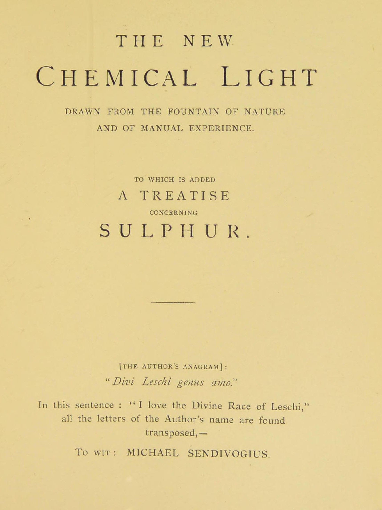

# センディヴォギウス『化学の新しい光』

ミカエル・センディヴォギウス／全訳

- 原題：Novum Lumen Chymicum（ラテン語。1604年プラハ刊、著者名はアナグラム「Divi Leschi genus amo」で伏せられた）、および Tractatus de Sulphure（1616年）。1678年の『ヘルメス博物館』〔Musaeum Hermeticum〕増補版に収められ、A・E・ウェイトが The New Chemical Light として1893年の英訳第二巻に収めた
- 内容：
  - 第一部は、序文と「アルノルドゥス・デ・ウィラノウァの遺言」に続く十二の論文。自然とその弟子の資格、種子、金属の第一の物質、金属と石の地中での生成、第二の物質と腐敗、金属の種子の引き出し方、「太陽の息子」の生成、実践、石の効能を説き、『結び』で「我々の空気」「我々の露の水」「賢者たちの硝石」を語る
  - 「賢者たちの謎への序文」で著者は自らを「コスモポリタ（世界市民）」と名のり、続く「たとえ話」では、南の島でネプトゥヌスとサトゥルヌスが太陽の木の実と「手を濡らさない水」の秘密を夢の中で語る
  - 「メルクリウスと錬金術師と自然との対話」は、ありふれた水銀を賢者たちのメルクリウスと思いこんで糞まで使って責めさいなむ錬金術師を、メルクリウスと自然がからかい叱る喜劇である
  - 第二部「硫黄について」は、土・水・空気・火の四元素と、そこから生まれる塩・硫黄・メルクリウスの三原理を説き、牢獄に閉じこめられた硫黄をめぐるサトゥルヌスとの対話と夢で結ぶ
- 作業の基にした本文と扉：Internet Archive 所蔵の1893年英訳第二巻のスキャン（OCR の崩れた見出しと数字は画像と照合した）
- 著作権：原典は十七世紀初め、ウェイトは1942年に死去。日本・米国・英国で保護期間が満了している
- 訳者：人工知能（Claude Opus 5.5）
- 訳の性格：全文を訳した。訳者の調べたかぎりでは、日本語訳は出ていない

## この本について

　ミカエル・センディヴォギウス（ポーランド名ミハウ・センジヴォイ、一五六六〜一六三六年）は、プラハのルドルフ二世の宮廷にも出入りしたポーランドの錬金術師である。『化学の新しい光』は十七世紀を通じて最も広く読まれた錬金術書の一つで、版を重ね、各国語に訳された。本文中で著者が「コスモポリタ」を名のり、名を明かさないのは、スコットランドの錬金術師アレクサンダー・セトン（「コスモポリタ」と呼ばれた）との関係をめぐる古くからの伝承とも結びついている。

　この書の特色は、錬金術を「自然をまねること」として徹底的に説く点にある。万物の種子は四元素によって地の中心へ投射され、自然の僕アルケウスによって送り返され、通る「場所」の純粋さに応じて金属にも石にも草にもなる。金はただ「最高の度合いまで消化された」ものにすぎず、ありふれた金は「死んでいる」。そして空気の中には「命の隠れた食物」があり、それを凝固させたものは全世界にまさる――この「空気の中の生命の糧」と「賢者たちの硝石」の説は、のちに酸素の発見の先駆けとして科学史家に注目されることもある。

　後半の二つの対話は、錬金術書には珍しい喜劇である。賢者たちの「我々のメルクリウス」をありふれた水銀と取り違え、豚の糞で責め立てる錬金術師と、からかい、嘆き、ついに母なる自然に助けを求めるメルクリウスのやりとりは、本サイトで訳したほかの錬金術書が真顔で戒めてきた「字義どおりに読む者」の愚かさを、笑いで描いている。

　英訳の明らかな言い違い（四元素の争いの箇所の「火と空気」など）には〔　〕で注記した。

---

## 化学の新しい光――自然の泉と手の経験とから汲み出したもの。硫黄についての論文を付す

〔著者のアナグラム〕

「Divi Leschi genus amo（われ神なるレフの族を愛す）」

この文の中に、著者の名のすべての文字が並べ替えられて見いだされる。すなわち、ミカエル・センディヴォギウス。

### 序文

**大いなる化学の術のすべてのまことの探求者たち、すなわちヘルメスの子らの上に、著者は神の祝福と救いとを祈る。**

　心ない詐欺師たちによって世に出回っている、真理のひとかけらすら含まない、欺瞞に満ちた書物や偽造された錬金術の「処方」がいかに多いか、そしてどれほど多くの人々がそれらによって迷わされてきたか、また今も日々迷わされているかを思いめぐらしたとき、私は、光の父から私に託されたタラントンを知の子らと継承者たちとに伝えること以上によいことはできない、と思い至った。また私は、古の時代と同じく我々の時代にも、この格別に恵み深い哲学の祝福が、恵まれた少数の人々に拒まれてはいないことを、後の世に示したいとも願う。ある理由から、私は自分の名を公にするのが得策とは思わない。おもに、私は自分のための称賛を求めておらず、ただ哲学を愛する人々を助けたいと願うだけだからである。名声を求める虚栄心は、実際にはそうでないものに見えることで満足する人々に任せておく。私がここに手短に書き記した事実と推論とは、いと高き方が恵み深くも私に授けたあの手の経験から書き写したものである。私の目的は、この最も高貴な術の基礎の部分にしっかりした土台を据えた人々が、より満ち足りた知識の豊かさへと進めるようにすること、そして詐欺とぺてんとをよろこぶあの堕落した「煙売り」たちに対して彼らが用心できるようにすることである。我々の学問は、俗衆が思うような夢でも、愚か者が考えるような怠け者のむなしい発明でもない。それは哲学そのものの真理であり、良心と愛との声が、もはやそれを隠すなと私に命じるのである。たしかに、徳と悪徳とが同じように見なされるこの邪悪な時代には、人々の恩知らずと不信仰とが、我々の術を公衆の目の前にあらわに現れさせない。それでもこの輝かしい真理は、今もなお、徳ある生活を送る学ある人にも学のない人にも把握しうるものであり、ヴェールを脱いだディアナを見た人々は、今もあらゆる国々に数多く生きている。だが多くの者が、無知からか、あるいは自分の知識を隠したいという望みからか、金の魂を抽き出して他の物質に授けることができると日々教え、他の人々にそう信じこませ、それによって大勢の人を、時間と労力と金銭との大きな浪費へと誘いこんでいる。ヘルメスの子らは確かに知るがよい。金の精髄を抽き出すことはただの愚かな妄想にすぎない。それに固執する者は、経験によって、身にしみてそれを教えられるであろう。経験こそ、その裁きの座から上訴することのできない唯一の裁き手である。他方、もし人が金属のほんの小さなかけらでも（利益があろうとなかろうと）、通常のあらゆる試験に耐える本物の金か銀に変成させることができるなら、その人は正当に、自然の門を開き、より深くより進んだ研究への道を切り開いたと言ってよい。この目的のために、私は自分の経験の成果をまとめた以下のページを知の子らにささげる。彼らが自然の働きを注意深く学ぶことによって、ヴェールを上げ、その最も奥の聖所に入ることができるように。我々の聖なる哲学のこの最後の目標へ、彼らは自然みずからが彼らのために示した王道を通って旅しなければならない。それゆえ心優しい読者に忠告させてほしい。私の意味は、私の言葉の外側の殻からではなく、むしろ自然の内なる霊から汲み取られるべきである。この警告がないがしろにされるなら、読者は時間と労力と金銭とをむなしく費やすであろう。この秘儀は賢い人々のためのものであって、愚か者のためのものではないことを考えよ。我々の哲学の内なる意味は、虚栄に満ちたほら吹きにも、うぬぼれた嘲り屋にも、邪悪な生活の傲慢さで良心の騒がしい声を押し殺す人々にも理解できないであろう。また、白化や赤化やそのほか同じくらい無意味な方法に自分の幸福を愚かにも賭けてきた無知な人々にも。我々の術の正しい理解は、神の賜物によるか、あるいは師が目の前で示してみせることによるのであり、ただ入念で謙虚な探求と、あらゆる善きものの与え主への祈りに満ちた依り頼みとによってのみ達せられる。さて、神はご自身を憎み、知識を軽んじる者を退ける。結びに、私は知の子らに切に願う。この書を、それが書かれたのと同じ精神において受け取ってほしい。そして「隠れたもの」が彼らに「あらわ」になり、秘密の知識の内なる門が開け放たれたとき、この秘儀をふさわしくない者に明かさないでほしい。また、苦しみ悩む隣人に対する自分の務めを忘れず、自分の力をこれ見よがしに誇示することを避けてほしい。そして何よりも、三にして一なる神に、唇をもって、心の沈黙のうちに、そして賜物の濫用を慎むことによって、真心からの感謝をささげてほしい。

**単純さは真理の印璽である。**

　序文を書き終えてみると、それに割り当てられた紙面を埋めきれないことがわかったので、私は出版者の求めに応じて、かつて私がラテン語の韻文に移した「アルノルドゥス・ウィラノウァヌスの遺言」をここに書き記した。私の韻文の文体が端正さと優雅さに欠けることは自覚している。だがこの欠点は、一部は、著者の意味に厳密に忠実に従う必要があったことによるものである。

### アルノルドゥス・デ・ウィラノウァの遺言

　アルノルドゥス・デ・ウィラノウァ、その一族の誉れであった人は、次の言葉でその遺言を示したと言われる。「それは土の中に生まれ、火の中でその力を得、そこで古の賢者たちのまことの石となる。それを十二時間の二倍のあいだ、澄んだ液で養え。その手足が広がり、すみやかに育ちはじめるまで。それから、それを乾いたほどよく温かい場所に、さらに十二時間置け。それが濃い湯気すなわち蒸気を出して自らを清め、内側が固く堅くなるまで。石のよりよい部分から搾り出される『処女の乳』は、それから、注意深く閉じた卵形のガラスの蒸留器の中に保たれ、生気を与える火によって日ごとに驚くべく変えられる。ついにはさまざまな色のすべてが、白い輝きの、固定した穏やかな光彩へと解けてゆく。それは火の穏やかな影響が続くうちに、まもなく輝かしい紫に変わる。それが汝の仕事の最後の完成の、外に現れた目に見えるしるしである」。

## 第一の論文

### 自然とは何か、またその弟子はどのような人であるべきかについて

　多くの賢者、学者、学識ある人々が、あらゆる時代に、そして（ヘルメスによれば）洪水の前の時代にさえ、哲学者の石の調製について多くのことを書いてきた。もし彼らの書物が自然の生きた働きを知らずに理解できるものなら、それらは我々のまわりの現実の世界を学ぶことに取って代わるよう作られている、とさえ言えるかもしれない。だが彼らは決して自然の単純な道から外れなかったけれども、我々に教えるべきことを持っている。より洗練されたこの時代の我々が、なお学ぶ必要のあることを。我々は、より進んだ学問の分野と見なされるものに身を入れ、自然の生成という「単純な」ものの研究を軽んじているからである。それゆえ我々は、目の前に大きく示されている物事よりも、ありえない事柄により注意を払う。我々は、自然と賢者たちの意味とを冷静に学ぶことよりも、精妙な思弁に秀でている。身近に見えるものをないがしろにし、新しく珍しい知らせを渇望することは、人間の本性の最も目立った特徴の一つである。その術において最高の卓越に達した職人は、それをないがしろにして何か別のことに身を入れるか、あるいは自分の知識を濫用する。知識を増やしたいという我々の渇望は、我々を、そこで完全な休息と満足とを見いだせると思いこむ何か最後の目標へと、絶えず駆り立てる。生涯の最後の日々にならなければ翅を与えられない蟻のように。我々の時代には、哲学の術はきわめて精妙な事柄になった。それは、鍛冶場で生業を営む卑しい職人の技に比べた、金細工師の技である。我々はかくも大きく前進したので、もし我々の学問の古の師たち、ヘルメスやゲベルやライムンドゥス・ルルスが死者の中からよみがえったなら、彼らは今の錬金術師たちに、賢者としてではなく、ただの卑しい学び手として扱われるであろう。むなしい蒸留、循環、焼成、そして今の研究が我々の術をかくも見事に富ませた――古の書物の意味は理解しないままに――ほかの数えきれない操作についての今の学識においては、彼らはずいぶん出来の悪い学者に見えるであろう。これらすべての点で、我々の学識は彼らのそれをはるかにしのいでいる。ただ一つ、彼らが持っていて、不幸にも我々に欠けているものがある。すなわち、実際に哲学者の石を調える、彼らの持っていたこつである。それなら、結局は彼らの単純な方法こそが最善だったのかもしれない。そしてこの想定のもとに、私はこの書において、汝に自然を理解することを教えたいと願う。我々のむなしい想像が、真の単純な道において我々を誤った方向へ導かないように。

　それゆえ自然は一つであり、真実であり、単純であり、自足しており、神によって創られ、ある普遍的な霊によって形を与えられている。その終わりと起源とは神である。その統一もまた神のうちに見いだされる。神が万物を造ったからである。自然は万物の唯一の源である。世界のいかなるものも、自然の外にも、自然に反してもない。自然は四つの「場所」に分けられ、そこで、現れるもの、また陰にあるもののすべてを生み出す。そして「場所」の性質の善し悪しに応じて、善いもの、あるいは悪いものを生み出す。ただ四つの性質だけがあり、それは万物のうちにありながら互いに一致しない。一つが常にほかのものを支配しようと努めているからである。自然は目に見えないが、目に見えるかたちで働く。自然は揮発する霊であり、物質の形のうちに自らを現し、その存在は神の意志のうちにある。我々にとって最も大切なのは、自然の「場所」を、そしてどれが最も調和し、最も密接に近しいかを知ることである。自然に従ってものを結び合わせ、植物を動物と、あるいは動物を金属と混同しようとしないためである。あらゆるものは、それに似たものに働きかけるようにされるべきである。そうすれば自然はその務めを果たすであろう。

　自然を学ぶ者は、自然そのもののようでなければならない。真実で、単純で、忍耐強く、一貫していて、などなど。何よりも、神を畏れ、隣人を愛さねばならない。常に自然から学び、その方法に導かれる用意がなければならず、自分の行おうとすることが自然の可能性にかなっているかどうかを、目に見え感覚でとらえられる実例によって確かめねばならない。もし自然がすでに成し遂げたものを再現しようとするなら、我々は自然に従わねばならない。だがもし自然の成果を改良しようとするなら、それが何において、また何によって改善されるのかを知らねばならない。たとえば、もし自然が金属に与えたよりも大きな卓越をそれに授けたいなら、我々は金属の物質を、その雄と雌の両方の種類において取らねばならない。さもなければ、我々のすべての努力はむなしいであろう。植物から金属を作り出すことは、犬やほかの動物から木を作ることと同じくらい不可能である。

## 第二の論文

### 我々の物質における自然の働きと、その種子とについて

　私はすでに、自然は一つであり、真実であり、一貫しており、木や草などのその産物によって知られると述べた。また自然を学ぶ者の資格についても述べた。今度は自然の働きについていくらか述べよう。自然がその存在を神の意志のうちに持つように、自然の意志、すなわち種子は元素のうちにある。自然は一つであり、さまざまなものを生み出すが、それはただ種子という仲立ちの道具を通じてのみである。自然は精液がそれに求めることなら何でも行い、いわば何かの職人の道具にすぎないからである。種子は、むしろ自然そのものよりも、術者にとって役に立つ。種子のない自然は、銀と金のない金細工師、種籾のない農夫のようなものだからである。種子のあるところならどこでも、それが善かろうと悪かろうと、自然はそれを通じて働く。自然が「種子」に働きかけるのは、神が人の自由意志に働きかけるのと同じである。自然が種子に従うのを見るのは、まことに大いなる驚異である。強いられてではなく、自らの意志によって。同じように神は、人が望むことをするのを許す。強いられてではなく、その善い、自由な恵みによって。それゆえ種子とは、あるもののエリクシル、すなわちその第五元素、あるいはその最も完全な消化と煎熟、あるいはまた硫黄の香油であり、それは金属における根本湿気と同じものである。この種子についてはもっと多くを語れるが、我々の術において重要な事実だけを述べることにしよう。四元素は、神の意志と自然の想像とによって種子を生み出す。そして雄の動物の種子がその中心すなわち貯蔵所を腎臓に持つように、四元素はその絶え間ない作用によって、種子を絶えず地の中心へと送りこむ。そこでそれは消化され、そこからふたたび生殖の運動となって出てゆく。さて、地の中心とは、何ものも静止していない、ある空虚な場所である。そしてこの中心の縁、すなわち周囲に、四元素はその性質を投射する。雄の種子が雌の子宮に放たれ、そこで必要なだけが保たれて残りはふたたび追い出されるように、我々の地の中心の磁力は、同類の種子の物質のうち必要なだけを自らに引き寄せ、生命の生殖に使えないものは、石やそのほかの屑のかたちで押し出す。これこそ、地上のあらゆるものの源泉である。このことを、たとえで示そう。テーブルの真ん中に水の入ったコップを置き、その縁のまわりに、塩や、さまざまな色の粉の小さな山を置いたとしよう。もし水をこぼせば、それは分かれた小川となってテーブル一面に流れ、塩に触れたところでは塩辛くなり、赤い粉を溶かしたところでは赤くなり、等々となる。水が「場所」を変えるのではなく、それぞれの場所が水を区別するのである。同じように、四元素の産物である種子は、地の中心からあらゆる方向へ投射され、さまざまな場所の性質に応じてさまざまなものを生み出す。こうして万物の種子は一つでありながら、きわめて多様なものを生み出すようにされる。ちょうど人の種子が、同じ種の雌の子宮に投射されれば人を生み出し、さまざまな雌の動物の子宮に投射されれば、怪物じみたさまざまな流産を生み出しうるように。自然の種子が中心にとどまっているかぎり、それは木でも金属でも、草でも石でも、分け隔てなく生み出すことができ、同じように、場所の純粋さに応じて、より純粋でないもの、あるいはより純粋なものを生み出す。だが元素はどのようにして精液すなわち種子を生み出すのか。四つの元素があり、二つは重く二つは軽く、二つは乾き二つは湿っているが、一つは最も乾き、一つは最も湿っている。そしてこれらが雄と雌とである。神の意志によって、これらの各々は、それ自身の領域において自分に似たものを生み出そうと絶えず努めている。さらにそれらは絶えず互いに働きかけ合い、すべての精妙な精髄が中心で結び合わされ、そこでよく混ぜられて、自然の僕であるアルケウスによってふたたび送り出される。このことは、これら十二の論文の『結び』の中でより詳しく述べられている。

## 第三の論文

### 金属のまことの第一の物質について

　金属の第一の物質は二重であり、一方は他方なしには金属を創ることができない。第一の主要な物質は、温かさと混じり合った空気の湿り気である。この物質を賢者たちはメルクリウスと呼び、哲学の海の中でそれは太陽と月の光線によって治められている。第二の物質は土の乾いた熱であり、それは硫黄と呼ばれる。だがこの物質は常に大いなる秘密とされてきたので、それをより詳しく、とりわけその重さを明らかにしよう。その重さを知らないことが仕事の全体を台なしにするからである。正しい物質でも、取る量がまちがっていれば、流産しか生み出せない。ある者は体全体を自分の物質、すなわち種子あるいは精液とし、ほかの者はその一部だけを取る。どちらもまちがった道にいる。たとえばもし誰かが、男の手と女の足とから人を創ろうと試みるなら、その人は失敗するであろう。あらゆる体の中には、種子の中心の原子、すなわち生命の点（その八千二百分の一）がある。一粒の小麦の中にさえ。体も穀粒も、そのすべてが種子なのではなく、あらゆる体は小さな種子の火花を持っていて、ほかの部分がそれを熱と冷えのあらゆる過剰から守っているのである。もし汝に耳と目があるなら、この事実を心に蓄え、穀粒全体を種子として用いようとする者たちに、またさまざまな金属をむなしく溶かし混ぜることによって高度に希薄にされた金属の物質を作り出そうと努める者たちに、用心せよ。最も純粋な金属でさえ、ある不純な要素を含んでおり、劣った金属ではその割合がもっと大きいからである。自然の点を見いだせば、汝は望むものをすべて得るであろう。だがそれを俗の金属の中に探してはならない。それはそこには見いだされない。それらすべて、とりわけありふれた金は、死んでいるからである。だが我々が汝に取れと勧める金属は、生きていて、生命の霊を持っている。火は、金属がまだ鉱石の中にあるあいだはその命であり、精錬の火はその死である。ところで、金属の第一の物質とは、温かい空気と混じり合ったある湿り気である。その見かけは、純粋なものにも不純なものにも付着する油っぽい水のそれである。けれども、ある場所ではほかの場所よりも豊かに見いだされる。土がある場所ではほかの場所よりも開いていて多孔質であり、より大きな磁力を持っているからである。それが現れるとき、それはある衣をまとっている。とりわけ、それがすがりつくものを何も持たない場所では。それは三つの原理から成っていることによって知られる。だが金属の物質としては、それはただ一つであり、結合の目に見えるしるしを何も持たない。ただ、その衣、あるいは影と呼んでよいもの、すなわち硫黄などのほかには。

## 第四の論文

### 金属はいかにして地の内部で生み出されるか

　金属は次のようにして生み出される。四元素がその力と効能とを地の中心へ投射したのち、それらは自然のアルケウスの手の中で、絶え間ない運動の熱によって、地の表面へ向かって蒸留され昇華される。土は多孔質であり、空気は土の孔を通る蒸留によって水へと解かれ、その水から万物が生み出されるからである。知れ、金属の種子は、そもそもの初めにおいては、ほかのあらゆるものの精液と同じもの、すなわち蒸気状の湿り気である。それゆえ、ただの蒸気にほかならない第一の物質へと金属を溶かそうと求めるのは愚かなことである。そうすることによって、哲学者たちは第一の物質ではなく、ただ第二の物質を把握したにすぎない。ベルナルドゥス・トレウィサヌスがよく論じているとおりである。いくぶんわかりにくいしかたではあるが。彼は教えの子らに向けて語ったからである。私としては、この理論を公然と説き明かす前に、すべての人々に警告しておきたい。柔らかく揮発性のかたちでいたる所にひとりでに存在するものを、固い金や銀の、かくも多くの循環や焼成や反復によって求めてはならない。それらは決してその元の物質へ戻ることはできないのだから。我々の読む錬金術の著者たちのまことの意味に従おう。そして、もし術が何か堅固で恒久的な効果を生み出そうとするなら、それは自然の足跡をたどり、その方法に導かれねばならないことを忘れないようにしよう。術は、自然が導くかぎり自然の導きに身をゆだね、なお自然の規則に従いながら自然を超えてゆかねばならない。さて私は、万物は液状の空気すなわち蒸気から生み出され、元素はそれを絶え間ない運動によって地の中心へと蒸留する、と言った。そしてアルケウスがそれを受け取るやいなや、その知恵がそれを孔を通して昇華させ、それぞれの場所へ分配し、それが置かれるさまざまな場所に応じてさまざまなものを生み出す、と。

ある人々は、それぞれの金属がそれ自身の種子を持っていると考える。だがこれは大きな誤りである。種子はただ一つしかないからである。土星（鉛）に現れる精液は、金、銀、銅などに見いだされるものと同じである。それらの違いは、場所によって、また自然がそれらに働きかけた時間によって生じる。銀の生成は金の生成よりも早く成し遂げられ、ほかの金属についても同様である。熱によって地の中心から昇華される蒸気は、冷たい場所か温かい場所のどちらかを通る。もしその場所が温かく純粋で、そこに硫黄のある脂が付着しているなら、蒸気（すなわち賢者たちのメルクリウス）はその脂と結びつき、それを自分とともに昇華させる。もしこの油質の蒸気が、さらに昇華してゆく途中で、先に昇ってきた蒸気によってすでに精妙にされ、浄められ、湿らされた土のある別の場所に達するなら、それはこの土の孔を満たし、それとともに金になる。だがもしこの油質の湿り気が不純で冷たい場所へ運ばれるなら、それは鉛になる。もし土が純粋で硫黄と混じっているなら、それは銅になる。場所が純粋であればあるほど、金属はより美しく完全になるからである。また我々は、蒸気が絶えず昇っていること、そして地の中心からその表面へ昇るあいだに、通り過ぎる場所を浄めることにも注意しなければならない。それゆえ、千年前には何もなかったところに、今は貴金属が見いだされる。この蒸気は、その絶え間ない前進によって、粗く不純なものを常に精妙にし、また絶えず純粋なものを自分とともに運び去るからである。これが自然の循環と反復である。あらゆる場所はますます浄められつつある。そしてそれらが純粋になればなるほど、その産物はより高貴になる。冬には、この油質の蒸気は霜によって凍らされる。春が戻るとそれは解き放たれ、それは空気の中の同類のメルクリウスを自分に引き寄せるマグネシアであり、太陽と月と星々の光線を通じて万物に命を与え、こうして草や花などを生み出す。自然は一瞬たりとも怠けていることがないからである。それゆえこれが、金属の生成についての唯一のまことの説明である。土は長い蒸留によって清められ、油質すなわち脂肪質の蒸気が近づくとき、金属が生み出される。この点について哲学者たちの書き物を誤って解釈する人々が何を想像しようとも、金属がそれ以外のしかたで生み出されることは決してない。

## 第五の論文

### あらゆる種類の石の生成について

　石の物質は、ほかのあらゆるものの物質と同じである。そしてその性質は、それが生じる場所の純粋さによって定まる。四元素がその蒸気を地の中心へ蒸留するとき、自然のアルケウスはそれを追い出し昇華させるが、そのしかたは、それが土の孔を通るあいだに、それらの場所のあらゆる不純物を表面へと運び上げ、そこでそれらが空気によって凝固する、というものである。純粋な空気が生み出すものはすべて粗い空気によって凝固させられ、両者の入りこみは相互的であって、そのため互いに結びつく。自然は自然をよろこぶからである。こうして岩や石がしだいに築かれ、生み出される。さて、土の孔が大きければ大きいほど、上へ運ばれる不純物の量は多くなる。それゆえ、表面に石や岩が大量に積み重なっている場所の下では、土は最も完全に浄められており、こうしてそれらの場所では金属の生成がよりたやすくなる。これが、金属が平野ではほとんど見いだされず、ほとんど常に岩の多い丘の内部で見いだされるという事実を説明する。平野はしばしば元素の水で湿っており、その水が昇ってくる蒸気を自分に引き寄せ、それとともに太陽の光線によって消化されて、陶工が用いる肥えた粘土になる。土が粗く、蒸気が油質も硫黄も含まない場所では、蒸気は牧草地に草や芝を生み出す。ダイヤモンド、ルビー、エメラルド、緑玉髄、オニキス、紅玉のような宝石は、すべてふつうの石と同じしかたで生み出される。自然の蒸気が、硫黄も、我々の述べた油質もなしに、それだけで昇華され、純粋な塩水のある場所（すなわち、我々の硫黄が存在しえない非常に冷たい場所。もし存在しうるなら、この効果は妨げられるであろう）に達するとき、ダイヤモンドが形づくられる。蒸気とともに昇る油質の硫黄は、温かさなしには動けず、少し冷たい場所に達するとたちまち凝固し、蒸気だけがそれなしに上への運動を続ける。宝石に色が授けられるのは、このようにしてである。油質の硫黄が絶え間ない運動によって凝固するとき、水の霊は通り過ぎながらそれを消化し、塩の水によってそれを浄める。それが赤か白の色を帯びるまで。この色は、かくもくり返される蒸留によって揮発性にされ、ついには浄める蒸気とともに上へ運ばれる。蒸気はその助けによって不完全な体に入り、こうしてそれらに色を行きわたらせることができる。色は半ば凝固した水と結ばれ、そのすべての孔を満たし、両者は絶対的に一つになる。霊を持たない水は熱によって凝固し、霊を持つ水は冷たさによって凝固するからである。だが、熱によって水を凝固させ、それに霊を結びつける方法を知る者は、金よりも、あるいはこの世のいかなるものよりも千倍も尊いものを見いだすに違いない。その人は霊を水から分けよ。それが腐敗し、穀粒が現れるように。それから滓を清め除き、霊を水に還元せよ。この結合は、親の幹にほとんど似ていない一本の枝を生み出すであろう。

## 第六の論文

### 第二の物質と腐敗とについて

　我々は万物の第一の物質について、そしてそれらが自然によって種子なしにいかにして生まれるか、すなわち自然が元素から物質を受け取り、そこから種子を生み出すのはいかにしてかを語った。今度はこの種子と、そこから展開されるものとを考えよう。種子を持つものはすべて、それによって増やされる。だが自然の助けなしにではない。種子とは凝固した空気、すなわち体の中に閉じこめられた蒸気状の液にほかならず、温かい蒸気によって溶かされないかぎり働くことができないからである。さて、四元素から生み出されるこの種子の本性は三重である。それは鉱物の種子か、植物の種子か、動物の種子かである。鉱物の種子は賢者たちにしか知られていない。植物の種子はありふれていて俗なもので、果実に見るとおりである。動物の種子は想像によって知られる。だが植物の種子は、自然が四元素から自然物を展開させる工程を最もはっきりと示している。冬は腐敗の原因である。冬は木々の中の生命の霊を凍らせる。そして湿り気を磁力によって引き寄せる太陽の熱がそれを解き放つと、それによってかき立てられた（木の）自然の熱が、水の精妙な蒸気を表面へと駆り立て、樹液を流れさせる。常に純粋なものを不純なものから分けながら。もっとも、不純なものがときに純粋なものに先立つこともあるが。純粋なものは凝固して花となり、不純なものは葉となり、粗く濃いものは固まって樹皮となる。木の樹皮は固定したまま残る。葉は、孔が熱か冷たさによってふさがれると落ちる。花は自然の熱の性質に応じて色を受け、果実すなわち種子を結ぶ。林檎を例にとろう。その中には精液があるが、木はそこから生じるのではない。だがこの精液の内側に種子すなわち穀粒があり、そこから木は、精液なしにさえ生まれる。増殖は精液によるのではなく、種子によるからである。こうして我々は、自然が我々の助けなしに、四元素から植物の種子をいかにして創るかを見る。

　だが鉱物についてはどうか。自然は鉱物の、すなわち金属の種子を地の内部で生み出す。これが、かくも多くの人々がその存在を信じようとしない理由である。それが目に見えないからである。そしてこのために、俗衆の不信はそれほど驚くにはあたらない。目の前にあらわにあるものさえほとんど理解しない彼らが、見ることのできないものについて何を知りえようか。けれども、彼らが信じようと信じまいと、事実は同じままである。そして、上にあるものは下にあるもののごとくであり、上で生まれるものは、下で、地の内部でさえ働いている同じ源から起源を得ている、ということは、まことに真実である。神が一方には種子を与え、他方にはそれを拒むほどの、いかなる特権を植物は金属の上に持っているというのか。金属もまた、木々と同じく神の御目のうちにあるのではないか。種子なしには何ものも育ちえないことは確かである。種子を持たないものは死んでいるからである。四元素は、金属の種子を生み出すか、あるいは種子なしに金属を生み出すかのどちらかでなければならない。後者の場合、金属は完全でありえない。種子なしには何ものも完成しないからである。金属が種子を欠いていると信じこめる者は、我々の術の秘儀を理解するにふさわしくない。それゆえ金属は、本当にそれ自身に固有の種子を含んでいる。そしてそれは次のようにして生み出される。（くり返し述べたしかたで）地の中心から昇る蒸気は、その本質のゆえにではなく、その流動性と、何にでもたやすく付着することのゆえにメルクリウスと呼ばれるが、それはその内なる熱のゆえに硫黄に同化され、凝固したのちには根本湿気となる。こうして金属はたしかに水銀から生み出される。だが、金属のこの第一の物質はありふれた水銀だと言う無知な人々は、体全体を、その中にある種子と混同している。ありふれた水銀もまた、ほかの金属と同じく金属の種子を含んでいるのだから。このことを人の体の類比で示そう。人の体の中には、人類という種がそれによって増やされる種子があることは確かである。その体（ありふれた水銀になぞらえてよい）は種子を含んでいるが、それは目に見えず、その量は体全体の大きさに比べてごくわずかである。生成の工程は体全体によってではなく、この種子の「凝固した水っぽい蒸気」によってなされる。だが、種子を得るために体を解剖したなら、いかなる生命の生成も起こりえないであろう。体を殺せば種子も殺されるからである。それと同じように、無知な錬金術師たちは、金属の種子を得るために、金であれ銀であれ鉛であれ、その体を溶かし、強水（アクア・フォルティス）で腐食させるとき、金属の体を殺し、その種子を殺していると言ってよい。あらゆる増殖は雄と雌の種子によってなされる。そしてその二つ（それだけでは不毛である）は、実を、すなわち新しい形を生み出すために結び合わされねばならない。それゆえ、何か善いものを生み出そうとする者は誰でも、体全体ではなく、精液すなわち種子を取らねばならない。

　それゆえ、生きた雄と生きた雌とを取り、それらを結び合わせよ。それらがその種類に従った実を生むための精液を投射するように。誰も、自分が第一の物質を作れるなどと思い上がってはならないからである。人の第一の物質は土であり、自分が人を創れると夢見るほど大胆な者は誰もいない。神のみがこの技を行うことができる。だがもし、すでに創られている第二の物質（すなわち種子）がふさわしい場所に置かれるなら、自然は同じ種の新しい形を生み出すであろう。術者はただ、精妙なものをそのより粗い元素から分け、それをふさわしい「器」に入れるだけである。残りは自然が行う。ものは始まったように終わる。一から二が生じ、二から一が生じる。父なる神から子なる神が生まれ、二者から聖霊なる神が発したように。このようにして世界は造られ、またこのようにして終わるであろう。この少数の点をよく考えよ。そうすれば汝は、第一に父を、それから父と子とを、最後に聖霊を見いだすであろう。汝は四つの元素、四つの光体、二つの天的なもの、二つの中心的なものを見いだすであろう。一言で言えば、この象徴のうちに現れるのと別様であるものは、世界のうちに何もなく、かつてもなく、これからも何もないであろう。その秘儀だけで一巻の書を満たせるほどである。それゆえ私は言う。一から一を作ることは神のみの属性である。汝は自然の生成によって、二つから一つのものを生み出さねばならない。それゆえ知れ、増殖させる精液は第二の物質であって、第一の物質ではない。ものの第一の物質は見られず、自然すなわち元素のうちに隠れているからである。第二の物質は、ときに知の子らによって見られる。

## 第七の論文

### 第二の物質の効能について

　だが汝がこの第二の物質をよりよく知るように、私はその効能を汝に述べよう。自然は三つの界、すなわち鉱物界、植物界、動物界に分かれる。鉱物界は、たとえ世界に植物も動物もなくても、それだけで存続しうることは明らかである。植物界も同じように、動物界と鉱物界とから独立している。この二つの界は独立のうちに創られた。ただ動物界だけが、その存続をほかの二つに依存しており、すべてのうちで最も高貴ですぐれている。そしてそれは三つのうちの最後のものなので、ほかの二つを治める。力は第二のものにおいて増やされるように、第三のものにおいて尽きるからである。植物界では、第一の物質は草あるいは木であり、それを汝は創ることができず、ただ自然のみによって生み出される。第二の物質は汝の目に見える種子であり、それによって草や木が増やされる。動物界では、第一の物質は獣あるいは人であり、それを汝は創ることができない。だが、それらが増やされるもとである種子、すなわち第二の物質を汝は知っている。鉱物界においてもまた、汝は金属を創ることはできない。もしそれができると誇るなら、自然は汝の思い上がりを笑うであろう。たとえ哲学者たちがほめそやすあの第一の物質、すなわち中心の塩を手にしたとしても、汝は金なしにはそれを増やすことができない。だが金属の植物的な種子は、ただ学の子らにのみ知られている。植物の場合、種子は外に見え、温かい空気によって消化される。動物では、種子は内にも外にも現れ、雄の腎臓の中で調えられる。水は鉱物の種子であり、その心臓と命とのまさに中心にある。そしてその「消化の腎臓」は火である。植物の種子の容れ物は土であり、動物の種子の容れ物は雌の子宮であり、空気は水――鉱物の種子――の容れ物である。種子の容れ物は体の凝固と同じであり、消化は溶解と同じであり、腐敗は破壊と同じである。種子に固有の特性は、同じ界に属するほかの物質と結合することである。それは精妙であり、実のところ、脂によって水へと凝固した空気だからである。それは、それが属する界の外にあるいかなるものとも自然には結びつかないことによって見分けられる。それは溶かされず、ただ凝固させられるだけである。溶解を必要とせず、ただ凝固を必要とするからである。それゆえ、精液を受け入れるために体の孔が開かれねばならない。その精液の中心に種子（それは空気である）がある。それはそのふさわしい子宮に入ると凝固し、そこに見いだす純粋な、あるいは混じった物質を凝固させる。体の中に種子が少しでもあるかぎり、体は生きている。それがすっかり使い尽くされると、体は死ぬ。そして種子を放出することはどんなものでも体を弱める。放蕩な人々や、実をあまりに豊かにつけすぎた木々の場合に見られるとおりである。それゆえ種子は目に見えないが、精液は見ることができ、それはいわば生ける魂であって、死んだものの中には見いだされない。それは二つのしかたで抽き出される。第一は穏やかなしかたであり、第二は激しいしかたである。種子なしには何も生み出されず、あらゆるものは種子によって存在するに至る。すべての知の子らは、種子を枯れた木に求めてもむなしく、それは緑の木にのみ見いだされることを忘れてはならない。

## 第八の論文

### 自然は我々の術を通じていかに種子のうちに働くか

　種子はそれだけでは、自然か術かによってそれ自身のふさわしい子宮に置かれなければ、何の実も生み出さない。種子はそれ自体としては創られたもののうちで最も輝かしいものであるが、子宮こそがその命である。子宮は、包む穀粒すなわち精液の腐敗を引き起こし、生命の原子の凝固をもたらし、それ自身の体の温かさによってその成長を養い刺激する。これらすべては、上に述べた三つの自然の界において、（月々、年々、季節ごとに）絶えず規則正しく演じられている。この工程は、植物界と鉱物界では人工的に速めることができるが、動物界ではできない。鉱物界においては、術は、自然には行えないことを行うことができる。地の内部においてではなく周囲において、鉱物の外側の孔をふさいでいる粗い空気を取り除くことによって。元素は、その種子を地の中心へ投射して、そこで消化させようと競い合う。中心は熱の運動によってそれを子宮へと送り出す。これらの子宮は数えきれないほどあり、場所の数と同じだけあって、常に一つの場所がほかの場所よりも純粋である。知れ、純粋な子宮は、それ自身の種の純粋な形を生み出すであろう。たとえば、動物のあいだに女、雌牛、雌馬、雌犬の子宮があるように、鉱物界には金属、石、塩がある。さて、塩こそがおもに考察を要する。その産地とともに、それがより重要であるか、より重要でないかに応じて。

## 第九の論文

### 金属の混合と、金属の種子を引き出すことについて

　我々はこれまで、自然について、術について、体と精液と種子とについて語ってきた。今度は実践的な探求に進もう。金属はいかに混ぜられるべきか、そしてそれらは互いにいかに関係し合っているか。女が男と同じ子宮の中で、同じ種子から生み出され、違いはただ消化の度合いと、血と塩との純粋さとにあるにすぎないように、銀も金と同じ種子から、同じ子宮の中で生み出される。だが銀の子宮は、天の月の時に応じて、金の子宮よりも多くの水を、いわば消化の少ない血を持っていた。だがもし金属の性の結合と、その種子を放ち受け取るしかたとを理解したいなら、惑星という天体を見よ。土星がほかのすべてより高くにあり、それに木星が続き、それから火星、太陽、金星、水星があり、最後の場所を月が占めているのが見えるであろう。惑星の力は降りるが昇らない。それゆえ経験が教えるとおり、火星（鉄）はたやすく金星（銅）に変えられるが、金星は、より低い天球を持つので、火星には変えられない。また木星（錫）はすみやかに水星（水銀）に変成させることができる。木星はより高い場所を持つからである。一方は天空の次の第二のものであり、他方は地の次の第二のものである。土星は最も高く、月は最も低い。太陽はすべてと結びつくが、その下位のものによって改善されることは決してない。土星と月とのあいだには大いなる対応があり、太陽がその中間にある。水星と木星、火星と金星のあいだにも同様の対応があり、これらはすべて太陽をその中心としている。たいていの操作者は、金を用いずに鉄を銅すなわち金星に変成させる方法を知っている。彼らはまた木星を水星に変える方法も知っている。ある者は土星から月（銀）を調えることができる。だがもし彼らがこれらの変化によって金を調えることができたなら、その秘密はまことに知る価値があるであろう。この理由で私はくり返す。金属の相互の対応と、その結合の可能性とを知ることは重要である。ほかのすべての金属を焼き尽くす力を持つ一つの金属がある。それはいわばそれらの水であり、ほとんどそれらの母であって、ただ金と銀の根本湿気によってのみ抵抗され、それによって改善される。この金属はカリュブス（鋼）と呼ばれる。もし金がそれと十一回結ばれ、その種子を放つなら、金は死に至るまで弱められる。だがカリュブス（鋼）は身ごもり、父よりもはるかに高貴な息子を産む。そしてその息子の種子が彼女の子宮に置かれると、それは子宮を浄め、すぐれた実を生むのに千倍もふさわしいものにする。これに似たもう一つのカリュブス（鋼）があり、それは自然によってそれ自体ひとつのものとして創られている。この鋼は、その驚くべき力によって、「太陽」の光線から、かくも多くの人々が探し求めてきたもの、我々の術の主要な原理であるものを引き出すことができる。

## 第十の論文

### 太陽の息子の超自然的な生成について

　我々は自然によって生み出され、神によって創られた事物について論じてきた。この学問の探求者たちが、自然の可能性と、その力の究極の限界とをよりたやすく理解できるように。

　私はいまから哲学者の石を調える方法について語ろう。石すなわちチンキとは、最高の度合いまで消化された金にほかならない。ありふれた金は種子のない植物に似ている。だがそのような植物が成熟すると、それは種子を生み出す。それと同じように、金が熟すと、それはその種子、すなわちチンキを生み出す。もし誰かが、なぜ金やほかの金属はふつう種子を生み出さないのかと問うなら、私は答える。十分な熱を持たない鉱石の粗さが、それが成熟するのを妨げるからである、と。ある場所では純粋な金が見いだされる。自然がそれを成熟させようと努めてきたが、空気の粗さのために熟すには至らなかったものである。これに似た例はオレンジの木である。それは北の緯度では十分な温かさがないので実を結ばないが、より温かい国々では最も美味な実を熟させる。そして人工の熱によって、より寒い国々でも同じ結果を生み出すことができる。同じことが金属の本性にも起こる。それゆえ、自然を助ける方法を知る賢く思慮深い術者によって、金に種子を生み出させることができる。もし術者が自然から独立して行動するなら、彼は誤るであろう。この学問においても、ほかのすべての学問においてと同じく、我々は自然を補うことしかできず、熱すなわち火の働きによるほかに自然を助けることもできないからである。さて、霊が現れていない凝固した金属の物質に自然が働きかけられるようにするには、体が溶かされ、その孔が開かれねばならない。ところで溶解には二種類ある。激しい溶解と自然な溶解とである。前者には、今の錬金術師の俗衆のあいだではやっている溶解の方法のすべてが含まれ、それらは冷たく役に立たない。自然な溶解は、体の孔が我々の水の中で穏やかに開かれ、消化された種子が放たれてその子宮に置かれうるときに起こる。我々の水は手を濡らさない水である。それは天の水であり、しかも雨水ではない。「体」とは金であり、それが種子を放つ。我々の銀（ありふれた銀ではない）こそが、金の種子を身ごもるものである。そこでそれは我々の絶え間ない火によって、七か月、あるいは十か月さえも消化される。我々の水が三つを焼き尽くし、一つを残すまで。そしてこれは二重の何かである。それからそれは土の乳、すなわち土の乳房の中で形づくられるものの脂によって養われ、まわりの物質の腐敗によって調えられ保たれる。このようにして、第二の生成のあの幼子が生まれる。さて、理論から実践へ進もう。

## 第十一の論文

### 我々の術による、我々の石すなわちチンキの実践的な調製について

　前の諸章での我々の論述は、実践の理解をたやすくするふさわしい例によって広げられてきた。その実践は、自然の手順に従って、次のように行われねばならない。我々の土を十一粒、同じ数の回分に分けて取り、我々の金を一粒、我々の銀を二粒取れ。ここで、ありふれた金と銀とは我々の目的には何の役にも立たないことを、よく心に留めておくべきである。それらは死んでいるからである。私が汝に取れと求めるのは、生きた金属である。それらを我々の火の熱にさらせ。するとそれらから乾いた液が出てくるであろう。土はまず水に溶かされ、それは賢者たちのメルクリウスと呼ばれる。そしてこの水は金と銀の体を溶かし、それらを焼き尽くし、ついには十分の一と一部とだけが残る。それが金属の根本湿気である。それから、我々の土から硝石の水を取れ。その中には生きた川と流れる波がある。この水を澄んだものにし、その上に根本湿気を注げ。全体を、腐敗と生成の火にさらせ。それは第一の操作の火と同じではない。熱を思慮深く調節せよ。孔雀の尾のような色が現れるまで。それから、色がはっきりした緑へと解けるまで、このよく調節された熱をかけ続けよ。倦むことなく、残りの色が現れるまで続けよ。底に褐色の灰が見え、水がほとんど赤くなっているのを認めたら、器を開けて、その中に羽根を浸すべきである。その羽根で鉄のひとかけらに塗り、もしそれが染まるなら、入りこんだ粗い空気と同じだけの量の、ある水（それについてはのちに述べる）を器に注ぎ、それからふたたび同じ火にかけて煮熟せよ。それがふたたび羽根を染めるまで。私の経験はこれより先には及ばない。私が述べた水とは、月の天球から来る世界の溶媒であり、太陽を焼成する力を持つほど注意深く精留されている。ここで私はすべてを汝の理解に向けて語りたいと願った。そしてもし汝が、ときに私の言葉よりも私の意味を汲み取ろうとするなら、私がすべてを、とりわけ第一と第二の仕事に関しては、明かしたことを見いだすであろう。

　残るは火についていくらか述べることである。第一の操作では、火は一つの度合いで絶え間なく続き、物質全体にむらのない温かさを行きわたらせるべきである。第二の操作では、物質を消化し固定する自然の火が必要である。見よ、私は汝らに真実を語る。もし汝が自然を理解しさえすれば、私は火の処方を明かしたのである。だが器についても、いくらか述べる必要がある。それは自然が示すようなものでなければならず、そのような器は二つで足りる。第一の操作では器は丸くあるべきであり、第二の操作ではいくぶん小さくあるべきである。またそれはガラス製で、フラスコか卵の形をしているべきである。だが何よりも知れ、自然の用いる火は一つであり、その違いは距離の違いによって定まる。自然の器もまた一つであるが、我々は物質の発展を速めるために二つを用いる。その素材は一つであるが、二つの物質から成る。もし何かを生み出したいなら、生み出されているものを見よ。もし絶えず目の前にあるものを理解できないなら、まだ見たことのないものを生み出そうと求めるとき、汝は難儀するであろう。神のみが創造することができることを忘れるな。だが神は賢者に、自然の務めに従って、隠され秘められたものをあらわにすることを許した。どうか雲の単純な水を考えてみよ。それが自らのうちに、固い石も、塩も、空気も、土も、火も、地上のあらゆるものを含んでいると誰が信じるであろうか。土については何と言おう。それは十分に単純に見えるが、水、火、塩、空気、そのほか多くのものを含んでいる。おお、驚くべき自然よ、汝は水によって大地の驚くべき実を生み出すすべを知り、空気によってそれらに命を与え養う。すべては、我々が自然の研究にもちこむ見る力にかかっている。たとえば、ふつうの目は太陽が熱いと見て取る。賢者の目は、太陽そのものは冷たく、熱を生み出すのはただその運動だけだと見る。その効果は宇宙のかくも大きな距離を隔てて感じられるからである。太陽の熱は我々の自然の火と同じである。太陽が惑星の中心であって、そこから熱をあらゆる方向へ下へと撒き散らすように、地の中心には地の太陽があり、それがその絶え間ない運動によって熱すなわち光線を地の表面へ向かって上へと駆り立てる。この内なる熱は元素の火よりもはるかに強力であるが、土の孔に行きわたってそれを冷ます水によって和らげられ冷やされている。さもなければ、万物はその激しさによって焼き尽くされるであろう。同じように、太陽の激しい光線は中間の大気の空気によって和らげられ静められている。それがなければ万物は焼き尽くされ、いかなる生成もありえないであろう。

　だが私はいまから、元素が互いにいかなるしかたで働きかけ合うかを説明しなければならない。さて、地の中心には中心の太陽があり、その熱は、その運動によって、あるいはその天空の運動によって、地全体にその表面まで行きわたっている。この熱は地の水を空気（すなわち蒸気）に変え、それは水よりもはるかに精妙なので、土の孔を通って激しく上へと駆り立てられる。だがそれがより冷たい大気に達すると、ふたたび水に凝縮される。そしてある場所では、我々は実際に、この水、すなわち凝縮した空気が、中心の火の力によって空中高くへ噴き上げられるのを見る。ちょうど穏やかな熱にさらされた水の釜が、蒸気と空気の穏やかな流れを上へ送り出し、火が燃え上がると湯気が濃くなって上への運動が激しくなるように。この「中心の太陽」の作用によって、元素は地上に分配され、それぞれが育つことのできる場所を見いだす。この空気の上昇する流れはいつも目につくわけではない。多くの場所では、それを感じ取れるようにするだけの水がないからである。空の釜は湯気を出さない。それゆえ私は言う。火すなわち熱は空気の運動の原因であり、万物の命である。そして土はそれらの乳母、すなわち容れ物である。もし我々の土と空気とが水によって冷やされなかったなら、土は干上がってしまうであろう。現に、土の孔が閉ざされているいくつかの場所ではそうなっているように。そして水の運動を妨げることで、土は二種類の太陽の熱のなすがままにされるであろう。このようにして、いつの日か世界の破滅がもたらされるであろう。さて我々の術においては、汝はこれらの自然の工程を忠実にまねるべきである。中心の熱があり、水の空気への変化があり、空気の上への駆り立てがあり、土の孔を通るその拡散があり、凝縮されてはいるが揮発性にされた水としてのその再出現がなければならない。それから汝は我々の老人に金と銀とを呑みこませ焼き尽くさせねばならない。彼自身が焼け死に、その灰が水の中に撒き散らされるまで。その水を、汝はそれから十分な時間のあいだ煮熟にかけねばならない。その結果が、らい病を癒す医薬であろう。だが熱を冷たさと、冷たさを熱と取り違えないよう気をつけよ。互いに似たものだけを混ぜ、反対の元素は熱によって分けよ。自然の導きに従わないなら、汝のすべての努力はむなしいであろう。私は神にかけて誓う。私は父が息子に語るべきように汝に語った。耳ある者は聞け、分別ある者は悟れ。

## 第十二の論文

### 石とその効能とについて

　我々は前の諸章で、自然物の生産、元素、第一と第二の物質、体と種子、またそれらの用途と効能について十分に語った。私はまた哲学の石についても書いた。そしていまから、経験が私に明らかにしたかぎりにおいて、その効能について語ろう。だが石の効能を述べる前に、我々の術をよりよく理解するために、すでに述べたことをもう一度まとめておこう。もし誰かが我々の術の実在を疑うなら、その人は古の賢者たちの書物を読むべきである。その誠実さを疑問に付した者はこれまで誰もおらず、この主題について語るその資格に異を唱えることはできない。もし汝が彼らを信じないなら、私は第一原理を否定する者と論争を始めるほど愚かではない。耳の聞こえない者、口のきけない者は語ることができない。神が万物にその種類に従って増え広がれと命じたとき、なぜ鉱物だけがその原初の祝福から除外されねばならないのか、私にはわからない。そしてもし鉱物が種子を持つなら、それは種の増殖という目的のために持っているのである。錬金術の術は、その本性において真実である。自然もまた真実である。だが真の術者はめったに見いだされない。自然は一つであり、我々の術も一つであるが、職人は多い。それゆえ自然は、神の意志によって、神のみが知る第一の物質（元素の産物）から事物を生み出す。自然は、賢者たちの知る第二の物質から事物を生み出し、それらを増やす。あらゆる元素は互いに依存し合っている。結び合わされると一致しないけれども。だがすべての女王は水である。それは万物の母だからであり、その上を火の霊が覆っている。火が水に働きかけ、それと争うとき、第一の物質が展開される。こうして、そもそもの初めから土から分けられていたあの粗い空気によって、土と結びつくのに十分なほど濃い蒸気が生じる。この工程は絶え間ない運動によって、休みなく続いている。運動は熱を生むからである。どんな物質でも、こすり続ければそれがわかる。運動は熱を生み、熱は水を動かす。水の運動は空気を生み出し、それはあらゆる生き物の命である。こうして万物は水から育つ。そのより精妙な蒸気からは軽く精妙なものが生み出され、その「油」からはより重いものが、その塩からは、ほかのものよりもはるかに美しく尊いものが生み出される。だが自然は、この蒸気と脂と塩との不純さによって完全なものを生み出すことをしばしば妨げられるので、経験は我々に、純粋なものを不純なものから分けることを教えた。それゆえ、もし汝が自然を改良し、より完全で練り上げられた主体を生み出したいなら、溶解によって体から異質なものをすべて清め去り、純粋なものを純粋なものに、よく消化されたものをよく消化されたものに、粗いものを粗いものに、物質の重さではなく自然の重さに従って結び合わせよ。中心の硝石は、ほかの点で純粋であれ不純であれ、必要以上の土を含むことは決してないことを知らねばならないからである。だが水の脂については事情が違う。それは決して純粋なかたちでは見いだされない。術は二重の熱の作用によってそれを清め、それからふたたびその元素を結び合わせる。

## 結び、すなわちこれら十二の論文の締めくくり

　親愛なる読者よ、私は、この術を学ぶ者の益のために、前の十二の論文を書いた。彼らが何かの実験に手をつける前に、自然の働きと、自然が世界にあるあらゆるものをいかなるしかたで生み出すかとを理解できるように。さもなければ、彼らは鍵なしに門を開けようとしたり、ふるいで水を汲もうとしたりしているかもしれない。我々の聖なる祝福された術に関しては、太陽が照らさない者は濃い闇の中を歩み、月の光を見ない者は夜の影に包まれているからである。自然はそれ自身の光を持っており、それは外の目には見えない。我々の目の上に落ちる自然の影が、体である。だが自然の光が心を照らすところでは、この霧は目から晴れ、あらゆる困難は克服され、ものはその本質そのものにおいて見られる。すなわち、我々のマグネシアの最も奥の心臓が。それは太陽と地とのそれぞれの中心に対応している。ものの体的な本性は、覆い隠す外の衣である。もし十二歳の少年と少女とにまったく同じ服を着せたなら、どちらが少年でどちらが少女か見分けるのに困るであろう。だが服を脱がせれば、たやすく見分けられる。同じように、我々の悟性は自然の影にさらに影を落とす。我々の人間の本性は、体が衣によって隠されるのと同じように、体によって隠されているからである。私はここで、人の尊厳について、その創造と生成とについて、詳しく哲学的に論じることもできるが、それらの主題は省いて、ただその命についてだけ手短に触れよう。人は土から造られ、空気によって生きる。空気は命の隠れた食物を含んでおり、その目に見えない霊は、凝固させられると全世界よりもすぐれているからである。日ごとに真理の光を我々に示す自然の道は、まことに驚くべく、感嘆すべきものである。私はこれら十二の論文の中に、自然が私に明かしたことを書き記した。神を畏れる読者が、私がこの目で見たこと、この手で行ったことを、いかなる詐欺もごまかしもなしに、よりたやすく理解できるように。自然の光と知識となしには、霊によって、あるいは愛する友によってひそかに明かされるのでないかぎり、この術の完成に達することは不可能だからである。その物質は卑しく、しかも最も尊い。我々の空気を十部、生きた金か生きた銀を一部取れ。これをすべて汝の器に入れよ。空気を煮熟にかけよ。それがまず水になり、それから水でない何かになるまで。もしこれをどうすればよいか、空気をどう煮ればよいかを知らないなら、汝は誤るであろう。ここにこそ哲学者たちのまことの物質があるのだから。汝は、存在するが、操作者が望むまでは見られないものを取らねばならない。これは我々の露の水であり、賢者たちの硝石から抽き出される。それによって万物は育ち、存在し、養われる。その子宮は天と地の太陽と月の中心である。もっと公然と言えば、それは我々の磁石であり、私がすでに我々のカリュブス、すなわち鋼と呼んだものである。空気がこの磁石を生み、磁石が我々の空気を生む、すなわち現す。

　それゆえヘルメスは言う。その父は太陽、その母は月であり、風がそれをその胎内に育てた、と。すなわち、塩アルカリ（賢者たちはそれをアンモニアの塩、あるいは植物の塩と呼ぶ）がマグネシアの胎内に隠されている。その操作は次のとおりである。凝縮した空気を溶かし、その中に十分の一の金を溶かせ。それを封じ、我々の火にさらせ。空気が粉に変わるまで。そうすれば、世界の塩があるかぎり、きわめて多様な色が見られるであろう。この工程の残りと増殖の方法とは、ルルスやほかの古の賢者たちの書き物の中に詳しく述べられているのを見いだすであろう。それゆえ私はそれらには立ち入らず、第一と第二の物質だけを扱うことで満足する。これを私は率直に、開いた心で行った。この世のいかなる人も私より詳しく明らかに語ったとは思うな。私が汝に告げることは、書物から学んだのではなく、私自身の手の実験によって学んだのである。もし汝がはじめはそれを理解しないなら、あるいは真理を受け入れられないなら、私の仕事を責めず、むしろ自分自身を責めよ。神がこの秘密を汝に明かしたまわないのだと信じて。それゆえ、まったく真剣にそれを受け取り、読み、また読め。とりわけこれら十二の論文の『結び』を。そして自然の可能性と、元素の作用と、それらのうちでどれが主たるものかを、とりわけ空気すなわち水の希薄化においてそれを入念に考えよ。それによって天と全世界とが創られたのである。父が息子に諭すように、私は汝にこれをするよう諭す。私がかくも多くの論文を書いたことを不思議に思うな。私は自分のためには書物を必要としない。だが自分のうぬぼれの闇の中をさまよっている人々への憐れみに駆られて、私の経験を記録したのである。そしてこの秘密を少ない言葉で述べることもできたけれども、私は長々と書いた。汝にあの自然の知識を備えさせるためである。それなしには、この術で成功する望みはありえないのだから。賢者たちの慣わしに従って、私が自分の本当の意味をいくらか隠さねばならなかった、見かけ上の矛盾にとまどうな。棘のない薔薇は見いだされない。元素がいかなるしかたで根本湿気を地の中心へ蒸留するか、そして地の、中心の太陽が、その絶え間ない運動によっていかにしてそれらをふたたび地の表面へ昇らせ昇華させるかについて私が述べたことを、すべて入念に心の中でめぐらせよ。また、天の太陽と中心の太陽とのあいだに認められてきた対応にも注意せよ。天の太陽と月とは、その光線によって地上に蒸留することにおいて、特別な力と驚くべき効能とを持っているからである。熱は熱とたやすく結ばれ、塩は塩と結ばれるからである。中心の太陽がその海と粗い感知しうる水とを持つように、天の太陽は精妙で感知しえない水の海（大気）を持っている。地の表面で、二種類の光線が出会い、花やあらゆるものを生み出す。それから雨はその生命力を空気から受け取り、それを土の硝石の生命力と結びつける。土の硝石は焼成された酒石のようなものであり、その乾きによって空気を自分に引き寄せ、その空気を水に溶かすからである。この硝石そのものもかつては空気であり、土の脂と結びついたのである。太陽の光線が豊かに降りれば降りるほど、生み出される硝石の量は多くなり、そうして地上の収穫も増える。これらすべてを、経験は日々教えている。

　私は、ただ無知な人々の益のために、万物のあいだに存在する対応と、太陽と月と星々の効力ある力とを、このように述べたいと思った。賢い人々にはそのような教えは必要ない。我々の物質はすべての人の目の前にあらわに示されていながら、知られていない。おお、我々の天は、我々の水は、我々の水銀は、世界の海の中にある我々の硝石は、我々の植物は、我々の固定し揮発する硫黄は、我々の死の頭、すなわち我々の海の滓は、手を濡らさず、それなしには死すべき者は誰も生きられず、それなしには全世界で何も生まれず生み出されない我々の水は、なんと驚くべきことか。それは人々に軽んじられているが、誰もそれなしではすませられない。それはほかの全世界よりも尊いからであり、要するにそれは、太陽と月の中で凝固させられ、賢者たちの技によって、哲学的な工夫により、驚くべきしかたで、我々のカリュブス（鋼）によって太陽と月から抽き出される、我々のポントスの水〔海の水〕にほかならない……。私は実のところ、序文で挙げた理由から、この書を出版するつもりはなかった。だがこの術を真剣に学ぶ人々への愛が、私の用心にまさったのである。こうして私は、私を知る人々に私の善意を知らせ、秘儀を授かった人々に、私が彼らの仲間であり同輩であって、彼らと知り合いになりたいと願っていることを示そうとした。善い行いと澄んだ良心をもつ多くの人々が、神のこの大いなる賜物をひそかに持っていることを、私は疑わない。私は彼らに祈り、切に願う。ハルポクラテスの沈黙さえも守ってほしい。私の例によって賢くなり、私の危険から戒めを受けてほしい。私が身分の高い人々に自分を明かしたときはいつも、それは私の危険と損失とになった。だがこの仕事によって、私はいまヘルメスの子らに自分を示し、同時に無知な人々を教え、道に迷った探求者たちを正しい道へと導く。秘密はここに、これまでにも、これからも、いつでもそうであろうほど平明に説き明かされていることを彼らに知らせよ。私は、我々の「海の水」から我々の「アンモニアの塩」すなわち「賢者たちのメルクリウス」を抽き出す秘密と、それが用いられる大いなる用途とのほかは、何も隠していない。もし私がこれらの点についてあまり平明に述べていないとしても、それはただ、私にそうすることが許されていないからである。その秘密は、人の心と思いとを知る神によってのみ明かされうる。そして神は、この書を注意深くくり返し読んだのち、真剣で執拗な祈りに答えて、この知識を授けてくださるであろう。器は、私が言ったように一つであり、多くても二つで足りる。そしてもし汝が自然の知識と、絶え間ない火と、正しい物質とを持っているなら、汝は成功するはずである。結びに汝に用心させておこう。草や動物や石や、正しいもの以外のあらゆる種類の鉱物に時間と金銭とを浪費する人々に迷わされるな。さらば、善き読者よ。神の栄光と、汝の魂の救いと、汝の隣人の益とのために、汝が私の労苦の成果を長く享受できますように。

## 賢者たちの謎への序文――真理の子らに宛てて

　学の子らよ、私はすでに汝らに、我々の術と、普遍的な泉の源とについて、十分で余すところのない説明を与えた。それで、もうこれ以上何かを言う必要はないように思われる。前の論文の中で私は自然の方法を実例によって示し、私に許されたかぎりにおいて理論と実践との両方を明らかにしたのだから。けれども読者のうちには、私があちこちであまりに簡潔な言い方をしたと思う人もいるかもしれない。それゆえ私はもう一度、工程の全体を初めから終わりまで知らせよう。ただし哲学の謎のかたちで。私が神によってどこまで達することを許されたかを、汝が判断できるように。この術を扱う書物は無数にあるが、ここに書き記したものより明らかな真理の説き明かしを含む書物は、ほとんど見つからないであろう。私はその生涯のあいだに、賢者たちの書き物を完全に理解していると思いこんでいる人々に少なからず出会った。だが彼らの精妙な解釈の文体は自然の単純さとひどく対照的であり、彼らは、私の言うことを田舎くさい粗雑さと呼んで笑った。私はまた、しばしば口頭で我々の術をほかの人々に説明しようとした。だが彼らは自ら賢者と称しながら、我々の海にそのような水があることを信じようとせず、私の言葉を一時の狂気のせいにした。この理由で私は、私の書き物がふさわしくない者に何かを明かしてしまうことを恐れない。この術はただ神の賜物によってのみ理解されうると私は確信しているからである。もしまことに精妙さと頭の鋭さだけがその把握に必要なすべてであるなら、私はそのような主題の探求によく向いた強い知性の持ち主に数多く出会ってきた。だが私は汝らに言う。秘密を見いだすまでは、単純であれ、賢すぎるな。そのときには汝は思慮深くあらねばならなくなり、いくらでも書物を書くことがたやすくできるであろう。それは疑いなく、中心にいてもの自体を見ている者にとっては、周縁にいてうわさに頼るしかない者よりも単純なことである。汝は万物の物質について明らかな記述を手にしている。だが私は警告する。もしこの知識に達したいなら、神への真剣な祈りを続け、隣人を愛すべきである。第二に、自然が何も知らないあらゆる種類の精妙さや洗練をすぐに想像しようとしてはならない。むしろ自然の単純さの道にとどまれ。そこでこそ汝は、精妙さのただ中にとどまるよりも、はるかに主題に指を置きやすいであろうから。

　私の書を読むにあたっては、私の言葉の字義にあまりこだわらず、それらが描く自然の事実と並べて読め。また、初めから汝の探求の対象と、我々の仕事の範囲と目的とに、目をしっかりと据えるべきである。あとで苦い経験によってよりも、まず心と頭とで学ぶほうがはるかに賢い。汝の探求の対象は、ある隠れたものを見いだすことであるべきである。そこから驚くべき技によって一つの液が得られ、それによって金が、氷が温かい水の中で溶けるのと同じくらい穏やかに自然に溶かされる。もし汝がこの物質を見いだせるなら、汝は自然がそこから金を生み出したものを持っている。そしてすべての金属とすべてのものがそこから引き出されるけれども、それは金と最もよくなじむ。金を除いて、ほかのあらゆるものは不純物で詰まっているが、金には汚れがない。それゆえ、この物質は格別なしかたで、いわば金の母なのである。もし汝が私の指図に従わず、私の注意に戒められようとしないなら、私の書から何の益も得られない。私は良心が許すかぎり平明に語った。もし私が誰かと問うなら、私は一人のコスモポリタ（世界市民）である。もし汝が私を知っていて、善く誉れある人でありたいなら、私の名を秘密にしておけ。もし私を知らないなら、私の名を尋ねることは控えよ。私はこの書き物に現れていること以上のことは何も公にしないであろうから。信じてほしい。もし私の身分と地位とが今のようなものでなかったなら、私は孤独な生活ほど、あるいはディオゲネスの樽に加わることほど楽しいことはないであろう。私はこの世界が、虚栄と貪欲と残酷と金銭ずくと不正とに満ちているのを見る。そして来るべき輝かしい命の望みをよろこぶ。私はもはや、かつてのように、真の賢者が石を持ちながらその命を延ばそうとしないことを不思議に思わない。彼は、汝が鏡に自分の顔を見るように、日々天を目の前に見ているからである。神が汝の望むものを汝に与えるとき、汝は私を信じ、世間に自分を知らせはしないであろう。

## たとえ話、あるいは賢者たちの謎――付録として加える

　むかし、私が生涯の長年にわたって北極から南極へと航海していたころ、私は神の意志によって、ある大洋の岸に打ち上げられた。そしてその海の特性はよく知っていたけれども、その岸の近くに、今日に至るまで身分の高い者にも低い者にもかくも熱心に探し求められている、あの小魚エケネイス〔コバンザメ〕が生まれるかどうかは知らなかった。だが水の中で戯れる水の精たち、ナイアスやニンフを眺めているうちに、それまでの労苦に疲れ、あまたの思いに押しつぶされて、私は波の柔らかなささやきに眠りに誘われた。そして甘く穏やかに眠っているうちに、私は驚くべき幻を見た。手に三叉の矛を持った老いたネプトゥヌスが、尊い姿で我々の海から立ち上がり、親しく挨拶したのち、私をこの上なく美しい島へ連れていった。この島は南半球にあり、人の用とよろこびとに必要なものをすべて備えていた。それはウェルギリウスのエリュシオンの野よりも快く楽しい住まいに見えた。その岸は緑のミルテと糸杉に縁どられていた。牧草地には美しくかぐわしい花々がさまざまに散りばめられていた。丘の斜面はぶどうとオリーブと杉とに覆われていた。道には月桂樹と柘榴の木の絡み合う枝が覆いかぶさり、旅人にありがたい陰を与えていた。平野はオレンジとレモンの木立に覆われていた。要するに、その島は地上の美の縮図であった。ネプトゥヌスは岩の下に隠れたその島の二つの鉱物、金とカリュブス（鋼）とを私に見せた。それから私は、そう遠くない牧草地の真ん中にある果樹園へ連れていかれた。そこにはさまざまな美しい木々が植えられていた。その中で彼は、それぞれ特別な名で豊かにされた七本の木を私に見せた。そしてそのうちの二本はほかの木々よりも高くそびえていた。一本は太陽のように輝く実をつけ、その葉は金に似ていた。もう一本の実は百合よりも白く、その葉は上質の銀のようであった。ネプトゥヌスは第一の木を太陽の木、第二の木を月の木と呼んだ。その島で手に入れるのが難しい唯一のものは水であった。住人たちは、導管によって泉から水を得ようとし、多くのものから水を引き出そうとした。だがその結果は毒のある水であり、飲める唯一の水は、太陽と月の光線から凝縮されたものだけであった。最も困ったことに、誰もこの水を十部より多く引き寄せることができなかった。それは驚くべき水だった、本当に。私はこの目で見、この手で触れたのだから。その目もくらむ白さを。それは雪のあらゆる輝きにまさっていた。

　私が感嘆にとらわれて立ちつくしていると、ネプトゥヌスは私の目の前から消え、代わりに背の高い男が私の前に立っていた。その額にはサトゥルヌスの名が刻まれていた。彼は器を取り、水を十部すくい上げ、その中に太陽の木の実を入れた。すると実は、温かい水の中の氷のように溶け尽くした。そこで私は彼に言った。「主よ、私はここに驚くべきことを見ます。この水は量が少ないのに、この木の実は穏やかな熱でその中に溶け尽くします。これはすべて何のためなのですか」。彼は恵み深く答えた。「わが子よ、これが驚くべきことだというのは本当だ。だがこの水は命の水であり、この実の性質を高める力をもっているので、その実はのちに、蒔くことも植えることもなく、ただその香りだけで、残る六本の木を自分の本性へと変成させるであろう。さらにこの水は実にとって女のようなものである。この木の実は、この水の中でなければどこでも腐敗することができない。そして実はそれだけでも驚くべく尊いものであるが、この水の中で腐敗するとき、その腐敗から火に耐えるサラマンドラを生み出す。その血はあらゆる宝よりも尊く、ここに見えるような六本の木を実り豊かにし、その実を蜜よりも甘くする力をもつ」。そこで私は彼に言った。「主よ、このことはどのようにしてなされるのですか」。彼は答えた。「すでに汝に言ったように、太陽の木の実は生きていて、甘い。だが実はこの水の中で煮られているあいだは一部にしか形を与えられないが、その煮熟が完了したのちには千部に形を与えることができる」。私はそれから、実はこの水の中で激しい火にかけて煮られるのか、そしてどれほどの時間か、と尋ねた。彼は答えた。「この水は内なる火を持っている。そしてそれが外からの絶え間ない温かさに助けられると、それは自身の体の三つの部分をこの実の体とともに焼き尽くし、ついには信じられないほど小さな部分しか残らない。だがそれはこの上なく驚くべき効能をもっている。これを賢い師はまず七か月、それから十か月煮る。だがそのあいだ、五十日ごとに、さまざまな現象が目撃される」。さらに私は、この実はいくつもの水で煮られるのか、そして何かがそれに加えられるのか、と懇願して尋ねた。彼は答えた。「この島にも、国じゅうにも、この実の孔にふさわしく浸透できる水は、ただこの種類のほかにはない。そして知るがよい、太陽の木もまたこの水から育ったのであり、その水は太陽と月の光線から磁力の引き寄せによって集められる。それゆえ実と水とは驚くべき共感と対応とを示す。もし何か異質な物質が水に加えられたなら、その効能はただ損なわれるだけであろう。それゆえ、この実のほかには何も水に入れるべきではない。煎熟ののち、実は命と血とを持ち、その血はあらゆる不毛な木々に同じ尊い実を結ばせる」。私は、その水は何か秘密の工程によって得られるのか、それともどこででも得られるのか、と尋ねた。彼は言った。「それはどこにでも見いだされ、誰もそれなしには生きられない。だがそれは我々のカリュブス（鋼）によって抽き出されたときに最善である。それは牡羊の腹の中に見いだされる。もしその用途は何かと問うなら、私は答える。しかるべき量の煮熟がなされる前には、それは死をもたらす毒であるが、そののちには大いなる医薬であり、二十九粒の血を生む。その一粒一粒が太陽の木の実を八百六十四個生み出す」。私は、それはさらに改良できるのかと尋ねた。彼は答えた。「賢者たちは言う。それはまず十倍に、それから百倍に、それから千倍に、それから一万倍に、その量を増やすことができ、さらにその先へも、と」。私は、その水は何か特別な名で知られているのかと尋ねた。彼は大声で叫んで言った。「それを知る者は少ないが、すべての者がそれを見てきたし、見ており、愛している。それには多くの名があるが、我々はそれを我々の海の水、手を濡らさない水と呼ぶ」。「人々はそれをほかの目的に用いますか」と私は尋ねた。「そしてその中で何かが生まれますか」。彼は答えた。「あらゆる被造物がそれを用いる。ただし目に見えないかたちで。万物はそれによって生まれ、その中で生きている。厳密に言えば、何ものもその中にはない。それ自身はあらゆるものと混じり合うけれども。それは太陽の木の実のほかの何ものによっても改良されえず、それなしにはこの仕事において何の役にも立たない」。私がもっと平明に語ってくれるよう頼もうとしたとき、彼がたいへんな大声で叫びはじめたので、私は眠りから目覚めた。そしてサトゥルヌスと、問いに答えてもらえる望みとは、ともに消え去った。それでも、私が汝に告げたことで満足し、これ以上明らかに語ることは不可能だと確信せよ。もし私の言ったことを理解しないなら、汝はほかの哲学者たちの書き物を決して把握できないであろう。

　しばらくして、私はまた深い眠りに落ちた。その中で私は、ネプトゥヌスが私の上に立ち、ヘスペリデスの園での我々の幸いな出会いを祝ってくれるのを見た。彼は私に鏡を掲げてみせた。その中に私は、ヴェールを脱いだ自然の全体を見た。いくつか言葉を交わしたのち、私は彼に、この美しい園へ私を導き、サトゥルヌスの仲間に引き合わせてくれたことを感謝し、サトゥルヌスが解かずに残した難しい点と疑いとを解いてくれるよう心から懇願した。「たとえば」と私は言った。「私は、あらゆる生成の行為には雄と雌とが必要だと読み、またそう信じています。それなのにサトゥルヌスは、太陽の実を水、すなわち賢者たちのメルクリウスに入れることによる生成について語りました。彼は何を意味していたのでしょう。海の主であるあなたがこれらのことをご存じなのはわかっています。どうか答えてください」。彼は言った。「汝の言う生成の行為については本当である。けれども汝は、虫が四つ足の獣とは違うしかたで、すなわち腐敗によって生み出されることを知っている。そしてこの腐敗が起こる場所、すなわち土は女性である。我々の物質においては、母はかくも多く語られてきたあの水であり、その子は、虫と同じしかたで腐敗によって生み出される。それゆえ賢者たちはそれをフェニックス、またサラマンドラと呼ぶ。その生成は誕生というよりむしろ復活であり、この理由でそれは不死であり、滅びない。さて、二つの体から宿されるものはすべて死の法に服する。だがこの実の命は、それに属するあらゆる朽ちうるものからの分離である。フェニックスについても同じであり、それは自ら朽ちうる体から分かれる」。私は、その物質は本性において複合的なものかと尋ねた。「いや」と彼は言った。「水に入れられるのはただ太陽の実だけであり、水は実に対して十対一の割合でなければならない。我々の島の流儀で、ここにサトゥルヌスによって夢のうちに汝に明かされたことは夢ではなく、真昼の光の試験に耐える明るい現実であると信じよ」。この言葉とともに、彼はそれ以上の私の問いに耳を貸さずに突然私のもとを去った。そして私は目覚め、ヨーロッパの自分の家にいることに気づいた。心優しい読者よ、神が汝に私の夢の完全な解き明かしを示してくださいますように。さらば。

**三位一体の神に賛美と栄光とがあるように。**

## メルクリウスと錬金術師と自然との対話

　ある晴れた朝、大勢の錬金術師が牧草地に集まり、哲学者の石を調える最善の方法について相談した。彼らは順番に、めいめいが最善と思うやり方で話すことに決めた。たいていの者は、メルクリウスが第一の物質だということで一致した。ほかの者は、いや、それは硫黄だ、あるいは何か別のものだと言った。これらの錬金術師たちは賢者たちの書物を読んでいたので、メルクリウスこそ真の第一の物質であり、とりわけ金属の第一の物質であるとする者がはっきりと多数を占めた。すべての哲学者が、その言葉が何を意味するにせよ、「おお、我々のメルクリウス、我々のメルクリウス」などと声をそろえて叫んでいるように見えたからである。ちょうど論争が激しくなりはじめたとき、激しい風が起こって、錬金術師たちを世界じゅうのさまざまな国へ吹き散らした。そして彼らは何の結論にも達していなかったので、めいめいが自分の古いやり方で哲学者の石を探し続けた。この者はある物質にそれを見いだそうとし、あの者は別の物質に見いだそうとして、そのため探求は今日に至るまで休みなく続いている。けれども彼らのうちの一人は、少なくともメルクリウスが石の物質だという考えを頭に入れており、メルクリウスの化学的な調製に全力を注ごうと決めた。そして心の中で――この種の話しぶりは錬金術師のあいだではごくありふれているのだが――集まりは何も決めなかったのだし、論争は石が調製されてはじめて終わるのだ、とつぶやいた。そこで彼は哲学者たちの著作を読みはじめ、中でもアラヌスのメルクリウスについての書を読み、それによってたしかに哲学者にはなったが、実践の結論に達した哲学者にはならなかった。それから彼は（ありふれた）水銀を取って、それで仕事を始めた。彼はそれをガラスの器に入れて火にかけたが、そこでそれは当然のことながら蒸発してしまった。そこで彼は無知のあまり妻を殴って言った。「おまえのほかに誰も俺の実験室には入っていない。おまえが器から俺の水銀を取ったに違いない」。妻は泣きながら潔白を訴えた。錬金術師は器にもう少し水銀を入れ、妻がまたそれを持ち去るだろうと思って、しっかりと嫉妬深くそれを見張った。水銀は蒸気となって器の上へ昇った。すると錬金術師はよろこびに満たされた。石の第一の物質は揮発性だと賢者たちが述べていたのを思い出したからである。そして今度こそ自分は正しい道にいるに違いないと思った。彼はいまや水銀をあらゆる種類の化学的工程にかけはじめた。それを昇華させ、あらゆる種類のもの、塩、硫黄、金属、鉱物、血、毛髪、強水、草、尿、酢とともに焼成した。これらすべての物質が次々に試された。思いつくかぎりのものがすべて試された。だが望んだ効果は生まれなかった。まだ何も成し遂げていないのを見て、哀れな男はまた考えこみはじめた。ついに彼は、物質はきわめて卑しいので糞の山に見いだされる、とある著者たちの書に読んだのを思い出した。そこで彼はさまざまな種類の糞で水銀に操作を加えはじめた。これらの実験がすべて失敗に終わると、彼は深い眠りに落ちた。そして一人の老人が彼に現れ、彼から悲しみのわけを聞き出し、賢者たちの純粋なメルクリウスを用いよと命じた。錬金術師は目覚めると、老人の言葉を思いめぐらし、「賢者たちのメルクリウス」とはいったい何を意味するのかと不思議に思った。だが俗衆に知られているもの以外のメルクリウスは何も思いつかず、それを清めようとする努力を続けた。そのために彼は、はじめは動物の排泄物を、それから子どもの排泄物を、ついには自分自身のものを用いた。彼はまた毎日、老人が現れた場所へ行った。その意味をもっと詳しく説明してもらえるかもしれないと望んで。ときには眠っているふりをした。そして老人は自分が起きているときには来るのを恐れるかもしれないと思って、誓いを立ててこう言った。「来るのを恐れないでください、ご老人。私はまちがいなく眠っています。ほら、目をしっかり閉じています」。ついに、いつもあの老人のことばかり考えていたせいで、彼は熱病にかかった。そしてうわごとのような幻の中で、ついにあの老人の姿をした幻が枕元に立っているのを見、こう言うのを聞いた。「絶望するな、友よ。汝の水銀はよく、汝の物質もよい。だがそれは汝に従おうとしない。なぜ蛇を呪文で操るように、水銀を呪文で操らないのか」。そう言って老人は消えた。だが錬金術師は起き上がった。「蛇は呪文で操られる」というこの言葉がまだ耳に鳴り響いていた。そして薬屋が水銀の瓶を蛇の絵で飾っているのを思い出して、水銀の入った器を取り上げ、蛇の名の代わりに水銀という言葉を入れて、呪文の文句「ウクス、ウクス、オスタス」〔原文 ux, ux, ostas〕などを唱えた。「そして汝、水銀よ、最も邪悪な獣よ」。

　この言葉に、水銀は笑い出して錬金術師に言った。「なぜ私を煩わせるのですか、錬金術師の旦那様」。**錬金術師**　ほう、俺を旦那様と呼ぶのか。さあ、急所を突いたぞ。おまえにはめるくつわを見つけた。少し待っていろ。すぐに俺の命じる調子で歌わせてやる。（それから勇気が増してくると、彼は怒って叫んだ）生ける神にかけておまえに命じる。おまえはあの賢者たちのメルクリウスではないのか。**メルクリウス**（めそめそとおびえた声を出すふりをして）旦那様、私はメルクリウスでございます。**錬金術師**　それならなぜ俺に従おうとしなかったのだ。なぜ俺はおまえを固定できなかったのだ。**メルクリウス**　おお、いと高く力ある旦那様、どうかこの惨めな奴隷をお許しください。あなたがこれほど力ある哲学者だとは存じませんでした。**錬金術師**　おお、俺がおまえに加えた操作の哲学的なやり方から、それくらい察せられなかったのか。**メルクリウス**　察しておりました、いと高く力ある旦那様。ですが身を隠したかったのです。もっとも今では、いと力ある主から身を隠すことはできないとわかりましたが。**錬金術師**　では、哲学者を見ればそれとわかるのだな。今わかっているように、なあ、おまえ。**メルクリウス**　いと高き主よ、閣下が高く力あるいと力ある哲学者であられることは、わが身の大損をもってわかっております。**錬金術師**（満足げな笑みを浮かべて）とうとう探していたものを見つけたぞ。（水銀に向かって、雷のような恐ろしい声で）さあ、俺に従うよう気をつけろ。さもないとひどい目にあうぞ。**メルクリウス**　よろこんで、旦那様、できますことなら。私はたいへん弱っておりますので。**錬金術師**　ほう、もう言い訳を始めるのか。**メルクリウス**　いいえ、ですが、ひどくぐったりしているのです。**錬金術師**　どうしたのだ。**メルクリウス**　錬金術師にやられたのです。**錬金術師**　俺を笑っているのか、この嘘つきの悪党め。**メルクリウス**　おお、とんでもない、旦那様、神かけて。私は錬金術師のことを申したのです。あなたは哲学者でいらっしゃいます。**錬金術師**　もちろん、もちろん、それはまったくそのとおりだ。だがその錬金術師は何をしたのだ。**メルクリウス**　おお旦那様、その男は私に千もの悪事を働きました。私を打ちのめし、ありとあらゆるいやな、相容れないものと混ぜ合わせ、それが私の力をすっかり奪ってしまったので、私は死ぬほど病んでいるのです。**錬金術師**　おまえは従おうとしなかったのだから、そういう扱いを受けて当然だ。**メルクリウス**　私は哲学者に逆らったことは一度もありません。ですが、愚か者を笑わずにはいられないのです。**錬金術師**　では俺のことはどう思う。**メルクリウス**　おお旦那様、閣下は偉大なお方、力ある哲学者で、教えにおいても知恵においても、ヘルメスよりもはるかに偉大です。**錬金術師**　まあ、自分を褒めるつもりはないが、俺はたしかに学のある男だ。女房もそう言っている。あいつはいつも俺を、深く学のある哲学者と呼ぶ。**メルクリウス**　まったくそのとおりだと思います。哲学者とは、学問と思索がすぎて気が狂った人のことですから。**錬金術師**　言え、俺はおまえをどうすればいい。どうやっておまえを哲学者の石にすればいいのだ。**メルクリウス**　おお、わが哲学者の旦那様、それは申し上げられません。あなたは哲学者で、私は哲学者のしがない奴隷です。哲学者が私を何にしたいと望もうと、私の本性が許すかぎり、私はそれになります。**錬金術師**　それはまことにけっこうだが、くり返すぞ、俺がおまえをどう扱えばいいのか、そしておまえが哲学者の石になれるのかどうかを言え。**メルクリウス**　哲学者様、ご存じなら作れますし、ご存じでなければ作れません。前もってご存じなかったことを、私から学ぶことはできません。**錬金術師**　俺を単純な人間のように扱うな。俺が偉い君主たちの宮廷に住み、いつもたいへん深遠な哲学者と見なされてきたことを、おまえは知らないのかもしれんな。**メルクリウス**　すぐに信じます、旦那様。あなたの輝かしい実験の汚れが、まだ私にこびりついておりますから。**錬金術師**　それなら言え、おまえは賢者たちのメルクリウスか。**メルクリウス**　私はメルクリウスです。ですが、私があなたがた哲学者のメルクリウスかどうかは、あなたがいちばんよくご存じのはずです。**錬金術師**　ただ、おまえがまことのメルクリウスなのか、それとも別のものがいるのかだけを言え。**メルクリウス**　私はメルクリウスです。ですが、もう一つ別のものもいます。

　この言葉とともに、水銀は消えた。錬金術師は叫び、大声で呼ぶが、答えはない。ついに彼は、自分はメルクリウスと言葉を交わしたのだから、それにとってたいへん大事な者に違いない、という考えからいくらかの慰めを得ようとする。この考えとともに、彼はまた、水銀を昇華させ、蒸留し、焼成し、沈殿させ、さまざまな種類の水でこの上なく恐ろしいやり方で溶かすことに取りかかる。だが彼の努力は失敗に終わり、ただの時間の浪費となった。それから彼は水銀を呪い、それを創ったことで自然を冒瀆しはじめた。自然はこれを聞くと、メルクリウスを呼び寄せ、錬金術師に何をしたのか、なぜ彼に従おうとしないのかを尋ねた。メルクリウスはへりくだって潔白を訴えた。自然は彼に、自分を知ろうと求める知の子らに従うよう諭した。メルクリウスはそうすると約束したが、こう付け加えた。「母なる自然よ、誰が愚か者を満足させられましょう」。自然はほほえんで去った。我々の錬金術師に憤ったメルクリウスも、自分の場所へ戻った。

　まもなく哲学者が豚の排泄物を持って現れ、それでメルクリウスを責めようとしていると、メルクリウスは怒って彼に話しかけた。「何の用だ、愚か者。なぜ私を訴えたのか」。**錬金術師**　おまえは、俺がこれほど会いたいと願っている者か。**メルクリウス**　そうだ。だが目の見えない者には私が見えない。**錬金術師**　俺は目が見えなくはない。**メルクリウス**　おまえは生まれたての子犬のように目が見えない。自分自身が見えないのに、どうして私が見えようか。**錬金術師**　おお、俺がへりくだって話すものだから、今度はいばって俺を軽んじるのか。俺が君主たちの宮廷に住み、いつも哲学者と呼ばれてきたことを、おまえはたぶん知らないのだろう。**メルクリウス**　君主の門は愚か者には大きく開いている。偉い人々の宮殿でぜいたくに暮らすのは愚か者だ。おまえが宮廷にいたことはまったく信じる。**錬金術師**　哲学者にそんな口をきくのなら、おまえはまちがいなく悪魔で、善いメルクリウスではない。**メルクリウス**　さて、内緒で言ってくれ。おまえは誰か哲学者を知っているのか。**錬金術師**　俺が自分で哲学者だと知っていながら、俺にそれを尋ねるのか。**メルクリウス**（ほほえんで）見よ、哲学者を。さて、わが哲学者よ、おまえは何を求め、何が欲しいのか。**錬金術師**　哲学者の石だ。**メルクリウス**　何の物質からそれを作るつもりか。**錬金術師**　我々のメルクリウスからだ。**メルクリウス**　おお、わが哲学者よ、それなら私は行ったほうがいい。私はおまえのものではないから。**錬金術師**　おまえはまさに悪魔で、俺を迷わせようとしているのだ。**メルクリウス**　さて、わが哲学者よ、そのお言葉はそっくりお返ししよう。おまえこそ私にまさに悪魔のようなことをしてきたのだから。**錬金術師**　おお、何を聞くことか。これはまちがいなく悪魔だ。俺は賢者たちの書き物に従って、すべてをこの上なく学問的に行ってきたのだから。**メルクリウス**　まことに、おまえは驚くべき操作者だ。おまえの業績は、おまえの書物にある権威を無視するのと同じだけ、おまえの知識を上回っている。書物は、物質は同類の本性をもつ物質とだけ混ぜるべきだと言っている。だがおまえは自然に反して私を糞やほかの汚いものと混ぜ、私を苦しめられさえすれば自分が汚れることなど気にもかけない。**錬金術師**　俺は自然に反することは何もしていない。賢者たちの教えに従って、種子をそれ自身のふさわしい土に蒔いているだけだ。**メルクリウス**　おまえは私を糞の中に蒔く。収穫の時になると私は消え、おまえは糞を刈り取る。まことに、おまえはよい農夫だ。**錬金術師**　だが賢者たちは、自分たちの物質は糞の山に見いだされると言っている。**メルクリウス**　彼らの言うことは真実だ。だがおまえは彼らの指図の字義だけを理解して、その精神を理解していない。**錬金術師**　どうやらおまえはメルクリウスかもしれないとわかってきた。だがおまえは俺に従おうとしないから、もう一度呪文の言葉をくり返さねばならん。ウクス、ウクス、オスタス。**メルクリウス**（笑って）無駄だよ、友よ。おまえの言葉はおまえの仕事と同じくらい役に立つ。**錬金術師**　おまえを驚くべき、移り気で揮発しやすい物質と呼ぶのは正しいな。**メルクリウス**　おまえは私を移り気と呼ぶ。だが私は節操ある者には節操を守り、決意の固い者には固定する。だがおまえや、おまえのような者たちは、絶えず一つの物質を捨てて別の物質に移り、いつまでも実験の放浪者なのだ。**錬金術師**　本当のことを言え。おまえは、哲学者たちが硫黄と塩と並べて万物の第一原理と述べているメルクリウスなのか。それとも俺は何かほかの物質を探さねばならないのか。**メルクリウス**　実は、落ちると、それを結んだ木の近くに横たわる。私は年齢のほかは、かつての私と同じだ。初め私は若く、ひとりでいるあいだは若いままだった。今、私は年老いているが、それでいて昔と変わらず同じである。ただ以前より年をとっただけだ。**錬金術師**　おまえが年老いているのはうれしい。俺が求めているのは節操ある固定した物質で、俺はいつもそれを探してきたのだから。**メルクリウス**　若いころに知らなかった老人のもとに来ても無駄だ。**錬金術師**　何を言うのだ。俺はおまえが若いころに知らなかったというのか。俺はおまえをあらゆる種類の化学的工程にかけてきたではないか。そして哲学者の石を調えるまで、そうし続けるではないか。**メルクリウス**　ああ、なんということだ。どうしたらいいのか。もう糞の悪臭がにおってくる。ああ、なんということだ。お願いです、哲学者の旦那様、豚の排泄物で私を責めないでください。さもないと、その悪臭で私はここから追い出されてしまいます。それに、これ以上私に何をお望みなのですか。私は従順ではありませんか。混ぜよとお命じになるあらゆるものと混じり合っているではありませんか。昇華させられ、沈殿させられ、アマルガムにされ、焼成されるのを我慢しているではありませんか。これ以上何ができましょう。石の心をも動かすほどの惨めなありさまになるまで、鞭打たれ、唾を吐きかけられるのに甘んじてきました。私はあなたに、乳も、血も、肉も、バターも、油も、水も与えてきました。どんな金属や鉱物にもできることはすべてしてきました。それなのにあなたは私を憐れんでくださらない。ああ、なんということだ。**錬金術師**　ほう、それでおまえに害はない、悪党め。おまえはそれを十分に受けて当然だ。形を変えないから、あるいはほんの一時変わってもまた元の形に戻るからだ。**メルクリウス**　私はあなたが私にさせることを何でもします。私を体にすれば、私は体です。私を粉にすれば、私は粉です。これ以上どうして従順になれましょう。**錬金術師**　それなら、おまえが中心において何であるかを言え。そうすればもうおまえを苦しめはしない。**メルクリウス**　どうやら、あなたに根本から話すほかに逃れる道はないようです。お望みなら、今こそ私を理解できるでしょう。あなたの見ている私の形とは、あなたは何のかかわりもありません。私の中心は万物の固定した心臓であり、不死で、あらゆるものに行きわたっています。私は主人には忠実な僕、仲間には忠実な友であって、彼らを見捨てることなく、彼らとともに滅びます。私は不死の体です。殺されれば死にますが、よく見分ける裁き手の裁きの座の前に立つためによみがえります。**錬金術師**　それならおまえが哲学者の石なのか。**メルクリウス**　私の母がそうです。そして彼女から人工的にある一つのものが生まれます。ですが、城塞に住む私の兄弟が、賢者の望むものを授ける力を持っているのです。**錬金術師**　言え、おまえの年は多いのか。**メルクリウス**　私の母が私を産みましたが、私は母よりも年上です。**錬金術師**　俺の問いに暗いたとえ話で答えるなら、いったいどうやっておまえを理解すればいいのだ。一言で言え。おまえは、トレヴィザン伯ベルナルドゥスが書いたあの泉なのか。**メルクリウス**　私は泉ではありません。私は水であり、泉が私を取り囲んでいるのです。**錬金術師**　おまえが水なら、金はおまえの中で溶けるのか。**メルクリウス**　私とともにあるものを、私は愛します。そして私とともに生まれるものに、私は養いを与えます。裸のものを、私は翼で覆います。**錬金術師**　おまえと話すのは不可能だとはっきりわかった。何を尋ねても、おまえの答えは的外れだ。もっとましに答えないなら、またおまえを苦しめるぞ。**メルクリウス**　憐れんでください、旦那様。知っていることはよろこんですべてお話しします。**錬金術師**　言え、おまえは火が怖いのか。**メルクリウス**　私自身が火です。**錬金術師**　それならなぜ火から逃げようとするのだ。**メルクリウス**　私の霊は火の霊を愛していて、それがどこへ行こうとついてゆくからです。**錬金術師**　火とともに昇るとき、おまえはどこへ行くのだ。**メルクリウス**　どの巡礼も、自分の国と自分の家とを恋しく見やります。そしてそこへ帰り着くと休み、出かけたときよりも常に賢くなって戻ってきます。**錬金術師**　それなら、おまえは戻ってくるのか。**メルクリウス**　はい。ただし別の形で。**錬金術師**　おまえの言うことも、火のこともわからない。**メルクリウス**　もし誰かが私の心臓の火を知っているなら、その人は、火（ふさわしい熱）が私の食物であることを見てきたのです。そして私の心臓の霊が火を食べれば食べるほど、それは肥えるでしょう。その死はのちに、私の王国に属するあらゆるものの命となります。**錬金術師**　おまえは大きいのか。**メルクリウス**　ご存じのはずですが、私の体は千滴のうちの一滴になることができ、私は常に一つでありながら、私の体を好きなだけ何度でも分けることができます。ですが私の霊、すなわち心臓は、常に一つの部分から何千もの部分を生み出します。**錬金術師**　それはどうやってもたらされるのだ。俺はおまえにどんなやり方で操作を行えばいいのだ。**メルクリウス**　私は内側が火です。火は私の食物であり命です。ですが火の命は空気です。空気がなければ火は消えますから。火は空気より強い。それゆえ私は休むことを知らず、粗い空気は私を凝固させることも抑えることもできません。空気に空気を加えよ。両者が釣り合いのうちに一つとなるように。それらを火と結び合わせ、全体を時に委ねよ。**錬金術師**　そうするとどうなるのだ。**メルクリウス**　余分なものはすべて取り除かれます。残ったものを火で焼き、水に入れ、「煮よ」。そして煮えたら、それを薬として与えなさい。恐れることはありません。**錬金術師**　おまえは俺の問いに答えない。女房よ、豚の排泄物を持ってこい。こいつの強情に勝てるかどうか見てやろう。

　せっぱつまったメルクリウスは、我々の感嘆すべき錬金術師のこの脅しに大いに嘆き悲しみながら、自然の助けを呼んだ。彼は恩知らずの操作者を訴える。自然は、真実で忠実だと知っているわが子メルクリウスを信頼し、怒りに満ちて錬金術師のもとへ来て、居丈高に彼を自分の前に呼び出す。**錬金術師**　誰が俺を呼ぶのだ。**自然**　わが子に何をしているのか、この大馬鹿者。なぜあの子を苦しめるのか。あの子は、おまえがあの子を理解できるなら、あらゆる祝福をおまえに与えるつもりでいるのに。**錬金術師**　俺のような偉大な哲学者を、しかもこれほどすぐれた男を、誰がとがめようというのだ。**自然**　おお愚か者、あらゆる人のうちで最も無分別な者よ。私はすべての哲学者を知り、愛しており、彼らに愛されている。私は彼らの努力を助けることをよろこび、彼らは私にはできないことをするのを助けてくれる。だがおまえたち、いわゆる錬金術師は、絶えず私を怒らせ、組織的に私をないがしろにしている。それが、おまえたちのすべての努力が失敗に終わる定めにある理由である。**錬金術師**　それは違う。俺もまた哲学者であり、学問的な手順の方法を理解している。俺は何人もの君主と、一人ならぬ哲学者とともに暮らしてきた。女房が証言できる。そのうえ俺は今まさに、ある壁の中に数世紀のあいだ隠されていた写本を持っている。俺は自分の労苦の終わりにほとんど達していて、哲学者の石を調える寸前にいることをよく知っている。数日前に夢の中でそれが明かされたのだから。俺はずいぶんたくさんの夢を見てきたし、嘘の夢を見たことは一度もない。女房が知っている。**自然**　おまえも、おまえの仲間の多くと同じだ。初めは何でも知っているが、終わりにはその知識が無知に変わる。**錬金術師**　もしおまえが本当に自然なら、仕事の操作に役立つのはおまえだ。**自然**　そのとおりである。だがそれは私を知る者によってのみ行われる。そしてそういう者は私の子らを苦しめず、私の働きを妨げもしない。むしろ彼らは障害を取り除いて、私がより早く目標に達するようにしてくれる。**錬金術師**　それこそまさに俺のしていることだ。**自然**　いいや。おまえはただ私に逆らい、私の意に反して私の子らを扱っているだけだ。生き返らせるべきところでおまえは殺し、固定すべきところで昇華させ、焼成すべきところで蒸留する。そうしてわが従順な子メルクリウスを、この上なく恐ろしいやり方で苦しめている。**錬金術師**　では、これからはあいつを穏やかに扱い、ただゆるやかな煮熟にだけかけることにしよう。**自然**　それはよい。おまえに分別があるならば。さもなければ、おまえは自分自身と自分の財産とを滅ぼすだけである。もし私の命令に逆らって行動するなら、おまえはあの子よりも自分自身をいっそう傷つけるのだ。**錬金術師**　だが、どうやって哲学者の石を作ればいいのだ。**自然**　その問いは、おまえがわが子を虐待することを正当化しない。知れ、私には多くの息子と娘がいて、私を求める者がふさわしいなら、すぐに助けに行く。**錬金術師**　だが、あのメルクリウスとは何者なのだ。**自然**　知れ、私にはそのような息子はただ一人しかいない。彼は七人のうちの一人で、その中の最初の者である。そして今はあらゆるものであるが、初めはただ一つであった。彼の中には四元素があるが、彼は元素ではない。彼は霊であるが、体を持つ。男であるが、女の役を果たす。少年であるが、男の武器を帯びる。獣であるが、鳥の翼を持つ。彼は毒であるが、らい病を癒す。命であるが、万物を殺す。王であるが、別の者がその玉座を占めている。彼は火から逃げるが、火は彼から取られる。彼は水であるが、手を濡らさない。彼は土であるが、蒔かれる。彼は空気であり、水によって生きる。**錬金術師**　これで俺は自分が何も知らないことがわかった。ただ、そうと言ってはならない。そんなことをすれば近所の人々の評判を失い、彼らはもう俺に実験のための金を預けてくれなくなるだろう。だから俺は何でも知っていると言い続けねばならない。俺が大きなことをしてくれると期待している者が大勢いるのだから。**自然**　だがそんなふうに続けていれば、近所の人々もついにはおまえの正体を見破り、金を返せと要求するであろう。**錬金術師**　できるかぎり約束で彼らの気をそらしておかねばならない。**自然**　それから？　**錬金術師**　いろいろな実験を試してみる。そしてもしそれが失敗したら、どこかほかの国へ行って、そこで同じ暮らしをする。**自然**　それから？　**錬金術師**　はっはっは。国はたくさんあるし、金の山の約束にたやすくだまされる欲深い人々もたくさんいる。こうして日が日に続き、そのあいだに王かろばか、あるいは俺自身が死ぬだろう。**自然**　そのような哲学者は絞首台にこそふさわしい。去れ、そして私の最も重い呪いを持ってゆけ。おまえにできる最善のことは、王の役人に自首することである。彼らはすぐにおまえとおまえの哲学とを片づけてくれるであろう。

## 化学の新しい光　第二部――硫黄について

〔著者のアナグラム〕

「Angelus Doce Mihi Jus（天使よ、われに正しきを教えよ）」

### 序文

　心優しい読者よ、私は古の賢者たちより平明に書くことを許されていないので、汝は私の書に不満を覚えるかもしれない。とりわけ汝の手もとには、ほかにも哲学の論文がかくも多くそろっているのだから。だが確かに思ってほしい。私には何かを書かねばならない必要など何も課されていないし、私が進み出たとすれば、それはただ汝への愛からであって、個人の利益を期待してでも、むなしい栄誉を望んでのことでもない。この理由で私は、以前にもそうしたように、ここでも自分の正体を公衆に明かすことを控える。私はこの仕事の第一部で、我々の術の全体について、すでに明快な説明を与えたものと思っていた。だが友人たちが言うには、私がまだ十分に扱っていない点が一つあるという。そして彼らは、硫黄についてのこの第二の論文を書くよう熱心に私に迫る。問題は、賢者たちの書き物と自然の開かれた書物とがむなしく示されている者に、この書でさえ何かを伝えられるかどうかである。もし汝が自然の教えに耳を傾けることができるなら、汝はただちに印刷された書物の後見から自分を解き放つことができるであろう。私の考えでは、弟子の一人からよりも師その人から学ぶほうがよい。私は十二の論文の序文で、また第十二章でも、この主題についての書物が今やかくもおびただしく、学ぶ者を助けるどころか混乱させ妨げている理由をすでにほのめかした。混乱は、自分の意味を隠すことをはっきりとした目的としてペンを執ったように見える賢者たちの悪意によって、そしてより重要な書物のいくつかが写され印刷されるときの不注意によって、いっそうひどくなっている。一節全体の意味が、小さな一語を付け加えたり落としたりすることで（たとえばまちがった場所に「ない」という語を付け加えることで）、しばしば絶望的にわかりにくくなる。けれども学ぶ者は、これらの書物からさえ情報を得ることができる（蜜蜂が毒のある花からさえ蜜を得るように）。もし自然の事実の光によって、またほかの賢者たちの言葉と絶えず照らし合わせながら、それらを読むならば。一人の著者が別の著者を説き明かすのである。けれども中には、わかりにくい言葉づかいの困難にかくもびっしりと取り囲まれていて、自然の事実と並べて読むのでなければほとんど理解できないものもある。それらの解釈者や注釈者は、自分が説明を引き受けた著者たちよりもさらに絶望的にわかりにくいからである。説き明かしのほうが本文よりも難しい。もしこの研究で成功したいなら、自然の可能性と、自然の物質の特性とに目を据えておけ。それはありふれていて、近づきやすく、とらえやすいものと誰もが述べており、事実そうである。ただしそれを知る者にとってだけ。それを知る者は糞の山の中にそれを見いだせる。知らない者は金の中にさえそれを見いだせないであろう。私は自分を褒めたいとは思わないが、このことだけは言っておこう。私の書物を読むことは、自然と、この石のほかのまことの所有者たちの書き物とを注意深く学ぶことと組み合わせれば、ついには汝にこの秘密の理解を開くに違いない。もし私が錬金術の文献の深い森にもう一本の木を植えたとすれば、それは学ぶ者たちの道をふさぐためではなく、道中で彼らを助け元気づけるためである。勤勉で神を畏れる探求者は絶望してはならない。もし神の霊感を求めるなら、必ずそれを見いだすであろう。この知識は、人からよりも神からのほうがたやすく得られる。神の憐れみは限りなく、神に依り頼む者を決して見捨てないからである。神には人をえこひいきすることがなく、へりくだった悔いた心を軽んじることもない。神はその憐れみの満ちあふれるものを、そのあらゆる被造物のうちで最もふさわしくない私にさえ降り注ぎ、その驚くべき力と言いようのない善とを私に示した。それを私は到底言い表すことができない。私が少しでも感謝の気持ちを証しできる唯一の道は、もがいている学びの兄弟たちを、親身な助言と援助とによって助けることである。それゆえ心優しい読者よ、安心するがよい。もし汝が日々真剣な祈りをもって、聖く愛に満ちた生活の力のうちに神を待ち望むなら、神はこの恵みを汝に授けてくださるであろう。神は汝に自然の門を開け放ち、汝はその働きの単純さに驚くであろう。確かに知れ、自然は驚くほど単純であり、子どものような単純さの特徴のしるしが、自然の中の真実で高貴なあらゆるものに刻まれている。もし自然をまねたいなら、術のあらゆる操作において、その単純さを手本とすべきである。もし私の書が気に入らなければ、それを投げ捨てて、誰かほかの著者を手に取れ。それは短いので、読み通すのに多くの時間を費やす必要はない。ただ、根気よく続けよ。しつこく叩く者には、ついに戸が開かれるであろう。自然の多くの秘密が人々に明かされる時が近づいている。第四の、すなわち北の君主国がまさに打ち立てられようとしている。知識の母がまもなく来るであろう。そして先立つ三つの君主国のもとで隠されていた多くのことが明るみに出されるであろう。この第四の王国を、神は、あらゆる徳に富み、ソロモンよりも大いなる知恵を授けられた一人の君主の手によって建てるであろう。その時代には（詩編作者の言葉を借りれば）、慈しみとまことは出会い、正義と平和は口づけし、まことは地から萌え出で、正義は天から見下ろすであろう。一人の羊飼いと一つの群れとがあり、知識は万人の共有のものとなるであろう。その日々を、私もまた待ち焦がれている。心優しい読者よ、それがすぐに来るよう神に祈れ。神を畏れ、神を愛し、神に選ばれた賢者たちの書物を注意深く読め。そうすれば汝はまもなく、私が真実を語ったことを見、自分の目で確かめるであろう。

## 硫黄について

### 第二の原理

　硫黄は、大いなる原理のうちで決して最も重要でないものではない。それは金属の一部であり、哲学者の石の主要な部分でさえあるからである。多くの賢者たちがこの物質について重みのある言葉を遺している。たとえばゲベル自身（『完全の大全』第一巻第二十八章）はこう言う。「それはあらゆる体を照らす。それは光の光であり、それらのチンキだからである」。だが古人はそれを最も高貴な原理と見なしていたので、それについて語る前に、まず三つの原理の起源を説明しなければならない。原理の起源は、これまで賢者たちの著作の中ではほとんど論じられてこなかった主題である。そしてそれについて何も知らない学ぶ者は、この事柄に関して、色に関する盲人と同じくらい闇の中にいる。それゆえ私は、先人たちがないがしろにしたこの点を、私の論文の主題にしようと思う。

　さて、古の賢者たちによれば、事物の、とりわけ金属の原理は二つ、すなわち硫黄とメルクリウスとである。近代の人々によれば三つ、すなわち塩と硫黄とメルクリウスとである。そしてこれらの原理の源は元素である。それゆえ、まず元素について語らねばならない。この術を学ぶ者たちに知らせよう。四つの元素があり、それぞれはその中心に、それをそれたらしめている別の元素を持っている。これらが世界の四本の柱である。それらは初めに、造り主の手によって混沌から展開され形づくられた。そして世界という機械の調和と均衡とを保っているのは、それらの相反する作用である。天の影響の力によって、地の上と下とのあらゆるものを生み出すのはそれらである。我々はそれぞれについて、しかるべき順序でいくらか述べよう。まず最も近い元素、土について。

### 元素としての土について

　土は、少なからぬ性質と尊厳とを持つ元素である。この元素の中に、ほかの三つ、とりわけ火が潜んでいる。それは、託されたものを隠すにも、現すにも、見事に適している。それは粗く多孔質で、比重においては重いが、本性においては軽い。それはまた世界と、ほかの元素との中心でもある。その中心を、地の軸が両極へと貫いている。それは前に言ったように、海綿のように多孔質であり、自ら何も生み出さない。だがほかの三つがそこへ投射するものをすべて受け取り、隠すべきものを誠実に隠し、現すべきものを明るみに出す。それに託されたものは何であれ、動かす熱の作用によってその中で腐敗し、純粋なものが不純なものから分けられることによって増やされる。重い物質はその中に隠される。軽い物質は熱によってその表面へと駆り立てられる。それはあらゆる種子と混合との乳母であり子宮である。そしてこれらの種子と化合物とを、成熟の季節まで忠実に保ち育てる。それは冷たく乾いているが、その乾きは水によって和らげられている。外側では目に見えて固定しており、内側では目に見えず揮発性である。それは処女の物質であり、世界の創造の蒸留の死んだ残り滓である。神はいつの日かそれを焼成し、湿気を抽き出したのち、そこから新しい水晶のような土を創るであろう。今の状態では、それは純粋な要素と不純な要素とから成っている。前者は水によって自然の形を生み出すのに用いられ、後者はその場にとどまる。それはまたあらゆる宝の貯蔵庫であり、その中心にはゲヘナの火があって、世界という機械を保っている。それは水を絞り出し、それを空気に変えることによってである。この火は絶え間ない運動と星々の影響とによって生み出される。それは大気によって和らげられた太陽の熱に助けられ、両者がいっしょになって万物の成長を熟させる。この理由で、土の元素は内に本来的に火を持ち、土はこの内なる火によって浄められる。あらゆる元素がその中にあるものによって浄められるように。それゆえ土の最も奥の部分、すなわち中心は、火と混じり合った最高の純粋さであり、そこには絶え間ない運動がある。そして我々は十二の論文の中で、それがいわば空虚な空間であり、ほかの元素がそこへその産物を投射することを、かなり詳しく示した。この元素としての土は海綿のようなものであり、ほかのあらゆる元素の容れ物であることを覚えておけば、我々には十分である。

### 元素としての水について

　水は比重の大きい元素で、油質の湿り気に満ちている。外側は揮発性で、内側は固定していて、冷たく湿っている。それは空気によって和らげられ、世界の精液であり、その中に万物の種子が保たれている。精液と種子とのあいだには大きな違いがある。土は精液の容れ物であり、水は種子の容れ物である。空気が火の影響のもとで水の中に蒸留するものは何であれ、水によって土へ授けられる。種子を待ち受けている精液は常に豊富にある。それを子宮へ運ぶためであり、それは火の想像によってかき立てられた空気の運動によってなされる。ときには精液が、それを消化する熱が足りないために、十分な量の種子を持たないこともある。ときには種子がないのに精液だけが子宮に入り、何の実も生まずにふたたび追い出される。またほかのときには、精液の中に種子がたっぷりあっても、悪い硫黄と悪性の粘液の過剰によって子宮が不妊にされているために、受胎が起こらない。水は、その揮発性の表面によって、あらゆるものと混合することができる。それは土を浄め溶かす。空気はその中で凝固させられ、こうして水と密接に結ばれる。それは世界の溶媒である。熱の作用によって空気に浸透し、温かい蒸気を伴っていくからであり、その蒸気が、土がいわば子宮として身ごもっているものの自然な生成を引き起こす。子宮がいったんしかるべき分量の種子を受け取ると、自然の形が（それが何であれ）生み出されるまで、自然は決して休まない。湿った残り、すなわち精液は、温かさによって土の中で腐敗し、そこから虫やほかのものが生み出される。聡明な術者は、自然がこの元素を精液として、どれほど多様な驚異をなし遂げるかをすぐに理解するであろう。だがその精液は、すでにその中にある重さの想像された星の種子を持つものとして、働きかけられねばならない。自然は第一の腐敗によって純粋なものを生み出すが、第二の腐敗によってはるかに純粋なものを生み出すからである。木材の場合に見るとおり、第一の腐敗の結果として植物の繊維が生み出され、木材の腐敗は虫や昆虫――感覚のある命を授けられた自然の形――を生み出す。そして感覚と運動とを授けられた生き物が、より高い創造の段階に属し、植物よりも純粋な物質で形づくられていることは明らかである。

　水は世界の溶媒（メンストルウム）であり、三つの卓越の度合いにおいて存在する。純粋なもの、より純粋なもの、最も純粋なものである。その最も純粋な物質から天が創られた。それほど純粋でないものから大気の空気が形づくられた。ただ純粋であるにすぎないものはそのふさわしい領域にとどまり、そこで神の意志と自然の協力とによって、この下界のあらゆる精妙な物質の守り手となっている。その中心は海の心臓にあり、その極の軸は地の軸と一致している。そこからあらゆる泉と水の湧き口とが流れ出て、それらはまもなく大きな川へとふくれ上がる。この水の絶え間ない運動が地を燃焼から守り、事物の種子をその縦横にわたって分配する。けれどもあらゆる水の流れは海の心臓へと戻る。この水の最終的な行方については意見が分かれている。ある人々は、あらゆる水は星々の中で生み出され、海があふれないのは、水が海の心臓に達すると火によって焼き尽くされるからだ、と言う。だがこの仮説は自然の働きの方法に反している。自然は似たものから似たものを生み出す。空気であり火である星々が、どうして水を生み出せようか。そのうえ、この地の安全は四元素の均衡にかかっている。もしいつか一つの元素の総量がほかの元素の総量を超えたなら、宇宙は混沌へと逆戻りするであろう。それゆえ、もし星々が水を生み出すのなら、それらは明らかに、空気と火だけでなく土をも同じ量だけ生み出さねばならないことになるが、それは明らかにばかげている。それよりも、水はいわば周囲を取り巻く空気によって地の土台に鎖でつながれ、空気によって北極へ向かう絶え間ない運動を続けるよう強いられている、と考えるほうがはるかに理にかなっている。自然の中では真空はありえないからである。それはまた、地の中心にゲヘナの火があり、それを自然のアルケウス（第一原理）がつかさどっている理由でもある。

　世界の創造において、神はまず元素の第五元素を混沌のうねる塊から分け、そこから最も純粋な物質である火を展開させ、それに宇宙の最も高い場所を与え、それを格別なしかたで、その聖なる御稜威の住まいとしたからである。混沌の中心で火がともされ、それがのちに水の最も純粋な物質を蒸留して上へ運んだ。だがこの最も純粋な火は今は天空を占め、神の玉座を取り巻いているので、水はその下で一つの体へと凝縮された。こうして空が形づくられ、今大気の空気とより低い天空とを形づくっている水は、より低くより粗い火の作用による。天空の水があの最も高い天の火の境を越えられないように、より低い火も大気の空気を通って地へ達することはできず、空気もこのより低い火の境を越えることはできない。水と土とは一つの有機的な塊としていっしょに形づくられた。この水のただ一部分だけが空気へと揮発させられた。地を太陽の激しく焼き尽くす熱から守るためである。もし空気の中に真空があったなら、水はすべて蒸発してしまったであろう。だが天空の下の空間はすでに空気で満たされているので、水の大部分は空気の圧力によって、地の中心近く、下に保たれている。これらの自然の条件は日々働き続け、その正常な作用によって、世界は造り主のよしとする間、破滅から守られるであろう。中心の火は、天体の普遍的な運動と影響とによって日々ともされる。この火が水を温め、ある量の水が空気へと溶かされる。空気は日々その重さによって残りの水を押さえつけ、それを土と一つの塊にさせる。そして世界の均衡がこうして造り主によって自然に保たれているように、世界のあらゆる自然な生成の工程も、小さな規模で同じ条件をくり返さねばならない。こうして下の元素は、神がはるかに大きな純粋さと卓越とをもって創った上の元素と完全に調和して働く。そして宇宙全体が示すそれらの影響への従順の手本は、下の世界の構成部分によって小さな規模でまねられるのである。

　だが今度は水の満ち引きの説明に進もう。二つの極がある。北の北極と、南極すなわち地の最も南の点とである。北極は磁力による引きつけの特性を持ち、南極は磁力による反発の特性を持つ。こうして北極は水をその軸に沿って引きつけ、それから水は南極によってその軸に沿ってふたたび押し返される。そして空気は不均衡を許さないので、水はもう一度その中心である北極へと押し戻される。北極から南極へのこの絶え間ない流れの中で、水は地の真ん中を（すなわち軸に沿って）通り、その孔を通って広がり、あちこちで泉や湧き水となって噴き出し、それらは川へとふくれ上がって、初めに流れ出た地点へと戻る。この普遍的な運動は休みなく続いている。それゆえ水は、星々によって生み出されて海の心臓で焼き尽くされるのではなく、海の中心から地の全体へと流れ出て、そのすべての孔を通って広がるのである。この原理に基づいて、賢者たちは導管や水道を造ってきた。水がその泉すなわち源の高さより高く昇れないことはよく知られているからである。もしこれが実際の事実でなかったなら、術はむなしくその実践の結論をそれに基づけていることになろう。そしてここにかかわる自然の原理は、酒樽からぶどう酒を抜き出す工程によって示される。

　我々の見解に対しては、もし我々の泉の水が海から来たものなら、それは今実際に見るように甘くはなく、塩辛いはずだ、と反論されるかもしれない。この反論への答えは、海水が土の孔を通るあいだに、含んでいる塩をしだいにすべて沈着させ、こうして甘く新鮮な状態で地から湧き出るという事実にある。けれども、我々の泉のうちのいくつか――鉱泉あるいは塩泉と呼ばれるもの――は、その鉱物の要素を保つのに適した土を通らなかった海水の、元の塩辛さをすべて実際に示していることは覚えておくべきである。ある場所ではまた温泉にも出会う。それは、地の中心の熱によって大量の硫黄の鉱床に火がついているある場所を水が通ることによって生じる。この水を味わったことのある者は誰でも、その硫黄くさい風味に気づいたに違いない。水が大量の鉄や明礬や銅の鉱床を通ってそれらの味を帯びるときにも、これとよく似たことが起こる。こうして地は、全知の造り主の手によって形づくられた大いなる蒸留器であり、すべての賢者たちはそれを手本として小さな蒸留器を造ってきた。そしてもし神が中心の火を消すか、この巧妙な機構を壊すことをよしとしたなら、この普遍的な構造は混沌へと逆戻りするであろう。時の終わりに、神は中心の火をいっそう明るい炎へと燃え立たせ、水をすべて蒸発させ、土を焼成するであろう。そうして土と水とはより精妙で純粋なものにされ、新しい、より輝かしい地を形づくるであろう。

　土と水との働きは常に組み合わさって行われ、互いに依存し合っている。それらは触れることのできる二つの元素であり、その中でほかの二つが目に見えずに働いているからである。火は土が沈められたり溶かされたりするのを防ぎ、空気は火が消えるのを防ぎ、水は土を燃焼から守る。これが賢者たちの言う元素の均衡であり、それは元素が互いに与え合う助けを示している。火は土と密接に結びつき、空気は水と結びついている。元素としての水が世界の精液であり溶媒であり、種子の容れ物であることを覚えておけば十分であろう。

### 元素としての空気について

　空気という最も高貴な元素は、内側は重く、目に見えて、固定しており、外側は軽く、揮発性で、目に見えない。それは熱く湿っており、火によって和らげられ、土や水よりも高貴である。空気は揮発性であるが固定させることができ、固定させられると、あらゆる体を浸透可能にする。その最も純粋な物質は動物の生命の霊に形づくられ、それほど純粋でないものは周囲を取り巻く大気に、より粗い残りは水の中にとどまり、火がその同類の土とつきあうように、水とつきあう。空気の中で万物の種子は、いわば雄の体の中でのように形づくられ、その循環する運動によってその精液、すなわち水の中へ投射される。それはあらゆる被造物の生命の霊を含み、すべての命であり、男が女にするように、すべてに浸透してその種子を押しつける。それはほかの元素を養い、身ごもらせ、保つ。そして我々は日々の経験によって、それが鉱物と動物と植物との命であるばかりでなく、ほかの元素の命でもあることを教えられる。新鮮な空気の補給がなければ水は汚れて不健全になり、空気がなければ火は消える。空気の補給によって火の温度を調節する錬金術師にはよく知られているとおりである。空気はまた土の孔を保つものでもある。要するに、宇宙全体が空気によって新鮮で快く保たれており、それは人と獣と植物と石との生命の元素である。それは万物の種子を含み、その種子はたとえば植物の中へ、火の作用によって土の孔を通って押し上げられ、こうして木は凝固した空気という生命の元素から一つずつ原子を積んで築かれる。この生命の力は、命の霊が空気の中で水の上を覆っていたときから、ずっとその中にとどまっている。空気が疑いなく持っている命の磁力は、創造のときに神によってそこに入れられた。磁石が固い鋼を引き寄せ、北極が水を引き寄せるように、空気は、種子の中にある植物の磁石によって、世界の溶媒（すなわち水）の養分を自分に引き寄せる。水を引き寄せるこの力は、あらゆる種子のある部分（すなわち二百八十分の一）の中にある。それゆえ、もし誰かが木を植えるのに巧みな者になりたいなら、引き寄せの点を北へ向けるよう気をつけるべきである。北極が水を引き寄せるように、その頂点は種子の物質を自分に引き寄せるからである。もし木の引き寄せの点が何かを知りたいなら、それをすっかり水に沈めよ。常に最初に現れる点が引き寄せの点であろう。それゆえ空気の中に、あらゆる被造物の種子と生命の霊、すなわち魂の住まいがある。

### 元素としての火について

　火はあらゆる元素のうちで最も純粋で高貴なものであり、付着する油質の腐食性に満ち、浸透し、消化し、内側は目に見えず、固定していて、熱く乾いており、外側は目に見え、土によって和らげられている。その最も純粋な物質から全能者の玉座が創られた。それほど純粋でないものから天使たちが創られた。より劣った純粋さの火から星々と天の光体とが創られた。さらに純粋でないものは天を支えるのに用いられた。不純で油質のもの、すなわち我々がゲヘナの火と呼んだものは地の中心にあり、この下界を動かすためにそこに閉じこめられ封じられた。これらのさまざまな火は分かれているけれども、自然の共感によって互いに結ばれてもいる。

　この元素はあらゆるもののうちで最も受け身であり、車に似ている。引かれると動き、引かれなければじっとしている。それは知覚されずにあらゆるものの中に存在する。そしてそれから、人をほかのあらゆる動物から区別し、神に似たものにする、生命ある理性の魂が形づくられている。この理性の魂は神によって人の生命の霊の中に神的に注ぎこまれ、人を一つのミクロコスモス、すなわちそれ自体で小さな世界と見なされる資格を人に与える。だが神の玉座を取り巻く火は、限りなく純粋で単純な本質のものである。それが、いかなる不純な魂も神を知ることができず、いかなる人の目もこの本質の火を見通すことができない理由である。火はあらゆる複合物の死であり破壊であり、あらゆる物質的な物質はこの性質のものだからである。火の安らかな受け身について私が言ったことは、ある意味で、神の本性の永遠の静けさと不変性とにあてはまる。火打ち石の中で火が、外からかき立てられ揺り動かされるまで眠っているように、焼き尽くす火である神の力は、その全能の意志の燃え立たせる息によってのみ行動へと呼び起こされる。地上の王でさえ、その王権の華やかさと威儀のうちに、なんと静かに厳かに玉座についていることか。廷臣たちはほとんど身動きもせず、あたりはすべて静まりかえっている。だが王が立ち上がると、なんという動きと活気とを引き起こすことか。王のまわりの者は皆、王とともに立ち上がり、まもなく王が壮大で堂々とした威厳をもって進んでゆくのが見える。けれども地上の君主の華やかさは、王の王の栄光のかすかな反映にすぎない。神がその意志の声を発するとき、全天が呼び起こされ、世界は震え、何千もの天使がその使いに急ぎ出る。だが、人の知の遠く及ばない天上のことについて、どうしてこの知識を持つに至ったのかと問われるかもしれない。私の答えはこうである。賢者たちは神から教えられたのだ。この自然界は天上の霊的な範型の像であり物質的な写しにすぎないこと、この世界の存在そのものがその天上の原型の実在に基づいていること、そして神は、人々がその天上の教えと、その絶対的で言いようのない力と知恵の驚異とをよりよく理解できるように、霊的で目に見えない宇宙をまねてこの世界を創ったのだということを。こうして賢者は、鏡に映すように自然のうちに天を見る。そして金や銀のためではなく、それが明かす知識への愛のためにこの術を追い求める。天の秘儀が俗衆の目にさらされないように、彼はそれを罪人と嘲る者から用心深く隠す。もし汝がそれを正しく考えさえすれば、汝自身が神の像であり、大いなる世界の小さな絵なのである。天空として、汝は種子の混沌から形づくる子宮へと引き寄せられ、汝の皮膚に囲まれた四元素の第五元素を持っている。汝の血は火であり、その中に汝の魂が生きている。魂は汝の小さな宇宙の王であり、生命の霊を仲立ちとして働く。汝の心臓は土であり、そこでは中心の火が常に働いている。汝の口は汝の北極であり、汝の胃は汝の南極であり、汝のすべての肢体は大いなる世界のどこかの部分に対応している。私が『宇宙の調和』についての著作と、『天文学』の章とでかなり詳しく述べたとおりである。人の本性というミクロコスモスにおいて、魂は造り主の代理、すなわち副王であり、知性を治め、知性は体を治める。知性は魂の中で思い描かれるあらゆることを意識し、すべての肢体は知性を理解し、それに従い、その命令を果たそうと待ちかまえている。体はそれ自身については何も知らない。その運動と欲求とはすべて知性によって引き起こされる。体と知性との関係は、道具と職人との関係である。だが理性の魂は体の中で働くけれども、その活動のより重要な部分は体の外のものに対して発揮される。それは体の外で絶対的に支配し、その点で獣の生命の霊と異なる。同じように、世界の造り主は、一部はこの世界に属するものの中で、またそれを通じて働き、それによってある意味でこの世界の中に含まれている。だが神は、宇宙の境界の外にあって、世界の体にはあまりに高く輝かしい、その活動の無限の部分によって、この世界を絶対的に超越している。魂の体外の活動と、神の世界外の活動との大きな違いは、人の理性の活動が純粋に想像的で心的なものであるのに対して、神の思いはただちに現実の存在へと移されるということである。私は心の中でローマの街路にいることができるが、私の旅は純粋に想像上のものにすぎない。神の構想はただちに客観的な本質となる。それゆえ神が世界の中に含まれているのは、魂が体の中に閉じこめられていながら体の能力をはるかに超えることを行う力を持っているのと同じしかたでのみである。このような物質的な関係によって、汝は神を知り、神をその力の物質的な現れから区別することを学べる。知識の門がいったん汝のために大きく開け放たれれば、汝の悟性は広げられるであろう。

　我々は、火はあらゆる元素のうちで最も静かなものであり、賢者たちによく知られた一種の運動によってかき立てられる、と言った。賢者は万物の生成と破壊とを完全に知っていなければならない。彼は天の創造と、地上のものの組成と混合とをよく知っている。けれども、すべてを知っていても、すべてを作ることはできない。彼は人の体の解剖と組成とを知っているが、人を作ることはできない。これは造り主がご自身の手に保ってきた秘儀である。自然は素材を与えられるまでは働くことができない。第一の物質は神によって与えられ、第二の物質は賢者によって与えられる。だが哲学の仕事においては、自然は、神があらゆるものの中心に閉じこめた火をかき立てねばならない。この火をかき立てることは自然の意志によって行われ、ときにはまた、自然を整えることのできる巧みな術者の意志によっても行われる。火は本性によってあらゆる種類の不純物を浄めるからである。

　あらゆる複合物は火によって浄められる。固定していないあらゆる物質がその浄めを水に負っているように。複合物を分け、分割するのが火の特性である。そしてこの分離とは、純粋なものから不純なものを清め除くことを意味する。この元素はまた、ほかの元素に対してだけでなく、ほかのあらゆるものに対しても、驚くべき手段によってひそかに働く。理性の魂がこの最も純粋な火から作られたように、植物の魂は自然が治める元素の火から作られたからである。何か与えられたものの中心に含まれている火は、次のようなしかたで働く。自然が動かす力を与え、それが空気をかき立てる。空気が火をかき立て呼び覚まし、火はあらゆる種子を分け、清め、消化し、色づけ、成熟させ、成熟した種子を精液を通じて場所すなわち子宮へと追い出す。それらは純粋であったり不純であったり、より熱かったり、乾いていたり、湿っていたりする。そして場所すなわち子宮の本性に応じて、さまざまなものが生み出される（十二の論文を参照）。こうしていと高き神は、宇宙の摂理において、一つのものが別のものと敵対し、一つのものの死が別のものの命となるように定めた。一つのものが、別のものの生み出すものを焼き尽くし、そこから何かより高く高貴な命の形を展開させるように。あらゆる生き物の元素の分離は死である。それゆえ人は死なねばならない。その体は四元素から合成されており、それらは永遠にまとまっていることはできないからである。この事実にもかかわらず、我々の学問は、人の原初の不死について反論の余地のない証拠を与える。あらゆる複合物が分解しうること、この分解が動物界で起こるときに死と呼ばれること、そして人の体が四元素から合成された物質であることは、たしかに真実である。だが、人が創られた楽園の元素はこの法則に服していないこともまた真実である。それらは最も純粋で朽ちることのない天の本質だからである。そしてもし人がこの純粋で天的な領域にとどまっていたなら、その体は自然の衰えを被ることはありえなかったであろう。けれどもアダムは、我々の種族にとって不幸な日に、造り主に背き、ただちに獣たちのもとへ、神が獣たちのためだけに創った朽ちうる元素の世界へと追いやられた。その日から彼の食物は滅びる物質から得られるようになり、死が彼の肢体の中で働きはじめた。彼の創造の純粋な元素は、しだいに外の世界の朽ちうる元素と混じり合い、汚染され、こうして彼の体はますます粗くなり、その粗さのために自然の衰えと死とを被るようになった。退化の工程は、アダムとその最初の子孫の場合にはもちろんゆっくりしていた。だが時がたつにつれて、人々がそこから生み出される種子は、滅びる元素にますます汚染されていった。朽ちうる食物を用い続けたことで、彼らの体はますます粗くなり、人の命はまもなく、ほんとうに短い期間にまで縮められた。人々が節度をもって食べ飲みする、ある恵まれた風土では、彼らは今でもときに若々しい老年まで生きる。だが我々の緯度では、人々は元素の朽ちうる食物を過剰にがつがつと詰めこむことで、その自然な存在の期間を縮め、こうして時ならずして「滅びる獣」のようになる。純粋で本質的な元素が、我々の石の中でのように愛に満ちた均衡のうちに結び合わされるとき、それらは楽園の人の体のように、分かちがたく不死である。それゆえまた、我々の哲学の宝は人の創造になぞらえられてきたのだが、あらゆるものを字義どおりに受け取る今の賢い人々は、その類比を、朽ちうる元素から生み出される現在の秩序の、腐敗した生成を指すものと理解してきたのである。

　賢者たちが、あの純粋で本質的な元素をこの世で得て、一つの体の中に結び合わせることができないものかと初めて考えはじめたのは、楽園における人の不死を思い起こしたからであった。ついに憐れみ深い造り主は、そのような元素の望ましい結合が金の中に存在することを彼らに知らせた。それは、朽ちうる食物によって支えられている動物のあいだにも、元素を不均衡と争いの状態で示している植物の中にも見いだされえなかった。朽ちうる元素がある主体の中で結び合わされているとき、その争いは遅かれ早かれ主体の分解をもたらさずにはいない。そしてそれにはもちろん腐敗が続く。腐敗において、不純なものは純粋なものから分けられる。そしてもし純粋な元素がそれから自然の熱の作用によってもう一度結び合わされるなら、はるかに高貴で高い命の形が生み出される。体が水の勝利によって打ち砕かれたときに続く元素の争いにおいて、土と空気とは火と結びつき、ともに水に打ち勝ち、それを消化し、煮て、ついには凝固させる。それが新しい命の始まりである。生きているあいだは受け身の状態にあった隠れた中心の火が、もし支配権を得るなら、それはすべての純粋な元素を自分に引き寄せ、それらはこうして不純なものから分けられ、はるかに純粋な命の形の核を形づくるからである。我々の賢者たちが不死のものを、とりわけ鉱物の分解によって生み出すことができるのは、このようにしてである。そして汝は、工程の全体が初めから終わりまで火の仕事であることを見る。

　こうして我々は、四元素について、我々の目的に役立つだけのことを手短に述べた。まことに、それぞれの記述は大きな一巻にまで広げることもできようが、我々はいっさいの敷衍を『調和』についての我々の論文に譲る。それは、神の助けにより、我々の命が許されるなら、自然物についてのより大きな論述にふさわしいものとなるであろう。

### 万物の三つの原理について

　事物の三つの原理は、四元素から次のようなしかたで生み出される。神の意志への従順のうちにその力を持つ自然は、そもそもの初めから、四元素が絶えず互いに働きかけ合うよう定めた。そこでその命に従って、火は空気に働きかけはじめ、硫黄を生み出した。空気は水に働きかけてメルクリウスを生み出した。水は土に働きかけることによって塩を生み出した。ただ土だけは働きかける相手を持たず、何も生み出さなかったが、これら三つの原理の乳母、すなわち子宮となった。我々がわざわざ三つの原理と言うのは、古人は二つしか挙げていないけれども、彼らが第三のもの（塩）を省いたのは、無知からではなく、秘儀を授かっていない者を迷わせたいという望みからであることが明らかだからである。

　この聖なる学問を学ぶ者になろうとする者は誰でも、これら三つの原理を見分けるしるしと、それらが展開される工程とを知らねばならない。三つの原理が四つから生み出されるように、それらもまた順に二つ、すなわち雄と雌とを生み出さねばならない。そしてこの二つは一つの朽ちないものを生み出さねばならない。その中には四つ（の元素）が高度に浄められ消化された状態で示され、その相互の争いは終わりのない平和と善意のうちに静められている。あらゆる自然の組成において、この三つは体と霊と隠れた魂とを表す。そしてもし汝がそれらをよく清めたのちに結び合わせるなら、それらは自然の工程によって、最も純粋な物質とならずにはいない。魂は最も高貴であるけれども、その場所であり住まいである霊なしには目標に達することができないからである。そしてもし汝がそれをある与えられた場所へ連れ戻したいと望むなら、魂も場所もあらゆる不純物から清められ洗われねばならない。魂が栄光のうちに住み、もはや決して去らないように。これら三つの原理なしには、術者は何もできない。自然でさえそれらなしには無力だからである。それらはあらゆるものの中にあり、それらなしには世界に何もなく、実のところありえない。その起源は我々が述べたとおりであるから、汝は自然をまねて、これらから哲学者たちのメルクリウスと彼らの第一の物質とを生み出さねばならない。自然物、とりわけ金属を治める法則を心に留めながら。塩が古人によって省かれているからといって、それが重要でないと思ってはならない。彼らは、たとえその名を挙げなかったとしても、それなしではすませられなかった。それは、硫黄が縛られて横たわっている地獄の牢獄を開ける鍵だからである。三つの原理が必要なのは、それらが金属の直接の物質だからである。金属のより遠い物質は四元素であるが、神のほかには誰もそこから何も生み出すことができない。そして神でさえ、そこからこれら三つの原理のほかには何も作らない。それなら、自然によってすでに手もとに用意された物質があるのに、なぜ賢者が四元素に時間と労力とを失う必要があろうか。四マイル行くより三マイル行くほうがたしかに手間が少ない。そしてこれら三つの原理はあらゆるものの中に存在し、その割合などに応じて、金属か植物か動物かを生み出すのだから、それらを我々の第一の物質として用いるのが最善である。

　体は土であり、霊は水であり、魂は火、すなわち金の硫黄である。霊は体の量を増し、魂は力を増す。だが重さの点では火よりも霊のほうが多いので、霊は高められて火を圧し、それを自分に引き寄せる。そのしかたは、両者とも力を増し、その中間にある土が重さを増す、というものである。術者は、三つの原理のどれを求めているのかを定め、それがその反対に打ち勝つように助けるべきである。そののち彼は、その技によって自然に欠けていたものを補おうと努めねばならない。そうすれば彼の選んだ原理は必要な勝利を得るであろう。土の元素は容れ物にすぎず、その中で火と空気〔原文のまま。直後の文脈からは「火と水」と読むのが自然〕とが空気の仲立ちによって争いを続ける。もし水がまされば、一時的で朽ちうるものが生み出される。もし火が勝利を得るなら、それは長続きする朽ちないものを生み出す。それゆえ汝は、どの元素が汝の助けを受けるべきかを知っている。さらに、火と水とはあらゆるものの中にあるけれども、空気と土となしには何も生み出せない。その活動は外の熱（自然においては地の中心の火）によって呼び覚まされ、その争いにおいてそれぞれ自分に似たものに助けられる。この争いによってそれらは土の孔の中で精妙にされ、表面に昇ると花と実とを生み出し、その中で友として親しく結びつく。そしてそれらが上昇のあいだに精妙にされ浄められればされるほど、それらの生み出す実はすぐれたものになる。

　こうして浄めがなされたら、水と火とを友にせよ。それらは、自分たちとともに昇るその土の中でなら、すぐにそうなるであろう。そしてもし汝が二つをふさわしい割合で組み合わせるなら――こうして自然を改良するなら――工程はいっそう速く完全に成し遂げられるであろう。あらゆる自然の化合物において、火は常に最も小さな部分である。だがそれは外の火の作用によって助けられかき立てられる。そして火が打ち負かされるか支配権を得るかに応じて、不完全なものか完全なものが結果として生じる。外の火は本質的な部分として組成に入るのではなく、それが生み出すのを助ける効果によってのみ入る。内なる火は、外の火から養分を受け取りさえすれば十分である。外の火は、薪が元素の火を養うように内なる火を養う。養分の量に比例して、内なる火は育ち増える。それゆえ、外の火が内なる火を養う代わりに呑みこんでしまうほど激しくならないよう注意すべきである。穏やかな煮熟こそ、完全さに達し、重さに卓越を加える最善の手段であろう。だが化合物に何かを加えるのは難しいので、私はむしろ、過剰な量にあるものを取り除くことによって同じ効果を生み出すよう勧めたい。多すぎるものを取り除き、化合物が自然に展開するにまかせよ。だが多くの術者は穀粒の代わりに藁を蒔く。ほかの者は両方を蒔く。多くの者は賢者たちの愛するものを投げ捨てる。ほかの者は始めても終わりまで続けない。彼らは難しい術において短くたやすい労働を求める。だが我々は言う。この術は元素の力のむらのない混合にあり、熱、乾、冷、湿の自然な均衡にあり、雄と雌との結合――雌が雄を生み出したのであるが――すなわち火と金属の根本湿気との結合にある、と。もし汝が、賢者たちのメルクリウスはそれ自身のうちに、自然によって消化され成熟させられたそれ自身のよい硫黄を含んでいることを理解するなら、汝はメルクリウスだけによって工程の全体を成し遂げることができる。だがもし汝が、我々の術の求める補いを物質の自然な割合に加え、メルクリウスを二倍にし、硫黄を三倍にする方法を知っているなら、汝はいっそう速く、まずよいものを、それからよりよいものを、ついには最善のものを生み出すであろう。ただ一つの硫黄と二つのメルクリウス（ただし同じ血統のもの）しか現れないけれども。それらは粗すぎても消化されすぎてもならず、それでいてよく清められ溶かされていなければならない（もし汝が私の言うことを理解するなら）。

　賢者たちのメルクリウスと硫黄の物質を述べることは、実のところ必要ない。それは我々の誓いと両立するかぎり平明に、すでに古人によって描かれているからである。我々は、哲学者たちのメルクリウスがありふれたものであるとか、彼らが公然とその名で呼んだとか、メルクリウスと硫黄とが哲学的に抽き出される物質が平明に指し示されているとかと、まったく言うわけではない。メルクリウスそのものは地上には見いだされず、結び合わされた硫黄とメルクリウスとから技によって抽き出されるからである。要するに、硫黄とメルクリウスとは我々の水銀の鉱石であり、この水銀は金属を溶かし、殺し、よみがえらせる力を持っている。その力をそれは硫黄（それは酸の特性をいくらか持っている）から受け取ったのである。汝を正しい道に乗せるために、我々の水銀とありふれた水銀との違いも告げよう。ありふれた水銀は、金と銀とをそれらとアマルガムになるように溶かしはしない。だが我々の水銀が金と銀とを溶かすとき、水が水と混ざるように、それらと分かちがたい結合のうちにアマルガムになる。ありふれた水銀は悪い燃えやすい硫黄を持っていて、それがそれを黒くする。我々の水銀は燃えない、固定した、よい、雪のように白く、また赤い硫黄を含んでいる。ありふれた水銀は冷たく湿っている。我々の水銀は熱く湿っている。ありふれた水銀はほかの体を黒くする。我々の水銀はそれらを水晶のように白く純粋にする。ありふれた水銀は沈殿によって黄色い粉と悪い硫黄とに変えられる。我々の水銀は熱によって雪のように白い、よい、固定した、溶けやすい硫黄に変えられる。ありふれた水銀は煮熟にかけられればかけられるほど溶けやすくなり、我々の水銀はより固定する。我々の水銀はきわめて驚くべき力を持っているので、穏やかな煮熟にかけられれば、それだけで我々の目的に十分であろう。だがその凝固を速めるために、賢者たちはそれに、よく消化され成熟したその硫黄を加えるのである。

　我々は我々の論述の要点を裏づけるために哲学者たちを引用することもできたが、我々の書き物は彼らのものより明らかなので、彼らの支えは必要ない。彼らを理解する者は、我々をよりよく理解するであろう。もし我々の術を実践したいなら、まず口をつぐむことを学び、鉱物と金属と植物の本性を学べ。我々のメルクリウスはあらゆるものから得ることができる。あらゆるものがそれを持っているからである。ただ、ある物質からはほかの物質からよりもたやすく得られる。我々の術は運や偶然の事柄ではなく、まことの知識に基づいている。そして世界にはただ一つの物質しかなく、それによって、またそれから、哲学者たちの石は調えられる。その物質はたしかにいたる所に見いだされるが、ある物質からそれを抽き出す方法は一生を要するであろう。そしてもし自然物、とりわけ鉱物についてのしかるべき知識なしに探求を始めるなら、汝は暗闇の中で盲目のまま働くことになろう。たしかに、行きあたりばったりに我々の術に取りかかることはできる。そして実際に我々の水銀に操作を加える者の中にも、まちがった端から始め、その真の本性についてまったく闇の中にいるために、それを完成させることに失敗する者がいる。けれども結局のところ、我々の術の正しい知識はただ神の賜物であり、真剣で執拗な祈りに答えて勤勉な学び手に授けられることを認めねばならない。師にとってはそれはたやすく見えるかもしれない。だが初心者にとってははじめ、たいへん困難な登り坂の仕事に見えるに違いない。けれども彼は絶望すべきではない。しかるべき時に彼はその勤勉と志との報いを受けるであろうから。その知識が彼の身に招くかもしれない危険の中でさえ、彼は摂理の愛の御手によって害から守られるであろう。私が自分の経験から証しできるとおりに。我々は、地上のものの中で最も尊いものを納め、主の聖なる天使に守られた、神の契約の箱を手もとに持っている。我々は、敵が我々のために仕掛けた罠に自分で落ちたこと、我々の命を狙った者たちが死の網にかかったこと、我々の財産を奪おうとした者たちが持てるものをすべて失ったこと、そして我々の評判を汚そうと努めた者たちが恥辱と不名誉のうちに死んだことを聞いた。神が我々を顧みるさまはこのようであり、神は幼いころから我々をその翼の陰に安全に守ってきた。そして我々の心の中で最も大きな思いは、自分がまったくふさわしくないというへりくだった自覚である。我々は神の大いなる憐れみのほんのわずかにも値しない。だが一つのことを我々はしており、またするであろう。我々の希望と信頼とは、常にただ神のみにあったし、今もあり、これからもあるであろう。我々は人にも君主にも頼まない。地上のあらゆる力と偉大さとが過ぎ去っても変わることのない方の手に、我々は自分をゆだねる。主を畏れることは知恵のはじめである。賢者がこれより真実な言葉を語ったことはない。そしてもし我々がこの輝かしい学問の知識に達し、それを所有したときによく用いることができるようになりたいなら、我々は絶えず神を待ち望み、真剣な祈りをもって神にせがまねばならない。

　だが物質の記述を続けよう。我々はそれが水銀であり、ただ水銀のみであると言った。何が加えられようと、それはこの同じ物質から得られる。我々はくり返し、地上のあらゆるものは三つの原理から展開されると断言してきた。だが我々の目的のためには、それらはその不純物から清められ、それからふたたび結び合わされねばならない。欠けているものは加えられる。そうして自然をまね助けることによって、我々は、自然がその働きを詰まらせる不純物のために達しえない完全さの度合いに達する。賢者たちが秘密を守るために書き物に持ちこんだ見かけ上の矛盾に惑わされるな。自然にかなう言葉だけを選べ。薔薇を取り、棘は残せ。もし金属を生み出したいなら、汝の根本の物質は金属的であるべきである。犬だけが犬を生むことができる。小麦なしには畑を耕してもむなしい。そしてもし汝の根本湿気を金属から取らないなら、この術における汝のあらゆる努力はむなしいであろう。物質は一つ、術は一つ、操作は一つである。石そのものが調えられる前に、我々の石の特別な恩恵のどれかを享受できると思うのは、根や木なしに枝を持てると想像するのがばかげているのと同じくらいの誤りである。もし水があれば、その中でさまざまな種類の肉を煮て、さまざまな風味のスープを得ることができる。だが水と肉との両方がなければスープはない……。それゆえ金属においても、ほかのあらゆるものにおいてと同じく、第一の物質はただ一つしかないが、その普遍的な物質は、その後の展開の道筋に応じて、実に多様なしかたで変容させられる。こうして一つのものが万物の母である。この大いなる事実は、賢者たちの著作を学ぶにあたって常に心に留めておくべきである。彼らの書物を奴隷のように字義どおりに解釈することからは、誤りと失望とのほかに何も生じないのだから。我々の錬金術師たちが、へりくだって自然を学び自然に従う代わりに、たまたま頭をよぎったどんな空想や思いつきにもすぐに飛びつくのは残念なことである。彼らは、中間の部分なしにばかりか、始まりさえなしに終わりに達しようとする。だが我々の術にかくも行きあたりばったりの手当たりしだいのやり方で取りかかる者が、失望のほかに何を期待できようか。それゆえ我々の錬金術師たちは、彼らがかくも重んじている詭弁的な方法――白化、赤化、月の固定、金の魂の抽出――とはきっぱりと手を切り、自然の誤りない導きのもとに身を置くがよい。金属の魂は抽き出されねばならないけれども、その操作において殺されてはならないからである。そして栄光化された体とふたたび結ばれねばならない生きた魂の抽出は、錬金術師たちのあいだで広く行われている激しい方法とはまったく異なるしかたで行われねばならない。我々は種籾なしに小麦を増やそうとは思わない。だがこの主題のこの部分を結ぶにあたって、学ぶ者の心に、芽を出し育つ種子を持つ必要と、激しい火の熱の過剰によって殺された種子を用いるのを避ける必要とを、切に教えこんでおこう。

### 硫黄について

　三つの原理のうち、賢者たちは正当にも硫黄に第一の場所を与えた。術全体がその調製のしかたにかかわっているからである。硫黄には三つのおもな種類がある。染める、すなわち色をつける硫黄、水銀を凝固させる硫黄、そして水銀を成熟させる本質的な硫黄である。この硫黄の特性と調製とを、我々はきちんとした論文のかたちではなく、メルクリウスの本質的な特性を引き出したのと同じような対話のかたちで述べようと思う。ただ前置きとして言っておけば、硫黄はほかの原理よりも成熟しており、メルクリウスはそれなしには凝固させられない。我々の術の狙いと目的とは、賢者たちのメルクリウスが地の鉱脈の中で銀と金とに凝固させられるもとであるあの硫黄を、金属から引き出すことである。この操作において硫黄は雄の役を、我々のメルクリウスは雌の役を果たす。この二つの組成と作用とから、哲学者たちのメルクリウスが生まれる。

　我々は前の対話で、突然の嵐によってかくも唐突に終わった錬金術師たちの集まりについて述べた。その議事で目立った役割を果たした者の中に、最初の錬金術師のよい友がいた。彼は悪人でも詐欺師でもなかったが、俗に言う、自分自身のほかには誰の敵でもない男であった。けれども同時に愚かでもあり、本当はひどく無知なのに、自分の知恵と学識とについて少なからぬうぬぼれを持っていた。彼は集まりにおいて、硫黄こそ石の第一の物質と見なされるべきだという主張の先頭に立つ擁護者であり、もし集まりが早々に解散されなかったなら、その主張を立証できただろうと満足していた。そこで彼は家に帰ると、たいへん自信に満ちた心で硫黄への操作を再開した。彼はそれを蒸留、昇華、焼成、固定、そのほか数えきれない化学的工程にかけ、そのために多くの時間と金とを費やしたが、何の結果にも達しなかった。失敗はついに彼の健康と気力とをむしばみはじめ、前者を回復させ後者を高めるために、彼は住んでいる町の近くを長く散歩する習慣を身につけた。だがどこへ行っても、硫黄のことしか考えられなかった。ある日、この取りつかれた考えで頭がいっぱいになり、ほとんど恍惚の境にまで高ぶって、彼はある緑の森に入った。そこには木々や草や果実ばかりでなく、動物や鳥、鉱物や金属も豊かにあった。水だけはたしかにひどく乏しかった。それは水道によってそこへ運ばれており、その中には月の光線から抽き出された水の流れる導管もあった。だがこの水は森のニンフの用に取っておかれていた。森には牛と牡羊の世話をする二人の若者がいて、彼らから、その森がニンフのウェヌスのものであることを知った。錬金術師はそれなりに喜んだが、その思いはすっかり硫黄の主題に奪われていた。そして、物質は卑しくありふれていてその扱いはたやすいと言う賢者たちの言葉を思い出し、自分がそれにむなしく費やした莫大な時間と労力と金とを思い起こすと、彼は声を張り上げ、心の苦さのうちに硫黄を呪った。

　さて、硫黄はその森の中にいたのだが、錬金術師はそれを知らなかった。だが突然、彼はこう言う声を聞いた。「友よ、なぜ硫黄を呪うのか」。彼はとまどって見上げた。誰も見えなかった。「友よ、なぜそんなに悲しいのか」と声は続けた。**錬金術師**　旦那様、私はパンに飢える者のように哲学者の石を求めているのです。**声**　ではなぜそのように硫黄を呪うのか。**錬金術師**　主よ、賢者たちはそれを石の物質と呼びます。それなのに私はそれに時間と労力とをすべてむなしく費やし、ほとんど絶望に追いやられています。**声**　硫黄が石のまことの主たる物質だというのは本当だ。けれども汝はそれを不当に呪っている。それは暗い牢獄に重く鎖でつながれていて、思うようにできないのだ。その手と足とは縛られ、牢の扉はその上に閉ざされた。その母である自然の命によって。母は、それがあらゆる錬金術師の呼び出しにあまりにたやすく従うので腹を立てたのである。それは今やまったくの迷宮のような牢獄に閉じこめられていて、自然みずからが秘密を託した賢者たちによってしか解き放たれえない。**錬金術師**　ああ、なんと惨めなことか、だからあの方は私のもとへ来られなかったのか。母親はなんと厳しく不親切なことか。あの方はいつまた自由にされるのですか。**声**　それは、つらく根気強い労働によってでなければできない。**錬金術師**　あの方の牢番は誰なのですか。**声**　それは彼自身の一族の者たちだが、ひどい暴君たちだ。**錬金術師**　そしてあなたはどなたですか。**声**　私は裁き手であり牢番の長であって、名をサトゥルヌスという。**錬金術師**　では硫黄はあなたの牢獄に捕らえられているのですか。**声**　そうだ。だが私が彼の番人なのではない。**錬金術師**　あの方は牢獄で何をしているのですか。**声**　牢番たちが命じることは何でも。**錬金術師**　そしてあの方は何ができるのですか。**声**　彼は千ものことを行うことができ、すべてのものの心臓である。金属と鉱物を完成させ、動物に悟りを授け、草と木に花を咲かせ、空気を腐らせもし完成させもする。要するに、世界のあらゆる香りを生み出し、あらゆる色を塗るのである。**錬金術師**　あの方は何の物質から花を作るのですか。**声**　見張りたちが器と素材とを与え、硫黄がそれを消化する。そして消化の違いと素材の重さとに応じて、それぞれ特別な香りを持つ選りすぐりの花を生み出すのだ。**錬金術師**　旦那様、あの方は年寄りなのですか。**声**　知れ、友よ、硫黄は世界の力であり、自然の二番目の子でありながら、万物のうちで最も年老いている。けれども彼を知る者には、幼子のように従順である。彼は動物においては生命の霊によって、金属においては色によって、植物においては香りによって、最もたやすく見分けられる。彼の助けなしには、その母は何もできない。**錬金術師**　あの方はただ一人の跡継ぎなのですか、それとも兄弟がいるのですか。**声**　彼にはまったくふさわしくない兄弟が何人かいる。そして彼の愛する妹が一人いて、その妹は彼にとって母のようなものである。**錬金術師**　あの方はいつも同じなのですか。**声**　その本性に関しては、常に同じである。だがその身においては、心臓だけが純粋で、衣はしみだらけである。**錬金術師**　旦那様、あの方はかつてまったく自由だったことがあるのですか。**声**　ある。自然が愛し、牢獄の鍵を与えた偉大な師たちと賢者たちの時代に。**錬金術師**　その賢い達人たちとは誰なのですか。**声**　たいへん多くいた。その中にはヘルメスがいて、彼は硫黄の母と同じ一人の者であった。彼ののちには王たち、君主たち、アリストテレスやアウィケンナを含む長い賢者の系譜があった。これらすべての者が硫黄をその縄目から解き放った。**錬金術師**　あの方は、解き放ってくれた人に何を与えるのですか。**声**　自由にされると、彼は牢番たちを縛り、彼らの三つの王国を解放者に与える。彼はまた魔法の鏡を与える。その中には、全世界の知恵の三つの部分が一目で見られ知られる。そしてこの鏡は、世界の創造と、天の力の地上のものへの影響と、自然が熱の調節によって物質を組み立てるしかたとをはっきりと示す。その助けによって、人はたちどころに太陽と月の運動と、自然そのものがそれによって治められている普遍的な運動とを理解できる。また熱、冷たさ、湿り気、乾きのさまざまな度合いと、草やほかのあらゆるものの効能をも。それによって医者は、本草書を調べることなく、与えられたどんな植物や薬草についてもその正確な組成をたちどころに言い当てることができる。だが近ごろの人々は、偉い著者たちの権威を頼みにすることで満足し、もはや自分の目を使おうとしない。彼らは、目の前に開かれて広がっている自然の大いなる書物から学ぶべきことがはるかに多くはないかのように、アリストテレスやガレノスを引用する。知れ、地の上と地の下のあらゆるものは三つの原理によって生み出され産み出される。ただし、ときには二つによって。それでも第三のものはそれに付着しているのだが。これら三つの原理と、自然によって結び合わされたそれらの割合とを知る者は、その煮熟の多寡によって、それぞれの主体における熱の度合いと、それらがよく煮えているか、悪く煮えているか、まあまあ煮えているかとをたやすく言い当てることができる。三つの原理を知る者は、あらゆる植物をも、見た目と味と香りとによって知るからである。これらの感覚が、三つの原理とその煎熟の度合いとを見定めるのだから。**錬金術師**　旦那様、硫黄は医薬だと言われています。**声**　いや、むしろ医者と呼ぶがよい。そして彼を牢獄から救い出す者に、彼はその血を医薬として与える。**錬金術師**　この普遍の医薬によって、人はどれほど長く死を防げるのですか。**声**　最初に定められた時までだ。だがそれをしかるべき用心をもって服さなかった多くの賢者たちは、その時の前に死んだ。**錬金術師**　ではそれを毒とお呼びになるのですか。**声**　大きな炎が小さな炎を呑みこむのを見たことはないか。ほかの人々の教えによって術を受け継いだ人々は、我々の医薬を強く服せば服すほど効果は大きいと考えた。彼らは、その一粒が何千ポンドもの金属に浸透する力を持っていることを考えなかったのだ。**錬金術師**　では彼らはどのように用いるべきだったのですか。**声**　自分の自然の熱を圧倒することなく強め養うだけの量を服すべきだった。**錬金術師**　旦那様、私はその医薬の作り方を知っています。**声**　もし知っているなら、汝は幸いだ。硫黄の血とは、水銀を凝固させて金にし、あらゆる体に健やかさと完全さとを授ける、あの内なる力と乾きだからである。だが硫黄の血は、彼を牢獄から救い出せる者によってのみ得られる。それゆえ彼は、王の宮殿へ来ることがないように、ほとんど息もできないほどきつく閉じこめられているのだ。**錬金術師**　あの方は、あらゆる金属の中でそれほどきつく閉じこめられているのですか。**声**　あるものの中では、ほかのものの中でよりも監禁がゆるい。**錬金術師**　主よ、なぜあの方は金属の中でそれほど暴虐に閉じこめられているのですか。**声**　もし彼がいったん王の宮殿へ来たなら、もはや見張りを恐れないであろうからだ。彼は窓から自由に眺め、全世界の前に現れることができよう。彼は自分の王国にいることになるからだ。もっとも、彼が達したいと望む最高の力の状態にはまだないのだが。**錬金術師**　あの方の食べ物は何ですか。**声**　自由なときには、消化された状態の空気が彼の食べ物だ。だが牢獄では、それを粗い状態のまま食べることを強いられている。**錬金術師**　旦那様、あの方と牢番たちとの争いを収めることはできないのですか。**声**　できる。賢く巧みな職人によって。**錬金術師**　なぜあの方は彼らに和平の条件を申し出ないのですか。**声**　彼は自分ではそれができない。憤りが分別にまさってしまうのだ。**錬金術師**　なぜあの方は誰か代理を通じてそうしないのですか。**声**　彼らの争いを終わらせられる者は賢い人であり、不朽の誉れにふさわしいであろう。もし彼らが友であったなら、互いに妨げ合う代わりに助け合い、不死のものを生み出すであろうから。**錬金術師**　私がよろこんで彼らを和解させる務めを引き受けましょう。私はたいへん学のある男で、彼らは私の実践の腕前に抗えないでしょう。私は偉大な賢者であり、私の錬金術の扱いはたちまち望みの結果をもたらすでしょう。ですが言ってください、これは賢者たちのまことの硫黄なのですか。**声**　彼は硫黄だ。彼が賢者たちの硫黄かどうかは、汝が知っているはずだ。**錬金術師**　もしあの方の牢獄を見つけたら、私はあの方を救い出せるでしょうか。**声**　できる。もし汝がそうするだけ賢ければ。彼の牢獄を見つけるより、彼を救い出すほうがたやすい。**錬金術師**　あの方を見つけたら、あの方を哲学者の石にすることができるでしょうか。**声**　私は預言者ではない。だがもし汝が彼の母の助言に従い、硫黄を溶かすなら、汝は石を得るであろう。**錬金術師**　この硫黄はどの物質の中に見いだされるのですか。**声**　あらゆる物質の中に。世界のあらゆるもの――金属、草、木、動物、石――がその鉱石である。**錬金術師**　ですが賢者たちはどの物質からそれを手に入れるのですか。**声**　友よ、汝はいささか私を問い詰めすぎる。だがこう言ってもよかろう。それはいたる所にあるけれども、賢者たちが最も都合よくそれを見いだせるある宮殿を持っている。そして賢者たちは、それがその海を泳ぎ、ウルカヌス（火の神）と戯れるときにそれを崇める。もっともそこではそれはきわめてみすぼらしい衣に身をやつしているのだが。今それは暗い牢獄の中にあり、目から隠されている。だがそれはただ一つの主体であり、もし汝が家でそれを見つけられないなら、森の中でもまず見つけられないであろう。けれども、汝の探求にいくらか元気を与えるために、厳かに請け合おう。それは金と銀の中で最も完全であり、水銀から最もたやすく得られる、と。

　この言葉とともにサトゥルヌスは去り、錬金術師は歩き疲れて深い眠りに落ちた。その中で彼は次のような幻を見た。彼はあの森の中に一つの泉を見た。その近くで塩と硫黄とが歩きながら言い争っていたが、ついに戦いはじめた。塩は硫黄に深い傷を負わせ、その傷からは血の代わりに、純粋な乳のように白い水が流れ出て、大きな川へとふくれ上がった。この川に処女神ディアナが水浴びに来た。そして通りかかったある大胆な君主が彼女に激しい恋心を燃やした。彼女はそれに気づいて応え、水の下に沈んでゆくふりをした。君主は従者たちに彼女を助けるよう命じた。だが彼らは、その川は小さくてほとんど干上がっているように見えるけれども、きわめて危険なのだと言って断った。「そして」と彼らは言った。「以前にここを通った者の多くが、その中で死にました」。そこでその君主は厚い外套を脱ぎ捨て、川に飛びこみ、美しいディアナを救おうと腕を差し伸べた。だが彼女がそれをあまりにひきつったように握りしめたので、二人はいっしょに水の下に沈んだ。まもなく彼らの魂が水の上へと昇ってゆくのが見え、彼らは言った。「我々はよくやった。ほかのいかなるしかたでも、我々は汚れしみだらけの体から解き放たれえなかったのだから」。**錬金術師**（話しかけて）あなたがたはいつかその体に戻るのですか。**魂たち**　体がそのように汚れているあいだは戻らない。だが体が清められ、川が太陽の熱で干上がったときには戻る。**錬金術師**　そのあいだあなたがたは何をしているのですか。**魂たち**　嵐と霧とがやむまで、水の上を舞っているのだ。……それから錬金術師は、彼の仲間の大勢が、塩に殺された硫黄の体の横たわる場所に来て、それを自分たちのあいだで分け、彼にも一切れくれるのを見たように思った。それから彼らは家に帰り、自分たちの（死んだ）硫黄に操作を加えはじめ、今日もまだそれを続けている。

　やがてサトゥルヌスが戻ってきた。そこで錬金術師は言った。旦那様、早く来てください。硫黄を見つけました。石を作るのを手伝ってください。**サトゥルヌス**　よろこんで、友よ。水銀と硫黄とを用意し、器を私によこしなさい。**錬金術師**　おお、メルクリウスは要りません。あれはまやかしで罠です。私の友のもう一人の錬金術師が、痛い目にあって思い知ったように。**サトゥルヌス**　私は水銀なしには何もできない。**錬金術師**　いえいえ、硫黄だけで作りましょう。そこで彼らはあの死んだ硫黄の一切れで仕事にかかり、それを昇華させ、焼成し、あらゆる種類の化学的操作にかけた。だが彼らは、火をつけるのに使うような、硫黄くさい麻くずの小さな切れはしのほかに何も生み出さなかった。そこで錬金術師は自分の努力が実を結ばなかったことを認め、サトゥルヌスに彼自身のやり方で仕事にかかるよう頼んだ。するとサトゥルヌスは、物質は異なるが根は一つの二種類の水銀を取り、それを自分の尿で洗い、それらを硫黄のうちの硫黄と呼んだ。それから固定したものを揮発するものと混ぜ、そののちそれらをふさわしい器に入れ、硫黄が逃げないように見張りを置いた。そのあとそれらをごく穏やかな熱の浴槽に入れた。こうして彼らは哲学者の石を作った。それは、正しい物質から常に結果として生じるはずのものである。そこで錬金術師はそれを手に取り、その美しい紫の色に感嘆し、それを持って踊りまわり、よろこびと楽しさのあまり大声で叫んだ。突然ガラスが彼の手から滑り落ちて千の破片に砕け、石は消え、錬金術師は、手の中に硫黄くさい麻くずの切れはしをいくつか握っただけで目を覚ました。

　自分自身についてきわめて好ましい意見を持ち、草の伸びる音さえ聞こえるつもりでいる錬金術師は少なくない。彼らはこの術をののしる。もし石がただの妄想でないなら、自分たちがそれを見つけそこなうはずがなかった、と考えるからである。我々としては、これらの人々からその居心地のよい確信を奪おうとはあまり思わない。だが、ふさわしい人々（身分の高い人々も低い人々も）には、我々は反論の余地のない目に見える証拠によって、我々の術の実在をくり返し証明してきた。我々の術を学ぶにあたって真の方法に従いたいと願う人々に警告させてほしい。常に自然の事実と絶えず照らし合わせながら読み、いかなる事情があっても決して自然に反することをしてはならない。もし賢者たちが火は燃えないと言うなら、それを信じてはならない。自然は賢者たちよりも偉大だからである。だがもし彼らが、ものを乾かし熱するのが火の特性だと言うなら、それを受け入れるであろう。それは自然の真理にかなっているからである。そして自然の事実は常に単純で平明である。もし誰かがやって来て、牛乳からチーズを作る処方を教えるように、この石の作り方を汝に教えたとしたら、その人は私よりも平明に語るかもしれない。だが私は、師が私に課した誓いのために、自分の意味をヴェールで覆い隠さねばならないのである。

　私の最後の言葉は、すでにこの術においていくらか進歩した汝らに向けよう。花婿が花嫁と結婚し、自然の家で婚礼が祝われたところに、汝らはいたことがあるか。汝らがかくも骨を折って探し求めたこの硫黄を、俗衆も汝らと同じだけ見てきたことを聞いたことがあるか。もし汝らの哲学を老婆にさえ実践させたいと望むなら、これらの硫黄の白化を示し、庶民に公然と言え。「見よ、水は分けられ、硫黄は出ていった。それが戻るとき、それは雪よりも白く、水を凝固させるであろう」と。硫黄を燃えない硫黄で焼き、それを洗い、白く、また紫にせよ。硫黄がメルクリウスになり、メルクリウスが硫黄になるまで。そうすれば汝は、金の魂でそれに生気を与えることに進むことができる。我々のメルクリウスは硫黄によって正されねばならない。さもなければそれは役に立たない。民のいない君主は惨めな見ものであり、硫黄とメルクリウスのない錬金術師もまたそうである。もし汝が私を理解するなら、私は語ったのである。

　錬金術師は家に帰り、砕けた石を嘆き、賢者たちの塩について、またそれとありふれた塩とを見分ける方法について、サトゥルヌスに尋ねなかった自分の愚かさを嘆いた。残りのことは妻に話した。

### 結び

　この術を学ぶ者は誰でも、まず、四元素の創造、働き、特性、効果について――この論文やほかの論文の中で――述べられていることを注意深く読むべきである。さもなければ、三つの原理の本性を把握することも、石の物質を見いだすことも、その展開を理解することもできない。神は混沌から元素を創った。自然は元素から三つの原理を展開させた。そしてこれらの原理から自然は万物を作り、その愛する弟子たちに驚くべき調製を生み出す力を与える。もし自然が原理から金属を生み出すなら、術はその手本に従わねばならない。中間の物質を通じて働くのは自然の規則の一つである。そしてこの書は、学ぶ者が、元素と金属とのあいだに、また金属と石とのあいだにどのような物質が中間にあるかを判断できるようにするはずである。金と水との違いは大きく、水と水銀との違いはそれほど大きくなく、金と水銀との違いはごく小さい。水銀は金の住まいであり、水は水銀の住まいであり、硫黄は水銀を凝固させるものだからである。秘奥の全体は賢者たちの硫黄の中に隠されている。それは彼らのメルクリウスの最も奥の部分にも含まれており、そのメルクリウスはあるしかたで調えられねばならない。それについては別の機会に述べることにしよう。

　私はこの論文を、古の賢者たちに反駁する目的で書いたのではなく、ただ彼らの言明を正し、説き明かし、補う目的で書いた。結局のところ彼らも人間にすぎず、今ではもはや支持できない主張をときにはしたのである。たとえばアルベルトゥス・マグヌスが、かつて死人の歯の中で金が成長しているのが見つかったと言うとき、彼は自然の可能性と調和していない。動物の物質が鉱物に成長することは決してありえないからである。動物と植物とが、鉱物と同じく硫黄とメルクリウスとを含んでいるのは本当である。だがこれらの原理は動物的また植物的なものであって、鉱物的なものではない。もし人の中に動物の硫黄がなかったなら、その血のメルクリウスは肉と骨とに凝固させられえなかったであろう。そしてもし植物が植物の硫黄を含んでいなかったなら、そのメルクリウスすなわち水（樹液）は葉と花とに凝固させられなかったであろう。三種類の硫黄は本質的には同じであるが、三つのメルクリウスと同じく、三つの界に応じて区別され、自分の界の外では働くことができない。どの種類のメルクリウスも、それ自身の硫黄によってしか凝固させられえない。そしてもし死人の歯の中で金が見つかったのなら、それは人工的なしかたで持ちこまれたに違いない。金としてか、あるいはほかの何かの金属の形でか。その金属が、その金属の水銀へのそれ自身の金属の硫黄のゆるやかな作用によって、のちに金へと変成されたのである。我々がこの論文の中で、動物と植物と鉱物との展開の真の事実をきっぱりと述べることによって正そうとしたのは、アルベルトゥス・マグヌスのこの見解のような誤った印象と迷信的な考えなのである。

　骨身を惜しまない学び手は、三つの原理の起源についてのまことの説明を受けたことで満足するがよい。よい始まりほど、成功の終わりへの大きな助けはない。私はこの論文で学ぶ者を正しい道に出発させ、明らかで実践的な指図を与えた。神の祝福により、勤勉で根気強い研究によって、彼は今や輝かしい目標に達することを正当に望んでよい。だが私は、口にすることが許されていることをすべて語り終えたので、今、私をご自身のもとへ受け入れてくださる愛に満ちた造り主の憐れみに自分をゆだねる。そして心優しく敬虔な読者を、同じ万物の偉大な父にゆだねる。かの方に、終わりなき代々に至るまで、賛美と栄光とがあるように。
