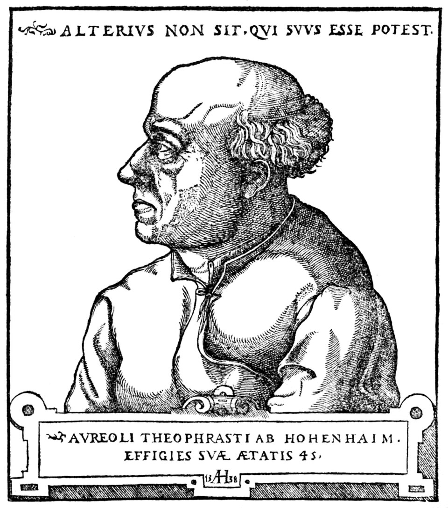

# 哲学者の曙（パラケルスス）

パラケルスス著／A・E・ウェイト英訳／全訳

- 原題：The Aurora of the Philosophers, by Paracelsus（ラテン語題 Aurora Philosophorum）
- 内容：賢者の石の知識がアダムからエジプト、カルデア、ペルシアのマギへと伝わった歴史を語り、植物・動物・鉱物の中に石を求めた者たちの誤りを数えあげたうえで、砒素・礬類・アンチモンの三つの秘法、石の普遍的な物質、哲学の容器、秘密の火、酵母と重さとを説く錬金術書。全二十章
- 英訳：Arthur Edward Waite, The Hermetic and Alchemical Writings of Paracelsus, London: James Elliott and Co., 1894, 第一巻所収
- 作業の基にした本文：Global Grey の電子版
- 著作権：パラケルススは1541年、ウェイトは1942年に死去。日本・米国・英国で保護期間が満了している
- 訳者：人工知能（Claude Opus 5.5）
- 訳の性格：ウェイトの英訳からの重訳である。英訳者の覚え書きと全二十章、英訳者の注十四をすべて訳した。訳者の調べたかぎりでは、日本語訳は出ていない

## この本について

　パラケルスス（本名テオフラストゥス・ボンバストゥス・フォン・ホーエンハイム、一四九三ごろ〜一五四一）はスイス生まれの医師・錬金術師である。ガレノス以来の体液説を退け、鉱物から作る薬を医学に持ちこみ、硫黄・水銀・塩の「三原質」説を唱えた。各地を放浪しながら膨大な著作を書いたが、生前に刊行されたものはわずかで、多くは死後に弟子や編者によって世に出た。

　『哲学者の曙』もそうした遺稿の一つで、一五七五年にバーゼルで、パラケルススの遺稿の収集家ゲラルト・ドルン（ドルネウス）によって刊行された。英訳者ウェイト自身が冒頭の覚え書きで、編者が手を加えた疑いと、パラケルススのほかの著作より古い錬金術に近い面とを指摘している。この本を読む楽しみの一つは、その「近さ」と「遠さ」とを見比べることにある。

　前半（第一〜七章）では、学問の起源が語られる。アダムが洪水を予見して石の板に諸術を刻み、それをノアが見つけ、エジプト、カルデア、ペルシアのマギへ伝わった。ギリシア人はその影しか受けとらなかった――という、ルネサンスに広く行われた「古代の神学」の系譜である。そこに魔術とカバラとの区別や、天と地とを結ぶ「ガマヘア」の考えが織りこまれる。

　後半（第八〜二十章）は錬金術の実地の話になる。卵や尿や牛の胆汁、共食いさせたトカゲにまで石を求めた「詭弁家」たちの失敗が皮肉たっぷりに並べられ、ゲベル、アルベルトゥス・マグヌス、ルペシッサ、ルルスといった錬金術の権威が次々に退けられる。そのうえで、砒素による白のチンキ、礬類とアンチモンとによる赤のチンキの「秘法」が説かれ、最後に、石の物質は「哲学者たちのメルクリウス」、すなわち体の中に目に見えないエバを隠しもつ「両性具有のアダム」であるとされる。秘密の火、天の高さに比例して形づくられる哲学の容器、酵母と重さの章は、実験の手引きとも霊的な寓意とも読める書き方になっている。

　ウェイトの注は、パラケルススのほかの著作から関連する箇所を引いたものである。本訳では本文中に（注1）のように示し、各回の末尾にまとめて訳した。

---

## 英訳者の覚え書き

　この題の著作は、パラケルススのほかの著作の中でときおり引用されているが、一六八八年にジュネーヴで刊行された大きな二つ折り本には収められていない。初めて刊行されたのは一五七五年のバーゼルで、編者ゲラルト・ドルン（ドルネウス）による豊富なラテン語の注釈が付けられていた。この人物はパラケルススの遺稿のたいへん粘り強い収集家であったが、原文に手を加えたのではないかという疑いからまったく自由というわけではない。『曙』はそうした例の一つだとみなす者もいる。疑いなく大筋ではホーエンハイムの賢者の真作であるが、いくつかの点では、パラケルススの実際の立場を表しているとはほとんどみなしがたい、それ以前の錬金術の諸派にかなり近づいているように見えるのである。

## 第一章　賢者の石の起源について

　アダムは諸術の最初の発明者であった。彼は堕落の前と同じく堕落ののちも、すべてのものの知識をもっていたのだから（注1）。それゆえ彼は水による世界の滅亡を予言した。またこの理由から、彼の子孫たちは二枚の石の板を立て、その上にすべての自然の術を神聖文字で刻んだ。彼らの後の世の者もまたこの予言を知り、それに心を留め、危険の時に備えをすることができるようにするためである。のちにノアは、大洪水ののち、アララト山〔原文 Araroth〕の麓でこれらの板の一枚を見つけた。この板には、上なる天空と下なる地球との運行、また惑星の運行が記されていた。ついにこの普遍の知識はいくつかの部分に分けられ、その活力と力とを減じた。この分離によって、ある者は天文学者に、ある者は魔術師に、ある者はカバラ学者に、四人目は錬金術師になった。アブラハム、あの火工のトバルカイン〔原文 that Vulcanic Tubalcain〕、すぐれた占星術師にして算術家は、この術をカナンの地からエジプトへ運んだ。そこでエジプト人はたいへんな高さと威厳とに昇り、ほかの国民はこの知恵を彼らから得たのである。族長ヤコブは、いわば羊をさまざまな色に塗った。そしてこれは魔術によってなされた。カルデア人、ヘブライ人、ペルシア人、エジプト人の神学において、彼らはこれらの術を最高の哲学とみなし、その最高の貴族と祭司とが学ぶべきものとしていたのだから。モーセの時代もそうであった。祭司も医師もマギの中から選ばれた――祭司は健康にかかわることの判断のため、とりわけ癩病の知識のためである。モーセもまた、ファラオの娘の費用と世話とによってエジプトの学校で教育を受け、その民のすべての知恵と学問とにおいてぬきんでた。ダニエルもそうであった。彼は若い日にカルデア人の学問を吸収し、カバラ学者となった。彼の神的な予言と、「メネ、メネ、テケル、ファレス」〔原文 Mene, Mene, Tecelphares〕という言葉の解き明かしとがその証しである。これらの言葉は、預言とカバラとの術によって理解することができる。このカバラの術は、モーセと預言者たちにとって完全になじみ深く、たえず用いられていた。預言者エリヤはそのカバラの数によって多くのことを予言した。こうして昔の賢者たちは、この自然で神秘な術によって神を正しく知ることを学んだ。彼らは神の律法のうちにとどまり、その掟のうちを大いなる堅固さをもって歩んだ。またサムエル記において、ベレリスト〔原文 Berelists〕たちが悪魔の側に従ったのではなく、神の許しによって幻と真の出現とにあずかる者となったことも明らかである。これについては『超天界の事物の書』でもっと詳しく扱うであろう（注2）。この賜物は、主なる神によって、神の戒めのうちを歩む祭司たちに与えられる。ペルシア人のあいだでは、名においてと同じく実際においてもぬきんでた賢者でないかぎり、誰も王として認めないのが習いであった。これは彼らの王の慣例の呼び名から明らかである。彼らは賢者と呼ばれたのだから。主イエスを探しに東方から来た賢者たち、ペルシアのマギは、そのような者たちであり、自然の祭司と呼ばれる。エジプト人もまた、この魔術と哲学とをカルデア人とペルシア人とから得て、自分たちの祭司が同じ知恵を学ぶことを望んだ。そして彼らはそれにおいてたいへん実り豊かで成功したので、近隣のすべての国々が彼らを賛嘆した。このためヘルメスはまことにトリスメギストス（三倍偉大な者）と名づけられた。彼は王であり、祭司であり、預言者であり、魔術師であり、自然の事物の賢者であったのだから。ゾロアスターもそのような者であった。

## 第二章　ギリシア人がその学問の大部分をエジプト人から引き出したこと、そしてそれがいかにして彼らから我々に伝わったかが述べられる

　大洪水ののち、ノアの子のひとりが世界の三分の一を所有したとき、この術はカルデアとペルシアとに入りこみ、そこからエジプトへと広まった。迷信深く偶像崇拝のギリシア人がこの術を見つけると、彼らのうちほかの者より賢い何人かは、同じ知恵を彼らの学校から汲むために、カルデア人とエジプト人とのもとへ赴いた。しかしモーセの律法の神学的研究は彼らを満足させなかったので、彼らは自分自身の特有の才に頼り、それらの自然の秘密と術との正しい基礎から離れ落ちた。これは彼らの作り話めいた観念と、モーセの教えについての彼らの誤りとから明らかである。エジプト人の習いは、あの卓越した知恵の伝承を、謎めいた図像と難解な物語と用語とによってのみ示すことであった。これはのちにホメロスが驚くべき詩の技量をもって踏襲した。ピュタゴラスもまたそれを知っていた。彼はその著作の中にモーセの律法と旧約聖書とから多くのことを取り入れているのだから。同様に、ヒッポクラテス、ミレトスのタレス、アナクサゴラス、デモクリトス、そのほかの者たちも、同じ主題に心を向けることをためらわなかった。それでも彼らの誰ひとりとして、真の占星術、幾何学、算術、医学に習熟してはいなかった。彼らの傲慢がそれを妨げたのである。彼らは自分たちの国民以外の国民に属する弟子を受け入れようとしなかったのだから。カルデア人とエジプト人とからいくらかの洞察を得たときでさえ、彼らは生まれつきそうであったよりもさらに傲慢になり、何のためらいもなく、その主題を実質においては示したものの、巧妙な作り事や虚偽をまじえて提示した。そして彼らは、彼らからラテン人に伝わったある種の哲学をこしらえ上げようとした。ラテン人はこんどはそれで教育され、それを自分たちの教えで飾り、これらによってその哲学はヨーロッパじゅうに広まった。若者を教えるために、彼らの教義と規則とを広める多くの学院が設立された。そしてこの体系は、ドイツ人そのほかの国民のもとで今日に至るまで栄えているのである。

## 第三章　エジプト人の学校で何が教えられたか

　カルデア人、ペルシア人、エジプト人は、みな自然の秘密について同じ知識をもち、また同じ宗教をもっていた。違っていたのは名だけであった。カルデア人とペルシア人とは自分たちの教えをソフィアおよび魔術と呼び（注3）、エジプト人は、犠牲のゆえに、自分たちの知恵を祭司術と呼んだ。ペルシア人の魔術とエジプト人の神学とは、どちらも昔の学校で教えられた。アラビア、アフリカ、ギリシアには多くの学校と学者とがいた。アラビア人のあいだではアルブマザル、アベンザゲル、ゲベル、ラーゼス、アヴィケンナ、ギリシア人のあいだではマカオン、ポダレイリオス、ピュタゴラス、アナクサゴラス、デモクリトス、プラトン、アリストテレス、ロディアヌス〔原文 Rhodianus〕などである。それでも、エジプト人の知恵については、彼ら自身が互いに異なり、それと意見を異にした点について、彼らのあいだでさまざまな意見があった。このためピュタゴラスは賢者と呼ばれることができなかった。エジプトの祭司術と知恵とは完全には教えられなかったのだから。もっとも彼はそこから多くの神秘と秘法とを受けとったのであるが。そしてアナクサゴラスもまた非常に多くを受けとっていたことは、彼が死後に残した、ソル（太陽＝金）とその石とについての論議から明らかである。それでも彼は多くの点でエジプト人と異なっていた。彼らでさえ賢者あるいはマギと呼ばれることを望まなかった。しかしピュタゴラスにならって、哲学という名を名のった。それでも彼らは、ペルシア人とエジプト人との魔術から、影のようないくつかのきらめきのほかは何も集めなかった。しかしモーセ、アブラハム、ソロモン、アダム、そして東方からキリストのもとへ来た賢者たちは、真のマギ、神的な賢者、カバラ学者であった。この術と知恵とについて、ギリシア人はほとんど、あるいはまったく何も知らなかった。それゆえ我々は、このギリシア人の哲学的知恵を、単なる思弁として、ほかの真の術と学とからまったく別個のものとして、ほうっておくことにしよう。

## 第四章　カルデア人、ペルシア人、エジプト人のマギとはどのような者であったか

　多くの人々がこれらの賢者の秘密の魔術を調べ、用いようと努めてきた。しかしそれはまだなしとげられていない。我々の時代の多くの者でさえ、魔術とカバラ（注4）――見たところまったく別の二つのもの――について、トリテミウスを、またほかの者はベーコンやアグリッパをほめたたえるが、なぜそうするのかを知らない。魔術とはまことに、元素的な物体、その実り、性質、効能、隠れた働きを把握する術であり能力である。一方カバラは、聖書の繊細な理解によって、人々のために神への道をたどり、いかに神とともに行い、神から預言するかを示すように思われる。カバラは神的な神秘に満ちているのだから。ちょうど魔術が自然の秘密に満ちているように。魔術は、現在のものについてと同じく、来るべきものの本性についても教え、予言する。その働きは、天の物体についても地の物体についても、すべての被造物の内なる構成を知ることにあるのだから。すなわち、それらの中に何が潜んでいるか、その隠れた効能は何か、それらはもともと何のために作られたのか、どのような性質を授けられているのか、を知ることに。これらや同様の主題は、天の事物を地の事物と結びつける絆であり、それはときにその働きにおいて肉眼でさえ見られることがある。天の影響のこのような結合、それによって天の効能が下なる物体に働きかけるものを、かつてマギはガマヘア（注5）と呼んだ。すなわち天の力と性質との元素的な物体との結婚である。そこから、天と地とのすべての物体、すなわち太陽と惑星、また植物、鉱物、動物のすぐれた混合が生じた。

　悪魔はその全力と努力とをもってこの光を暗くしようと試みた。そして彼の望みはまったく挫かれたわけではなかった。彼はギリシア全土からそれを奪い、そのかわりにその民のあいだに、人間の思弁と、神とその御子とに対するまったくの冒涜とを持ちこんだのだから。たしかに魔術はその起源を神の三位に負い、神の三一性から生じた。神はそのすべての被造物にこの三位のしるしをつけ、その神聖文字を自らの指でそれらに刻んだのだから。事物の本性の中で、神の三位のこの奥義を欠くもの、あるいは目に見えるかたちでさえそれを証ししないものは、何ひとつ挙げることも生み出すこともできない。聖パウロがローマ人への手紙で証しするように、被造物は我々に創造主ご自身を理解し見ることを教える。事物の全実質にわたって行きわたるこの神の三位の契約は、解くことができない。これによってまた、我々は四元素からすべての自然の秘密を得る。三位は魔術的な四位とともに完全な七位を生み出し、それは多くの秘法を授けられ、知られている事物によって論証されるのだから。四位が三位のうちに安らうとき、そのとき永遠の地平の上に世界の光が昇り、神の助けによって我々に絆の全体を与える。ここでまたそれは、すべての被造物の効能と働きとその用途とにかかわる。それらはその秘法、しるし、文字、形によって刻印され、しるしをつけられているので、調べてみて明らかにならないような隠れた点は、それらの中にほとんど少しも残されていないのである。それから四位と三位とが十位に昇るとき、それらの後退すなわち一への還元がなしとげられる。ここに、神が言葉と御手のわざである被造物とによって人々に明らかに示した、事物のすべての隠れた知恵が含まれている。人々がそれらについての真の知識をもつことができるように。これはほかの箇所でもっと明らかにされるであろう。

## 第五章　事物の首位にして至高の本質について

　マギはその知恵において、すべての被造物は一つの統一された実質にもたらすことができると主張した。そしてその実質は、浄化と浄めとによって、驚くべき結果をもたらすほどの高い精妙さの度合い、そのような神的な性質と隠れた性質とに達しうる、と彼らは断言する。彼らは、土に還ることによって、また至高の魔術的分離によって、ある完全な実質が現れ出ると考えたのである。それは、多くの勤勉で長い調製によって、ついに植物的な実質の範囲を越えて鉱物的なものへ、鉱物的なものを越えて金属的なものへ、そして完全な金属的実質を越えて永続する神的な第五精髄（注6）へと高められ引き上げられ、天と地とのすべての被造物の本質をそれ自身のうちに含む。アラビア人とギリシア人とは、ペルシア人とエジプト人との隠れた文字と神聖文字による記述とによって、秘められた難解な神秘に達した。これらが得られ、部分的に理解されると、彼らは実験の過程で、多くの驚くべき不思議な効果を自分の目で見た。しかし超天界の働きは彼らの能力が貫きうるよりも深く隠れていたので、彼らはこれを、マギの定めに従って超天界の秘法とは呼ばず、ピュタゴラスの勧めと判断とに従って賢者の石の秘法と呼んだ。この石を得た者は誰でも、その物質が隠されたままであるように、さまざまな謎めいた図像、人を欺く類似、比喩、作り事の呼び名でそれを覆い隠した。それゆえ彼らからは、それについての知識はほとんど、あるいはまったく得られないのである。

## 第六章　その発見と知識とに関するさまざまな誤りについて

　哲学者たちは、この石の物質に、単なる類似にもとづく最も隠された名を冠した。アルノルドゥス〔ヴィラノヴァのアルノルドゥス〕はこれに気づいて、その『薔薇園』の中で、最大の難事はこの石の材料を見つけだすことだと言っている。彼らはそれを植物的、動物的、鉱物的と呼んだが、文字どおりの意味によってではない。その意味は、神的な秘密とこの同じ石の奇跡とを経験した賢者たちにはよく知られている。たとえばライムンドゥス・ルルスの『ルナリア』を挙げることができよう。これは哲学者たち自身にはなじみの、驚くべき効能をもつ花々を示している。しかしそれらの哲学者たちの意図は、彼らがそれによって金属の上への何かの投入を意味していると考えさせることでも、そのような調製をさせることでもなかった。哲学者たちの難解な心は別の意図をもっていたのである。同様に彼らは自分たちの物質をマルタゴン（ユリの一種）の名で呼び、それに隠れた錬金術の操作をあてはめた。しかしその名にもかかわらず、それは隠された類似のほか何も示していない。さらに、植物の液汁において少なからぬ誤りが生じた。かなり多くの者が、それによってメルクリウス（水銀）を凝固させ（注7）、そのあとで固定の水によってそれをルナ（月＝銀）に変えようとしたのである。金属の助けなしにこのやり方でそれを凝固させることのできる者は首位の達人になるのに成功するであろう、と彼らは思いこんだのだから。さて、ある植物の液汁はたしかにこれをなしとげるが、その結果は、それらに豊富な樹脂と脂肪と土の硫黄とによるにすぎない。これが、凝固の過程で実質とともに昇るメルクリウスの湿りを自分のほうへ引きつけるが、何の益も生じない。植物の中の濃い外的な硫黄は、錬金術における完全な投入には適さないと私はよく確信している。何人かの者は損をしてそれを知ったとおりである。たしかにある人々は、ティティナル〔原文 tittinal〕の白い乳のような液汁で、その中にある激しい熱のためにメルクリウスを凝固させた。そして彼らはその液を「処女の乳（ラク・ウィルギニス）」と呼んだ。しかしこれは誤った基礎である。同じことはクサノオウの液汁についても言える。それはまるで金を授けられているかのように色をつけるのであるが。そこから人々はむなしい考えを抱いた。ある定められた時に彼らはこの植物を根こそぎにし、それから魂あるいは第五精髄を求め、そこから凝固させ変成させるチンキを作ろうとした。しかしそこからは愚かな誤りのほか何も生じなかった。

## 第七章　植物の中に石を求める者たちの誤りについて

　ある錬金術師たちはクサノオウから液汁を搾り、それを煮つめて濃くし、日なたに置いて硬い塊に凝固させた。それをあとで細かい黒い粉に砕けば、投入によってメルクリウスをソル（金）に変えるはずだったのである。これも彼らはむなしいと知った。ほかの者たちはこの粉に塩化アンモニウム（サル・アンモニアク）をまぜた。ほかの者たちは緑礬のコルコタル〔焼いた緑礬の残渣〕をまぜ、こうして望む結果に達するであろうと思いこんだ。彼らはその溶解によってそれを黄色い水にし、それで塩化アンモニウムがチンキをメルクリウスの実質の中へ入りこませるようにした。しかしまたしても何もなしとげられなかった。また、上に述べた物質のかわりに、ペルシカリア、ブフォナリア、ドラクンクルス、柳の葉、ティテュマル（トウダイグサ）、カタプティア、フランムラなどの液汁をとり、それらをメルクリウスとともに数日のあいだガラスの器の中に閉じこめ、灰の中に保つ者たちもいる。こうしてメルクリウスは灰に変わるが、それは見せかけであって何の結果もない。

　これらの人々は、前に述べたように、金属なしにメルクリウスを凝固させることのできる者は奥義（マギステリウム）の全体をもつ、と言いふらす俗衆のむなしい噂に惑わされたのである。

　また多くの者が植物から人工的に塩と油と硫黄とを抽出したが、まったくむなしかった。そのような塩、油、硫黄からは、メルクリウスのどんな凝固も、完全な投入も、チンキも作ることはできない。しかし哲学者たちが自分たちの物質を七本の枝をもつある黄金の木にたとえるとき、彼らは、そのような物質がその精子の中に七つの金属をすべて含み、それらがその中に隠れているということを意味している。このために彼らは自分たちの物質を植物的と呼んだ。自然の木の場合のように、それらもまたその時にさまざまな花を生み出すからである。

　同じように、石の物質もその花を生み出すときに最も美しい色を示す。この比喩はまた適切である。ある物質が、まるで枝と芽との茂みのように、地に生える海綿のように、哲学的な大地から立ちのぼるのだから。それゆえ彼らは、自分たちの木の実は天へと向かうと言う。それで彼らは、すべては自然の植物にかかっているかのように言い立てた。もっともその物質についてではない。彼らの石は、植物と同じく、自らのうちに体と魂と霊とを含んでいるからである。

---

### 英訳者（ウェイト）の注

（注1）人を創った者は、学をも創った。人はどこにおいて労苦なしに何をもっているか。「汝は額に汗して生きるべし」という命令が下ったとき、いわば新しい創造があった。神がその「成れ」を発したとき、世界は造られた。しかし術はそのときには造られず、自然の光も造られなかった。しかしアダムが楽園から追放されたとき、神はその手のわざによって生きよと命じたときに、彼のために自然の光を創った。同じように、神はエバに「汝は苦しんで子を産むべし」と言ったときに、彼女のためにその特別な光を創った。こうして、そしてそこで、以前は天使のようであったこれらの存在は人間的で地上的なものとされたのである。……こうして言葉によって被造物は造られ、この同じ言葉によって人に必要な光もまた造られた。……それゆえ内なる人は、楽園からの追放ののち、第二の創造から生じた。……堕落の前には、人に必要なあの認識は、まだ彼の中で発達しはじめていなかった。彼は楽園から追い出されたときに、それを天使から受けとった。……人は体の秩序においては完全に造られたが、術の秩序においてはそうではなかった。――『てんかんについて』第三部

（注2）この題にちょうど対応する著作は、パラケルススの著作の中には現存しない。言及されている主題は『大いなる賢明の哲学（フィロソフィア・サガクス）』で論じられている。

（注3）何よりもまず、天の魔術の本性を正しく理解する必要がある。それは神的な効能から発する。モーセの行った魔術があり、妖術師たちの有害な魔術がある。それゆえマギにはさまざまな種類がある。また自然の魔術と呼ばれるものがあり、天のマグスがあり、信仰のマグス、すなわちその信仰がその人を健やかにする者がある。最後に、破滅のマグスがある。――『大いなる賢明の哲学』第二巻第六章

（注4）それゆえ天文学的魔術を学べ。それを私は別の名でカバラ的と呼ぶ。――『ペストについて』第一論考。かつてカバラ的と呼ばれたこの術は、初めはカバッラと名づけられ、のちにカバッリアと名づけられた。それは魔術の一種である。またそれは、この主題について深い知識をもつある者によって、誤ってガバナラとも呼ばれた。それは知られない異教の起源をもち、のちにカルデア人とヘブライ人とに伝わり、その両者によって損なわれた。――『大いなる賢明の哲学』第一巻、「死霊術の学における証明」の項

（注5）影響を受けとり、そのしるしを示した物体は、ガマヘウ、ガマヘイなどと呼ばれたらしい。しかしその名は主として、人や動物のさまざまな驚くべき像や形が自然に描かれているのが見いだされたある種の石に与えられた。それは人のわざではなく、神の摂理と計らいとの結果である。――『像について』第七章および第十三章。人が魔術的に自分の影響をこれらの石やほかのいくつかの物質に投射することは可能である。――同書第十三章。しかしそれらはまたそれ自身に内在する効能をもち、それは形と刻印の特別な性質とによって示される。――同書第七章。またマギによって発明され調製された人工のガマヘウスもあり、これはより強力であったらしい。――『天使のアザミについて』

（注6）パラケルススは人間そのものを、特別な仕方で真の第五精髄とみなした。神はすべての元素と星とそのほかのすべての被造物とを創り、それらをその意志に従って配置したのち、最後に人間を形づくることに取りかかった。神は四元素から本質を抽出して一つの塊にした。また星々から知恵と術と理性との本質を抽出し、この二重の本質を一つの塊に寄せ集めた。その塊を聖書は地の泥と呼ぶ。その塊から二つの体――星的な体と元素的な体――が造られた。これらは自然の光によれば、クィントゥム・エッセ（第五の存在）と呼ばれる。その塊は抽出され、その中で天空と元素とが凝縮された。このようにして四つから抽出されたものが第五のものをなした。第五精髄は、普遍の世界のすべての事物の本質と性質との核であり場所である。全自然が神の手の中に入った――上なる球と下なる球とのすべての力、すべての性質、すべての本質が。これらすべてを神はその手の中で結びあわせ、それらから人間をその像に従って形づくった。――『大いなる賢明の哲学』第一巻第二章

（注7）すべての被造物は凝固したものから生じ、凝固ののちには溶解へと進まなければならない。溶解から、すべての生み出されたものが生じる。――『酒石について』（断片）。鉱物のすべての体は塩によって凝固される。――『自然の水について』第三巻第二論考

## 第八章　動物の中に石を求めた者たちについて

　彼らはまた、単なる類似にもとづく名によって、この物質を「処女の乳（ラク・ウィルギニス）」とも、「薔薇色の祝福された血」とも呼んだ。しかしこれは、預言者と神の子らとにしかふさわしくない。そこから詭弁家たち（注8）は、この哲学の物質は動物あるいは人間の血の中にあると推しはかった。またときには、動物は植物によって養われているのだからというので、ほかの者たちは毛髪の中に、尿の塩の中に、レビス〔原文 rebis〕の中に求めた。またある者は鶏の卵の中に、乳の中に、卵の殻の石灰の中に求め、これらすべてによってメルクリウス（水銀）を固定することができると考えた。ある者は腐った尿から塩を抽出し、それが石の物質だと思いこんだ。また、レビスの中に見いだされる小石を物質とみなした者もいる。ほかの者たちは卵の薄膜を鋭い灰汁に浸し、それに雪のように白く焼いた卵の殻をも混ぜた。これに彼らは、メルクリウスの変成のための固定の秘法を帰したのである。またほかの者たちは、卵の白身を銀に、黄身を金になぞらえて、それを自分たちの物質に選び、それに普通の塩、硇砂（サル・アンモニアク）、焼いた酒石を混ぜた。これらをガラスの容器に閉じこめ、白い物質が血のように赤くなるまで、マリアの湯（バルネウム・マリス）で浄めた。これをさらに蒸留して、ひどく嫌なにおいの液にしたが、それは彼らのめざす目的にはまったく役に立たなかった。またほかの者たちは卵の白身と黄身とを浄めた。そこからバシリスクが生まれた。これを彼らは焼いて濃い赤色の粉にし、枢機卿ギルベルトゥスの論考から学んだとおり、それで色づけしようとした。また多くの者は、牛の胆汁を普通の塩と混ぜて浸し、これを蒸留して液にし、それでセメンテーションの粉を湿らせた。この秘技（マギステリウム）によって金属を色づけできると思ったのである。これを彼らは「部分と部分と」という名で呼んだ。そしてそこから生じたのは――まったく何もなかった。ほかの者たちは、竜血そのほかの物質を加えてトゥティア（酸化亜鉛）を変成させ、また銅とエレクトルムとを金に変えようと試みた。ほかの者たちは、彼らが「ヴェネツィアの術」と呼ぶものに従って、トカゲのような動物を二十匹ほど取り、容器の中に閉じこめ、飢えで狂わせて、ただ一匹が生き残るまで互いに食いあわせる。この一匹に、それから銅またはエレクトルムのやすり屑を食べさせる。彼らは、この動物がただその胃の消化だけによって望みの変成をなしとげると思うのである。最後に彼らはこの動物を焼いて赤い粉にし、それが金であるにちがいないと考えた。しかし彼らは欺かれていた。またほかの者たちは、トルイタス〔原文 truitas。英訳者は「（？　鱒）」と付記〕と呼ばれる魚を焼き、それを溶かすと、ときにその中に金がいくらか見つかった。しかしそれには次のほかに理由はない。それらの魚はときに川や小川で金の小さな薄片や粒に出会い、それを食べるのである。もっとも、そのような詐欺師が見つかるのはまれであり、見つかるとしても主として諸侯の宮廷においてである。哲学者たちの物質は動物の中に求めるべきではない。これを私はすべての人に告げる。それでも、哲学者たちが自分たちの石を動物と呼んだことは明らかである。彼らの最後の操作において、このきわめてすぐれた火の神秘の効能によって、容器の中の物質から暗い液が一滴また一滴としみ出したからである。そこから彼らは、終わりの時に、きわめて清らかな人が地上に来て、その人によって世の贖いがなしとげられるであろう、そしてこの人は赤い色の血の滴をしたたらせ、それによって世を罪から贖うであろう、と予言した。同じように、それなりの仕方で、彼らの石の血は、癩を病む金属をその病と汚れとから解き放った。それゆえこうした根拠にもとづいて、彼らは自分たちの石を動物と言ってよいと考えたのである。この神秘について、メルクリウスはカリド王に次のように語っている。

　「この神秘は、神の預言者たちにのみ知ることが許されている。それゆえこの石は動物と呼ばれる。その血の中に魂が隠れているからである。それはまた体と霊と魂とから成っている。同じ理由から彼らはそれを自分たちのミクロコスモス（小宇宙）と呼んだ。それは世界のすべての事物の似姿をもっているからである。そしてそこから彼らはそれを動物と名づけた。プラトンが大いなる世界を動物と名づけたように」。

## 第九章　鉱物の中に石を求めた者たちについて

　ここに加わるのが、石は三重のもので、三重の類、すなわち植物、動物、鉱物の中に隠れていると思いこむ多くの無知な者たちである。そのために彼らはそれを鉱物の中に求めたのである。さて、これは哲学者たちの意見とはかけ離れている。彼らは、自分たちの石は一様に植物的であり、動物的であり、鉱物的であると断言しているのだから。さてここで注意せよ。自然はその鉱物の精子をさまざまな種類に分け与えた。たとえば、硫黄、塩、硼砂、硝石、硇砂、明礬、砒素、アトラメント（黒い礬類）、礬類（ウィトリオル）、トゥティア、赤鉄鉱、雄黄、鶏冠石、マグネシア、辰砂、アンチモン、滑石、カキミア〔原文 cachymia〕、白鉄鉱などである。これらすべてにおいて、自然はまだ我々の物質には達していない。もっとも、挙げた種類のいくつかにおいては、完成させるべき不完全な金属の変成のために、自然は驚くべき姿を見せるのであるが。まことに、長い経験と火による実地とは、鉱物の物質において、一つの色から別の色へだけでなく、一つの本質から別の本質へ、また不完全から完全へと、多くのさまざまな変化を示す。そして自然は、調製された鉱物によってある完全さに達したとはいえ、哲学者たちは、賢者の石の物質が鉱物のどれかから出てくるとは認めようとしない。彼らは自分たちの石は普遍的であると言うのであるが。そこで詭弁家たちは、これをきっかけにメルクリウスそのものをさまざまな責め苦で迫害する。昇華、凝固、メルクリウスの水、硝酸（アクア・フォルティス）などによってである。これらすべての誤った道は、鉱物のほかの詭弁的な調製や、霊（揮発性のもの）と金属との浄化や固定とともに、避けるべきである。それゆえ、ゲベル、アルベルトゥス・マグヌスそのほかの者たちの説く石の調製は、すべて詭弁的である。彼らの浄化、セメンテーション、昇華、蒸留、精留、循環、腐敗、結合、溶解、上昇、凝固、煆焼、灰化は、三脚台においても、アタノール（錬金炉）においても、反射炉においても、溶解炉においても、アッキディオネウム〔原文 accidioneum〕においても、糞の中でも灰の中でも砂の中でも、そのほか何においても、まったく益がない。またククルビタ（瓢形の蒸留器）、ペリカン、レトルト、フラスコ、固定器、そのほかにおいても同じである。同じ判定は、白と赤とのための、鉱物の霊によるメルクリウスの昇華にも下されなければならない。礬類、硝石、明礬、クロクス（サフラン色の金属灰）などによるものである。これらすべての主題について、あの詭弁家ヨハネス・デ・ルペシッサは、白と赤との哲学の石についての論考の中で作り話をしている。まとめていえば、これらはただの欺きの夢にすぎない。またゲベルの個々の詭弁をも避けよ。たとえば、彼の七重の昇華あるいは殺し（モルティフィカティオ）、またメルクリウスの蘇生、尿の塩や墓によって作られた塩の調製などであり、これらはすべて信頼できない。ほかの何人かの者は、鉱物と金属との硫黄によってメルクリウスを固定しようと努めたが、大いに欺かれた。たしかに私は、この術によって、またそのような固定によって、メルクリウスが、あらゆる点でよい銀に似てそれを装う金属の体にされたのを見たことがある。しかし試金にかけると、それは偽物であることを示したのである。

## 第十章　鉱物の中に石と、また個別のもの〔個別の変成剤〕とを求めた者たちについて

　ある詭弁家たちは、七たび昇華し、同じ数だけ硝酸で溶かしたメルクリウスから、固定した油をしぼり出そうとした。このやり方で彼らは不完全な金属を完全にしようと試みる。しかし彼らはそのむなしい努力を捨てざるをえなかった。ある者は礬類を、煆焼、溶解、凝固によって、また硇砂二部を加えて昇華によって七たび浄め、それが白い水に解けるようにした。それに水銀の第三の部分を加えて、水によって凝固させようとしたのである。それからそのあとで、彼らはメルクリウスを礬類と硇砂とから何度も昇華させ、それが石になるようにした。この石は礬類から懐胎されたものだから哲学者たちの赤い硫黄であると彼らは断言し、それによって、溶解と凝固とを通じて石の獲得にいくらかの進歩をとげた。しかし投入においては、すべてが無に帰した。ほかの者たちは、明礬の水によってメルクリウスを明礬そのもののような硬い塊に凝固させ、これを固定の水でむなしく固定した。詭弁家たちはメルクリウスを固定する実に多くの方法を自分に課すが、むだである。そこでは完全なものも恒常なものも何ひとつ得られないのだから。それゆえ、詭弁的な処理によってそれに鉱物を加えてもむだである。そのすべてによって彼はかえっていっそうの悪意をかき立てられ、いっそう活発にされ、何らかの完全さよりはむしろいっそうの不純へと導かれるのだから。それゆえ哲学者たちの物質はそこから求めるべきではない。メルクリウスはいくらか不完全である。そしてそれを完全にすることは、どんな詭弁家にとってもきわめて難しい、いや不可能であろう。その中には、完全さへとかき立てたり強いたりできるものが何もないのである。ある者は何度も昇華させた砒素を取り、それをたびたび酒石の油で溶かして凝固させた。これを彼らは固定したと称し、それによって銅を銀に変えるのだと称した。しかしこれは詭弁的な白化にすぎない。砒素は、術者が達人であって、その色づける霊をよく知っているのでないかぎり、固定することはできないのだから（注9）。まことにこの点では、哲学者たちはみな眠りこけ、それによって何かをなしとげようとむなしく試みてきた。それゆえ、この霊について無知な者は誰であれ、それを固定することも、それに変成の効能をもちうるような力を与えることも、望むことはできない。そこで私はすべての人に告げる。私がたったいま話した白化は誤った基礎の上に立っており、それによって銅は欺かれて白くされるが、変えられはしないのだと。

　さて詭弁家たちは、この偽のウェヌス（金星＝銅）をその二倍の重さのルナ（月＝銀）と混ぜ、それを金細工師や造幣の親方たちに売りつけた。そしてついには、売った者だけでなく買った者までも、偽金造りへと自分を変成させてしまったのである。ある詭弁家たちは、白い砒素のかわりに赤い砒素を取ったが、これは偽りの術であることがわかった。どのように調製しても、白さ以外の何ものでもないことがわかるのだから。

　またある者はさらに進んで普通の硫黄を扱った。それはたいへん黄色いので、彼らはそれを酢や灰汁や最も強いぶどう酒の中で、白くなるまで一昼夜煮た。それからそのあとで、普通の塩と卵の石灰とからそれを昇華させ、この処理を何度もくり返した。それでも、白くはなったものの、それはいつも燃えやすいままであった。それにもかかわらず、彼らはこれでメルクリウスを固定して金に変えようと努めた。しかしむだであった。とはいえ、そこから私がこれまでに見た中で最もすぐれた美しい辰砂ができる。これを彼らは、硫黄の油によって、セメンテーションと固定とで固定しようと企てる。それはたしかにいくらかの見かけを与えるが、それでも望む目的には及ばない。ほかの者たちは普通の硫黄を肝臓（ヘパル）の形にした。酢で煮て、亜麻仁油、またはラテリヌスの油〔原文 laterine oil〕、またはオリーブ油を加えるのである。それから彼らはそれを大理石の乳鉢に注ぎ、肝臓の形にし、それをまず弱い火でレモン色の油に蒸留した。しかし彼らは、自分たちができると思っていたようにルナをソル（太陽＝金）に変成させることは何ひとつできないと、損をして知った。金属が無数にあるように、その調製にもまた多くの種類がある。ここではこれ以上それらに触れないことにする。それぞれが一つの特別な論考を要するであろうから〔原文 each a mould require〕。礬類とアンチモンとの詭弁的な油にも用心せよ。同じように、完全であれ不完全であれ、ソルやルナのような金属の油にも警戒せよ。それらの働きは事物の本性においてきわめて強力であるとはいえ、真の手順は今日でもごくわずかの人々にしか知られていないのだから。また、普通の水銀、砒素、硫黄などの、詭弁家たちの本に定められた処方に従った、昇華、下降、酢・硝石・酒石・礬類・硇砂による固定といった詭弁的な調製を慎め。同じように、白鉄鉱やマルスのクロクス（鉄のサフラン）から取った詭弁的なチンキを避け、また「部分と部分と」という名で呼ばれるあの詭弁や、固定したルナ、そのほか同様のつまらぬものを避けよ。それらは、わずかな骨折りと勤勉とによるルナの固定のように、いくらか表面的には真実らしく見えるが、それでもその調製の進み方は無価値で弱い。それゆえ私は、この術における善意の作業者たちへの同情に動かされて、哲学の基礎の全体を三つの別々の秘法において明らかにすることに決めた。すなわち、一つは砒素によって、二つめは礬類によって、三つめはアンチモンによって説明されるものである。これらによって私は、メルクリウスと不完全な金属との上への真の投入を教えるであろう。

## 第十一章　白のチンキのための、砒素の真にして完全な特別の秘法について

　ある人々は、砒素はメルクリウスと硫黄とから成ると書き、ほかの人々は土と水とから成ると書いた。しかし大部分の著述家は、それは硫黄の本性をもつと言う。しかしそれがどうであれ、その本性は赤い銅を白い銅に変成させるようなものである。それはまた、色づけることができるほど完全な調製の状態にまでもたらすこともできる。しかしこれは、『完成の大全』のゲベル、アルベルトゥス・マグヌス、『完全な秘技の書』の化学者アリストテレス、ラーゼス、ポリュドルスのような悪しき詭弁家たちの指し示すやり方でなされるのではない。それらの著述家は、どれほど多くいようとも、みずから誤っているか、さもなければまったくの妬みから偽って書き、真実を知らないわけではないのに処方を公にしているのだから。砒素はそれ自身のうちに三つの自然の霊を含んでいる。第一は揮発性で、燃えやすく、腐食性で、すべての金属に浸みとおる。この霊はウェヌスを白くし、何日かのちにはそれを海綿状にする。しかしこの工夫は、焼灼の術を行う者たちにしか関係がない。第二の霊は結晶質で甘い。第三は、前に挙げたほかのものから分けられた、色づける霊である。真の哲学者たちは、賢者たちの完全な投入をめざして、砒素の中にこれら三つの自然の性質を求める（注10）。しかし外科を行うあの床屋たちは、色づける霊から分けられたあの甘く結晶質の本性を、傷、横痃（よこね）、癰（よう）、炭疽、そのほか穏やかな手段によるのでなければ治らない同様の潰瘍の治療に用いるために求める。しかしあの色づける霊については、その中で純なるものが不純なものから、固定したものが揮発するものから、秘密のチンキが燃えやすいものから分けられなければ、メルクリウスやウェヌスやそのほかの不完全な金属の上への投入のために、けっしてあなたの望みどおりにはゆかないであろう。すべての哲学者たちは、この秘法をこの上なくすぐれた神秘として隠してきた。この色づける霊を、上のようにほかの二つから分けたら、ルナの霊と結びあわせ、三十二日のあいだ、あるいはそれらが新しい体をまとうまで、ともに温成（ディゲスティオ）させなければならない。それが、自然の四十日目に太陽の熱によって炎に燃えたったのち、その霊は輝く白さのうちに現れ、完全な色づけの秘法を授けられる。そのとき、ついにそれは投入に適したものとなる。すなわち、調製の鋭さに応じて、その一部を不完全な体の十六部の上に投じるのである。そこから、輝く、きわめてすぐれたルナが、まるで大地のはらわたから掘り出されたかのように現れる。

## 第十二章　礬類の秘法と、そこから抽出すべき赤のチンキとについての一般的な教え

　礬類の秘法とは、礬類の油である。すなわち、礬類から煮ることによって水気を除いたのち、さらに強い熱をかけて霊を引き出す。すると礬類は水の形で純粋に流れ出てくる。この水を、その処理で残ったカプト・モルトゥウム（死の頭＝残滓）と合わせ、マリアの湯でふたたび分けると、粘液質の部分が去り、油、すなわち礬類の秘法が容器の底に残る。――同書〔原文 Ibid.。この段落は出典表示ともども本文の章頭に置かれている。原文のまま〕

　礬類はほかの鉱物の中でもたいへん高貴な鉱物であり、哲学者たちによってつねに最高の評価を受けてきた。いと高き神がそれを驚くべき賜物で飾ったからである。彼らはその秘法を、次のような謎めいた姿で覆い隠した。「汝は大地の内奥へ行き、精留によって隠された石、真の薬を見いだすであろう」。大地によって彼らは礬類そのものを、大地の内奥によってその甘さと赤さとを理解した。礬類の隠れた部分には、繊細で高貴な、きわめてかぐわしい汁と純粋な油とが隠れているからである。それを生みだす方法には、煆焼によっても蒸留によっても近づくことはできない。それはけっしてその緑の色を奪われてはならないのだから。もし奪われれば、それは同時にその秘法と力とを失うであろう。じっさい、ここで注意すべきことに、外に緑を示す鉱物、また植物そのほか同様のものは、そのうちに血のように赤い油を含んでおり、それがそれらの秘法なのである。ここから、薬種商たちの蒸留が役に立たず、むなしく、愚かで、何の価値もないことは明らかである。この人々は、植物から血のような赤さを抽出するすべを知らないのだから。自然そのものは賢く、植物のすべての水をレモン色に変え、そのあとできわめて赤い、血のような油に変える。

　これがこれほどゆっくりとしかなしとげられないわけは、それを蒸留する無知な作業者たちのあまりの性急さから生じる。それが緑を消耗させてしまうのである。彼らは、自然をその自身の力で強めることを学ばなかった。それこそ、あの高貴な緑の色がおのずから赤さへと精留されるべきやり方なのであるが。その一例は、白ぶどう酒がおのずから温成してレモン色になることである。そして時がたつにつれて、ぶどうの緑の色はおのずから、紺青〔原文 coerulean〕の下にある赤へと変わる。それゆえ、植物と鉱物との緑が作業者たちの無能によって失われると、秘法の中で最も高貴な、油とバルサムとの本質と霊とも、また滅びてしまうのである。

## 第十三章　赤のチンキのための礬類の処理についての特別の教え

　礬類はそのうちに多くの濁った粘る不完全さを含んでいる。それゆえその緑（注11）は、たびたび水で抽出し、土のすべての不純さを脱ぎ去るまで精留しなければならない。これらの精留がすべて終わったら、何よりも、その物質が太陽にさらされないように気をつけよ。太陽はその緑を青ざめさせ、同時に秘法を吸いとってしまうのだから。どんな塵にも汚されないように、それを暖かい炉の中に覆って保っておけ。そののち、閉じたガラスの容器の中で、数か月のあいだ、あるいはさまざまな色と深い赤とが現れるまで、温成させよ。それでも、この処理によって赤さが十分に固定されたと思ってはならない。それはさらに、土の内的で偶有的な汚れから、次のようにして清められなければならない。すなわち、土の汚れがすっかり除かれ、澱が取り去られるまで、酢（アケトゥム）で精留しなければならない。これがいまや、そのチンキの真にして最良の精留であり、そこから祝福された油が抽出されるのである。このチンキをガラスの容器に注意深く封じこめ、そのあとでその上にアレンビック（蒸留帽）を置いて、どんな霊も逃げないように目止めをし、穏やかでゆるやかな火の上で、蒸留によってこの油の霊を抽出しなければならない。この油は、薬種商のどんな芳香のバルサムよりもずっと快く甘く、すべての辛さからまったく免れている（注12）。ククルビタの底には、雪のように輝ききらめく、ごく白い土が沈むであろう。これを保ち、すべての塵から守れ。この同じ土は、その赤さからすっかり分けられている。

　それに続くのが最大の秘法、すなわち魂の超天界の結婚である。完全に調製され、子羊の血によって洗われた魂が、それ自身の輝かしく光り浄められた体と結ばれるのである。これこそ、生命を最後の定められた日まで延ばす真の超天界の結婚である。こうして、礬類の魂と霊、すなわちその血は、その浄められた体と結ばれ、永遠に離れえないものとなる。それゆえ、この我々の葉状の土をガラスのフラスコに取れ。その中に、それ自身の油を少しずつ注げ。体はその魂を受けとり、抱くであろう。体は魂へのこの上ない欲求に動かされており、魂は体の抱擁をこの上なく完全に喜ぶのだから。この結合を秘法の炉の中に置き、四十日のあいだそこに保て。それが過ぎたとき、あなたは驚くべき完全さをもつ、まったく絶対の油を得るであろう。その中で、メルクリウスとそのほかの不完全な金属のどれもが金に変えられるのである。

　さて、その増殖に目を向けよう。物体のメルクリウスを二部の割合で取り、それを前述の油の、重さの等しい三部の上に注ぎ、四十日のあいだともにとどまらせよ。この重さの割合とこの順序とによって、増殖は無限となる。

---

### 英訳者（ウェイト）の注

（注8）煆焼した血の力はたいへん鋭いので、鉄の上にゆっくり注ぐと、まずその上に白さを生じ、ついで錆を生む。――『酒石の書への注解』第二巻第二論考

（注9）砒素の固定のための一つの処方は次のとおりである。砒素と硝石とを等分に取れ。これらをるつぼ（ティギッルム）に入れ、沸きたって蒸発しはじめるように炭火の上に置け。沸騰と蒸発とがやみ、物質が、フライパンで脂が溶けるように容器の底に沈むまで続けよ。それから一時間半のあいだ（長いほどよい）、それをわきに置いて落ち着かせよ。そのあとで混合物を大理石の上に注ぐと、それは金の色を帯びるであろう。湿った場所では、それは脂ぎった液の濃さになるであろう。――『自然の事物について』第九章。また、砒素の固定は尿の塩によって行われ、そののちそれはおのずから油に変わる。――『小外科学』第二巻

（注10）砒素の種類については、次のことに注意すべきである。それに固有の鉱物あるいは金属から流れ出るものがあり、それは天然の砒素と呼ばれる。次に、金属からその種類に従って出る砒素がある。それから、変成によって術で作られるものがある。白いあるいは結晶質の砒素は薬として最もよい。黄色と赤の砒素は、化学者たちによって金属の変成を調べるために用いられる。その変成において砒素は特別な効力をもつのである。――『自然の事物について』第九章

（注11）礬類の中にその緑すなわち緑色が保たれているかぎり、それは柔らかな性質と実質とをもつ。しかしそれが煮つめられてその湿りを奪われると、それによって、火花さえ打ち出せる硬い石に変わる。礬類から湿りが蒸発すると、それが含む硫黄が塩にまさり、礬類は赤くなる。――『ペストについて』第一論考

（注12）礬類の診断は、医学と錬金術との両方においてそれにかかわる。医学においてそれは至上の薬である。錬金術においてはそれはほかに多くの用途をもつ。医学と錬金術との術は礬類の調製にある。生のままではそれは価値がないのだから。それはちょうど木のようなもので、そこから何でも彫り出すことができる。礬類からは三種の油が抽出される。錬金術のやり方でレトルトで蒸留して得る赤い油――これはすべての物質のうちで最も酸く、また腐食性をもつ――と、生の礬類から下降によって蒸留される緑と白の油とである。――『礬類について』。また我々が礬類にこれほど大きな効能を帰することを不合理とみなしてはならない。その中には、隠れひそんで、体的ではなく霊的な、ある独特の金の力が宿っているのだから。このすぐれた驚くべき効能は、金の中にあるよりもいっそう強く確かにその中にある。礬類のこの金の霊が揮発させられ、その不純物から分けられて、本質だけが残ると、それは飲む金（アウルム・ポタビレ）のようになる。――『精神の病について』第二の方法第一章

## 第十四章　変成をめざす、赤のチンキのためのアンチモンの秘密と秘法とについて

　アンチモンは金の真の浴槽である。哲学者たちはそれを試験者と呼び、スティランクス〔原文 stilanx〕と呼ぶ。詩人たちは、この浴槽でウルカヌスがポイボスを洗い、すべての汚れと不完全さとから浄めたと言う。それは最も純粋で高貴なメルクリウスと硫黄とから、礬類の類のもとで、金属の形と輝きとをもって生みだされる。ある哲学者たちはそれを「賢者の白鉛」、あるいは単に「鉛」と呼ぶ。それゆえ、その種類の中で最上のアンチモンを好きなだけ取れ。これをそれ自身の硝酸で溶かし、冷たい水に投げ入れ、マルスのクロクス（鉄のサフラン）を少し加えよ。それが沈殿物として容器の底に沈むようにするためである。そうしなければそれは澱を捨てないのだから。このようにして溶かされると、それはこの上ない美しさを得ているであろう。それをガラスの容器に入れ、ごく厚い目止めで四方をしっかり封じよ。あるいは石のボキア〔原文 bocia。蒸留用の丸い容器〕に入れよ。そして完全な火の度合いまで昇華させた、煆焼したトゥティアをいくらかそれに混ぜよ。それが液化しないように注意深く守らなければならない。熱が強すぎるとガラスを割ってしまうからである。このアンチモン一ポンドから、二日のあいだかけて仕上げる昇華物が作られる。この昇華した物質を、その三分の一で水に触れるようにフラスコに入れ、霊が逃げないように目止めをした容器に入れよ。それを秘法の三脚台の上につるし、はじめは真夏の太陽の熱に等しい弱い火で作業を進めよ。それからついに十日目に、火を徐々に強めよ。熱が強すぎるとガラスの容器は割れ、ときには炉さえこなごなになるのだから。蒸気が昇っているあいだ、さまざまな色が現れる。赤い物質が見えるまで火を加減せよ。そのあとで、ごく鋭い酢に溶かし、澱を捨てよ。酢を抜きとり、ふたたび普通の蒸留水に溶かせ。これもまた抜きとらなければならない。そして沈殿物を、しっかり閉じたガラスの容器の中で、ごく強い火で蒸留せよ。アンチモンの体の全体が、ルビーの色のような、ごく赤い油となって昇り、受器の中へ一滴また一滴と流れこむであろう。それはきわめてかぐわしい香りと、ごく甘い味とをもつ（注13）。これが、アンチモンにおける哲学者たちの至高の秘法であり、彼らはこれを油の秘法の中で最も高く評価する。それから最後に、ソルの油を次のようにして作れ。最も純粋なソルを好きなだけ取り、精留したぶどう酒の精（スピリトゥス・ウィニ）に溶かせ。精を何度も抜きとり、同じ回数だけふたたび溶かせ。最後の溶液をぶどう酒の精とともに保ち、一か月のあいだ循環させよ。そのあとで、揮発性になった金とぶどう酒の精とを、アレンビックによって三、四回蒸留せよ。それが受器の中へ流れ下り、その至高の本質にもたらされるようにするためである。この溶かした金半オンスに、アンチモンの油一オンスを加えよ。この油は湯の熱の中でそれを抱き、ぶどう酒の精を抜きとっても、たやすくはそれを手放さない。このようにして、あなたは自然の至高の神秘と秘法とを得るであろう。事物の本性の中でそれに等しいものはほとんど挙げることができない。この結びあわせた二つの油を、述べたやり方でフラスコの中にともに閉じこめ、三脚台につるして哲学の一か月のあいだ置き、ごく穏やかな火で温めよ。もっとも、火が厳密な〔原文 dire〕割合で調節されれば、この操作は三十一日で終わり、完成にもたらされる。これによって、メルクリウスとそのほかの不完全な金属のどれもが、金の完全さを得るのである。

## 第十五章　アンチモンの神秘と秘法とによってなすべき投入について

　この投入の作業では、正確な重さを定めることはできない。もっとも、チンキそのものは、ある主体から、定まった割合で、ふさわしい器具によって抽出することができるのであるが。たとえばその薬は、ときには不完全な金属の三十部、四十部を、ときには六十部、八十部、百部をさえ色づける。それゆえ、仕事の全体は主として、薬の浄めと作業者の勤勉とにかかっており、次いで、手に取った不完全な体の清らかさと純粋さとの大小にかかっている。たとえば、あるウェヌスは別のウェヌスよりも純粋である。そのために、投入においてはどんな一定の重さも指定できないということが起こるのである。注意するに値するのは次のことだけである。もし作業者がたまたまチンキを取りすぎたなら、不完全な金属をさらに加えることでこの誤りを正すことができる。しかしもし主体が多すぎて、チンキの力が弱められたなら、この誤りは、灰皿（キネリティウム）によって、あるいはセメンテーションによって、あるいは生のアンチモンでの洗浄によって、たやすく直せる。この段階では作業者をためらわせるものは何もない。ただ彼には、哲学者たちが見過ごし、ある者たちはことさらに覆い隠してきた一つの事実を、心に留めておいてもらいたい。すなわち、投入においては蘇生、つまり不完全な体の生気づけ――いや、いわば霊化――がなければならないということである。これについて、ある者たちは、自分たちの金属は普通の金属ではない、それは生きていて魂をもっているのだから、と言ったのである。

　**生気づけは次のようにして生みだされる。**

　小さな板に打ったウェヌスを、十ポンドでも二十ポンドでも四十ポンドでも、好きなだけ取れ。それに砒素と煆焼した酒石とで作った粥状のもので外皮をつけ、それ自身の容器の中で二十四時間煆焼せよ。それからついに、ウェヌスを粉にし、洗い、すっかり浄めよ。洗浄をともなうこの煆焼を三、四回くり返せ。このようにして、それはその濃い緑とそれ自身の不純な硫黄とから清められ、浄められる。普通の硫黄で行う煆焼には用心しなければならない。それによって、金属の中のよいものはすべて損なわれ、悪いものはいっそう悪くなるのだから。この清めたウェヌス十マルクに、純粋なルナ一マルクを加えよ。しかし薬の働きが投入によって速められ、より容易に不完全な体に浸みとおり、ルナの本性に反するすべての部分を追い出すようにするには、これは完全な酵母によってなしとげられる。作業は不純な硫黄によって汚され、そのため変成した物質の表面に雲がかかったり、金属が硫黄の切り屑と混ざって、それとともに捨てられたりするのだから。しかしもし赤の変成をめざして赤い石の投入をするのであれば、それはまず金の上に落ちなければならず、そのあとで銀の上に、あるいは、上で指示したとおりすっかり浄めたほかの何かの金属の上に落ちなければならない。そこから最も完全な金が生じるのである。

## 第十六章　賢者の石の普遍的な物質について

　植物は、死んだ（モルティフィカティオ）のち、硫黄と塩のような二つの鉱物が加わることによって鉱物の本性へと変成させられ、ついにはそれ自身が完全な鉱物となる。こうして、大地の鉱物の坑や洞穴の中に、長い時の経過のうちに、硫黄の絶えまない熱によって、植物の本性を脱ぎ去って鉱物の本性をまとった植物が見いだされるのである。これはたいてい、この種の植物から適切な養分が取り去られ、そのためにその後は大地の硫黄と塩とから養分を引き出さざるをえなくなって、以前は植物であったものが完全な鉱物に移るところで起こる。そしてこの鉱物の状態からも、ときに完全な金属の本質が生じる。これは一つの段階から別の段階への進展によって起こるのである。

　しかし賢者の石に戻ろう。その物質は、ある著述家たちが述べたように、何にもまして見つけるのが難しく、理解するのが難解である。これを、またほかの主題を――それらが何を含み、何をなしうるかを――見いだすための方法と最も確かな規則とは、それらが我々の知識にのぼってくる根と種とを注意深く調べることである。そのためには、何よりもまず、原理を考察することがどうしても必要である。また、自然が不完全から完全の終わりへとどのように進むかを考察することも。さて、この考察のためには、自然によって創られたすべての事物は三つの原初の要素、すなわち自然のメルクリウスと硫黄と塩とが結びあわさってできており、ある実質ではそれらは揮発性であり、別の実質では固定している、ということを初めからよく理解しておくのがよい。体的な塩が、霊的なメルクリウスと生気を与えられた硫黄とともに一つの体に混ざるところではどこでも、自然は、その容器の役をする地下の場所で、分ける火によって働きはじめる。これによって、濃く不純な硫黄は純粋な硫黄から分けられ、土は塩から隔てられ、雲はメルクリウスから隔てられる。一方、それらのより純粋な部分は保たれ、自然はそれをふたたび一つの純粋なゲオガミクな〔原文 geogamic〕体へと溶接する。この操作は、マギによって、体と魂と霊という三つの構成要素の結合による混合と結合とみなされている。この結合が完成すると、そこから純粋なメルクリウスが生じる。さて、もしこれが地下の通路と鉱脈とを流れ下るあいだに混沌とした硫黄に出会うと、メルクリウスはその硫黄の状態に応じてそれによって凝固させられる。しかしそれはまだ揮発性であり、百年たってもほとんど金属に変わらない。ここから、メルクリウスと硫黄とが金属の物質であるという通俗の考えが生じた。鉱夫たちがたしかにそう伝えているとおりである。しかし金属の物質であるのは、普通のメルクリウスと普通の硫黄ではない。哲学者たちのメルクリウスと硫黄とが、完全な金属のうちに、またその形のうちに体化され生まれついているのであって、そのためそれらはけっして火から逃げず、元素の引き起こす腐敗の力によって堕落させられることもない。たしかに、すべての哲学者たちの言うように、この自然の混合の溶解によって、我々のメルクリウスは服従させられる。この言い方のもとで、我々のメルクリウスは完全な体から、また地上の惑星〔金属〕の力から引き出されることになる。これがヘルメスの次の言葉で主張していることである。「太陽と月とがこの術の根である」。ハムエルの子は、哲学者たちの石は凝固した水、すなわちソルとルナとの中で凝固した水である、と言う。ここから、石の材料がソルとルナとのほか何ものでもないことは、太陽よりも明らかである。このことは、似たものは似たものを生むという事実によって確かめられる。我々は、石は白と赤との二つしかないことを知っている。また石の物質も二つ、ソルとルナとであり、それらは自然的でもあり人工的でもある、ふさわしい結婚においてともに形づくられる。さて、我々の見るとおり、男あるいは女は、両者の種がなければ生むことができない。それと同じように、我々の男であるソルと、その妻であるルナとは、両者の種と精子とがなければ、生むことにおいて懐胎することも何かをすることもできない。そこから哲学者たちは、第三のもの、すなわち男と女との両者の、生気を与えられた種が必要であると推しはかった。それがなければ、自分たちの仕事の全体は実りなくむなしいと彼らは判断したのである。そのような精子がメルクリウスであり、それはソルとルナとの両方の体の自然な結合によって、その本性を自らのうちに一つにして受けとる。それからついに、そしてそれより前ではなく、作業は、男性と女性との力と効能とによって、交わりと入りこみと生殖とに適したものとなる。そこから哲学者たちは、この同じメルクリウスは体と霊と魂とから成り、すべての元素の本性と性質とをまとっていると言ったのである。それゆえ、そのきわめて力強い才知と知性とをもって、彼らは自分たちの石を動物であると主張した。彼らはそれを自分たちのアダムとさえ呼んだ。それは、すべての被造物の造り主であるいと高き神の力によって結ばれたその瞬間から、自分の目に見えないエバをその体の中に隠しもっているのである。この理由から、哲学者たちのメルクリウスは、彼らの最も難解な、合成されたメルクリウスにほかならず、普通のメルクリウスではない、と言うことができよう。それゆえ彼らは賢者たちに向かって、賢者が求めるものは何であれメルクリウスの中にある、と賢明にも言ったのである。哲学者アルマディルは言う。「我々は、一つの完全な体と、ともに体化された二つの完全な自然の状態とから、我々のメルクリウスを抽出する。それはたしかにその完全さを外に表し、それによって火に耐えることができる。その内なる不完全さが外なる完全さによって守られるように」。この賢明な哲学者のこの一節によって理解されるのは、アダム的物質、ミクロコスモスのリンブス（注14）、そして哲学者たちの均質で唯一の物質である。前に挙げたこれらの人々の言葉は、まさに金であり、つねに最高の尊敬をもって保たれるべきものである。そこには余計なものも力のないものも何ひとつ含まれていないのだから。それゆえ要するに、賢者の石の物質は、自然と術とによって抽出された、火のような完全なメルクリウスにほかならない。すなわち、人工的に調製された真の両性具有のアダムであり、ミクロコスモスである。哲学者たちの中で最も賢いメルクリウスは、同じことを述べて、石を孤児と呼んだ。それゆえ我々のメルクリウスは、太陽のすべての完全さと力と効能とを自らのうちに含むものと同じであり、それはまたすべての惑星のすべての通りと家とを駆けめぐり、自らの再生において上なるものと下なるものとの力を得たのである。それはその両者の結婚にたとえられるべきである。そのうちに結びあわされた白さと赤さとから明らかなとおりである。

## 第十七章　賢者の石のための物質の調製について

　自然が何よりも求めるのは、自分自身の哲学的な人間がメルクリウス的な実質へともたらされ、哲学の石へと生まれることができるようにすることである。さらに注意すべきことに、ゲベル、アルベルトゥス・マグヌス、トマス・アクィナス、ルペシッサ、ポリュドルスやそのような人々のあの通俗の調製は、いくつかの個別の溶解、昇華、煆焼にすぎず、我々の普遍的な実質には何のかかわりもない。我々の普遍的な実質は、哲学者たちの最も秘密の火しか必要としないのである。それゆえ火とアゾートとで足れりとせよ。哲学者たちが、腐敗、蒸留、昇華、煆焼、凝固、白化、赤化、蝋化（ケラティオ）、固定などのある種の調製に言及しているという事実から、あなたは次のことを理解すべきである。すなわち、彼らの普遍的な実質においては、述べられた物質の中のすべての操作を果たすのは自然そのものであって、作業者ではない。ただ哲学の容器の中で、それにふさわしい火によって、しかし普通の火によってではなく、果たすのである。白と赤とは、どんな仲立ちもなしに一つの根から生じる。それはおのずから溶け、おのずから交わり、白くなり、赤くなり、おのずからサフラン色にも黒にもなり、おのずから結婚し、自らのうちに懐胎する。それゆえそれは煮られ、焼かれ、溶かされるべきものである。それは昇り、そして降りる。これらすべての操作はただ一つの操作であり、火だけによって生みだされる。それでもなお、ある哲学者たちは、高度に精留したぶどう酒の精によってソルの体を溶かし、それを揮発性にして、アレンビックを通って昇るようにした。これこそ哲学者たちの真の揮発性の物質だと考えたのであるが、そうではない。そして、この完全な金属の体を揮発性の霊的な実質にすることはけっして軽んずべき秘法ではないとはいえ、彼らは元素の分離において誤っている。ルルス、イングランドのリカルドゥス、ルペシッサそのほかの修道士たちのこのやり方は誤っている。このやり方によって、彼らは金をこのようにして繊細で霊的な元素の力へと、それぞれ別々に分け、そのあとで循環と精留とによってふたたびそれらを一つに結びあわせようと考えた――しかしむだであった。一つの元素はある意味では別の元素から分けることができるかもしれないが、それでもなお、このようにして分けられた元素はどれもふたたび別の元素に分けることができる。しかしこれらの元素は、そのあとでペリカンの中での循環によっても蒸留によっても、ふたたび一つに戻すことはできない。それらはいつまでもある種の揮発性の物質、彼ら自身の呼ぶ「アウルム・ポタビレ（飲む金）」のままなのである。彼らがその意図をとげられなかったわけは、自然が、地上のガラスや器具によるような人間の切り離しによって、このように引き裂かれ分けられることを拒むからである。自然だけが自分自身の操作と元素の重さとを知っており、その分離、精留、交合を、どんな作業者の助けも手わざもなしにもたらす。ただ物質が秘密の火の中に、またその固有の隠れた容器の中に収められていさえすればよいのである。それゆえ元素の分離は人間には不可能である。それは起こるように見えるかもしれないが、真実ではない。ライムンドゥス・ルルスについて、また彼がなしとげたと誤って思われているあのイングランドの名高い黄金の仕事について、何が言われていようとも。自然そのものが自らのうちに固有の分離者をもっており、その者は、自分が分けたものを、人間の助けなしにふたたび結びあわせる。自然は各元素の割合を最もよく知っているが、人間はそれを知らない。人を惑わす著述家たちが、この揮発性の金について、その軽薄で偽りの処方の中でどれほど作り話をしようとも。

　哲学者たちの意見は次のとおりである。彼らが自分たちの物質をより秘密の火の中に入れ、それが加減された哲学の熱によって四方から温められると、それは腐敗に移りはじめ、黒くなる。この操作を彼らは腐敗と名づけ、その黒さを「鴉の頭」という名で呼ぶ。その上昇と下降とを彼らは蒸留、上昇、下降と名づける。乾燥を彼らは凝固と呼び、白化を煆焼と呼ぶ。また、それが熱の中で流動的で柔らかくなるので、彼らは蝋化に言及する。それが昇るのをやめて底で液状にとどまるとき、彼らは固定が生じていると言う。

　哲学の操作の用語はこのように理解すべきであり、ほかのようにではない。

## 第十八章　器具と哲学の容器とについて

　えせ哲学者たちは、隠れた秘密の哲学の容器を誤解してきた。さらに悪いのは、錬金術師アリストテレス（あの名高いギリシアのアカデメイアの哲学者ではない）の言っていることで、物質は三重の容器の中で煮るべきだと説いている。最も悪いのは別の者の言っていることで、物質はその最初の分離と第一の段階では金属の容器を、その土の凝固と白化との第二の段階ではガラスの容器を、そして固定のための第三の段階では土の容器を必要とする、というのである。しかしながら、哲学者たちはこれによって、赤い石の完成に至るまでのすべての操作における、ただ一つの容器を意味している。さて、我々の物質は白と赤とのための我々の根であるのだから、我々の容器は必然的に、その中の物質が天体によって支配されうるように作られていなければならない。目に見えない天の影響と星々の刻印とは、作業にとって第一の段階でどうしても必要なのだから。さもなければ、東方の、カルデアの、エジプトの石が実現されることは不可能であろう。これによってアナクサゴラスは全天空の力を知り、大きな石が天から地へ降ってくるであろうと予言した。それは彼の死後に実際に起こったのである。カバラ学者たちには我々の容器は完全によく知られている。それはまことに幾何学的な割合と尺度とに従い、円の定まった方形化から作られなければならないのだから。我々の物質の霊と魂とが、その体から分けられたとき、天の高さに比例して、この容器を自分たちとともに持ちあげることができるようにするためである。もし容器が、ふさわしいよりも、また支配し働く霊と魂とが望むよりも、広すぎたり狭すぎたり高すぎたり低すぎたりすれば、我々の秘密の哲学の火の熱（それはまことにきわめて厳しい）が物質を激しくかき立て、過度の働きへと駆りたてるので、容器は千のかけらに砕け、作業者の体に、さらには命にさえ差し迫った危険が及ぶ。一方、もし熱が物質に効果を及ぼすために正しい割合で必要とされるより大きな容量であれば、作業はむだになり、捨てられることになる。それゆえ我々の哲学の容器は、最大の注意をもって作られなければならない。容器の材料が何であるべきかは、我々の固定され完成された物質の最初の溶解において、その物質をそれ自身の原初の第五精髄にもたらした者たちにしか理解されない。この点についてはこれで十分である。

　作業者はまた、物質がその最初の溶解において何を送り出し、自らから捨てるかを、きわめて正確に記録しなければならない。

　容器の形を描く方法は難しい。それは自然が求めるようなものでなければならず、あらゆる可能な源から探し求め調べなければならない。哲学の大地の上に高められた哲学の天の高みから、それがそれ自身の地上の体の実りに働きかけることができるようにするためである。それはまた、火が元素を互いに追いたてるときに、元素の分離と浄化とがなしとげられ、それぞれがそれの付着する場所を占める力をもつことができるように、さらに、太陽とほかの惑星とが、その周回の道を妨げられることも、速すぎる動きでかき乱されることもなく、元素の大地のまわりでその働きを行うことができるように、この形をもっていなければならない。述べてきたこれらすべての点において、それは丸みと高さとのふさわしい割合をもたなければならない。

　鉱物の体の最初の浄化のための器具は、溶解の容器、ふいご、やっとこ、キャペル、キューペル（灰吹き皿）、テスト、セメンテーションの容器、灰皿（キネリティウム）、ククルビタ、硝酸と王水とのためのボキアである。また作業の頂点で投入のために必要とされる道具もそうである。

## 第十九章　哲学者たちの秘密の火について

　哲学者たちのよく知られた格言に、「火とアゾク〔原文 Azoc〕とで足れりとせよ」というものがある。火だけが作業の全体であり、術の全体である。さらに、自分たちの火を焚き、その熱の中に容器を保つ者たちは誤っている。ある者たちは馬糞の熱でそれをむなしく試みた。仲立ちなしの炭火によって、彼らは自分たちの物質を昇華させたが、それを溶かしはしなかった。ほかの者たちはランプから熱を得て、これこそ自分たちの石を作るための哲学者たちの秘密の火であると主張した。ある者たちはそれを湯に置き、何よりもまず蟻の卵の山の中に置いた。ほかの者たちはネズの灰の中に置いた。ある者たちは生石灰、酒石、礬類、硝石などの中に火を求めた。またほかの者たちは煮え湯の中にそれを求めた。トマス・アクィナスはこの火について偽りを語り、神と天使たちとはこの火なしにはすまされず、それを日々用いていると言っている。これは何という冒涜であろうか！　神が煮え湯の元素的な熱なしにはすまされないというのは、明らかな嘘ではないか。述べてきたような手段でかき立てられた熱はすべて、我々の作業にはまったく役に立たない。ヴィラノヴァのアルノルドゥスに惑わされないように気をつけよ。彼は炭火の主題について書いたが、この事柄において彼はあなたを欺くであろう。

　アルマディルは、我々の火の目に見えない光線はそれだけで足りる、と言う。別の者は、例として、天の熱はその反射によってメルクリウスの凝固と完成とに向かう、ちょうどその絶えまない運動によって金属の生成に向かうように、と挙げている。またこの同じ権威は言う。「蒸気のような、温成させる、料理のような、絶えまない、しかし揮発せず煮えたたない、閉じこめられ、空気から遮られた、燃やすのではなく変え浸みとおる火を作れ。さて、まことに私は、火と熱をかき立てることとのあらゆる様式を述べた。あなたが真の哲学者であれば理解するであろう」。これが彼の言うことである。

　サルマナザルは述べる。「我々の火は腐食する火であり、それは我々の容器の上に雲のような空気をもたらし、その雲の中にこの火の光線が隠れている。もしこの混沌の露とこの雲の湿りとが欠ければ、誤りが犯されたのである」。またアルマディルは、火が山の排泄物によって、穏やかな上昇をもって、その湿りで我々の太陽を温めないかぎり、我々は赤の石にも白の石にもあずかることはないであろう、と言う。

　これらすべての事柄は、賢者たちの隠れた火をまったく公然と我々に示している。最後に、我々の火の要点〔原文 matter〕は次のとおりである。すなわちそれは、感覚できる火の静かな霊によって点じられなければならない。その霊は、熱せられた混沌を、いわば反対の側から、我々の哲学の物質の上へと押しあげるのである。この熱は、我々の容器の上で輝き、それを完全な生成の運動へと、穏やかに、しかし絶えまなく、とぎれることなく駆りたてなければならない。

## 第二十章　哲学者たちの酵母と重さとについて

　哲学者たちは、酵母と発酵との術に大いに骨を折ってきた。それはほかのどれにもまして重要なものに思われる。それについて、ある者たちは、その秘法をたとえによっても寓話によってもけっして漏らさないと、神と哲学者たちとに誓いを立てた。

　それにもかかわらず、すべての哲学者たちの父ヘルメスは、『七つの論考の書』の中で、酵母の秘密をきわめて明らかに打ち明けている。酵母はそれ自身の練り粉だけから成ると言うのである。そしてさらに詳しく彼は、酵母は調合物を白くし、燃焼を妨げ、チンキの流れをすっかり遅らせ、体を慰め、結合を大きくする、と言う。

　彼はまた、これが作業の鍵であり終わりであると言い、酵母は練り粉にほかならない、ちょうど太陽の酵母は太陽にほかならず、月の酵母は月にほかならないように、と結論している。ほかの者たちは、酵母とは魂であり、もしこれが秘技（マギステリウム）から正しく調製されなければ何の効果もない、と断言する。この術のある熱心家たちは、普通の硫黄、砒素、トゥティア、雄黄、礬類などの中に術を求めるが、むだである。求められる実質は、それを引き出すべきものと同じものなのだから。

　それゆえ、注意すべきことに、この種の発酵は、熱心家たちの願いどおりに、彼らの望むやり方で成功するのではなく、上で述べたことから明らかなとおり、ただ自然の成りゆきのやり方で成功するのである。

　しかし、ついに重さの話に移ろう。これは二つの仕方で注意しなければならない。第一は自然の重さ、第二は人工の重さである。自然の重さは、自然と調和とによって、土の中でその結果に達する。

　これについてアルノルドゥスは言う。自然が求めるよりも多い、あるいは少ない土を加えれば、魂は窒息し、何の結果も認められず、固定もない。水についても同じである。これを多すぎ、あるいは少なすぎに取れば、それ相応の損失をもたらすであろう。過剰は物質を不当に湿らせ、不足はそれを乾きすぎ硬すぎにする。

　空気があまりに多くあれば、それはチンキにあまりに強く刻印される。少なすぎれば、体は青白くなってしまう。同じように、火が強すぎれば物質は焼けつきる。弱すぎれば、乾かす力も、ほかの元素を溶かしたり熱したりする力ももたない。これらのことに元素の熱は存するのである。

　人工の重さはまったく隠されている。それは重さをはかる魔術的な術に含まれている。哲学者たちの言うところでは、霊と魂と体とのあいだで、重さは作業の指導者としての硫黄に存する。魂は硫黄を強く欲し、その重さのゆえに必然的にそれに従うのだから。

　あなたはそれを次のように理解することができる。我々の物質は、赤い固定した硫黄に結びつけられる。その硫黄には、統御の第三の部分が、究極の段階にまで委ねられている。それが石の働きを無限にまで完成させ、その火とともにそれと一緒にとどまり、すべてにおいて、すべてを通じて、どんな段階の変動もなしに、物質そのものと等しい重さから成るようにするためである。

　それゆえ、物質がその比例した重さにおいて適合させられ混ぜあわされたのち、それは哲学者たちの容器の中にその封印をもってしっかりと閉じこめられ、秘密の火に委ねられなければならない。その中で哲学の太陽が昇り、湧きあがり、その光を待ちのぞみ、最高の希望をもってそれを期待してきたすべてのものを照らすであろう。

　これらのわずかな言葉で、我々は石の秘法を結ぶことにしよう。それはけっして損なわれても欠けてもいない秘法であり、これについて我々は神に尽きることのない感謝を捧げる。いま我々はあなたがたに我々の宝を開いた。それは全世界の富をもってしても支払うことのできないものである。

**哲学者たちの曙　終わり**

---

### 英訳者（ウェイト）の注

（注13）アンチモンは礬類の水によって粥状にし、それから硇砂によって浄めることができる。このようにして、そこから濃い紫色あるいは赤みがかった液を得ることができる。これがアンチモンの油であり、多くの効能をもつ。――『大外科学』第五巻。アンチモン三ポンドとサル・ゲンマエ（岩塩）同量とを取れ。それらをレトルトの中で自然の三日のあいだともに蒸留せよ。そうすれば赤い油が得られ、それはほかの方法では治らない傷の場合に信じがたい治癒力をもつ。――『小外科学』第二論考第十一章

（注14）人間そのものは、リンブスと名づけられるものから創られた。このリンブスは、すべての被造物の力と本性とを含んでいた。それゆえ人間そのものはミクロコスムス、すなわち小さな世界と呼ばれる。――『愚者の生成について』。人間はリンブスから形づくられた。そしてこのリンブスは普遍の世界である。――『別のパラミールム』第二巻第二章。リンブスは人間の第一の物質であった。……リンブスを知る者は、人間〔原文 mam〕が何であるかをも知る。リンブスが何であれ、人間もまたそれである。――『別のパラミールム』第四巻。リンブスは二重である。小さなリンブスである人間と、彼がそこから生みだされた大いなるリンブスとである。――『痛風について』「リンブスについて」の項。リンブスは、ちょうど木がそれ自身の特別な種から出てくるように、すべての被造物がそこから生みだされ育つ種である。リンブスはその根拠を神の言葉のうちにもつ。――同書。アダムのリンブスは天〔原文 haven〕と地、水と空気であった。それゆえ人間もまたリンブスのうちにとどまり、自らのうちに天と地、空気と水とを含み、またこれらのものに彼自身がなっているのである。――『別のパラグラーヌム』第二論考
