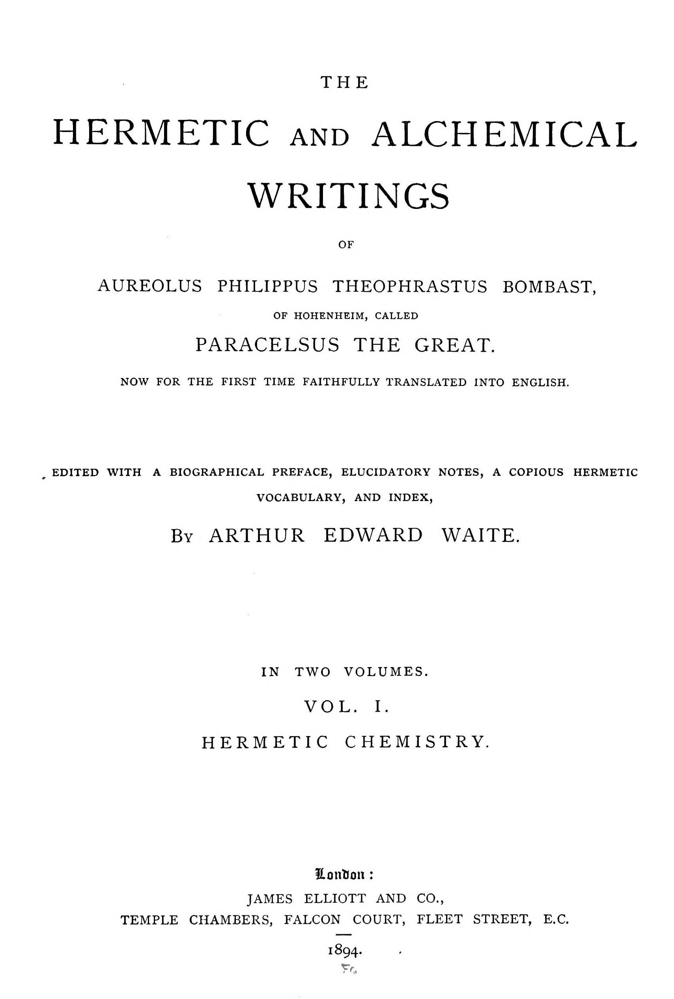

# パラケルスス『元素の生成について』ほか小論三篇

パラケルスス著／A・E・ウェイト英訳／全訳

- 原題：The Paracelsic Method of Extracting Mercury from all the Metals、The Sulphur of the Metals、The Crocus of the Metals, or the Tincture、The Philosophy of Theophrastus concerning the Generations of the Elements（ラテン語題 Philosophia de generationibus et fructibus quatuor elementorum）。A・E・ウェイトが The Hermetic and Alchemical Writings of Paracelsus 第一巻、1894年に収めた
- 内容：
  - 三つの小論は、金や銀を「水銀の水」で溶かしてその金属の水銀を取り出す方法、金属から油状の「硫黄」を引き出す方法、鉄・銅・金を焼いて薬用の「クロクス」（サフラン色の粉）を造る方法を記した、短い処方集である
  - 『元素の生成について』は、無であるイリアステルが分かれて空気・火・土・水の四つの元素が生まれ、そのそれぞれが硫黄・水銀・塩の三原質から組み立てられている、というパラケルススの宇宙論を、四つの書で述べる。第一の書は世界を包む卵の殻としての空気と、地球を卵白のように浮かべる「混沌」、第二の書は太陽（白い光と熱）と月・星々（赤い光と冷）、風の星、露と霧、天から降る金属と宝石、水晶の生成、第三の書は土の「アニアドゥス」が草木を配る仕組みと楽園から来た種、第四の書は大地を流れる川を一本の「水の木」の枝とみなす水の元素論である
  - ウェイトはこの論に、パラケルススの『気象の書』『水の元素について』などから長い補注を付けており、本文に劣らぬ分量がある
- 作業の基にした本文と扉：Internet Archive 所蔵の1894年英訳第一巻のスキャン二種（『元素の生成について』は本文・注ともコーネル大学版の OCR を主とし、Google 版で照合した）
- 著作権：パラケルススは1541年、ウェイトは1942年に死去。日本・米国・英国で保護期間が満了している
- 訳者：人工知能（Claude Opus 5.5）
- 訳の性格：ウェイトの英訳からの重訳である。四篇の本文と、ウェイトの注二十二をすべて訳した。訳者の調べたかぎりでは、日本語の全訳は出ていない（J・ヤコビ編のテーマ別抜粋集『自然の光』に一部が含まれる可能性はある）

## この本について

　本書は、本サイトで訳した『哲学者の曙』『事物の本性について』『鉱物の経済』と同じウェイト英訳第一巻の後半に収められた四篇である。ウェイト自身、序の注で、パラケルススの宇宙論は「その錬金術の必然の補完」であり、賢者の石を造る業は大宇宙の創造と厳密に対応する、と述べてこの論をこの「ヘルメス化学」の部に入れた理由を説明している。

　『元素の生成について』の世界像は、いま読むとまことに奇妙で、そして美しい。世界は一つの卵であって、空は殻、空気の「混沌」は卵白、土と水の球は黄身として、何の支えもなしに浮かんでいる。卵の中に閉じこめられた者に上下がわからないように、丸い世界には上も下もない。太陽は白い光と熱だけを一つに集めた球（マグダリオン）であり、冬の寒さは太陽が遠ざかるからではなく、太陽が「休耕」して冷たい星々の「収穫」の番になるからだという。月は欠けて死ぬたびに種を残してよみがえる「蒼穹の不死鳥」であり、露は星々のしみ出す汗、霧はまだ熟さない露である。ライン、ドナウ、ナイルは、地球の中心に根を張る一本の「水の木」の枝で、海はその木の天蓋だとされる。

　四元素説を捨てずに、それを「母胎」としての元素と、そこに宿る硫黄・水銀・塩の三原質という二重の仕組みに組みかえたところが、パラケルススの物質観の要である。ウェイトの補注に引かれる『気象の書』では、火は人を養わず、魂を体から引き離すだけだから元素ではありえず、第四の元素は火ではなく「天」である、とまで論じられている。

　冒頭の三つの小論は、同じ巻で『元素の生成について』の直前に置かれた短い処方で、金属から「水銀」「硫黄」「クロクス」を取り出す方法を記す。

　英訳の意味のとりにくい箇所や、原文の誤りと思われる箇所には〔　〕で注記した。

---

## すべての金属から水銀を抽出するパラケルススの方法

　金属の体から水銀を抽出するとは、それらを溶かすこと、あるいはそれらをその第一の質料に還元することにほかならない。すなわち流れる水銀に、じっさい金属が生まれる前に地の中心にあったとおりのものに、つまり湿った粘りけのある蒸気に還元することである。その蒸気は、すべての金属の原理である自然の水銀と硫黄とを、目に見えないかたちでそのうちに含んでいる。こうした水銀は言葉にできない力を持ち、神の秘密をそなえている。

　いま言った還元は水銀の水によってなされる。それは、ルペスキッサのヨハネスにも、ほかの者たちにも、彼らがどれほど自慢しようと知られていなかった。それゆえ、それは注意深く研究され、倦むことのない熱心さで扱われなければならない。いま言った水銀の水は次のようにして調えよ。

　緑礬と硝石と明礬とによって七度昇華させた水銀三ポンド、塩から三度昇華させた澄んだ白い硇砂一ポンド半をとれ。これらをいっしょによくすりつぶし、アルコール化〔ごく細かな粉にすること〕し、昇華器の中で砂を用いて九時間昇華させよ。塊が冷えたら、昇華物を羽根で取りのけ、残りとともに前のように昇華させよ。この操作を四度、もう昇華しなくなり、底に蠟のように流れる黒い塊が残るまでくり返せ。これを冷ましてから取り出し、ふたたびすりつぶして、調えた硇砂の水でガラスの皿の中で何度か浸せ。それがひとりでに凝固したら、ふたたび浸して乾かせ。この工程を九度か十度、それがもうほとんど凝固しなくなるまでくり返せ。湿った場所で大理石の上でごく細かくすりつぶし、それを溶かして美しい油にせよ。その油は、灰の中での蒸留によって、そのすべての滓と残りかすから精留しなければならない。この水を注意深く保存せよ。それはあらゆる水のうちではるかに第一のものだからである。そのうち八オンスをとり、注意深く清めた最も純粋な金か銀の板を、重さ一オンス半、その中に入れよ。これを閉じた器に入れ、熱い灰の上で八時間のあいだ消化させよ。するとあなたは、器の底にあるあなたの体が精妙な蒸気、すなわち水銀に変成されているのを見るであろう。水銀の水全体の溶液をつくったら、蒸留器の中でとろ火にかけて昇華させ、それをその第一の質料から分け、ガラスの器に注意深く保っておけ。こうしてあなたはその体のまことの水銀を手にするであろう。その用いかたは、絶望的な症例においても、ただ注意深く用いさえすれば、驚くべき、天上のものである〔注1〕。そしてそれゆえに、ふさわしくない者に明かしてはならない。

## 金属の硫黄

　金属の硫黄とは、金属そのものから抽出された油けであって、人の健康のためのまことに多くの効能をそなえている〔注2〕。もう一つの硫黄は、金属がまだ火を経ないうちに、たとえば金や銀の白鉄鉱やほかのものから引き出される。それらは鉱物の高貴さに応じて位とすぐれかたを持つ。同じようにまた、それは白鉄鉱やコバルトの鉱物からも、それぞれの本性と特性とに従って引き出される。

　より一般的な抽出の仕方は次のとおりである。注意深く蒸留した酢をとる。それは、緑礬と塩と硝石と明礬とを蒸留して造ったカプト・モルトゥウム――それ自身もまた蒸留器によって蒸留されたもの――の上に、二十四時間置いておいたものである。これを、言っておくが、ガラスの器の中の粉にした金属の体の上に、指七本の高さだけその上に立つように注がなければならない。それから馬糞の中に置いて九日間消化させよ。色のついた酢を、余分の油になるまで灰の中で蒸留せよ。その油は湯煎の中か日光の中で精留せよ。そうすればあなたは、その金属の体のまったく最もまことの硫黄を手にするであろう。それはあなたの判断で正しく用いるがよい。

　抽出はまた、鋭く、よく分離した灰汁によってもすることができる。だがほかの硫黄は、灰のアルカリのために――我々はそこからクラウェラトゥス〔原文 clavellated。灰汁から造る〕の腐食性の物質を造るのであるが――また、そうした灰汁がそれから組み立てられる石灰のために、体の内服にはあまり適さない。こうして抽出した硫黄は、甘い水で洗い、沈殿させることができる。そののちの消化には倍の時間が要る。灰汁もまた、昇華によってすべての土の沈殿物から精留されるべきである。そうした硫黄がそれと合体して腐食性になり、病人に害を与えることのないように。いま言った分離がなされるべきなのは、これを防ぐためである。生の材料についてはここまでとする。

　だがこんどは、これらを融かし清めたのちに、その硫黄を引き出すことができる。私が錬金術についての論文ではっきりと述べたやり方で調えた、塩の水あるいはその油によるほど確かで、高貴で、よいやり方はない。そうした水は、すべての金属の体から、その土台と根からそれらの自然の液を、あるいはあらゆる医学上の、また錬金術上の目的のためにまことにすぐれた硫黄とクロクスとを抽出する。それはどんな金属をも溶かし、砕き、操作者のさまざまな意図と勤勉とに従って、それをその金属の本性から何かほかのものへと変える。

## 金属のクロクス、すなわちチンキ

　金属のクロクスには四つの種類がある。太陽（金）の、ウェヌス（銅）の、マルス（鉄）の、そしてカリュブス（鋼）のクロクスである。最上のものはカリュブスのものである。それは反射炉加熱か焼成によって、いま言った体を塵に還元することで抽出される。同様に、鑢でおろした鉄は錆によって食いつくされる。錆による食いつくしは、錆を生むものを浸みこませることと、錆の色を抽出する煮つめとによってなされる。

　沈殿物から注ぎ分けた古い尿を何杯かとり、その中に挽いた塩を三つかみ溶かせ。漉したら、それを煮てあくを注意深くすくえ。この中にさらに、つぶした緑礬一つかみを、つぶした硇砂二、三オンスとともに溶かし、それからまた注意深くあくをすくえ。この液で鑢くずを浸し、粉にできるようになるまで煮よ。こうしてできた塵を強い火で反射炉加熱にかけ、鉄の棒でたえずかきまぜよ。それがそれ自身の色から別の色へ、そしてついにまことにあざやかな菫色の色合いへと変わるまで。ここから、葡萄酒の精か蒸留した酢で、たやすくチンキを引き出すことができる。そしてそれが元素の分離によって抽出されたら、ガラスの底に残るものを集めよ。それによってあなたは、体の内でも外でも驚くべき効果を生み出すことができるであろう。

　ウェヌスのクロクスを造るには、注意深くアルコール化した銅の錆を一、二ポンドとり、その上に蒸留した酢をたっぷり注ぎ、毎日三度よくかきまぜよ。色のついた酢を静かに注ぎ分け、乾くまで灰の中ですっかり昇華させよ。この粉をのちに温かい水で九度洗ってあらゆる刺激を取りのぞき、それから乾かせ。そうすればあなたは、調えたウェヌスのクロクス、すなわち真鍮の花を手にするであろう。お望みなら、外科の大著に与えた指示に従って、そこからたやすく油を抽出することができる。その用いかたもそこに説明してある。

　太陽のクロクスは塩の水によって抽出すべきである。それによって金属の本性、すなわち展延性が壊される。残りかすを温かい水で洗ったら、葡萄酒の精でクロクスを抽出することができる。そしてこれをまた分離すると、クロクスが底に残るであろう。これは、高めることと、五つの違う度の火で昇華させることとによって、液に、すなわち太陽のまったく最もまことの第五精髄に変えられる。これによってあなたは驚くべき効果を生み出すことができる。だがそこには、ただ空想するだけの操作者ではなく、活発で熟練した操作者が必要である〔注3〕。

---

**英訳者（ウェイト）の注**

〔注1〕　たとえば、金の赤い水銀は、傷とペストの治療によい薬になる。すなわち、嘔吐を防ぐために沈殿物に還元すればである。これはその下剤の部分を上へ分離することでなしとげられる。金のどの調製においても、肝心なのはその余計なものを取りのぞくことだからである。ペストにおいては下す必要はない。だが金は下剤であり、強壮剤であり、収斂剤である。それ〔下剤の部分〕を取りのけ、残りを保て。ペストの薬は、その付随症状に用いるものと、その治癒に適したものとに分けられる。治癒については、金と宝石との霊が最上の薬であって、それによって、体のどこに位置するペストもすべて最もよく癒されると理解せよ。主なものは金であり、第二は宝石である。宝石は強壮剤であり予防薬だからである。同時に、すべての腫れものはできるかぎり内から治すべきであることを覚えておかなければならない。このゆえに、傷の飲み薬について言えば、内なるムミアにまさるすぐれた薬はない。どんな傷も外からは正しく癒されない。内なるムミアこそ完全な治療薬である。それ以外では、金そのものほど崇高な肉芽形成薬はない。――『ペストについての断章』。

〔注2〕　金属の硫黄、またじっさい鉱物からも抽出できるあの硫黄は、水腫にとくに役立つと言われる。それは乾かす本性を持ち、いわば一つの太陽、すなわち太陽の熱であって、体のこの雨を散らし、蒸気となって去らせるからである。――『水腫について』。

〔注3〕　傷からの血の流れは、最も巧みに反射炉加熱したマルスのクロクスによって止めることができる。――『大外科書』第二論文第十章。さらに、水銀のクロクスと花とは潰瘍の治療にうまく用いることができる。――『大外科書』第三部第五書。鉄のクロクスは、もし反射炉によってアルコール〔ごく細かい粉〕に還元されれば、鉄の油でうまく治療される同じ潰瘍を治すと考えられている。ただしそれらが流れるのをやめ、しかるべき熟しかたに達していればである。――『フランス病の腫瘍と膿疱について』第十書。職人や工人によって、彼らが日々用いる物の中にある秘薬が見いだされる。たとえば真鍮職人は焼いた真鍮で血の流れを止め、流れる傷を乾かしてきた。鉄の職人は、鉄のクロクスと呼ばれる焼いた鉄を傷に用いてきた。陶工もまた、彼らが銀の、あるいは金の密陀僧と呼ぶものでいくつかの発見をした。実験と呼ばれてきた俗人の発明は多い。それよりさらに多くのもの、たとえば鉛丹や鉛白などは、ここで記す必要はないが、さまざまな物質に対する錬金術師たちのさまざまな試みから生じたものである。――『傷の外科』第九章。銅のクロクスすなわち花は、腐食性の潰瘍の治療に役立つように用いられ、ふつう二つの仕方で調えられる。その一つは、蒸留したボティン〔原文 Botin。テレビン油のこと〕によってその緑を抜きとり、そしてそのボティンをまた抽出するというものである。それでも、ウェヌスの力は、緑礬を加えなければ弱い。だが私が緑礬とみなすのは、ウェヌスの体から抽出されたものである。――『フランス病の腫瘍と潰瘍について』第十書。

## テオプラストゥスの哲学――元素の生成について〔注4〕

### 第一の書　空気の元素について

#### 本文一

　初めに、無であるイリアステル〔パラケルススの用語。万物の未分化の原質料〕が分けられ、そうして四つの元素を与え、配した〔注5〕。それはちょうど、茎がそこから生える種のようであった。種が生み出すものを、種は同じ形でふたたび自分のうちに受けとることはない。だがこのイリアステルは、ふたたび四つの元素を自分へと引き寄せる。こうしてそれは溶かされ、四つの元素が生み出される前にそうであったものになる。ただ世界の一年が経過しさえすれば。四つの元素はイリアステルから生み出された成長物である。そして種は、この世界の一年ののちに嬰児がそこから生み出される当のものを与えはしない。四つの元素は母でもあり娘でもある。この一族のうち、死ののちに生きのこるものは何も見いだされない。その終わりはその起源と同じであり、それゆえその中にあるものは何であれ、同時に滅びる。そののちにもう一つの世界が続き、それは名においてはこの世界の娘であるけれども、形においても、本質においても、その類においてもそうではない。それは過ぎ去ることがなく、魂のようにとどまるであろうから。魂はたしかに造られ創られたものであるが、死すべきものではない。この世界の運命もまたそうである。

#### 本文二

　さて、自分の子の父であるばかりでなく、死すべきものと死なないもの、とどまるものと移ろうもの、祝福されたものと呪われたもの、そのすべての父でもある永遠の父が、ドモル〔原文 Domor。パラケルススの造語で「家」の意か〕を、すなわち天と地、蒼穹と水とを創り、それに自分の神の意志をも与えたことは、まったく確かである。この主題をここでそれ以上論じることはしないが、同じことは『パラミラ』に読むことができる〔注6〕。神は自然でないものから自然のものを形づくった。かつてどんな自然も感じたことのなかったものから、神は別の自然を生み出し、その自然に続いて、さらに別の自然が生み出されることを望んだ。一年がめぐるあいだに。その中で神の威光みずからが神の統治を行い、それをいまは人が加減し、所有している。だがこれらの最初の自然はそれぞれ違っている。それゆえ、土からは梨の木が、砂からは薊が、水からはカキミアが、空からは混沌が、火からは雪が生える。だがこれらのものがいかに驚くべきものであり、それらが生じたもとの最初の源にいかに似ていないかを見るとき、我々は、水の元素はただ水であるだけでなく鉱物でもあり、土の元素はただ土であるだけでなく葡萄でもあり、ほかのものも同様である、ということを知識と哲学の事柄とすべきである。土はたしかに元素であるが胡桃ではない、とか、火は元素であるが雪ではない、とか言いふらす哲学はむなしいからである。同じように、四つの元素はすべてのもの、あらゆるものの中に存在する、と言う者たちも、ただのたわごとを持ち出しているのである。

#### 本文三

　土は元素であり、そこから生み出されるものも何であれそうである。水もそうであり、そこから生み出されるものもすべてそうである。それゆえ、生み出すものが元素なのである。そして元素とは母であり、それは四つある。空気、火、水、土である。この四つの母胎から、世界全体のあらゆるものが生み出される。そして、元素とは単に一つの気質、すなわち温、乾、冷、湿、あるいはこれらの複合を授けられたものにすぎない、と主張する者たちの言葉は、思慮が足りない。これらはみな、この四つの元素のすべての中にあるのである。あなたは次のように理解することができる。土は冷にして乾、冷にして湿、温にして乾、温にして湿である。事情はこうである。温にして乾であるものが土から生えるなら、それは土の中の温にして乾であるものから生える。冷にして湿であるもの、あるいはそうして生み出されるものは、土の中の、それと似た本性のものから生み出される。同じように、火からも四つの気質が出てくる。たとえば雪は、火の中の冷にして乾であるものから、稲妻は、火の中の温にして乾であるものから。ほかの二つの元素についても同じである。それゆえ私は、この点で何よりもまずあなたに忠告しておきたい。元素をその気質に従ってではなく、その形に従って、すなわち、それらがそのうちに持つ四つの母胎とは何かに従って定めるように、と。土は物質的で、粘土質で、粘りついている。それが温であれ、乾であれ、冷であれ、湿であれ、そうである。水は湿っていて、感じることができ、触れることができるが、体としてではなく、物質としてではない。そしてそれが冷であれ温であれ、元素はそういうものである。火は蒼穹であり、ある所では温、別の所では冷であっても、火の元素である。空気はすべてのものを包む天であって、のちに述べるように、湿、温、冷、あるいは乾である。

#### 本文四

　さて、元素に関する確立した原理へと進むために、次のことを理解せよ。イリアステルは初めに四つの部分に分けられた。すべてのものを抱く天である空気、昼と夜、冷と熱とを生み出す蒼穹である火、あらゆる種類の果実と、我々の足のための固い土台とを与える土、そしてすべての鉱物と、生きものの養いの手だての半分とがそこから与えられる水である。

　これらの養いは二重であって、一つは空気と火のうちに、もう一つは土と水のうちに見いだされる。前の二つは我々を、いわば霊的に、目に見えないかたちで養う。あとの二つは物質的に、体として養う。この四つの元素は二つの組に分けられる。一つは空気と火とから、もう一つは土と水とから成る。空気は火を支え、土は水を支える。空気と火とは水と土とを保ち、この二つは空気と火とを保つ。こうしてすべてのものはしかるべき順序で創られた。一方が他方を支え、求め、養うように。こうしてイリアステルは一つのドモルへと分けられ、その中には二つの小球、外のものと内のものとがあって、そのそれぞれが二つの元素で囲まれている。

　その外には、我々の知るかぎり、何もない。内にあるのは、我々が見、触れるもの、自然の光が我々に示唆するものである。これらのものを創った方は我々のあいだにはおらず、我々の外に住んでいる。だがその方から生まれた方は我々のあいだにいる。それでも我々は、四つの元素について、自然が教え、我々に道を指し示す以上に哲学してはならない。

#### 本文五

　初めに、四つの元素の体は、天が広がっているのと同じ形と広がりとをもって据えられた。そしてそれは、空気がそれを取り巻くかぎりにおいて、腐敗するもの、滅びるものとして造られた〔注7〕。そこに神の座と、神の国の中心とがあった。その中心から世界が創られたのである。ただしそれが、神によって創られた、何か死すべき滅びるものであるようにして。これを正しく理解するには、その中心から世界が生じ、物質的にされたことを知らなければならない。この座の上でキリストは十字架にかかった。この座の上に預言者たちが座った。それは神の足台である。それゆえここで、物質的で体的なものが神とされ、神の業、神の国の中心、神の座とされるのである〔原文のまま。意味がとりにくい〕。

　それゆえ、初めに、哲学そのものが繰りひろげられる前に、神がその天の中心を、いや、神自身をも滅びうるものにしたことを知っておかなければならない。神が体として子と呼ばれるように、世界は神の家なのである。だが、それがこのように造られ創られているとしても、それは生み出されたときのようには滅びないと信じなければならない。人については心臓がとどまり、世界についてはその花が永続するであろう。

#### 本文六

　神が世界を創った仕方については、次の説明を受けとれ。神は初めに、元素が育ちつつあるあいだに、それを一つの体に還元した。この体を神は三つの成分、すなわち水銀と硫黄と塩とから組み立て、この三つが一つの体をなすようにした。この三つから、四つの元素の中にある、あるいはそこで生み出されるすべてのものが組み立てられている。この三つは、そのうちに、すべての滅びうるものの力と能力とを持っている。その中に、鉱物も、昼も、夜も、熱も、冷も、石も、果実も、ほかのすべてのものも、まだ形づくられていないうちから隠れている。それはちょうど、投げ捨てられ、ただの木にすぎない木のようである。それでもその中には、動物の、植物の、道具のあらゆる形が隠れていて、ほかには役に立たないものを彫ることのできる者なら誰でも、それを考え出し生み出す。そのようにイリアステルの体はただの丸太であったが、その中にはすべての草、水、宝石、鉱物、石、そして混沌そのものが隠れていた。それらを、至高の造り主だけが、余計なものをすべて取りのけ捨て去って、このうえなく精妙に彫り、形づくったのである。まず第一に、神は空気を生み出し、分けた。これが形づくられると、残りからほかの三つの元素、火と水と土とが出てきた。これらから神はのちに火を取りのけ、ほかの二つが残った。そしてしかるべき順で、そのように続いた。

#### 本文七

　それゆえ、四つの畑がこのようにわきへ置かれ、分けられると、四つの元素を保つための四つの倉もまた残った。すなわち、熱いもの、冷たいもの、湿ったもの、乾いたものである。そのどれも、決して重要でないものではなかった。まず空気が整えられ、のちに火、それから土、そして最後に水が、次のようにして整えられた。空気からは、混沌と、座と、鎖と、土台とが出てきた。火からは、夜と昼、太陽と月とが。土からは、木々と草、牧草と果実とが。水からは、鉱物と石とが。これらの続きかたは、余計なものからたえず何かほかのものが生み出されるように整えられた。たとえば、土のイリアステルから橅の木が抽出され、林檎の木が取りのけられた。それぞれがそれ自身の場所に配され、何一つ腐敗したり混じりあったりしなかった。水の中では、金がほかの金属から分けられ、そののち、ほかのものもまた順に取りのけられた。火の中では、冷が熱から、光が闇から退いた。空気の中では、すべてのものを保つため、そして地を天から分けるために、混沌が整えられた。これら四つのイリアステルが元素に従って、すなわちそれらの果実の母胎に従って創られ整えられると、空気がほかの何よりも先に調えられ、それからのちに火が調えられた。この二つは合一のうちにつなぎあわされた。のちに土もまた水も、前の二つから分けられて、一つに結ばれた。これらがいま結ばれているイリアステルたちである。空気はそれ自身で、火もそうである。同じように、土と水もまたそうである。

　こうして神はその座の物質的な中心を造り、のちにそれを三つの第一の元素に分けた。そこからたえず、生まれるものすべてが出てくる。この三つがなければ、四つのイリアステルの中で何も育つことができない。だがそれらは育つあいだは元素であり、それゆえさらに、イリアステルという名を失って元素と呼ばれるのである。

#### 本文八

　これら四つの元素は、それぞれ固有の場所と座とに分けられ、そのどれも混じりあわないようにされた。これらはみな取りのけられた。ちょうど彫刻家が像をつくるとき、思い描いた像に合わないものを捨て去るように。それゆえ元素は四つあるが、第一のものは三つだけである。空気の中に三つ、火の中に三つ、土の中に三つ、水の中に三つ。どこにも第一のものの三つ組がただ一つあるだけである。すなわち、すべてのうちに一つの水銀、すべてのうちに一つの硫黄、すべてのうちに一つの塩。それでもそれらはその特性において異なっている。育つものは何であれ、草も葉も牧草もその類も、土へと追いやられた。鉱物であるものは何であれ、水の中へと退いた。温かいもの、冷たいもの、昼、夜は何であれ、火へと向かった。空気であるものは何であれ、混沌の上に広がった。そしてこれらの三つはみな、それぞれそれ自身のうちで一つである。それはちょうど、一つの石が四つの部分に分けられ、一つからは像が、別の一つからは水差しが、三つ目からは何かほかの種類の器が、四つ目からは里程標がつくられるようなものである。それでもそれらはみな石であり、いや、四つの部分に分けられていても、みな一つの石なのである。

　これらのイリアステルは四つあって、それ以上はない。これで十分だからである。こうして神は世界を四つ組に配した。神はこの数で満足した。八つの部分をつくることもできたのであるが。養いの一つの分け前を神は空気に、二つ目を火に、三つ目を土に、四つ目を水に授けた。どこにも欠けたところはなかった。

　そしていまさらに、我々の哲学の歩みにおいて、これら四つを元素の名のもとに扱い、その可能性と働きとを語り、それらが何においてすぐれているかを述べていく必要がある。我々は空気から始め、水で我々の哲学を結ぼう。感じとれないものの本性が求める説明を添えながら。

#### 本文九

　空気の元素は、ほかの三つの住まいであるため、そのそれぞれがいわばその囲いの中に保たれるため、という以外の目的のためには定められなかった。それは次のような仕方による〔注8〕。空気はそのうちにすべての死すべきものを囲いこみ、それを死なないものから閉ざす。ちょうど壁が都市を畑から分けるように。それは世界を強め、まとめておく。ちょうど堤が沼をそうするように。そして、卵を外から、すなわち卵の外側から見る者には、内側にあるものと合うものが何もないように、空は天と地とを分ける殻である。ちょうど卵の殻が卵をその外にあるものから分けるように。空気はまた、一つの体、すなわち世界全体がしまわれている皮のようなものであって、その中に地が含まれ保たれている。それゆえ空気とは、この空であり、皮であり、卵の殻であり、壁であり、土塁であって、その外へは何も突きやぶることができず、その内へは何も押し入ることができない。さらに空気は息であって、そこから皆が生命を引き出す。これこそまことに空気そのものであって、四つの元素を養い、同時に人の生命を支える空気を送り出す。それがなければ誰も生きることができない。これがなければ、どの元素も進むことができず、どの風も吹くことができず、どの雨も雪も降ることができず、どの太陽も輝くことができず、どの夏も栄えることができず、どの水も流れることができず、どの土も支えることができない。この力はすべて空気から出て、四つの元素によって引き寄せられる。肺が刻一刻と空気を吸いこむように、土もそうし、水と火もそれぞれまったく同じことをする。風は空気によって起こされると定める説は、明らかな誤りである。風は生命の手だてとしてではなく、毒のように我々に襲いかかる。第一の元素は空気をもたらすが、火が風を与えるのである。

#### 本文十

　この同じ元素からはまた、火が空気に結ばれて落ちないようにする力も流れ出る。それはこうして、物質性も可視性もなしに、まとめ結びつける鎖のようなものである。これをそれは、その混沌によってする。その混沌を、それは薄皮と地とのあいだに差しはさむ。天から地まで広がる中間の空間もあって、その中で火と土と水とが釣りあっている。そして雛が卵の中で、殻に触れることなく卵白によって支えられているように、混沌は地球を支え、それがぐらつかないようにしている。この混沌は目に見えない。もっともかすかな緑の色合いを帯びて見えるのではあるが。それは触れることのできない卵白であって、地がその位置から落ちないように支える力と特性とを持っている。雛がその卵白の中にあるように、この土と水の球は空気の中で釣りあっている。船が大洋に浮かべられるように、この球は空気に浮かべられている。それは、土と水の球を目に見えないかたちで支える一つの広大な驚くべき卵白である。それは蒼穹そのものをさえ浮かべている。蒼穹は、胡瓜の種がその粘液の中に置かれているように、その中に置かれている。そして肉のどのひと切れもそれ自身の液の中に横たわり、あるいは生む種が精液の中にあるように、星々はこの卵白の中に横たわり、その中を飛ぶ鳥のように動く。それらが浮かべられている仕方は、挙げたたとえから明らかなもののほかにない。少なくともただ一つの違いがあるだけである。混沌は、触れることができず、きわめて精妙であるという点で、卵白や精液に似ていない。そのほかの点では、そのすべての力と働きとにおいて、挙げたものにまさしく対応している。

#### 本文十一

　この元素の力を論じるにあたって、さらに指摘しておくべきは、空気とその混沌と空とが、それらにそなわった丸い形をとって存在している、ということである。何が上で何が下かを、誰も指し示すことも区別することもできない。一つの例を挙げよう。もし誰かを卵の中に閉じこめることができたとしたら、どの部分が空のほうを向き、どの部分が地のほうを向いているかを知ることはできないであろう〔注9〕。丸さが「上」とか「下」とかがあることをさまたげるのである。そのように我々は殻の中に閉じこめられていて、どちらが上でどちらが下かを知らない。世界じゅうを歩きまわって、我々は空を見上げるが、どこにも高さがあり、同時にどこにも深さがある。その原因は球と空との丸さにある。それゆえ、すべてのものが三重の線の中で育つことは、どの死すべき体にとっても自然なことであって、人が歩くだけでなく、木々も、金属の鉱脈も、泉も、この道筋をとる。神が球と空との円を創ったように、神はまた半円も、直径も、子午線も――三重の線である――、またそれに似たほかのものも据えた。天と地のうちに、火と水のうちに、すべての線とすべての円とが見いだされるからである。ここにもまた、まことの地理学、宇宙誌、幾何学がある。空気の元素の地理によって、空気の構造、すなわち太陽と月、すべての星々、地の木々、ほかのもの、たとえば水の鉱物やその他のものが保たれている。ここにもまた疑いなく、あらゆる幾何学のまことの土台が見いだされる。そこでは人が、天を見上げるまっすぐな線のように立っている。この幾何学の工匠、石工、幾何学者は、ただ神のみである。この線からは、水であれ、火であれ、土であれ、木であれ、人であれ、獣であれ、何も外れ落ちず、はみ出しもしない。すべてのものは、この空気の幾何学へと向かっている。それを神は、石工が塔の上の像を刻むように、造り刻んだのである。

#### 本文十二

　さて、三つの第一の元素の哲学に関しては、それらが空気の元素の中でいかに栄えるかを見なければならない。水銀と硫黄と塩とは、空気の元素として調えられて、空気を構成し、その元素をなしている。初めに、空とは、塩の霊とともに凝固させられ、水銀によって澄まされた白い硫黄にほかならない。そしてこの元素の硬さは、そこからこのように形づくられたこの薄皮と殻とのうちにある。それから第二に、三つの第一の部分から、それは二つに変えられる。一つの部分が空気、もう一つが混沌となるのであって、それは次のようにしてである。硫黄は塩の霊によって水銀の液の中で溶ける。その液はそれ自身、天から地まで配られた一つの液であって、天の卵白であり、中間の空間である。それは澄んでいて、精妙で透きとおった混沌である。そのあらゆる濃さ、乾き、そしてそのあらゆる精妙な本性が溶かされ、もはや前と同じではない。空気とはそういうものである。三つの第一のものの三つ目の残りは、次のようにして空気へと移った。木を燃やせば、それは煙へと移る。そのようにこれは空気へと移り、その元素の終わりまでその空気の中にとどまり、硫黄と水銀と塩とになる。それらは実体として食いつくされ、空気に変えられる。ちょうど煙になる木のように。それはじっさい、空気の三つの第一の元素の煙にほかならない。それゆえ、空気の元素からは、いま述べたもの以上には何も生じない。古人や後代の著者たちの多く、いや、いま生きている者たちの中にさえ、風を空気に帰し、その原因を空の動きやすさにあるとする者がある。それはまったく何でもない。風は決して空には届かない。そして空気はそれ自身で存在し、木から煙が出るようにその元素から出てくる。それについて、またその動きとは何かについて、もっとはっきり理解したいと望む者は、火の特性について読むがよい。そこにはここに収められる以上のことが書きとめてある。

---

**英訳者（ウェイト）の注**

〔注4〕　四つの元素の生成と、三つの第一原理、すなわち硫黄、水銀、塩とについてのパラケルススの哲学は、彼自身にも、またその編者たちにも、彼の錬金術の教えと実践の欠かせない部分とみなされていたように思われる。それをこの翻訳の第一部に含めることは、決してヘルメス化学の論点の外に出ることではない。大いなる業の達成における過程を、大宇宙の創造との厳密な類比を示すものとみなした達人は、パラケルススが最初ではなかった。あらゆる錬金術がそれを言い張っている。大いなるマギステリウム、すなわち賢者の石の調製をなしとげた者は、それによって大いなる神秘（ミュステリウム・マグヌム）の秘密に参入したのであり、また他方では、宇宙の生成においてはたらいたまことの原理を正確に理解すれば、それだけで誰でも哲学の秘薬について十分な、実地の照明を得るのであった。パラケルススの宇宙論の哲学は、その錬金術の必然の補完であって、両者をあわせて学ぶことがそのどちらかに光を投げそうであろうとなかろうと、学ぶ者にはその二つをくらべる機会が与えられなければならない。この目的のために選んだ論文は、ジュネーヴ二つ折り版の第二巻から訳したものであり、添えたおびただしい注は、パラケルススが未完のまま残した、あるいは何かほかの理由で不完全な状態で我々に伝わった、類似の著作から取ったものである。

〔注5〕　神が世界を形づくろうと決め、その本性と創造の仕方とについて神の摂理と協議したとき、神はそれを四つの部分、すなわち体に分けた。それを神は万物の母とするつもりであったが、ただし神が自分の似姿に従って創ろうとしていた者、すなわち人アダムに従うものとして。それゆえ、その事柄が神によって協議され定められたとき、いま言った四つの体が創られた。すなわち天、地、水、空気である。聖書が言うように、天がまず創られ、それから地、そしてそののちほかの二つが創られたからである。それゆえあなたは、これら四つの体、母、あるいは母胎が存在するのは、それらが果実を生み、人の養いに必要なものを供するためであることを知らなければならない。たとえば、地はその固有の産物を生み出すが、それを用いるのは地ではなく人である。同じように、天はそれ自身で自由な一つの体であって、そこから果実がただ人の用のために出てくる。――『気象の書』序。

〔注6〕　だが、以下の注を訳出したもとの論文や論文の断片の中では、もっと完全に、豊かに〔論じられている〕。

〔注7〕　だがいま我々は、天の体の本性が何であるかを理解しなければならない。土、水、空気はそれぞれ固有の体を持っている。だがじっさい、四つの元素の四つの体はみな無から造られている。すなわちそれらはただ神の言葉によってのみ造られている。この無は、そこから何かが生み出されるものであって、実体と体とに変わる。そして四つの元素のすべてのその体は三つの種に区別される。それゆえ創造の「あれ」（フィアト）は三重の体となった。こうして土もほかの元素も、みな三重である。同時に、元素のあいだには、四つのものが一つの体ではないような区別がある。空気は一つの体、土はもう一つ、水は三つ目である。もしこれら四つが同じような体を持つなら、天もそうであろう。だが土は三つの体を持ち、水も天も空気もそうである。それでも一片の木は一つの体、金属はもう一つ、石はもう一つ、海綿はもう一つである。同じように、体の四つの元素は別々に分かれている。ちょうど誰かが鉛をとって、そこから鉛丹、鉛白、ガラス、サトゥルヌスの霊を造るかのように。それゆえこれら三つの種は四つの元素へと分けられ、それぞれに固有の体が割りあてられている。これらの数にもっと正確な注意を払うなら、神みずから三を選び、すべてのものを三から組み立て、三つすべてを分けた。この数の起源は直接に神からであり、神性における原理が三だからである。さて、言葉もまた三重であった。そして言葉は天と地と、すべての被造物の始まりである。すべてのものは三において総合されており、地の上に、三から、三において成り立たず、ふたたびその三へと還元されないものは何もない。それゆえ一方では、どの被造物も、それぞれその場所において三つへと分けられうることが明らかである。だが他方では、彼らが四つのもの、すなわち元素について、どの物も四つの元素から成ると独断していること――それは誤りである。どの物もそのうちに一つの気質を含み、それ以上は含まない。またそれは、その母から受けとるもの以外の元素を持つことができない。たとえば、どの草も一つの元素、すなわち土の元素だけを持つ。どの石も一つの元素、すなわち水の元素を持つ。だがそれに加えて、それは冷にして湿、冷にして乾、温にして湿、温にして乾という気質を受けとる。それでもそれは一つの元素の全体ではなく、元素とは母胎、たとえば水や土なのである。たとえば、人は土の泥から取られた。だが元素は泥ではなく、第五精髄である。それでもそれはふたたび元素になる。すなわち、元素と肉とのあいだにある区別をもって、元素へと還るのである。それゆえ元素はただ三つへと還るのであって、この三つが元素の第一の質料である。だが水、土、空気、天の第一の質料のありかたはさまざまである。三という数は、実のところ三つの種だけを構成し、その三つが一つの完全な体をなし、そしてその同じものが術によって自然のすべての体のうちに見いだされるからである。この三つは第一の質料であって、ただ一つの名を持つ。第一の質料は神のようなものである。神性に三つの位格があるように、ここでもそれぞれの種はその務めにおいてそれ自身で分かれているが、三つの務めは第一の質料という一つの名のもとに包まれている。この第一の質料は、神によって四つの部分、すなわち元素へと配られた。土の第一の質料のうちに宿るものは何であれ、土へと分けられつつあるか、分けられてしまっている。ほかの元素についても事情は同じである。こうして、すべてのものはそのあらかじめ定められた形へと定められている。土は土であるよう、その務めとともに定められ、ほかのものも同様である。こうしてすべてのものは一つの体から成り、それでいて四つの体があり、四つの元素はみな四つの体へと配られ、それ自身三重である一つの質料から形づくられている。それは初めに言葉から形づくられたのである。三つの最初のものは三つの部分、すなわち火と塩とバルサムである。すべての体はこの三つから成る。すべての元素と、そのすべての果実とが。土はその体において三重である――火、塩、バルサム――。そしてそこから育つものも同じように三つの種へと配られる。木の体は火、塩、バルサムであり、バルサムから生まれるものも火、塩、バルサムである。水をその母胎とする果実も同じである。天も同じであり、その果実は太陽などである。雪や雨も同じようである。それゆえ自然の術は、果実から、火、塩、バルサムのほかには何も抽出することを我々に教えない。それらもまた火の力によって互いに分けられ、火と塩とバルサムとが別々になる。さて、火はまた硫黄とも、塩はバルム〔原文 balm。塩と液の呼び名が入れ替わっているか〕とも、液は水銀とも呼ばれる。だが我々は、元素とは何かについてはっきりした考えを持たなければならない。さて、人は多くの実体を含む大きな体を持っている。だが人そのものであるもの、すなわち魂と霊とは小さなものである。体が人と呼ばれるのは、人が体の中に隠れてとどまっているからである。同じように、目は人の中でかなりの部分であるが、見る力は目にくらべればごく小さい。同じように、土は元素と呼ばれるが、それは粗い体であって、そのまことの元素は、人の中の霊のように、目に見えないかたちでその中に隠れている。ほかの元素についても同じであって、それらはたしかに体を持つが、その本性と実体とにおいては霊である。それゆえ、これやあれが元素から出てくると聞くたびに、それはその元素そのものから出てくるのであって、その体から出てくるのではないと理解せよ。人の中では舌が話し、また話さない。というのも舌の中では霊が話すのであって、その霊が体と親密に混じりあい一つになっているために、体がすべてをするように思われるのである。黄楊の香りは黄楊の霊であり、それ以外のものはその体である。麝香の魂はその香りの中にある。珊瑚においては色が霊である。こうしてすべての果実は、その元素と同じように、体とともに霊を持ち、まことの果実は目には見えない。それでも自然の霊と超自然の霊とのあいだにはある違いがある。前者は体を持ち物質的であって、体を持つ体の中に存するが、後者はまったく体を欠いている。自然の霊の体は、自然によって、それ自身の元素の別の体をまとわされている。だが天については、神がそれに蒼穹の名を与えたことに注意すべきである。蒼穹とは天とその実体の全体である。ほかの三つの元素は、卵が殻の中にあるように、蒼穹の中に含まれている。神がそれに与えた名を示すことによって、神は、蒼穹に力を授け、それが確かな殻となって、その中に自然のすべての被造物がしっかりと収められるようにしたことを教えている。そして、卵を上に置こうと下に置こうと、黄身がその場所で動かずにとどまるように、天についてもそうである。我々がどこに住もうと、我々は高いところに住んでいるとも低いところに住んでいるとも言え、自分を上に住む者とも下に住む者とも呼ぶことができる。円には頂も底もないからである。――『気象の書』第二章。

〔注8〕　元素と、存在するすべてのものとは、ちょうど家がその土台の上に建てられるように、空気の元素の上に建てられている。だが我々は、空気を支えているものについて哲学しなければならない。この力は、三一の神が住む空気の外の部分に位置していて、空気がたわむことも破れることもないように、それを治め支えている。滅びうるものが滅びないものの天球へ落ちこむことはありえないからである。さらに、それは落ちることができない。すべてのものは上へ向かい、何も下へは向かわず、底も深みもないからである。というのも空気はその円の中でまことに堅く固められているので、外の国がその時の来るまで滅びえないのと同じように、破られることも溶かされることもありえないからである。その時が来れば、それは中心へ向かって内へとくずれ、空気と星々とは地の球へと突進し、そのとき球はそれらによって、ひとかけらの灰も残らないほどすっかり焼きつくされるであろう。この破壊の仕方は、何も円から外へはくずれず、すべてが内へ、中心へとくずれる、というものであろうから。そしてこれこそ哲学の最高の秘密である。外には深みがないから、円は中心へと突進する、ということが。――『気象の別の第一書』「空気の元素について」。

〔注9〕　空気は元素とすべての被造物とを保ち、それらがその道筋と中心とのうちに持ちこたえるようにする。陸と海とは一つの円の中心であって、空気がその円周である。土と水とは一つの球をなし、何の上にも載らず、四方に自由で、空気の元素に取り巻かれている。その空気は一つの広大な混沌のようなもので、無知な者たちが天と呼ぶものを覆い隠している。この混沌の中にすべての被造物が包まれ、巻きこまれている。空気の円と、中心にある土と水の球とのあいだには、一つの支える働きが介在していて、それは卵の殻と黄身とのあいだに挟まれた卵白にくらべることができる。――同。

### 第二の書　火の元素について

#### 第一論文　本文一

　ここまで我々は、元素が配された位置に従って、空気の元素について語ってきた。空気は位置において第一である。その次に火がある。この二つが地球全体を構成し、取り巻いている〔注10〕。次に我々は、火の元素にかかわることについて哲学しよう。

　まず第一に、イリアステルから空気と火とが分けられた。のちにこの二つは互いに引き離され、前の書で指摘したように、空気が第一の場所を占めた。その次の場所を火が占めた。分離の過程によって、この二つの元素、空気と火とは分けられた。空気からは天が生み出され、火からは蒼穹が出てきた。空気の中には混沌だけがあってほかには何もないように、火の元素の中には熱と冷、光と闇のほかには何も見いだされない。だが、球からも空気からも退くものは何であれ、火の元素の中に支えられている。それでも、多くの者が愚かにも言ってきたように、それが燃やすことしかできないから火の元素と呼ばれるのではない。燃やすのは火の元素ではない。燃やすもの、そしてそれに反するものは、凍結である〔原文のまま。意味がとりにくい〕。火の元素はその成り立ちにおいて温にして乾なのではない。冷と湿とは火の元素から来る。それゆえ、火の元素を土の元素や水の元素の中に求める者たちは、まったく的外れである。これらはおそらく温かい気質の何かを生み出しはするが、その温かさが火の元素をなしているのではない。それゆえこの元素が元素と呼ばれるのは、それが火だからではなく、むしろその中に蒼穹の全体が存するからである。それは、昼、夜、明るさ、白や赤、雨、嵐、風、そしてあらゆる刻印〔天から下る気象の作用〕がそこから出てくるはずの元素である。それはまた被造物の四つの部分の場所であり分け前である。それゆえそれは元素と呼ばれるのである。というのも、土は、それが土の元素であっても、熱と冷とをいっしょに与えるように、火についてもそう理解すべきだからである。それでも違いがある。物質的な火は、本当は元素でないのに元素と呼ばれるからである。それは火の元素によって生み出されるのですらなく、太陽のほうを向くその位置において元素の火に似ているのである。同じように、水も雨の降る場所では火の元素に似ている。我々の用いる物質的な火は四つの元素の中にあって、トリスト〔原文 Tristo〕と呼ばれ、次のようにしてそれらの中に存在している。水の元素は、その働きのために火の元素を必要とする。その火は水の元素の中にとどまり、鋼や、それが存在する石の中に姿を現す。空気についてもそうであり、ほかの元素についてもそうである。それぞれがそれ自身のトリストをそのうちに持っている。『事物の本性について』に証明されているとおりである。同じようにまた、太陽は木の中にその元素を示し、それに火をつけて燃やすことができる。それは、火の元素が雨で地を潤すのと同じ本性のものだからである。火の元素が地を潤すように――それがその本性であり特性であるのだが――、それはまた日光の中で鏡によって木に火をつける。物質的な火は、雨が地にもたらされるのとちょうど同じように、球にもたらされる。両方とも、その本性に関して分けられた一つの元素から来る。だが石や金属から取り出される火は、太陽からそれ自身のアレスによってそこへしみこんだのである。地が太陽によって養われるように、一つの元素はもう一つの元素によって養われる。三つの第一のもののうち、塩は、火の元素がその中になければ凝固することができなかった。同じように水銀は、そのうちに水の元素を含んでいなければ体を与えることができなかった。同じように硫黄も、その土の性質なしにはない。空気は質料も体もなく、触れることができない。それゆえそれ自身では、ほかの元素のように体を与えることはできない。だがほかのものと同じように、それとともに働くのである。

#### 本文二

　こうしてここまで二つの元素、火と水〔原文のまま。火と空気の誤りか〕の分離を説明したので、残るのはそれらの順序について語ることである。それは次のとおりである。初めにそれらの配分は、太陽と月とほかの星々とへとなされた。これらを越えては火の元素はない。これを越えてそれらが授けられている効能は、取るに足らないものにすぎない。このことは論文『自然について』にもっとくわしく示されている。ここでは、この元素、すなわち蒼穹とは、星々にほかならないことを知れば十分である。それらが生み出して地に送るもの、すなわち雪、雨、風、雹、冷、熱、夜、昼、夏、冬、またその類のもの、これらはみな、子がその母から、林檎がその木から出るように、火の元素から来る。

　この火の元素は空気の元素の中に置かれている。水と土とが一つの球のうちに含まれているように、火と空気とは一つのうちに混じりあっていて、どちらも他方の体を傷つけない。それらは空気の中を自由に動き、どんな土台にも寄りかからず、支えられてもいない。鳥が空気の中を飛ぶように、太陽は空の中を、すなわち空気の中を動く。人が地の上を歩き、鳥が空気の中を飛び、魚が水の中を泳ぎ、グノーム〔地の精〕が地の中に住むように定められているように、元素についても、一つはじっと横たわり、一つは飛び、一つはこのやり方で、一つはあのやり方で、一つの座や場所から動かずにいるように整えられている。どの星もそれ固有の特別な軌道を持ち、一つがほかとぶつかることもない。ちょうど、誰一人ほかの人とまったく同じように歩く者はいないが、それでも皆に共通の一つの進みかたがあるように、星々もそうである。そして人が本性においてまったく同じではないように、星々もそうではない。その本性と状態とはそれほど多様である。この話題については、これらのことはみな運命によって整えられ、構成されている、と言う以上に深く哲学する必要はない。

#### 第二論文　太陽、光、闇、夜について〔注11〕

　第一論文では、最初のイリアステルがすべての色と、明るさと輝きとを、みないっしょに混じりあったかたちでそなえていた、と述べた。そこから四つの元素がひそかに分け出された。ここでは、火の元素に加えられ、あるいは従属させられたものを、しかるべき順に述べよう。初めに第一の元素、すなわち空気がイリアステルから抽出され、のちに火の元素が抽出された。ここから分離がなされた。まず第一に白い明るさが引き出され、そこから一つの物質的な体、太陽が造られた。その中に火の元素のすべての白い明るさがあって、これのほかには元素全体のどこにも白い明るさはまったくない。赤い透明さもまた抽出され、星々へ、すなわち月とほかの星々へと移され、それらは多くの部分に配られた。白い明るさが一つの形に丸め集められたのに対して、赤い明るさは多くの部分に分けられた。ここから昼と夜とが続く。すべての白い明るさが一つの球に凝固させられたのであるから、その球のあるところはどこでも昼になるであろう。その球のないところには白い明るさはなく、夜と闇とがある。赤い明るさは白い明るさに何の光も移さないからである。さらにまた、火の元素の中には二つの本性、温かいものと冷たいものとが存在することを知らなければならない。熱は白い明るさの中に、冷は赤い明るさの中に、あまねくある。温かい火はすべて太陽の中にあって、ほかのどの元素の中にもない。冷たさはすべて星々の中にあって、太陽の中には少しもない。それゆえ、夏は太陽から、冬と寒さとは星々から来ることは明らかである。太陽の中には押し出す熱があり、星々の中には押し出す冷がある。次のようにである。太陽はその光線によって自分から地へと熱を放つ。ちょうど風がその洞穴から吹き出すように、あるいは地面から茎が地の上へ伸びあがるように、そのように熱は太陽から球の上へと出ていく。

　熱は球の上における太陽の果実であって、太陽にはそのほかの果実はない。それゆえ、太陽には二つの働き、大きい熱と小さい熱とがあることになる。それは次のようにしてである。太陽はその熱を二つの仕方で分ける。それゆえ星々には、その冷たさを失うことが許される〔原文のまま。文のつながりがとりにくい〕。事情はこうである。我々ドイツ人にとって、太陽が最も高いとき、その熱は我々のところで最も大きい。そのとき秋と収穫とが近づいている。冬に寒さがやって来るのは、太陽が低く沈んでいるからではなく（その光線でどこにでも熱を注ぐことのできるのは同じ太陽なのであるから）、そのときにはその収穫が、六月のようには近づいていないからである。そのときにはすべての果実は休みの状態にあり、すでに収穫されている。だが我々の下、エチオピアや南極のほうへ傾くほかの土地では、我々のところで太陽が冷たいあいだに太陽は温かい。その理由はこうである。そちらではそれがその収穫の時であり、我々のところでは休耕の季節だからである。この休耕の季節を太陽は長くも短くもする。果実を生まなければならないものはみな、休みと眠りとを必要とする。そしてもし太陽が休耕していなければ、その熱は我々のところで、冬も夏と同じく激しいであろう。

　そのあいだ、太陽が休耕しているあいだに、冷たい星々の収穫と秋とがそれに代わり、一年じゅう不毛ということがなく、果実がたえず生み出されるようにされている。いまは雪が降り、北風が吹く。それから東風と南風とが続く。それらは太陽の従者である。こうして冬と夏、夜と昼、そして一年全体が生み出される。このようにして、太陽の年と星々の年とを通じて、一年のうちに一つの秋から別の秋への移り変わりがある。

　さらに、この主題について注意すべきは、乾きと湿りとが次のようにして起こることである。乾きは熱の中に、すなわち太陽の中にある。火の元素全体の中に、太陽が自分のうちに持っているもののほかには乾きはない。湿りは冷の中に、すなわち赤い明るさを持つ冷たい星々の中にある。これがまことの事情である。湿りは熱と共存することができない。熱はあらゆる湿りを食いつくし、乾きを連れもどす。冷たさは決して乾きと共存しない。冷たいものは、熱がそれ自身を凝固させれば溶かされる〔原文のまま〕。こうして火の元素は二つに分けられる。一つの中には乾きがあって、それは太陽の中にある。もう一つの中には湿りがあって、それは冷の中にある。もし冷たさがときに乾いているように見えるとしても、その乾きは、人が日なたで汗をかくときのようなものにすぎない。その湿りはまったくよそものである。同じようにその冷たさもよそものである。たしかに、地の上の湿った体が星々によって乾かされうることは本当である。それは星々の乾いた本性のためではなく、その冷たい本性のためであって、それによって星々は凝固させることができ、そのため物が乾ききったように見えるのである。それゆえその本性は、凍った水として理解しなければならない。太陽が湿らせるやり方もまたそういうものである。その熱によって、太陽は蠟を融かして液にする。獣脂もそうする。だがこれがこの事柄と何のかかわりがあろうか。何もない。これらのことはただたとえとして挙げているにすぎない。星々の中にも乾きがある。たとえば雪、霜、霙、雹、稲妻、またその類のもの、そこから来る金属や石のように。だが、長続きしない雪の乾きとは何であろうか。もとの質料へともどっていく金属は、どの点で乾いているのか。太陽についても同様である。その湿りはどこにあるのか。それは長続きしない。太陽がたしかに脂を湿らせるとしても、それが何であろうか。太陽が退くやいなや、それはまた乾く。そののちはもう湿らされない。火についても同じである。火は木を乾かし、それがのちに二度と、すなわちそれが灰であるかぎり、湿ることがないようにする。だが星は何をするか。星はサルパラ〔原文 Salpalla〕を濡らし、それが二度と乾きへもどらず、いつまでも湿ったままでいるようにする。星々は雨を湿らせ、雨はいつまでも湿ったままで、二度と乾かされない。それがどこに注がれようと、どこに吹き出そうと、それはいつも湿っていて、いつも濡れている。それゆえ、乾いたものは熱の中にとどまり、濡れたものは冷の中にとどまる。乾きは決して濡れず、湿りは決して乾かない。同じように、石灰は石灰のまま、ガラスはガラスのまま、葡萄酒は葡萄酒のままである、など。

　だが火の元素をもっと徹底的に理解するために、まず第一に太陽を記そう。その説明は次のとおりである。すべての熱は引き寄せられて、マグダリオン〔原文 Magdalion。太陽の球を指すパラケルススの語〕へと丸められている。白い光の全体がその中にある。それゆえ、白い光と熱とがマグダリオンをなしている。それは燃える白い硫黄から組み立てられ、ほかのすべての元素にまさる最も高貴な水銀の一つの体へと凝集させられ、最も精妙な塩の霊によって凝固させられている。この三つから太陽は存在し、まことに乾き、まことに温かいので、どんな湿りの入る余地もなく、湿りはみな食いつくされてしまうであろう。このようにして、日々の雨も、ほかの三つの元素によって注ぎ出される水も何であれ、太陽の力によって食いつくされる。あまりに多量の水の供給が洪水を引き起こさないように。それゆえ太陽は、水の本性の死である。海の、またライン、ドナウ、ナイル、ティベルの死である。それらは太陽の熱によって食いつくされ、その量が増さないようにされている。死がすべてのものの中に存在するのは、まさにこの目的のため、それらが増えすぎず、限度のうちにとどまるようにするためである。それゆえ人は、目に見えない、それ固有の形の死を持つ。それゆえ乾きはその死、すなわち水を持つ。同じように水もその死、火を持つ。そして、火が食いつくすものはどこかほかのところにふたたび現れる、と言うのは本当ではない。それはそれ自身の形においてすっかり滅びるのである。

　だが霊は残る。そしてこれを太陽が食いつくす。それこそまことの死であって、ほかの三つの元素を食いつくし取り去る――地の上の人に対しても、洞穴の熊に対しても同じように。

　だがここで太陽についてさらに哲学しよう。太陽はその運行を神の摂理によって整える。それはすべてのものがいつ、どのように存在すべきかを決めるのである。それによって、太陽が球のまわりをめぐって、この太陽の秋と収穫とのためにその円を丸くまわりきるように整えられている。この運行の中には、昼と夜、夏と冬、光と闇のほかには何もない。そしてある国々に落ちる闇は、しかるべき順にほかの国々からはさえぎられる。この勢いと動きからは何の風も起こらない。太陽は、ちょうど玉が地の面に沿って転がされても風が起こらないように、あるいは海の中の船が自分では何の風も生まないように、動き進んでいく。それゆえ太陽もまた風を生み出さない。太陽はその動きによって温かくなるのではない。たとえ球が百年転がりつづけても、それ自身では温かくならないであろうから。もし温かいなら、それは前から温かかったにちがいない。それゆえ、その運行を進む太陽は一つの球であって、その動きかたにおいては鳥にくらべることができる。それは熱を減らしさえする。すなわち、休耕しているならば。だがその明るさはいつも、どんな事情のもとでもとどまる。マグダリオンは固定されていて、最初の時点から最後の時点まで、一つの形と見かけ、光と、硫黄と塩と水銀との一つの割合とのうちにとどまるであろうから。これらはその固定のただ一つの年を持つ。それは最初のイリアステルから、世界が新たにされる最後のイリアステルまで続くであろう。私は言う、ただ一つの年、太陽の年がある、と。同じように、すべての星々も固定性を持っている。それが火の年、すなわち星の年であって、まるで自分の娘に席を譲るように、暦の年の時に席を譲るのである。

　だがいまや、しかるべき順に、冷たさと赤い明るさとが存在するほかの星々について、たとえば月や惑星やその他のものについて語らなければならない。この赤い明るさの中には、太陽の中とは違う種類の休みがある。月には休耕の季節がなく、ただ死んで去っていくからである。そこにはただ種だけが残り、そこから新しい月が生まれる。そしてその生成は、その増す力を太陽から得るような本性のものである。育つものは何であれ太陽の熱の力によって育ち、その熱がなければ何もまったく育たない。それゆえ造り主が月を、欠けては満ちるようなやり方で造ったとき、神は、月が種のように太陽と結ばれ、そこからその増す力を得るように、という目的のためにそうしたのである。こうして月は増して満ちるにいたり、それからのちに欠けていく。増すものは何であれ、同じように減りもするからである。人が病によってやつれて死ぬように、月の欠けるのは死に至るまでの月の病であって、その中で月は去っていき、ただその種だけを後に残す。月はじっさい蒼穹の不死鳥であって、それが死ぬとそこからたえず新しいものが出てくる。同じようにしてほかの星々もあり、それらは硫黄と水銀と塩との赤さから組み立てられている。そして硫黄と水銀と塩との冷もまたあって、それは太陽もまた自分のものを受けとったあの力にその起源を持っている。こうして月は、その冷たさとその湿りとのために、地に対してあれほど強い影響を持つのである。月は、火の冷たさのこの元素の中で、ほかのすべての星々にまさっている。ほかの星々もまたこの三つの第一の元素から組み立てられている。それでもそれらは多くの部分に分けられている。火の元素の中の冷は、千の本質と本性とに分けられているからである。こうして、ある星々の中では地球全体の上をめぐる風が生み出され、ほかの星々の中では雪や雨やその類のものがその起源を持つ。じっさい、それらはまことに多様であるので、多様な本性と効能とがそこから地へと流れ下る。そしてもし太陽のようにただ一つのマグダリオンしかなく、ただ一つの本性、熱しか持たないとしたら、そうはなりえないであろう。それゆえ星々の中には多くの冷たい本性がある。さて、冷は熱よりもはるかに多くの形の流出を生み出す。温かい人は健やかな人である。冷たい人は、温かい人二十人よりも多くの災いにさらされている。それゆえ、冷は太陽に反し対立する本性を持っているので、火の元素は多くの星々に分けられている。それぞれの効能が、別の本性のさまたげなしに、それ自身で存在するように。これらから、温かい風、温かいにわか雨、温かい嵐、その他のもの、閃光、竜〔流星の一種とされた光の現象〕、槍〔光の柱の現象〕、またその類のものが出てくる。それでもこれらはみな、熱のない冷たい火である。他方、温かく燃えるものは、個々の章が証明するように、偶有からその起源を持つ。続いて、星々の特性について、それらが生み出す必然のものについて、またその本性を記述するのに必要なことを与える、一つの節がまるごと続く。

#### 風について〔注12〕

　球の運行を通して、風の星々が散らばっていて、たえずその秋と収穫とをめぐらせている。それらはゼドク〔原文 Zedoch。天の帯状の領域を指すパラケルススの語〕を円をなして取り巻き、同時に球を上からも下からも抱いている。それゆえ、蒼穹がその丸さのうちに球のまわりをめぐり、丸い球がその中に横たわっているように、星々はゼドクの円の中にあり、球はその真ん中でゼドクに触れている。それゆえ二つの風が二つの側へと進み、上と下とに、すなわち一方は北極へ、もう一方は南極へと分かれる。これらの星々はまことの風の星である。それらは毎年我々の上に吹き、それ固有の年、すなわち風の年を持っているからである。風のほかの星々は、我々の上と下とに、年に従ってではなく吹く。ときに吹き、ときに吹かず、どこであれ一つの地方だけに押し入る。まことの風の星々は、それぞれその年に従ってたえず、上にも下にも、球全体を横切って吹き、雹もなく、稲妻もなく、霜もなく、閃光もない。それらはゼドク全体を、銀河のように取り巻く、まことに多くのものであって、銀河の向かいにはデネアス〔原文 Deneas〕がある。これらの星々の元素の本性については、それらはみな湿っていると言ってよい。古代はこれらに四つの名を与え、我々はそれを保っているが、古代の解釈によってではない。ゼドク全体にわたって北に位置するすべての星々は、ボレアス（北風）と呼ばれる。ケンセトゥリス〔原文 Censeturis〕は乾いて冷たいが、まったく乾いているわけではない。それは冷たく凍っている。すなわちその湿りが凝固しているので、そこから乾いて見えるのである。ゼピュロス（西風）は西の星々を含み、それらはみな湿って冷たいが、凍ってはいない。それゆえ、これらとくらべると、ボレアスはその凍結のために乾いているとみなされる。ゼドクの中のほかの星々、エウロス（東風）とアウステル（南風）とは、まったく冷たい。だが風がその星々から出るやいなや、その光線を通りぬける太陽によって温かくなる。そうしてそれらは温かいとみなされるが、それ自身の本性によってはそうではない。エウロスは乾いているとみなされるが、そうではない。太陽は、それが持っている湿りを、太陽にも取りのぞくことのできない、その中に含まれたあの湿り気に至るまで食いつくす。アウステルは湿っていると言われ、じっさいそうである。太陽がエウロスの場合ほどにはその湿りを取りのぞかないからである。それは、太陽にその消費に十分な湿りを供する海によってさまたげられる。それゆえアウステルは、その湿りとともに、球の下の部分と上の部分とを通じて我々の上に吹き出すのである。

　風がどのようにして星々から出てくるかについては、次のやり方と考えなければならない。太陽がその熱を世界に注ぐように、これらの星々の中には、風を生み出すほかには何の本性も特性もない。風は硫黄と水銀と塩とから煮出され、アデク〔原文 Adech。パラケルススの語で「内なる人」の意とされるが、ここでの意味は不明〕に従って出てくる。その風は日々、刻々と、世界全体の上をやさしく穏やかに吹く。それゆえ、それぞれの風は、ほかの風の星々についての我々の説明の進むうちに学ばなければならない。

#### 温和な星々について――ゼドク

　蒼穹の中の星々については、次のような理論がある〔注13〕。どの星もそのうちにある量の冷たさを持っている。これが風を起こす。冷はすべての風の親である。だが冷の本性は、ある冷は雨をともなう風を、ある冷は雪をともなう風を、ある冷は雹をともなう風を、またその類のものを生み出す、というものである。真実は、ときどき吹く一時的な風はみな、ゼドクからではなく、個々の星々から四方八方から集められて出てくる、ということである。すべての風が生まれる仕方は次のとおりである。冷たさによって、星々は周期的にそれ固有の空虚を生む。その空虚はさまざまな性格のものである。だが風については、次が受けいれられた理論である。星々はそれ固有の排出口を持っていて、それによって、その中で生み出され、その排出口がかかわるものを排出する。風の続く長さは、空にするのに要する長さである。ゼドクの星々はこの空にする過程を毎日行い、太陽の熱をやわらげ、地の寒い部分の冷を散らすために、世界に風を起こす。それらは熱をも冷をもやわらげ、夏と冬とをひとしく最も完全に加減する者である。これらの風がそうした結果を防がないとき、混沌は水と同じように凍る。水が凍る理由は、ゼドクの風がそれにしみとおらないことである。風は混沌にはしみとおり、それゆえそれが凍るのを許さない。一年のそれぞれの季節をやわらげ、さもなければ害をなしかねないその行きすぎを加減するほかには、風の用はない。

　空と蒼穹とに含まれるすべての星々に共通の本性は、毎日、いや、刻々と、瞬間ごとに、それらがしみ出すということである。というのも星々は、地の果実が太陽の熱を吸いこむのとちょうど同じように、それを自分へと引き寄せるからである。太陽の熱によって、星々はその冷たさから溶かされる。この溶解は、冷たい石の溶解と同じ一つのものであって、石は水銀と硫黄と塩とから得た蒸気のためにしみ出すのである。その蒸気はすべての元素からなる体の中に存在する。人が自然の運動と排出の過程とによって鼻孔から粘液を清めるように、星々もまた、すべての元素も、こうした排出を経るのである。この蒸気は毎日星々から流れ下り、地に落ちる。昼のあいだはそれは太陽によって食いつくされる。だが夜には、太陽がのぼる前に地へとすべり下り、露と呼ばれる。冬のあいだ、あるいは寒い秋のあいだには、それは凍って霜になる。これは、こうして一滴ずつ落ちてくる、蒼穹全体の中の星々のしみ出しにほかならない。煮えたつ水が空へ向かって上へ蒸発し、あるいはその露を高みへ送るように、星々はそのしみ出しを下へと送るのである。

#### 霧について

　霧はこの種の蒸気にほかならず、前のものとは、まだすっかり熟していないうちにある星々によって排出される、という点だけで違っている。それが霜のように地に落ちると、地と水との上にとどまり、煙のようである。それはすっかり霜や露に溶かされることはできない。蒸気のある部分は露へと移り、残りは霧へと移る。霧とは、まだ十分に熟していない不完全な露である。それが薄ければ地に落ちて消える。だがもしそれが濃いが、まだ調えられていなければ、それはそれ固有のより高い領域へと下り〔原文のまま〕、そこで太陽によって食いつくされる。だがもしそれが雨雲と混じれば、そこから雨が生み出されるが、ほかの雨よりも精妙な種類のものである。まことにしばしば、この性質の霧が下りてきて、雨の多い天気の一時期をもたらす。もし星々が雨の星であれば、それは露に溶かされることができず、ただ霧にしか溶かされないからである。だがもしときにそれが晴れた天気をもたらすとすれば、その原因は、霧がその調えられかたにおいてより精妙であるために、球の面で消えてしまうことである〔注14〕。

### 上の領域から来る金属、鉱物、石について

#### 本文一　金属について〔注15〕

　上の領域から来る金属は、その起源を七つの惑星から得ている。だがこれらの惑星はさまざまである。多くの太陽、多くの月、多くのマルス、メルクリウス、ユピテル、サトゥルヌスがある。それらがただ七つと呼ばれるのは、七つの金属を生み出すからであり、一つの種類の金属がそれぞれの惑星に帰せられているからである。天文学者たちが指し示すものは惑星ではない。彼らがそれらを金属に割りあてるのは誤りである。彼らは自分たちの言うことについて、仲間うちでも一致していない。これら七つの種類の惑星から七つの金属が出てくる。そしてそれらは、水の元素の中でとちょうど同じように、最初の三つにおいて同じである。ただ違うのは、最初の三つにおいてはそれらがその種において揮発性であって、固定されていないことである。このようにして見いだされる金属は、下の金属の試しに耐えない。また逆に、下の金属も上のものの試しに耐えない。一方と他方とで、同じ一つの展延性も、流動性も、硬さもない。色においても一様ではない。それらには明らかな違いがある。それゆえまた、火の元素の中にはこの種の揮発性の本性があって、それは七つの星すべての金属の働きであり本性であって、それもまた、ちょうど雨や似た流出物と同じように、同時にそれらから地へと落ちてくる。そうした金属の多くが、それ自身の星々の下に横たわっている。あるものはアジアに、わずかなものはアフリカに、さらに少ないものはヨーロッパに。これらの星々は我々の地には届かないので、これらの金属は我々のあいだでは見いだされない。だが七つの金属のあいだにあって、外見の粗い粒はみな、水の元素からではなく、星々から降りてくる。そして火なしに凝固し、豆のように丸い形をした金属はみな、どんな種類のものであれ、それらの上にあろうとなかろうと、七つの星から降りてきたのであって、地はちょうど川がするようにそれらにぶつかる〔原文のまま。意味がとりにくい〕。だがそれらが見いだされる場所は、その源でもその根でもなく、それらはちょうど腎臓のように〔腎臓形の団塊として〕出てくるのである。その起源は星々の中にあり、みなそこから降りてきたのである。というのもそこ、火の元素の中には、混じりこむ粗さも濃さもないからである。それはそれ自身の星々に従って自分を清め、それ自身で純粋に、すっかり凝固する。これらの金属は、水の元素の中のものとちょうど同じように、硫黄と塩と水銀との混合のうちに存在している。ただし、火の金属は水の固定を持たず、ちょうど水の金属が蒼穹の固定を持たないのと同じである。

#### 本文二

　それゆえ、三つの第一のものが金属の星の中でその効果をなしおえると――たとえば太陽の星の中で、太陽の水銀と太陽の硫黄と塩とから一つの組成が形づくられたときのように――、それらはアデクによって完全な金属へと消化される。アデクはそこから彼自身の賜物の形をつくり出すのである。それからついに星は、まるで何かの炉からのように、温かく融けたその流出物を投げ出す。これは落ちるうちに揺さぶられ、冷たさの中で凝固し、球の上に降りたつ。同じようにしてまた、月の星も水銀と硫黄と塩との組成をつくる。これらがその効果にもたらされると（ちょうど太陽の場合と同じように）、それはそれらを投げ出す。同じことがサトゥルヌス、マルス、ウェヌス、メルクリウス、ユピテルでも起こる。だが注意すべきは、七つの星の七つの種類のうち、それぞれが一つの金属の三つの第一のものを抱いているということである。水の元素の中でのように、一つのアレスの中に七つが潜んでいるのではない。それゆえ七つの金属の名は、地のではなく星々の七つの金属にかかわっている。同じようにしてまた、多くの液が、まだ凝固の状態にないまま星々から落ちてくる。もし地がこれらで湿らされると、そこからカキミアや滑石や、ときには白鉄鉱のような輝きが立ちのぼる。もっともそれは、それらのどれからも十分に完全に生じるわけでも、完全にそれらにかかわるわけでもないのであるが。それゆえ、上の金属は、善さにおいても、純粋さにおいても、本性においても、下の地の金属に何段もまさっており、あらゆる点でより大きな讃辞に値する、と推論されるであろう。

#### 本文三　上から来る石について〔注16〕

　同じようにして、そのうちから宝石や柘榴石やほかの形の石を投げ出すほかの星々もある。火の元素の中の硫黄と塩と水銀とは、宝石を生み出す強い力を持っているからである。紅玉の硫黄から成る星は多く、サファイアの塩から成る星も多く、エメラルドの水銀において力強い星も多い。銅や緑礬や塩や明礬の第一のものを含む星々もある。それゆえ、この種のものの多くは雨の星に見える。これらが調えられると、それらは姿を現す。これらの星々からは、ラズリウム〔瑠璃〕のサファイアが生まれる。そこでは塩が体であって、純粋な硫黄と水銀の霊とともに固く凝固している。エメラルドの中では水銀が体であって、銅の本性を持つが、その体は持たない。それはその色を銅から得ているが、その体は得ていない。このようにして、火から出てくる宝石のすべての色は、金属の中で色の割合に応じて結ばれて見いだされる三つの第一のものの本性と状態とに比例して見いだされる。たとえば、銅の中には赤さがある。だがこの三つの第一のものは、もし金属の体を持たなければ緑になる。同じように、銀からは、もし金属の体が欠けていれば、ラズリウムが生み出される。鉄からは赤い体が、鉛からも同じものが、ユピテルからは白の混じった粘土色のものが、金からは紫の体が、水銀からはサフラン色のものが。同じようにまた、もし塩だけがまさると、それはある石に目立つような、紫や青の、淡く、あるいは濃く刻まれたさまざまな色を生み出す。同じようにまた、水銀だけから来るものは、サフラン色、赤など、多くの色で彩られている。硫黄から来るものは、白、赤、サフラン色、黒、紺青などをその主な色としている。これらの石はまことにまれであり、金属の本性を持つものはきわめて貴い。こうして、エメラルドは銅の石であり、柘榴石すなわち碧玉は金の石であり、紅玉と玉髄とは鉄の石であり、ラズリウスのサファイアは銀の石であり、白いサファイアはユピテルの石であり、風信子石は水銀の石である。このようにして、石はそれ自身の星々の中で生まれる。その星々は惑星にすぐ隣りあっていて、それから石は、ちょうど金属が投げ出されるように投げ出され、こうしてその生成の割合に従って、地の最もふさわしい部分に見いだされるのである。

#### 本文四　水晶と緑柱石について

　水晶と緑柱石については、それらが雪を生み出す雪の星々から、次のようにして生まれることを知っておくべきである。雪の星々の中では凍結の力がまことに強いので、ときにそれらは二重の本性を持つ。すなわち、同じ一つの星がそのうちに雪と凍結とをともに含み、こうして二重になるのである。さて、凍らせる力と雪を生み出す力とを同時に得たこの本性の星は、水晶やシトリン（黄水晶）や緑柱石をたやすく生む。というのも、もし雪が降り、霜がそれにともない、さらに球の上で、ボレアスがまさり、太陽すなわち太陽の本性があまり強くまさらない場所がそれに与えられるならば、雪と結びついている水は凝固して石になるからである。さて、もしこの水が、雪が降っているあいだに、その途中で激しい霜にとらえられると、それが球の上に落ちる前に、そこから石が形づくられる。こうして、霜が落ちてくる雪をとらえた度合いに比例して、大きな、あるいは小さな粒が見いだされる。だがもしこのとらえかたがそれほど急でなければ、霜は雪の中に含まれていた――もっともそれ自身は雪ではない――水をすべて集めて、地の底のほうの一つの中心へと追いやり、それがそこに集まると、それを氷に凝固させる。だがこれは、ほかの凍った体のようにふたたび融けることも、溶かされることもない。それは雪の水から来ているからである。たしかに、凍るほかの水も部分的には雪を含んでいるが、その雪はそれらとともに溶かされる。ここではそうなるべきではなく、水が雪から抽出されるのである。雪が残るという事実は、ただ雪の星によってのみ起こる。その中にはまた凍結の力も存するので、それらが地の上の一つの場所で出会うところではどこでも、雪は融かされず、その意図すなわち働きの終わりまで進んでいく。この種の雪の中で、水晶やその類のような、澄んでいて同時に暗い石が生み出される。その理由は、水銀と塩とのS・S・〔原文 S.S.。何の略か不明〕が自分自身を澄まし清めたことである。まことにしばしば、この種の水晶や緑柱石やシトリンは、雪の多くない場所でも見いだされる。その理由は、それらがより高い領域で凝固し、その形のまま落ちてきたことである。それらは凝固した雪の水にほかならない。だがその形と種と角ばりとは、その中の塩が精妙な状態で存在するか、濃い状態で存在するかに比例して、それに与えられるのである。

---

**英訳者（ウェイト）の注**

〔注10〕　火と空気とは、土と水の球を取り巻く混沌をなしている。上の二つの元素は、下の二つの上にその刻印を送り下ろす。火は神によって星々へと配され、消化されている。――同、第七章。

〔注11〕　元素の中で夜を生み出す〔原文のまま。「昼を」の誤りか〕あらゆる明るさは火のものであって、二重である――白と赤と。白は水銀と塩とから、赤は純粋な硫黄から来る。この二つの色は、実体の中で火がまさるために、三つの原理にそなわっている。その同じものが分けられ、赤は一つの部分へ、白はもう一つの部分へと分けられる。前者はすべての星々のあいだに配られ、後者はただ一つの星へと配られる。だがもし赤が、白のように、あれほど多くの星々へではなくただ一つの星へと圧し固められ消化されていたなら、赤の輝きは、赤さに関して、白さに関しての白と同じほど大きかったであろう。他方、もし白い星が赤のやり方に従って配られていたなら、かすかな、絶えることのない昼の光があったであろう。こうした完全で凝縮した輝きは地を照らさず、より弱く、より分かれた輝きが照らしたであろう。だが水銀の普遍の輝きは、三つの第一の原理から一つの天体すなわち星へと集中させられ、それは造り主の意志に従ってその動きを受けとる。この星の動きは球のまわりで起こる。それが地の上に光を放つとき昼があり、ほかのところでは夜が支配する。昼の輝きはすべてその中にあり、その放射がなければ地の上に輝きはないからである。ほかの星々の赤い輝きは、赤の中の火の光であって、水銀も塩もない硫黄の中だけにある。――『気象について』第三十二章〔章番号はスキャンの読みのまま〕。

〔注12〕　気象の原理はいまや十分に説明され認められたので、次になすべきは、生み出される気象の事物、すなわちその生成について、いくらかの知らせを分け与えることである。だがまず、あらかじめ定められたその円から出てくる風の起こり、すなわち生成について書こう。風の天体と円とには四つの部分がある。一つは東を、もう一つは西を、三つ目は南を、四つ目は北を向いている。その円のありかたは次のとおりである。蒼穹の真ん中に二つの元素、土と水とが置かれ、空気の元素が天の元素と下の球とのあいだに立っているように――言うなれば、土が真ん中に置かれ、天がそれをすっかり取り巻いているように――、そのように一つの円が、天と土と水との真ん中を横ざまに水平に進み、あるいは進み出て、同じように取り巻いている。……同じようにしてさらに、天がある円をもって世界のまわりをめぐることに注意せよ。この円の中に風の母と、あらかじめ定められた風が起こる場所とが立っている。それらがその円から出てこようとするとき、それらは空気の元素を通して球の上に吹く。だがそれらが地の球の丸みに到着してそれにぶつかるあいだに、風が球の下でかきたてられて我々の下に住む者たちのほうへ押しやられたり、球の上へ、上に住む者たちのほうへ追いやられたり、あるいはまた分けられて、球の高みと深みとを通ってどちらの方向へも追いやられたりすることがありうる。こうして風は空気を通って陸と海とを越えて押しやられ、距離や道のりや激しい動きなどのために疲れはてるまで持ちこたえる。この四つの部分のそれぞれはそれ固有の本性を持っている。東の部分は温にして乾であるが、それは太陽のためでも、東を占めているからでもなく、そうした本性が三つの第一原理から来ているからである。それゆえまた、まことの南東風とその衛星たちのうちには、温と乾とのほかの本性と働きとは認められない。他方、西風は、太陽の沈むことによって、冷にして湿である。それは西から起こるからではなく（東と西との気質は同じ一つのものなのであるから）、風の質料が西においては冷にして湿に創られたからである。北からは冷にして乾の本性の風が吹き、それをその地方にも分け与える。風がその地方からそう影響されるのではなく、地方がその本性を風から受けとるのである。南風は温にして湿である。それはそこに多くの水がたまっているからでも、そこに湿って水けの多い場所がたくさんあるからでもなく、それがこの風の固有の本性であって、それがその占める地方に分け与えられるからである。というのも注意すべきは、風は外から何の特性も得ず、それ自身から調えられており、その地方から影響されない、ということだからである。それゆえ風の生成は、その固有の本性から円をなしている。それはその星々から生み出され、星々がその母である。この種の星々は四つの方角に数えきれないほどある。そこからすべての風が出てくる。風はまた雨や雹の星々によってもかきたてられるが、それらは円や四つの基本方位とともには数えられない。そして我々はすでに風の場所と散らばりについて語ったのであるから――それらは最も遠い天から海と陸とを越えて流れてくるので――、いま付け加えなければならないのは、それらの星々が風を生み出し、その本性と質とに従ってそれを配する力を持っているということである。木が、木質と髄とから成るその内なる本性からその果実を出すように、同じことが星々についても理解されるべきである。だが風の種は三つの原理、塩、硫黄、液の第一の質料である。この三つが母であって、そこから我々が風と呼ぶ胎児たちが生まれる。北の方角ではそれらは冷にして乾の本性のものであり、南では温にして湿、東では温にして乾、西では冷にして湿である。三つの原理の本性がそうであるように、その果実もそうなのである。さらにあなたは、風が時と季節の規則によってその星々から起こることを知らなければならない。それらは三つの原理の本性を保っているからである。その強さの変化は、それが旅してきた距離に比例する。……ボレアスは夏の星々には影響されるが、冬の星々には影響されない。そしてもしそれが硫黄をはらんでいれば、硫黄性の病を生み出す。もし塩をはらんでいれば、皮膚を乾かしてひびわれさせる。南風は、そのふさわしい季節、すなわち春には、最も健康によい。こうした風の起こりを、我々は地上の例によって証明することができる。壺の中で煮えたつ水は風を出す。乾いたものであれ湿ったものであれ、煮えたつ物質はみなそうする。水のような湿った煮つめは湿った風を生み、錬金術師に知られている乾いた煮つめは乾いた風を起こす。三つの原理が動かされ、ウルカヌス〔火の神。ここでは錬金術の火〕によってその仕事へと駆りたてられるとき以外に、風の生成はない。この作用が風を生み出し、それにそれ自身の本性を、温であれ、冷であれ、湿であれ、乾であれ、課するのである。我々は、神が蒼穹の生成を、三つの原理が神によって定められたその場所ですべてのものを生み、生み出し、その働きによって地の中心へと向かうような本性のものとして構成したことを理解しなければならない。それゆえ何にもまして、三つの原理が正しく認識されることが必要である。この三つの原理は、その働きに、すなわちその究極の質料に至るまでは、みな火の本性のものである。硫黄は燃える火である。硝石もまた燃える。水銀についても同じようである。さて、火は風を煮る。そして風の生成においては、星々は小瓶であり瓢形のフラスコであって、そのうちに気象の硫黄、水銀、塩を含み、それらがこれらの小瓶の中で我々のエーテルのウルカヌスによって働く。これらのエーテルの働きから、風のようなエーテルの作品が生み出される。……地上の例から、我々は蒼穹の働きを理解する。たしかに一つの度に従ってではない。天が地より高いように、それはまたより強く、天が地の粗さよりも多くの澄明さを持つように、その働きはそれだけいっそう崇高な度を持ち、激しいのである。目に見えないものは、目の見るものから類比によって判断される。だがあなたは、それらの風の生成の時刻と時とが、天文学とそのすべての分科とによって根本から理解されなければならないことを知らなければならない。風が吹けば、それはそれにふさわしい場所へと進む。大きな一致は強い風を生む。しばしば一致して生み出すことは、しばしば風をかきたてることである。多くの種と強いウルカヌスとは、木を根こそぎにし家を打ちこわす、強大で激しい風を生む。というのも風は、それ自身の本性において、高いところから投げ落とされた石やほかのどんな物質とも同じほど体を持ち、実体を持っているからである。そして石は一つの体、風はもう一つの体であっても、後者は大きな体的な破壊をなしうる。その中には、神によって創られた、見かけは違うが力においては等しい、目に見える体性と同じく目に見えない体性もあるからである。それゆえ風の起源については、それらは上の風の星々の中で生み出され、ウルカヌスの働きによってそのしかるべき時に熟し、そのとき球の中心へと突進し、あらゆる障害物をそれ自身の本性と特性とに変える、と結論すべきである。ボレアスが凝固させるように、南風は溶かし、東風は保ち、西風は腐らせる。それらはその植えつけられた本性に従ってその働きをする。だがもしそれらが、その生まれつきの悪さが取りのぞかれ加減された時に吹けば、何も重大なことはしない。ほかのことのなかでも、風は海の水に大きな力をふるい、嵐をかきたて、あらゆるものにしみとおって、海の深みを通って地そのものの中にまで入り、そこからふたたび山や洞穴などを通って出てくる。このようにして地の震えが生み出される。もっともこれがそうした出来事の唯一の原因ではないのであるが。風はすべての石、すべての金属、あらゆるものに例外なくしみとおる力を持っている。――『気象の書』第五章。

〔注13〕　蒼穹の中の星々について、また一般に天の成り立ちについての哲学は、パラケルススによってほかのところでもっとくわしく、四つの元素と関連づけて、次のように論じられている。元素については、それらは四つあると言われてきた。人はこれらを必要とする。だがそれらは四つの気質に分けられ、それは古人が想像したようなものでは決してない。たとえば、土は冷にして乾である、というように。これは根拠がない。たしかにある所ではそれは冷にして乾であるが、ほかの所では冷にして湿、さらにほかの所では温にして乾である。それでもそれは元素、すなわち果実の母である。それが元素と呼ばれるのは、それがこれらのものの母だからであって、気質のためではない。水についても事情は同じである。これは冷にして湿と定められている。たしかにそれは湿っているべきであるが、等しく冷たくあるべきではない。同時に、その湿りはしばしば、その効能のために乾いて温かい。体そのものは、その体の本性において湿っている。土は乾いている。その果実がその中に宿され、そこから出てくることができるように。同じようにまた、天も一つの気質ではなく、多くの気質を持っている。それは火ではないが、火として理解される。そこから火が出てくるからである。その火はときには水であり、ときには火であり、いまは冷たく、いまは温かい、などである。それゆえ我々は、元素はただの母胎にすぎず、一つの気質に限られてはいないと考えなければならない。子がそうであるように、それを生み生み出したものもそうだからである。こうして、フランムラ（キンポウゲ）はフランムラから、ソラトルム（イヌホオズキ）はソラトルムから出てくる。それゆえ、これらのことについて聞け。人とその住まいとを、また岩や石や砂や、すべての育つものを担い支えることは、土に属する。それゆえ、土がそれらを担うことができるように、必然的に密で固いことは明らかである。したがってそれは硬く、切られ、耕される必要がある。同じように、水が湿っていることも等しく必要である。魚がその中を動き泳げるように。それは陸の上では決して起こりえない。水はまた塩と石とを生み出すべきである。さて、これらのものはみな、その第一の質料においては湿っていなければならず、湿りから凝固物へと移らなければならない。だが土から生まれるものは種を持つ。すなわち、種子、根、木などのような乾いた体を。これらのものはみな、第一の質料から乾いて圧し固められているからである。だが水の第一の質料の中には密な体はなく、全体が液体である。その母胎は水の元素から来る。この元素の中で、その原理が液体で湿っている究極の質料が育つ。第三の体は空気である。この元素は別の種類の体を必要とする。それは水のように湿っていても、土のように固くてもならない。この元素から生まれるものは何であれ、ちょうど魚が水の中にいるように、空気の体の中にその入り口を持つ。人は空気の形をした乗りものに取り巻かれている。魚が水の中を動くように、その中を歩くことができるように。こうして空気はまた、すべての木と、育つものを何であれ支えている。それゆえ空気は混沌でなければならない。土でも水でもなく、透きとおり、透明で、触れることができず、目に見えない何かでなければならない。触れることのできる目に見えるものが、それによって天球の中に包まれ（文字どおりには「触れられ」）、ガラスを通すようにそれを通して見られるように。さらに、天はこの種の体であって、水のように湿ってもおらず、空気のように透きとおってもおらず、土のように固くもなく、別の本質の体である。それゆえ天は土のものではないが、それでもその本質において密である。ただし、地の密さによってではない。それはまた水のように薄く、しみとおることができるが、それでも水ではない。それは同じように澄みきって透きとおっているが、空気ではない。それは煙に最もよく比べられる。煙は、体性と実体とに関してほかの体と違っている。すなわちそれは、石や木や土や水や空気のようではなく、ほかのものと混じりも親縁も持たない一つの体である。天も同じようであって、そこから生まれる体は、体であって体でなく、密であって密でなく、水のようにしみとおることができるが水ではなく、空気のように透きとおり触れることができないが空気ではない。太陽はそうした体であり、月もそうであり、ほかの星々もそうである。天は気質を持たず、火の元素であり、そこから火が生まれ育つ母胎である。火がある体性を持つように、天と星々もそれを持つ。星々はその本性と実体とを天から得ている。それゆえ、そうした体性は天から、その固有の質から、そして火の元素そのものから来ていることを考えよ。そして火がしようとすることは何であれ、火がそこから出てくる天によってなされるのである。だが我々は天の色について尋ねなければならない。土の色は黒に傾く。その中のほかの色のものは何であれ、鉱物（ミネラ）に属する。同じように水は、あらゆるものを通じて同じそれ固有の色を持っている。だがその色には名がない。それは白でも、灰色でも、青でも、緑でもないが、それでもそのすべてと呼ぶことができる。土もまた本当は黒でも紫でもないが、それでもある程度までは両方に対応する。空気についても事情は同じであって、それは混沌の中で純粋で透きとおっていて、それでいて白でも青でもレモン色などでもないが、それでもそれらに部分的には似せられている。同じように天もその特別な色を持っている――青のような、赤のような、緑のような。それでもこれらの色のどれも、見かけのうえでのほかにはそこに現にはない。元素の体は、それによって名づけられる完全な色を持たないように形づくられているからである。だがそれらから生み出されるものは、はっきりした、定まった色を持ち、それらには名を与えることができる。こうして多くの色が元素から生み出され、それゆえそれらは多くの色から、それも自分から生み出すのと同じ数の色から組み立てられている。土からは青、赤、黒などが出てくる。水からはすべての色が出てくる。空気と天からも同じである。それゆえ色は多くのものから一つに集められ、積み重ねられ、混ぜられて、そうした混合はどんな表立った、定まった、限定された色も生み出さない。天とその果実から取った一つの例に注意せよ。あなたがたは見ている、地から育つものはみな、木や草などのように、触れることのできる足と根とを持っていることを。だが星々は天の果実であるのに、天の中に根を伸ばさない。それらは何の支えも付着もなしに、天の下で動かずに立っているからである。この点で地と天とは正反対である。一方はその果実を根とともに生み、他方は根なしに生む。一方は上へ、他方は下へ向かう。そして魚が何の上にも休まず、足もなしに水の中を泳ぎまわるように、同じようにして星々は天の中を、すなわち天の体の中を泳ぎまわる。神がそれらに定めたあの秩序を保ちながら。あるものはより高く、あるものはより低い位置で、互いに違う距離をおいて、より速い、あるいはより遅い動きで動いている。この問題の詳細は天文学者に任せなければならない。だが少なくとも次のことは覚えておくべきである。天は、水のように泳ぐものを支えることのできる体であるが、それでも水ではなく乾いていて、その中に浮かぶものもまた乾いている、と。それは厳密には泳ぐことではないが、それと類比を持っている。手や足によってなされるのではないから、歩くことでも走ることでもない。それは神の奇跡の業であり、ほかのすべてを含み包み、それらを丸く、すなわち円をなして駆りたてる一つの元素である。星々は天から生まれ、神がそれらを運動へと定め形づくったとおりに、秩序と円とに従って、まるで鳥が空気の中を飛ぶようにその中に立っている。ひとたび形づくられると、それらはそれ以後永遠に同じままにとどまる。地の木々と果実とは倒れ、また生まれる。星々はただ一度だけ、すなわち世界の終わりにしか滅びることができない。元素の中で形づくられるほかのものは何であれ、黴と虫と死とに食われる。天の天の星々だけが免れてとどまり、それでもその果実は雨や雪などとして昇り落ちる。だがそれらは唯一の特別な色を持っている。それは火の色である。こうして土は主として緑を示す。もっともほかの色も持っているのであるが。太陽は色において独特であって、もしそれが火のものであるとしても、それは木のやり方によってではなく、元素のやり方によってである。……火については、それが元素の一つとして数えられてきたが、明らかにばかげている、とくり返さなければならない。土はたしかに元素として自分を示し、水も同じように、空気もまたそうである。だが第四の元素を考えてみよ。これは火ではありえない。火は人に何の元素的なものも何の果実も与えず、人と何の親縁も持たず、人もまた火と持たず、ただまったく命取りの力、すなわちそれによって魂が体から引き離される力を持っているだけだからである。それゆえ天こそ第四の元素とみなされる必要がある。これは人と親縁があり、人もこれなしにはすますことができないが、火なしにはすますことができ、それなしに生きることができるからである。人が火なしにすませることができるということが、それが元素でないことを示している。むしろ元素とは、昼と夜、夏と冬を生み出し、すべての果実を増し、ほかの元素を助けるあの天である。聖書は、神がまず天と地とを創ったと述べている。天の中にほかの元素があるのであって、葡萄酒がしぼり出される前に壺が用意されるように、天の元素は実のところ第一の元素なのであり、それを我々はここで第四に挙げたのである。――『気象の書』第一章。

〔注14〕　土は黒く、粗く、ざらざらし、粘土質で、不純で、汚れていて、それほど生のものはありえない。水はより精妙で、純粋で、澄んでいて、目がその深みまで遠く見通せる。空気はまったく透きとおっていて触れることができず、まことに完全に清められているので、その中には何のよそものも見えない。だが天は空気よりもはるかにすぐれていて、あらゆる元素のうちで最も澄んでいるけれども、それでも一つの体である。それは、その果実が体であること、たとえば雨、雪、雹、雷石などであることによって証明される。体はただ体からしか生まれえないからである。だが天は地より精妙であるから、その果実もそれにくらべてそうであり、精妙さにおいてだけでなく働きにおいてもそうである。天についてはもう十分に語ったが、星々とその昇ることについて、なお分け与えることがいくらか残っている。星々は空に対して、木が地に対して持つのと同じ関係にある。だが木は地の中に根を持つのに対して、星々は天の中に土台を持たない。その理由はこうである。木はそれが植えられた場所から動かされる必要がないが、星々はその軌道を描かなければならず、そのためにそれらは天から分けられており、同時にそれでも天の中にある。同時に、それらは、木がその庭から動かないのと同じように、それ自身の宿りから動かない。さて、木のあいだに新しい類があるたびに、同じように星々のあいだにも新しい類がある。同じことが草や地に育つすべてのものについても理解されるべきである。育つものは、影響と星々との数にまさしく対応している。どの類もそれに似たものに対応している。だがある木が梨を、ほかの木が林檎を生み出すように、ある星々は雨を、ほかの星々は雪や雹などをもたらし、このようにして天から落ちてくるものは何であれ生み出される。地の上で特殊化されている質は、天の中ではもっと強く存在する。その元素は地のものにまさっているからである。そして磁石が自分のほうへ引き寄せるように、星々もまた天の中で引き寄せる。それゆえ、地の上のある本性は乾いていてほかは湿っているように、蒼穹全体を通じて、ある星々はほかよりも乾いている。星々の働きについては、それらは生まれつきの特性から生み出され、三つの第一原理から生じる。太陽の熱について、その動きについて、あるいは地からの引き寄せによってなされるほかの生成の仕方について、ばかげたことを述べる気象学は誤りである。雨を引き寄せ、それからまたそれを注ぎ下ろす星などはない。雨の働きは、それに生まれつきの本性から出てくる。夏と冬とさえ星々から生み出されるのであって、太陽は熱を生む種類の星々のうちで至高のものである。それらは夏の初めに昇り、それ自身の熱によって最高の度に達するまで強められ、それからまた次第に衰える。それから冬の星々がこんどは昇り、それ自身の本性を示し、そののち消えて、別の夏に引き継がれる。冬のさまざまな寒さと夏のさまざまな暑さとは、それぞれの星々の力の変化によって引き起こされる。月は冬の星々のうちで首位にあり、少なからぬ護衛をそなえている。もし夏の星々が欠けるなら、夏はないであろう。太陽は、高くても低くても、等しい熱を分け与えるからである。それゆえ、夏の星々がやって来なければ、永遠の冬が支配するであろう。だが夏の星々はその増大を太陽から得ている。同じように、我々は昼と夜とに違う起源を割りあててはならない〔原文のまま。文意からは「同じ起源を」か〕。昼は太陽の光から生じ、夜は月の光から生じる。太陽が去ることが夜を引き起こすのでは決してない。闇を生み出すことは、ある星々の固有の本性であって、その闇はまことに濃いので、もし月がその現れによって割って入らなければ、何一つ見えないであろう。それゆえ神は星々にこのような運行を課したのである。蒼穹全体をめぐりながら、それらがその秩序とたえまない進行とを保つように。それらがやめたり、いっせいに休日をとったりしないように、神は、あるものがいないときには、ほかのものがいてその働きを果たすように定めた。それゆえ夜の星々が、退いていく太陽の場所をとるのである。三つの第一原理の体が、昼と夜とが出てくるもとの体の原因である。太陽は、これらの原理から澄まされ抽出され、あらゆる暗さから清められた、透きとおった透明な塩である。その輝きは、天の第一の質料の塊から抽出された。そして太陽へと消化されたのが白い輝きであるように、月と星々へは赤い輝きが消化された。白の透明さと透きとおりとは、太陽をつくるために、硫黄と塩と液との中に抽出された。のちに赤の輝きが硫黄の体の中に入れられた。それゆえ塩は太陽の体、硫黄は月の体であり、液は闇の体である。――同、第三章。

〔注15〕　金属の本性もまた火の元素の中に存在する。天の中に石があるように、金属もまたあるのであるが、それらは地の金属とは見分けがつかないほどに異なっている。閃光をともなう火の雷石は、金属にほかならない。どんな鉄や鋼よりも硬く、銅のように流れやすく、色が混じり、雷電のような形をしている。それが落ちるのは、ただ元素の何か奇跡的な合によるのであって、それがそれらを体の形で生み出すのである。多くの驚くべき物質が天へと運び上げられ、我々のところへ落ちてくる。もし水銀と塩と硫黄との星々が同じような交わりのうちに結ばれることがありえたなら、この種の刻印がいくつも毎時間落ちてくるであろう。だが事物の配置は、雷石の場合をのぞいては、このことに好都合ではない。――『気象について』第二書〔書の番号はスキャンの読みからの推定〕。

〔注16〕　蒼穹の高みには、そこから刻印が生じる三つの原理が立っている。それらはまことに高く、まことに崇高であるので、我々はその形を見ることができないが、それでもそれらは形を持っている。だが我々はその色である緑を見る。それゆえ、火の元素の中で石の生成もまた行われることが推しはかられる。だが石が生まれるところでは、それらは落ちる。これは驚くべき、まれな、聞いたこともないことと考えられているが、我々のところでよりも海でいっそうしばしば起こる。これらの石の生成は次のようにして行われる。もし雷石の原理が現にあれば、いくつでも雷石が生まれうる。雷鳴のたびごとに一つの石があるからである。そうした石の質料は、まず第一に空気の状態にあり、のちに土の状態に凝固させられ、そのため空気はもはやそれらを保っておくことができず、ついにそれらは地に落ちる。さらに、これらの石の質料は、嵐がなくても一つの場所に集まることがあるが、反対の本性に触れるまでは空気のままにとどまり、触れるとたちまち凝固して落ちはじめる。ちょうど雲が雨の形で下へ落ちるように。――同。

### 第三の書　土の元素について

#### 本文一　土それ自体について

　土の元素について哲学するなら、その質料は初めに次の原理によって造られた。その三つの第一のものが、まるで大いなるイリアステルの中からのように、二つの第一の元素から、別の形と本性へと分けられた。それゆえ初めには、土の元素だけでなく水の元素もまた分け出され、これらはのちに一つの球へと結びあわされた。それが外の元素の中心である。この二つの元素から、まず土が仕上げられ、のちに水が仕上げられた。だが土については、人ばかりでなく家畜をも、食べ物やほかの必要なものによって養うために大いなるイリアステルの中に隠れていたすべての力と本性とが、土の元素へと集められ、すべての木と草とほかの生えるものとから成っていた、ということを知っておくべきである。だがそれらはほかの三つの元素からまことに分けられたので、この力は土の元素の中だけに存在し、ほかのどの元素の中にも存在しない。それゆえこのイリアステルは、養いを与えるという点で土の元素に固有のものである。このゆえに土は元素と呼ばれ、またじっさい元素なのである。生きものにふさわしい、物を養うすべての力と能力とがその中に存するからである。

#### 本文二

　この三つ――硫黄と塩と水銀――が、大いなるイリアステルから、土の元素であるあの本性から取り出された土なのである。というのもそこでは、その元素とほかの三つとは一つのイリアステルであって、その中に四つの元素が存在していたからである。だがそれらは互いに分けられ、イリアステルは分割された。それゆえ四つの元素は、これから先二度と結ばれることも、並び立つこともできず、それぞれがそれ自身の場所に別々に存在する。それゆえ、四つの元素を分けようと努め、あるいはこれらのほかに第五の本質を求めようとする者たちは、無駄に骨を折っているのである。

　ほかの元素から切り離されたこの三つの第一のものから、土の質料が、いまあり、また見られるとおりの形で生み出された。そして空気が天とされ、火が蒼穹とされ、水が海とされたなどのように、分離によって、この元素が質料へと移って球の形に終わり、その中に木や草や茸のすべての力が含まれるようにされた。そのためにそこから、その中にひそかに蒔かれ隠れていたあらゆる類が世界の中に生み出されるようにされたのである。

#### 本文三

　この土の元素の中には、木の、根の、草の、茸の種が隠れていた。そしてまた、茎が伸びあがり、その育て手の意志と好みとに従って形づくられ植えられる力も。種はここで、元素の本性から目に見えないかたちで出てくる。その元素だけがその種であって、種の住まいであり座であり、その中で種は仕上げられ調えられる。だが初めにその力はそれ自身の類へと分けられており、そのため二つが一つに結ばれたままでいることはなく、それぞれの類がただ別々に存在する。一つは木の中に、二つ目は草の中に、三つ目は茸の中に。それらのそれぞれもまた別々に、これは杉へ、あれはアントス〔迷迭香〕へ、これはまたバルサムの木へ、あれはボティン〔注17〕へと移る。草についても、一つはメリギア〔原文 meligia〕へ、もう一つは棘のある百合へと移る。ほかのものも同様である。だがこの種がその配分に従って正しく理解されるように、注意しておくべきは、大いなるアニアドゥス〔原文 Aniadus。パラケルススの語で、物の生成をつかさどる力〕の分離において、木の本性が一つの場所に、ボティンが二つ目の場所に、黒檀が三つ目の場所に集められたということである。ほかのものも同様である。同じようにまた、大いなるアニアドゥスは草を配して、土の一つの部分には牧草を、二つ目にはクローバーを、三つ目にはラヴェンダーを投げこんだ。こうしてそれぞれの土地には、それ固有の草とそれ固有の木とが与えられている。我々はアニアドゥスによってなされた配分が何であったかに注意すべきである。

#### 本文四

　なぜアニアドゥスがこうして木々のあいだに落ちて、一つの土壌にはオレンジが、二つ目には李が、三つ目には無花果が、四つ目には団栗が生み出されるようにしたのかについては、その原因は、無花果やオレンジが、その成長に好都合な特別な種類の土壌を必要とし、また同じようにふさわしい気候をも必要とするからだと考えてよかろう。さて、もし土壌がふさわしくなく、気候が適していなければ、その果実もあの果実も出てくることができず、その種は必然的に滅び、決して芽吹かない。というのも、それがそこに現にあって地の中に横たわっていても、それでもそれは気候によって乾かされ、土壌の好ましくない成り立ちによって圧しつぶされるからである。その土壌の成り立ちは、それ自身の本性によってではなく、気候の多様さによってさまざまにされている。というのも土壌はどこでも一つであるが、多様さと変化とは、成長そのものを励ましたりさまたげたりする気候からそれに加わるからである。太陽は百合の類を、あるいは何かほかの類を焼きつくす。だがこれはめったに起こらない。自然が木や花から生み出す種が手もとにあるからである。この物質の種こそ、太陽があれこれの花や木の類全体を焼きつくすことができず、それが活力のある状態に至るのを許す原因である。ただし、たまたま太陽の力が実りに足りるより少ない場合はのぞいて。こうして植えつけの仕事において、いま言った土壌の欠陥のために、さもなければ出てこないであろう草や木が生み出されるのである。

#### 本文五

　だが我々は土の哲学を進めなければならない。土の元素から出てくる果実は二重である。土はそれらを自分自身で生み出すか、種によって生み出す。このようにして、すべての生えるものは元素によって土壌から二つの仕方で生み出される。すなわち、土壌の固有の種からか、土にゆだねられた種からか、である。固有の種とは、土が自分自身から芽生える草を出すときのことである。蒔かれた種はよそもので、固有のものではない。ここで草の賜物は二重である。スペルト小麦も、小麦も、百合も、梨の木も、この種のどんなものも、ひとりでに土から生えてくることはなく、みな蒔かれなければならない。ここでこの論文の哲学は深い。土そのものから出てこないそれらの種がどこから来るのかを見いだすことである。もしスペルト小麦も小麦も蒔かれなければ、それらのどれも生み出されないであろう。だが草や牧草は育つ。それゆえ草と牧草とは土そのものの生えるものであって、林檎の木や桜桃の木のようではない。それゆえ、スペルト小麦がどこから、林檎の木や梨の木がどこから生み出されるのかを我々が学ぶ、もう一つの哲学が残っている。あなたは知らなければならない。これらすべての生えるものの種は楽園から広められ、その外に蒔かれ、それから広く遠く植えられ育てられたのだ、と。これらの楽園の果実は、キリストが神であって、しかも死すべき人であったことを我々が理解するのと同じ仕方で理解されるようになる。

#### 本文六

　種がその芽へと移っていく方法については、種は土からその増大と形づくる力とのほかには何も受けとらない、ということを知らなければならない。もう一つのものは楽園から来るのであって、『パラミルム』に教えられている〔注18〕。だがどれほどの元素が土から取られるかについては、初めに土の三つの第一のものが種と混じり、そのためそれがそれに定められた終わりへと向かい、それが前にそうであるものになる、という事実から理解することができよう〔原文のまま〕。種とはそれ自身からあるものであるが、まだ現れていないものだからである。ここからまず根が出てくる。これからのちに茎が。根と茎とから枝が出てくる。この三つから葉が吹き出す。そののち花と果実とが現れる。この芽、すなわち成長物は、大いなるアニアドゥスによって形づくられ、人に似ている。それはその皮、すなわち樹皮を持つ。その頭と髪、すなわち根を持つ。その姿、そのしるし、その心、その感覚を茎の中に持ち、それが傷つけられると死が続く。その葉と花と果実とは、人における聴覚と視覚と言葉の力のように、飾りのためにある。樹脂はその排泄物であり、寄生植物はその病である。その成長について我々がどれほど哲学しようと、それはそのアニアドゥスの本性にほかならない。それはすべての形を整え、それらが創られた目的であるその本質へと導くのである。その死と消え去ることとは、その年の期限である。梨の木は十年か二十年立っているであろう。その時ののちに、それは死ぬ。こうして、地に育つ芽や木は、その死に定められた時に従って死ぬ。その朽ちることは火の元素である。すなわち、火が木や葉や草を滅ぼす。畑に残されて朽ち、腐りへと移っていくものは何であれ、太陽と銀河の動きとによって食いつくされ、ちょうど火の中の木に起こるように、まるでそこに生えたことがなかったかのように、地の上にもはや何も残らない。こうして生えるものは食いつくされ食いあらされて、何の名残もとどめず、みな塵のように取りのぞかれる。そのまさに残りかすも強い風によって散らされ、一年が過ぎたときには、一かけらも生きのこってとどまっていない。

#### 本文七〔注19〕

　それゆえ、木や草や穀物や野菜が土から生み出されるのであるから、この元素の力を何よりもまず学ぶべきである。というのも、生えるもののあるものは、野菜や果物のように食べ物であり養いであり、ほかのものは、葡萄やメギのように飲みものであり、ほかのものは、ツルビト、ヘレボルス、コロキントのように体を下し、ほかのものは、肉桂、キャラウェイ、メースのように体を強め、ほかのものは、パースニップやゲンチアナのように根に効能を持ち、ほかのものは、野菜やキャベツのように葉に、ほかのものは、牛の舌（ウシノシタグサ）のように花に、ほかのものは、林檎や梨などのように果実に、ほかのものは、胡椒や木の実やその類のように種に、効能を持っているからである。さて、これらのことがみなどのようにして起こるのかを知ることは、やりがいのあることである。それらをこのように配るのは土のアニアドゥスである。養いの効能を、彼は三つの部分、すなわち種、根、末端に配する。こうして林檎が木の上の果実であるのは、アニアドゥスがそれを押し出し、その果実を林檎や梨や無花果などの形に形づくるからである。仁の中には一種の種があり、ちょうど葡萄酒の中に一種の飲みものがあるように。それゆえ、アニアドゥスは人より先に最初の調製を行い、人は自分の便宜のために二度目の調製を行う。これらののちに、下剤の本性のものは何であれ、山の小川の柳や、ラバルバルス（大黄）や、ヘルモダクテュロスのような、別の生えるものへと変じる。甘い本性のものは何であれ、砂糖、フェヌグリーク、甘草の根と花へと移る。それゆえ梨や無花果はその甘さを、蜜蜂はその蜜を得るのである。苦さはアマリッシマ〔最も苦い草〕へ、温かさは胡椒と楽園の種〔ギニアショウガの実〕へ、涼しさはスイレンと樟脳へと変わる。というのも、火の元素の中ですべてのものがそれ自身で別のものから分けられているように、同じように土の元素の効能もそれ固有の生えるものへと分けられているからである。それでも、二つか三つの本性が一つの実体の中でつながることもしばしば起こる。たとえばカッシアの中には、熱と甘さと下剤の本性とがある。メースの中には、香りと善さと強める力とがある。ほかの多くのものもそうであって、それでも一方が他方をそのために滅ぼすことはない。同じようにして、土の元素の力は、毒麦や、ペルシカ（桃）や、ガマンドリア（ニガクサ）の中でのように健康のためにはたらくか、あるいはコンフリーや赤いヨモギの中でのように癒着させる本性のものであるか、あるいはスズランや水仙の中でのように香りの中にあるか、あるいはニワトコの一種の中でのようにその悪臭の中にある。これらはみなアニアドゥスから生み出されるか、地の上に住む者たちの用のために配られる。このようにして、大いなるイリアステルから流れ下ってきた元素の効能と同じように、強大な賜物が学ばれるのである。

### 第四の書　水の元素とその果実について

#### 本文一

　水の元素について、まず第一に考えるべきことは、その起源は何か、それがどんな部分に分かれるか、そしてその元素がそれ自体で何であるか、である。水の元素とは、イレ〔原文 Yle。ヒュレー、原質料〕から出た一つの種であって、茎と果実とを、すなわち水と、そのさまざまな種類の石や金属のような果実とを生み出す。水の元素の種については、種が土壌の中に横たわっているように、それがその仕事場の中に潜んでいる、と定めなければならない。この仕事場から、茎とその枝と果実とが、次のようにして出てくる。この種から茎が生み出され、土壌を突きやぶって光の中へ出てくるが、そのあいだもそれは地の中に横たわったままである。というのも、土の元素が混沌の体の中でその果実を担うように、同じように土は一つの体であって、水の元素の木から出る木や果実のような生えるものを支えるからである。それを支える体を必要としない元素はない。混沌は刻印を担う。火の元素は土の果実を支え〔原文のまま〕、土は水の果実を浮かべ、水は空気の果実を浮かべる。こうして各元素の果実は、何かほかの元素によって担われる。さて、元素の種からその木が出てくるように、その木は流れる流れであって、地全体にわたって配られている。すべては一本の木であって、一つの起源、一つの根を持ち、一本の茎から出ている。そして球全体の流れは、この一本の茎の枝である。球全体のあらゆる湿りはアブリッサク〔原文 Abrissach〕であって、この木の枝から落ちてきて、その滴りによって球のすべての穴にゆきわたる。樅の木から破片が上から地へと落ちてくるように、そのようにこれらの枝は水から地のくぼみへと落ちてくる。このようにして水の元素の生成は起こる。すべての水とそのすべての果実とは水の元素から出てくるが、それらはその元素そのものではない。元素そのものは決して誰にも見られない。それでもやはり水の元素はある。そこからは水のほかには何も出てこない。それが元素と呼ばれるのは、ほかの元素の場合とちょうど同じように、水とその果実とのためであって、それ自身の気質と質とのためではない。

#### 本文二

　だがその道筋と目標とについて、またその座と終点とについて言えば、真実は、その木がそれ自身の出口と終わりとを持ち、昇っては落ち、生み出されては滅びる、ということである。こうしてそこから流れ出るすべての水は新しく、古くはなく、かつて見られたことのないものである。というのも、水の元素が球の真ん中に横たわっているように、そのように枝はその根から、そのめぐりの中で四方八方へ、平野のほうへ、光のほうへと走り出ていくからである。この根からまことに多くの枝が生まれる。一本の枝はライン、もう一本はドナウ、もう一本はナイル、などである。それゆえまた、より小さな枝もあって、みな、水の元素がそこから出てくる種から昇るあの根から生まれている。そしてすべての茎は一本の木に属していて、それは二つの元素、火と空気との外の蒼穹の円の中で、三重の線に沿って根から生まれている。それゆえこの木は、この三重の線によって普遍の球の上に配られ、光のほうへと向かっている。それゆえ茎とその枝とは球の中心から育ち出て、線の終わる二つの外の元素に達するまで伸びる。それはそれ自身の体、すなわちイリアドゥムには進まない〔原文のまま〕。というのも、もしイリアドゥムがその位置にそのように置かれていなければ、どの木もまっすぐ空まで伸びあがり、それが地に据えられている上からよりも、地の外へと遠くまで広がるであろうからである〔原文のまま〕。それゆえまた、土の元素の果実も、イリアドゥムの定めた限界、すなわち地の下の混沌より先へは育たず、生えるものが伸びあがる高さ以上に地を占めることはない。それゆえ混沌は二重である。上にあるものは、その中で火が支えられる混沌である。そしてもしイリアドゥムが立ちはだからなければ、土の元素はその果実を天の真ん中まで伸ばすであろう。水の元素もまた同様である。木の茎の道筋と進みとは、それが地の平面の上のそのイリアドゥムへと進み、そこでその高さが終わる、というものである。だが、それがそのイリアドゥムの中に横たわってからどこまで広がるかは、哲学に求めなければならない。すべての枝は海の中でそのイリアドゥムに達し、そこでみな出会うからである。というのも、根が一つであるように、それは一つの頂、すなわち天蓋に達することを強いられており、それが海だからである。海そのものは、それ自体では茎でも木でもなく、いわば茎の天蓋であって、それは根から最初に、あるいは直接に生まれるのではなく、枝から組み立てられている。それが塩からいのは、その位置のため、また塩からい水がそこへ流れこむためであって、そのことはのちに塩の主題について語るところで示すであろう。その干満の原因は、すべての果実（すなわち湿り）が夜には流れ下り、昼には高みへとふくれあがる、すなわちクリッスス〔原文 clissus。パラケルススの語で、物に宿る生命の精髄〕になる、ということである。そして水の中のこのクリッススは、ほかの果実の中のものと同じであって、増しては減り、行ってはもどる。

#### 本文三

　さて、これらのことをみな知るのはよいことであるから、それらの死、すなわちその消耗をも理解すべきである。何一つこの消耗を免れない。それゆえ、すべてのものはそのイリアドゥムに至ると腐敗にさらされ、食いつくされる、と理解すべきである。腐ることは一種の消耗であり、それが属する物の消え去ることであって、そのためそれは、まるでかつて存在しなかったかのように食いつくされる。これがその本性の働きである。自然が物を生み出すように、自然はそれをふたたび取りのぞく。物が無から出てくるように、それはふたたび無へと還る。それゆえ、水の元素そのものも腐敗すなわち崩壊にさらされていることは明らかである。それがその天蓋に、すなわち海に至ると、それは腐り、それ自身で食いつくされる。外からの作用が何一つそれに加わることなく、それ自身の本性と配置とによって。火が自分自身を食いつくし消すように、同じように水もそうする。それゆえ、水の元素の木とその枝とが配られる仕方はこれである。その中にどんな果実が隠れているかは、その本性と、その伸び出たものの生成とについてと同じく、なお見なければならない。この元素の本性と特性とは、その果実のあるものはそのうちに担い、ほかのものは投げ出し、あるものはまったく投げ捨てる、ということである。またそのしみ出しと流れとが、本性と本質とのいくつの様式において生じるかについても、別に学ばなければならない。だが水から生まれるすべてのものがその死において理解されるように、果実ではなく枝が、その天蓋へと過ぎ去ることを悟るべきである。果実の死については、それらはみなドラクム〔原文 Drachum〕へと流れこむ、と言うべきである。その時刻にそれらは食いつくされる。最後にドラクムの主題について理解し、保っておくべきように。

#### 本文四

　果実の起源についての研究を簡単にするために、我々は、次のものが水の元素の果実であると考えよう〔注20〕。塩、鉱物、宝石、石である。それゆえ、水の元素の種からは四つの種類の生えるものが、次のようにして出てくる。甘い水が茎である。のちにその本性は母胎の中でさまざまになる。一つの母胎は塩のもの、一つは鉱物のもの、一つは宝石のもの、そして最後に一つは石のものである〔注21〕。これらのそれぞれもまた、違う仕方で分けられる。たとえば塩には三つの果実がある――塩、緑礬、明礬である。そしてこれらのそれぞれのもとには、多くの類が並んでいる。塩には多くの種類があり、緑礬にも多く、明礬にも多い〔注22〕。あるものは金属、あるものは白鉄鉱、あるものはカキミアである。だがこれらもまた、一つ一つがさらに多くの種類を許す。七つの金属、九つの白鉄鉱、十二のカキミアがある。それゆえまた、どの金属も、それ自身でさまざまである。固定した金と固定していない金、固定した銀と固定していない銀のように。そしてウェヌスは銅でもあり亜鉛でもある。ほかのものもまたそうである。それゆえ白鉄鉱とカキミアとには、まことに大きな多様さがある。その起源と進み、その秋やその他のこと――たとえばその収穫と取り入れ――については、水の元素から出てくるすべての果実は、その枝と木とへと分けられている、と言えば十分である。それゆえ塩は、甘い水とともに、そのイリアドゥムの境界に至るまで、それ自身の出かたを持っている。ほかのものについても同じである。だがその分割と分離とについて言えば、そうした果実はみな一つの根から成り、そこからそれぞれの本性が、その状態に従って別々に生まれる。それゆえ一つの種から一本の木が生まれ、その中で木質と樹皮と果実と葉とはみな別々であるが、それでもみなただ一本の木である。同じように、一つの根から数えきれない果実が生み出されるが、それぞれの果実は、創始者が整えたとおりに、それ自身のイリアドゥムと三重の線とへと移っていく。それゆえ、もし配分がこのように、イレからそれ自身の茎へと進み、果実がその種類に従って生み出されるなら、水の元素からはさまざまなものが出てくるのが見いだされる――一本の茎には塩が、二本目には鉱物が、三本目には何かほかのものが。それゆえ、地の中でどの種もそれ自身の果実を生み出すように、水の種は、そこから芽生える数えきれないものの種である。さて、もしこれらがそのイリアドゥムにもたらされ、その秋の季節を待つなら、ついにはどの枝の果実にも秋と収穫とがやって来る。その果実は、それ自体この秋の季節のもの、この生成のものなのである。

　『元素の生成の哲学』ここに終わる。

---

**英訳者（ウェイト）の注**

〔注17〕　ボティン〔テレビンの木〕と松と樅との中には、二種類の硫黄が存在する。一つは凝固へと移っていき、もう一つはそこから分けられて凝固しない。凝固を受けいれる硫黄から木々の木質が調えられ、それは塩を豊かに含んでいる。木が燃えるのはこの硫黄のためであって、その中に硫黄があるかぎり燃えつづける。残るものは何であれ塩であって、これは灰の形をとっている。そしてまことに塩であるのは、木の中の硫黄が凝固させて木質とするものであって、そこからガラスが造られる。塩は流れるものだからである。そしてこのガラスは、どんな木の塩であれ、その究極の質料である。だが凝固を受けいれないもう一つの硫黄は、テレビン油や、樅と松との樹脂を与える。それは主として木質の中にそなわっていて、その精妙さのために、融けることによって、あるいは自然の溶解によって、樹皮の外の穴を通ってしみ出す。ボティンの中にある硫黄は、樅や松の硫黄よりも精妙であり、松のものは樅のものよりも精妙である。だが三つともみな一つの生成のものであって、水銀によって一つにされたアニアドゥスから出てくる。樹皮とは、樹脂のやり方で凝固した硫黄にほかならず、それはアニアドゥスによってこの形へと導き出される。それは硬く凍った硫黄だからである。そして硬さなしにはどんな体にも外側がないように、樹皮は生えるものの中に存在する硫黄の最も硬い部分から形づくられる。枝や若枝など、また果実も、同じようにアニアドゥスから出てきて、その特別な形と性格とをそこから得る。このことはほかの木についても理解されるべきである。――『土の元素について』第二論文本文一。

〔注18〕　どの種も三重である。すなわち、種は一つであるが、その中に三つの実体が存在し育つ。だが種が一つに見えるように、これら三つもただ一つとして理解されるべきである。どの個物もその種の中で一つにされていて分けられておらず、同じものが一性の結合なのである。木から一つの例を取ることができよう。木はその樹皮とその木質とその根とを持ち、それらはそれ自体では別々であるが、それでも一つの種の中に共存している。――『パラミルム』第二書第一章。

〔注19〕　土の元素から木々が木質へと移っていくように、同じ元素の中には、分けることができ、食べ物へと移っていくある硫黄がある。野菜や穀物はこの種のものである。乾いた硫黄と湿った硫黄とが結ばれていて、それは本性と本質とに従って二重にされた三つの原理である。そのうちの一つは用に役立ち、もう一つは役立たない。たとえば燕麦（アウェナ）〔の茎〕は硫黄であるが、食べられない。だが種は食べられる。食べられない〔原文 non-esile〕硫黄が、まず第一に茎などへと育ち、そののち食べられる〔原文 esile〕硫黄が穀物の粒の中に集められる〔esile はここでは「食べられる」の意。『鉱物の経済』の注9にも見える語〕。――『土の元素について』第三論文本文一〔この注は英訳本文に注記号が見えないため、内容から本文七に付けた〕。

〔注20〕　水の果実はアレスの種から生まれる。アルケウスは諸元素と、その中に横たわるすべてのものとを分ける者であって、一つのものを他から分け、それをその場所に据える。水の元素の種の中で、アルケウスはすべてを取りのけ、それをそのネデオン〔原文 Nedeon〕へと定める。地のイリアドゥムのために、塩の芽をほかのすべての本性から分け、同じように甘い水の芽と、酸っぱい性質のものとを分ける。彼がこれらのものを分け、ネデオンへと導き出すと、ネデオンの働きは、それが定められているその熟成とともに、イリアドゥムへと進んでいく。――『水の元素について』「塩の類について」の項、第一章。

〔注21〕　金属と鉱物と石とは、みな水から生み出されるけれども、その発達と完成とは土の元素に負うている。これらの物質には二重の腐敗がある。一つは、よその元素とあまりに長く結びついていることから生じるもの、もう一つは、それら自身の元素の中で起こる固有の腐敗であって、ちょうど果実がついにはそれ自身の木の上で腐りへと移っていくように。――『自然の水について』第三書。

〔注22〕　たとえば、緑礬の起源は、明礬の起源と同じく、次のとおりである。塩がただそれ自身の本質に従って抽出されるように、緑礬と明礬とも分けられる。だが塩の中に、緑礬や明礬の中と同じように現れる形は、水の元素のすべての果実が鉱物であって金属の本性にあずかっている、ということから知られる。だが塩から生じるすべてのもののうちで、緑礬ほど鉱物の力に近いものはない。塩は鉱物であり、すべての鉱物は一つの塊とアレスとのうちに隠れているからである。だが緑礬は、鉱物の分離における最後のものである。それにできるかぎり近く金属の分離が続き、その最初のものがウェヌスである。それゆえ緑礬はウェヌスの本性にくっついている。それは部分的には塩であり、部分的には鉱物である。それゆえどの緑礬の中にも銅があり、この金属の親縁のために、緑礬の塩はウェヌスの本性のものである。銅もまた同じように緑礬と結びついている。じっさい、その生成は、それがまったく緑礬であることを我々に教える。同時に、緑礬はそれ自体では塩にとどまり、その体を金属の液から得ている。この理由で、それはある火の性質と輝きとを得る。他方、明礬は決して金属との親縁を持たず、ただ酸っぱさだけから成る自由な塩であって、土の性質を欠いた体を持っている。ただ金属の体の混合からのみ生じる緑礬とは違うのである。それゆえそれは、金属の最初の生成において出てくる白鉄鉱やカキミアとの類似を示す。銅を緑礬と一つにし、くっつけあわせる媒体は、一つの粘液（フレグマ）である。――『水の元素について』「塩の類について」の項。
