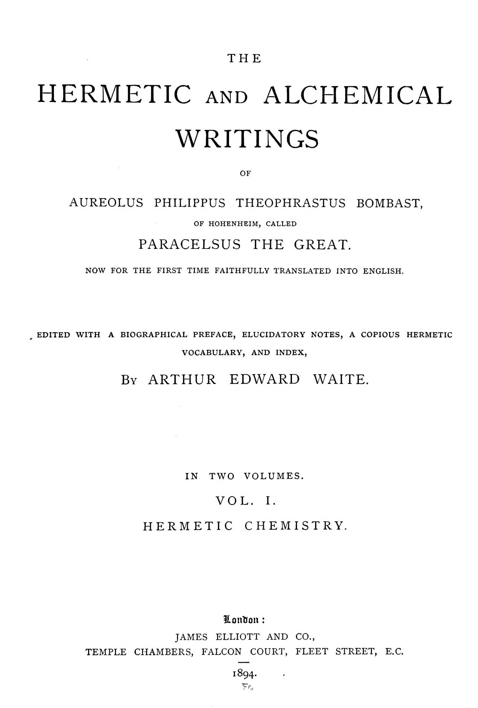

# パラケルスス『鉱物の経済』『金属の組成について』

パラケルスス著／A・E・ウェイト英訳／全訳

- 原題：The Economy of Minerals, elsewhere called the Genealogy of Minerals（ラテン語題 Oeconomia mineralium。1584年のフランクフルト八折版から英訳）、The Composition of Metals（De compositione metallorum。『魔術のアルキドクシス』第六書）。ともに A・E・ウェイトが The Hermetic and Alchemical Writings of Paracelsus 第一巻、1894年に収めた
- 内容：
  - 『鉱物の経済』は、鉱物の「母」は土ではなく水の元素であり、鉱物はそこに根を張る木のように育ち、枝を地の中へ何国にもわたって伸ばし、果実として金属や宝石を実らせ、やがて枯れる、という鉱物の系譜を説く。続いて塩（海の塩・泉の塩・ムリア・硝石）、緑礬、三重の硫黄、砒素とエレクトルム、水銀、白鉄鉱やコバルトなどの「不完全な体」、そして七つの金属の成り立ちを、錬金術と医学の両面から一つずつ論じる
  - 『金属の組成について』は、七つの金属を惑星の合の瞬間に一つずつ融かしあわせて造る合金「エレクトルム」をめぐる小論で、毒を知らせる杯、癲癇を防ぐ指輪、スペインの降霊術師が霊を呼び出した鈴、ウェルギリウスの鈴の伝説を挙げてその力を讃え、最後にその製法を記す
- 作業の基にした本文と扉：Internet Archive 所蔵の1894年英訳第一巻のスキャン二種（Google 版の OCR を主とし、注の崩れはコーネル大学版で補った）
- 著作権：パラケルススは1541年、ウェイトは1942年に死去。日本・米国・英国で保護期間が満了している
- 訳者：人工知能（Claude Opus 5.5）
- 訳の性格：ウェイトの英訳からの重訳である。二篇の本文と、ウェイトの注十七をすべて訳した。訳者の調べたかぎりでは、日本語訳は出ていない

## この本について

　二篇とも、本サイトで訳した『哲学者の曙』『惑星の霊について』『事物の本性について』と同じウェイト英訳第一巻に収められた論文である。『鉱物の経済』は、ジュネーヴ版全集に入っている『鉱物について』（De mineralibus）と多くの部分で重なる別稿で、ウェイトはこちらを本文に選び、もう一方を巻末の付録に回している。

　『鉱物の経済』の中心にあるのは、鉱物を植物になぞらえる大きなイメージである。鉱物の根は水の元素の中に据えられ、幹と枝は地の中へ伸びて「ドイツからハンガリーまで」も広がり、枝の先に金属という果実を実らせる。栗の実が棘の皮や殻に包まれているように、金属も鉱石という「皮」に包まれている。金の木は牧場の牛のように鉱脈の中で養われ、そこから離れると「痩せる」。こうした自然の生成を知ることが、錬金術による金属の「再生」を理解する前提だ、と結びで述べられる。

　途中には、アリストテレスやアヴィケンナを「ギリシアのサタンが蒔いた毒麦」と罵り、自分の学校はアテナイでもパリでもなく「自然という書物」だと言い、「私ののちに、まだ生きていない一人の弟子が来て多くを明らかにするであろう」と予言するなど、パラケルスス文書らしい激しい調子が随所に現れる。鉄を緑礬の水に入れると銅になる現象（実際には鉄が溶けて銅が析出する置換反応）を、金属変成の動かぬ証拠として繰り返し持ち出しているのも興味深い。ウェイトの注には、ジュネーヴ版の異文として、法律家と神学者を「エリコへの道を素通りする者」と叱りつけ、人類の三分の一が殺され三分の一が病に倒れたのちに黄金時代が来る、と説く一節も訳されている。

　『金属の組成について』は、七つの金属の合金エレクトルムに惑星の力が宿るという、パラケルスス派の魔術的な金属観をよく伝える小品で、ウェイトは化学よりも「ヘルメス医学」に属する文書だと断っている。

　英訳の意味のとりにくい箇所や、原文の誤りと思われる箇所には〔　〕で注記した。

---

## 鉱物の経済――別名『鉱物の系譜』〔注1〕

### 読者への序

　順序からいえば、鉱物と金属の変成を語る前に、まずその生成を扱うべきであったように思われる。けれども理論は、その実践によるほかにはっきりと教えようがないので、この術を学ぶ者のためには、いちばん初めから始めるのがよいと私は考えた。というのも何にもまして錬金術とは、ただの言葉の中には収まらず、手のこんだ事実の中にのみ収まる主題だからである。それは、ほかの諸術の場合とちょうど同じであって、それらに親しむには、ただ論証によるよりも、実地に行うことによるのである。たしかにそうした論証は、初心の者よりも、いくらか進んだ者にとってずっと大きな役に立つ。初心の者にとっては、初めからその仕事に（ことわざに言うように）一本指をつっこみ、自分のする誤りそのものから少しずつ学ぶのがいちばんよい。どんなにやさしい術でも、そうした失敗をせずに身につけた者はいない。まして錬金術を、真理に行きつくまでに誤りをせずに追い求めることのできる者は、たしかに一人もいないであろう。また、踏みはずすことを恐れて目標から尻ごみしているかぎり、あるいは自然の歩みにならって自分の誤りを正すことをしないかぎり、まことの道に入る者は一人もいないであろう。錬金術の方法を自然の方法とくらべることをしなければ、学ぶのはそうたやすくはあるまい。そこで、技術としての錬金術を自然のそれの前に置くのがよいと考えられた。この術に乗り出そうとする者を、安全な錨地へ呼びもどすように、鉱物の系譜へ呼びもどすためである。錬金術を学ぶ者のために、こうした錨地をなにがしか用意しておくことは、時宜にかない、いや、必要でさえあると思われたのである。

### 第一章　鉱物の生成について

　私は、鉱物の生成について古人が書いたものを最も注意深く読みとおしたが、彼らがその究極の質料を理解していなかったこと、したがって第一の質料などはなおさら理解していなかったことを見いだした。どんな質料であれ、その始まりを記そうとするなら、まず第一にその終わりを書きとめるべきである。そこで私は、何よりも先に鉱物の究極の質料をあなたの前に示そうと決めた。そこからあなたは、それらが起源を得ている第一の質料をたやすく理解するであろう。医学から例を引くことができよう。医学では、病はその起源からではなく、その帰結から研究されなければならない。起源については知りようがない。それはひそかに入りこんだのであって、それを観察する者は事実上盲目なのである。だが終わりは、その病が、まるで狙いを定めた的に向かうように向かっていく帰結から見てとれる。さて、ある物を判断するには、神がそれを何の目的のために創ったかを知るに越したことはない。さもないと、この神の被造物のまことの用いかたが、その濫用に転じることがしばしば起こるであろう。それゆえ、何かで何かの仕事にとりかかる者は誰でも、自分の扱うものを徹底的に理解しておかなければならない。神の定めた順序に従って務めを果たせるように、そして質料についての知識の不完全さや、まったくの無知のために、事がまずく運び、質料と道具の濫用によって、神の業よりもむしろ悪魔の業がなされることのないように、である。手荒な例を挙げれば、斧や棍棒を、そのどちらの使いかたも知らない人の手に持たせた場合を考えてみるがよい。それらはただの破壊の道具になってしまう。そうした道具を扱ってよいのは、その使いかたを知り、手もとにある材料から隣人の益になる何かをこしらえ、神がその材料を創った目的のためにそれを保っておく方法を知っている者だけである。このゆえに神は、自分の創ったものがすべて、その使いかたを知っている者に所有されることを望むのである。そして人はみな、自分の良心のうちに呼ばれていると感じるその仕事に身をささげるべきであって、悪魔にそそのかされた何かほかの空想ごとを学ぶべきではない。

　それゆえ知れ。万物の究極の、そしてまた第一の質料〔注2〕は、火である。これはいわば、箱に錠をおろす鍵である。何であれ物の中に隠されているものを明らかにするのは、これである。それゆえここでは、万物の究極の質料とは、それが火によって溶かされて行きつくもののことと解する。したがって、私がほかのところでさまざまな箇所に論じた三つの普遍的なもののうち、これが第一の、そして支配的なものとみなされるべきなのである。火の中で溶けた金属の場合に、その例がある。それはただちに、その最初の始まりが硫黄ではなく水銀の水であったことを明らかにする。その分解は、樹脂の場合のように炎をともなわないからである。それはまた塩でもないことが証される。その分解の最初のしるしは、土や石の場合のように、融けることと炎とのほかに崩れることでもないからである。たしかにどの金属もそのうちに硫黄と塩とを含んでいるが、その中で首位を占めるのは水銀である。さて神は、水を一つの元素として創り、そこから日々、人間の用のために鉱物が生み出されるのをよしとした。こうして水は、そのうちで、いわばその母胎の中でのように育つものたちの母となる。すなわち、鉱物の火と塩と水銀とが、金属や石や、あらゆる鉱物の実体に形づくられるのである。もっとも子は母とはまるで似ていないのであるが。このようにして至高者は万物を、それぞれ固有の本性をそなえたものとして創った。空の鳥はある目的のために、海の魚はそれとは違う目的のために。ほかのものもまた同様である。すべてはその神の意志にゆだねられなければならない。神は万物をそのあるがままに造り、自分の造るものが永遠であることを望むのである。それゆえ、水がその金属の子に似ておらず、息子が母に似ていないように、同じようにして土そのものも、いわば木であって木でない。それは同じ源から来ているからである。同じようにして、石と鉄とは水から生み出されるが、その水はかつて存在したことのないような水になる。そして土もまた、それ自体ではそうでないものになる。同じように、人もまた、そうでないものにならなければならないのである〔注3〕。

　一言でいえば、その究極の質料へと移っていくものは何であれ、その起源とは違う何かにならなければならない。一つの母から出ながら、さまざまに異なるものに。こうして神は、すべてのうちにあって一つであることを、すなわち万物の唯一の第一の、そして究極の質料であることを望んだ。神はそういうものであり、これまでに存在したことのない、またほかには決して存在しないであろうような、まことに驚くべき万物の原初の工匠なのである。さて、これで鉱物の母についてここまで聞いたのであるから、続くところでさらにくわしく教えよう。古人はこれを土であると誤って書いたが、それを証明することは決してできなかった。

### 第二章　鉱物の究極の質料と第一の質料について

　神のもとでの第一の原理は究極の質料であって、神みずからがそれを第一のものとなした。ちょうど、別の果実を生む果実のように。それには種がある。そしてこの種が第一の質料に数えられる。同様に、鉱物の究極の質料から第一の元素が造られた。すなわちそれは種に造られたのであって、その種とは水の元素である。これがそれを溶かし、それが水になるようにする。究極の質料を生み出すことが、自然によってそれにゆだねられている、あるいはそう定められているのであって、それは水の中にある。それゆえ自然は、水の中にあるものは何であれ、自分の力と分離のもとに取りこむ。そして金属にかかわるものは何であれ、それぞれの金属ごとにわきへのけておく。宝石や石や磁石や、その種のほかのものについても同様に、それぞれ別々に、その種類に従って。というのも、神が小麦にはその収穫にふさわしい時を、果物には秋を、またそれぞれの元素の中でこれらに似たほかのものにもそれぞれの時を定めたように、水の元素についても、ふさわしい収穫と秋の季節があることを望み、そしてほかのすべてのものについても、それぞれその種類に従って、その果実を集める時をあらかじめ定めたからである。それゆえ水の元素は、すべての鉱物の母であり、種であり、根である。そしてその中のアルケウスこそ、すべてを定まった順序に従って配し、それぞれがその究極の質料に至るようにする者である。その究極の質料を、人はついに、一種の人工の第一の質料として受けとる。すなわち、自然の終わるところで、人の術が始まるのである。自然の究極の質料は、人の第一の質料だからである。このような驚くべき方法で、神は水を自然の第一の質料として創った。あれほど柔らかく弱い実体でありながら、そこから果実として、最も堅固な金属や石などが――最も柔らかいものから最も堅いものが――出てくるように。そして水から火が出てくるように。それは人の知性のおよばぬところであるが、自然の力のおよばぬところではない。神はその母から驚くべき子らを創った。人間においてもそれは見られる。母のうちにある彼らを見ても、その一人一人が、体に従ってではなく、それぞれ固有の体質の状態に従って、その知性と特性においてそれぞれ独特であることがわかるであろう。

### 第三章　鉱物の畑と根と木について

　至高者は水の元素を、いわば一つの畑として創った。その中に、種から芽生えた鉱物の木々の根が据えられ、そこから幹と枝とが地の上へと突き出されるように。それゆえ神はそれをほかの三つから分けた。空気の中にでも、土の中にでも、天の中にでもなく、下の球の上に置かれて、それがそれ自身で自由な体として存在し、地の上にあって、それが据えられたところにその中心を持つように。それは、土のように人をその上に担うよう、まことに見事な秩序のもとに創られている。人が船に乗って水の上を走り、それを我がものとするように。さらに驚くべきは、水は我々の球をあらゆる方向から取り巻いているのに、それ自身の境から落ちることがないということである。我々の対蹠地にある部分は、ちょうど我々の部分が彼らにとってそう見えるように、下へぶらさがっているように見えるのに、それぞれがそれ自身の球の上に平らな面として広がったままでいる。どこから見てもそうなのである。ちょうど、まっすぐ深淵へ降りていく穴があったとして、それが底を見いださず、土にも支えられていないと想像されるかのように。それは、必要なものをすべてそなえて殻の中にある卵よりも、さらに驚くべきことである。そこで鉱物の生成物は、水の元素から土の中へと押し出される。ちょうど、土の元素からすべての果実が空気の中へと押し出され、根のほかには何も土の中に残らないように。まさしくそのように、すべての金属、塩、宝石、石、滑石、白鉄鉱、硫黄、またこれに似たあらゆる実体は、その母である水から、もう一つの母、すなわち土へと移る。その土の中でそれらの木の働きが完成されるが、その根は水の中に据えられたままである。というのも、土の中の根から育つものが空気の中で仕上げられるように、同じようにして、その起源を水から得るものは、土の中で自然によってすっかり仕上げられ、ほかのものと同じように、その究極の質料に至るからである。古人はこの考えに迷わされ、金属が土の中に見つかるのを見たために、ろくに進歩しなかった。彼らは鉱物について書いたとき、土からは木や葉や花や果実や草しか生えず、それ以外のものはすべて水から生み出されるのだと書いて、自分たちの誤りに気づかなかったのである。それに劣らず作り話めいていたのは、土の上に生み出されるものはすべてその起源を空気から得ている、と言い張ったあの男の言葉である。それらが空気の中にあり、そこで完成されるからというのである。彼はその根が土の中にあるのを見ていたのに。彼は鉱物の根を肉の目で見なかったものだから、それらが土の中に据えられているなどと、作りごとを言いさえしたのであろう。ギリシア人の自然学とはこうしたもので、ただ目に見えるものだけから導き出され、心の実験によって隠れたものを何一つ認めない。それは、目で見るだけで自然の学についてしゃべりたてようとし、明らかなものの下に、その向かいあわせに横たわる隠れたものを観察するための実験をしない、怠け者たちの作り話にすぎない。

### 第四章　鉱物の果実と収穫について

　地のすべての果実が、その生成においてあらかじめ定められた時に従って、地の上と空気の中とでその収穫と秋とを迎えるように、水の果実、すなわち鉱物も、それ自身の熟す時に集められる。鉱物の根が初めて芽を出すと、それらはそれ自身の幹と木へと、すなわち、のちに鉱物や金属がそこから生み出される体へと伸びあがる。ちょうど、胡桃や桜桃がすぐさま土から生み出されるのではなく、まず第一に木が生じ、そこからついに果実が生まれるように。同じように、自然は水の元素の中に一本の鉱物の木を、すなわち水の体を生やす。この木は、土の穴をみたすかぎりにおいて土の中に生み出される。ちょうど土そのものが空気をみたすのとまったく同じように。そしてこの木から、地の面に見える木々に起こるのとちょうど同じように、その枝の先に、その種の本性と特性とに従った果実がついに生み出される。それゆえ我々は、まず第一に水の木を、そしてやがてその果実を探さなければならない。農業からあながち不適切でなく借りてきた方法によって、次のようにして。目に見える木々のうちには、その果実を覆いかくして生むものがある。たとえば栗はとげのある皮の下に、胡桃は緑の苦い皮の下に、その下にさらに木質の殻、その下にまた苦い薄皮、そしてついに仁がある。鉱物においても同じことが起こる。その仁、すなわち金属は、ちょうどほかのものと同じように皮によって隔てられている。ほかの木々は、その果実を裸で生む。李、桜桃、梨、林檎、葡萄などのように。そこには今述べたような隔てはない。同様に、水の木のうちにも、水の状態と本性に従って、その金や銀や珊瑚や、その種のほかの金属を、自由に裸で生むものがある。皮によってその中にどんな果実が隠れているかを知り、霊がその体によって知られるように、ちょうどそのように鉱物の場合にも、金属の霊は、隠れていても、その体の、すなわち鉱物の皮の下に見分けられる。水の元素の霊は体を生む。鉱物においてはある種の体を、果実においては別の種の体を。それゆえ、金はある鉱物の体の中にあるかもしれないが、それでもその体は何の重みもない。それは不純なものとして金から分けられなければならない。金そのものは純粋だからである。それゆえ鉱物の中には二つの体があり、そのうちの一つは果実、すなわち金の純粋な体であって、その霊はそれと分かちがたく合体している。こうして果実はまず元素から木の中へ、霊が不純な体の中へ入るように入れられ、そしてついにはそれとともに土の中へ、何か高貴で純粋なものとして入れられる。同じことが人間にも見られる。人には二つの体が与えられている。一つは朽ちるもの、もう一つは朽ちないものであって、後者は永遠に人と結ばれているであろう。それは神の似姿だからであり、とりわけそれを持つことによって、人はほかのすべての被造物と異なるのである〔注4〕。

### 第五章　元素の死について、とりわけ水の死について

　元素は、人が死ぬように、そのうちにある腐敗のために死ぬ。水がその死にあたって、いわば自分の果実を食いつくし呑みこむように、土もまたそれ自身の果実を食いつくす。そこから生まれたものは何であれ、ふたたびそこへ還り、呑みこまれて失われる。ちょうど過ぎ去った時が昨日の昼と夜に呑みこまれ、その光も闇も我々が二度と見ることがないように。土は今日、昨日より重くはない。ただの一粒ほども重くはないし、千年ののちにもやはり同じ重さであろう。それが与え出すのと同じ程度に、それは食いつくすのである。ところで水の死は、それ自身にふさわしい元素のうちに、すなわち水のあの大いなる終点にして中心である海のうちにある。その中で川や、そこへ流れこむほかのものはすべて、火の中の木のように死に、食いつくされる。川は実のところ水の元素ではなく、その元素の果実である。その元素とは海である。川はそこからその起源を得、そこでその生と死とを受けとるのである。

### 第六章　鉱物の木の死について

　自然が、金属であれ、石であれ、宝石であれ、塩、明礬、緑礬、塩からい泉や甘い泉、冷たい泉や熱い泉であれ、珊瑚であれ、白鉄鉱であれ、それを生み出すために、木の鉱物の根をその母胎の中心に植え、そしてその幹を地へと突き出させたのちには、この幹はさまざまな枝となって広がっていく。その枝と茎との実体の液は、形の上では、水でも油でもリュート〔原文 alute。泥状の封泥の意か〕でも粘液でもない。じっさいそれは、土から生えた木としか思い描きようがない。それは土から生えたものではあるが、それでも土ではないのである。それらは、一つの枝がもう一つの枝から二つか三つの気候帯と、同じだけの地域を隔てて離れているというふうに広がっている。ときにはドイツからハンガリーまで、さらにその向こうまでも。同じ種類のさまざまな木の枝は、ちょうど人間の体の血管が互いに遠く離れたさまざまな肢体へと伸びているように、地の球全体に広がっている。だが小枝の先が生み出す果実は、究極の質料の本性によって、やがて地に落ちる。それらは瞬時に凝固し、そしてついに、その果実をすべて落としつくすと、この木は死に、乾きによってすっかり食いつくされ、その子らは土の中に残される。そののち、その本性の状態に従って、新しい木が現れる。それゆえ鉱物の第一の質料は水から成っている。そしてそれは硫黄と塩と水銀だけを含んでいる。これらの鉱物はその元素の霊であり魂であって、そのうちに、袋の中のさまざまな種のように、すべての鉱物、金属、宝石、塩、その種のほかのものを含んでいる。これらが水の中に注がれると、自然はそれぞれの種をその固有の最後の果実へと導き、たえずそれらをその種と類に従って配していく。こうしたことや、これに似たことは、かのまことの自然学から、また健全な哲学の泉から出てくる。そこから、神の御業を瞑想して観ることを通して、至高の造り主とその力についての最も深い知識が生まれるのである。まことの哲学者たちの心と心の目には、その肉の目に劣らず、明るい光が現れる。彼らには隠れたものが明らかになる。ところがあのギリシアのサタンは、まことの知恵の哲学の畑に、毒麦と自分の偽りの種とを蒔いた。すなわちアリストテレス、アルベルトゥス、アヴィケンナ、ラーズィー、またその類の人々である。神と自然の光の敵であり、ソフィア（知恵）の名をフィロソフィア（哲学）へと変成したそのとき以来、自然学の全体をゆがめてしまった者たちである〔注5〕。

### 第七章　鉱物の第一の質料の、その種と個体の違いに応じた変化について、またさまざまな色などについて

　我々は先に、第一の質料はその母の中に、まるで袋の中にあるように存在し、それは一つに会する三つの成分から成ると言った。だが水銀と塩と硫黄の種類は、鉱物の中にある果実の違いと同じだけある。鉛と鉄と金の中には、それぞれ違う硫黄が見いだされる。サファイアやほかの宝石の中にも、石や白鉄鉱や塩の中にも。同様に、金属や塩などの中には違う塩が。水銀もまたそうである。宝石の中にはある種の水銀が、金属の中には別の種のものがある。そのうえ、これらの組成に関しては、同じ種のもとにも違う個体が見いだされる。金は、ときに一つの標本がほかのものより重かったり、色が濃かったりして見つかる。ほかのものも同様である。さらに、金の硫黄や塩や、金の水銀の差異は、その度合いの大小があるのと同じだけある。それでも、それらのうちで主体から特殊性を受けとるものはみな、つねに同じ一つの硫黄と塩と水銀という普遍性のもとに包まれており、それは普遍的な自然のうちに神秘的に包みこまれている。この点で、自然はたとえとして画家にくらべることができよう。画家はわずかな色から無数の絵を描き、そのどれ一つとしてほかとまったく同じではない。ただ違いは、自然が生きた絵を生むのに対して、画家はそれをまねるにすぎないということである。画家は同じものを目に示すが、それは死んだものである。さて、すべての自然の色は自然の塩から出てくる。その塩の中で色は、物のバルサムと凝固とともに存在している。硫黄は体の実体と、その組み立てとを示す。水銀は、その効能と秘薬とを示す。ただ神のみが万物に生命を割りあてる。神が永遠の昔から、それぞれのものからそこに生み出されるべく定めておいたものが、それぞれのものから生み出されるように。神がすべてのものがそうあるべしと定め、望んだとおりに。それゆえ、自然の物の体を理解したいと望む者は誰でも、自然の硫黄から学ぶがよい。それをまず第一によく理解しておくならば。もし彼が自然の色を、塩からその土台として求めるのであれば。だが物の効能を知りたいと望むなら、その効能を学びたいと思う当の物の水銀に属する秘薬を、くまなく調べなければならない〔原文の文のつながりがわかりにくい。英訳のままに訳した〕。これらのことをすべて、あの一つの同じ自然が、一つのうちに抱きとり、また分ける。同時にそれらに色を分け与え、取りのけ、あるいはすっかり消し去りながら。どうか考えてみてほしい。黒か茶色のこのちっぽけな一粒の種から、巨大な木が生え、その葉にはあれほど見事な緑を、その花にはあれほどとりどりの色を、その果実には限りなく多様な味をもたらすのを。これが自然のすべての産物において自然によってくり返されるのを見るがよい。そうすれば、自然がその神秘においてあまりに驚くべく、あまりに豊かであるので、紙の本にあたらずとも、この自然という書物の中だけで一生かかっても足りないほどのものがあることに気づくであろう。それゆえ神が自然の中で、我々の見分けにかくも力強く、かくも賢く自分を示すのであれば、我々がただ神を求めさえすれば、神は聖霊によって我々の心に、どれほどさらに栄光に満ちて自分を現すことであろうか。これこそ下から上へと導く安全な道である。これこそ主の道を歩むこと、主の御業を讃えることに携わること、そして我々のうちにあるかぎり、あるいは我々のうちにあるべく、またありうるかぎりにおいて、主の意志を行うことである。これが私のアカデミアであった。アテナイでも、パリでも、トゥールーズでもない。賢者たちの多くの人を欺く本を読んだのち、私はただこの一冊に身を向け、そこから私の書くすべてを学んだ。私はまたそれが真であることを知っている。それでも白状すれば、私の知らないことはまだずっと多くある。だがそれらは神ご自身の時に表に浮かびあがってくるであろう。全能者がそう望むときに、明らかにされないほど隠れたものは何もない。

　だがこれだけは私は知っている。私ののちに、この学派の一人の弟子が来るであろう。まだ生きてはいない者であるが、多くのことを明らかにするであろう者が。

### 第八章　鉱物の自然の配り手と、その下役たちについて

　人間が鉱物をこしらえ、それを調えて用に適したものにするにあたっては、一人の人ではなく、次々に多くの人が必要とされ、その一人一人にそれぞれ特別の才と務めとがある。金属が地の腹から掘り出されても、それを分ける者、調える者、融かす者がいなければ、誰の益になろうか。その者もまた、鍛冶がいなければ何であろうか。鍛冶もまた、買い手がいなければ何の役にも立たない。買い手もまた、その金属を用に適したものにする方法を知る誰かがいなければ同じである。自然はこれらすべてを必要としない。それでもやはり自然は自分の手の者たちを必要とする。そのうちでまず第一はアルケウスであって、鉱物の配り手であり、その下に下役たちを持っている〔注6〕。彼自身、自然の下役であるが、次のような者たちを持つ。第一の者は、その中に働きがおよぶ体的な質料、すなわち鉱物の硫黄を、これこれの状態と本性において示す。第二の者は、特性と効能とをこしらえ、あらかじめそこにある質料に働きかける。たとえば水銀がそれである。第三の者は、圧し固め凝固させることによって、すべての部分を一つの体へとまとめる。すなわち塩であり、それは仕事を固める者である。これらがみな一つに集められ、アタノール〔錬金術の炉〕の中に閉じこめられると、アルケウスはそれらを煮る。ちょうど土の中の種を煮るのとまったく同じように。それだけでなく、それらは互いに、一つがもう一つとともに、次のようにして煮あう。硫黄はその体をほかの二つにゆだね、それらがそれを好きなようにし、なされるべきものが定められているその目的へと導くようにする。水銀がその効能の特性とともに加えられ、これがほかの二つによって煮られる。この種の煮ることがすべて果たされると、そのとき塩はついに、それと結ばれたほかの質料と、それ自身とに働きはじめる。まず濃くし、つぎに凍らせ、最後に凝固させることによって、塩はその仕事をその秋と収穫とに向けて強める。そうなればもはや刈り手と鍛冶のほかには何も欠けていない。

　こうして手短に、我々は鉱物の系譜の全体をひととおり見てきた。残るのは、それぞれのものの錬金術と医学とにおける力と効能とを、それらの学のためにそれを学ぶのに必要なかぎりにおいて、個別に、しかしやはり簡潔に聞くことである。私は読者に勧めたい。これらのことについて空想を語る他人のただの夢や意見は、しばらくわきへ置いておくように。彼らが自然のうえでではなく紙のうえだけの哲学者であり、自分と同じような人々から、同じだけの学識で、経験によらず暗記によって考えるよう教えこまれた者たちであって、他人に対しては自分のありのままの姿を見せているにすぎないことがわかるまでは。彼らは見たがらないかもしれないが、それでも私は、少なくとも彼らが死の闇に乱されることなく、光と自然と生命とをもっとたやすく見てとれるように、それらを置いてやろう。それでは鉱物の第一の原理、すなわち塩から始めて、我々はそれぞれを、つまり金属のまさに終わりまで、ひととおり見ていこう。

### 第九章　錬金術と医学における塩の効能と特性について

　神は、その善と偉大さとにおいて、人が自然によって、自然の塩なしには自然のままに生きることができないほどの必要の状態に導かれることを望んだ。それゆえ、あらゆる食べ物に塩が要るのである。塩は自然のバルサムであって〔注7〕、温かい硫黄と湿った水銀との腐敗を追いはらう。この二つの成分から、人は自然によって組み立てられているのである。さて、これらの第一の成分は自分に似たもので養われなければならないのだから、当然、人は自分の内なる硫黄を保つためには燃えるような食べ物を、水銀を養うためには湿った食べ物を、体を組み立てる力のうちに塩を保っておくためには塩けのある食べ物を用いなければならないことになる。塩の保存の力は、とりわけそれが死んだ肉をきわめて長いあいだ腐敗から守ることに見られる。それゆえ、生きた肉ならなおさら保つであろうことはたやすく察しがつく。最後にその種類に移ると、人の生命にとくに役立つとみなされるものが三つある。その第一は海の塩、第二は泉の塩、第三は鉱物の塩である。泉の塩は何よりも健康に資する。第二には鉱物の塩、最後に海の塩である。この最後のものと第一のものとは術によって煮つめられ、もう一つはただ自然によってのみ煮つめられる。このものと海の塩とは、ムリア（塩水）の本性のもとには含まれない。だが煮つめられるものは、水から分けられて凝固した塩になる前に、まず第一にムリアに変えられる〔原文のまま。どれを指すのかわかりにくい〕。それゆえ我々が示すべき塩には二つの種類がある。一つはムリアから、もう一つはすっかり精製された塩から。だがまず第一に、あらゆる塩に共通する状態について考えなければならない。食べ物に塩が用いられなかったところには、矯正がない。そして胃がそうした食べ物を受けとると、それを消化することができない。塩の中には、排泄物を通して、あるいは尿を通して働く排出の力がある。そしてこれらがその規則正しい道筋と動きとのうちに保たれないかぎり、生命のすべての働きは、その努めにおいても排出の力においても打ち倒されてしまう。血は、それ自身の本性において塩であって、塩けのない養いを受けつけない。もし極度の飢えのために、ときにそうしたものを受けとることがあれば、それは腐敗へと去っていく。こうした欠陥を避けるために、塩が養いの食べ物への添えものとして定められたのである。自然の出口がふさがれず、肢体がその当然の養いを奪われないように。さらに塩の中には、皮膚の毛穴にたまたま生じたふさがりを開き、それを溶かして尿にすることで追い出す、溶かす力がひそんでいる。尿とは血の塩にほかならない。すなわち、小宇宙の塩と結びついた自然の塩から出た塩であって、こうしてその両方が排泄物を追い出すために力強く働くのである。さて、この自然の結合は、ふさわしい量の食べ物の塩で調えられたときにのみなされうる。さもないと、ふさがりのために、それらはたやすくどこかにとどまり、こびりついてしまう。どの医者も、薬としての塩の中にどんな力があるかを知っておくべきである。とりわけ自然の塩を下したいと望むときには。そのときはこれを、とりわけ宝石から出る種類のものを、もっと惜しまず処方するがよい。それはほかの何よりも、この自然の塩を攻めて追い出す力を持っている。これら三つの違う種類の塩の働きは、実地において注意深く見守られるべきである。それはどんな手紙や記述よりもはるかによく目を開いてくれる方法である。

### 第十章　ムリアについて

　私はいましがた、二種類の塩、すなわちムリアと乾いた塩とに触れた。まず第一に、ムリアは余計な湿りをすべて乾かす最大の力を持っている。それは一時間のうちに、乾いた塩がひと月かかってもなしえないほどのことをする。これはムリアにされたものであっても、湿った痛風、水腫、脛の湿った腫れ、ほかの腫れをも治すこと、一言でいえば、不自然な癩の液をすべて食いつくすことにおいて、自然のものと同じ力は持たない〔原文のまま。人工のムリアを指すか〕。その熱は、病人がその中に風呂に入るように害なく座っていられるほどに調えられるべきである。ムリアが完全であることの証しは、卵をその中に投げこんだとき、それがその表面に浮くことである。この種の風呂は太った人にしか向かないことに注意すべきである。痩せぎすの人はそれを用いるべきではない。乾かしすぎるからである。一度か二度の風呂ののちに腫れがもどってくるなら、ムリアと塩とを煮つめている土地にしばらく住むのがいちばんよいであろう。

### 第十一章　乾いた塩について

　乾いた塩にはさまざまな種がある。食べ物とともに用いるふつうのもの、宝石や石や土から出るもの、そして凍り固まった体の錐〔塩の結晶塊〕を通してやって来るものなど。それぞれに共通する効能に注意せよ。そのどれでも、硫黄と混ぜて膏薬として傷に貼り、つぎに洗い薬として用いれば、傷に虫がわくのを防ぐ。たとえ虫がすでに生じていても、それを追いはらい、それ以上来ないようにする。ただ清めるだけで、何の薬も用いずとも、自然は傷を癒す。何かのこじれが自然のバルサムの自由な働きをさまたげないかぎりは。この種の塩の中には、潰瘍や疥癬などに対する大きな治療がある。それらを風呂の中に溶かせば。ムリアの力はずっと強く、これは塩をその中に溶かすことでさらに増すことができる。同じものは禿やその種のほかの病を治すのにも役立つ。とりわけ、これらの塩を添加によって矯正するか、次の方法で力を増すならば。乾いた塩と尿の塩〔注8〕とを等量、好きなだけとり、二時間いっしょに焼き、そののちムリアを溶かせ。あるいはそれらを、それだけで冷たく湿った場所に置け。それらは人工のムリアを示すであろう。それは外科の外の症例においては自然のものにほとんど劣らず強いが、内の治療においてはずっと弱い。前に述べた塩は、たとえアルカリがそれらから煮出されたとしても、ほかのどんな物の中にも決して見いだされないであろう。この塩は前に名を挙げたものとは似ておらず、自然の物のアルカリ、あるいは体の塩と呼ばれる。それは人の体の中で、養いの塩によって、あるいは前のもの、それも乾いた、とくに養いになるものによって養われるからである。錬金術のためには、同じ種類の塩を霊にまで焼いたものから、塩の水が造られる。それは器の中で、金が溶かされて油になり、そこから分けられて、すぐれた、飲むことのできるものとして残るようにする。飲む金である。それがこの最後の状態に至る前には、宝石細工師や鉄工の親方たちから聞いたところでは、それは銀や鉄に金をかぶせるすぐれた技であって、もし彼らがそれを化学的に調える方法さえ知っていれば、尽きることのない宝となるであろう。純粋な塩についても、注意しておくべきである。それはただ自然のみによって、錐に、あるいは宝石の塩に凍り固まったもので、銀のふつうのセメンテーション〔固体の粉剤で包んで焼く精錬法〕にとくに適しており、いつもの焼きなしにその金属を展延性のあるものにする。それは銅に対しても、レグルス〔精錬された金属塊〕にまで還元されたセメントによって同じことをする。

### 第十二章　硝石について

　硝石と呼ばれる、もう一つの種類の塩もある〔注9〕。それは自然に、動物の体の自然の塩と、その体の中の養いの塩とが合わさってできている。こうして二つから一つの塩ができると、その余計なものは煮つめられて尿になり、地に落ちて、しかるべき順序でふたたび煮つめられる。二つの成分はますます緊密に結ばれ、それらから、その土から人工の煮つめによってもたらされる化学的分離を通して、ただ一つの完全な塩が生じる。それは錐か塊の形で、まことにはっきりと姿を現す。ただし、それが尿の中へ追い出されるとき、動物の煮つめによってまだ消化されていない余計な養いの塩から、それが十分に分けられているならばである。錬金術ではその用途はまことに多い。それが硫黄と調合されて火薬に造られたとき、最初の実験がその中にどれほど大きな激しさを、悲惨な結果とともに示したかを語っても詮ないことであろう。そのためにそれは、地上の稲妻と呼ばれて当然なのである。同じようにして、土の液の塩から――それは普遍的な自然のバルサムであって、それによってすべてのものがその特別な組み合わせのうちに組み立てられ、ついにはそこから分解によってふたたび土へと還っていくのであるが――上に述べたように、ただ一つの塩が生み出される。それはそののち土の穴を通ってしみ出し、岩にくっついた氷の錐の形に凝固する。そのことから、それはニトルムの名をサルペトラ（岩の塩）の名に変えたのである。そのどちらも、内服の薬としてはとくに役に立たない。太りすぎた体を減らすという点をのぞいては。またそれはあまり安全な薬でもない。その二つを銅の塩と混ぜるか、あるいはその三つを抽出の工程にかけ、この特別な用い方のために一つの体にするのでないかぎり。

### 第十三章　養いの塩の悪い作用について

　食べ物とともに用いられた塩で、胃によって消化されなかったものはみな、排出されて腸へ下ったのち、すっかり通りぬけてしまわないかぎり、きわめて治しにくい疝痛と腸の苦しみとを生む。その腐食する本性のために、それはときに腸に穴をあけることがある。解剖が示すとおりである。だがもしそれが排出されずに胃の中にとどまれば、げっぷと胸やけとが、胃のほかの多くの病とともに起こる。また、消化されなかった塩が腸間膜の静脈の中で凝固し、粒状の沈殿をつくることもときに起こる。そこから、ほとんど理解されていない多くの重い病が出てくる。それもこの体の特定の部分だけでなく、ほかの部分にも、とりわけ尿の器官に。塩のさまざまな種と、その効能と欠点については、これで十分に述べた。我々はいま、性格においてもっと鉱物的な塩へと移る。それは緑礬と名づけられる。それは錬金術においても医学においても、その有用さでほかのすべてにまさっている。

### 第十四章　緑礬について〔注10〕

　自然は地の腹から、緑礬と名づけられたある種の塩を生み出す。それはまことに大きな効能と力とをそなえていて、誰にもそれを十分に書きつくすことはほとんどできない。その中には、黄疸、砂、結石、熱病、虫、癲癇、そのほかふさがりから生じる、まことに扱いにくい多くの病に対する完全な治療が含まれている。そのことはのちにもっとくわしく述べよう。両方の学において、すなわち医学においても錬金術においても、それはその調製の方法に応じてさまざまに、驚くべき効果を生む。一本の丸太からさまざまな像が彫り出されるように、この体からさまざまな、まことにすぐれた薬が調えられる。内の病のためだけでなく、白癬や癩のような外科の症例のためにも。一言でいえば、ほかの薬がその弱さのために病に対してなしえないことを、これはその病の原因を取りのぞくことによって根底からなしとげる。その力のあるものは生のままの状態で、あるものは水にされたときに、あるものは焼かれたときに、あるものは緑の油にされたときに、あるものは赤い油の形で発揮する。また、白い油の形になったときに持つ力もある。それは新たな調製の形を受けるたびに、新たな力をまとう。それはこれまでに考え出されたすべての病とすべての薬の四分の一の役を果たすことができる。まことの医者は、あちらこちらへと目を向ける必要はない。慎み深い乙女のように、目を地に伏せておけばよい。そこに、その足もとに、インドもエジプトもバルバリアもギリシアももたらしえないほどの力と富とを、この自然の宝の中に見いだすであろうから。

### 第十五章　緑礬の種と、その試しかたについて

　緑礬の種は、それが取り出される鉱山や源と同じだけさまざまである。そのすぐれかたの大小を試す方法も、それと同じだけさまざまである。第一に、それが鉄の板を銅の色に染めるなら、深く染めるほどよいものとみなされる。だがこれはあらゆる種類のうちで最高のものである。第二に、それを生のままの形で内服したとき、ほかのどんな薬よりもよく腸の虫を追い出すなら、それを効果的にするほど、薬としてよいものとみなされる。第三の試しは、それが鉄を銅に変成するときである。それをより完全に、より速くするほど、両方の学においていっそう重んじられるべきである。この二つの金属のあいだには最大の親和があるからである。硼砂の水によって鉛から同じように水銀が造られることを思えば、これも驚くにはあたらない。金属を変えるカキミア〔不完全な鉱物体〕にはほかの種類もある。そしてこれらのほかに、ハンガリーには一つの泉が、というよりむしろ急流があって、その起源を緑礬から得ている。いや、その実体全体が緑礬なのであって、その中へ投げこまれた鉄はたちまち食いつくされて錆に変わり、この錆はただちに、火とふいごによって、最上の、最も長もちする銅に還元される。第四の試しは、その赤いコルコタル〔緑礬を焼いた残りの赤い酸化鉄〕が強い火にかけられて、ひとりでに銅を示すときである。これは医学においては比較的弱いが、錬金術においてはまことにすぐれている。その色について語ることも省いてはならない。すっかり紺青のものは、同じ色のもとに赤と黄の斑点が混じっているものほど医学において強くない。淡い空色のものは、緑の油と白い油とを調えるために、ほかの何よりも先に選ばれるべきである。赤みや暗い黄色に傾くものは、そこから赤い油を調えるのにいちばんよい。最後の試しは、それが没食子とともに、まことに黒く濃いインクをつくるときである。これはほかのどれよりも優先して選ばれるべきである。それゆえ種は、試しかたに従って数えられるのである。

---

**英訳者（ウェイト）の注**

〔注1〕　ここで翻訳に選んだ校訂本のこの論文は、ジュネーヴ二つ折り版には見えず、パラケルスス著作のもう一つの集成、すなわち一五八四年のフランクフルト八折版から訳したものである。ジュネーヴ版に含まれている『鉱物について』（De Mineralibus）と題された対応する論文は、ほぼ同じ範囲を扱っており、じっさい部分的には本文に掲げたものと同一である。だが同時に、それには両方の版を出しておく必要があるほどはっきりした違いがある。それゆえそれは、本巻の終わりの付録に、『鉱物についての書』の題のもとに見いだされるであろう。

〔注2〕　私が何かの究極の質料と呼ぶのは、その実体が高揚と完成の最高の度に達した状態のことである。たとえば金が、あらゆる余計なもの、異物などから分けられ、何の混ざりものもなくその純粋な効能のうちにとどまっているとき、それはその究極の質料へと導き出されたのである。――『大外科書』第二部第二論文第二章。たとえば、第一の質料から造られたすべての体は、究極の質料へと変容するよう強いられている。こうして大いなる究極の質料は、第一の質料の増大の終わりにその始まりを持つ。――同、第三部第三書。

〔注3〕　人は二度目に、妻からではなく処女から、水と霊とによって生まれる必要がある。というのも霊は、永遠に死のありえない肉に生命を与えるからである。死の宿る肉は何の益にもならず、人に永遠の救いへ向けて何を与えることもできない。――『賢明なる哲学』第二書第二章。

〔注4〕　人がアダムから受けた肉と血とは、決して神の国に入ることができない。天から出てきたのでないものは、何も天に昇ることができないからである。さてアダムの肉は土である。それゆえそれは天に入ることができず、ふたたび土に変えられる。それは死すべきもの、死に服するものであって、死すべきものは何も天に入ることができない。それをその汚れから清めて天にふさわしいものにしうる火はない。それは清められることも栄化されることも許さない。同時に、人は肉と血とをまとったまことの人でなければ天に入ることができない。人が天使と区別されるのは、ただ肉と血とによってのみであって、それ以外の点では両者は同じ本質だからである。この点で人は天使よりも多くを持っている。肉と血とを授けられているからであり、人のために神の子はこの世に生まれた。人のために神の子は十字架の上で死んだ。そうして人が贖われ、天の国にふさわしい者とされるために。だが神がこうして人への愛を示したのちにも、人の肉はなお人を天から締め出していた。そこで神は人に、子から組み立てられた別の肉と血とを与えた。そしてこの被造物は、父のではなく子のものとして、天に入るのである。というのもアダムの肉は父のものであって、それが来たところへ還るからである。もっとも、もしアダムが罪を犯さなかったなら、その体は楽園で不死のままであったろう。だがキリストは我々の災いをあわれんで、我々に新しい体を与えた。生命を与える霊から、生きた肉が出てくる。その中には死はなく、生命がある。これこそ、人が新しい人となるために必要とする肉であって、この肉とこの血とのうちに、終わりの日に人はよみがえり、キリストとともに天の国を所有するであろう。さて、霊からその生命を得ているこの肉は、男の種による生殖なしに、約束によってアブラハムの娘から最初に生まれ、聖霊によって人となった。それゆえまた、天の国を望む我々も、処女と信仰とから新たに生まれ、聖霊によって受肉しなければならない。こうして人は永遠に肉と血とでなければならない。こうして二重の肉がある。アダムのもので無であるものと、聖霊のもので永遠であるものと。――『賢明なる哲学』第二書第二章。

〔注5〕　人の知恵はまことに高く、まことに崇高であって、すべての星を、蒼穹そのものを、そして宇宙の天をその力のうちに持っている。そしてその力が地のすべてにゆきわたるように、それは天の上にもおよぶ。太陽と月とはその臣下である。手が土を変え、従わせるように、内なる小宇宙も天頂を従わせる。――『ペストについて』第二書第二章。

〔注6〕　アルケウスは自然であり、物の配り手である。――『酒石についての二書への注解』。アルケウスの解剖は生命の解剖である。――『解剖学断章』。アルケウスは諸元素と、その中に存在するすべてのものとを分ける者であって、それぞれのものをほかから分け、それをそれ自身の場所へ集める。――『水の元素について』第二論文第一章。

〔注7〕　白い緑礬、赤い緑礬、銅の緑礬、岩明礬、羽毛明礬、裂け明礬、エンタリ明礬〔原文 alumen entali〕、ウスネトゥム明礬〔原文 alumen usnetum〕、岩塩の結晶（サル・ゲンマエ）、岩塩、山の塩、海の塩、泉の塩――これらの種はみな三つの第一原理の塩から生じ、焼成、反射炉加熱、昇華に服する。さて、これらのものがみなふさわしい割合のうちに、あるいはいわば本質のうちに存するなら、それらは一つの普遍的な名で、自然の液、あるいは塩の液、あるいは塩のバルサムと呼ばれる。これらのほかに、砒素、鶏冠石、オゲルトゥム〔原文 ogertum〕、黒い石黄（すなわち雄黄）、アンチモン、水銀、アスファルトがある。これらも同じように焼成、反射炉加熱、蒸留などに服し、もしそれらがまったく一つの本質のうちに存するなら、自然のバルサム、水銀の液、あるいは水銀のバルサムと呼ばれる。最後に、さまざまな種の硫黄、石油、カラベ（琥珀）、瀝青などがあり、これらもまた同じ工程に服し、もし分けられずにただ一つの本質のうちに存するなら、自然のチンキ、硫黄の液、あるいは硫黄のバルサムと呼ばれる。――『医学断章』第三。

〔注8〕　尿はみな溶かされた塩である。――『尿の判定について』第二書。塩は尿の中へ移る。――『酒石について』第一書第三論文第一章、解説。

〔注9〕　硝石は、家畜が小便をする囲いや厩にできる。家畜が小便をした土は、のちに煮られて、そこから硝石が得られるからである。尿はみな塩だからである。――『酒石について』第一書第三論文、第二章への注記。硝石は排泄物であり、エシレ〔原文 esile〕と養いの物質との死骸である。そしてこの死骸こそ、腐敗がそこから育つものである。――『医学断章』「硝石性の酒石について」。それはあらゆる塩の本質的な霊であり排泄物であって、両性具有の本性をそなえている。――『ペストについて』第一論文。

〔注10〕　緑礬についてのこの章と続く章との重要な異文が、ジュネーヴ二つ折り版に見える。「錬金術における緑礬の油の用いかたについて、また同様にその生の形について。緑礬の中の隠れた錬金術の力について何かを語るにあたり、私はまず第一に、生の緑礬について、生の緑礬はどの種類のものもそれぞれ鉄から銅を造る、ということをあなたに申し述べたい。これをするのは錬金術師ではなく、錬金術師の操作による自然、すなわち緑礬である。自然の光のうちで見るとき、どんな金属でも、いわば自分自身を脱ぎすてて別の何かになるのを観察するのは、少なからぬ驚きの種である。それはじっさい、男から女が生み出されるのとほとんど同じことである。だがこうした事柄において、自然は人の益のために神から授けられたそれ自身固有の特権を持っている。私がこの変成について語るのは、あの妬み深い哲学者アリストテレスが、その哲学においていかに確かな土台を持たず、ただ愚かであるかをあなたにわからせるためである。私はやがてその処方そのものをあなたの前に示そう。ドイツ国民のどの地方においても、鉄から銅を造る方法をあなたが知るように。この変成の力から、ほかにも多くの変成がありうることを、それがいまのところ我々に知られていないとしても、たやすく察することができる。多くの術がなお隠れていること、そしてそれらが神によって明かされないのは我々がそれを知るにふさわしくないからであることは、否定できない。もちろん鉄から銅への変化は、鉄から金への変化と同じ重みを持つものではない。神は小さいほうを現すが、大きいほうは知識の時まで、来たるべきエリヤの時まで隠しておく。これらの術にもエリヤがいないわけではないからである。変成の処方は次のとおりである。銅や錫などほかの金属を含まない鉄の削りくずか鑢くずを一ポンドとり、水銀を半ポンド加えよ。その両方を鉄の鍋か壺に入れ、その上に酢を一升と緑礬を四分の一ポンド、硇砂一オンス半とともに注げ。これらをいっしょに煮て、たえず木でよくかきまぜよ。酢が尽きたらもっと注ぎ、新しい緑礬を加えよ。この煮つめによって鉄は銅に変成される。銅ができると、それはすべて水銀のほうへ移っていく。煮つめを十時間か十二時間続けたのち、残っている水銀を鉄から分け、それがすっかりきれいになるよう注意深く洗え。その水銀を柔らかい革か綿の袋に受け、しぼり出せ。するとアマルガムが残るのが見えるであろう。そのアマルガムを燃えつきさせよ。そうすれば純粋なよい銅が見いだされるであろう。この銅を半オンス、同じ量の銀とともにとれ。それらを流動、すなわち融けた状態に移らせよ。すると銀はただちに第十六度にまで昇るであろう。そしてこれが、そうした銅が鉄から造られたことを証す方法である。もっとも、その度が固定しているというのは本当ではない。だがレガーレ〔王水か、あるいは「王のセメント」か〕でうまく仕事のできる者は、たっぷり報われるであろう。この操作ではすべてが仕事の腕にかかっている。たいていの操作者がしくじるのはここである。上に述べた工程によって、あなたはいつでも鉄から銅を造ることができる。私がこれを述べるのは、一つの体から別の体への変成を確かめるためである。緑礬の本性は、そのコルコタルを焼けば、わずかに融かしただけでもただちに銅に変わる、というものである。その中には注目すべき銅の本性があり、銅の中にもまた同じく注目すべき緑礬の本性がある。銅を硝酸に溶かして粒にすれば、銅はすべて緑礬になる。もう銅は残らない。同様に、緑礬から銅が造られ、十分な量の硝酸によってふたたび緑礬に変えられないかぎり、もう緑礬は残らない。緑礬と銅とのこの種の親縁は注目すべきものである。銅の本性を持つものは何であれ、よい緑礬を与える。たとえば緑青は、よい、高い度の青い緑礬を与える。こうしたことを長々と論じるのはおそらく笑止であろうが、それでも、緑礬の中に、たいていの人が想像するよりはるかにすぐれたチンキがひそんでいることは、誰も否定できない。この事柄を理解する者は幸いである。緑礬の油についてのほかの事実にも注意せよ。水銀の油とこの緑礬の油とを結びあわせ、それら固有の特別な工程に従って凝固させれば、驚くべき本性と状態とを持つサファイアが生み出される。じっさいにはサファイアの石ではないが、それに似ていて、すばらしい色合いを持っている。それについては私にはもっとずっと多く言うことがある。それゆえ、自然のうちに、また自然あるいは神のさまざまな被造物のうちに、途方もない秘密が隠れていることは明らかである。そして我々が酒盛りや放蕩にふけるかわりに、それらをのぞきこみ、調べるならば、そのほうがはるかに我々の名誉となるであろう。いまは放蕩が勝利の棕櫚を受けている。人類の、すなわち世界の人口の三分の一が殺され、もう三分の一が病によって片づけられ、残りの三分の一だけが救われて生きのびるまでは。いまの堕落の状態においては、世界は続きえず、諸術も栄えることができない。いまの状態と事物の秩序とは破滅へと向かい、すっかり取りのぞかれなければならない。さもなければどんなよいこともなしとげられない。そのときついに黄金時代が栄えるであろう。すなわち、そのときついに人はその知性を用い、獣としてではなく人として生き、豚のふるまいをすることも、地の洞穴やねぐらに住むこともなくなるであろう。それゆえ私は、緑礬についてのこれらの事実を、あらゆる善意をもってここまであなたに伝えたのであるから、いまあなたがた皆に願う。あの不運で不幸な者たちが重い病に苦しんでいるのを見たなら、あなた自身の良心のために、神の栄光のために、隣人への愛のために、まじめに考えをめぐらし、神が緑礬のうちに植えつけた賜物を軽んじたり、軽く見たりしないでほしい。愛にせきたてられて、夜も昼もこれに携わり、誰一人のんびりしている者がなく、皆が隣人の益のためにどんなことでもする用意があるように。これはあなたがた法律家の心を動かさないのか。キリストの言うことを聞け。『わざわいだ、あなたがた律法の専門家たちは』。この言葉は力を失ってはいない。またあなたがた神学者たちも、つまずきの石を置いてはならない。病人のことよりも、自分の収入や俸給のことをはるかに多く考えているあなたがたも。これらこそエリコへの道を素通りしていく者たちである。あなたがたはよきサマリア人のようであれ。その徳の手本にならえ。そうすれば神は、病人を助けるにあたってあなたがたが何の不足も受けないように、あなたがたの賜物を広げてくださるであろう。あなたがたの必要とするものはすべて与えられるであろう。あなたがたはただこの宝を売るばかりだ。」

### 第十六章　生の、また焼いた緑礬の、医学における効能について

　胃のひどい痛みや、食べ物や飲み物の度をこした摂りかたから生じる不快に対しては、生の緑礬を六コメツ〔原文 cometz〕、すなわち三滴、つまり三グレインほど与えよ。弱い病人には葡萄酒か水に入れて、強い病人には蒸留した葡萄酒に入れて与えるべきである。それはあらゆる欠陥を根から一掃し、上へ下へと追い立てる。秘薬の中では、それはグリルスの緑礬、あるいはグリラと呼ばれる。ヘレボルスも、コロキントも、ディグリディオン〔原文 digridion。スカモニアの下剤ディアグリディウムのことか〕も、これほど強く下すことも、これほど完全に癒すこともなく、虫を追い出す同じ力も持っていない。癲癇を治すにも、緑礬による下しはあらゆる方法のうちで最上である。これらの特性は、その二重の本性、すなわちその酸っぱさと塩からさから、それにそなわっている。このゆえに、それはほかのものよりはるかに高貴な薬なのである。そのコルコタル、すなわち人々の呼ぶその赤いカプト・モルトゥウム〔「死の頭」。蒸留ののちの残りかす〕は、悪性の第一の度の腐った潰瘍に対する外科の治療の添えものとしてでなければ、内服してはならない。だがその油は、第二あるいは第三の度のものに対して服用してよい。その医学上の効能は、ほかの医学の書物に、たとえば『自然の物について』と題された論文に収められている。ここで我々は、それが錬金術のために、変成という仕方で何をなすかだけを扱い、一つの焦点に集めるつもりであった。医学の話題は、ときに定めた目的から人を迷い出させるものである。それでは、我々が上で冒頭に処方を挙げて述べた鉄から銅への変成のほかに、緑礬が錬金術において何をなすかを見よう。それゆえ、鉄を金に変成するのはそれほどむずかしい仕事ではないけれども、神は、小さいほうの操作がまずなされ、大きいほうは術のエリヤが来るまで隠れたままであることを望んでいる。ほかの術において理解されているように、どの術にもそれ固有の誰か一人の人がいるのである。さて、ほかの金属の混じらない鉄の鑢くずを一ポンドと、水銀を半ポンドとれ。その上に最も強い酢を一升、緑礬四分の一ポンドとともに注げ。硇砂を一オンス半投げこめ。すべてをいっしょに煮て、木の匙でたえずかきまぜよ。酢が減るにつれて新しいものを注ぎ、緑礬も加えよ。十二時間ののち、変成された鉄の主な部分を、水銀とともに、変成されなかった鉄のほかの部分からすっかり分けよ。そして水銀を革でしぼり出すと、アマルガムの練りものが残るであろう。これを火で還元すると、最も純粋な銅を示す。このうちの半オンスを、ただちに等量の銀と混ぜる。六度が控えおかれるが、それは固定されてはおらず、レガーレの中で固定される用意ができている。それによって、勤勉な術者がそこから食べ物と着るものとのためのほどほどの儲けを得られるように〔原文の文意がとりにくい。英訳のままに訳した〕。緑礬はまた、硝酸で溶かして粒にしたウェヌス（銅）からも造られる。これはふたたび銅にはもどらない。同様に、緑礬のコルコタルからウェヌスが造られる（上で試しかたの中に述べたとおり）。それは特別な水によらなければ、ひとりでには緑礬にもどされない。緑青も同じように、最高の度のスパギリア〔パラケルススの分離と結合の化学〕の緑礬を示す。緑礬の中には、経験のない者にはとても信じられないほどの、大きな力強いチンキがひそんでいる。もっともその秘薬を理解する者には信じられるのであるが。緑礬の油が水銀の油と混ぜられ、両方がいっしょに凝固させられるたびに、それらは驚くべき色合いと状態とを持つ、サファイアによく似た石に変わる。

　塩を扱いおえたので、こんどは硫黄へ移ろう。

### 第十七章　鉱物の三重の硫黄について

　硫黄は、本来、土の樹脂と呼ばれるべきものであって、その中には両方の学に役立つ数えきれない効能がひそんでいる。もっともその生の形はどちらにも役に立たないのであるが。不純物から清められたその秘薬だけが、イソピック〔原文 Isopic。ヒソプのように清めることか〕の術によって雪に見られるあの白さにまで洗われて、驚くべき仕方で働く。それは源の多様さと同じだけ違った効能を持っている。どの金属も鉱物も、そのうちに硫黄を含んでいるからである。我々が上で、栗やほかの木の実のたとえのもとに、鉱物も同じようにその皮の中に包まれており、その最上のすぐれたところはその仁の中に隠れていて、仁は外の覆いによって支えられ養われていると言ったように、硫黄についても、ほかのものにまさるのは内なるものであると理解されなければならない。それはスパギリアの用語で、その固有の起源のゆえに、すなわち金や石などの硫黄であるがゆえに、「胚胎した」硫黄と呼ばれる。胚胎したものがその中に隠れている外の硫黄は、我々のいう鉱物である。また第三の種類もあって、鉱物あるいは金属の仁から抽出されるもので、術においては「魂を吹きこまれた」、また「スパギリアの」という名よりよい名を持つことができない。それは両方の学において普遍的に用いられる。よりよく理解するために、我々が土の樹脂、いわばほかの硫黄の母であり父であると言った第一の硫黄を、我々は普遍の硫黄と名づける。第二の種類は、それが金属や鉱物の見かけをとっているが、いまや胚胎しているものである。第三のものは、これらからさらに清められ、スパギリア的にあらゆる余計なものから純粋に存在するもので、魂を吹きこまれた硫黄である。この胚胎した硫黄には、注目に値する二つの状態がある。一つは、固定の段階から移って揮発性にされたもの。もう一つは純粋な生きた火であって、一本の丸太をも一つの病をも、等しくたやすく滅ぼす。胚胎した硫黄の抽出は、昇華によるか、下降によってなされる。だがときには、それがほかの成分と自然に混じって見いだされないことがある。その場合には、その大きな精妙さのためにこの種の調製で火の熱に耐えることができないので、それは硝酸によってその鉱物から抽出され、そののち凝固させられなければならない。これは、そのまことの調和に従ってわきへ置かれると、そのうちに金の本性を含んでいる。このゆえに、錬金術においてはほかの何よりも先にこれが求められるべきである。それはたやすく固定を受けいれるからであり、いや、セメントの中で、またまだ熟していない、あるいは揮発性であるほかの金属の中で、金を固定しさえするからである。だが、自然によってあらかじめそこに存在していたのでなければ、そこから金を求めても無駄である。それは銀を含まず、ただ金だけを含む。あるものはほかのものより多く含む。ウェヌスの胚胎物、赤い滑石の、金や鉄の白鉄鉱の胚胎物のように。これらにはめったに金が欠けていない。さて、これらのことに手を染めようと望む者は誰でも、まず第一に、この種の硫黄を、金とともに何も失われないよう、最大の熱心さで、しかも巧みに、金から分けることを覚えておき、注意深く心にとめておくがよい。私はこれ以上のことを言うこともできるが、黙っていなければならない。もしそれが神の意志にまっこうから逆らうことでなければ、ほんのわずかの言葉で皆を等しく金持ちにし、誰の望みをもかなえることは、このうえなくたやすいことであろう。だが富というものは、貧しい者をまったく正しい道からそらせ、謙遜と敬虔とを奪い、その代わりに傲慢とうぬぼれとを、いらだちと放縦とともに据えるものであるから、むしろ口をつぐみ、貧しくてしかも富に貪欲な者たちの中のこれらの欠点に対して、貧しさを手綱として残しておきたいのである。鉱物の硫黄に話を移そう。我々の術の導き手は、その弟子たちに、女はその夫なしには何も生むことができない、という事実を認めるよう指し示した。それゆえ彼らは、この術こそすべてを整える父であることを見てとった。彼は変成の霊を呼び出した。それによって鉱物の硫黄が亜麻仁油と結ばれ、そこから煮つめによって、肝臓か肺の形をしたある形が生じ、そこからのちに二重の液が生じる。一つは乳のように白く、濃く油っぽいもの。もう一つは油のようで、まことに赤く、血のように濃いもの。だがどちらも、一方が他方と混じりあわないような本性のものである。白い液は底に沈み、赤いものは表面に浮く。さらに先へ進んで、白い液から白いチンキを造ろうとする試みがなされたが、無駄であった。私は、この方法では何もなされなかったし、なされえないことを知っている。その質料はこの術にとって弱く、役に立たないからである。だがどんな水晶でも緑柱石でも、ふさわしい時にその中に置かれ、少なくとも三年そこにとどまれば、風信子石によく似た石に変成される。同様に、自然によって十分に色づけられなかった紅玉も、時がたつうちに、天然の柘榴石〔カルブンクルス。暗闇で光るとされた宝石〕のように夜に輝くほど澄んで明るくされ、どこに置かれても、夜に灯りなしで見つけることができる。風信子石でも同じ結果が生じる。またサファイアでは、紺青の色が天然の色合いを超えて増し、透きとおった緑の色合いがそこに差しこまれる。それはまた、ほかの宝石に対しても、ルナ（銀）に対しても、まことにすぐれたチンキである。これがその中に置かれると、それは黒くなり、ソル（金）のカルクス〔焼いた灰〕を脱ぎすてる。もっとも、それがその完成の最後の段階に達するまでは固定されないのであるが。この話題についてはこれで十分である。このチンキで仕事をしようと望む者は誰でも、まず錬金術によってその調製を注意深くなしとげることを学ばなければならない。調製に関するかぎり、それはあらゆる錬金術の操作のうちでほとんど最もむずかしいものである。この油は色合いにおいてのみすぐれている。より大きな効能においては、その働きをそれほど当てにすべきではない。その中には色のチンキがあるだけで、効能のチンキはないからである。金属からチンキを抽出しようと試みた人々もいた。彼らはしくじった。だがそのしくじりの原因をここに書きとめるのはよくないであろう。だがこれはまことに確かである。ソルのチンキを持つ者は誰でも、金の体をその天然の度を超えて、すなわち二十四から三十六へ、さらにその上へと、もうそれ以上昇れないほど激しく高めることができるであろう。それでもそれは、アンチモンの中でも、どんな四分法〔金銀分離のため金に三倍の銀を加えて酸で分ける法〕においても、なお変わらず固定されたままである。ルナの硫黄もまた、それ自身の体をそれほどの度にまで高めるので、このルナと等しい重さのウェヌスが、リュディアの石〔試金石〕と見なされるほどである〔原文のまま。意味がとりにくい〕。ウェヌスの硫黄は銅を固定し、稲妻の試しに耐えるようにするが、それでも染めはしない。サトゥルヌスの硫黄によって〔それは〕最上の鋼に〔変成され〕、ユピテルの硫黄によってすぐれた鉄に〔変成される〕〔〔　〕内の補いは英訳者による〕。同じように、錫はそれ自身の硫黄によって固定され、稲妻に耐えるようになり、サトゥルヌスはそれ自身の〔硫黄〕によって強められ固定されて、もはや鉛白も鉛丹も霊も与えなくなる。メルクリウスの硫黄はそれ自身の体を展延性のあるものにし、それがウェヌスの灼熱には耐えるが、その灰には耐えないようにする。ソルの硫黄はルナを染めるが、固定はしない。ほかの硫黄によっても、その中に置かれた物の、それ自身のものとは別の体への変成が起こる。だがこの実験は望んだようにはうまくいかない。ともあれ注意しておくべきは、硫黄はまことに熟練した操作者を求めるということである。ただのほら吹きや山師ではなく。

### 第十八章　錬金術に用いる砒素について〔注11〕

　砒素は、類としては水銀よりも硫黄に結びつけ、硫黄のすぐあとに扱うのが正しいと思われる。昔の化学者のある者たち、というよりむしろ化学に骨折るソフィストたちは、黄疸に、すなわち金への欲望に、いわば一種の黄色い水腫にふくれあがって、砒素の中にウェヌスの白いチンキを、カラミン石〔菱亜鉛鉱〕の中に赤いチンキを見たとき、また石のまことの秘薬がこれらの中に含まれていると信じて、白いエレクトルムと赤いエレクトルムとを銀と金であると思いこんだ。そしてついに試しによってその反対を見いだし、自分たちが無駄な仕事に携わっていたことを知ったのである。それでも満足せず、彼らは固定に行きつこうとしてひねくれたまま進みつづけ、家も財産も残らなくなるまで頑張りとおした。彼らは金属の中によりも、自分自身の中に変成をもたらしたのである。それも何の不思議があろう。彼らは判断もなしにこの仕事に近づき、鉱物と金属の知識を何も持っていなかった。今日この術に乗り出す者の多くがそうであるように。古人の与えたエレクトルムの名が忘れられたとき以来、その名を作りものの金と銀とに変えた者たちの破滅がただちに続いた。それこそが当世の化学者たちの破滅であった。エレクトルムを定義すれば、それは術によって何かほかの金属から造られた金属であって、もはやそれが造られたもとのものに似ていないものである。たとえば、金属の調製の形式に従って調製された砒素の金属を、いつものやり方でウェヌスとともにセメンテーションにかけると、その銅全体が、もとの銅よりも値うちのない白いエレクトルムに変わる。大金を費やして金属を劣化させる必要がどこにあろうか。銅はそれ自身の天然の本質のうちに残しておき、自分の金はとっておいて、時間と労力とをもっと役に立つ仕事にささげるほうがよくはないか。古人はエレクトルムをその正しい名で呼んだ。当世の人々はそれを誤って銀と呼ぶ。古人は損をしなかった。エレクトルムそのものを知っていたからである。当世の人々は、エレクトルムの知識を持たないために、その財産と労力と時間とを捨ててしまう。さて、錬金術においてはどんな誤りもつねに何か新しい希望で支えられるものであるから、何週間かの反射炉加熱によって、またほかの工夫によって、砒素を固定しようと試みられた。そこから、砒素は珊瑚のように赤くもろくなったが、いましがた言ったように、エレクトルムのためのほかは錬金術において何の役にも立たなかった。つぎに下降と沈殿とによっても、彼らはその焼成によるよりも多くのことはなしとげなかった。こうして錬金術においては、頑固な者たちが欺かれることになる。術のすべての用語を土台から徹底的に学ばないからである。たしかに砒素は、その天然の状態において金を含んでいる。そしてこの金は、術者の勤勉によって、ときにセメントの中で、あるいは投入によって、あるいはほかの仕方で、引き寄せによって銀や銅や鉛の中へと分けられうる。だがそれだからといって、これが彼の操作と彼のチンキとによって生み出されたということにはならない。それは、前からそこにあった金が、ふつうそうであるように、分離の工程によってその鉱石から取り出されたということにすぎない。それはほとんどいつも金を含んで見いだされ、金に欠けることはまことにまれである。ほかの多くの物質の場合と同じように。そこで砒素については、私の知っていること、あるいは書くのが得策であることを、ここまで述べた。誰でもまず第一にその名を熱心に吟味し、理解するようにせよ。さもないと、両方の学においてたやすく誤りが生じがちであり、それはついに結果によってしか見いだされないのである。

### 第十九章　水銀について

　塩と硫黄とを扱ったので、我々は水銀に至る。これは本来、金属と呼ぶことはできず、むしろ金属の水と呼ぶべきものである。だがそれが金属と呼ばれるのは、錬金術によって固い実体と金属の色とにもたらされ、ときに固定され、ときに固定されないからである。それはただ錬金術師たちの主な材料としてのみ知られうる。彼らはそこから、試しに耐える金、銀、銅などを造ることができる。また同じように、おそらく錫や鉛や、鉄さえも。それは驚くべき本性を持ち、大きな労苦ののちでなければ究めがたい。一言でいえば、それは金属の度においては錬金術師たちの第一の材料、医学においては主な秘薬であることを示す。それは触れるものを何も濡らさない水であり、足のない動物であり、あらゆる金属のうちで最も重い。それは硫黄と塩と水銀とから成る。その最初の質料と最後の質料とを、それは金属の融解において、とりわけ火なしに熱によって融けるものにおいて、またほかのものにおいては流動によって明らかにする。

### 第二十章　カキミアと不完全な体について

　鉱物の体には、塩のものでも金属でもなく、金属的なものというもう一つの種類がある。たとえば白鉄鉱〔注12〕、赤と白のキセタ〔原文 chiseta〕、完全なまた不完全なアンチモン鉱、砒素鉱、石黄、さまざまな滑石鉱、コブレタ〔原文 cobleta。コバルトか〕、グラナタ、宝石に似た体などである。私がこれらを金属的な体と言うのは、それらが主として最初の金属の質料を持ち、最初の三つの金属の体からその起源を得ていて、それらへといわば飛んでいき、金属として、たとえば金、銀、銅、鉄などとして、それらと合体しているからである。だがそれらとともに金属の敵が合体しているので、それらは錬金術によって、この敵の圧制から解き放たれたときにのみ分けることができる。この種の敵にはさまざまなものがあって、金属に対して盗みをはたらく。ちょうど、ある人が仲間のところに逃げこんで、その家で、助けを求めたまさにその相手に盗まれ殺されるかのように。いま言ったもののあるものは主として硫黄から成る。白鉄鉱、キセタ、コブレタのように。ほかのものは水銀の体から成る。砒素鉱、石黄鉱、アンチモン鉱などのように。ほかのものは塩から成る。滑石に属するものすべてのように。白鉄鉱には二つの色がある。白と黄であって、それはその中に配された不完全な金属の硫黄に従っている。それらはまた、多くの目的のためにそれを必要としている。コブレタからは不完全な金属が造られる。これは融解を受けいれ、流動の状態に移り、鉛や鉄よりも黒い色をしているが、輝きも金属の光沢もない。それはかろうじて鍛造を受けいれるだけで、そこからほとんど何も造ることができない。その究極の質料はまだ見いだされておらず、その分離の工程もまだ見いだされていない。それが、鉄と鋼の場合のように、男と女とから出た入り混じった種族であることは疑いない。だがこれらは、何か分離の方法が見いだされるまでは、完全に鍛接することができない。ジンキヌム〔亜鉛〕と呼ばれる、似たもう一つの体がある。ふつうその名で知られているものではなく、さまざまな金属が混ざりものとして見いだされる特別の種類のもので、融ける本性を持ち、展延性はない。それは色においてほかのものとまるで違っている。そのうち最後のものはまだ見いだされていない。その調製においては、それは水銀そのものとほとんど同じほど驚くべきものである。それはほかの何とも混じることを避け、鉱物のあいだでまことに讃嘆すべき特別なガラスとしてとどまる。金属の粒は急流の中にも見つかり、その外の形のためにグラナテス〔柘榴の粒の意〕と呼ばれる。それらは融け、槌に耐える。それでもどんな道具にも造ることはできない。これらの体の特性は、錬金術によって明かされなければ知ることができない。多くのものは、銀や金のような混ざりものの金属を含んでおり、それらは、銅や鉛へと流れていくのが常であるように、それらへと流れていく。それらはある種の濃い硫黄から成っている。別の種類のグラナテスには水晶のように澄んだものもあり、その中には金と銀とがある〔注13〕。

### 第二十一章　自然によって自由な、完全なまた不完全な金属について、まず第一にサトゥルヌス、すなわち鉛について〔本書の目次には第二十章までしか挙がっていない〕

　サトゥルヌスは、あらゆるもののうちで最も黒く最も濃い体を得た（もっともその中には白と黄と赤とがそなわっているのであるが）。水銀も似た体を、塩はほかの何よりも融けやすい体を〔原文の文のつながりがわかりにくい。英訳のままに訳した〕。腐敗によって、それはたやすくその霊に、白いまた黄色い鉛白に、鉛丹に、そして最後に、ほかのものと同じようにガラスに還元される。錫は、白い固定した硫黄と固定した塩、だが固定していない水銀とから組み立てられている。そしてそれは体において固定しているが、水銀においては固定していないので、霊が火によって去っていき、たやすくその金属の融解を失う。そしてこれがなくなると、それはもはや金属ではなく、消えゆく体となる。鉄と鋼とは、錫や鉛とは反対に、融けやすい硫黄と塩と水銀とから成るのではない。鉄はあらゆるもののうちで最も硬い金属に凝固させられ、それ自身と結婚する。すなわち、一つのうちに二つの金属が見いだされる。男である鋼と、女である鉄とである。これらはそれぞれの特別な用途のために、互いに分けることができる。金は、まったく最も純粋な硫黄から生まれる。それは自然によって完全に昇華され、そのあらゆる滓と偽の混ざりものとから清められ、どんな金属も体としてそれ以上高く昇れないほどの透明さにまで高められている。この硫黄は第一の元素の一部分であって、もし錬金術師たちがこれを、その木と根の中にたやすく見いだせる何かとして持つことができれば、彼らは当然の理由をもって喜ぶことができるであろう。それこそ、金がそこから造られる哲学者のまことの硫黄だからである。鉄や銅などがそこから造られる、あのほかの金ではなく〔原文のまま。「ほかの硫黄」の誤りか〕。これがその普遍の試しである。その水銀もまた、自然によって、あらゆる土の、また偶有の余計なものから完全に分けられ、別にその水銀の部分へと、きわめて澄みきった状態へと変成されている。この哲学者の水銀が、金がそこから生まれる金の第一の質料の第二の部分である。最後に、塩が、金の、また金がそこから生み出されるはずの木の、第一の本質の第三の部分である。ちょうど薔薇が薔薇の種から生まれるように。その金は、その最高の水晶のような輝きにまでもたらされ、塩のあらゆる刺激と渋みと苦みと暗さと緑礬性とから清められているので、もはやこの種のものは何もそれに属していない。いまやそれは自分の明るさと透明さとを喜んでいるのである。

　これら三つが一つに会すると、金は煮つめられて塊になる。もっとも、つねに同じ一つの状態や度であるとはかぎらない。自然は三十二グレインの金を示すが、これらは術においては、最高の完成の度において二十四グレインになる。その原因は、金がその木の中で、牛がその牧場で、あるいは美食家がその料理屋や食堂で養われるように養われているということである。そのどれかがその餌場を離れるやいなや、それは痩せる。金もそうであって、八度減るのである。そしてそれらの餌場のあるものはときに劣っているので、金の度もまた劣化したり減ったりすることが起こる。そうして自然の総計の二十六が、術においては十に減らされる〔原文のまま。直前の「三十二」と食い違う〕。星々の、あるいは元素の偶有、というよりむしろ出来事が、ときに金の生成をさまたげ、金がその本性においてより粗く、扱いにくくなる。だがとりわけ効いてくるのは、三つの第一のものの重さの不均等である。塩の割合が多すぎると、金は青白くなりすぎる。水銀が多すぎると黄色くなり、硫黄の供給が多すぎると赤くされる。自然においても、人の仕事におけるのとまったく同じように、これらのさまたげによって誤りが起こる。だがそれらはアンチモンとセメントと四分法とによって取りのぞくことができる。硫黄の中には体のほかに何も求めるべきではなく、塩の中には固めを求めるべきであるが、水銀の中にはあらゆる効能、特性、本質、薬を求めるべきである。それらは、そこにあるようにはほかのどこにも存在しない。むしろ、霊の去った死骸の中にあるように存在するのであって、それでも我々はその中に元素の力のいくらかを保とうとする。たとえば酢の中の葡萄酒の火の名残のように。もっともそれらは、養ったり強めたりするよりも、むしろ腐食するものであるが。自然の物は、それらが四つの元素から合成されていることをはっきりと示している。だがその先のことについては、その質料は隠れている。それらは、我々が語ってきた三つだけから成っている。その三つは、そのすべてに共通の一つの磁石を持っている。これが、調製の煮つめにおいて、本質の三一性をそれ自身へと引き寄せる。昔の哲学者たちはこの状態をエッセ（存在）と呼んだ。その三一性が一性の状態を得、その中で自然の運動が憩い、その度を定めるからである。だがその磁石の力は、当然、第四のエッセ（元素ではなく）と呼ばれるべきである。それは、薬をそれが見いだされる水銀へと引き寄せるからである。だが最後の分離において、水銀はその重さの大部分を失う。これらのことがすべて自然によってこのように整えられると、金は育って一本の木となり、まず根から幹を通ってその枝と小枝とへ広がり、その上に花が生み出される（我々が地の上に見るように）。そしてそれらがしぼむと、果実は必ずしも小枝の先に見いだされるとはかぎらず、ときには木の中で百歩も先に、ときにはそのまさに真ん中に、あるいは地の面のほうへ何度か寄ったところに見いだされる。ときには水銀のほかに何も生み出されないこともある。水銀がその余計さによってほかの成分を抑えつけてしまったときである。だがもし塩がまさると、その腐食する本性が、まるで多くの虫のように木の花を食いつくす。硫黄がまさると、地の上で太陽のあまりの熱によってそうなるように、すべてが焼きつくされる。銅は、茶色の硫黄と赤い塩と黄色い水銀とが煮つめられて金属となることで生み出される。これはそのうちに男の要素、すなわちスコリア〔鉱滓〕を含んでいる。そしてもしそれが分離ののちにふたたび金属に還元されると、それは男の銅にもどり、それはもはや腐敗させられることがない。そして女のほうは、スコリアをまったく与えないであろう。鍛造と融解においては、それらは鋼と鉄とがそうであるようにしか互いに違わず、同じようにして分けることができる。そうしてそこから二つの違う金属が生み出される。銀は、白い硫黄と塩と水銀とから組み立てられている。それらは自然に調えられ、金に次いで、純粋さと透明さとの最高の度にまで固定されている。灰吹きの灰の中では固定されているが、アンチモンの中でも、王のセメントの中でも、四分法の中でもそうではない。金と銀との固定の違いは、金が男であって男の力をきわめて強く固定されて持ち、銀は女としてそれをより弱く持つということを考えれば、たやすく知ることができる。それらは同じ一つの第一の質料から成り、色と固定とにおいては、男と女とが違うようにしか違わない。それゆえ金属は、水銀をのぞいて七つある。すなわち金、銀、錫、鉛、鉄、鋼、そして銅である。最後のものは、そのうちに男と女とを含んでいる。その両方が用のために鍛接されていて、鋼と鉄とのように自然によって分けられていないのである。そのためそれらは一つのものとみなされ、同じ展延性と細工のききやすさとを持っているので、術の目的のために化学的にそうされる場合のほかは、ふつう分けられない。また注意しておくべきは、金属は、金、銀、鉄、鋼の場合のように、自然によってその男の部分と女の部分とがそれぞれ別々に分けられて見いだされるとはかぎらない、ということである。しばしば二つはいっしょに見いだされる。一つの金属の中の金と銀のように、また鋼と鉄がいっしょに、あるいは錫と鉛がいっしょに。一方が他方をさまたげることも、互いに分けられることもなく。ときには混ざりものの金属が二つ見いだされる。金と銀とが、その精妙さのために、自然にほかのものと混じっている場合のように。とりわけ、違う第一の本性を持ついくつものものが一つの体に会するときに。ちょうど地の上で、違う果実が一本の木の幹に接ぎ木されているのを我々が見るように。

### 結び

　金属の自然の生成についてのふさわしい論文は、錬金術の術によってもたらされる金属の再生とは何を意味するかを理解するために、どうしても必要であった。この術について哲学するすべての人の意見は、この職における術者はあらゆることにおいて自然を正確にまねるべきだ、というものである。それゆえ、自然が地のいちばん奥深いところでどのように働き、どんな道具を用いるかを語り、また理解することが必要であった。このようにして理解しなかった者は、自分ひとりの努力でその知識に行きつくことはまずあるまい。この困難で深遠な事柄を探究する者は、術の弟子であるよりも、むしろ自然の弟子であるがよい。

　『鉱物の経済』ここに終わる。

---

**英訳者（ウェイト）の注**

〔注11〕　この場合にもまた、ジュネーヴ二つ折り版は、上に掲げた本文からかなりの異文を示している。「砒素の中の錬金術の効能について。――ある名が我々の祖先によって考え出され、世に出された。すなわちエレクトルムである。エレクトルムとは、別の金属から出て、それが下ってきたもとの金属に似ていない金属である。たとえば、銅は白い金属に変わる。その赤さが取りのぞかれると、それはエレクトルムと呼ばれる。同様に、銅からカドミア〔亜鉛を含む鉱石〕によってオリカルクム（真鍮）が造られ、これは赤いエレクトルムと呼ばれる。これらのさまざまな種類のエレクトルムを、錬金術の生かじりの者や術者のある者たちは銀とみなし、ときには金の代わりにとった。そして彼らは、これが銀であり、だから銅から銀が生み出されうるということのほかには、何も理解せず信じもしなかった。エレクトルムの名を省いて、彼らはそれを銀あるいは金ととり、家や屋敷が残っているかぎり、その探究をやめなかった。私がこれを指摘するのは、誤りが避けられ、エレクトルムとは何か、金とは何か、銀とは何か、という問いにしかるべき考慮が払われ、そうして向こう見ずなことがなされないようにするためである。さて、私はあなたの前にある薬を示そう。金属のやり方で調製した金属の砒素をとり、それをいつものやり方でウェヌスとともにセメンテーションにかけよ。そうすれば、銅の中に多量のエレクトルムが見いだされるであろう。この物質のために誰も大金を費やす必要はない。エレクトルムを造るにはかなりの費用がかかるからである。それゆえ、銅は銅として、それ自身の形のうちに残しておくほうがよい。そのエレクトルムは、どの点でもよりよくはなく、むしろよりありふれている。それゆえ、それを度をつけた水に溶かすと、それはカルクスを残す。銀が生み出されるのではなく、エレクトルムが生み出されるのである。そしてそれはあまりに精妙にされるので、何一つ残らず、消えてしまう。それは固定されていないので、食いつくされるのである。こうして銅においてだけでなく、鉄、錫、鋼などにおいても残りかすは残る。だが固定した性格のものは何も存在しない。そしてこのようにして多くの者が欺かれる。ついに事態はこの危機に至った。エレクトルムはその名を失って銀と呼ばれ、そこで錬金術師たちには破滅と、追放と、悲惨と、裏切られた希望とが始まったのである。この種の処方は多くあるが、数えあげる必要はない。この章で私に従う術者たちにはよく知られている。彼らはまた、ほかのところにそれを無駄に求めた自分たちの誤りをよく量ってもいる。若い者たちには、年長者のやり方を捨てさせる誘惑が少なからずある。弟子が師よりも学があろうと望み、もはや正しい道にとどまらず、自分で物事を判断し、自分の意見を通そうとするときに。そこから出てくるのはただ、彼が無駄に骨折り、こうして自分の過ちのつぐないをし、ひどい損失を招くということだけである。古人はこの物質をエレクトルムと呼んだ。そしてそれがその正しい名である。当世の人々はそれを銀と呼ぶ。それはその正しくない名である。我々の父祖は、自分たちが何をしているかを知っていたので、あらゆる損失を避けた。新しい世代は知らないので、損失を招く。錬金術においては、たえまない希望をもって探究がなされるのが、つねの習いであった。それゆえ操作者たちは、砒素がよりよくなるかもしれない、あるいはよりよくされるかもしれない、そしてより大きな効力を持つと判明するかもしれない、という見込みに賭けて、砒素を固定し、それを別の本質へと変成しようと試みた。そこで砒素の反射炉加熱と、葦の反射炉の中での何週間かの循環、あるいは何か似た工程が続いた。砒素は水晶のように、赤く美しく、その硬さと軽さともろさとにおいて赤いガラスのようにされた。この砒素の効能は医学においては用いどころがない。それは、すでに言ったように、ただエレクトルムにかかわるだけである。さらに、これもまた別の調製法によって、すなわち下降によって扱おうと試みられた。この方法によって、それは赤く黄色くされ、効力においてはすでに述べた種に等しい。それを沈殿させた者もあり、それは赤い色に近づき、あるいは達しさえした。それでもこの方法の操作者たちがみな、その労苦の実を刈りとったり、思い描いた結果に至ったりしたわけではなく、ただそのエレクトルムの段階に至っただけであった。それが彼らの無知と未経験とのために、多くの術者を迷わせたのである。それゆえ、こうしたことにおいては誰もが先を見とおしていなければならない。すべての名を十分に知り理解していない者は、何もなしとげない。頭がどれほど脳みそで満ちていても、事柄の土台には行きつかない。彼らには土台として一つのことが欠けている。エレクトルムやほかの物質を、見たときにそれと知ることである。そうすれば彼らは、自分がエレクトルムで先へ進めるかどうかを、おのずから理解する。それでも、砒素がその本性において金を含み、そのうちに金を宿していることはしばしば起こる。さて、もしある操作者が、セメントによってであれ、何かの投入の方法によってであれ、ほかの工程によってであれ、砒素から金を分けることに熟練していて、その金を銀や銅や鉛のような何かの金属へと還元できるなら、疑いなく彼はそれが金であり、しかもすぐれた質のものであることを見いだすであろう。チンキが生み出されるように、あるいはそれがチンキから出てくるように、これを追い求めることは何でもない。だが金は砒素の中にあるのであって、事柄のすべては、誰であれそれに経験を持つ者に応じて、清めと分離と、それに類する工程とにかかっているのである。とりわけ金を産する地方から、あるいは金から出る砒素は、めったに金を欠いていない。ただ一つ大事なのは、分離が正しくなされることである。砒素とその種については、私の述べたこと以上には何も知らない。少なくとも、医学に関してであれ錬金術の操作に関してであれ、知らせることが許され、また得策であるようなことは何も。思慮を持つ者は、この目的のために十分に巧みであるはずである。もし思慮を持たないなら、すっかり手を引くがよい。どんな能力もそれ自身を屈服させることはできない。だがしかるべき順序とまことの手順とが守られなかったなら、失敗が続くにちがいない。あなたはあなた自身の判断の導きに従うべきである。ほかの導き手に従わない者は、誰にも隷属していないのである。」

〔注12〕　白鉄鉱は、色を見ても、輝きを見ても、形を見ても、あるいはほかのどんな特性を見ても、あらゆる類のうちに見いだされる。というのもそれらは、金属の余計なもの、すなわち金属の中にあり余る質料にほかならず、金属がそのうちに担うことも保つこともできず、それ自身の形に変えることもできない何かだからである。まず第一に、塩がアレス（自然の隠れた配り手）から分けられると、金属の分離が続く。これらのうちから、まず第一に白鉄鉱が生み出される。それは金属になるには適さないが、それでもその質料の中にとどまっているので、初めにアレスから金属のあの質料が育つのである。そしてそれが第一の質料であって、三つのもの、すなわち塩の霊、水銀の霊、硫黄の霊から成る。ただしこれら三つが一つであるような仕方で。これらからすべての金属と鉱物とが成る。これらのことがこのように整えられると、アルケウス（自然の隠れた力）が金属の最初の操作を始める。それらを生み出し、その形と本性とに区別するためである。だが金属そのものを扱う前に、彼は塩と水銀と硫黄の中にあり余る余計なものを追い出し、その三つを清める。そののち余計なものは、単純な線に沿ってそれ自身のイリアドゥム（混沌）へと出ていき、初めに二つの類、すなわち白鉄鉱とカキミアとに分けられる。ここでそれは、塩と硫黄と水銀とから成る一つの鉱物に凝固させられる。黄色い白鉄鉱はその色を硫黄のまさることから得る。白いものは水銀のまさることから得る。というのも硫黄とカキミアとはその色を塩から得るからである〔原文のまま。前の文と食い違う〕。色は塩の霊から来るのであって、ちょうど重さが三つのすべてにおいて水銀から来るように。だがもし分離が正しくなされれば、鉱物のそれぞれ、すなわち水銀、硫黄、塩は、それ自身の場所に落ちつく。これら三つからすべての鉱物は成っている。――『水の元素について』第三論文第一章。

〔注13〕　白鉄鉱の生成においてと同じように、カキミアにおいても。余計なものは第一の原理から追い出される。ときに水銀が、ときに硫黄が、ときに塩がまさり、そしてまさるものが一つの鉱物を形づくる。白鉄鉱においては、硫黄と水銀とがまさる。二つのきわめて軽いものとして、まず飛び去り、つぎに凝固して、きわめて重くなる。余計なものがもっとすっかり去ったのちには、塩がより多く、ほかの原理はより少なくなる。もっともそれらがまったくなくなるわけではないが。こうして、塩の本性から、板状で裂けやすいカキミアが生じる。その塩は、硫黄とそうした水銀との中でこの特性を持つ〔原文の文意がとりにくい〕。それは白と赤のあらゆる色を持ち、硫黄と水銀とのどちらがまさるかに応じてそれらを受けとる。だがカキミアは、その固定した塩のために、白鉄鉱よりも固定していて堅固である。色もまたその中に固定されていて、火から何の害も受けないようになっている。こうして白鉄鉱は、アレスの中の金属の第一の質料にあり余る余計なものであって、それはアルケウスによってイリアドゥムへと分けられ、そこからのちに約三十の形の白鉄鉱とカキミアとが生まれる。もっともそれらはみな二つの名のもとに包まれている。これらの類の多さは、みな一つの質料から出ているのであるが、三つの第一の原理の組み合わされかたの不均等による。――同、第二章。

## 金属の組成について〔注14〕

　もし誰かが、金属の組成には、超自然の事柄にかかわるかぎりにおいて大きな効力がある、ということを否定するなら、我々はその者に答え、我々自身の意見を支え、彼にそれを認めさせずにはおかないほど多くの証拠を挙げよう。というのも、もし七つの金属が、正しくしかるべき順序で火の中で調合され、混ぜあわされ、一つにされたなら、一つの体のうちに七つの金属のすべての効能が結びあわされ、つなぎあわされたと、あなたはきっと考えるにちがいないからである。この体をエレクトルムと呼ぶのがよいとされた。そのうえ、その効力と力と働きとは、粗いままの状態の金属に自然によって接ぎ木されて潜んでいるものよりも、はるかに大きく、超自然的にさえ大きいことを示す。あの固い粗い金属の中にあるのは、神と自然そのものとがそれに授けた力だけである。金は、正しく考えるならば、たしかにあらゆるもののうちで最も高貴で、最も貴く、第一の金属である。そして我々は、あらゆる形の癩がそれによって人の体から取りのぞかれうることを否定するつもりはない。また、外の潰瘍や傷が銅と水銀とによって癒されることも、我々は知らないわけではない。ほかの金属もまた、それぞれ固有のすぐれたところを持っており、それは決して軽んじられるべきものではない。だが我々はいまのところそれらは素通りしよう。我々が『金属の生命について』を扱うときに、あなたはそれらについて聞くであろうから〔注15〕。だが金属は、まず砕かれ、変えられ、その金属の本性を奪われたのちに別の本質へと変成されなければ、害なしに医学に用いることはできない。錬金術の教える調製がその投与に先立っていなければ、すなわち、あらかじめそれらをその秘薬、油、バルサム、第五精髄、チンキ、カルクス、塩、クロクス〔サフラン色の焼成物〕やその類に還元してから病人に投与するのでなければ、それらから結果はほとんど望めない。そのうえ、金属の超自然の力や効果は、たとえそれがその中に現にあるとしても、我々があなたに教える我々の方法に従ってまずそれらを調製しなければ、何の役にも立たないであろう。だが我々は、我々のエレクトルムが調合されることを大いに望んでいる。それは、実地によって明かされるのに応じて、大きな驚くべき結果をもたらしうるからである。もし我々がその讃辞を黙って素通りすることに同意すれば、我々はそれに不当なことをしていると考えるべきであろう。だがその働きと強大な力とは信じられないほどであるから、我々はその効能と効力とに讃辞を述べることが必要だと考える。粗い固い金属については、いまのところ口にするのを控えよう。それらは我々のエレクトルムとはくらべものにならないからである。もし食べ物や飲み物に用いる何かの器がこの材料で造られ、注意深く見守られていれば、どんな毒や薬もその中に入れることはできないであろう。というのも我々のエレクトルムの中には、惑星とオリュンポスの星々との力と効力と影響とを通して、人に対するまことに大きな共感があるので、まったくのあわれみから、またまるで困りはてたかのように、手にとられるやいなや、それは汗をかき、しみを浮きださせて、毒を明かすからである。このゆえに我々の祖先は、その飲み杯や皿やほかの器具を、いま言った材料で造らせていた。我々の時代にもなお、これで造られた多くの首飾りや装身具、たとえば指輪、腕輪、珍しい貨幣、印章、像、鈴、シェケル銀貨が残っている。それらは昔、地中に隠されていた。掘り出されたとき、誰も、あるいはごくわずかの者しかそれを理解せず、彼らは無知のあまりその上に金をかぶせたり、銀で色づけしたりした。我々の時代がこうしたものに何の関心も持たないのは、まさしくその無知のしるしである。だが神は、これほどの自然の神秘と、これほどの神自身の大きな宝とが、これ以上隠されていることを望まず、ソフィストたちのキンメリオイ人の闇〔ホメロスに見える、日の差さぬ地の民〕にもまさる闇によって隠されていたものが、長い時を経たいま、ふたたび光のもとに出てくることを望んだ。我々は、我々のエレクトルムの効能を語りつくそうとは思わない。ソフィストたちの下卑た気質は傷つくであろうし、愚か者の群れは気を悪くし、我々の言うことを白痴のような笑いで受けとるであろう。我々はくり返しくり返し、この不敬な群れをつまずかせないよう気をつけてきた。それゆえ、そうした結果を避けるためには、これらのことは黙って素通りするのがいちばん安全であろう。とはいえ、我々のエレクトルムのある途方もない効果を、まったく見すごしにすることはできない。それらは我々自身の目の前に現れたのであるから、我々が空想を語っているとか、作り話をこしらえているとかいう疑いもなく、それらについてはそれだけ自由に語ることができるであろう。たとえば我々は、それを指にはめる者から麻痺や痙攣のあらゆる恐れを取りのぞいた指輪を見たことがある。こうした人々はまた、卒中や癲癇に苦しむことも決してなかった。癲癇の病人がそうした指輪を薬指にはめると、たとえ発作の激しさに打ちのめされて地に倒れ伏していても、我にかえって起きあがる。

　ここにはまた、我々が他人の報告から伝えるのではなく、自分の目で見、経験によって知っていることを書き添えておくべきであろう。もし上に述べた指輪を、何かの病が潜んで育っていて、やがて吹き出ものとなって現れようとしている人が薬指にはめていれば、その指輪はただちに汗をかいてそのしるしを示し、まるで突然の共感にとらえられたかのようにしみを浮かべ、見かけがそこなわれるであろう。そのことは我々の『共感』と題する書でもっとくわしく示そう。

　最後に、エレクトルムのためになる言葉は一つも素通りしたり省いたりしたくないので言えば、それは悪霊に対する護りであり、解毒剤である。その中には、ある働きと惑星の影響の結合とが潜んでいて、ペルシアとカルデアの昔のマギたちがその助けによって多くのことを試み、なしとげたことを、我々にいっそうたやすく信じさせる。もし我々がそのすべての事例を一つ一つ数えあげようとすれば、じっさい驚くべき年代記に乗り出すことになるであろう。だが、何かの憤慨の種を与えたり、人々にこれを口実にさせたりしないように、この主題にはわずかの言葉で触れるにとどめておけば十分であろう。私の最も手ごわい敵であるソフィストたちは、私を大降霊術師と言いふらすのをためらわないであろうから。だが、私がスペインで、ある降霊術師の家にいたときに見た一つの奇跡を語らずにはいられない。彼はおそらく二ポンドほどの重さの鈴を持っていて、この鈴をひと打ちすることで、多くのさまざまな亡霊や霊の幻を呼び出し、またもたらしもするのであった。鈴の内側に彼はある言葉と文字とを刻みこんでいて、その音と響きとが聞こえるやいなや、彼の望むどんな姿ででも霊が現れた。そのうえこの鈴のひと打ちはまことに力強く、彼はその真ん中に、霊の、人の、さらには家畜の多くの幻を、何であれ望むものを生み出し、そしてまた追いはらうのであった。私はその多くの例を見た。だが私がとくに気づいたのは、彼が何か新しいことをしようとするときには、文字と名とを新しくし、変えるということであった。けれども私は、この男にその名と文字との秘密と神秘とを私に分けてくれるよう説きふせるところまではいかなかった。ついに私はこの事情についてもっと徹底的に思いめぐらしはじめた。そして私の心に浮かんだのは――ここでは黙って素通りする考えである。その鈴の中には、言葉にできる以上のものがあった。そしてこのことはまったく確かだと思ってほしい。それが造られていた材料は、我々のこのエレクトルムであった。それゆえ、ウェルギリウスの鈴（ノラ）がこうした種類のものであったことも、あなたはたやすく信じるであろう。そのひと打ちで、王の宮殿にいたすべての姦夫姦婦は、まるで稲妻に打たれたかのように興奮しおびえて、たちまち橋を越えて川へ駆けこんだのである。この話をただの作り話だと思ってはならない。それは本当に起こったことである。またそうした特性がありうるかどうかをためらうほど鈍くあってはならない。というのも、あなたも知るとおり、目に見える人が目に見える別の人を一言で呼びよせ、自分の望むことをさせることができるのなら――ただの一言が、武器の助けもなしにそれほどのことをなしうるのなら――目に見えない人がそれをなしうるのは、なおさらありうることである。彼は目に見える人をも目に見えない人をも、言葉の助けによってではなく、その思いの指図によって命じるのであるから。下のものはつねに上のものに従い、その臣下の立場に立つ。それゆえ、内なる、すなわち目に見えない人は一種の星座あるいは蒼穹であると定めれば、あなたはたやすく我々の意見に歩みよるであろう。というのも彼は、外の目に見える人の感覚と思いとのうちに潜んでとどまり、ただ想像によってのみ自分を明かし、現すからである。それゆえあなたは認めるであろう。人のうちには星々があり、その星座はオリュンポスの霊によって、その人がまったく別の人へと導かれ変えられうるように配されているのだ、と。そこで私は言う。同じことが金属についても起こる、と。すなわち、物は天の刻印によって星位を与えられ、自然が初めに定めた働きと効能とが、まさしく上の星々のよい相から生じ、こうしてそれ自身を展開するようにされうるのである。『魔術のアルキドクシス』のほかの書に示したとおりである〔注16〕。

　お望みなら、一つの例を添えよう。誰でも金と水銀とをアマルガムにし、ソル（金）とメルクリウス（水銀）との結合をつくるがよい。ただしソルを多くして。それらを混ぜあわせ溶けあわせよ。そうすればまもなく、わずかの労苦で、二つの金属は固定されるであろう。お望みなら、これらで生きた水銀に対するチンキを造ることができる。それはまた、のちに同じ星位のもとで、ほかの生きた水銀によって増し、ふやすことができる。これはじっさい、自然の大きな秘薬である。この結合なしにも、金あるいは銀と水銀との似た組成と合一とがあるであろう。というのも、もし金を水銀の上に置き、水銀の白い煙が金の体に触れ、しみとおるようにすれば、金はもろくされ、蠟のようにこのうえなくたやすく融けるであろう。銀についても工程は同じである。

　これが哲学者のマグネシアであって、アクィヌムのトマス〔トマス・アクィナス〕やルペスキッサ〔ジャン・ド・ロクタイヤード〕やその弟子たちは、その発見にあたって骨折ったけれども、成功しなかった。また、生きた水銀を火の中で、より硬くより溶けにくい金属――銀、銅、金、鉄、鋼のような――と溶けあわせ、それらがすぐに融けるようにするのはたやすいことだと、誰も思ってはならない。金属を変成するための金属の多くのチンキとエリクシルとは、このようにして調えられる。そのことは金属の変成についてのほかの書でもっと豊かに記されるであろう〔注17〕。

　ふつうの水銀についても同じである。それはその煙でほかのすべての金属にしみとおり、いわばそれらを突きやぶり、焼き、それ自身の本性へと向かわせる。金属はその煙によってこれを凝固させるであろう〔原文のまま。主語と目的語の関係がとりにくい〕。我々は主張する。水銀の中には最も極端な熱が宿っていて、それは極端な冷たさによらなければ凝固させられない、と。その冷たさは、火の中の金属からおびただしく立ちのぼるのが見られる。火の中の金属に作用するものは、極端に冷たく、火の激しさに耐えられないもののほかにない。そうした金属が砒素であって、それは融かされると、金属が流動の状態にあるあいだに、霊としてそこから立ちのぼる。

　さらに、水銀が金属の霊であること、そしてすべての霊は体よりも力強いことを見失ってはならない。ほかの金属に対する水銀の関係もそうである。霊が壁にしみとおるのがたやすいように、水銀が金属にしみとおるのもむずかしくはない。

　金属に対する水銀の驚くべき働きと効果とは、なんと多いことか。我々はそのすべてをくわしく述べることはできない。だが、あなたを手ぶらでどこかほかの源へ送り出してよいものだろうか。我々は実験から知っている。もし生きた水銀を、何度か焼いた金属のどれか一つから昇華させ、そして底に残った焼いた金属をふたたびその金属に還元すれば、それはたとえ金、銀、銅、鉄、鋼であっても、鉛のようにたやすく火の中で融ける。蠟燭の炎にかざしただけでも、それだけの蠟のように。あるいは雪や氷が太陽の前に融けるように。そののちある時間の消化によって、それは水銀に変えることができる。この事実については、我々の『自然の物の蘇生について』の書で述べた〔『事物の本性について』第六書を指す〕。これが哲学者の水銀である。このようにして、あなたは金の、ルナの、ウェヌスの、マルスの、ユピテルの、サトゥルヌスの水銀を調えるであろう。アルノルドゥスやアリストテレスやほかの哲学者たちは、その書物の中でこれを自慢しているけれども、それが彼らによって調えられたことも見られたことも決してないと私はよく確信している。いまやあなたの務めは、自然のこの大きな秘密と神秘とを守り、それが私の敵たちの手に落ちないよう気をつけることである。彼らがそれを知るようになるのは不面目なことであろうから。真珠や宝石は鵞鳥を喜ばせはしない。鵞鳥はその値うちも価値も知らないからである。鵞鳥はかぶらのほうを限りなく好むであろう。ソフィストたちについても同じことを言ってよい。彼らから秘密の神秘を隠すのは不正ではない。我々が豚に真珠を投げ、聖なるものを犬に与えているように見えないようにしよう。神はそうすることを厳しく禁じているのであるから。

　だが、初めに約束したとおり、我々のエレクトルムの実地の仕事に進もう。我々はそれを、天の回転と惑星の合とに従って調え、調合し、結びあわせたい。我々は次のように進める。まず、あなたはサトゥルヌスとメルクリウスとの合を注意深く観察し、それが起こる前に、必要な道具を用意しておかなければならない。それは、火、大釜、細かく切った鉛、そして生きた水銀である。手もとの仕事に必要なものが何一つ欠けていないよう、またその欠けているもののために作業がさまたげられたり遅らされたりしないよう気をつけよ。それから、合がまさに起ころうとするときに、鉛を火の中で融かせ。融けたときにはあまり熱くなっていないようにせよ。注ぎこむ水銀が逃げたり、熱が大きすぎれば煙となって去ったりしないように。これを合のまさにその瞬間に行え。融けた鉛の入った大釜をすばやく取り出し、水銀を注ぎこみ、そののち両方を凝固させよ。

　つぎに、ユピテルとメルクリウスあるいはサトゥルヌスとの合が起ころうとするときには、その時を知らずにいたり、見すごしたりしないよう注意が要る。前に忠告したように、必要になるものはすべて手もとに用意しておけ。合のまさにその瞬間の前に、一つの器に上質のイングランドの錫を、もう一つの器に水銀とともに鉛を融かすよう気をつけなければならない。合の瞬間に、熱を少しゆるめて金属を火から移し、すべてを一つの坩堝に注げ。それらが凝固して一つの体になれば、あなたは、火にかけるとより柔らかく、よりたやすく融ける三つの金属を持つことになろう。それらが一つになったときには、何よりもまず、これらが溶かされ結びあわされなければならないことを見のがさないようにせよ。それから、ほかの四つの惑星――ソル、ルナ、ウェヌス、マルス――のどれかが、前の三つ、すなわちサトゥルヌス、メルクリウス、ユピテルのどれかと合になるときに注意せよ。すべての道具と材料とを用意しておけ。まずそれらを一つずつ溶かせ。それから融けたら、合のまさにその点でそれらを一つに注ぎ、保っておけ。同じようにして、前のものと結ばれ交わらされるべきほかの金属についても進め。七つすべてを、惑星のしかるべき合に従って還元し一つにするまで。そうすればあなたは我々のエレクトルムを調えたことになろう。それについてはもう十分に語った。

---

**英訳者（ウェイト）の注**

〔注14〕　この小論のかなりの部分は、本来はヘルメス医学を扱う部に属するものであるが、先の論文でやや手短に論じられたエレクトルムの主題をさらに例証するために、ここに入れた。『金属の組成について』（De Compositione Metallorum）という著作は、バーゼル八折版では独立した形で印刷されているが、じつはジュネーヴ二つ折り版に見られるとおり、『魔術のアルキドクシス』の第六書をなしている。

〔注15〕　『魔術のアルキドクシス』に関するかぎり、この約束は果たされていない。パラケルススはおそらく、その主題を、惑星の印章にあてられて化学的な性格を何も持たない第七書よりも先まで推し進めるつもりであったのであろう。だがまた、『事物の本性について』の第一書が指されている可能性もある。

〔注16〕　さらに、時の変化が独特の力と働きとを持つことは、まったく確かであり、実験によって証されている。そしてこれは、ある金属がいっしょに融かされ、手をかけて仕上げられるときに、とりわけそうである。さらに、金属が生命を欠いていることを誰も証明することはできない。その油、硫黄、塩、第五精髄は最良の保存薬であって、人の生命を養い支える途方もない力を持ち、この点でほかのすべての単味薬を強さにおいてまったくしのいでいる。じっさい我々のすべての薬についてまったくそうであるように。もしそれらが生命を欠いているなら、どうして人の病んだ半ば死んだ肢体と体とのうちに新たな生きた力をよびさまし、初めからそれらを回復させることができようか。……それゆえ私はあえて主張する。金属と石とは、根や草や果実と同じように、それ自身の生命を持っている、と。ただし、金属は時に従って調えられ仕上げられるという区別はあるが。時の効力はよく知られている。だが我々は、むずかしく、感覚ではとらえられない、いや、ほとんどその証拠に反するような事柄だけを語ろう。さらに、しるしや文字や字母さえもその効能と効力とを持っている。さて、もし金属の本性と特性とが、また天と惑星の天球との影響と働きとが、文字やしるしや字母の意味と形とが、時と日と時刻との観察とともに調和し一致するなら、このようにして組み立てられたしるしや印章が、それ自身の力と働きとを持たないはずがあろうか。そしてそれなら、これこれの薬が時宜にかなって用いられて、ある薬は頭に、別の薬は視力に、第三の薬は血管に益をもたらさないはずがあろうか。とりわけ、ほかの薬を体に入れるのを嫌う人々の場合に。それでも、これらの結果はどれも、医学の父ご自身、唯一のまことの医者イエス・キリストの助け〔原文 air。aid の誤植と見て訳した〕なしにはありえない。反対する者たちは言うかもしれない。言葉や文字はただのしるしや図形にすぎないから何の力もないし、少なくともどれも効力において十字架にはおよばない、と。だがそれならどうして、ヘルウェティア（スイス）やアルゴウィア（アルゴイ）やスアウィア（シュヴァーベン）の蛇が、「オシュ、オシュン、オシュ」〔原文 Osy, Osyn, Osy〕というギリシア語の句を理解するのか。これらの国のどこでも、毒をもつ爬虫類がそれを身につけられるほどギリシア語がありふれているわけではないのに。どうして蛇たちはその言葉を聞いたとたんに、尾を引っこめ、耳をふさぎ、その本性に反して、誰にも害をなさずに動かず横たわるのか。……このことによって、文字や言葉やしるしが、少しも自然に反せず、迷信とは何のかかわりもない、深い潜んだ力を持っていることが示される。これらの言葉は、口に出されず紙に書かれたときにも同じ効果を持つことがわかっている。同じように、人が薬を体に入れなくても、それを印章のように首から下げて持ち歩くことで癒されるということを、信じがたいことと考えてはならない。死んだ物の中にさえある力があることを、私はかわせみの例によって証明する。かわせみが死んだとき、その皮をはいで吊るしておけば、それが乾いているにもかかわらず、毎年古い羽を落とし、同じ色の新しい羽を生やすのを見るであろう。――『魔術のアルキドクシス』第一書。というのも、惑星のしるしそのものの中にも、もしそれらが、その運行に関して好都合な時刻と時とに従って、求められるやり方で調和させられ持ち歩かれるなら、大きな力と効能とが宿っていることは確かだからである。上の星々と天の影響とが、移ろいやすい死すべき事柄においてまことに大きな重みを持つことは、誰も否定できない。もし上の星々と惑星とが、神の似姿に従って造られ、生命と理性とを授けられた動物としての人を、その意のままに治め、支配し、動かすことができるのなら、より劣ったもの、すなわち金属や石や像を治めるのは、なおさらであるべきではないか。星々はそれらに自分を刻印し、あるいは影響という仕方で、そのすべての効能と効力とをもって、まるで蒼穹の中にあるのと同じように実体として現存するかのように、それらを占めるのである。人自身が、それらを何かの媒体の中へもたらし、その中でそれらが効果的に働くようにすることができる。その媒体が金属であれ、石であれ、像であれ。だが何よりも大事なのはこのことである。七つの惑星は、それぞれ固有の金属の中に持つ力ほど大きな力を、ほかの何の中にも持っていない、ということを知ることである。――同、第七書。

〔注17〕　『魔術のアルキドクシス』の第四書は『金属の変成とその時とについて』と題されている。それは文字どおりには次のとおりである。「もし金を銀に、あるいはどれかの金属をほかのどれかの金属に変えようとするなら、次の表に注意せよ。それは、あなたがより速く、より徹底してその目的の終わりに行きつけるようにするためにも、小さからぬ意味を持つ。金属の変成の図式。ソルをルナ、ウェヌス、マルス、ユピテル、サトゥルヌス、あるいはメルクリウスに変成するには、場合に応じて、ルナ（月）が巨蟹宮、金牛宮、白羊宮、双魚宮、宝瓶宮、あるいは処女宮の第六度にあるときに始めよ。そしてつねに、金やほかの金属を変えたいと望むその惑星の時刻に、すなわちルナ、ウェヌス、マルス、ユピテル、サトゥルヌス、メルクリウスの時刻に。サトゥルヌスをソル、ルナ、マルス、ウェヌス、ユピテル、あるいはメルクリウスに変成するには、場合に応じて、ルナが獅子宮、天蝎宮、巨蟹宮、金牛宮、双魚宮、あるいは処女宮の第二十度にあるときに、サトゥルヌスを変えたい金属に応じて、ソル、ルナ、マルス、ウェヌス、ユピテル、あるいはメルクリウスの時刻に始めよ。メルクリウスをソル、ルナ、ウェヌス、マルス、ユピテル、あるいはサトゥルヌスに変成するには、場合に応じて、月が獅子宮、処女宮、巨蟹宮、金牛宮、双魚宮、あるいは宝瓶宮の第一度にあるときに、メルクリウスを変えたい金属に応じて、ソル、ルナ、ウェヌス、マルス、ユピテル、あるいはサトゥルヌスの時刻に始めよ。ルナをソル、ウェヌス、マルス、ユピテル、サトゥルヌス、あるいはメルクリウスに変成するには、場合に応じて、月が獅子宮、天秤宮、天蝎宮、人馬宮、白羊宮、あるいは双子宮の第十二度にあるときに、ルナを変えたい金属に応じて、ソル、ウェヌス、マルス、ユピテル、サトゥルヌス、あるいはメルクリウスの時刻に始めよ。ウェヌスをソル、ルナ、マルス、ユピテル、サトゥルヌス、あるいはメルクリウスに変成するには、場合に応じて、月が獅子宮、巨蟹宮、磨羯宮、宝瓶宮、双魚宮、あるいは人馬宮の第九度にあるときに、ウェヌスを変えたい金属に応じて、ソル、ルナ、マルス、ユピテル、サトゥルヌス、あるいはメルクリウスの時刻に始めよ。マルスをソル、ルナ、ウェヌス、ユピテル、サトゥルヌス、あるいはメルクリウスに変えるには、場合に応じて、月が獅子宮、巨蟹宮、金牛宮、人馬宮、天蝎宮、あるいは処女宮の第八十一度〔原文のまま。一宮は三十度までしかない〕にあるときに、マルスを変えたい金属に応じて、ソル、ルナ、ウェヌス、ユピテル、サトゥルヌス、あるいはメルクリウスの時刻に始めよ。ユピテルをソル、ルナ、ウェヌス、マルス、サトゥルヌス、あるいはメルクリウスに変成するには、場合に応じて、月が獅子宮、巨蟹宮、天秤宮、処女宮、宝瓶宮、あるいは双魚宮の第三度にあるときに、ユピテルを変えたい金属に応じて、ソル、ルナ、ウェヌス、マルス、サトゥルヌス、あるいはメルクリウスの時刻に始めよ。たとえば、金を銀に変えたいと望むなら、月が巨蟹宮の第六度にあるとき、月の時刻に始めよ。そして同じようにして、金属の転換のためのこの図式の残りも理解せよ。というのも、地上のすべての事柄、仕事、商いの用件は、天と惑星との運行に調和させて行うとき、最も都合よく首尾よくなしとげられるからである。すべての人は、全能の神のはからいによって、健康についても病についても、蒼穹の力と働きとによって治められ導かれている。それゆえ、癒しの術においては何よりもまずこの働きに注意する必要がある。単味薬は、ある時の規則に従って、その効能をきわめてしばしば押し出すのである。」
