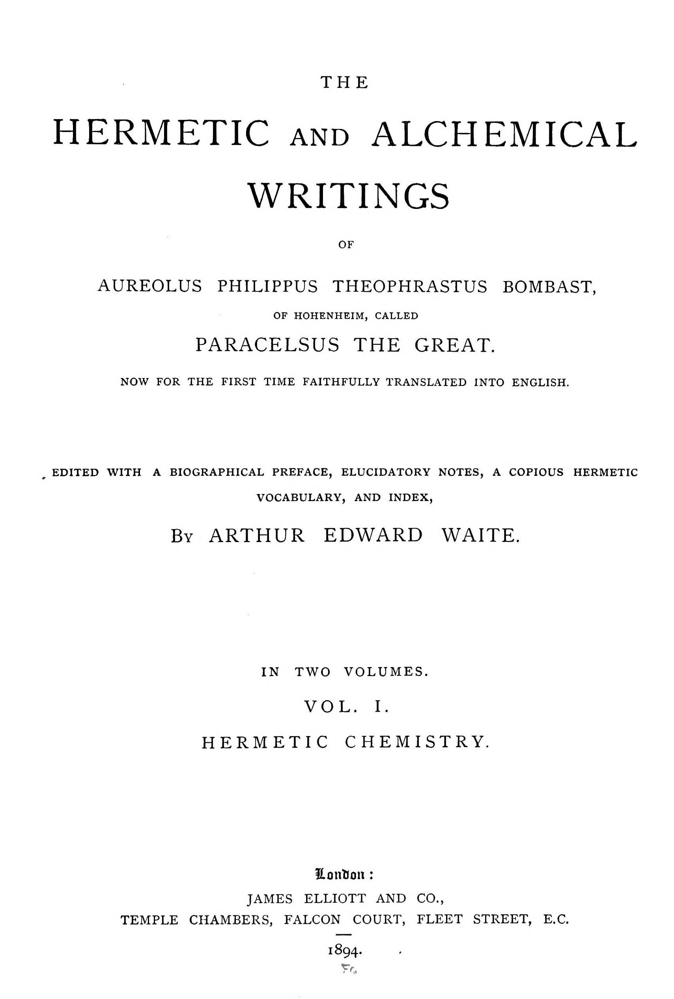

# パラケルスス『事物の本性について』

パラケルスス著／A・E・ウェイト英訳／全訳

- 原題：Concerning the Nature of Things（ラテン語題 De natura rerum。パラケルススの名で伝わり、巻末の献辞は1537年フィラハの日付をもつ。A・E・ウェイトがジュネーヴ二つ折り版〔1658年〕に従って全九書として The Hermetic and Alchemical Writings of Paracelsus 第一巻、1894年に収めた）
- 内容：
  - 第一の書「生成について」は、腐敗を生成の第一歩とし、鳥の灰からの再生、想像による胎児の変形、バシリスクの生まれ方、そして名高いホムンクルス（人造の小人）の作り方を述べる
  - 第二〜第五の書は、成長（ガラス器の中で育つ「哲学者の木」）、保存（金属・飲み物・材木の保存と、それぞれの「敵」）、命（あらゆるものの命は霊であること）、死（金属・鉱物の「殺し」の処方）を扱う
  - 第六・第七の書は、蘇生（灰からよみがえる木、死んで生まれた獅子を親の咆哮が生かす話）と、変成の七つの段階（焼成・昇華・溶解・腐敗・蒸留・凝固・チンキ）、火の度合い、偽の真珠と珊瑚の作り方を説く
  - 第八の書「分離について」は、死における人の二つの体の分離から、金属・鉱物・植物・動物の分離へ進み、最後の審判を「最後の分離」として結ぶ
  - 第九の書「徴（シグナトゥラ）について」は、人相と手相、草と鉱脈の「手相」、鉱山の閃光、金属の「星」、アダムによる命名、そして土占い・火占い・水占い・混沌占い・死霊占いの徴を述べる
- 作業の基にした本文と扉：Internet Archive 所蔵の1894年英訳第一巻のスキャン二種（Google 版の OCR を主とし、注の崩れはコーネル大学版の OCR と画像で補った）
- 著作権：パラケルススは1541年、ウェイトは1942年に死去。日本・米国・英国で保護期間が満了している
- 訳者：人工知能（Claude Opus 5.5）
- 訳の性格：ウェイトの英訳からの重訳である。本文の全九書と、ウェイトがパラケルススのほかの著作から集めて付けた注四十三（グノームの暮らし、眠りの中で死者の霊と語る方法、土占い・火占い・死霊占いの仕組みを論じる長い引用、ヴィンケルシュタインへの献辞を含む）をすべて訳した。訳者の調べたかぎりでは、日本語の全訳は出ていない（ヤコビ編の抄録集の邦訳など、断片的な引用を含む本はあるかもしれない）

## この本について

　『事物の本性について』は、パラケルスス（一四九三ごろ〜一五四一）の名で伝わる自然哲学の書で、とりわけ第一の書のホムンクルスの製法によって名高い。男の精液を馬糞の熱の中で四十日腐敗させると、透きとおった人の形のものが動きはじめ、それを人の血のアルカナで四十週間養えば小さな子どもになる――この一節は、ゲーテ『ファウスト』第二部のホムンクルスをはじめ、後世の人造人間の物語の源の一つになった。もっとも今日の研究では、この書はパラケルスス本人ではなく、その没後の追随者の手になるものと考えられることが多い。

　全九書をつらぬくのは、「自然がすることを、術はガラス器の中でまねられる」という確信である。腐敗は生成の母であり、死は分離であり、焼成から始まる七つの段階を昇れば、金属も宝石も変成させられる。一方で書は、医者たちへの罵倒や、スパギリスト（錬金術の医師）の「煤けた手」の賛美、手相占いの指の割り当てへの皮肉など、パラケルスス派らしい毒舌にも満ちている。

　第九の書の「徴（シグナトゥラ）」の説――万物はその内なる力を外の形と色と線とに刻まれており、それを読むことで草の効能も鉱脈も人の性質も知られる――は、のちのヤーコプ・ベーメの『万物の徴について』へと続く、ルネサンスの「自然の書物」の思想の代表である。

　英訳の明らかな言い違いや意味のとりにくい語には〔　〕で注記した。

---

## 事物の本性について

## 第一の書――自然物の生成について

　あらゆる自然物の生成は二重である〔注1〕。一つは術なしに自然によって起こるもの、もう一つは術によって、すなわち錬金術によってもたらされるものである。もっとも、一般には、万物は腐敗の助けによって土から生み出されると言ってよいであろうが。腐敗は最高の段階であり、生成への最初の手始めだからである。だが腐敗は湿った熱から生じる。絶え間ない湿った熱は腐敗を生み出し、あらゆる自然物を、その最初の形と本質から、またその力と効能から、何か別のものへと変成させるからである。はらわたの中の腐敗があらゆる食物を変成させて糞に還元するように、腹の外でも、ガラス器の中の腐敗は、万物を一つの形から別の形へ、一つの本質から別の本質へ、一つの色から別の色へ、一つの香りから別の香りへ、一つの効能から別の効能へ、一つの力から別の力へ、一組の特性から別の特性へ、一言で言えば一つの性質から別の性質へと変成させる。健やかで薬である多くのよいものが、その腐敗ののちには悪く、健やかならず、ただの毒になることは、日々の経験によって知られ証明されているからである。それと反対に、悪く、健やかならず、毒があり、害になる多くのものが、その腐敗ののちにはよくなり、その悪い作用をすべて失い、すぐれた薬となる。腐敗は大いなる効果を生み出すからである。その良い例を我々は聖なる福音書にもっている。キリストはこう言う。「一粒の麦が畑に投げ出されて腐らなければ、百倍の実を結ぶことはできない」。ここから、多くのものが腐敗によって増やされ、すぐれた実を生み出すことが知られる。腐敗は万物の変化であり死であり、あらゆる自然物の最初の本質の破壊であって、そこから我々のために、以前より一万倍もよい再生と新しい誕生とが出てくるのである。

　それゆえ腐敗は生成の最初の一歩であり始まりなのだから、我々がこの工程を徹底的に理解することは、最高度に必要である。だが腐敗には多くの種類があり、一つはほかのものより、その生成をよりよく生み出し、一つはほかのものより早く生み出す。我々はまた、湿って温かいものが腐敗の第一の段階であり始まりであって、めんどりがその卵を生み出すように万物を生み出す、と述べた。それゆえ腐敗によって、また腐敗のうちで、あらゆるものは、結局それが何になるにせよ、粘液質の粘液となり、生きた物質となる。汝はその例を卵に見る。その中には粘液質の湿り気があり、それは絶え間ない熱によって腐敗し、生きたひよこへと命を吹きこまれる。それはめんどりから来る熱によってだけでなく、それに似たどんな熱によってもである。そのような度合いの熱によって、卵はガラス器の中で、また灰の熱によって成熟させられ、生きた鳥になることができるからである。誰でもまた、自分の腕の下で卵を成熟させ、めんどりと同じようにひよこを生み出すことができる。そしてここで、さらに注意すべきことがある。もし生きた鳥を、封じたククルビタの中で第三の度合いの火によって焼いて塵と灰にし、それからなお閉じこめたまま、馬の腹（ウェンテル・エクイヌス）〔馬糞による保温〕の最高の度合いの腐敗によって腐敗させて粘液質の粘液にするなら、その粘液はふたたび成熟させられ、こうして新たにされ回復させられて、生きた鳥になることができる。ただしその粘液がもう一度その壺すなわち容れ物に閉じこめられるならば。これは再生と清澄化によって死者をよみがえらせることであり、まことに自然の大いなる深い奇跡である。この工程によって、あらゆる鳥を殺し、ふたたび生かし、新たにし回復させることができる。これは、神が死すべき人に明かした、神の最大最高の奇跡であり秘儀である。知らねばならないが、このようにして、人は自然の父と母なしに生み出されうるのである。すなわち、女からの自然な道によってではなく、熟練したスパギリストの術と勤勉とによって、人は生まれ育つことができる。のちに述べるとおりである。

　人が動物から生まれることもまた自然には可能であり、この結果には自然の原因がある。だがそれでもそれは、異端と不敬虔なしには生み出されえない。もし人が動物と交わり、その動物が女のように人の種子を欲望と情欲とをもってその子宮に受け入れ、そこに閉じこめるなら、そのとき種子は必然的に腐敗し、体の絶え間ない熱によって、そこから動物ではなく人が生まれる。常に、どんな種子が蒔かれようと、そこからはそのような実が生み出されるからである。もしそうでなかったなら、それは自然の光に反し、哲学に逆らうであろう。種子がどんなものであれ、そこから芽生える草はそのようなものである。玉ねぎの種子からは玉ねぎが芽生え、薔薇や胡桃やレタスは芽生えない。同じように、小麦からは小麦が、大麦からは大麦が、燕麦からは燕麦が出る。種子をもち蒔かれるほかのあらゆる実についても同じである。

　同じように、女と男とから理性のない動物が生まれることも可能であり、自然に反してはいない。そしてこのために女について男と同じ判断を下すべきではない。すなわち、このために女が、自然に反して行動したかのように異端と見なされるべきではない。その結果は想像に帰されねばならない。想像はきわめてしばしばこの原因である。そして身ごもった女の想像はきわめて活発なので、種子を体の中に宿すとき、胎児をさまざまなしかたで変成させることができる。その内なる星々が胎児にきわめて強く向けられ、刻印と影響とを生み出すからである。それゆえ母の胎内の幼子は、その形成のあいだ、陶工の手の中の粘土と同じくらい母の手の中に、その意のままにある。陶工はそこから好きなもの、気に入るものを何でも形づくり作る。そのように身ごもった母は、その想像に従って、またその星々のあるがままに、自分の体の中の実を形づくる。それゆえ、母の想像が胎児に強く向けられたように、男の種子から家畜やほかの恐ろしい怪物が生まれることがしばしば起こる〔注2〕。

　だが汝がすでに、多くのさまざまなものが腐敗から生み出され命を吹きこまれると聞いたように、さまざまな草から、腐敗の工程によって動物が生み出されることも知るべきである。そのような事柄の経験をもつ者たちが知っているとおりである。ここでもまた汝は、腐敗のうちで、また腐敗によって生み出されるそのような動物は、すべていくらかの毒を含み、有毒であることを学ぶべきである。だが一つはほかのものよりはるかに多く、より強力な毒を含み、一つはある形で、ほかのものは別の形でそれを含む。蛇、ひき蛙、蛙、バシリスク、蜘蛛、蜂、蟻、そして多くの虫、たとえば毛虫やいなごやそのほかの生き物の場合に汝が見るとおりであり、それらはすべて腐敗から生み出される。動物のあいだには多くの怪物が生み出されるからである。腐敗によって生み出されるのではなく、すでに述べたように、ガラス器の中で術によって作られる怪物もある。それらはしばしばきわめて驚くべき形と恐ろしい姿で現れる。たとえばしばしば、多くの頭、多くの足、あるいは多くの尾をもち、さまざまな色をしている。ときには魚の尾や鳥の翼をもつ虫や、そのほかこれまで見たこともないような見慣れない形をしている。それゆえ、怪物と呼ばれるのは、親をもたない動物、あるいは自分に似ていない親から生まれた動物だけではなく、ほかのしかたで生み出されるものもそう呼ばれるのである。それゆえ汝はバシリスクについて見る。それはほかのすべてにまさる怪物であり、これより恐るべきものはない。人はその姿を見ただけで殺されうるからである。それはほかのあらゆるものより猛烈な毒をもち、世界のほかの何ものもそれに比べることができない。この毒を、それは何か知られていない手段によって、その目の中に宿している。そしてそれは想像に作用する毒であって、月経中の女とまったく似ていなくもない。その女もまたその目の中に毒を宿しており、そのまなざしだけで鏡にしみがつき汚れるほどである。同じように、もし彼女が傷や腫れものを見るなら、同じしかたでそれに影響を与え、その治癒を妨げる。その息によっても、そのまなざしによってと同じく、彼女は多くのものに影響を与え、それらを腐らせ弱くし、またその手触りによっても。月経のあいだに彼女がぶどう酒を扱えば、それはすぐに変質して濁るのを汝は見る。彼女が扱う酢は滅びて役に立たなくなる。上等なぶどう酒はその力を失う。同じように、琥珀、霊猫香、麝香、そのほか強い香りの物質も、そのような女が身につけたり扱ったりすると、その香りを失う。金、珊瑚、多くの宝石は、ちょうど鏡がこのように影響されるのと同じく、その色を奪われる。だが――バシリスクについて書くという私の企てに戻れば――それがいかにしてその毒を目の中に宿しているかである。汝は、それがその力とその毒とを、上で述べたように、不浄な女から得ていることを知らねばならない。バシリスクは女の主な不浄、すなわち月経の血から生み出され育つからである。同じように種子の血からも。もしそれをガラスの容れ物に入れ、馬糞の中で腐敗させるなら、その腐敗からバシリスクが生み出される。だが、まず鏡で身を覆い守ったのでなければ、それを生み出したいと、ましてそれを取ってすぐに殺したいと望むほど大胆で向こう見ずな者がいようか。私は誰にもそうするよう勧めはしないであろうし、誰にでも用心するよう忠告したい。だが怪物についての我々の論文を続ければ、自分に似たものからの繁殖とは別の方法で生み出される動物のあいだの怪物的な生まれは、めったに長くは生きないことを知れ。とりわけほかの動物の近くや、そのあいだでは。その接ぎ木された本性によって、また神の定めによって、あらゆる怪物は、自分に似たものからしかるべく生まれた動物たちに忌み嫌われるからである。同じように、人間の怪物的な生まれもめったに長くは生きない。それが驚くべく注目に値するものであればあるほど、死はそれに早く訪れる。そのため、それらのうちのどれも、ただちに秘密の場所に運ばれてすべての人から隔離されるのでなければ、人の前で三日目を越えるものはほとんどない。まことに知るべきは、神はこの種の怪物を忌み嫌うということである。それらは神を喜ばせず、神の似姿をもたないので、そのどれも救われることができない。それらは悪魔によって形づくられ、神よりもむしろ悪魔に仕えるために生まれたのだと推測するほかはない。いかなる怪物からも、かつて何の善い業も引き出されたことはなく、反対に悪と罪と、あらゆる種類の悪魔的な策略とが引き出されてきたのだから。首斬り役人が、その息子たちの耳を切り落とし、目をえぐり、頬に焼き印を押し、指や手や頭を切り落とすときに彼らにしるしをつけるように、悪魔もまた、母の想像を通じて自分の息子たちにしるしをつける。それを彼らは、受胎における母の邪な欲望と情欲と思いとから引き出すのである。それゆえ、何かの肢体を通常の数より多くあるいは少なくもつ人、あるいは何かの肢体が二重になっている人は、すべて避けるべきである。それは悪魔の前兆であり、隠れた邪悪と策略の確かなしるしだからである〔注3〕。

　だが我々は決してホムンクルスの生成を忘れてはならない。このことにはいくらかの真理があるからである。もっとも、それは長いあいだ、きわめて隠されたしかたで秘密のうちに保たれ、古の哲学者たちの何人かのあいだでは、女の体と自然の子宮なしに人が生み出されることが自然と術とに可能かどうかについて、少なからぬ疑いと問いとがあったのだが。私はこれに答える。これはスパギリアの術にも自然にもまったく反しておらず、いや、完全に可能である、と。それを成し遂げるには、次のように進めねばならない。男の精液を、封じたククルビタの中で、馬の腹の最高の腐敗によって、四十日間、あるいはついにそれが生き、動き、揺れはじめるまで、それだけで腐敗させよ。それはたやすく見ることができる。この期間ののち、それはいくらか人に似たものになるであろう。だがそれでも透きとおっていて、体をもたない。さて、そののち、それが毎日、人の血のアルカナによって注意深く賢明に養われ育てられ、四十週間、馬の腹の絶え間ない一様な熱の中に保たれるなら、それはそれ以後まことの生きた幼子となり、女から生まれた子のあらゆる肢体をもつが、はるかに小さい。これを我々はホムンクルスと呼ぶ。そしてそれはそののち、最大の注意と熱心さとをもって、育って知性を示しはじめるまで教育されるべきである。さて、これは、神が死すべき誤りやすい人に明かした最大の秘密の一つである。それは神の奇跡であり驚異であり、あらゆるアルカナの上のアルカナであって、何も隠されたものがなく、すべてのものが明らかにされる終わりの時まで秘密にしておかれるに値する。そして〔それは今に至るまで人々に知られていなかったけれども、森の精たちやニンフたちや巨人たちには昔から知られていた。彼ら自身がこの源から生まれたからである。そのようなホムンクルスが成人すると、そこから巨人や小人やほかの驚くべき人々が生み出される。彼らは大いなる事柄の道具であり、敵に対して大いなる勝利を得、あらゆる秘密の隠れた事柄を知っている〕〔注4〕。彼らは術によってその命をふたたび得、術によってその体、肉、骨、血を得、術によって生まれるのだから、術は彼らのうちに体現され、彼らとともに生まれている。そして彼らは学ぶ必要がなく、むしろほかの者たちが彼らから学ぶことを強いられる。彼らは術から生まれ、庭の薔薇や花のように術によって生きているからである。そして彼らは森の精とニンフとの子らと呼ばれる。その力において彼らは人に似ておらず、霊に似ているからである。

　ここでもまた金属の生成について語る必要があろう。だが我々はそれについて『金属の生成』についての書で十分に書いたので、ここではその事柄をごく手短に扱い、そこで省いたことだけを短く指摘しよう。それゆえ知れ、七つの金属はすべて三重の物質から、すなわちメルクリウス、硫黄、塩から生まれる。ただし区別された特有の色合いをもって。このようにしてヘルメスは、七つの金属はすべて三つの物質から作られ合成されており、同じようにチンキと哲学者の石もそうである、とまことに言った。これら三つの物質を彼は霊、魂、体と名づける。だが彼は、これがどのように理解されるべきか、あるいはそれによって何を意味したかを指摘しなかった。もっとも、彼はおそらく三つの原理をも知っていたのかもしれないが、それに言及していない。それゆえ私は、彼が誤っていたと言うのではなく、彼が黙っていたと言うのである。さて、これら三つの区別された物質、すなわち霊、魂、体が正しく理解されるように、それらは、七つの金属すべてがそこから生み出される三つの原理、メルクリウス、硫黄、塩のほかの何ものも意味しないことを知るべきである。メルクリウスは霊であり、硫黄は魂であり、塩は体だからである。ヘルメスが語る、霊と体とのあいだの金属は魂であり、それはまことに硫黄である。それは体と霊という二つの相反するものを結び合わせ、一つの本質に変える。だがこれを、どんなメルクリウスからでも、どんな硫黄からでも、どんな塩からでも、これら七つの金属が、あるいは同じようにチンキや哲学者の石が、錬金術師の術と勤勉とによって火の中で生み出されうると理解してはならない。これら七つの金属はすべて、地のアルケウスによって山の中で生み出されねばならない〔注5〕。錬金術師は金属を生み出したり作ったりするよりも、それをたやすく変成させるであろう。それでもなお、生きたメルクリウスは七つの金属すべての母であり、金属の母と呼ばれるに値する。それは開いた金属であり、いわば火の中でそれ自身から差し出すあらゆる色をそれ自身のうちに含んでいるからである。そして同じように、隠れたしかたで、火なしにはそれ自身から差し出さないあらゆる金属をも、それ自身のうちに含んでいる。だが金属の再生と更新とは次のようにして起こる。人がその母の胎内に、すなわち最初の人がそこから生まれた土に戻ることができ、こうして終わりの日に新たにふたたび生まれることができるように、すべての金属もまた生きた水銀に戻ることができ、メルクリウスになることができ、そして母の胎内の子のように四十週間絶え間ない熱の中にとどまるなら、火によって再生され清澄にされることができる。さて、それらはしかし、ありふれた金属としてではなく、染める金属として生まれる。上に言ったように、もしルナが再生されるなら、それはそののちあらゆる金属をルナへと染めるであろうからである。同じように金はほかの金属をソルへと染める。そしてほかのあらゆる金属についても同じように理解されねばならない。さて、ヘルメスが、魂こそ霊を体に結びつける唯一の仲立ちであると言ったとき、彼は真理について不十分な考えをもっていたのではなかった。そして硫黄がその魂であり、火のようにあらゆるものを急がせ調えるのだから、それはまた霊と体とを結びつけ、それらを一体化させ結合させて、最も高貴な体が生み出されるようにすることができる。けれども、金属の魂と見なすべきなのは、ありふれた燃える硫黄ではない。その魂は、別の燃えうる朽ちうる体である〔原文のまま。文脈からは「燃えず朽ちない」と読むのが自然〕。それゆえそれはどんな火でも焼くことができない。それ自体がまったく火だからである。そして、まことに、それは硫黄の第五元素にほかならず、反射炉で焼いた硫黄からぶどう酒の霊によって抽き出され、ルビー色で、ルビーそのもののように澄んでいる。これはまことに、白い金属を変成させ、生きた水銀を凝固させて固定した確かな金にするための、強力ですぐれたアルカナである。これを汝を富ませる宝としてたたえよ。そして汝は金属の変成においては、この秘密だけで満足すべきである。鉱物と半金属の生成については、我々が初めに金属について述べたこと以上を知る必要はない。すなわち、それらも同じように、あの三つの原理、メルクリウス、硫黄、塩から生み出されるが、金属のようにその完全さにおけるこれらの原理からではなく、より不完全でより弱いメルクリウス、硫黄、塩から、それでもなおその区別された色とともに生み出される、ということである。

　宝石の生成は、土の精妙さから、澄んだ水晶のようなメルクリウス、硫黄、塩から、それぞれの区別された色に従って起こり、流れ出る〔注6〕。ありふれた石の生成は、水の精妙さから、粘液質のメルクリウス、硫黄、塩による。あらゆる石は水の粘液によって生み出され、小石や砂も同じ源から凝固させられて石になるからである〔注7〕。これは目に明らかである。水に入れたあらゆる石は、すぐに粘液を自分に引き寄せるからである。さて、もしその粘液質の物質をそのような石から取り、ククルビタの中で凝固させるなら、それ自身で水の中で生み出され凝固させられるのと同じ種類の石が生み出されるであろう。ただし水の中では長い時間がかかるのだが。

---

**英訳者（ウェイト）の注**

〔注1〕　生成が二重であるという別の側面もある。たとえば木やほかのものの生成は自然に種子から起こる。だが木を損なう虫は怪物的な精液の産物である。それゆえ二つの生成がある。自然のものと怪物的なものとである。生き物のあらゆる精液は、そのうちに怪物的な別の精液をもち、それはそれに似たものを促すことができる。あらゆる鉱物の中にも怪物的な精液がある。――『パラグラフォルム』第二巻第四部。

〔注2〕　ここでも、彼の書き物のいたる所と同じく、パラケルススは想像が及ぼす力に特別な重きを置いている。――強い想像が何を成し遂げうるかを汝は知る必要がある。それはあらゆる魔術的作用の原理である。――『ペストについて』第一巻。人の想像は追い出す力である。――『ペストについて』第一巻への追加。脳に宿る想像はミクロコスモスの月である。――『疫病について』第二論文第二章「火のペストについて」。我々のあらゆる苦しみ、あらゆる悪徳は想像にほかならない。……そしてこの想像は、上位の天へと浸透し昇り、星から星へと渡るようなものである。それはこの同じ天に打ち勝ち、それを和らげる。……我々のうちにある節度なく非人間的なものはすべて、天に自らを刻印しうる想像的な本性であり、そうなると今度は天のほうが、その刻印を返す力をもつ。――『ペストについて』第一巻への追加、序。同じように、強い想像は良い運にも悪い運にもなる源である。――『ペストについて』第二巻第二章。身ごもった女の想像によって養われたどんな強い欲求、望み、傾きも、胎児に刻印されうるし、しばしばされる。そのような女が、プラトンやアリストテレスのような賢く偉大な人、ユリウス・カエサルやバルバロッサのような名高い兵士、ホフハイマー〔原文 Hoffhammer〕のような偉大な音楽家、デューラーのような画家のことを根気よく思い続けることによって、子の形成の傾きに働きかけ、子が同様の性質を示すようにすることも可能である。だが母の中にも、彼女が想像した特別な才能に対応する何かがなければならない。――『見えない病の起源について』第三巻。想像は胎児をゆがめ損なうことができ、このようにして、親に体の特異な点がないのに多くの驚異が生み出される。――同。

〔注3〕　この主題と関連する事柄についての特別な論文が、ジュネーヴ二つ折り版のほかの箇所に見られる。手短に言えば次のとおりである。海には、最初の創造の産物ではなく、自然のまことの秩序に反して異なる種の魚の精液が出会うことから生まれる多くの怪物がいる。それゆえ海には、人の形を示しながら、人からの獣姦によってではなく、異なる魚の結合によって生じる怪物がときに見いだされる。……人のあいだでさえ、一部は人間を、一部は動物を思わせる怪物がときに見いだされる。これはいとわしい主題であるが、最初の誕生が正しく理解されるよう、十分に説明する必要がある。同じことが海でも起こる。たとえばセイレンがいて、その上の部分は女の、下の部分は魚のものである。これは最初の創造の一部ではなく、同じ種類だが異なる形の二匹の魚の結合から生まれた雑種の子である。ほかにも、人に正確には対応しないが、ほかのどんな動物よりも人に似ている海の動物が見いだされる。けれどもほかの獣と同じく、それらは知性すなわち魂を欠いている。それらは猿と同じ関係を人に対してもち、海の猿にほかならない。それらが結合するたびに、この種の海の怪物が生み出される。もう一つのこのような怪物的な生成は、修道士魚（モナクス）である。だが魚には多くの類があり、生成の様式も多く、それらは必ずしも自分たちになじみの、慣れた精液から生じるのではなく、ほかのさまざまなしかたで起こる。たとえば、ある怪物が海で溺れ、魚に食べられる。さて、もし高揚のうちに構成された精液が水没によって滅び、魚に食べられてその中でふたたび高揚させられるなら、魚と精液との本性から、疑いなくある作用が続くであろう。そこから、人の形を思わせる海の動物の大部分は、このようにして生み出されると汲み取れる。けれども魚の本性をもっているので、それらは水の中で生き、そこでよろこぶ。海の犬、海の蜘蛛、海の人がこの類である。もしそれらがほかのしかたで生み出されるなら、それは獣姦に帰されねばならない。だが第三の原因もありうる。すなわち、この種の精液が消化を得て、この結合によって誕生が起こるときである。……怪物は同じように空中でも、上の星々からの滴りから生み出される。精液が星々から落ちるからである。風もまたその流れの中で、それらが土着であるほかの地方から多くの奇妙なものを運んでくる。空中に漂う蜘蛛やひき蛙やそのほかの生き物の精液が解かされ、そこからほかの生き物が生み出される。このようにしてバッタやそのほかの怪物が生まれる。その生成は二つのものではなく、ただ一つのものによる。そのような誕生は、ほかの虫よりも有毒で不純である。それゆえ家は念入りに掃除されるべきであり、さもなければ多くの汚れがたまりにくいように建てられるべきである。空気はこのようにまき散らされた種子に対して効力をもつからである。けれども土こそ、怪物的な生まれの最も実り豊かな母胎である。そこには陸と海の両方の動物が集まる。バシリスクはひき蛙と雄鶏との精液から生み出される。雄鶏の精液がめんどりのそれと結合すると卵を生む。だがもし雄鶏がその精液を、めんどりが同じようにすることなしに放つなら、卵は不完全になり、何かが不自然に生み出されるであろう。雄鶏とひき蛙との獣姦的な結合によって生み出される、別の種類のバシリスクもある。同じしかたで、とかげがやもりと結合し、その交わりが両方の本性をあわせもつ特有の虫を生み出し、それは竜として知られる。アスプ（毒蛇）もこの不自然な生成のもう一つの例である。……書き記したすべてから、ただ自分の体のためにだけ生きる者は誰でも、バシリスクであり、竜であり、アスプであることを学べる。まことに、まだ生み出されてはいないが、そのあいだ死ぬまで生きて動いているのである。汝は今、不自然な怪物が生み出される忌まわしいしかたを理解できる。もし人が精液のうちに生きるなら、その精液そのものが虫に変わり、虫のままとどまり、復活の日にはそれらは地の最も深いところに埋められ、その上をよみがえった者たちが歩くであろう。――『獣姦から生まれる動物について』。

〔注4〕　ほかの箇所でパラケルススは、巨人はシルフ（風の精）から、小人はピグミー（地の精）から生まれると述べている。これらから怪物が生み出され、たとえばニンフやセイレンがそうである。これらはまれであるけれども、十分にしばしば、またきわめて驚くべきしかたで現れてきたので、その存在を疑う余地はない。――『ニンフ、ピグミー、サラマンドラ……について』。ホムンクルスの生成については、次の一節もある（ラテン語のまま引かれている）。「さらにまた知るべきは、獣姦者たちがこの種の精液をときに口の中にも放つということである。もしそれが胃の中に、いわば子宮の中にのように受け入れられるなら、そこからそこで怪物か、ホムンクルスか、何かほかの似たものが生み出され、そこから多くの、しかも治りにくい病が生じ、生み出されたものが排出されるまで荒れ狂う」。――『ホムンクルスと怪物について』。

〔注5〕　述べてきたことの確かで根本的な結論として、金属のまことの本質と起源とを知りたいと望む者たちに知らせよう。我々の金属は、ありふれた石の最も強力で最良の部分――石の霊、膠、脂、バター、油、脂肪――にほかならない。それらは石の中でまだ結合しているあいだは、よくなく、純粋でなく、清くなく、まったく完全さを欠いている。この理由で、それらは石の中に求められ、見いだされ、知られねばならず、そこからまた、搗くことと溶かすこととによって分けられ抽き出されねばならない。これがなされたとき、それらはもはや石ではなく、調えられた完全な金属であり、天の星々と一致する。その石は実のところ地の星々から分泌されたものである。さらに、もし誰かが鉱物と金属とを調べ知りたいと望むなら、それらが常にありふれたなじみの鉱石の中に、あるいは山の深みに求められるべきだとは限らないことをはっきり悟るべきである。それらはしばしば地の内部よりも表面で、よりたやすく、より豊かに見いだされるからである。この理由で、目にとまるどんな石も、大きくても小さくても、岩でも火打ち石でも、その特性と本性とについて入念に調べるべきである。小さくさげすまれた小石が、しばしば雌牛一頭より値打ちがあるのだから。同じように、ソルとルナとを豊かに含むありふれた塵や砂もある。――『小外科書』のうち「萎縮について」第二論文、結び。

〔注6〕　アレス〔原文 Ares〕における宝石の生成は次のようにして起こる。石の粗い類がすべてアレスから抽き出されたとき、ほかの石より本性において透きとおったある精妙なものが残り、そこからアルケウスはのちに宝石を生み出す。そのしかたは、まず固さと非常に大きな透明さとが調えられる、というものである。それゆえ宝石はのちに、各々それ自身の形と本質とに従って展開される。この生成にはきわめて大きな精妙さと技巧とが用いられる。――『水の元素について』第四論文第十章。

〔注7〕　あらゆる種類の石の体は硫黄であり、金属の体がメルクリウスであるのと同じである。固さは塩から、密度はメルクリウスから来る。――同第五章。

## 第二の書――自然物の成長について

　あらゆる自然物が温かさと湿り気とによって育ち成熟することは十分に明らかであり、誰にもよく知られている。それは日の光の続く雨によってはっきりと示されている。土が雨によって実り豊かにされることは誰も否定できず、あらゆる種類の実が太陽によって熟させられることは誰もが認めねばならない。それゆえ、神の定めによってこれが自然に可能なのだから、人が錬金術の術を賢明に巧みに追求することによって同じ力をもち、実らないものを実らせ、熟していないものを熟させ、すべてを増し育てることができることを、誰が否定し、あるいは信じることを拒むであろうか。聖書は、神があらゆる被造物を人に従わせ、それをいわば人自身の財産として人に引き渡した、と言う。人がそれを自分の必要のために用い、海の魚と空の鳥と地上のあらゆるものを例外なく支配するために。それゆえ人は、神が人を照らし、授けて、神のあらゆる被造物が神に従い仕えることを強いられるようにしたことを、よろこぶべきである。とりわけ地の全体が、その中で、またその上で生まれ、生き、動くあらゆるものとともに。それゆえ、雨が土をしばしば豊かに湿らせ、太陽がその熱と輝きとでそれをふたたび乾かせば乾かすほど、一年のどの時期であれ、地の実がより早く現れ熟し、あらゆる実が増し育つことを我々は目で見、日々の経験によって教えられているのだから、錬金術師もまた、たびたびの浸しと蒸留とによって同じ効果を生み出すことができることを、誰も不思議に思わないがよい。雨とは土の浸しでなくて何であろう。太陽の熱と輝きとは、湿り気をふたたび抽き出す太陽の蒸留の工程でなくて何であろう。それゆえ私は言う。このような協働によって、冬のさなかに、土と水とによって、種子と根とから緑の草や花や実を生み出すことは可能である、と。さて、もしこれが草や花について起こるなら、ほかの多くの似たものについても起こるであろう。たとえばあらゆる鉱物において。その不完全な金属は、熟練した錬金術師の勤勉と術とによって、鉱物の水で熟させることができる。同じように、あらゆる白鉄鉱、花崗岩、亜鉛、砒素、滑石、カキミア、蒼鉛、アンチモンなど、未熟なソルとルナとを伴うものはすべて、ただこのような協働によって、金と銀の最も豊かな鉱脈に等しくなるほど熟させることができる。同じようにまた、金属のエリクシルとチンキとも成熟させられ完成させられる。

　それゆえ湿り気と温かさとが万物を熟させ育てるのだから、絞首台の罪人の場合に、長いあいだののちにひげや髪や爪が伸びても、誰も不思議に思わないがよい。またこれを、無知な者たちが読み取るように、無実のしるしと受け取ってもならない。それはただ自然なことであり、自然の原因から出ている。体の中に湿り気があるかぎり、爪とひげと髪とは伸びる。そのうえ、土の中に埋められた人の場合でさえ、爪とひげと髪とは二年目まで、あるいはその人の朽ちる時まで伸びるのである。

　また知るべきは、多くの物質が水の中でも陸の上でも、大きさと重さと効能とにおいて絶えず育ち増し、そのどちらにおいてもよく効力あるままであるということである。たとえば金属、白鉄鉱、カキミア、滑石、花崗岩、アンチモン、蒼鉛、宝石、真珠、珊瑚、あらゆる石と粘土である。同じように、ソルを、東に面した土地に埋め、新鮮な人の尿と鳩の糞とで絶えず肥やしさえすれば、その重さと体とにおいて育ち増すようにすることもできる。

　金を熟練した錬金術師の勤勉と術とによって作用させ、ククルビタの中で多くの驚くべき枝と葉とをもって育つようにすることもまた可能である。この実験は見てたいへん楽しく、驚異に満ちている。工程は次のとおりである。金を王水によって焼成し、白亜のような石灰にせよ。それをククルビタに入れ、よい新鮮な王水と段階づけの水とを、指四本の幅を超えるまで注げ。第三の度合いの火で、もう何も昇らなくなるまで、それをふたたび抽き出せ。ふたたびその上に蒸留水を注ぎ、もう一度前のように蒸留によって抽き出せ。ソルがガラス器の中で昇り、多くの枝と葉とをもつ木の形に育つのを見るまで、これを行え。こうしてソルから驚くべき美しい灌木が生み出される。錬金術師たちはそれを金の草、あるいは哲学者の木と呼ぶ。ほかの金属についても工程は同じである。ただ焼成が異なるかもしれず、何か別の強水を用いねばならないかもしれない。これは汝の経験に任せる。もし汝が錬金術に習熟しているなら、これらの細目において正しいことを行うであろう。

　また知れ、どんな火打ち石でも川の水から取り出し、ククルビタに入れ、ククルビタが満ちるまでそれ自身の流れる水をふりかけることができる。これを、一滴でも昇るかぎり、石が乾くまで、ふたたび蒸留によって抽き出すことができる。ククルビタをふたたびこの水で満たし、もう一度抽き出せ。ククルビタがこの石で満ちるまでこれをくり返せ。このようにして、錬金術によって、数日のうちに、水のアルケウスが何年かかってもほとんど作れないほどの非常に大きな石が作れることを、汝は見るであろう。もしそののちククルビタを石の上で割るなら、汝はちょうどガラス器に流しこんだかのような、ククルビタの形をした火打ち石を得るであろう。これは汝に何の益もないかもしれないが、それでもまことに驚くべきことである。

## 第三の書――自然物の保存について

　あるものを保存し、害から守るためには、まず何よりもその敵を知ることが必要である。それからそれを守り、それがその物質や効能や力においてその敵に害されたり腐らされたりしないように、あるいはほかのどんなしかたでも損失を被らないようにするために。それゆえ、あらゆる自然物の敵を見分けることには多くのことがかかっている。自分の敵を知らない者が、どうして損失や不運から身を守れようか。まちがいなく、誰もできない。それゆえそのような敵を知ることが必要である。敵は多い。そして善いものを知るのと同じく、悪いものを知ることも必要である。実際、悪の知識なしに誰が善を知りえようか。誰もできない。一度も病気になったことのない者は、健康がどれほど大きな宝かを知らない。一度も悲しんだり嘆いたりしたことのない者が、喜びとは何かを知ろうか。そして悪魔について何も知らない者が、神とは何かを正しく知ろうか。それゆえ、神は我々に我々の魂の敵、すなわち悪魔を知らせたのだから、我々の命の敵、すなわち死をも指し示す。それは我々の体の敵、我々の健康の敵、薬の敵、あらゆる自然物の敵である。神はこの敵を我々に知らせ、またいかにして、どんな手段によって我々がそれを逃れねばならないかをも知らせた。それを癒し追い払う薬が創られ発見されていないような病は一つもないように、常に一つのものが別のものに向かい合わせて置かれている――一つの水が別の水に、一つの石が別の石に、一つの鉱物が別の鉱物に、一つの毒が別の毒に、一つの金属が別の金属に向かい合わせて――。ほかの多くの事柄でも同じであり、そのすべてをここで数え上げる必要はない。

　だが、各々のものがいかにして、どんな手段によって保存され損失から守られるかを知るべきである。たとえば、多くのものは土の中に長いあいだ保たれねばならない。とりわけあらゆる根は、土の中で長いあいだ実り豊かに朽ちないままでいる。同じように、草と花とあらゆる実とは、水の中で朽ちず緑のままに保たれる。同じようにほかの多くの実、とりわけ林檎は、水の中に保存して、新しい林檎が実るまで、あらゆる腐敗から守ることができる。

　同じように、すぐに腐って悪臭を放つ肉と血とは、冷たい泉の水の中に保つことができる。そればかりではない。新しい新鮮な泉の水の協働によって、それらは第五元素に変成させられ、いかなる香油もなしに、腐敗と悪臭とから永遠に保たれる。そしてこの工程は肉と血とを保存するだけでなく、（いわば）ほかのあらゆる種類の肉と血とを、とりわけ人の体を、あらゆる腐敗から、そして腐敗から生じる多くの病から、ふつうのムミア〔注8〕よりもよく保存する。だが血が、第五元素としてではなく、それ自体として腐敗と悪臭とから保存されるように、また上に述べたようにほかの血を守るためにも、汝は次の工程を用いねばならない。血をその粘液から分けよ。粘液はひとりでに動き、表面へと押し出される。この水を器をたくみに傾けて抜き取り、血に十分な量の塩の水を加えよ。その作り方は我々の『大外科書』で教えている〔注9〕。この水はすぐに血と混じり合い、血を保存して、それは決して腐ったり悪臭を放ったりせず、何年ものちにも最初の日と同じく新鮮で非常に赤いままである。これはまことに大いなる驚異である。だがもし汝がこの水の調え方を知らないか、手もとにないなら、最良の最もすぐれた香油を十分な量注げ。それは同じ効果を生む。さて、この血は香油の中の香油であり、血のアルカナと呼ばれる。それは、もし我々がそれを述べたなら信じがたいほど大きく驚くべき効能をもっている。それゆえ汝はこれを、医学における大いなる秘密として隠しておくであろう。

　金属の保存においてまず学ぶべきことは、その敵が何であるかである。そうすれば金属はそれによって損失からよりよく守られる。それゆえ金属のおもな敵は、あらゆる強水である。あらゆる王水、あらゆる腐食剤と塩は、あらゆる金属を殺し、焼成し、腐らせ、無に帰するという点で、その敵意を示す。生の硫黄はその煙によって敵意を示す。その煙によってそれはウェヌスから色と赤さとを奪い、それを白くする。ルナ、ユピテル、サトゥルヌス、マルスのような白い金属からは、その白さを奪ってそれらを赤くするか、赤みがかった色をそれらに引き起こす。金からは、その好ましい黄色さと金色とを奪い、それを黒くし、できるかぎり見苦しくする。

　アンチモンは、火の中でともに溶かされ混ぜられるあらゆる金属を損ない、それらから奪い取るという点で、その敵意を示す。さらに硫黄と同じく、それは金属からそのまことの色を奪い、別の色に替える。

　他方、水銀は、結びつく金属に対して敵対的な力をふるう。それらに侵入して溶かし、それらからアマルガムを作るからである。さらに、我々がメルクリウスの煤と呼ぶその煙は、あらゆる金属を展性のない、もろいものにする。それはそれらを焼成し、赤や金色の金属をすべて白くする。それは鉄と鋼の主な敵である。ありふれた水銀が鋼の棒に触れるか、その棒が水銀の油を塗られるなら、それはそののちガラスのように折ったり切ったりできるからである。これはまことに大いなる秘密であり、厳しく隠しておかねばならない。同じように、磁石もまたメルクリウスから守り隔てておくべきである。メルクリウスはマルスに対してと同じく磁石に対しても敵意をふるうからである。ありふれた水銀が触れたり、水銀の油を塗られたり、ただメルクリウスの中に置かれたりしたあらゆる磁石は、そののち二度と鉄を引き寄せない〔注10〕。誰もこれを不思議に思うな。これには自然の原因がある。メルクリウスは、磁石がそのうちに潜ませている鉄の霊を抽き出すからである。それゆえまた、磁石の中の鉄の霊はマルスの体を自分に引き寄せる。そしてこれは磁石においてだけでなく、ほかのあらゆる自然物においても起こる。すなわち、それ自身の本性のものではない異質な体の中にある異質な霊は、常にそれ自身の本性と一致する体を引き寄せるのである。これは磁石についてだけでなく、鉱物、石、草、根、人、動物のようなあらゆる自然の体について知られるべきである。

　こののち知るべきは、金属は互いに敵意をふるい、その生まれつきの本性から互いに憎み合うということである。サトゥルヌスの場合に汝が見るとおり、それはその生来の本性からソルの主な敵である。それは金のあらゆる肢体を砕き、それを不格好にし、弱くし、ほかのどの金属に対してよりもひどく、死に至るまでそれを滅ぼし腐らせる。それはまた錫を憎み、あらゆる金属の敵である。火の中で、あるいは流動の中でそのどれかと混ぜられると、それらを堕落させ、展性をなくし、固く、不適当にするからである。

　それゆえ汝は今、金属の敵について聞いたのだから、さらに、金属をあらゆる損失と腐敗とから守り、そのうえその本性と効能とにおいてそれらを強め、色においてそれらをより高く段階づける、その保存と保管とについて学べ。まず金について知るべきは、塩化アンモニウムを溶かした少年の尿の中で、あるいは塩化アンモニウムの水だけの中で保存されるほどよく美しく保存されることはない、ということである。これらの中で、時とともに、それはしのぐもののないほど高い度合いの色を得る。銀は、酒石と塩とを溶かしたふつうの水か酢の中で煮られるほどよく保存され保管されることはない。このようにして、黒ずんでしみのついたどんな古い銀も、このように煮れば新たにされる。鉄と鋼にとって最良で最も役に立つ保存と保護とは、去勢した雌豚の、塩漬けにしていない新鮮なラードである。これは、月に一度それを塗れば、あらゆる鉄と鋼とを錆から守る。同じように、もし鉄を固定した砒素とともに溶かし、ときどき流動させるなら、それは銀のように決して錆びないように新たにされ固定されうる。銅は、昇華させたメルクリウスと混ぜるか、塩の油を塗りさえすれば保存され保護されうる。そうすればそれは今後緑礬も緑青も出さず、緑色になることもない。

　鉛は、冷たい水の中、湿った場所でほどよく保存されることはない。その本性がそうなのである。だが磁石の保存には、鉄か鋼のやすり屑にまさるものはない。もし磁石をこれらの中に置くなら、その力は減らないばかりか、日ごとにますます増す。

　塩の保存について、また塩の本性をもち、塩という名のもとに含まれる――それは百以上ある――あらゆる物質の保存については、それらを温かく乾いた場所に保ち、木の箱の中で空気からよく守らねばならないことを知るのがよい。それらをガラスや石や金属の上に置いてはならない。それらによって塩は溶かされ、水とアマルガムとに変わる。だがこれは木の中では起こらない。

　さらに汝は、搾った草や根やほかの実や育つものによるある水と液との保存の方法を学ぶべきである。それらは、まるで皮がそれらを包んでいるかのように、あらゆるかび臭さとかびとをたやすく吸い取る。これらの水やほかの液を、上が狭く下が広いガラス器に入れよ。器を上まで満たし、それからオリーブ油を何滴か加え、水すなわち液がすべて覆われるようにせよ。油は上に浮き、こうして液あるいは水を長いあいだかび臭さとかびとから守るであろう。油で覆われていれば、いかなる水も液も、決してかびたり悪臭を放ったりすることはない。このようにしてまた、二つの水、二つの液、二つのぶどう酒を、一つの器の中で混ざらないように別々に保つことができる。二つだけでなく、三つ、四つ、五つ、あるいはさらに多くでも、そのあいだに油がありさえすれば。それらは油によって壁によってのように分けられ、油はそれらが結び合わされ一つになるのを許さないからである。油と水とは二つの反対のものであり、どちらももう一方と混じり合うことができないからである。油が水の混じり合うのを許さないように、他方では水が油の混じり合うのを妨げる。

　布地と衣服とを衣蛾から保存し保護し、それが食べたりそこに住みついたりしないようにするには、乳香（マスティクス）、樟脳、竜涎香、麝香にまさるものはない。だが最良のものは霊猫香である。それは衣蛾から守るだけでなく、衣蛾をほかの虫、蚤、虱、南京虫とともに追い払い、逃げ出させる。

　建物や橋においてのように、あらゆる材木を保存して、水の中にあろうと水の下にあろうと水の外にあろうと、地中にあろうと地下にあろうと地上にあろうと、雨や風、空気、雪、氷にさらされようと、夏でも冬でも、決して朽ちないようにすることができる。そのうえ、伐られたのちに朽ちたり虫がわいたりするのを防ぐことも。この場合の保存の方法は、あらゆる腐敗に対するあの大いなるアルカナであり、ほかのどれも比べられないほど注目すべき秘密である。それは硫黄の油にほかならず、その作り方は次のとおりである。ふつうの黄色い硫黄を粉にし、ククルビタに入れよ。その上に、指四本の幅を覆うだけの強水を注げ。これを蒸留によって三、四回抜き取り、最後のときはすっかり乾くまで抜き取れ。底に残り、暗い赤みがかった色をしている硫黄を大理石かガラスの上に置き、たやすく溶かして油にせよ。これは、材木が決して朽ちず虫から守られるように保存するための大いなる秘密である。上に述べたように硫黄を調え、油に変えるなら、それはそののち、それを塗られた材木を、決して消えることのないように染めるからである。ほかの多くのものもまた、この硫黄の油の中で腐敗から保存され保護されうる。とりわけ船の、また船の帆柱の綱と大綱、車、漁網、鳥刺しと狩人の罠、そのほか水や雨の中でたびたび使われ、さもなければ朽ちて切れやすいそれに似たもの。同じように亜麻布やほかの似たものも。

　飲み物の保存にも注意すべきである。その中に我々はぶどう酒、ビール、蜂蜜酒、酢、乳を含める。もしこれら五つを損なわずその効能のうちに保ちたいなら、その主な敵を知る必要がある。それは、月経の時期の不浄な女にほかならない。彼女たちは、これらのものを扱ったり、何かかかわったり、それを見たり、それに息を吹きかけたりすると、それらを腐らせる。ぶどう酒は変質して濁り、ビールと蜂蜜酒とは酸っぱくなり、酢は弱まってその酸味を失い、乳もまた酸っぱくなって固まる。

　それゆえ、これらのもののどれか一つについて特に保存を述べる前に、これをよく知っておくべきである。さらに、ぶどう酒の主な保存剤は硫黄と硫黄の油であり、それによってあらゆるぶどう酒をきわめて長いあいだ保存することができ、濁ることもいかなるしかたで変わることもない。

　ビールを保存する手段は丁子（ガリオフィロン）の油であり、一升に二、三滴という割合で数滴入れればよい。さらによいのはダイコンソウ（ベネディクタ・ガリオフィラタ）の油で、それはビールを酸っぱくなることから守る。蜂蜜酒の保存剤は砂糖の油であり、丁子の油やダイコンソウの油と同じように用いねばならない。

　酢の保存剤は生姜の油であり、乳の保存剤は搾ったアーモンドの油である。この二つは上に述べたように用いねばならない。

　チーズの保存剤はオトギリソウ（ヒペリコン、ペルフォラタ）という草であり、それはあらゆるチーズを虫から守る。それをチーズに当てて触れさせておけば、その中に虫は生じない。そしてもしすでにいくらか生じていても、それらは死んでチーズから落ちる。

　蜂蜜には特別な保存剤はなく、ただその敵から守らねばならない。その主な敵はパンである。小麦粉から作ったパンがほんのわずかでもその中に入れられたり落ちたりすると、蜂蜜全体が蟻に変わり、すっかり滅びてしまう。

## 第四の書――自然物の命について

　空気が、土から生まれ生み出されるあらゆる体的で実体的なものに命を与えることは、誰も否定できない。だが各々のものの命が何であり、どのような種類のものかについては、ものの命とは霊的な本質、目に見えず触れることのできないもの、霊であり霊的なものにほかならないことを知るべきである。このために、それ自身のうちに霊と命とを潜ませていない体的なものは何もない。その命とは、いま言ったように、霊的なものにほかならない〔注11〕。だが、人や動物、地中の虫、空の下の鳥、海の魚のように、動き行動するものだけが生きているのではなく、あらゆる体的で実体的なものもまた生きている。ここで我々は、神が万物の創造の初めに、それ自身の霊なしにいかなる体も創らなかったことを知るべきだからである。その霊をそれは隠れたしかたで自らのうちに含んでいる。霊のない体とは何であろう。まったく何ものでもない。それゆえ、ものの効能と力とを自らのうちに隠しもっているのは霊であって、体ではない。体の中には死があり、体は死に服し、体の中には死のほかに何も求めてはならないからである。体はさまざまなしかたで滅ぼされ腐らされうるが、霊はそうではない。それは常に生きた霊のままであり、命と結ばれているからである。それはまたそれ自身の体を生かしておくが、体がそれから取り去られると、体を離して死んだままにし、それが来たもとのそれ自身の場所へ、すなわち混沌へ、上の天空と下の天空の空気の中へと戻る。ここから、体にさまざまな種類があるように、霊にもさまざまな種類があることは明らかである。天の霊と地獄の霊、人の霊と金属の霊、塩の霊、宝石の霊、白鉄鉱の霊、砒素の霊、飲み物の霊、根の霊、液の霊、肉と血と骨などの霊がある。それゆえ汝は、霊がまことに、あらゆる体的なものの命であり香油であることを知るであろう。さて、その種類に進もう。ここで汝に、各々の自然物の命を、詳しく、しかしできるだけ手短に述べよう。

　それゆえ、あらゆる人の命は、ある星の香油〔注12〕、香油の刻印、天の目に見えない火、閉じこめられた空気、そして染める塩の霊にほかならない。私はそれをこれ以上明らかに名づけることができない。もっとも、それは多くの別の名称のもとに示すこともできようが。けれども、主な最良のものがここに指摘されたので、残りの劣った名については黙っていよう。

　金属の命は、それらが硫黄から受け取った潜んだ脂である。これはその流動によって示される。火の中で流動するものはすべて、その隠れた脂のためにそうなるからである。そうでなければ、いかなる金属も流動状態にすることはできないであろう。鉄と鋼の場合に見るとおりである。それらはあらゆる金属の中で硫黄と脂とが最も少なく、それゆえほかのすべてより乾いた本性のものである。

　メルクリウスの命は、内なる熱と外なる冷たさとにほかならない。すなわち、内では熱を与えるが、外では冷たさを引き起こす。そしてこの点で、それは毛皮の衣に適切になぞらえられる。それはメルクリウスと同じく、熱と冷たさとの両方を引き起こすからである。この種の衣を人が着ると、それは人を温め、寒さから守る。だがもし人が毛のない側を裸の体に当てて着るなら、それは冷たさを引き起こし、過度の熱から人を守る。それゆえ、ごく古い時代に、そして今でもまだ慣わしとして、これらの毛皮の上着は、暑さに対しても寒さに対しても、夏にも冬にも着られるのである。夏には毛のない側を内に、毛のある側を外に向け、寒い冬の季節には毛のある側を内に、毛のない側を外に向ける。毛皮の衣についてそうであるように、メルクリウスについてもそうである。

　硫黄の命は、燃えやすく悪臭を放つ脂である。それが燃えてその悪臭を放っているあいだ、それは生きていると言ってよい。

　あらゆる塩の命は、強水の霊にほかならない。それらから水が抜き取られると、底に残るものは死んだ土と呼ばれるからである。

　宝石と珊瑚の命はただ色であり、それはぶどう酒の霊によってそれらから取り去ることができる。真珠の命はその輝きであり、それは焼成によって失われる。磁石の命は鉄の霊であり、それは精留した燃える酒（ウィヌム・アルデンス）そのものによって、あるいはぶどう酒の霊によって、抽き出され取り去られうる。

　火打ち石の命は粘液質の物質である。白鉄鉱、カキミア、滑石、コバルト、亜鉛、花崗岩、ツヴィッター〔原文 zwitter。錫石〕、ヴィスマット（粗い錫）の命は、染める力をもつアンチモンの金属の霊である。砒素、雄黄、石黄、鶏冠石、そして同様の物質の命は、鉱物の凝固した毒である。

　波のような物質〔原文 wavelike substances。文脈からは糞尿のこと〕、すなわち人と動物との糞の命は、その強い悪臭である。これが失われると、それらは死んでいる。

　芳香のある物質、すなわち麝香、竜涎香、霊猫香、そのほか強く甘く快い香りを放つものの命は、その快い香りそのものにほかならない。もしそれらがこれを失えば、それらは死んで役に立たない。

　砂糖、蜂蜜、マナ、カッシア・フィストゥラ、そしてそれに類する甘いものの命は、染める力をもった精妙な甘さである。もしその甘さを蒸留や昇華によって取り去れば、それらは死んで、気の抜けた、もはや何の価値もないものになる。

　カラバ〔琥珀〕、テレピン、ゴムのような樹脂の命は、粘液質のきらめく脂である。それらはすべてすぐれたワニスとなる。もはやこれを与えず、そのきらめきを失うと、それらは死んでいる。

　草、根、林檎、そのほかこの種の実の命は、土の液にほかならない。水と土とを奪われると、それらはひとりでにそれを失う。

　木の命はある樹脂である。樹脂を奪われた木は、もはや栄えることができない。

　骨の命はムミアの液である。肉と血との命は塩の霊にほかならず、それはそれらを悪臭と腐敗とから保ち、水がそれらから分けられるとひとりでにそうする。

　だが元素の命については、次のことが知られるべきである。水の命はその流れることである。それが天空の冷たさによって凝固させられ氷に凍らされると、それは死んでおり、害をなすあらゆる力がそれから取り去られている。もはや誰もその中で溺れることがないからである。

　同じように、火の命は空気である。空気は火をより強く、より激しく燃え立たせるからである。あらゆる火からいくらかの空気が出ており、それは蠟燭を消したり軽い羽を持ち上げたりするのに十分である。目に明らかなとおりである。それゆえ、あらゆる生きた火は、閉じこめられるか、その空気を送り出す力を奪われるなら、窒息させられずにはいない。

　空気はそれ自身で生きており、ほかのあらゆるものに命を与える。けれども土はそれ自身では死んでいる。だがそれ自身の元素がその目に見えない隠れた命である。

---

**英訳者（ウェイト）の注**

〔注8〕　ある説明によれば、ムミアとは人そのものである。ムミアは香油であり、それは傷を癒す。――『パラミールム』のうち「病の起源について」第二巻第三章。あらゆる草の効能はこのムミアの中に見いだされる。――『見えない病の起源について』第四巻。オポポナクス〔乳香の一種〕を求める者は、それをムミアの中に（すなわち人であるムミアの中に）見いだすであろう。ほかのあらゆる被造物も同じである。――同。さて、ムミアとはこれである。人が命を奪われると、そのとき彼の花が、力能と自然のアルカナとなってほとばしり出るのである。――同。

〔注9〕　この工程は、英訳本巻の七十六ページの第二の注に見られる〔『惑星の霊について』の注。本訳には含まない〕。

〔注10〕　同じように、磁石をにんにくに浸すとその引き寄せる力を奪われると断言されている。――『狂気の病について』第五章。もし誰かがサファイアを身につけたまま磁石を用いるなら、その宝石を外すまで磁石は何の効果ももたらさないであろう。同じ性質は、カラベ〔琥珀〕、ゴムの凝固物、樹脂、テレビンティナ〔原文 therebotin〕にも宿っているようである。――『ペストについて』第二巻第二章。

〔注11〕　命とは、三つの原理――硫黄、塩、メルクリウス――を包む覆いすなわちおおいである。――『パラミールム』第一巻。体の命は火である。――『星の存在について』第六章。人には二重の命がある。神の本性から出る魂の命がある。だが私はここで神学者としてではなく医師として語る。また動物の種類の命もあり、それは空気と火とから成り、同じものが土と水である体の中に住んでいる。それゆえ人は動物の命と星の命とを授けられている。――『疫病について』第一論文。別の意味では、人の命は三重――ネクロコミクム、カガストリクム、サルニトリクム〔原文 necrocomic, cagastric, salnitric〕――であると言われる。だがこれは動物の命だけにかかわる。――『アゾトの書』。体を支えるものは命であるが、命そのものは神から来るのであって、人から来るのではない。この命は四つのものから成る。体液、気質、自然の種、そして賜物すなわち効能である。――『人の生成について』。

〔注12〕　人の肉と血とは、ある香油によって保存され支えられている。さて、この香油とは塩の体である。それゆえ人は香油によってのように塩によって保存されている。――『酒石の病について』〔章番号はスキャンで判読できない〕。人の香油は彼のすべての肢体に等しく存在し、その中で――血の中に、骨髄の中に、骨の中に、動脈の中になどに――特殊化されている。――『大外科書』第五巻。

## 第五の書――自然物の死について

　あらゆる自然物の死とは、その力と効能との変化と除去、悪あるいは善への力能の転覆、以前の本性の圧倒と抹消、そして新しい別の本性の生成にほかならない〔注13〕。知るべきは、生きているあいだはよく、それ自身の効能をもっていた多くのものが、死ぬとその効能をほとんど、あるいはまったく保たず、まったく気の抜けた力のないものに見えるということである。他方、生きているあいだは悪いが、死において、あるいは殺されたのちに、多様な力と効能とを示し、多くの善をなすものも多い。これについて多くの例を数え上げることもできるが、それは我々の目的にまったく無縁である。けれども、私がいかにもっともらしくとも単なる意見からではなく、経験から書いていることを汝が見るように、一つの例を挙げるのがよいであろう。それによって私は、死んだものからは何も得られず、その中には何も求めたり見いだしたりすべきではない、と言うソフィストたちを黙らせ沈黙させよう。この主張の原因は、彼らが錬金術師たちの調製を何とも思っていないことにある。それによってこの種の多くの大いなる秘密が発見されるのに。メルクリウス、生の生きた硫黄、生のアンチモンを見よ。鉱山から運ばれてきたままの、すなわちまだ生きているあいだは、その効能はなんと小さく、その影響をなんと軽く遅くしか及ぼさないことか。実のところ、それらは善よりも悪を多くもたらし、薬よりもむしろ毒である。だがもし、熟練した錬金術師の勤勉によって、それらがその第一の物質へと腐らされ、賢明に調えられるなら（すなわち、もしメルクリウスが凝固させられ、沈殿させられ、昇華させられ、溶かされ、油に変えられ、硫黄が昇華させられ、焼成され、反射炉で焼かれ、油に変えられ、同じようにウェヌスが昇華させられ、焼成され、反射炉で焼かれ、油に変えられるなら）、それらがどんな有用さ、どんな力と効能、どんなすみやかな効力を与え示すかを汝は見る。それは誰も十分に語ることも書くこともできないほどである。その多様な効能は調べ尽くされず、誰もそれを探し出すことができないからである。それゆえ、あらゆる錬金術師、あらゆる忠実な医師は、生涯を通じてこの三つのものを探究すべきであり、死に至るまでそれらと戯れ、それらに慰みを見いだすべきである。まちがいなく、それらは彼のあらゆる労働と研究と出費とを高貴に償うであろう。

　だが細目に入り、各々の自然物の死と殺し（モルティフィカティオ）とを、その死が何であり、それがどのようなしかたで殺されるかを特に述べよう。まず第一に、人の死については、それが疑いなく、その一日の仕事の終わり、その空気の取り去り、その香油の消散、その自然の光の消滅、体と魂と霊という三つの物質の完全な分離、そしてその母の胎内への帰還にほかならないことを理解すべきである。土から生まれた自然の人は土から来るのだから、土もまた彼の母であろう。彼はその中に戻らねばならず、そこで土から生まれた自然の肉を失わねばならない。終わりの日に、新しい、天の、清められた肉のうちに再生されるために。キリストが、夜にもとへ来たニコデモに言ったように。上に言ったように、これらの言葉は再生にあてはまるからである。

　だが金属の死すなわち殺しとは、その体の構造と、硫黄の脂との除去である。それは焼成、反射炉での加熱、溶解、膠着、昇華によって、多くのしかたで金属から取り除くことができる。だが金属の焼成は一つの種類だけではない。塩によるもの、メルクリウス〔原文のまま。直後の説明からは「硫黄」〕によるもの、強水によるもの、メルクリウスの煤（フリゴ・メルクリイ）と生きた水銀とによるものがあるからである。塩による焼成とは、金属をごく薄い板にし、塩と層をなして重ね膠着させるときである。硫黄による焼成とは、金属を板にし、硫黄と層をなして重ね、反射炉で焼くときである。強水による焼成とは、金属を粒にし、強水の中で溶かし、その中で沈殿させるときである。メルクリウスの煤による焼成は次のようにしてもたらされる。金属を板にせよ。水銀を、上が狭く下が広い土器に入れ、それからほどよい炭火の上に置き、水銀が煙を上げはじめ、白い雲が器の口から出てくるまで少し吹け。それから板にした金属を器の口の上に置け。こうしてありふれた水銀が金属に浸透し、それを炭の塊のようにもろくする。生きた水銀による焼成とは、金属を小さな粒子に割り、板にするか粒にし、水銀とアマルガムにするときである。そののち水銀を皮を通して搾り出せ。そうすれば金属は石灰か砂の形で皮の中に残るであろう。だが金属のこれらの殺し、その命の破壊と白化とのほかにも、金属の多くの殺しがあることを知らねばならない。鉄と鋼のあらゆる錆が死であるという事実のほかに、より重要と見なすべきほかのものもあるからである。たとえば知るべきは、あらゆる緑礬、あるいは焼いた真鍮さえも、殺された銅であり、あらゆる沈殿させ、昇華させ、焼成させた辰砂は殺されたメルクリウスであり、あらゆる鉛白、鉛丹、黄色い鉛は殺された鉛であり、あらゆるラズリウムは殺された銀である、ということである。同じように、そのチンキ、第五元素、樹脂、クロクス、あるいは硫黄が抜き取られたあらゆるソルは死んでいる。それはもはや金の形をもたず、固定した銀のような白い金属だからである。

　だが今度は、金属の殺しがどんな手段によってもたらされるかを汝の前に示そう。まず第一に、鉄については、次のようにして殺され、クロクスへと還元されうることを知るべきである。鋼のごく薄い板を作り、それを赤熱するまで打ち、それからぶどう酒から作った酢の中で冷ませ。酢がたいへん赤くなったのを見るまで、これを続けよ。この赤い酢が十分にたまったら、それをすっかり注ぎ出し、そこから酢の湿り気を蒸留せよ。残り滓を凝固させて乾いた粉にせよ。これが最もすぐれたマルスのクロクスである。けれども、前者を一部しのぎ、はるかに少ない出費と労働とで行える、マルスのクロクスを作る別のしかたもある。次のとおり。鋼のごく薄い板を、等しい量の硫黄と酒石と層をなして重ねよ。そののち反射炉で焼け。これが最も美しいクロクスを生み、それは板から取るべきである。

　同じように知らせておくべきは、もし鉄か鋼のどんな板にでも強水を塗りつけるなら、それもまた美しいクロクスを生むということである。緑礬の油、塩の水、明礬の水、塩化アンモニウムの水、硝石の水、昇華させたメルクリウスによっても結果は同じであり、そのすべてが鉄を殺し、クロクスへと還元する。だがこれらの方法のどれも、上に述べた二つには比べられない。それらは錬金術にしか用いることができず、医学には用いられないからである。それゆえ、むしろ最初の二つの方法を用い、残りは避けよ。

　銅の殺し、すなわちそれを緑礬、緑青、あるいは焼いた真鍮に還元することもまた、さまざまなしかたで成し遂げられる。そしてこの金属についてもさまざまな工程があるが、一つはほかのものよりよく、より役に立つ。それゆえ、最良で最も役に立つものを書き留め、ほかのものについては何も言わないのがよいであろう。銅を緑礬に還元する最良の、最もたやすい、最も確かな方法は次のとおりである。銅の板に塩か硝石の水を塗り、板が緑になりはじめるまで空中に吊るすかさらしておけ。この緑を澄んだ泉の水で洗い落とし、ぼろ布で板を乾かせ。ふたたび板に塩か硝石の水を塗り、前と同じように進め、水がすっかり緑になるか、多くの緑礬を表面に出すまで工程をくり返せ。それから器を傾けるか抜き取るかして水を取り除け。そうすれば汝はすぐれた医薬の緑礬を得るであろう。錬金術のためには、強水か王水か塩化アンモニウムの水によって作られる緑礬ほど美しく、高貴で、よい緑礬はない。次のように進めよ。銅の板に上に述べた水のどれかを塗り、緑が抽き出され、板が乾いたらすぐに、鉛白が鉛の板から削り取られるように、兎の足か、そのほか好きな手段でその緑を取り去れ。板がすっかり使い尽くされるまで、前と同じようにふたたび塗れ。そうすればそこから、汝が感嘆せずにはいられないほど美しい緑礬が生み出される。

　硝石の水は次のように作られる。硝石を浄め、溶かし、粉にせよ。そののちそれを器の中で沸騰する水だけで溶かせ。こうして汝は硝石の水を得る。塩化アンモニウムの水は次のように作られる。塩化アンモニウムを焼成し、大理石の上の箱〔原文 case。不詳〕の中で溶かせ。これが塩化アンモニウムの水である。

　銅から緑青を作るにはいくつかの方法があり、ここで数え上げる必要はない。それゆえ二つだけを、二重の調製の方法とともに述べよう。一つは医学のため、もう一つは錬金術のためである。医学に用いられる緑青は、次の工程を受け入れる。銅の板を取り、次の調合物を塗れ。等しい量の蜂蜜と酢とを、三つあわせて濃い練り物の固さになるのに十分な量の塩とともに取れ。よく混ぜ、そののち反射炉か陶工の窯に、陶工がその器を焼くのと同じ時間入れよ。そうすれば汝は板に黒い物質が付着しているのを見るであろう。この事態にまったく心配したり手間取ったりするな。もしその板を外気の中に吊るすかさらしておくなら、数日のうちにその物質は緑に変わり、すぐれた緑青となるであろう。それは銅の香油と呼んでよく、すべての医者に大いに重んじられている。そしてこれは驚くにはあたらない。緑青はまず空気の中で緑になり、空気は黒い色をこのように美しい緑に変成させる力をもっているからである。ここで知るべきは、錬金術の日々の経験が証明するように、あらゆる死んだ土、すなわち死の頭は、火から空気の中へ出てくるやいなや、ただちに別の色を得、火の中で帯びていたそれ自身の色を失うということである。これらの色の変化はきわめて多様である。素材に応じて、生み出される色もそのようになる。もっとも、たいていそれらは死んだ土の黒さから流れ出るのだが。錬金術に熟練した汝らは、あらゆる死んだ土、粉の流動物、あるいは強水の流動物が火から黒くなって出てくること、そしてその中に成分が多ければ多いほど、空気の中で示される色がより多様になることを見る。ときにはそれらはただ赤く現れる。緑礬がそうさせるように。ときにはただ黄、白、緑、空色に。ときには虹や孔雀の尾のように混ざって。これらの色はすべて死ののちに、死の結果として現れる。あらゆる自然物の死において新しい色が現れ、それらは各々それ自身の本性と特性とに従って、その最初の色から別の色へと変えられるからである。さらに緑青について、錬金術にささげるものを述べよう。その調製の工程は次のとおりである。銅のごく薄い板を作り、それを大きな瓦の上で、搗いて混ぜた等しい分量の硫黄と酒石と層をなして重ねよ。銅の板が溶けないよう注意しながら、強い火で二十四時間反射炉で焼け。それから取り出し、瓦を割り、板を付着した物質ごと数日間空気にさらせ。そうすれば板の上の物質は最も美しい緑青に変えられるであろう。それはあらゆる強水、段階づけの水、金の膠剤と着色において、金と銀とを深い色に染める。

　だが銅が焼いた銅（アエス・ウストゥム）、すなわち銅のクロクスとも呼ばれるものになるためには、次の工程を採らねばならない。銅を板にし、最良の酢で練り物にした塩を塗り、それから大きな瓦の上に置き、送風炉に入れ、板が溶けないようにして、強い火で四半時間焼け。これらの板を、まだ赤熱しているうちに、塩化アンモニウムを溶かした酢――酢一ポンドに半オンス――の中で冷ませ。板をふたたび熱し、前と同じように冷ませ。だが冷ましたのちに板に付着している鱗片を絶えず酢の中へ削り落とすか、板を叩いてたたき落とすか、できるどんなしかたででも落とせ。銅の板がほとんど使い尽くされるまでこれを続けよ。それから酢を蒸留によって抽き出すか、開いた器の中で蒸発させ、それを凝固させてごく固い石にせよ。こうして汝は錬金術に用いられる銅のクロクスを得るであろう。多くの人々はふつう、マルスのクロクスのように、アルコールの抽出（ほかの人々は酢の酒の抽出）によって、ウェヌスから焼いた銅、すなわちウェヌスのクロクスを作る。だが私はこの方法のほうをはるかに好む。

　メルクリウスを昇華させるための殺しは、緑礬と塩とによってもたらされる。それがこの二つと混ぜられ、それから昇華させられると、それは水晶のように固く、雪のように白くなる。メルクリウスを沈殿物〔注14〕に還元するためには、最良の強水の中でそれを焼成するほかには何もする必要がない。それから、沈殿物が美しい赤い色を得るまで、段階づけた強水をそれから五回、多くも少なくも、抽き出せ。この沈殿物をできるだけ甘くし、最後に、それが火の中で燃えて逃げなくなるまで、精留したぶどう酒をそれから七回か九回、あるいは必要なだけ何度でも蒸留せよ。そうすれば汝はメルクリウスの発汗性の沈殿物を得る。

　さらにここで、沈殿させたメルクリウスについての大いなる秘密に注意すべきである。もしその着色ののち、それを酒石の塩の水で、水がもはや酸っぱく昇らず、すっかり甘くなるまで蒸留して甘くするなら、汝は砂糖か蜂蜜のように甘い沈殿物を得るであろう。これはあらゆる傷と潰瘍とフランス病とに対する主要なアルカナであり、どんな医者もこれよりよいものを望む必要がないほどである。そしてそのうえ、それは落胆した錬金術師たちを元気づける。それはソルの増大であり、ソルの組成に入り、それによって金は恒常でよいものにされるからである。それゆえ、この沈殿物には多くの労働と苦労とが必要かもしれないが、それはそれらを償い、汝が費やしたものを汝に返す。さらに、汝はそこから十分な利益を――どんな種類の最高の技巧によっても得られる以上のものを――得る。それゆえ汝はそれをよろこび、神と私とに感謝すべきである。だが、メルクリウスを焼成するためには、すでに言ったように、それは鋭い強水の中で行われねばならず、その強水は蒸留によって抜き取られねばならず、そうして沈殿がなされる。だがメルクリウスを辰砂〔注15〕に還元するためには、汝はまず何よりもそれを塩と黄色い硫黄とで殺し、溶かさねばならない。それを白い粉に還元し、それからククルビタに入れよ。上にアルデル〔昇華用の器〕を置き、慣わしどおり大いなる流動をもって昇華させよ。こうして辰砂はアルデルの中に昇り、そこに赤鉄鉱のように固く付着する。

　鉛を鉛白に還元するための殺しは二重である。一つは医学のため、もう一つは錬金術のためである。医学のための鉛白（ケルッサ）の調製は次のとおりである。釉薬のかかっていない器の中で、ぶどう酒から作った強い酢の上に鉛の板を吊るせ。霊が逃げないよう器をよく閉じておけ。器を温かい灰の中に、あるいは冬には火の後ろに置け。それから十日か十四日ののちに、汝は板に付着した最良の鉛白を見いだすであろう。これを兎の足で削り取り、十分な鉛白が得られるまで、板をふたたび酢の上に戻せ。錬金術のための鉛白のもう一つの調製は前のものと同じであるが、ただ最良の塩化アンモニウムをいくらか酢の中に溶かさねばならない。このようにして汝はたいへん美しい鉛白を得るであろう。それは錫や鉛を清めたり、銅から白さを取り去ったりするのに最も精妙である。だがもし鉛から鉛丹を作りたいなら、それはまず焼成して灰にし、そののち釉薬のかかった壺の中で横から焼き、赤くなるまで鉄の針金で絶えずかき混ぜねばならない。この鉛丹（ミニウム）は最良にして最も価値あるものであり、医学にも錬金術にも用いるべきである。商人が店で売っているもう一つのものは何の役にも立たない。それは鉛鉱石の溶解の際に残る灰だけでできていて、陶工が器の上塗りのために買う。そのような鉛丹は絵にだけ役立ち、医学にも錬金術にも役立たない。

　鉛を黄色に還元するには、鉛丹の調製にまったく似ていなくもない工程が必要である。ここでもまた鉛は塩とともに焼成され、灰に還元されねばならない。そののちそれは、鉱物を試験する者たちが用いる広い皿の一つの中で、ほどよい炭火の上で、熱が強くなりすぎたりかき混ぜることを怠ったりしないよう注意深く見張りながら、鉄で絶えずかき混ぜられねばならない。さもなければそれは溶けて黄色いガラスを生んでしまうであろう。このようにして汝はすぐれた黄色い鉛を得るであろう。

　銀の殺し、すなわちそこからラズリウムかそれに似た物質を生み出すことは、次のようにしてもたらされる。ルナを板にし、メルクリウスと混ぜ、あらかじめアウラタエ〔原文 auratae。不詳〕を煮た最良の酢の上に、釉薬のかかった壺の中で吊るせ。そののちその中に塩化アンモニウムと焼成した酒石とを溶かせ。ほかのすべての細目においては、鉛白の場合に指図したとおりに進めよ。そうすれば十四日ののち、汝は銀の板に付着した最も尊く美しいラズリウムを得るであろう。それを兎の足で拭い取れ。

　ここで、金をそのアルカナ、たとえばチンキ、第五元素、樹脂、クロクス、緑礬、硫黄に還元できるようにそれを殺す方法をくり返す必要はないと我々は考える。これらの調製は多様であり、たいてい我々はすでにほかの書物でそのような秘密を与えている。ソルのチンキの抽出、ソルの第五元素、ソルのメルクリウス、飲むソル、ソルの樹脂、ソルのクロクスのように。これらは『アルキドクサ』やほかの所で与えられている。だがそこで省いた秘密をここで授けよう。それはソルの緑礬〔注16〕とソルの硫黄とにかかわる。これらはそのような秘密の中で決して最も小さなものではなく、まことに、あらゆる医者を喜ばせるはずのものである。ソルから緑礬を抽き出すには、次のように進めよ。純金を二、三マルク取り、それを板にし、ぶどうの実を混ぜた少年の尿の上に、上をしっかり封じた広いガラスのククルビタの中で吊るせ。これを、ぶどう搾り機から取り出したままのぶどうの実の熱い山の中に埋め、二週間か三週間そこに置け。それから開けよ。そうすれば汝はソルの板に付着した最も精妙な色を見いだすであろう。それがソルの緑礬である。これを兎の足で取り去れ。ほかの金属の場合に汝が言われたとおりに――鉄の板からマルスのクロクスを、銅の板からウェヌスの緑礬と緑青とを、サトゥルヌスの板から鉛白を、ルナの板からラズリウムを――これらはすべて一つの工程のもとに含まれるが、同じ調製によるのではない。それゆえ、このソルの緑礬が十分にたまったら、それを蒸留した雨水の中でよく煮、何かのへらで絶えずかき混ぜよ。すると金の硫黄が脂のように表面に浮かび上がるので、それを匙で取り去れ。ほかの緑礬についても同じように進めよ。硫黄を取り去ったのち、その雨水を完全に乾くまで蒸発させよ。そうすればソルの緑礬が底に残るであろう。これは湿った場所で大理石の上でたやすく溶かすことができる。これら二つのアルカナ、すなわち金の緑礬と金の硫黄とのうちには、発汗の効能が潜んでいる。けれどもここではそれらの効能は述べない。『金属の病』についての書やほかの所でそれらを十分に示したからである。

　硫黄の殺しは、その燃えやすく悪臭を放つ脂を取り去り、それを固定した物質に還元することにある。これは次のようにして成し遂げられる。細かい粉にしたふつうの黄色い硫黄を取り、三度の蒸留によってそれから非常に鋭い強水を抜き取れ。そののち、底に残って黒い色をしている硫黄を甘い水で甘くせよ。甘い水のほかに何も出てこなくなり、もはや硫黄のにおいがしなくなるまで、蒸留の工程を絶えずくり返して。この硫黄を、アンチモンの場合のように、閉じた反射炉で焼け。するとそれはまず白く、そののち黄色く、三番目に辰砂のように赤くなるであろう。それをその形で得たなら、汝はよろこぶべきである。それは汝にとって富の始まりだからである。この反射炉で焼いた硫黄は、どんな銀でも非常に深く染めて最も尊い金に変え、人の体を最も完全な健康の状態へと染める。この反射炉で焼いて固定した硫黄の効能は、それほど大きいのである。

　あらゆる塩と、塩の本性をもつあらゆるものの殺しとは、その水っぽい部分と油っぽい部分と、さらに塩の霊とを取り除き蒸留することである。これらが取り去られると、それらはそののち死んだ土、すなわち死の頭と呼ばれるからである。

　宝石と珊瑚の殺しは、それらが水晶のように焼成され、昇華させられ、液へと溶かされることである。真珠の殺しは、それらが焼成され、鋭い酢の中で乳の形に溶かされることである。

　磁石の殺しは、それにメルクリウスの油を塗るか、ありふれた水銀を触れさせることである。そののちそれはもはや鉄を引き寄せない。

　火打ち石と石の殺しは焼成である。

　白鉄鉱、カキミア、滑石、コバルト、亜鉛、花崗岩、ツヴィッター、ヴィスムート、アンチモンの殺しは昇華である。すなわち、それらを塩と緑礬とともに昇華させることである。するとその命、すなわち金属の霊が、塩の霊とともに昇る。昇華器の底に残るものは何でも、塩がそこから取り除かれるように洗え。そうすれば汝は何の効能もない死んだ土を得るであろう。

　砒素、雄黄、石黄、鶏冠石などの殺しは、それらが硝石によって固定され、大理石の上で油すなわち液に変えられ、固定されるときである。

　波のようなもの〔糞尿〕の殺しは空気の凝固である。

　芳香のある物質の殺しは、そのよい香りの除去である。

　甘いものの殺しは、それらが腐食剤とともに昇華させられ蒸留されることである。

　カラベ〔琥珀〕、樹脂、テレピン、ゴムの殺しは、それらが油すなわちワニスに還元されることである。

　草や根やそれに類するものの殺しは、それらから油と水とが蒸留され、液が圧搾機で搾り出され、そののちアルカリが抽き出されることである。

　木の殺しは、それらが炭か灰に変えられることである。

　骨の殺しはその焼成である。

　肉と血との殺しは塩の霊の除去である。

　水の殺しは火によって生み出される。火の熱はあらゆる水を干上がらせ焼き尽くすからである。同じように火の殺しは水による。水は火を消し、その力と効力とをそれから取り去るからである。

　こうして汝は、わずかな言葉で、死がいかにあらゆる自然物のうちに潜んでいるか、それらがいかに殺され、別の形と本性とに還元されるか、またどんな効能がそれらから流れ出るかを、十分に知らされた。ほかに言う必要のあることは、自然物の蘇生についての我々の書の中に書き記そう。

---

**英訳者（ウェイト）の注**

〔注13〕　死はチンキの母である。チンキは体の殺しから出てくるからであり、その中に色が含まれている。ちょうど種子の中に緑、黄、黒、青、紫の色があり、それでも種子が土の中で滅び、太陽がそれらを調え生み出すまでは目に見えず、そうして初め感覚から隠されていたものが、今それらに明かされるように。――『黄疸について』。

〔注14〕　黄疸の治療において、沈殿させたメルクリウスに比べうるものは医学に何もないとも述べられている。――『医学断片集』のうち「『黄疸について』の書への注解」。メルクリウスの沈殿物の、癒しの軟膏としての医学的調製は、多くの人々によって自分の手柄として大げさに主張されてきたが、それらはみな古の術者とスパギリストたちの書き物から盗まれたものである。ヴィーゴもこの偽りの恥を免れなかった。沈殿させたメルクリウスはたしかに古い療法であるが、医者たちの不誠実によって長いあいだ隠されてきた。あらゆる洞のある潰瘍は（侵食し広がる種類のものを除いて）その使用によって完全に癒される。だが経験は我々に、生きた銀（水銀）の油を外から塗るほうがはるかに大きな効能をもつことを教える。――『腫瘍について……フランス病について』第十巻。メルクリウスの沈殿物の血のような赤さのために、それは、メルクリウスの甘い香油が昇華も焼成もせずに卵の水によって調えられるときにそれが還元される赤い粉と、無知にも混同されてきた。――同。金属の沈殿したメルクリウスとは、金属をその第一の物質へと還元することであり、それはのちに下に沈む。――『大外科書』のうち「フランス病の不純について」第二巻。

〔注15〕　モンペリエとサレルノの医者たちは、辰砂がメルクリウスと異なると考える誤りを犯した。両者が同じであることは明らかなのに。――『腫瘍について……フランス病について』第一巻第八章。辰砂はメルクリウスによってサトゥルヌスとマルスとから抽き出される。――同第三巻第七章。

〔注16〕　人工の酸は金属の鉱物と同族の物質とから来る。だがここで注意せよ。ふつう緑礬化した酸と呼ばれるものは、実はウェヌスの緑礬化した銅である。銅は緑礬だからである。それゆえ、もし銅から酸味が抽き出されるなら、それを用いる者は銅を消化しているのである。ほかの金属のあらゆる緑礬化物についても同じである。……あらゆる金属の中には緑礬化した酸がある。ただし金は別で、金は緑礬を知らない。――『酒石の病について』第十六章。

## 第六の書――自然物の蘇生について

　自然物の蘇生と還元とは、事物の本性のうちで最も重要でないものではなく、深い大いなる秘密であり、人間的で自然的というよりむしろ神的で天使的なものである。けれども、この点について私は、最大の分別をもって、そして自然が日々はっきりと指し示し経験が証明するとおりの私の確かな意見に従ってのみ、理解されたい。私の敵であるやぶ医者たち（私は彼らに絶えず悪く判断されている）の嘘と歪曲とに、私自身が何か神的な力を奪おうと装っている、あるいは自然がかつて主張したこともないものを自然に帰している、とさらされないために。それゆえ、この点では最も注意深い観察が必要である。死は二重、すなわち暴力的な死と自然発生的な死だからである。一方からはものは蘇生されうるが、他方からはされえない。それゆえ、いったん死んだもの、あるいは殺されたものは蘇生されえないとソフィストたちが言い、蘇生と回復とを軽んじるとき、彼らを信じるな。彼らの誤りは大きい。まことに、それ自身の自然の死によって滅びるもの、あるいはそれ自身の予定に従って自然によって死ぬものは、神のみが蘇生させることができ、あるいはそれは神の命令によってなされねばならない、というのは本当である。それゆえ自然が焼き尽くすものは、人は回復させることができない。だが人が滅ぼすものは、人は回復させることができ、回復させたものをふたたび壊すこともできる。これを超えては、人はその境遇によって何の力ももたない。そしてもし誰かがそれ以上のことをしようと努めるなら、その人は神の力を自分のものと僭称していることになり、しかもむなしく労して恥をかくであろう。神がその人とともにあるか、その人が山を動かすほどの信仰をもっているのでないかぎり。そのような人にとっては、これも、さらに大いなることも可能であろう。聖書が言い、キリストご自身が言ったように。「もし汝らに芥子種一粒ほどの信仰があって、この山に『ここから移って、あそこへ行け』と言うなら、それはそうして、あそこへ移るであろう。そして汝らにはすべてのことが可能となり、不可能なことは何もないであろう」。

　だが我々の命題に戻ろう。死ぬことと殺されることとの違いは何か。そしてこれらの状態のどちらから蘇生が可能なのか。事柄は次のように理解されるべきである。それ自身の本性によって死ぬものは、予定に従い、神のよしとする計らいの定めるとおりに、その終わりを迎える。だがこれもまたさまざまな病や事故から起こり、そこからは蘇生はなく、予定と生来の命の終わりとに逆らって用いうる保存剤もない。だが殺されたものは、蘇生させ再び生かすことができる。この書の終わりに書き記す多くの論拠によって証明できるとおりである。それゆえ、死ぬことと殺されることとのあいだには最大の違いがあり、これらが一つのものの二つの名にすぎないと考えるべきではない。まことに、これらはできるかぎり大きく異なる。自然の予定された死によって死んだ人の場合を調べてみよ。その人にさらに何のよいところ、何の役に立つところがあろうか。何もない。虫に投げ与えられるがよい。だが剣で殺されたり、何か暴力的な死を遂げたりした人の場合は同じではない。その体の全体が役に立ちよいものであり、最も価値あるムミアに作り上げることができる。命の霊はそのような体から出ていったけれども、それでも香油が残っており、その中に命が潜んでいるからである。それはまたまことに、香油としてほかの人の体を保存する。同じように、金属の場合にも汝は見る。金属が死に向かう傾きをもつと、それは錆に冒されはじめ、そのように冒されたものは死んでいる。そして金属の全体が錆に焼き尽くされると、全体が死んでおり、そのような錆は決して金属に戻されることはできず、ただの灰であって金属ではない。それは死んでおり、死がそれ自身のうちにある。それはもはや命の香油をもたず、それ自身のうちで滅びたのである。

　金属の石灰と灰ともまた二重であり、この二つのあいだには最大の違いがある。一方はよみがえらされ金属に戻されうるが、他方はそうではない。一方は揮発性であり、他方は固定している。一方は死んでおり、他方は殺されている。灰は揮発性であって金属に戻すことができず、ただガラスか鉱滓に戻せるだけである。だが金属の石灰は固定しており、ふたたびそれ自身の金属に戻すことができる。もし汝がその違いとその原因とを理解したいなら、灰の中には石灰よりも脂が少なく乾きが多いことを知れ。そしてこれこそが流動を与えるのである〔原文のまま。文脈からは「脂が流動を与える」の意〕。石灰は灰よりも脂ぎっていて湿っており、なおその樹脂と流動とを保っている。そしてとりわけ、それ自身の特別な本性によって流動しうる塩を保っており、それはまたあらゆる金属を流動させ、それによってそれらを還元する。それゆえ金属の灰について、それらは金属に戻すことができないという結果になる。塩が抽き出されねばならない。そうすればそれらは完全に揮発性である。これが主な点であり、それには少なからぬことがかかっているので、きわめて注意深く心に留めねばならない。偽医者たちのあいだには途方もない誤りがはびこっている。飲むソル、金の第五元素、金のチンキなどの代わりに、彼らはらい病のソルの石灰を人々に押しつけ、その違いも、そこから生じる害も考えなかった。ここでは二つの注目すべき必要な事実を見なければならないからである。すなわち、焼成したソルであれ粉にしたソルであれ、人に与えられると、はらわたの中で一つの塊に集まるか、糞とともに肛門から出ていき、そうしてむなしく無益に服されたことになるか、あるいは体の大きな内なる熱によって還元され、はらわたにこびりついてふさぎ、そこから多くのさまざまな病が、ついには死さえもが生じるか、である。

　そしてソルについてと同じく、ほかの金属の場合にも、まず揮発性にされて金属の状態に戻せないようにされたのでなければ、いかなる金属のアルカナも薬も体内に取り入れるべきではない。それゆえ、これこそ飲む金（アウルム・ポタビレ）を調える第一歩であり始まりである。そののち、そのような揮発性の物質はぶどう酒の霊によって溶かすことができ、両者はともに昇り、揮発性で分かちがたいものとなる。金を調えるのとちょうど同じように、汝は飲むルナ、ウェヌス、マルス、ユピテル、サトゥルヌス、メルクリウスを調える。

　だが我々の命題に戻り、殺されたものは死んで死のうちにとどまることを強いられるのではなく、自然の導きと規則とに従って、人によって連れ戻され、蘇生させられ、生かされうることを、例と十分な理由とによって証明しよう。汝はこれを獅子の場合に見る。獅子はすべて死んで生まれ、親の恐ろしい咆哮によって初めて生かされる。ちょうど眠っている人が叫び声で目覚めさせられるように。こうして獅子はかき立てられる。同じしかたで眠っているのではない――自然の眠りを眠る者は必ず目覚めるであろうから――だが獅子の場合はそうではない。もしこの咆哮でかき立てられなければ、彼らは死んだままであり、その中に命は決して見いだされないであろう。ここから、彼らがその命を得、その咆哮によって生かされることが理解される。汝は同じことを、腐敗から生み出される蠅のようなものを除くあらゆる動物に見る。蠅は、もし水に溺れてその中に何の命も認められず、そのまま放っておかれたなら、死んだままであり、決してひとりでにはよみがえらないであろう。だがもしそれに塩をふりかけ、温かい日なたか、熱した炉の後ろに置くなら、それは以前の命を取り戻す。そしてこれがその蘇生である。もしこれがなされなければ、それは死んだままであろう。同じように汝は蛇の場合にも見る。蛇を切り刻み、その切れ端をククルビタに入れ、馬の腹の中で腐敗させるなら、蛇全体が小さな虫か魚の卵の形でガラス器の中でよみがえるであろう。さて、もしこれらの小さな虫が――そうあるべきように――腐敗によって引き出され養われるなら、一匹から百匹以上の蛇が生み出され、そのどの一匹ももとの蛇と同じ大きさになるであろう。これはただ腐敗だけによって成し遂げることができる。そして蛇と同じように、多くの動物が蘇生させられ、呼び戻され、回復させられうる。この工程によって、ニグロマンシーの助けを借りて、ヘルメスとウェルギリウスとは死後に自らを新たにし蘇生させ、幼子としてふたたび生まれようと努めた。だが実験は彼らの意図どおりにはいかず、失敗に終わった。

　けれども、これらの例は素通りして、蘇生と回復との実践的な方法に入ろう。金属から始めるのがよい。金属の体はより多く人の体に似ているからである。それゆえ知れ、金属の蘇生と更新とは二重である。一つは焼成した金属を還元の工程によってそのもとの金属の体へ連れ戻すもの、もう一つは金属をその第一の物質へ還元するものである。前者は生きた銀（アルゲントゥム・ウィウム）への還元であり、後者の工程もまたそうである〔原文のまま。前者を「金属の体への還元」とする前文と食い違う〕。メルクリウスの煤（フリゴ・メルクリイ）によって金属を焼成せよ。この石灰と十分な量の水銀とを昇華器に入れ、二つが凝固して一つのアマルガムになるまでしばらく置け。それから昇華によってメルクリウスを石灰から昇らせよ。昇ったら、それをふたたび金属の石灰とともに搗き、前と同じように昇華させよ。金属の石灰が蠟や氷のように蠟燭の上で溶けるまでこれをくり返せ。そうすれば事は成った。この金属を必要なだけの時間消化にかけよ。そうすれば全体が生きたメルクリウス（メルクリウス・ウィウス）に、すなわちその第一の物質に変えられるであろう。これは金属の哲学者のメルクリウスと呼ばれる。多くの錬金術師がそれを求めたが、それを見いだした者は少ない。こうして今、あらゆる金属から生きたメルクリウスが、すなわち金、ルナ、ウェヌス、マルス、ユピテル、サトゥルヌスのメルクリウスが調えられる。

　焼成したメルクリウスの蘇生すなわち回復は、レトルトでの蒸留によって生み出される。ただ生きたメルクリウスだけが冷たい水の中へ昇り、サトゥルヌスやウェヌスや硫黄の灰は残されるからである。だが昇華させたメルクリウスの蘇生と回復とは、熱い水の中でもたらされる。けれども、まずそれをきわめて細かく搗く必要がある。沸騰する水が、それが昇華の工程で自分とともに昇らせる塩と緑礬の霊を、それから溶かし出すように。そうすれば生きたメルクリウスは水の底に流れ集まる。さて、もしそのような生きたメルクリウスを新しい塩と緑礬とでふたたび昇華させ、ふたたび沸騰する水の中で蘇生させ、そしてこれを七回か九回くり返すなら、それをこれ以上効果的に浄め新たにすることは不可能であろう。これを錬金術と医学とにおける大いなる秘密として保ち、大いによろこべ。このようにして、あらゆる不純物と黒さと毒の本性とがメルクリウスから取り去られるからである。メルクリウスの蘇生、回復、更新は、昇華なしには成し遂げられない。焼成ののちに昇華させられなければ、それは決して生き返らないからである。それゆえそれを昇華させ、そののちほかの昇華させた物質と同じように還元せよ。

　辰砂、ラズリウム、音楽の金（アウルム・ムシクム）〔硫化錫〕、あるいは沈殿させた金を、生きたメルクリウスへとよみがえらせるための蘇生は、次のようにして行われる。これらの物質のどれか一つを取り、大理石の乳鉢でごく細かく搗き、卵白と石鹸（スメグマ）とで練り物にせよ。それから胡桃ほどの大きさの丸薬を作り、丈夫な土器のククルビタに入れよ。その口に小さな穴がいくつかある鉄の板を取りつけ、泥で固定せよ。強い火の上で下向きに蒸留し、それが冷たい水の中に落ちるようにせよ。そうすれば汝はふたたび生きたメルクリウスを得るであろう。

　木の蘇生と回復とは困難で骨が折れる。たしかに可能ではあるが、並外れた技と勤勉となしには成し遂げられない。その再生の方法は次のとおりである。はじめ炭となり、それから灰となった木を取り、その木の樹脂と液と油とを各同じ重さずつともにククルビタに入れよ。それらを混ぜ、穏やかな火の上で溶かせ。すると粘液質の物質が生み出され、こうして汝は万物がそこから生まれ生み出される三つの原理、すなわち粘液と脂と灰とをともに得るであろう。粘液はメルクリウスであり、脂は硫黄であり、灰は塩である。火の上で煙を上げ蒸発するものはメルクリウスであり、燃え上がって焼かれるものは硫黄であり、あらゆる灰は塩だからである。さて、汝がこれら三つの原理をともに得たら、それらを馬の腹に入れ、それぞれに必要な時間腐敗させよ。もしそののちその物質を肥えた土に埋めるか注ぐなら、汝はそれがよみがえりはじめるのを見るであろう。そしてそこから一本の木か小さな丸太が生み出されるであろう。それはまことに、その本性においてもとのものよりはるかに高いものである。

　これはまことに木であり、蘇生させられ、新たにされ、回復させられた木と呼ばれる。それは初め木であったが、殺され、滅ぼされ、炭に、灰に――無に――還元された。それでいてその無から何かが作られ、ふたたび生まれる。まことに自然の光のうちで、これは大いなる秘儀である。形をすっかり失い無に還元されたものが、その形を取り戻し、無から何かになる――しかもそののち、その効能と効力とにおいて、初めにそうであったよりはるかに高貴な何かに。

　だが、自然物の蘇生と回復とについて一般的に語るなら、これが主な土台として理解されるべきである――各々のものに、殺しのうちでそれから取り去られ分けられたものがふたたび与えられうる、ということである。これをここで個別に説明するのは難しい。それゆえこの書を結び、続く書の中で、自然物の変成に関してこれらのことをより明らかにしよう。

## 第七の書――自然物の変成について

　もしあらゆる自然物の変成について書くのなら、まず第一に、何よりも先に、変成とは何かを指摘し、第二に、それへの段階的な歩みが何であるかを、第三に、それがどんな手段によって、どのようなしかたでもたらされるかを指摘するのが正当で必要である。それゆえ変成とは、ものがそれ自身の形を失い、以前の姿にまったく似ないほどに変えられ、別の装い、別の本質、別の色、別の効能、別の本性あるいは一組の特性を帯びるときに起こる。金属がガラスや石になるとき、石や木が炭になるとき、粘土が石や石板になるとき、皮が膠に、ぼろ布が紙になるとき、そのほか多くのこうしたもののように。これらはすべて自然物の変成である。こののちには、変成への段階がいくつあるかを知ることが最も必要である。それは七つより多くはない。ある人々はより多く数えるけれども、まことに主な段階はただ七つであり、段階のうちに含めてよい残りのものは、この七つのうちに包みこまれる。それは次のとおりである。

　**焼成、昇華、溶解、腐敗、蒸留、凝固、チンキ。**

　もし誰かがその梯子を昇るなら、その人は驚くべき場所に至り、自然物の変成における多くの秘密を見、経験するであろう。

　それゆえ第一の段階は焼成〔注17〕であり、その下に反射炉での加熱と膠着とが含まれる。焼成に関するかぎり、この三つのあいだにはほとんど違いがない。それゆえここでは焼成が主な段階である。反射炉での加熱と膠着とによって、多くの体的なもの、とりわけ金属が焼成され灰に還元されるからである。焼成されるものが、そのために反射炉で加熱されたり膠着させられたりするわけではない。焼成によって、あらゆる金属、鉱物、石、ガラス、あらゆる体的なものは炭と灰とになる。そしてこれは、空気にさらされた強い裸の火の中でなされる。これによって、あらゆる粘り気のある柔らかい脂ぎった土は固くなって石になる。だがあらゆる石は石灰に還元される。石灰焼きと陶工のそれぞれの窯に見るとおりである。

　昇華〔注18〕は第二の段階であり、これもまた多くの自然物の変成にきわめて重要である。その下には高揚、上昇、固定〔注19〕が含まれる。そしてそれは蒸留にまったく似ていなくもない。あらゆる粘液質の水っぽいものから蒸留において水が昇り、その体から分けられるように、昇華の工程においては、鉱物のような乾いた物質の中で、霊的なものが体的なものから昇らされ、精妙にされ、純粋なものが不純なものから分けられる。昇華においては、鉱物の中に多くのすぐれた効能と驚くべき性質とが見いだされ、多くのものが固定されて永続するものとなり、次のようにして火の中にとどまるからである。昇華させた体をふたたび挽き、それ自身の滓と混ぜよ。それを前のようにふたたび昇華させ、もはや昇華せず、すべてが底にとどまって固定するまでこれをくり返せ。そうすればそれはそののち、汝が望むときに、望むたびに、石にも油にもなるであろう。それを冷やしてから空気の中に、あるいはガラス器の中に置くなら、それはそこでただちに油に溶けるからである。もしもう一度それを火の中に置くなら、それはふたたび凝固して石になり、それは大いなる驚くべき力をもつ。だがこれを自然の大いなる秘密であり秘儀であると考え、ソフィストたちに明かすな。さらに、昇華において多くの腐食剤が二つの本性の結合によって甘くなるように、他方では多くの甘い物質が酸っぱくなったり苦くなったりし、多くの苦いものが砂糖のように甘くされる。ここでまた注意すべきは、塩化アンモニウムによって昇華の状態にもたらされたあらゆる金属は、そののち冷たいところで、あるいは空気の中で油に溶かすことができ、逆に火の中では凝固させて石にすることができる、ということである。これはあらゆる自然物における最大の最も完全な変成の一つ、すなわち金属を石に変成させることである。

　第三の段階は溶解であり、この語の下には分解と再溶解とが含まれる。この段階はしばしば昇華と蒸留とのあとに続く。たとえば、底に残る物質を溶かすときのように。けれども溶解は二重である。一つは冷たさにより、もう一つは熱による。一つは火の外で、もう一つは火の中で。冷たさによる溶解の工程は、あらゆる塩、腐食剤、焼成した体を溶かす。どんな塩や腐食性の性質があろうと、それはそれを油、液、あるいは水に溶かす。そしてこれは湿った冷たい部屋の中で、あるいはそうでなければただ空気の中で、大理石かガラスの上で起こる。冷たさの中で溶かされるものはすべて、鋭い塩の霊を含んでおり、それはしばしば昇華や蒸留においてそれを得て帯びるからである。そして冷たさの中で、あるいは空気の中で溶かされるものはすべて、火の熱によってふたたび塵か石に変えられる。だが熱による溶解は、あらゆる脂ぎった硫黄質の体を溶かす。そして火の熱が溶かすものは何であれ、冷たさがそれを凝固させて塊にし、熱が凝固させるものは何であれ、空気と冷たさとがそれをふたたび溶かす。またこのことも知るべきである。空気あるいは冷たい部屋が溶かすものは何であれ、大きな乾きをもち、それ自身のうちに腐食性の火を隠している。それゆえ火の中で、その熱によって溶かされるものは何であれ、それ自身のうちに甘さと冷たさとをもつが、火はもたない。こうして、そしてほかのしかたではなく、溶解は理解されるべきである。

　腐敗〔注20〕は第四の段階であり、その下には消化〔注21〕と循環とが含まれる。さて腐敗はきわめて重要な段階であり、当然第一に立ってもよいほどである。ただそれは正しい順序と、ここに隠され、ごく少数の者にしか知られていない秘儀とに反するであろう。これらの段階は、すでに言ったように、鎖の環や梯子の段のように、順に続かねばならないからである。もし鎖の環の一つが取り去られたなら、鎖は壊れ、捕らわれた者は逃げてしまうであろう。そして同じように、もし梯子の段の一つが真ん中から取り外されて一番上か一番下に置かれたなら、梯子もまた壊れ、多くの者がそこから真っ逆さまに落ちて命を危うくするであろう。それゆえここで、これらの段階が正しい順序で互いに続くことを理解せよ。さもなければ我々の秘儀の仕事全体がゆがめられ、我々のあらゆる労苦と骨折りとが挫かれ、無にされるであろう。腐敗はきわめて大きな効力をもっていて、古い本性を消し去り、あらゆるものを別の新しい本性に変成させ、別の新しい実を結ぶ。あらゆる生きものはその中で死に、あらゆる死んだものは朽ち、それからこれらの死んだものすべてが命を取り戻す。腐敗はあらゆる腐食性の塩の霊から鋭さを取り去り、それらを柔らかく甘くし、その色を変成させ、純粋なものを不純なものから分け、純粋なものを上に、不純なものを下に、それぞれ別に置く。

　蒸留はあらゆる自然物の変成への第五の段階である。その下には上昇、洗浄、浸透、コホバティオ〔還流蒸留〕、固定が理解される。蒸留によって、あらゆる水、液、油は精妙にされ、あらゆる脂ぎった物質から油が、あらゆる液から水が抽き出され、あらゆる粘液質の物質において油と水とが分けられる。

　さらに、蒸留においては、多くのものがコホバティオによって固定される。とりわけ、固定すべき物質が、緑礬のようにその中に水を含んでいる場合には。これが固定されると、それはコルコタルと呼ばれる。明礬は、それ自身の水とともに固定されると、ズッカリ〔原文 Zuccari〕と呼ばれる。これもまた液に溶かされ、もし一か月腐敗させるなら、砂糖のように甘い水を生む。それはまことに大いなる力をもち、金属の気質をもつ人々のミクロコスモスの火を消すための、医学におけるすぐれたアルカナである。我々が『金属の病』についての書でより詳しく書いているとおりである〔注22〕。そして汝が緑礬と明礬とについて聞いたように、同じように硝石やほかの水っぽい鉱物もコホバティオによって固定することができる。

　コホバティオの工程とは、死の頭にそれ自身の水をたびたびしみこませ、これをふたたび蒸留によって抜き取ることである。さらに、蒸留においては、多くの苦く、鋭く、刺すようなものが蜂蜜や砂糖やマナのように非常に甘くなる。そして他方では、蜂蜜や砂糖やマナのような多くの甘いものが、緑礬の油や酢のように鋭くなったり、胆汁やリンドウのように苦くなったり、腐食剤のように刺すようになったりする。多くの排泄物的なものは蒸留においてその過度の悪臭を失う。それが水の中へ出ていくからである。多くの芳香のあるものはその快い香りを失う。そして昇華がものをその性質と本性とにおいて変えるように、蒸留もまたそうする。

　凝固は第六の段階である。けれども凝固には二重の工程がある。一つは冷たさにより、もう一つは熱による。すなわち、一つは空気の、もう一つは火の。これらの各々がまた二重であるので、実のところ凝固には四つの工程がある。二つは冷たさにより、二つは火による。火による凝固は固定しており、冷たさによるほかのものは固定していない。一つはまことに、ただふつうの空気によって、すなわち火なしに生み出される。別のものは冬の星々の上の天空によって生み出され、それはあらゆる水を凝固させて雪と氷にする。火による凝固は、錬金術師の人工の段階づけた火によって生み出され、固定して永続する。そのような火が凝固させるものは何であれ、永続するものとなるからである。別の凝固は山の中のエトナの、すなわち鉱物の火によって生み出される。それはまことに地のアルケウスが、錬金術師とほぼ同じしかたで治め段階づけるものである。そしてそのような火によって凝固させられるものは何であれ、もとはその物質が粘液質であったけれども、やはり固定して恒常であり、地のアルケウスと自然の働きとによって凝固させられて、金属、石、火打ち石、そのほかの体になる。だがまた知るべきは、火はいかなる水や湿り気も凝固させず、ただあらゆる自然物の液と汁とだけを凝固させるということである。この理由で、もとは体的な物質であったのでなければ、いかなる粘液も凝固させることができない。もっともそれは、まことに、経験ある錬金術師の勤勉によってその状態にふたたび戻すことができるのだが。それゆえ、あらゆる粘液質の物質、すなわち精液の粘りは、火の熱によって凝固させて体と体的な素材とにすることができるが、ふたたび溶かして水にすることはできない。そして汝が凝固について聞いたように、溶解についても知れ。すなわち、もとが水であったのでなければ、いかなる体的な物質も水に溶かすことはできず、あらゆる鉱物の物質についてもそうである〔注23〕。

　チンキは第七の最後の段階であり、変成に関して我々の秘儀の仕事を結び、あらゆる不完全なものを完全にし、それらをその最も高貴な本質と最高の健康状態とに変成させ、別の色に変える。それゆえチンキとは、金属と人の体とがそれによって染められ、よりよくはるかに高貴な本質へ、そしてその至高の健康と純粋さとへ移される、最も高貴な物質である。チンキは万物をそれ自身の本性とそれ自身の色とに従って色づけるからである。だがチンキは多く、さまざまであり、金属と人の体のためだけではない。別の物質に浸透し、あるいはそれを別の色や本質で染めて、それがもはや以前のものに似ないようにするものは何であれ、チンキと呼んでよいからである。それゆえチンキは多様である。すなわち、金属、鉱物、人の体、水、液、油、塩、あらゆる脂ぎった物質のチンキ――一言で言えば、火とともにであれ火なしにであれ、流動の状態にもたらすか還元することのできるあらゆるもののチンキである。チンキが染めるためには、染められるべき体すなわち素材が開いて流動の状態になければならないからである。そうでなければチンキは働くことができないであろう。それはちょうど、凝固した水すなわち氷にサフランやほかの色を投げ入れるようなものであろう。それは、ほかの水に入れた場合ほど早くは氷をその色で染めないであろう。そしてたとえ氷を染めたとしても、同時にそれを水に還元するであろう。それゆえ、我々が染めたいと望む金属もまた、火によって溶かされ、その凝固から解き放たれねばならない。そしてここで知るべきは、それらが熱く溶かされればされるほど、チンキはより早くそれらに行きわたるということである。ちょうど発酵が塊全体に浸透してそれに酸味を与え、よく覆われ、塊が温かく保たれればされるほど、それがより完全に発酵し、よりよいパンを生むように。発酵とは、粉の塊とパンとのチンキだからである〔注24〕。

　また注意すべきは、ある滓はその液より固定した物質であり、より鋭く浸透する本性をもっているということである。ぶどう酒の滓から作られる燃える酒（ウィヌム・アルデンス）の場合や、ビールの滓から蒸留される燃えるビールの場合に汝が見るとおりである。そして燃える酒が燃え、硫黄が燃えつくように、もし酢の滓から、燃える酒がふつう蒸留されるように別の酢を蒸留するなら、そこからは、強水のようにあらゆる金属や石やほかの物質を焼き尽くすほど火のようで刺すような本性の酢が生み出されるであろう。

　さらに、チンキは固定した本性で、流動性があり、燃えないものでなければならない。そのため、それを少し赤熱した金属の板の上に投げれば、たちまち蠟のように浮かび、しかも煙を出さず、油が紙に、水が海綿にしみこむように金属にしみこみ、あらゆる金属を白と赤とに、すなわちルナとソルとの場合に染めるであろう〔注25〕。これらが今、金属のチンキである。それはまず何よりも焼成の段階によってアルコール〔微粉末〕に変えられねばならない。そののち、昇華という第二の段階によって、それ自身のたやすく穏やかな流動が生み出されねばならない。最後に、腐敗と蒸留との段階によって、チンキは固定し、燃えず、変わらない色をもつものとして展開される。

　だが人の体のチンキ――それによってそれらの体が至高の健康状態へと染められ、あらゆる病が追い出され、その失われた力と色とが回復され、体そのものが元気づけられ新たにされる――は、次のとおりである。金、真珠、アンチモン、硫黄、緑礬、そしてそれに類するもの。その調製は我々がほかの多くの書物で与えているので、ここでくり返す必要はないように思われる。

　だがチンキについてはこれ以上書く必要はない。抽き出されたあらゆる色はチンキと呼んでよく、それはまことに、火に入らないものを永続する色で染めるか、火の中でその色を固定したまま保つからである。これらはすべて、自分の好みに従ってそれらを調える染め物師や画家の手と力とのうちにある〔注26〕。

　この書ではまた、火の度合いを知ることがとりわけ必要である。それは多くのしかたで段階づけ強めることができ、各々の度合いにはそれ固有の働きがあり、どの一つもほかと同じ結果を与えない。熟練したあらゆる錬金術師が、その日々の経験と術の実践とから見いだすとおりである。一つは、あらゆる体を反射させ焼成する、生きた燃え上がる火である。別のものは、あらゆる揮発性の体を固定する蠟燭とランプの火である。別のものは、金属を膠着させ、色づけ、その鉱滓から清め、ソルとルナとをより高く段階づけ、ウェヌスから白さを取り去り、一言で言えばあらゆる金属を新たにする炭火である。別のものは、赤熱した鉄の板の火であり、その上で金属のチンキが試され、それはほかの目的にも役立つ。別のしかたで鉄のやすり屑（すなわちアルカリ）〔原文のまま〕が熱を生み、別のしかたで砂が、別のしかたで灰が、別のしかたで海の浴槽（バルネウム・マリス）〔湯煎〕が熱を生む。それによって多くの蒸留、昇華、凝固が生み出される。さらに別のしかたで露の浴槽（バルネウム・ロリス）〔蒸気浴〕が働き、その中で体的なものの多くの溶解が起こる。また別のしかたで馬の腹が働き、その中で主な腐敗と消化とが起こる。そして別のしかたで目に見えない火が働く。それによって我々は太陽の光線を理解する。それは鏡や鋼の板や水晶によっても示され、その働きと効果とを現す。この火について古人はほとんど何も書かなかった。この火によって、まことに、どんな体的な物質の中の三つの原理も、卓上で分けることができる。この火の効能はきわめて驚くべきもので、それによって金属は溶かされ、あらゆる脂ぎった流動しうるもの――まことにあらゆる燃えるもの――が、卓上で、しかも火なしに、炭と灰とに還元されうるのである。

　それゆえ、私は錬金術の術の段階と錬金術の火の度合いとを汝の前に置き明かしたので、さらに自然物のさまざまな変成を汝に指摘し、類ごとに述べよう。何よりも金属について語るべきであり、第二に石について、第三にさまざまなものをその種類に従って語るべきである。それゆえ金属の変成は自然における大いなる秘密であり、多くの妨げと困難とのために、ただ困難をもってのみ生み出されうる。けれどもそれは、多くの者が誤って言うように、自然や神の意志に反してはいない。だが五つの低く卑しい金属、ウェヌス、ユピテル、サトゥルヌス、マルス、メルクリウスを、二つの完全な金属、ソルとルナとに変成させるためには、汝は哲学者の石をもたねばならない。だが我々はすでに七つの段階においてチンキの秘密を十分に明かし述べたので、これについてさらに骨を折る必要はなく、むしろ金属の変成について我々がほかの書物に書いたことで満足するがよい。

　だがさらに、不完全で不純な金属の変成がある。たとえばマルスからウェヌスへの変成である。これはさまざまなしかたでもたらしうる。第一に、鉄のやすり屑を緑礬の水の中で熱するなら。第二に、鉄の板を焼成した緑礬とともに膠着させるなら。第三に、赤熱した鉄の板を緑礬の油で冷ますなら。この三つのしかたで、鉄は最良の、自然の、重い銅へと変成させられる。それはまことによく流れ、どんな自然の銅にも劣らずそれ自身の重さをもつ。鉄のやすり屑はまた、あたかも鉛のように還元し変成させることもでき、そうすれば自然の鉛のようにすっかり柔らかくなるが、たやすくは流れない。それゆえ次のように進めよ。鉄のやすり屑と、同じ量の最良の溶剤の粉とを取れ。それらを混ぜよ。送風炉の中の坩堝（ティギルム）の上に置き、強い火を起こせ。ただし鉄を溶かすほどではなく、膠剤の中のようにまる一時間置いておけ。そののち火を勢いよく強め、鉄が赤熱して溶けるようにせよ。最後に坩堝をひとりでに冷まさせよ。そうすれば汝は坩堝の上に、自然の鉛と同じくらい柔らかく延性のある鉛のレグルスを見いだすであろう。

　だがウェヌスをサトゥルヌスに変成させるには、次のように進めよ。まず何よりも銅を昇華させ、固定した砒素によってそれをルナのように白い物質に還元せよ。それから粒にせよ。これと、よく還元した粉とを同じ量取れ。まず膠着させ、最後にレグルスへと注げ。そうすれば汝はまことの鉛のレグルスを得るであろう。

　他方、鉛を銅に変えるのはきわめてたやすく、大した技も必要ない。工程はこうである。鉛の板を緑礬の中で焼成するか、ウェヌスのクロクスと層をなして重ね、膠着させ、最後に溶かせ。そうすれば汝は、好きなだけの自然の鉛が、よい、重い、延性のある銅に変成するのを見るであろう。

　さて、もしそのような銅か、あるいはほかのどんな銅でも、板にしてトゥティアとカラミンと層をなして重ね、膠着させ、最後に鋳るなら、それは金のような見事な琥珀色か赤色に変わる。

　もしサトゥルヌスをユピテルに変えたいなら、サトゥルヌスの板を取り、塩化アンモニウムと層をなして重ね、膠着させ、最後に上と同じように鋳よ。そうすればそのあらゆる黒さと暗さとが鉛から取り去られ、それは白さにおいて最良のイングランドの錫のようになる。

　汝は今、金属のいくつかの変成の要約を手短に聞いたのだから、さらに宝石の変成についても知れ。それはまことにさまざまで、決して同じようなものではない。硫黄の油の中に宝石のどれほど大きな変成が潜んでいるかを汝は見るからである。どんな水晶もその中で染め変成させることができ、時がたつにつれてはっきりした色で段階づけられ、粒状のヒヤシンス石やルビーのようになる。

　磁石についても同じように理解せよ。それは次のようなしかたで、その力と効能とを十倍に変成させることができる。磁石を取り、それが高い温度になるが、まだ赤熱しない程度まで炭の中で熱せよ。これをただちに、最良のケルンテンの鋼から作ったマルスのクロクスの油の中で冷まし、取りこめるかぎり吸いこませよ。こうして汝は、それで壁から釘を引き抜き、ふつうの磁石では決してできないほかの驚くべきことをなしうるほど強力な磁石を作るであろう。

　さらに、宝石の変成においては、世界がチンキと凝固との二つの段階のうちに置かれていることを知らねばならない。卵白をサフランで染め、そののち凝固させて美しい黄色い琥珀にでき、松の染料で黒い琥珀に、緑青でトルコ石のような緑の琥珀に、緑の汁でエメラルドに似たものに、ラズレウムでサファイアのような空色の琥珀に、ブラジル木で粒状のヒヤシンス石やルビーのような赤い琥珀に、紫水晶のような紫の色に、あるいは鉛白で雪花石膏に似たものにできるように、ほかのあらゆる液も、とりわけ金属と鉱物とは、固定した色で染め、そののち凝固させ、宝石に変成させることができる。

　同じように真珠もまた、見かけにおいて本物とまったく同じに作ることができ、その輝きと美しさとによって本物とほとんど見分けられないほどである。次のように進めよ。卵白をできるだけ海綿で浄めよ。その中に、美しい白い滑石か、真珠貝か、あるいはユピテルで凝固させアルコール〔微粉末〕に還元したメルクリウスを入れて混ぜよ。同時にそれを大理石の上でごく細かく搗き、濃いアマルガムにせよ。それは、チーズかヘパル〔肝〕のようになるまで、日なたか温かい炉の後ろで乾かさねばならない。最後に、この塊から好きなだけの真珠を作り、豚の剛毛に刺して固定せよ。こうして穴をあけたら、琥珀のときと同じように乾かせ。そうすれば汝はそれを調えたことになる。もし十分に光らなければ、外側に卵白を塗り、ふたたび乾かせ。こうしてそれらは、効能においてではないが形において本物に似た、最も美しい真珠になるであろう。

　ほとんど同じしかたで、人々を欺こうとする者たちは、いま述べた真珠と同じように珊瑚を作る。次のように進めよ。辰砂を卵白とともに大理石の乳鉢で一時間搗け。そののちそれを陶土のように乾かせ。それからそこから好きなように小さな丸薬か小枝を作れ。最後にそれらをよく乾かし、真珠のときと同じように外側に卵白を塗れ。ふたたび乾かせ。そうすればそれらは、効能においてではないが見かけにおいて自然の珊瑚に似たものになるであろう。

　また知るべきは、卵白それ自体がきわめて細かいワニスに凝固させられうること、そしてその凝固の中にルナかソルを入れられることである。

　ほかにも多くのさまざまな変成があり、そのうち私が知り実験したものを、ついでに手短に話そう。まず学べ、どんな木でも、ある特定の時に宝石の塩の水に入れるなら、驚きを引き起こすようなしかたで石に変えられる。同じように、石はエトナの火によって炭に変成させられ、それは石炭と呼ばれる。

　同じしかたで、皮から膠が作られ、亜麻のぼろ布から紙が作られ、石灰と大青の灰とから作ったきわめて鋭い灰汁によって亜麻から絹が生み出される。もし羽毛から綿毛の部分を取り、この灰汁で処理するなら、それは木綿のように紡ぎ織ることができる。どんな油や精液の粘液も凝固させてワニスにでき、どんな液もゴムにできる。これらはすべて自然物の変成であり、それについて我々は今十分に語った。それゆえ我々は終わりと記す。

---

**英訳者（ウェイト）の注**

〔注17〕　ジュネーヴ二つ折り版の第一巻に収められた『医学断片集』の一つは、ヘルメス医学の立場から焼成の工程を説明しながら、錬金術にかかわる医師が焼成とその中に宿る効能とを理解することはきわめて必要である、と述べている。

〔注18〕　昇華によって、低い鉱物は、その貧しさと卑しさの源である元素から分けられる。だがこれに加えて、この工程にはほかにも多くの効能がある。たとえば水銀の昇華には、その近くの空気でさえ元気を回復させる効果をもつという働きがある。メルクリウスが行きわたった空気の中には、メルクリウスのあらゆる効能が存在するからである。同じように、砒素の昇華は大気の中に熱い霊を放ち、それは四日熱やほかの急性の病を癒す。――『金属の病について』第三論文第五章。

〔注19〕　高揚、結合、衝（オポジション）、そしてそれに類する工程は物質的になされるのではなく、まったく霊的な様式でなされる。――『パラミールム』第三論文第六章。

〔注20〕　腐敗は分離の侍女である。――『薬の調製法について』第一論文。腐敗は新しい性質の生成である。――同第三論文。天空は色と、腐敗と、栄養や本性などの消化とを生み出す。そして腐敗はすみやかに色の連なりを生み出す。――同。あらゆる腐敗は本質的に、また過度に冷たい。――『酒石について』第二巻第二論文第七章。腐敗は効能の分離であり、同時にほとんど保存である。――『自然の水について』第四巻第二論文。

〔注21〕　消化は腐敗である。――『疫病について』第一論文。消化の工程によって、物質の中の悪く役に立たないものが分けられ、物質は創られたままのその本質のうちにとどまる。それが損なわれているかぎりで、消化はそれに自らを清めさせ、そうしてそれはその本質に戻ろうと努める。――『酒石について』第二巻第二論文第二章。地の中でなされる消化と人の体の中で起こる消化とのあいだには、次の違いがある。地は、何も排泄物として投げ出さないという意味で、何も分けない。それは星々の力と務めとによって、消化し、腐敗させ、生み出し、増やす。排泄の分離はないが、種子の塩と硫黄とメルクリウスとへの分離はある。けれどもこれは厳密には地の欠乏ではない。地はそれ自身のうちに塩と硫黄とメルクリウスとを含んでいるからである。さらに地は人間のように栄養の補給を必要とせず、男の種子が女の子宮に蒔かれるのとちょうど同じように、種子がその中に蒔かれる。地はそれ自身のうちに住むアルケウスによって、生み出し、増やし、殖やす。――『疫病について』第二論文。

〔注22〕　それゆえ、明礬のように凝固から自由な薬が選ばれる。明礬の中には湿り気と凝固とが同時に存在する。もしこの二つが互いに分けられるなら、性質は一つの場所へ、元素は同じように別の場所へ退く。さて、明礬の元素は水の元素に最も近い。水の元素もまた、煮出したのちの明礬のように、そのヒュレーのうちに成り立っており、その凝固物から分けられると、そのふさわしい純粋な元素へと移るが、その医薬のアルカナは奪われる。だが明礬はこの欠乏を被らない。水だけがミクロコスモスの火に打ち勝つからである。それゆえ事柄は次のようである。水っぽさを明礬から分け、ほとんど砂糖のようになるまでその中で精留せねばならない。服用量は一スクルプルである。もし元素の病の症状がふたたび現れたなら、前と同じようにふたたびそれを消さねばならない。このようなアルカナは多くあるが、ここでそれらを数え上げることは不可能なので、ウルカヌスの学校の経験に任せる。――『金属の病について』第二巻第四論文第六章。

〔注23〕　あらゆる被造物は凝固物から出てくる。そしてそののちこの凝固物は液に移らねばならない。それゆえ液から、生み出されたあらゆるものが、液であれ、定まった形をもつ固体であれ、出てくる。さらに、固体は、その固さに戻ろうと努めないほど完全に溶かされることは決してない。たとえば塩は、水に溶かされると、その元の状態に戻ろうと求める。ほかのあらゆる物質についても同じである。さらに、いかなる固体も、それが保っている本性によって実際にその元の形に戻らないほど完全に溶かされることはない。どんな固体も、三つの原理――硫黄、メルクリウス、塩――のどれか一つから出てくることを理解せよ。硫黄は、いくらかの固さがそれに付着して残らないほど完全に溶かされることは決してない。これは塩とメルクリウスとについても同じである。この固化と溶解とには大いに注意を払わねばならない。一方がしばしば他方にまさる。……それゆえ、ものは一般に三つの原理から出てくるが、それらがそこから出てくるものは固体であることを理解せよ。たとえば種子、土、あらゆる実、あらゆる育つものがそうである。固体でないものは何も存在しない。だがこれはここで言及されている固化ではなく、それより上にあり、それより前にあった。実はその液から生み出され、ふたたび固化させられたからである。その結果、ここである種の生成が起こり、もしそれに、実への最初の溶解ののちに続いた消化のような第二の消化がふたたび続かなければ、最後に残るものが酒石の原理となる。――『酒石についての別の断片』。

〔注24〕　獣たち自身も、善い知識と悪い知識とを生まれつきもっている。人もまた、それに劣らず、悪くもあり善くもある染められた知識をもっており、それはその土的な本性と状態とに関して星々から染められている。この本性の結果として、哲学の最も至高の徹底した探究が許される。人間の本性の動物的な状態についての正しくふさわしい理解は、動物的な人のチンキの理解のうちに含まれている。人は二つのチンキをもつ。一つは、その下位の存在に関して星々から来るもの、もう一つは超自然的で、神から来るものである。――『疫病について』第一論文。

〔注25〕　私が金のチンキと呼ぶのは体そのものの色であり、それを体から分けて白い体が残るようにするなら、それは完全な仕事となるであろう。色と体とは二つの異なるものであり、この理由で分離を許す。すなわち、純粋なもの（色）が不純なもの（体）から分けられるのである。これがなされなければ、あらゆる労働は無益に終わるであろう。それゆえこの分離が成し遂げられたなら、我々はただちに色の清澄化と、高揚の最高の段階とへと急がねばならない。だがチンキが高められうる段階は五倍の倍、すなわち二十四の五倍の五倍であり、それ以上昇華されることはできない。――『大外科書』第二部第三論文〔章番号はスキャンで判読できない〕。

〔注26〕　チンキはおおよそ次のように働く。火が薪や同様の体を――それらは金などのように人の姿をもたないが――すっかり焼き尽くすのを汝が見るように、我々はチンキが働くと信じねばならない。それゆえ、アンチモンが金のあらゆる滓を清め去り、それを完成させ、膠着によってそれを最高の段階にまで高めるように、同じように、チンキそのものが膠剤に似た本性を得たことが明らかになる。それらは膠剤と火とのそれに完全に似た働きをするからである。古の術者たちは、チンキを火と結合させることに驚くほど骨を折った。そのほとんど聖なる結合のうちに薬を期待したからであるが、すべてむなしかった。――同第八章。

## 第八の書――自然物の分離について

　世界の創造において、最初の分離は四元素から始まった。世界の第一の物質が一つの混沌であったときである。その混沌から神は大いなる世界を築き、四つの区別された元素、火、空気、水、土に分けた。火は温かい部分であり、空気はただ冷たい部分、水は湿った部分、そして最後に土は大いなる世界のただ乾いた部分であった。

　さて、汝がこの第八の書における我々の方法をできるだけ手短に学ぶように、我々はここで、あらゆる自然物における元素の分離について扱うつもりはないことを知らねばならない。我々はこれらのアルカナについて、元素の分離にかんする我々の『アルキドクサ』の中で十分に完全に教えたからである。だがここでは、自然物の分離〔注27〕にだけ触れる。すなわち、二つ、三つ、四つ、あるいはそれ以上が一つの体の中に混ぜ合わされていて、それでもただ一つの物質しか触れられ見られないときに、ある一つのものが単独で、それだけで、物質的にまた実体的に分けられ隔離される場合である。そしてここでしばしば起こるのは、この種の体的な物質は、分離の工程が始められるまでは、誰にも知られることも、はっきりした名で呼ばれることもできないということである。そのとき、ときには一つの物質から二つ、三つ、四つ、五つ、あるいはそれ以上が出てくる。錬金術の日々の経験によって明らかにされるとおりである。汝のための例として、エレクトルムがある。それはそれ自体では金属ではないが、それでも一つの金属と体のうちにあらゆる金属を隠している。もしこれを錬金術の術によって解剖し分けるなら、七つの金属のすべてが、しかも純粋で混じりけのないかたちでそこから出てくる。すなわち金、銀、銅、錫、鉛、鉄、水銀などである。

　だが分離とは何かを理解するためには、それが、二つ、三つ、四つ、あるいはそれ以上が混ぜられていようと、一つのものを別のものから隔離することにほかならないことを知るべきである。私が言うのは、三つの原理、すなわちメルクリウス、硫黄、塩の隔離、そして純粋なものの不純なものからの抽出、すなわち純粋で高貴な霊と第五元素との、濃い元素的な体からの抽出である。また一つのものから二つ、三つ、四つ、あるいはそれ以上を調えること、あるいは結び合わされ縛り合わされたものの解き放ちと解放である。それらは本性において相反し、絶えず互いに逆らって働き、互いを滅ぼし合うまでそうし続ける。

　分離には多くのさまざまな様式があり、そのすべてが我々に知られているわけではない。だが溶かしうる自然の元素のうちで我々が調べたものは、ここにその種類に従って書き記し述べよう。

　我々が語る最初の分離は人から始めるべきである。人はミクロコスモス、より小さな世界であり、人のためにマクロコスモス、大いなる世界が建てられた。人がその分離者となるために。だがミクロコスモスの分離は死から始まる〔注28〕。死において人の二つの体が互いに分かれるからである。すなわち天の体と地の体、秘跡の体と元素の体とである。これらの一方は鷲のように高く舞い上がり、もう一方は鉛のように地へと沈む〔注29〕。

　元素の体は朽ちて焼き尽くされる。それは腐った屍となり、土に埋められて、二度と出てくることも現れることもない。だが秘跡の体、すなわち星の天の体は、朽ちず、埋められず、場所を占めない。この体は人々に現れ、死後にも見られる。それゆえ我々には亡霊や幻や超自然の出現がある。これらから古のマギによってカバラの術が練り上げられた。それについてはカバラについての書でより詳しく扱われている〔注30〕。

　それゆえ、この分離が人の死によってなされたのち、三つの物質、すなわち体と魂と霊とは互いに分かれ、各々がそれ自身の場所へと、最初にそこから出てきた箱舟へと向かう。体は元素の第一の物質としての土へ、魂は秘跡の第一の物質へ、そして最後に霊は空気の混沌の第一の物質へ。

　いまミクロコスモスの分離について述べたことは、大いなる世界についても理解されるべきである。大いなる大洋はそれを三つの部分に分け、こうして普遍の世界はヨーロッパ、アジア、アフリカの三つの部分に分かれている。この分離は三つの原理の一種の予表である。三つの原理もまた、あらゆる地上の元素的なものから分けることができるからである。これらの原理とはメルクリウス、硫黄、塩である。この三つから世界は築かれ、組み立てられている。

　ここから、金属をその山から分離すること、すなわち金属と鉱物との分離を知るべきである。それらにおいて設けられる分離によって、一つの物質から多くのものが出てくる。鉱物から金属、鉱滓、ガラス、砂、黄鉄鉱、白鉄鉱、花崗岩、コバルト、滑石、カキミア、亜鉛、蒼鉛、アンチモン、密陀僧（リサージ）、硫黄、緑礬、緑青、クリソコラ、群青すなわちラズルム、雄黄、砒素、鶏冠石、辰砂、耐火粘土、スパトゥス、ギプス、トリポリ石、赤土、そのほかそれに類するものが出てくるのを汝は見る。それから、これらの各々から、水、油、樹脂、石灰すなわち灰、メルクリウス、硫黄、塩などが出てくる。

　植物はその分離において、水、油、汁、樹脂、ゴム、舐剤、粉、灰、メルクリウス、硫黄、塩などを与える。

　動物はその分離において、水、血、肉、脂、骨、皮、体、毛、メルクリウス、硫黄、塩などを与える。

　それゆえ、そのような自然物の分離者であると誇る者は誰でも、長い経験と、あらゆる自然物の完全な知識とを必要とする。そのうえ、何が燃えるか燃えないか、何が固定していて何が揮発性か、何が流動するかしないか、どのものが別のものより重いかを知る、熟練し習熟した錬金術師でなければならない。その人はまた、あらゆるものにおいて、その自然の色、香り、酸味、渋み、刺激、苦さ、甘さ、その度合い、気質、性質を調べていなければならない。

　さらに、分離の段階を知る必要がある。それは蒸留、溶解、腐敗、抽出、焼成、反射炉での加熱、昇華、還元、凝固、粉砕、洗浄から成る。蒸留によって、あらゆる体的な物質から水と油とが分けられる。溶解によって、金属が鉱物から、一つの金属が別の金属から、塩と脂とがほかのものから分けられ、軽いものがより重いものから分けられる。腐敗によって、脂ぎったものがやせたものから、純粋なものが不純なものから、朽ちたものが朽ちていないものから分けられる。抽出によって、純粋なものが不純なものから、霊と第五元素とがその体から、真珠がその濃い体から分けられる。焼成によって、水っぽい湿り気、脂、自然の色、香り、そのほか燃えるものが何であれ分けられる。反射炉での加熱によって、色、香り、燃えやすさ、あらゆる湿り気と水っぽさ、脂、一言で言えば物質の中にある流動しやすいもの、恒常でないものが何であれ分けられる、などなど。昇華によって、固定したものと揮発性のもの、霊的なものと体的なもの、純粋なものと不純なもの、硫黄と塩、メルクリウスと塩、そのほかが互いに分けられる。還元によって、流動するものが固いものから、金属がその鉱石から、一つの金属が別の金属から、金属が灰から、脂ぎったものが脂ぎっていないものから分けられる。凝固によって、湿り気がただの湿気から、水が土から分けられる。粉砕によって、塵と砂、灰と石灰、鉱物の物質が動物と植物の物質から、互いに分けられる。重さの等しくないあらゆる粉は、ちょうどもみ殻が麦から分けられるように、ふるい投げの工程によって分けられる。洗浄すなわち洗い流しによって、灰と砂、鉱物とその金属、重い物質とより軽い物質、植物と動物の部分と鉱物の部分、硫黄とメルクリウスと塩、塩とメルクリウスとが分けられる。

　だが今は、ただの理論を捨て、分離の実践的な仕事に近づき、特別な細目に下りていこう。注意すべきは、金属の分離こそ正しくすべてのうちで最初のものだということである。それゆえこの理由で、まずそれを扱おう。

### 金属のその鉱物からの分離について

　金属をその鉱石から分離することは多くのしかたで行える。たとえば沸騰すなわち煮出しによって、あるいはある溶剤の粉、たとえばアルカリの塩、密陀僧、溶剤の塩（サル・フルクスム）、ガラスの胆汁、灰、岩塩、硝石などとともに溶かすことによって。それらを器か皿に入れ、炉の中で溶かせ。そうすれば金属はレグルスとして器の底に沈み、鉱物の物質は表面に浮いて灰になるであろう。それから汝はこの金属のレグルスを、すべての純粋な金属が汚れや灰なしに解き放たれるまで、反射炉によって炉の中で処理せねばならない。このようにして金属は徹底的に消化され、（いわば）精錬され、そのあらゆる汚れと鉱滓とから清められる。この種の鉱石はときに一つより多くの金属を含んでいる。それはきわめてしばしばあることで、たとえば銅と銀、銅と金、鉛と銀、錫と銀などが一つの鉱石の中に見いだされることがある。そしてこの事情のしるしは、金属のレグルスを反射炉で処理したのち、しかるべきやり方と様式とで小さな桶の中で溶かすなら明らかになるであろう。その中の不完全な金属、たとえば銅、鉄、錫、鉛はすべて分けられ、こうして鉛（それはレグルスの二倍加えるべきである）とともに煙となって去り、それから純粋な銀と金だけが桶の中に残る。同様の結果は、金属の王（レクス）を溶かして塊の上に注ぐ場合にも得られる。その溶解の方法によって、混じり合った金属は分けられる。最良で最も重いものは常に底に沈み、より軽いものは上に昇る。

　混じり合った二つか三つの金属もまた、刺すような強い水の中で分けることができ、一つを別のものから抽き出し、広げ、溶かすことができる。だがもし両方の金属がいっしょに溶かされるなら、そのうちの一つは、その溶解の中で砂か石灰として、ふつうの方法に従って塩とともに打ち落とされ沈められ、そうして分けられることができる。

　このほか、金属は次の工程に従って流動によっても分けることができる。金属を流動の状態にせよ。これがなされたら、金属一ポンドごとに、最も完全に昇華させ精錬した硫黄を一オンス投げ入れよ。それはそこで燃え、その操作の過程で、表面に一つの金属、すなわち最も軽いものを自分に引き寄せ、より重いものを底に残すであろう。それらを冷えるまでそのまま置け。そうすれば一つのレグルスの中に二つの金属が、前のように混ざり合ってではなく、互いに向かい合い、壁によってのように硫黄によって分けられて見いだされるであろう。ちょうど油が二つの水の体を切り離して、それらが結びつき混じり合えないようにするように。同じしかたで硫黄はこれらの金属に働く。それゆえ硫黄は最高の尊重に値するアルカナである。

　揮発性で逃げやすい金属、たとえば金と銀は〔原文のまま。金と銀とは固定した金属とされるのが通例〕、その鉱物から分けるべきときには、火の中でも強水によっても処理できないので、生きたメルクリウスによってアマルガムにし、分け、抽き出すべきである。そののち生きたメルクリウスは、蒸留の段階によって金か銀の石灰から抜き取り分けねばならない。

　このようにして、ほかの金属もまた、金、銀、銅、鉄、錫、鉛、そしてこれらから調えられた物質、たとえば赤いエレクトルム、白いマグネシア、真鍮（アウリカルクム）、鉛の灰、ラトン、鋳物用の真鍮、部分と部分、そのほかこの種の変成させた金属が何であれ、生きたメルクリウスによってその異質な物質から抜き取り分けねばならない。生きたメルクリウスの本性と性質とは、金属とアマルガムになってそれらとすっかり一つになることであるが、その金属がその本性に多かれ少なかれ近しいかに応じて、ある金属とはより早く、ある金属とはより遅く一つになるからである。

　この序列において主なものは純金であり、それから純銀、三番目が鉛、四番目が錫、五番目が銅、最後が鉄である。同じように変成させた金属のうちでは、第一が部分と部分、それから鉛の灰、次にラトン、そののち鋳物用の真鍮、それから赤い金属、最後に白い金属である。メルクリウスは、自分とアマルガムになる金属をただ一つしか取らない。そののち、そのアマルガムは常に、山羊の皮か木綿のぼろ布によって強く搾り出さねばならない。その一切れを差しこみ、それによって生きたメルクリウスだけが通り抜けるようにする。引き寄せられた金属は皮かぼろ布の上に石灰のように残り、汝はそののち、アルカリの塩かほかの物質とともにそれを溶かすことによって、それを金属の体に還元することができる。この工夫によって、生きたメルクリウスは、蒸留の方法によるよりも早く便利にあらゆる金属から分けられる。生きたメルクリウスによるこの工程によって、熟練した活発な錬金術師の手にかかれば、あらゆる金属を、その焼成と粉砕ののちに、次々と一つずつ抽き出し分けることができる。同じしかたで、ごくわずかな労働の出費で、錫と鉛もまた、銅から、あるいは銅の器から、錫を被せた鉄と鋼から分けることができる。しかも火も水もなしに、我々が言ったように生きたメルクリウスのアマルガムだけによって。また、金箔と銀箔も、またあらゆる金属も、挽くか搗くかしてペンや鉛筆で布、羊皮紙、紙、革、木、石、そのほかの素材の上に書いたのち、生きたメルクリウスで溶かすことができる。ただしそののち生きたメルクリウスをふたたびこれらの金属から分け隔離できるようにして。

　強水、王水、そして同様の強い腐食剤の中での金属の分離は、次のようなしかたで行われる。別の金属と混ざり結びついた金属を取り、ごく薄い板か、ごく細かい部分にせよ。それを分離の器に入れ、十分な量のふつうの強水をその上に注げ。それらを置いておき、すべての金属が透明な水に溶かされるまで両方を浸しておけ。もしそれが銀で、その中に金を含んでいるなら、銀はすべて水に溶かされ、金は焼成されて黒い砂の形で底に沈むであろう。この方法によって、金と銀との二つの金属は分けられるであろう。だがもし汝が蒸留なしに銀だけを分けたい、すなわちそれを黒い砂のように底に追いやり、その溶解の状態から焼成へと連れ戻したいなら、その溶液の中に小さな銅の板を入れよ。すると銀は水の中に沈み、雪のようにガラス器の底を占め、そのあいだ銅の板をしだいに焼き尽くしはじめるであろう。

　ふつうの強水による銀と銅との分離は、次のようなしかたで成し遂げられる。銀を含む銅、あるいはそれ自身のうちに銅を含む銀を、ごく薄い板か粒にせよ。それをガラス器に入れ、必要なだけのふつうの強水を加えよ。こうして銀は焼成され、白い石灰の形で底に沈み、銅は溶かされて透明な水に変えられるであろう。もしこの水を、溶かされた銅とともに、ガラスの漏斗を通して銀の石灰から別のガラス器へと抜き取るなら、そのとき溶かされた銅は、ふつうの雨水か川の水で、あるいは熱い塩水で打ち落とされ、砂のようにガラス器の底を占めるであろう。

　どんな金属からも隠れた金を分けることは、王水による抽出の段階によって行われる。この水は、純金のほかにはいかなる金属をも溶かすために近づかないからである。

　この同じ王水はまた、金めっきした装身具〔原文 denodia。不詳〕から純金を分ける。それをそれらに塗れば、それは金を拭い取り引き離す。

　さらにまた、混ざり合った二つの金属は、反射炉での加熱の段階によって膠剤で互いに分けることができる。とりわけ、それらが鉄と銅のように同じ度合いの固定にない場合には。錫と鉛のようにごくわずかな固定しかもたない金属は、反射炉での加熱の段階によって膠剤の中ですっかり焼き尽くされる。どんな金属でも、より固定していればいるほど、膠剤によって影響されたり焼き尽くされたりすることは少ない。

　また知るべきは、純金はあらゆる金属のうちで最も固定し完全なものであり、いかなる膠剤によっても焼き尽くされることがないということである。その次は純銀である。だがもし金と銀とが一つの体の中でいっしょに混ぜられているなら――それはふつう「部分と部分」と呼ばれる――あるいは銀が金を、あるいは金が銀をそれ自身のうちに含んでいるなら――これらの混合物を、私は言うが、いっしょに膠着させ反射炉で加熱するなら、そのとき金は常にまったく損なわれずに残り、銀は膠剤によって焼き尽くされ、純金から抽き出される。そして同じように銅が銀や鉄から、錫が銅と鉄とから、鉛が錫から抽き出される。ほかのものについても順に同様である。

### 鉱物の分離について

　ここまで我々は、金属のその土と物質とからの分離、そして一つの金属の別の金属からの分離を説明し、正確さと両立するかぎり最も手短に、錬金術の術と実践の経験とに従って、それがいかになされるべきかを示した。さて、順序として次には、金属がそこから育ち生み出されるもの、たとえば三つの原理、メルクリウス、硫黄、塩、そしてほかの鉱物について扱う必要もあろう。そのうちに金属の第一の本質、すなわち金属の霊が見いだされる。白鉄鉱、花崗岩、カキミア、赤い滑石、ラズリウム、そのほかそれに類するものにおいて明らかなとおりである。これらの中に、昇華の段階によって金の第一の本質が見いだされる。同じように、白い白鉄鉱、白い滑石、雄黄、砒素、密陀僧などの中には、銀の第一の本質が見いだされる。コバルト、亜鉛などの中には鉄の第一の本質が、亜鉛、緑礬、黒染料、緑青などの中には銅の第一の本質が、亜鉛、蒼鉛などの中には錫の第一の本質が、アンチモン、鉛丹などの中には鉛の第一の本質が見いだされる。辰砂の中には銀の第一の本質が見いだされる〔原文のまま。前に挙げた銀と重複する〕。

　この第一の本質については、それがまだ揮発性の状態にある逃げやすい霊であり、母の胎内に子が隠れているようなものであることを知るべきである。それはときに液に、ときにアルコール〔微粉末〕に同化される。それゆえ、どんな体の第一の本質でも得て、それを分けたいと熱望する者は誰でも、スパギリアの術の大きな経験と知識とを必要とする。もし錬金術において勤勉に労したのでなければ、それはその人に何の役にも立たず、その労働はむなしいであろう。第一の本質があらゆる鉱物の体からいかにして分けられるべきかは、『アルキドクシス』の書の中で十分に説明されており、ここでくり返す必要はない。だが鉱物の分離については、この種の多くのものが昇華によって分けられることに注意すべきである。固定したものが固定していないものから、霊的で揮発性の体が固定したものから、そして金属の場合に詳しく述べたように、あらゆる区分を通じて。あらゆる鉱物について、スパギリアの術が教えるとおり、工程はあらゆる段階を通じてただ一つの同じものである。

### 植物の分離について

　土から育ち燃えるもの、たとえば実、草、花、葉、芝、根、木などの分離もまた多くのしかたで整えられる。蒸留によって、それらからまず粘液が、そののちメルクリウスが、こののち油が、第四にその硫黄が、最後にその塩が分けられる。これらの分離がすべてスパギリアの術に従ってなされるとき、内用にも外用にも注目すべきすぐれた薬が結果として生まれる。

　だが医者たちのあいだで怠惰がこれほどまでにはびこり、あらゆる仕事とあらゆる営みとがただ高慢へと向けられているのだから、この種の調製がいたる所でないがしろにされ、炭がかくも安値であることも、まことに私は不思議に思わない。もし鍛冶屋たちが金属を鍛え形づくるのに炭なしですませることが、これらの医者たちが薬を調えるのに炭なしですませるのと同じくらいたやすいなら、炭商人はすべて、とうの昔に極度の乞食の身に落ちていたに違いない。そのあいだ私は、スパギリアの医者たちを、彼らに当然ふさわしい賛辞をもってたたえ飾る。彼らは安楽と怠惰とに身をゆだねず、絹の服を着て、これ見よがしに指輪を指にはめ、銀めっきの短剣を腰に差し、手にはなめらかな手袋をはめて、尊大な足取りで歩きまわりはしない。そうではなく、彼らは勤勉にその労働に身をささげ、火の炉の上で夜も昼もまるごと汗を流す。彼らはむなしいおしゃべりで時をつぶさず、実験室によろこびを見いだす。彼らは革の衣を着て、手を拭くための帯を締めている。彼らは金の指輪の中にではなく、炭と泥と糞の中に指を入れる。鍛冶屋や炭商人のように、彼らは煤けて汚れており、すべすべした顔で高慢に見下したりしない。病人の前で、彼らはおしゃべりをしたり自分の薬を自慢したりしない。仕事が職人をたたえるべきであって、職人が仕事をたたえるべきではないこと、そしてきれいな言葉は病人を癒すのにほとんど役に立たないことを、彼らは悟っている。それゆえ、こうしたむなしさをすべて素通りして、彼らは火のそばで忙しくし、錬金術の知識の段階を学ぶことをよろこぶ。この類に属するのは、蒸留、溶解、腐敗、抽出、焼成、反射炉での加熱、昇華、固定、分離、還元、凝固、チンキ、そしてそれに類するものである。

　だがこれらの分離がすべて、区別された段階の助けによって、スパギリアと錬金術の術とに従っていかになされるかは、すでに一般的に述べられており、同じことをここで新たにくり返すのはむなしい。特殊な点に進み、実践の方法を手短に説明するなら、すべてが一つの同じ工程によって分けられうるのではないことを知れ。すなわち、草、花、種子、葉、根、木、実、材木からの水、霊、液、油などは、蒸留の段階に従って。

　草には一つの工程が、花には別の工程が、種子には別の、葉には別の、根には別の、木と茎と幹には別の、実には別の、材木には別の工程などが必要である。そしてこの蒸留の段階においては、火の四つの度合いを考慮しなければならない。火の第一の度合いはマリアの浴槽（バルネウム・マリアエ）である。これは水の中でなされる蒸留である。火の第二の度合いは灰の中でなされる蒸留である。第三は砂の中、第四は裸の火の中であり、蒸留がふつう強水やほかの激しい水によってなされるのもこれである。草、花、種子、そしてそれに類するものは火の第一の度合いを必要とする。葉、実などは第二を必要とする。根、木の枝と幹などは第三を必要とする。材木とそれに類するものは第四を必要とする。これらの物質の各々は、蒸留器に入れる前に細かく刻むか搗かねばならない。水と植物の物質の蒸留については、これだけ述べた。油の分離と蒸留とについては、水の分離について述べたのと同じ工程に従わねばならない。ただし、たいていそれらは下向きに蒸留されねばならない。それらは水のように蒸留器の中を昇ることができないので、この場合には工程を変えねばならない。けれども液は、水や油のように蒸留によってではなく、圧搾機の下でその体的な物質から搾り出されることによって分けられる。そしてここで知るべきは、ある油は同じように、液と同じく、その体的な物質から圧搾機によって搾り出され分けられるということである。それは、それらが燃焼や火の熱にほとんど耐えられず、そこから不快なにおいを得るからである。アーモンド、胡桃、ゆで卵、そしてそれに類するものの油がこの種類である。また注意すべきは、あらゆる油は、スパギリアと錬金術の術とに従って調えられるか凝固させられるなら、ワニス、舐剤、ゴム、あるいは一種の樹脂を流し出すということである。それは硫黄とも呼んでよいであろう。そしてもし蒸留器に残った薬種を焼成して灰に還元するなら、ただの温かい水だけでそれらからアルカリを抽き出し分けることができる。残る灰は死んだ土と呼ばれ、そこからはもう何も生み出すことも分けることもできない。

### 動物の分離について

　動物の分離すなわち解剖に先立って、血、肉、骨、皮、腸などが各々どのようにそれだけで成り立っているか、それから各々がスパギリアの術によっていかに分けられるかを示す必要がある。この部分では、分離はおもに四つである。第一は、血から水っぽい粘液質の湿り気を引き出す。血が、『保存』についての書〔注31〕に伝えられた工程に従ってこのように分けられると、すぐれたムミア〔注32〕が出てくる。それはきわめて強力な特効薬で、どんな新しい傷も一度包帯するだけで二十四時間のうちに癒し、ふさぐことができる。

　第二の分離は、肉からの脂の分離である。この脂が人の肉から分けられると、最もすぐれた香油が生み出される。それは、冒された肢体に温かいうちに塗るなら、痛風、ひきつり、そのほか同様の性質の痛みを和らげる。それはまた、手や足のひきつった腱にも、毎日塗るなら役に立つ。それはさらに疥癬とあらゆる種類のらい病とを癒す。それゆえこれは外科の主要な特効薬であり、あらゆる事故と傷とにおいて第一級の効能をもつ。

　第三の分離は、骨から抽き出される、脂をともなう水っぽい粘液質の湿り気の分離である。もしこの二つが、スパギリアの術によって、蒸留の段階に従って人の骨から分けられ、さらに焼成の方法によって骨が白い灰に還元されすなわち焼かれ、そして最後にこの三つがふさわしいしかたでふたたび結ばれて、バターのようになるなら、驚くべきアルカナと特効薬とが形づくられるであろう。それによって汝は、どんな骨折でも、ただ三度包帯するだけで、痛みなく完全に癒すことができるであろう。ただし骨折を外科の学の規則に従って整復し、それから特効薬を膏薬の形で当てさえすれば。同じものはまた、頭蓋の傷や、骨のどんな打撲でも、できるかぎり短いあいだに徹底的に癒す。

　第四の最後の分離は、皮、腸、腱からの樹脂とゴムとの分離である。樹脂は、スパギリアの術に従って抽出の段階によってこれらから抽き出され分けられ、太陽の光線の中で凝固させられると、澄んだ透明な糊として出てくる。この糊が、定められた方法に従って人の体から調えられ、抽き出され、分けられると、最もすぐれた止血のアルカナと特効薬とが出てくる。それによって、傷や潰瘍はすみやかに癒され、二枚の紙が糊でくっつけられるのとちょうど同じように唇〔傷口〕が寄せ合わされる。ただその溶かした物質を二、三滴傷に当てさえすれば。このアルカナはまた、火傷にも、爪が抜けたり荒れたりするのにも、羽根でそれらの上に広げるなら、たぐいまれな効能がある。このようにして、むき出しの肉が薄皮で覆われるであろう。

　ほかにも、あれやこれやの多くの分離をここで数え上げることもできよう。だが我々はほかの所でそれらに触れたので、今それらをむなしくくり返すのは無駄であろう。ここでは、ほかの所で触れなかったことだけを書き記す必要がある。

　だがついに、あらゆる地上のものの終わりに、第三の世代において、最後の分離がもたらされるであろう。神の子がその威厳と栄光とのうちに来たるあの大いなる日に。その前に運ばれるのは、君主や王やカエサルたちが華々しく身に帯びる剣、鎖、王冠、王笏、宝、そのほかの王の宝玉ではなく、その十字架と、茨の冠と、その手と足とを貫いた釘と、その脇腹を傷つけた槍と、彼らがその飲み物を差し出した葦と海綿と、その方が鞭打たれ打たれた笞である。遠くまで響く太鼓をもった騎馬の群れはその方に伴わないであろう。だが四つのラッパが天使たちによって地の四方に向かって吹き鳴らされ、その恐ろしい響きに、生きている者たちのうちにいるすべての者は殺され、彼らは葬られた死者とともにただちによみがえるであろう。「死者よ、起きよ、裁きに来たれ」という声が聞こえるからである。ここで十二使徒が雲から設けられた玉座に着き、イスラエルの十二の部族を裁くであろう。その場所で聖なる天使たちは、悪い者を善い者から、呪われた者を祝福された者から、山羊を羊から分けるであろう。そのとき呪われた者たちは石のように、鉛のように投げ落とされるが、祝福された者たちは鷲のように飛ぶであろう。そのとき神の法廷から、左側に立つ者たちに声が出るであろう。「去れ、呪われた者たちよ、永遠の昔からサタンと悪魔どものために用意された永遠の火の中へ。私が飢えていたとき汝らは私に食べさせず、渇いていたとき飲ませず、病み、囚われ、裸であったとき訪ねず、解き放たず、着せなかった。一言で言えば、汝らは私を憐れまなかった。それゆえ、ここで汝らは何の憐れみにも会わないであろう」。それと反対に、右側に立つ者たちにはこう言うであろう。「来たれ、祝福され選ばれた者たちよ、初めから汝らとすべての天使たちのために用意されていた私の父の王国へ。私が飢えていたとき汝らは私に食べ物を与え、渇いていたとき飲ませ、旅人であったとき迎え入れ、裸であったとき着せ、病んでいたとき訪ね、牢にいたとき来てくれた。それゆえ私もまた汝らを、聖徒たちの多くの住まいのある私の父の家に迎え入れよう。汝らは私を憐れんだ。それゆえ私も汝らを憐れもう」。

　これらすべてのことが終わり成し遂げられたとき、あらゆる元素的な主体は元素の第一の物質へと戻り、永遠に巡らされるが、決して焼き尽くされることはない。それと反対に、あらゆる秘跡的な被造物は秘跡の第一の物質へと戻り、すなわち栄光化され、永遠のよろこびのうちに、世々から世々に、永遠から永遠に、その造り主なる神を礼拝するであろう。アーメン。

---

**英訳者（ウェイト）の注**

〔注27〕　分離は、消化の働きにおけるように熱に基づいており、そこから、あるときは一つのしかたで、あるときは別のしかたで、究極の物質が形づくられる。――『薬の調製法について』第三論文。アルケウスの務めは、純粋なものを不純なものから隔離することである。――『酒石の病について』第五章。大いなる世界に分離がなければ金属はありえず、より小さな世界、すなわち人であるミクロコスモスに分離がなければ、健康も病もありえず、あらゆるものの均等で永続的な状態があるだけであろう。――『大外科書』第三部〔巻番号はスキャンで判読できない〕。

〔注28〕　死には二つの種類がある。一つはイリアドゥス〔原文 Yliadus〕から来るもの、もう一つはエンス〔存在〕から来るものである。イリアドゥスから来る死には医学が戦いを挑んでもよいが、エンスから来る死に立ち向かおうとしても無駄である。――『酒石について』第二巻注解。

〔注29〕　それゆえ私には、まず人をその本性と状態とに従って述べるのがよいと思われた。死すべき体の中に何が求められるべきか、すなわちただの死すべきものであり、星の体の中にも何が求められるべきか、まことにただの死すべきものであることが、より明らかに理解できるように。そののち我々は魂を知らねばならない。それは決して死すべきものではなく、永遠の人である。さらに知るべきは、魂は肉と血であり、肉と血とから成るが、肉は二重である、すなわち死すべきものと永遠のものとである、ということである。死すべきものはその本質を死すべき肉から得、永遠のものは永遠の命に至る完全な肉と血とである。それゆえ、もし人が自分のうちで、自分が誰で何であり、自分の未来の状態がどうなるかを考えるなら、その人はそこから、聖霊によって受肉したこの体において神をその贖い主として見ること、そして我らの贖い主なる神が我々のうちに働かせることは何であれ、新しい生まれの人を通じて働かせることをたやすく理解するであろう。それは死すべき体ではなく永遠の体だからである。この体だけが悪魔から安全である。第二の体はアダムから来るもので、水の中の種子のようなものである。もう一方の体は神的な業を行うのにふさわしい。死すべき体は天的な事柄を何ひとつ成し遂げられないからである。それはただ地上のことと天空のこととだけにかかわり、ただ自然の光にのみ熟練した人々を生み出す。それゆえ神は人に、自然に形づくられたものからより広い経験を得、一方から他方へ移り、自然と競うよう定める。新しい体と天の哲学とのうちにこそ永遠の命があるからである。死は自然の力のうちに内在しているが、命は反対に永遠の力のうちに成り立つ。自然の教えは地から来るものであり、自然は神を知らない。ただ人のうちに造り主を感嘆するだけである。人もまた、自然に従って、あるいは自然のうちに神を認めるのではない。だが上から生まれた者は天上の事柄を知っている。これらのうちの最初の者はキリストである。肉と血とにおいて生まれ変わり、聖霊によって宿され受肉した者は皆キリストに従い、これらの者は上の事柄の知識をもつ。彼らは上から来る方から出ているからである。それゆえ二つの教えがある。一つは地の地的なもの、もう一つは上からのものであり、それを授けるのは同じく上から来る方であって、我々はその方から出ており、その方の肉と血とである、など。――『大いなる哲学（フィロソフィア・サガクス）』第二巻第二章。

〔注30〕　パラケルススの名で保存されてきたカバラについての唯一の著作は短い論文であり、『疫病について』と題された書の切り離された一部をなしている。それは、この語に本来属する意味でカバラ的なのではなく、名の上でそれが帰せられているユダヤの伝承文学のその部門についての特別な知識を示してもいない。その大筋においては、カバラの宇宙創成論の大きな体系とかなり調和しているように見え、手短に言えば次のとおりである。土、水、空気、火は三つのものからその起源をもつ。けれどもそれらはより先に創られたものと見なされるべきではない。それらは火、空気、水、土であり、またそうであったからである。三つはすべて一つの母から出てきた。この母は水であった。全世界が形づくられたとき、神の霊は水の上を覆っていた。「あれ（フィアト）」という言葉によってまず水が創られ、そこからほかのあらゆる被造物、生きているものも生きていないものも創られたからである。これら三つはまことに、硫黄、メルクリウス、塩と呼ばれる。それゆえこれらこそまことの原理であり、これらこそまことの物質であって、そこからあらゆる動物と人そのものとが形づくられる。それゆえ、あらゆるものにおける完全な生成には三つのもの――春、夏、秋――が必要である。とりわけ人そのものにおいてそうである。さて、硫黄、メルクリウス、塩は二人の支配者を認める。塩は月をもち、それによって治められる。それはまた水の臣下であり、その中で溶かされ液化される。それは秋と冬のものである。だが太陽は硫黄の王であり主であり、硫黄は熱く、火のようで、火の中で溶かされる。さて、太陽は春と秋〔原文のまま。文脈からは「春と夏」〕の支配者である。だが万物は硫黄とメルクリウスと塩とにほかならず、これらはさらに、あらゆるまことの医師の最も確かなしるしである。塩は秋と冬の体であり、硫黄は春と夏の体である。塩はあらゆる被造物に形と色とを与え、硫黄は体と増大と消化とを与える。この二つは父と母であり、その仲立ちの星々から、あらゆる被造物が生み出される。だがメルクリウスは日々の養いを必要とし、また硫黄と塩とからの絶え間ない増大をも必要とする。また知れ、神は土と水との中に多くの硫黄と塩とを置いた。そして水と土との中のあらゆる被造物は、生きているものも生きていないものも、それ固有の硫黄と塩とをもち、そこから養いと味とを受け取る。塩は味と形とを、硫黄は香りと腐敗の力とを与える。太陽と月とはこれら三つのものを豊かに生み出し、またそれを成熟させようと絶えず労する。太陽と月とはあらゆる被造物の親であり、硫黄と塩とは種子である。種子は親によってもたらされ、胎児であるメルクリウスが生まれる。あらゆるものの誕生のしかたには、大いなる世界のうちに類比がある。冬の死が過ぎると、命を受けることのできるあらゆるものは五月の心地よさによって動かされ、あらゆる被造物は、産みたいと望む身ごもった女のように、たぐいまれなよろこびに満たされる。さて、あらゆる個々の存在には、その受胎と誕生とのためのそれ自身の五月、それぞれの秋、そしてそれ固有の収穫とが割り当てられている。それゆえ、被造物の無限の多様さに応じて、さまざまな春と夏と秋とがある。三つの第一原理の教えはパラケルススの書き物の中で絶えずくり返され、この翻訳の本文のほかの箇所でかなり詳しく扱われている。同時に、この主題を包む不明瞭さは、上のような一節を引用することを正当化するように思われる。問題に正確に光を当てるためではなく、パラケルスス哲学の原初の秘儀を、そのあらゆる手に入る変奏とともに示すために。

〔注31〕　すなわち『自然物の保存について』――本書第三の書。

〔注32〕　ムミアとはあらゆる傷を癒すもの、すなわち甘いメルクリウスである。メルクリウスは甘い形と苦い形との両方で抽き出されるからである。前者は傷に、後者は潰瘍に適している。ムミアは、体全体、肢体などに行きわたった液であり、必要とされる強さを備えている。それは次のように分かれる。肉においては肉の本性に従って、骨においては骨の本性に従って、動脈と靭帯においてはその本性に従って、そして同じように骨髄、静脈、皮膚において。それゆえ、肉のムミアは肉の傷を癒し、靭帯のムミアは靭帯の傷を癒す、などということになる。それゆえ、傷を受けた体はそれ自身の治療を伴っている。けれども老人のムミアは効能と強さとに欠ける。無知な医者たちの誤りによってしばしば引き起こされるムミアの腐敗は、傷の治癒を妨げる。……動物の有機体が高貴であればあるほど、その有機体のムミアは力と効能とにおいて高められる。傷に益する薬は、その務めが必要とされる場所にムミアを引き寄せることによってこの働きをする。――『小外科書』第一巻第一章。

## 第九の書〔注33〕――自然物の徴（シグナトゥラ）について

　この書において、哲学しようとする者としての我々の最初の仕事は、事物の徴にかかわる。たとえば、それらがいかにして徴を付けられるか、どんな徴を付ける者が存在するか、徴はいくつ数えられるかを示すことである。それゆえまず何よりも知らせよう。徴は三重である。第一の徴を付けられるものには人が徴を付け、第二のものにはアルケウスが徴を付け、第三のものには超自然のものの星々が徴を付ける。それゆえこのようにして、ただ三つの徴を付ける者、すなわち人とアルケウスと星々とが存在する。さらに注意すべきは、人によって付けられた徴は、隠れたものの完全な知識と判断とを、またその力と隠れた能力とについての知識をも伴っているということである。

　星々の徴は予言と前兆とを与える。それは超自然のものの力を指し示し、土占い、手相占い、水占い、火占い、死霊占い、天文学、緑柱石の術〔注34〕、そのほかの星の学において、まことの判断と啓示とを差し出す。

　さて、あらゆる徴をできるだけ正しく、できるだけ手短に説明するためには、何よりもまず、人がその徴を付ける者であるものを示す必要がある。これらが理解されれば、汝はほかのもの、自然のものであれ超自然のものであれ、より正しく到達するであろう。たとえば、ユダヤ人がその外套か上着に黄色い徴を付けていることは知られている。それは、彼に出会う誰もが彼がユダヤ人であることを理解できるための徴でなくて何であろう。同じように、捕吏はその色分けした上着か腕章によって知られる。同じように、あらゆる役所はその役人をそれ固有の色と飾りとで装う。

　職人はその作品にそれ固有の徴を付け、誰もがそれを誰が生み出したかを理解できるようにする。使者がその主人やその町の紋章を衣に付けて運ぶのは、彼が使者であること、あの人やこの人に仕えていること、あの場所やこの場所から来たことが明らかになり、そうして安全な通行を得るためでなくて何のためであろう。

　同じように、兵士は黒、白、緑、青、あるいは赤の徴すなわち象徴を帯びる。敵から見分けられるように。ここから、ある者はカエサルの側に、あるいは王たちの側についていること、ある者はイタリア人であり、別の者はガリア人であることなどが知られる。これらは身分と職とにかかわる徴であり、ほかにも多く数え上げることができよう。だがそれでも、我々は自然と超自然のもののほかの徴を述べることを自らに課したのだから、我々の目的に無縁な徴で我々の書を重くすることはしない。

　人が付ける徴で、身分や職や名だけでなく、識別、知性、年齢、尊厳、等級の知識へと導くものを、もっと明らかに説明する必要がある。次に順序として、貨幣については、あらゆる硬貨がその証しと徴とを帯びていて、それによってその硬貨がいくらの値打ちがあるか、どの権力に属するか、どこで流通し通用するかが知られることを覚えておくべきである。ここにドイツのことわざが当てはまる。「金は鋳造された所ほど歓迎される所はない」。

　同じことは、あらかじめしかるべき検査がなされたのちに、宣誓した者やそのために任命された者によって付けられる慣わしの徴についても理解されるべきである。その一例は、検査で良質の本物と見いだされたことがわかるように、区別の徴を付けられた布地に見られる。手紙に封印が付けられるのは、誰もあえて破ろうとしない確かな力があるようにするためでなくて何のためであろう。封印は手紙の確証であり、それが人々のあいだで、また裁判において権威をもつようにする。封印のない受領証は死んでおり、役に立たず、空である。

　同じしかたで、わずかな文字や名や言葉によって多くのものが示される。外側にただ一語だけ書かれた書物が、そのようにしてその内容を示すように。

　薬屋の器や箱の状態もそのようなものであり、それらはすべて、付けられた固有の名すなわち札によって区別されている。もしそれがなされていなかったら、これほど多くのさまざまな水、液、シロップ、油、粉、種子、軟膏、そしてそれに類するもののあいだで、誰が一つを別のものから見分けられようか。同じように、錬金術師もその実験室で、あらゆる水、液、霊、油、粘液、クロクス、アルカリ、粉、それからそれらのさまざまな種類のすべてに、一つずつそれ固有の名と札とを付け、その中から望むものを何でも選べるようにする。この備えがなければ、一つ一つを別々に覚えておくことは不可能である。

　同じように、人の建てた部屋や建物にも数字で徴を付けることができ、そうすればその付けられた数字を一目見ただけで、そのどれの年数もただちに知られる。

　私はこれらの徴を汝の前に置くことにした。汝がこれらを修めたなら、残りについても私がよりたやすく汝に理解され、各々の意味がより平明で明らかになるように。

### 人における怪物的な徴について

　多くの人が怪物的な徴を負って不具のまま世に出てくる。ある人は指が一本多く、別の人は一本少ない。足の指についても同じことがありうる。別の人は母の胎内から、ゆがんだ足や腕や背中やほかの肢体を伴ってくる。別の人は弱い背中か、曲がった背中をもっている。同じようにまた、両性具有者（ヘルマフロディトス、アンドロギュノス）が生まれる。すなわち男女両方の陰部をもち、ときには両方とも欠いている人である。このような怪物的な徴を私は、男にも女にも多く書き留めてきた。それらはすべて、親の秘密の罪の怪物的な徴と見なされるべきである。それゆえ古いことわざが生まれた。「ゆがんでいればいるほど、邪である」。またこうも。「足の悪い肢体、足の悪い業」。これらは悪徳の徴であり、何か善いものを示すことはめったにない。

　首斬り役人がその息子たちに屈辱的な徴の焼き印を押すように、悪い親もまたその子に有害な超自然の徴を付ける。人々が、額や頬に、あるいは欠けた耳や指や手や目や舌に烙印を帯びた邪な人々の例を見て、より用心深くなるように。

　これらの汚名の徴の各々は、ある特定の悪徳を示す。もし女の顔に焼き付けられた烙印があるか、耳が切り落とされているなら、それはたいてい盗みを示す。指を失っていることは、いかさま賭博師であることを告げる。手を失っていることは、治安を乱す者を示す。二本の指を失っていることは偽証を指し示す。目を失っていることは、人々が鋭く巧妙な罪にかかわることを示す。舌を切り取られていることは、冒瀆する者と中傷する者とを示す。同じように汝は、マムルーク、すなわちキリスト教の否認者と呼ばれる者たちを、その足の踵に焼き付けられた十字によって見分けることができる。彼らはその贖い主キリストを否んだからである。

　だがこれらの事柄は退けて、邪な親によってもたらされる怪物的な徴に戻ろう。知るべきは、あらゆる怪物的な徴がただ生みの親によってのみ生み出されるのではなく、しばしばまた人の心の星々からも生み出されるということである。それらの星々は、上の天空でのように、空想、評価、すなわち想像とともに、絶えずあらゆる瞬間に昇り沈んでいる。それゆえ、身ごもった者の恐れや驚きによって、多くの怪物が、あるいは母の胎内で怪物性のしるしを付けられた子が生まれる。これらのことの第一の原因は、驚き、恐怖、あるいは欲求であり、それによって想像が呼び覚まされる。もし身ごもった女が想像しはじめるなら、そのとき彼女の胸は、上の天空とちょうど同じように、その運動のうちに巡らされ、各々の運動が昇り沈む。大いなる天空の場合と同じく、ミクロコスモスの星々もまた想像によって動くからである。やがて一種の跳ね返りが来て、その中で想像の星々は、ちょうど誰かが印章を押したり硬貨を打ち出したりするかのように、身ごもった女に影響と刻印とを生み出す。それゆえ、下の星々から引き出されるこれらの徴と母斑とは「刻印」と呼ばれる。これらの事柄について多くの人々が哲学し、それらから確かな判断を形づくろうと試みたが、そうすることはできなかった。これらのものは、母の星々が胎児をたびたび、あるいは激しく押すのに比例して、あるいは母の望みが満たされないのに比例して、胎児に付着し刻印されるからである。たとえばもし母がこれこれの種類の食べ物を欲しがり、それを得られなかったなら、星々はいわばそれ自身のうちで窒息させられ、滅びる。その望みはその生まれる前の子の生涯を通じてとどまり、それを決して満たすことができないほどである。同じ理由がほかの事柄も説明するが、ここでそれらをあまり長く論じてはならない。

### 人の人相における星の徴について

　人相の徴は、より高い星々からその起源を引き出す。この人相の学は我々の先祖によって最高に重んじられ、とりわけ、人と奴隷とを売るのを慣わしとする異教徒、タタール人、トルコ人などのあいだで重んじられた。キリスト教徒のあいだでもまったく失われてはいなかった。けれども、あらゆる愚か者とあらゆる田舎者とが何についてもその場で判断を下すことを自らに引き受けたとき、まだ誰にも気づかれていなかった多くの誤りがそれとともに忍びこんだ。これらの誤りが、人々自身の悪い行いと限られた力とから見つけ出されなかったのは驚くべきことである。

　さて、もし誰かがここで我々に反論して、「人相の徴は星々から来る。だが誰も星々を強いたり駆り立てたりする力をもたない」と言うなら、その人の言うことはまちがってはいない。けれども、初めにこの違いに注意しなければならない。星々はある者を強い、別の者を強いない、ということである。誰が星々を治め強いることができ、また誰が星々に治められるのかを知らねばならない。賢い人は星々を支配することができ、星々に服さない。いや、星々のほうが賢い人に服し、彼に従うことを強いられるのであって、彼が星々に従うのではない。星々は動物的な人を強い駆り立てるので、それらが導く所へ彼は従わねばならない。ちょうど盗人が絞首台に、強盗が車輪〔刑具〕に、漁師が魚に、鳥刺しが鳥に、狩人が野の獣に従うように。人が自分自身や自分の力を知らず評価もせず、自分がより小さな宇宙であり、その力とともに天空の全体を自分のうちに隠しもっていることを省みないということのほかに、この理由がほかにあろうか。それゆえ人は動物的で賢くなく、あらゆる地上のものの奴隷と呼ばれる。それでも人は楽園で神から、ほかのあらゆる被造物を治め支配する特権を受けたのであって、それらに従う特権を受けたのではない。それゆえ神は人を最後に創った。ほかのあらゆるものが人の前に作られたときに。この権利はのちに堕落によって失われた。けれども人の知恵は奴隷にされず、人はその自由を失わなかった。それゆえ星々が人に従い服するのが正しいのであって、人が星々にではない。そして人はサトゥルヌスの子であり、サトゥルヌスがその親であっても、人はそこから身を引き、それに打ち勝って太陽の子となることができ、こうして別の惑星に自分を服させ、自分をその子とすることができる。それは鉱夫の場合とほぼ同じように人に起こる。鉱夫は長いあいだ鉱山の主に労働を貸し、命の危険を冒して自分の持ち場を正しく務めてきた。ついに彼は自分にこう語りかける。「おまえは一生を地下で過ごし、絶え間ない労働によって体を、いや存在そのものを危険にさらすつもりか。私は主人から暇をもらい、別の主人に従おう。そこでは私の命は心地よく流れ、食べ物と飲み物とは豊かにあり、私の衣は輝き、仕事は少なく報いは多く与えられ、頭上にのしかかる山に押しつぶされることもないだろう」。このようにして彼は自分を主とすることができる。さもなければ彼は一生、つらい労働と乏しい食べ物とでやせ衰えながら、奴隷であり雇われ人のままであろう。

　さらに、汝は今、人が星々を治め、悪い惑星から自分を解き放って別のよりよい惑星に自分を服させ、徳によって隷属から自由へと移り、悪い惑星の牢獄から自分を救い出せることを悟ったのだから、同じように、ソル、ユピテル、ウェヌス、あるいはメルクリウスの子である動物的な人が、その恵み深い惑星から身を引いてサトゥルヌスやマルスに自分を服させることもできる。この人は、修道士の会から逃げ出し、その柔らかな暮らしに飽きて兵士になったり、ほかの点で何の評価もない人間になったりして、そののち一生を苦しみと心配とのうちに過ごさねばならない者に似ている。また、ただの軽はずみから、賭博や宴会や悪い交わりでその財産をすべて不当に浪費し、ついにすべてがなくなると窮乏に陥り、不名誉な貧困との惨めな戦いの中で当然すべての人の笑いと侮りとを招く金持ちもそのようなものである。通りの少年たちからさえこう聞こえるほどに。「あの役立たずの男を見ろ。主人になれたのに支配を軽んじ、奴隷に、乞食に、召使いの召使いになるほうを選んだから、今ではもうその支配を望むことさえできない」。そこへ彼を導いたのは悪い星か悪い親である。もし彼が愚かで邪でなかったなら、星々に自分に対するそれほど疑いのない支配を許さず、それらに逆らって戦ったであろう。そして、たとえ自分では自分の星々と戦う方法を知らなかったとしても、ほかの人々の例に心を向け、心の中でこう考えることはできたであろう。「見よ、この人はなんと金持ちだったことか。だが愚かで恥ずべき企てによって、ただの貧困に巻きこまれた」。また、「あれやこれやの人は、大した体の労働もなしに立派に暮らしていた。だがよい食べ物とたっぷりした報酬とを得ていたのに、その幸運に耐えられなかった。今では彼はつましくみすぼらしく暮らさねばならない。ぶどう酒の代わりに水を飲まねばならず、日々の労働は増えるのに収入は減っている」。そのような人はどれほどしばしば自分にこう語りかけねばならないことか。「私は何をしたのか。集め手に入れた財産を浪費することで、どうして自分を真っ逆さまに投げ落としたのか。誰がそれを私に返してくれよう。もし失ったものを取り戻せさえしたら、まったく別の生き方を始めるのに。そうして私は自分の損失から知恵を学び、これからはより賢い思慮によって自分の悪い行いを償うだろうに」。だが知っておくのがよい。誰も自分の損失からは賢くならない。賢い者は、自分の損失からではなく、他人の損失から知恵を学んだのである。一度財産を浪費した者は、また浪費するであろう。一度滅びる者は、また滅びる。一度さいころを振る者は、また振るであろう。一度盗みを働いて絞首台を逃れた者は、二度目に盗もうとする。それで彼は心の中でこう考える。「私の企ては一度二度うまくいった。三度四度うまくいかないはずがあろうか。もし神が一度滅びたものを回復させたのなら、二度三度回復させるであろう。最初の惨めさのうちで見捨てられなかったのなら、二度目にも三度目にも見捨てられないであろう」。こうしたことをすべて、星々の僕であり奴隷である動物的な人は行う。彼は水の中の葦のように星々によってあちこちへ揺さぶられる。これが、彼が一生を惨めさのうちに過ごし、こうして不名誉のうちに死なねばならない理由である。それなら、誰がこれほど恥ずべき隷属に耐え、これほどむさくるしい牢獄から自分を救い出さずにいようか。自分自身の知恵を働かせ、自分の星の助けを借りるなら、誰でも自分を解き放つことができるからである。事柄をこう見よ。鳥刺しが、自分の思慮を頼み、自分の星の助けによって別の星に打ち勝つなら、鳥を追う必要はない。鳥のほうが彼に従い、その本性に逆らってでも、慣れない場所へいっしょに飛んでくるであろう。同じように、のんびりと自分の知恵を頼みにしている漁師のもとへは、魚がひとりでに泳いできて、彼はそれを手でつかむことができる。自分の星によって知恵を働かせる狩人は野の獣を集めるので、それを追う必要がない。自然の導きと衝動とに逆らって、獣のほうが彼を追うのである。ほかの生き物についても同じである。

　これらのことを把握するためには、星々には二つの種類、地上の星と天上の星とがあることを覚えておかねばならない。前者は愚かさに属し、後者は知恵に属する。そして二つの世界、より小さな世界とより大きな世界とがあり、より小さな世界がより大きな世界を治めるように、ミクロコスモスの星もまた天の星を治め、従わせる。神は惑星と星々とを、それらが人を支配するという意図で創ったのではなく、ほかの被造物と同じく、それらが人に従い仕えるように創ったのである。そして上の星々はたしかに傾きを与え、いわば人やほかの地上の体にその誕生のしかたについて徴を付けるけれども、その力とその支配とは、ただ予定された命令と務めとにすぎず、その中には隠れたものや難解なものは何も残っておらず、内なる力と能力とが外の徴を通じて押し出されるのである。

　だが人の体の徴についての我々の命題に戻れば、知れ、それらは二重である。外の形においてはたしかに似ているが、力と効果とにおいては似ていない。あるものは天の上の星々から来、ほかのものはミクロコスモスの下の星々から来る。あらゆる上位の星は、誕生に従って中年まで徴を付ける。その徴は予定されたものであり、それ固有の力をもたないわけではない。それは人の本性と生活の状態とによって証しされる。だがミクロコスモスの下の星が誕生から付けるものは何であれ、その起源を父と母とにもつ。母がその想像や欲求、その恐れや恐怖によって、その密接な接触を通じて、その体の中のまだ生まれない子に超自然の徴で影響を与えるたびに。これらは母の痣、すなわち子宮の痣と呼ばれる。これらについては前に語ったので、くり返す労を省こう。我々の目的は人相の徴だけを扱うことであり、その中に我々は、父も母もその体に帯びたことのないような人の徴を含める。この類に属するのは、小さすぎたり大きすぎたりする黒い目や灰色の目、長い、曲がった、あるいは尖った鼻、あごのくぼみ、高い頬骨、平たいあるいは広い鼻、小さなあるいは大きな耳、長い首、細長い顔、大きく下がった口、濃いあるいは細い、多いあるいは少ない、黒い、黄色い、あるいは赤い髪などである。これらの徴のうち、もし一つかそれ以上が人に現れるなら、その人がそれによって示される性質を欠くことはないと確信せよ。ただ汝はそれらを人相の規則に従って判断し、徴の術の経験をもっていなければならない。それに従って、汝は外の徴によって人を判断することができる。

　それでは、我々の主題の実践の部分に下りて、これらの徴とその意味とのいくつかをくり返そう。

　黒い目は健やかな体質を示すだけでなく、たいてい、疑いと恐れとから自由な揺るぎない心、健やかで快活で、真実で、徳を愛する心をも示す。

　灰色の目は、ずる賢く、あいまいで、一貫しない人の徴である。弱い目はよい思慮、賢く深い熟慮などを示す。上下左右に動く明るい目は、欺かれることのない、偽りの賢い人、不実で、仕事を怠け、安楽を望み、怠惰のうちに、賭博や高利貸しや不品行や盗みやそれに類することによって生計を得ようとする人を示す。

　小さな、いくらか深く落ちくぼんだ目は弱い視力を示し、しばしば老年に迫る失明を示す。同時に、それは勇敢で、好戦的で、ずる賢く、器用で、党派心が強く、不運に耐えることができ、その世からの去り方がたいてい悲劇的な性格をもつ人々を示す。

　大きな目は、とりわけ頭から大きく突き出ているなら、貪欲でがつがつした人を示す。

　絶えずまばたきする目は弱い視力、臆病で用心深い人を示す。人々のまなざしの下であちこちすばやく動く目は、恋に傾きやすく、先を見通し、発想の早い心を示す。

　絶えず伏せられている目は、敬虔で慎み深い人を示す。

　赤い目は大胆で勇敢な人を示す。

　きらきら光り、たやすく動かない目は、英雄、志の高い、勇敢な、すばやい、敵に恐れられる人を指し示す。

　大きな耳はよい聴力、よく覚える記憶、注意深さ、勤勉、健やかな脳と頭とを示す。

　へこんだ耳は悪い徴である。たいていそれは、悪意があり、欺瞞的で、不正な人を指し示す。それは悪い聴力、当てにならない記憶、たやすく危険に身をさらす人を示す。

　下に曲がった長い鼻はよい徴である。それは、努力家で、先を見通し、隠しごとが多く残酷だが、それでも正しい人を示す。

　平たい鼻は、悪意があり、偽りの、好色な、嘘つきの、移り気な人を示す。

　尖った鼻は、変わりやすく、嘲りに傾く人を示す。

　長い鼻は、仕事は遅いが、評判のよい人を示す。

　くぼんだ頬は、おしゃべりで、人を軽んじ、争い好きな人を示す。

　長い顔をともなう細長いあごは、怒りっぽく、仕事の遅い人を示す。

　割れたあごは、忠実で、世話好きで、難解でさまざまな話しぶりをし、言うことと思うこととが違い、すぐに怒るがその激情を悔い、器用で発明の才に富む人を示す。

　大きな広い口は、大食で、味気なく、愚かで、恥知らずで、恐れを知らない人を示す。小さな口はその反対を示す。

　引き締まった唇で、上唇が下唇より大きいものは、怒りっぽく、喧嘩好きで、勇気のある人を示す。けれどもたいてい、豚のように鈍重でみだらな性格である。

　下のほうが大きい唇は、鈍く、愚かで、のろい人を示す。

　頭の髪やひげについては、徴はあまり明らかではない。経験が我々に教えるように、それは黒、黄、赤、白、白髪、巻き毛であるに応じて、驚くほどさまざまに変えることができるからである。同じように髪は、人々の望みに応じて柔らかくも固くもされる。それゆえ、ほかの点では人相の学によく通じている多くの人々が、髪から軽率に判断を下し、むしろ人に帰すべきものを星々に帰して、ひどく欺かれるのである。それでも、頭にしっかり付いた髪が、頭と体全体との両方のよい健康を示すことは否定できない。それゆえ馬を買う人々は、その健やかさを判断するためにその尾の毛を引き抜く。同じように豚はその剛毛によって、魚はそのひれと鱗とによって、鳥はその羽によって判断される、などである。

　もし首が並外れて長く、自然の限界を超えているなら、それは用心深く、思慮深く、注意深い人を示す。

　広い肩と背中とは、ものを運び動かすのに強い人を示す。筋肉質の腕もまた、打ち、突き、投げることなどにおいて強くたくましい人を示す。

　固い手は、骨身を惜しまない雇われ人を物語り、柔らかい手はその反対を物語る。

　短い胴と長い脚とは、よい走り手、食べ物と飲み物とにたやすく満足する人を示すが、たいてい命のいくらか短い人である。

　中年前の人に大きく目立つ血管があるなら、それはその人が血と体液とに満ちていることを示す。だが中年を過ぎていれば、それは病弱だがなお生き生きとした人を示す。

　ふるまいと身ぶりとについては、人はそれらからそうたやすく知られたり判断されたりすることはない。経験が我々に教えるように、それらは徴を見る者を欺き、誤った判断へと導くように、刻一刻と変えることができるからである。これこそ、天文学者たちがこれまで十分な正確さで観察してこなかったことである。徴を見る者の仕事は、常にふるまいや行動を見ることではなく、むしろ固定していて、どんな技巧によっても偽ったり変えたりできない、ほかの体の徴を見ることである。もし赤い髪、額と眉の動き、口のたびたびの動き、力強く落ち着いた歩み、軽やかな気分が、必然的に気前のよい活発な人、すなわち兵士を示すとしても、誰でも自分の活発さによってたやすくそのように見せることができ、そうして試されたときによりよく立ち、より高い報酬を求めることができるのだから、同じように、知恵、愚かさ、真実、偽り、幸運、勝利、そのほかを示すほかのふるまいについても判断が下されねばならない。

---

**英訳者（ウェイト）の注**

〔注33〕　『事物の本性について』の諸書についての注。たいていの版では、この見出しのもとに七つの書だけが含まれているが、この翻訳の底本としたジュネーヴ二つ折り版は、上のように九つを与えている。ほかの版では、分離と徴とについての論文は独立した著作と見なされている。ジュネーヴ二つ折り版が採った分類が正しいことに疑いはない。方法と構想とにおいて、これらの論文は『事物の本性について』の残りの部分と不可分に結びついているからである。

〔注34〕　天文学の部門の中に、ニグロマンシーと呼ばれるものがある。それは昼よりもむしろ夜に行われるので、この名を得た。この学はいたる所で、すべての人によって悪魔的なものとして退けられ呪われているが、それはただそれを知らない者たちによってだけである。この学は自然の学であり、星々から生まれたものだからである。だが何よりも緑柱石の特性に注意せよ。その中には過去、現在、未来が見られる。誰もこれを不思議に思うな。星位は、尋ねられている事柄の似姿のうちに、その影響の像と似姿とを水晶に刻印するからである。これは、魔術において記されているように、星位の強制によって起こらねばならない。太陽の輝きが水晶の上に流れこむように、星位は上からそれを対象の上に注ぐ。さらに、自然の中に存在するあらゆるものは星位に知られており、星々が人に服するとき、人はそれらを従わせて、その意志にかなうようにさせることができる。信仰については、それが多くのことを成し遂げうると、いたる所で誇られている。これはまことに真実から遠くない。キリストご自身がそれを証ししているからである。そして信仰は働く原理であるから、それは明らかに効能であり効力にほかならない。効能は言葉において働き、言葉は死者を生かすからである。同じように、星々の中には、自然への信仰によってそれらが打ち負かされるということのほかに何があろうか。そして信仰の言葉によって山が海に投げこまれるように、自然の信仰によって言葉ひとつで星々が引き降ろされ、我々の想像に従ってその働きをなすのだと知れ。星々を治める者は賢いからである――そうだ、その効能を自分の支配のもとに置ける者は賢い、と私は言う。このようにして、ガラス、鏡、水、そのほかにおける幻が、力の性質と、受胎においてなされた結合とに従って成り立つのである。――『天文学全体の説き明かし』。

### 手相占いの星の徴について〔注35〕

　手相占いの徴については、それらが七つの惑星のより高い星々から生じること、そしてそのすべてが七つの惑星から学ばれ判断されるべきことを心得ておくべきである。さて、手相占いとは、人の手を調べてその線としわとから判断を下すだけでなく、さらに、あらゆる草、木、火打ち石、土、川をも――一言で言えば、線と筋としわとをもつものなら何でも――考察する学である。だがこの学も、天文学者たちがそれに対して申し立ててきた誤りから自由ではない。彼らは両手の指を惑星と主な星々とに割り当てたが、それにもかかわらず、片手には指が五本しかなく、両手で十本であり、惑星はたった七つの数しかない。どうしてこれらを一致させられようか。さて、もし片手に七本の指があったなら、惑星の各々に一本ずつ指を割り当てることも可能であったかもしれない。実際、人が両手に七本の指しかもたないことはきわめてしばしば起こる。ほかの指は何かの事故で失われたのである。だがそれでも切り株は残っており、そのうえ、その人々はそのように生まれたのではないので、この事柄はここでは関係がない。そのうえ、もしたまたま人が片手か両手に七本の指をもって生まれたとしても、それは怪物的な誕生であり、自然に従ったものではなく、それゆえ星々に帰されるべきではない。それゆえここでもまた、比較は成り立たない。それなら、どの二つが退くべきかを惑星たちにくじを引かせて見るほうがよかったであろう。けれども、これはできなかった。惑星たちは天空の上にさいころもくじももっていなかったからである。それゆえ、誰が惑星を名ざしで割り当てることを引き受け、親指をウェヌスに、人差し指をユピテルに、中指をサトゥルヌスに、薬指すなわちメディクスを太陽に、小指をメルクリウスに与えたのか、と不思議に思う。そのあいだマルスと月とは、いわば追放されたのである。それなら、もし正当な憤りからマルスがその息子たちにその割り当て人を殺すよう、あるいは絶えず彼と争い続けるよう命じたとしても、誰が驚こうか。あるいは月が彼の脳を弱め、その正気をすっかり奪ったとしても、誰が不思議に思おうか。そしてこれが、手相占いにおいて犯されたと我々が言う第一の誤りである。

　第二の誤りはこうである。手のもとの自然の線が、けがや偶然の事故によって変えられたり、大きくなったり小さくなったり、ほかの場所に現れたりすることがしばしば起こる。それはちょうど、道が何かの障害物でふさがれたり、崩れ落ちた山に覆われたり、洪水によって壊されたりしたかのようである。人々はその近くに別の道を作るであろう。手の古い線もそうである。ときに傷や潰瘍が治ると、新しい肉とともに新しい線が生じ、古い線はすっかり消し去られる。同じように、つらい労働によって線は消され、あるいはもとからあった線が大きくなる。そのとき木と同じことが起こる。もし育つ木がたくさんの葉を出すなら、そのいくつかが切り落とされ、木は大きさを増す。

　さて今度は、この手相占いの学の実践の部分に移り、わずかな言葉で我々の意見を明かそう。手に関するかぎり、私はそこに何の変更も加えず、古人の観察と記述とに同意することを汝に知ってほしい。だがこの実践の手相占いにおいて、私は古人が触れなかった事柄だけ、たとえば草、木、石、そしてそれに類するものの手相占いについてだけ書くことを引き受けた。そしてまず注意すべきは、あらゆる草は、それがどんな種類のものであれ、一つの同じ手相占いに属するということである。もしその線が似ておらず、あるものではほかのものより大きく、あるいは小さく現れるなら、それはその年齢による。我々ははっきりと言明する。草の手相占いは、どんな草や根でもその年齢を知ることができるということのほかに、何の利点も与えない。

　誰かが論じて、どんな草もその根についているかぎり、四か月か、せいぜい五か月より年を取ることはありえない、すなわち五月から秋までを数えて、その時期ののちにはあらゆる草は滅びてその根から落ちる、と迫り主張するかもしれない。これに私は答える。根の中には唯一の効能が存在し、それは草の第一の本質であり霊であって、そこから草は生まれ、その予定された時まで支えられ、そうして種子を生み出すところまで高められる。そしてこれが、効能がふたたび根の中へ戻り、こうして草が枯れるという徴、すなわちしるしである。だがその霊、すなわち草の至高の力が根の中にとどまっているかぎり、その草は毎年新たにされる。ただしその霊が取り去られて、草とともに枯れてしまうことが起こらないかぎり。そのときその草には更新がない。根は死んでおり、もはやその中に命をもたない。だがその霊が、草とともに根から、あるいは根とともに土から、どのように取り去られ、そうしてその効能が根の中へ、あるいは根から土の中へ戻るのかは、ここで論じてはならない。それは自然の崇高な秘儀であって、詭弁的な医者たちの益のために差し出すべきものではない。彼らにとってそのような秘密は嘲りの的であるだけでなく、侮りの原因でもある。ここで省くことは『本草書』の中で与えよう〔注36〕。

　草は若く年の少ないほど、その力と能力とにおいてまさる。人が老年によって弱められ、その自然の力が衰えるように、草についても同じだからである。

　だが草や同様の体の手相占いが何であり、その年齢が何であるかを知るには、長い経験が必要である。年数はそれらの上に書かれているのではなく、我々が言ったように、ただ手相占いによってのみ見抜かれねばならないからである。さて手相占いは、年齢を数える手段として、数字も文字も記号も与えず、ただ線と筋としわとだけを与える。あるものが年を取っていればいるほど、示される線はより大きくより目に見え、そのものの効能と働きとはより活発でなくなる。一か月や一年の病のほうが、二、三、四、五か月や年の病よりもたやすく癒されるように、一年の草は二年や三年の草よりも早くその病を癒す。そしてこのために、古い病には若い、より年の少ない草を与えるべきであり、最近の病には古い草と薬とを与えるべきである。もし古いものが古いものと結ばれるなら、盲人が盲人を導き、両者とも溝に落ちるからである。これが、多くの薬が効かない理由である。それらは体の中にあって肢体を満たすが、ただ泥が靴にくっつくようにである。それゆえ病はしばしば倍になる。

　さて、ここにこれまで未熟なソフィストたちによって考え抜かれたことのない事柄がある。彼らはその無知によって、癒したよりも多くの患者を失ってきた。汝ら医者がまず第一に知るべきことは、薬は常に病より若くなければならない、ということである。それが病に打ち勝ち、病を追い出すのにより強くあるために。もし薬が病より強力なら、水によって火が消されるように、病は追い出されるであろう。もし病が薬より強力なら、その薬は毒に変わり、そののち病は倍にされ、より重くされる。それゆえ、もし病が鉄であるなら、薬は鋼でなければならない。鋼は鉄に打ち負かされることがない。より強力なものが勝ち、より弱いものが従わされる。

　それゆえ、ここで薬について何かを書くことは私の最初の計画には含まれていなかったけれども、まことの本物の医者たちのために、これらの事柄を黙って素通りすることはできなかった。

### 鉱物の徴について

　鉱物と金属とは、火と乾いた素材とは別に、アルケウスとより高い星々とから同時に受け取ったその指示と徴とを示し、各々が色と土との違いによってその類を告げる。金の鉱石は銀の鉱石と異なる。同じように銀の鉱石は銅の鉱石と異なる。銅の鉱石は鉄の鉱石と異なる。同じようにまた鉄の鉱石は錫と鉛の鉱石と異なる。ほかのものについても同じである。それゆえ、手相占いによって、地の秘密の場所に隠れているあらゆる鉱物と鉱山の金属の体が、その外の徴から知られうることを、誰も否定できない。それが鉱山と鉱脈と鉱床との手相占いであり、それによって内に隠れているものが引き出されるだけでなく、鉱山の正確な深さと豊かさと金属の産出量とが明らかにされる。さて、この手相占いにおいては、ちょうど今、草の場合に言われたように、鉱脈の年齢と深さと幅との三つのことを知る必要がある。鉱脈が古ければ古いほど、鉱山は金属に富み豊かだからである。この主題について人は、あらゆる金属はその母胎にとどまっているかぎり、絶えず増し続けると推論するであろう。ここからまた次のことも明らかである。育つものはどれも、その母胎の外に置かれても小さくなることはありえず、そのとき増し、すなわち殖え、その予定された時まで物質と大きさと重さとにおいて育ち続ける。この予定された時とは、あらゆる地上のものの三つの主な類である、あらゆる鉱物、植物、動物の定められた年齢の三分の一である。まだその母胎の中にあるものは、母胎そのものが死ぬまで育つ。母胎にも生き死ぬ予定された期間があるからである。ただし母胎が外の元素に服している場合に限る。そのように服していないものには、元素そのものがもつ以外の期間も終わりもなく、その元素の終わりである終わりの日に、元素とともに滅びるであろう。ここから、地の下にあるあらゆるものは、できるかぎり最小の度合いでしか元素に服していないという結果になる。それらは熱も冷たさも、湿りも乾きも、風も空気も感じず、それによって滅ぼされることがないからである。それゆえ、そのように置かれた体は朽ちることができず、錆や腐敗を集めることもなく、それ自身の混沌の中で地の下にとどまっているかぎり、滅びることもない。これはここまで金属と石とにかかわるが、人にもあてはまる。そのうち多くの者が、巨人や小人がそうしたように、山の洞穴で百年も身を保ってきた。その各々について私は一冊の書を書いた〔注37〕。

　それゆえ、今の目的を追って、鉱山の手相占いについてのごく手短な実践的説明に移ろう。鉱脈が深く広ければ広いほど、それはより古いと知ることができる。鉱脈の走りがきわめて遠くまで延び、それから口を開けているなら、それは悪い徴である。鉱脈の走りが口を開けるように、鉱山そのものも口を開けるからであり、それをそれらはその深さによって示す。ときにはきわめて深く下る良い鉱山が見つかることもあるけれども、それらはたいていしだいに消えていき、大きな労苦の出費なしには掘ることができなくなる。だがそれらの鉱脈がほかの付随する鉱脈によって増されるか、あるいはほかのしかたでたびたび断ち切られているところでは、それは幸運な徴であり、鉱山が表面においてよいだけでなく、深さにおいて増し殖え、そうして豊かな鉱山となり、きわめて豊かな宝を産することを示している。

　多くの冶金家たちが、その走りがまっすぐ下っていて、東から西へと向かう鉱山をほめるのも、まったく的外れではない。だが鉱山そのものにおける推理と経験もまた我々に教える。西から東へ、南から北へ、あるいは逆に北から南へ延びる鉱脈も、ほかのものに劣らずしばしば金属に富んでいる、と。それゆえ、一つの鉱脈がほかの鉱脈より好まれるべきことはなく、この点についてそれ以上論じる必要もない。

　それから、鉱物と内なる土の色にかかわる徴については、手短に片づけることができる。鉱夫たちが、純粋で新鮮な金属の鉱脈が出てくる粘土質の土に行き当たったなら、それはきわめてよい徴であり、これがその鉱脈である金属が今や遠くないことを示している。

　同じように、掘り出された土が、たしかに金属を欠いてはいるが脂ぎっていて、白、黒、粘土色、赤、緑、あるいは青の色をしているなら、それもまたそこによい金属が隠れていることの好ましい徴である。そのとき始めた仕事はきびきびと続けられるべきであり、掘ることに休みを置くべきではない。冶金家たちはとりわけ、緑の土すなわちクリソコラ、銅の緑、ラズリウム、辰砂、サンダラク、雄黄、金と銀の密陀僧などのような、輝かしく、きらめく、原色の色に注目する。これらのほとんど一つ一つが、何か特別な金属と鉱物とを指し示す。銅の緑、クリソコラ、緑の土は一般に銅を示す。同じように、ラズリウム、あるいは白い砒素、あるいは銀の密陀僧は銅の金属〔原文のまま。文脈からは「銀」〕をしるす。同じように辰砂とサンダラクとは、ときに金を、ときに銀を、あるいは両方を組み合わせて指し示す。同じしかたで、雄黄、赤い硫黄、あるいは金の密陀僧は、たいてい金を予示する。同じように、クリソコラがラズリウムとともに、あるいはラズリウムがクリソコラと雄黄とともに、混ざり組み合わさって見いだされるとき、一般にすぐれた豊かな鉱物が示される。鉄さび色の石と土とが見られるとき、それらはたしかに鉄の鉱石を示す。

　注意すべきは、地のアルケウスがときおり、隠れた穴を通って、下の地から何かの金属を押し出し、いわば吐き出すことがあるということである。それが現れるなら、それはよい徴である。それゆえ掘る者たちは、隠れた金属についてのそのような確かな注目すべき希望を前にして、労働をゆるめるべきではない。さらにもし、滑石のような薄い金属の葉が石や岩に付着しているなら、それは確かなよい徴である。

　それから閃光（コルスカティオ）についてである。これは注意深く綿密に見守るべきである。それらは、何か特定の金属の鉱床が存在すること、またその広がりと、その特別な種類の金属とについての最も確かな徴である。ここでもまた注意すべきは、この種の金属はまだ完全な成熟に至っておらず、なおその第一の本質のうちにあるということである。閃光がどの方向に延びようと、金属の鉱床もまたその方向に延びている。

　それから、閃光は三重の色であること、たとえば白、黄、赤であることも知らねばならない。たとえば白いルナのように。このようにして、それらが我々に示すあらゆる金属が見分けられる。白い閃光は錫、鉛、銀のような白い金属を指し示す。赤い閃光は銅や鉄のような赤い金属を示す。黄色い閃光は金の金属を明かす。これに加えて、かすかで精妙な閃光こそ最良の徴をなす。それはちょうど木の場合に汝が見るとおりである。花が少ないところでは、よりよい実が得られる。同じように、小さく精妙な閃光は精妙ですぐれた金属を示し、その逆もまたそうである。これに加えて知るべきは、これらの輝きが、大きくても小さくても、この色でもあの色でも、現れているかぎり、金属はまだその鉱石の中で完全でも成熟してもおらず、女の子宮の中の男の精液のように、なおその第一の本質のうちに存在しているということである。

　さて、この閃光が何であるかを説明しよう。それはときに夜、鉱山の中にきらめく火のように現れる。ちょうど長い筋状にまかれた火薬が、一方の端で点火されると、長く延びた火を示すように。同じしかたで、この閃光すなわちきらめきは、それ自身の道筋に沿って運ばれる。ときには東から西へ、あるいは逆に西から東へ、南から北へ、あるいはその逆に。こうして、山の地図の任意の時刻すなわち部分から、向かい側の最も近い時刻へ引いた直線は、二十四の時刻すなわち部分に区切られた地図を二つの部分に分ける。

　これらの閃光はすべて、現れるときはいつでも、金属の鉱床の最も信頼できる指示を与える。そのため、それらから金属もまた、地から出てくる神の確かな賜物として見分けられる。神は人の用のために創ったものは何であれ、それが隠れたままにならないよう、財産として人の手に置いたからである。そして神はそれを隠して創ったけれども、探求へ導くこれらの特別な外の徴をも付け加えた。ここに神の驚くべき予定を認めるべきである。ちょうど同じように、人自身も、宝を埋めるときには、何か確かな徴を付け加えてその場所をしるす。彼らはそれを境界石や像や泉やほかの何かのもとに埋める。必要とあらば、自分でふたたびそれを見つけて掘り出せるように。古のカルデア人とギリシア人とは、戦争の時に包囲と追放とを恐れたなら、その宝を埋め、一年のある定まった日と時と分とを自らに定めることによってだけ、その場所をしるした。彼らは太陽か月がそこに影を落とすまで待ち、その場所に宝を隠すか埋めた。この術を彼らは影占い（スキオマンシー）、すなわち影の術と呼んだ。これらの影の研究から多くの術が生じ、多くの隠れた事柄が明かされた。たとえば、あらゆる霊と星の体とを見分ける方法のように。これらは誤りのないカバラの徴であり、注意深く見守るべきである。

　けれども、不確かな術によって得られる占いに惑わされないよう、特に注意しなければならない。それらはむなしく人を惑わすものであり、その筆頭に占い棒（ダウジングの棒）がある。それは多くの鉱夫を欺いてきた〔注38〕。それが一度正しく指し示しても、十回も二十回も欺く。同じように、夜や時ならぬ時に、自然の道を外れて現れる悪魔のほかの欺きの徴、たとえば亡霊や幻やそれに類するものに、いかなる信頼も置くべきではない。悪魔がこれらの徴をただ詐欺から、汝をだまそうという意図で与えることを確信せよ。悪魔がその礼拝堂をもたないような神殿は決して建てられず、悪魔がその祭壇をもたないような礼拝堂もない。よい種子が蒔かれれば、必ず悪魔がそれとともに毒麦を蒔く。それが、幻と超自然の出現との意味である。水晶の中であれ、鏡の中であれ、水の中であれ、そのほかのものの中であれ、すべてにおいて同じである。儀式を行う死霊術師たちは、このようにして神の命令と自然の光そのものとをひどく濫用してきた。けれども幻はまったく退けられるべきではない。それらにはそれらの場所がある。ただしそれが別の方法によって生み出されるときに限る。我々は今やもはや第一の世代ではなく、第二の世代に生きている。それゆえ、生まれ変わった状態にある我々キリスト者によって、儀式と呪文とはもはや用いられるべきではない。古人が旧約においてそれらを用いたようには。これらの人々は第一の世代に生きていたからである。これらの人々は、新約のもとに生きることになる我々の予表であった。それゆえ、旧約のもとの、すなわち第一の世代の古人が儀式と呪文とによって成し遂げたことは何であれ、第二の世代に属し新約のもとに生きる我々キリスト者は、そのすべてを祈りによって得るべきである。すなわち我々は、祈り、叩き、求めることによって、信仰のうちにそれを求めるべきである。これら三つの主要な点のうちに、魔術とカバラの学との土台の全体が成り立っており、それによって我々は望むものをすべて得ることができ、そうしてキリスト者である我々にとって不可能なことは何もないであろう。けれども、私はこれについて『幻』についての書〔注39〕やほかのカバラの教えの中で多く書いたので、ここでくり返すことは控える。神の子キリストが、我々への愛のうちに、その天使たちによって、忠実なキリスト者である我々のうちにいかに驚くべく働き、いかに兄弟のように我々と交わるかを見よ。我々はまことに天使であり、キリストの肢体である。キリストは我々の頭であり、すなわち我々のうちに生きていて、そうして我々がキリストのうちに生きるようにするからである。『主の晩餐』についての書〔注40〕に伝えられているとおりである。

　だが鉱物の徴の主題に、とりわけ金属の鉱脈からの閃光に戻ろう。知れ、まだその第一の本質のうちにあるあらゆる金属がその閃光すなわちその徴を示すように、あらゆる不完全な金属をよい銀か金に変成させる（白い金属を銀に、赤い金属を金に）哲学者のチンキもまた、もしそれが星的に完成され調えられているなら、閃光のようなこれらの特別な徴をすべて取り除く。そのほんの小さなかけらを溶けた金属の中に投げ入れ、二つが火の中で出会うやいなや、純金や純銀が桶や器の中で閃くのとちょうど同じように、自然の閃光すなわち輝きが起こるからである。それはこの金や銀が、ほかの金属のあらゆる混じりけから解き放たれ浄められたことの徴である。だが我々の哲学のチンキがいかにして星的なものにされるかは、学ばれるべきことである。あらゆる金属は、その第一の本質のうちに隠れているかぎり、それ固有の星々をもつ。金は太陽の星々を、銀は月の星々を、銅はウェヌスの星々を、鉄はマルスの星々を、錫はユピテルの星々を、鉛はサトゥルヌスの星々を、水銀はメルクリウスの星々をもつ。けれども、それらがその完全さに至り、固定した金属の体に凝固させられるやいなや、それらの星々はこれらの一つ一つから退き、その体を死んだままにする。ここから、すべての体がひとしく死んでいて効能がないこと、そして金属の打ち負かされない星がそれらすべてを従わせ、それ自身の本性へと変え、こうしてそれらすべてを星的なものにする、という結果になる。この理由で、我々のチンキで染められ調えられた我々の金と銀とは、自然が鉱山の中で生み出し、のちにほかの金属から隔離するあの金そのものよりも、医薬のアルカナを組み立てるのにはるかに高貴ですぐれている。同じようにまた、別の金属から星的に作られた体的なメルクリウスは、ありふれた水銀よりもはるかに高貴で固定している。同じしかたで、ほかの金属についても判断してよい。それゆえ私は断言する。金の星をもつあらゆる錬金術師は、あらゆる赤い金属を染めることによって金に変える。同じように銀の星によって、あらゆる白い金属は銀に変えられる。銅の星によって銅に、水銀の星によって体的なメルクリウスに。ほかのものについても同様である。これらの星々がすべてスパギリアの術によっていかに調えられるかを明らかにすることは、我々の今の目的には含まれない。その説明は『金属の変成』についての書に属する。

　これらのまことの徴に関するかぎり、汝に知ってほしい。金の星々をそれ自身のうちに含む我々の赤いチンキは、あらゆる恒常を超えて固定した物質のものであり、最もすみやかに浸透し、最も深い赤さをもち、その粉はサフランの色を、その体全体はルビーの色を思わせる。そのチンキは樹脂のように溶けやすく、水晶のように澄み、ガラスのようにもろいが、重さはきわめて重い。

　ルナの星々を含む白いチンキは、同じように固定した物質のものであり、変わらない増大をもち、この上ない白さをもち、樹脂のように流動し、水晶のように澄み、ガラスのようにもろく、重さはアダマントのようである。銅の星は最高のレモン色で、エメラルドのようであり、樹脂のように溶けやすく、それ自身の金属よりはるかに重い。

　錫の星は白く、樹脂のように流れ、いくらか暗く、粘土のような色に染まっている。鉄の星は著しく赤く、柘榴石（グラナトゥム）のように澄み、樹脂のように溶けやすく、ガラスのようにもろく、固定した物質のもので、それ自身の金属よりはるかに重い。鉛の星はコバルトに似て、黒いが透きとおっており、樹脂のように流動し、ガラスのようにもろく、重さは金に等しく、ほかの鉛より重い。水銀の星は、深い霜の中の雪のように白くきらめく色であり、きわめて精妙で、浸透し、腐食性の鋭さをもち、水晶のように澄み、樹脂のようにたやすく溶け、手触りはきわめて冷たいが火の中ではきわめて温かく、さらに揮発性で、火の前からたやすく逃げ去る物質のものである。

　この記述から汝は金属の星々を知り、赤であれ白であれどちらのチンキの調製のためにも、まず金やルナの体ではなく、金やルナの第一の本質を取らねばならないことを理解するであろう。もし初めにまちがいが犯されるなら、その後のすべての仕事と労働とはむだになるであろう。

　さらに、このことは金属にあてはまる。その各々が火の中で、それによって見分けられる何か特有の徴を出すということである。その中には、火花、炎、輝き、火の色、におい、味などがある。たとえば金や銀を反射炉で加熱するときには、まことの徴は器か桶の上の輝きである。これが現れたなら、鉛やほかの付随する金属が煙の中に消え、そうして金と銀とが徹底的に浄められたことは確かである。炉の中ですっかり溶けた鉄は、高く昇る澄んだ明るい火花を出す。これが現れるやいなや、もし鉄をただちに火から取り出さなければ、それは藁のように焼き尽くされるであろう。

　同じしかたで、あらゆる地上の体は、それがメルクリウスか硫黄か塩をもっているかどうか、またこれら三つの原理のどれを最も多くもっているかについて、火の中でそれ固有の区別された徴を示す。もしそれが炎を上げる前に煙を出すなら、それは硫黄よりもメルクリウスを多く含んでいる徴である。もし反対に、それが煙なしに炎とともに燃え燃え上がるなら、それはかなりの硫黄と、メルクリウスはまったく、あるいはごくわずかしか、その中に隠れていない徴である。汝はこれが、脂そのもの、油、樹脂、そしてそれに類するもののような脂ぎった物質で起こるのを見る。だがもし、炎なしに煙を通じて何も出ていかないなら〔原文のまま。文脈からは「炎なしに煙だけが出る」の意〕、それはその中に多くのメルクリウスとごくわずかな硫黄とが存在する徴である。汝はこれが、草や花やそれに類するもので、またほかの植物の物質や揮発性の体、たとえばまだその第一の本質のうちにあって、まだ体的な硫黄と混ざっていない鉱物や金属で起こるのを見る。これらはただ煙を出すだけで、炎を出さない。

　火の中で煙も炎も――すなわち煙も炎上も――出さない鉱物と金属とは、メルクリウスと硫黄との等しい混合と、あらゆる恒常を超えた固定と完全さとを示す。

### 自然と超自然のもののある特別な徴について

　我々は今、しかるべき順序で、これまで何も伝えられてこなかったある特有の徴について語らねばならない。この論文では、徴の学における自分の技を誇り、また自分が徴を見る者と呼ばれたいと望む汝らが、我々の言うことを正しく理解することがきわめて必要であろう。ここで我々は理論的にではなく実践的に語り、汝の理解のために、できるかぎり少ない言葉にまとめた我々の意見を差し出そう。

　まず何よりも知れ、徴の術は、あらゆるものにまことの本物の名を与える方法を教える。そのすべてを最初の人アダムはまことにまったく理解していた。それゆえ彼は創造ののち、あらゆるものに、動物、木、根、石、鉱物、金属、水、そしてそれに類するものに、また地と水と空気と火とのほかの実にも、それ固有のふさわしい名を与えた。彼がこれらに課した名は何であれ、神によって承認され確証された。さて、これらの名はまことの深い土台に基づいており、ただの意見に基づいていたのではなく、予定された知識、すなわち徴の術から引き出された。アダムは最初の徴を見る者である。

　まことに、まことの名がヘブライ語からも流れ出て、各々のものにその本性と状態とに従って授けられていることは否定できない。ヘブライ語で与えられる名は、それを授けるだけで、それが属するものそのものの効能と力と特性とを示す。それゆえ我々が「これは豚、馬、雌牛、熊、犬、狐、羊などである」と言うとき、豚の名は汚れた不純な動物を示す。馬は強く忍耐強い動物を示し、雌牛は貪欲で飽くことを知らない動物を、熊は強く、勝ち誇り、飼いならされない動物を、狐はずる賢く狡猾な動物を、犬はその本性において不実な動物を、羊は穏やかで役に立ち、誰も傷つけない動物を示す。それゆえ、ときに人が、その卑しく豚のような生活のゆえに豚と呼ばれ、ほかの何にもまして際立つその忍耐のゆえに馬と呼ばれ、食べ飲みするのに決して飽きず、その胃が節度を知らないので雌牛と呼ばれ、ほかの人々より大きく強いので熊と呼ばれ、移り気でずる賢く、誰にでも合わせ、誰の機嫌もたやすく損ねないので狐と呼ばれ、自分の口のほかの何にも忠実でなく、誰に対しても不親切で不実であるので犬と呼ばれ、あるいは自分自身のほかの誰も傷つけず、自分よりもほかの誰かにとって役に立つので羊と呼ばれることが起こる。

　同じしかたで、多くの草と根とがその名を得た。それゆえエウフラシア、すなわち目の草（ヘルバ・オクラリス）がそう呼ばれるのは、それが病んだ目を癒すからである。血の草（サングイナリア）がそう名づけられるのは、それがほかのどれよりも出血を止めるのによいからである。瘰癧の草（スクロフラリア。小さなクサノオウ〔ケリドニウム・ミヌス〕）がそう呼ばれるのは、それがほかのどの草よりも痔をよく癒すからである。ほかの多くの草についても同じであり、私はおびただしい数を挙げることができるが、私の『本草書』でより詳しく示したように、そのすべてがその効能と能力とのゆえに名づけられた。

　それからまた、多くの草と根とがその名を、何か一つの生まれつきの効能と能力とからだけでなく、その姿と形と見かけとからも得た。悪魔の噛み跡（モルスス・ディアボリ）、五つ葉（ペンタフィルム）、犬の舌（キノグロッスム）、蛇の舌（オフィオグロッスム）、馬の尾（ヒップリス）、肝臓の草（ヘパティカ）、牛の舌（ブグロッスム）、歯の草（デンタリア）、カルカトリッパ（ヒエンソウ〔コンソリダ・レガリス〕）、穴あき草（ペルフォラタ）、サテュリオンすなわちオルキス、ウィクトリアリス、シデリカ、ペルフォリアタ、プルネラ、ヘリオトロープ、そしてここで数え上げる必要はなく『本草書』の中で別々に挙げる多くのほかのもののように。

　同じことは動物の物質の徴についても真実である。同じしかたで、血とその巡りとから、尿とその巡りとから、人のうちに隠れているあらゆる病が見分けられるからである。屠った動物の肝臓から、その肉の全体が食べるのに適しているかどうかを判断することができる。もし肝臓が澄んでおらず赤い色でもなく、鉛色で黄色く、ざらざらして穴があいているなら、その動物は病んでいて、このためにその肉は不健全であると推論される。肝臓が自然の徴によってこれを示すのは驚くにあたらない。血の起源は肝臓にあり、そこから静脈を通って体全体に流れ出て、凝固して肉になるからである。この理由で、病んで冒された肝臓からは健やかで新鮮な血は生み出されえない。ちょうど病んだ血からは健全な肉が凝固させられえないように。だがそれでもなお、肝臓なしにでも、肉も血も見分けることができる。もし両方が健やかなら、それらはそのまことの自然の色、すなわち紫で明るく、黄や鉛色のような外来の色のない色をもっている。これらの外来の色は常に病と疾患とを示す。

　だがさらに、我々の驚きに値するほかの徴もある。たとえば、アルケウスが徴を付ける者となって胎児の臍の緒に結び目によって徴を付けるときである。そこから、母が何人の子を産んだか、あるいは産むかを告げることができる。

　同じ徴を付ける者が、鹿の角に枝によって徴を付け、それによってその年齢が知られる。角がもつ枝の数だけ、鹿はその年数を重ねている。毎年角に新しい枝が加わるので、鹿の年齢を二十年とも三十年とも書き記すことができる。

　同じように、徴を付ける者は雌牛の角に輪でしるしを付け、そこから彼女が何頭の子牛を産んだかが知られる。輪の一つ一つが子牛一頭を示す。

　同じ徴を付ける者が馬の最初の歯を押し出し、そうして最初の七年間はその歯からその年齢が確かに知られる。馬は初めて生まれるとき十四本の歯をもち、毎年そのうち二本を落とすので、七年ですべてが抜け落ちる。この理由で、七年を超えた馬は、非常に熟練し習熟した者によってしか判断できない。

　同じ徴を付ける者が鳥のくちばしと爪とに特別な徴でしるしを付け、熟練したあらゆる鳥刺しがそれらからその年齢を判断できるようにする。

　同じ徴を付ける者が豚の舌に水ぶくれでしるしを付け、それによってその不純さが知られうる。もし舌が汚れているなら、体全体もそうである。

　同じ徴を付ける者が雲にさまざまな色でしるしを付け、それによって空の嵐が予言されうる。

　同じように彼は、月の暈にはっきりした色で徴を付け、その一つ一つがそれ固有の特別な解釈をもつ。赤さは一般に来たるべき風を示し、緑あるいは黒は雨を示す。二つが混じると、雨をともなう風である。海ではこれは一般に嵐と暴風とを予示する徴である。輝きと澄んだ白さとは、とりわけ大洋の上ではよい徴である。たいていそれらは静かで晴れた天気を前兆する。

　ここまで我々は、自然の徴に論述を限ってきた。超自然の徴については、これは魔術的天文学やそれに類するもののような、特別な学と経験との事柄である〔注41〕。

　さて、ここでは確かな知識をもつことが最も必要である。ここから、土占い、火占い、水占い、混沌占い（カオマンシー）、死霊占いのような多くの術が出てくる。その各々はそれ固有の特別な星々をもち、これらの星々は超自然のしかたで徴を付ける〔注42〕。土占いの星々は、全世界の地上の体に、多くのさまざまなしかたでそのしるしを付けすなわち刻印する。それらは地を変え、地震と地すべりとを起こし、丘と谷とを作り、多くの新しい生長を生み出し、裸の像や形の上にガマヘイ〔原文 gamahei。天然の像の浮かんだ石〕を生み出す。それらは著しい力と能力とをもち、それを七つの惑星から受け取る。ちょうど盾や的が投石者から弾や矢を受け取るように。だがこれらのガマヘイの徴と像とが互いにいかに見分けられうるか、そしてそれらが魔術において何を意味するかを知るには、大きな経験と自然の知識とが必要であり、ここでそれを完全に扱うことはまったくできない。だが注意すべきは、あらゆる石すなわちガマヘウスは、ただ一つの惑星の力と特性とだけをもち、そうしてその一つの惑星によってのみ授けられうるということである。そしてまことに、上の天空においてと同じく、地上の体においても二つかそれ以上の惑星が結合することはあるけれども、それでも一方は他方によって圧せられる。一つの家が二人の主人をもつことができず、一方が他方を追い出すように、ここでもそうである。一方は主人のままであり、他方は奴隷となる。あるいは、ある者が家を守っているとき、別の者が襲いかかってきて力ずくで彼を追い出し、自分が主人となり、すべてを自分の意志と気ままに従って整え、そのあいだ前者は奴隷の身に落とされるように、同じように一つの星が別の星を、一つの惑星が別の惑星を、一つのアセンダント〔上昇点〕が別のアセンダントを、一つの影響が別の影響を、一つの刻印が別の刻印を、一つの元素が別の元素を追い出す。水が火を消すように、一つの惑星は別の惑星の特性を打ち出して、それ自身のものを持ちこむ。そしてそれらの徴についても同じであり、それは多様であって、ある人々が思うように記号だけではなく、惑星の地図全体に見いだされるすべてのもの、すなわちそれらの惑星と同族のもの、あるいはそれらに服するあらゆるものである。

　私をよりたやすく理解してもらうために、一つの例を加えよう。惑星ソルには、冠、王笏、玉座、あらゆる王の力と威厳、あらゆる支配、この世のあらゆる富、宝、装飾、調度が属する。

　惑星ルナには、あらゆる農業、航海、旅と旅人、そしてこの種の事柄にかかわるあらゆるものが服している。

　惑星マルスには、軍需品（とそう呼ばれるもの）、あらゆる胸当て、胴鎧、槍、あらゆる武器が、戦争にかかわるあらゆるものとともに服している。

　惑星メルクリウスには、あらゆる文人、あらゆる機械の道具、術のあらゆる必要物が従わされている。

　惑星ユピテルには、あらゆる裁判と法、レビ的秩序の全体、教会のあらゆる奉仕者、神殿の飾り、装飾、そのほかこの類に属するものが何であれ服している。

　惑星ウェヌスには、音楽、楽器、恋の営み、恋愛、放蕩などにかかわるあらゆるものが服している。

　惑星サトゥルヌスには、地の中で、また地の下で働くすべての者、たとえば冶金家、鉱夫、墓掘り、井戸掘りが、彼らの用いるあらゆる道具とともに従わされている。

　火占いはその徴を火の星々によって出す。ふつうの火においては火花、炎、はぜる音などによって。鉱山においては閃光によって。天空においては星、彗星、雷と稲妻、ノストック〔原文 nostoch。流れ星の落とし物とされた藻〕、そしてそれに類するものによって。亡霊のあいだでは、火の形で現れるサラマンドラ、エトニキ〔原文 ethnic〕、そのほか同様の霊によって。

　水占いはその徴を水の星々によって与える。波、洪水、干ばつ、変色、ロリンディ〔原文 lorindi。不詳〕、新たな出水、土地の流失によって。魔術と死霊術においては、ニンフ、幻、水と海の中の超自然の怪物によって。

　混沌占いはその徴を空気と風との星々によって示す。変色によって、風が逆らうあらゆる柔らかく精妙なものの喪失と破壊とによって、花や葉や葉状体や茎を振り落とし剥ぎ取ることによって。もし混沌占いの星々がかき立てられるなら、ネクロミカエ〔原文 Necromicae〕が上の空気から落ちてきて、しばしば声と答えとが聞こえる。木々は根こそぎ地から引き抜かれ、家々は投げ倒される。レムレス、ペナテス、ウンディーネ、シルウァヌスたちが見られる。同じようにまたテレニアビン〔原文 Tereniobin〕、トロノシア〔原文 Tronosia〕、マナが木々の上に降る。

　死霊占いはその徴を死の星々によって出す。それを我々はまたエウェストラ〔原文 Evestra〕とも呼ぶ。それは病人や死にかけている者の体に赤、鉛色、紫の斑点でしるしを付け、それはその出現から三日目の死の確かな徴である。それらはまた人の手と指とに粘土色の斑点で徴を付け、それはすぐに起ころうとしている何か、善いことか悪いことかの確かな徴である。死霊占いの星々が動かされると、そのとき死者が奇跡と徴とを示し、亡くなった者が血を流し、死んだものが見られ、墓から声が聞こえ、納骨堂の中で騒ぎと震えとが起こり、死者が生きている者の形と装いとで現れ、幻の中に、鏡の中に、緑柱石の中に、石の中に、水の中に、さまざまな姿で見られる。エウェストルムとタラメス〔原文 Tarames〕とは、叩く音、打つ音、どんどんという音、落ちる音、投げる音などによって徴を与え、そこではただ騒ぎか音が聞こえるだけで何も見えない。これらはすべて死の確かな徴であり、その装いで亡霊が現れる者に、あるいはそれが聞こえる場所にいる誰かに、死を前兆する。

　これらの徴については、これまで述べてきたよりはるかに多くのことを書き記すことができよう。だがこれらは、不運だけでなく死の原因にさえなりうる、悪く有害で危険な空想、想像、迷信をともなうので、我々はそれらを黙って素通りする。我々はそれらを明かすことを禁じられている。それらはただ古の学派と神の力とにのみ属するからである。それゆえ今、我々はこの我々の書を終わりにする〔注43〕。

**ここに『事物の本性について』九書終わる**

---

**英訳者（ウェイト）の注**

〔注35〕　手相占いが手だけにかかわると考えるのは大きな誤りである。それは体全体の上の線の意味を含むからである。またそれは人の体に限られてもいない。木の幹や、木の葉の上の模様をも扱うからである。線のあらゆる特異さは、葉においても人の手においても、それ固有の意味をもつ。手相占いを知らない者は誰も医者と呼ばれるに値しない。たとえば、建築者の線（リネア・アルキテクタエ）と呼ばれる線が手の上にあることは、その人が疝痛で死にやすいことを示す。だがそれに対応する線をもつある葉があり、それらの葉は疝痛の治療薬である。同じようにアコルス線（リネア・アコリ）は卒中の線であり、この線は卒中の薬であるアコルス（すなわちショウブ）に見いだされる。……こうして同じ徴によって、自然は病の存在とその治療薬とを示す。だが徴を知らない医者は何も知らない。だが人相が外的でもあり内的でもあるように、内的な手相占いと外的な手相占いとがあり、外にあるものは内にあるものの証拠である。――『痛風の病についての二つのほかの書』第一巻。私はたびたび、手相占いは、カバラ的に扱われるなら、術の発明者であると示してきた。――『ペストについて』第二巻序。

〔注36〕　草、根、種子などの効能にかかわる『テオフラストゥスの本草書』は、ジュネーヴ二つ折り版の第二巻に見られる。それは未完の論文で、黒いヘレボルス、ペルシカリア、ふつうの塩、カルドゥウス、アンゲリカ、珊瑚、磁石の効能を論じている。この論文のうちで言及されている部分は……〔スキャンでは以下が欠けている〕。

〔注37〕　異常な背丈の人々で、それでも自然に生まれた者を、パラケルススは、まったく別の存在の秩序に属する別の類の巨人と区別している。巨人と小人との生成については、巨人はシルフから、小人はピグミーから生まれると理解されるべきである。これらはさまざまな怪物を生み、巨人も小人も驚くべき力を備えていることに注意すべきである。彼らは自然の戯れではなく、神のたぐいまれな意図と戒めとの産物である。彼らは、その成し遂げる大いなる業のゆえに考察に値する。さらに、怪物であり、神によってたぐいまれなしかたで生み出されたので、彼らは体と血とに関しては子孫を残さずに終わる。彼らの親は彼ら自身と同じ種類の魂をもたない。彼らは動物的な人の子であり、それゆえ、多くの大いなる業をなし、真理を学び、ほかにも魂の所有を論じうるような多くのことを成し遂げてきたけれども、親から魂を受け継いでいない、という結果になる。神は、もしそう望んだなら、これらの被造物に魂を授けることもできた。人と神との結合や、ニンフと人との結合が示すように。彼らがどんな善い業をなそうと、そのために救いにあずかる者とはならない。そのような怪物がいかに生じるかを明らかに説明することは不可能であるが、それは天空における迷い星と彗星との生成になぞらえることができ、実際それはミクロコスモスの天空における奇妙な結合の結果である。ピグミーは、この種のほかの被造物、すなわちニンフ、シルフ、サラマンドラと同じく、人の似姿をもってはいるがアダムの世代のものではなく、人間からもあらゆる動物からもひとしく異なっている。……ピグミーとエトニキ〔原文 Ætnæi〕とは霊と見なされ、見かけどおりの被造物とは見なされていない。だが彼らは見かけどおりのもの、すなわち肉と血との存在であることを理解すべきである。同時に、彼らは霊のように機敏で速い。彼らは、目そのものの前にはなく隠れている、あらゆる未来と現在と過去とのことを知っている。この点で彼らは啓示や予告などによって人に仕える。彼らは、魂だけを除いて、理性を人と共通にもっている。神の本性に属することを除けば、彼らは霊の知識と理性とをもっている。そのような大いなる力を授けられているので、彼らは人を、神について実験し信じるよう導き引き寄せる。それゆえ神は、人が彼らとの交わりから、神がそれらの被造物のうちにどれほど大いなることを働かせるかを学べるよう、彼らを生み出したのである。グノーム（すなわちピグミー）は人に似ているが、背丈が低い。彼らは人のおよそ半分の大きさか、少し高い。……悪魔はときにグノームの中に入り、彼らに仕える。……もしグノームがいったん我々の奉仕に身を縛ったなら、彼らはその取り決めを守るが、彼らも代わりに仕えられることを求め、彼らの求めるものは彼らに与えられるべきである。もし我々が彼らと結んだ契約が我々の側で果たされるなら、彼らはその務めにおいて、とりわけ金を手に入れることにおいて、確かで、変わらず、忠実なままである。グノームは自分で鋳造する金を豊かにもっているからである。これを汝は次のように理解せねばならない。霊は望むものは何でももっている。もしグノームがある額の金を望むなら、彼はそれを得て、もつ。このようにして彼らは、山に住む多くの人々に、また立ち去るよう説得するために金を与える。人の運命はきわめてつらい。望んだり願ったりしても何の益もなく、欲しいもののすべてのために働かねばならない。だがグノームは、手に入れたり調えたりする労働なしに、求めるものは何でももっている。……彼らの昼と夜、眠る時間と目覚める時間とについては、事情は人とまったく同じである。さらに彼らは我々に劣らず太陽と天空とをもっている。すなわちグノームは地をその混沌としてもっている。これは彼らにとって我々の大気のようなものにすぎず、我々の意味での地ではない。それゆえ、我々が空気を通して見るのとちょうど同じように、彼らは地を通して見、太陽は、我々のために空気を通して輝くように、彼らのために地を通して輝く、という結果になる。彼らは我々人間と同じく、太陽と月と天空全体とを目の前にもっているからである。……グノームは山の混沌の中に住み、そこにその住まいを建てる。それゆえ、高さ一キュビトほどのアーチや箱やそのほか同様の構築物が地の中にきわめてしばしば見つかるのであり、それはこれらの小さな人々の仕事であり、その住まいである。グノームは霊のように固い岩や壁を通り抜ける。これらのものはすべて彼らにとって混沌、すなわち無だからである。……混沌が粗ければ粗いほど、被造物は精妙であり、その逆もまたそうである。グノームは粗い混沌をもち、それゆえ精妙である。――『ピグミーとサラマンドラについて』。

〔注38〕　ほかの箇所でパラケルススは、手の中の占い棒を回し向けるのは信仰である、と言っている。――『見えない病の起源について』第一巻。

〔注39〕　自然の眠りとは体の休息であり、それはその消耗した力を回復させる。さて、昼は体に、夜は霊に属する。体は昼に働き、霊は夜に働く。体の眠りは霊の目覚めの時である。両者は相反するもの、互いに相容れないものなので、ともに働くことはできないからである。眠りのあいだに体によってなされることは何であれ、実は霊によって行われている。ある者は眠りの中で話したり答えたりし、ある者は起き上がって歩きまわるが、これはすべて体を治める霊によってなされるからである。それゆえ、もしそのような人がその名で呼ばれるなら、その人は目を覚ます。人の名で呼ばれたことでその中の霊がおびえるからである。人が霊の声におびえるのに劣らず、霊も人の声におびえるからである。人は洗礼において名を受けるが、霊はそうではない。それゆえ人が呼ばれると霊はおびえる。それゆえ夢遊病者は決して部屋にひとりで残しておくべきではない。とりわけサガエ、すなわち占いの霊に悩まされている者はそうである。そのような人々には名で呼びかけることがきわめて重要だからである。そうすれば、夜のあらゆる占いの霊、あらゆる恐ろしい亡霊、あらゆる目覚めたままの幻が追い払われ散らされる。だが注意すべきは、眠りの中で話す人を誰彼かまわずこのように呼んだり怒鳴ったりしてはならないということである。その人は声の聞こえない霊と交わっているかもしれないからである。霊の声は人のそれよりはるかに澄んでいるかもしれないが、それはふつう人には聞こえない。物質の耳は、そのような知性体の力によって閉ざされうるし、また閉ざされているからである。それは、空気の霊――ちょうど善でも悪でもない中間の霊――によってニグロマンシーで占う者たちによく知られているとおりである。そのような会話をしている人は、その口調が明るいかぎり、邪魔されるべきではない。だがもしその人が震えと恐れと狼狽とをもって答えるなら、それは悪い出現の徴であり、そのような人は怒鳴って目覚めさせるべきである。けれどもそのような会話は、常に眠っている者の側の体の声の器官によって行われるとは限らず、霊の器官によっても行われ、その場合には聞こえる音はない。そしてこの最後の種類の話のほうが、より頻繁であるばかりか、より重要でもある。それは古のマギによって深く探究された。彼らはこの手段によって、死者の霊から、彼らがまだ体のうちに生きていたあいだに全世界から隠していた秘密の知識を引き出すことができた。このようにして彼らは、錬金術、天文学、占星術、医学、神学などの秘儀に通じた。すなわち、彼らの霊と、地上でこれらの学を修めた人々の霊との直接の交わりによってである。そのような知性体と交わる秘伝の方法を得るために、第一に必要なのは、信仰によってこの事柄における神の憐れみを乞い求めることである。それから、やはり信仰をもって、交わりたいと望むその人の像を作らねばならない。そのような像の体の上に、その人の名と、また尋ねるべき問いとを書かねばならない。この像を夜、汝の頭の下に置き、その上で眠れ。そうすればその人自身が霊的に汝に現れ、汝の問いに答え、できるかぎりのことを汝に教えるであろう。けれども、より確かでよりよいしかたもある。これは像を用いず、ただ信仰と想像とだけに頼る。この実験には何の危険も伴わないが、その操作の有効さへの大きな確信が必要である。私は何度かその真実の実践的な証拠を得た。――『哲学について』第五論文。

〔注40〕　『主の晩餐について』と題されたパラケルススの著作が、大英博物館の写本のうちハーレー・コレクションの中に存在する。それは五〇八番で、たいへん読みやすく書かれた大きな一巻である。印刷された本は、現在の編者には知られていない。

〔注41〕　自然が生み出すものは何であれ、効能の本質に従って形づくられる。それは次のように理解されるべきである。どんな人であれ、その魂と特性と本性とに従って、体が構成される。それゆえ、このことわざがしばしば引かれる――ゆがんでいればいるほど邪である。アダムはもともと、体にも魂にも内在する悪徳がないように創られた。だが彼が善と悪とを見分けたとき、自然は各人をその構成に従ってしるしづけはじめた。アダムは善と悪とを知る前には神の気に入っていた。だがそののち、神は人を造ったことを悔いた。それゆえ人は自然の支配に服させられ、自然は人を野の花のように扱い、それにしるしを付け、そうして誰にでも見分けられるようにする。人もまた野の花のようにしるしづけられ、花やあらゆる育つものが互いに見分けられるのと同じしかたで、一人の人を別の人から見分けられるようにされている。そして人のうちには明かされずにすむ隠れたものは何もないのだから、これは三つの異なる方法によって知らされねばならない。自然の徴によってか、ふさわしいしるしによってか、神の裁きによってかである。後の二つは省いて、私は第一のもの、すなわち自然によって示される徴について語ろう。誰もが知っているように、もし種子が土に投げこまれてその中に隠されるなら、その種子の潜在する本性は、しかるべき時に地上にそれを現し、誰でもそこにどんな種類の種子が横たわっていたかをはっきり見ることができる。人の心臓（コル）と種子とについても同じである。その種子から自然は体を生み出し、誰でもそこにどんな種類の心臓があったかを見ることができる。そして草や木と人とのあいだには大きな違いがあるけれども、それでも人における術はそれらのことを十分に示し証明する。この世の我々人間は、山の中に隠れているあらゆるものを、痕跡と外の徴とによって探る。我々はあらゆる草と石との特性を、その徴を付けられた徴（シグヌム・シグナトゥム）によって調べるからである。同じように、人のうちにも、外側でしるしづけられていないものは何も隠れていることができない。医者がそれ固有の知識をもつように、天文学者もまた徴を付けられたもの（エクス・シグナト）から探るからである。それゆえ今、人と、あらゆる育つものとの本性がそれによって明かされる三つのものがある。手相占いは四肢、たとえば手、足、静脈、線、しわにかかわる。人相は顔の構成と頭に属する部分とにかかわる。釣り合い（プロポルティオ）は体全体の状態を考察する。この三つは組み合わされるべきである。この三つに従って、あらゆる被造物を見分けることができる。医者によっては治療薬を、天文学者によっては人を、冶金家によっては金属を。これが、何であれのうちに潜むものを現す母の状態である。この三つのことを理解できない者は、いかなる意味でも自然哲学者、天文学者、医者ではありえず、自然のアルカナと秘儀とについて何も知ることはできない。その土台はこのことにある。すなわち、万物は種子をもち、種子のうちに万物は含まれている。自然はまず形を作り、そののちそのものの本質を生み出し現すからである。――『天文学全体の説き明かし』。

〔注42〕　『哲学の書（リベル・フィロソフィアエ）』は、『予言の術について』という論文の中で、この書で論じられている占いのさまざまな種類をまったく異なる立場から見ている。土占い、水占い、火占い、死霊占いの四つの術は、次のように述べられている。（ふつうは）人と目に見えるかたちで交わることのできない霊たちが、偽りの術によって人の想像に侵入し、その中に土占い、火占い、水占い、死霊占いを起こさせた。それらは自然の光や人間から発明された術ではなく、霊たちによって吹きこまれたものである。霊たちは、その目的にかなう誰かれの発見者を見つけ出すと、その詐欺によって、それらにふさわしい弟子、すなわち上に述べた術の耕し手と崇拝者とを付け加えた。最初の発見者たちは悪魔にとりつかれ、その力と唆しとによってこの種の術を探し出した。ある人々は、事柄を隠して、それらが神から明かされたと断言する。だが彼らは欺かれている。神は、そのような工夫によって未来を探ることの創始者でも教師でもないからである。神は決して、我々が来たるべきことの探究に身をささげるように我々を創ったのではなく、むしろ、神の命令に注意を向けて、神ご自身と神の明らかな意志との知識を求めるよう命じたのである。それゆえ、これらの術が霊たちだけから出ているのに神から出ていると称するのは偽りの口実である。まことに、霊たちがそれらを悪魔からではなく神から引き出したのは本当である。だが地上の我々は、それらを神からではなく霊たちから引き出す。さて、そのような霊たちとの交わりは禁じられている。もっとも霊たち自身はその命令をないがしろにするのだが。霊たちがこれらの術を教えることもひとしく禁じられているが、ここでも彼らは命令に注意を払わない。そしてこれが、彼らが最もふさわしくない時に黙り込み、嘘をつく理由である。それゆえ、人が神に背いて行動し、迷信に飛びこむように、彼らは未来を探るための上に述べた四つの方法を考え出した。土占いとは点の術であり、十六の徴と図形とをもち、彼らはそれをその特性に従って並べた。これらに彼らは移し替え、クレタ〔原文 creta〕、形、点、そして同様のものを加え、図形全体の立て方を教え、各々の図形が理解され、各々がそれ自身の家において十分で必要な解釈とともに見分けられるように、ある規則を定めた。方法は次のとおりである。彼らは、提案された事柄について判断が下されるまで、手を導いて点をしるす。だが霊たちは、事柄を説明する図形を作るのに何個の点が必要かを正確に知っている。もし彼らの導きが正しければ、図形もまた正しく有効である。たとえば、私が、戸口に立っているのは誰か、そして彼はどんな種類の上着を着ているか、と尋ねるとしよう。七つの色を取り、その各々に土占いの徴を割り当て、その図形に尋ねよ。そうすれば、落ちる徴が何であれ、それが色を示す。さて、もし私がそれが何色か知っていて、汝が知らなかったなら、私は汝の手を導いて一つの線の上にいくつかの点を作らせ、消したり拭き取ったりすることで赤い色が残るようにできるであろう。そして上着そのものが赤かったとすれば、そのとき汝は正しく答えるであろう。「それは赤い上着です」と。だが私はそれを前から知っていて、汝の手をそれらの点へと導いたのである。霊たちはあらゆる図形について同じようにする。そして彼らはあらゆることを知っているので、図形を描き汝の手を導くのはたやすい。あらゆる菱形は手を導くことによって描かれる。このようにして土占いは成り立っている。さらに、それを増やすために、人々によって多くの迷信がそれに付け加えられている。たとえば、空が澄んで晴れているときか、夜の静けさと沈黙のうちに行うべきだとか。また、自分自身の目的のために行ってはならないとか。また、初めにこれこれの祈りを唱え、よい前兆のもとに始めるべきだとか。これらはすべて人間の迷信である。術が依って立つ土台を知らないので、彼らはそれを増やすのだが、それは術であると同じくらい迷信でもある。土占い（ゲオマンティア）は、初めにそう呼ばれたように、アセンダントが二重――自然のものと霊のもの――であるように成り立っている。自然のものはその術、すなわち天文学をもつ。霊はその火占いをもつ。それゆえ、もし出生図が星々から組み立てられるなら、それは天文学的に立てられている。もしそれが霊に従って作られるなら、それは火占いである。だが火占いは、霊がアセンダントと結びつくことにあり、それはたとえば幼子を淫行や盗みや嘘へと導く。そして術が進み出て成功すると、霊たちは天文学者たちに、もしこれこれの星の合が起こるならこれこれの出来事が起こると告げよ、と唆す。それは自然そのものがそのようなことを成し遂げるからではなく、私自身がそれに取り計らい、いたる所にいるのでこれこれの結果をもたらすが、誰も私の行いをたどれないので、それらは星々か元素に帰せられるであろう、というのである。それゆえ、人々が神よりも星々に注意を払うということが起こる。これは悪魔の抜け目ない芸当である。術の信用が保たれるよう、天文学やほかの予言を成就させるのは霊たちである。そうして人々は誤りと損失とに巻きこまれ、むなしい空想に夢中になって、まことの神を忘れる。彼らの工夫はそのだまされた者たちによって支持される。二十の予言のうちたった一つでも成就すれば、彼らはほかの十九の嘘も成就するまで、探ることをやめないからである。そのあいだ、彼らは霊たち自身にひどく惑わされているので、まことの土台（ウェルム・フンダメントゥム）にたどり着くことができない。嘘をつくのは霊の特性だからである。それゆえ、彼らにかかわるかぎり、土台については終わった。あるときはこれが欠け、あるときはあれが欠け、あるときは咎は家に、あるときは高揚に、などとなる。この学問に人々は何千年も労してきたが、いまだ真理を見いだしていない。全体の土台が偽りの上にあるので、まことにそれを見いだすことは不可能なのである。我々は今、操作が火占い的に進むとき、なぜ天文学が火占いと呼ばれるのかを見る。同じ霊たちが第三の元素、すなわち水の中へ入りこむ。土占いは、あたかも地の本性から生じたかのように、地から名づけられたからである。理由がないわけではない。地もまたそれ自身の天すなわち星々をもっているからである。だが火占い的に見分けられる霊たちがそれらを考え出したのである。同じように、水の元素の中にも星があり、その中に火占いを〔原文のまま。文脈からは「水占いを」〕設けた火占い的な霊たちが住んでいる。それはおもにギリシア人の時代のことであり、彼らはあらゆる種類の迷妄にたやすく導かれて、すぐに霊たちに身を従わせた。火占い〔原文のまま。前後の文脈からは「水占い」〕とは、天の普遍的な図形と調和する徴と図形とから成る術である。工程は次のとおりである。水を満たした鉢を取って置き、水が静まってゆくときの波のような動きの方向に注意せよ。また震え、静止、泡にも注意せよ。この四つが四つの図形を与え、図形は十二を与える。図形の近くに規則やそのようなものが見いだされる。さて、霊が泡を動かし、震えと静止と凪とを、徴の必要に応じて起こし、そうして望むものを示す図形が結果として生じるようにする。それゆえ、好意的な霊をもち、その霊にほとんど何も禁じられていない者たちは、その術においてよい妖術師となる。他方、悪い妖術師は口のきけない嘘つきの霊をもっている。霊のあいだでも、一つが別のものよりいっそう口が重く嘘つきであることがある。それゆえ、ある妖術師が別の妖術師より確かだと言われるとき、その者がより大きな技をもっているということにはならない。より信頼できる霊をもっているのかもしれないからである。さて、霊たちは人々を悩ませ惑わすことによって、彼らに互いを憎ませることをよろこび、これこそまことに彼らの第一の目的である。もしこの術の土台が人々によってもっと綿密に調べられたなら、それが霊たちのいたずらであることがわかるであろう。けれども、たとえ人々がこの術において完全さに達したとしても、むなしい予言と時間をむだにする口実とのほかに、それが彼らにどんな確かな利益を与えるであろうか。私が結婚したいと望み、その結果について前兆を尋ねるとしよう。たとえ答えを得たとしても、私はその真実を確かめられないであろう。それは真実を語るのと同じくらい偽りを語るかもしれない。だがもし予言が成就したとしても、それは悪魔の取り計らいによるのかもしれない。いずれにせよ、それが私に何の助けになろうか。もし私がこの悪を逃れたなら、それは別のしかたで形をとるであろう。それゆえ、これらの術にはいかなる信頼も置けない。すでに述べた方法に加えて、死霊占い（ネクロマンシー）がある。それは空気の術である。そしてほかの人々はネクロの意味を異なって定義するけれども、これが本物である――それは影の術である。空気の中には影しかなく、これらのことは影によって知られるからである。……ある人々は夜、空気の中に図形を見る。天にときおり何かの意味をもつ図形が現れるように。これが死霊占いである。人々が空中を歩いているのが見え、武器のぶつかる音が聞こえる、などである。驚くべき影がときおり水の中にも同じように見える。これらすべてのことの原因は、霊たちが自分の好みに従って見せたいものを見せることにある。彼らの欺きの一部は、霊たちを祈りによってなだめるか、力と呪文とによって強いて驚異を起こさせねばならない、と人々に思いこませることである。さて、これらのことはすべてまったくの迷信である。人々が神を通じて霊たちに強いてあれこれをさせることができる、とも考えられている。だが我々がそのようなつまらないことに忙しくしていることは神にはなはだ不快であり、そのあいだ霊たちは、神に逆らって我々が彼らの共犯者になったことをよろこんでいる。祈り、呪文、断食、そのほかの儀式は、迷信を覆う外套にほかならない。さまざまな言葉の発音が暗記されるが、それらは霊たちのまことの名ではなく、まったく重要でない。各々の霊はそれ固有の名をもっているけれども、彼らは時によって違う名で互いに挨拶し、そうして人々をからかうからである。さて、影の本性については、図形や像の中に見られるものは何であれ、そのようなものと見なされるべきである。霊たちに好まれている者は多くのものを見るが、そうでなければほとんど、あるいはまったく何も見ない。もし神が許したなら、これらの存在は常に我々のただ中にいて、我々が神を捨てて心を彼らにささげるよう誘うであろう。だがもし我々が、ある一年のあいだに彼らが行ったことを注意深く見るなら、それがただのつまらないことであり、用も益もなく、体と魂、健康と財産、称賛と誉れとを損なうものであり、一言で言えば、嘘そのものの根から生えた恥ずべき誘惑と詐欺と工夫とであったことがわかるであろう。

〔注43〕　ある版では、『事物の本性について』を含む九つの書の前に、次の献辞が置かれている。――テオフラストゥス・パラケルススは、フライブルクの尊敬すべき思慮深い紳士、彼の親友にして最愛の兄弟であるヨハン・ヴィンケルシュタインに挨拶を送る。――親友にして最愛の兄弟よ、汝が何通もの手紙で私に寄せた親しく熱心な願いと頼みとを私が満たすのは当然のことである。そして汝が最後の手紙で、もし私の都合がつくなら、ついに汝のもとへ来るよう、熱心に丁重に求めたのだから、この道がさまざまな妨げのために不可能であることを汝に隠すのは私にふさわしくない。だが汝が私に寄せた第二の願い、すなわちある事柄についてすぐれた明らかな教えを汝に与えてほしいということについては、私は汝を拒むことはできず、またそうするつもりもなく、むしろそれによって汝を満足させずにはいられない。私は汝の気性をよく知っているからである。さらに私は、汝がこの術において新しいことや驚くべきことを聞き見るのをよろこぶことを知っている。私はまた、汝がその生涯の大きな部分を術にささげ、それが汝の学びの主な要素をなしてきたことも知っている。それゆえ、汝は私に対して好意だけでなく兄弟の誠実をも示してくれたのだから、私は汝の誠実も汝の恩恵も忘れることはまさにできず、まことに感謝せずにはいられない。そしてもし私が二度と汝にじかに会えない場合のために、私の記念として汝と汝の家族とに兄弟の別れを残さねばならない。ここで私は、汝が私に相談し兄弟のように尋ねてきた点に答え明らかに説明するだけでなく、それらの点について特別な論文を汝にささげよう。その論文を私は『事物の本性について』と名づけ、九つの書に分けよう。この著作は汝のすべての願いを満たし、まことに汝が私に願ったより以上のものを満たす。もっとも汝はその内容に大いに驚き、物事が本当に私が述べたとおりであるかを疑うであろうが。だがそうしてはならない。それらがただの理論や思弁であると思ってはならない。それらは実践のものであり、経験から出ているのだから。そして私はそのすべてを自分で確かめたわけではないという事実にもかかわらず、それでも私は、ほかの人々から、またほかの人々によって、また自然の光から、経験によってこれらのことをもち、証明し、知っている。だがもしある箇所で汝が私の言うことを正しく理解せず、一つかそれ以上の工程においてさらなる説明を私に求めるなら、ひそかに私に手紙を書け。そうすれば私は事柄をより明らかに汝の前に置き、十分な教えと理解とを汝に与えよう。もっとも、その必要があるとは私は思わない。汝はそれなしにたやすく理解するであろう。神が汝に術と良識とをどれほど豊かに授けたかを私は知っているからである。さらに汝は私自身と私の気持ちとを知っており、それゆえ汝は私の意味をたやすく、すぐに汲み取るであろう。だが何よりも、私は汝がこの著作を見て、それを宝としてふさわしく扱い、決して公にせず、もっぱら汝と汝の家族とのために大いなる秘密のうちに保つことを望み、確信している。ちょうど、豚の前に、すなわち自然の恵みと術と秘密とを軽んじるソフィストたちの前に投げられるべきではない、隠された莫大な宝、高貴な宝石、尊いもののように。そのような人々はそれらを読むに値せず、まして持ち、知り、理解するには値しない。そしてこの書はごく小さく、わずかで乏しい言葉しか含まないけれども、それでも多くの大いなる秘儀に満ちている。ここで私は思弁と理論とからではなく、自然の光と経験そのものから実践的に書き、多くの言葉で汝を重苦しくさせたり退屈させたりはしないからである。それゆえ、最愛の友にしてもっとも親しい兄弟よ、私はこの書を愛から汝ひとりに、ほかの誰にでもなく宛てたのだから、汝にこの書を尊く秘密のものとして保ち、死ぬ日まで手放さないよう求める。死後には、同じように汝の子らと相続人とに、それをやはり秘密のうちに保つよう命じよ。さらに、それがただ汝の家族のうちにのみとどまり、決して、自分と一致しないあらゆるものを軽んじて中傷で覆うソフィストたちや嘲る者たちの手に落ちるほど公にならないことを、私は特に求める。彼らはまた、あらゆる愚か者がそうであるように、自分のものだけをよろこぶ。他人のラッパではなく自分のラッパだけをよろこぶ。そしてあらゆる知恵を憎み、自分のものより大きなもの、すなわち自分の頭の中にあるもの以上のものを、小さなもの、愚かなものとさえ見なす。それが彼らに何のよいこともなさず、彼らはその用い方も知らないからである。一人の職人は別の職人の道具を使えない。同じしかたで、愚か者は自分の鍵より良い道具を使えず、自分の鈴のちりんという音より甘い響きはその耳にない。それゆえ、最愛の友よ、私が頼んだように忠実に戒めを受けよ。私が汝に期待することを行え。そうすれば汝はよく正しく行うであろう。神の守りのもとに、さらば。――一五三七年、フィラハにて。
