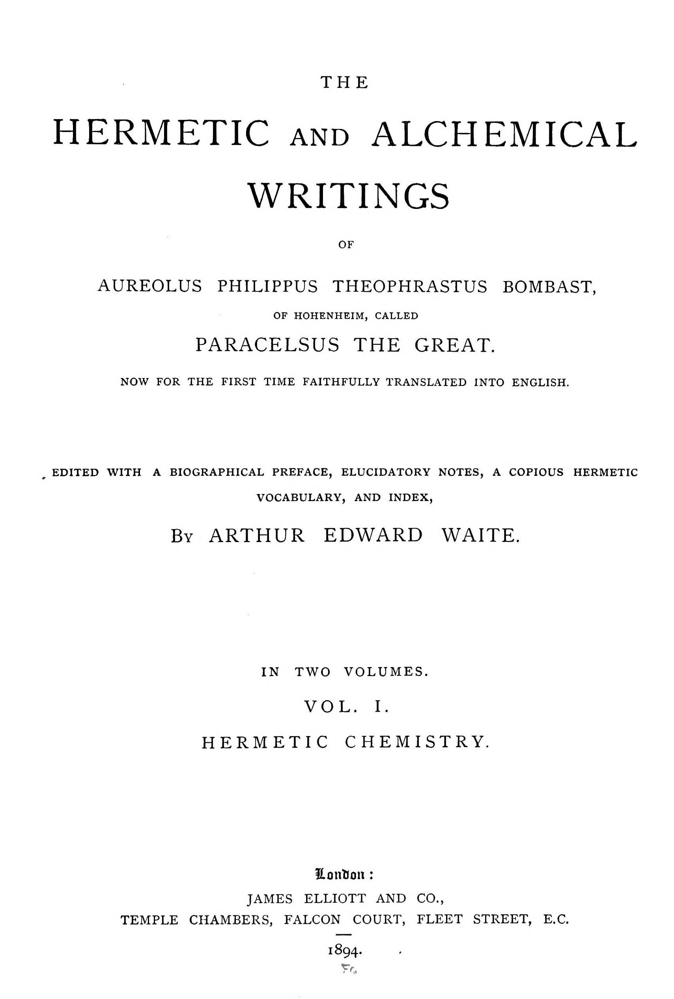

# パラケルスス『惑星の霊について』

パラケルスス著／A・E・ウェイト英訳／全訳

- 原題：Concerning the Spirits of the Planets（ラテン語題 De spiritibus planetarum sive metallorum。パラケルススの名で伝わり、1570年のバーゼル八折版などで流布した。A・E・ウェイトが The Hermetic and Alchemical Writings of Paracelsus 第一巻、1894年に収めた）
- 内容：
  - 第一の論文は、術の主体である「単純な火」と、金属の多様さを生む「多重の火」を説いたのち、ソル（金）、ルナ（銀）、ウェヌス（銅）、マルス（鉄）、ユピテル（錫）、サトゥルヌス（鉛）、メルクリウス（水銀）の七つの「霊」すなわちチンキの性質と、人の体への効き目を一つずつ述べる
  - 第二の論文は、チンキの仲立ちである「哲学者のメルクリウス」と生きた水銀との結合を男女の結婚になぞらえ、分量、器の大きさ、火の加減、孔雀の尾の色、白い石と赤い石の見分け方、増殖を説く
  - 第三の論文は、炉を「新しい世界」として築く方法から始めて、夫婦の交わり、黒の段階、孔雀の尾、白い王と赤い「東方の王」の誕生までを、短い章で描く
- 作業の基にした本文と扉：Internet Archive 所蔵の1894年英訳第一巻のスキャン二種（Google 版の OCR を主とし、注の崩れはコーネル大学版で補った）
- 著作権：パラケルススは1541年、ウェイトは1942年に死去。日本・米国・英国で保護期間が満了している
- 訳者：人工知能（Claude Opus 5.5）
- 訳の性格：ウェイトの英訳からの重訳である。本文の全三論文と、ウェイトの注二十一をすべて訳した。訳者の調べたかぎりでは、日本語訳は出ていない

## この本について

　本書は、本サイトで訳した『哲学者の曙』『哲学者の天』『事物の本性について』と同じウェイト英訳第一巻に収められた小品である。英訳者ウェイト自身がその序文で、注意深い読者はこの論文を「パラケルススの作としてはまったく退けるかもしれない」と書いており、真作かどうかは疑わしい。英訳の脚注に引かれる『金属の変成について』（一六八一年）は、パラケルスス派の文書をまとめた寄せ集めである。

　読みどころは、七つの金属をそれぞれの惑星の「霊」として描き、その霊が金属の体に与える性質――金を火に耐えさせ、銀を錆びさせず、鉄を固く、錫をもろくする――が、そのまま薬として人の体にも同じ働きをする、と論じる第一の論文である。金と銀の霊は高価で誰にでも買えないから、資力に応じて銅や鉄の霊を使え、という現実的な助言も見える。

　第二・第三の論文では、錬金術の作業がまるごと結婚と出産の物語として語られる。夫（哲学者のメルクリウス）と妻（生きた水銀）とを婚礼の床に置き、妻が黒くなれば身ごもったしるし、孔雀の尾の色が現れ、やがて白い王が、さらに火を続ければ赤い「東方の王」が生まれる。錬金術の象徴体系を最も短く、わかりやすく示した例の一つである。

　英訳の意味のとりにくい箇所には〔　〕で注記した。

---

## 惑星の霊について〔注1〕

### 序

　まず何よりも我らの救い主、主イエス・キリストの御名を呼び求めて、我々はこの仕事に取りかかろう。その中で我々は、どんな劣った金属をもよりよい金属に、たとえば鉄を銅に、銅を銀に、銀を金に変える方法を教えるだけでなく、思い上がった僭越な医者たちには不可能に思われるあらゆる病を癒す方法も教えよう。そしてさらに、人を長く、健やかで、完全な年齢まで保つ方法をも。この術は、我らの主なる神、至高の造り主によって授けられたものであり、創造の初めから金属の体の中に、いわば書物の中にのように刻みこまれている。我々がそれらから熱心に学ぶためである。それゆえ、誰かがこの術をそのまことの土台から徹底的に完全に知りたいと望むなら、その人はそれをその師から、すなわち万物を創った神から学ぶ必要があるであろう。神のみが、各々の被造物の中にどんな本性と特性とを置いたかを知っている。それゆえ神は誰にでも確かに完全に教えることができ、神が「私から汝らはすべてのことを学ぶであろう」と言うとき何を意味するかを、我々は神から絶対的に教えられうる。天にも地にも、万物を創った方がその特性を見通し、すべてを知り悟らないほど隠されたものは何も見いだされないからである。それゆえ我々は神を、このまことの術における我々の師、操作者、導き手としよう。我々はただ神だけをまね、神によって、神ご自身がその指でこれらの金属の体の上に生み出し書きしるしたあの自然の知識を学び、それに達しよう。そうすれば、いと高き主なる神は我々のうちにあるそのすべての被造物を祝福し、我々のあらゆる道を聖め、この仕事において我々がその始まりを望む終わりへともたらし、心のうちに最も深い喜びと愛とに達することができるようにしてくださるであろう。

　だがもし誰かが自分のただの私的な意見に従うなら、その人は自分自身をひどく欺くばかりか、その人と運命をともにするほかのすべての者をも欺き、彼らを大きな苦難に陥れるであろう。人はまちがいなく無知のうちに生まれ、自分自身からは何も知ることも理解することもできず、ただ神から受け取り、自然から理解するものだけを知るからである。これらから何も学ばない者は、自分自身の発明と意見との巧妙さと細工とに従う異教の教師や哲学者たちに似ている。そのような教師とは、アリストテレス、ヒッポクラテス、アウィケンナ、ガレノス、そのほかの者たちであり、彼らはそのすべての術をただ自分の意見の上に築いた。たとえいつか自然から何かを学んだとしても、彼らは最後の結果に至る前に、それを自分の空想と夢と発明とでふたたび壊してしまった。それゆえ、これらの者とその追随者によっては、何も完全なものを発見することはできない。

　これこそ、人々の上にではなく、自然そのものの上に、そして神がご自身の指で金属に刻印したあの効能と力との上に基づけて、錬金術について特別な書を書くよう我々を動かし駆り立てたものである。この刻印の創始者はメルクリウス・トリスメギストスであった。彼が、愛と熱心な望みとをもってこの術に従ったすべての賢者たちとすべての者たちとの父と呼ばれるのは、しかるべき理由のないことではない。彼は、この術において神があらゆる被造物の唯一の作者、原因、起源であることを教え証明する〔注2〕。だが彼は、上に挙げた異教徒たちやそれに似たほかの者たちがしたように、神の力と効能とを被造物や目に見えるものに帰することはしない。

　それゆえ、あらゆる術は三位一体から、すなわち父なる神、子なる神イエス・キリスト、聖霊なる神、三つの区別された位格でありながら一つの神から学ばれねばならないのだから、我々もまたこの錬金術の仕事を三つの短い論文に分けよう。第一の論文では、術そのものが何を包含するか、そして各々の金属の特性と本性とが何であるかを述べよう。第二に、人がどのような方法によって金属の同様の力と能力とに働きかけ、それを成功へと導きうるか。そして第三に、太陽と月からどのようなチンキが生み出されるべきか。

## 第一の論文

### 第一章――単純な火について

　まず第一に、この術が何を含み、その主体が何であり、その特色が何であるかをはっきり述べる必要がある。

　何よりもまず、この術の主要な主体は火である。それは常に一つの同じ特性と働きの様式のうちに存在し、ほかの何ものからもその命を受け取ることができない〔注3〕。それゆえそれは、ひそかに隠れているあらゆる火に共通する、生かすという状態と力とをもっている。ちょうど太陽が神によって定められ、世界のあらゆるもの、隠れたもの、見えるもの、明らかなものを温めるように。マルス、サトゥルヌス、ウェヌス、ユピテル、メルクリウス、月の天球のように。それらは太陽から光を借りるかぎりでしか輝くことができず、それ自体では死んでいる。けれども上に言ったように照らされると、それらは生き、その特別な特性に従って働く。だが太陽は神ご自身のほかのいかなる源からも光を受けず、神がそれを治めているので、太陽の中では神ご自身が燃え輝いている。この術についてもちょうど同じである〔注4〕。炉の中の火は太陽になぞらえることができる。太陽が広大な宇宙を温めるように、それは炉と器とを温める。世界において太陽なしには何も生み出されえないように、この術においてもこの単純な火なしには何も生み出されえない。いかなる操作もそれなしには完成されえない。それは術の大いなるアルカナであり〔注5〕、そこに含まれるあらゆるものを包含し、ほかの何ものの中にも包含されえない。それはそれ自身でとどまり、何も必要としない。だがそれを必要とするほかのすべてのものは、それにあずかり、それから命を得ることができる。それゆえ我々はまず何よりも、これを明らかにすることを引き受けた。

### 第二章――金属の多様さがそこから生じる火の多重性について

　まず、それ自体で生き存続する単純な火について書いたので、残るは、被造物の多様さすなわち相違の原因である多重の霊すなわち火について語ることである。そのため、あらゆる部分で別のものとまったく同じものは一つも見いだされない。これは金属の場合に見ることができる。どの金属も、それとまったく同じ別の金属をもたない。太陽は金を生み出し、月は別の大きく異なる金属、すなわち銀を、マルスは別の金属、すなわち鉄を、ユピテルは錫を、ウェヌスは銅を、そしてサトゥルヌスはさらに別の金属、すなわち鉛を生み出す。そのためこれらはすべて似ていない。人やほかの被造物についても同じことがあてはまり、この多様さの原因は火の多重性である。たとえば馬の腹は、その腐敗によって生み出されるほどよい熱によって一種類の被造物を生み出す。海の浴槽は別のものを、灰は別のものを、同じように砂は別のものを、火の炎は別のものを、炭は別のものを、などである。被造物のこの多様さは、最初の単純な火によってではなく、さまざまである元素の支配によって生み出される。太陽〔原文 son。sun の誤植〕からではなく、七つの惑星の運行から。そしてこれが、宇宙がその個々のもののあいだに似たものを含まない理由である。熱が刻一刻と変わるように、ほかのすべてのものも変わるからである。この変成は元素において起こり、その体の上にこの火によって刻印されるからである。元素の混合が大きくないところではソルが生み出され、それが少し濃いところではルナが、さらに濃いところではウェヌスが生み出される。こうして混合の多様さに応じてさまざまな金属が生み出され、どの金属もその鉱石の中で別のものとまったく同じには現れない。それゆえ知るべきは、金属のこの多様さは元素の混合によって引き起こされるということである。これらの元素の霊は多様で似ていないと見いだされるからである。もしそれらが単純な火から生まれたなら、一つを別のものから見分けられないほど似ているであろう。だが多重の火が介在することによって、形の多様さが被造物のあいだに持ちこまれる。ここから、なぜかくも多くのかくもさまざまな形の金属が見いだされ、なぜどれ一つとして別のものに似ていないのかが、たやすく汲み取れる〔注6〕。

### 第三章――ソルの霊すなわちチンキについて

　さて惑星の霊、すなわち金属の霊に入ろう。ソルの霊すなわちチンキは、純粋で精妙で完全な火からその始まりを得た。それゆえそれは、金属のほかのあらゆる霊とチンキとをはるかにしのぐ。それは火の中に恒常に固定してとどまり、そこから逃げることも、それに焼き尽くされることもなく、むしろその働きによってより澄み、より純粋に、より美しくなる。熱いものも冷たいものも、ほかのいかなる偶発事も、それが金属のほかの霊すなわちチンキを損なうようには、それを損なうことができない。そしてそれは次の理由による。それがいったん帯びた体を、それはあらゆる偶発事と病とから守り、火に損なわれずに耐えられるようにする。この体はそれ自体ではそのような力と効能とをもたず、ただその中に閉じこめられた霊だけからそれを得ている。メルクリウスの体については、それが火に耐えることも持ちこたえることもできず、火から逃げることを我々は知っているからである。だがソルの中にあるときには、それは逃げず、固定して恒常にとどまる。これは、それがそのような恒常性をソルの霊すなわちチンキから受け取っていることの最も確かな証拠を与える〔注7〕。それゆえ、もしこの霊がメルクリウスの中にありうるなら、それが人の体の中に受け入れられたとき、何か同様の効果をもつであろうことは誰でも推論できる。我々の『大外科書』の中で、我々はソルのチンキについて、それはそれを用いる者を回復させ弱さから守るだけでなく、長く健やかな命のためにその人を保つであろう、と言った〔注8〕。同じように、ほかの金属の強さと効能も、人間やこの世の知恵からではなく、まことの経験から知られうる。この世の知恵は神とその真理との前では愚かさであり、その知恵の上に希望を築き頼るすべての者は惨めに欺かれるのである。

### 第四章――ルナの霊とチンキとについて

　ソルのチンキについて十分明らかに語ったので、残るはルナのチンキと白いチンキとについて何かを述べることである。それもまた同じように完全な霊から生み出される。もっともそれはソルの霊ほど完全ではないが、それでも純粋さと精妙さとにおいて、順序でそれに続く金属のほかのあらゆるチンキにまさる。これはまことに、ルナを扱うすべての者に、田舎者にさえよく知られている。それは錆を生じず、ほかの金属のように火の中で焼き尽くされることもない。ほかの金属はすべて、サトゥルヌスが火から逃げるときに自分とともに引きずっていくが、これはそうではない〔注9〕。ここから、このチンキが下に挙げるものよりはるかにすぐれていることが汲み取れる。それはそれが帯びた体を、何の偶発事も損失もなしに火の中で保つからである。ここから、もしこれがそれ自身の朽ちうる体の中で、それだけでメルクリウスを生み出す〔原文 produces Mercury。文脈からは「守る」の意か〕なら、それから抽き出されて別の体の中に入れられたとき何を成し遂げうるかは、まったく明らかである。それは同じしかたで偶発事と病とから守り防がないであろうか。まちがいなく、もしそれがそれ自身の体の中でこのメルクリウスを生み出すなら、人の体の中でも同じことをするであろう〔注10〕。そしてそれは健康を保つだけでなく、長い命をもたらし、病と弱さとを、それ自身の特別な段階を超えるものさえ癒す。薬は、より高く、より精妙で、より完全であればあるほど、よりよく、より完全に癒すからである。それゆえ、たやすく腐る草やそれに類するもののような植物にだけその技を浪費する者たちは、まったく無知な医者である。これらによって彼らは堅固で固定した結果を成し遂げようと努めるが、空を打つ者のようにむなしくそうしている。だがなぜこれらについて長々と語ろう。彼らは大学でそれよりよいことを学ばなかったのだ。もし彼らが初めに戻って学び研究することを強いられたなら、それを大きな恥と考えるであろう。それゆえ彼らは以前の無知のうちにとどまる。

### 第五章――ウェヌスの霊について

　我々は前に、白い霊、すなわち無色のチンキに触れた。今度は赤い霊について語ろう。それは前者の濃い元素の混合から生み出され、それに従属してもいるが、それでも続く金属の霊とチンキとよりは完全である。このためにそれは、ほかのものよりも恒常に火の中にとどまり、続くほかの霊ほど早く焼かれもせず、早く消え去りもしない。空気も水の湿り気も、マルスに対するほどにはそれを損なわない。ちょうどそれが火の中により固定して、より長くとどまるように。ウェヌスはこの力と特性とをもつ。すなわちその体が、それに注ぎこまれた霊のためにもつのである。それゆえ、それはそれ自身の体の中で、すなわちウェヌスの中でこの効果を生み出すのだから、人の中でも、自然によってそれに許されたかぎりのことを成し遂げる。それは傷を、いかなる偶発事もそれに影響せず、空気も水もそれを損なえないように保つ。それはまた、その段階の下にあるそのようなあらゆる病を追い払う。この霊はさらに、金属の体を砕いて、それがその展性を失うようにする〔注11〕。人の体においても、それが適さない病に服されると、不都合な結果を生む〔注12〕。それゆえ、これらを用いたいと望む医者は経験を積み、金属についてよい知識をもっている必要がある。それゆえ、何の危険の恐れもなく服せるより完全な霊を用いるほうがはるかによい。それでも、ソルとルナの霊は高価なので、誰もがそれを治療の目的に用いられるわけではない。それゆえ各人は、自分の資力に応じて、得られ支払えるものなら何でも取らねばならない〔注13〕。誰もがこれらの薬を調えられるほど裕福ではないので、各人はできることをすることを強いられる。誰でも、述べてきたことから、金属の薬がその強さと癒しの力とにおいて植物や動物の産物をはるかにしのぐことをたやすく汲み取ることができるであろう。ここまでで、ウェヌスの霊については十分に、十分すぎるほど述べた〔注14〕。

### 第六章――マルスの霊について

　マルスの霊について言えば、これは先立つほかのものの場合よりも、より濃く燃えやすい元素の混合から来る。だがマルスはほかの金属より大きな固さを備えているので、それらのように火の中で溶かされない。たしかに、それはそれらよりも水と空気とによって損なわれ、そのためにこれらの影響によってすっかり滅ぼされ、また経験が証明するように火の中でも焼かれる。それゆえその霊は、上のどれよりも不完全である。だが固さと乾きとにおいて、それは上の、また下のあらゆる金属をしのぐ。それは完全な金属ソルとルナとを槌に耐えられなくさせるだけでなく、それより下位のもの、ユピテルやサトゥルヌスなどにも同じことをするからである〔注15〕。それゆえ、それは金属にこの効果を生み出すのだから、これは人の体にも同じ効果をもつしるしである。すなわちそれはもがきを生み出す。とりわけそれが適さない病に服されると、それは大きな痛みとともに肢体をねじ曲げる。だがそれがその段階を超えない傷に用いられ当てられるなら、それは強力な清めの性質をもつ。それゆえこの霊は、神と自然とによって定められた事柄に関するかぎり、上のものに劣らない力と能力とを授けられている。

### 第七章――ユピテルの霊について

　ユピテルの霊については、それが火の白く青白い物質から、特有の音を立ててはじける性質ともろさとともに引き出されており、マルスのように展性がないことを知るべきである。それゆえそれはほかの金属を熱し、槌で砕けるようにする。その例は、それがルナと結ばれるときに見られる。最大の労苦によってでなければ、ルナはほとんどもとの展性に戻せないからである〔注16〕。同じ効果をそれは、サトゥルヌスだけを例外として、ほかのあらゆる金属に生み出す。もしそれが金属の体にこの効果を生み出すなら、人の体にも同じことをするであろう。人の体の中でそれは、激しい灼熱と腐朽とによって肢体を腐食し、そのため肢体はその完全な働きからすっかり断たれ、それを失い、自然の必要な求めを果たせなくなる。それでもこの霊には、癌、瘻、そのほか同様の潰瘍、とりわけそれ自身の本性のもので、神と自然とがそれに与えた段階を超えないものを取り除く効能がある。

### 第八章――サトゥルヌスの霊について

　サトゥルヌスの霊は凝固しており、乾いた、暗い、冷たい元素の混合から形づくられている。ここから、ほかのすべてのもののうちで、それが火の中にとどまり生きる力を最も少なくしかもたないという結果になる。けれども、ソルとルナを試し浄めねばならないときには、サトゥルヌスがそれらに加えられ、それはそれらを徹底的に清める効果をもつ。それでも、それはその展性を奪うような本性のものである〔注17〕。それは人に対しても、ユピテルやマルスと同じく大きな痛みとともに同じ効果をもつ。冷たさと混じっているので、それは穏やかに働くことができない〔注18〕。それは最も大きな力と効能とをもち、それによって、それ自身の段階と本性とのもとに入る瘻、癌、そして同様の潰瘍を癒す。それは、ルナから不純物を追い出すのと同じ種類の病を人から追い出す。だがもしそれが同時にすっかり出ていかないなら、それは益よりも害を多くもたらす。それゆえ、それを用いようとする者は誰でも、それがどんな病を癒すか、何に対して服すべきか、自然がそれにどんな効果を割り当てたかを知らねばならない。もしこれがよく考えられるなら、それは何の害もなしえない。

### 第九章――メルクリウスの粗い霊について

　上の霊にのみ従属するメルクリウスの霊は、それ自身のうちに定まった、すなわち確かな形をもたない。ここから、蝋がどんな形の印章でも受け入れるように、それがあらゆる金属を受け入れるということが起こる。それゆえこの濃い元素的な霊は、金属のほかの霊になぞらえることができる。もしそれがソルの霊を自分のうちに受け入れるなら、そこからソルが生み出されるであろう。ルナなら、ルナが。そして同じようにそれはほかの金属についてもふるまう。それはそれらと一致し、その特性を自分に取りこむ。この理由で、その体に関するかぎり、それは、女が男にそうであるように、上に述べた霊にあてがわれている。ソルはメルクリウスの体だからである。ただソルがメルクリウスを固定し、自らも固定するという点を除いて。ありふれたメルクリウスは移り気で揮発性である。それでもそれは上に述べたすべてのものに従属し、上に述べた金属の霊とチンキとをふたたび生み出すだけでなく、上に挙げたチンキがそれによってその働きに至る金属そのものをも生み出す。だが節度が守られなければ、この種のチンキを完成させることは不可能である。もしこのチンキを生かすべき火が激しすぎるなら、操作は実を結ばないであろう。弱すぎても同じである。それゆえここで、この術における中庸が何であり、それがどんな力と特性とをもつか、またどんな手段によってそれが治められるべきか、そしていかにチンキを染めるか、すなわちそれらをその完全な働きへともたらし、それらが芽を出し現れるようにするかを知ることが必要である。これらわずかな言葉で、我々はこの第一の論文を結ぼう〔注19〕。

**第一の論文の終わり**

---

**英訳者（ウェイト）の注**

〔注1〕　この論文はジュネーヴ二つ折り版には含まれておらず、文体においても扱い方においても『哲学者の曙』によく対応している。この翻訳に用いた版は一五七〇年のバーゼル八折版である。この著作のかなりの部分は、一六八一年フランクフルト刊の『金属の変成について』と題されたパラケルスス文書の寄せ集めに入っている。

〔注2〕　この地上に栄えるあらゆる術は神的であり、すべて神から来る。ほかのいかなる原理からもそれらは起こらない。聖霊は自然の光を広げる者である。……人はそれ自身では何も発見できない。……我々のうちのこの自然の光の拡大によって見いだされるものは何であれ、悪魔はそれを腐らせ、混ぜものをし、偽りに変えようとする。それゆえ今日、あらゆる術と操作とは腐らされている。錬金術でさえ、嘘をつく舌と堕落した実践者とに卑しめられ、ゆだねられている。――『パラグラーヌム』第四論文。

〔注3〕　火は元素と見なされるべきではなく、それゆえ火と天空とのあいだには区別がある。後者は元素である。火は煮て分解し、究極の物質へと還元する物質であり、この意味で火と死とは似ている。火は死のようにあらゆるものを焼き尽くし呑みこむからである。それゆえ火は元素ではありえないが、目に見え感じられる死でありうるし、またそうである。もう一つの死は目に見えず、誰にも見られない。――『気象論』第一章。

〔注4〕　すでに言及した寄せ集め『金属の変成について』は、この箇所で次のような異読を与えている。「スパギリアの術においても、アタノール〔錬金炉〕のこの火と哲学者たちの秘密の火とはちょうど同じであり、それは、太陽が全世界において働くのが見られるのとちょうど同じように、炉と器の天球と物質の火とを温める」。

〔注5〕　あらゆるアルカナは天空から来る。――『医学断片集』のうち「薬の調製法について」第二巻第一論文。だが元素である火は天空であり、星々はその実である。――『気象論』第一章。

〔注6〕　それゆえ多重の火とは、それが流れこむ主体の多様さに応じて変わり、それによってのちにほかの主体の中で点火されるものである。たとえば灰、砂、浴槽、やすり屑などの火は、直接の源から器具の主体へ、そしてそこから術の根底にある物質へと流れこむ、媒介された熱をもつ。その多重の火の中には位置の違いがある。これは、ものの本性のうちには、同じ種のもとに入っていても、いや両方が同じ個体の肢体であっても、あらゆる点でほかのものに似ているものは何も見られないという理由による。ある金属は銀を生むものから金を生み出し、別の金属はサトゥルヌスやウェヌスやマルスの金属を生み出す。これらの各々は、それが出てきて創られた場所の違いに応じて変わる。二人の人、同じ体の二つの肢体、同じ木の二枚の葉がまったく同じに見いだされることはない。ほかのものについても同様である。似ていないことは、創られたものの最初の火から出るのではなく、太陽によってではなく惑星によって元素の上に行われる異なる支配から出る。ものの配置によって、元素の中の熱は刻一刻と変わり、同時に、分解されたものの形もその化合物から変わる。ただし単体からは変わらない。元素の混合がそれほど大きくないところではソルが生み出され、それがいくらか大きく、それほど純粋でないところではルナが生み出される。さらに不完全なものからはウェヌスが、そして残りも元素の混合に応じて生み出され、各々の金属の鉱石はほかのものに似ておらず、その霊もあらゆる点で互いに一致しない。もしそれらが多重の火の介在なしに単純な火だけから生み出されたなら、金属においてもほかのいかなる被造物においても、形の区別は起こりえないであろう。用いられる金属がなぜ七つより多くなく、そのうち六つが固体で七番目が流動する薄いものなのかは、達人の哲学においては説明されるが、錬金術においては説明されない。――『金属の変成について』第三章。だがこの七番目の流動する金属についての言明は、パラケルススのほかの教えと食い違うように思われる。編集を受けてきた寄せ集めは当然それに従うべきなのだが。

〔注7〕　ソルの体がメルクリウスであり、それはまったく火に耐えられず、火から逃げることはよく理解されている。――『金属の変成について』第十章。

〔注8〕　ここで言及されている論文集の中には、金のチンキを作るための次の工程がある。まず体からその金属の展性ある本性を奪え。すなわちそれを腐らせよ。それから残りを甘い水で清め、ぶどう酒の霊によって色を抽き出せ。そうすれば望むチンキが底に残るであろう。塩の水を作るには――ごく白い塩を、ただし人工的に白くしたものではないものを取れ。それを何度か溶かし、きわめて精妙な粉に還元し、大根（ラファヌス）の汁と混ぜよ。振れ。溶かしたのちに蒸留し、等しい分量の血の汁とともに。それからふたたび五回蒸留せよ。アンチモンで清めた金の薄い板は、この水の中でたやすく粉に還元される。こうして調えた粉は、もはや塩の味がしなくなるまで、甘い蒸留水で洗わねばならない。塩はその物質の中に浸透しないので、洗い流すことでたやすく取り除かれる。ぶどう酒の霊を作るには――上等なぶどう酒を一セクスタリウス（約一パイント）取れ。それをふさわしい大きさの、すなわちぶどう酒をその中で振れるほどの容量の循環器に注げ。それをぶどう酒が占める深さまで海の浴槽に置き、十日間煎じよ。何も逃げられないよう、器のすべての口を封じよ。それからククルビタに入れ、ゆるやかな火で霊を抜き取れ。それが通り抜けたらすぐに（それはふつうのしるしで知るであろう）、火を強めるのをやめよ。残りはただの昇華物だからである。ぶどう酒の霊を上に述べた粉（それはアルコール〔微粉末〕のようであるべきである）の上に手のひらの高さまで注ぎ、ガラス器に封じ、温かい浴槽の中に一か月置いて消化させよ。そうすれば色が分かれて霊と混じり合うであろう。白い粉が底に残るであろう。これらをすべて分けたら、粉を溶かせ。そうすればそれは金属の水に分かれるであろう。術に従って霊を蒸発させよ。そうすれば望む霊が底に残るであろう。ふさわしい大きさのレトルトの中でその段階づけを行え。これは高揚によって最も便利になされる。それはきわめて精妙にする。――『大外科書』第二部第三論文〔章番号はスキャンで判読できない〕。

〔注9〕　溶けた鉛は、ソルとルナとを除いて、それ自身を含むあらゆる金属を火によって滅ぼす。――『パラケルスス文書寄せ集め』第十章。

〔注10〕　それゆえルナの霊は、それが入る体、すなわちメルクリウスを、火やほかの偶発事によるあらゆる害から守り、それを恒常にすることができるのだから、ここから、もしそれがメルクリウスのような不安定で揮発性の体の場合にそのような効果を生み出すなら、それ自身の体から解き放たれて人の体の中に投入されたとき、どれほど強力に働くかはたやすく汲み取れる。――同。

〔注11〕　他方、もしそれがある金属と、完全な金属のうちのあるものとさえ混ぜられるなら、それはその体を引き裂いて、それらがもはや展性をもたず、それから解き放たれるまでいかなるしかたでも扱えないようにする。――同。

〔注12〕　これらの場合、それは肢体のひきつりを生み出す。――同。

〔注13〕　けれども、もし金と銀とが患者の資力にとって高価すぎるか、ある特定の医者の才と技とにとってその調製が難しすぎるのでなければ、完全な金属の霊だけを用いるほうが安全であろう。その場合、医者は学んだことをする、すなわち植物と動物の調製によってそのような症例を扱うことを強いられるかもしれない。――同。

〔注14〕　占星術的に好都合な事情のもとでは、ウェヌスから多くのチンキを抽き出すことができる。――『フランス病の原因と起源について』第一巻第十一章。

〔注15〕　それでも、それは固さと乾きとにおいてほかのどの金属をもしのぎ、それらと混ざることによってそれらを滅ぼし分解する。そしてこれは不完全な金属においてと劣らず、完全な金属においてもそうである。――『パラケルスス文書寄せ集め』第十章。

〔注16〕　ほかの金属と混ざることによって、それはそれらを腐らせ分解する。とりわけルナを。そしてただ大きな労苦によってのみ、それはそこから分けることができる。――同。

〔注17〕　それはそれらを、洗ったのちに砕け分解したままにする。――同。

〔注18〕　それは肢体をゆがめる。……錫や鉄よりもさらに激しい痛みとともに。だがこの霊はほかのものよりはるかに強い冷たさで凝固させられているので、それほど激しくは働かない。――同。

〔注19〕　それゆえそれは、体に関するかぎり、上に述べた霊から調えられる。ちょうど妻が夫のために調えられるように。体的な混合によってではなく、霊がそれ自身の金属から引き出され、調製ののちメルクリウスの中に投入されたとき、ついにそれはその変成を示すのである。――同。

## 第二の論文――哲学者のメルクリウスと、チンキの仲立ちとについて

　第一の論文で我々は、金属の霊とそのチンキなどについて書き、その特性と本性とを、そして各々の金属が何を生み出すかを明らかにした。この第二の論文では、チンキの仲立ち、すなわち哲学者のメルクリウスについて扱おう。それによって金属のチンキと発酵とが作られる。次のように七つの章で。

### 第一章――チンキと酵母とは何から作られるか

　金属のチンキを得たいと望む者は誰でも、哲学者のメルクリウスを取り、それをそれ自身の終わりへと、すなわちそれが出てきたもとの生きた水銀の中へ投じなければならない〔注20〕。ここから、哲学者のメルクリウスが生きた水銀の中で溶かされ、その強さを受け取り、哲学者のメルクリウスが生きた水銀を殺して、自分と同じく火の中で固定させるということが続くであろう。この二つのメルクリウスのあいだには、男とその妻とのあいだと同じだけの一致があるからである。両者はともに金属の粗い霊から生み出される。ただソルの体は火の中で固定したままであるが、生きた水銀は固定していないという点を除いて。けれども一方は、穀物すなわち種子が土にあてがわれるように、他方にあてがわれている。それを例で示そう。次のとおりである。大麦を蒔いた者は大麦を集め、小麦を蒔いた者は小麦を集める、などである。この術においても別のことではない。もし誰かがソルを蒔けば金を集め、ルナからは銀を集めるであろう。ほかの金属についても同じである。このようにして我々はここで、チンキは金属から、すなわち哲学者のメルクリウスから生み出されるのであって、生きた水銀からではない、と言う。だがこれ〔生きた水銀〕は、それが前に宿していた種子を生み出すのである〔注21〕。

### 第二章――男と女との結合について

　哲学者のメルクリウスと生きた水銀とが結ばれ、後者が固定したものと一つにされるためには、それをどれだけ取らねばならないかを必ず知らねばならない。ふさわしい量より多くても少なくても、事全体を妨げたり、すっかり台なしにしたりしかねないからである。過剰によって種子は窒息させられ、哲学者のメルクリウスによって固定されるまで生きることができない。だが不足によっては、体がすっかり溶かされないので、それもまた滅ぼされ、何の実も生み出せない。それゆえ、もし職人がこの仕事をその正当な終わりへともたらそうとするなら、一方と他方とをどれだけ取るべきかをはっきり確かめねばならない。処方は次のとおりとせよ。すなわち、一に対して二、あるいは三に対して四を取れ。そうすれば汝は誤らず、望む終わりに達するであろう。

### 第三章――ガラスの器具の形について

　物質が正しく結ばれたら、汝はほどよい釣り合いのガラス器、正しいより大きくも小さくもないものをもっている必要がある。もしそれが大きすぎるなら、女、すなわち粘液が散らされ、そこから種子が生まれることができなくなる。小さすぎるところでは、芽が窒息させられて実を結べない。ちょうど木の下や茨のあいだに蒔かれた種子が芽を出せず、実を結ばずに滅びるように。それゆえ器によって少なからぬ誤りが生じうる。そしていったんこれが起こると、同じ操作の中ではふたたび直すことができず、満足のいく結果に至ることもできない。それゆえ次のことに注意せよ。すなわち、三オンス半と四ポンドとを取れ〔原文のまま。何の量かは示されていない〕。こうして正しく進めれば、汝は物質が散らされることから救い、粘液すなわち発芽が妨げられるのを防ぐであろう。

### 第四章――火の特性について

　物質をふさわしい器に入れたら、外側が内側を超えないように、それを自然の熱で温めよ。もし熱が過剰なら、結合は起こらない。強い熱によって物質が散らされ焼かれ、そこから何の利益も生じないからである。この理由で、自然によって天と地とのあいだに空気の中間の領域が整えられた。さもなければ太陽と星々とが地上のあらゆる被造物を焼き尽くし、そこから何も生み出されえないであろう。それゆえ、物質と火とのあいだにこの種の空気の部分を、すなわちある距離を挟むよう気をつけよ。このようにすれば熱はたやすく害を与えることも、散らすことも、まして焼くこともできないであろう。もし熱が足りなければ、霊もまた、それ自身の湿り気にいかなるしかたでも働きかけずに休むことはなく〔原文のまま。意味がとりにくい〕、そうしてそれは乾かされるか固定されるであろう。金属の霊はそれ自体では死んでいて休んでおり、生かされなければ何もなしえないからである。大いなる世界においても別のことではない。土に投げこまれた種子は死んでおり、太陽の熱によって生かされなければそれ自身では育つことができない。それゆえまず何よりも、この仕事のための火を正しい釣り合いで、大きすぎも小さすぎもせずに築く必要がある。さもなければこの仕事は決してその望む完全な終わりへと運ばれないであろう。

### 第五章――結合の一致のうちに現れる徴について

　火の処方が和らげられると、物質はしだいに黒さへと動かされる。そののち、乾きが湿り気に働きかけはじめると、さまざまな色の花々がいっせいにガラス器の中に立ち昇る。ちょうど孔雀の尾に現れるような、誰もかつて見たことのないような花々が。ときにはまた、ガラス器がすっかり金で覆われたかのように見える。これが認められたなら、それは男の種子が女の種子に働きかけ、それを治め、それを固定していることの確かなしるしである。すなわち固定したメルクリウスが生きたメルクリウスに働きかけ、それを抱きはじめるのである。そののち、乾燥の工程の前に湿り気が死に絶えると、それらの色は消え、物質はついに白くなりはじめ、白さの最高の段階に達するまでそれを続ける。何よりもまず、そのような工程があらゆる点で、穀物の成長や人の生まれにおいて認められることに似ていると考える者たちの意見に従って、事を不当に急がないよう注意すべきである。人の生まれの工程は九か月、穀物のそれは十か月か十二か月を要する。ソルとルナとは、子が母の胎内から、穀物が土の胎内から生まれるほど早くは熟さず、早くは生まれない。何かがその本性において高く完全であり、またそうあるべきであればあるほど、その生成にはより長い時間が必要である。早く生まれるものはみな早く滅びることを知るべきだからである。草も人もその証拠を与える。それらが早く生み出され生まれるのに比例して、その命は短い。ソルとルナとはそうではない。それらは人よりも完全な本性をもっている。それゆえそれらは人のために長い命を示し、多くの偶発的な病から人を守るのである。

### 第六章――完全なチンキの見分け方について

　前の章で我々は、物質そのものがいかに段階づけられるかを述べた。この章では、それが完全なとき、どんな手段によってそれを見分けられるかを明らかにしよう。こうせよ。ルナの白い石がその白さのうちに現れ出たら、やっとこでそこから一かけらを切り離し、火の上で赤熱させた銅の板の上に置け。もし石が煙を出すなら、それはまだ完全ではない。それゆえ完全な石の段階に至るまで、さらに煎熟のうちに置いておかねばならない。だがもしそれが煙を出さないなら、それは完全だと信じてよい。同じしかたで、ソルの赤い石についても、そのしかるべき段階づけにおいて進めよ。

### 第七章――チンキの増大すなわち増殖について

　見いだしたチンキを増やしたい、すなわち増殖させたいと望むなら、それをふたたびありふれた水銀と結べ。あらゆる点で前と同じように進めよ。そうすればそれは、以前よりも百倍多く染めるであろう。望むだけの物質を得るために、これを好きなだけ何度でもくり返すことができる。それが火の中に長くとどまればとどまるほど、それはより高く段階づけられ、そのためその一部が無数の部分の生きた水銀を最良のルナと最も完全なソルとに変成させるであろう。こうして汝は工程の全体を初めから終わりまで得た。これらわずかな言葉で我々はこの第二の論文を結び、今第三の論文を始めよう。

**第二の論文の終わり**

## 第三の論文

　第二の論文で我々は、チンキすなわち発酵を生み出すべき方法を述べた。この第三の論文では、ソルとルナのチンキがいかに作られるかを言おう。これを十分な長さで明らかにし、またソルがほかの惑星とともに、どのようなしかたで、すなわち炉と火とによって生み出されるべきかを示そう。

### 第一章――炉と火との築き方について

　メルクリウス・ヘルメス・トリスメギストスは、この術を完成させる者は新しい世界を創る、と言う。神が天と地とを創ったのと同じしかたで、炉はその火とともに組み立てられ整えられねばならないからである。すなわち次のようなしかたで。まず、指と親指とを広げた手のひら六つ分の高さで炉を築け。ただし幅は手のひら一つ分だけ。内側は丸く平らにして、炭がそれにくっつかないようにせよ。底には小さな盛り上がりを設け、四方に縁へ向かって傾斜させよ。下には指四本の幅の穴をあけておき、各々の穴に、水を入れた銅の釜をもつそれ自身の炉を付けよ。それから最良の最も長持ちする炭を取り、胡桃ほどの大きさの塊に砕け。これで長い炉を満たし、それから燃え尽きないように閉じよ。そののち下に、穴のところまで炭を加えよ。もし火が大きすぎるなら、その前に覆いを置け。小さすぎるなら、炭が空気に触れて熱が増すよう鉄の棒でかき混ぜよ。このようにして汝は、火を、その本性のまことの求めに従って、過剰にも不足にもならず、物質の動きに合ったものに調節することができるであろう。これは天空になぞらえられる。そしてここにはもう一つの天空、すなわちガラス器に含まれる物質がある。これらののちに世界の形が続く。それゆえ炉は、大いなる世界における太陽のように置かれるべきである。それは炉そのものの全体と、それが包むあらゆる器具とほかのものとに、光と命と熱とを与える。

### 第二章――男と女との結合について

　チンキを調えるべき炉と火とについて扱ったので、今度は男と女とがいかに出会い、結び合わされるかをより詳しく述べようと思う。そのしかたはこうである。最高の段階まで調え浄めた哲学者のメルクリウスを取れ。これをその妻とともに、すなわち生きた水銀とともに溶かせ。女が男を溶かし、男が女を固定するように。それから、ちょうど夫が妻を、妻が夫を愛するように、哲学者のメルクリウスは至高の愛をもって生きた水銀を追い求め、その本性は最大の愛情をもって我々に向かって〔原文 towards us。文脈からは「互いに」〕動かされる。こうして各々のメルクリウスは、女が男と、男が女と混じり合うように、体に関するかぎり、もはや違いがないほどに他方と混じり合う。ただ、その力と特性とに関しては別である。男は火の中で固定しているが、女は揮発性だからである。この理由で、女は男と結ばれて女が男を溶かし、男が女を固定して、その結果あらゆる点で彼女を恒常なものにする。両者をしっかり閉じたガラス器の中に隠せ。女が逃げたり蒸発したりしないように。さもなければ仕事の全体が無に帰するであろう。

### 第三章――男と女との交わりなどについて

　夫と妻とを婚礼の床に置き、彼が彼女に働きかけて彼女をはらませ、女の種子が男の種子によって凝固させられて一つの塊になるようにしたら――それなしには彼女は何の実も生み出せない――男がその働きを女の上に行うことが必要である。

### 第四章――夫とその妻との哲学的な交わりについて

　女が黒い色を帯びるのを見たらすぐに、彼女が身ごもり、はらんだことを確かに知れ。そして男の種子が女の種子を抱くとき、これがこの仕事と術との全体の最初の徴であり鍵である。それゆえ絶え間ない自然の熱を保て。そうすればこの黒さは、一匹の虫が別の虫を食べ、一匹も残らなくなるまで食べ続けるように、焼き尽くされることによって現れ、そして消えるであろう。

### 第五章――黒い色について

　黒さが現れて明らかになったらすぐに、女がはらんだことを知ってよい。だが孔雀の尾が現れはじめるとき、すなわち多くのさまざまな色がガラス器の中に見られるとき、それは哲学者のメルクリウスがありふれたメルクリウスに働きかけ、勝利を収めるまでその翼を広げていることの徴である。それゆえ、乾いたものが湿ったものに働きかけるとき、これらの色が現れる。

### 第六章――ガラス器の中に現れる蕾について

　さまざまな色を見たら、孔雀の尾がすっかり焼き尽くされ、ルナの物質が雪のように白くきらめき、器がその完全さの度合いに達するまで、絶えず火を続けることによって仕事を根気よく続ける必要がある。それからついに、レグルスの一かけらを折り取り、熱した銅の板の上に置け。もしそれがそこで堅く固定したままとどまり、板を染めるなら、そのときそれはルナの最高の完全さにもたらされた発酵である。その王は、金属を変成させるだけでなく、あらゆる病を癒す強さと力とをもつ。彼はたたえられるに値する王であり、多くの効能と大いなる力とで飾られていて、ウェヌス、マルス、ユピテル、サトゥルヌス、メルクリウスを、あらゆる試験に耐えるルナに変成させる。彼はまた、人の体を、熱病、てんかん、らい病、フランス病、そしていかなる草や根やその種のものも取り除けない多くの鉱物性の病など、無数の病から解き放つ。この薬を絶えず用いる者は誰でも、自分のために固定した、長く、健やかな命を調える。

### 第七章――赤い色について

　王がその完全な白さを帯びたのち、白さが黄色の色合いを帯びるまで、火を根気よく続けねばならない。これが白に続く色だからである。何かの熱が白く乾いた物質に働きかけるかぎり、その働きが長く続けば続くほど、それは黄とサフランの色に染まり、ついにはルビーの色のような赤さに至る。それからついに、発酵は金のために調えられ、東方の王が生まれる。彼はその座に着き、この世のあらゆる君主にまさって力をもつ。

### 第八章――増大と増殖とについて

　この発酵の増殖に注意すべきである。それは次のようなしかたで行われる。それをそれ自身の湿り気の中で溶かし、そののち前と同じように火の処方にかけよ。それは以前よりも早くそれ自身の湿り気に働きかけ、それ自身の物質へと変成させるであろう。ちょうどわずかな酵母が大量の粉の全体を酵母へと変成させるように見えるのと同じように。それゆえそれは地上の言いようのない宝であり、宇宙にそれに等しいものはない。アウグレルスが証しするとおりである。

### 結び

　この秘密は、それを所有していた古の父祖たちによって、最も隠されたものの一つと見なされてきた。それが邪な人々の手に入り、彼らがその助けによって自分の邪悪と罪とをいっそう豊かに果たせるようになることのないように。それゆえ我々は、神のこの賜物に達した汝が誰であれ、これらの父祖にならい、この神的な秘儀をできるかぎり秘密のうちに扱い保つよう汝に願う。もし汝がそれを足で踏みにじるか、豚の前に真珠をまき散らすなら、至高の報い手なる神の厳しい判決が汝に対して下されるのを聞くであろうと確信せよ。

　だが、神の特別な恵みによって、あらゆる悪徳を最も控える者たちには、この術はほかの誰よりも恒常に、より十分に明かされるであろう。このような人のもとには、この世の千人の子らのもとによりも多くの知恵が見いだされるからである。彼らによってはこの術はいかなるしかたでも発見されない。

　この秘密と神の賜物とを見いだした者は誰でも、いと高き神、父と子と聖霊とをたたえよ。そしてこの神だけから恵みを乞い求めよ。それによってその賜物を神の栄光と隣人の益とのために用いることができるように。憐れみ深い神が、その子にして我らの救い主イエス・キリストのために、そうなるようにしてくださいますように。

**ここに『惑星の霊についての書』終わる**

---

**英訳者（ウェイト）の注**

〔注20〕　それでも、メルクリウスのチンキは至高の秘密である。――『潰瘍の治療について』第十章。

〔注21〕　金属の死んだ妻は、耕されていない畑すなわち土のようなものであり、もしそれが哲学の鋤によって浸され、すなわちよみがえらされるなら（その工程のあいだ妻は固定して損なわれないままである）、それは火の段階によって、上に述べた体的な霊と、それ自身の本性と物質とのうちへ、しかも金属の死んだ体とともに結ばれる。さて、これは水銀の粗い霊によってはなされえない。そしてソルのメルクリウスすなわち水銀は存在して固定しているけれども、それでも、まだ固定していないありふれたメルクリウスは決して復活に達しない。金属の復活とは不死の再生であり、この種のチンキがその生成へと進められる仲立ちだからである。それゆえこの理由で、それは死んだ体と結ばれてその固定をもたらすことはできず、ただ抽き出された霊とだけ、たとえば上に述べたあの体的な霊とだけ結ばれうる。それらは、ありふれたメルクリウスがあらゆる金属の霊に従属しているのとちょうど同じように、金属に従属している。水銀の粗い霊は、側女が正統な子を産めないのと同じく、その物質のうちにこのチンキを生み出すことができない。同じしかたで、自然の物質によって金属の体的な霊が生み出されるまでは、水銀の粗い霊について判断されねばならない。この仲立ちなしには、この種のチンキにおいて何かよいものや完全なものを成し遂げることは不可能であろう。さらに、もし火が強すぎるなら、それは生み出すことができない。弱すぎても同じ結果が続く。――『金属の変成について』第十章。
