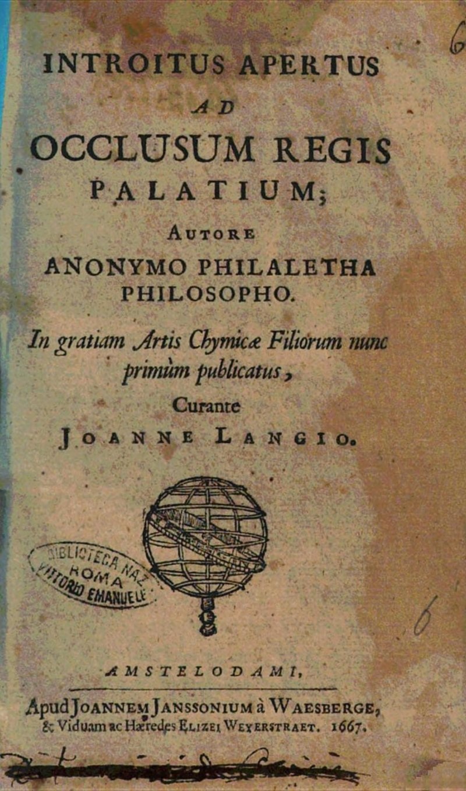

# 王の閉ざされた宮殿への開かれた入口（エイレナエウス・フィラレテス）

エイレナエウス・フィラレテス著／全訳

- 原題：An Open Entrance to the Closed Palace of the King（ラテン語題 Introitus apertus ad occlusum regis palatium）, by Eirenaeus Philalethes
- 内容：十七世紀に最も広く読まれた錬金術書の一つ。「名を秘した達人」を名のる著者が、賢者の石は「我々の金」と「我々のメルクリウス」とだけから作られると説き、メルクリウスの調製（飛ぶ鷲）、アマルガム、容器と炉、そして黒から白、赤へと移る七つの「統御」（メルクリウス、サトゥルヌス、ユピテル、月、ウェヌス、マルス、太陽）、発酵・増殖・投入までを、全三十五章で順に語る
- 刊行：ラテン語版 Amsterdam, 1667年（ヨハン・ランゲ編）。著者の序文によれば、執筆は1645年、著者二十三歳のとき
- 作業の基にした本文：Global Grey の電子版（英訳。A・E・ウェイト編『ヘルメス博物館』1893年所収の英訳と同系統の本文）
- 著作権：原著は1667年刊、ウェイトは1942年に死去。日本・米国・英国で保護期間が満了している
- 訳者：人工知能（Claude Opus 5.5）
- 訳の性格：英訳からの重訳である。著者の序文と全三十五章をすべて訳した。訳者の調べたかぎりでは、日本語訳は出ていない

## この本について

　「エイレナエウス・フィラレテス」（平和を愛する真理の友）は、十七世紀なかばに英語圏とヨーロッパの錬金術界に忽然と現れた筆名である。正体は長く謎とされてきたが、今日では、バミューダ生まれでハーヴァードに学んだ錬金術師ジョージ・スターキー（一六二八〜一六六五）の筆名だというのが通説になっている。スターキーはロンドンでロバート・ボイルと親交を結び、フィラレテスの写本は「アメリカの達人」の作として回覧された。ニュートンもフィラレテスを熱心に読み、抜き書きや注釈を残している。

　本書は、その中でも最も名高い一冊である。序文で著者は、自分は「名を秘した達人」であり、迷える兄弟たちを誤りの迷宮から導き出すために、先人の誰よりも平明に書いたと宣言する。じっさい、全体は錬金術書としては驚くほど手順に沿って書かれている。金一部にメルクリウス二部、ガラス容器の大きさは蒸留水一オンスが入るほど、炉は高さ三フィートの塔の形――と具体的な数字が並ぶ。その一方で、肝心の「我々のメルクリウス」の材料は、「火の竜」「磁石」「カリュブス」「ディアナの鳩」といった象徴の網の奥に隠されている。

　読みどころの一つは第十三章である。ペストの町で病人を治したのに群衆に囲まれ、ひげを剃り、かつらをかぶって逃げのびた話。純銀を売りに行った金細工師の店で「これは人工の銀だ」と見破られ、銀を置いたまま逃げ出した話。秘密をもつと疑われただけで寝床で絞め殺された人々の話。そこから著者は、いずれ金が泥のようにありふれたものとなり、「人類の大いなる偶像」がその価値を失う日を、「エリアスの先駆け」として予言する。錬金術の手引きであると同時に、千年王国の到来を待ち望む十七世紀の終末論の書でもあるのだ。

　後半の七つの「統御」の章では、容器の中の黒が孔雀の尾の色に、雪の白に、銅の緑に、そして血のような深紅に移り変わってゆくさまが、日数を追って描かれる。

---

## 著者の序文

　私は、名を秘した達人であり、学を愛する者であり、哲学者であるが、医薬と化学と自然学との秘法についてのこの小さな論考を書くことに決めた。キリスト生誕ののち一六四五年、私の齢二十三の年のことである。迷える兄弟たちを誤りの迷宮から導き出す助けとし、さらには、ほかの賢者たちに私の存在を知らせ、無知の闇の中を手探りしている人々に遠く広く見える松明を高く掲げるためである。この本の内容は作り話ではなく、私がこの目で見、触れ、手で扱った本物の実験である。達人であれば、これらの行からそれをたやすく見てとるであろう。私はこの術について、私の先人の誰よりも平明に書いた。ときには自分の誓いを破るまさに瀬戸際にいることに気づき、一度ならず二度までも、しばらく筆を置かなければならなかった。しかし私は、このこの上なく愛に満ちた道を貫くよう私を駆りたてる神の内なるうながしに逆らうことができなかった。心を知るのはただ神のみであり、栄光はとこしえにただ神にのみある。それゆえ私は疑いなく推しはかる。世のこの最後の時代に、私がこうして誠実に書いたものを通じて、多くの者がこの秘法によって祝福されるであろうと。私は、若い初学者にとって疑わしいものを、すすんで残しておくことはしなかったのだから。私とともにこの秘密を享受している者を私は多く知っており、さらに多くの者がまたそれを所有して喜ぶであろうと確信している。神の聖なる御意志が、そのよしとするところを行われますように。もっとも私は、このような大いなることがなしとげられる器としては、自分がふさわしくない者であることを告白するのであるが。

## 第一章　エリクシルを生みだすための硫黄の必要について

　金属を金に変成させる効能をもつ、この秘密の金羊毛を所有したいと望む者は、次のことを知らなければならない。我々の石は、自然と術の最高の努力とによってもたらしうるかぎりの、最高度の純粋さと精妙な固定とにまで温成させられた金にほかならない。こうして完成された金は「我々の金」と呼ばれ、もはや通俗の金ではなく、自然の究極の目標である。これらの言葉は、私の読者のある人々には驚くべきものであろうが、真実である。達人である私がそれを証しする。賢すぎる人々は空想の夢を抱くが、自然そのものはまことに驚くほど単純なのである。それゆえ金こそ、浄化のただ一つの真の原理である。しかし我々の金は二重である。一つは成熟して固定したもの、黄色のラトン〔原文 Latten。真鍮に似た合金の古名〕であり、その心臓あるいは中心は純粋な火であって、それによって滅びから守られ、火の中でただ浄められるだけである。この金は我々の男性であり、より生（なま）の白い金――女性の種――と性的に結ばれる。この二つがともに解きがたく結びつけられて、我々の実り多い両性具有者（ヘルマプロディトス）をなすのである。賢者たちは我々に、体としての金は、その花嫁と結ばれるまでは死んでいる、と告げる。花嫁と結ばれるとき、金においては外にある凝固させる硫黄が、内へと向けかえられなければならない。そこから、我々の必要とする実質はメルクリウス（水銀）であるということになる。この実質について、ゲベルは次の言葉を用いている。「メルクリウスを創り、それをすべてにまさる実質とされた、いと高き神はほむべきかな」。そしてまことに、もし我々がメルクリウスをもたなかったなら、錬金術師たちはなお自慢するかもしれないが、その自慢はすべてむなしいであろう。ここから、我々のメルクリウスが普通の水銀でないことは明らかである。普通の水銀はすべて体的で、特殊で、死んだ男性であるが、我々のメルクリウスは霊的で、女性的で、生きており、生命を与えるものなのだから。我々のメルクリウスについて私の言うことに、よく注意せよ。それは賢者たちの塩である。それなしに働く錬金術師は、弦のない弓を引く人のようなものである。しかもそれは、地上のどこにも純粋な状態では見いだされず、それが存在している実質から、巧みな処理によって抽出されなければならないのである。

## 第二章　賢者たちのメルクリウスを構成する原理について

　塩や澱やそのほかの異物によって、また奇妙な化学の処理によって、メルクリウスを浄めようとめざす者たちは、次のことを理解せよ。我々の水はさまざまに〔原文 variousy〕構成されているとはいえ、ただ一つのものであり、同じ本質をもつさまざまな実質が凝り固まってできているのである。我々の水の構成要素は、火と、植物的な「サトゥルヌスの液」と、メルクリウスの絆とである。火は鉱物の硫黄の火であるが、それは鉱物的とも金属的とも呼べず、その両方の性格をあわせもつ。それは混沌あるいは霊である。すべてのものに打ち勝つ我々の火の竜が、それでもサトゥルヌスの液の香りに浸みとおられ、その血がサトゥルヌスの樹液とともに育って一つの体となるのだから。しかもその体は、体でもなく（すっかり揮発性であるから）、霊でもない（火の中では溶けた金属に似ているから）。それゆえそれは、混沌、あるいはすべての金属の母と、まことに適切に呼ぶことができよう。この混沌から、私はすべてを――太陽と月とさえ――変成のエリクシルなしに抽出することができる。それは我々の砒素、我々の空気、我々の月、我々の磁石、我々のカリュブス〔chalybs。鋼〕と呼ばれる。これらの名は、王の冠の顕現に至るまでの、その発展のさまざまな段階を表している。その冠は、我々の娼婦の経血（メンストルウム）から投げ出されるのである。それゆえ学べ。カドモスの友とは誰か。彼らをむさぼり食った蛇とは誰か。カドモスがその蛇を串刺しにした洞（うろ）のある樫とは何か。学べ。穏やかさによって緑の獅子に打ち勝つディアナの鳩とは誰か。その獅子こそ、その毒ですべてを殺すバビロンの竜なのである。学べ、また、メルクリウスの翼ある靴とは何か、彼がその呪文で魅了するあのニンフたちとは誰か。

## 第三章　賢者たちのカリュブスについて

　我々のカリュブスは我々の術の真の鍵であり、それなしには松明はけっして点されえない。真のマギたちはそれについて多くのことを伝えてきたが、通俗の錬金術師たちのあいだでは、その本性について大きな争いがある。それは金の鉱石であり、すべての霊の中で最も純粋なもの、秘密の、地獄の、しかもきわめて揮発性の火、世界の驚異、下なる世界における天の効能の結果である。そのために、全能者はそれに、最も栄光ある希有な天の合（コンユンクティオ）を割りあてた。すなわち、その誕生が東方で告げられたあの名高いしるしである。この星を昔の賢者たちは見て、ただちに偉大な王が世に生まれたことを知った。あなたがその星座を見たら、それに従って揺りかごまで行け。そこであなたは美しい幼子を見るであろう。不純物を取り除き、王の子の顔を見よ。あなたの宝の箱を開き、彼に金を与えよ。そうすれば彼は、その死ののち、あなたに彼の肉と血とを与えるであろう。それは地上の三つの王国（鉱物・植物・動物）における最高の薬である。

## 第四章　賢者たちの磁石について

　鋼が磁石に引きつけられ、磁石が鋼のほうへ向くように、我々の磁石もまた我々のカリュブスを引きつける。こうして、カリュブスが金の鉱石であるように、我々の磁石は我々のカリュブスの真の鉱石である。我々の磁石の隠れた中心には塩が豊かにあり、その塩は月の球における経血（メンストルウム）であって、金を煆焼することができる。この中心は北極的な〔原文 archetic〕欲求をもって極のほうへ向き、その中でカリュブスの効能は段階を追って高められる。極にはメルクリウスの心臓、真の火（その中にその主の安らいがある）があり、それはこの大海を航海して東西両インドに到着し、北極星の位置によって進路をとる。その北極星を、我々の磁石が示すであろう。

## 第五章　賢者たちの混沌について

　学ぶ者は、賢者たちの一致した判定に耳を傾けよ。彼らはこの作業を世界の創造になぞらえて語っている。初めに神は天と地とを創造された。地は形なく、むなしく、神の霊が水の面を動いていた。神は「光あれ」と言われた。すると光があった。この言葉は、我々の術を学ぶ者にとって十分である。天は友愛の寝床の上で地と結ばれなければならない。そうすれば彼はとこしえに栄光のうちに統べるであろう。地は重い体であり、鉱物の母胎であって、それを自らのうちにはぐくむ。もっとも、樹木や動物をも光のもとに生みだすのであるが。天は大いなる光たちがめぐる場所であり、それは空気を通して下なる世界にその影響を伝える。しかし初めはすべてが一つの混乱した混沌であった。我々の混沌は、いわば鉱物の土であり（その凝固のゆえに）、しかもまた揮発性の空気である。その中心には賢者たちの天、星の中心があり、それはその光によって地をその表面まで照らす。この世界から一人の新しい王を引き出すことができるほど賢い者が誰かいるだろうか。その王は、死に、高く挙げられ、世の生命のためにその肉と血とを与えることによって、その兄弟たちをその生まれつきの弱さから贖うのである。神よ、あなたがこれらのことを賢い者や知恵ある者から隠し、幼子たちに現してくださったことを感謝します！

## 第六章　賢者たちの空気について

　我々の空気は、大空の空気のように、水を分ける。そして大空の下の水は我々死すべき者に見えるが、大空の上の水を見ることはできないように、「我々の作業」においても、我々は中心の外の鉱物の水を見るが、内に隠れていながら実際に存在している水を見ることはできない。それらは存在しているが、術者がよしとするまでは現れない。『新しい光』の著者が証ししたとおりである。我々の空気は、中心の外の水が中心の水と混ざるのを妨げている。もしこの妨げが取り除かれて、それらが混ざることができたなら、その結合は解きがたいものとなるであろう。それゆえ、外の蒸気と燃える硫黄とは我々の混沌にかたく〔原文 stiffy〕まといついており、その暴虐に抵抗できずに、純なるものは乾いた粉の形で火から飛び去る。それゆえ、これをあなたの大きな目標とせよ。乾いた土を潤し、その毛穴をそれと同じ種類の水で柔らかくしなければならない。そうすればこの盗人は、不法を行うすべての者とともに追い出され、水は真の硫黄を加えることによってその癩の汚れから清められ、あなたは処女の女王ディアナにささげられた泉を得るであろう。この盗人は砒素のあらゆる悪意で武装しており、翼ある若者に恐れられ避けられている。中心の水は若者の配偶者であるのに、若者は、ディアナがその鳩の翼で毒のある空気を清め、婚礼の部屋への通路を開くまでは、彼女のもとに行くことができない。そのとき若者は毛穴を通ってたやすく入り、たちまち上の水をゆさぶり、荒々しい赤らんだ雲をかき立てる。おおディアナよ、彼の上に水を引き入れよ、月の輝きに至るまで！　そうすれば、深淵の面の闇は、水の中を動く霊によって散らされるであろう。

　こうして、神の命によって、第七日に光が現れるであろう。そしてそのとき、このメルクリウスの哲学的な創造は完成される。その時から一年がめぐるまで、あなたは太陽の驚くべき子の誕生を待つことができる。その子は、その兄弟たちをあらゆる汚れから救い出すために来るであろう。

## 第七章　第一の操作について――飛ぶ鷲によるメルクリウスの調製

　わが兄弟よ、知れ。賢者たちの鷲を正確に調製することこそ、我々の術の最高の努力である。我々の作業のこの第一の部分では、つらく粘り強い骨折りなしには何ひとつなされない。もっとも、そのあとでは、実質はどんな手を加えることもなく、穏やかな熱の影響のもとで育っていくというのはまったく真実であるが。

　賢者たちは我々に告げる。彼らの鷲は獅子をむさぼり食うために取られなければならず、鷲がたいへん多ければ、それだけ早く勝利を得る。また作業の数は七から九のあいだで変わる、と。賢者たちのメルクリウスはヘルメスの鳥である（ときには鵞鳥と呼ばれ、ときには雉と呼ばれる）。しかし鷲はつねに複数で語られ、三から十〔原文 lo〕まで数えられる。しかしこれは、土の一に対して水の重さあるいは部分がそれだけあるべきだという意味に解してはならない。そうではなく、数えられた鷲の数だけ、水を何度も鋭く、すなわち研ぎすまさなければならないのである。この鋭化は昇華によってなされる。それゆえ、一羽の鷲が語られるときには、賢者たちのメルクリウスの一回の昇華があるのであり、七回目の昇華はあなたのメルクリウスをたいへん強めるので、あなたの王の浴槽が整うであろう……。さて、作業のこの部分がどのように行われるかを話そう。魔術のカリュブスがその腹の中に隠されている我々の火の竜を四部と、我々の磁石を九部とを取れ。それらを激しい火によって鉱物の水の形で混ぜあわせよ。その泡は取り除かなければならない。殻を取り除き、核を取れ。残ったものを火と太陽とによってもう一度清めよ。これは、サトゥルヌスがマルスの鏡に自らの姿を見たならば、たやすくなしうる。そうすればあなたは我々のカメレオン、すなわち混沌を得るであろう。その中には我々の術のすべての効能が潜在的に宿っている。これこそ幼い両性具有者であり、狂った犬に咬まれたために、たいへん水を恐れるようになったので、水と同類の本性をもちながら、いつもそれを避け遠ざける。しかしディアナの森には二羽の鳩がいて、ニンフのメルクリウスの術によって用いられれば、その狂犬病の狂気を鎮める。それを取って水の下に沈め、その中で死ぬまでおけ。すると狂った黒い犬が、あえぎ、なかば窒息して現れるであろう――それを激しく打ちすえて追いくだせ。そうすれば闇は払われるであろう。月が満ちたらそれに翼を与えよ。すると、それは鷲となって飛び去り、ディアナの鳩を死んだまま残すであろう（もっとも、最初に取るときには鳩は生きていなければならない）。これを七回くり返せ。そうすればあなたの作業は終わる。それに続く穏やかな煮成は、子供の遊びであり、女の仕事である。

## 第八章　第一の操作の難しさと長さとについて

　ある錬金術師たちは、作業は初めから終わりまでただの暇つぶしの楽しみにすぎないと思っている。しかし作業をそのようにする者は、自分のまいたもの――すなわち、無――を刈りとるであろう。我々は知っている。神の祝福と、正しい基礎の発見とに次いで、この第一の操作における倦むことのない勤勉と粘り強さとほど重要なものは何もない。それゆえ、この術を学ぶ者のかくも多くが乞食に落ちぶれるのも不思議ではない。彼らは労働を恐れ、我々の術を暇なときのただの慰みとみなしているのだから。我々の企ての準備の部分が求める労働ほど退屈な労働はないのである。モリエヌスは王にこの事実をよく考えるよう熱心に願い、多くの賢者たちが我々の作業の退屈さを嘆いてきたと言っている。詩人は言う。「混沌とした塊を秩序あるものにするのは、多くの時間と労働とを要する事柄である」。また『ヘルメスの秘法』の高貴な著者は、それをヘラクレスの仕事と述べている。我々の第一の実質にはかくも多くの不純物がまといついており、我々の汚れた経血（メンストルウム）から王の冠を引き出すためには、きわめて強力な仲立ちの作用者が必要なのである。しかしあなたが一度あなたのメルクリウスを調製したなら、あなたの仕事の最も手ごわい部分はなしとげられたのであり、賢者の言うとおり、どんな仕事よりも甘い休息にふけってよいのである。

## 第九章　我々のメルクリウスがすべての金属にまさることについて

　我々のメルクリウスは、カドモスの仲間たちをむさぼり食ったあの蛇である。それはまずカドモス自身を飲みこんだ。彼は仲間たちよりはるかに強かったのであるが。しかしカドモスはいつの日か、彼の硫黄でこの蛇を凝固させたとき、それを串刺しにするであろう。知れ、この我々のメルクリウスは金属の中の王であり、それらの硫黄を同類のメルクリウス的な実質に変えることによって、それらを溶かすのである。一羽、二羽、三羽の鷲のメルクリウスは、サトゥルヌス（鉛）、ユピテル（錫）、ウェヌス（銅）を支配する。三羽から七羽の鷲のメルクリウスは月（銀）を従わせる。十羽の鷲のメルクリウスは太陽（金）に対して力をもつ。我々のメルクリウスは、ほかのどんなものよりも金属の第一の存在（エンス）に近い。それは金属の体に入りこみ、その隠れた深みを明らかにする力をもっているのである。

## 第十章　賢者たちのメルクリウスの中にある硫黄について

　我々のメルクリウスが活動する硫黄を含みながら、しかもメルクリウスの形とすべての性質とを保っているというのは、驚くべき事実である。それゆえ、我々の調製によってその中に一つの形が導き入れられることが必要であり、その形とは金属の硫黄である。この硫黄は、合成された太陽の腐敗を引き起こす内なる火である。この硫黄の火は、我々の処女が（なお汚れなきままで）懐胎した霊的な種である。損なわれない処女性は、経験と権威とが断言するとおり、霊的な愛を受けいれるのだから。この二つ（受動の原理と能動の原理）が結びあわさったものを、我々は我々の両性具有者と呼ぶ。それは太陽と結ばれると、穏やかな熱でそれを柔らかくし、液化し、溶かす。同じ火によって、それは自らを凝固させる。そしてその凝固によって太陽を生みだす。我々の純粋で均質なメルクリウスは、（我々の術によって）内なる硫黄を懐胎すると、穏やかな外の熱の影響のもとで、乳のクリームのように――水の上に浮かぶ精妙な土のように――自らを凝固させる。それが太陽と結ばれると、凝固しないばかりか、合成された実質は日ごとに柔らかくなる。体はほとんど溶かされ、霊は凝固しはじめ、黒い色と、きわめてひどい悪臭とを帯びる。ここから明らかなように、この霊的な金属の硫黄こそ、まことに我々の術における動かす原理である。それは実のところ揮発性の、あるいは未熟な金であり、正しい温成によってその金属に変えられる。もし完全な金と結ばれれば、それは凝固せず、体としての金を溶かし、溶かされたその金とともに一つの形のもとにとどまる。もっとも、完全な結合の前には死が先立たなければならない。そうして死ののち、それらは単に完全な一体においてではなく、完全よりも千倍も完全な完全さにおいて結ばれるのである。

## 第十一章　完全な秘技の発見について

　この術はソロモンによって初めて発見された、いやむしろ神の啓示によって彼に授けられた、と考える人々がいる。かくも賢く深い学識をもつ王が我々の術を知っていたことを疑う理由はないけれども、それでも我々は、彼がその知識を得た最初の者ではなかったことをたまたま知っている。それはエジプト人ヘルメスと、彼以前のほかの何人かの賢者たちとがもっていた。そして我々は次のように推測してよいであろう。彼らは初め、不完全な金属を王の完全さへと単純に高めることを求め、初めは、重さと性質とにおいて金に最もよく似ているメルクリウスを、完全な金へと育てようと努めたのであると。しかしこれは、どんな火によっても、どれほどの工夫によってもなしとげることができなかった。そして、外の熱と同じく内の熱が必要であるという真理が、しだいに彼らの心に明らかになってきた。そこで彼らは、硝酸とすべての腐食性の溶剤とを、それらで長く実験したのちに退けた。またすべての塩をも退けた。ただし、すべての塩の第一の実質であるあの種類の塩は別である。それはすべての金属を溶かし、メルクリウスを凝固させるが、乱暴なしにではない。それゆえその種の作用者は、それを用いた物から、重さにおいても効能においても、そっくりそのままふたたび分けられるのである。彼らは、メルクリウスの温成が、ある種の水っぽい生（なま）の部分と土の滓とによって妨げられていることを見てとった。そしてこれらの不純物の根深い本性のために、合成物全体を完全に転倒させるのでなければ、それらを除くことは不可能であることを。彼らは、メルクリウスがそれらの汚す存在から解き放たれることができれば固定するであろうことを知っていた――メルクリウスは発酵させる硫黄を含んでおり、それがメルクリウスの体全体を凝固させるのを妨げているのは、これらの不純物だけなのだから。ついに彼らは、大地のはらわたの中でメルクリウスは金属になるはずのものであり、その発展の過程は、それが染まってしまった不純物によって止められているにすぎないことを発見した。彼らは、メルクリウスの中で能動的であるべきものが受動的であり、その弱さは、外から何か同類の原理を導き入れることによるほかは、どんな手段によっても直せないことを見いだした。そのような原理を彼らは金属の硫黄の中に発見した。それはメルクリウスの中の受動的な硫黄をかき立て、それと結びつくことによって、前述の不純物を追い出したのである。しかしこれを実地になしとげようとしたとき、彼らは別の大きな困難に出会った。この硫黄がメルクリウスを浄めるのに効果をもつためには、それ自身が純粋であることが欠かせなかった。しかしそれを浄めようとする彼らのあらゆる努力は、失敗する運命にあった。ついに彼らは、それはもしかすると自然のどこかに浄められた状態で見いだされるかもしれないと思いついた――そして彼らの探求は成功の冠を受けた。彼らは純粋な状態にある能動的な硫黄を求め、それが牡羊の宮に巧みに隠されているのを見つけたのである。この硫黄は、サトゥルヌスの子孫とこの上なく熱心に混ざりあい、望む効果はすみやかに生じた――メルクリウスの「空気」の悪性の毒が、（すでにいくらか詳しく述べたように）ウェヌスの鳩によって和らげられたのちに。そのとき、液によって生命は生命と結ばれた。乾いたものは湿らされ、受動的なものは能動的なものによって活動へとかき立てられ、死んだものは生きているものによって生き返らされた。天はたしかに一時は雲に覆われたが、たっぷりと雨が降ったのち、晴れやかさがよみがえった。メルクリウスは両性具有の状態で現れた。それから彼らはそれを火の中に置いた。ほどなくして彼らはそれを凝固させることに成功し、その凝固の中に、きわめて純粋な状態の太陽と月とを見いだした。それから彼らは考えた。この凝固の前には、このメルクリウスは金属ではなかった。それは揮発させられると、蒸留の容器の底に何の残滓も残さなかったのだから。それゆえ彼らはそれを未熟な金、また彼らの生きた（あるいは活きた）銀〔水銀〕と呼んだ。また彼らは、もし金をいわばそれ自身の第一の実質の土壌にまけば、そのすぐれた性質はおそらく高められるであろうと思いついた。そして彼らがそこに金を置くと、固定したものは揮発させられ、硬いものは柔らかくされ、凝固したものは溶かされた。自然そのものが驚くほどに。この理由から、彼らはこの二つを互いにめあわせ、火の上の蒸留器に入れ、多くの日のあいだ、自然の求めに従って熱を加減した。こうして死んだものは生き返らされ、体は朽ち、栄光を受けた霊が墓からよみがえった。魂は第五精髄へと高められた――動物、植物、鉱物のための普遍の薬へと。

## 第十二章　完全な秘技を作る一般的な方法

　我々の操作の最大の秘密は、一つのものの本性をもう一つのものの上で反復蒸留（コホバティオ）すること、ほかならない。生のものの温成された体から、最もよく温成された効能が抽出されるまでである。しかしそのためには次のことが必要である。第一に、必要な材料の正確な計量と調製。第二に、すべての外的な条件の正確な充足。第三に、火の正しい加減。第四に、実質の自然の性質についての十分な知識。そして第五に、あまりの性急さによって作業が損なわれないための忍耐。これらすべての点について、我々はいまからしかるべき順序で語ることにしよう。

## 第十三章　エリクシルの作業における成熟した硫黄の用い方について

　我々はメルクリウスの必要について語り、その性質を、これまでになされたどんな記述よりも平明に率直に述べた。神は知っておられる。我々はこの術の知識を同胞の人々に惜しむのではない。そしてそれがふさわしくない者の手に渡りうることも恐れてはいない。秘密が比較的少数の哲学者たちに握られているかぎり、彼らの境遇は明るく幸福なものとはおよそほど遠い。我々は四方を、群衆の残酷な貪欲と――詮索好きな疑いとに取り囲まれ、カインのように、家もなく友もなく地上をさまよう定めにある。家庭の幸福の慰めは〔原文、ここに「X」の一字あり〕我々のためのものではない。友情の楽しい打ち明け話も我々のためのものではない。我々の黄金の秘密をほしがる人々は我々を所から所へと追いかけ、愛が我々を兄弟に向かって心を自由に開くよう誘うとき、恐れが我々の唇を閉ざす。それで我々はときに、カインのあの寂しい叫びを発したくなる。「私を見つける者は誰でも私を殺すでしょう」。しかし我々は兄弟たちの殺害者ではない。我々はただ同胞の人々に善をなすことを切に願っているだけである。しかし我々の親切と慈悲深い同情とでさえ、黒い忘恩によって報いられる――天に復讐を叫び求める忘恩によって。ついこのあいだのこと、私はある町のペストに襲われた界隈を訪れ、私の奇跡の薬によって病人たちを完全な健康に戻したのであるが、そのあとで、わめきたてる群衆に取り囲まれ、彼らは私に賢者たちのエリクシルをよこせと要求した。私は服と名前とを変え、ひげを剃り、かつらをかぶることによって、やっと命を救い、あの邪悪な者たちの手から逃れることができたのである。そして我々の命が脅かされないときでさえ、どこへ行っても人間の貪欲の的にされているのは、愉快なことではない……。私の知っている何人かの人々は、ただこの秘密をもっていると疑われたというだけで、寝床の中で絞め殺されているのを見つけられた。実のところ、彼らはその殺害者たち以上に何も知らなかったのであるが。何人かの向こう見ずな悪党にとっては、犠牲者に対してほんのささやきほどの疑いが吹きこまれれば、それで十分だったのである。人々はこの薬をひどく手に入れたがっているので、あなたの用心そのものが彼らの疑いをかき立て、あなたの安全を危うくするであろう。また、もしあなたが金と銀とを大量に売りたいと望んでも、発覚の差し迫った危険なしにそうすることはできないであろう。

　誰かが大量の地金を売りに出しているという事実そのものが、たいていの場所では疑いをかき立てるであろう。この感情は、人々が我々の金の品質を試すとき、いっそう強められるであろう。それはバルバリア（北アフリカ）から、あるいはギニア海岸からもたらされるどんな金よりもはるかに精良で純粋であり、我々の銀は、スペインの銀船団が本国へ運ぶ銀よりもさらによいのだから。もし発覚をまぬがれるためにこれらの貴金属に合金を混ぜれば、少なくともイングランドとオランダとでは、あなたは死刑に処せられることになる。それらの国では、造幣所の役人と免許を受けた金細工師とのほかは、誰も貴金属に手を加えることを許されていないのだから。私は覚えている。かつて外国の商人に変装してある金細工師の店に行き、六百ポンドに値する我々の純粋な銀を売りに出したことがある。彼はそれにいつもの試験をほどこし、それから言った。「この銀は人工的に調製されたものだ」。なぜそう思うのかと私が尋ねると、彼の答えはこうであった。「私はこの仕事の新米ではない。さまざまな鉱山から運ばれてくる銀の正確な品質はよく知っている」。この言葉を聞くと、私はひどくこっそりと急いでその場を立ち去り、銀を金細工師の手に残してきた。このために、また我々この石の所有者を四方から取り巻く多くの大きな困難のゆえに、我々は隠れたままでいることを選ぶ。そして我々の秘密をふさわしい仕方で切望する者たちに術を伝えよう。そうすれば、どのような公共の善が生じるかを見よ。硫黄なしには、我々のメルクリウスは、我々の超自然の作業のためにけっして正しく凝固させられないであろう。硫黄は男性の実質であり、一方メルクリウスは女性と呼ぶことができる。そしてすべての賢者たちは、どんなチンキもそのラトンなしには作れないと言う。そのラトンとは、二枚舌なしに言えば、金である。それにもかかわらず、賢い人々はこの実質を糞の山の上にさえ見いだすことができる。しかし無知な者たちは、金の中にさえそれを見分けることができない。金のチンキは、物体のうちで最も高度に成熟したものである賢者たちの金の中に隠されている。しかし生の材料としては、それは我々のメルクリウスの中にしか存在しない。そしてそれ（金）は、メルクリウスから、その種の増殖を受けとる。もっとも重さにおいてよりはむしろ効能においてであるが。賢者たちは、普通の金は死んでいるが、彼らの金は生きていると言う。そして普通の金が死んでいるのは、一粒の小麦が乾いた空気に囲まれているあいだは死んでおり、湿った土の中に入れられたときにはじめて生き返り、ふくらみ、柔らかくなり、芽を出すのと同じ意味においてである。この意味で、金もまた、体の殻に囲まれているかぎりは死んでいる。もちろん、植物の穀粒と金属の金とのあいだの大きな違いはつねに考慮に入れたうえでのことであるが。

　我々の穀粒は水の中でのみ生気づけられる。そして小麦は、納屋の中にあるあいだは穀物と呼ばれ、生気づけられる定めにはない。それはパンを作るのに使われるのだから――しかし畑にまかれると名を変え、そのときには種麦と呼ばれる。それと同じように、我々の金も、指輪や器や貨幣の形をしているあいだは普通の金と呼ばれる。その状態では、それは世の終わりまで変わらずにいそうだからである。しかし潜在的には、そのときでさえそれは賢者たちの金である。もしそれ自身の固有の元素の中にまかれれば、それは数日のうちに賢者たちの混沌となるであろうから。それゆえ賢者たちは、死んだものを生き返らせよ（すなわち、すでに生きながらの死を運命づけられたように見えた金を）、そして生きているものを殺せ（すなわち、金に生命を与えることによって、それ自身は生命の原理を奪われるメルクリウスを）、と命じるのである。彼らの金は死んだ状態で、彼らの水は生きた状態で取られる。そしてその合成と短い煮成とによって、死んだ金は生き返り、生きたメルクリウスは死ぬ。すなわち、霊は凝固させられ、体は溶かされ、こうして両者はともに腐敗し、ついには合成物のすべての部分が原子に引き裂かれる。我々があれほど注意して隠している我々の術の神秘とは、メルクリウスの調製である。それは地上では我々の手もとに用意されたものとしては見いだされない。しかしそれが調製されると、それは「我々の水」となり、その中で金は溶かされ、それによって金の潜んでいた生命は解き放たれ、溶かすメルクリウスの生命を受けとる。メルクリウスと金との関係は、よい土と一粒の小麦との関係に等しい。金がメルクリウスの中で腐敗したとき、死の分解の中から、同じ本質をもつが栄光を受けた実質の、新しい体が生じる。ここに、ひと言でいえば、我々の哲学の全体がある。

　そこには、メルクリウスの調製、正しい割合での金との混合、その求めに従った火の加減のほかには、何の秘密もない。金はそれだけでは火を恐れない。それゆえ大事な点は、熱をメルクリウスの許容量に合わせて加減することである。もしメルクリウスが正しく調製されていなければ、金は、ふさわしくない作用者と結ばれて、普通の金のままである。それは変わらずにとどまり、どれほどの熱もそれがその体の本性を脱ぐ助けにはならないであろう。我々のメルクリウスなしには、種（すなわち金）をまくことはできない。そしてもし金がその固有の元素の中にまかれなければ、それは生気づけられることができない。西インドの人々が空気を通さない石の甕に入れて地下に保っている穀物が芽を出せないのと同じである。私は知っている。自ら「賢者」を任じる何人かはこの教えに異を唱え、普通の金と流れる水銀とは我々の石の実質ではないと言うであろう。しかし一つの問いで彼らの反論を黙らせるのに足りるであろう。彼らはいったい実際に我々のチンキを調製したことがあるのか。私は一度ならずそれを調製したし、日々それを手中にしている。それゆえ私はおそらく、権威ある者として語ることを許されてよいであろう。自称哲学者たちよ、五月に集めた雨水について、あなたがたの塩について、悪魔そのものよりも強力なあなたがたの精子について、しゃべりつづけるがよい。お望みなら私をののしるがよい。あなたがたの言うことはすべて、この一つの事実によって決定的に論駁される――あなたがたは石を作ることができないのだ。私が、金とメルクリウスとが我々の石のただ二つの実質であると言うとき、私は自分が何について書いているかを知っている。そしてすべての心を探る方もまた、私が真実を言っていることを知っておられる。

　この術についてより自由に語ってよい時が来た。術者エリアスは間近に迫っており、神の都についてはすでに栄光あることが語られているのだから。私は全世界を買うのに足りる富を所有している――しかし悪しき人々の策略と残酷さとのために、私はまだそれを用いることができない。私がこれほど多くを隠すのは妬みからではない。神は知っておられる。私は、友情の絆から締め出され、ほとんど神の御顔からさえ締め出された、この孤独なさすらいの生活に疲れはてているのである。私は、我々のイスラエルの民が地にひれ伏して拝むあの金の子牛を拝まない。それは青銅の蛇のように粉々に砕かれるがよい。私は望む。数年のうちに金は（神によって与えられたものとしてではなく、人によって濫用されたものとしての金は）たいへんありふれたものとなり、いまそれにひどく狂っている者たちが、反キリストのこの砦を軽蔑してわきへ蹴りやるようになることを。そのとき、我々の解放の日は近い。新しいエルサレムの通りは金で敷かれ、その門は大きなダイヤモンドで造られるのである。この私の本によって、金が泥のようにありふれたものとなる日は近い。そのとき我々賢者たちは足の裏の休み場を見いだし、神に熱い感謝を捧げるであろう。私の心は言いあらわしえないことを思いいだき、神のイスラエルの善のためにふくらむ。これらの言葉を私は、伝令のらっぱの響きをもって発する。私の本はエリアスの先駆けであり、主の王の道を備えるためのものである。願わくは、それによってすべての人が我々の術の達人となるように――そうなれば、人類の大いなる偶像である金はその価値を失い、我々はただその学問上の教えのゆえにのみそれを尊ぶようになるであろう。徳はそれ自身のゆえに愛されるであろう。私は、沈黙を名誉の大事とみなすこの術の所有者を多く知っている。しかし私は神によって、この事柄について別の見方をすることを許された。そして私は、この秘密の知識を全世界の共有の財産とすることによって、神のイスラエルに最もよく仕え、私のタラントンを利殖に出すことができると固く信じている。それゆえ私は血肉と相談することもせず、私の兄弟たる賢者たちの同意を得ようともしなかった。もし事が私の望みと祈りとのとおりに成功するなら、彼らはみな、私がこの本を公にしたことを喜ぶであろう。

## 第十四章　我々の術の付随的で偶有的な必要条件について

　我々は、我々の術についての通俗の誤りをすべて取り除き、金とメルクリウスとだけが必要な実質であることを示した。我々は、この金がたとえとしてではなく、まことに哲学的な意味において理解されるべきことを示した。我々はまた、我々のメルクリウスが、意味のどんなあいまいさもなく、真の水銀であることを明らかにした。後者は術によって作られねばならず、前者への鍵となるものだと、我々はあなたに告げた。我々はすべてを真昼のように明らかにした。そして我々の教えは、伝聞や他人の著作にではなく、我々自身の、たびたびくり返された経験にもとづいている。我々が誠実に明らかにする事柄は、我々が見もし知りもした事柄である。我々は石――大いなるエリクシル――を作ったし、所有している。さらに我々はあなたにこの知識を惜しまず、あなたがこの本からそれを得ることを望んでいる。我々は先人の誰よりも平明に語った。そして我々の処方は、物をその本来の名で呼ばなかったということを別にすれば、まったく信頼できる。残るのは、あなたのメルクリウスのよしあしを知ることのできるいくつかの実地の試験と、その欠点を直すためのいくつかの指示とを与えることである。あなたが生きたメルクリウスと金とをもっているなら、なしとげるべきこととして残るのは、まずメルクリウスと金との清め、次にそれらの婚約、そして最後に火の加減である。

## 第十五章　メルクリウスと金との付随的な清めについて

　完全な金は大地のはらわたの中に、小さなかけらとして、あるいは砂の中に見いだされる。もしこの混ぜもののない金に出会えれば、それは十分に純粋である。そうでなければ、アンチモンか王のセメント〔セメンテーションの剤〕でそれを清めるか、あるいはまず金を粒状にして、硝酸で煮よ。それから溶かし、不純な沈殿物を除けば、用意はできる。しかしメルクリウスは内的で本質的な清めを必要とする。その根本的な浄化は、真の硫黄を、鷲の数に従って少しずつ加えることによってもたらされる。それからそれはまた、本質的な清めによって中心から放り出された不純物をその表面から除くために、付随的な清めを必要とする。この処理はどうしても必要というわけではないが、作業を速めるので役に立つ。それゆえ、適当な数の鷲によって浄めたあなたのメルクリウスを取り、普通の塩と鉄のやすり屑とで三回昇華させ、酢と適量の硇砂とで洗い、それから乾かして、ガラスのレトルトで、メルクリウスの全体が昇ってしまうまで、しだいに強める火の上で蒸留せよ。これを四回くり返し、それからメルクリウスを酢の精の中で一時間、絶えずかき混ぜながら煮よ。それから酢を注ぎ捨て、たっぷりと湧き水を注いでその酸味を洗い流せ。メルクリウスを乾かせ。そうすればその輝きは驚くべきものとなるであろう。ぶどう酒で、あるいは酢と塩とで洗って、昇華を省いてもよい。しかしその場合には、すべての鷲すなわち洗浄を仕上げたのち、何も加えずに少なくとも四回蒸留し、そのたびに鋼の〔原文 chalybeat〕レトルトを灰と水とで洗え。それから蒸留した酢の中で半日煮て、ときどき強くかき混ぜよ。黒っぽくなった酢を注ぎ捨て、新しいものを加え、それから温かい湯で洗え。この処理は、内部の不純物を表面から清め去るためのものである。これらの不純物は、メルクリウスを最も純粋な金と混ぜて、そのアマルガムを白い紙の上に置けば見てとることができる。そのとき紙の上に見える煤のような黒さが、この処理によって清め去られるのである。

## 第十六章　メルクリウスと金とのアマルガムと、それぞれの割合とについて

　これをすべて終えたら、純粋な、薄板にした金、あるいは細かな金のやすり屑を一部と、メルクリウスを二部とを取れ。それらを温めた（大理石の）壺に入れよ。すなわち、煮え湯で温めた壺である。煮え湯から取り出すとすぐに乾き、長いあいだ熱を保つのである。象牙、ガラス、石、鉄、あるいはツゲの乳棒ですりつぶせ（鉄の乳棒はあまりよくない。私は水晶の乳棒を使っている）。それらを、画家が絵の具をすりつぶすほど細かくつき砕け、と私は言うのである。それから水を加えて、塊をなかば溶けたバターのような濃さにせよ。混合物は固まりやすく柔らかで、小さな玉に丸められなければならない――ほどよく柔らかなバターのように。それは、ごく穏やかに触れても崩れるような濃さでなければならない。さらにそれは全体にわたって同じ温度でなければならず、ある部分がほかの部分より流動的であってはならない。混合物は、それが含むメルクリウスの割合に応じて多かれ少なかれ柔らかくなるであろう。しかしそれはあの小さな玉を作ることができなければならず、またメルクリウスが上よりも底でいっそう活発であってはならない。アマルガムをかき回さずにおけば、すぐに固まってしまう。それゆえ、かき回しているあいだに混合物のよしあしを判断しなければならない。もしそれが上の条件を満たしていれば、それはよいのである。それから酢の精を取り、その中に硇砂を三分の一溶かし、アマルガムをこの液に入れ、首の長いガラスの容器の中で全体を四半時間煮よ。それから混合物をガラスの容器から取り出し、液を注ぎ捨て、乳鉢を温め、アマルガムを（上のように）力強くつき、すべての黒さを熱い湯で洗い流せ。それをふたたび液の中に入れ、ガラスの容器の中でもう一度煮立たせ、前のようにつき、洗え。黒さがすっかり清め出されるまで、この処理をくり返せ。そうすればアマルガムは、最も純粋な銀のように輝き白くなるであろう。

　もう一度、上に与えた規則に従ってアマルガムの温度を加減せよ。あなたの労働は豊かに報いられるであろう。もしアマルガムが十分に柔らかくなければ、メルクリウスを少し加えよ。それから純粋な水の中で煮て、すべての塩気と酸味とを取り除け。水を注ぎ捨て、アマルガムを乾かせ。白い紙の上で、ナイフの先にのせてそれを前後に振ってみて、それがすっかり乾いていることをよく確かめよ。

## 第十七章　容器の大きさ、形、材料、封じ方について

　あなたのガラスの蒸留容器は丸いか卵形とせよ。その胴に、蒸留水一オンスより多くも、ずっと少なくもなく入る大きさとせよ。容器の首の高さはおよそ一パーム、一手幅、あるいは一スパンとし、ガラスは透明で厚くせよ（透明で清らかで、中で起こっていることを見分けられるかぎり、厚いほどよい）――しかし厚さは一様でなければならない。この容器に入る実質は、金半オンスとメルクリウス一オンスとから成る。そしてもしメルクリウスを三分の一オンス加えなければならないとしても、合成物の全体はなお二オンスに満たない。我々の胎児から立ちのぼる蒸気が容器を破裂させるのを防ぐために、ガラスは丈夫でなければならない。容器の口は、封蝋の厚い層によって、ごく注意深く効果的に封じよ。それゆえ、必要な器具と材料とはそれほど高価ではない――そして私の厚い蒸留容器を使えば、割れることによる損失を避けられるであろう。そのほかに必要な器具も高くはない。多くの人がこの言葉に異を唱えることを私は知っている。彼らは、我々の術の追求はほとんど破産するほどの出費を要する事柄だと言うであろう。しかし私の答えは一つの単純な問いから成る。我々の術の目的は何か。それは賢者の石を作ること――ぬるま湯の中の氷のように金が溶ける液を見つけることではないか。そして「太陽のメルクリウス」や「月のメルクリウス」をあれほど熱心に探し求め、その材料にあれほど高い値を払うあのお人よしたちは、いったいこの目的に成功するのか。彼らはこの問いに然りと答えることはできない。一フロリンで、水銀二ポンドを生気づけ、それを賢者たちの真のメルクリウスとするのに足りるだけの、我々の水の実質が買える。しかしもちろん、ガラスの容器、炭、土の容器、炉、鉄の容器そのほかの器具はただでは買えない。完全な体、すなわち我々の鉱石である金なしには、どんなチンキもありえない。そして我々の石は、初めは卑しく、未熟で、揮発性であるが、完成したときには完全で、貴く、固定している。我々の石のこの二つの面が、体すなわち金と、霊すなわち水銀とである。

## 第十八章　賢者たちの炉、すなわちアタノールについて

　私は、メルクリウス、硫黄、容器、その扱いなどなどについて語った。そしてもちろん、これらすべてのことは割り引いて理解されるべきである。前の諸章で私はたとえによって語ったのだということを理解しなければならない。もし私の言葉を文字どおりの意味に取るなら、あなたは出費のほかには何の収穫も刈りとらないであろう。たとえば、私が主要な実質をメルクリウスと金と名づけるとき――私は金細工師の店で売られているような状態の普通の金を意味しているのではない――それは我々の術によって調製されなければならないのである。我々の金は普通の金と銀との中に見いだすことができる。しかし普通の金からその第一の実質を取り出すよりは、石を作るほうがたやすい。「我々の金」とは、火によってその魂を取り去られていない混沌である。普通の金の魂は、ウルカヌスの火の暴虐を前にして、最も奥の城塞へと退いてしまったのである。

　もしあなたが我々の金を、完全と不完全とのあいだの中間の実質の中に求めるなら、それを見いだすであろう。しかしそうでなければ、あなたは最初の準備の処理（第十五章）によって普通の金の門の閂（かんぬき）をはずさなければならない。それによってその体の呪縛が解かれ、夫はその仕事をすることができるようになる。前者の道を選ぶなら、穏やかな熱だけを用いればよい。後者の場合には、激しい火が必要となるであろう。

　しかしここで、もしそこからの出口を知らなければ、あなたは迷宮の中ですっかり迷ってしまうであろう。しかし我々の金を選ぶにせよ普通の金を選ぶにせよ、どちらの場合にも、むらのない絶えまない火が必要である。我々の金を取れば、あなたは作業を数か月早く終え、エリクシルは普通の金から調製したものより十倍も貴いものとなるであろう。「我々の金」で作業すれば、その煆焼、腐敗、白化において、その穏やかな内なる（自然の）熱に助けられるであろう。しかし普通の金の場合には、この熱は、処女の乳との結合にふさわしいものとするために、異質の実質によって外から加えられなければならない。しかしどちらの場合にも、火の助けなしには何もなしとげることはできない。それゆえ、ヘルメスが火を、太陽と月とに次ぐ作業の統御者に数えているのはむだではなかったのである。

　しかしこれは、通俗の目がけっして見たことのない、まことに秘密の炉について理解されるべきことである。もう一つ別の炉もある。それは我々の普通の炉と呼ばれ、陶工の土で、あるいは粘土でよく固めた鉄や真鍮の板で作られる。この炉を我々はアタノールと呼ぶ。私が最も好む形は、てっぺんに「巣」のある塔の形である。「塔」はおよそ三フィートの高さで、板の内側で九指の幅とせよ。地面から少し上に、燃えがらを取り除くための、三、四指ほどの幅の小さな口を設けよ。その上に、石で築いた火床を置くべきである。その上に炉そのものを置く。それはすべてのすきま風と空気の流れとを締め出すようなものでなければならない。

　炭は上から入れ、そのあとで口を注意深く閉じなければならない。しかしあなたの炉が私の与えた記述に正確に合っている必要はない。次の条件を満たしていさえすればよいのである。第一に、すきま風がないこと。第二に、容器を取り出さずに温度を変えることができること。第三に、十時間か十二時間、見張らずに火を保っておけること。そうすれば我々の術の扉はあなたに開かれるであろう。そして石を調製したら、それを増殖させるために、小さな持ち運びのできる炉を手に入れてもよい。

## 第十九章　最初の四十日間の作業の進み方について

　述べたやり方で我々の金とメルクリウスとを調製したら、それを我々の容器に入れ、我々の火の作用にさらせ。四十日のうちに、あなたは実質の全体が、目に見える動きも感じとれる熱もなしに（ただほんのり温かいほかは）、原子に変えられるのを見るであろう。もしあなたが「我々の金」の意味をまだ正しく知らないのなら、普通の金（よく浄めたもの）を一部と、我々のメルクリウス（すっかり清めたもの）を三部とを取り、指示したとおり（第十六章）それらを合わせ、火の上に置き、それらが汗をかき、その汗が循環するまで、沸騰点に保て。九十日の終わりに、あなたはメルクリウスが普通の金のすべての元素を分け、ふたたび結びあわせたことを見いだすであろう。混合物をさらに五十日煮よ。そうすれば、我々のメルクリウスが普通の金を「我々の金」に変えたことを発見するであろう。それが第一級の薬である。それはすでに我々の硫黄であるが、まだ色づける力をもたない。この方法は多くの賢者たちがたどってきたものであるが、きわめて遅く退屈であり、地上の富める者にしか向かない。さらに、この硫黄を得たとしても、石を所有していると思ってはならない。所有しているのはその真の物質にすぎないのである。それは不完全なものの中に求めることができ、神がその貧しく、軽んじられ、卑しめられた聖徒たちのためにとっておかれた、我々のたやすくも希有な道によって、一週間のうちに見いだすことができる。これについて、この本の初めでは沈黙のうちに葬ると決めていたのであるが、私はいま多くを書くことに決めた。これこそすべての達人たちの一つの大きな詭弁である。ある者はこの普通の金と銀とについて語って真実を言い、ほかの者は我々はそれを使うことができないと言って、彼らもまた真実を言う。しかし神の御前で、私は我々の達人たちのすべてに弁明を求め、妬み深い無愛想さのかどで彼らを責めるであろう。私もまた同じ道をたどろうと決めていたのであるが、神の手が私のもくろみをくじいたのである。それゆえ私は言う。二つの道はともに真実であり、終わりには同じことに帰する――しかし初めには大きな違いがある。我々の術の全体は、我々のメルクリウスと我々の金との正しい調製にある。我々のメルクリウスは我々の道であり、それなしには何ひとつなしとげられない。我々の金は普通の金ではないが、その中に見いだすことはできる。そしてもしあなたが我々のメルクリウスに普通の金をもって働きかければ（火を正しく加減して）、百五十日ののちに我々の金を得るであろう。我々の金は我々のメルクリウスから得られるのだから。それゆえ、もし普通の金が我々のメルクリウスによってそのすべての原子をすっかり分かたれ、それから同じ作用によってふたたび結びあわされれば、混合物の全体は火の影響のもとで我々の金となるであろう。しかしもし、この準備の清めなしに、石を調製する目的で普通の金を我々のメルクリウスとともに用いるなら、あなたはひどく誤ることになろう。そしてこれこそ、たいていの初学者が迷いこむ大いなる迷宮である。賢者たちはこれらの道を二つの道として書くことによって、それらがただ一つの道であるという事実を（もちろん一方が他方よりもまっすぐであるが）わざとぼかしているのだから。それゆえ賢者たちの金は、我々の普通の金と我々のメルクリウスとから調製することができ、そこからそのあとで、くり返し液化させることによって、燃えることのない、ほかのすべてのものを色づける硫黄と水銀とを得ることができる。この意味で、我々の石はすべての金属と鉱物との中に見いだされる。我々の金はそれらすべてから得ることができるのだから――しかしもちろん、最もたやすいのは金と銀とからである。ある者は錫の中に、ある者は鉛の中にそれを見いだしたが、より退屈な方法を追求した者の大部分は、金の中にそれを見いだした。もちろん、もし我々の金が、すでに出来あがったものとして見いだされるのではなく、私の述べたやり方で普通の金から（百五十日のうちに）調製されるのであれば、それはそれほど効果がなく、石の調製には七か月のかわりに一年半かかるであろう。私は両方の道を知っており、短いほうを好む。しかし長いほうもまた述べたのは、「賢者たち」の手ひどい怒りを自分の上に招かないためである。すべての初学者をくじけさせる大きな困難は、自然の作ったものではない。賢者たちが、短いほうの操作を意味しているときに長いほうについて語り、またその逆をすることによって、それを作りだしたのである。もし普通の金を選ぶなら、あなたはそれをウェヌス（銅）とめあわせ、ともに婚礼の床に横たえるべきである。そしてそれらに激しい火を当てると、次のような色の移り変わりの中に、大いなる作業の表象を見るであろう。黒、孔雀の尾、白、橙、そして赤。それから同じ操作を、（処女の乳と呼ばれる）メルクリウスをもって、「露の湯の火」と（終わりのほうでは）灰を混ぜた砂とを用いてくり返せ。実質はまずずっと深い黒に変わり、それからいっそう完全な白と赤とに変わるであろう。それゆえ、もしあなたが我々の術を知っているなら、我々のメルクリウスから我々の金を抽出せよ（これが短いほうの道である）。そしてこうして、操作の全体を一つの実質（すなわちメルクリウス）によって行え。もしこれができれば、あなたは哲学の完成に達したのである。この方法には余計な手間がない。作業の全体が、初めから終わりまで、一つの広い基礎の上に立っている――一方、普通の金を取れば、二つの実質に働きかけなければならず、その両方を手のこんだ処理によって浄めなければならない。私の言ったことをよく考えれば、あなたは賢者たちの見かけ上の矛盾をすべて解きほぐす手段を手にしている。彼らは三つの操作について語る。第一は、内なる自然の熱が外の火の助けによってすべての冷たさを追い出すもの。第二は、金が、ウェヌスの仲立ちによって、激しい火の影響のもとで、我々のメルクリウスで清められるもの。第三は、普通の金が我々のメルクリウスと混ぜられ、硫黄の酵母が加えられるものである。しかしもし私の忠告を受けいれるなら、あなたは賢者たちの側のどんな故意のあいまいさにも惑わされないであろう。我々の硫黄こそ、あなたはまことに見いだすよう努めるべきである。そしてもし神があなたを照らされるなら、あなたはそれを我々のメルクリウスの中に見いだすであろう。生ける神の御前で、私は私の教えが真実であることを誓う。もしメルクリウスと純粋な普通の金とに働きかけるなら、あなたは「我々の金」を七か月から九か月で、「我々の銀」を五か月で見いだすであろう。しかしこれらを得ても、あなたはまだ我々の石を調製したのではない。その栄光ある光景は、一年半のあいだ作業を続けるまでは、あなたの目を喜ばせないであろう。そのころまでに、あなたは実質をごく穏やかな絶えまない熱にさらすことによって、エリクシルを得ることができよう。

## 第二十章　太陽と月との作業における黒の出現について

　我々の硫黄を見いだす目的で金と銀とに働きかけるなら、あなたの実質をまず薄い練り粉か、煮えたつ湯か、液状のピッチのようにせよ。我々の金とメルクリウスとの操作は、普通の金を我々のメルクリウスで調製するときに起こることによって予示されているのだから。あなたの実質を取って炉に入れ、二十日のあいだ火を正しく加減せよ。そのあいだにあなたはさまざまな色を見るであろう。そして四週目の終わりごろ、火が絶えまなく続いていれば、きわめて愛らしい緑が見え、それはおよそ十日続くであろう。そのとき喜べ。まもなくそれは黒い炭のようになり、あなたの合成物の全体は原子に帰するであろうから。この操作は、固定したものを固定していないものへと解くことである。両者がのちに結びあわされて、なかば霊的でなかば体的な一つの物質をなすためである。もう一度、私はあなたに請けあう。火の加減こそ、私があなたから隠した唯一のことなのである。正しい統御が与えられたら、石を取り、あなたの知るとおりにそれを統べよ。そうすれば次のような驚くべき現象が続くであろう。火はただちにメルクリウスと硫黄とを蝋のように溶かす。硫黄は焼かれ、日ごとにその色を変える。メルクリウスは燃えないことがわかり、ただしだいに硫黄の色に染められる（そして汚されることなく浄められる）。天を地へと身をかがめさせよ、地が天の種を懐胎するまで。あなたの蒸留容器の中で実質が混ざりあい、凝固して焼けた血のような外見を帯びるのを見たら、女性が男性の種を受けたことを確信せよ。それからおよそ十七日のちに、あなたの実質は黄色く、濃く、霧のような、あるいは泡だった外見を帯びはじめるであろう。このとき、胎児をあなたの容器から逃がさないように気をつけなければならない。それは緑がかった、黄色の、黒の、青みがかった蒸気を発し、容器を破裂させようとするであろうから。もしこれらの蒸気（胎児が形づくられるときには絶えまなく出る）を逃がせば、あなたの作業は取り返しのつかないほど損なわれるであろう。またそのにおいのどれをも、どんな小さな穴や出口からも漏らしてはならない。その蒸発は石の力をかなり弱めるであろうから。それゆえ真の賢者は、その容器の口をこの上なく注意深く封じるのである。さらに忠告しておくが、液の量が減りはじめたとわかるまで、火をおろそかにしたり、容器を動かしたり開いたり、煮つめの処理をゆるめたりしてはならない。もしこれが三十日ののちに起これば、喜び、自分が正しい道にいることを知れ。それから二倍注意せよ。そうすれば、さらに二週間の終わりに、土がすっかり乾いて深い黒になったのを見いだすであろう。これが合成物の死である。風はやみ、大いなる凪がある。これこそ、海もまた消え去ったときの、太陽と月とのあの大いなる同時の蝕である。そのとき我々の混沌は用意ができており、そこから、神の命によって、世界のすべての驚異が次々に現れうるのである。

## 第二十一章　花を焼かないために必要な用心について

　花を焼くことは命とりであるが、すぐにやってしまう。それは主として三週目が過ぎてから用心しなければならない。初めは湿りがたいへん多いので、もし火が激しすぎると液をあまりに早く乾かしてしまい、あなたは早すぎる時期に、生命の原理が飛び去った乾いた赤い粉を得るであろう。火が十分に強くなければ、実質は正しく成熟しないであろう。強すぎる火は実質の真の結合を妨げる。真の結合は水の中でしか起こらない。物体はぶつかりあうが結びつかない。液（と霊）だけが、その実質を真に混ぜあわせることができる。それゆえ我々の均質な金属の水には、その仕事を正しくさせなければならず、この完全な相互の吸収が自然なやり方で起こるまでは、乾かしてはならない。早すぎる乾燥は生命の芽を滅ぼすだけであり、能動の原理の頭をハンマーで打つように打って、それを受動的にしてしまう。たしかに赤い粉は生じるが、時期よりずっと前である。赤の前には黒が来なければならないのだから。たしかに、我々の作業の初めに、天が地とめあわされ、地が自然の火を懐胎するとき、赤い色が現れる。しかしそのとき実質は十分に湿っている。そして赤はまもなく緑の色に道をゆずり、緑はまたしだいに黒に道をゆずる。急いではならない。火をちょうど十分に強く、しかし強すぎないようにせよ。スキュラとカリュブディスとのあいだをまっすぐに舵をとれ。そうすれば、あなたは容器の中にさまざまな色とグロテスクな変容とを見るであろう――ついに実質が強烈な黒の粉に落ち着くまで。これは最初の五十日のうちに起こるはずである。もし起こらなければ、あなたのメルクリウスか、あなたの火の加減か、あなたの実質の合成かに誤りがある――もっとも、あなたがガラスの容器を動かしたりゆすったりしていなければの話であるが。

## 第二十二章　サトゥルヌスの統御について

　我々の術について書いたすべての賢者たちは、サトゥルヌスの作業と統御とについて語ってきた。そして彼らの言葉は、多くの者に普通の鉛を石の実質として選ばせた。しかしあなたは知らなければならない。我々のサトゥルヌス、すなわち鉛は、金よりもはるかに高貴な実質である。それは、金の魂がメルクリウスと結ばれ、アダムとその妻エバとを生みだす生きた土なのである。それゆえ、最も高いものが最も低いものとなるほどに身を低くしたのだから、その血がそのすべての兄弟たちを贖う手段となることを我々は期待してよい。我々の王が葬られている墓、それを我々はサトゥルヌスと呼ぶ。そしてそれは変成の作業の鍵である。この惑星に挨拶し、それをその正しい名で呼ぶことのできる者は幸いである。それはただ神の祝福によってのみ得られる恩恵である。それは望む者にも走る者にもよらず、神がその望む者に授けられるのである。

## 第二十三章　この作業のさまざまな統御について

　請けあっておくが、我々の作業の全体の中で、統御のほかには何も隠されていない。それについては賢者がまことに言ったとおり、それを完全に知る者は君主や権力者たちから敬われるであろう。はっきり言っておくが、もしこの一点が明らかに説き示されれば、我々の術はただの女の仕事、子供の遊びとなるであろう。そこには「料理」という単純な処理のほかに何もなくなるであろう。それゆえそれは、賢者たちによってつねにこの上なく注意深く隠されてきた。しかし私は、もっと思いやりのある親切な心で書くことに決めた。それゆえ知れ。我々の統御は、終始、煮成と温成とから成る。しかしそれは、ほかの多くの処理を含んでおり、あの妬み深い賢者たちは、それらを別々の名のもとに述べることによって、異なるもののように見せかけてきたのである。しかし我々はこの主題について、もっと公然と語るつもりである。

## 第二十四章　第一の統御、すなわちメルクリウスの統御について

　この第一の統御は、すべての賢者たちによって念入りに秘密にされてきた。彼らは第二の統御、すなわちサトゥルヌスの統御を、まるでそれが第一であるかのように語り、こうして、あの強烈な黒の出現に先立つ操作において、学ぶ者を導きなしに置き去りにしてきた。トレヴィーゾのベルナルドゥス伯は、その『寓話』の中で、王は泉に来ると、黄金の衣を脱いでサトゥルヌスに与え、ひとりで浴槽に入り、のちにサトゥルヌスから黒い絹の衣を受けとる、と言っている。しかし彼は、あの黄金の衣を脱ぐのにどれほど長くかかるかを我々に告げない。こうして、彼のすべての兄弟たちと同じく、哀れな初学者を四十日か五十日のあいだ闇の中で手探りさせておくのである。黒の段階に達した点から作業の終わりまでは、彼らの指示はもっと詳しく理解しやすい。学ぶ者がさらなる光を必要とするのは、この最初の四十日についてなのである。

　この期間は（賢者たちの）メルクリウスの統御を表している。そのあいだじゅう、ただメルクリウスだけが能動的であり、もう一方の実質は一時的に死んでいる。あなたの物質、すなわち我々の太陽とメルクリウスとが結ばれたとき、「太陽の沈むこと」が数日のうちにもたらされうると信じこまされてはならない。我々自身、火と水とのあいだに和解がなされるまで、退屈な時間を待った。じっさい、賢者たちはこの第一の期間のあいだずっと、実質をレビス、すなわち「二つのもの」と呼んできた。操作が完了するまでは結合はなしとげられないことを示すためである。

　それゆえ知れ。我々のメルクリウスは太陽を食いつくすとはいえ、それらが適当な度合いの火によって結びあわされないかぎり、一年たってもあなたはそれらを分けることができるであろう。それは火なしにはまったく何もすることができない。我々の金が我々のメルクリウスの中に置かれたとき、それがまばたきするまにそれに飲みこまれると思ってはならない。この考えは、王が泉に飛びこむことについてのベルナルドゥス伯の教えを誤解したことにもとづいている。しかし金の溶解は、あの御仁たちが思っているらしいよりも難しい事柄である。作業の第一の段階で、チンキを損なわずに体を溶かすように火を加減するには、最高の熟練を要する。それゆえ私の教えに注意せよ。私が示した体を取り、それを我々の海の水の中に入れ、露と霧とが昇りはじめ、湿りが夜も昼も絶えまなく減っていくまで、合成物に適当な度合いの熱を当てよ。

　知れ。初めはこの二つは互いにまったく作用しあわない。時がたつうちにようやく、体は水のいくらかを吸いこみ、こうして互いに相手の本性にあずかるようになるのである。水の一部だけが昇華する。残りはしだいに体の毛穴に浸みこみ、それによって毛穴はますます柔らかくなり、ついに金の魂が穏やかに外へ出ていくことができるようになる。魂の仲立ちによって、体は霊と和解させられ結ばれる。そしてその結合は黒い色の出現によって告げられる。操作の全体はおよそ四十日から五十日続き、メルクリウスの統御と呼ばれる。そのあいだじゅう体は受動的であり、霊すなわちメルクリウスが色のすべての変化をもたらすからである。色の変化は二十日目ごろに現れはじめ、しだいに強まって、ついに最も深い色合いの黒においてすべてが完了する。その黒を、その両方の日〔原文 the both day〕が明らかにするであろう。

## 第二十五章　第二の部分の統御、すなわちサトゥルヌスの統御

　メルクリウスの統御は、その操作によって王からその黄金の衣をはぎとるのであるが、それに続くのがサトゥルヌスの統御である。獅子が死ぬと鴉が生まれる。実質はいまや一様な色、すなわちピッチのように黒くなり、蒸気も風もそのほかのどんな生命のしるしも見えない。全体は塵のように乾いており、ただときおり泡だって湧きあがるピッチのような実質があるばかりである。すべてが永遠の死の姿を呈している。それにもかかわらず、それは賢者の心を喜ばせる光景である。見える黒い色は明るく輝いているのだから。そしてもしあなたが、薄い練り粉のようなものがあちこちで泡だって湧きあがるのを見るなら、喜んでよい。それは生気を与える霊の働きであり、それはまもなく死んだ体を生命に戻すであろうから。この時点では火の加減がたいへん重要な事柄である。もし火を激しくしすぎて、この段階で昇華を引き起こせば、すべては取り返しのつかないほど損なわれるであろう。それゆえ、あのよきトレヴィーゾの人がそうであったように、いわば牢獄に四十日四十夜とどまることに甘んじ、穏やかな熱だけを用いよ。

　あなたの繊細な実質を、懐胎の母胎である底にとどまらせておけ。創造主がこの操作のために定めた時ののちに、霊が栄光を受けた状態でよみがえり、その体に栄光を与えるであろうという確かな望みをもって――霊は昇り、中心から天へと穏やかに循環し、それから天から中心へと降り、上なるものと下なるものとの力を自らのものとするであろう。

## 第二十六章　ユピテルの統御について

　黒いサトゥルヌスに続くのがユピテルであり、彼はさまざまな色を示す。容器の底で起こった腐敗と懐胎とののち、ふたたび色の変化と循環する昇華とがあるのだから。この治世、すなわち統御は、わずか三週間しか続かない。この期間に、あなたは考えうるかぎりのあらゆる色を見るが、それについてはどんな定まった説明も与えることができない。降りそそぐ「にわか雨」は、この治世の終わりが近づくにつれていっそう多くなり、その終わりは、容器の側面に雪のように白い筋状の沈着物が現れることによって告げられる。そのとき喜べ。あなたはユピテルの統御を首尾よくなしとげたのだから。この操作であなたがとくに注意しなければならないのは、第一に、鴉の雛たちがいったん巣を離れたら巣に戻らないようにすることである。第二に、湿りの度を越した昇華によってあなたの土を乾かしすぎることも、湿りでそれを水びたしにし窒息させることもないようにすることである。これらの目的は、外の熱を正しく加減することによって達せられるであろう。

## 第二十七章　月の統御について

　ユピテルの治世が終わると（四か月目の終わりごろ）、あなたは満ちてゆく月（三日月）のしるしを見るであろう。そして、ユピテルの治世の全体がラトンの浄化にささげられていたことを知るであろう。清める霊はきわめて純粋で輝いているが、清められるべき体は強烈に黒い。それが黒から白へと移るあいだに、実にさまざまな色が見られる。またそれはすぐに完全に白くなるのでもない。初めはただ白いだけであり――のちにまばゆい、雪のような輝きを帯びる。この治世のもとで、塊の全体は液状の水銀のような外見を呈する。これは、母がその宿している子の腹の中に封じられることと呼ばれる。そしてその中間の色は、ユピテルの治世で黒が白よりも多かったのとちょうど同じように、黒よりも白が多い。月の治世はちょうど三週間続く。しかしその終わりの前に、実質はたいへんさまざまな形を示す。それは一日に百回も液状になり、また凝固するであろう。ときには魚の目のような外見を呈し、またときには小枝と葉のある小さな銀の木のような外見を呈する。それを見るたびに、あなたは驚くべき理由をもつであろう。とりわけ、それが太陽の光線のような、美しいがごく微細な銀の粒にすっかり分かれているのを見るときには。これが白のチンキである。見るも栄光あるものであるが、それがなりうるものに比べれば何ものでもない。

## 第二十八章　ウェヌスの統御について

　実質は、同じ容器の中に置いておけば、ふたたび揮発性になり、（それなりにすでに完全であるにもかかわらず）さらにもう一つの変化を受けるであろう。しかしもしそれを容器から取り出し、冷ましてから別の容器に入れるなら、あなたはそれから何も作ることができないであろう。この治世でもまた、火に注意深く気を配るべきである。完全な石は溶けやすく、もし火が強すぎると、実質はガラス状になり、それ以上どんな変化も受けつけなくなるのだから。実質のこの「ガラス化」は、月の治世のなかばからウェヌスの治世の十日目までのあいだならいつでも起こりうるので、注意深く用心すべきである。熱は、合成物をごくゆっくりと徐々に溶かすように穏やかでなければならない。そうすればそれは泡を立て、上へと昇る霊を受けとる。その霊は石をともに運びあげ、それに新しい色、とりわけ銅の緑色を与える。それはしばらく続き、二十日目まではすっかり消えることはない。次の変化は青と鉛色とへのものであり、この治世の終わりには色は淡い紫である。

　霊をあまり刺激してはならない――それは前よりも体的になっており、もしそれを容器のてっぺんまで昇華させれば、ほとんど戻ってこないであろう。同じ用心は、実質が濃くなりはじめる月の治世においても守られるべきである。掟は穏やかさの掟であって、暴力の掟ではない。すべてが容器のてっぺんまで昇り、作業全体の破滅に至るまで焼きつくされたりガラス化されたりしないように。緑の色を見たら、実質がいまやその最高の生命の芽を含んでいることを知れ。度を越した熱によって緑を黒に変えてはならない。この治世は四十日のあいだ保たれる。

## 第二十九章　マルスの統御について

　ウェヌスの統御が終わり、その中に哲学の木がそのすべての枝と葉とともに現れたとき、マルスの治世が始まる。それは淡い黄色、あるいはくすんだ茶色で始まるが、ついには虹と孔雀の尾とのうつろいやすい色合いを示す。この段階では合成物はより乾いており、しばしば金の色合いを帯びたヒヤシンス石のように見える。母はいまやその子の腹の中に封じられて、ふくらみ、浄められる。しかし合成物がいまやたいへん純粋であるため、この統御ではどんな腐敗も起こりえない。いくつかの暗い色が主役を演じ、いくつかの中間の色が来ては去る。それらは見て楽しい。我々の処女の土はいまやその耕作の最後の段階を経ており、太陽の実りを受けて成熟させる用意をしている。それゆえ、あなたはほどよい温度を保つべきである〔原文 Weep up〕。そうすれば、この治世のおよそ三十日目に橙色が見え、それは最初に現れてから二週間のうちに、実質の全体をその色で染めるであろう。

## 第三十章　太陽の統御について

　あなたはいまや作業の終わりに近づいているので、実質は金の色合いを受け、あなたが実質に飲ませる処女の乳は深い橙色を帯びている。作業のこの段階で、性急さと焦りとからあなたを守ってくださるよう神に祈れ。あなたはもう七か月待ったのであり、一時間のためにあなたのすべての労働の実りを奪われるのは愚かであろうということを考えよ。それゆえ、完成に近づけば近づくほど、ますます注意深くあれ。そうすればあなたは、まず体の上に橙色の汗が噴き出すのを見るであろう。次に橙色の蒸気が現れるであろう。まもなく下の体はすみれ色と暗い紫とに染まる。十四日か十五日の終わりに、実質はおおむね湿って重いが、それでもなお風がそれをその胎内に宿している。治世の二十六日目ごろ、それは乾きはじめ、液状と固体とに交互になる（一日におよそ百回）。それから粒状になる。それからまた溶けあって一つの塊となり、こうしておよそ二週間変化しつづける。しかしついに、思いもかけない栄光ある光があなたの実質からほとばしり、その三日のちに終わりがやってくるであろう。実質は金の原子のように（あるいは日光の中の塵のように）粒状になり、深い赤に変わる――その強さのために、凝固したごく純粋な血のように黒く見えるほどの赤に。これこそ驚異の中の大いなる驚異であり、地上にその比はないのである。

## 第三十一章　石の発酵について

　前の章で、ガラス化の危険に用心するようあなたに警告するのを忘れていた。激しすぎる火は、あなたの実質を溶けないものにし、その粒状化を妨げるであろう。あなたはいまや、もはや火によってどんなふうにも影響されることのない、燃えることのない赤い硫黄を所有している。くり返しの溶解と凝固とによってこの硫黄からエリクシルを得るためには、最も純粋な金を三部と、この火の硫黄を一部とを取れ。金を清潔なるつぼで溶かし、それからその中にあなたの硫黄を投げこめ（炭の煙からよく守りながら）。それらをともに液状にすれば、深い赤の、もっともほとんど透明ではない、美しい塊が得られるであろう。これを冷まし、細かい粉につき砕け。この粉を一部と、我々のメルクリウスを二部とを取り、よく混ぜて、よく封じたガラスの容器に入れよ。それらは二か月のあいだ穏やかな熱にさらすべきである。これが真の発酵であり、必要ならくり返してよい。

## 第三十二章　石の浸潤

　多くの著者は、この作業における発酵を、彼らが酵母と呼ぶ目に見えない外的な作用者と解している。その効能によって、逃げやすく精妙な霊が、手を加えることなく、おのずから濃くなるのである。そして我々の前述の発酵を、彼らはパンと乳とによる給餌（キバティオ）と呼ぶ。しかし私は自分自身の判断に従う。石の浸潤（インビビティオ）と呼ばれる別の操作があり、それによってその質よりもむしろ量が増やされる。それは次のとおりである。あなたの完全な硫黄（白でも赤でも）三部に、水一部を加えよ。そうすれば六、七日の煮成ののち、水は硫黄のように濃くなるであろう。前と同じだけの水をふたたび加えよ。そしてこれが適当な火で乾いたら、三度に分けて、もとの硫黄の量の三分の一に等しいだけの水を加えよ。それから（七回目の浸潤として）水五部を加えよ（その一部はもとの硫黄の一部に等しい）。容器を封じ、穏やかな煮成にかけ、合成物にもとの実質のさまざまな治世のすべてを通過させよ。それは一か月でなしとげられるであろう。そうすればあなたは第三級の真の石を得る。その一部は、ほかのどんな金属の千部をも完全に色づけるであろう。

## 第三十三章　石の増殖

　完全な石を取れ。その一部を、我々の第一の作業の浄めたメルクリウス三部か四部に加え、七日のあいだ穏やかな煮成にかけ（容器は注意深く封じておく）、すべての治世を通過させよ。それはきわめてすみやかになめらかにそれを行うであろう。こうして実質の色づける力は千倍に高められるであろう。そしてもしあなたが処理の全体を二度目に行えば（それは三日のうちにたやすくできる）、薬はさらにずっと貴いものとなるであろう。これは好きなだけくり返してよい。三度目には実質は一日ですべての治世を駆けぬけ、四度目にはただ一時間で駆けぬけ、以下同様である――そしてその質の向上は、この上なく驚くべきものとなるであろう。そのときはひざまずき、この貴い宝のために神に感謝を捧げよ。

## 第三十四章　投入について

　あなたの完全な石を、赤でも白でも（薬のためには両方を）四部取り、清潔なるつぼで溶かせ。この粉にできる混合物一部を、浄めたメルクリウス十部に対して取れ。メルクリウスをぱちぱち鳴りはじめるまで熱し、それからあなたの混合物を投げ入れよ。それはまばたきするまにメルクリウスを貫くであろう。それが溶けるまで火を強めよ。そうすればあなたは下級の薬を得るであろう。これを一部取り、よく清めて溶かした大量の金属に加えよ。それによってその金属は（あなたが白の硫黄を取ったか赤の硫黄を取ったかに応じて）最も純粋な銀か金に変成させられるであろう。少しずつ投入するほうがよいことに注意せよ。そうしなければ薬の著しい損失が生じうるのだから。金属がよく清められ精錬されていればいるほど、変成はそれだけ速く完全になるであろう。

## 第三十五章　この術の多様な用途について

　この術を一度見いだした者は、平和と安全とのうちに自分の神に仕えることを許されるということのほかには、全世界に何ひとつ望むものをもちえない。彼は華美やまばゆい外見を気にかけないであろう。しかしたとえ彼が千年生き、日々百万の人々をもてなしたとしても、彼はけっして欠乏に陥ることはありえない。彼は、石を重さにおいても効能においても限りなく増殖させ、こうして世界のすべての不完全な金属を金に変える手段を手もとにもっているのだから。第二に、彼は、自然に手に入るどんなものよりもはるかに貴い宝石とダイヤモンドとを作る力をもっている。第三に、彼は普遍の薬をもっており、それによって考えうるかぎりのあらゆる病を治すことができる。じっさい、その薬の量からいえば、彼は世界のすべての病人を癒すことができるであろう。さて、永遠にして不死、ただひとり全能なる王に、この言いあらわしえない賜物と計り知れない宝とのゆえに、とこしえの賛美がありますように。私はこの宝を所有するすべての者に勧める。それを神の賛美と隣人の善とのために用いよ。最後の日に、創造主への忘恩のゆえに永遠に罰せられることのないように。

　**ただ神にのみ栄光あれ**

　**終わり**
