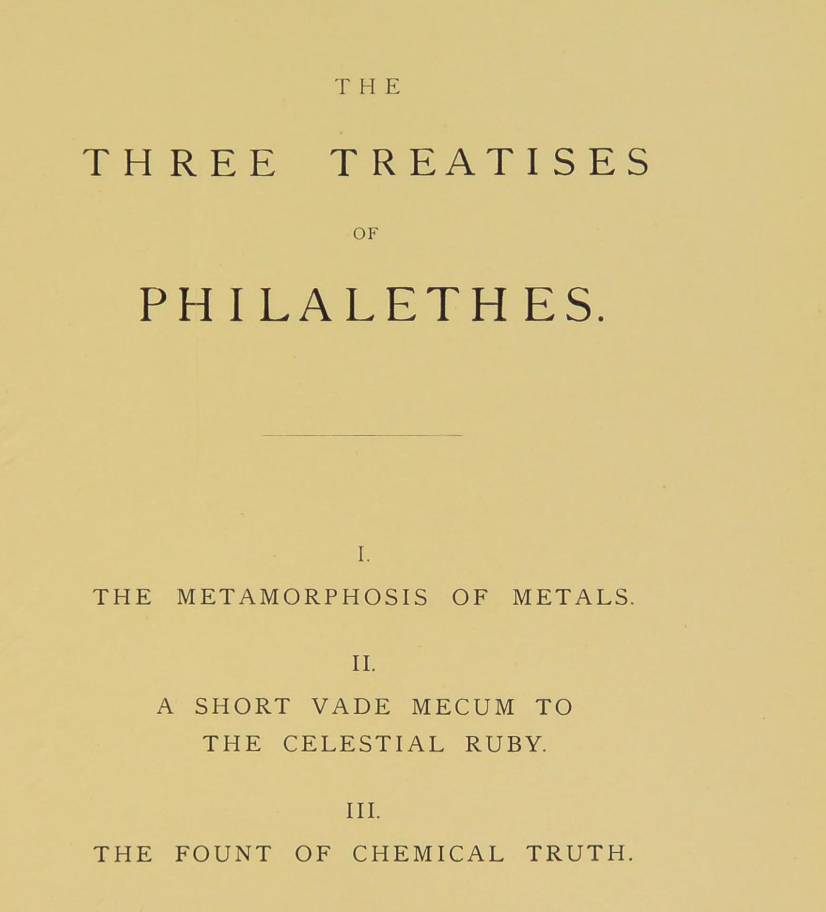

# フィラレテスの三つの論文

エイレナエウス・フィラレテス／全訳

- 原題：Metamorphosis Metallorum／Brevis Manuductio ad Rubinum Coelestem／Fons Chymicae Veritatis（ラテン語、1668年、アムステルダム。1678年の『ヘルメス博物館』〔Musaeum Hermeticum〕増補版に収められ、A・E・ウェイトが The Three Treatises of Philalethes として1893年の英訳第二巻に収めた）
- 内容：
  - 第一論文『金属の変容』（八章）は、錬金術への非難に答え、学ぶ者の心得を説いたのち、すべての金属がメルクリウスを共通の物質とし、違いは煮熟の度合いにすぎないこと、すべての金属の種は金の種であること、それを引き出すには金と同質の「乾いた水」である賢者たちのメルクリウスが必要であることを論じる。四元素のうち火を元素と認めず、水をすべてのものの第一原理とする独自の自然学も述べる
  - 第二論文『天のルビーへの短い携行の手引き』は、賢者の石を「すべての人のうちに、すべてのもののうちにある」奥義と呼び、石とは何か、なぜ「石」と呼ばれるか、いかに得られるかを述べ、十二の過程の第一である焼成と、黒い粉、二匹の蛇（レビス）、四十日の黒の段階と色の順序とを詳しく説く
  - 第三論文『化学の真理の泉』は、作業の物質（赤い鉱石と白い鉱石）、二つの火、十の作業をまとめ、汚い衣をまとった清い乙女としての「我々の水」、南西の高い山を草サトゥルニアで掘って得る霊、金の種と「生きた金」について語る
- 作業の基にした本文と扉：Internet Archive 所蔵の1893年英訳第二巻のスキャン（OCR を画像と照合した）
- 著作権：原典は1668年、ウェイトは1942年に死去。日本・米国・英国で保護期間が満了している
- 訳者：人工知能（Claude Opus 5.5）
- 訳の性格：全文を訳した。訳者の調べたかぎりでは、日本語訳は出ていない

## この本について

　「エイレナエウス・フィラレテス（真理を愛する平和の人）」は、十七世紀にもっとも広く読まれた錬金術書の著者の筆名である。その正体は、今日では、アメリカ植民地出身の化学者ジョージ・スターキー（一六二八〜一六六五年）とされることが多い。スターキーはロンドンでロバート・ボイルと交わり、のちにアイザック・ニュートンもフィラレテスの書物を熱心に書き写して研究した。

　本サイトではすでに、同じ『ヘルメス博物館』第二巻に収められた『王の閉ざされた宮殿への開かれた入口』を訳した。この三論文はそれと対をなすもので、フィラレテス独特の用語――「乾いた水」「我々のメルクリウス」「赤い僕」「ラトン（真鍮）の白化」「生きた金」「サトゥルニアの草」――がたびたび現れる。とりわけ、汚い衣をまとった清い乙女として「我々の水」を語る箇所は、本サイトで訳したマダタヌス『黄金時代の復活』の、汚れた衣の乙女のたとえとよく響き合っている。

　英訳には「働き手♀」（ウェヌスの記号）のように OCR では読めない記号があり、ページ画像で確かめて補った。

---

## 第一論文　金属の変容

### 第一章　我々の術の主張、その学徒、その方法について

　何かの術や何かの職業に生涯をささげる人はみな、自分の追う事柄における完全さを、その努力の目標として目の前に置いている。しかし望みの目標に達する者はわずかである。建築家は多いが、建築術の師は少ない。医学を学ぶ者は多いが、ヒッポクラテスやガレノスのような人は少ない。数学者は多いが、アルキメデスのような達人は少ない。詩人は多いが、ホメロスと肩を並べるにふさわしい者は少ない。けれども、自分の職業について立派な知識しか持たない人々でさえ、社会の役に立つことができる。

　しかし金属の変成に身をささげる人々のあいだでは、中くらいの達成というものはありえない。この術を学ぶ者は、すべてを持つか、何も持たないかのどちらかでなければならない。自分の技の半分しか知らない錬金術師は、失望と時間と金との浪費とのほかに何も刈り取らない。そのうえ、我々の術を軽んじる者たちのあざけりに身をさらす。じっさい、マギステリウムの目標に達することに成功する者は、限りない富ばかりでなく、命と健康とを保ちつづける手段をも持つ。それゆえ、これは人間のあらゆる営みのうちでもっとも人気がある。「処方」を二、三読んだ者はだれでも賢者の称号を名のり、もっとも途方もない希望を抱く。そして、まことに賢い人の外見をつくろうために、そういう人々はただちに炉を築き、実験室を蒸留釜と蒸留器とで満たし、驚くほど深遠な様子で作業に取りかかる。彼らは曖昧な隠語を用い、金属の第一の物質について語り、元素の回転や、ガブリティウスとベヤとの結婚について、学識ありげに論じる。しかしそのあいだ、彼らは金属のどんな変容をもたらすことにも成功しない。彼らの金と銀とが銅と青銅とに変わるほかには。

　我々の術のあら探しをする軽蔑者たちはこれを見て、こうしたたえまない失敗から、我々の術は作り話とまやかしとの組み合わせだという結論を引き出す。いっぽう、自分の愚かさで身を滅ぼした人々は、金を失うことで何か技を身につけたと装い、他人の信じやすさを食いものにすることで、この疑いを裏づける。このようにして、初心者の道はあらゆる種類の困難と有害な迷妄とに取り巻かれている。そして、あれほど驚くべき深遠さと学識との風を装うこれらの詐欺師たちの過ちによって、我々の術そのものがまったく評判を落としてしまった。もちろん彼らはそれについて何も知らないのだが。初心者にとって、錬金術のこの広大な迷宮の中で偽りと真とを見分けるのはきわめて難しい。トレヴィザンのベルナールは、これほど多くのむなしい空約束をする人々を疫病のように避けよと彼に警告している。そして私は、盲人の導きと、迷う者の教えとのために、この論文を書いた。私は、まず我々の術に投げかけられた中傷からそれを清め、次にその学徒の資格とその進め方とを述べたい。こうした前置きの説明ののち、術そのものの記述に取りかかろう。

　何よりもまず、ある哀れな詭弁家たちの欺きをこの学問のせいにするあの推論の仕方に、私はもっとも強く抗議しておきたい。その偽りの教師たちの何人かの邪悪さは、その真偽について賛成も反対も何も証明することはできない。そういう立場は、自然の関係に基づく論によってのみ立証されうるであろうが、そのような論を見いだすことは不可能である。自然の光は、こうした曇らせ屋たちに暗くされるにはあまりに明るい。私の書物が、不完全な状態から完全な状態への金属の変成が、自然と術との協働によって、本当のまことの達成であることを示すよう望んでいる。

　ある金属を別の金属から区別するただ一つのものは、その成熟の度合いであり、それはもちろんもっとも貴い金属において最大である。金と鉛との違いは実体の違いではなく、煮熟の違いである。卑しい金属においては、煮熟がその金属の不純物を浄め出すほどではなかったのである。もし何かの手段によって、この余分な不純な物質を卑しい金属から有機的に取り除くことができれば、それらは金と銀とになるであろう。それゆえ鉱夫たちは、大地のはらわたの中で鉛が銀に育った例が多くあると告げる。そして我々は、我々の術によって同じ効果がはるかに短い時間で生み出されると主張する。大地のはらわたの中で生み出されるメルクリウスが、すべての金属の共通の実体であることは事実である。このメルクリウスはあらゆる種類の金属と結合するからであり、それがそれらすべてと生まれつき類縁でなければ、そうはならないであろう。メルクリウスは、同じ本性のもの以外とは何とも混じらない水である。自然の侍女である術によって、メルクリウスはすべての金属と次々に煮熟させることができ、一つの同じものが、同じ色と流動性とのもとで、それらすべての真の気質と性質とを順に示し表すようにできる。そのうえ、すべての金属は流れるメルクリウスに溶かすことができる。もしそれがそれらの共通の実体でなければ、そうはなりえないはずである。また、鉛のメルクリウスは鉄のメルクリウスになりうるし、鉄のメルクリウスは銅のメルクリウスに、錫のメルクリウスは銀と金とのそれにさえ変成されうる。この事実は、すべての金属の実体の類縁を勝ち誇って証明している。アンチモンからも良いメルクリウスが得られ、我々の術師のある者はそれを金属のメルクリウスに変えることができる。また、どんな金属あるいは鉱物の体から得られたメルクリウスも、普通のメルクリウスを自分の本性に同化させる性質を持つことも、よく確かめられた事実である。こうして普通のメルクリウスは、順にすべての金属のそれになりうる。これらの論は、ただ一つのメルクリウスがあり、さまざまな金属の中でそれはただその煮熟あるいは純粋さの異なる度合いに従って分化しているにすぎないことを、はっきり示しているではないか。

　これらの論にどう答えられるのか、私にはわからない。たしかに、だれか鈍い人が、それが基づいている化学の変化を自分が行えないことを、我々の推論への反駁として持ち出すかもしれない。しかし、そういう作業者が自分の無知を我々の術の真実に対する論として持ち出せると主張するなら、それは自分の無知にあまりに大きな名誉を求めることになろう。彼らは自分の小さな理解を、自然の可能性の基準や尺度にしてはならない。いずれにせよ、私の言葉は彼らの言葉と同じだけの値打ちがある（いや、それ以上である。彼らはけっして否定を証明できないのだから）。そして私は、私が述べた実験の一つ一つを自分の手で行ったこと、そしてその経験がこうしたことを真実と示した人々をほかにも多く知っていることを、もっとも確かに、またおごそかに断言する。我々の反対者たちは、ただの否定によって、どうして目撃者に勝てると望めようか。私の証言は、アルベルトゥス、ライムンドゥス、リプリー、フラメル、モリエヌス、そのほか大勢の人々の経験によって裏づけられている。

　私が語った変化が、なしとげるのにたやすくないことは認める。しかし我々の術の鍵を持つ者は、すべての門を開くことができ、自然のあらゆる秘密を思いのままにする。しかしこの鍵は、自然の過程について理論の知識と実践の知識との両方を持つ者だけが持っている。私はここで金属のさまざまな変化を数え上げることもできよう。たとえば、緑礬の酸い滴りによってマルス〔鉄〕をウェヌス〔銅〕に、メルクリウスをサトゥルヌス〔鉛〕に、サトゥルヌスをユピテル〔錫〕に、ユピテルをルナ〔銀〕に変えることである。こうした作業は、じっさい、（術の頂点からははるかに遠い）多くの俗な化学者が行い方を知っている。また私は、わずかな哲学者にしか知られていないことを付け加えることもできよう。金属と鉱物とのあいだに中間の秘密の物質があり、その混じり合った天の力が名のないある金属を生み出す。それは厳密に言えばまったく金属ではなく、渾沌あるいは霊である。すっかり揮発性だからである。これから、変成のエリクシルなしに、すべての金属が、金も銀も水銀さえも引き出されうる。それは『新しい光』の著者〔センディウォギウス〕によってカリュブス〔鋼〕と呼ばれ、我々の術のまことの鍵であり第一原理である。賢者たちがこうしたことをみな隠し、知識のまことの子らのためにたとえで述べたとしても、それがどうしたというのか。そのために、これらのことが少しでも真実でなくなるだろうか。……

　不完全な物質の完全な発達に必要なのは、同質の働き手のおだやかな煮熟の作用だけである。この働き手は金であり、自然の煮熟と人工の煮熟とがなしうるかぎり高度に熟したものであって、その名の普通の金属よりも千倍も完全である。このように高められた金は、根本から金属に浸透し、染め、固定する。この学問の事実を、次のようにたとえることができる。六ポンドの銀を取り、それにただ一オンスの金でめっきするなら、そののちその銀を最高の細さの糸に引き延ばしても、なお一本一本の糸に金の輝きをはっきり認めることができる。それなら、もしこの死んだ、物体的な、土っぽい金属（それは体として、もちろん別の体に入る力を持たない）がこれほど驚くべき効果を生みうるなら、ほかの金属の体に入り、それを生かしうるこの金の霊が、それらをそれ自身の本性に変えるということが信じがたく思われようか。もし我々がこの霊のチンキを持っていたなら、金の体が外に行うのが見られることを、それが内に行うであろうことは明らかではないか。我々のチンキは金の第五精髄であり、金のただの体がなりうるよりも限りなく完全であり、それゆえその本質的な性質を広める力も限りなく大きいことを思い起こせ。もし金がこのように霊的に別の金属に入るなら、明らかにそれをそれ自身の本性に同化させるであろう。この霊的な取りこみの方法は、のちに述べよう。

　金属の変成の「理」を論じているこの箇所では、ただこれだけを付け加えておこう。種は、種を持つどんな物質にとってもその完全さであり、種を持たないものはまったく不完全である。それなら、詩人の歌うとおりである。「金は、深く隠れていようとも、金の種を含む」。金はただ完全であるばかりでなく、その種類の（すなわち金属の）もっとも完全なものである。もし金が種を持つなら、それは水の中に含まれているにちがいない。水はあらゆる霊の住まいであり、種は種を保つある霊的な手段だからである。もし金をその種を引き出すために溶かすなら、その溶解はまさにこの同じ金属の水によって行われねばならないであろう。この溶解が起こると、金はその土の形を脱ぎ、水の形をとる。さて、金はこの生成の過程全体の出発点でも目標でもあるのだから、中間の作業はみな同質の性格のもの、すなわち金のこの種のしだいの変化から成るものでなければならないことは明らかである。我々の術の過程は金の溶解から始まり、金の本質的な性質の回復で終わらねばならない。しかし否定がけっして肯定になりえないように、我々の金の最後の形は、その最初の形とは本質的に異ならねばならない。最後の形は、火が土よりも精妙で霊的であるのと同じだけ、最初の形よりも高貴である。私が書いたことは、我々の術の忠実な学徒には十分である。そして敵意あるあら探しの批評家たちに、この書は向けられていない。

　それゆえ今度は、この高貴な学問を学ぶべき人々の資格について、一言二言付け加えよう。我々の術は、先に言ったように、その多くの教師の愚かさと不誠実さとによって評判を落とした。彼らは、正直な商売をするだけの腕も頭もないので、我々の術に手を出さずにはいられず、もちろんまもなく持てるものをすべて失う無知な職人たちである。また別の人々は、これらの人々よりほんの少し無知でないだけである。彼らは自然学の初歩さえ身につけないうちに、金を作ろうとあまりに急ぐ。もちろん彼らは失敗し、持てるものをすべて使い、友人から金を借り、限りない富の希望で自分と他人とを楽しませ、野蛮な半可通の哲学の隠語を話すことを覚え、我々の術をそしることに利益を持つ人々に絶好の口実を与える。また別の人々は、本当に秘密のまことの知識を持っているが、自分の道を照らした光を他人に与えることを惜しむ。それゆえ彼らはそれについて、困惑した初心者にはとうてい理解できない、望みのないほど人を迷わせる言葉で書く。この類に属するのがゲベル、アルノー、ルルスであり、彼らはもしペンをインクに浸さなかったなら、学徒にはるかによい奉仕をしたであろう。その結果、この学びを手がける者はみな、たちまち偽りと不確かさとのまことに人を迷わせる迷宮の中で途方に暮れ、そこには何の手がかりの糸もない。それゆえ私は、その目的をなしとげる最善の道について、彼にいくらか確かな忠告を与えようと努めよう。

　第一に、嘲笑やあざけりを好む人がだれも知ることのないよう、作業はごく秘密に行え。愚かな部外者のあざけりや皮肉や善意の忠告ほど、初心者をくじけさせるものはないからである。そのうえ、もし成功しなければ、秘密は彼を嘲笑から救うであろう。もし成功すれば、それは貪欲で残酷な暴君の迫害から彼を守るであろう。第二に、この術の学びで成功しようとする者は、辛抱強く、勤勉で、学識があり、温和で、気だてがよく、熱心に学ぶ者であり、たやすくくじけず、怠惰でない者であるべきである。彼は一人の友と協力して働いてもよいが、それ以上はいけない。そして自分の考えを胸に秘めておくことができねばならない。また、必要な道具などを手に入れ、この学びを続けるあいだの衣食をまかなうために、少しの元手を持っていることも必要である。そうすれば、その心が心配と不安とに乱されることがない。何よりも、彼は正直で、神を畏れ、祈り深く、聖くあれ。このように身を整えたなら、彼は自然を学び、詐欺師でもねたみ深いけちでもないまことの賢者たちの書物を読み、昼も夜もそれを学ぶべきである。あらゆる考えを、それを徹底して試し、すべての賢者の教えばかりでなく自然そのものとも調和していることを見いだす前に、実地に移そうとあまりに急いではならない。そうしてはじめて、作業の実践の部分に向けて身支度をせよ。そして賢者たちの述べる徴を見るまで、たえず作業を改めよ。また多くの誤った歩みを踏んでも絶望してはならない。もっとも偉大な哲学者たちは、その誤りによってもっとも多くを学んだのだから。こうした作業の導きのために必要な光はみな、以下の論文の中に見いだされるであろう。

### 第二章　この術の起源とその著者たち、その根本の金属原理、金属と鉱物とのしだいの生成について

　トリスメギストスとあだ名されるヘルメスは、一般にこの術の父と見なされている。しかし彼がだれであったかについてはさまざまな意見がある。ある人々は彼がモーセであったと言う。だれもが一致して、彼はまことに目の利く哲学者であり、この主題について現存する最初の著者であり、またエジプトの生まれであったとする。ほかの人々は、エノクがこの術を発明し、洪水が来る前に、いわゆるエメラルドの板にそれを記し、それがのちにヘルメスによってヘブロンの谷で見いだされたと言う。多くの人々は、それがアダムに知られていて、アダムがそれをセツに明かし、ノアがその秘密を箱舟に持ちこみ、神がそれをソロモンに明かしたと主張する。しかし私は、我々の術に神秘的な起源を主張し、そうしてただそれを嘲笑的な世の目に笑いものにするだけの人々には賛成しない。もしそれが自然の永遠の真理に基づいているなら、あれこれの洪水以前の人物がその知識を持っていたかどうかという問題に、なぜ頭を悩ませる必要があろう。それが今、真実で可能であること、それが何世紀ものあいだ、もっとも遠い緯度のもとで、秘儀を授けられた者たちによって行われてきたことを知れば、私には十分である。またこう言ってもよかろう。彼らの大部分は曖昧な、比喩的な、寓意的な、まったく人を迷わせる文体で書き、そのある者は無知な者を惑わすために偽りを真実に混ぜさえしたけれども、それでも彼らは、多くの時代にわたって存在し、言葉も国も異なりながら、一つの作業を異なった仕方で扱わず、みなその教えの主な特徴にかんして、まことに驚くべき著しい一致を示している。その一致は、我々の術が人を迷わせる言葉のただの迷宮以上のものだと仮定しないかぎり、まったく説明がつかない。

　我々の術をもっとも平明に率直に説き明かしているのは、トレヴィザンのベルナール、イングランド人リプリー、フランス人フラメル、『新しい光』の著者センディウォギウス、『ヘルメスの秘法』の匿名の著者（彼は『自然学再興の手引き』も書いた）、『哲学者の梯子』、大『薔薇園』、『子どもの遊び』、ディオニシウス・ザカリーの論文、モリエヌスの著作、エギディウス・デ・ヴァディスの著作、アウグレッルスの『金作り』と題する詩、フェッラーラのペトルス・ボヌスの著作、そして『薔薇園抄』である。学徒はこれらやそれに類するまことの錬金術の著作を一つ以上手に入れ、それらが投げかける光によって自然の秘密を学ぶがよい。彼は、自然学、とりわけ鉱物学の知識が、その目的に欠かせないことを見いだすであろう。

　すべての哲学者は、四つの元素があってすべてのものを組み立て、そのさまざまな組み合わせによってさまざまな形を生み出すと我々に告げる。しかし真実は、元素は三つしかない、すなわちその本性によって冷たいもの――空気、水、土――だけだということである。我々がそれらのうちに認める熱の欠如は、太陽からの距離に比例している。火を私は元素とは認めない。炉で燃える普通の火のほかに火はなく、その熱は本質的に破壊的である。ものの中にある熱は、光か、運動か、命か、変化の過程かの産物である。火は元素ではなく、四つの元素の産物を食いものにする盗賊である。それは二つの能動の原理の衝突によって引き起こされる、激しい腐敗の運動である。こうして我々は、それがそれ自体実体ではなく、ほかの二つの実体の作用であり、燃やすものと燃えるものとの能動の協働の結果であることを知る。三つの元素の本性と特徴的な性質とは冷たさであり、それらはただ偶有としてのみ熱を持つ。

　また、ものがこの三つの元素の混合によって形づくられるというのも真実ではない。似ていないものはけっして本当に結びつくことができないからである。結合とは、二つの物質のもっとも小さな原子あるいは分子の完全な混合と凝結だからである。しかしそのような混合は、二つの似ていない物質、たとえば水と土（あるいは水とぶどう酒）とのあいだでは不可能である。それらはそのもっとも小さな粒子の不釣り合いのために、いつでも分けることができる。結合のために、より粗い元素がもう一方と同じほど精妙になるのだ、と言われるかもしれない。しかしもしそうなら、もし結合のために水が空気と同じほど精妙になるなら、それはただ水が空気になるということにすぎず、その仮定は、水と空気とのアマルガムの可能性を証明しそこなうことになろう。どんなものの組成にも、場合に応じて水か空気かだけが入るのだと考えるほうが、もっと単純で信じやすい仮定ではないか。しかしもしだれかがなおこの元素の入れ替わり（それは結局すべてのものが空気から成るということを意味するにすぎないが）を言いはるなら、つつましくお尋ねしたい。いったい何の働き手の活動によって、それらはそのように変成されるのか。そのうえ、土が水に、水が空気に入れ替わることが何の役に立つのかも尋ねたい。水に変えられた土、あるいは空気に変えられた水が、変わらない単純な水や空気でも同じようになしとげられないような何をなしうるのか。まことに、自然は何ものもむだには行わない。ところがここでは、何の有用な目的にも役立つように思われない、困難でむだの多い変成の過程がたえず続いていることになろう。もし、水に希薄化された土は水に似ているが正確には水でない、と言われるなら、私の答えはこうである。それはただの言葉の屁理屈であり、もし希薄化された土が水に似ているだけで本当は水でないなら、そのもっとも小さな粒子においてそれと結合することはとうていできない。それゆえこの仮説によっては何も得られない。

　それゆえ我々は、すべてのものがその起源を一つの元素から得ており、それは土でも空気でもありえない、と結論してよい。紙幅が限られていなければ、これを長々と証明することもできよう。それなら、水がすべてのものの、すなわちこの世のすべての具体的な体の第一原理でなければならないことになる。土は、そのなかですべての体が育ち保たれる根本の元素である。空気は、それらがそのなかへと育ち、それを通して天の力がそれらに伝えられるなかだちである。すべてのものの種は、神によって水の中に置かれた。この種を、ある者は植物のようにあらわに示し、ある者は動物のように腎に保ち、ある者は金属のようにその本質的な存在の深みに隠す。種はその形（すなわちある適切な天の影響）によって働きへと呼び起こされ、物質の水を凝固させ、一連の発酵の過程（発酵はあらゆる変成の原理である）を経て、ついにそれがとくに生み出すにふさわしいものを生み出す。もし種が金属のものなら、それからまず手を濡らさない乾いた液体、すなわちすべての金属の母であるメルクリウスが生み出される。メルクリウスは金属のまことの第一の物質と言ってよい。元素の水がメルクリウスになってはじめて、それから金属あるいは鉱物が生じるにちがいないと、何らかの確かさをもって断言できるからである。水はそれ自体としては、潜在的に動物か植物か鉱物かの種である。しかしメルクリウスは金属に分化した水、すなわち鉱物の物質のほかには何も生み出せない発達の段階に移った水である。

　それならメルクリウスは、金、銀、銅、錫、鉄、鉛などの共通の種であり、それらの違いはただその煮熟の度合いにのみ求められるべきである。煮熟させるものは、外からそれらに及ぼされる何かの脂っこい硫黄ではない。メルクリウスはそれ自身のうちに、その発達の能動の原理、すなわち天の影響による内なる熱を含んでいる。それは生命力を引き起こし、子宮のふさわしさにかかっている。これらの天の影響は世界中で働いているが、その正確な作用の仕方は、種の潜在的な本性によって定められる。もし内なる命が金属的であれば、外の働き手によるその発達の進路もまた金属的であろう。それでもメルクリウスは、これらの外の影響（天のものと地のものと）が及びうるところでのみ発達する。ほかのどこでも、それは冷たく、死んだ、命のない物質に見えるであろう。しかしその生まれの中心では、空気のなかだちによって伝えられる天の影響の作用によって生かされ、そこから熱が生じ、それには必然的に命が伴う。さて、このメルクリウスが置かれる子宮は、それにより多く、あるいはより少なく、あるいはまったくふさわしくないかのどれかである。そしてこのふさわしさの異なる度合いに従って、物質はまったく止まったままでいるか、多かれ少なかれ完全に発達させられる。発達の不完全さは不完全な金属を生み、完全な発達によって銀と金とが生み出される。しかしすべての金属は、その煮熟あるいは成熟の度合いによって分化してはいても、同じ第一の物質、すなわちメルクリウスを持つ。卑しい金属の中にあれほど多く見いだされるかすと不純物とは、もとのメルクリウスの一部ではなく、凝固の過程の何かの欠陥によって、あるいはその金属の生成（発酵）が起こる場所すなわち子宮の不純さによって、あとから加えられたものである。しかし今度は、この論文の特定の主題、すなわち金と銀との更新あるいは増殖を扱うことに進もう。

### 第三章　メルクリウスの物質からの金と銀との生成、および不完全な金属を同じ完全さの状態に導くことの可能性について

　前述の源（メルクリウス）に、我々は金と、その妹である銀との誕生をたどる。それらは煮熟によって完成へと導かれたこの物質を表している。完全さには二つの種類がある。始まりの完全さ〔原文 inchaotive〕と完全な完全さ、部分的なものと全体的なものとである。完全な完全さ（あらゆる生のものの完全な煮熟と、あらゆる不純物の除去）は自然の究極の目的であり、自然はそれを、その輝きで全地を照らす我々の金においてなしとげた。始まりの完全さは、絶対的にではなく、本質的に不完全な体と比べて相対的に、そう名づけてよい。純粋なものよりも不純なものがその組成において支配し、それゆえ自分では（自然の発達によって）けっして完全さに達することのできない体は、形相的あるいは本質的に不完全である。金と銀とを除くすべての金属がそうである。しかし純粋なものが不純なものの腐敗させる暴政から解き放たれ、それに対して支配を得るときにはいつでも、体の発達がなお不完全であっても、我々は始まりの完全さを持つ。これらの生のものと不純物とは、もともと金属の物質に属するものではなく、それから分けることがまったく可能である。もしそれらが凝固の前にそのように浄め出されれば、我々は完全な金属を得る。しかしたとえそれらがメルクリウスとともに凝固させられても、なおそれらをメルクリウスから分け、こうしてメルクリウスを完成させることは可能である。我々の術はこの可能性に基づいており、その仕事はこの分離を行うことである。

　卑しい金属は金と同じメルクリウスを含んでいる。もし我々がこのメルクリウスを、その発達を妨げる不純物から解き放つことができれば、それもまた完全さへと進み、すなわち金にならねばならない。もし不純な鉱物のためにこの務めを果たす何かの分離の働き手を見つけられれば、それはまた煮熟させるもの、すなわち長く埋もれていたメルクリウスの内なる金属の煮熟を速めるものともなるであろう。そのような分離剤が我々の神的な奥義であり、それは火のような浸透力を持つ水の天の霊である。普通の金と比べれば、それは体に対する魂のようなものである。そして体の固定の最高の度合いに達しているので、卑しい金属のメルクリウスを自分の本性に取りこみ、不純物が焼き尽くされるあいだ、それを火から守る。卑しい金属のメルクリウスは（金のメルクリウスとは違って）、もしそのような保護なしに火にさらされれば、きびしい試練に立ち向かうことができず、（その不純な体と何の結合も持たず、それ自身のうちに何の固定も持たないので）ただ蒸発し、不純物を焼かれるままに残すであろう。しかし我々の奥義は、霊的でありかつ同質の物質であるので、不完全な金属と完全な原子の結合に入り、それに似たものを自分の本性に取りこみ、このメルクリウスに自分の固定を与え、それを火から守ることができる。それゆえ、火がすべての不純物を焼き尽くしたとき、残るものは、もちろん、薬の質に応じて純粋な金か銀かである。それはそのときから（ほかのすべての金と銀と同じく）もっともきびしい試練に耐えることができる。それゆえおわかりのように、我々は、ときに言われるように金と銀とを創り出すと称するのではなく、ただ、その同質性と霊性とのゆえに、卑しい金属のメルクリウスと親密な（原子の）熟させる結合に入ることのできる働き手を見いだすと称するだけである。そして我々は、我々のエリクシルが、その固定と色との強い度合いによって、それらを持たないどんな同質の物質にもそれらの性質を与えるのにふさわしいものであると主張する。

### 第四章　金の種について、またほかの金属に種があるかどうかについて

　種は、この地上のすべての完全なものに与えられた、類としての繁殖の手段である。それはそれぞれの体の完全さであり、種を持たない体はどれも不完全と見なさねばならない。それゆえ、金属の種というものがあることは疑いない。もし金属が種を持つなら、それはたしかに凝固によってそれを失いはしない。凝固は完全さ（あるいはむしろ完全な条件）の効果だからである。さて、種を持つすべてのものにおいて、成熟とは種の完全な発達を意味する。それゆえ金属の種は、凝固（熟させる過程）によってまったく確かに滅ぼされないのは道理である。すべての金属が種を持つかと尋ねられるなら、私の答えはこうである。すべての金属の種は同じであるが、あるものではそれは表面の近くに、あるものではより遠くに見いだされる。すべての金属の種は金の種である。金はすべての金属にかんする自然の意図だからである。もし卑しい金属が金でないなら、それはただ何かの偶然の妨げによるにすぎない。それらはみな潜在的に金である。しかしもちろん、この金の種は、よく熟した金そのものからもっともたやすく得られる。それゆえ、金そのものからもっとたやすく得られるのに、何か骨の折れる過程によってそれを錫や鉛から得ようと努めるのは、骨折り損であろう。私が今語っているのは金属の種のことであって、メルクリウスのことではないことを思い起こせ。鉛は鉛の中でではなく、ただ金の中でのみ殖やされるべきである。鉛は金としてその成熟に達するときにはじめて、その種が実り豊かになりうるからである。銀がそれ自身の種を持つことは認めてよい。（赤いものと同様に）白い増殖のチンキがあるからである。それでも、白いチンキはじつは赤いチンキの中に含まれており、銀の種は金のそれの変形にほかならない。銀の白さは完全さの第一の度合いであり、金の黄色さは第二の、すなわち最高の度合いである。我々の石の母（賢者たちの銀）は白く、我々の金にその白さを与えるからである。それゆえこの二人の親の子は、まず母のように白くなり、それから父の王の血で赤くなる。

### 第五章　金の種の力について、またそれがもっともたやすく見いだされる場所について

　不完全な金属を完成させるこの手段を得るために、我々の奥義が、自然と術との協働の作用が発達させうる最高の完全さの度合いにまで高められた金であることを思い起こさねばならない。金において自然はその努力の終点に達した。しかし金の種はさらに完全な何かであり、それを育てるにあたって我々は術の助けを呼ばねばならない。金属の種は動物の種よりもさらに完全に目から隠されている。それでも、それを抽き出すことは我々の術の範囲内にある。動物と植物との種は何か別個のもので、切り出したり、ほかの仕方で別に示したりすることができる。しかし金属の種は金属全体に広がり、そのすべてのもっとも小さな部分に含まれている。またそれはその体から見分けることもできない。それゆえその抽出は、もっとも経験を積んだ哲学者の才知をも試すにふさわしい仕事である。金属全体の力が強められて、我々の種の精子に変えられねばならない。「それは循環によって上なるものと下なるものとの力を受け、次にすっかり形相すなわち天の力となり、それを物質の同質性によってそれと類縁のほかのものに伝えることができる」。石にかんして言えば、金の全体がその物質である。種の宿る場所は――おおよそ言えば――水である。正確に言えば、種は金属のもっとも小さな部分であって目に見えないからである。しかしこの目に見えない存在はその種類の水全体に広がってその中で力を及ぼしており、目には水のほかに何も見えないので、我々はこの内なる働き手（正確に言えばこれが種である）がそこに本当にあると、理にかなった帰納から結論するほかない。それゆえ我々は水の全体を種と呼ぶ。命の胚が穀粒のもっとも小さな粒子にすぎなくても、穀粒の全体を種と呼ぶのと同じである。しかし種の命は金属の残りの物質と別個のものではない。むしろそれは体のもっとも小さな部分と分かちがたく混じり合っている。けれども大まかに言えば、我々は我々の金の水の全体を金の種と述べる。この種の力がまことに精妙な仕方でそれに行き渡っているからである。

　この種の力を古の賢者たちは、隠れた酵母、毒、あるいは目に見えない火と呼んだ。また彼らは、それは火であるとも、火が水の中に宿っているとも言った。彼らは魂と霊とを区別し、前者をなかだち、後者を能動の力とした。もしだれかが、我々が水を種すなわち種の霊の座と述べることを不思議に思うなら、はじめに神の霊が水の面を動いた、すなわちその天の生かす力で水に浸透したことを思い起こすがよい。こうして創造の最初の日から、水はあらゆるものの源であり元素であった。水だけがあらゆるものの種を含んでいるからである。けれども植物においては種は生の空気の中に出され、動物においては腎に保たれ、鉱物においては物質全体に広がっている。それでも種はけっしてそのもとの座（すなわち水）を離れることができない。ものはそれがその起源を得るものによって保たれる。その起源の原因が取り除かれれば、結果であるものもまた存在をやめねばならないからである。それゆえすべてのものの増殖と栄養とは、水の中に、水によってある。植物は大地の水の液によって生み出され養われ、動物は液状の乳糜によって、金属はメルクリウスの液によって養われる。動物はその種を腎に保ち、しかるべき時にそれをふさわしい子宮に放つ。そこでそれはまず柔らかくきわめて水っぽい胎児に形づくられる。この胎児は女の液状の経血によって養われ、こうして生まれる時が来るまで育つ。それから、もっと強い食べ物に耐えられるようになるまで乳で養われる。しかしこの固い食べ物も、胃がそれを液状の乳糜に変えるまでは（たとえば犬の胃の中の骨のように）本当の栄養にはならない。同じように金属は、その完全な種を目に見えないところに保っている。しかしそこでもそれは水の中に保たれている。そこから術師はそれを抽き出し、それ自身のふさわしい子宮に入れ、そこでそれは慈しまれ育ち、ついに（腐敗によって）その栄化に達する。これはまことに難しい作業である。種の隠れている金属はあまりに固く緻密に詰まっていて、暴力には屈せず、ただおだやかで、このうえなく精妙な化学の過程にのみ屈するからである。それゆえあなたに言う。一つの子宮があり、金は（その中に置かれれば）自らすすんでその種を放ち、ついに弱って死ぬ。そしてその死によってもっとも栄えある王へと新たにされ、そのときからその兄弟たちすべてを死の恐れから救い出す力を受けるのである。

### 第六章　この種を抽き出す仕方と手段とについて

　もっとも美しいものがもっとも生み出しにくいということは、全人類の経験である。それゆえ、月下の作業のうちでもっとも栄えあるものがきわめて大きな困難を伴うのは驚くにあたらない。もしこの術を学ぶ者がつらい仕事を恐れるなら、敷居に足をかけたところで立ち止まるがよい。じっさい、光の父がだれかに術の鍵をゆだねたなら、残る仕事はただの子どもの遊びである。その人の目は、刈り入れの時が来るまで、もっとも栄えある徴を見て恍惚とする。これがなければ、誤りと苛立ちとが結果となるであろう。それゆえ賢い人は、作業を始める前に、その徴によってそれを知ることにもっとも心を配るであろう。知識の子らは学ぶがよい。我々の術の大いなる目的は金の隠れた種を現すことであり、それはただ固定したものの十全で完全な揮発化と、それに続くその特定の形相の腐敗とによってのみなしとげられる。金をこのように砕くことは、世界でもっとも深い秘密である。それは金属を腐食させて損なうことによっても、普通の溶解の方法によってもなされず、我々の哲学の溶解、すなわち金属をメルクリウスの水に溶かすことによってなされる。それには先にメルクリウスの焼成（働き手♀〔ウェヌスの記号〕によってなされる）が行われ、それは元素の精妙な回転と転換とによって生み出される。この焼成は、さらに、我々の同質の液体をそれに属する乾いた元素とともに殺すことである。そののち乾いたものは同じ液体によって生き返らされ、溶剤によって物質から抽き出された完全に熟した力が、この焼成と溶解との原因となる。それならここには腐食剤の働く余地はない。あらゆる物質のうちでもっとも固く、強く、火に耐え、固定した金を揮発させねばならないのであり、ただの腐食剤ではそのような完全な本性の変化はなしとげられないであろう。この目的に必要な力強い働き手は、同質で、友好的で、霊的でなければならない。すなわち（金の）体と類縁でありながら、それに打ち勝ち、そのまさに芯まで浸透し、しかもなお金のもっとも小さな部分のそれぞれをまことの金のまま残すほどに強くなければならない。金はたやすくその本性を手放さず、その命のために戦うであろう。しかし我々の働き手はそれに打ち勝ち殺すのに十分強く、それからまたそれを生き返らせ、命のない残りを新しい純粋な体に変える力も持っている。

### 第七章　我々の種が放たれるべき、またそこで熟す、第一の働き手すなわち子宮について

　前述の作業を行うための働き手を見いだすことが残っている。この目的のために、我々は同質の水を必要とする。金の種は隠されていて、水の中でのみ効き目を保ちうること、そしてこの水は体と同質でなければならず、さもなければこの種を守っている厚いおおいのすべてに浸透できないことを、我々は見てきたからである。似たものは似たものを生む。すなわち、何かに生成の作用を及ぼす働き手はみな、それを（できるかぎり）自分の本性に変成させるからである。それなら働き手は、溶かされるべき体と類縁であり、そのうえあらゆるかすや混ぜ物からまったく純粋でなければならない。また、金は固定して固いのに対して、働き手は高度に揮発性で霊的でなければならない。金は厚く粗いが、我々の働き手は精妙であり、金は死んでいるが、我々の働き手は生きていて命を与える。手短に言えば、我々の働き手は、金が持たず、金に与えるべきあらゆる性質を持たねばならない。それゆえ我々は、メルクリウスだけが我々の術のまことの鍵であると結論する。それはまことに賢者たちの述べる乾いた水であり、液体でありながら手を濡らさず、その物質の一性に属さないほかの何ものも濡らさない。

　メルクリウスは我々の門番、我々の香油、我々の蜜、油、尿、五月の露、母、卵、秘密の炉、かまど、まことの火、毒ある竜、テリアカ〔万能解毒剤〕、燃えるぶどう酒、緑の獅子、ヘルメスの鳥、ヘルモゲネスの鵞鳥、命の木を守るケルビムの手の両刃の剣などである。それは我々のまことの秘密の器であり、我々の太陽が昇り沈む賢者たちの園である。それは我々の王の鉱物、我々の勝ち誇る植物のサトゥルニア、そしてヘルメスがそれによって好きな姿をとる魔法の杖である。この水について賢者はこう言う。「錬金術師たちは好きなだけ自慢するがよい。しかしこの水なしには金属の変成は不可能である。自然の中では、それは我々が術で用いるようなものではない。それはもっともありふれたものでありながら、全世界のもっとも貴い宝である」。……

　それゆえ、知識の子よ、私の言葉によく心をとめよ。「それ自体もっとも不純なもの、すなわち娼婦を取り、それをそのあらゆる汚れから根本的に浄め、そこからもっとも純粋なもの、すなわち我々の溶剤、王の冠を抽き出せ」。見よ、私は賢者を高貴にし、誤りから救い、喜びのもっとも美しい牧場へ導くものを、わずかな言葉であなたに告げた。……我々の求める奥義は、我々の術に助けられた自然の働きによってその最高の完全さの度合いにまで高められた金にほかならない。金の体に隠れた精子が我々の術によって引き出されると、それはメルクリウスの形で現れ、そこから第五精髄へと高められる。それははじめ白く、それからたえまない煮熟によって赤くなる。これはみな、我々の同質の働き手、我々のメルクリウスのポンティクム〔海の水〕の仕事である。それは透明さのない純粋な水晶であり、湿らせることのない液体であり、手短に言えば、地上には見いだされず、自然の協働とともに賢者の手によって作られるまことの神的な水である。我々はそれを知り、見、作り、今も持っている。そして我々はそれを我々の術のまことの学徒に知らせたいと望み、ふさわしくない者からのみ隠すことを願う。

### 第八章　賢者たちのメルクリウスの系譜、その起源と誕生、およびそれに先立ち伴う徴について

　我々のメルクリウスは普通のメルクリウスではないと書物で読み、それがさまざまな名で呼ばれることを知っている、ある自慢好きで傲慢な詭弁家たちは、恥ずかしげもなくこの術の知識を持つと名のって出て、この溶剤を透明で澄んだものとして、あるいは金属と混じりうる金属の樹脂として述べることを引き受ける。じっさいにはそれについて何ひとつ知らないのに。草やもっと空想的な物質から我々のメルクリウスを抽き出そうとする人々についても同じことが言える。この連中は、なぜ賢者たちが薬屋で売っているようなメルクリウスを自分たちの物質として用いないのかを知らない。彼らはその事実は知っているが、その原因は知らない。その結果、彼らは、普通のメルクリウスの本性を変えるものなら何でも、それを賢者たちのメルクリウスに変えるだろうと考えるのである。しかしこうした愚かな人々については、すでに我々の意見を述べた。……

　すべての金属は、第二章で証明したように、同じ実体の原理、すなわちメルクリウスを持つ。この命題から、普通のメルクリウスの物質はほかのすべての金属の物質と同質であることになる。そしてもし賢者たちのメルクリウスが同質の金属の水であるなら、それは普通のメルクリウスとはただその純粋さと熱とにおいてのみ異なりうる。普通のメルクリウスの第一の物質は、ほかのすべての金属のそれ、すなわち我々のメルクリウスである。それが大地の鉱脈の中に、その生成に完全にふさわしい場所にとどまり、生の空気から守られているかぎり、それはその内なる運動と熱とを保っている。それがあらゆる金属の発達の原因である。しかしもしそれが何かの偶然によって損なわれたり、その場所がそれにふさわしくなくなったりすると、内なる運動は止まり、胚の命は、雌鶏がしばらく抱いたのちに放り出した卵のそれのように冷えてしまう。これが、普通のメルクリウスを人工の熱によって煮熟させようと試みた人々が、腐った卵を人工的にかえそうと努める者と同じくらいこっけいに失敗してきた理由である。卵と金属との違いは、我々の術がその損傷を償うことができるという点にある。ただし人工の手段によってではない。我々は、生の、煮熟されていない、冷たい、熟していない金属の塊を持っている。それは我々のメルクリウスの形相を欠いており、我々の求めるものになるためには、それ自身の形相をそれと取り替えねばならない。この目的から見ると、その欠陥は二重である。その本性は余分な異物で詰まっており、必要な霊的な力を持っていない。その余分なものは土のらい病と水の水腫とから成る。その欠乏は、それによってこれらの余分なものを浄め出すことのできる、まことの硫黄の熱の欠乏である。水はたしかに子宮であるが、どんな子宮も温かさなしには生命の胚を受けることができない。それゆえあなたの（普通の）メルクリウスに、それが必要とする内なる火を補え。そうすればそれはまもなくあらゆる余分なかすを取り除くであろう。もしこれができれば、あなたは賢者たちの大いなる偉業をなしとげたのである。ユピテルはその帝国を取り戻し、サトゥルヌスの黒い雲は散らされ、きらめく泉が澄んで清らかに湧き出る。この物質は、まことの哲学の溶解によって金を溶かすであろう。それは、金属の本性を滅ぼすだけの腐食剤の愚かな使用とは、およそかけ離れたものである。このメルクリウスは金と銀と（とともに）自然に奥義、すなわち飲める金を生み出す。すべての達人がそれを知り、証言できるとおりである。

　ここで私はこの小論を結ぶ。言い残したことはみな、別の（次の）論文に述べられているからである。

## 第二論文　天のルビーへの短い携行の手引き

**賢者の石とその大いなる奥義とについて**

　賢者の石とは、ある天の、霊的な、浸透する、固定した物質であり、すべての金属を（薬の質に応じて）金あるいは銀の完全さへと導く。しかもそれは自然の方法によってであるが、その効果においては自然を越える。

　それは化学の術が扱う一つの物質から作られ、それには何も加えられず、余分なものが取り除かれるほかは何も取り去られない。

　もし我々の術が卑しい金属を金に変成させることを可能にすると信じるなら、だれもその有用さを疑わないであろう。卑しい金属がそのような変成を受けうることは明らかである。自然はそれらをみな金になるよう定めたが、それらは完全には熟していないのである。それなら、その完全な煮熟を妨げているものが取り除かれれば、それらはみな金になるであろう。生の、冷たく湿ったメルクリウスは、金のと同じくほかの金属の共通の第一の物質だからである。それゆえ、ほかのすべての金属は、我々の神的なマギステリウムの助けによって金へと完成されうる。それは不完全な金属の上に投じられると、それ自身が金の標準の成熟を越えるのと同じだけ、熟させる過程を速める力を持つ。それなら、自然が幾時代もかけてなすよりも多くのことを、ただ投げ入れるだけで一時間のうちになしうる我々の石の霊的な本性は、なんと明らかなことか。もし自然の与える物質を術が手に取り、溶かし、凝固させ、煮熟させるなら、その完全さは一の力から十の力へと増す。同じ過程をくり返すことで、それは百倍、それから千倍などに増す。この驚くべき薬は、卑しい金属のもっとも小さな部分のそれぞれに（一対一千の割合で）浸透し、それ自身の高貴な本性でそれらをすっかり染める。あなたの算術は、そのすべてに打ち勝つ力より先に尽きるであろう。エリクシルの生かす力に浸されたもっとも小さな部分はそれぞれ、こんどはそのすぐ隣の部分を染め、ついに塊全体がその驚くべき影響によってパン種のようにふくらまされ、金の完全さへと導かれる。これは働き手の霊的な本性のゆえに、ごく短い時間でなされる。それはまことの金属の火であり、普通の火が、火に直接触れていないものの部分さえ温めるように、このエリクシルは溶けた金属に一瞬のうちに浸透する。ちょうどパン種あるいは酵母の力が、それが届かない粉の部分にさえ及ぶのと同じである。ときに我々の術は、まるで金を創り出す力を主張しているかのように非難される。しかし我々の先の論文を注意深く読んだ者ならだれでも、術がただ、あらゆる欠陥と余分なものとを取り除くことによって、卑しい金属があの高度に煮熟された金属の物質と共通に持つ金の本性を発達させる力だけを主張していることを知るであろう。

　それなら聞け。私はこの驚異をなす石の大いなる奥義をあなたに知らせよう。それは同時に石ではなく、すべての人のうちにあり、いつでもそれ自身の場所に見いだされうる。私の告げる知識はふさわしくない者のためのものではなく、彼らには理解されないであろう。しかし自然を熱心に学ぶあなたがたには、神がその時に、この栄えある秘密を明かしてくださるであろう。

　私は、金属の変成が空想の夢ではなく、魔術の助けなしにそれをなしとげることがまったく可能な自然の、まじめな可能性であることを示した。そして金属の変成のこの可能性は、すべての金属が金と同じ源からその起源を得ており、ただ我々のマギステリウムが取り除くことのできるある不純物によって同じ成熟の度合いに達することを妨げられてきたにすぎない、という事実に基づいていることを示した。

　それなら、賢者たちが賢者の石と呼んだが、正しい場所で探せば、すべての人のうちに、すべてのもののうちに、一年のあらゆる季節に見いだされるこの大いなる奥義の本性が何であるかを告げよう。

　それは元素から成るものでなければならない。元素はすべてのものの普遍の物質だからである。そしてそれは金と同質の本性のものであるから、火によって滅ぼされえないような組み合わせで、すべての元素の性質を含むものでなければならない。

　それなら、我々の石の物質は貴い金属の中に探さねばならないことになる。必要な元素の組み合わせはほかのどこにも見いだされないからである。金属の領域の外にそれを探すあの愚かな詭弁家たちは、けっして満足な結論に達しないであろう。まことの原理は一つしかなく、我々のマギステリウムには何も異質なものを持ちこんではならないからである。

　獅子がつねに獅子から、人が人から生まれるように、すべてのものはそれが似ているものにその誕生を負っている。燃えうるものは燃えうるものから、滅びないものは滅びないものから出る。また金の性質を与える原理を、金そのもののほかのどこかに見いだせると期待してはならない。じっさい、もし我々がものの精子を創り出せるなら、それを含まない植物や動物からこの金属の原理を生み出すことも望めよう。しかしそれはただ神の特権である。我々は手もとに用意された精子を整え発達させることで満足せねばならない。新しいものを我々は生み出せない。たとえできたとしても、我々の人工の種は自然の備えた種よりよくはないであろう。もし賢者を名のるだれかがすでに創られたものを用いることができないなら、異質な物質から新しいもの――草や動物から金属の種――を創り出せるとは思えない。

　こうしておわかりのように、金属を金に変える者となるべき石は、それが閉じこめられ含まれている貴い金属の中に探されねばならない。

　しかし、なぜそれは石ではないのに石と呼ばれるのか。そしてどうすればそれを見つけられるのか。賢者たちはそれを石であって石でないものと述べる。そして、これほど驚くべきものが魔術によらずに生み出されうるとは想像もできない俗衆は、我々の学問を不敬で、邪悪で、悪魔的だとそしる。ある愚かな人々は、この術を称したり行ったりすることを制定法によって罰しうるものとする法令を求めて騒ぎ立てる。さて、この叫びを上げる無学で無知な人々に腹を立てることはまずできない。しかしそれが高い地位と深い学識とを持つ人々によって取り上げられるとき、何と言ってよいかわからない。こうした人々をも私は粗野な群衆のうちに数える。彼らは我々の術にかかわるあらゆることについて嘆かわしいほど無知でありながら、その威厳を忘れて、臆病な村の野良犬の群れのように、術に対する追い立ての叫びに加わるからである。何も知らないものを裁くのは信心深くも賢くもない。それなのに、キリスト者であり学者であると称するこの人々は、まさにそれをしているのである。

　しかし、それた所へ話を戻そう。我々の奥義を探しているある錬金術師たちは、自分たちの探索の対象が石と述べられるのを聞いたので、何か固い性質のものを作ろうとする。

　それなら知れ、それが石と呼ばれるのは石に似ているからではなく、ただその固定した本性のゆえに、どんな石にも劣らずよく火の作用に耐えるからである。種類においてそれは金であり、もっとも純粋なものよりも純粋である。それは石のように固定していて燃えないが、その外見はごく細かい粉で、手に触れてもわからず、味は甘く、香りは香しく、力においてはもっとも浸透する霊であり、見たところ乾いていながら油のようで、金属の板をたやすく染めることができる。それがあらゆる奇跡の父と呼ばれるのはもっともである。それはすべての元素を、どれも支配せず、みながある第五の本質を形づくるような仕方で含んでいるからである。それゆえそれは我々のおだやかな金属の火と呼ばれるのがふさわしい。それはそれ自身の名を持たない。けれども全世界に、それがまったくふさわしく帯びえない名のものは何もない。もしその本性が霊的だと言っても、それは真実以上ではないであろう。もし物体的だと述べても、その表現も同じく正しいであろう。それは精妙な、浸透する、栄化された、霊的な金だからである。それは理性ある魂に次いで創られたもののうちでもっとも高貴なものであり、動物の体にも金属の体にもあるあらゆる欠陥を、それらをもっとも正確で完全な気質へと回復させることによって修復する力を持つ。それゆえそれは霊であり第五精髄である。

　しかし私は、私の問いの第二の、より重要な部分に答えることに進まねばならない。この石はどうすれば得られるのか。それは自然の中には存在せず、自然の法則に従って術によって作られねばならない。その物質は金属の中にあるが、形においてはそれらと大いに異なる。そしてこの意味で、金属は我々の石ではない。もし我々が貴い金属から我々の薬を引き出そうとするなら、その種に固有の性質を損なわずに、その特定の金属の形相を滅ぼさねばならないからである。金属の種に固有の性質は、その霊的な部分に宿り、それは同質の水の中にある。こうして我々は金の特定の形相を滅ぼし、それをその類としての同質の水に変えねばならない。その中に金の霊は保たれている。この霊はのちにその水の固さを回復し、（必要な腐敗ののち）新しい形相を産み出す。それは、ふたたび生にもどされる〔原文 reincrudated〕ことによって金が失った形相よりも千倍も完全である。

　それなら、金属の体を手を濡らさないその同質の水に還元し、この水から、現存するどんな金属よりもはるかに高貴な新しい金属の種、すなわち我々の天のルビーが生み出されるようにすることが必要である。

　我々の用いる過程全体は、自然が大地のはらわたの中でたどるそれによく似ている。ただはるかに短いだけである。自然は冷たく湿ったメルクリウスから、根気強い煮熟によって金属を生み出す。我々の術は同じ生の、冷たく湿ったメルクリウスを取り、秘密の技によってそれに熟した金を結びつける。この混合は新しい、はるかに力強いメルクリウスを表し、それは煮熟によって普通の金ではなく、はるかに高貴な金、不完全な金属をまことの金に変成させうる金になる。

　こうしておわかりのように、我々の石はただ金だけから作られるとはいえ、それは普通の金ではない。普通の金から我々の金を引き出すためには、前者を、手を濡らさない我々の鉱物の水に溶かさねばならない。この水は赤い僕から抽き出されたメルクリウスであり、術師にそれ以上何の骨折りもかけずに我々の仕事をなしとげることができる。それは、何も加えられず、ある余分なもののほかは何も取り去られない、あの一つのまことの自然の第一の物質である。しかもその余分なものは、それが自らの内在する生命の作用によって、何の助けもなしに投げ捨てるであろう。あなたの辛抱強い努力の主な目的は、このメルクリウスの発見、すなわち我々の赤いラトン〔原文 Laton。真鍮〕の白化でなければならない。残りはみなただの子どもの遊びである。術師は、自然がしだいに彼の物質を熟させるのを見ていればよいだけだからである。

　しかし我々の白化がけっしてたやすい仕事でないことを思い起こせ。このように白くされた金は二度ともとの形相を取り戻すことができない。物体的で固定したものではなく、今や霊的で揮発性のものだからである。それゆえ、あなたの全心をラトンの白化に集中せよ。金を作るほうが、このようにその形相を滅ぼすよりもたやすい。そのように金を溶かす者は、むしろそれを凝固させると言ってよい。その中では体の溶解と霊の凝固とが同時に起こるからである。

　知識の子らよ、これらの徴を考えよ。溶かすものは霊であり、凝固させるものは体である。体は溶解を引き起こすように体に入ることはできない。しかし霊はそれに入り、それを細かくし希薄にすることができる。そしてあなたは水を求めているのだから、それを明るみに出すには水が必要である。あらゆる働き手は、それが作用するものを自分に同化させる傾きを持ち、あらゆる自然の効果は作用者の本性に似せられるからである。それゆえ、土から水を抽き出そうとするなら水が必要である。

　水と言うとき、私は強水や王水やそのほかどんな腐食剤のことも意味しない。それらの水は金属を溶かす代わりに、ただそれを腐食し、損ない、腐らせるだけで、そのもとの形相を滅ぼしはしない。それらは金属の本性のものではないので、その仕事には不十分なのである。そうではない。我々の水はメルクリウスの水であり、それは同質の金属の体を溶かし、それらと解けない結合のうちに混じり合い、それらとともにとどまり、それらとともに煮熟され、それらとともに我々の求めるあの霊的な全体となる。物質を自然に（溶かされたものの種に固有の性質をなお保ちながら）溶かすものはみな、それと質料的にも形相的にも一つになり、それと融け合い、それによって濃くされ、こうしてそれを養うからである。それは一粒の麦の場合に見られるとおりである。麦は湿った土の蒸気によって溶かされると、それによってその蒸気を自分の根本の湿り気として取りこみ、それとともに育って一本の草になる。また我々は、あらゆる自然の溶解が死んでいたものの生かしであり、この生かしは死んだものと同じ本質の何かの生命の働き手によってのみ起こりうることにも気づくであろう。もし（死んだ）麦の粒を生かしたいなら、我々はそれを、麦の粒そのものと同じく大地の産物である土の蒸気によってのみなしうる。このゆえに普通のメルクリウスは金に何の生かす効果も持ちえない。それと同じ本質のものではないからである。沼地にまかれた麦の粒は、命へと生かされるどころか、反対に滅ぼされる。土の水の湿り気が同じ本性のものではないからである。同じように、金は普通のメルクリウスや、それ自身の本質的な湿り気以外の何かと混ぜられると溶かされない。そのような水はあまりに冷たく、生で、不純だからである。それゆえそれらは金とまったく似ていないので、それとアマルガムを作ることも、それとともにはるかに高貴な発達の度合いに達することもできない。我々のメルクリウスは、たしかに金と比べれば冷たく熟していない。しかし普通のメルクリウスと比べれば純粋で、熱く、よく煮熟されている。普通のメルクリウスはただ白さと流動性とにおいてそれに似ているだけである。我々のメルクリウスは、じっさい、純粋な水であり、清く、澄んで、明るく、輝かしく、あらゆる賛嘆に値する。

　もし我々の水についてもっと詳しい記述を望むなら、私は慈愛の動機に促されて告げよう。それは生きていて、流れやすく、澄んで、つややかで、雪のように白く、熱く、湿って、空気のようで、蒸気に満ち、煮熟させる力を持ち、金はその中でぬるま湯の中の氷のように溶ける。そのうえ、その中には火の運行の全体と、その中にありながら支配しない硫黄とが含まれている。この水は我々の門のまことの番人であり、王とその女王との浴であって、二人をたえず温めるが、二人の物質からは取られず、水の白くする物質とは別個のものである。もっとも両者は結び合わされ、同じ流れる形と色とのもとに現れるのだが。それは我々の器、我々の火、我々の炉の住まいであり、その絶えまないおだやかな温かさによって物質全体が煮熟される。もしこの水を知るなら、それが我々のすべての火、すべての重さの割合、すべての運行を含んでいることがわかるであろう。それはトレヴィザンのベルナールの澄んだ透明な泉であり、その中で我々の王は洗い清められ、そのすべての敵に打ち勝つよう強められる。あなたがしなければならないのは、この水を見つけ、その中に浄めた体を入れることだけである。そうすれば二つのものから、自然が我々の石を生み出すであろう。

　この鉱物の水は、それを含むものからしか抽き出すことができない。そしてそれがもっともたやすく得られるものは見つけにくく、その抽出の仕方もまた見つけにくい。それは暴力なしに金を溶かし、金に友好的で、その不純物を洗い流し、白く、温かく、澄んでいる。我々のメルクリウスなしには、錬金術は学問ではありえず、ただむなしい空疎な見せかけにすぎないであろう。もしそれを得られるなら、あなたは作業全体の鍵を持ち、それで知識のもっとも秘密の部屋を開くことができる。その本性は金のそれと同じであるが、その物質は異なる。そしてその調製はひどい悪臭を引き起こす。自然の可能性をよく量れ。我々のマギステリウムに何の異質な元素も持ちこむな。そしてもし私の言葉を理解しそこなっても、私を責めてはならない。

　我々の石は一つのものと四つのメルクリウスの物質とから生み出される。そのうち一つは熟しており、ほかのものは純粋だが生である。そのうち二つは、第三のものによってその鉱石から驚くべき仕方で抽き出される。四つはおだやかな火のなかだちによってアマルガムにされ、そこで日ごとに煮熟にかけられ、ついに（手によるのではなく）自然の結合によってみな一つになる。

　そののち、火を変えて、これらの揮発性の物質は、日ごとに少しずつ強くなる熱によって（すなわち同じ類の固定した燃えない硫黄によって）固定され煮熟されねばならない。合わせたもの全体が同じ本質と固定と色とに達するまで。

　我々のこの過程には十二の度合いあるいは段階がある。それを手短に数え上げ述べよう。第一は焼成である。

　焼成は石の最初の浄化であり、その自然の熱によってその体液を干上がらせることである。その熱は水の外の熱によって生命の作用へと呼び起こされる。それによって合わせたものは黒い粉に変えられるが、それはなお油のようで、その根本の湿り気を保っている。

　この焼成は、物質を粘り気のある、海綿のような、いっそう浸透されやすいものにするために行われる。金はそれ自体高度に固定していて、我々の水の中でさえ溶けにくいが、この焼成によって柔らかく白くなり、我々はその中に二つの本性、固定したものと揮発性のものとを認める。我々はそれを二匹の蛇にたとえる。十分な溶解がなされるためには砕くことが必要であり、そうして焼成がのちに粘り気のある状態を生み、そのとき溶解にふさわしくなる。

　物質がはじめて混ぜられるとき、それらはその反対の性質のゆえに互いに敵対している。硫黄の熱と乾きとが、メルクリウスの冷たさと湿りとに激しく争っているからである。それらは両方の本性にあずかるなかだちの中でのみ和解させられうる。そして熱と冷たさとが和解させられるなかだちは、両者と共存しうる乾きである。こうして冷たさと熱とは土の乾きのうちに平和にともに住むようにされ、乾きと湿りとは水の冷たさのうちにともに住むようにされる。反対の性質のこの和解が、我々の焼成の第二の大いなる目的である。

　その十分な原因は湿り気に対する内なる熱の作用であり、それによってそれに抵抗するものはみなごく細かい粉に変えられる。動かす原因、道具としての原因は自然に反する火であり、それは我々の溶かす水の中に隠れていて、その湿り気と戦い、それを粘り気のある、あるいは油のような粉へと煮熟させる。

　この作業は我々の溶解の前に起こる。体が溶かされるときにはいつでも、こんどは霊が凝結させられるからである。また、女は男に打ち負かされる前に支配せねばならない。女の支配は水の中にある。そしてもし男が、女の冷たさと湿りとの両方の性質が宿る元素の中で女に打ち勝つなら、女がただ一つの性質しか持たないところでは、たやすく女を征服するであろう。

　それなら焼成は作業のはじまりであり、それなしには平和な混合も正しい結合もありえない。最初の白化は物質をその二つの原理、硫黄と水銀とに還元する。前者は固定しており、後者は揮発性である。それらは二匹の蛇にたとえられる。固定した物質は翼のない蛇に、揮発性の物質は翼のある蛇に。一匹の蛇はもう一匹の尾を口にくわえている。それらが誕生と運命との共有によって解けないように結ばれていること、そして我々の術がこのメルクリウス的な硫黄と硫黄的なメルクリウスとの共同の働きによってなしとげられることを示すためである。それゆえ合わせたもの全体は、この段階でレビスと呼ばれる。二つの物質がありながら、本質は一つしかないからである。それらは本当は二つではなく、一つの同じものである。硫黄は熟しよく煮熟されたメルクリウスであり、メルクリウスは生の煮熟されていない硫黄である。我々の術において、我々は大地のはらわたの中で金属を生み出す自然の方法をまねるが、ただ我々の方法はより短く、より精妙であることはすでに述べた。金属の鉱脈の中には生の冷たいメルクリウスしか見いだされず、その中では内なる熱すなわち乾き（すなわち硫黄）はその影響をほとんど感じさせることができない。そこには煮熟させる熱は見いだされないが、幾時代もたつうちに、気づかれない運動がこの金属の原理を変える。何世紀もたつうちに、この気づかれない煮熟させる熱がメルクリウスを、以前はメルクリウスと名づけられていたのに、そのときには固定した硫黄と呼ばれるものに変えるのである。

　しかし我々の術においては、我々は生の冷たいメルクリウスのほかに何かを持っている。すなわちその多様な能動の性質を持つ熟した金である。これらが我々のメルクリウスの受動の性質と結び合わされる。こうして一方が他方を助け完成させ、メルクリウスのただ一つのゆるやかな内なる火の代わりに、我々は二つの火を持つので、作業はより速やかになり、普通の金よりもはるかに高貴な何かが生み出される。

　こうしておわかりのように、我々の術において我々は二つの硫黄と二つのメルクリウス（すなわちメルクリウスの硫黄とメルクリウス、金の硫黄とメルクリウス）を持つ。しかしそれらの違いはただ完全さと成熟との度合いにのみある。さて、金の完全な体は、手を濡らさない我々の神的な水によって、その（二つの）第一原理（すなわちメルクリウスと硫黄）に還元される。この作業はしばらくのあいだ女の働き手に優位を与える。しかしそれは自然ではないので、男の働き手はまもなくふたたび自分を主張し、その熱によって女の働き手の湿り気を干上がらせ、（焼成によって）それをすっかりもっとも精妙で粘り気のある粉に変える。その粉はそれから溶解によって水に変えられ、その中で溶かすものと溶かされるものとの霊が、男と女との原理が混じり合う。しかしひとたび働きへと呼び起こされた内なる熱はなお働きつづけ、精妙なもの（それは表面に浮かぶ）を粗いもの（それは底に沈む）から分け、ついに男が優位を得、分かちがたい結合が起こり、男が女をみごもらせる。女は雲のような蒸気を産み出し、その中で二人は腐り朽ち、そこから両者は栄えある体をもって起き上がる。もはや二つではなく、分かちがたい結合によってただ一つとなって。この新しい誕生はそれから凝固させられ、昇華させられ、養われ、完全さの最高の度合いにまで高められ、そののち発酵によって限りなく殖やされ、投げ入れにも普遍の薬としても用いられうる。

　それなら、この黒く悪臭を放つ灰を軽んじてはならない。それは我々の王の冠を含んでいるからである。あなたの物質は、まず黒くならなければけっして白くならない。それが腐敗と朽ちることとによってこそ、その復活の栄化された体に達するのである。それゆえ、あなたは我々の王の墓を敬わねばならない。さもなければ、彼がその栄光のうちに来るのをけっして見ることはないであろう。

　非常に多くの学徒は、まさに最初で誤りを犯す。この焼成を誤った物質――硼砂、明礬、インク、緑礬、砒素、種、植物、ぶどう酒、酢、尿、毛髪、血、樹脂、松やになど――に行ったり、あるいは誤った方法を選び、扱う金属の体を焼成する代わりに腐食させたりするのである。焼成はただ体の内なる熱によって、友好的な外の温かさに助けられてのみ起こりうる。しかし異質な働き手による焼成は、少しでも効果があるとしても、金属の本性を滅ぼすことしかできない。手を加えずに自然に溶解が続かない金の焼成はみな、また偽りである。

　まことの焼成はメルクリウスによるものであり、それは（しかるべき割合で金に加えられると）金を柔らかくし溶かし、外の熱と結びついたその内なる熱によって金の生まれつきの熱を働きへと呼び起こし、こうして金にその湿り気を干上がらせて、あの細かい、粘り気のある、黒い粉にさせる。そしてこれが作業のまことの鍵である。熟したものを熟していないものの結合によってふたたび生にもどし、生にもどしたものを焼成し、焼成したものを溶かす。そしてこれをみな俗にではなく、哲学的に行うことである。

　焼成の外の徴は次のとおりである。金が水で飽和し、メルクリウスの火が浴の熱を働かせはじめると、あれほど輝いていた水が曇りはじめ、それから目に見えてふくらみ泡立ち、ついに全体が脂っこく粘り気のある粉になる。それでもそれはなおその根本の湿り気を保っている。熱がはじめて働きはじめると、冷たいものと湿ったものとは上へ昇って逃げ場を求め、そこから液状で降りてきて、物質のできるだけ多くを自分に同化させる。こうして粉は粘りのある水に変えられる。我々の術のさまざまな過程のあいだには、一つとしてほかのものなしには生み出されも理解されもしないような連鎖があるからである。ふさわしくない者から我々の意味を隠すために、我々はいくつかの作業について語る。しかしこれらのすべて――黒から白へ、赤へと進む物質の全体の進み――は、哲学的には一つの作業、一つのもの、黒と白と赤とへの一つの連続した配置として理解されねばならない。

　まことの焼成をもたらそうとするなら、次の規則を守らねばならない。

　第一に、我々のメルクリウスを手に入れねばならない。普通のメルクリウスは、最後の審判の日までそれに作業しても、何の効果も生まないであろう。

　第二に、炉の外の火は、強すぎず（物質の中の化学の力の釣り合いが乱されないように）、また弱すぎず（内なる火の作用が外の熱の不足のために衰えないように）なければならない。それはちょうど均等な命の温かさを保つほどのものであるべきである。

　第三に、ラトンには多すぎも少なすぎもしない飲み物を与えねばならない。もし多すぎれば、それを吐き出すことができず、雲のような嵐が起こるであろう。少なすぎれば、焼けて燃えがらになるであろう。硫黄の活動がメルクリウスの余分な湿り気を干上がらせねばならない。それゆえ能動のもの（硫黄）を多すぎる精子でおぼれさせてはならず、また湿り気を多すぎる土で窒息させてもならない。割合は、金一に対して水二から三部分のあいだであるべきである。しかし両方の物質の量が多ければ多いほど、焼成と溶解とはいっそう完全になるであろう。気をつけねばならない主な誤りは、あなたの土を水でおぼれさせることである。土は我々の術の主な煮熟させるものである火を含んでいるからである。

　第四に、霊が蒸発するのを防ぐため、器を正しく封じるよう注意せねばならない。自然が、若い命に害となりうるものが何も逃げたり入ったりしないよう、女の子宮をいかに注意深く閉じたかを考えよ。そして我々のマギステリウムには、それと同じだけの（それ以上でないとしても）注意が必要である。胚が形づくられているとき、大きな風が起こり、それを逃がしてはならないからである――さもなければ我々の労苦はすべてむだになるであろう。

　我々の作業の第五の必要条件は忍耐である。落胆に屈したり、溶解の化学の過程を急がせようとしたりしてはならない。もし激しい熱によってそうすれば、物質は早まって赤い粉へと干からび、その中の能動の生命原理は、いわば槌で頭を打たれたように受動になってしまうであろう。しかし我々のまことの焼成は、溶かされた体の中に根本の湿り気を保ち、それを油のような黒い粉に変える。それゆえ忍耐は錬金術の大いなる枢要の徳である。私の述べる徴と色とが最初の日に、あるいは最初の一週間のうちにさえ現れると考えてはならない。トレヴィザンのベルナールは、苦しい期待のうちに四十日待ち、それから戻って雲と霧とを見たと我々に告げている。種を土にゆだねたのち、それが育っているかどうか見るために毎日土をかき乱したりしない農夫の忍耐が、あなたには必要である。……

　あなたの物質を用意したら、すなわち熟した黄色い硫黄をその生の白い硫黄と混ぜたら、それらを器に入れ、かき乱さずに置いておけ。二十四時間たつと、硫黄の潜んでいる火を呼び覚まそうとしているメルクリウスが泡立ちはじめ、泡を立ちのぼらせるであろう。しかしメルクリウスの目的がなしとげられ、王の浴が用意されるまでは、色の変化はほとんど現れないであろう。はじめはメルクリウスだけが働いているからである。けれども浴が熱くなると（すなわち金の内なる温かさが呼び覚まされると）、我々の作業の大部分は終わり、我々はさまざまな作業をたやすく見分けることができるであろう。アマルガムにした体の銀色ののちに現れる最初の色は、完全な黒ではなく、ただ黒ずんだ白にすぎない。黒さは日ごとにいっそう際立ち、ついに物質は輝かしい黒い色を帯びる。この黒は溶解がなしとげられた徴であり、それは一時間のうちにではなく、しだいに、連続した過程によって起こる。太陽と月とから出てくるチンキは目には黒く見えるが、気づかれずに、知覚されずに抽き出されるからである。溶かされるべき体からチンキがすっかり抽き出されたとき、黒さは完全になる。はじめに物質を煮熟させればさせるほど、あなたは粗いものを精妙にし、合わせたものを黒くする。主な色は四つあり、その第一が黒さである。そしてそれはあらゆる色のうちで、現れるのがもっとも遅い。しかし強い黒さの最高の度合いに達するやいなや（我々の作業には休みの間がないので）、その色は少しずつ別の色に席を譲りはじめる。この黒さが発達する時間はまことに長く、それが消えていく時間もまた長い。しかし黒さが増しも減りもしないのは、ほんの一瞬だけである。ものはその存在の目的であるものの中でのみ休みを見いだすが、黒さは我々の物質の目的ではないからである。

　黒さの到来は夜の訪れのようなものであり、それには長い黄昏が先立つ。最後の光が消えたとき、夜の黒さが来たのである。ただ我々の作業はもっとまどろっこしく、それゆえ変化はさらに気づかれにくい。

黒いチンキは内なる熱が呼び覚まされるやいなや抽き出されはじめるのだから、現れる色ははじめから強い黒でなければならないはずだ、と反論されるかもしれない。私の答えはこうである。抽き出されるチンキは、じっさいには黒くなく、まばゆい白である。黒さは、水が体に作用し、そこから魂（チンキ）を引き出し、こうして体を分解へとゆだねることによって、しだいに生み出されるのである。チンキにその黒い色を与えるのは、この腐敗（硫黄とメルクリウスとの相互作用の結果）である。それ自体としては、チンキは輝かしく白い。それなら、完全な黒さが現れるまでどれだけ待たねばならないか。フラメルは、この強い黒さはおよそ四十日の終わりに来ると告げる。リプリーは、混ぜた物質を、受胎が起こるまで六週間いっしょにしておくよう勧め、そのあいだ火はごくおだやかでなければならないと言う。そしてベルナール（トレヴィザンの）もそのたとえ話の中で同じことをほのめかしている。「王はその栄えある衣を脱いでサトゥルヌスに与え、サトゥルヌスは彼に黒い絹の衣を着せ、王はそれを四十日のあいだ着ている」。もちろん、ここで語られている黒さは、上に述べたことからわかるように、ずっと同じ強さであるわけではない。

　白から黒へのこの変化の途中で、物質はもちろんさまざまな中間の色を通る。しかしそれらの色は（多かれ少なかれ偶然のものなので）いつも同じではなく、二つの物質が組み合わされたもとの割合に大きく左右される。物質が黒から白へ変わる第二の段階では、物質はすでにはるかに純粋で、色はいっそう澄んで、より頼りになる。二つの段階ともに中間の色があるが、第一の段階ではそれらは第二の段階よりもくすんで暗く、数もはるかに少ない。物質が黒さから白さへ進むうち（すなわち我々のマギステリウムの第二の段階）には、虹の栄光をもしのぐほど多様なもっとも美しい色が見られる。黒さの完全さに達する前にも、黒、紺青、黄のような移り変わりの色がいくらかある。その意味は、あなたの物質がまだすっかり朽ちていないということである。体が死につつあるあいだ色が見られ、ついに黒い夜が地平線全体を漆黒の闇で包む。しかし復活の過程が（第二の段階で）始まると、色合いはいっそう多く、いっそう輝かしくなる。体は今や栄化されはじめ、純粋で霊的になっているからである。

　しかし、我々の語る色はどんな順序で現れるのか。この問いには確かな答えを与えることができない。この第一の段階には多くの不確かさと変動とがあるからである。しかしあなたの命の水が純粋であればあるほど、色はいっそう澄んで、はっきりするであろう。四つの主な色（白、黒、白、赤）はいつも同じ順序で続く。しかし中間の色の順序はそれほど確かには定められない。そして最初の四十日のうちに黒い色が得られれば満足すべきである。この点について心にとめておくべき注意はただ一つである。もし黒より先に赤みがかった色が現れるなら（とりわけ同時に物質が乾いて粉っぽく見えはじめるなら）、あなたは激しすぎる火で物質を損なったと、ほとんど確信してよい。それゆえ火の調整にはよくよく注意せよ。火がちょうど十分に熱く、熱すぎないなら、我々の水の内なる化学の作用が残りをなすであろう。

　それなら我々の溶解とは、我々の石をその第一の物質に還元し、その本質的な液体を現し、本性をその深みから抽き出すことであり、それはそれらを鉱物の水にすることで終わる。この作業もたやすくない。試みた者はみな、私の言葉の真実を請け合うことができる。

## 第三論文　化学の真理の泉

　我々のマギステリウムは三つの部分から成る。第一は我々の石の本質的で実体的な組成を扱い、第二はその組み合わせの仕方を述べ、第三は化学の進め方を述べる。我々の物質は「赤い鉱石」すなわち熟した硫黄と、水、すなわち煮熟されていないメルクリウス、すなわち「白い鉱石」とである。これらに器、炉、三重の火が加えられる。その組み合わせの仕方を論じるにあたっては、その重さと運行とを考えねばならない。重さは二重であり、運行もそうである。それらのあいだで、次の過程が生み出される。焼成、溶解、分離、結合、腐敗、蒸留、凝固、昇華、固定、高揚である。はじめの二つは、「自然に反する火」、すなわち節度ある、燃やさない、変化させる燃焼によって、黒い粘り気のある粉を生み出す。それから鉱物の水へのさらなる変化がある。続く三つの作業は第一の火と第三の火、すなわち「自然の火」と「反自然の火」との結果であり、物質を「循環させ」、ついに粗いものが精妙なものから分けられ、全体が均等に調えられ、分けられた元素がそれからふたたび組み合わされ、みごもらされ、腐らされる。

　最後の五つの作業は、日ごとに増し強まる自然の火の結果であり、たえまない昇り降りによって、腐った物質をそのかすから浄める。（それゆえこの過程は、蒸留、揮発化、洗浄、吸収、土の湿潤と呼ばれ、乾きがしだいに物質を濃くし、ついに煮熟すなわち連続した昇華の影響のもとで固定をもたらすまで続けられる。）その終点は高揚である。それは場所の高揚、すなわち底から表面へのものではなく、性質の高揚、すなわち卑しさから最高のすぐれたさまへのものである。

　これらの作業はときに運行と呼ばれる。しかし火には二つの種類、自然のものと自然でないものとしかなく、後者は前者の活動を呼び起こすために用いられる。腐敗は再生に先立ち、二つの火の争いによって引き起こされる。腐敗と結合とののち、硫黄と水とが一つになり、また凝結を受けるときの作業の部分は、ただ自然の火だけによって行われる。

　物質は、我々の体（普通にはレムノスの土と呼ばれる）と我々の水（我々のまことの雨水）とである。我々の水はあらゆるものの命であり、もし多くの労苦によってそれを得られるなら、あなたは銀も金も持つであろう。それは硝石の水であり、外見はメルクリウスに似ているが、内には、その心臓に、もっとも純粋な地獄の火が燃えている。普通の水銀に欺かれてはならない。三月に戻ってくる太陽がいたるところに注ぎ、十月に熟すあのメルクリウスを集めよ。

　知れ、我々のメルクリウスはすべての人の目の前にあるが、知る者は少ない。それが調製されると、その輝きはまことに驚くべきものである。しかしその光景は、知識の子らのほかだれにも許されない。それゆえ、汚い装いのそれを見ても軽んじてはならない。もし軽んじるなら、あなたはけっして我々のマギステリウムをなしとげないであろう。そしてもしその顔を変えることができれば、その変容は栄えあるものとなろう。我々の水はもっとも清い乙女であり、多くの者に愛されているが、ふさわしい者とふさわしくない者とを見分けられるよう、求婚者すべてを汚い衣で迎える。我々の美しい乙女は内なる隠れた美質に満ちている。華やかな衣で恋人たちを迎える慎みのない女とは違う。その汚い外見を軽んじない者たちには、彼女はそのときすべての美しさのうちに現れ、限りない富と健康との持参金をもたらす。我々の女王は測りしれないほど清く、その輝きは天上の存在のそれのようである。じっさい賢者たちは彼女をそう呼び、また彼らの第五精髄とも呼ぶ。その輝きは想像を絶するほどで、もしそれについて何か思い描きたいなら、自分の目で見なければならない。我々の水は晴れやかで、水晶のようで、純粋で、美しい――もっとも、それは我々の術の助けによってのみ、その真の形をとることができるのだが。その形において、それは我々の海、我々の隠れた泉であり、金はそこから自然の血統によってその誕生を得る。けれどもそれは金よりも強く、金に打ち勝つ。それゆえ金はそれと結ばれ、その中で洗われ、両者はともに育って一人の強い英雄となり、法王も皇帝も金でそれを買うことはできない。それゆえあなたは何よりもこの水を求めねばならない。それによって（清く完全な体を一つ加えるだけで）石を作ることができるのである。

　しかし我々の海のあらゆる秘密と、その干満とを知るには深い学びが必要である。我々の水の泉を見つけてから、それを湧き出させる方法を見つけるのに、私は十八か月かかった。賢者たちの火の炉の意味を知らなかったからである。じっさい、それを見つけたとき、私が見た光景は私のあらゆる骨折りに豊かに報いた。そのとき私は、霊感のひらめきのように突然、賢者たちのあらゆる秘密の言葉と謎とを理解できるようになった。我々の水は、死と、死を通してのいっそう栄えある命との両方をもたらす火である。それを見いだす者はだれでも、そのマギステリウムの秋に達したのである。そのとき（清い体がその中に入れられれば）自然がほかのすべての過程を行い、さまざまな運行を通じて物質を完成へと運んでいくからである。この水は一つであるが単純ではなく、二つのもの、すなわち賢者たちの器と火と、その二つを結び合わせる絆とから成る。それゆえ我々が我々の器、我々の火と言うとき、どちらの言い方によっても我々の水を意味する。また我々の炉も、我々の水と異なる別個のものではない。それなら器は一つ、炉は一つ、火は一つであり、これらがみな一つの水を成す。火は煮熟させ、器は白くし浸透し、炉はすべてを包み閉じこめる絆であり、この三つがみな我々のメルクリウスである。我々のマギステリウムには多くの種類の火（と水）があるが、それらはみな我々のメルクリウスの異なる面を表すにすぎない。

　我々のメルクリウスを得ることのできるものは、全世界にただ一つしかない。それは本質において金に似ているが、物質において異なる。そしてもしその元素を変えるなら、あなたは求めるものを手にするであろう。愛の火の中で天を地に結べ。そうすれば天空のまんなかにヘルメスの鳥を見るであろう。本性を混同してはならない。それらを分け、ふたたび組み合わせよ。そうすればあなたは生涯、誉れのうちに治めるであろう。

　南西に一つの高い山があり（太陽にごく近い）、七つのうちの一つで、高さは第二である。この山は（太陽から遠くないので）たいへん熱い温度で、この山の中には、我々の作業に欠かせない一つの蒸気すなわち霊が閉じこめられている。しかしそれは生かされなければ昇らず、山の頂をひざの深さまで掘らなければ生かされない。そうすれば精妙な発散物（すなわち霊）が昇り、空気によってまことに澄んだ水のしずくへと凝結する――それが我々の水、我々の火、我々の器、我々の炉である。普通のメルクリウスではなく、もっとも純粋な塩の熱く湿った液であり、我々はそれをメルクリウスと呼ぶ。太陽と比べれば、それは熟しておらず冷たいからである。もし全能者がこのメルクリウスを創らなかったなら、金属の変成は不可能であったろう。金はまず自分が染められなければ染めないからである。我々のメルクリウスは金の愛する花嫁であり、その体をまったく霊的な物質に変える。金はそれをあまりに愛するので、まさに愛のために死に、その花嫁によって生き返らされる。そして花嫁は彼によってみごもり、受胎し、まことに美しい王の息子を産む。我々の術の知識の全体は、我々のこの海の発見にある。それを知らない錬金術師は、ただ金を浪費しているにすぎない。我々の海は、上に告げた山から出る。そこに昇る発散物すなわち白い煙が、我々のマギステリウムの全体をなしとげるであろう。

　あなたの望みがかなうのを見たいなら知っておくべき、もう一つの秘密がある。すなわち、どうやって山に穴を掘るかである。その表面は普通の道具では掘れず、その乾きは火打ち石よりも硬くなるほどだからである。しかしサトゥルヌスの場所には、サトゥルニアと呼ばれる小さな草が見つかる。その小枝は乾いて見えるが、その根には汁が豊かにある。この草を根ごと注意深く掘り取り、山のふもとまで持って行き、火の助けを借りて山の下に埋めよ。その力はただちに山全体に浸透し、その土を柔らかくするであろう。それから頂に登り、ひざの深さの穴をたやすく掘り、草が埋まっているところまでしみとおるほどの乾いた粘り気のある水を注げ。そうすればそれは草を煙として昇らせ、その煙は山の霊をいっしょに上へ運ぶ。この霊は水と混じりその中に住む火の強さである。サトゥルニアの霊は白くする煙であり、山の蒸気は火であり、これらはみな火である。こうしてあなたはサトゥルニア、王の草にして鉱物の草を得る。それは脂ののった肉といっしょになって、世界のもっとも豪華な宴をしのぐほどのスープを作る。

　ここに我々の水の謎めいた記述がある。それは時と学びとを重ねれば、熱心な探究者にはっきりするはずである。王（金）と、王の浴である水とがある。我々の水は、我々の王がその中に閉じこめられているかぎりにおいて器であり、我々の火がその中に閉じこめられているかぎりにおいて炉であり、山の力すなわち霊がその中に住むかぎりにおいて我々の火であり、草サトゥルニアの蒸気を受けるかぎりにおいて女である。そして太陽の親しい友として、それは太陽に浸透し、白くし、柔らかくし、その精子を放たせる。それから水の中にある火の力が我々の体に働きはじめ、それを衰えさせ殺し、ついに太陽の生まれつきの熱が活動へと呼び起こされる。我々の石は小さな世界と呼ばれる。それは自身のうちに、能動と受動、動かすものと動かされるもの、固定したものと揮発性のもの、熟したものと生のものとを含み、それらは同質なので互いに助け完成させるからである。熟した硫黄を生のメルクリウス（発達の異なる段階にある同じもの）に加える我々の目的は、自然の過程を縮め速めることであると、我々はすでに示した。

　金は熱く乾いた体、銀は冷たく湿った体、メルクリウスはチンキを伝える手段である。太陽の体はもっとも高度に煮熟され、月の体は不完全で熟しておらず、メルクリウスはこの二つの反対のものが結び合わされる絆である。ふさわしい熱によって月をメルクリウスに結べ。そうすれば両者は、その内なる火を保つ一つのメルクリウスとなる。そのときメルクリウスはあらゆるかすと余分なものとから解き放たれ、我々の流す涙のように透きとおるであろう。ただし完全に透明ではないが。それからもしこの浄めたメルクリウスを、月と火とを宿す金に結ぶなら、熱く乾いたものは冷たく湿ったものを愛し、両者は友愛の火の床の上で結ばれるであろう。男は女の上で溶け、女は男の上で凝固させられ、ついに霊と体とは混合によって一つになる。同じ作業を続けよ（天を地に降らせよ）。霊が体をまとい、両者がともに固定されるまで。そのとき我々の石は王の力を得ているであろう。メルクリウスはすべての金属の水であり、それらはその中で煮熟されるからである。

　野菜が本性上冷たく湿った普通の水で煮られるとき、水はその性質にあずかるが、それでもそれらから分けることができる。同じように、すべての金属と鉱物との中にある純粋なメルクリウスは、それらと混じり合ったかすと異物とから完全に分けることができる。けれども異なる鉱物と金属とは、水がその中で煮られる野菜によって性質を与えられるのと同じように、メルクリウスに性質を与える。メルクリウスと水とのあいだには次の二つの違いがある。水は、我々の水が金属とともにそうなるようには、野菜とともに凝固し固定しないこと。そして、普通の水の色はその中で煮られるものによって変わるのに、メルクリウスは、その本質が性質を与えられても、それ自身の色と流動性とを保つことである。それゆえメルクリウスは金属の溶解に効き目があり、金属はメルクリウスの凝固に効き目がある。そして溶解においては金属の形と色とがメルクリウスの形と色との中に潜み、凝固においてはメルクリウスの形と色とが金属の形と色との中に隠れる。溶解においては金属の性質がメルクリウスの流動性を妨げず、凝固においてはメルクリウスの性質が金属の固定を妨げない。ここにメルクリウスと金属とのあいだの驚くべき調和が見られないか。それらの愛は、母と子、姉と弟、男と女とのそれのようだからである。それゆえそれらは互いに完成させ合うのにふさわしい。水は体に霊的で揮発性の本性を与え、体は水に物体的な実体を与える。煮熟において溶かされた体によってメルクリウスの色が変わらない理由は、次のとおりである。メルクリウスの中の土と水とは同質で、どちらも他方から分けられないほどよく調えられており、またあまりによく混じっているので、物質全体が（大きな流動性とともに）色をすっかり隠すほどの大きな固さを示す。メルクリウスの一部が何かの有害な化学の腐食剤によって滅ぼされたり損なわれたりした場合にだけ、色が見られるのである。土と水とにかんするメルクリウスの関係は次のとおりである。水にかんしては、それは流動的で液状であり、土にかんしては、それと同じ本質のもののほかは何も湿らせない。これらの手がかりによって、あなたはメルクリウスの扱いにおけるどんな誤りも見つけることができよう。ある者はその水を不当に干上がらせて、その同質性を妨げたり分けたりする。ほかの者は不釣り合いな混合によって土を腐らせ、透明にしてしまう。

　メルクリウスは金属の精子である。それはそれ自身のうちに、ただそれによってのみ煮熟される硫黄を含んでいる（自然はそれによって時のたつうちにそれを金へと熟させたであろう）。またそれなしにはメルクリウスを金に変えることは不可能であろう。それなら、この熟した硫黄はメルクリウスと根本から混じり、それをすみやかに煮熟させ、いっぽう自らはメルクリウスによって腐らされ、ふたたび生き返る。普通の金としてではなく、霊的な、浸透する、染める金として。それは不完全な金属をそのあらゆるかすから浄め、それ自身の本性に変える力を持つ。こうしておわかりのように、メルクリウスのどれも滅ぼしたり乱暴に扱ったりしてはならない。あなたがしなければならないのは、同じ根から出た熟した体をそれに加え、我々の巧みな結合（それは手によってではなく、術師がその原因さえ理解しない、まったく自然の過程によって行われる）によって、二つをそのもっとも小さな部分において混ぜることだけである。けれども我々は、我々の変成させる結合と、詭弁家たちの行う一種の結合とを区別せねばならない。後者は二つの物質をただ溶かし合わせるだけで、それぞれを以前とまったく同じままに残す。我々の作業においては、金の霊がメルクリウスの霊に注ぎこまれ、それらの結合は、水と混ぜた水のそれのように分かちがたくなる。結合はただ月すなわち不完全な体と火とによってのみ起こりうる。そしてこの月は、メルクリウスの中に隠れ、火によってかき立てられる命の水の樹液である。それは体に入り、体にその魂をとどめさせる霊である。我々は普通のメルクリウス（それは霊と火とを欠いている）について語っているのではなく、我々のメルクリウスの水について語っているのである――もっとも普通のメルクリウスも、それに欠けているものを加えることでそれに似たものにすることはできるが。我々の結合は我々の術の大いなる秘密である。土は水と分かちがたく結ばれないが、水と水との結合は解けないからである。それゆえ我々の結合はただ溶解ののちにのみ起こりうる。その溶解はメルクリウスの中にある月と火とによって起こる。月は浸透し白くし、火は殺しすり減らし、水は両方の性質を兼ね備えているからである。哲学のあの言葉のとおりである。「私が汝に示す火は水である」。また、「体が火と水とによって精妙にされなければ、我々のマギステリウムでは何もなしえない」。

　こうして、はじめから終わりまで、すべては詭弁の作業によってではなく、我々のメルクリウスによってなしとげられる。それは乱暴に妨げられないかぎり、ある目標に達するという必然によって正しい道に保たれる。ある錬金術師たちが失敗するのは、（普通の）金をメルクリウスとともに瓶に入れて火にかけ、こうして良い種を不毛の地にまくからである。しかし金はその本質の全体において我々の石の物質ではなく、メルクリウスもそうではない。我々の生成の作業に必要なのは、我々の金属の中に深く隠れた金の種である。この種はそれ自身のふさわしい子宮に受け入れられ、そこで女の種と混じらねばならない。熱でやさしく育まれ、ふさわしい糧で養われて、我々の作業に豊かに役立つ金のあの部分となるために。幼な子を生むのは人の全体ではなく、ただふさわしい子宮の中に正しく置かれたその種だけである。同じように、我々の金属の生成に役立つのは金の種だけ（金属の全体ではない）である。金は我々の石の父であり、我々の石の物質は金の中にあるが、金は我々の石の物質ではない。けれども金の中には、正しく扱えば我々の石になりうるもの（精子）がある。我々は巧みな過程によって金から、そのもっとも高度に熟した力であるものを抽き出す。そしてこれは、普通の死んだ金ではなく、我々の生きた金と呼ばれる。普通の金と我々の金との違いは、父とその種とのあいだにある違いである。普通の金は、その生きた種を放つまでは、我々の作業にかんするかぎり死んでいて役に立たない。それなら金の体を取り、そこからおだやかにその種を抽き出せ。そうすればあなたは我々の石の生きた男の種を手にする。我々はそれをもはや金とは呼ばず、鉱石、マグネシア、鉛などと呼ぶ。それはもはや金のような体ではなく、その体の形に戻ることのできない渾沌すなわち霊だからである。

　アリストテレスは言う。「まず汝がなすべきことは、メルクリウスを昇華させることである。それから純粋なメルクリウスの中に純粋な体を入れよ」。ここで言われているメルクリウスの昇華は、人工のものではなく、まことの自然のものである。それは「薄い物質の最初の調製」であり、それによって大地の介在によって引き起こされた月の蝕が取り除かれ、月が太陽の光を受けられるようになる。それは、（地平線全体をおおっていた）サトゥルヌスの暗い球が取り除かれ、ユピテルが王座に昇るときに起こる。そのとき、まばゆい白さの霧が上へ昇り、そこから純粋で甘く香しい露が大地の上に滴り、大地を柔らかくし、その中心に大きな風をかき立てる。これらの風は我々の石を上へ運び、そこで石は天の力を授けられ、そこからふたたびその乳母である大地へと降りて、物体的な本性をまとい、こうして上なるものと下なるものとの両方の強さを受ける。この生きた金は「存在するが、術師の望むときまで現れないもの、その知識のうちにあらゆる完全さの秘密があるもの」である。メルクリウスは我々の野であり、そこで太陽が昇り沈む。二つを愛の床の上で分かちがたく結び合わせよ。ついにこの（再生した）メルクリウスから、死者をよみがえらせることのできる生かす力が出てくるまで。そのとき、太陽を父とし月を母とする王の子が現れるであろう。……

　これらのほかに、もちろん我々は粘土の炉とガラスの器と三重の火とを必要とする。しかし我々はこれら三つを我々の器、我々の火、我々の炉とは呼ばない。普通の詭弁家たちも賢者と同じくこれらを用いるからである。我々が我々の器、我々の炉、我々の火と言うとき、その言葉は上に与えた説明に従って解釈されるべきである。この火について、ある賢者はこう言ってよかろう。「見よ、私が汝に示す火は水である」。またこう言う。「賢者たちの器は彼らの水である」。別の賢者は、我々のすべての作業は我々の湿った火の中で、我々の秘密の炉の中で、我々の隠れた器の中で起こると言い、それによって、無知な錬金術師たちが我々よりもいっそう完全に豊富に持っているものとは別の火と器と炉とがなければならないことをはっきり示している。我々の道具は我々の物質の一部であり、たとえばセンディウォギウスによって「自然の器」「自然の火」と述べられている。この慣わしにはフラメル、アルテフィウス、ルルス、そのほかすべての賢者が従っている。そして私はあなたに告げる。この三つの道具は、結局ただ一つにすぎない。我々の物質の本性は一つだからである。我々の火は、普通の火よりも効果的に体を溶かし熱するものである。それゆえそれは燃えるぶどう酒、もっとも強い火と呼ばれ、賢者たちは我々のもっとも強い火で我々の鉱石を焼けと命じる――その言葉は普通の炭火のことと誤って解釈されている。この火についてジャン・ド・マンは書いている。「どんな人工の火も、天から来る火ほど高い度合いの熱を注ぎこむことはできない」。

**（終わり）**
