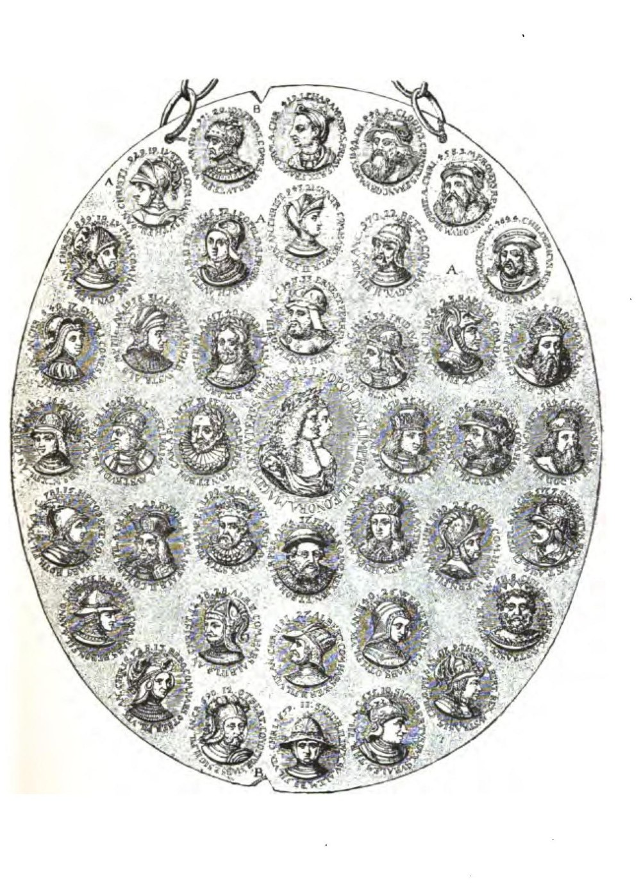

# 叡智の神殿の前廊にて（フランツ・ハルトマン）

フランツ・ハルトマン著／全訳

- 原題：In the Pronaos of the Temple of Wisdom, containing the history of the true and the false Rosicrucians, with an introduction into the mysteries of the Hermetic philosophy, by Franz Hartmann, M.D.
- 内容：神智学協会の医師フランツ・ハルトマン（一八三八〜一九一二）が、新プラトン派から中世の哲学者、パラケルスス、薔薇十字の「団」とその周辺の詐欺師たちまでをたどり、最後に「まことの薔薇十字団員」の規則・しるし・象徴と、錬金術の公理とを示した書物
- 刊行：Occult Publishing Company, Boston, 1890年
- 作業の基にした本文：Internet Archive 公開の1890年初版のスキャン（inpronaostemple00hartgoog）。読みやすいテキストとして Global Grey の電子版を併用し、両者の食い違いは初版に従った
- 著作権：1890年刊。著者は1912年に死去している。日本・米国・英国で保護期間が満了している
- 訳者：人工知能（Claude Opus 5.5）
- 訳の性格：全訳（序文・本文八章・原注・訳注。要約・省略なし）。訳者の調べたかぎりでは、日本語訳は出ていない

## この本について

　フランツ・ハルトマンはドイツ生まれの医師で、アメリカで開業したのち神智学に惹かれ、一八八三年にインドのアディヤールでブラヴァツキーのもとに入った。のちドイツに戻ってパラケルスス、ベーメ、薔薇十字団についての著作を次々と書いた。

　『叡智の神殿の前廊にて』は、その薔薇十字団論の中心となる一冊である。ハルトマンはまず、宗教は恐怖から生まれたとする当時の通説を退け、霊的な知識は書物からではなく自分の魂の中からしか得られないと説く。そのうえで、プロティノス、ポルピュリオス、イアンブリコス、プロクロスら新プラトン派、アグリッパやパラケルススら中世・ルネサンスの哲学者、サン・ジェルマン伯爵やカリオストロ、フラメルといった「熟達者」たちの逸話を紹介し、十七世紀の薔薇十字文書をめぐる騒ぎと、薔薇十字の名をかたった金の亡者や詐欺師たちの話を、ときに皮肉をこめて語る。後半の付録では、まことの薔薇十字団員の十一の規則と十六のしるし、十二の宝石、十八世紀の象徴図集の銘文を紹介し、最後に錬金術を「人の霊的な再生の術」として論じて、四十三のヘルメスの公理で結ぶ。歴史書というより、十九世紀末の神智学者が薔薇十字団にどんな理想を託したかを伝える書物である。

## 目次

- 序文
- 第一章　序論
- 第二章　ヘルメス哲学
- 第三章　中世の哲学者たち
- 第四章　「熟達者」たちのあいだで
- 第五章　薔薇十字の「団」
- 第六章　偽の薔薇十字団員――詐欺師と愚か者
- 付録　薔薇十字団員と錬金術師とのヨーガ哲学の原理
- 第七章　まことの薔薇十字の神殿の前廊にて
- 第八章　錬金術
- 訳注

---

## 序文

　「薔薇十字団の歴史」を扱う書物が、神秘を好む読者を楽しませ、その好奇心を満たすために、近ごろかなりの数あらわれた。しかしそれらがたいへん有益であったとも、この入り組んだ主題に多くの光を投げかけることに成功したとも思われない。また薔薇十字団の神秘が公にわめき立てられ、俗人の目にさらされることも望ましくない。それは人の構成の中で最も聖なる神聖なものに属するのだから。

　まことのオカルティズムについての書物は、全体として、まことに役に立たないものである。隠された知識をもつ者はそれを必要とせず、そのような知識をもたない者はそれを理解しないであろうから。またそのような文献から多くの益を受けることもないであろう。本当の霊的な知識は、自分自身の魂の中に見いだされなければならず、書物から学ぶことはできないのだから。科学者、合理主義者、思弁的な哲学者は、いわば、ろうそくをささえる燭台だけを扱っているのである。そのろうそくからは彼らの見ることのできない光が発しており、彼らはろうそくも見ることができない。ろうそくは魂をあらわし、その光は霊なのだから。

　まことにオカルト的で神智学的な書物は、祈りであり詩であるべきである。読者の心と精神とを思考の最も高い領域へと引き上げ、自分自身の存在の最も内なる聖所へと降りてゆくのを助けるように作られたものであるべきである。そうすれば読者は、内なる知覚の感覚を開くことができ、半ば動物的な知性の理解を超えた神の理想を自らつかむことができるようになる。霊的な真理はその水準まで引き下ろすことはできず、それを認めるためには、霊においてそれ自身の次元まで昇ることが必要なのだから。また、もし光が探求者に自らの存在を明かさないなら、誰も別の人に光を明かすことはできない。書物になしうることは、読者が自分自身の目を開くのを助けることだけである。

　もし我々が日の光の存在を書物で読んで知っているだけで、光を見ることも太陽の光線を楽しむこともできないなら、それは我々にほとんど益をもたらさないであろう。もし闇に囲まれているなら、地上の太陽の構成について理論的にすべてを知っていても何の役に立とうか。もし我々自身の中に何ひとつ神的なものを認めることができないなら、神の神なる力のすべての性質について知らされても、我々に何のよいことがあろうか。

　もし別の人が自分で光を見ることができないなら、誰もその人に光を示すことはできない。しかし光はいたるところにある。闇への愛のほかに、人が光を見るのを妨げるものは何もない。その存在の地上の相の幻への愛が、人にこれらの幻を現実とみなさせ、現実のものを空想と夢の領域へと追いやらせる。それでも、いま彼にとってまことの光に見えるものは、彼の意識が霊の光の知覚へと目ざめたときには闇のようになるであろう。

　光は闇との対照によるのでなければ理解できないので、私は古代のヘルメス学の哲学者たちと中世の「薔薇十字団員」との著作の最もよい部分のいくつかを選んだだけでなく、幻視者と夢想家の愚者の楽園に見いだされる人間の愚かさの大いなる倉庫から、いくつかの事実を集める労をもとった。しかし真剣に道に入り光に従いたいと願う者のために、賢者たちの書物から取った最も貴重な宝石のいくつかを加えた。その意味は賢者を気取る者には理解できないであろうが、素朴な者はその中に多くの知恵を見いだすであろう。

　著者

## 第一章　序論

　宗教の起源を扱う今日の通俗の書物の中には、宗教は恐怖から生じたと述べられているのが見られる。そこには、我々の祖先が未開の状態にあって、近代の科学によってなされた啓示を知らずに、稲妻のひらめきを見、雷鳴を聞き、その起源を説明できないほかの自然現象を眺めて、そのようなものは何かの宇宙の外にある超自然の知的な力によって生み出されるにちがいなく、その力はいつか自分たちの持ち物を滅ぼそうという気を起こすかもしれず、それゆえその機嫌をそこねないようにへつらい、なだめなければならない、という論理的な結論に達したさまが描かれている。

　宗教と神への信仰の起源についてのそのような科学的な説明は、まったく自分自身の想像の月光の中に生き、人の霊に属するあの知識の光を知覚しない合理主義者や思想家の、思弁する脳を満足させるかもしれない。しかしそのような理論は、なお神の生命の火花がその中にあり、それゆえ自然の産物ではなく自然にまさる普遍のより高い力の存在を感じる心を満足させはしないであろう。そのような単に論理的な起源をもつ宗教は、まことに悪魔の宗教であろう。それは徹底して偽りであろうから。それは、どうすれば神をだまし、永遠の正義を無にすることができるかを教える体系にすぎないであろう。まことの宗教は、恐怖とも論理的な思弁とも何のかかわりもなく、そのまことの起源は、人の魂が、それに宿る霊の力の神なる起源に対してもつ根本的な関係の中にある。それは人のうちなる神の霊そのものが、人を道具として、自然の中の普遍の霊の存在を認めることである。この神の力はまことに「隠された（オカルト）」ものである。それはどんな外の手段によっても知覚することができず、それを感じることのできない者にその存在を論理的に証明することもできないのだから。それは地の「アダム」にとってはとこしえに神秘のままであろう。それは神的なものであり、それゆえ人が神性の状態に入ったときにのみ、人に知的に知られうるのだから。

　それでも、自分が直観的にその存在を感じるものを知的に知りたいと望むのは人の本性に内在する性質であり、それゆえいつの時代にも、神の本性を知りたがり、その知的な努力によって大いなる神秘の聖所を覆うヴェールに穴をあけ、そこからのぞいて好奇心を満たそうと試みた人々がいた。そのような思弁家、幻視者、偽哲学者の気まぐれから、神学と神秘主義と迷信との偽りの体系が生じた。それは今日でもしばしばオカルティズムや神智学とみなされている。

　人の魂は、宇宙を満たすあの霊的な力に対して、野の花が地上の太陽の光に対するのと同じ関係に立っている。生命を奪われた植物は病んで枯れるであろう。そして聖性の霊がその中に存在しない魂は、動物の魂よりも低く堕落するであろう。動物は議論にふけることはなく、その本性の法則にしたがってふるまうが、知性をもつことは、人に不自然に、神の法に逆らってふるまうことを可能にするのだから。

　しかしまた、自然であり神の法に従順であることによって、単に知的な状態にまさる霊性の状態へと成長したほかの人々もいた。彼らの内なる開花の過程において、その内なる感覚は開かれ、彼らは霊のこの光を直観的に感じるだけでなく、霊的に知覚することもできるようになった。そのような人々こそがまことの神秘家、薔薇十字団員、熟達者であり、歴史家や好古家は彼らとは何のかかわりもない。彼らは歴史家の探究の届かないところにいるのだから。「薔薇十字団の歴史」は、せいぜい、「霊的に照らされていたと考えられた」ある人々の歴史でありうるにすぎない。そのような「歴史」に挙げられた人が本当に薔薇十字団員であったかどうかは、とこしえに不確かなままであろう。人を聖人にし賢者にするものはこの地上に属さず、死すべき人によって調べられることはできないのだから。それは、聖書が「我々は地上に生きている。しかし我々の魂は天にある」と書くときに語っている人の部分なのである。

　外の探究は外のものしか扱えない。その存在が形に依存するものは形しか扱えない。しかしすべての形は、その霊的な知覚の力によって形のあらわす真理を認める者にとっては、ただの作りものにすぎない。自然の全体は真理の表現である。しかし自然の中に表現された真理を実現することのできる者は少ない。我々はみな、多かれ少なかれ、我々がもともとあらわすべく定められていた真理の戯画化された像である。我々自身の中の真理を認めないために、我々自身がただ作りものの存在をもつにすぎないかぎり、我々は我々のあらわす戯画を知るだけで、我々のまことの、本当の自己を知らない。

　原理としての知恵は、賢者の中にあらわれないかぎり考えられず、賢者だけがそれを認めることができる。知識のない人は何も知らない。何の原理ももたない存在としての人が、何かの原理を知りうるのではない。ほかの形の中に自分自身を認めるのは、つねに原理そのものである。こうして、もしある人が真理を知りたいなら、真理がその人の中に生きていなければならない。もしその人の中に真理がないなら、その人は自分自身の中にも外の自然の中にも、どんな真理も知覚することができない。とこしえに真理は、「迷信」と「懐疑」と呼ばれる二人の「盗人」のあいだで十字架につけられている。そしてもし我々が十字架につけられた盗人のうちの一人しか見ないなら、その者を真理と取りちがえやすい。しかし二人の盗人の形はゆがんでいる。あるいはもっと正しく言えば、真理が彼らの中でゆがめられているのである。二人のゆがんだ盗人のあいだにかかる救い主のまっすぐな形を認めることができたときにだけ、我々はその違いを見、贖い主をどこに探すべきかを知るであろう。

　真理がまだ生きた力となっていない者にとっては、道を示すために作りものの形が必要である。しかし無知な者の大多数は作りものしか見ない。自分自身の中に真理がないので、形の中に真理を知覚するものが何もないのである。この理由から、「薔薇十字団の秘密の象徴」は、自分自身の心の中に生きた真理をもたないすべての者にとって、とこしえに「秘密」のままであろう。そして彼らは、どんな説明がなされても、それを理解しないであろう。しかしその中で真理が生きようともがき、ただ好奇心を満たすためでなく、何の個人的な考慮もなく真理そのもののために真理を愛して努める者は、薔薇十字団の書物とその秘密の象徴とを研究することによって大いに助けられうる。ちょうど異国の旅人が、彼より先にそこを旅して道を知っている人々に助けられうるのと同じように。彼らは砂漠を通る道と、甘い水の見つかる場所とを彼に示すことはできる。しかし彼を運ぶことはできない。彼は自分で歩かなければならないのである。

　神の知恵は人の作ったものではなく、人によって発明されたものでもない。自分自身の心の中にそれを進んで受け入れるほかに、それを得る道はない。もしそれがそこに入るなら、争う意見の嵐は静まり、思考の海は鏡のように澄み、我々はその中に真理を見ることができるであろう。そのとき真理そのものが我々自身の中で強くなり、我々は神を、書物の中の神の記述を読むことによってではなく、神自身の力の中で、またそれを通して知るであろう。あるいは聖書の言葉で言いあらわせば、我々は「霊と真理とにおいて神を礼拝することによって」神の知識に達するであろう。

　聖書やほかの宗教の書物の寓意的な言葉と同じように、薔薇十字団の著作も、もし外的な意味にとられ、物質的な観点から応用されるなら、まったくのたわごとであり、理解できない。単に外的な推論は、その理解の助けになるどころか、むしろ道の障害である。しかし霊から来る理解をもってそれを見る者にとっては、それは神の知恵に満ちているのである。

　薔薇十字団員たちは言う。「神の真理を知る人は最も高いものに達したのであって、もはや何も望まない。真理に達すること以上に高いものはありえないのだから。この宝に比べれば、世の財産は取るに足りないものに沈む。最も高いものをもつ者は低いものを望まず、現実を知る者は幻を気にかけない。何が真実でありうるかについての科学的、哲学的な思弁は、真理を感じ知覚する者には無用である。彼はすでに見て知っているものについて思弁する必要がない。彼は大きな富を必要としない。その物質の形の必要は少なく単純であり、そのうえ、内なる霊の働きが外へ向かって放射することによって、その物質の形を構成する物質的な原理はますます昇華され、エーテル化され、物質の次元の必要から独立していくのだから。ついに、粗い目に見える形の最後の鞘を脱ぎ捨て、目に見える内なる体の中に生命を与えるあの原理を意識あるものとしたとき、彼はまったく後者の中に生きることができる。死すべき目には見えず、物質の条件から独立し、言いあらわしがたい美に囲まれたエーテルの霊として、死すべき人がその存在を夢にも見ない力をもって――エーテルの霊として、しかしそれでも現実の生きた人として」（注一）

　またさらに、薔薇十字団員たちは、真理の生ける水、まことの「生命の霊薬」を味わった者についてこう言う。

　「欠乏と貧困とを超え、病と死とを超え、苦痛を与えるものに触れられず、空のほかに頭の上の屋根を、大地のほかに寝床を、空気のほかに養分を必要とせず、死すべき者たちが渇望するすべての欠乏を超えている者は幸いである」（注二）

　「神は虚栄の者を低くし、謙遜な者を高くする。高ぶる者を侮りによって罰するが、慎み深い者には慰めとともにその天使たちを遣わす。悪しき心の者を荒野に投げ出すが、心のやさしい者には天の門を開く」（注三）

　「ソフィストたちの書物を避けよ。それは誤りに満ちている。その知識のよって立つ土台は彼らの空想なのだから。現実の領域に入り、我々のもつ宝を我々とともに分けよ。我々はおまえたちを招く。我々自身の選択によってではなく、我々がその僕である神の霊の力によって」（注四）

　「動物が知的な喜びについて何を知ろうか。ソフィストが霊の喜びについて何を知ろうか。もし我々が、世界の初めからずっと生き、考え、感じてきたかのように生き、考え、感じることができ、その終わりまでそのように続けるとしたら、それは貴いことではなかろうか。自然のすべての秘密を知り、過去に起こったすべてのこと、未来に存在するであろうすべてのことが記録されているあの書物を読むことは、喜ばしいことではなかろうか。低いものに引きつけられるかわりに最も高いものを引きつける力をもち、動物のかわりに清らかな霊たちがおまえのまわりに集まるとしたら、おまえは喜ばないであろうか」（注五）

　そのような力は人に達しうるものであろうか。それに達したいという望みをもたない者にそれを証明しようとしても無益であろう。そしてたとえそれが証明されたとしても、貧しい者に、自分たちにとっては存在しない宝をもっているほかの者たちがいることを証明して、何の益があろうか。力の存在を、それを知覚し理解する能力をもたない者に証明することができようか。奇跡でさえ、何か異常な説明のつかないことが起こったということのほかには何も証明しないであろう。

　『友愛団の名声（ファーマ・フラテルニタティス）』は言う。「そのような秘密を、それを受け取るのに十分に霊的に発達していない者に明かすことの不可能さこそが、薔薇十字団について世間に多くの誤解と偏見とが存在してきた原因である。その起源をそれを作り出した者たちの無知か悪意かにしかたどれない、グロテスクな作り話が流布し、うわさ好きの者たちのあいだを伝わるにつれて、その強さとばかばかしさとを増していった。偽りは真理の根を傷つけずに根絶することはできない。そして無知な者や故意の欺き手によってなされた偽りの言明に反論するのに、悪い意図さえ役に立つようになる。しかし盲人が自分の見たと信じるものについて語るとき、その証言に何の価値があろうか。耳の聞こえない者が自分の聞いたと信じるものを描くとき、その言明にどんな価値を置くことができようか。不誠実な者が真理について、神を知らない者が神について、愚か者が知恵について、不信の者が信仰について、何を知ろうか。彼らは自分が正しいと思うかもしれないが、それでも誤っている。彼らはほかの者たちが幻を抱いていると非難するかもしれないが、彼ら自身が幻の中に生きているのである。ねたみ、憎しみ、嫉妬、偏狭、迷信は色ガラスのようなもので、それを通して見る者に、何ものもその真の姿において見させず、すべてを色のついた光の中に見させるのである」

　こうしてみると、「薔薇十字団員」がその結社について語るとき、彼らは、何かの理由で「薔薇十字団員」と名のる人々の地上の外的な組織とはまったく異なるものを意味しているように見える。それは霊的な結びつき、神の、そして霊的な、しかしそれでも個の力の調和――天使たちがそうであると考えられているような――であって、外の生活の愚行に結びついたどんな歴史ともかかわりがないのである。

　彼らがこう言うとき語っているのは、その霊的な「結社」についてである。

　「我々の共同体は、神が『光あれ』という言葉を語った創造の最初の日から存在してきたし、時の終わりまで存在しつづけるであろう。それは光の子らの結社であり、その体は光から形づくられ、彼らはとこしえに光の中に生きる。我々の学校では、我々は神の知恵、天の花嫁によって教えられる。その意志は自由であり、彼女は自分の選ぶ者のもとに来る。我々の知る神秘は、神と自然と人とについて知りうるすべてのことを包んでいる。これまでに存在したすべての賢者は、我々の学校を卒業したのであり、そこでまことの知恵を学ぶことができたのである。我々の仲間には、この地球に住まない者たちもいる。我々の弟子たちは宇宙じゅうに散らばっている。彼らはみなひとつの書物を学び、それを学ぶただひとつの方法に従う。我々の集う場所は、全自然に浸透する聖霊の神殿であって、選ばれた者にはたやすく見いだされるが、俗人の目にはとこしえに隠されている。我々の秘密は金で売ることはできない。しかしそれを受け取ることのできるすべての者には無償である。我々の秘密主義は、与えたくないという気持ちによるのではなく、教えを求める者の側の受け取る能力のなさによるのである。

　永遠の真理はただひとつであり、愛の泉はただひとつである。愛は与えることはできない。それは人の心の中に生まれなければならない。胎動が起こるところではどこでも、我々は神の愛の誕生に立ち会う。我々は闇の最も深い深みをも照らし、最も深い神秘を知ることを可能にする光をもっている。我々は、それによって養われ、それによって自然の中で驚異をなしうる火をもっている。

　この世のすべてのものは我々の意志に従う。我々の意志は法とひとつであり同一なのだから。それでも我々の意志は自由であり、どんな法にも縛られない。

　おまえは我々の結社の一員になりたいか。もしそうなら、おまえ自身の心の中に入り、沈黙の声に耳を傾けよ。おまえ自身の中に師を求め、その教えを聞け。おまえの魂の中に自らをあらわそうとしている神性を知ることを学べ。おまえの不完全さを投げ捨て、神において完全となれ」

　（注一）これがみな「内なる人」を指しているのであって、その死すべき物質の体を指しているのではないことは、すぐにわかるであろう。神の真理を知りうるのは、外の感覚をもつ物質の体でも、人の滅びる精神でもない。自分自身を知りうるのは、人の中の神の真理だけである。誰も、何かの霊的な力がその人の中で生き、その人がそれと同一化しないかぎり、その力のまことの知識に達することはできない。オカルティズムとは、何を知るべきか、何をなすべきかの問題ではなく、何でなければならないかの問題である。もし内なる人が、ただ想像においてでなく意志においてまことに霊的となったなら、そのとき目ざめた霊は物質の形をさえ貫き、闇が光に焼きつくされるのと同じ意味において、その本性を変えるであろう。

　（注二）これはみな地上の肉の人を指しているのではなく、霊の生命において生まれ変わった人を指している。人の元素の体は病と死とを超えておらず、苦痛を与えるものを超えてもいない。その体はそれを作っている元素から守られる必要があり、地上の食物を必要とする。しかし天の国の人は自由である。その住まいはその思考の届くかぎり広く、その養分は天からの「マナ」である。

　（注三）（ヤーコプ・ベーメによれば）「神」とは神の知恵の意志である。うぬぼれのうちに立ち上がる者は倒れるであろう。彼はその欺く知識で満ち、永遠者の意志は彼の中に神の知恵を目ざめさせることができないのだから。まことの謙遜は卑屈な恐れにあるのではなく、神が自分の中に、自分とともにいることを感じる者だけが感じることのできる、最も高い意味での尊厳の感覚にある。

　（注四）「ソフィスト」とは、知識の木に実る果実の外の殻を熱心に調べながら、果実の中に核があることを知らない懐疑的な探究者たちである。彼らは核がないと自分に言い聞かせ、内なる泉から輝く光を霊の力によって知覚することのできる者たちを夢想家だと思いこむ。一方、彼ら自身は、自分の生命がただの眠りであり、その思いこんだ知識が夢であることをほとんど知らない。

　（注五）人の霊はこの世のものではなく、永遠に属する。人の霊が存在しなかった時は、創造の初めから一度もなかった。またその存在はこの惑星地球に限られてもいない。自分の人格をおおう神の霊――それは彼自身の本当の自己である――の意識と自分の意識とを融合させることに成功する者は、自分の過去の存在の形を知り、未来を見るであろう。しかし人の中の動物的な原理はその状態にあずかることはできない。それは死んで、ふたたび形を生み出すための貯蔵庫であるカオスへと入るのである。

## 第二章　ヘルメス哲学

　*Tria sunt mirabilia. Deus et Homo. Mater et Virgo. Trinus et Unus.*
　〔三つの驚くべきものがある。神にして人。母にして処女。三にして一。〕

　永遠の真理はただひとつであり、したがって神の知恵もただひとつである。もしその知恵があらわれた人々の歴史をその起源にまでさかのぼりたいなら、我々は時と空間の外に踏み出し、永遠の中に入らなければならないであろう。「神の霊が水の上を動いていた」創造の最初の日々、「最初の秘儀伝授者」が、いまこの惑星の上で我々の知る人間とはまったく異なる構成をもつ、半ば霊的な存在の種族を教えた時まで、さかのぼらなければならないであろう。外的に推論する歴史家は、時代の知恵の宗教について、それが人によって発明され、推論する知性のしだいに開花する思弁の力から進化した何かの体系であるかのように語る。しかしオカルティストは、神の知恵が永遠でつねに同じであることを知っている。異なるのは、それが表現を求める精神の能力に応じた、そのあらわれの形だけなのである。それゆえ、薔薇十字団の教えの歴史は、ヴェーダの教えや古代エジプトの書物の解説から始めることもできよう。しかしこれらの主題はH・P・ブラヴァツキーの『シークレット・ドクトリン』そのほかの書物でくわしく扱われているので、我々はただ、ヘルメス哲学が新プラトン派の哲学者たちの精神にどのような姿で現れたかを見ることにしよう。

### 新プラトン派

#### アンモニオス・サッカス

　紀元一九〇年ごろに生きたこの哲学者は、新プラトン派の創始者であった。彼はキリスト教徒の両親の子で、キリスト教の教育を受けたが、この体系から離れて「哲学者」となった。彼は賃金をもらって荷物を運ぶことで生計を立てていたが、それでもその時代の最も偉大な哲学者のひとりであり、プラトンとアリストテレスの哲学によく通じていた。その弟子はヘレンニオス、オリゲネス、プロティノス、ロンギノスであった。

#### プロティノス

　プロティノスは紀元二〇五年、エジプトのリュコポリスに生まれた。彼はアレクサンドリアで教育を受けた。ゴルディアヌス帝のペルシアでの戦争に加わり、のちにローマに行って、そこに哲学の学校を開いた。ここで彼は大きな名声を得、すべての人に尊敬された。彼がローマに住んだ二十六年のあいだ、ひとりの敵もいなかったと言われる。最大の悪人のひとりであったガリエヌス帝でさえ、彼を尊敬し、敬った。

　プロティノスは病に倒れた。医師エウストキオスがプロティノスの死の床の部屋に入ってきたとき、プロティノスは喜ばしげに叫んだ。「わたしはいま、わたし自身の中に生きる神を、宇宙の神と結びつけようとしているのだ」

　プロティノスの精神はたえず、彼に付き添う神なる守護霊――彼自身のより高い自己――に向けられていた。彼は自分の物質の体のことをほとんど気にかけなかった。そして体の生まれた日について尋ねられたとき、そんなつまらないことは言葉を費やすにはあまりにも重要でないと言って、それを告げるのを拒んだ。

　現象としての存在は、彼にとって誤り、まちがい、低く望ましくない状態であり、神の原理との合一が存在の最高の目的であった。彼はごくわずかしか食べず、肉をとらず、貞潔の生活を送った。サッカスのもうひとりの弟子ポルピュリオスは〔原文のまま〕、プロティノスの名声をねたんで、彼に対して黒魔術を用いようとしたが成功しなかった。そしてついに、プロティノスの魂はあまりにも強いので、その魂に向けられた最も強力な意志もそれを貫くことができず、送り手にはね返ってくるのだと言った。しかしプロティノスはその魔術的な影響を感じ、そのことを口にした。

　プロティノスの哲学によれば、神はすべてのものの土台である。実体はただひとつであり、物質と形相とは幻、すなわち霊の影にすぎない。神は永遠であり、いたるところにある。神は純粋な光であり、統一であり、すべての存在と思考との土台である。精神（ヌース）はこの統一の像である。それは、いわば永遠者が自分自身の中をのぞきこむことによって創り出した像である。こうして精神は神の産物あるいは創造物であって、しかも神そのものであり、神からその力を受け取っている。精神は永遠者の永遠の活動である。それは光であり、原初で不変である。思考とすべての考えうる対象とは精神の中に存在する。精神の世界は内なる世界であり、外の感覚の世界は前者の外への表現である。精神は統一であり、すべての存在と対象とは精神の実体から成っているので、すべては根本において同一であるが、形において異なるのである。

　精神の内なる世界が存在へと入ったその活動は、中心へと向かって働く内なる力である。もし内なる世界に対応する外の世界が存在へと入るべきなら、この内なる活動が逆転させられ、周辺へと向けられる別の活動がなければならない。この遠心的な活動が魂であって、精神の求心的な活動の産物あるいは反作用、言いかえれば自分自身の中に入る思考の産物なのである。

　現実のあるものは、それ自身の完全さの状態に近づくが、それ自身ほど完全ではないものを生み出しうる、という普遍の法則がある。それゆえ、魂の活動は精神の活動に似ているが、後者ほど完全ではない。

　魂は、精神と同じく生きた思考であるが、精神とちがって絶えざる変化に従う。魂は精神とちがって、ものを自分自身の中に見るのではなく、精神の中に見る。魂の活動は外へ向けられ、精神の活動は内へ向けられる。魂の知覚は精神の知覚ほど明らかではない。魂は精神と同じく一種の光であるが、精神の光が自ら輝くのに対して、魂の光は前者の反映である。

　自然の有機体全体に存在する秩序と調和の永遠の法則にしたがって、すべての魂はある時を経て精神から分かれる。あるいは――もっと正しく言えば――魂と精神の中心とのあいだの距離が増し、魂はより物質的な状態をとる。神の知性から遠ざかって、魂は物質の状態に入り、物質の中へと降りてゆく。物質化へと向かう一歩ごとに、その形はより密で物質的になる。空気の中の魂は空気の形を、地上の魂は地上の物質の形をもつ。魂の活動はほかの二次的な活動を生み出す。そのうちあるものは上へ向かう傾きをもち、ほかのものは低い引力に従う。上へ向かう活動は、信仰、志、崇敬、崇高などである。下へ向かう傾きは推論、思弁、詭弁などを生み出す。魂の最も低い活動は、純粋に植物的な力、感覚、同化、本能などである。

　自然の活動の究極の目的は自己認識に達することである。自然が目に見える形で生み出すものは何であれ、粗い物質に形を与える超感覚の形をももっている。その形が認識の対象となりうるように。自然とは生きた魂にほかならず、より高い内なる活動、すなわち普遍の精神の産物である。自然の中にはただひとつの根本の生きた力、すなわち想像する力がある。この力の活動の結果はただひとつ、形成、すなわち形の知覚である。そして自然の中で起こるのと同じ過程が、人の本性の中でも起こるのである。

　物質のすべての形成は、その中に住む魂によって生み出される。すべての形は、たとえ外にあらわれていなくても、内なる生命に満ちている。大地は生命の存在する木の材のようなものであり、石は木から切り取られた小枝に似ている。星々の中にも、大地の中にも、神の生命と理性とがある。

　感覚の世界とその中のおのおのの存在とは内なる魂をもち、この魂がそれらの形について持続するもののすべてである。外の外観は外観以上の何ものでもない。

　知性の世界は不変の生きた統一であり、そこには空間による分離も時間による変化もない。その世界には存在するすべてのものが存在するが、生産も破壊もなく、過去も未来もない。それは空間の中になく、空間を必要としない。知性の世界はいたるところにあると言うとき、我々は、それがそれ自身の存在の中に、それゆえ自分自身の中にある、という考えを言いあらわそうとしているのである。

　知性の世界は霊の世界である。至高の知性があり、その中にすべての対象とすべての知性とが胚として（潜在的に）含まれている。そしてその知性の世界に含まれうるかぎり多くの個の知性がある。魂についても同じことが言える。至高の大霊（オーヴァーソウル）があり、その中に含まれうるかぎり多くの個の魂がある。後者は前者に対して、種がそれが属するひとつの類に対するのと同じ関係に立つ。ひとつの類の中には異なる種類の種があるが、すべては類に起源をもつ。おのおのの種はそれ自身の性格をもつ。同じように、知性の世界の中には、さまざまな種類の魂を生み出すある性質がなければならず、魂はさまざまな程度の思考の力をもっていなければならない。さもなければ、魂はすべての細部においてみな同一であろう。

　自然の中には絶対に理性を欠くものは何もない。もっとも、その原理のあらわれはさまざまな形において大いに異なる。理性がないように見える動物でさえ、その本能を導く理性をもっている。存在するすべてのものは理性にその起源をもち、自然の中に絶対に理性を欠くものはありえない。しかし理性があらわれる様式は数えきれない。それらのあらわれは外と内の条件と状況とによって変容させられるのだから。内なる霊的な人は外の人よりもはるかに理にかなっている。外の世界では、理性は観察、論理、思弁としてあらわれる。しかし知性の世界では、理性は真理の直接の知覚においてあらわれる。

　理性の内なる働きの目的は、客観的な形を生み出すことである。分化が進み、さまざまな力が開花するにつれて、それらはたえずその属性のいくつかを失い、最終の産物はもとの力よりも不完全になる。しかしそれらが置かれる状況が新しい属性の起源を生じさせ、こうしてふたたびより高い状態へと昇る一歩が踏み出されるのである。

　こうして、知性の世界は根本の原初の中心からの放射であり、我々が感覚で知覚する世界は知性の世界の産物である。外の世界のすべてのものの不完全さと移ろいやすさとの状態は、それらが大いなる中心から遠いことによって引き起こされる。宇宙は存在の三つの根本原理の産物である。それは大いなる生きた存在すなわち有機体であって、そのすべての構成部分は密接に結びついている。その宇宙のどの部分も、ほかのすべての部分、遠い部分にさえある反作用を引き起こすことなしには働くことができない。全体を通じてただひとつの魂があり、そのすべての部分にあらわれる活動が全体の有機体を構成するのだから。すべての部分は、宇宙の中のひとつの生命を構成するあの普遍の力によって結びあわされている。すべての魂は、いわば両棲の生活を送る。あるときは感覚の次元により引きつけられてそれと織りあわされ、またあるときは自分の起源である理性の引力に従い、それと合一することがある。魂はついには分かれる。より高い要素はより高い次元に昇り、より低いものは、より高いものとの結びつきによって支えられなくなると、さらに低く沈む。人の受肉が起こるときにはいつでも、魂は死すべき体に自分自身の実体のいくらかを供給するが、全体として体に属するのではない。そして体と徹底してまじりあった魂の部分だけが、体の苦痛と快楽とにあずかる。人の悪しき欲望は、こうして体とまじりあったその魂の部分からのみ来る。それゆえ、人の悪しき行いの悪しき結果は、ただ動物の人――すなわちその生きた動物の原理――に降りかかるだけであって、魂のより高い要素と結びついた本当の人、すなわち霊には降りかからない。魂が卑俗で低いものに引きつけられればられるほど、魂が身にまとう有機体はますます粗く物質的になるであろう。死後、粗い実体は清められるか滅ぼされなければならず、一方、清い要素は、肉の形における新しい受肉の時が来るまで、それが来た源へと昇る。この過程は、魂が低いものの引力を寄せつけないだけの十分な知識に達するまでくり返される。この意味において、人の地上の存在は、悪しき欲望と傾きとを抱いていることへの罰とみなすことも十分にできよう。知的な労働は存在の低い状態に属する活動であり、真理を直接に知覚するという魂のもとの能力が失われたために必要なのである。もし魂がこの能力をふたたび得たいと望むなら、魂はすべての知的な概念から自分を解き放ち、形のないものの中に入りこまなければならない。もし魂がすべてのもののもとの考えられない泉にまで達したいと望むなら、自分自身の概念をあとに残し、すべての感覚の知覚と知的な思弁とから自由になり、思考と言葉とから自由になり、霊的な観想の状態の中に生きなければならない。知的な概念を超えたものは、見ることはできるが、考えることも言葉で描くこともできない。見ることは信じることにまさり、知識は論理にまさる。霊的な知識はひとつであるが、人の学は多様であって、すべてのものがそこから起源をとる永遠の統一とは何のかかわりもないのである。

　人が自分自身の本性、その起源、その最終の運命について教えられることは、このうえなく重要である。知的な人は、その有用さを確信しないかぎり、ある労働を引き受けようとはしないのだから。霊的な知覚は、分け与えることのできない力であって、努力によって得られなければならないものである。

　もしある人がそのような力が存在することを知らなければ、あるいはその有用さを実現できなければ、彼はその状態に達するための努力をせず、その精神は照らされないままであり、真理を見ることができないであろう。彼は真理の存在を感じるかもしれない。ちょうど人が、存在するかどうかも知らない未知の理想に愛を感じるように。しかしその精神が照らされた者は、その愛の対象、世界を照らす光を見る。この光はいたるところに存在する。しかしそれは相対的には、それ自身との似かよいによって、それを見、知覚し、感じ、抱きしめることのできる者にとってだけ存在する。事柄をさらに理解しやすくするために言えば、もし魂がその障害を投げ捨て、永遠者から起源をとったときの状態にふたたび入るなら、そのとき魂は永遠者を見、感じることができるであろう。もしこれらの教えを受けたのちに、ある人が怠けてそれに従わないなら、闇の中にとどまっても自分のほかに責める者はいないであろう。それゆえ、すべての者は低く感覚的なものから身を引き離し、神の至高の力と合一しようと努めよ。

　もしおまえが至高者を見いだしたいなら、外の世界から来るすべての印象からおまえの思考を解き放ち、おまえの精神をすべての図形、形、姿から清めなければならない。

　神は、神を認めない者たちの中にさえ、すべての中に存在する。しかし人々は神から逃げ、神から外へ踏み出す。あるいはもっと正しく言えば、自分自身から外へ踏み出す。彼らはこうして逃げている相手をつかむことができず、自分自身を見失って、ほかの神々を追い求める。しかしもし魂が完成への道を進み、自分自身のより高い存在の状態を実現しはじめ、永遠の生命の泉が自分自身の中にあり、それゆえ外のものを追い求める必要がなく、望ましいすべてのものを自分自身の中の神の要素の中に見いだしうることを知りはじめるなら。もし魂が、その内なる神の中に自分の全生命と存在とがあり、神の中に生き存在するためには幻の領域から逃げなければならないことを理解しはじめるなら、そのとき、魂が神を見、自分自身を、地上を超えた光に照らされたエーテルの存在として見ることのできる時が来るであろう。魂は自分自身を、純粋な神の光そのものとして、美に輝く神としてさえ見るであろう。しかしその光が物質の次元の影に近づいて重くなるにつれて、ふたたび暗くなるのである。

　なぜ魂はその光の状態にとどまらないのか。ただ、まだ物質の引力から完全に自分を解き放っていないからである。もし魂がこれらの引力からまったく自由になったなら、魂はその光の中にとどまり、自分がそれとひとつであることを知るであろう。この状態においては、知覚する者も知覚の対象もなく、ただ知覚があるだけであり、魂は自分の知覚するものなのである。魂はさしあたり、その知覚の対象と同一化している。それゆえこの状態は、人の知的な理解を超えた何かなのである。

　それと合一し同一であったのち、魂は自分自身に戻るとき、その像を自分の中に担っている。そのとき魂は、永遠者との合一のあいだ、自分が永遠者そのものであり、自分と永遠者とのあいだに何の違いもなかったことを知る。魂自身の中には運動も感覚も、ほかの何かへの欲望もなく、思考も概念もなかった。魂は高められ、自分自身の存在の中に休んでいた。魂はいわば休息そのものであり、美や徳のすべての概念にまさる状態にあった。形も像もないこの崇高な状態に入る魂が、何か幻のものの中に入ると考えることはできない。幻の中に沈む魂は自分をおとしめ、悪と闇との領域に入る。しかし高められた魂は自分自身の中に入る。そのとき魂は、存在の状態にも非存在の状態にもなく、考えられない、すべての存在を超えた状態にあるのである。

#### マルコス・ポルピュリオス

　この哲学者はプロティノスの弟子であって、紀元二三三年、シリアのバタネアに生まれた。彼は紀元三〇四年にローマで死んだ。彼は、生涯のあいだにただ一度だけ神との合一に達することに成功したが、その師プロティノスは四度そのように祝福された、と言っている。

　ポルピュリオスは魂についてこう言う。――体に宿った魂は、長いあいだ異国の民のあいだに住み、それゆえ自分の国の慣わしを忘れただけでなく、異国人の慣わしを身につけてしまった旅人のようなものである。そのような旅人が旅から戻り、友人や親族に迎えられたいと望むとき、彼はその異国の作法を脱ぎ捨て、以前の行いと考え方とにふたたび戻ろうとする。同じように魂も、その天の故郷から追放され、物質の形に住むことを強いられているあいだ、その形からある習慣を身につける。そしてもし以前の状態に戻りたいと望むなら、その地上の形から身につけたすべてのものをわきに置かなければならない。魂は、身にまとっている粗い物質の仮面だけでなく、より内なる外被をも脱ぎ捨てようと努めなければならない。そうすれば、魂はいわば裸の状態で至福の領域に入ることができるのである。

　人がそこから以前の状態の忘却を飲み、未来の運命を忘れさせる、二つの毒の泉がある。すなわち感覚の苦痛と感覚の快楽とである。この二つの働きによって、とりわけ後者の働きによって、欲望と情念とが創り出され、それが魂を物質に引きつけ、魂の肉体化の原因となる。こうして魂はいわば体に釘づけにされ、魂のエーテルの乗りものは重く密になる。我々は官能をかきたてうるすべてのものを避けるべきである。官能が働くところではどこでも、理性と純粋な知性とはその活動をやめるのだから。それゆえ我々は、ただ食べる楽しみのために食べるのでなく、体を養うのに必要なだけ食べるべきである。余分な、とりわけ動物の食物は、魂を物質に縛る絆を強め、魂を神性と神の事柄とから引き離す。賢者は神の祭司であるから、自然の神殿の中にいるあいだはすべての不純から自由でいるよう努めるべきであり、自分自身が動物の死体の墓となりながらすべての生命の源に近づくほど、その尊厳を忘れるべきではない。彼はその養分として、地上の母の清い賜物だけを選ぶべきである。もしあらゆる種類の食物を避けることができたなら、我々はさらに霊的になるであろう。

　体のあるものと体のないものとのあいだに存在する違いについて、ポルピュリオスはこう言う。「体のないものは体のあるものを治め、それゆえいたるところに存在する。空間としてではなく、力においてではあるが。ものの体としての存在は、体のないものが、それが関係に入りたいと望むものに臨在するのを妨げることはできない。それゆえ魂は、望むどんな場所にもその活動を広げる力をもつ。魂は限りのない力であって、その各部分は特別な条件から独立しているので、清く物質とまじっていなければ、いたるところに臨在しうる。ものは、その体の形の接触によってだけでなく、魂をもっていれば、離れていても互いに働きかける。魂のより高い要素はいたるところにあり、檻の中の動物や瓶の中の液体のように体の中に閉じこめられることはできないのだから。普遍の魂は、本質的にひとつであり無限の至高の霊と同一であるので、後者の無限の力によって、すべてのものを発見しあるいは生み出すことができる。そして個の魂も、清められ体から自由であれば、同じことをなしうるのである」

　「魂の領域は半ば物質的であるので、半ば物質的な（アストラルの）形をもつその住人をもつ。そのうちあるものはよく、ほかのものは悪い。あるものは人に好意的であり、ほかのものは悪意をもつ。どちらの類もエーテルの、しかし変わりやすい体をもつ。よいものはその体と欲望との主であり、悪いものはその体の欲望に治められている。彼らはみな善あるいは悪のための力であり、神の、動物の、あるいは悪魔の目に見えない影響であって、その内なる活動によって、存在の魂の中に情念、欲望、悪徳、徳を創り出す。悪ければ悪いほど、その形は体の状態に近づく。そのとき彼らは物質の発散物で生きる。彼らは人に殺人と動物を殺すこととをそそのかし、犠牲から立ちのぼる蒸気を楽しみ、死にゆく者のエーテルの実体を吸いこんで肥える。それゆえ彼らはつねに人を戦争と犯罪へとそそのかそうと待ちかまえており、人や動物が殺される場所に大群をなして集まるのである」

　ポルピュリオスは、人より賢く、力強く、すぐれた神々が、人の意志を行い人の欲望に従うよう、おだてられたり、説き伏せられたり、強いられたりしうるという考えをあざける。彼は、透視や予言などが外の神々による霊感の結果だという理論を退け、それらは人のうちなる神の霊の働きであり、この働きの行使は、魂がそれを行使するのに必要な状態に置かれたときに可能になる、と言う。「人の意識は物質の形の中にも、その外にも集中しうる。そして条件に応じて、人はいわば自分自身の外にいることも、自分自身の中にいることも、まったく外でもまったく内でもなく両方の状態を同時に味わう状態にいることもある」。彼はまた、あらゆる形をとり、神々として、人として、悪霊として現れうる多くの目に見えない存在者がおり、彼らは嘘をつき仮装するのを好み、死んだ人々の魂であるふりをするのを好む、とも述べている。

　ポルピュリオスは祈りのあいだに何度か空中に浮かび上がり、十ヤードあるいはそれ以上の高さにまで達し、そのようなとき、彼の体は金色の光に包まれているように見えたと言われる。「神々はいたるところにいる。そして魂がそのような神の影響に満たされ、低い影響を締め出している者は、さしあたり、その影響のあらわす神であって、その属性と観念とをもつ。魂の神との合一の本性は、知的に考えることも言葉で言いあらわすこともできない。それをなしとげる者は神と同一であり、神性そのものであって、彼と神とのあいだには何の違いもない。神々は我々の祈りによって我々のもとに呼び降ろされるのではなく、我々が自分自身の聖なる志と努力とによって神々のもとへ昇るのである。我々はすべてを包む愛の力によって神々と結ばれているのである」

#### イアンブリコス

　この哲学者はポルピュリオスの弟子であって、紀元三三三年ごろに死んだ。彼は言う。

　「もし魂が神々のもとへ昇るなら、魂は神のようになり、上のものと下のものとを知ることができる。そのとき魂は、病気を癒し、有益な発明をし、賢い法を定める力を得る。人は自分自身の直観の力をもたない。その直観は、その魂と神の霊とのあいだに存在する結びつきの結果である。この合一が強くなればなるほど、その直観、すなわち霊的な知識は大きくなるであろう。魂の知覚がみな神の性格のものであるわけではない。物質の要素とまじりあった魂の低い活動の産物である多くの像もある。神の本性は生命の永遠の泉であって、欺く像を生み出さない。しかしその活動がゆがめられるなら、そのような欺く像が現れることがある。もし人の精神が神の光に照らされるなら、その魂のエーテルの乗りものは光に満たされ、輝くようになる」

#### プロクロス

　プロクロスはビザンティウム〔原文のまま〕に生き、四一二年から四八五年まで生きた。彼はヘルメス学の哲学者であり神秘家であって、しばしば預言的な幻と夢とを見た。彼はその「祈り」によって雨を降らせ、地震を防ぐ霊的な力をもっていたと言われる。彼はたいへん敬虔で禁欲的であり、ときにはその頭が光の栄光に包まれているように見えた。

　彼は、人の魂は多くの衣から成っており、あるものはより密で、ほかのものはよりエーテル的な性格のものであって、そのおのおのが根本の原理であり、ただその形においてのみ変わりうる、と言う。「魂は地上の欲望から清められたのちにのみ、その神の状態に戻ることができる。魂の理性と自由意志とは、魂が知識に達し欲望から自由になるまで、物質の状態に属する苦しみにあずからなければならない。この目的のために、魂はその欲望を脱ぎ捨てるまで、ある周期ごとに物質の形をまとう（人間として転生する）。魂がその粗い外の衣（原理）から自分を解き放てば放つほど、魂はより高く昇ることができる」

#### ヒエロクレス

　この哲学者は言う。「知性ある魂の実体は、デーミウールゴス（ロゴス）から分かちがたい非物質の体を受け取り、こうして存在に入った。それゆえ魂は体があるのでも体がないのでもなく、非物質の実体の産物である太陽や星々にたとえられる。人間も「霊」ももつこの魂の体は、輝く性質のものである。魂の乗りものは人の物質の体の中に含まれている。それは生命のない、魂のない物質の有機体に生命を吹きこみ、その調和を含む。人の生命原理は、有機体の中に生命の活動を生み出す内なる存在である。内なる人は知性ある実体と非物質の（超越的に物質の）体とから成る。目に見える物質の形は内なる人の産物であり像である。外の形は、動物的な、知性のない、粗い物質の体から成る。粗い物質の体とエーテルの体との清めの過程によって、生きた実体と死んだ物質との分離がなしとげられ、こうして人は清らかな霊たちと交わることのできる者となりうるのである」

　五二九年、偏狭な皇帝ユスティニアヌスはアテナイの哲学の学校を閉鎖し、その最後の代表者たち、イシドロス、ダマスキオス、シンプリキオスはペルシアへ行った。彼らは東方に思想の自由と寛容と知恵とを見いだせると期待した。ペルシアの王コスローは哲学者だと言われており、彼らはその保護を得られることを望んだ。しかし彼らはまもなく、その王の哲学がきわめて表面的であり、彼がいくらかの表面的な学識で上塗りされた、残酷で、激情的で、無知な暴君であることを知った。失望して、彼らはギリシアに戻った。

　これが、公に知られていたかぎりでの、新プラトン派の最後の哲学者たちの経験であった。そして知恵の太陽の長い蝕が起こり、十五世紀になってようやく光の一条がふたたび雲を破ったのである。

## 第三章　中世の哲学者たち

　*Centrum in Trigono Centri*
　〔中心の三角形の中の中心〕

　外の世界は内なる世界の像である。目に見える星空の天文学は、目に見えない天の中で起こる占星術的な過程の外への再現であり、我々の物質の感覚の観察の届く惑星の運行は、宇宙の中に存在する霊的な力の働きをあらわす象徴である。地球が太陽に対して占める位置に応じて暑さと寒さとの季節をもち、ある時には太陽に近づき別の時には遠ざかるように、人の精神が神の知恵の霊的な太陽にいっそう近づくように見える規則正しい周期があり、また闇と物質主義との時期が存在するほかの時がある。近日点の時期には、受け入れる力のある精神は、その思考において永遠の真理の泉へと昇るのがよりたやすいと感じるであろう。一方、遠日点のあいだには、神の光源に近づくのにより大きな努力が必要である。中世の時代には、そのような近日点が起こったように見え、霊性の波が世界の上を通りすぎ、知恵を受け入れる力のある者たちの精神を照らした。一方、俗人の精神の中では、それはただ感情の要素をかきたてただけで、彼らのあいだに迷信の流行病を引き起こし、それは外の次元に魔女術と妖術との発達としてあらわれた。その時代には、たいへん卓越した多くのヘルメス学の哲学者たちが生きていた。何よりもまず、ホーエンハイムのテオフラストゥス・パラケルスス、ヤーコプ・ベーメ、コルネリウス・アグリッパ、バシリウス・ヴァレンティヌス、ロバート・フラッド、そのほか名を挙げきれないほど多くの人々を挙げなければならない。前の二人の生涯と哲学とはすでに私のほかの書物ではっきりと扱ったので、私は残りの人々の中から、中世の哲学者たちによって教えられたことの典型として、コルネリウス・アグリッパの著作を選ぶことにしよう。

### コルネリウス・アグリッパによる魔術

　ネッテスハイムのコルネリウス・アグリッパは、一四八六年九月十四日、ケルンの貴族の家に生まれた。彼は哲学者、医師、法律家、神学者、軍人であり、また政治家でもあった。彼は隠秘学を研究し、すぐれた錬金術師であったと言われる。彼はまたパリで、秘められた学を研究するための秘密結社を組織した。彼は、その悪しき慣行を改めたいと望んだ聖職者たちの憎しみと悪意とを招き、その結果、黒魔術師、妖術師として告発された。そして今日でさえ、評判の黒魔術師ファウストゥス博士についてとほとんど同じくらい多くの作り話が、彼について流布している。彼は聖なる異端審問の公然の敵であり、たえずそれに迫害され、それゆえたびたび住まいを変えなければならなかった。わずか二十四歳のときに、彼は名高い著作『隠秘哲学』を書き、円熟した年齢になってそれを大いに改めた。自然の隠された面の研究は、彼に、たとえそれが存在の超感覚の次元に属するものであっても、真理は幻の中には見いだせないという事実を実現させた。それゆえ彼はその書『学問の虚しさについて』の中でこう言っている。「神の真理と力とにおいてではなく、ダイモンや悪しき霊によって予言する者は誤っている。魔術の呪文、悪魔祓い、召喚、呼び出し、媚薬、そのほかの悪魔的な方法によって幻を生み出す者は、地獄で罰せられるに値する」

　コルネリウス・アグリッパは、「魔術」という語の真の意味を回復させようと大いに努めた。それは賢者がもつ霊的な働きの行使を意味する語である。しかし無知な者たちは今日に至るまで、妖術と悪行とについて語りたいときに「魔術」という語を用いる。それは知恵ではなく、まさに知恵に対立するものである。彼はその書についてこう言う。「私はそれを、賢い者がその中に自分の望むすべての情報を見いだすように、しかし悪しき心の者と懐疑家にとっては、どれほど懸命に入ろうともがいても、神秘の領域への扉が閉ざされたままであるように書いた。もしおまえが理性の目で見る力をもっているなら、崇高な魔術の学の全体がおまえの目の前に現れ、ヘルメスとゾロアスターとアポロニオスとが知っていた力を、おまえは知るであろう」

　「自然の神秘的な力の最も高い神の哲学の鍵は理性である。理性の太陽が明るく輝けば輝くほど、知性はますます強くなり、最も驚くべきことをもなしとげるのが我々にとってたやすくなるであろう。しかしもし知性が肉の縛めの中にあり、遺伝と誤った教育とによって受け取った誤りに打ち勝つことができないなら、それは自然と神との神の神秘に入りこむことができないであろう。聖所に入りたいと望む者は死ななければならない。世界と外の感覚の魅力とに対して死に、その動物的な本能と欲望とに対して死ななければならない。そのような死によって魂が体から分かれるというのではない。そうではなく、魂は体から外へ踏み出すことができなければならないのである。それゆえパウロはコロサイの人々に書く。『あなたがたは死んだのであって、あなたがたの命はキリストとともに神のうちに隠されている』。また別の箇所では言う。『わたしはひとりの人を知っている（体のままであったか体を離れてであったか、わたしは知らない。神が知っておられる）。その人は第三の天にまで引き上げられた』。神を知りたいと望む者はそのような死を死ななければならず、それを許される者はわずかである」

　「魔術の術の抗しがたい力について、占星術師たちの驚くべき光景などについて我々が読むことはみな、それを外の字義どおりの意味にとるやいなや、作り話と嘘であることがわかるであろう。その外の形は内なる真理をおおっており、それらの真理を見たいと望む者は、ごく少数の者しかもたない理性の神の光をもっていなければならない。それゆえ、書物を読むことによって自然の神の秘密の問題を解こうとする者たちは、闇の中にとどまるであろう。彼らは誤る知性の幻のぎらぎらした光によって理性の光から引き離される。彼らは外のアストラルの影響の策略と誤った想像とによって迷わされる。彼らは自分自身の中に存在するものを自分自身の外に求めることによって、たえず誤りに陥る。すべての魔術的な効果の大いなる原因は我々自身の外にあるのではなく、我々自身の中で働いているのであり、この原因は、魔術師、占星術師、錬金術師、あるいは死霊術師がかつて生み出したすべてのものを生み出しうることを、おまえは知らなければならない。我々自身の中に、すべての驚くべきものを生み出す力があるのである。

　　*Nos habitat, non tartara, sed nec sidera coeli,*
　　*Spiritus in nobis, qui viget, illa facit.*
　　〔我らのうちに住むのは冥府ではなく、天の星々でもない。
　　　我らの中に生きる霊、それがそれらをなすのである。〕

　魔術の学は、最も崇高で高められた真理、自然の最も深い神秘、物質と精力との本性、すべてのものの属性と性質との知識を包む。自然の力を合一させ、低いものをそれに対応するより高い対応物と結びつけることによって、最も驚くべき効果が生み出されうる。それゆえこの学はすべてのうちで最も高く最も完全なものであり、聖なる高められた哲学、すべての頂点なのである」

　アグリッパは、自然を三位一体、すなわち元素の（体の）世界、アストラルの世界、霊の世界とみなす。そして低い原理はより高い原理と密接に結びついており、こうしてさらに四つの中間の状態、すなわち全部で七つを形づくる。

　宇宙のすべての活動の原因は、遍在する生命の原理（意志と同一である）であり、普遍の霊の働きである。この生命原理が、エーテルの魂を物質の粗い元素に働きかけさせるのである。

　「霊――第一動者（プリームム・モービレ）――は自ら存在し、運動である。体、すなわち物質の元素は、その本質において運動をもたず、前者とあまりにも異なるので、霊が体と結びつくためには中間の実体が必要である。この中間の霊的な実体が魂、すなわち第五の本質（クインタ・エッセンティア）である。それは四つの元素と呼ばれる物質の四つの状態に含まれず、第五の元素、すなわち物質の感覚によって知覚できる〔原文のまま〕物質のより高い状態を構成するからである。この世界の魂は世界と同じ形をもつ。人の中の霊が人の魂を介してその体のすべての肢体に働きかけるように、普遍の霊は宇宙の魂を介して宇宙のすべての部分に浸透し、貫くのだから。世界の中にこの普遍の力の火花を含まないものは何もない。しかし霊は、魂の活動が最も強いものあるいは存在の中で最も活発である。

　このアストラルの霊は、もし我々がそれをほかの元素から分離するすべを知っているなら、あるいはそれを豊富に含むものを用いるなら、我々にとってたいへん有益なものとなりうる。この原理が、ほかのものの中ほど深く体に沈みこんでいない、あるいは体と強くまじりあっていない、あるものがある。そしてそのようなものは力強く働き、その対応物を生み出すことがある。

　これが大いなる錬金術の作用者であって、その中にすべての生産し生殖する力が含まれている。もしこの霊を金や銀から抽出し、ほかの何かの金属と結びつけるなら、それは後者をそれぞれ金あるいは銀に変える。

　自然の中にはあまりにも大きな調和と統一とがあるので、すべてのより高い力は中間の環を通して最も低いものにまでその光線を送り、最も劣ったものも段階を通って最も高いものにまで昇りうる。こうして、最も低いものは最も高いものと結びついている。それは楽器の弦にたとえられ、一方の端に触れれば全長にわたって振動する。もし低いものが働きかけられれば、それは高いものに反作用し、最も高いものは最も低いものに対応する。

　ごく小さなものが大きな効果を生み出すことがある（種から木が育つのに見られるように）。しかしこれは元素の性質（物理的な力）によっては起こりえない。隠れた力は多くのことをなしとげうる。それはそれが属する形の性質なのだから。しかし元素の（機械的あるいは物理的な）力は物質的であるので、物質に大きな効果を生み出すには多くの物質を必要とする。形に属する力は隠された（オカルトの）力と呼ばれる。その原因が隠されているからである。すなわち、最も鋭い知性でさえその本性を徹底して考えることはできず、哲学者たちがそれについて知っていることは、知的な推論によってよりもむしろ観察と経験とによって学んだのである。

　神は人をご自分の像に創造した。宇宙は神の像であり、人は自然の像である。それゆえ人は、いわば像の像、言いかえればミクロコスモス、すなわち小さな世界である。世界は理性ある、生きた、不死の存在である。人も同じく理性あるものであるが、死すべきもの、あるいは少なくとも分かちうるものである。ヘルメス・トリスメギストスは、世界はその部分が決して消滅しないので不死であると言う。何ものも決して消滅しない。そしてもし『死ぬ』ことが消滅することを意味するなら、『死ぬ』とはその存在の理由をもたない語である。自然の中に死はないのだから。ある人が死ぬと言うとき、我々はその人の何かが滅びると言おうとしているのではない。ただその人の体と魂とが互いに分かれると言おうとしているだけである。神のまことの像は神の言葉、知恵、生命、光、真理であって、それらは神を通して存在し、（霊的な）魂はそれらの像である。これが、我々（霊的な存在としての原初の清らかさにおける人）が、世界やその被造物の像にではなく、神の像に創造されたと言われる理由である。神は手で触れることも、外の耳で聞くことも、外の目で見ることもできない。同じように、人の霊もそのような仕方で見ることも聞くことも触れることもできない。神は無限であって何ものにも打ち負かされることがない。同じように、人の霊（霊的な魂）も自由であって、強いられることも限られることもできない。神の中に全世界とその中に存在するすべてのものが含まれているように、人の意志の中にその体のすべての部分が含まれている。人はこうして神の対応物として神の像に刻印され封印されているので、必然的に自然のまことの像をあらわす形をまとった。それゆえ人は第二の、あるいは小さな世界と呼ばれる。人は大いなる世界に含まれるすべてのものを含み、後者の中に存在するもので、人の有機体の中にもまことに存在しないものは何もない。人の中にはすべての元素（原理）が、おのおのの原理がそれ自身の性質にしたがって含まれている。人の中には、世界の天空に対応する、その魂の乗りものであるエーテルのアストラル体がある。人の中には植物の生長の力、動物界にあらわれる感覚の原理、神の霊、神の理性、神の精神がある。これはみな人の中に含まれ、ひとつの統一に結びあわされ、神の権利によって人に属している。それゆえ人は聖書によって『すべての被造物』と呼ばれ、ミクロコスモスとしての面においては、世界のすべての部分を含むだけでなく、神性そのものをも含み、包むのである。

　自然の魂は、霊がそれによって肉と体とに結びつく媒体であり、それを通して後者は生き、働き、その働きを行う。この媒体は知性をもつが、またいわば体をももつ。あるいはおそらくもっと正しく言いあらわせば、魂は物質の体の物質性にあずかる。これがすべてのヘルメス学の哲学者たちの教えである。人はより高い原理、中間の原理、より低い原理から成る。より高いものは照らされた霊的な魂と呼ばれ、モーセはそれについて、神によって人の鼻に吹きこまれたと比喩的に語っている。最も低いものは動物の魂（アニマ・センシティーワ）である。使徒パウロはそれを動物の人と呼ぶ。中間の部分は理性の魂であって、動物の魂を神の精神と結びつけ、両極の本性にあずかる。この部分は、自由になるためには、意志の力によって低い要素から分かたれなければならない。使徒はその意志について、それは生きていて剣のように切ると言う。神の原理は決して罪を犯さず、罪に同意することもない。しかし動物の原理は、神の霊によって支えられなければ、動物的な欲望の中へたえず低く沈んでいく。我々自身の最も高い部分は決して罰に服することがなく、低い原理の苦しみについて何も知らず、低い原理から分かたれたのちにその神の源へと帰る。しかし理性の魂と呼ばれる部分は、自由であって高いものと低いものとのあいだで選ぶことができ、もしたえず最も高いものにすがるなら、神と合一し神のうちに不死となるであろう。しかしもし知性の原理が悪にすがるなら、それはついには悪となり、悪意あるダイモンへと成長するであろう。

　神は世界の中心であり、日の光のように人の心に入る。神の霊が降りるとき、それはエーテルの実体で自らを包み、アストラル体、すなわち魂の乗りもの（魂の火の戦車）を形づくる。熱〔原文のまま〕の中心から霊は体のすべての部分へと放射し、そのすべての肢体に浸透し、自分自身の乗りものを体の自然の心臓と、心臓の中で生み出される魂の実体と結びつける。魂を介して、霊は体液（血液、神経の流れなど）と体のすべての器官とまじりあい、融合する。それゆえ魂はすべての器官に等しく近い。もっとも魂は、火の熱が空気によって火から水へと運ばれるとき空気と水とに密接に結びつくのと同じ意味において、一つの器官から別の器官へと放射するのであるが。このようにして我々は、不死の霊がその不死のエーテルの乗りものによって、密な、死すべき、物質の体に付着し、まじりあうことができるようになる過程について、考えを形づくることができる。もし病気やその他によって同じ有機体の異なる部分のあいだの結びつきが断たれるなら、霊はふたたび心臓へと戻る。もし生命原理が心臓を去るなら、霊はエーテルの乗りものとともに去り、物質の有機体は死ぬのである。

　神の中の最初の光は知的な概念を超えており、それゆえ考えうる光と呼ぶことはできない。しかしそれが精神に入るとき、それは知的な光となり、知的に考えられうる。魂に入るとき、それは考えられるだけでなく理解されもする。それは体をもたない。それがエーテルの乗りものに入るとき、それは物質の感覚には見えない形をとる。しかしそれが元素の（物質の）有機体に浸透するとき、それは外の知覚にも見えるようになる。霊から密な物質へのこの神の光のしだいの進行によって、我々の霊は大きな力を得ることができる。もし賢者の思考が大いなる強さをもって神に向けられるなら、神の光が精神を照らし、その光線を暗く粗い体のすべての部分に放射し、体さえも輝く星のように照らされ、地への引力を変え、空中に引き上げられることがありうる。こうして、人の物質の体さえも、どこか遠い場所へと運び去られたことが起こったのである。外の体に対する霊の内なる力はそれほど大きいので、前者は後者を持ち上げ、人の思考が旅する場所、あるいは人がいたいと望みあるいは夢見る場所へと連れて行くことができるのである。

　人の考える力は、このエーテルの天上の力あるいは光がその精神に浸透するのに比例して増し、その精神の能力を強めて、内的に考えることを、あたかもそれが客観的で永遠〔原文のまま〕であるかのように見、知覚することを可能にする。霊は統一であって我々の空間の観念から独立しており、それゆえすべての人が本質的に同じ霊をもっているので、互いに遠く離れた場所に存在する人々の魂は、こうして、物質の体で出会ったのとまったく同じ仕方で交わり、互いに語りあうことができる。この状態において、人はきわめて短い時間のうちに非常に多くのことを行うことができ、それを行うのにまったく時間を要しなかったかのように我々には見えるほどである。しかし誰もがそうできるのではない。それは想像と思考の力のたいへん強い者によってのみなされうる。そのような人（熟達者）は、自分が霊的に合一している普遍の力すなわち導く知性の光によって、すべてのものをつかみ、理解することができるのである。

　しかしもし想像が、時間や距離の示す障害によって妨げられたり抑えられたりすることのないほどの力をもち、重い物質の体にさえ自らを伝えてそれを運ぶことができるなら、思考は、感覚の次元の引力によって引きとめられるかわりに自由になってその自然の傾きに従うなら、さらに力強くなると信じるのは理にかなっているであろう。おのおのの人の中にそのような力があり、それは魂の神の起源の権利による魂の固有の性質である。しかしこの力はすべての人において等しく発達しているのではなく、ある人においては強く、ほかの人においては弱い。そしてその発達の状態に応じて、それを用いる可能性は個人によって異なるのである。

　この力によって、体が遠く離れた二人の人が思考を交換することができ、あるいは一人が自分の思考を別の人に刻みつけることができる。そしてそのような力は、善い目的のためにも悪い目的のためにも用いられうる。弱い精神の人は、こうしてより強い精神に魅入られ、あるいは自分を魅入った人に恋をさせられることがある。魅入りの道具は霊であり、それが際立って自らを表現する器官は目である。こうして、ある人の霊は目を通って別の人の心に入り、そこに火を点し、それが燃えて体全体に伝わることがある。もし二人の人が互いの目をのぞきこむなら、その霊は触れあい、まじりあい、融合する。こうして、愛は一瞬のうちに、矢によって突然に負わされる傷のように、まなざしによって引き起こされることがある。こうして影響を受けた人の霊と血とは、そのとき、それを魅入った者へと向かう。ちょうど殺された人の復讐する霊と血とが殺した者に向かうように。

　想像に付着する魂の情念は、もし十分に強ければ、それが属する有機体の中に変化を生み出すだけでなく、別の有機体にも移されることがある。こうして人の意志によって元素と外の事物とに印象が刻まれ、こうして魂や体の病気が引き起こされ、あるいは癒されることがある。魂の状態は外の体の状態の主な原因である。強く活発な想像に刺激された、強く高められた魂は、自分自身の有機体だけでなく、自分が接触するほかの人々の有機体にも、健康あるいは病気を引き起こしうる。悪しき心の人は、そのまなざしによってほかの人々にたいへん悪い影響を及ぼしうる。目を通して魂から発する目に見えない力は、物質の体の発散物よりもはるかに力強く、強く、熱く、活発である。ある人の魂の力は、別の人の魂の領域の中に入るとき、それが後者の中に起源をもったのと同じくらい強くそこで働く。そのような手段によって、ある人が別の人の精神と性格とに影響を及ぼすことができるのである。

　霊は信仰の力によって多くのことをなしとげうる。この力は、自分が目的をなしとげることができ、なしとげるであろうという知識に基づいた、堅い信頼あるいは確信である。それは仕事に力を与える強いゆるがない注意であり、いわば、仕事をなしとげるのに必要な力と、我々自身の中で、我々自身によって、我々自身を通してなしとげられるべき仕事との像を、我々の精神の中に引き起こす。それゆえ我々は、すべての魔術の業において、強い意志、生き生きした想像、確信ある希望、堅い信仰を用いなければならない。それらはみな合わさって、望む結果を生み出すのを助けるであろう。

　もし富める者〔原文のまま〕が自分の医師に信頼と信仰とをもっているなら、彼を疑う場合よりも医師から益を受けやすく、しばしば、患者が信仰をもっている医師の存在そのものが、医師の用いる薬よりも患者に益をもたらすことはよく知られている。強い魂をもち、患者を助けたいと望む、霊的な心の医師の存在は、しばしば患者の魂の要素の病的な活動（有機体の中で起こる物質の過程はその外への表現にすぎない）を変え、こうして患者を回復させるのに十分なほど強い力である。それゆえどの医師も、ある意味では魔術師であるべきである。彼は自分が企てることに成功するであろうことを少しも疑うべきではない。失敗の可能性についての思いが精神に入ることさえ許すべきではない。堅い信仰が驚くべきことをなしとげうるように、疑いは術者の能動的な力を散らし、それを効き目のないものにするのだから。そのような場合、霊の活動はいわば二つの極のあいだで振動する。それは患者の物質の有機体に入るための投げ出す推進力を欠き、空間の中に拡散して失われるのである。

　魂を介した物質の元素に対する霊のこの力の中に、ある記号、像、定式、呪文、言葉などの力があり、こうして多くの驚くべき実験が生み出されうる。霊の活動は魂を強める。霊の意志と想像とによって、魂は物質に働きかける力を受け取るのである。

　人の魂の中には、魂がものを引きつけ、影響を及ぼし、変えることを可能にする霊的な力が住んでいる。もし魂の力がある高さにまで昇るなら、魂は自分を縛っている元素を打ち負かすことができる。上にあるものは下にあるものを引きつけ従わせ、後者は前者の変化にあずかるのだから。それゆえ、その魂の志（働き）を用い、自然のものを用いることによって天の賜物を受け取ることのできる者となった人は、霊的に自分より弱い別の存在に影響を及ぼし、従わせることができる。

　彼はその意志の力によって別の人を癒し、あるいは病ませ、あるいは殺すことができる。彼はその人を喜ばせ、あるいは悲しませ、恐れ、賛嘆、尊敬、崇敬などで満たすことができる。

　そのようなすべての効果が湧き出る根は、心臓から、また心臓を通して来る霊的な影響に支えられた、強く断固とした意志である。対立する霊的な活動は、もし後者がその強さにおいて前者にまさるなら、それを中和し、退け、あるいはその影響を弱めるであろう。

　もし人が魅入りに服するなら、そのように影響を受けるのはその知性の原理ではなく、その感覚の（動物の）魂である。人の中の知性ある霊的な部分は、そのように魔術的に影響を受けることはない。もし人の有機体が苦しんでいるなら、それはその動物的で地上の面において苦しむのであって、その霊的な、あるいは天上の面において苦しむのではない。人の知性ある霊的な部分は、そのような影響が低い原理に働いていることを、低い要素から高い要素へと伝えられるある感覚によって知りうるだけである。知性ある人は、外の条件がその動物の構成に及ぼす影響を感じる。しかし彼自身はその影響に服していない。上に属するすべてのものは、その度合いと秩序とにしたがって、すぐ下にあるものを動かす。それは自然の目に見える部分においてだけでなく、目に見えない部分においてもそうである。こうして普遍の魂は個の魂を動かし、精神は動物の原理に働きかけ、動物の原理は植物の原理に働きかける。世界のおのおのの部分はほかのすべての部分に働きかけ、おのおのは別のものによって動かされうる。そして下の世界のおのおのの部分には、前者の属性と条件とにしたがって、上の世界が働きかける。ちょうど動物の有機体の一つの部分が別の部分に働きかけるように。

　ごく少数の者にしか知られていない術があって、それによって人の清められた忠実な（知性の）魂は教えられ照らされ、たちまち無知の闇から知恵と知識の光へと引き上げられうる。また、不純で不誠実な者たちが得た知識を彼らの精神と記憶とから取り去り、こうして彼らをもとの無知の状態に戻すことのできる術もある。

　アプレイウスは、人の魂は眠りの状態に置かれ、その地上の条件を忘れて全存在をその神の起源へと向け、神の光によって照らされ、未来を見て正しく予言することができるだけでなく、ある霊的な力をも受け取ることができる、と言う。そのような折には、神の霊感と照明とはあまりにも大きく、近くにいるほかの人々にさえ伝わり、同じような仕方で彼らに影響を及ぼすことがある。

　受け入れの状態あるいは受動の状態にある人は、それを通して神のダイモン（影響）が人の体の中に引き寄せられ、人に驚くべきことを行わせる媒介者となることがある。もしそのような人の魂が体の縛めから抜け出し、想像の力に身をゆだねるなら、魂はより低い位のダイモンの住まいとなることがあり、それは魂に異常なことを行わせるかもしれない。こうして我々は、絵の教えを一度も受けたことのない人が、突然その術をふるい、芸術的な作品を生み出す、などということを見ることがある。もし魂がまったく知性の領域に入るなら、魂は別の類のダイモンの住まいとなり、人間の事柄と外の事物とについて大きな知識を得ることがある。こうして人は、それらを学んだことがないのに、突然偉大な哲学者、医師、雄弁家などになることがある。しかしもし魂がまったく神性の領域にまで昇るなら、魂は神の霊的な影響の住まいとなり、神の神秘の知識を得ることがある。

　心の清い霊的な者だけが、まことの魔術の力をもちうる。思考は人の中の至高の力であり、清い霊的な思考は人の中の奇跡の作り手である。もし人の思考が肉に縛られ、肉と深くまじりあい、動物的な欲望に占められているなら、それは神の要素に対する力を失う。それゆえ、魔術の力をふるおうとする者たちのうちで成功する者はわずかである。もし我々が霊的に発達したいと望むなら、どうすれば動物的な本能と欲望とから自分を解き放ち、官能と情念とから逃れられるかを見いだそうと努めなければならない。そしてさらに、まことの霊性の状態へと昇ろうと試みなければならない。この二つの命題をなしとげることなしには、我々は、人の霊的な高さと尊厳とから生じる魔術の力を得るのに必要なあの状態へと決して昇らないであろう。

　それゆえ我々は、霊的な発達の道に横たわるすべての外の障害を取りのぞき、清らかさの状態の中に生きようと努めるべきである。我々の思考はたえず内へ、我々自身の中へと向けられるべきである。我々自身の中に、意識と知識と力との要素があるのだから。我々の誤解、想像、外の欲望のほかに、我々が自分自身の力を発達させふるうのを妨げるものは何もない。それゆえ、神の影響は、自分の魂をそのようなすべての障害、肉の欲望、偏見、幻覚から解き放つ者にのみ来るであろう。病んだ目は光を見るのに耐えられない。不純な魂は真理の神の光によって退けられる。

　そのような発達と開花の過程は一度になしとげられるのではなく、時と忍耐とを必要とする。新参者は聖なる境内に入ったとき、すぐに秘儀参入の神秘を理解することはできない。魂は、霊的な思考の力が開花し、後者がたえず神の光へと向けられてついにそれと合一するまで、しだいに光に慣らされなければならない。もし魂が完全に清められ聖別されるなら、魂はその動きにおいて自由となる。魂は神の光を見、それを認め、別の者に教えられているように見えながら自分自身を教える。その状態においては、魂は、魂の頭であり導き手である自分自身の思考のほかに、どんな戒めも教えも必要としない。そのとき魂はもはや時の地上の条件に服さず、永遠の中に生きる。そして魂にとって、あるものを望むことはすでにそれをもつことなのである。

　C・アグリッパはここに、ボエティウスから写したつぎの教えを加えている。

　「完成への道の導き手は信仰、希望、慈愛であり、この目的に達する手段は、清らかさ、節制、自制、貞潔、精神の静けさ、観想、礼拝（恍惚）、志、徳である」

　もし霊的な発達の最も高い状態に達するなら、魂の最も高い霊的な活動を授けられた霊は、真理を引きつけ、外と内、自然と神とのすべてのものの条件、原因、結果をたちどころに知覚し知る。霊はそれらを、永遠の鏡の中にあるように、永遠の真理の中に見る。この過程によって人は、なお永遠の〔原文のまま〕自然の中にとどまりながら、内なる世界と外の世界とに存在するすべてのものを知り、存在するものだけでなく、存在したもの、未来に存在するであろうものをもすべて見ることができる。そしてそのうえ、神の力（ロゴス）と合一し同一化することによって、彼はその（霊的な）言葉の力によってものを変える力を得る。こうして人は、自然の中にありながら、自然の上にあり、その法則を制御しうるのである」

　コルネリウス・アグリッパの著作を内なる理性の光によって読むことのできる者は、その書物の一ページが、我々の近代の哲学者たちの思弁と理論とで満たされた図書館全体よりも多くの知恵を含んでいることを見るであろう。そして彼の名と教えとは、後者のすべての幻と幻覚とが、それにふさわしい忘却の中に沈んだときにも、記憶され賛嘆されるであろう。

## 第四章　「熟達者」たちのあいだで

　外の科学の一般に受け入れられた理論では説明できないような驚くべき効果を生み出すことのできる、異常な、あるいは並外れた心霊の能力や魔術の力を授けられた人々の存在を信じることは、何も新しいことではない。聖書と『聖人伝』とは、いわゆる「奇跡」の記録に満ちている。奇跡とは何か驚くべきことを意味する語であるが、それにもかかわらず、自然の法則に反する何かを意味するのではない。そのような「驚異」は、霊的に目ざめた意志の力によって行われる。ヨーガの哲学はこれらの力の明細を掲げ、それをどのようにして得られるかを描いている。

　それらの力には、自分の姿を見えなくする術、意のままに体を離れまたそこに戻る術、自分の魂を遠い場所に送る術、物質の生命を長い期間にわたって延ばす術、錬金術の手段によって卑金属を純金に変える術、見物人に客観的な現実として見える主観的な幻を創り出す術、そのほか白魔術あるいは黒魔術の部門に属する数多くの技が属する。

　中世の時代に、そのような心霊の能力を多かれ少なかれ発達させた人々が数多く存在したことを示す十分な証拠がある。それは、民衆全体の想像がより活発で、世界の超感覚的、形而上学的な面へとより向けられていた時代であった。現在よりもまことの信仰が多く、同じく迷信も多く見いだされた。そして信仰も恐怖も、アストラルの次元に結果を生み出すことのできる能動的な力である。霊的な知識の結果であるまことの信仰から熟達者の力が湧き出る。恐怖と迷信とからは憑依と妖術との現象が湧き出る。魔術の力をもつ人々、とりわけ錬金術の秘密を知っていると考えられた人々は、「熟達者（アデプト）」「薔薇十字団員」「哲学者」と呼ばれ、そのうち最も偉大な人々は、「黄金と薔薇の十字の友愛団」と呼ばれる何かの秘密の神秘的な結社に属していると考えられた。

　この伝説的な団の団員の描写においては、多くの詩的な自由を認め、それを「遍歴の騎士」の時代に生きた書き手たちの豊かな想像のせいにするとしても、それでもなお、異常な力を授けられた人々がいたことを示すかなりの量の歴史的な証拠が残る。もっとも、彼らが何かの外の結社や宗派によって互いに結ばれていたという証拠はまったくない。またそのような茶番は、その内なる感覚が開かれ、霊の絆によって引きよせられる人々のあいだでは決して必要ではないであろう。内なる知覚の力をもっているのだから、彼らが外の合言葉やしるしを必要としないことは確かであろう。黄金と薔薇の十字のまことの兄弟たちは、霊的な結社であったし、今もそうである。それゆえ、当時、本当の生きた、疑いの余地のないまことの薔薇十字団員を見つけようとしてなされた努力は、より最近の時期に、ロンドンのある協会が本当の生きた熟達者の存在を証明しようとしてなした努力と同じく、むなしいものであった。

　薔薇十字団員は散文でも韻文でもたたえられてきた。ある者たちによってその徳がほめそやされ、一方ほかの者たちは彼らを詐欺師として非難してきた。ある書き手たちは彼らを、見たところ超自然的な知識と力とをもつ、すぐれた性格の存在として、高貴な風采をもち、接するすべての人に目に見えないが抗しがたい影響を及ぼす人々として描く。彼らは人々の心を読み、驚くべき薬によって、あるいはただ手を触れるだけで、その体の病気を癒す力をもつと描かれる。彼らはすべての人に愛され、すべての人を愛する。しかしその心は性愛に対しては傷つくことがない。彼らは決して結婚しない。彼らはときに伝説的な年齢でありながら、なお男盛りの十分な活力をもって現れるものとして描かれる。偉大な旅人であって、一時的に住むどの国の言葉も、自分の母国語であるかのように流暢に正しく話し、自分の姿を見えなくする力をもち、またその存在が最も切実に必要とされるときに、しばしば思いがけず現れる、と描かれる。彼らは莫大な宝をもち、卑金属を金に変える力をもつが、それでも富を軽んじ、貧しく暮らすことに満足している。彼らはすべての人のうちで最も賢く、最も学ある者の知識さえ、彼らの知っていることとは比べものにならない。彼らは名声を得るためには何ひとつしない。彼らは野心に対して死んでいるのだから。それでも、彼らが現れるところではどこでもその名声は広がる。彼らはあまねく敬われるが、誉れを求めず、人目につかずにいることを好む。宮殿が意のままになるが、乞食の小屋を好む。彼らはその個人的な属性を誇らない。しかし彼らの中にあらわれ、物質の体と呼ばれる物質の外被をさえ通して輝く神の原理の威厳が、彼らを、近づくすべての人の尊敬と崇敬とを呼び起こすオーラで包んでいる。彼らの形を通して輝く超世俗の光の栄光はあまりにも大きいので、彼らは闇の中で光り輝いて見えることさえある（注六）。

　以下は『よみがえったヘルミッポス』と題する書物から取ったもので、できるかぎり短く縮めておく。

　ルイ十四世の命によって古代の遺物を探してギリシアとアフリカとを旅したポール・リュカス氏は、こう言っている。「ブルサにいたとき、我々は小さなモスクへ行った。我々は僧院の中に導き入れられ、そこで四人のデルヴィーシュに会い、彼らは我々を食事に招いた。そのうちのひとりは、ウズベク人（タタールの一部族）の国の者だと言ったが、私にはほかの者たちよりも学があるように見えた。そしてまことに、彼は世界のすべての言葉を話すのだと私は信じる。我々はしばらくトルコ語で語りあったのち、彼は私に、ラテン語かスペイン語かイタリア語を話せるかと尋ねた。そこで我々はイタリア語で話した。しかし彼は私のなまりから、それが私の母国語でないことに気づいた。そして私がフランスの生まれだと告げると、彼はパリで育ったかのような上手なフランス語で私に話した。私は彼に、どのくらいフランスに滞在したのかと尋ねた。彼は、一度も行ったことはないが、その国を訪れたいと望んでいる、と答えた。この人はたいへん学があったので、その話から判断すれば、少なくとも一世紀は生きてきたように見えた。しかしその外見からすれば、彼は三十歳を越えてはいなかった。

　彼は我々に、自分は、研究を完成させるために世界中をさまよってきた七人の友のひとりであり、別れるときには、いつも二十年後にある町で再会する約束をし、最初に来た者がほかの者たちを待つのだ、と語った。私は、ブルサが今回の会合のために定められた場所であることを悟った。すでに何人かがそこに来ており、彼らは、ただ偶然に出会ったというよりも古い知り合いであることを物語るような打ちとけた様子で、互いに語りあっているように見えた。我々は宗教、自然哲学、化学、錬金術、カバラーについて語った。私は彼に、後者、とりわけ『賢者の石』という観念は、近代の学者たちにはただの妄想とみなされている、と言った。彼はそれについてすべてを知っているように見え、こう答えた。『まことの賢者はすべてのことを聞いても、それに眉をひそめることはない。しかし無知な人々がそのようなことについて話すとき、否定して彼らを驚かせないだけの礼儀を彼がもっているとしても、では尋ねるが、彼らが自分の思考を彼と等しい高さにまで上げることができないからといって、彼は自分の理解を俗な精神の水準にまで沈めなければならないと、あなたは思うのか。私が賢者と言うとき、それは「哲学者」という称号がまさにその人にだけふさわしいような種類の人を意味している。彼は世界とどんな種類の絆ももたない。彼はすべてのものが死んではよみがえるのを、心を動かされずに見る。彼は最も偉大な王よりも多くの富をその力のうちにもっているが、それを足の下に踏みつける。そしてこの寛大な軽蔑が、貧窮のただなかにあってさえ、彼を出来事の力の上に置くのである』

　私は言った。『そのようなりっぱな格言をみなもっていても、賢者もほかの人々と同じように死ぬではないか。もし知恵が愚かさにまさる特権をもたず、一方が他方以上に死に対する盾とならないのなら、私が死ぬとき、愚か者であったか哲学者であったかが、私にとって何の意味があろうか』

　『ああ』と彼は答えた。『あなたは我々の崇高な学をまったく知らず、まことの哲学を一度も知ったことがないのがわかる。それでは友よ、私から学びなさい。私が描いたような人は、確かに死ぬ。死は自然が取り立てる負債であって、それゆえ誰もそれを免れることはできないのだから。しかし彼は、その最大限の時が定まる前には死なない。そしてその期間は千年近くに及び、その時の終わりまで賢者は生きうることに注意しなければならない。彼は、まことの薬について彼のもつ知識によってその終わりに達する。こうして彼は、その体の動物の働きを妨げたり、その本性の気質をそこなったりしうるものは何であれ防ぐことができ、人の認識の範囲に入るものは何であれその知識を得ることができるのである。

　原初の人は、その理性を用いることによって自然の秘密を知っていた。しかしその知識をふたたびその精神からぬぐい消したのも、この同じ理性であった。この種の自然の知識に達したのち、彼はそれに自分自身の考えと観念とをまぜはじめたのだから。これが愚かな好奇心の結果である混乱を生み出し、彼はそれによって創り主の業を不完全な状態にしてしまった。そしてこれこそが、まことの賢者が正そうとする誤りなのである。ほかの動物はただ本能によってのみ行動し、それを最初に得たときのままに保ってきた。そして彼らは、最初に存在へと入ったときと同じだけ、今も長く生きている。人は彼らよりもはるかに完全である。しかし人は、初めにもっていたあの特権をいまも保っているであろうか。それとも、あれほど注意して保とうと努めるべきであった、千年生きるという輝かしい特権をとうの昔に失ってしまったのではないか。これをまことの賢者たちはなしとげたのである。そして、あなたがもはや誤りに導かれないように、請け合っておこう。これこそが彼らが賢者の石と呼ぶものであって、それは妄想の学ではなく、現実のものである。しかしそれはごく少数の者にしか知られておらず、まことに、貪欲や放蕩によって滅ぼされ、あるいは生への性急な欲望によって早死にする人類の大部分に、それが知られるようになることは不可能なのである』

　聞いたことすべてに驚いて、私は言った。『それでは、賢者の石をもっていた者はみな同じく千年生きたのだと、あなたは私に信じさせようというのか』。『疑いなく』と彼はおごそかに答えた。『死すべき者がその恵みを授けられたときにはいつでも、その者が千年の年齢に達するかどうかは、まったくその者自身の意志にかかっている。無垢の状態において最初の人がそうできたであろうように』

　私はあえて名高いフラメルの名を挙げ、彼は賢者の石をもっていたが、私の知るかぎりではもう死んでいる、と言った。私がその名を口にすると、彼は私の単純さにほほえみ、陽気な様子で言った。『あなたは本当にフラメルが死んだと信じているのか。いやいや、友よ、思いちがいをしてはいけない。フラメルはいまも生きている。私がインドで彼とその妻とに別れてから三年もたっていない。そして彼は私の最もよい友のひとりなのだ』。彼は、どのようにしてフラメルと知り合ったかを私に話そうとしたが、思いとどまってこう言った。『それはあまり要点に関係がない。それよりも彼のまことの歴史を話そう。それについては、あなたの国では、きっとあまりよく知られていないであろうから』

　『フラメルの時代の少し前、我々の友愛団にひとりのユダヤ人がいた。しかし彼はその生涯を通じて家族にこのうえなく熱烈な愛情をもっていたので、家族がフランスに落ち着いたことを知るやいなや、彼らに会いたいと望まずにはいられなかった。我々はその旅の危険を予見し、その旅を思いとどまらせようとできるかぎりのことをした。しばらくのあいだは彼を引きとめることに成功した。しかしついに家族に会いたいという情熱が彼の中であまりにも強くなったので、彼は出かけてしまった。出発のとき、彼はできるだけ早く我々のもとに戻るとおごそかに約束した。彼はパリに着き、そこで父の子孫たちがユダヤ人のあいだで最も高い尊敬を受けているのを見いだした。そこにはまた、心においてまことの哲学者であり、長いあいだ大いなる秘密を探し求めてきたひとりのラビがいた。我々の友は、ためらうことなく親族に自分の身を明かし、彼らと親しい関係に入り、彼らに豊かな光を与えた。

　しかしその物質は準備に長い時間を要するので、彼は全過程を書きとめた。そして甥に、自分が偽りを語ったのではないことを確信させるために、その目の前で九十ポンドほどの卑金属に「投射」を行い、それを純金に変えた。ラビは驚嘆に満ちて、我々の兄弟を自分のもとにとどまらせようとできるかぎりのことをしたが、むだであった。後者は、我々のもとに戻るという約束を破るまいと心を決めていたのだから。ユダヤ人はこれを知ると、その愛情を憎しみに変え、その貪欲が良心の戒めを押し殺して、宇宙の光のひとつを消そうと決心した。その黒いたくらみを隠して、彼は賢者に、ほんの数日だけ自分のもとにとどまってくれるよう頼んだ。それから彼は、我々の兄弟を殺すという忌まわしい目的を果たし、その薬を自分のものにした。

　そのような恐ろしい行いは決して長くは罰せられずにいない。彼の犯したほかのいくつかの罪が明るみに出て、ユダヤ人は投獄され、有罪とされ、生きながら焼かれた。

　まもなくフランスでユダヤ人の迫害が始まった。激昂した同国人たちよりも分別があり、その正直さを知られていたフラメルは、ユダヤ人の友となった。そしてあるユダヤ人の商人が、そのすべての書物と書類とを彼にあずけた。その中には、生きながら焼かれた罪人の書類と、我々の兄弟の書物とがあった。その書物は商人によって一度も注意深く調べられたことがなかった。フラメルがその書物を調べると、その中に含まれるある図が彼の好奇心をかきたて、彼はそれが大いなる秘密を含んでいるのではないかと疑いはじめた。彼はヘブライ語で書かれた最初の一葉を訳してもらい、そこから学んだわずかなことから、自分の疑いに根拠があることを確信した。しかしまた大いに用心することが必要であることも知っていたので、彼はつぎのような手段をとった。彼はスペインへ行った。その国の多くの地方にはユダヤ人が住んでいたので、彼は行く先々で最も学のある者に頼み、そのおのおのにその書物の一葉ずつを訳させた。こうして全体の翻訳を得ると、彼はフランスに戻った。家に帰ると、彼は妻とともに定められた労働に取りかかり、やがて二人はその秘密に達した。それによって彼らは莫大な富を得、それを公共の建物を建てることと、たいへん多くの人々に善をなすこととに用いた。

　名声にはしばしば大きな危険がともなう。しかしまことの賢者はあらゆる種類の危難から逃れるすべを知っている。フラメルは、自分が賢者の石をもっていると疑われる危険にあることを見た。その疑いは、命とまでは言わなくとも、自由を失わせるかもしれないものであった。そこで彼はすべての危険から逃れる手段を考えた。彼の勧めで、妻は重い病気のふりをし、彼女が死んだと伝えられたときには、彼女はすでに無事にスイスの国境を越えていた。彼らは彼女のかわりに木の像を、彼が建てた教会のひとつに葬った。しばらくのち、彼は自分自身にも同じ策略を用い、妻のもとに合流した。これをするのに大きな困難がありえなかったことは、あなたも知っているであろう。どの国でも、人が十分な金をもっていれば、医師と祭司とはつねに彼の意のままであり、彼が命じることは何でも言いもし、しもするのだから。彼はそのうえ遺言を残し、自分と妻との記念にピラミッドを建てるよう命じた。それ以来、二人はともに哲学的な生活を送り、ある時はある国に、ある時は別の国に住んでいる。これが、私の言葉を信じてよいが、フラメルとその妻とのまことの歴史である』」

　中世の熟達者と錬金術師とがたえず迫害、投獄、刑罰、拷問、死にさらされていたというよく知られた事実が、彼らのうちのごくわずかな者の名しか公に知られるようにならなかった原因である。評判の錬金術師のひとりにサン＝ジェルマン伯爵がいた。彼は一七七〇年にフランスの宮廷に住んでいた。彼は四十歳ほどに見えた。ある者は彼が九十歳だと言い、彼自身は自分の年齢を三百七十歳だと言った。彼は人工のダイヤモンドと宝石とを作る術をもち、透視能力があり、人々の思考を読み、未来の出来事を予言することができた。彼は十六世紀と十七世紀の最も名高い人々の多くが署名した「アルバム」をもっていた。彼は両手で同時に、それぞれ別の主題について書くことができた。

　いくぶん似た人物がカリオストロ伯爵であった。その物質の形はイタリアに生まれ、ジュゼッペ・バルサモという名を受けた。後者はローマのサンタンジェロ城に投獄され、その地下牢のひとつで死んだと信じられている。カリオストロの問題は、我々の歴史家たちが人の真の本性をその正常な面と異常な面とにおいて研究するまでは解かれないであろう。そのとき彼らはおそらく、二つの人格がひとつの物質の有機体に住みうること、そして人がおそらくある時はカリオストロであり、別の時はバルサモでありうるという事実を発見するであろう（注七）。

　私は、ローマの異端審問の法廷における名高いカリオストロ伯爵の裁判の記録を注意深く読んだが、彼が詐欺師であったという証拠は何ひとつ見いだせなかった。オカルティズムの初歩の教えにでも通じている者には、彼の面前で起こった現象は、まったく説明できないものにも、いかさまの産物であったようにも見えない。しかし驚くべきことに見えるのは、訴追側の証人たちの論理の矛盾と無知とである。彼らは、彼の手品によっては生み出されえなかった現象が彼の面前で起こったことを認めながら、同じ息で彼を詐欺師として非難しているのである。

　この種の術には、純金あるいは純銀を人工的に作る術、卑金属をより高貴な金属に変える術、生命の原理から普遍の万能薬を調製する術、すべての病気を癒す術が属する。また、共感によって結ばれた遠くにいる友の健康の状態を、その燃え方によって示すランプを調製する術。人と宝石、木、あるいは鏡とのあいだに同じような共感的あるいは磁気的な結びつきを生み出す術。閉じたガラスの球の中に世界の生きた小さな像を生み出す術。植物や動物を焼いたのち、その灰からその形をふたたび現れさせる術。女の有機体の助けなしに人工的に人（ホムンクルス）を生み出す術。満ちてゆく月、欠けてゆく月に応じて、それを入れた瓶の中で上がったり下がったりする液体を調製する術。空中で雷が鳴り稲妻が光るときにはいつでも、その中で雷が鳴り稲妻が現れるガラスを調製する術。消えることのない魔術の火、永遠に燃えるランプを生み出す術。世界のどこかほかの場所で起こっている出来事を見ることのできる魔術の鏡。地球の自転によって回転する永久機関。水や鉱物や、見つけたいと望むものは何でも見つけるための占い棒。身につける者に近づく危険を警告し、多くの秘密を明かす魔術の指輪。意のままに愛や憎しみを引き起こす術。自然のものと見分けのつかない真珠、ダイヤモンド、そのほかの宝石を作り、あるいはそれを大きくする術。自然のエレメンタルの霊たちに対する力を得て、彼らに仕えさせる術。死んだ人々のアストラルの幽霊を現れさせ、話させ、問いに答えさせる術。そのほか挙げきれないほど多くの似た技が属する。

　我々は、自分の経験の内になく、その原因を説明できないものを驚くべきものと呼ぶ。我々は日々驚異に囲まれ、その原因を説明できない最も驚くべき現象を目撃している。しかし我々はそれを懐疑の目で見ることはなく、それが起こることに少しも驚かない。それどころか、もしそれが一度でも起こらなくなったら、我々はこのうえなく驚くであろう。それはただ、我々がそのようなものを毎日見ることに慣れているからにすぎない。我々は隠された魔術的な性質の現象に囲まれ、錬金術の実験室の中に住んでいる。我々は、堅い小さな石――核あるいは種――から胚が現れ、大きな木へと育つのを見る。核の中にそのような木がなかったことを我々は確信しているのに。そしてもしそれが日々起こることでなかったなら、さらに驚くべきことであろうが、ある種類の種からはある種の植物だけが育ち、ほかのものは育たない。我々は卵から生きた鳥が現れるのを見る。しかし同じ種類の卵を新しいうちに調べて割ってみても、その中には何も生きたものはなく、鳥に似たものも何もない。我々はまた、親鳥が卵を産んだあとにその中に鳥を入れるのでないことも知っている。人工の熱によって卵をかえし、こうして卵から鳥を生み出すことができるのだから。そして熱の中に鳥がいないことは確かである。我々は植物の物質から動物の物質が育ちうるのを見る。我々は家畜を草と干し草と穀物とで養うが、草や穀物の中に肉がないことは確かなのだから。我々は、永遠に燃える太陽の光が年々その熱を費やしているのを見る。誰かが太陽に燃料を補給しているとは我々は知らないが、それでも太陽はいつも同じ温度をもっているように見える。我々は、我々の住む球体が回転し、恐るべき速さで空間を飛んでいることを知っている。それでも我々はそれが動くのを感じず、夜に地球が暗い面を太陽から背けるとき、空間の深淵に真っ逆さまに落ちることもない。我々は、嵐が家々や木々を吹き倒すのを見る。それでも損害を与えるものは薄い空気にほかならない。我々は川や湖の水のかさを見る。そしてその表面に足を踏み出そうとすれば沈む。しかし数週間か数か月のちにふたたび試みれば、それが岩のように堅く、スケートをする群衆の重さを支えることができるのを見いだすであろう。自然の中には、ほかにも挙げきれないほど多くの似た驚異がある。

　熟達者たちと、彼らがときに行った驚くべきことについては、多くの話が語られている。真冬に部屋の床から美しい花を咲かせたこと、バラの見つからない場所にバラの雨を降らせたこと。彼らのうちのある者が同時に二つの異なる場所で見られ、そのおのおので話し行動していたこと。彼らがときに人の姿で現れる「超自然の」存在に付き添われ、仕えられていたこと。彼らがときに未来を読み、何百マイルも離れた場所で起こっていることを見ることができたこと。一度も学んだことのない言葉を話すことができ、一度も読んだことのない書物の中身を知っており、害を受けずに毒を飲み、意のままに姿を見えなくしたり見えるようにしたりできた、などということ。しかし我々の研究の最も興味深い部分、そして同時に我々の目的に最も関係のある部分は、彼らが人工的な仕方で純金を作る――あるいはもっと正しく言えば、ほかの金属を金に変え、金を成長させる――能力にかかわる歴史的な記録であろう。それゆえ我々は、そのような確証された事実のいくつかの短縮した記録を掲げよう。

　一、つぎの記録は、ライプツィヒの法学部の記録から取ったもので、その法的な裁定は一七一五年八月に下された（ライプツィヒ法学部の法律答申）。数年前、ある男が夜遅くタンケルシュタインの城、エルバッハ伯爵夫人の住まいに到着し、中に入れてもらい、そこに数日隠れさせてほしいと頼んだ。彼は誤ってプファルツ選帝侯の鹿を殺してしまい、選帝侯がそのために彼の命を奪おうと追っているので、かくまってほしいというのであった。伯爵夫人は初めは断った。しかしその男を見ると、その高貴な風采にたいへん心を打たれたので承知し、見知らぬ男には部屋が与えられ、彼は数日そこにとどまった。そのあと彼は伯爵夫人との面会を求め、その前に通されると、与えられた保護への感謝を述べ、感謝のしるしとして彼女の銀器を金に変えようと申し出た。伯爵夫人は初めはそのようなことが可能だとは信じられなかったが、ついに銀の大杯で実験をすることを承知し、見知らぬ男はそれを溶かして金に変えた。そこで彼女はこの金を町に送り、金細工師に試させた。金細工師はそれが最も純粋な種類の金であることを見いだした。そこで彼女は見知らぬ男に、そのすべての銀のスプーン、皿、鉢などを溶かして金に変えることを許し、彼はそうした。そしてついに彼はいとまを告げて去った。伯爵夫人からの贈り物として比較的わずかな金額を受け取っただけで。この出来事のまもなく後、伯爵夫人の夫――浪費家であったらしく、外国で士官として仕えて何年も家を留守にしていた――が、妻が突然金持ちになったと聞いて戻ってきた。彼は金の半分を自分のものだと主張したが、伯爵夫人はその主張を認めなかった。それゆえ事件は法廷に持ちこまれた。夫は、自分が妻の城の建つ土地の領主（ドミヌス・テリトリイ）であり、その国の法によれば、その土地で見つかったすべての宝は合法的に自分のものである、という事実によってその主張を支えた。それゆえ彼は、金を売り、その売り上げから伯爵夫人のために新しい銀器を買い、余りを自分に与えるよう求めた。被告は、人工的に作られた金は埋蔵された宝についての法の考慮の対象にはなりえず、それゆえその法は自分の場合には適用されえないこと、そのうえ、銀はほかの者の益のためでなく自分自身の益のために金に変えられたのであることを主張し、それを平穏に所有しつづけることを許してほしいと法廷に願った。法廷は彼女に有利な判決を下した。

　二、もうひとつの確証された事例は、ウィーン近郊の小さな村ロダウンに住んでいた、ゼーフェルトという名の熟達者の事例である。彼は錫から金を作り、それを惜しみなく使った。彼が住んでいた家の持ち主で、フリードリヒという名の男が熟達者の信頼を得て、ゼーフェルトのしていることを家族に話した。その結果、まもなくうわさと陰口とが広まりはじめた。ゼーフェルトは妖術のかどで告発され、自分は秘密を握っているある化学の顔料を作っているのだと言って、オーストリア皇帝に保護を願った。ゼーフェルトはこの保護を得るために三万フローリンを皇帝の金庫に納めたと言われ、彼は数か月のあいだその保護を受けた。フリードリヒとその家族は、ゼーフェルトが金を作るときしばしばその場にいた。彼らの言うところでは、彼は錫を溶かしたのち、少量の赤い粉を溶けたかたまりの上にふりかけた。するとかたまりは泡立ちはじめ、あらゆる種類の色を示した。一時間ほどのち、それを冷まさせると、錫はすべて純金に変わっていた。ある日、フリードリヒは自分で実験をしてみようとした。ゼーフェルトから赤い粉をいくらか手に入れて、彼はゼーフェルトの留守中に錫を溶かし、その上に粉をふりかけた。しかし粉は錫に何の効果ももたず、それとまじりもしなかった。しばらくして、ゼーフェルトが実験の行われている部屋に入ってきた。そして彼が入ると、かたまりは泡立ちはじめ、金に変わった。彼の享受した安全は長くは続かなかった。数か月のち、新しいうわさが流され、隣人たちのねたみと貪欲と嫉妬とがかきたてられ、彼は不法な学を行っているとして告発され、夜中に逮捕されて、テメシュヴァールの要塞に投獄された。彼はそこに一年以上とどまり、その秘密を語ることをきびしく拒み、どれほどの肉体の拷問も自分にそれを明かさせることはできないと言った。テメシュヴァールの要塞の司令官エンゲルスホーフェン男爵将軍は、ゼーフェルトの高貴な風采と率直な性格とにたいへん魅せられたので、ウィーンに行って皇帝にゼーフェルトについて話し、彼は無実だという意見を述べた。皇帝はまもなく、ロダウン近くの森で猪を狩っていたとき、フリードリヒを呼び寄せ、彼からゼーフェルトとの経験についてくわしい話を聞き、ゼーフェルトが悪人ではないと確信するようになった。しかし皇帝は、彼が金を作ることができるとは信じようとせず、その旨の疑いを口にした。これに対して、正直な男であったフリードリヒは叫んだ。「おお、陛下、もしいまこの瞬間に神が天から降りてきて、『フリードリヒよ、おまえはまちがっている。ゼーフェルトは金を作ることはできないのだ』と言われたとしても、私は神にこう答えるでしょう。『神さま、それでも彼が金を作れるのは本当です。私はそれを知っているのですから』」。これを聞いて、皇帝はその男の誠実さに打たれ、ゼーフェルトが好きなところへ行き、望むどんな実験をしてもよいと許すよう命じた。ただし、彼はオーストリアを離れてはならず、つねに二人の信頼できる士官が付き添い、決して彼から目を離さないようにすること、とした。その目的のために、貴族の家に属する最もすぐれた最も信頼できる二人の士官が選ばれた。彼は彼らとともに何度か小旅行をした。しかしまもなく、ゼーフェルトと二人の護衛とは姿を消し、二度と戻らず、その痕跡も見つからなかった。歴史家は、あの二人の富裕で高貴な士官が、十分な原因や誘因なしに、こうして脱走して、その経歴と評判とを犠牲にしたとは考えにくい、とつけ加えている。フリードリヒの家で行われた調査は、ゼーフェルトがその赤い粉を、何かの空色の鉱物、おそらくは何かの硫化銅から調製したことを示しているように見えた。

　三、ハレのある薬剤師が、ある化学の秘密をもっていることがわかった見知らぬ男と知り合った。見知らぬ男の宿を訪ねるよう招かれて、彼はそこへ行った。そして錬金術について語りあい、薬剤師がその主張を否定したのち、見知らぬ男はある赤い粉を彼に見せ、薬剤師が自分で実験できるようにその粉をいくらか与えようと申し出た。彼はごく小さなスプーンで、粉の入った箱から少し取り出したが、薬剤師はそのようなわずかな量では実験をするのに足りないだろうと異議を唱えた。これを聞いて見知らぬ男は粉を箱に戻し、粉のいくらかがついたスプーンを綿でぬぐい、その綿を紙に包んで薬剤師に与え、これでもその目的には十分だと告げた。家に帰ると、薬剤師は大きな銀のスプーンを取り、それをるつぼで溶かし、その上に綿を投げこんだ。溶けた金属はただちに沸きたち泡立ちはじめ、このうえなく美しい色を示した。しばらくして彼はるつぼを火から下ろし、金属を型に流しこんだ。翌朝それを調べてみると、それは最も純粋な金であり、上にはいくつかのルビーのように赤いしずくがあった。それは金属が吸収しなかった赤い粉の余りであったように見えた。薬剤師は成功を告げようとただちに熟達者の宿へ急いだ。しかし熟達者は去っており、誰も彼がどこへ行ったのか知らなかった。宿代を払うのに十分以上の金額が、彼の部屋のテーブルの上に見つかった。薬剤師がこの実験に用いた銀の重さは一と四分の一オンスで、得た金の重さは一と二分の一オンスであった。彼はそれを金細工師に三十六ターラーで売った。それゆえ重さの増加は二十パーセントであって、それは金の比重が銀の比重より大きいという事実によって説明できるかもしれない。不幸にも、金の表面のルビーのように赤い真珠は、かたまりが本当の金であるとわかった発見による興奮のあいだに失われてしまった。さもなければ、それははるかに多くの量の銀を金に変えるのに用いられたかもしれないのである。

　四、レオポルト帝の治世に、聖アウグスティヌス会のヴェンツェル・ザイラーという名の修道士が、その修道院で、錬金術師たちの「赤い獅子」であることがわかったある赤い粉を見つけた。この粉によって、ザイラーは皇帝とその宮廷との面前で、ある量の錫を金に変えた。皇帝はこの人工的に作られた金でいくつかのメダルを作らせ、それを宮廷の貴族たちに分け与えた。皇帝はまた褒美として、その修道士にラインブルク男爵の称号を与え、ボヘミアの帝国造幣所の長に任じた。そのメダルの一つは、いまブリークのレオポルト・ホフマン伯爵の家にあるが、その上部にはレオポルト帝の胸像が示され、つぎの言葉がある。「*Leopoldus Dei Gratia Romanorum Imperator semper Augustus Germaniae Hungariae et Bohemiae Rex*」〔神の恵みによるローマ人の皇帝、つねに尊厳なる者、ドイツ、ハンガリー、ボヘミアの王レオポルト〕。裏面には刻印がないが、そこにはつぎのような詩句が彫られている。

　　*Aus Wenzel Seilers Pulvers Macht*
　　*Bin ich von Zinn zu Gold gemacht.*
　　〔ヴェンツェル・ザイラーの粉の力によって、
　　　われは錫から金にされた。〕

　五、卑金属を金に変えることが可能であることの最も疑いようのない証拠（もし外観が何かを証明しうるならば）は、ウィーンを訪れる誰にでも見ることができる。それは帝国の宝物庫に保存されているメダルであって、このメダルはもともと銀でできていたが、のちにレオポルト一世によって騎士とされ、ヴェンツェスラウス・リッター・フォン・ラインブルクの称号を与えられた同じヴェンツェル・ザイラーによって、錬金術の手段で一部が金に変えられた、と述べられている。

　メダルは楕円形で、その長い直径は三十七センチ、短い直径は四十センチである〔原文のまま〕。その比重は一九・三で、重さは七二〇〇・四グラムである。その価値は二〇五五オーストリア・ドゥカートに相当すると見積もられている。

　添えた図に示されているように、上部の約三分の一は銀で、残りの部分は金である。二つの切りこみは、メダルが純金かただ金めっきしたものかを調べるために、一八八三年に入れられた。その調査はウィーンのA・バウアー教授の求めによって行われた。

　メダルの一方の面は、皇帝の祖先の肖像を、ファラモンド王にまでさかのぼって示している。他方の面にはつぎの銘文がある。

　　*Sacratissimo / Potentissimo et invictissimo / Romanorum imperatori / Leopoldo I. / Arcanorum naturae scrutatori curiosissimo / Genuinum hoc verae ac perfectae / Metamorphoseos metallicae / specimen / pro exiguo anniversarii diei nominalis / mnemosyno / cum omnigenae prosperitatis voto / humillima veneratione offert et dicat / Joannes Wenzeslaus de Reinburg / numini majestatique eius / devotissimus / anno Christi MDCLXXVII. die festo / S. Leopoldi / cognomine pii olim marchionis Austriae / nunc autem patroni augustissimae / Domus austriacae / Benignissimi.*

　〔いと神聖にして、いと力強く、いと無敵なるローマ人の皇帝レオポルト一世、自然の秘密のいと熱心なる探究者に、まことにして完全なる金属変成のこの真正の見本を、その霊名の祝日のささやかな記念として、あらゆる繁栄の祈りとともに、その神威と尊厳とにいとも忠実なるヨハンネス・ヴェンツェスラウス・デ・ラインブルクが、いとへりくだった崇敬をもってささげ奉る。キリストの年一六七七年、かつて敬虔なる者と呼ばれたオーストリア辺境伯にして、いまはいと尊厳なるオーストリア家のいと慈悲深き守護聖人たる聖レオポルトの祝日に。〕

　しかしこの幻の世界には完全に信頼できるものは何もないように思われる。それゆえ、ヴェンツェル・ザイラーがのちに詐欺師とみなされ、修道院に送り返されたことを述べておく必要がある。しかしのちに皇帝はふたたび彼を寵愛し、その数多い借金さえ払ってやった。もし彼が本当に錬金術の手段によって金を作る力をもっていたなら、そのような借金があったことはまったく理解できないことである。

　（注六）我々の前に、一七六一年五月二十六日の日付をもつ、ライプツィヒで印刷された一枚の紙がある。それはケルンからの最新の知らせを伝えている。それにはこうある。「この地に投獄されている二人の預言者は、いまも我々の市民の注意を引きつけている。法廷はまだどうすべきか決めていない。彼らを鎖につないでもむだである。彼らは最も強い鎖さえ亜麻の糸のように断ち切る驚くべき力をもっており、多くの人の前でそうしたのだから。彼らは最も暗い夜にさえ、牢獄の中のすべてのものを見ることができる。その頭のまわりに地上のものでない光が輝き、その目から出て、まわりを照らしているのだから。彼らは若者のように見えるが、一四五三年、メフメト二世の時代にコンスタンティノープルにいたと言っている。そこの最後のキリスト教徒の皇帝コンスタンティノス・パレオロゴスと親しかったと言い、彼とその妻と妹とが書いた手紙をもっている。彼らは、コンスタンティノープルにいたときすでに三百歳を超えていたと言う。彼らはペルシア語、中国語そのほかの言葉を流暢に話し、わずかなパンと水のほかには何も口にしない。彼らは逮捕される前に近くの村々でいくつかの驚くべき治療を行った。猛犬や野獣も彼らをうやまうように扱うように見える。彼らは古代の哲学者たちの書いた書物によく通じているように見え、ピュタゴラスについて大いに敬意をこめて語る。我々はこの人々をどう考えてよいかわからない、等々」

　（注七）ある人の体が二つの異なる個体性によって同時に、あるいは交互に住まわれうるかどうかは、疑わしいことかもしれない。しかし憑依と催眠術との現象は、それが不可能ではないことを示している。カリオストロは自分は東方に生まれたと言い、彼がそこにつながりをもっていたことは確かである。それでも、彼がイタリアに生まれ、その名がバルサモであったことは証明された。これは当然、彼の時代の無知な者たちのあいだでも、我々の百科事典の書き手たちのあいだでも、すぐさま彼を詐欺師と断じさせるであろう。それでも、人のまことの構成についてのより確かな知識が、その神秘を説明するかもしれない。人の中の根本の現実は意志である。いわゆる催眠術の現象は、ある人の意志が別の人の中で働かされうることを示している。そしてある人が別の人の意志に憑依されているあいだ、その人はまた後者の記憶の影響のもとにもある。オカルトの法則に通じている者には、バルサモという人物が、カリオストロという名の何かの東方の人の霊に影響され、用いられたこと、そしてそのようなあいだ、バルサモが自分をカリオストロだと信じ、実際にカリオストロであったことは、信じがたいことではないであろう。近代の心霊術は、同じような事実を数多くもっている。

## 第五章　薔薇十字の「団」

　なぜ薔薇十字団の神秘的な団について、これほど多くの困惑があるのか。逆にこう問おう。なぜ「人」と呼ばれる神秘的な存在について、これほど多くの困惑があるのか。答えは、人は霊的な存在であって、決してまったく離れたことのない霊の世界に住んでいるが、その地上の生のあいだに彼がそこにおいて自らをあらわす地上の人格は、この惑星の住人だからである。歴史家と科学者とが人について知っていることは、その物質の体にかかわることだけであり、その本当の自己については何も知られていない。そのような知識がまことの人間学だと思いこむのは、ある人の着ている上着を一度見れば、その人についてすべてを知っていると思いこむようなものである。同じように、まことの薔薇十字団員は、なお目に見える形で地上を歩んでいるにせよ、アストラルの次元に住んでいるにせよ、外的に推論する歴史家や科学者の調べの届かない霊的な力である。彼らは、聖書の言いあらわすように、「地上に生きているが、その意識は天にある」人々なのである。

　俗人は外の形だけを見て、その形のまことの住人である霊を見ない。後者を見分けるには、霊的な識別の力が必要である。人の着る上着がその人を作るのではない。ある人に水をかけても、その人をまことのキリスト教徒にはしない。そして「薔薇十字」と名のる何かの協会の名簿に自分の名を記してもらっても、自分の魂の中心の中の「薔薇」の開花から来る愛と知恵とのバラ色の金色の光を、自分に授けることはない。

　しかし「黄金の門」を通るために必要な神秘の死を死ぬよりも、何かの外の儀式を受けるほうがはるかにたやすい。まことの知識を得るよりも、信条を告白するほうがたやすい。そしてこの理由から、我々は現代におとらず中世においても、神秘的な主題を扱う何かの協会に入ることによって自分が薔薇十字団員や熟達者になれると思いこむ多くの人々を見いだすのである。

　十七世紀の初め、ドイツは修道士と修道女とあらゆる種類の宗教的熱狂者とだけでなく、非常に多くの詐欺師と山師とによってもあふれていた。偽りの錬金術師、占星術師、占い師がおり、自然の秘密をのぞき見し、錬金術の過程によって、あるいは必要とあらば悪魔の助けによって金持ちになろうとする、民衆のあいだの普遍の熱狂があった。迷信と愚かさとのこの流行病は強い薬を必要とするように見えた。そして愚かな人々は理にかなった議論を受けつけないので、ある鋭い才知の人に、皮肉というより辛辣な薬を試してみることが思い浮かんだ。一六一四年、同じ著者によって書かれた二つの小冊子があらわれた。題は『全世界の普遍的かつ総体的な改革』と、『友愛団の名声、あるいは称賛すべきR・C（薔薇十字）団の友愛団、ヨーロッパの諸政府、貴族、学者への呼びかけ』であった。この書物は前世紀には絶版になっていたが、ベルリンのフリードリヒ・ニコライが一七八一年にそれを再刊した。しかしその日付を偽り、正しい日付のかわりに一六八一年と入れ、「ベルリン」のかわりに「レーゲンスブルク」と入れた。『友愛団の名声』の別の版が一八二七年にフランクフルト・アム・マインであらわれ、これには「コンフェッシオ」と題する別の部分が加えられた。

　これらの書物は、最初にあらわれてまもなく民衆の精神に大きな印象を与え、ただちにいくつもの言語に翻訳された。『普遍的改革』は風刺の作品である。その最も興味深い中身は、世界を改革する目的で開かれたとされる会議の記録である。話はこうである。――ユスティニアヌス帝の時代、アポロンが世界を見わたし、それが悪徳と邪悪とに満ちているのを見いだす。そこで彼は、この悪をどう正すべきかをともに相談するために、国のすべての賢く徳ある人々の会合を召集しようと決心する。不幸にも、彼らすべてのうちに、望む助言を与えるだけの徳と知性とをもつ者はひとりも見いだされない。そこでアポロンはギリシアの古い七賢人と三人のローマ人、マルクス、カトー、セネカを集める。ヤコブ・マッツォーニという名の若いイタリアの哲学者が書記に任じられる。集まりはデルポイの宮殿で開かれ、そしていま、なされた演説が続く。賢人たちはこのうえなくひどいたわごとを語る。たとえばタレスは、人々がその心の中をのぞけるように、すべての人の胸に窓をはめこむべきだと勧める。ソロンは共産主義者になっていて、すべての者が等しい分け前をもつように、すべての公の財産と私の財産とを分け与えたいと望む。ビアスは、人々のあいだのすべての交わりを禁じ、橋を壊し、船を使うことを禁じるよう提案する。カトーは、神にもう一度洪水を送ってもらい、女性全体と二十歳を超えるすべての男性とを滅ぼし、新しい、よりよい生殖の方法を発明してくれるよう頼むことを望む。賢人たちはみな互いに論じあい、反駁しあい、ついに病んだ世紀を召喚して法廷に出頭させ、患者をよく調べることが決議される。世紀が連れてこられる。それは健康そうな顔をしているが、弱々しい声の老人である。彼らは彼を調べ、その顔が塗られていることを見いだし、さらに調べると、その体のどの部分にも何かの病気があることがわかる。そこで学者たちは、自分たちには彼を治せないという結論に達する。しかし何かたいへん有益で重要なことをしたように見せずに散会したくはないので、彼らはキャベツとニンジンとパセリとに新しい税を課す。彼らはその文書を大いに威張り自画自賛して発表し、喜んだ民衆は歓呼し、拍手喝采する。

　すぐにでも世界をよくしたいと望むある種の人々をあざけり、そのような企てのばかばかしさと不可能さとを示すために書かれたこの小冊子の意味は十分に明らかであり、その目的が誤解されたとは信じがたいほどである。この事柄を真剣に受けとった人々がいたということは、当時の一般民衆の極度の無知と判断力の欠如とを示しており、歴史と知性の進化との研究者にとって興味深い挿話をなしている。前者に添えられたもうひとつの小冊子が名高い『友愛団の名声（ファーマ・フラテルニタティス）』である。『普遍的改革』が自称「世界改革者」たちをあざけったのに対して、この第二の小冊子は、いまこの改革者気取りの人々に集まるよう招き、同時に、その目的に達するために何をなしうるかについていくつかの有益なヒントを与え、世界をよくするただひとつのまことの方法は自分自身をよくすることから始めることだと勧めている。この小冊子は、もう一方と同じく、改革者気取りの人々といわゆる薔薇十字団員とに対する風刺であるが、それにもかかわらず、まことの薔薇十字団員によって書かれたものであったかもしれない。それは、熟達者たちの唱えるようなまことの薔薇十字の原理を含んでいるのだから。それは当時の科学的、神学的な見解の不十分さを示している。それは、何かの化学の過程によって鉛を金に変えられると思いこんだ偽の錬金術師たちの愚かさをあざける。しかしそうしながら、それはよい助言を与え、何か神秘的な薔薇十字の結社の法と目的とを明かすという仮面のもとに、ある規則と原理とを示している。それはのちに、薔薇十字団員の名を採った、オカルティズムの研究者たちの組織された結社の土台となったのである。

　これに加えて、『ファーマ・フラテルニタティス』は、「敬虔で、霊的で、高く照らされた父」、兄弟C・R・クリスティアン・ローゼンクロイツの物語である。彼はドイツの貴族で、修道院で教育を受け、宗教改革の時代よりはるか前に、その修道院の別の兄弟とともに聖地への巡礼をし、ダマスカスにいるあいだに、ある学のあるアラブ人たちによって秘められた学の神秘に参入した、と言われる。ダマスカスに三年とどまったのち、彼らはアフリカのフェズへ行き、そこで魔術と、マクロコスモスとミクロコスモスとのあいだに存在する関係とについて、さらに多くの知識を得た。スペインをも旅したのち、彼はドイツに戻り、そこに聖霊（サンクトゥス・スピリトゥス）と呼ばれる一種の修道院を建て、そこにとどまって秘められた学を書き、研究を続けた。それから彼は助手として、まず三人、のちにさらに四人の修道士を、自分が教育を受けたのと同じ修道院から迎え、こうして最初の薔薇十字団の結社を創った。彼らはそれからその学の成果を書物に記した。それはいまも存在し、ある薔薇十字団員の手の中にあると言われる。それから、彼の死後百二十年たって、彼の墓への入口が発見されたと言われる。階段が地下の納骨堂へと通じており、その扉には「*Post annos CXX patebo*」〔百二十年ののち、われは開かれん〕と書かれていた。納骨堂の中には一つの灯がともっていたが、近づくやいなや消えてしまった。納骨堂には七つの面と七つの角とがあり、おのおのの面は幅五フィート、高さ八フィートであった。上部は天空を、床は大地をあらわし、それらは三角形に区切られ、一方、おのおのの面は十の正方形に分けられていた。中央には祭壇があり、真鍮の板がのっていて、そこには「A・C・R・C」の文字と、「*Hoc Universi Compendium vivus mihi Sepulchrum feci*」〔この宇宙の縮図を、われは生きながらわが墓とした〕の言葉とが刻まれていた。その中ほどに四つの図があり、「*Nequaquam Vacuum*」〔決して空虚ならず〕、「*Legis Jugum*」〔律法の軛〕、「*Libertas Evangelii*」〔福音の自由〕、「*Dei Gloria Intacta*」〔神の栄光は損なわれず〕の言葉に囲まれていた。祭壇の下にはローゼンクロイツの体が、損なわれず、腐敗のしるしもなく見つかった。その手には羊皮紙の書物があり、金の文字で、表紙にT（遺言（テスタメントゥム）か）としるされ、その終わりには「*Ex Deo nascimur. In Jesu morimur. Per Spiritum Sanctum reviviscimus.*」〔我らは神より生まれ、イエスのうちに死に、聖霊によってよみがえる〕と書かれていた。そこには、亡き人の葬儀に立ち会った兄弟たちの名が署名されていた。

　一六一五年、これらの小冊子の新しい版があらわれ、それには『コンフェッシオ』、すなわち「R・Cの結社と友愛団の告白」と題する別のものが加えられていた。それは将来の啓示について大きな約束をしていたが、これらの啓示がなされるまで人々は聖書を信じつづけるべきだという、すべての人への勧めで終わっていた。

　これらの小冊子はみな――あとで示すように――ただひとりの同じ著者をもっていた。そして『総体的改革』はまったく風刺的な性格のもので、純粋な創作であり、実のところセルバンテスの『ラ・マンチャのドン・キホーテ』以上の根拠をもたなかったのだから、それに続く小冊子が真剣に意図されたものであり、帰ってきた騎士クリスティアン・ローゼンクロイツの物語が寓意以上の何かであったと信じる理由は何もない。そのうえ、その騎士の体がひとたび発見されたのちどうなったかについては何の示唆もなく、聖霊の神殿（サンクトゥス・スピリトゥス）が人々の心の中のほかのどこかに存在するという示唆もない。

　これらの小冊子の目的の全体は、偉大な真理を無知な者に示しつつ、それを作りものの形で盛りつけ、民衆の好奇心と、当時の人々の大多数が利己的で個人的な利益を得るために知りたがった自然の神秘の知識への、世にはびこる渇望とに訴えることにあったように見える。

　これらの風刺的な著作を通して輝く教えの美しさはあまりにも大きく魅力的であったので、それはあまねく注意を引いた。しかし同時に、人々の大多数の神秘的なものへの渇望はあまりにも大きかったので、それは彼らの目をくらませ、著者のまことの目的――独断的な科学と神学との思い上がりをあざけり、人々をまことのキリスト教のより高い考えへと引き上げること――を知覚することのできないものにした。鉛と鉄から金を作る秘密と、薬の形で何かの液体をとることによって寿命を延ばす秘密とをもつ、本当の秘密の薔薇十字団の組織の存在への信仰は普遍的であった。そしてあらゆる種類のいかさま医者と偽者とが国じゅうをうろつき、迷信を広めるのを助け、しばしば価値のない調合物を「生命の霊薬」としてとてつもない値段で売った。一方、ほかの者たちは金属を変成しようとするむなしい努力のうちにその財産を浪費し、貧しくなった。

　存在すると考えられたが誰もそれについて何も知らない薔薇十字の結社を、攻撃し、あるいは擁護する著作が洪水のようにあらわれた。ある人々は、そしてよく事情に通じた人々の中のある者さえ、そのような結社の存在を信じた。ほかの人々はそれを否定した。しかしどちらの類も、その信念について何ひとつ確かな証拠を持ち出すことはできなかった。人はつねに、自分が真実であってほしいと望むことを信じようとするものである。そして誰もが、そもそも存在するかどうか誰にも確かでないその秘密結社の一員として迎えられたいと望んだ。そしてもし誰かが薔薇十字団員だと自慢したり、自分がそうであるという印象を与えることに成功したりすれば、彼は無知な者たちを畏れさせ、彼らにたいへん恵まれた人とみなされた。こうして詐欺師と山師とはしばしば富める者の財布を食いものにすることに成功したのである。

　魔術と妖術とを教わりたいと望む者たちは、そのようなことを学べる結社や学校が存在することを望んだ。そして望んだがゆえに、彼らはその存在を信じた。もし本物の薔薇十字団員が見つからないなら、ひとりを発明しなければならなかった。もしまことの薔薇十字の結社が手に入らないなら、薔薇十字の結社を構成すると信じられたものの模倣を組織しなければならなかった。こうして「薔薇十字団」と名のる数多くの結社が形づくられ、「薔薇十字主義」はさまざまな形をとったのである。

　いまも学者たちを困惑させている薔薇十字主義という神秘的な主題に光を投げかけるのに適した最も重要な出版物のひとつは、一六一六年に印刷された『クリスティアン・ローゼンクロイツの化学の結婚』である。これもまた、当時のむなしくうぬぼれた独断論者、科学者、「金作り」たちをあざけるために書かれた。しかし同時にそれは、寓意的な形に身をやつした高く高められた真理を含んでいる。それは実践的なオカルティストにはたやすく知覚できるが、ただ彼にだけ知覚できるのである。この出版物の文体と傾向とが『ファーマ・フラテルニタティス』のそれと大いに似ていることは容易にわかる。さて、『化学の結婚』の著者がヨハン・ヴァレンティン・アンドレーエ（注八）であったことは、疑いの余地なく確かめられている。彼は一六〇二年と一六〇三年に、テュービンゲンの若い学生であったときにそれを書いた。彼は自分の生涯について記した歴史の中でこのことを認め、当時の世間の愚かさのまことの絵を描こうとしたのだとつけ加えている。このことは、彼が『総体的改革』、『コンフェッシオ』、クリスティアン・ローゼンクロイツの物語の著者でもあったことをきわめてありそうなことにする。そしてこの可能性は、のちになされた発見――『総体的改革』がボッカリーニの『パルナッソスからの報告』の一部の文字どおりの翻訳にほかならないという発見――を考慮に入れれば、ほとんど確信にまで達する。アンドレーエはその著者の大いなる賛美者であり、その『キリスト教神話』においてもその文体を採った。それゆえ、彼が上に名を挙げた翻訳をもし、それを自分の『ファーマ・フラテルニタティス』に加えたことは明らかである。実のところ、二つの著作は互いを補いあっている。『総体的改革』では政治的な改革者気取りの人々があざけりの的とされ、『ファーマ』では神秘的な夢想家、空想上の神智学者、金作りを自称する者、普遍の万能薬の発見者と思いこんでいる者たちが懲らしめられている。これがアンドレーエの目的であったことに、理にかなった疑いの余地はありえない。そのうえ、彼の親しい友であったテュービンゲンのベゾルト教授は、両方の書物の性格は十分に明らかであり、これほど多くの聡明な人々が鼻づらを引き回されてその意味を誤解したのはまことに奇妙なことだと言って、そのことを認めている。アンドレーエ自身は、自分がそれらの著者であることは認めなかったものの、その全体が風刺であり作り話であるという趣旨のことを述べている。その「告白」の中で、彼はこう言っている。「（すなわち）薔薇十字の作り話をつねに笑い、好奇心の小兄弟たちをあざけってきた」（注九）。そして「*Turris Babel, seu judiciorum de Fraternitate Rosaceae crucis chaos*」〔バベルの塔、あるいは薔薇十字の友愛団についての判断の混沌〕と題する文書の中では、この主題についてさらにはっきりと語っている。この後者の出版物における彼の目的は、前の出版物を誤解して酔ってしまった人々がふたたびしらふになるのを助けることであったように見える。彼はこう叫んでいるのだから。「聞け、死すべき者たちよ。おまえたちがあの友愛団の到来を待ってもむだである。喜劇は終わった。ファーマがそれを演じ始め、ファーマがそれを演じ終えたのだ」、等々。それでも、この説明に満足せず、アンドレーエはその『ファーマ』によって、彼の時代の科学者たちの秘密結社を存在させようと意図したのだと信じた人々も多かった。しかしアンドレーエは、そのようなばかげたことを試み、彼の時代の最も理にかなわない人々に理にかなった結社を作るよう呼びかけるには、あまりにも賢かったのである。

　なぜ彼がその想像上の結社に「薔薇十字」という名を選んだのかという問いに答えるのは難しくない。十字と薔薇とは、「薔薇十字の結社」の何かが知られるよりはるか前から、錬金術師と神智学者とのあいだで好まれた象徴であった。そのうえ、彼自身の紋章には、ルターの紋章と同じく、一つの十字と四つの薔薇とがあった。おそらくこの事情が、彼にその名を選ばせたのであろう。

　どんなに主題とかけ離れた事実であろうとも、何かの事実に基づかない寓話や作りものの作品が発明されることは、おそらくきわめてまれである。一六一八年に印刷された『薔薇のスフィンクス（スフィンクス・ロサエア）』と題する著作は、『ファーマ・フラテルニタティス』の書き手が、クリスティアン・ローゼンクロイツと、のちにさらに四人が加わったその三人の兄弟との物語を発明するにあたって、物語を組み立てるための原型として役立ったある実在の人物を念頭においていたことを、たいへんもっともらしく見せている。そのスフィンクスの著者は、人類の総体的な改革のためにそのような結社を形づくるという考えはルターの宗教改革の成功から生じたのであり、騎士クリスティアン・ローゼンクロイツは実はアンドレアス・フォン・カールシュタットという人物にほかならなかった、と言う。彼は多く旅をしたが一度もパレスチナに行ったことのない山師であった。彼は、改革しようと望んだ当時の聖職者たちにひどく嫌われたので、彼らは彼の死後、その墓につぎの墓碑銘を置いた。「*Carolstadius Pestis Ecclesiae venenosissima, tandem a Diabolo occisus est.*」これはこういう意味である。「ここにカールシュタット眠る。彼は教会にとって毒ある疫病であったが、ついに悪魔に殺された」。ローゼンクロイツの三人の仲間とされた者たちは、カールシュタットの友人である改革者ツヴィングリ、エコランパディウス、ブツァーであり、のちに加えられたとされる四人は、おそらくニコラウス・ペラルグス、マルクス・シュトゥープナー、マルティン・ツェラリウス、そして最後にトーマス・ミュンツァーであった。これらの人々はみな、教会の改革を助けたいという願いのために多かれ少なかれ知られていた。

　人々が薔薇十字団員になるという考えに夢中になり、本当の熟達者の結社が見つからなかったので、彼らは本当の熟達者のいない薔薇十字の結社を組織した。こうして非常に多くのいわゆる薔薇十字の結社が存在へと入った。一六二二年にクリスティアン・ローゼによって創られた一つのそのような結社があり、ハーグ、アムステルダム、ニュルンベルク、マントヴァ、ヴェネツィア、ハンブルク、ダンツィヒ、エアフルトに本部をもっていた。彼らは黒い服を着、集会では金の花輪と薔薇とのついた青いリボンをつけた。互いを見分けるしるしとして、兄弟たちはいちばん上のボタン穴に黒い絹のひもをつけていた。この飾りは、新参者が、自分のもっていると考えられた秘密を明かすくらいならそのようなひもで絞め殺されるほうを選ぶと誓って約束したのちに、彼らに与えられた。彼らにはまた別のしるしがあった。それは今日ローマ・カトリックの聖職者が用いているような「剃髪」、すなわち頭頂の小さな丸い剃った部分であって、おそらくは頭全体を剃る仏教の僧侶の慣習に由来するものであった。それゆえ彼らの多くは、友愛団に属していると見分けられないように、かつらをつけていた。彼らはたいへん静かな生活を送り、信心深い人々であった。すべての大きな祝日には、日の出のごく早くに住まいを出て、東に面した町の門から出て行った。仲間のひとりが現れたとき、あるいはほかの場所で出会ったとき、一人が「*Ave Frater!*」〔めでたし、兄弟よ〕と言い、それに対して他方が「*Rosae et Aureae*」〔薔薇と黄金の〕と答え、それから最初の者が「*Crucis*」〔十字の〕と言い、それから二人がいっしょに「*Benedictus Deus Dominus noster, qui nobis dedit Signum!*」〔我らにしるしを与えたまいし、我らの主なる神はほむべきかな〕と言った。彼らはまた、身分を証明するために、総統（インペラトル）が大きな印を押した大きな文書をもっていた（注十）。

　もう一つの「薔薇十字の結社」が、一六六〇年、ヤコブ・ローゼという名の薬剤師によってパリで形づくられた。この結社は、悪名高いブランヴィリエ侯爵夫人による大量毒殺の悪名高い事件の結果として、一六七四年に解散された。

　これらの薔薇十字の結社の会員のうちに、本当の熟達者や本物の錬金術師が誰かいたかどうかは、もちろん我々には断言できない。我々は、熟達者が存在し、錬金術が事実であることを知っていれば満足である。しかし彼らがこれらの団と何かのかかわりをもっていたかどうかは知らないし、それを気にかけもしない。それはいまではまったく何の重要性もないのだから。この事柄について我々が確かに知っていることは、当時、彼らの残した書物が示すように、並外れた量の隠された知識をもつ人々が存在したということだけである。しかしこれらの人々が何かの組織された結社に属していたか属していなかったかは、知っても絶対に役に立たない。

　テオフラストゥス・パラケルススの存命中は、彼が、錬金術師、オカルティスト、神秘家、改革者、薔薇十字団員を引きつける知的な中心であった。しかし彼が「薔薇十字団員」と名のる人々の何かの結社の一員であったという形跡はない。同じように、パラケルススの時代のあとに、「薔薇十字の結社」と名のる、まことの熟達者の何かの組織された結社が存在したという形跡もない。その時代の最も偉大な精神のいくつかがオカルトの研究に従事しており、共感の絆によっておのずと引き寄せられていた。しかし彼らが霊において（聖霊の神殿において）どれほど結ばれていたにせよ、彼らが外の次元に組織された結社をもっていたという形跡はなく、また本当の熟達者は霊的なもののほかに見分けのしるしを必要としないであろう。

　一七一四年に印刷され、シンケルス・レナトゥスによって書かれた一冊の書物は、数年前に薔薇十字団の師たちがインドへ行ってしまい、彼らのうち誰も現在ヨーロッパにとどまっていない、という注目すべき情報を含んでいる。これはまったくありそうにないことではない。ヨーロッパの道徳的な雰囲気は、現在、霊的な発達にあまりふさわしくなく、光の道を進みながら物質の形に転生している者たちにとって、あまり心を引くものではないのだから。

　本物の熟達者から成る本当の薔薇十字の結社を求めるすべての探究は当然実りがなかったので、『ファーマ・フラテルニタティス』によって引き起こされた興奮はしだいにおさまり、一七五六年から一七六八年のあいだまでは、彼らについてあまり語られも書かれもしなかった。そのころ、「薔薇十字の騎士」、すなわち薔薇十字（ローズ・クロワ）の団、あるいは鷲とペリカンの騎士と呼ばれる、フリーメイソンリーの新しい位階が存在へと入った。しかし我々は、これらの騎士のあいだに、本物の熟達者を、あるいは隠された知識や力をもつ者さえ探してもむだであろう。我々の近代の教会が、かつてその守りにゆだねられていた神秘の鍵を失い、社交の集まりと宗教的な娯楽との場所に堕落してしまったように、我々の近代のメイソンもとうの昔に「言葉」を失ってしまった。そして外の儀式の表面の下にもぐり、自分自身の心の中にそれを求めないかぎり、ふたたびそれを見いだすことはないであろう。

　薔薇十字の論争の時代に書かれた最も重要な書物はつぎのとおりである（以下の書名は、著者がドイツ語から英訳したものからの訳である）。

**一　薔薇十字団を擁護して書かれた書物**

- 『友愛団の名声、あるいは称賛すべき薔薇十字団の発見』――作者不詳、フランクフルト、一六一五年。
- 『コンフェッシオ、あるいは薔薇十字の友愛団の告白』――作者不詳、フランクフルト、一六一五年。
- 『称賛すべき薔薇十字団についての意見』――医学博士アダム・ブルクシウス、一六一六年。
- 『薔薇十字の哲学的友愛団への呼びかけ』――ヴァレンティン・チルネッスス、ゲルリッツ。
- 『信仰の宝庫（テサウルス・フィデイ）』、あるいは薔薇十字の友愛団の新参者への警告――一六一九年。
- 『恵みの泉（フォンス・グラティアエ）』――イレナエウス・アグノストゥス、C・W、一六一九年。
- 『哲学的恍惚（ラプトゥス・フィロソフィクス）』、あるいはR・Cの友愛団のための哲学的啓示――ロドフィルス・スタウロフォルス、一六一九年。
- 『叫びののちの沈黙（シレンティウム・ポスト・クラモレス）』。弁明すなわち擁護――R・M・F、一六一七年。
- 『薔薇十字の兄弟（フラテル・クルキス・ロサケアエ）』、あるいは薔薇十字団員とはどんな人々か――M・A・O・F・W、一六一七年。
- 『不変の鏡（スペクルム・コンスタンティアエ）』。R・Cの結社の新会員への呼びかけ――イレナエウス・アグノストゥス、C・W、一六一八年。
- 『黄金のテミス（テミス・アウレア）』。称賛すべきR・Cの友愛団の法と規則――ミヒャエル・マイヤー、一六一八年。
- 『賢者の小鐘（ティンティナブルム・ソフォルム）』、あるいはR・Cの団の祝福された友愛団の発見――イレナエウス・アグノストゥス、C・W、一六一九年。
- 『兄弟にして兄弟にあらず（フラテル・ノン・フラテル）』。R・Cの弟子たちへの戒め――一六一九年。
- 『薔薇十字の先駆け（プロドロムス・ロド・スタウロティクス）』。錬金術の実践のための指示――一六二〇年。
- 『薔薇十字の対話（コロキウム・ロド・スタウロティクム）』。R・Cの友愛団についての談話――一六二一年。
- ローゼンクロイツ、Ch『化学の結婚』、一四五九年？（一七八一年）。

**二　薔薇十字団に敵対する著作**

- 『R・Cの名声と告白とについての好意ある助言』――アンドレアス・リバウィウス、医学博士、一六一六年。
- 『薔薇のスフィンクス（スフィンクス・ロサエア）』。R・Cの神秘についての疑い――クリストフォルス・ニグリヌス、詩神の友にして神学者、一六一八年。
- 『新しいアラビアとムーアの友愛団』――エウセビウス・クリスティアヌス、木の十字架を担う者。
- 『野心の鏡（スペクルム・アンビティオニス）』。悪魔がどのようにしてあらゆる種類の新しい団を存在させたかが見られる鏡。薔薇十字団員と呼ばれるあの新しい宗派の教えの論駁――ヨハン・ヒントナー、一六二〇年。
- 『暴かれた愚行』、あるいはいわゆる薔薇十字の兄弟たちのキリスト教的論駁。これらの人々が神のものではなく悪魔のものであることを示す。すべての敬虔なキリスト教徒への時宜を得た警告――ヨハン・シルヴェルト・エーグル〔原文のまま〕、五六五七年〔原文のまま〕。

　薔薇十字主義についての近代のより重要な書物はつぎのとおりである。ゼムラー『薔薇十字団の歴史のための資料集』。ブーターヴェク『R・Cの起源』。ムル『薔薇十字団とフリーメイソンとのまことの起源』。ブーレ『R・Cの起源と歴史』。ニコライ『薔薇十字団とフリーメイソンとの歴史についての所見』。ヘルダー「一七八二年三月の『ドイツ・メルクール』誌の論文、ヘルダー『哲学と歴史』第五十五巻二五八ページに再録」。アルノルト『教会と異端との歴史』第二部第十七巻第五十八章。ロスバッハ『ヨハン・ヴァレンティン・アンドレーエとその時代』ベルリン、一八五九年。薔薇十字団員だったと考えられている人々によって書かれた、錬金術、神智学、隠秘学についての書物は数多いが、それらは薔薇十字団の歴史については何の記録も与えていない。最も卓越したものは、テオフラストゥス・パラケルスス、ヤーコプ・ベーメ、ネッテスハイムのコルネリウス・アグリッパの著作、ロバート・フラッドの『最高善（スンムム・ボヌム）』、ヨハン・アルントの『神の沈黙（シレンティウム・デイ）』と『まことのキリスト教』、シモン・ストゥディオンの『ナオメトリア』、イレナエウス・フィラレテスの『光よりの光（ルメン・デ・ルミネ）』、そのほかこの類に入れうる数えきれないものである。しかしおそらくすべてのうちで最も興味深いのは、いまは絶版になってたいへんまれになった挿絵入りの著作で、『十六世紀と十七世紀の薔薇十字団の秘密の象徴』（注十一）と題するものであり、この本に含まれる多くの情報はそこから取られている。

　（注八）ヨハン・ヴァレンティン・アンドレーエ博士は、一五八六年八月十七日、ヴュルテンベルクのヘレンベルクに生まれ、一六五四年六月二十七日、アーデルスベルクの修道院長としてシュトゥットガルトで死んだ。彼はいくつもの言語を話し、神学、数学、歴史、自然科学によく通じていた。彼は高貴な精神をもち、善をなすことを願い、独創的な性格であった。ヘルダーは彼を、いばらのあいだの薔薇と評している。

　（注九）アンドレーエの自伝。ヴァイスマン『教会史』第二部三三六ページ。

　（注十）『スフィンクス』誌、第一巻第一号から抜粋。

　（注十一）この書物は、図版の複製とともに、マサチューセッツ州ボストンの「オカルト出版社」によって再刊、出版されている。

## 第六章　偽の薔薇十字団員――詐欺師と愚か者

　悪魔とは逆さにされた神である。偽りとはゆがめられた真理である。霊はその真の像となるべく形を生み出す。しかしそれにもかかわらず、形はつねに霊の真の性質をあらわすとはかぎらない。こうして太陽は大地を照らし、その光線は健やかなものも毒あるものも育てる。そしてキリストの霊は、たとえ千のいわゆる「キリスト教」の宗派が彼を誤って伝え、その中にもはや彼の像が見分けられなくなっても、とこしえにその栄光のうちにとどまる。同じように、黄金と薔薇の十字のまことの兄弟たちは、たとえその団の名が詐欺師と愚か者とによって悪用されてきたとしても、いまも存在するのである。

　薔薇十字の結社という考えが世にはやった時代は、あらゆる種類の団が栄えていた時代であった。修道院、尼僧院、修道会は国の疫病であった。ある場所ではカトリックの聖職者が、別の場所ではプロテスタントの聖職者が、いわば全能であった。大いなる宗教改革の業はようやくその働きを始めたばかりで、自由な思想と自由な言論とはほとんど知られていなかった。プロテスタントの聖職者は、その前にいたカトリックにおとらず不寛容であった。そしてある場所では、後者がなお異端審問の時代にもっていたすべての権威を握っていた。国の市民に対する教会の力――前者はそれをきわめてほしいままに悪用した――の結果として、会員たちが密偵や裏切り者に聞かれることなくひそかに集まり、意見を交換できる秘密の結社と場所とをもつことが必要となった。それゆえ、あらゆる種類の秘密の団が数多く存在し、その筆頭がフリーメイソンであった。この団は、その原理の強さのゆえに存在しつづけてきた。当時のメイソンリーは今日のようなものではなかった。当時のある書き手は、一六六六年に刊行された著作の中で、それは政治的な機関でもキリスト教的な機関でもなく、良心の自由というかけがえのない恵みを得、聖職者の訴追を避けたいと切に願う人々を会員として受け入れる、まことの秘密の組織であった、と我々に告げている。

　しかしメイソンのロッジのまわりにただよう神秘の空気は、神秘的な傾きをもつすべての人々にとってもたいへん魅力的であった。当時も今と同じように、メイソンのしていることについて奇妙なうわさが流布し、荒唐無稽な話が無知な者たちのあいだでささやかれた。当時の聖職者は、今日の彼らの兄弟たちと同じように、そのうわさを始め、広め、誇張するのを助けた。メイソンは黒魔術と妖術とを行っていると非難され、ある者たちは彼らが悪魔と結託しているとさえ非難した。

　これらのことはみな、言論の自由を望む人々だけでなく、禁じられた秘密を学びたいと望む人々をもメイソンのロッジに引き寄せるのに役立った。そのうえ、あらゆる種類の山師が入会を求め、ときにはそれに成功した。メイソンの兄弟たちの多くは錬金術を研究し実践しようとした。そしてロッジの中でときに錬金術の実験が成功したことを証明するいくつかの記録がある。しかし一般的に言えば、当時も今と同じように、何かたいへん重要な秘密を明かしてもらうためにロッジに入った者たちは、ひどく失望した。明かさないと誓わされた外の儀式と形式――それはそれ以上何の重要性もなかった――のほかには、明かす価値のあることは何ひとつ知らされなかったのだから。彼らは一つの位階から別の位階へと進み、より高い位階に入れてもらうために多額の金を払ったが、それでも何の啓示もなされず、そのような折に学んだことといえば、別の形の儀式だけであった。その知識は、彼らが払った代価にほとんど値しなかったのである。

　それゆえ、薔薇十字の熱狂が起こり、その団の大いなる力についてのより誇張された記録が十分に信じられたとき、メイソンが薔薇十字団員と考えられる者には誰にでもその門戸を開き、もし後者が自分は実際にそのような恵まれた人物だと兄弟たちに信じさせることに成功すれば、ただちにロッジの中で大きな影響力を得たことは驚くにあたらない。これらの事情は、メイソンのロッジの扉を、非常に多くの流浪の山師、浮浪者、いかさま師、香具師に開いた。そしてとりわけカトリックの「イエズス会士」もプロテスタントの「イエズス会士」も、その有利さを見てとるのに遅くはなく、薔薇十字団員に身をやつしてロッジに入りこんだ。

　彼らは、ある未知の上長、エルサレムの何かの大総主教、あるいは何か目に見えない誰かと通じていると装った。その命令には何も問わずに従わなければならないが、その名を明かしてはならないのであった。そしてそのような想定された命令をいっそう効果的にするために、彼らはそのような上長から来たらしい手紙や文書を持ち出したが、それは彼ら自身が書いて封をしたものであった。ある折には彼らは手品を行い、ロッジの会員を欺き、自分たちの超自然の力を信じさせるために、幽霊や死んだ人々のいんちきの出現を生み出した。こうして彼らはフリーメイソンリーを道具とし、得た力を自分自身の利益の促進のために用いたのである。

　偽の薔薇十字団員のしたことについての愉快な記録で何巻も満たすことができよう。しかし我々にはわずかな例を挙げる余地しかないので、その目的のために、歴史への影響がかなり重要であった者たちを選ぶことにしよう。

　隠された力をもっていたかどうかいまも疑わしい山師のひとりが、名高いシュレプファーであった。彼はライプツィヒの破産した宿屋の主人であった。彼のただひとつの目的は、できるかぎり多くの金を稼ぎ、稼ぐのと同じ速さでそれを使うことであったように見える。彼は「フォン・シュタインバッハ」という名を名のり、自分はフランスの大佐であって、オルレアン公によって、メイソンリーを改革し、当時追放されていたイエズス会との結びつきをうち立てるために送られた秘密の大使に任じられたのだと装った。これらのイエズス会士は莫大な量の宝をもっていて、それを彼の手にゆだねたのだと彼は言った。しかし彼の意図はその金を国の益のために用いることであり、その分け前を得たい者は誰でも告解に来て、その生活を改めなければならないのであった。

　正気の人がそのようなたわごとを信じたとは、ほとんど信じがたい。それでも、金を得る見込みが示されると、たいていの人はほとんど何でも信じる用意があるものである。そのうえ、シュレプファーは近づく人々の信頼を得る驚くべき力をもっており、化学の知識もいくらかあって、それが彼に学問的な雰囲気を与えた。それで、社会的に高い地位の人々の中にさえ、彼の主張を信じる者がいたのである。

　だまされた者たちに対する完全な力を得るために、彼はフランクフルトの銀行に封をした包みを預け、望むときにはいつでも返してもらうことにした。この包みには数百万の銀行券が入っていると言われたが、察しのとおり、中身は茶色の紙だけであった。「当分は手をつけることができない」というその想定された預金を担保にして、彼は多額の金を借りた。彼はクールラント公〔原文 Cairland〕の信頼さえ得て、その面前で宮殿の中にザクセン騎士の亡霊を出現させた。この場面は、ひとりの目撃者によってつぎのように描かれている。「亡霊が現れることになっていた大広間は劇場の形をしており、かつては内輪の芝居やオペラを催すのに使われていた。見物人たちは半円形に座り、どんな事情があっても席を離れず、呼び出しの過程のための装置のどれにも触れたり調べたりしないよう、厳しく命じられた。さもなければ最も恐ろしい結果が続くであろう、と。彼らはさらに、見たことをあとで明かさないと誓わなければならなかった。公とその大臣フォン・ヴルム、そのほかの高官たちが列席していた。シュレプファーが現れ、一同に会釈し、横柄な様子で壇の上へと歩いていった。公はザクセン騎士の亡霊を見たいと望み、シュレプファーは承知した。突然、部屋のろうそくがいっせいに消え、居合わせたすべての者が恐怖の感覚が忍び寄るのを感じた。同時に、シュレプファーの焚いていた何かの香の、麻痺させるような煙が部屋を満たした。しだいに壇が明るくなり、一方、見物人の席は闇のままであった。青みがかった光のようなものが見物人たちの顔を照らし、それが彼らのひとりひとりに亡霊のような外観を与えた。しだいに舞台の奥に雲が見えてきた。初めはそれは薄い霧のようであったが、ゆっくりと濃くなっていった。しだいにそれは人の形の輪郭をとった。姿の細部がはっきりし、顔が見え、見分けられるようになった。そこにはザクセン騎士の生き写しの像があった。

　公は、死んだ親族が目の前に立っているのを見て、恐怖の叫びをあげた。亡霊は腕を上げた。誰もがおびえ、誰も口をきこうとしなかった。深いため息が漏れた。

　それから亡霊はうつろな声で話しはじめ、墓の中の眠りを妨げられたと嘆いた。

　公は気を失いそうに見えた。しかし勇気ある人であったので、努めて立ち上がった。そして一瞬、その理性が迷信に打ち勝つかと思われた。

　剣に手をかけて、公は叫んだ。『地獄の幻よ、おまえの来たところへ帰れ』

　その瞬間、突然麻痺したかのように、剣が公の手から落ちた。亡霊は消え、部屋は暗かった。突然、消えたときと同じ速さで、ろうそくがふたたび燃えはじめた。そして我々はみな、黒いビロードの長い衣をまとった呪術師を見た。彼はいつもよりさらに青ざめ、額には汗が浮かび、何か大きな危険からいま逃れたばかりの人のようであった。気を取り直すと、彼は公に向きなおってとがめた。

　『閣下』とシュレプファーは言った。『我々がみな殺されなかったことを喜ばれてよいでしょう。私の側の最も強力な呪文だけが、亡霊が我々を殺すのを防ぐことができたのです。それは私の生涯で最も恐ろしい一時でした』

　公はわびを言い、ついには許しを請い、今後の機会にはもっと従順になると約束した」

　シュレプファーが金を、ときには多額の金を借りた人々はたいへん多く、彼らはみなじりじりして支払いを求めた。シュレプファーは銀行から包みを出さざるをえなくなり、それは無価値であることがわかった。しかしそれでさえ、だまされた者たちの信頼を壊すのに十分ではなかった。彼らは、彼が高位の薔薇十字の熟達者であって、ただ自分たちの信仰を試しているだけなのだと自分に言い聞かせた。「我々の無知で、師の心を読み、その意図を知ることができようか。おそらく師は我々の地上のマモン〔富〕を取り去り、そのかわりに朽ちることのない賢者の石を我々に与えようとしておられるのだ」と彼らは言った。

　しかしついに堪忍袋の緒が切れた。債権者たちはもうむなしい約束で養われることを拒み、金を求めた。そこで彼らは自分たちの中から代表団を選び、シュレプファーが彼らのしつこさを逃れるために行っていたライプツィヒへ送った。彼らが部屋に入ると、彼は親切な様子で、自信に満ちて彼らを迎えた。

　「君たちが来ることはもう知らされていた。そして待っていたのだ」と彼は言った。

　「それなら」と彼らは答えた。「我々が金銭の問題の決着をつけるために来たことも、ご存じでしょう」

　「なんだと」とシュレプファーは驚いた様子で叫んだ。「君たちは私を疑うのか」

　「私は疑いません」と話しかけられた者は答えた。「しかし友人の何人かが疑っているのです」

　「では、あなたは」とシュレプファーは別の者に向きなおり、その目をじっと見すえて尋ねた。

　話しかけられた者は震え、言い訳をどもりはじめた。しかしシュレプファーは、その顔に勝ち誇った笑みを浮かべて続けた。

　「おお、信仰の薄い者たちよ。おまえたちは疑い深いトマスよりも悪く、師を三度否んだペトロよりもかたくなだ。私はおまえたちの前に霊の世界の門を開き、その住人を見せたのに、おまえたちはなお私の力を疑っている。私はおまえたちを最も奥の聖所へと導き、この地上のすべての王よりも富ませたいと望んだ。しかしおまえたちは、課された試練に耐えなかった。恥を知れ。信仰と信頼となしには、どんな奇跡も行うことはできない。疑いこそ世界の大いなる罪なのだ」

　「お慈悲を、大いなる師よ」とひとりが叫んだ。「罪ある者とともに罪のない者を罰しないでください。私は疑いませんでした」

　「知っている」とシュレプファーは答えた。「そしてひとりの正しい者のために、すべての者の罪を許そう。おまえたちの罪深い心が渇望するマモンを、おまえたちは受け取るであろう。私の約束したことはなされるであろう。しかし、滅びる持ち物のかわりに隠された知恵を選んでいたほうが、おまえたちのためによかったであろうに」

　それから彼らは許しを請い、ついに彼はそれほど厳しくなくなり、彼らの疑いを許した。彼は、まことの薔薇十字団員のすべての秘密を彼らに明かすと約束しただけでなく、借金を支払うある日を定めた。

　秘密についての啓示は決して来なかった。しかし借金の支払いのために定められた日は来た。その運命の日の前の晩、シュレプファーはすべての債権者を自分の家に招いた。出された夕食はすばらしく、ぶどう酒は第一級のものであった。シュレプファーは上機嫌で、いつもより口数が多く、いくつかの巧みな手品で客たちを楽しませた。もちろん、それをみな霊たちのしわざとしてである。真夜中が過ぎ、客たちは住まいに帰ろうと支度をしたが、主人は反対した。

　「君たちを帰しはしない」と彼は言った。「みなここで眠るがよい。そして朝、日の出の前にさえ、まったく新しいものを見せよう。これまで私は、生へと呼び戻した死者たちを見せてきた。しかしこの朝は、君たちが死んでいると信じるであろう生きた人を見せよう」。それから彼はぶどう酒を満たした杯を取り上げ、ほかの者たちが手にした杯にひとりずつ順に触れさせて鳴らした。最後の者に近づいたとき、彼の杯は粉々に砕けた。

　「これはどういう意味ですか」とひとりが尋ねた。

　「人類の運命だ」とシュレプファーは答えた。「生命のぶどう酒は逃げ、器は粉々に砕けた。私は死ぬほど疲れた」

　彼は眠りに落ち、客たちもそれにならって、できるかぎり肘掛け椅子や長椅子で眠った。朝早く、シュレプファーは彼らに起きるよう呼びかけ、出かける時だと告げた。彼らはみないっしょに町の外へ、「ローゼンタール」と呼ばれるほとんど人けのない場所へ行った。シュレプファーは黙っており、たいへん真剣な様子に見えた。目的地に着くと、彼は仲間たちに、彼が配置した場所にとどまるよう命じた。

　「動くな」と彼は言った。「埋められた宝を掘り出すのを手伝うよう私が呼ぶまで。私はいまあの木立の中へ行く。そこでおまえたちはまもなく驚くべき出現を見るであろう」

　その青白い顔に皮肉な笑みを浮かべて、彼は背を向け、茂みの中に消えた。まもなく、そこから拳銃を撃ったような音が響いた。彼らはおそらく狩人が撃ったのだろうと思い、それ以上注意を払わなかった。彼らは待った。四半時また四半時と過ぎたが、何も起こらなかった。彼らはその場を離れる勇気がなかった。命令にそむいて魔術師の怒りをかきたてるのを恐れたのである。朝の霧は細かい雨に変わり、彼らの立場をたいへん不快なものにした。彼らはじりじりしてきて、どうすべきかを互いに相談した。ある者はシュレプファーを追って茂みに入ることを提案し、ほかの者は、そうすれば彼の呪文を妨げるかもしれないし、少なくとも宝を手に入れなかったことのよい言い訳を彼に与えるかもしれないと言って反対した。彼らがその問題を論じあっているあいだに、ひとりの見知らぬ男が近づいてきた。その出現はあまりにも突然であったので、ほとんど奇跡のように見えた。

　「わかっている」と見知らぬ男は言った。「君たちが誰を待っているのかを。シュレプファーは来ない。彼は死んだ」

　「嘘をつけ」と一行のひとりが、この闖入にひどく腹を立てて叫んだ。

　答えるかわりに、見知らぬ男はある秘密のしるしを示した。それは彼が高位のメイソンの団の上長のひとりであることを証明するものであった。居合わせた者はみなうやうやしく頭を下げた。

　「ついてきなさい」と彼は言った。「そうすれば私が本当のことを言ったのがわかるであろう」

　彼らは彼について茂みの中に入り、そこで魔術師が芝の上に死んでいるのを見いだした。彼は手に拳銃を握っており、弾は心臓を貫いていた。

　こうして、詐欺師ではあったが、それでもいくらかの隠された知識をもっていたかもしれず、しかし感覚の誘惑に逆らうだけの強さをもたず、その力を個人の自己を満たすために悪用したひとりの男が滅びたのである。

　ヨハン・クリストフ・ヴェルナーは、シュパンダウの近くに住んでいたプロテスタントの牧師の息子で、ベルリンの近くのグロースベーニッツの福音派の会衆の説教者となった。この地位にあるあいだに、彼はその保護者であるイッツェンプリッツ将軍の娘を誘惑することに成功し、一家はついに、防ぐことのできない結婚に同意した。ヴェルナーがその娘と結婚する前に娘の母親に言い寄っていたことが公に知られていたので、この事件はなおさらスキャンダラスであった。この結婚によって彼はかなりの財産を得た。彼は神秘主義にたいへん傾いており、まもなく薔薇十字団員の中で最も活動的で卓越した会員のひとりとなった。ロッジでの彼の名はクリュソフロンであった。そして友人たちの影響によって、彼は影響力のある地位を得、それを自分自身の利己的な利益の促進のために用い、ついにはプロイセンの宮廷に地位を得た。

　彼は外見上はたいへん謙虚で柔和に見えた。一方、同時にそのうぬぼれと野心とは限りがなく、それによって目的をなしとげられるなら、どんな手段も卑しすぎることはなかった。その低い額はほとんど知性のない、しかし多くの狡猾さをもつ人を示していた。その小さな目はたえず下を向いていた。その物腰は敬虔なしゃれ者のものであった。共感する魂は互いを見いだす。それゆえ彼は、もうひとりの偽の薔薇十字団員で、国務大臣でありプロイセン王フリードリヒ・ヴィルヘルム二世の寵臣であったビショフスヴェルダーとたいへん親しくなった。そして彼は友人とともに、あとで述べるように、民衆の宗教の自由を破壊するためにともに働いたのである。

　同じ類のもうひとりが、牧師ヨハン・アウグスト・シュタルクであった。彼は福音派の説教者であったが、ひそかにカトリックであり、イエズス会と結託していた。彼は並外れた偽善者であった。さらに悪いが、よりこっけいだったのは、その弟子の偽の薔薇十字団員マイアーであった。彼はたいへん風変わりな人物で、大いなる狂信者であった。彼は足を引きずり、頭がはげ、斜視で、このうえなく見ばえのしない外見であった。幅の広い胴体と、とてつもなく大きな水頭症の頭とが、細い弱い脚の上にのっていた。彼はふだん黒いズボンとチョッキ、そして橙色の上着を着ていた。説教しながら、彼は説教中に眠っていた男を説教壇から拳銃で撃って傷つけ、「目をさまさせてやる」と叫んだ。彼はあらゆる種類の宗教をもっていた。朝にはカトリックのミサに行き、つぎにプロテスタントの教会で説教し、それから午後はユダヤ教の会堂かメノー派のもとで過ごし、夕方にはメイソンのロッジへ行った。

　これらが、当時のメイソンのロッジにはびこった「薔薇十字団員」の型のいくつかであった。そして彼らがメイソンリーを滅ぼさなかったのは驚くべきことである。彼らのうちある者は詐欺師であり、ほかの者はだまされた者であり、少なからぬ者は、だまされた者をだましながら、同時にほかの者にだまされていた。自由思想家、敬虔主義者、理性的な人々、迷信的な愚か者といった、相いれない要素のこの混乱は、ロッジの中に分裂をもたらさずにはいなかった。そしてロッジはおのずと二つの部分に分かれ、そのうち一方は進歩と寛容とを、他方は偏狭と迷信とをあらわした。後者の類の中に「十字架の結社」があり、その会員は入会のときにつぎの誓いを立てなければならなかった。「十字架につけられたかたの名において、私は、私が従うと誓ったかもしれない父、母、兄弟、姉妹、妻、親族、友人、恋人、王、恩人、あるいはほかのどんな人間とも私を結ぶすべての絆を断つことを誓う。私がまったくキリストに属するために」

　皇太子、のちのプロイセン王フリードリヒ・ヴィルヘルム二世は、自らメイソンのロッジの一員であり、ヴェルナーとビショフスヴェルダーとの大いなる賛美者であった。この二人は彼にその悪しき影響を及ぼした。そして不幸な王子が友人たちの超自然の力について疑いをもちはじめるように見えるときにはいつでも、彼らは何か死んだ友人の幽霊を彼の前に現れさせることによって、ふたたび彼をなだめた。それはまったく難しくなかった。彼らは幻灯機、電池など、手品を行うのに必要なすべての道具をもっていたのだから。そしてこれらの手品を見破られる危険もなかった。見物人たちはある「魔術の」円の中にとどまらなければならず、そこを離れることは許されなかったのだから。そして魔術師の命令にそむけば最も恐ろしい結果が続き、あるいはすべての者にとって命取りになるかもしれない、といつも言われていたのである。

　いわゆる「薔薇十字団員」の最大の敵は、ドイツ全体に広がる秘密の組織、イルミナティであった。その頭には、もとバイエルンのインゴルシュタット大学の教授であった顧問官ヴァイスハウプトが立っていた。彼は若いころイエズス会の修道院で教育を受けたが、のちにその団の激しい敵となった。彼はその世界市民的な思想を広めることによって人々を偏狭の縛めから解き放ちたいと望み、すでに存在していたメイソンの象徴と定式とを用いてイルミナティの団を創った。彼は、その団の目的は教会や国家に干渉することではなく、人類の道徳的な向上のために働き、善をなし、悪を防ぎ、有益な知識を世界のすべての地方に広めることだと宣言した。その団の会員となるための必要な要件を、彼はつぎのように描いている。

　「苦しみの声に耳をふさがず、その心が慈愛に開かれ、不幸な人々の兄弟であり友である者は、我々の兄弟である。彼はすべての被造物を愛し、虫一匹にさえ苦痛を与えてはならない。彼は逆境にあって変わらず、善をなすことにおいて疲れを知らず、困難に打ち勝つことにおいて勇敢であるべきである。彼は弱い者を軽蔑の目で見るべきではない。彼はすべての利己的で個人的な考慮を超え、人類に益をもたらそうと心がけるべきである。彼は怠惰を避け、どんな種類の知識も調べるのに自分の尊厳にふさわしくないとはみなすべきではない。しかし彼の生涯の主な目的は自己認識に達することであるべきである。徳と真理とをそれ自体のために重んじる者は、俗人の喝采を気にかけないであろう。自分自身の心が命じることをあえてなす者は、我々の団の一員となるにふさわしい」

　彼の団は、すべての秘密の団と同じく、神秘的なものをつねに取り巻く魅力をもっていた。それには三つの位階があった。第一は新参者とミネルウァル〔ミネルウァの徒〕とから成っていた。試験に通ったのち、志願者はより高い位階に受け入れられた。それはイルミナティの下位と上位とから成り、最後に最も高い位階、すなわち祭司が続いた。ヴァイスハウプトの考えによれば、まことの宗教の主な目的は、人をその真の本性と運命とのより高い考えへと引き上げ、それによって人間の尊厳のこのより高い状態の実現へと人を導くことであった。これは力によってではなく、ただ知識を広め、誤りと迷信とを追い払うことによってのみなしとげられうる。彼は、もし人々がひとたび徳の必要を実現し、みな兄弟愛によって結ばれるなら、不道徳、悪徳、堕落、貧困は存在しなくなり、人々は自分自身の支配者であり導き手となるであろう、と考えた。

　彼はさらに、まことの（秘教的な）キリスト教は民衆の宗教、すなわち俗人のための宗教ではなく、象徴によって与えられた哲学の体系であって、その教えを受けるのに十分に進んだ者だけが理解できるものであり、宗教の体系の秘教的な面を研究し、その意味を理解しようと努めることがイルミナティの務めである、ということを証明しようとした。

　最も高い位階の中の最も高い位は、統治者（レゲント）であった。統治者たちは団の上長であり、長く厳しい試練を経たのちに、最も有益で徳ある会員だけがその位に受け入れられた（注十二）。

　まもなくイルミナティは、とりわけバイエルンにおいて、政府の恐れと疑いの対象となった。プロテスタントの牧師ランゲが、落雷によって偶然に死んだ。当局がその体を調べると、団についてのいくつかの書類と、その卓越した会員の何人かの名簿とが見つかった。これが全面的な審問と迫害との合図となった。最も高貴で卓越した人々の多くが投獄されあるいは追放され、ほかの者は逃げた。そしてヴァイスハウプトの首には懸賞がかけられたが、彼はゴータへ逃れ、そこに避難所を見いだした（注十三）。

　それでもイルミナティの団は存在しつづけた。そして彼らと薔薇十字団員とのあいだには、今日の自由主義者と教皇権至上主義者とのあいだ、あるいは進歩派と保守派とのあいだと同じ敵意が存在した。おのおのの党派は他方を非難し、おのおのの党派には何かの正当な理由があった。薔薇十字団員は人々をさらに低く闇と迷信の中へ押しやろうとし、一方イルミナティは人々に彼らの理解できない光を与えた。そして恐怖によって人々を治めていた聖職者の権威を掘りくずすことによって、彼らはまた、人々が自分自身を治めることができないかぎりそれによって治められなければならない法の権威をも掘りくずしたのである。

　フリードリヒ大王はこれらの宗教の争いを何とも思わなかった。その領土では誰もが自分に最も合った宗教に従う自由があった。それゆえ薔薇十字団員のすべての努力は、皇太子に対するその力を保つことに向けられ、彼らはそれに成功した。皇太子は心のやさしい、しかし意志の弱い人で、その力はあまりにも多くの官能の享楽によってある程度まで尽きていた。彼はしばしば大きな精神の落ちこみに見舞われ、過去への後悔について思いに沈んだ。彼は何かの慰めと安らぎとを必要とし、それをときにはリヒテナウ伯爵夫人の腕の中に、またときには敬虔主義者と「薔薇十字団員」、ビショフスヴェルダーとヴェルナーとの腕の中に見いだそうとした。

　これらの「薔薇十字団員」は、力を得るためにできるかぎりの手段を用いた。彼らはフリードリヒ大王を中傷し、彼を最大の敵とみなした。彼の自由主義的な政策が、彼らがその狭量な考えと偏狭とを人々に押しつけるのを妨げたからである。彼らは、「不信心な」教えが広まることの恐ろしい結果を描いて誇張し、信じやすい皇太子をおびえさせた。彼らはプロテスタントの形で異端審問を復活させることを提案した。

　フリードリヒ大王が死に、フリードリヒ・ヴィルヘルム二世が王となった。しかし彼はビショフスヴェルダーとヴェルナーと、その愛人たちとに治められていた。前者たちの最初の成功した企てのひとつは、プロテスタントのドイツにおいてローマの力を大いに回復させることであった。ヴェルナーは宗務省の大臣となり、まもなく一七八八年七月九日の悪名高い「宗教勅令」の発布が続いた。この勅令において、誰もが王の命令によって、自分の理性を教会の教義に従わせるよう警告された。そしてこの命令にそむく者は、その保持する官職を失うことと投獄とでおどされた。彼らは寛大にも、誰もが好きなことを信じるのは許した。しかし教会に認められていない意見であれば、宗教の事柄についてのどんな意見の表明も厳しく禁じた。そして聖職者をあえてあざける者は、最も重い罰でおどされた。同時に検閲が設けられ、まず聖職者の当局に提出して承認を得なければ、何ひとつ印刷も出版もできないようにされた。

　この恥ずべき勅令によって引き起こされた興奮はすさまじかった。ベルリンの書籍商ニコライに率いられたイルミナティはそれに抗議した。しかしその著作は没収された。ヴェルナーは「薔薇十字団員」と敬虔主義者とで身のまわりを固め、「霊的審査委員会」が設けられた。それは官職のすべての志願者を、任命される前にその信条について審査した。彼らはすべての聖職者と学校教師とを審査し、偽善者でなく、自分の考えることをあえて言うすべての者を追い出した。彼らはへたなラテン語で書かれたみじめな教理問答を出版し、そこには審査に通る前に人が信じなければならないことが定められていた。敬虔主義の学校と讃美歌集とが導入され、人々をすでにそうであった以上に愚かにするために、可能なあらゆることが試みられた。

　これらの偽の薔薇十字団員によって「薔薇十字団員」の名にもたらされた不名誉はあまりにも大きかったので、今日に至るまで、薔薇十字主義に結びついたすべてのものは、ドイツの世間によって、偏狭、敬虔主義、偽善、悪党ぶり、獣性、ばかばかしさと同一のものと信じられているのである。

　（注十二）ヴァイスハウプト『人間との交わり』を見よ。

　（注十三）これは一七五八年〔原文のまま〕、その善良さのゆえに「愛される者」と呼ばれたマクシミリアン・ヨーゼフの治世に起こった。ヴァイスハウプトの教えはキリストの教えにほかならなかった。しかしそれは専制的な「キリスト教」の聖職者たちの個人的な利益と一致しなかった。彼らはつねに真理と光とのまことの敵であり、闇と悪との僕であった。

## 付録　薔薇十字団員と錬金術師とのヨーガ哲学の原理

　以下のページは、もともと『薔薇十字団の秘密の象徴への鍵』と題する別の著作の土台となるはずのものであった。そのような本を出すという考えはさしあたり捨てられたので、それを前の歴史的な覚え書きへのふさわしい付録として加えた。

　ここに示された教えは、とりわけ「肉の復活」について、最も深い秘密を含んでいることがわかるであろう。それは、物質の体が無用なものでも卑しむべきものでもないこと、そして霊が物質にとって必要であるように、物質も霊にとって必要であることを示している。生きた体の存在なしには、どんな復活も起こりえないであろう。また物質の形の存在なしには、霊はどんな相対的な存在ももちえないであろう。涅槃の状態は、ただそれを夢見ることによって達せられるのではない。そして人が何かを超えてすぐれた者となる前に、彼は自分が超えたいと望むものに達していなければならない。肉の体の中でよみがえった魂からのみ、栄光を受けた霊は立ち上がるのである。

## 第七章　まことの薔薇十字の神殿の前廊にて

　我々の救いは、我々のうちなるキリストの生命である。

　まことの薔薇十字団員の住む場所あるいは状態は、言葉で描くにはあまりにも高く輝かしい。我々がまことの薔薇十字の神殿の玄関に入るとき、我々はまじりけのない至福と幸福との領域に入る。そこには地上を超えた光の輝きがあり、未知のものについて論理的な推論を引き出すための骨の折れる思考と想像の働きとはすべてやむ。その光の中には純粋な知識の領域があるのだから。そこに住むことは知覚することであり、知覚することは知ることである。天上の意識のその楽園には、不純なものは何ひとつ入ることができない。そこには地上の血と肉の居場所はない。しかしその領域に住む霊的な存在者は、「キリスト」の肉と体とから、言いかえれば霊的な魂の実体から作られているのである。

　H・P・ブラヴァツキーはその『神智学の鍵』の中で、涅槃の状態に入る資格を与えるような霊的な意識の状態に達しながら、人類への慈悲から、なおこの地上の住人としてとどまり、死すべき目には見えずに我々の惑星のアストラルの次元に住んでいる存在者がいる、と言っている。その中で彼女は、黄金と薔薇の十字のまことの団を霊的な友愛団として描いている。そしてもしこれらのすぐれた存在者のひとりが、何かの目的のためにこの惑星の上の人の体に転生するなら、そのとき、この地上に目に見える形の本当の薔薇十字団員がいることになるであろう。

　その「友愛団」の「歴史」は、世界の進化の歴史であり、人の魂と体との霊的な再生の歴史である。これらの個々の存在者のおのおのは、この惑星の上で多くの転生を経るにあたって、それぞれ自分の地上の歴史と経験とをもっていたけれども、それでもその本質的な点においては、すべての者の歴史は同じであり、低いものに打ち勝ち高いものを開花させることから成っていたのだから。彼らはみな、勝利の冠を受ける前に苦しみの十字架を負わなければならなかった。彼らはみな、昇る太陽の光線によってその花びらを開く薔薇のように魂の霊的な能力を開花させる前に、その利己的で個人的な意志を十字架につけ、魂を地上の欲望と幻との領域に引きつけるすべてのものに対して死ななければならなかったのである。

### 薔薇十字の規則

　一、何よりも神を愛せよ。

　「神を愛する」とは、知恵と真理とを愛することを意味する。我々は神の法に従うことによるほかに神を愛することはできない。そして良心的にその従順を行うことができるためには、法の知識が必要であり、それは実践によってのみ得られる。

　二、おまえの時を霊的な進歩にささげよ。

　太陽が空のその場所を離れずに、清いものの上にも不純なものの上にも照らすためにその光線を地に送り、最も小さな物質の対象をさえその光で照らすように、人の霊も、すべての地上のものの知識を得るためにその精神の光線を物質の中に送ることができる。しかしそれによって霊がそれ自身の神の自己意識を失い、その知覚の対象に吸いこまれる必要はない。

　三、まったく無私であれ。

　霊的な知識は、自己のすべての感覚がやむところでのみ始まる。自分をほかの者から分かたれ孤立した存在だと思いこませる幻が終わるところで、人は、すべてを包む普遍の神の、自ら意識する力としてのその真の状態を実現しはじめるのである。

　四、節度を守り、謙虚で、精力的で、寡黙であれ。

　内なる神殿への扉は「満足」と呼ばれる。しかしどんな動物もそこに入ることはできず、人間としてのその真の尊厳を意識してまっすぐに歩む者だけが入ることができる。精力なしには何もなしとげることはできない。そしてすべての思考と欲望とが休んでいる沈黙の中でのみ、神の調和が内なる耳にまで入りこむことができる。

　五、おまえ自身の中に含まれる「金属」の起源を知ることを学べ。

　無知は苦しみの原因である。物質的なものは十字架につけられて死ななければならない。霊的なものがよみがえって生きるために。

　六、いかさま師と偽者とに気をつけよ。

　知識をもっていると主張する者は何も知らない。知恵の言葉がその人を通して語る者だけが賢い。

　七、最高の善をたえず崇めて生きよ。

　虫は忌まわしいものと汚物とのあいだに快楽を求める。しかし自由な鷲はその翼を広げ、太陽に向かって昇る。

　八、実践を試みる前に理論を学べ。

　信頼できる案内人とともに旅する者は、他人の経験から益を得ることを拒む者よりも安全であろう。

　九、すべての存在に慈愛を施せ。

　すべての存在は霊においてひとつであり、ただ形の幻によって互いに分かたれているにすぎない。普遍のひとつの生命があらわれている別の形に慈愛を施す者は、自分自身の苦しみを救うのである。

　十、知恵の古い書物を読め。

　書物は、未熟な精神にとって、母の乳が乳飲み子にとってそうであるようなものである。我々は、自分自身の中の生きた泉へと降りてゆき、そこから真理の水を汲むのに十分な強さと経験とを得るまで、ほかの者から飲み物を受け取らなければならない。

　十一、その秘められた意味を理解しようと努めよ。

　外的なものは外の目で見ることができる。しかし霊的なものは霊の目によってのみ見ることができる。

　これらが、薔薇十字の神殿に入りたいと望む者が従うべき十一の規則である。しかし薔薇十字団員には第十二の規則、すなわちアルカヌムがあり、その中には大いなる力が宿っているが、それについて語ることは許されていない。このアルカヌムはそれに値する者に与えられ、その助けによって彼らは闇の中に光を、迷宮を通る導きの手を見いだすであろう。このアルカヌムは死すべき者の言葉では言いあらわせず、それゆえただ心から心へとのみ伝えられうる。まことの薔薇十字団員からそれを引き出すほど強い拷問はない。たとえ彼がそれを明かそうと望んだとしても、それに値しない者はそれを受け取ることができないのだから。

### 薔薇十字団員の務め

　肉において死んでいる者は、以下を外の理解で読むであろう。霊において生きている者は、その内なる意味を見、それにしたがってふるまうであろう。

　まことの薔薇十字団員の務めはつぎのとおりである。

　一、何の報酬も受けずに、苦しみを和らげ、病人を癒すこと。

　彼らの与える薬は金よりも価値がある。それは目に見えない種類のものであって、どこでもただで得ることができる。

　二、その衣服の様式を、さしあたり住んでいる国の装いに合わせること。

　霊の衣服とはそれが住む形であって、それが住む惑星の条件に合わせなければならない。

　三、年に一度、ある場所に集まること。

　その地上の生涯が終わったとき、その場所に集まらない者は、その名を生命の書から消されるであろう。

　四、おのおのの会員は、自分の後継者となるふさわしい人を選ばなければならない。

　おのおのの人自身が、進化のはしごのつぎの段においてその人格を採る、あの存在の創り手である。

　五、R・Cの文字が団の紋章である。

　本当に団に入った者は、それを見分けることのできる者がまちがえようのない印をその体に帯びるであろう。

　六、友愛団の存在は、最初にうち立てられた時から百年のあいだ秘密にされなければならない。

　そして人が自分自身の神の本性の意識へと目ざめるまでは、その「百年」は終わらないであろう。

### 薔薇十字団員の秘密のしるし

　薔薇十字の団の会員を見分けることのできるしるしは十六ある。そのしるしのいくつかしかもたない者は、それほど高い位階の会員ではない。まことの薔薇十字団員はそのすべてをもっているのだから。

　一、薔薇十字団員は忍耐強い。

　その第一の最も重要な勝利は、自分自身の征服である。それは「獅子」に対する勝利であって、獅子は聖なる十字架の最もすぐれた追随者たちのある者をひどく傷つけてきた。獅子は、それに加えられる激しく無思慮な攻撃によっては打ち負かされない。それは忍耐と不屈の精神とに降伏させられなければならない。まことの薔薇十字団員は、その敵には親切によって、彼を憎む者には贈り物によって打ち勝とうとする。彼は彼らの頭の上にのろいを積むのでなく、愛の燃える火を積む。彼は剣や薪の束で敵を迫害しない。毒麦を小麦とともに、両方が熟すまで育つにまかせる。そのとき両者は自然によって分けられるであろう。

　二、薔薇十字団員は親切である。

　彼は決して陰気に、あるいは憂鬱に見えることがなく、その顔にしかめ面やあざ笑いを浮かべることもない。彼はすべての人に親切に礼儀正しくふるまい、つねにほかの者を助ける用意がある。彼はほかの人々の大多数とは異なっているけれども、それでもその尊厳の許すかぎり、彼らのやり方、習慣、作法に自分を合わせようとする。それゆえ彼は気持ちのよい仲間であり、富める者とも貧しい者とも語るすべを知り、社会のすべての階級のあいだを、その尊敬を集めるように動くすべを知っている。彼は粗野という熊を征服したのだから。

　三、薔薇十字団員はねたみを知らない。

　団に受け入れられる前に、彼はねたみの蛇の頭を切り落とすという恐ろしい試練を経なければならない。それはたいへん難しい労働である。蛇は狡猾で、どこかの隅にたやすく隠れるのだから。まことの薔薇十字団員はつねに自分の運命に満足しており、それが自分にふさわしいものであることを知っている。彼はほかの者のもつ利益や富について決して思い悩まず、つねにすべての人に最善を願う。彼は自分にふさわしいすべてのものを得るであろうことを知っており、誰かほかの人が自分より多くをもっていても気にかけない。彼はどんな恩恵も期待しないが、自分の恩恵をえこひいきなく分け与える。

　四、薔薇十字団員は自慢しない。

　彼は、人が神の手の中の道具にほかならず、自分自身の意志によっては何ひとつ有益なことをなしとげられないことを知っている。後者は人の中でゆがめられた神の意志にほかならないのだから。神にはすべての賛美を、死すべきものにはすべての非難を彼は帰す。彼はものごとをなしとげるのに度を越して急がず、上に、そして内に住む師から命令を受けるまで待つ。彼は自分の語ることに気をつけ、けがれた言葉を用いない。

　五、薔薇十字団員は虚栄に走らない。

　彼はそれによって、自分の中に何か本当のものがあり、空気で満たされたふくらんだ袋のようではないことを証明する。喝采も非難も彼を動かさず、反論されたり軽蔑に出会ったりしても傷つけられたとは感じない。彼は自分自身の中に生き、自分自身の内なる世界の美を楽しむ。しかし決して自分の持ち物を見せびらかしたり、自分が達したかもしれない霊的な賜物を誇ったりしようとは望まない。その賜物が大きければ大きいほど、その謙遜は大きくなり、法に従う気持ちはいっそう強くなるであろう。

　六、薔薇十字団員は無秩序でない。

　彼はつねにその務めを果たし、法によって定められた秩序にしたがってふるまおうと努める。彼は外的なものにも儀式にも何の関心ももたない。法は彼の心の中に書かれており、それゆえそのすべての思考と行いとはそれによって治められている。彼の尊さはその外の見かけにではなく、その本当の存在にあり、それはそのすべての行いが湧き出る根にたとえることができる。その魂の内なる美はその外に映り、そのすべての行いにその印を押す。その心の中にある光は、目のきく人にはその目に見てとることができる。それは内なる神の像の鏡なのである。

　七、薔薇十字団員は野心をもたない。

　狭い精神と利己的な性格ほど、霊的な発達と魂の広がりとに有害なものはない。まことの薔薇十字団員はつねに自分自身の幸せよりもほかの者の幸せをはるかに気にかける。彼には守り育てるべき私的な、個人的な利益がない。彼はつねに善をなそうと努め、その目的のために現れるかもしれないどんな機会も決して避けない。

　八、薔薇十字団員は怒りっぽくない。

　全体の益のために働く者が、その個人的な利益がそれによって益されない者たちに憎まれることは明らかである。利己心は寛大さに対立し、少数の者の要求はつねに共同体の利益と両立するとはかぎらないのだから。それゆえ薔薇十字団員は、しばしば狭量で近視眼的な人々に逆らわれるであろう。中傷者に中傷され、その動機は誤って伝えられ、無知な者に誤って判断され、賢者気取りの者にあざけられ、愚か者になじられるであろう。しかしそのようなことはみな、まことの薔薇十字団員の精神を興奮させたりいらだたせたりすることも、その魂の神の調和を乱すこともできない。彼の信仰は、自分自身の中の真理の知覚と知識とに安らいでいるのだから。千人の無知な人々の反対も、自分が高貴でよいと知っていることをなすのを彼に思いとどまらせはしないであろう。そしてたとえそれが財産や命を失うことをともなうとしても、彼はそれをなすであろう。その霊的な視力を神へと向けることができ、それに慣れているので、彼は物質の幻に欺かれることがなく、永遠の現実にすがる。天使の影響に囲まれ、その声に耳を傾けているので、彼は動物たちの立てる騒音に動かされない。彼は、かつてはほかの者と同じ人間であったが、姿を変えられ、いまは卑俗で低いものの届かないところにいる、あの高貴な存在者たちとともに生きているのである。

　九、薔薇十字団員はほかの者を悪く思わない。

　ほかの者を悪く思う者は、ただ自分自身の中に存在する悪がほかの者の中に映し出され反映されているのを見ているにすぎない。薔薇十字団員はつねに、すべてのものの中によいものを認めようとする。寛容は、薔薇十字団員がほかの者からきわだって区別され、それによって見分けられる徳である。もしあるものがあいまいに見えるなら、彼はその本性を調べるまで判断を保留する。しかしその判断が完全でないかぎり、彼はあらゆるものについて悪い意見よりもよい意見を形づくるほうに傾いている。

　十、薔薇十字団員は正義を愛する。

　しかし彼は決してほかの者の過ちを裁く者として自分を立てず、ほかの者のまちがいを非難することによって賢く見られようとも望まない。彼はうわさ話を楽しまず、ほかの者の犯す愚かさを、蠅の羽音や猿のおどけた身ぶりほどにも気にかけない。彼は政治的な、あるいは個人的な争い、論争、互いの非難を聞くことに何の喜びも見いださない。彼は狐の狡猾さ、鰐のそらとぼけ、狼の貪欲を何とも思わず、泥をかきまわすことを面白がらない。その性格の高貴さは、そのようなすべてのつまらないことやばかげたことをはるかに超えた領域へと彼を引き上げる。そして普通の死すべき者がその幸福と楽しみとを見いだす感覚の次元の上にいるので、彼は、互いを悪く思わず、兄弟になされた不正を喜ばず、その無知を笑いものにせず、その不幸を楽しまない人々とともに生きる。彼は真理を愛し、霊の平和と調和とに囲まれた人々の仲間を楽しむのである。

　十一、薔薇十字団員は真理を愛する。

　偽りと中傷とより悪い悪魔はない。無知は無にすぎないが、偽りは悪の実体である。中傷者は、その嘘の土台とし、それを山のように大きくするための何かを見つけるたびに喜ぶ。それに対立するのが真理であり、それは善の永遠の泉からの光の一条であって、人を神的な存在へと変える力をもつ。それゆえ薔薇十字団員は、真理の光のほかにどんな光も求めない。そしてこの光を彼はひとりで楽しむのではなく、この地上に生きているにせよ霊の状態にあるにせよ、よくその神の威厳に満たされたすべての人々とともに楽しむ。そして何よりも、迫害され、虐げられ、罪のない、しかし真理によって救われるであろう人々とともにそれを楽しむのである。

　十二、薔薇十字団員は沈黙するすべを知っている。

　偽りの者は真理を愛さない。愚かな者は知恵を愛さない。まことの薔薇十字団員は、真理を足で踏みにじるであろう者たちの仲間よりも、真理を重んじることのできる者たちの仲間を楽しむことを好む。彼は自分の知っていることを心の中にしまっておくであろう。沈黙の中に力があるのだから。国務大臣が王の秘密を誰にでも語って歩かないように、薔薇十字団員は、内なる王――地上のすべての王と君主よりも高貴で賢い。彼らはただその王から得た権威と力によって治めるにすぎないのだから――によって彼になされた啓示を、世間の前で見せびらかさない。彼の秘密主義は、王が彼に語るよう命じるときにのみやむ。そのとき語るのは彼ではなく、彼を通して語る真理なのだから。

　十三、薔薇十字団員は自分の知っていることを信じる。

　彼は永遠の法の不変を信じ、どの原因もある結果をもつことを信じる。彼は真理が偽ることはできないこと、そして王が彼になした約束は、彼自身がその成就を妨げないなら果たされるであろうことを知っている。それゆえ彼は疑いや恐れを寄せつけず、その心の中で生き意識あるものとなった真理の神の原理に絶対の信頼を置いている。

　十四、薔薇十字団員の希望は堅い。

　霊的な希望とは、法の知識から生じる確かな確信であって、信仰によって認められた真理が育ち、成就するであろうという確信である。それは心の知識であって、推論する脳の知的な思弁とはまったく異なる。その信仰は直接の知覚という岩の上に安らいでおり、くつがえされることはありえない。彼は、どんなに悪く見えるものの中にも善の芽があることを知っており、進化の過程の中でその芽が発達し、こうして悪が善に変えられることを望んでいる。

　十五、薔薇十字団員は苦しみに打ち負かされない。

　彼は、影のない光はなく、何かの善のない悪はなく、力は抵抗によってのみ育つことを知っている。ひとたびすべてのものの中の神の原理の存在を認めたなら、外の変化は彼にとってほとんど重要でなく、大きな注意に値しない。その主な目的は、その霊的な持ち物をしっかり保ち、人生の戦いの中で得た冠を失わないことである。

　十六、薔薇十字団員はつねにその結社の会員でありつづけるであろう。

　名はほとんど重要でない。薔薇十字の結社をつかさどる原理は真理である。そして真理を知り、それを実践において追う者は、真理がつかさどる〔原文 practises〕結社の会員である。もしすべての名が変えられ、すべての言語が改められても、真理は同じままであろう。そして真理のうちに生きる者は、たとえすべての民族が過ぎ去っても生きるであろう。

　これらが、まことの薔薇十字団員の十六のしるしである。それはひとりの天使によってひとりの巡礼者に明かされた。天使は巡礼者の心臓を取り去り、そのかわりに燃える炭を残した。それはいまも、人類の普遍の友愛への愛をもってたえず燃え、輝いているのである。

### 薔薇十字の宝石

　薔薇十字団員の最も価値ある宝石は「知恵」であって、それは「薔薇」の中心にある純粋な「ダイヤモンド」によってあらわされる。しかし「十字」は計り知れない価値の十二の宝石で飾られており、そのすべての中に、真理に宿る力があらわれている。これらの宝石はつぎのとおりである。

1. 碧玉（暗い緑）。能動的な光の力。七重の度合いに自らを増し、ひとつの光の七つの状態を展開し、それによって闇の七つの状態を焼きつくしうる。
2. ヒヤシンス石（黄）。「愛」。光の母胎から生まれ、育つにつれて自らをあらわし、赤い光線を放つ。その力は怒りと暴力との霊に打ち勝つ。
3. 貴橄欖石（白）。君主の知恵。愚かでむなしいものを混乱させ、従わせ、戦いから勝利して出てくる。
4. サファイア（青）。真理。それ自身の本質から起源をとり、育つ。疑いと迷いとに打ち勝つ。
5. エメラルド（緑）。その永遠の正義における花咲く春。ゆがんで堕落した本性の不正な属性を滅ぼし、限りない宝の泉を開く。
6. トパーズ（金色）。平和の象徴、穏やかで心地よい。どんな不純も分裂も存在させず、分離と争いとを引き起こすものを受け入れない。断裂を癒し、傷を治す。
7. 紫水晶（菫色）。公平さ、正義と判断との均衡。それは偽ることも、曲げることも、まがいものにすることもできない。すべてのものを正義の天秤で量り、詐欺、残酷、暴政に対立する。
8. 緑柱石（さまざまな色）。柔和、謙遜。霊の等しい気質であって、親切でよく、怒りとかたくなさと苦々しさとに打ち勝つ。
9. 紅玉髄（淡い赤）。高い魔術的な「信仰」。力へと育ち、恐れ、懐疑、迷信を滅ぼす。
10. 緑玉髄（淡い緑）。目に見えない力と強さ。すべての反対に打ち勝ち、法に逆らいうるものを何ひとつ残さない。
11. 紅縞瑪瑙（縞）。勝ち誇る「喜び」と歓喜。幸福の永遠の泉から流れ出て、すべての悲しみと憂いとを滅ぼす。（それがおまえを祝福せんことを。）
12. 玉髄（縞）。勝利、支配、栄光の冠。要石であり、すべての奇跡のうちで最も偉大なもの。すべてのものを神の栄光へと向ける。

### 薔薇十字の象徴

#### 天の母の心から出るしるし

　（アントニオ・ギンター〔原文 Ginther〕の著作より。アウグスタ・ウィンデリコルム〔アウクスブルク〕、一七四一年。）

　（以下、各図の説明と、ラテン語の銘文、〔　〕内にその訳を示す。銘文の綴りは底本のまま。）

- 序図　外洋の船、浮いている錨、頭上に輝く星。銘「*Hac monstrante viam*」〔これが道を示す〕。
- 一　マリアの名が書かれた開いた書物と、剣に貫かれた心臓。銘「*Omnibus in omnibus*」〔すべてにおいてすべてに〕。
- 二　棍棒でおどされる七つの頭の怪物。銘「*In virtute tua*」〔汝の力において〕。
- 三　閉ざされ封印された扉と、それを開けようとする天使。銘「*Signatur ne perdatur*」〔失われぬよう封じられる〕。
- 四　島をあらわす風景。太陽が昇り、星々が輝く。銘「*Aurora ab lacrymis*」〔涙より曙〕。
- 五　実を結んだオレンジの木。その実の中は甘く、皮は苦い。銘「*Dulce amarum*」〔甘く苦い〕。
- 六　火の燃える祭壇。その中で心臓が燃え、甘い香りを放つ。銘「*In odorem suavitatis*」〔かぐわしき香りとして〕。
- 七　庭に立つ植木鉢の中の純白の百合。銘「*Virginei laus prima pudoris*」〔処女の慎みの第一のほまれ〕。
- 八　篩で麦をもみ殻から分ける天使。銘「*Dimittit inanes*」〔空しきものを捨てる〕。
- 九　テーブルの上に示された宝石つきの指輪。銘「*Honori invincem*」〔原文のまま〕〔互いの誉れのために〕。
- 十　満月に照らされた球。銘「*Plena sibi et aliis*」〔自らにも他にも満ちて〕。
- 十一　地から天に届く七段のヤコブのはしご。銘「*Descendendo ascendendo*」〔降りつつ昇りつつ〕。
- 十二　塔の壁にとりつけた日時計。銘「*Altissimus obumbrat*」〔いと高き者がおおう〕。
- 十三　黄道十二宮と、処女宮を通る太陽。銘「*Jam mitius ardet*」〔いまはより穏やかに燃える〕。
- 十四　馬小屋で卵を抱く雌鶏。銘「*Parit in alieno*」〔他のところで産む〕。
- 十五　互いに傾きあう二本の椰子の木。銘「*Blanda se pace salutant*」〔やさしき平和のうちに互いにあいさつする〕。
- 十六　幹から切られて涙を流すぶどうの木。銘「*Ut gaudeas mero*」〔汝がぶどう酒を喜ぶために〕。
- 十七　没薬をあらわす植物。銘「*Amara sed salubris*」〔苦いが体によい〕。
- 十八　描く用意のできた布をのせた画家の画架。銘「*Qua forma placebit*」〔どの形が喜ばれるか〕。
- 十九　剣に貫かれた心臓。銘「*Usque ad divisionem animae*」〔魂の分かたれるまで〕。
- 二十　互いをつつく二羽の鳩。銘「*Amat et castigat*」〔愛し、かつ懲らしめる〕。
- 二十一　時計草〔受難の花〕。銘「*Delectat et cruciat*」〔喜ばせ、かつ苦しめる〕。
- 二十二　日の光の中でともに日なたぼっこをする狼と羊、鷲と蝙蝠。銘「*Non possentibus offert*」〔原文のまま〕。
- 二十三　いばらとあざみのあいだに止まる鳥。銘「*His ego sustentor*」〔これらによってわれは支えられる〕。
- 二十四　枯れ木に巻きつくつた。銘「*Nec mors separavit*」〔死も分かたなかった〕。
- 二十五　ぶどう搾り器の中の二つの心臓。銘「*Cogit in unum*」〔ひとつに合わせる〕。
- 二十六　人を食いながら涙を流す鰐。銘「*Plorat et devorat*」〔泣き、かつむさぼる〕。
- 二十七　羊をむさぼる狼。銘「*Non est qui redimat*」〔贖う者なし〕。
- 二十八　昇る太陽に向かって傾くチューリップ。銘「*Languescit in umbra*」〔陰の中ではしおれる〕。
- 二十九　二つの弦楽器。一つの手がその一方を奏でる。銘「*Unam tetigisse sat est*」〔一つに触れれば足りる〕。
- 三十　いばらのあいだに育つ白い百合。銘「*Transfixum suavius*」〔貫かれていっそう甘い〕。
- 三十一　荒れ狂う海に投げこまれる預言者ヨナ。銘「*Mergor ne mergantur*」〔彼らが沈まぬよう、われは沈む〕。
- 三十二　沈む太陽と宵の明星。銘「*Sequitur deserta cadentem*」〔見捨てられた者が沈む者に従う〕。
- 三十三　蛇の巻きついた十字架。銘「*Pharmacum non venenum*」〔毒にあらず薬〕。
- 三十四　太陽に向かって昇る鷲。銘「*Ad te levavi oculos*」〔汝に向かってわれは目を上げた〕。
- 三十五　水に浮かぶ丸太の上に立ち、漕いでいる栗鼠。銘「*Ne mergar*」〔われ沈まぬために〕。
- 三十六　大洋を照らす灯台。銘「*Errantibus una micat*」〔迷う者にただひとつ輝く〕。
- 三十七　嵐の海に立つ岩。銘「*Non commovebitur*」〔動かされることなし〕。
- 三十八　テーブルの上に置かれたダイヤモンド。銘「*In puritate pretium*」〔清らかさにこそ価値あり〕。
- 三十九　木の接ぎ木。銘「*Accipit in sua*」〔己がものとして受け入れる〕。
- 四十　木にかかる人。銘「*Non est hac tutior umbra*」〔これより安全な陰はない〕。
- 四十一　羊の群れ。おのおのの額にTの文字がある。銘「*Non habet redargutionem*」〔非難を受けるところなし〕。
- 四十二　七つの灯の燭台。銘「*Non extinguetur*」〔消されることなし〕。
- 四十三　日食。銘「*Morientis sideris umbra*」〔死にゆく星の影〕。
- 四十四　沈む太陽と、涙を流す虹。銘「*Desinit in lacrymas*」〔涙に終わる〕。
- 四十五　世界の四方から吹く風に吹かれる糸杉。銘「*Concussio firmat*」〔揺さぶりが堅くする〕。
- 四十六　いばらに囲まれ、釘と短剣を添えた二つの心臓。銘「*Vulneratum vulnerat*」〔傷つけられたものが傷つける〕。
- 四十七　剣と拷問の道具に貫かれた心臓。銘「*Supereminet omnes*」〔すべてにまさる〕。
- 四十八　蜂の巣と、花のまわりを飛ぶ蜂。銘「*Currit in odorem*」〔香りのほうへ走る〕。
- 四十九　レトルトをそなえた化学の炉。そこからしずくが落ちる。銘「*Calor elicit imbres*」〔熱が雨を引き出す〕。
- 五十　畝に穀物の種をまく人。銘「*Ut surgat in ortum*」〔芽生えへと立ち上がるために〕。
- 五十一　野に広げられ水をかけられた布。銘「*A lacrymis candor*」〔涙より白さ〕。
- 五十二　大洋の波と、水の畝を飛び抜ける鳥。銘「*Mersa non mergitur*」〔沈められても沈まない〕。
- 五十三　オリーブの枝をくわえたノアの鳩。銘「*Emergere nuntiat orbem*」〔地の浮かび出ることを告げる〕。
- 五十四　子羊を運ぶ飛ぶ鷲。銘「*Tulit praedam tartari*」〔冥府の獲物を奪い去った〕。
- 五十五　花に降る雨。銘「*Dulce refrigerium*」〔甘いいこい〕。
- 五十六　下げ振りと水準器。銘「*Recta a recto*」〔正しきものより正しきもの〕。
- 五十七　金床の上の熱い鉄。銘「*Dum calet*」〔熱いうちに〕。
- 五十八　洞穴に止まる孤独な鳥。銘「*Gemit dilectum suum*」〔その愛する者を嘆く〕。
- 五十九　ぶどうから流れる血を飲む象。銘「*Acuitur in proelium*」〔戦いへと研ぎすまされる〕。
- 六十　巣から逃れる鳥。銘「*Ad sidera sursum*」〔上へ、星々へ〕。
- 六十一　金剛石の心臓に差しこむ日の出の光線。銘「*Intima lustrat*」〔奥底を照らす〕。
- 六十二　ひもにつながれた飛ぶ鳥。銘「*Cupio dissolvi*」〔われは解き放たれることを望む〕。
- 六十三　上へ飛ぶ二羽の極楽鳥。銘「*Innixo ascendit*」〔寄りすがって昇る〕。
- 六十四　銀と鉄と金とで作られた三重の冠。銘「*Cursu completo*」〔走りを終えて〕。
- 六十五　投げ倒されて粉々に砕けたダゴンの像。一つの死体。銘「*Cui honorem honorem*」〔誉れを帰すべき者に誉れを〕。
- 六十六　イスラエル人の通るために分かれる紅海。銘「*Illuc iter quo ostendum*」〔原文のまま〕。
- 六十七　中に人の姿のある迷宮。天から伸びた手が、その姿にまで届く糸を握っている。銘「*Hac duce tuta via est*」〔これを導き手として道は安全である〕。
- 六十八　陣営。天幕のあいだに、人の像を掲げた旗がある。銘「*Praesidium et decus*」〔守りにして誉れ〕。
- 六十九　針が第二時を指す時計。銘「*Ultima secunda*」〔原文のまま〕。
- 七十　灯をともして海を行く船。魚と鳥とがその輝きに引き寄せられる。銘「*Veniunt ad lucem*」〔光のもとに来る〕。
- 結びの図　静かな水の上のノアの箱舟。銘「*Non mergitur, sed extollitur*」〔沈まず、かえって高められる〕。

#### 神の子にかかわるしるし

　（前に挙げた著作より。）

- 序図　翼の下にひなを抱く雌鶏。上空で獲物をねらう鷹。銘「*Sub umbra alarum tuarum*」〔汝の翼の陰に〕。
- 一　ひざまずき、火の心臓の描かれた書物を持つ人。銘「*Tolle lege*」〔取りて読め〕。
- 二　日の光線によって火がともされる祭壇。銘「*Extinctos suscitat ignes*」〔消えた火をよみがえらせる〕。
- 三　レンズを通って落ち、船に火をつける日の光線。銘「*Ignis ab Primo*」〔原文のまま〕。
- 四　地に広げられた子羊の皮を照らす太陽。銘「*Descendit de caelis*」〔天より降った〕。
- 五　葉の上のさなぎ。銘「*Ecce venio*」〔見よ、われは来る〕。
- 七　海と昇る太陽。銘「*Renovabit faciem terrae*」〔地の面を新たにするであろう〕。〔底本に第六は見えない〕
- 八　月に食される昇る太陽。銘「*Condor ut exorior*」〔昇るために隠される〕。
- 九　空中のひなと鷲。前者は盾によって後者から守られている。銘「*A facie persequentis*」〔迫害する者の顔から〕。
- 十　庭のただなかの薔薇。銘「*Haec mihi sola placet*」〔これのみがわれを喜ばせる〕。
- 十一　祭壇の上で焼かれる子羊。銘「*Deus non despicies*」〔神よ、汝はさげすみたまわない〕。
- 十二　狩りをする犬たち。銘「*Fuga salutem*」〔原文のまま〕。
- 十三　十字架の足もとで死にゆく子羊。銘「*Obediens usque ad mortem*」〔死に至るまで従順に〕。
- 十四　契約の箱。稲妻の光線。銘「*Procul este profani*」〔汚れた者たちよ、遠ざかれ〕。
- 十五　雲のただなかの太陽。銘「*Fulgura in pluviam fecit*」〔稲妻を雨に変えた〕。
- 十六　羊と狼とを照らす太陽。銘「*Super bonos et malos*」〔善き者と悪しき者との上に〕。
- 十七　井戸と水差し。銘「*Hauriar, non exhauriar*」〔汲まれても汲みつくされず〕。
- 十八　箱舟に入る動物たち。銘「*Una salutem*」〔ひとつが救いを〕。
- 十九　子羊を運ぶ羊飼い。銘「*Onus meum leve*」〔わが荷は軽い〕。
- 二十　井戸で水を飲む羊たち。水は竿でかきまぜられる。銘「*Similem dant vulnera formam*」〔傷が似た形を与える〕。
- 二十一　球の上に止まる鳩。銘「*Non sufficit una*」〔一つでは足りない〕。
- 二十二　雲を貫く光。銘「*Umbram fugat veritas*」〔真理は影を追い払う〕。
- 二十三　ぶどう畑と昇る太陽。銘「*Pertransiit benefaciendo*」〔善を行いつつ巡り歩いた〕。
- 二十四　上に篩の浮かぶ三つの心臓。銘「*Caelo contrito resurgent*」〔原文のまま〕。
- 二十五　食べに行く前に羽を清める白鳥。銘「*Antequam comedam*」〔われが食べる前に〕。
- 二十六　月に向かって吠える飢えた犬。銘「*Inanis impetus*」〔むなしい突進〕。
- 二十七　二頭の牛に引かれる契約の箱。銘「*Sancta sancte*」〔聖なるものを聖なる仕方で〕。
- 二十八　ぶどう搾り器。銘「*Premitur ut exprimat*」〔搾り出すために圧される〕。
- 二十九　開きかけたつぼみ。銘「*Vulneribus profundit opes*」〔傷によって富を注ぎ出す〕。
- 三十　心臓に矢を射るアモル。銘「*Donec attingam*」〔わが届くまで〕。
- 三十一　十字架と磔刑の道具一式。銘「*Praebet non prohibet*」〔差し出し、拒まない〕。
- 三十二　昇る太陽のほうを向くひまわり。銘「*Usque ad occasum*」〔沈むときまで〕。
- 三十三　庭に落ちる汗のしずく。銘「*Tandem resoluta venit*」〔ついに解き放たれて来る〕。
- 三十四　雲から突き出た剣。銘「*Caedo non cedo*」〔われは打ち、退かない〕。
- 三十五　金槌と金床、鍛冶場と火。銘「*Ferendo, non feriendo*」〔打つことによってでなく、耐えることによって〕。
- 三十六　祭壇の上のいばらの冠をかぶった雄羊。銘「*Victima coronata*」〔冠をかぶった犠牲〕。
- 三十七　動物たちを運ぶ羊。銘「*Quam grave portat onus*」〔なんと重い荷を担うことか〕。
- 三十八　十字架につけられた人と、木の上の蛇。銘「*Unde mors unde vita*」〔死の来たところから命が来る〕。
- 三十九　三つの皿に涙を流す木。銘「*Et laesa medelam*」〔傷つけられても癒しを〕。
- 四十　湧き出る泉。銘「*Rigat ut erigat*」〔起こすためにうるおす〕。
- 四十一　鷲にささげられた心臓。銘「*Redibit ad Dominum*」〔主のもとに帰るであろう〕。
- 四十二　いばらに囲まれ月桂冠をいただいた、十字架の上の心臓。銘「*Pignus amabile pacis*」〔平和の愛すべき証し〕。
- 四十三　鷹に追われる鳥が岩の裂け目に避けどころを求める。銘「*Hoc tuta sub antro*」〔この洞の下で安全に〕。
- 四十四　中央に燃える心臓のある的。アモルがそれに矢を射る。銘「*Trahe me post te*」〔われを汝のあとに引け〕。
- 四十五　自分の血でひなを養うペリカン。銘「*Ut vitam habeant*」〔彼らが命をもつために〕。
- 四十七　炎の中に沈む不死鳥。銘「*Hic mihi dulce mori*」〔ここで死ぬのはわれに甘い〕。〔底本に第四十六は見えない〕
- 四十八　子羊から杯へと流れる血。銘「*Purgantes temperat ignis*」〔原文のまま〕。
- 四十九　稲妻の光線の出る雲。銘「*Lux recto fatumque noscenti*」〔原文のまま〕。
- 五十　太陽に向かって飛ぶ鷲。銘「*Tunc facie ad faciem*」〔そのときには顔と顔とを合わせて〕。
- 結びの図　果物の上を転がって、それに覆われたハリネズミ。銘「*Venturi providus aevi*」〔来たるべき時に備えて〕。

　これらすべての寓意の意味を見ることのできる者は、目が開かれているのである。

　疑いなく、このうえなく確かで真実なのは、下は上のごとくであり、それによってただひとつのものの奇跡がなしとげられうる、ということである。すべてのものが、それをその心の中に創った一者の意志と言葉とによって、ただひとつのものから導き出されるように、同じくすべてのものは、自然の秩序によってこの統一から生じる。その父は太陽、その母は月である。空気がそれをその胎に運び、その乳母は大地である。このものは、世界じゅうに存在するすべての完全さの起源である。その力は、ふたたび地へと戻されたときに最も完全である。

　地を火から、精妙なものを粗いものから分けよ。慎重に、理解をもって、慎み深く行え。それは地から天へと昇り、ふたたび地へと戻り、上のものと下のものとの力を身に取りこむ。こうしておまえは全世界の栄光を得るであろう。それゆえ、すべての無知と無力とを捨てよ。これはすべての力のうちで最も強いものである。それはすべての精妙なものに打ち勝ち、すべての粗いものを貫くことができるのだから。こうして世界は創造され、ここから珍しい結合が生じ、さまざまな種類の奇跡がなされる。それゆえ私は、全世界の知恵の三つの部分を得たので、ヘルメス・トリスメギストスと呼ばれてきた。以上が、錬金術の術の大いなる業について語られるべきことである。

## 第八章　錬金術

　*Quæ sunt in superis hac inferioribus insunt; Quod monstrat coelum, id terra frequenter habet. Ignis, Aqua et Fluitans, due*〔原文のまま〕* sunt contraria; Felix talia si jungis, sit tibi scire satis.*

　〔上なるものにあるものは、これら下なるものにも宿る。天の示すものを、地はしばしばもつ。火と水と流れるものとは相反する二つである。もしそれらを結び合わせるなら、幸いなるかな、汝にとって知るに足りる。〕

　錬金術とは、神と自然と人との知識から生じる学である。そのいずれについての完全な知識も、ほかの二つの知識なしには得られない。この三つはひとつであり、分かつことができないのだから。錬金術は単に知的な学ではなく、霊的な学である。霊に属するものは霊的にしか知ることができないのだから。それでも錬金術は物質のものを扱う学である。霊と物質とは、永遠の一者の二つの相反するあらわれ、すなわち「極」にすぎないのだから。錬金術は術である。そしてどの術もそれを行う術者を必要とするように、この神の学と術とは、その目的に必要な神の力をもつ者によってのみ行われうる。たしかに、ある錬金術の調合物を作るのに必要な外の操作は、普通の化学の過程と同じように、推論のできる者なら誰にでも教えることができる。しかしその人のなしとげる結果は生命のないものであろう。まことの生命がその中に目ざめた者だけが、第一質料（プリマ・マテリア）の中の眠りから生命を目ざめさせ、自然の混沌から目に見える形を育たせることができるのだから。

　錬金術は、その最も高い相においては人の霊的な再生を扱い、人間からいかにして神が作られうるかを教える。あるいはもっと正しく言えば、人の中に神の力が発達するのに必要な条件をいかに整えるかを教える。種が四つの元素の助けと、目に見えない第五のものの働きとによって植物になるのと同じ意味で、人が神の力によって神になりうるように、である。錬金術は、そのより物質的な相においては、鉱物、金属、植物、動物、そして人が、いかにしてその「種」から生み出され、あるいは育たせられうるかを教える。言いかえれば、自然の法則の働きの当然の成り行きの中で長い期間にわたってなしとげられるあの生成が、もしこれらの自然の法則が人の霊的な知識によって導かれ、材料を与えられるなら、比べものにならないほど短い時間でなしとげられうることを教える。錬金術の手段によって金を育たせることができるということに、私の心の中で疑いはない。しかしその実験を成功させるには錬金術師が必要であり、金の力に引きつけられる者は、その術を行うのに必要な霊の力を手にすることはないであろう。

　懐疑家に錬金術が真理であることの証拠を与えることも、信じない者がその可能性を信じるよう説き伏せられるような論拠を与えることも、これらのページの目的ではない。何の知識ももたないものを信じても、ほとんど益はないであろう。しかし錬金術についていくらかの霊的な知識をもつ者、おそらくは何かの前の転生でそれを学んだ者は、この章を読むことによっていくらかの益を受けるかもしれない。それは彼らがすでに霊的に知っていることを、その精神の理解へともたらすのに役立つかもしれないのだから（注十四）。

　錬金術を化学と混同するのはまちがいである。近代の化学は、物質の元素が自らをあらわしている外の形だけを扱う学である。それは決して何か新しいものを生み出さない。我々は二つあるいはそれ以上の化学物質を際限なく何度でも混ぜ、化合させ、分解し、それらをさまざまに異なる形のもとに現れさせることができる。しかし終わりに、実質の増加は何ひとつなく、初めに用いた物質の組み合わせ以上のものは何もないであろう。錬金術は何も混ぜず、化合させない。それは潜在の状態ですでに存在するものを活動させ、育たせるのである。それゆえ錬金術は、化学よりも植物学や農業に比べられるべきものである。そして実際、植物や木や動物の成長は、自然の錬金術の実験室の中で行われ、大いなる錬金術師、すなわち自然の中で働く神の力によって行われる、錬金術の過程なのである。

　錬金術の本性は、ヨハネス・トリテミウスによってはっきりと説明されている。彼は言う。

　「神は、すべてのものの中に、とりわけ人の中にある、本質的で隠された火である。その火がすべてのものを生み出す。それはそれらを生み出してきたし、未来にも生み出すであろう。そして生み出されたものは、すべての永遠にわたるまことの神の光である。神は火である。しかし燃焼を起こさせる空気が加わらなければ、どんな火も燃えることができず、どんな光も自然の中に現れることができない。同じように、おまえの中の聖霊は神の『空気』あるいは息として働かなければならない。それは神の火から出て、魂の中の火の上に息を吹きかける。そうして光が現れるであろう。光は火によって養われなければならないのだから。そしてこの光は、永遠の神性の中の愛と喜びと歓喜とである。この光はイエスであって、永遠からエホバより発したのである。この光を自分の中にもたない者は、光のない火の中にいる。しかしもし光がその人の中にあるなら、キリストがその人の中にあり、その人の中に形をとる。そしてそのような人は、自然の中に存在するままのその光を知るであろう。

　「我々の見るようなすべてのものは、その内部において火と光とであり、その中に霊の本質が隠されている。すべてのものは火と光と空気との三位一体である。言いかえれば、『霊』すなわち『父』は神の超本質的な光であり、『子』は現れた光であり、『聖霊』は神の超本質的な空気と運動とである。火は心臓の中に住み、その光線を人の体全体に送って、それを生かす。しかし聖性の霊の存在なしには、火からどんな光も生まれない」

　これを別の言葉で言いあらわせば、こう言えるであろう。すべてのものは思考から作られ、普遍の精神（アストラル光）の中に存在する。そしておのおののものの中には意志が潜んでおり、その働きによってそれらは発達させられ、その力を開花させられうる。これは都合のよい状況のもとで、自然の中で働く普遍の意志のゆっくりとした無意識の働きによって起こる。そして錬金術師の意識ある意志の助けによって、ごく短い時間でなしとげられうる。しかしある人の意志が外の物質においてそのような驚異をなしとげうる前に、その意志はまずそれ自身の中で自らを意識するものとならなければならない。その人自身の心臓の中心から輝く光は、錬金術師の扱う物質に働きかけうる前に、生き生きと明るくならなければならない。キリスト（アートマ）のこの神の光がその中で生命へと目ざめていない者は、霊において事実上眠っているのであって、眠っているあいだの人が物質を扱えないのと同じように、霊のものに働きかけることはできない。しかしこの事実は、自分は十分に目ざめていると思いこんでいる浅薄な科学者や合理主義者にはほとんど認められず、理解されないであろう。それゆえ錬金術の秘密は彼らにとって説明のつかない神秘であり、否定するか笑い飛ばすかするほかに片づけようがないのである。錬金術は最も古い時代に知られていた。それは古代のバラモンとエジプト人とのあいだの秘儀を受けた者たちにとって秘密ではなかった。そして聖書は、カバラの光のもとで読むなら、錬金術の過程の描写であることがわかるであろう。アレフ（א）は三つの火の炎をあらわすが、それでもただひとつの文字である。魔術においてそれはAOH、すなわち父を意味する。ほかのすべてがそこから起源をとる一者、アルファであり同じくオメガであり、始まりであり終わりでもある。空気が火を燃やし光を放たせるように、同じく聖霊（その存在なしには何ひとつなしとげられない）は、魂によって神の火を養い、キリストの生きた光を現れさせる。これはまた、語「כךאשיה」〔底本の印字のまま〕の最初の三文字にも示されている。そこではכが「ベン」すなわち子を、אがAOHすなわち父を、ךが「ルアハ」すなわち霊を意味するのだから〔文字と名の対応は底本のまま〕。してみれば、これは父と子と霊との三位一体であり、その性質はつづく音節「שיה」によって示されている。それはまことの生成を示している。שは火を象徴する文字であり、יは光を象徴するのだから。前者の発音は炎のしゅうしゅういう音のようであるが、後者は火からおだやかに出てくる。それは同じく人の魂の中におだやかに、へりくだって生まれるのだから。一方כは、霊と、口に出された言葉の力とを象徴する。

　旧約聖書の「ソロモンの雅歌」は、錬金術の過程の描写である。この歌の中で、基体（スブイェクトゥム）は第一章五節に、術の百合（リリウム・アルティス）は第二章一節に、調製と浄化とは第二章四節に、火は第二章七節と第四章十六節に、腐敗は第三章一節に、昇華と蒸留とは第三章六節に、凝固と色の変化とは第五章九節から十四節に、固定は第二章十二節と第八章四節に、増殖は第六章七節に、増大と投入とは第八章八節に、等々、描かれている。

　これらすべてのことから、錬金術の実践が単に意志と想像力との行使にあるとか、得られる産物が単に想像上の、触れることのできない、死すべき目に見えないものであるとか考えてはならない。それどころか、目に見え触れることのできる物質の存在なしには、どんな錬金術の過程もなしとげられない。それはいわば「物質」の霊化なのだから。ある人々が信じているような、「物質」から「霊」への変化はない。永遠の自然の七つの原理のおのおのは不変であり、とこしえにそれ自身の中心にとどまっているのだから。それは、闇が光に変えられることはできないが、それでも闇の中に光がともされることはでき、その結果として闇が消えるであろう、というのと同じ意味である。同じように、おのおのの物質の形の中に神の霊、すなわち光が眠っており、それは生命と活動とへと目ざめさせられ、体を照らし、それを生かし育たせることができる。その光の力の性質について、あるいはその存在についてさえ、近代の化学は何の知識ももたず、それを描く名ももたない。しかしそれらは聖書の中に、また東方のなお古い宗教の書物の中に、さまざまな名のもとに描かれている。

　目に見える実体と目に見えない実体とがある。触れることのできる水と、肉体の感覚による知覚の届かない水とがある。目に見える火と、目に見えない魔術の火とがある。そしてそのいずれも、もう一方なしには何ひとつなしとげることができない。錬金術の実践においては、人の再生においてと同じく、上にあるものが下にあるものを貫くようにさせなければならないのだから。そうすれば低いものが存在のより高い状態に入るであろう。

### 「第一質料（プリマ・マテリア）」

　自然を知りたいと望むなら、我々は神を知ることを学ばなければならない。そして神は、自分自身の神の自己の知識なしには知ることができない。外の目に見える自然がその不完全な表現でありあらわれである霊的な実体は、「第一質料（プリマ・マテリア）」と呼ばれてきた。それは新しい天と新しい地とを形づくる材料である。我々のひどく物質的な地と比べれば、それは「水」あるいは「水晶の大洋」のようなものである。それは同時に火であり、水であり、空気であり、土であり、その本質においては物体的でありながら、それでも我々の肉体の形と比べれば非物体的である。

　「混沌（カオス）」としてのそれの中には、かつて存在したすべてのもの、そして未来に存在するであろうすべてのものの芽、種、あるいは「潜勢力」が含まれている。それは自然の魂あるいは体（コルプス）であって、魔術の火によって、すべての物質から取り出され、物体的で目に見えるものとされうる。それは単一であり、それでも、硫黄、水銀、塩としてのその相にしたがえば三位一体である。この三つは光の霊を特徴づける別々の性質であるが、それでもそれらは光の本質と何ら異なるものではない。そしてこの光は永遠の自然、すなわち世界の魂である。

　この原初の物質は、鉱物と金属、植物と動物、そして息をするすべてのものを形づくりにゆく力を含んでいる。すべての形はその深みの中に隠されており、それゆえそれはすべてのもののまことの原理（プリンキピウム）すなわち始まりである。それは星々から来るすべてのアストラルの影響の遊び場であり戦場であって、アストラルの次元に住む存在者たちの生まれる場所である。（我々にとって）目に見える世界に生まれる存在者たちの生まれる場所であるのに劣らず。それは永遠の自然の胎であり、存在するすべてのものは、その中で働く霊の力によってそこから生まれる。その肥えた土からは、善い実と悪い実、体によい植物と有害な植物、害のない動物と毒のある動物とが生み出される。神は人をえこひいきせず、特定の個体をひいきすることもないのだから。おのおのは、受け取るその能力に応じて生命と意志とのその分け前を受け、おのおのは結局、その性格がそれに定めるものになるのである。

### 「普遍の霊（スピリトゥス・ウニウェルサリス）」

　それなしにはどんな錬金術の実験も成功しない。

　修道院長であり錬金術師であったヨハネス・トリテミウスは――その著作はほかのどんな錬金術の書物よりもわかりやすく理解しやすい――こう言っている。

　すべてのものは神の言葉の力によって作られた。それは初めに神の泉から発した神の霊あるいは息である。この息は世界の霊あるいは魂であって、「世界霊（スピリトゥス・ムンディ）」と呼ばれる。それは初めは空気のようであり、霧すなわち星雲状の実体へと縮まり、のちに「水」（アーカーシャ）となった。この「水」は初めはすべて霊であり生命であった。霊によって浸透され、生かされていたのだから。それは深みにおいて暗かった。しかし口に出された言葉によってその中に光が生み出され、そのとき闇は光によって照らされ、「世界の魂」（アストラル光）がその始まりをもった。我々が「自然」すなわち世界の魂と呼ぶこの霊的な光は霊的な体であって、それは錬金術によって触れることのできる目に見えるものにされうる。しかしそれは目に見えない状態で存在するので、それゆえ「霊」と呼ばれるのである。

　「これは普遍の生きた流体であって、自然の全体にくまなく広がり、すべての存在に浸透している。それはすべての実体の中で最も精妙であり、その内在する性質のゆえに最も力強く、すべての体を貫き、その中で働く形を生かす。その働きによって、それは形をすべての不完全さから解き放ち、不純なものを純粋に、不完全なものを完全にし、その中に固定されることによって、死すべきものを不死のものとならせる」

　「この霊の本質は初めに中心から発し、世界の形づくられている実体の中に組みこまれている。それは地の塩であって、その存在なしには草は育たず、野は緑にならないであろう。そしてこの本質が形の中に凝縮され、濃縮され、凝固されればされるほど、形はいっそう長もちするものとなるであろう。この実体はすべてのもののうちで最も精妙であり、朽ちず、その本質において不変であり、空間の無限に浸透している。太陽と惑星とは、この普遍の原理の凝縮された状態にすぎない。そしてそれらはその脈打つ心臓からその豊かさを分け与え、それをより低い世界の形の中へ、すべての存在の中へと送り、自分自身の中心を通して働き、形を完全さへの道の上へとより高く導く。この生きた原理が固定された形は完全で永続するものとなり、錆びることも朽ちることもなく、空気にさらされても変わらない。またそのような形は水によって溶かされることも、火によって滅ぼされることも、地の元素によって食いつくされることもない。

　「この霊は、星々によって地にそれが伝えられるのと同じ仕方で得ることができる。そしてこれは水によって起こるのであり、水がその乗りものとして役立つ。それは賢者の石ではない。しかし揮発するものを固定させることによって、賢者の石をそれから調製することができる。

　「水の煮沸に厳しく注意を払い、より重要でないことによって精神を乱されないよう、私はおまえに忠告する。それをゆっくりと煮、ふさわしい色に達するまで腐敗させよ。生命の水の中には知恵の芽が含まれているのだから。煮沸の術によって、水は土に変えられるであろう。この土は純粋な水晶の流体に変えられるべきであり、そこからすぐれた赤い火が生み出される。そしてこの水と火とが、ひとつの本質へと育ち合わさって、柔和と強さとからなる大いなる万能薬（パナケア）を生み出す。ひとつのものの中の子羊と獅子とを」

### 秘密の火

　H・P・ブラヴァツキーの書物『沈黙の声』の中で、錬金術師たちの秘密の火は「クンダリニー」すなわち「蛇の」、あるいは苦行者の体の中の環状に働く力として描かれている。「それは電気的な、火の、オカルトの、すなわちフォーハト的な力であって、すべての有機物と無機物との根底にある大いなる原初の力である」。そして別の箇所で著者は言う。「それは電気的・霊的な力であり、創造の力であって、ひとたび活動へと目ざめさせられれば、創造するのと同じくらいたやすく殺すことができる」

　この点が、錬金術の秘密が好奇心の強い者に明かされない理由であり、自分自身の自己を制する力を得た者だけが、その力がいかにして人の中に目ざめさせられうるかを告げられる理由である。

　この「秘密の火」について、薔薇十字団員たちはこう言っている。

　自然の中の潜勢力は、元素の火に助けられた秘密の火の働きによって目ざめさせられる。秘密の火は目に見えず、すべてのものの中に含まれている。それは最も潜在的で力強い火であって、外の目に見える火はそれと比べものにならない。それはモーセが金の子牛を焼いた火であり、エレミヤが隠したものであって、七十年ののちに知る者たちによって見いだされたが、そのときまでに濃い水になっていた。（マカバイ記二、第一章および第二章）

　この魔術の火をもたなければどんな錬金術の過程もなしとげられない。それゆえ『薔薇十字団員の秘密の象徴』の中で、錬金術を学ぶ者は何よりもまず火を求めるべきだと勧められているのである。

### 錬金術の四つの規則

　一、自然に従え。

　ろうそくの明かりで太陽を探してもむだである。

　二、まず知れ。それから行え。

　本当の知識は、見ることと感じることと理解することとからなる三角形の中にある。

　三、俗な方法を用いるな。

　ただひとつの器、ひとつの火、ひとつの道具だけを用いよ。

　成功への扉は、意志と目的との統一と、手段を目的にふさわしく合わせることとにある。天の中心へ通じる道はたくさんある。選んだ道に従う者は成功するかもしれないが、多くの道を歩もうと試みる者は遅れるであろう。

　四、火をたえず燃やしつづけよ。

　溶けた金属がより高い金属に変えられる前に冷めるままにされるなら、それらはふたたび固くなり、過程の全体を初めからやり直さなければならないであろう。消えることのないランプを用いよ。その光は、力によって追い払われないかぎり消えないであろう。

### 錬金術の実践において守るべき五つのこと

　一、まことの第一質料（プリマ・マテリア）を見分けること。

　それはいたるところに見いだされる。しかしもしおまえ自身の家の中に見いださないなら、どこにも見いださないであろう。それは人の住む場所でのみ見つけることのできる生きた実体である。それは賢者の石を調製することのできる唯一の実体であり、その実体なしにはどんな本物の銀も金も作ることはできない。普通の水銀三十ポンドの中に、まことの実体は通常一ポンドを超えない。そして普通の硫黄百ポンドの中にも、役に立つものは通常一ポンドを超えない。それは地の上にのみ見いだされ、地の下には見いだされない。それは誰の目の前にもある。誰もそれなしには生きられない。誰もがそれを用いる。貧しい者は通常、富める者よりもそれを多くもっている。無知な者はそれを高く重んじるが、学ある者はしばしばそれを投げ捨てる。子どもたちは通りでそれで遊ぶが、それでもそれは目に見えない。それは触覚によって知覚されうるが、物質の目で見ることはできない。

　二、第一質料の調製には、赤い獅子の薔薇色の血と、鷲の純白の膠（にかわ）とだけを用いよ。

　おまえの意志を強く、しかし怒りなしに保ち、おまえの思考を、地の大気の低い層を汚すものから清く保て。神の意志の火をおまえの魂の中に深く貫き入らせ、おまえの精神を思考の最も高い領域へと引き上げよ。

　三、聖なる火を得よ。

　それは人の作るものではない。それは買うことができない。しかしそれに値する者にはただで与えられる。

　四、つぎに増殖と増大とがつづく。そのためには重さと量とが必要である。

　すべてのものを正義の天秤で量り、理性の物差しで測れ。

　五、第五は応用、すなわち金属への投入である。

　これは人為の助けなしに自然によってなしとげられるであろう。

### ヘルメスの公理（アクシオマタ・ヘルメティカ）

　一、単純な方法でなしとげられうることは、込み入った方法で試みられるべきではない。

　ただひとつの真理があり、その存在は証明を必要としない。それを知覚することのできる者にとっては、それ自身が十分な証明なのだから。単純なものを求めるのに、なぜ込み入ったことに入りこむべきであろうか。賢者たちは言う。「*Ignis et Azoth tibi sufficiunt.*」〔火とアゾートとが汝には足りる〕。体はすでにおまえの手の中にある。おまえの必要とするすべては火と空気とである。

　二、どんな実体も、長い苦しみなしには完全にされえない。

　賢者の石がまず溶かされることなしに固められうると思いこむ者たちの誤りは大きい。彼らの時と労働とはむだにされる。

　三、自然は、その力の足りないときにはいつでも術によって助けられなければならない。

　術は自然の侍女でありうるが、その女主人に取って代わることはできない。自然なしの術はつねに不自然である。術なしの自然はつねに完全とはかぎらない。

　四、自然はそれ自身においてでなければ改められない。

　木の本性は、枝を刈りこんだり飾りを加えたりすることによっては変えられない。それはただ、それが育つ土を改めることによって、あるいは接ぎ木によってのみ改められる。

　五、自然は自然を楽しみ、包みこみ、打ち負かす。

　自己の知識のほかに実際の知識はない。おのおのの存在は、ただ自分自身の存在を本当に実現しうるのであって、自分にまったく無縁のどんな元素の存在をも実現することはできない。

　六、運動を知らない者は自然を知らない。

　自然は情動〔原文 emotion〕の産物である。永遠の運動がやむべき瞬間に、自然の全体は存在をやめるであろう。自分の体の中で起こっている運動を知らない者は、自分自身の家の中の他人である。

　七、化合物によって生み出されるのと同じ結果を生み出すものは、後者に似ている。

　一者はほかのすべての数よりも大きい。そこから数学的な大きさの限りない多様が展開されうるのだから。しかし、そのあらわれの中にその性質が現れているところの、すべてに浸透する一者の存在なしには、どんな変化も可能ではない。

　八、誰も、媒介を通るのでなければ、一つの極から別の極へ移ることはできない。

　動物は人間になる前に神的になることはできない。不自然なものは、その本性が霊的になりうる前に、自然にならなければならない。

　九、金属は、まず第一質料に還元されることなしには、ほかの金属に変えられない。

　神に逆らう我意は、神の意志が心の中に入りうる前にやまなければならない。知恵の言葉が我々の精神の中に語りうる前に、我々は子どものように素朴にならなければならない。

　十、未熟なものは熟したものによって助けられなければならない。

　こうして発酵が引き起こされるであろう。誘導の法則が自然のすべての部門を支配している。

　十一、煆焼（かしょう）においては、体（コルプス）はその量を減らされるのでなく、増される。

　まことの禁欲は、何かよりよいものを受け取ったのちに、もはや欲しくないものを手放すことにある。

　十二、錬金術においては、まず殺されることなしには何ひとつ実を結ぶことができない。

　物質が光線の通るのを許すほど十分に精練されていないかぎり、光は物質を通して輝くことができない。

　十三、殺すものが生命を生み、死をもたらすものが復活をもたらし、滅ぼすものが創る。

　無からは何も生じない。新しい形の創造は、古い形の破壊（変容）によって条件づけられている。

　十四、種を含むすべてのものは増大させられうる。しかし自然の助けなしにではない。

　より多くの種をつける実が存在へと入るのは、ただ種を通してのみである。

　十五、おのおののものは、男性の原理と女性の原理とによって増殖し増大する。

　物質は力によって貫かれなければ何も生み出さない。自然は霊によってはらまされなければ何も創らない。思考は意志によって活動させられなければ実りをもたらさないままである。

　十六、おのおのの種の効力は、それ自身の界に属するおのおののものと結びつくことにある。

　自然の中のおのおののものは、ほかのものの中にあらわれたそれ自身の本性に引きつけられる。似た性質の色と音とは調和ある統一を形づくり、互いに縁のある物質は化合させることができ、同じ属の動物は互いに交わり、霊の力はそれ自身の同族の芽と結びつく。

　十七、清い胎は清い実を生む。

　ただ魂の最も内なる聖所においてのみ、霊の神秘は明かされるであろう。

　十八、火と熱とは運動によってのみ生み出されうる。

　停滞は死である。水に投げこまれた石は次第に広がる輪を作るが、それは運動によって生み出される。動かされえない魂は高められえず、石になる。

　十九、方法の全体は、ただひとつの方法、すなわち「煮沸」によって始められ、終えられる。

　大いなるアルカヌムは天の霊であって、太陽と月と星々とから降り、土星の対象〔原文 saturnine object〕の中で、卑金属を金に変えるのに必要な昇華と力との状態に達するまで、たえまない煮沸によって完成へともたらされる。この操作はヘルメスの火によって行われる。精妙なものと粗いものとの分離は、たえず水を加えながら注意深く行われなければならない。材料が土的であればあるほど、それはいっそう薄められ、動かされなければならないのだから。分離された魂が体とふたたび結びつくまで、この過程をつづけよ。

　二十、過程の全体は、ただ水によってのみなしとげられる。

　それは、闇が淵の面にあったとき、初めに神の霊がその上を動いたのと同じ水である。

　二十一、おのおののものは、それがふたたび溶かされて帰るものから、そしてその中から来る。

　土的なものは土から来る。星々に属するものは星々から得られる。霊的なものは霊から来て、神に帰る。

　二十二、まことの原理が欠けているところでは、結果は不完全であろう。

　単なる模倣は本物の結果を生み出しえない。単に想像上の愛、知恵、力は、幻の領域においてのみ効力をもちうる。

　二十三、術は自然が働くのをやめるところで始まる。

　術は、術に助けられなければ自然がなしとげられないことを、自然によってなしとげる。

　二十四、ヘルメスの術は多種多様な方法によって得られるのではない。石（ラピス）はただひとつである。

　ただひとつの永遠の不変の真理がある。それは多くの異なる相のもとに現れるかもしれない。しかしその場合、変わるのは真理ではない。変わるのはそれを思い描く我々の仕方なのである。

　二十五、アルカヌムを調製する実体は、純粋で、壊れず、燃えないものであるべきである。

　それはひどく物質的な元素から清く、疑いによって壊されず、情念の火の中で燃えつきることのできないものであるべきである。

　二十六、賢者の石の種を元素の中に求めるな。

　ただ実の中心にのみ、その種は見いだされる。

　二十七、賢者の石の実体は水銀的である。

　賢い者たちはそれを水銀の中に求める。愚か者はそれを自分自身のからっぽの脳から作り出そうとする。

　二十八、金属の種は金属の中にあり、金属はそれ自身から生まれる。

　金属の成長はたいへん遅い。しかしそれは「忍耐」を加えることによって早められうる。

　二十九、完全な金属だけを用いよ。

　ヨーロッパの国々で普通に見いだされるような生の水銀は、この業にはまったく役に立たない。世の知恵は主の目には愚かさである。

　三十、固く濃いものは、煆焼によって精妙で薄いものにされなければならない。

　これはたいへん苦しく退屈な過程である。悪の根さえも取り除くことが必要なのだから。そしてこれが心臓を血に染め、責めさいなまれた本性を叫ばせる。

　三十一、この術の土台は、体（コルポラ）を生ける銀（アルゲントゥム・ウィウム）に還元することである。

　これは賢者たちの硫黄の水銀における溶解（ソルティオ・スルフリス・サピエンティウム・イン・メルクリオ）である。生命のない学は死んだ学であり、霊性のない知性は偽りの借りものの光にすぎない。

　三十二、溶解においては、溶かすものと溶かされるものとはともにとどまらなければならない。

　火と水とは結び合わされなければならない。思考と愛とはとこしえに結ばれたままでなければならない。

　三十三、種が暖かさと湿り気とによって扱われなければ、それは役に立たないであろう。

　冷たさは心を縮め、乾きは心を固くする。しかし神の愛の火はそれを広げ、思考の水は残りかす（レシドゥア）を溶かす。

　三十四、地はくりかえし湿らされなければ実を生まない。

　闇の中では、光によるのでなければどんな啓示も起こらない。

　三十五、湿らせることは、それと最も近い縁のある水によって行われる。

　体そのものが思考の産物であり、それゆえ精神と最も近い縁をもっている。

　三十六、乾いたものはすべて、その構成において完全になるのに必要な湿り気を、本性によって引きつけようとする。

　すべてのものを生み出す一者は完全である。それゆえすべてのものは、完全さへの傾きと可能性とを自分自身の中に含んでいる。

　三十七、種は、そのふさわしい母胎の中に置かれなければ、役に立たず、無力である。

　魂はふさわしい体なしには発達し進歩することができない。その発達のための材料を与えるのは肉体なのだから。

　三十八、働く熱は、湿ったものの中に黒を、乾いたものの中に白を、白いものの中に黄色を生み出す。

　まず殺すこと、つぎに煆焼、そしてのちに、清められた魂を照らす聖なる火の光によって生み出される金色の輝きがくる。

　三十九、火は、穏やかで、とぎれず、ゆっくりで、むらがなく、湿っており、暖かく、白く、軽く、すべてを包み、閉じこめられ、貫き、生きており、尽きることがなく、自然の用いる火でなければならない。

　それはすべての人類を祝福するために天から降る火である。

　四十、すべての操作はただひとつの器の中で、それを火から下ろすことなしに行われなければならない。

　賢者の石の調製に用いられる実体は、ただ一か所にのみ集められ、多くの場所に散らされてはならない。金がひとたびその輝きを失えば、それを取り戻すことは難しい。

　四十一、器はよく閉じられるべきである。水がそこから流れ出たり、空気が逃げたりしないように。それは密封（ヘルメティカリー・シールド）されるべきである。もし霊が逃げる場所を見つけるなら、力が失われるであろうから。さらにまた、何も無縁の不純なものが入ってそれとまざることのないように、それはよく閉じられるべきである。

　実験室の扉のところには、すべての訪問者を調べ、入れられるに値しない者を退ける、燃える剣をもった番兵をつねに置いておくべきである。

　四十二、湿らせることが完了するまで器を開けるな。

　器が早まって開けられるなら、労働の大部分は失われる。

　四十三、石（ラピス）が世話をされ養われればされるほど、それはいっそう増すであろう。

　神の知恵は尽きることがない。限界はただ、それを受け取る形の能力の中にあるにすぎない。

　終わり

### 原注（第八章）

　（注十四）人の中には二種類の知識がある。すなわち、その霊（ブッディ）に属する知識と、その精神（マナス）に属する知識とである。前者は、いわば、人が前の転生で学んだことの精髄である。後者はその人が現在の生で学んだことである。もしその人が精神において霊の領域へと昇り、そのブッディをマナスと結びつけることに成功するなら、そのとき精神は霊のもつ知識を分かちもつであろう。

## 訳注

- 底本について：翻訳は1890年ボストン刊の初版（Internet Archive の inpronaostemple00hartgoog）を底本とし、読みやすいテキストとして Global Grey の電子版を併用した。Global Grey 版は後の版にもとづくらしく、行の脱落や誤植（初版の「野心に対して死んでいる（dead to ambition）」が dear to ambition となっているなど）があるので、疑わしい箇所はすべて初版のスキャンで確かめ、初版に従った。第五章の注十一で書物の版元を挙げる箇所は、Global Grey 版ではシカゴのエアリーズ・プレス（Aries Press）による複製本を挙げるが、初版では「ボストン、オカルト出版社（Occult Publishing Co.）」となっており、初版に従った。
- 〔原文のまま〕：原文の事実や語に明らかな不審があっても、訳者の推測で直すことはせず、〔原文のまま〕と記してそのまま訳した。主なものはつぎのとおり。第二章でプロティノスの名声をねたんだ弟子をポルピュリオスとする箇所（通常この話はアレクサンドリアのオリュンピオスについて伝えられる）、プロクロスの住んだ地をビザンティウムとする箇所、第四章のメダルの「長い直径」と「短い直径」の数値、第五章の書名一覧の著者名と年記、第六章の注十三の年「一七五八年」。第三章のアグリッパからの引用の中の、文脈にそぐわない語（「熱」「永遠」「富める者」など）も同様である。
- 第七章のギンターの象徴のラテン語銘文は、初版の綴りに従い、文法上の不審のある銘文には〔原文のまま〕を付して訳を控えた。底本で第六図（「天の母の心」の側ではなく「神の子」の側）と第四十六図とが欠けているのは、底本のとおりである。
- 第八章のヘブライ文字の箇所は、初版の印字を画像で確かめ、印字のとおりに写した。著者の挙げる文字の名（ベン＝子、ルアハ＝霊）と、印字された文字の形とは一致しないところがあるが、手を加えていない。
- エメラルド板（第七章の終わり）、トリテミウスの言葉、ヘルメスの公理など、著者がほかの書物から引く文章は、いずれも著者の英語からの重訳である。
