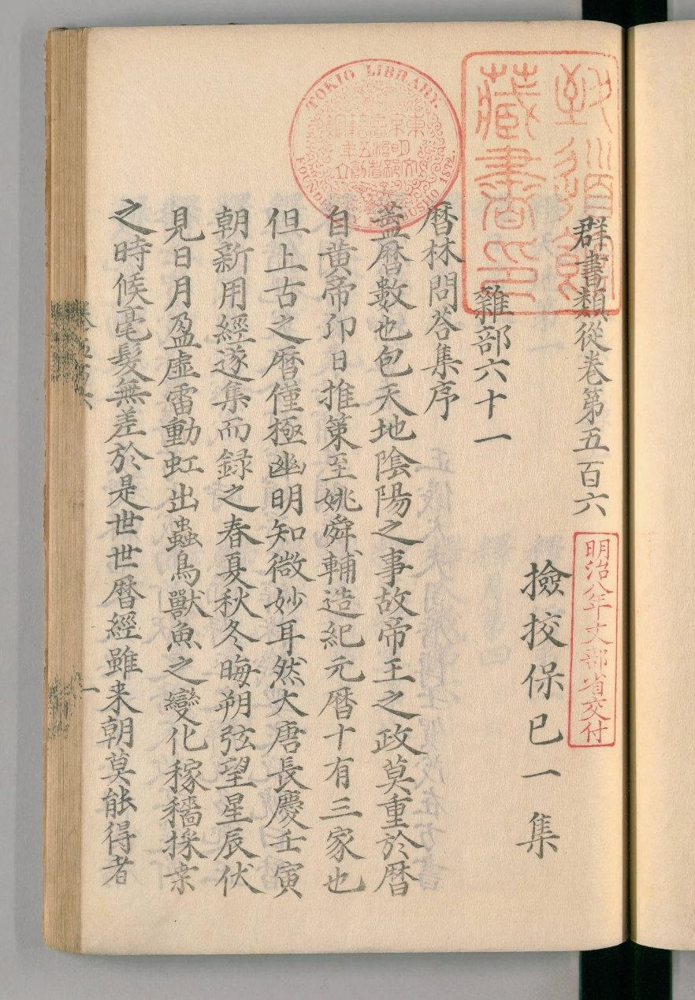
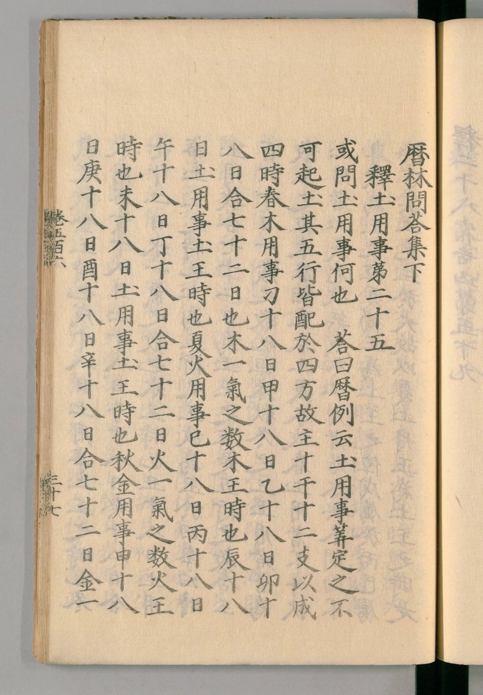

# 暦林問答集（賀茂在方）　現代語訳

賀茂在方（かものあきかた）著／現代語訳

- 原題：暦林問答集（れきりんもんどうしゅう）。序には『暦林問答』とある
- 内容：室町時代の暦博士・賀茂在方が、暦にかかわることがら――天地・日月・星、八将神などの年の方角の神、二十四気と七十二候、六十四卦、閏月、日食・月食、納音、十二直、そして毎日の暦注（天恩・天赦・母倉・帰忌・血忌・往亡・凶会・天一神・土公・伏竜・二十八宿・七曜など）――について、「ある人が問う」「答える」の形で、六十四の問答にまとめた書。上巻二十四段、下巻四十段
- 成立：応永二十一年（一四一四年）正月の序がある
- 底本：塙保己一編『群書類従』巻第五百六 雑部六十一 所収本（版本。国立国会図書館デジタルコレクション、info:ndljp/pid/2559255）。国立国会図書館による機械の文字起こしを下地にし、版面の画像と一字ずつ照らし合わせて本文を定めた
- 著作権：原著は十五世紀の著作、底本は江戸時代の版本で、いずれも保護期間が満了している
- 訳者：人工知能（Claude Opus 5.5）
- 訳の性格：序・目録・本文六十四段・跋・奥書の全訳。各段に、訳者が句読点を補った原文（漢文）と、です・ます調の現代語訳、必要に応じて訳者の補足を付けた。商業出版の現代語訳は、訳者の調べたかぎりでは出ていない

## この本について

　いまのカレンダーにも、「大安」「仏滅」や「一粒万倍日」「天赦日」、あるいは「土用」「社日」といった、暦の日の吉凶を表すことばが書かれていることがあります。こうした日ごとの注記を「暦注（れきちゅう）」といいます。暦注のほとんどは、古代中国の陰陽五行説にもとづいて生まれ、奈良・平安時代に日本に伝わって、朝廷の陰陽寮が作る暦（具注暦〈ぐちゅうれき〉）に毎日書き込まれていました。貴族たちはそれを見て、その日に外出してよいか、髪を洗ってよいか、家を建ててよいかを決めていました。

　『暦林問答集』は、その暦注の一つ一つについて、「これは何か」「なぜそうなるのか」を説明した書物で、日本で書かれたまとまった暦注の解説書としては、もっとも古いものの一つです。著者の賀茂在方は、陰陽道のうち暦を作る「暦道」をつかさどった賀茂氏（勘解由小路家）の人で、室町時代前期の暦博士です。賀茂氏は、安倍晴明の師とされる賀茂保憲（九一七〜九七七）の子孫で、天文道の安倍氏（土御門家）と並んで、陰陽道の二大家でした。在方は文安元年（一四四四年）に没したとされます。

　序によれば、在方がこの本を書いたのは、「年ごと、時ごとに、愚かな師や野の巫のかたよった説が多く起こり、正しい理が乱されてしまった」からでした。室町時代には、朝廷の暦を写した民間の暦（のちの「仮名暦」のもと）が広まりはじめ、暦注の解釈もばらばらになっていました。跋では「道の名を借りて街角で利をあさるようなやからが、この暦を写して世渡りの元手にしている」と、強い調子で嘆いています。在方は、中国の書物――『五行大義』『礼記』月令とその注、『爾雅』『淮南子』、そして『新撰陰陽書』『暦例』『尚書暦』『群忌隆集』『堪輿経』など、いまでは失われた陰陽書――を引いて、暦注の正しい根拠を示そうとしました。

　本書は全六十四段で、『易』の六十四卦にかたどり、上巻は二十四気にちなんで二十四段、下巻は五行の成数の和にちなんで四十段とされています。おおまかに分けると、次のようになります。

- **上巻　第一〜第五**　天地・五行・日・月・星（天文と宇宙論の基礎）
- **上巻　第六〜第十六**　大歳・歳徳・大将軍などの年の方角の神々（八将神）と、歳名・歳次
- **上巻　第十七〜第二十四**　二十四気と七十二候、六十四卦、閏月、日食・月食、納音、十二直、干支、月建（暦の骨組み）
- **下巻　第二十五〜第三十一**　土用・弦望・社日・三伏・臘・没滅など（季節と暦の数にかかわる日）
- **下巻　第三十二〜第五十六**　天恩・天赦・母倉・帰忌・血忌・往亡・日遊・凶会・天一神・大将軍の遊行・土公・伏竜など（毎日の吉凶と方角の暦注）
- **下巻　第五十七〜第六十四**　十干・十二支・二十八宿・七曜の吉凶と、宿曜経にもとづく滅門・大禍・狼藉・羅刹・甘露・金剛峯

　本書は中世の陰陽道の考え方を知るための基本の資料とされ、江戸時代にも写本・刊本で広く読まれました。民間で流行した陰陽書『簠簋内伝（ほきないでん）』とも、暦注の説明に重なるところがあります。

　訳文について。原文は漢文（白文）です。底本は江戸時代の『群書類従』版本で、明らかな誤字と思われるところは、原文・訳文とも改め、各段の補足でそのことを記しました。補った字は〔　〕で示しました。割注（小さな字の注）が多い段（第十八・第五十七・第五十八）では、注の切れ目や順序が読みとりにくく、読みに自信のないところがあり、そのことも補足に記しました。引用されている書物には、いまでは失われたものが多く、何の書かわからないものもあります。調べのつかなかったことは、そう書いておきました。

　本書は、十五世紀の暦の考え方を伝える歴史資料です。ここに書かれた日や方角の吉凶に、科学的な根拠はありません。

## 目次

- 序
- 目録（上巻）
- 上巻　第一　天地／第二　五行／第三　日／第四　月／第五　星
- 上巻　第六　大歳／第七　歳徳／第八　大将軍／第九　大陰／第十　歳刑／第十一　歳破／第十二　歳殺／第十三　黄幡／第十四　豹尾／第十五　歳名／第十六　歳次
- 上巻　第十七　二十四気・七十二候
- 上巻　第十八　六十四卦／第十九　閏月／第二十　日月蝕／第二十一　納音／第二十二　十二直／第二十三　十干十二支／第二十四　月建
- 目録（下巻）
- 下巻　第二十五　土用／第二十六　弦望／第二十七　社日／第二十八　三伏／第二十九　臘／第三十　没滅／第三十一　大歳位前対後／第三十二　天恩／第三十三　天赦／第三十四　母倉／第三十五　帰忌／第三十六　血忌
- 下巻　第三十七　厭・厭対／第三十八　無翹／第三十九　九坎／第四十　重／第四十一　復日／第四十二　往亡／第四十三　日遊／第四十四　凶会／第四十五　八竜七鳥九虎六蛇
- 下巻　第四十六　五墓／第四十七　伐／第四十八　忌遠行／第四十九　忌夜行／第五十　天間／第五十一　歳下食／第五十二　下食時／第五十三　天一／第五十四　大将軍遊行／第五十五　土公土府／第五十六　伏竜
- 下巻　第五十七　十干吉凶／第五十八　十二支吉凶／第五十九　二十八宿吉凶／第六十　七曜吉凶／第六十一　滅門大禍狼藉／第六十二　羅刹／第六十三　甘露／第六十四　金剛峯
- 跋・奥書
- 訳者による付録　暦注のしくみ・引用書目・用語集

---

## 暦林問答集 序

### 原文

蓋暦数也、包天地陰陽之事。故帝王之政、莫重於暦。自黄帝迎日推策、至姚舜輔造紀元暦、十有三家也。但上古之暦、僅極幽明、知微妙耳。然大唐長慶壬寅、朝新用経、遂集而録之。春夏秋冬、晦朔弦望、星辰伏見、日月盈虚、雷動虹出、虫鳥獣魚之変化、稼穡採索之時候、毫髪無差。於是世世暦経雖来朝、莫能得者。貞観之初、大春日真野麻呂、又天徳之末、吾祖司暦博士賀茂保憲、博考大成、而所献之暦、天数不違、所伝莫不規模。然歳歳時時、愚師野巫之僻説多起、正理錯乱矣。故今剪截煩浮之辞、採機要之説、号曰暦林問答。庶来哲補其闕焉。

応永甲午孟春日　正儀大夫司暦博士賀茂在方書

### 現代語訳

　そもそも暦の数というものは、天地と陰陽のことをすべて包みこんでいます。ですから、帝王の政治において、暦より重いものはありません。黄帝が日の運行を迎えて暦の数を推し量ってから、姚舜輔が紀元暦を作るまで、暦を作った家は十三にのぼります。ただし、大昔の暦は、明るいところと暗いところ（目に見えることと見えないこと）を見きわめ、微妙なところを知るだけのものでした。ところが、唐の長慶二年壬寅（八二二年）に、朝廷が新しい暦経を用いることになり、ついにそれらを集めて記録しました。春夏秋冬、晦（みそか）・朔（ついたち）・弦・望（満月）、星々の隠れたり現れたりすること、日と月の満ち欠け、雷が鳴り虹が出ること、虫・鳥・獣・魚の移り変わり、種まきと取り入れ、採集の時節まで、毛すじほどのくいちがいもありませんでした。

　こうして代々の暦経がわが国に渡ってきましたが、それを会得できた者はいませんでした。貞観の初めに大春日真野麻呂（おおかすがのまのまろ）が、また天徳の末に、わたしの先祖である暦博士賀茂保憲（かものやすのり）が、広く考えて大成し、献上した暦は、天の数にたがうことがなく、伝えたものはすべて手本となりました。ところが、年ごと、時ごとに、愚かな師や野の巫（かんなぎ）のかたよった説が多く起こり、正しい理が乱されてしまいました。そこで今、わずらわしく浮わついたことばを切り捨て、大事なかなめの説を採って、『暦林問答』と名づけます。後に来る賢い人が、その欠けたところを補ってくださることを願います。

　応永甲午（応永二十一年、一四一四年）孟春（正月）の日　正儀大夫・暦博士　賀茂在方（かものあきかた）書す

### 補足

- 「姚舜輔」は北宋の暦算家で、崇寧五年（一一〇六年）に「紀元暦」を作りました。
- 「長慶壬寅」は唐の長慶二年（八二二年）。この年から唐では「宣明暦」が用いられました。日本では貞観三年（八六一年）に、大春日真野麻呂の上奏によって宣明暦が採用され、江戸時代の貞享暦（一六八五年）まで八百年あまり使われ続けました。在方の時代の暦も宣明暦です。
- 賀茂保憲（九一七〜九七七）は陰陽道の大家で、安倍晴明の師とされる人物です。暦道を子の光栄に、天文道を晴明に伝えたといわれます。在方はその子孫です。
- 「正儀大夫」は正四位下の唐名（中国風の呼び名）です。

---

## 暦林問答集 目録 上

### 原文

釈天地第一　釈五行第二　釈日第三　釈月第四　釈星第五　釈大歳第六　釈歳徳第七　釈大将軍第八　釈大陰第九　釈歳刑第十　釈歳破第十一　釈歳殺第十二　釈黄幡第十三　釈豹尾第十四　釈歳名第十五　釈歳次第十六　釈二十四気七十二候第十七　釈六十四卦第十八　釈閏月第十九　釈日月蝕第二十　釈納音第二十一　釈十二直第二十二　釈十干十二支第二十三　釈月建第二十四

### 現代語訳

　天地を解く　第一／五行を解く　第二／日を解く　第三／月を解く　第四／星を解く　第五／大歳を解く　第六／歳徳を解く　第七／大将軍を解く　第八／大陰を解く　第九／歳刑を解く　第十／歳破を解く　第十一／歳殺を解く　第十二／黄幡を解く　第十三／豹尾を解く　第十四／歳名を解く　第十五／歳次を解く　第十六／二十四気・七十二候を解く　第十七／六十四卦を解く　第十八／閏月を解く　第十九／日食・月食を解く　第二十／納音を解く　第二十一／十二直を解く　第二十二／十干十二支を解く　第二十三／月建を解く　第二十四

---

## 釈天地 第一

### 原文

或問、天地何也。答曰、渾天儀経云、天大而包地外、地少而居於天内。天表裏有水。天地各乗気而立、載水而行。関令内伝云、天地之南午北子、相去九千万里。東卯西酉、亦九千万里。四隅空相去九千万里。天去地四十千万里。朱氏曰、黄帝書、天地者在太虚空裏、大気挙之。是天地未相分也。両儀已相分、運転而天乗炁而浮、地載水而行不息。天大而雖包地外、炁無涯、水亦無涯。故天外有水、亦地表裏有水。浮天而載地也。天大而半覆地上、半繞地下。故二十八宿半隠。天転如車轂。但天無体、以二十八宿為体。天従東繞西、故云左旋。日月五星同左転。二十八宿諸星麗天、常無動、只随天転耳。周天三百六十五度四分度之一也。故於天二十八宿各有領度。角十三度、亢九度、氐十六度、房五度、心五度、尾十七度、箕十度、合七十五度、三十二星、東方宿也。斗二十四度、牛七度半、女十一度、虚十度二十五分半、危十八度、室十七度、壁十度、合九十七度七十五分半、六十三星、北方宿也。奎十七度半、婁十三度、胃十四度半、昴十一度、畢十六度、觜一度、参九度、合八十二度、五十一星、西方宿也。井三十度、鬼三度、柳十四度、星七度、張十九度、翼十九度、軫十八度半、合一百十一度半、九十八星、南方宿也。都三百六十五度四分度之一也。度一千九百三十二里也。於地有州国、有分野。但自東漢以降、暦家之法、日月星皆逆天而為右行。故日月会宿、寅析木、丑星紀、子玄枵之次、謂之冬会。亥娵訾、戌降婁、酉大梁之次、謂之春会。申実沈、未鶉首、午鶉火之次、謂之夏会。巳鶉尾、辰寿星、卯大火之次、謂之秋会。則日月右行交会、而成一月之辰也。於是因横渠之説、朱氏曰、古今暦家之法、以退数算之。故日遅而毎日一度行、月速毎日十三度行。此説如上、未一定之法。如両先生者、天最速進、日一度退、月最遅而十三度退。皆雖同道同行、不及天而所退、行反似右行。而全日遅非月疾、日月逆天非右行矣。又云、牛宿十一月星紀之次、天北端之極也。天運降近南、故牛降南端、自冬至漸而升。井宿四月実沈之次、南端之極也。天運升近北、故井升北端、自夏至漸而降。亦南北升降之中、為春秋。鎮成曰、日月随天而下降、至南端之極、謂左旋。随天而上升、至北端之極、謂右行。以為南北升降為左右。此説且為好。姚信昕天論曰、天体南低入地、北則高。冬至極低、日去人遠、北天気至、故氷寒也。夏至極起、日去人近、南天気至、故蒸熱也。天極高時、日行地中深、故夜長昼短。然則天行、冬依於渾儀、夏依於蓋天也。天似蓋笠、地法覆盤。天地各中高外下。地極之下為天地之中。三光隠映、為昼夜。天円而動、地方而静。天十二神動移無窮、地之日辰静而待之。夫星辰遅速、日月運行、雷発虹見、雲行雨施、是天之象也。二十八舎内外諸官、七曜三光、星分歳次、是天之数也。山川水陸、高下平汀、嶽鎮河通、風廻露蒸、是地之象也。八極四海、三江五湖、九州百郡、千里万頃、是地之数也。於是元気始萌、陰陽始生、炁形立端、清濁分別、質形已具。此五者天地之運通也。天以剛健之徳覆、地以柔順之徳載也。

### 現代語訳

　ある人が問いました。「天地とは何ですか」。

　答えます。『渾天儀経（こんてんぎきょう）』には、こうあります。「天は大きくて地の外を包み、地は小さくて天の内にある。天の表にも裏にも水がある。天と地はそれぞれ気に乗って立ち、水を載せて動いている」。

　『関令内伝（かんれいないでん）』には、こうあります。「天地の南の午（うま）と北の子（ね）とは、九千万里へだたっている。東の卯（う）と西の酉（とり）も、やはり九千万里。四隅もまた九千万里へだたっている。天は地から四十千万里（四億里）離れている」。

　朱氏（朱子）は言います。「『黄帝書』によれば、天地は大いなる虚空の中にあり、大いなる気がそれを持ち上げている」。これは天と地がまだ分かれていない状態です。両儀（天と地）が分かれてからは、天はめぐり動いて気に乗って浮かび、地は水を載せて休みなく動きます。天は大きくて地の外を包んでいますが、気には果てがなく、水にも果てがありません。ですから、天の外にも水があり、地の表と裏にも水があります。水は天を浮かべ、地を載せているのです。

　天は大きく、半分は地の上をおおい、半分は地の下をめぐっています。そのため二十八宿の半分は（地の下に）隠れています。天は車の轂（こしき）のようにまわります。ただし天そのものには形がなく、二十八宿を形としています。天は東から西へめぐるので「左旋（させん）」といいます。日・月・五星（五つの惑星）も同じく左へまわります。二十八宿やもろもろの星は天にはりついていて、自分では少しも動かず、ただ天のめぐりにしたがって動くだけです。

　天をひとめぐりすると三百六十五度と四分の一度です。そこで天では、二十八宿がそれぞれ受け持つ度数を持っています。角（かく）十三度、亢（こう）九度、氐（てい）十六度、房（ぼう）五度、心（しん）五度、尾（び）十七度、箕（き）十度、合わせて七十五度、星の数は三十二で、これが東方の宿です。斗（と）二十四度、牛（ぎゅう）七度半、女（じょ）十一度、虚（きょ）十度二十五分半、危（き）十八度、室（しつ）十七度、壁（へき）十度、合わせて九十七度七十五分半、星の数は六十三で、これが北方の宿です。奎（けい）十七度半、婁（ろう）十三度、胃（い）十四度半、昴（ぼう）十一度、畢（ひつ）十六度、觜（し）一度、参（しん）九度、合わせて八十二度、星の数は五十一で、これが西方の宿です。井（せい）三十度、鬼（き）三度、柳（りゅう）十四度、星（せい）七度、張（ちょう）十九度、翼（よく）十九度、軫（しん）十八度半、合わせて百十一度半、星の数は九十八で、これが南方の宿です。すべてで三百六十五度と四分の一度です。一度は千九百三十二里にあたります。

　地には州や国があり、（それぞれ天の宿に対応する）分野があります。

　ところで、東漢（後漢）より後の暦家の方法では、日・月・星はみな天とは逆に、右へ動くとしています。そこで日と月が宿で出会う場所（次）について、寅の析木（せきぼく）、丑の星紀（せいき）、子の玄枵（げんきょう）の次で出会うのを「冬の会」といいます。亥の娵訾（しゅし）、戌の降婁（こうろう）、酉の大梁（たいりょう）の次で出会うのを「春の会」といいます。申の実沈（じっちん）、未の鶉首（じゅんしゅ）、午の鶉火（じゅんか）の次で出会うのを「夏の会」といいます。巳の鶉尾（じゅんび）、辰の寿星（じゅせい）、卯の大火（たいか）の次で出会うのを「秋の会」といいます。つまり、日と月が右へ動いて出会うことで、一か月の辰（とき）ができるのです。

　これについて、横渠（張載）の説をうけて、朱氏はこう言います。「昔から今までの暦家の方法では、退いていく数で計算する。だから日は遅くて毎日一度進み、月は速くて毎日十三度進むという」。この説は上に述べたとおりで、まだ決まった方法ではありません。二人の先生の考えでは、天がもっとも速く進み、日は（天に対して）一日に一度退き、月はもっとも遅くて十三度退きます。どれも同じ道を同じ向きに進むのですが、天に追いつけずに退くので、その動きがかえって右へ動いているように見えるのです。決して日が遅く月が速いのではありませんし、日と月が天に逆らって右へ動いているのでもありません。

　また（朱氏は）こうも言います。「牛宿は十一月の星紀の次にあり、天の北の端の極である。天の運行は下って南に近づく。だから牛は南の端まで下り、冬至からしだいに上る。井宿は四月の実沈の次にあり、南の端の極である。天の運行は上って北に近づく。だから井は北の端まで上り、夏至からしだいに下る。その南北の上り下りの中ほどが、春と秋である」。

　鎮成（ちんせい）はこう言います。「日と月は天にしたがって下降し、南の端の極にいたる。これを左旋という。天にしたがって上昇し、北の端の極にいたる。これを右行という」。南北の上り下りを左と右としているのです。この説は、ひとまずよいと思われます。

　姚信（ようしん）の『昕天論（きんてんろん）』には、こうあります。「天の体は南が低くて地に入り、北は高い。冬至には（南の極が）もっとも低く、日は人から遠ざかり、北の天の気がやってくるので、氷が張って寒い。夏至には（南の極が）もっとも起き上がり、日は人に近づき、南の天の気がやってくるので、蒸し暑い。天の極が高いときは、日が地の中を深く通るので、夜が長く昼が短い」。そうだとすれば、天の運行は、冬は渾天の説に、夏は蓋天の説にしたがうことになります。

　天は蓋（かさ）や笠に似ており、地は伏せた盤（たらい）にならっています。天も地も、それぞれまん中が高く外側が低くなっています。地の極の下が天地の中心です。三光（日・月・星）が隠れたり照ったりして、昼と夜になります。

　天は円くて動き、地は四角くて静かです。天の十二神は果てしなく動いて移り、地の日辰（日の十二支）は静かにそれを待ちます。

　星々の遅い速い、日と月のめぐり、雷が鳴り虹が現れ、雲が行き雨が降ること、これが天の象（すがた）です。二十八舎（二十八宿）と内外のもろもろの星官、七曜と三光、星の分野と歳の次（宿り）、これが天の数です。山と川、水と陸、高いところ低いところ、平らな水辺、岳がしずめ河が通い、風がめぐり露が立ちのぼること、これが地の象です。八方の果てと四海、三江と五湖、九州と百郡、千里と万頃（ばんけい：広大な田）、これが地の数です。

　こうして元気（根本の気）がはじめて芽生え、陰陽がはじめて生まれ、気と形が端緒を立て、清いものと濁ったものが分かれ、質と形がそなわりました。この五つが、天地のめぐり通じるしくみです。天は剛健の徳によっておおい、地は柔順の徳によって載せているのです。

### 補足

- 「渾天」は、天が卵の殻のように地を包んで回るという中国の宇宙論、「蓋天」は、天が笠のように地の上にかぶさっているという宇宙論です。姚信（三国呉の人）の「昕天論」は、その折衷説の一つです。
- 二十八宿の度数を足すと、東方75度、北方97.755度、西方82度で、南方を本文のとおり111.5度とすると合計は366.255度になり、「三百六十五度四分度之一」と合いません。南方の各宿の度数を足すと110.5度なので、「一百十一度半」は「一百十度半」の誤りと思われます。ここでの「分」は百分の一度、「半」はさらにその半分（〇・〇〇五度）を表しています。
- 「析木」「星紀」などは、天の赤道を十二に分けた「十二次」の名前です。
- 「横渠」は北宋の儒者・張載（一〇二〇〜一〇七七）、「朱氏」は朱熹（朱子、一一三〇〜一二〇〇）です。二人は、日も月も天と同じく左に回るが天より遅いために右へ動くように見える、という「左旋説」をとりました。本文の朱氏の言葉は、おおむね『朱子語類』に見えるものです。
- 「鎮成」は人名と思われますが、どの人物か確かめられませんでした。

---

## 釈五行 第二

### 原文

或問、五行何也。答曰、春秋元命苞云、五行万物之始也。木居陽之位、東方主春、以温柔為体、以曲直為性。含陰炁、内空虚、外有花葉、如人之威儀容貌。故相字目傍木也。其木不失曲直之性、則五穀茂盛敦実也。火居大陽之位、南方主夏、以明熱為体、以炎上為性。故内暗外明也。其火不失炎上之性、則天下大治、垂拱無為也。土為地道、万物貫穿而生、持実含散為体。種曰稼、納曰穡、故以稼穡為性。又土居中央、主四季、成四時、為内事、宮室夫婦親属之象也。故順中和之気、則土得其性、百穀実而稼穡成也。金居少陰之位、西方主秋、以強冷為体、以従革為性。故禁不義以安百姓、不忌危、則金順其性、故万物皆熟、百穀成也。水居大陰之位、北方主冬、以寒虚為体、以潤下為性。陽之所始、陰之所終也。是綱紀之時、故宗廟祭祀之象也。是以順水気、則水不失潤下之性、源泉通流、以利民用。是釈大概如此。

### 現代語訳

　ある人が問いました。「五行とは何ですか」。

　答えます。『春秋元命苞（しゅんじゅうげんめいほう）』には、こうあります。「五行は万物の始まりである」。

　木（もく）は陽の位にあり、東方で春をつかさどります。温かく柔らかいことを体（本体）とし、曲がったりまっすぐになったりすることを性（はたらき）とします。陰の気を含み、内側は空っぽで、外側には花と葉があり、人の威儀や容貌のようです。だから「相（すがた）」という字は「目」のかたわらに「木」を書くのです。木が曲直の性を失わなければ、五穀はよく茂り、しっかりと実ります。

　火は太陽（陽のきわみ）の位にあり、南方で夏をつかさどります。明るく熱いことを体とし、燃え上がることを性とします。だから内側は暗く、外側は明るいのです。火が燃え上がる性を失わなければ、天下はよく治まり、君主は衣の裾を垂れ手をこまねいたまま、何もしないでも世が治まります。

　土は地の道で、万物はそれを貫いて生まれます。実を保ち、散るものを含むことを体とします。種をまくことを「稼（か）」、取り入れることを「穡（しょく）」といい、土は稼穡を性とします。また土は中央にあって四季（四つの季節の終わりの土用）をつかさどり、四つの季節を成り立たせます。内のことをつかさどり、家屋・夫婦・親族の象（かたどり）です。ですから、中和の気にしたがえば、土はその性を得て、百穀は実り、取り入れがととのいます。

　金（ごん）は少陰の位にあり、西方で秋をつかさどります。強く冷たいことを体とし、（形を）従わせ改めることを性とします。だから、不義を禁じて民を安んじ、危うさをいとわなければ、金はその性にしたがい、万物はみな熟し、百穀が実ります。

　水は太陰（陰のきわみ）の位にあり、北方で冬をつかさどります。寒く虚しいことを体とし、うるおして下ることを性とします。陽の始まるところ、陰の終わるところです。これは物事の大もとを締めくくる時なので、宗廟の祭祀の象です。ですから水の気にしたがえば、水はうるおして下る性を失わず、泉は通い流れて、民の暮らしの役に立ちます。

　五行の解釈のあらましは、このとおりです。

### 補足

- 『春秋元命苞』は漢代の緯書（経書に付会した神秘的な書）の一つで、今は散逸しています。ここの五行の説明は、隋の蕭吉『五行大義』にもほぼ同じ文があり、在方は『五行大義』から引いていると思われます（群書類従本の奥書にも「印本と五行大義で校合した」とあります）。
- 「曲直」「炎上」「稼穡」「従革」「潤下」は、『書経』洪範篇にある五行の性の言い方です。

---

## 釈日 第三

### 原文

或問、日何也。答曰、定象紀云、日大陽之精也。又五経通義曰、陽以一起、故日行一度。陽成於三、故中有三足烏。又云、日火精、陽炁也。外熱内陰、象烏之黒也。白虎通云、日径千里、周三千里、下於天七千里。日一南万物死、日一北万物生。故夏陽盛而陰衰、故昼長夜短。冬陰盛而陽衰、故昼短夜長。日行陽道長、出入卯酉之北。行陰道短、出入卯酉之南。春秋陰陽等、故行中道、昼夜等也。漢書天文志云、日君之象也。君行急則日行疾、君行緩則日行遅。是以観乎天文、以察乎時変。

### 現代語訳

　ある人が問いました。「日とは何ですか」。

　答えます。『定象紀（ていしょうき）』には、「日は太陽の精である」とあります。また『五経通義（ごきょうつうぎ）』には、こうあります。「陽は一から起こるので、日は一日に一度進む。陽は三で完成するので、日の中には三本足の烏（からす）がいる」。またこうもあります。「日は火の精で、陽の気である。外は熱く内は陰なので、烏の黒さにかたどる」。

　『白虎通（びゃっこつう）』には、こうあります。「日の直径は千里、周囲は三千里で、天から七千里下にある。日が南に行けば万物は死に、日が北に行けば万物は生まれる」。ですから夏は陽が盛んで陰が衰えるので、昼が長く夜が短いのです。冬は陰が盛んで陽が衰えるので、昼が短く夜が長いのです。日が陽の道を行くときは（その道が）長く、卯（東）と酉（西）よりも北から出て北に入ります。陰の道を行くときは短く、卯と酉よりも南から出て南に入ります。春と秋は陰と陽が等しいので、中の道を行き、昼と夜が等しくなります。

　『漢書』天文志には、こうあります。「日は君主の象である。君主の行いがせっかちであれば日の運行は速くなり、君主の行いがゆるやかであれば日の運行は遅くなる」。ですから、天の文（あや）をよく見て、時の移り変わりを察するのです。

### 補足

- 「三足烏（さんそくう）」は、太陽の中にすむとされた三本足のカラスです。日本では八咫烏（やたがらす）と結びつけられることもあります。
- 『定象紀』は、どのような書か確かめられませんでした。

---

## 釈月 第四

### 原文

或問、月何也。答曰、定象紀云、月大陰之宗、積而成也。中有獣象兎、陰之類。其兎善走、象陽動也。春秋元命苞云、月水之精、故内明而気冷、為陰精、故体自無光、藉日照之乃明。猶以臣自無威、仮君之勢乃成其威。月初未対日、故無光。欠月半而与日相対、故光満。十六日以後漸欠、亦漸不対日也。又云、月大陰之位、后妃之象、諸侯大臣之類。

### 現代語訳

　ある人が問いました。「月とは何ですか」。

　答えます。『定象紀』には、こうあります。「月は太陰の大もと（の気）が積もってできたものである。中に獣がいて、その姿は兎で、陰のたぐいである。兎はよく走るので、陽の動きをかたどっている」。

　『春秋元命苞』には、こうあります。「月は水の精である。だから内は明るく気は冷たい。陰の精であるから、それ自体には光がなく、日に照らされてはじめて明るくなる。ちょうど臣下がそれ自体には威光がなく、君主の勢いを借りてはじめて威光をなすようなものである。月の初めはまだ日と向かい合っていないので光がない。月の半ばに欠けたところが（なくなり）日と向かい合うので、光が満ちる。十六日から後はしだいに欠けていく。これもしだいに日と向かい合わなくなるからである」。またこうもあります。「月は太陰の位であり、后妃の象であり、諸侯や大臣のたぐいである」。

## 釈星 第五

### 原文

或問、星何也。答曰、張衡云、衆星万物之精、列布体生於地、各有攸属。在野象物、在朝象官、在人象事。又居中央、謂之北斗、天之枢也。合誠図云、第一名枢、二名璇、三名璣、四名権、五名衡、六名開陽、七名揺光。黄帝斗図云、第一名貪狼、主子。二名巨門、主丑亥。三名禄存、主寅戌。四名文曲、主卯酉。五名廉貞、主辰申。六名武曲、主巳未。七名破軍、主午。孔子元辰経云、第一名陽明星、第二名陰精星、第三名真人星、第四名玄冥星、第五名丹元星、第六名北極星、第七名天関星。又云、第一水、二水土、三木土、四金木、五金土、六火土、七火。於是子午為天地之経、故斗第一主子、第七主午、従第二至第六、各主両辰。或主人之本命、以定吉凶、或主物之根元、以生万品。且又有五星、則五行之精也。為上帝五使、稟受神命而各司下土。故配於五方、異于政、或有福徳助、或禍罰威刑、順軌而常、錯乱以顕異。故歳星木之精、其位在東方、主春、蒼帝之子、人君之象、五星之長、司農之官、主福慶。凡有六名、一曰摂提、二曰重華、三曰応星、四曰纏星、五曰紀星、六曰脩人星。其於五常仁也、於人主肝。凡歳星観察三□、以進退順逆、決定天下之理也。歳星其明如常、則五穀滋盛、国家安寧、民間有福慶。主歳、故名歳星。熒惑星火之精、其位南方、主夏、赤帝之子、方伯之象、五星之伯。上象太一、下司人君。凡有二名、一曰執法、二曰罰星。其於五常礼也、於人主心。又主歳之成敗、察妖孽。禍乱所行、有兵乱疾疫飢旱災火也。但其君修徳、則不為咎而加福。出入無常、故名熒惑也。填星土之精、其位中央、主四季、黄帝之子、女主之象、主徳、為五星之王。一名地侯。其於五常信也、於人主脾。填星順度、則国寧民富、五穀豊熟也。若填星失度、則歳多風殺無実。太白星金之精、其位西方、主秋、白帝之子、大将之象、以司凶兵。凡有六名、一曰天相、二曰天政、三曰大臣、四曰大師、五曰明星、六曰天囂。詩云、東曰啓明、西曰長庚。其於五常義也、於人主肺。太白乱行不居其度、兵数起、不熟而悪。太白出入順度、則天下昌豊也。西方金色白、故曰太白也。辰星水之精、其位北方、主冬、黒帝之子也。凡有六名、一曰安調、二曰細極、三曰能星、四曰鉤星、五曰司農、六曰勉星。其於五常智也、於人主腎。凡辰星司災変殺伐。左氏曰、辰星四仲月（二月五月八月十一月）出、則天下太平、五穀豊熟也。天之執正、出入平時也。此五星在天者、主木火土金水之五行、在地者主五方五岳、居人者主五蔵五根、於五常主仁義礼智信、於五事貌也視也言也聴也思也。此五者不闕、行之者終久、保之者徳顕。故動於天地、令感鬼神。天文要抄云、五星盈縮失度、則其精降于地為人。歳星降為貴臣、熒惑降為童児歌謡嬉戯、填星降為老人老婦女、太白降為壮夫処於林麓、辰星降為婦人。凡諸星皆如此。尚書霊耀云、二十八宿天元気、万物之精也。故東方角亢氐房心尾箕七宿、其形如龍、曰左青龍。南方井鬼柳星張翼軫七宿、其形如鶉鳥、曰前朱雀。西方奎婁胃昴畢觜参七宿、其形如虎、曰右白虎。北方斗牛女虚危室壁七宿、其形如亀蛇、曰後玄武。二十八宿皆有龍虎鳥亀之形、随天左旋。亦五星従北行南為順行、従南行北為退行、為逆行。又五星早出為盈、晩出為縮。又日月星辰謂之天文、日月与星謂之三光、日月五星謂之七曜、衆星並光謂之辰。各晨昏正、寒暑生、歳時成也。六合之間無不照明、皆知天下之損益、定人倫之禍福耳。

### 現代語訳

　ある人が問いました。「星とは何ですか」。

　答えます。張衡は言います。「もろもろの星は万物の精である。並んで散らばっているが、その体は地から生まれ、それぞれ属するところがある。野にあっては物をかたどり、朝廷にあっては官職をかたどり、人にあっては事柄をかたどる」。

　また、まん中にあるものを北斗といい、天の枢（くるる：回転の軸）です。『合誠図（ごうせいず）』には、こうあります。「第一を枢（すう）、第二を璇（せん）、第三を璣（き）、第四を権（けん）、第五を衡（こう）、第六を開陽（かいよう）、第七を揺光（ようこう）という」。

　『黄帝斗図（こうていとず）』には、こうあります。「第一を貪狼（とんろう）といい、子をつかさどる。第二を巨門（こもん）といい、丑と亥をつかさどる。第三を禄存（ろくぞん）といい、寅と戌をつかさどる。第四を文曲（もんごく）といい、卯と酉をつかさどる。第五を廉貞（れんじょう）といい、辰と申をつかさどる。第六を武曲（むごく）といい、巳と未をつかさどる。第七を破軍（はぐん）といい、午をつかさどる」。

　『孔子元辰経（こうしげんしんきょう）』には、こうあります。「第一を陽明星、第二を陰精星、第三を真人星、第四を玄冥星、第五を丹元星、第六を北極星、第七を天関星という」。またこうもあります。「第一は水、第二は水と土、第三は木と土、第四は金と木、第五は金と土、第六は火と土、第七は火である」。

　つまり、子と午は天地の経（たていと）なので、北斗の第一の星が子を、第七の星が午をつかさどり、第二から第六までは、それぞれ二つの辰（十二支）をつかさどるのです。あるいは人の本命（生まれ年の星）をつかさどって吉凶を定め、あるいは物の根元をつかさどって、あらゆるものを生み出します。

　さらに五星があります。これは五行の精です。上帝の五人の使いとして、神の命を受けて、それぞれ下界をつかさどります。そこで五つの方角に配され、まつりごとを分けて受け持ち、あるいは福と徳で助け、あるいは災いと罰と威と刑を下します。軌道にしたがっていれば常の状態で、乱れれば異変を表します。

　まず歳星（さいせい：木星）は木の精で、その位置は東方、春をつかさどります。蒼帝の子で、君主の象、五星の長、農をつかさどる官で、福と喜びをつかさどります。全部で六つの名があります。一に摂提（せってい）、二に重華（ちょうか）、三に応星（おうせい）、四に纏星（てんせい）、五に紀星（きせい）、六に脩人星（しゅうじんせい）です。五常では仁にあたり、人の体では肝をつかさどります。歳星は（天下を）観察し、その進み退き、順行と逆行によって、天下の道理を決めます。歳星の明るさがふだんどおりであれば、五穀はよく茂り、国家は安らかで、民には福と喜びがあります。歳をつかさどるので「歳星」というのです。

　熒惑星（けいこくせい：火星）は火の精で、その位置は南方、夏をつかさどります。赤帝の子で、方伯（地方の長官）の象、五星の伯（かしら）です。上は太一にかたどり、下は君主をつかさどります。全部で二つの名があります。一に執法（しっぽう）、二に罰星（ばっせい）です。五常では礼にあたり、人の体では心臓をつかさどります。また一年の成功と失敗をつかさどり、あやしい災いの兆しを見張ります。熒惑が災いを行うところには、戦乱・疫病・飢饉・日照り・火災があります。ただし、その国の君主が徳を修めれば、とがめを下さずに、かえって福を加えます。出たり入ったりが定まらないので「熒惑（まどわす）」というのです。

　填星（てんせい：土星）は土の精で、その位置は中央、四季をつかさどります。黄帝の子で、女主（皇后）の象、徳をつかさどり、五星の王です。またの名を地侯（ちこう）といいます。五常では信にあたり、人の体では脾臓をつかさどります。填星が度をたがえずに進めば、国は安らかで民は富み、五穀はよく実ります。もし填星が度を失えば、その年は風が多く、作物は枯れて実りません。

　太白星（たいはくせい：金星）は金の精で、その位置は西方、秋をつかさどります。白帝の子で、大将の象、凶事と戦をつかさどります。全部で六つの名があります。一に天相（てんそう）、二に天政（てんせい）、三に大臣（たいしん）、四に大師（たいし）、五に明星（みょうじょう）、六に天囂（てんごう）です。『詩経』には「東にあるのを啓明（けいめい：明けの明星）、西にあるのを長庚（ちょうこう：宵の明星）という」とあります。五常では義にあたり、人の体では肺をつかさどります。太白が乱れて動き、その度にとどまらなければ、たびたび戦が起こり、作物は実らず、世は悪くなります。太白の出入りが度にかなっていれば、天下は栄えて豊かになります。西方の金の色は白いので「太白」というのです。

　辰星（しんせい：水星）は水の精で、その位置は北方、冬をつかさどります。黒帝の子です。全部で六つの名があります。一に安調（あんちょう）、二に細極（さいきょく）、三に能星（のうせい）、四に鉤星（こうせい）、五に司農（しのう）、六に勉星（べんせい）です。五常では智にあたり、人の体では腎臓をつかさどります。辰星は災いや異変、殺伐をつかさどります。『左氏伝』には、「辰星が四仲の月（二月・五月・八月・十一月）に出れば、天下は太平で、五穀がよく実る」とあります。これは天がまさしく正しく運行し、出入りが時にかなっているからです。

　この五星は、天にあっては木・火・土・金・水の五行をつかさどり、地にあっては五つの方角と五つの名山をつかさどり、人にあっては五臓と五根（五つの感覚器官）をつかさどります。五常では仁・義・礼・智・信を、五事では貌（ふるまい）・視（見ること）・言（言うこと）・聴（聞くこと）・思（思うこと）をつかさどります。この五つを欠かさずに行う者は長く続き、保つ者は徳が表れます。ですから天地を動かし、鬼神を感じさせるのです。

　『天文要抄（てんもんようしょう）』には、こうあります。「五星の進み過ぎ遅れ過ぎが度を失えば、その精が地に降りて人となる。歳星は降りて身分の高い臣下となり、熒惑は降りて子どもとなり、歌をうたい遊びたわむれる。填星は降りて老人や老女となり、太白は降りて壮年の男となって山林のふもとに住み、辰星は降りて女となる」。もろもろの星はみなこのようです。

　『尚書考霊耀（しょうしょこうれいよう）』には、こうあります。「二十八宿は天の元気であり、万物の精である。そこで東方の角・亢・氐・房・心・尾・箕の七宿は、その形が龍のようなので、左の青龍という。南方の井・鬼・柳・星・張・翼・軫の七宿は、その形が鶉（うずら）の鳥のようなので、前の朱雀という。西方の奎・婁・胃・昴・畢・觜・参の七宿は、その形が虎のようなので、右の白虎という。北方の斗・牛・女・虚・危・室・壁の七宿は、その形が亀と蛇のようなので、後ろの玄武という」。二十八宿はみな、龍・虎・鳥・亀の形をしていて、天にしたがって左へめぐります。

　また、五星が北から南へ行くのを順行といい、南から北へ行くのを退行または逆行といいます。五星が早く出るのを盈（えい：進み過ぎ）、遅く出るのを縮（しゅく：遅れ）といいます。

　さらに、日・月・星・辰をまとめて天文といい、日・月と星を三光といい、日・月と五星を七曜といい、もろもろの星が並んで光るのを辰といいます。これらがそれぞれ朝と夕べを正し、寒さと暑さを生み、一年の時節を成り立たせるのです。天地四方のあいだで照らされないところはなく、すべて天下の損なわれることと益することを知り、人の世の禍福を定めるのです。

### 補足

- 北斗七星の名は、中国では「天枢・天璇・天璣・天権・玉衡・開陽・揺光」と呼ばれます。「貪狼」以下の七つの名は、道教や密教の北斗信仰で用いられる名で、生まれ年の十二支によって自分の「本命星」が決まるとされました。
- 原文の「凡歳星観察三□」は、「三」の下の字が判読しにくく（群書類従版本では「戈」のような字形）、意味がはっきりしません。訳では大意をとりました。
- 「尚書霊耀」は、漢代の緯書『尚書考霊耀』のことと思われます。

---

## 釈大歳 第六

### 原文

或問、大歳者何也。答曰、暦例云、大歳者歳星之精、降天地之間、観察万物、臨見八方。故名歳之君。慎之者保、逆之者亡。巡行於十二支也。子歳在正北、丑歳在丑、余方皆尓。十有二年、運終而復始。其方主歳、故為一年之君、有福最吉方也。更不可犯作凶事。殊出軍討敵、向之大凶。若向此方挙凶事、疫病起也。

### 現代語訳

　ある人が問いました。「大歳（だいさい）とは何ですか」。

　答えます。『暦例（れきれい）』には、こうあります。「大歳は歳星（木星）の精で、天と地のあいだに降り、万物を観察し、八方をのぞみ見る。だから歳の君という。これをつつしむ者は身を保ち、逆らう者は滅びる」。

　（大歳は）十二支をめぐります。子の年には真北にあり、丑の年には丑の方角にあり、ほかの方角もみなこのとおりです。十二年でひとめぐりを終えて、また始めにもどります。大歳のいる方角はその年をつかさどるので、一年の君であり、福のあるもっとも吉い方角です。けれども、そちらに向かって凶事をしてはなりません。ことに軍を出して敵を討つときに、この方角に向かうのは大凶です。もしこの方角に向かって凶事を行えば、疫病が起こります。

### 補足

- 「大歳（太歳）」以下、第十四の「豹尾」までの八つは、暦の上で毎年の方角の吉凶をつかさどる「八将神（はっしょうじん）」と呼ばれる神々です。江戸時代の暦にも毎年の位置が書かれ、方違えや家の普請の目安にされました。
- 大歳は、木星の動き（約十二年で天をひとめぐりする）と逆向きに十二支をめぐるとされた、仮想の星です。

---

## 釈歳徳 第七

### 原文

或問、歳徳者何也。答曰、五行書云、凡陰陽用事、遇徳為善。故歳徳方、一年間有徳方也。皆十干徳也。但五為陽徳（甲丙戊庚壬）、五為陰徳（乙丁己辛癸）。其甲歳徳者在東宮甲方、丙歳徳者在南宮丙方、戊歳徳者在中宮戊方（中宮者在丙方）、庚歳徳者在西宮庚方、壬歳徳者在北宮壬方。此五干歳徳各為陽徳、故在其方。次乙歳徳者在西宮庚方、丁歳徳者在北宮壬方、己歳徳者在東宮甲方、辛歳徳者在南宮丙方、癸歳徳者在中宮戊方。其乙丁己辛癸者為陰干、故自無徳、配合陽干而成徳。是以己為甲妻相合、故己歳徳在甲。辛為丙妻相合、故辛歳徳在丙。乙為庚妻相合、故乙歳徳在庚。癸為戊妻相合、故癸歳徳在戊。孔子曰、稟気於陽、定形於陰云云。其戊己者火生土之故、戊属丙方、己属丁方。又号中宮、戊己土也。五行本也。言宮者舎也、故称之。五行皆畏於相剋、故以木妹妻庚金、以火妹妻於壬水、以土妹妻於甲木、以金妹妻於丙火、以水妹妻於戊土。是五行皆畏於相剋、故各配合而以生万物也。

### 現代語訳

　ある人が問いました。「歳徳（としとく）とは何ですか」。

　答えます。『五行書』には、こうあります。「およそ陰陽のことを行うとき、徳に出会えば善とする」。ですから歳徳の方角とは、一年のあいだ徳のある方角です。どれも十干の徳です。そのうち五つが陽の徳（甲・丙・戊・庚・壬）、五つが陰の徳（乙・丁・己・辛・癸）です。

　甲の年の歳徳は東宮の甲の方角に、丙の年の歳徳は南宮の丙の方角に、戊の年の歳徳は中宮の戊の方角（中宮は丙の方角にあります）に、庚の年の歳徳は西宮の庚の方角に、壬の年の歳徳は北宮の壬の方角にあります。この五つの干の歳徳は、それぞれ陽の徳なので、自分の方角にあるのです。

　次に、乙の年の歳徳は西宮の庚の方角に、丁の年の歳徳は北宮の壬の方角に、己の年の歳徳は東宮の甲の方角に、辛の年の歳徳は南宮の丙の方角に、癸の年の歳徳は中宮の戊の方角にあります。乙・丁・己・辛・癸は陰の干なので、自分自身には徳がなく、陽の干と連れ合うことで徳をなすのです。そこで、己は甲の妻として連れ合うので、己の年の歳徳は甲にあります。辛は丙の妻として連れ合うので、辛の年の歳徳は丙にあります。乙は庚の妻として連れ合うので、乙の年の歳徳は庚にあります。癸は戊の妻として連れ合うので、癸の年の歳徳は戊にあります。

　孔子は「気を陽から受け、形を陰によって定める」と言っています。戊と己は、火が土を生むという関係から、戊は丙の方角に、己は丁の方角に属します。また中宮と呼ぶのは、戊己が土だからです。土は五行の本です。「宮」というのは「舎（やど）」のことなので、そう呼ぶのです。

　五行はみな、相剋（そうこく：互いに打ち負かす関係）を恐れます。そこで木の妹（乙）を庚の金にめあわせ、火の妹（丁）を壬の水にめあわせ、土の妹（己）を甲の木にめあわせ、金の妹（辛）を丙の火にめあわせ、水の妹（癸）を戊の土にめあわせます。これは五行がみな相剋を恐れるので、それぞれ連れ合わせて万物を生み出すのです。

### 補足

- 原文（群書類従本）は「是以乙為甲妻相合、故己歳徳在甲」となっていますが、後の文や十干の組み合わせ（甲と己、乙と庚、丙と辛、丁と壬、戊と癸を「干合」という）から見て、「乙」は「己」の誤りと考え、訳では改めました。なお丁と壬の組については、ここでは説明が省かれています。
- 「木の妹を金にめあわせる」というのは、金は木を打ち負かす（金剋木）ので、木は自分の妹（陰の木＝乙）を金（陽の金＝庚）に嫁がせて和をはかる、という考え方です。
- 歳徳神は「恵方（えほう）」の神として親しまれ、正月に恵方を拝んだり恵方参りをしたりする習わしのもとになりました。

---

## 釈大将軍 第八

### 原文

或問、大将軍者何也。答曰、新撰陰陽書云、大将軍者太白之精、天之上客、太一紫微宮方伯之神也。不居四孟、常行四仲、以正四方。三歳一移。百事不可犯云云。其太白西方星、金精也。降地而三歳之間為方伯之神、十有二年運四方、終而復始矣。金者禁也、主裁断。故犯之者必受殃。其居礎立柱上棟修造移徙嫁娶塗竈掘井築垣出軍葬埋起土、百事犯用之太凶。於是、大将軍常行四仲以正四方、三歳一移云云。以此文、在東方者只卯方可忌之、寅甲乙辰之四神者無忌之。昔者雖有其説、先哲之所不用也。紫微宮方伯之神也。伯長也、正也。礼云、千里之外設方伯云云。在卯者、寅甲乙辰四神相兼可忌之。余之方皆尓也。今為決後生之疑、引旧勘聊記之耳。非愚所謂也。

### 現代語訳

　ある人が問いました。「大将軍とは何ですか」。

　答えます。『新撰陰陽書（しんせんおんみょうしょ）』には、こうあります。「大将軍は太白（金星）の精で、天の上客であり、太一紫微宮（たいいつしびきゅう）の方伯（地方を治める長）の神である。四孟（寅・巳・申・亥）にはいることなく、いつも四仲（子・卯・午・酉）をめぐって四方を正す。三年に一度移る。どんなことも、この方角を犯してはならない」。

　太白は西方の星で、金の精です。地に降りて、三年のあいだ方伯の神となり、十二年で四方をひとめぐりして、また始めにもどります。金とは「禁」のことで、裁きと断罪をつかさどります。ですから、これを犯す者は必ず災いを受けます。その方角で、礎を置き、柱を立て、棟を上げ、家を建てたり直したりし、引っ越しをし、嫁を迎え、竈（かまど）を塗り、井戸を掘り、垣を築き、軍を出し、葬式をし、土を起こすなど、どんなことでも行えば大凶です。

　ところで、「大将軍はいつも四仲をめぐって四方を正し、三年に一度移る」というこの文から、「東方にいるときは卯の方角だけを避ければよく、寅・甲・乙・辰の四つの方角は避けなくてよい」とする説が、昔からありました。しかし、これは昔の賢者たちの用いなかった説です。大将軍は紫微宮の方伯の神です。「伯」とは長であり、正すことです。『礼記』には「千里の外に方伯を置く」とあります。（方伯とは一方面全体を治めるものなので）卯にいるときは、寅・甲・乙・辰の四つの方角もあわせて避けるべきです。ほかの方角もみな同じです。今、後の世の人の疑いを晴らすために、古い勘文（かんもん：先例を調べた答申）を引いて、少しばかり記しておきます。わたし一人の考えで言うのではありません。

### 補足

- 大将軍は「三年ふさがり」と呼ばれ、三年のあいだ同じ方角にとどまるので、その方角への引っ越しや普請をとくに嫌いました。平安時代の貴族は、これを避けるために「方違え（かたたがえ）」を行いました。
- 『新撰陰陽書』は、奈良時代に呂才（唐）の『陰陽書』をもとに編まれたとされる書で、いまは散逸しています。

---

## 釈大陰 第九

### 原文

或問、大陰者何也。答曰、暦例云、大陰鎮星之精、歳之皇后也。常居歳後之二辰。故子歳者大陰在戌、丑歳者在亥、余例皆尓。大歳皇后移居之方也。故悪婦人事也。妊者移其方、産期犯向凶。

### 現代語訳

　ある人が問いました。「大陰（たいおん）とは何ですか」。

　答えます。『暦例』には、こうあります。「大陰は鎮星（土星）の精で、歳（大歳）の皇后である。いつも大歳の二つ後ろの辰にいる。だから子の年には大陰は戌にあり、丑の年には亥にある。ほかの年もみなこの例のとおりである」。大歳の皇后が移り住む方角です。そのため、女性に関わることを嫌います。身ごもった人がその方角へ移ったり、お産の時にその方角を犯して向かったりするのは凶です。

---

## 釈歳刑 第十

### 原文

或問、歳刑者何也。答曰、金匱経云、刑凡有三。第一衰謝之刑有五、謂金木水火土之刑。第二制御之刑有十、謂十干之刑。第三不遜之刑有三、謂十二支之刑也。今之暦所載之歳刑者、謂衰謝之刑。制御不遜之両刑者不載、故略之。第一云衰謝刑者、金剛也、刑自在西方。火猛也、刑自在南方。木落帰根、刑在北方。水流帰末而不帰、刑在東方。土王於四季、故天能刑之。今按、巳酉丑金之位也。金以剛強之、故陽気入而挫之。故巳酉丑之刑、自在西方申酉戌之位也。寅午戌火之位也。火以強猛、故陰気来而挫之。故寅午戌之歳刑、自在南方巳午未之位也。亥卯未木之位也。木雖恃栄観、陰気来而殺之。故亥卯未歳刑、在北方亥子丑之位也。申子辰水之位也。水雖恃陰浮之智、陽気往而刑之。故申子辰之歳刑、在東方寅卯辰之位也。土五行之王也、天能刑之。未丑辰戌土之位也、各相刑之。未刑丑也、戌刑未也、辰之刑辰也、丑之刑戌也。於是金雖剛、火挫之。火雖猛、水挫之。木雖栄観、陰気殺之。水雖恃智、陽刑之。金木水火各雖有剛猛栄智之徳、莫不刑之也。土五行之王、天刑之。尚書暦云、歳刑者天之陰精、水曜精也。一名法曹司馬、以殺罰為名。是五行各一方刑之也。夫寒暑推移、応時而動、不失其節者、独雖無受刑、治不可不刑也。呂氏春秋云、刑罰不可伏於国、鞭笞不可廃於家。其歳刑者、一歳之中受刑殺方也。故多禍少福、百事不可触犯之。大公兵書云、挙事善則天応之以徳、悪則天応之以刑也。

### 現代語訳

　ある人が問いました。「歳刑（さいぎょう）とは何ですか」。

　答えます。『金匱経（きんききょう）』には、こうあります。「刑には全部で三種類ある。第一は衰謝（すいしゃ：衰えしぼむ）の刑で、五つある。金・木・水・火・土の刑である。第二は制御の刑で、十ある。十干の刑である。第三は不遜（ふそん：へりくだらない）の刑で、三つある。十二支の刑である」。いまの暦に載っている歳刑は衰謝の刑のことで、制御と不遜の二つの刑は載せないので、省きます。

　第一の衰謝の刑について、（『金匱経』は）こう言います。「金は剛（かた）いので、その刑はおのずと西方にある。火は猛々しいので、その刑はおのずと南方にある。木は葉を落として根に帰るので、その刑は北方にある。水は流れて末に行き着き、もどらないので、その刑は東方にある。土は四季に王（さかん）であるので、天がこれを刑することができる」。

　いま考えてみます。巳・酉・丑は金の位です。金は剛くて強いので、陽の気が入ってきてこれをくじきます。だから巳・酉・丑の刑は、おのずと西方の申・酉・戌の位にあるのです。寅・午・戌は火の位です。火は強く猛々しいので、陰の気がやってきてこれをくじきます。だから寅・午・戌の歳刑は、おのずと南方の巳・午・未の位にあるのです。亥・卯・未は木の位です。木は花やかな栄えをたのみますが、陰の気がやってきてこれを枯らします。だから亥・卯・未の歳刑は北方の亥・子・丑の位にあるのです。申・子・辰は水の位です。水は陰に浮かぶ智をたのみますが、陽の気が行ってこれを罰します。だから申・子・辰の歳刑は東方の寅・卯・辰の位にあるのです。土は五行の王なので、天だけがこれを罰することができます。未・丑・辰・戌は土の位で、たがいに刑し合います。未は丑を刑し、戌は未を刑し、辰は辰を刑し、丑は戌を刑します。

　こういうわけで、金は剛くても火がこれをくじき、火は猛々しくても水がこれをくじき、木は栄えていても陰の気がこれを枯らし、水は智をたのんでも陽がこれを罰します。金・木・水・火には、それぞれ剛・猛・栄・智の徳がありますが、刑されないものはありません。土は五行の王なので、天がこれを罰するのです。

　『尚書暦（しょうしょれき）』には、こうあります。「歳刑は天の陰の精で、水曜（水星）の精である。またの名を法曹司馬（ほうそうしば）といい、殺すことと罰することを名としている」。これは五行がそれぞれ一つの方角で罰を受けることです。そもそも寒さと暑さが移り変わり、時に応じて動いて、その節度を失わないものは、それだけなら罰を受けることはありませんが、世を治めるには罰がなくてはなりません。『呂氏春秋（りょししゅんじゅう）』には「国で刑罰をやめてはならず、家で鞭（むち）をやめてはならない」とあります。

　歳刑とは、一年のうちで刑罰と殺伐を受ける方角です。ですから災いが多く福が少ないので、どんなことでもこれを犯してはなりません。『太公兵書（たいこうへいしょ）』には「事を起こすのに善であれば天は徳でこたえ、悪であれば天は刑でこたえる」とあります。

### 補足

- 群書類従本では「剛」にあたる字が、「對」に似た字形（「剛」の異体字と思われる）で刷られています。訳では「剛」と読みました。
- 「三刑」は四柱推命などでも使われる考え方で、ふつうは「子と卯」「寅・巳・申」「丑・戌・未」がたがいに刑し合い、「辰・午・酉・亥」が自刑するとされます。ここでの土の位の説明は、それとは少し違っています。

---

## 釈歳破 第十一

### 原文

或問、歳破者何也。答曰、暦例云、歳破土曜之精、大歳所対衝方也。一歳之中、為大歳見衝破、故云破。子歳破者在午、丑歳破者在未、余例皆尓。於是破有軽重。故寅申巳亥方破者、四孟為五行生也。子午卯酉方破者、四仲為五行盛壮也。丑未辰戌方破者、四季為五行衰老也。故歳破在寅申巳亥者無咎、在子午卯酉者軽凶、在丑未辰戌者在衰老、無生盛、重凶也。起土移徙不可犯向之。又馬牛之類、不可於其方求矣。

### 現代語訳

　ある人が問いました。「歳破（さいは）とは何ですか」。

　答えます。『暦例』には、こうあります。「歳破は土曜（土星）の精で、大歳の真向かいにぶつかる方角である。一年のうち、大歳に突き当てられて破られるので、破という」。子の年の歳破は午にあり、丑の年の歳破は未にあります。ほかの年もみなこの例のとおりです。

　ところで、破には軽い重いがあります。寅・申・巳・亥の方角の破は、四孟（四つの季節の初め）で、五行が生まれるところです。子・午・卯・酉の方角の破は、四仲（季節のなかば）で、五行が盛んなところです。丑・未・辰・戌の方角の破は、四季（季節の終わり）で、五行が衰え老いるところです。ですから、歳破が寅・申・巳・亥にあるときはとがめがなく、子・午・卯・酉にあるときは軽い凶、丑・未・辰・戌にあるときは衰え老いたところにあって、生まれる力も盛んな力もないので、重い凶です。土を起こすことや引っ越しで、この方角を犯して向かってはなりません。また、馬や牛のたぐいを、その方角で買い求めてはなりません。

---

## 釈歳殺 第十二

### 原文

或問、歳殺者何也。答曰、暦例云、歳殺陰気尤毒害方、謂之殺。金曜之精、専主殺気、万物滅方也。故丑未辰戌方運転、而不居於余方。不吉方也。

### 現代語訳

　ある人が問いました。「歳殺（さいせつ）とは何ですか」。

　答えます。『暦例』には、こうあります。「歳殺は、陰の気がもっとも毒をもって害をなす方角で、それで殺という。金曜（金星）の精で、もっぱら殺す気をつかさどり、万物を滅ぼす方角である」。ですから丑・未・辰・戌の方角をめぐり、ほかの方角にはいません。吉くない方角です。

---

## 釈黄幡 第十三

### 原文

或問、黄幡何也。答曰、暦例云、黄幡羅睺星之精、大歳之墓也。万物皆有生死、故有墓。其物皆帰於土。常運転於丑未辰戌方、不行余方。主於土色、故名黄。又幡者旗也、其形如樹幡、故云幡。又五行墓皆以丑未辰戌日為五墓日、是主土之故也。向其方立門取土不吉、余無咎也。

### 現代語訳

　ある人が問いました。「黄幡（おうばん）とは何ですか」。

　答えます。『暦例』には、こうあります。「黄幡は羅睺星（らごせい）の精で、大歳の墓である」。万物にはみな生と死があるので、墓があります。物はみな土に帰ります。（黄幡は）いつも丑・未・辰・戌の方角をめぐり、ほかの方角には行きません。土の色をつかさどるので「黄」と名づけます。また「幡」とは旗のことで、その形が幡（はた）を立てたようなので「幡」というのです。また五行の墓はどれも、丑・未・辰・戌の日を五墓日（ごむにち）としますが、これも土をつかさどるからです。その方角に向かって門を立てたり、土を取ったりするのは吉くありません。ほかのことはとがめありません。

### 補足

- 羅睺と、次の章の計都は、インド天文学に由来する目に見えない星で、日食・月食を起こすとされました（第二十章参照）。密教の宿曜道では、日・月・五星とあわせて「九曜」と呼ばれます。

---

## 釈豹尾 第十四

### 原文

或問、豹尾者何也。答曰、暦例云、豹尾計都星之精、黄幡対向之方也。故幡在辰方、尾在戌方、相対。余歳亦尓。其幡尾之指靡、形変動而速疾、似豹尾之動。又豹以有君子之喩、故象之。馬牛犬之有尾類、不可於其方求也。余無妨。

### 現代語訳

　ある人が問いました。「豹尾（ひょうび）とは何ですか」。

　答えます。『暦例』には、こうあります。「豹尾は計都星（けいとせい）の精で、黄幡の真向かいの方角である」。ですから黄幡が辰の方角にあれば、豹尾は戌の方角にあって、向かい合っています。ほかの年も同じです。旗の端がなびいて、形がすばやく変わり動くさまが、豹の尾の動きに似ています。また豹は君子のたとえにされるので、それにかたどったのです。馬・牛・犬など尾のある動物を、その方角で買い求めてはなりません。ほかのことは差しつかえありません。

### 補足

- 「豹は君子のたとえ」は、『易経』革卦の「君子豹変す」（君子は豹の模様のように、あざやかに自分を改める）によります。

---

## 釈歳名 第十五

### 原文

或問、歳名何也。答曰、爾雅云、寅名摂提格之歳。格起也、万物承陽起也。卯名単閼之歳。閼止也、言陽気推万物而起、陰気尽止也。辰名執徐之歳。執蟄也、徐舒也、言伏蟄之物皆散舒而出也。巳名大荒落之歳。荒大也、言万物熾盛而大落而布散也。午名敦牂之歳、言万物盛壮也。未名協洽之歳。協叶和也、洽合也。申名涒灘之歳。涒灘大脩也、言万物皆脩其精気。酉名作噩之歳。噩落也、言万物脩其墮落若也。戌名閹茂之歳。閹大也、言万物皆大冒也。亥名大淵献之歳。淵蔵也、言万物終亥也、大小深窟伏以迎陽也。子名困敦之歳。困混也、敦沌也、言陽気混沌、万物萌孽也。丑名赤奮若之歳。奮起也、言陽気奮迅而起、赤陽之色也。自摂提格至赤奮若、皆十二支名也。故曰歳名。

### 現代語訳

　ある人が問いました。「歳名（さいめい）とは何ですか」。

　答えます。『爾雅（じが）』には、こうあります。

　寅の年を摂提格（せっていかく）の歳という。「格」は起きることで、万物が陽を受けて起きることである。

　卯の年を単閼（ぜんあつ）の歳という。「閼」はとどまることで、陽の気が万物を押し出して起こし、陰の気が尽きてとどまることをいう。

　辰の年を執徐（しつじょ）の歳という。「執」は蟄（ちつ：冬ごもり）、「徐」はのびることで、冬ごもりしていたものがみな散ってのびやかに出てくることをいう。

　巳の年を大荒落（たいこうらく）の歳という。「荒」は大きいことで、万物が盛んに茂って、大いに落ちて散らばることをいう。

　午の年を敦牂（とんそう）の歳という。万物が盛んで壮んなことをいう。

　未の年を協洽（きょうこう）の歳という。「協」はかなうこと、和すること、「洽」は合うことである。

　申の年を涒灘（とんたん）の歳という。「涒灘」は大いに修めることで、万物がみなその精気を修めることをいう。

　酉の年を作噩（さくがく）の歳という。「噩」は落ちることで、万物が修めて落ちていくようなさまをいう。

　戌の年を閹茂（えんも）の歳という。「閹」は大きいことで、万物がみな大いにおおい隠されることをいう。

　亥の年を大淵献（たいえんけん）の歳という。「淵」はしまうことで、万物が亥で終わり、大きなものも小さなものも深い穴にひそんで陽を迎えることをいう。

　子の年を困敦（こんとん）の歳という。「困」は混、「敦」は沌で、陽の気が混沌として、万物が芽ばえることをいう。

　丑の年を赤奮若（せきふんじゃく）の歳という。「奮」は起きることで、陽の気がふるい立って起きること、「赤」は陽の色である。

　摂提格から赤奮若まで、どれも十二支の（年の）名です。だから歳名というのです。

### 補足

- これらは古代中国で、木星（あるいは太歳）の位置によって年を呼んだ名前です。『爾雅』釈天篇に見え、語義の説明は後世の注釈（『史記』天官書の注など）にもとづくものです。

---

## 釈歳次 第十六

### 原文

或問、歳次何也。答曰、淮南子曰、寅曰析木、言万物始萌、分別水木也。卯曰大火、言東方者木也、心宿之三星在卯方、心星火、火出於木心、故云大火也。辰曰寿星、言万物各任其命達、故云寿星也。巳曰鶉尾、言巳主南方、翼軫之両宿在朱雀之尾、故有鳥名也。午曰鶉火、言火在離方陽気、大火星中在朱雀之処、故曰鶉火也。未曰鶉首、言南方之宿之形皆象鳥、以井宿為冠、以柳宿為口、故曰鶉首也。申曰実沈、言陰気沈重、降実於物、故曰実沈。酉曰大梁、梁強也、言白露降、万物堅強也、故曰大梁。戌曰降婁、降下也、婁曲也、言陰気上、万物婁曲、故曰降婁也。亥曰娵訾、言陰壮陽伏、万物愁哀也、故曰娵訾。子曰玄枵、玄黒也、枵耗也、言陰気盛、万物雖動未出、空虚謂之耗、故曰玄枵也。丑曰星紀、言紀統也、領也、万物所始終、故有斯名矣。今按、歳名者、自子歳至亥歳、各因造化之根元、表其徳以為名也。仮令子名困敦、丑名赤奮若、皆如前説、余倣之。又歳次者、仮令析木寅之次、大火卯之次、寿星辰之次、是東陸之辰也。鶉尾巳之次、鶉火午之次、鶉首未之次、是南陸之辰也。実沈申之次、大梁酉之次、降婁戌之次、是西陸之辰也。娵訾亥之次、玄枵子之次、星紀丑之次、是北陸之辰也。此十二辰、日月五星大歳運転之舎也。但自大歳在子、次第順行、止亥、周而復始。日月五星者各退行、而自玄枵子之次移娵訾亥之次、余倣之。大歳日月五星、順退而成歳月也。

### 現代語訳

　ある人が問いました。「歳次（さいじ）とは何ですか」。

　答えます。『淮南子（えなんじ）』には、こうあります。

　寅を析木（せきぼく）という。万物がはじめて芽ばえ、水と木が分かれることをいう。

　卯を大火（たいか）という。東方は木であり、心宿の三つの星が卯の方角にあり、心星は火で、火は木の心から出るので、大火というのである。

　辰を寿星（じゅせい）という。万物がそれぞれ天命にまかせて伸びていくので、寿星というのである。

　巳を鶉尾（じゅんび）という。巳は南方をつかさどり、翼と軫の二つの宿は朱雀の尾にあるので、鳥の名がついているのである。

　午を鶉火（じゅんか）という。火が離（南）の方角の陽の気にあり、大火の星が朱雀の中ほどにあるので、鶉火というのである。

　未を鶉首（じゅんしゅ）という。南方の宿の形はどれも鳥にかたどり、井宿を冠（とさか）とし、柳宿を口とするので、鶉首というのである。

　申を実沈（じっちん）という。陰の気が沈んで重く、物に実を降ろすので、実沈というのである。

　酉を大梁（たいりょう）という。「梁」は強いことで、白露が降りて万物がかたく強くなるので、大梁というのである。

　戌を降婁（こうろう）という。「降」は下ること、「婁」は曲がることで、陰の気が上がって万物が曲がるので、降婁というのである。

　亥を娵訾（しゅし）という。陰が盛んで陽がひそみ、万物が愁い悲しむので、娵訾というのである。

　子を玄枵（げんきょう）という。「玄」は黒いこと、「枵」は耗（す）り減ることで、陰の気が盛んで、万物が動いてはいてもまだ出てこず、空っぽであることを「耗」というので、玄枵というのである。

　丑を星紀（せいき）という。「紀」は統べること、領することで、万物の始まりと終わりのところなので、この名がある。

　いま考えてみます。歳名は、子の年から亥の年まで、それぞれ造化（万物を生み出すはたらき）の根元によって、その徳を表して名としたものです。たとえば子の年を困敦、丑の年を赤奮若と名づけるのは、すべて前の説のとおりで、ほかもこれにならいます。

　また歳次とは、たとえば析木は寅の次、大火は卯の次、寿星は辰の次で、これが東の陸の辰です。鶉尾は巳の次、鶉火は午の次、鶉首は未の次で、これが南の陸の辰です。実沈は申の次、大梁は酉の次、降婁は戌の次で、これが西の陸の辰です。娵訾は亥の次、玄枵は子の次、星紀は丑の次で、これが北の陸の辰です。この十二の辰は、日・月・五星・大歳がめぐって宿るところです。ただし大歳は、子からはじまって順に進み、亥で止まり、ひとめぐりしてまた始めにもどります。日・月・五星はそれぞれ逆に退いて進み、玄枵（子の次）から娵訾（亥の次）へ移ります。ほかもこれにならいます。大歳と日・月・五星が、順に進んだり逆に退いたりして、年と月ができあがるのです。

### 補足

- 「十二次」の名の説明は、現行の『淮南子』にはそのままの形では見えず、『爾雅』の注や『漢書』律暦志の注などに近いものです。在方が何を見て引いたのかは、はっきりしません。
- 群書類従本の版面には、十二次の名に字の乱れが見られるところがありますが、原文・訳とも通行の表記（析木・降婁・娵訾・玄枵など）に改めました。

## 釈二十四気七十二候 第十七

### 原文（立春から大暑まで）

立春正月節、配于艮。東風解氷。東風者候風也、陽風也。已来而解氷也。又立春陽気已発、雖在上、陰気猶厚在下、而陽気尚微。故艮主立春、在東北之維、以配於土也。次蟄虫始揺。此時候伏蟄虫得陽気振動、将出土中、故云振也。次魚上氷者、魚盛寒之時伏於水下、遂其温暖。至正月、陽気游水上、近於氷、故云尓。

雨水正月中、配于寅。獺祭魚。此時候魚肥美也。獺将食之、先祭之。易通卦験云、雨水之気、獺不祭魚、国有盗賊也。又雨水者、雪散為雨水也。又寅木、故主正月中也。次鴻雁来。此時候鴻雁従南向北、至中国、故云来也。次草木萌動。此時陽気蒸達、可耕之候。農書云、耕者此時急可発也。

驚蟄二月節、配于甲。桃始華。前候萌動、陽気上達而始花也。又驚蟄者、伏蟄之虫大驚而走出也。甲者万物咸解孚甲自出、故主二月節、以配於木也。次倉庚鳴。倉庚者黄鸝也。謝氏云、布穀也。此鳥鳴時布種其穀。次鷹化為鳩。此時候鷹化為鳩、至秋鳩化為鷹、然後設罻羅。

春分二月中、配于卯。玄鳥至。玄鳥燕也。陽而至也。集人室、為嫁娶之象。此鳥至之時、祀禖神而祈子孫也。又春分是為陰陽之交会、而此節之大者、故卯主正東、以配於二月中。次雷乃発声。雷是陽気之将上、与陰相衝也。動於地上天之下、発陽則蟄虫応而振出。孔子曰、迅雷甚雨風烈則変、雖夜必興、衣服冠而坐、所以畏天威也。次始電。電是陽光也。陽微則光不見。此月陽気漸盛、以撃於陰、其光乃見、故云始電。

清明三月節、配于乙。桐始華。桐陽木、故以清明気始花也。又清明者、謂生物天気清浄明潔、万物盛大而可観、故云清明。又乙軋也、万物奮軋而出也。故乙主三月節、以配于木也。次田鼠化為鴽。郭璞曰、鴽是鶉也。化者蓋鼠化為鴽、鴽化為鼠乎。失節不化、則国不正也。荘子曰、田鼠化為鶉也。次虹始見。虹者、爾雅釈天文。郭氏曰、雄曰虹、雌曰蜺。又雄明盛、雌闇微也。是陰陽交会之気。純陰純陽則虹不見。若雲薄漏日、日照雨滴、則虹生矣。

穀雨三月中、配于辰。萍始生。爾雅曰、水中之浮萍也。江東謂之薸。又大者名蘋也。穀雨者、是時日在昴宿、昴西方之宿金也。金生水之故、甘雨降生万物、故云穀雨。三礼義宗云、辰物尽震動而長、故主三月中、以配于土。次鳴鳩払其羽。鳴鳩飛且翼相撃、是時農急也。魏書云、謂穀鳴、俗耕種之為候也。穀雨五日鳴鳩払羽。若不払、国不治兵也。次戴勝降于桑。此蚕将生之候也。戴勝織紝之鳥、恒在桑頭、上戴毛、故以為名。

立夏四月節、配于巽。螻蟈鳴。螻蟈蛙也、蝦蟇也。鄭玄謂蟈。又行義曰、螻蛄也。此虫当立夏後、至夜則鳴。月令謂螻蟈鳴者是矣。其声如蚯蚓。是時陽気已盛在上、陰気微弱在下、宜顕。故巽主立夏、在東南維、以配于木。次蚯蚓出。此時候無文。今按、冬至之候、一陽来復之時、蚯蚓動宛而上首、漸得陽気、今出乎。次王瓜生。王瓜者艸挈也。又王萯也。此時宜種瓜也。

小満四月中、配于巳。苦菜秀。此時候物咸秀生也。又小得盈満、故云小満。三礼義宗曰、巳起也、物至此時皆畢起、故巳主四月、以配于火也。次靡草死。此時候無文、故引内説以明之。葶藶之属也。以其枝葉靡細、故云靡草也。次小暑至。此時候無文。今案、仲夏之節漸近、而炎上気雖至、陰気猶残、熱気最微也。故云小暑至歟。

芒種五月節、配于丙。螳螂生。舎人云、螳蠰、今之螳螂也。又謂之食尾、又謂之馬穀。又名其子云螳螂也。鄭玄云、丙者柄也。物之生長各執其柄、万物強大而炳然著見也。故丙主五月節、以配於火。又芒種者、有芒之穀可稼種者也。次鵙始鳴。鵙一名伯労、又名鴂也。応陰而殺物、鳴則将寒候也。以五月応陰気之動。陰為残賊、蓋賊害之鳥也。京房易伝曰、伯労聚邑中、歳大水。若軍中鳴、師分、而且水卒至。若見軍前後鳴、賊来囲。入舎有仇、恐外謀内口舌。若悲鳴来、有死者也。次反舌無声。此鳥春初鳴、至五月稍止。其声数転、故名反舌。易緯通卦験、口能反覆其口、随百鳥之音、故為反舌鳥。又百舌也。周書云、芒種五日之後、反舌無声者、有声佞人在側。孔子明鏡曰、国臣謀臣、有反舌鳥入宮。

夏至五月中、配于午。鹿角解。易通卦験曰、鹿者獣中之陽也。此時候応陰解角也。大陽始屈、陰気始升、陰陽相向之候也。若不解、則失君臣之礼、臣不承君之象也。故貴臣作奸也。此時陰気動於黄泉之下。又午盛陽之位、而居南方、故主夏至、以配于火。次蜩始鳴。此亦無文。今按、仲夏者麦秋尽成、而陰陽相向之節、応之而蜩始鳴乎。次半夏生。此時候無文。蓋半夏是薬草也。

小暑六月節、配于丁。温風始至。此亦無文。今按、南方名暑門、生景風、盛熱之時也。故温風至矣。又小暑者極熱之初也。鄭玄云、丁亭也。物生長時応而止也。故丁主小暑、以配于火。次蟋蟀居壁。爾雅釈虫曰、蟋蟀蛬也。此物生在土中、至季夏羽翼稍成、未能遠飛、但居其壁。至七月則能遠飛在野。次鷹乃学習。此時陰気既起、鷹感乃有殺心、学習搏撃之事。張逸曰、秋鳩化為鷹、春鷹化鳩。又自有真鷹可習矣。

### 現代語訳（立春から大暑まで）

**立春**（りっしゅん）　正月の節で、艮（ごん：東北）に配します。

　〈東風、氷を解く〉。東風とは季節の風で、陽の風です。それがやって来て氷を解かすのです。また、立春には陽の気がすでに発していますが、上にあるだけで、陰の気はまだ厚く下にあり、陽の気はなお弱いのです。だから艮が立春をつかさどり、東北のすみにあって、土に配されます。

　次に〈蟄虫（ちっちゅう）、始めて揺（うご）く〉。この時節には、冬ごもりしていた虫が陽の気を得てふるえ動き、土の中から出ようとします。だから「振（ふる）う」というのです。

　次に〈魚、氷に上る〉。魚は寒さのきびしい時には水の底にひそんで、暖かさを求めています。正月になると、陽の気が水の上に遊び、氷に近づくので、こういうのです。

**雨水**（うすい）　正月の中で、寅に配します。

　〈獺（かわうそ）、魚を祭る〉。この時節には、魚が肥えておいしくなります。獺はこれを食べようとするとき、まず魚を並べて祭ります。『易通卦験（えきつうけいけん）』には「雨水の気に、獺が魚を祭らなければ、国に盗賊が出る」とあります。また「雨水」とは、雪が散って雨水になることです。また寅は木なので、正月の中をつかさどります。

　次に〈鴻雁（こうがん）来る〉。この時節には、鴻雁が南から北へ向かい、中国にやって来ます。だから「来る」というのです。

　次に〈草木、萌え動く〉。この時は陽の気が立ちのぼって行きわたり、田を耕すべき時節です。『農書』には「耕す者は、この時に急いで始めるべきである」とあります。

**驚蟄**（けいちつ）　二月の節で、甲に配します。

　〈桃、始めて華（はな）さく〉。前の候で草木が芽ばえ動き、陽の気が上へ行きわたって、はじめて花を咲かせるのです。また「驚蟄」とは、冬ごもりしていた虫が大いに驚いて走り出ることです。「甲」とは、万物がみな孚甲（ふこう：種の殻）を解いて自分から出てくることなので、二月の節をつかさどり、木に配されます。

　次に〈倉庚（そうこう）鳴く〉。倉庚とは黄鸝（こうり：コウライウグイス）です。謝氏は「布穀（カッコウ）である」と言います。この鳥が鳴く時に、その穀物の種をまくのです。

　次に〈鷹、化して鳩となる〉。この時節には鷹が化して鳩となり、秋になると鳩が化して鷹となります。そうなってから、鳥をとる網を張るのです。

**春分**（しゅんぶん）　二月の中で、卯に配します。

　〈玄鳥（げんちょう）至る〉。玄鳥とは燕です。陽の気とともにやって来ます。人の家に集まって巣を作るので、嫁取りの象です。この鳥がやって来る時に、禖神（ばいしん：子授けの神）を祭って子孫を祈ります。また春分は陰と陽が交わり出会う時で、季節の節目のうちでも大きなものです。だから卯が真東をつかさどり、二月の中に配されます。

　次に〈雷、乃ち声を発す〉。雷とは、陽の気が上ろうとして陰とぶつかり合うことです。地の上、天の下で動き、陽が発すると、冬ごもりの虫がそれに応じてふるい出ます。孔子は、激しい雷やはげしい雨、烈しい風があれば顔色を改め、夜であっても必ず起きて、衣服と冠をつけて座ったといいます。天の威を恐れたからです。

　次に〈始めて電（いなびかり）す〉。電とは陽の光です。陽が弱いと光は見えません。この月には陽の気がしだいに盛んになって陰を撃つので、その光がはじめて見えるのです。だから「始めて電す」というのです。

**清明**（せいめい）　三月の節で、乙に配します。

　〈桐、始めて華さく〉。桐は陽の木なので、清明の気によってはじめて花を咲かせるのです。また「清明」とは、生き物にとって天の気が清らかで明るく、万物が盛んに大きくなって見るべきものがあるので、清明というのです。また「乙」は軋（きし）むことで、万物がきしみながらふるい出てくることです。だから乙が三月の節をつかさどり、木に配されます。

　次に〈田鼠（でんそ）、化して鴽（じょ）となる〉。郭璞は「鴽とは鶉（うずら）である」と言います。「化す」というのは、おそらく鼠が化して鴽となり、（季節がめぐると）鴽が化して鼠となるのでしょう。季節の節目をたがえて化さなければ、国が正しくありません。『荘子』には「田鼠が化して鶉となる」とあります。

　次に〈虹、始めて見（あらわ）る〉。虹のことは『爾雅』釈天に見えます。郭氏（郭璞）は「雄を虹といい、雌を蜺（げい）という」と言います。また雄は明るく盛んで、雌は暗くかすかです。虹は陰と陽が交わり出会う気です。陰ばかり、陽ばかりでは、虹は見えません。雲が薄くて日の光が漏れ、日が雨のしずくを照らすと、虹が生まれるのです。

**穀雨**（こくう）　三月の中で、辰に配します。

　〈萍（うきくさ）、始めて生ず〉。『爾雅』に「水中の浮き萍である」とあります。江東では薸（ひょう）といいます。また大きいものは蘋（ひん）といいます。「穀雨」とは、この時、日が昴宿にあり、昴は西方の宿で金です。金は水を生むので、恵みの雨が降って万物を生じます。だから穀雨というのです。『三礼義宗（さんらいぎそう）』には「辰の時は、物がことごとくふるい動いて伸びるので、三月の中をつかさどり、土に配する」とあります。

　次に〈鳴鳩（めいきゅう）、其の羽を払う〉。鳴鳩が飛びながら翼を打ち合わせます。この時、農事が急になります。『魏書』には「穀鳴（こくめい）といい、世間では耕作の時の目安とする」とあります。穀雨の五日後に鳴鳩が羽を払います。もし払わなければ、国は兵を治めることができません。

　次に〈戴勝（たいしょう）、桑に降る〉。これは蚕が生まれようとする時節です。戴勝は機織りの鳥で、いつも桑の木の梢にいます。頭の上に毛を戴いているので、この名があります。

**立夏**（りっか）　四月の節で、巽（そん：東南）に配します。

　〈螻蟈（ろうかく）鳴く〉。螻蟈とは蛙で、ひきがえるです。鄭玄は「蟈」と言います。また『行義（ぎょうぎ）』には「螻蛄（けら）である」とあります。この虫は立夏を過ぎると、夜になって鳴きます。『月令』に「螻蟈鳴く」とあるのがこれです。その声はみみずのようです。この時、陽の気はすでに盛んで上にあり、陰の気はかすかに弱く下にあって、（陽が）あらわになる時です。だから巽が立夏をつかさどり、東南のすみにあって、木に配されます。

　次に〈蚯蚓（みみず）出づ〉。この時節については、典拠となる文がありません。いま考えてみると、冬至の時節、一陽来復（いちようらいふく：陰がきわまって陽がもどってくる）の時に、みみずは体を曲げて頭を上に向け、しだいに陽の気を得て、いま出てくるのでしょう。

　次に〈王瓜（おうか）生ず〉。王瓜とは艸挈（そうけい：カラスウリ）です。また王萯（おうふ）ともいいます。この時は瓜を植えるのによいのです。

**小満**（しょうまん）　四月の中で、巳に配します。

　〈苦菜（くさい）秀（ひい）づ〉。この時節には、物がみな穂を出して生い育ちます。また、少しばかり満ちるので「小満」といいます。『三礼義宗』には「巳とは起きることで、物はこの時になるとみな起き上がりきる。だから巳が四月をつかさどり、火に配する」とあります。

　次に〈靡草（びそう）死す〉。この時節については典拠となる文がないので、内説（家に伝わる説か）を引いて明らかにします。葶藶（ていれき：イヌナズナ）のたぐいです。枝葉がなびいて細いので、靡草というのです。

　次に〈小暑至る〉。この時節については典拠となる文がありません。いま考えてみると、仲夏（五月）の節が近づき、燃え上がる気はやって来たものの、陰の気がまだ残っていて、熱気はごくかすかです。だから「小暑至る」というのでしょうか。

**芒種**（ぼうしゅ）　五月の節で、丙に配します。

　〈螳螂（かまきり）生ず〉。舎人（しゃじん）は「螳蠰（とうじょう）とは、今の螳螂（かまきり）である」と言います。また食尾（しょくび）ともいい、馬穀（ばこく）ともいいます。また、その子を螳螂というともいいます。鄭玄は「丙とは柄（え）である」と言います。物が生長するとき、それぞれが自分の柄（よりどころ）を手にし、万物が強く大きくなって、炳然（へいぜん：あきらか）に現れるのです。だから丙が五月の節をつかさどり、火に配されます。また「芒種」とは、芒（のぎ）のある穀物を植えるべき時ということです。

　次に〈鵙（もず）、始めて鳴く〉。鵙はまたの名を伯労（はくろう）、また鴂（けつ）ともいいます。陰に応じて物を殺す鳥で、これが鳴くのは寒くなろうとする兆しです。五月に、陰の気が動くのに応じるのです。陰はそこない害するものなので、（鵙は）そこない害する鳥なのでしょう。京房の『易伝』には、こうあります。「伯労が村の中に集まれば、その年は大水が出る。もし軍中で鳴けば、軍は分裂し、そのうえ水がにわかにやって来る。もし軍の前や後ろで鳴けば、賊がやって来て囲む。家に入ってくれば、恨みを持つ者がいる。外からのたくらみと、内での口争いを恐れよ。もし悲しげに鳴いてやって来れば、死人が出る」。

　次に〈反舌（はんぜつ）声無し〉。この鳥は春の初めに鳴き、五月になるとだんだん鳴きやみます。その声が何度もころころと変わるので、反舌と名づけます。『易緯通卦験』によれば、口をよくひるがえして、百の鳥の声をまねるので、反舌鳥というのです。また百舌（もず）ともいいます。『周書』には「芒種の五日の後に反舌が声を出さなくなるはずなのに、声を出していれば、口先のうまい人が君主のそばにいる」とあります。『孔子明鏡（こうしめいきょう）』には「国の臣や謀臣（にあやしい者がいるとき）、反舌鳥が宮中に入ってくる」とあります。

**夏至**（げし）　五月の中で、午に配します。

　〈鹿、角を解く〉。『易通卦験』には「鹿は獣の中の陽である」とあります。この時節には、陰に応じて角を落とします。太陽（陽のきわみ）がはじめてかがみ、陰の気がはじめて上り、陰と陽が向かい合う時節です。もし角を落とさなければ、君臣の礼を失い、臣下が君主をうけたまわらないしるしです。だから身分の高い臣下が悪だくみをします。この時、陰の気が黄泉（地の底）の下で動きます。また午は陽がもっとも盛んな位で、南方にあるので、夏至をつかさどり、火に配されます。

　次に〈蜩（せみ）、始めて鳴く〉。これも典拠となる文がありません。いま考えてみると、仲夏は麦秋（麦の取り入れ）がすっかり終わり、陰と陽が向かい合う節目なので、それに応じて蝉がはじめて鳴くのでしょう。

　次に〈半夏（はんげ）生ず〉。この時節には典拠となる文がありません。半夏とは薬草のことです。

**小暑**（しょうしょ）　六月の節で、丁に配します。

　〈温風、始めて至る〉。これも典拠となる文がありません。いま考えてみると、南方は暑門（しょもん）と呼ばれ、景風（けいふう：南の風）が生まれる、暑さの盛んな時です。だから温かい風がやって来るのです。また「小暑」とは、暑さのきわまる初めです。鄭玄は「丁とは亭（とど）まることである。物が生長する時に、それに応じてとどまるのである」と言います。だから丁が小暑をつかさどり、火に配されます。

　次に〈蟋蟀（こおろぎ）、壁に居る〉。『爾雅』釈虫に「蟋蟀は蛬（きょう）である」とあります。この虫は土の中で生まれ、季夏（六月）になると羽がしだいにととのいますが、まだ遠くへは飛べず、ただ壁にとまっています。七月になると、遠くへ飛んで野に出ることができます。

　次に〈鷹、乃ち学習す〉。この時、陰の気がすでに起こっていて、鷹はそれを感じて殺す心を持ち、獲物に打ちかかることを習います。張逸は「秋には鳩が化して鷹となり、春には鷹が化して鳩となる」と言います。また、（化したものでない）本物の鷹がいて、これが習うのだともいいます。

### 原文（大暑から大寒まで）

大暑六月中、配于未。腐草化為蛍。此時腐草得暑湿之気為蛍。李巡云、蛍夜飛、腹下如火光、故曰即炤也。又大暑月半極熱之中為大。又未者味也、物向成皆有気味、故未主六月中、以配于土。次土潤溽暑。潤溽者塗湿也。此時陽気将在土、故暑乎。次大雨時行。六月建未、未値井宿、主水、故大雨時行節也。周礼曰、此時立其官、使除田草也。五月夏至之時、芟草殺暴之、至六月焼之。大雨行之時、田中蓄漬之、瘠地為肥也。

立秋七月節、配于坤。涼風至。此時候無文。今按之、涼風者秋風也。陰気凄涼、収成万物。鄭玄云、坤純陰之象、能養万物、莫過於地。陰動于午、至未始著、故坤主立秋、在西南之維、以配于土。次白露降。白露者陰気漸重、露濃色白之謂。次寒蝉鳴。寒蝉一名寒蜩、又謂蜺也。郭景純云、寒螿也、似蝉而小、青赤也。

処暑七月中、配于申。鷹乃祭鳥。此時候鷹祭鳥者、欲食之時、先斂鳥而不食、与人之祭食相似也。先神即不食、既祭之後不必尽食。若人君行刑戮而已矣。次天地始粛。粛粛厳急之言也。今按、天気漸上、地気漸下、粛然而物改更、秀実新成也。将収、不可懈也。次禾乃登。此句不見本経。農乃登穀、蓋謂之乎。月令曰、天子嘗新、薦寝廟。註云、黍稷之属、於是始熟也。

白露八月節、配于庚。鴻雁来。説文云、大曰鴻、小曰雁也。雁有人情、暑則北翔、涼則南飛、履霜懼水、識微知機。故随陰陽、不居中国。鄭玄云、庚更也、万物代改、故庚主八月節、在西方、以配於金也。次玄鳥帰。玄鳥者燕也。釈鳥文曰、玄鳥帰為仲秋、至為仲春。此鳥不遠去、必在四夷、不居中国、在幽僻之処、不常見也。次群鳥養羞。羞進也。雖有鳥名、虫也。是蛍火也。又云丹鳥也。其謂之鳥者、其所養之物不尽食之、故雖虫謂鳥也。

秋分八月中、配于酉。雷乃収声。雷是陽気、主於動、今地中潜伏焉。今按之、雷生於震、震木也。中秋金王之時也。木畏金、故雷潜入地中伏乎。三礼義宗云、酉老也、万物老極成熟、故酉主秋分、以配于金。次蟄虫坏戸。此時候蟄坏戸者、小虫以土漸増益穴之四畔、使通明而温煖之間出入也。陰気至之時稍坏之、十月寒甚乃閉也。次水始涸。涸竭也。八月末角宿朝見東方時、殺気盛而雨気尽之後、天根朝見東方時、水潦尽竭也。天根者氐也。是寒露之前五日之候也。農既収、則治道、水上為梁、是利民転運故也。

寒露九月節、配于辛。鴻雁来賓。仲秋節云鴻雁来、今季秋節云来賓。止中国未去、猶如賓客、故云賓。仲秋之候初来過去、故不云賓也。鄭玄云、辛新也、万物皆秀実新成、故辛主九月節、以配於金。次雀入大水為蛤。大水海也。国語云、雀入于海為蛤、故知大水海也。次菊有黄華。此時候無文。

霜降九月中、配于戌。豺乃祭獣。此時候祭獣者、戮殺禽獣也。初得者皆殺而祭之、後得者殺不祭也。三礼義宗云、戌滅也、殺也、此時物衰滅、故戌主九月中、以配於土。次草木黄落。此亦無文。今按、伐木必可用斂気乎。次蟄虫咸俯。此時垂頭以土墐塗也。前月但蔵而坏戸、至此月垂頭嚮下、以随陽気故也。塗塞其戸穴、辟地上陰殺之気也。

立冬十月節、配于乾。水始氷。此時候無文。按之、陽気漸沈、陰気已来乎。鄭玄云、乾純陽之象、生物之首也、陽気之本也。故先子之位、以堅剛也。故乾主立冬、在西北之維、以配于金。次地始凍。此時候無文。次野雉入大水為蜃。大水者淮水也。大蛤曰蜃。晋語云、雉入于淮為蜃也。

小雪十月中、配于亥。虹蔵不見。此亦無文。今按、虹者陰陽交会之時見、故陰陽等則虹出也。今純陰之時、虹蔵不見乎。小雪者霜露凝結而為雪、十月猶小、故云小雪。三礼義宗云、亥閡也、言陰気劾殺万物、故亥主十月中、以配於水也。次天気上騰地気下降。易云、天体在上、陽気帰虚元、故云天気上騰。陰気下連於下、故云地気下降。各取其義、不相妨也。次閉塞而成冬也。時使有司助閉蔵之気、門戸可閉閉之、窓牖可塞塞之。

大雪十一月節、以配于壬。鶡旦不鳴。此鳥求旦鳴、蓋是山雞也。大雪者小雪之相対也。鄭玄云、壬任也、閉蔵万物懐任於下、故壬主十一月節、以配於水。次武始交。交猶合也。次茘挺出（茘挺馬薤也）。此時候応陽気而出艸也。依皇氏之説焉。

冬至十一月中、配于子。蚯蚓結。蔡云、結猶屈。蚯蚓屈首下嚮、陽気動則宛而上首、故結而屈也。易通卦験云、冬至陽気動於黄泉之下。子雖大陰之位、陽気在内而動其下、故居水之位。仮令水外陰内明、象懐陽也。故子主冬至、以配于水。次麋角解。此時候麋角解者、雖説多、皆無明拠。但熊氏云、鹿是山獣之陽也、故夏至得陰気而解角也。麋是沢獣陰也、故冬至得陽気而解角也。麋為陰獣、情淫而遊沢也。冬至陰方退、故解角、従陰退之象也。亦鹿為陽獣、情淫而遊山也。陽方退、故解角、従陽退之象也。夏小正云、十一月麋角隕墜、是也。次水泉動。此時候無文。今按、陽気漸動於水下也。

小寒十二月節、配于亥〔癸〕。雁北嚮。雁之北嚮有早有晩、早則十二月北嚮、晩則二月北嚮也。小寒者極寒之時、月初為小、月半為大寒。鄭玄云、癸揆也、陰任於陽而萌芽於物也、故癸主十二月、以配於水。次鵲始巣。詩緯推度災云、復之日鵲始巣、是也（復之日者当復卦日也）。次雉始雊。雊鳴也。詩云、雉之朝雊、尚求其雌。

大寒十二月中、配于丑。雞始乳。此時候無文。大寒者相対小寒、月半寒為大。三礼義宗云、丑紐也、結也、繋也、言居于十二支終始之際、以紐結為名、故主十二月中、以配于土也。次征鳥厲疾。鷙鳥征鳥者、鷹隼之属也。時殺気盛極、故鷹隼之属取鳥捷疾厳猛也。蔡云、大陰殺気将盛、故猛疾而与時競。次水沢腹堅。此時寒氷盛而水沢腹堅也。謂水湿潤沢厚、水堅固也。腹者形体腹長、故為厚矣。

右七十二候者、五日一候、十五日三候一気也。一月三十日六候二気。凡一歳十二月二十四気七十二候也。皆知草木萌芽、鳥獣変化耳。以月令正義之説載之、十干十二支以爾雅淮南子等之説註之。定可多誤乎。後見之人可改之。

### 現代語訳（大暑から大寒まで）

**大暑**（たいしょ）　六月の中で、未に配します。

　〈腐草（ふそう）、化して蛍となる〉。この時、腐った草が暑さと湿りの気を得て、蛍となります。李巡は「蛍は夜に飛び、腹の下が火の光のようなので、即炤（そくしょう）という」と言います。また大暑とは、月の半ばで暑さのきわまる最中なので「大」というのです。また「未」とは味のことで、物が実ろうとするとき、みな気と味をそなえるので、未が六月の中をつかさどり、土に配されます。

　次に〈土、潤いて溽暑（じょくしょ）す〉。「潤溽」とは、じっとりと湿ることです。この時、陽の気が土の中に入ろうとするので、蒸し暑いのでしょう。

　次に〈大雨、時に行く〉。六月は未を建（おざ）し、未は井宿にあたり、井宿は水をつかさどるので、大雨が時折降る節なのです。『周礼』には「この時、その役人を立てて田の草を除かせる」とあります。五月の夏至の時に草を刈って日にさらして枯らし、六月になると焼きます。大雨が降る時に、田の中にそれを溜めて漬けると、やせた土地が肥えるのです。

**立秋**（りっしゅう）　七月の節で、坤（こん：西南）に配します。

　〈涼風至る〉。この時節については典拠となる文がありません。いま考えてみると、涼風とは秋の風です。陰の気がひんやりとして、万物を実らせ取り入れさせます。鄭玄は言います。「坤は純粋な陰の象で、万物を養うことでは地にまさるものはない。陰は午で動き、未に至ってはじめてあらわになる」。だから坤が立秋をつかさどり、西南のすみにあって、土に配されます。

　次に〈白露降る〉。白露とは、陰の気がしだいに重くなり、露が濃くなって色が白く見えることをいいます。

　次に〈寒蝉（かんせん）鳴く〉。寒蝉はまたの名を寒蜩（かんちょう）、または蜺（げい）ともいいます。郭景純（郭璞）は「寒螿（かんしょう：ツクツクボウシの類）である。蝉に似て小さく、青赤色をしている」と言います。

**処暑**（しょしょ）　七月の中で、申に配します。

　〈鷹、乃ち鳥を祭る〉。この時節に鷹が鳥を祭るというのは、食べようとするとき、まず鳥を集めて並べ、すぐには食べないことで、人が食べる前に祭るのに似ているのです。まず神に（供えて）すぐには食べず、祭ったあとも全部を食べるとはかぎりません。ちょうど君主が刑罰を行うのと同じで、（必要なだけで）とどめるのです。

　次に〈天地、始めて粛（しゅく）す〉。「粛粛」とは、きびしく引きしまることばです。いま考えてみると、天の気はしだいに上り、地の気はしだいに下って、引きしまるように物が改まり、穂が出て実が新しくできるのです。取り入れが近いので、怠けてはなりません。

　次に〈禾（か）、乃ち登る〉。この句は本経（『礼記』月令）には見えません。（月令の）「農、乃ち穀を登す」のことをいうのでしょう。月令には「天子は新穀を味わい、寝廟（祖先のみたまや）に供える」とあり、注に「黍（きび）や稷（たかきび）のたぐいが、この時はじめて熟す」とあります。

**白露**（はくろ）　八月の節で、庚に配します。

　〈鴻雁来る〉。『説文』には「大きいのを鴻、小さいのを雁という」とあります。雁には人のような情があり、暑くなれば北へ飛び、涼しくなれば南へ飛びます。霜をふめば水（が凍ること）を恐れ、かすかな兆しを見て機を知ります。だから陰陽にしたがって、中国にとどまらないのです。鄭玄は「庚とは更（あらた）まることである。万物が入れかわって改まる」と言います。だから庚が八月の節をつかさどり、西方にあって、金に配されます。

　次に〈玄鳥帰る〉。玄鳥とは燕です。『爾雅』釈鳥の文には「玄鳥が帰るのは仲秋（八月）、至るのは仲春（二月）である」とあります。この鳥は遠くへは去らず、必ず四方の異民族の地にいて、中国にはいません。人里離れたところにいるので、いつもは見えないのです。

　次に〈群鳥、羞（しゅう）を養う〉。「羞」とは進めること（食べ物を蓄えること）です。鳥という名がついていますが、虫です。これは蛍のことです。また丹鳥ともいいます。これを鳥と呼ぶのは、養い蓄えたものを食べ尽くさないので（鳥の習性に似ているので）、虫であっても鳥というのです。

**秋分**（しゅうぶん）　八月の中で、酉に配します。

　〈雷、乃ち声を収む〉。雷は陽の気で、動くことをつかさどりますが、いまは地の中に潜み伏します。いま考えてみると、雷は震（しん）から生まれ、震は木です。仲秋は金が王（さかん）な時です。木は金を恐れるので、雷は地の中に潜り入って伏すのでしょう。『三礼義宗』には「酉とは老いることで、万物が老いきわまって熟す。だから酉が秋分をつかさどり、金に配する」とあります。

　次に〈蟄虫（ちっちゅう）、戸を坏（つちか）う〉。この時節に冬ごもりの虫が戸を坏うというのは、小さな虫が土でしだいに穴の四方を増して、明かりを通し、暖かいあいだは出入りすることです。陰の気がやって来た時には少しずつ戸を土で固め、十月に寒さがきびしくなると閉じてしまいます。

　次に〈水、始めて涸る〉。「涸」とは尽きることです。八月の末に角宿が朝に東方に見える時、殺気が盛んになって雨の気が尽き、その後、天根が朝に東方に見える時に、たまり水がすっかり尽きるのです。天根とは氐宿のことです。これは寒露の五日前の候です。農作物の取り入れが終われば道を直し、水の上に橋をかけます。民が運送するのに便利にするためです。

**寒露**（かんろ）　九月の節で、辛に配します。

　〈鴻雁来賓（らいひん）す〉。仲秋の節には「鴻雁来る」といい、いま季秋（九月）の節には「来賓す」といいます。中国にとどまってまだ去らず、まるで賓客のようなので「賓」というのです。仲秋の候では、来たばかりで通り過ぎていくので、「賓」とはいわないのです。鄭玄は「辛とは新しいことである。万物がみな穂を出して実り、新しくできあがる」と言います。だから辛が九月の節をつかさどり、金に配されます。

　次に〈雀、大水に入りて蛤（はまぐり）となる〉。大水とは海です。『国語』に「雀が海に入って蛤となる」とあるので、大水が海だとわかります。

　次に〈菊に黄華（こうか）有り〉。この時節については典拠となる文がありません。

**霜降**（そうこう）　九月の中で、戌に配します。

　〈豺（やまいぬ）、乃ち獣を祭る〉。この時節に獣を祭るというのは、獣を殺すことです。最初にとったものはみな殺して祭り、後からとったものは殺しても祭りません。『三礼義宗』には「戌とは滅びること、殺すことである。この時、物が衰え滅びる。だから戌が九月の中をつかさどり、土に配する」とあります。

　次に〈草木黄落す〉。これも典拠となる文がありません。いま考えてみると、木を伐るには、必ず（木が）気をおさめた時を用いるべきだということでしょうか。

　次に〈蟄虫、咸（みな）俯（ふ）す〉。この時、頭を垂れて、土で（穴を）塗りふさぎます。前の月にはただ隠れて戸を土で固めるだけでしたが、この月になると頭を垂れて下に向けます。陽の気にしたがうためです。戸や穴を塗りふさいで、地上の陰の殺気を避けるのです。

**立冬**（りっとう）　十月の節で、乾（けん：西北）に配します。

　〈水、始めて氷る〉。この時節については典拠となる文がありません。考えてみると、陽の気がしだいに沈み、陰の気がすでにやって来たのでしょう。鄭玄は言います。「乾は純粋な陽の象で、物を生むものの首であり、陽の気の本である」。そこで子の位に先立って、堅く剛いのです。だから乾が立冬をつかさどり、西北のすみにあって、金に配されます。

　次に〈地、始めて凍る〉。この時節については典拠となる文がありません。

　次に〈野雉（やち）、大水に入りて蜃（しん）となる〉。大水とは淮水（わいすい）のことです。大きな蛤を蜃といいます。『晋語（『国語』晋語）』には「雉が淮水に入って蜃となる」とあります。

**小雪**（しょうせつ）　十月の中で、亥に配します。

　〈虹、蔵（かく）れて見えず〉。これも典拠となる文がありません。いま考えてみると、虹は陰と陽が交わり出会う時に現れるので、陰と陽が等しいときに虹が出るのです。いまは純粋な陰の時なので、虹が隠れて見えないのでしょう。小雪とは、霜や露が凝り固まって雪となるのですが、十月にはまだ少ないので「小雪」というのです。『三礼義宗』には「亥とは閡（さまた）げることで、陰の気が万物を責め殺すことをいう。だから亥が十月の中をつかさどり、水に配する」とあります。

　次に〈天気上騰し、地気下降す〉。『易』に「天の体は上にある」とあります。陽の気は虚空の元（もと）に帰るので「天気上騰す」といい、陰の気は下へ下へと連なるので「地気下降す」というのです。それぞれその意味をとったもので、たがいにさまたげ合いません。

　次に〈閉塞して冬と成る〉。この時は役人に命じて、閉じこもりしまいこむ気を助けさせ、閉じるべき門や戸は閉じ、ふさぐべき窓はふさぎます。

**大雪**（たいせつ）　十一月の節で、壬に配します。

　〈鶡旦（かったん）鳴かず〉。この鳥は朝を求めて鳴く鳥で、おそらく山鶏（やまどり）のことでしょう。大雪とは小雪に対することばです。鄭玄は言います。「壬とは任（はら）むことである。万物を閉じこめしまいこみ、下でみごもっている」。だから壬が十一月の節をつかさどり、水に配されます。

　次に〈武（虎）始めて交わる〉。「交」とは合うことです。

　次に〈茘挺（れいてい）出づ〉（茘挺とは馬薤〈ばかい：ネジアヤメ〉のことです）。この時節に、陽の気に応じて出てくる草です。皇氏（皇侃）の説によりました。

**冬至**（とうじ）　十一月の中で、子に配します。

　〈蚯蚓（みみず）結ぶ〉。蔡（蔡邕）は「結とは屈（かが）むことである」と言います。みみずは頭をかがめて下に向けていますが、陽の気が動くと体をくねらせて頭を上に向けます。だから「結んで屈む」のです。『易通卦験』には「冬至には陽の気が黄泉の下で動く」とあります。子は太陰の位ですが、陽の気が内にあってその下で動くので、水の位にあるのです。たとえば水は外が陰で内が明るく、陽を抱いている象です。だから子が冬至をつかさどり、水に配されます。

　次に〈麋（おおじか）、角を解く〉。この時節に麋が角を落とすことについては、説は多いのですが、どれもはっきりしたよりどころがありません。ただ熊氏（熊安生）はこう言います。「鹿は山の獣で陽である。だから夏至に陰の気を得て角を落とす。麋は沢の獣で陰である。だから冬至に陽の気を得て角を落とす。麋は陰の獣で、性質がみだらで沢に遊ぶ。冬至には陰がまさに退くので、角を落とすのは、陰が退くのにしたがう象である。また鹿は陽の獣で、性質がみだらで山に遊ぶ。（夏至には）陽がまさに退くので、角を落とすのは、陽が退くのにしたがう象である」。『夏小正（かしょうせい）』に「十一月、麋の角が落ちる」とあるのが、これです。

　次に〈水泉動く〉。この時節については典拠となる文がありません。いま考えてみると、陽の気がしだいに水の下で動くのです。

**小寒**（しょうかん）　十二月の節で、癸に配します。

　〈雁、北に嚮（むか）う〉。雁が北へ向かうのには早い遅いがあり、早いものは十二月に北へ向かい、遅いものは二月に北へ向かいます。小寒とは寒さのきわまる時で、月の初めを「小」とし、月の半ばを「大寒」とします。鄭玄は言います。「癸とは揆（はか）ることである。陰が陽をみごもり、物に芽ばえをはかる」。だから癸が十二月をつかさどり、水に配されます。

　次に〈鵲（かささぎ）、始めて巣くう〉。『詩緯推度災（しいすいたくさい）』に「復の日に鵲が始めて巣くう」とあるのが、これです（復の日とは、復の卦にあたる日のことです）。

　次に〈雉（きじ）始めて雊（な）く〉。「雊」とは鳴くことです。『詩経』に「雉が朝に鳴くのは、なお自分の雌を求めるからだ」とあります。

**大寒**（だいかん）　十二月の中で、丑に配します。

　〈雞（にわとり）始めて乳（にゅう）す〉。この時節については典拠となる文がありません。大寒とは小寒に対することばで、月の半ばの寒さを「大」とします。『三礼義宗』には「丑とは紐（ひも）であり、結ぶことであり、つなぐことである。十二支の終わりと始まりのあいだにあるので、紐で結ぶことを名とした。だから十二月の中をつかさどり、土に配する」とあります。

　次に〈征鳥（せいちょう）、厲疾（れいしつ）す〉。鷙鳥（しちょう：猛禽）や征鳥とは、鷹や隼（はやぶさ）のたぐいです。この時、殺気が盛んできわまっているので、鷹や隼のたぐいは、すばやくきびしく猛々しく鳥をとります。蔡は「太陰の殺気が盛んになろうとするので、猛々しくすばやく、時と競う」と言います。

　次に〈水沢、腹堅し〉。この時、寒さで氷が盛んになり、水や沢の腹（奥）まで堅くなります。水が湿り潤い、沢が厚くなって、水が堅く固まることをいいます。「腹」とは、体の腹が長い（厚みがある）ことから、厚いことを表すのです。

　以上の七十二候は、五日で一候、十五日で三候となり、これが一気です。一か月三十日で六候、二気となります。全部で一年十二か月、二十四気、七十二候です。どれも草木の芽ばえや、鳥獣の移り変わりを知るためのものです。（候の説明は）『月令正義』の説によって載せ、十干十二支については『爾雅』『淮南子』などの説によって注をつけました。きっと誤りが多いことでしょう。後から見る人が改めてください。

### 補足

- 七十二候は、二十四節気をそれぞれ三つに分け、およそ五日ごとの季節の移り変わりを、動植物や気象のようすで表したものです。ここに挙げられているのは中国の『礼記』月令にもとづく七十二候（宣明暦の暦注に用いられたもの）で、江戸時代に渋川春海らが日本の風土に合わせて改めた「本朝七十二候」とは違うものが多くあります。
- 群書類従本では、小寒の配当が「亥」となっていますが、後に「癸主十二月」とあり、二十四気を八卦・十干・十二支に配当する順序からも「癸」が正しいので、訳では癸としました。
- 「武始めて交わる」は、『礼記』月令では「虎始めて交わる」です。唐の高祖の祖父の名「虎」を避けて「武」と書いた、唐代の写本の書き方がそのまま伝わったものです。
- 二十四気には、それぞれ八卦（艮・巽・坤・乾）、十干（甲乙丙丁庚辛壬癸）、十二支が順に配されています。たとえば立春は艮、雨水は寅、驚蟄は甲、春分は卯……という具合で、これは方位の二十四山（にじゅうしざん）と同じ並びです。
- 「月令正義」は、唐の孔穎達（くようだつ）らによる『礼記正義』のうち、月令篇の部分のことです。本文中の鄭玄・蔡邕・熊安生・皇侃の説は、多くがこの『礼記正義』を通して引かれています。

## 釈六十四卦 第十八

### 原文

立春　候小過（少陰也）　大夫蒙（蒙昧也、癡也）　卿益（恵也）
雨水　公漸（進也）　辟泰（太也、通也）
驚蟄　候需（万物待時節也）　大夫随（待時者也）　卿晋（進也）
春分　公解（緩也、舒也）　辟大壮（盛也）
清明　候豫　大夫訟（競也、争也）　卿蠱（事也、迷也、乱也）
穀雨　公革（改也）　辟夬（決也、物決断也）
立夏　候旅（行也、散也）　大夫師（象也、二千五百人為師）　卿比（並也、配也、親附也）
小満　公小畜（小陰也、積也、養也）　辟乾（天之用也、万物之事也、健也）
芒種　候大有（保義）　大夫家人（内治也、義也）　卿井（不改也、不変也、跡也）
夏至　公咸（感也、盛也）　辟姤
小暑　候鼎（新也、変也）　大夫豊（大也）　卿渙（散也、替也）
大暑　公履（礼也）　辟遯（逃也、遁也）
立秋　候恒（久也、暦作常也）　大夫節（止也）　卿同人（和也、同也）
処暑　公損（懈也、怠也）　辟否（閉也、塞也）
白露　候巽（入也、順也、柔也）　大夫萃（聚也）　卿大畜（大陽也、畜陰也）
秋分　公賁（飾也）　辟観（看也、見也、自下見上也）
寒露　候帰妹（帰嫁也）　大夫無妄　卿明夷（夷傷也、明入地中之火也）
霜降　公困　辟剝（剝落也）
立冬　候艮（止也）　大夫既済（済渡也）　卿噬嗑
小雪　公大過（大也）　辟坤（柔順也、生養万物也）
大雪　候未済（済成也）　大夫蹇（難也）　卿頤（養也、大也）
冬至　公中孚（中実也）　辟復（来復也）
小寒　候屯（危難也、陰陽交而未暢達、故危也）　大夫謙（地道也）　卿睽（乖異也）
大寒　公升（登也）　辟臨（大也、事成也、自上臨下也）

右六十四卦之中、震兌離坎四卦者、十二月消息〔之外〕之卦也。故不載暦面。今六十卦註之。六日一卦、一月五卦、一歳六十卦成歳也。是以観天地之損益、知人主之吉凶、定聖人之奥蔵也。文大而志深、非予所知、不可説。

### 現代語訳

　（この章には問答の形がなく、二十四気ごとに、その時をつかさどる卦が並べてあります。卦の名の下の小さな字の注は、（　）に入れて示しました。）

- **立春**　候は小過（しょうか：少しの陰）、大夫は蒙（もう：おろかで暗いこと）、卿は益（えき：恵み）
- **雨水**　公は漸（ぜん：進むこと）、辟は泰（たい：大いなること、通じること）
- **驚蟄**　候は需（じゅ：万物が時節を待つこと）、大夫は随（ずい：時を待つ者）、卿は晋（しん：進むこと）
- **春分**　公は解（かい：ゆるむこと、のびやかになること）、辟は大壮（たいそう：盛んなこと）
- **清明**　候は豫（よ）、大夫は訟（しょう：競うこと、争うこと）、卿は蠱（こ：事、迷い、乱れ）
- **穀雨**　公は革（かく：改めること）、辟は夬（かい：決すること、物事を決断すること）
- **立夏**　候は旅（りょ：行くこと、散ること）、大夫は師（し：衆。二千五百人を師という）、卿は比（ひ：並ぶこと、つれそうこと、親しみつくこと）
- **小満**　公は小畜（しょうちく：小さな陰、積むこと、養うこと）、辟は乾（けん：天のはたらき、万物のこと、健やかなこと）
- **芒種**　候は大有（たいゆう：義を保つこと）、大夫は家人（かじん：内を治めること、義）、卿は井（せい：改まらないこと、変わらないこと、跡）
- **夏至**　公は咸（かん：感じること、盛んなこと）、辟は姤（こう）
- **小暑**　候は鼎（てい：新しいこと、変わること）、大夫は豊（ほう：大きいこと）、卿は渙（かん：散ること、入れかわること）
- **大暑**　公は履（り：礼）、辟は遯（とん：逃れること）
- **立秋**　候は恒（こう：久しいこと。暦では「常」とも書く）、大夫は節（せつ：止まること）、卿は同人（どうじん：和すること、同じくすること）
- **処暑**　公は損（そん：怠ること）、辟は否（ひ：閉じること、ふさぐこと）
- **白露**　候は巽（そん：入ること、従うこと、柔らかいこと）、大夫は萃（すい：集まること）、卿は大畜（たいちく：大いなる陽が陰をたくわえること）
- **秋分**　公は賁（ひ：飾ること）、辟は観（かん：見ること、下から上を見ること）
- **寒露**　候は帰妹（きまい：嫁ぐこと）、大夫は無妄（むぼう）、卿は明夷（めいい：傷つくこと。明るい火が地の中に入ること）
- **霜降**　公は困（こん）、辟は剝（はく：はがれ落ちること）
- **立冬**　候は艮（ごん：止まること）、大夫は既済（きせい：渡り終えること）、卿は噬嗑（ぜいこう）
- **小雪**　公は大過（たいか：大きいこと）、辟は坤（こん：柔順、万物を生み養うこと）
- **大雪**　候は未済（びせい：まだ成し終えないこと）、大夫は蹇（けん：難）、卿は頤（い：養うこと、大きいこと）
- **冬至**　公は中孚（ちゅうふ：中が満ちていること）、辟は復（ふく：もどって来ること）
- **小寒**　候は屯（ちゅん：危うく難いこと。陰陽が交わってもまだのびやかに通じないので、危ういのである）、大夫は謙（けん：地の道）、卿は睽（けい：そむき異なること）
- **大寒**　公は升（しょう：登ること）、辟は臨（りん：大きいこと、事が成ること、上から下に臨むこと）

　以上の六十四卦のうち、震・兌・離・坎の四つの卦は、十二か月の消息（陰陽の増減）の外にある卦です。そのため、暦の面には載せません。いま六十の卦について注をつけました。六日で一卦、一か月で五卦、一年で六十卦となって一年ができあがります。これによって天地の損なわれ益することを観察し、君主の吉凶を知り、聖人の奥深く蔵したものを定めるのです。その文は大きく、志は深く、わたしの知りうるところではないので、説くことはできません。

### 補足

- これは漢の孟喜・京房に始まる「卦気（かき）説」で、六十四卦のうち四正卦（坎・離・震・兌）を除く六十卦を一年に配し、一卦がおよそ六日あまり（六日と八十分の七日）を受け持つとするものです。卦には「辟（へき：君主）・公・卿・大夫・候（諸侯）」の五つの位があり、節気の初め（節）には候・大夫・卿の卦、中ごろ（中）には公・辟の卦があてられます。宣明暦の具注暦には、この卦の名が毎日の欄に記されていました。
- 「辟」の十二卦（泰・大壮・夬・乾・姤・遯・否・観・剝・坤・復・臨）は「十二消息卦」と呼ばれ、陰陽の増減で一年の十二か月を表します。
- 小さな字の注のうち、いくつか（小畜の「小陰」、大有の「保義」、恒の「暦作常」など）は、版面がつぶれていたり意味がとりにくかったりして、読みに自信がありません。注を読みとれなかった卦（豫・姤・無妄・困・噬嗑）は、名だけを挙げました。原文の注の位置も、版面から推定したものです。
- 最後の「十二月消息〔之外〕之卦」の「之外」は、群書類従本にはなく、本文は「十二月消息之卦也」となっています。しかし、四正卦は十二消息卦ではないので、意味が通るように〔　〕で補って訳しました。

---

## 釈閏月 第十九

### 原文

或問、閏月何也。答曰、堯典曰、三百有六旬有六日、定四時成歳云云。又朱子曰、天体至円、三百六十五度四分度之一、繞地左旋、常一日一周而過一度。日麗天而少遅、故日一日亦繞地一周、而在天為不及一度。月麗天尤遅、一日常不及十三度十九分度之七。積二十九日九百四十分日之四百九十九而月与日会。又日与天会而多五日二百三十五分者為気盈、月与日会而少五日五百九十二分者為朔虚。合気盈朔虚、一歳之内余十日九百四十分、名閏率。故三年有一閏、五歳有再閏、十九年有七閏、而気朔分斉、無毫髪之差。是為一章之運。今按、失一閏則子之一月入于丑月、失三閏則春季入于夏、失十二閏則子歳入于丑年。故聖人作暦、必帰余閏、以補月行不及於日之数也。其日与天会成二十四気、必有三百六十日。故自今年冬至至来年冬至前一日、必三百六十六日上、会而成一歳。雖遇閏年亦同。又一月三十日、十二月三百六十日、一歳之常数也。以朔虚言之、三百五十四日也。則成日月交会、謂之朔也。於是按乎漢儒之説、日日行一度尤遅、月日行十三度尤速。此法本朝暦家久所用也。但朱子曰、日速月遅、故日月会於晦朔之間。初一日之晩、日西墜、微月亦随之墜矣。初三生明以後、相去漸遠。是日行速進而至半天、月行遅退而不及亦半天遠矣。自十六日至月晦、日行全遠一天、月行全不及一天、即日進至本数、月退在本数、而晦朔之間復相会也。又按、漢宋両儒之説、可否不知之。古今暦家之法、日在進数、月有退数。是以日速月遅乎。凡閏月法雖多説、乃三百六十六日名気盈。日之不及天数六日、則成没日。又三百五十四日小歳之法也。日与月会、而月之不及日数六日、則成小月也、名朔虚。此気朔合一歳十二日余。故一年三百五十四日也。三歳得三十六日、則有一閏、猶六日余。又至于二年得二十四日、前余六日与今二十四日合、得一月之数。故五歳有再閏。但知何月者、以推歳之術決定矣。一歳之大数、自今年立春至来年立春前日、三百六十六个日、是大歳数也。

### 現代語訳

　ある人が問いました。「閏月（うるうづき）とは何ですか」。

　答えます。『書経』堯典には「三百六十六日をもって（閏月によって）四季を定め、一年を成す」とあります。

　また朱子はこう言います。「天の体はこの上なく円く、三百六十五度と四分の一度あり、地をめぐって左へ回り、いつも一日に一周して一度だけ（もとの位置を）行き過ぎる。日は天についていて少し遅いので、日も一日に地をひとめぐりするが、天に対しては一度足りない。月は天についていてさらに遅く、一日にいつも十三度と十九分の七度足りない。二十九日と九百四十分の四百九十九日が積もって、月は日と出会う。また、日が天と出会うまでの日数が（三百六十日より）五日と九百四十分の二百三十五多いのを『気盈（きえい）』といい、月が日と出会う日数が（十二か月で三百六十日より）五日と九百四十分の五百九十二少ないのを『朔虚（さくきょ）』という。気盈と朔虚を合わせると、一年のうちに十日あまりが余る。これを閏率という。だから三年に一度閏があり、五年に二度閏があり、十九年に七度閏があって、気（節気）と朔（ついたち）の端数がそろい、毛すじほどのくいちがいもなくなる。これを一章のめぐりという」。

　いま考えてみます。閏を一つ失えば、子の月（十一月）が丑の月に入りこみ、閏を三つ失えば、春の終わりが夏に入りこみ、閏を十二失えば、子の年が丑の年に入りこみます。ですから聖人が暦を作るときは、必ず余りを閏にまわして、月の運行が日に及ばない分を補うのです。

　日が天と出会って二十四気をなすには、必ず三百六十日あまりかかります。ですから、今年の冬至から来年の冬至の前日までは、必ず三百六十六日あまりで、（日が天と）出会って一年となります。閏のある年でも同じです。また一か月を三十日とし、十二か月を三百六十日とするのが、一年の常の数です。朔虚の方から言えば三百五十四日です。こうして日と月が交わり出会うのを「朔」というのです。

　さて、漢の儒者の説によれば、日は一日に一度進むのでもっとも遅く、月は一日に十三度進むのでもっとも速いとされます。この方法は、わが国の暦家が長く用いてきたものです。ただし、朱子はこう言います。「日が速く月が遅い。だから日と月は晦（みそか）と朔（ついたち）のあいだに出会う。一日の晩には、日が西に沈むと、かすかな月もそれについて沈む。三日に月が光りはじめてから後は、たがいの距離がしだいに遠くなる。これは日の運行が速く進んで天の半分に至り、月の運行が遅く退いて及ばず、これも天の半分だけ遠くなるのである。十六日から月末までに、日の運行はまるまる天一周分遠ざかり、月の運行はまるまる天一周分及ばない。つまり日は進んでもとの数に至り、月は退いてもとの数にあり、晦と朔のあいだでまた出会うのである」。

　また考えてみると、漢と宋の二つの儒者の説のどちらが正しいかは、わかりません。昔から今までの暦家の方法では、日は進む数にあり、月は退く数にあるとします。これは、日が速く月が遅いということなのでしょうか。

　およそ閏月の方法には多くの説がありますが、つまるところ、三百六十六日を気盈といいます。日が天数（三百六十日）を超える六日が、没日（もつにち）となります。また三百五十四日は「小歳」の方法です。日と月が出会うとき、月が日数（三百六十日）に足りない六日が、小の月（二十九日の月）となります。これを朔虚といいます。この気盈と朔虚を合わせると、一年に十二日あまりになります。ですから（月で数える）一年は三百五十四日なのです。三年で三十六日になるので閏月が一つでき、なお六日が余ります。さらに二年たつと二十四日になり、前の余りの六日と今の二十四日が合わさって、一か月の数になります。だから五年に二度閏があるのです。ただし、どの月を閏にするかは、年を推し量る術によって決めます。

　一年の大きな数は、今年の立春から来年の立春の前日までの三百六十六日で、これが大歳の数です。

### 補足

- ここでの数値は宣明暦のもので、一日を九百四十分とする（「日法」九四〇）のは、朱子が引いた古い暦法と同じです。宣明暦そのものの日法は八四〇〇です。
- 「没日（もつにち）」は、一年を三百六十日として、それをはみ出す五日あまりにあたる日を暦の上で「没」として扱うもので、暦注の一つです（第三十章「没滅」参照）。
- 一章（十九年に七閏）は、古代ギリシアの「メトン周期」と同じ周期です。
---

## 釈日月蝕 第二十

### 原文

或問、日月蝕何也。答曰、蝕者雖多説、今暦家法、周天之位三百六十五度二十五分半也。二十八宿行度亦同。故天以二十八宿為体、則二曜五星皆行二十八宿之度。晦朔之間、月及於日、与日相会、而正為朔。凡日月一歳十二会也。於是君之政急則日行疾、緩則日行遅。有疾遅、失其常度、則日蝕。蝕者、日月同道、而月揜日而相重之時、現虧蝕。故日蝕則陰侵陽、臣凌君之象也。王者修徳行政、用賢去奸、則月当避不蝕也。張氏曰、春秋云、五星潜在日下、禦侮言之乎。又月与日相対、則月光正満、而為日月正対衝、而日光遥奪月光、則有月蝕。又云、月之側有霊雲、謂之闇虚、当月則月蝕、当星則星亡。月蝕者陽侵陰之象也。董仲舒云、月后妃大臣諸侯之象也。故月蝕修刑以攘災也。

### 現代語訳

　ある人が問いました。「日食・月食とは何ですか」。

　答えます。食については多くの説がありますが、いまの暦家の方法では、天をひとめぐりする度数は三百六十五度二十五分半です。二十八宿の運行の度数も同じです。天は二十八宿を体としているので、日・月の二曜も五星も、みな二十八宿の度数の上を進みます。晦と朔のあいだに、月が日に追いついて日と出会い、ちょうど朔となります。日と月は一年に十二回出会います。

　ところで、君主の政治がせっかちであれば日の運行は速くなり、ゆるやかであれば日の運行は遅くなります。速すぎたり遅すぎたりして、ふだんの度数を失えば、日食が起こります。食とは、日と月が同じ道にあって、月が日をおおい隠して重なるときに、欠けた姿が現れるものです。ですから日食は、陰が陽を侵すこと、臣下が君主をしのぐことの象です。王が徳を修め、政治を正しく行い、賢い人を用いて悪人を退ければ、月は日を避けて、食は起こらないはずです。張氏は言います。「『春秋』に、五星が日の下に潜んでいるとあるのは、（君主を）あなどりから守ることを言っているのであろうか」。

　また、月が日と向かい合えば、月の光はちょうど満ちて、日と月が真向かいにぶつかる位置になります。そのとき、日の光が遠くから月の光を奪えば、月食が起こります。またこうも言います。「月のそばに霊妙な雲があり、これを闇虚（あんきょ）という。これが月に当たれば月食となり、星に当たれば星が消える」。月食は、陽が陰を侵すことの象です。董仲舒は「月は后妃・大臣・諸侯の象である」と言います。ですから、月食のときには刑罰を正しく修めて、災いをはらうのです。

### 補足

- 「闇虚」は、後漢の張衡が『霊憲』で述べたもので、日の真向かいにある、日の光が届かない暗いところ（いまでいう地球の影）のことです。ここでは「月のそばの霊妙な雲」と、少し違った形で説明されています。
- 天の一周を、第一章では三百六十五度と四分の一度とし、ここでは三百六十五度二十五分半（三百六十五・二五五度）としています。

## 釈納音 第二十一

### 原文

或問、納音何也。答曰、五行者生数壮数老数、各有三種之数。其納音者論人之本命、故取末之老数以説之。土老数一、火老数三、水老数五、金老数七、木老数九也。楽緯云、納音者謂之本命所属之音、即宮商角徴羽也。納者取其音之調、知姓所属也。孔子曰、丘吹律定姓、一言得土曰宮、三言得火曰徴、五言得水曰羽、七言得金曰商、九言得木曰角。今按、庚午辛未戊寅己卯丙戌丁亥庚子辛丑戊申己酉丙辰丁巳、此歳生人者、皆得宮音、故受気於土生人也。丙寅丁卯甲戌乙亥戊子己丑丙申丁酉甲辰乙巳戊午己未、此歳生人者、皆得徴音、故受気於火生人也。丙子丁丑甲申乙酉壬辰癸巳丙午丁未甲寅乙卯壬戌癸亥、此歳生人者、得羽音、故受気於水生人也。甲子乙丑壬申癸酉庚辰辛巳甲午乙未壬寅癸卯庚戌辛亥、此歳生人者、得商音、故皆受気於金生人也。戊辰己巳壬午癸未庚寅辛卯戊戌己亥壬子癸丑庚申辛酉、此歳生人者、皆得角音、故受気於木生人也。謂之人姓也。

### 現代語訳

　ある人が問いました。「納音（なっちん）とは何ですか」。

　答えます。五行には、生数・壮数・老数という三種類の数があります。納音は人の本命（生まれ年）を論じるものなので、終わりの老数をとって説明します。土の老数は一、火の老数は三、水の老数は五、金の老数は七、木の老数は九です。

　『楽緯（がくい）』には、こうあります。「納音とは、本命の属する音のことで、つまり宮・商・角・徴・羽である。『納』とは、その音の調子をとって、姓（生まれつきの性）がどこに属するかを知ることである」。孔子は言いました。「わたし丘（きゅう）は、律管を吹いて姓を定めた。一言（ひとこえ）で土を得たのを宮といい、三言で火を得たのを徴といい、五言で水を得たのを羽といい、七言で金を得たのを商といい、九言で木を得たのを角という」。

　いま考えてみます。庚午・辛未・戊寅・己卯・丙戌・丁亥・庚子・辛丑・戊申・己酉・丙辰・丁巳の年に生まれた人は、みな宮の音を得ているので、土から気を受けて生まれた人です。

　丙寅・丁卯・甲戌・乙亥・戊子・己丑・丙申・丁酉・甲辰・乙巳・戊午・己未の年に生まれた人は、みな徴の音を得ているので、火から気を受けて生まれた人です。

　丙子・丁丑・甲申・乙酉・壬辰・癸巳・丙午・丁未・甲寅・乙卯・壬戌・癸亥の年に生まれた人は、羽の音を得ているので、水から気を受けて生まれた人です。

　甲子・乙丑・壬申・癸酉・庚辰・辛巳・甲午・乙未・壬寅・癸卯・庚戌・辛亥の年に生まれた人は、商の音を得ているので、みな金から気を受けて生まれた人です。

　戊辰・己巳・壬午・癸未・庚寅・辛卯・戊戌・己亥・壬子・癸丑・庚申・辛酉の年に生まれた人は、みな角の音を得ているので、木から気を受けて生まれた人です。

　これを、人の姓（さが）というのです。

### 補足

- 納音は、六十干支を二つずつ組にして三十に分け、それぞれを五行に配したものです。のちには「海中金」（甲子・乙丑）、「炉中火」（丙寅・丁卯）などの名で呼ばれ、江戸時代の暦や相性占いでも広く使われました。
- 群書類従本では「寅」が「刁」に似た略字で刷られています。

---

## 釈十二直 第二十二

### 原文

或問、十二直何也。答曰、新撰陰陽書、又郝震堪輿八会経等両説、皆以同、而上配于星辰、下主万物、以配於人事。故吉凶尤大、不可不用捨也。建者斗柄所指之名也。能建生万物、故曰建。尚書暦曰、安社稷、冠帯、立柱、納財及奴婢、出行吉也。除者斗柄前辰也、又名戸曹。折衝万物、除去百凶、故曰除。書云、療病、祠祀、合薬、針刺吉。満者天之倉曹、財貨所也。奄覆凶咎、満蓋万物、故曰満。書云、造屋舎、移徙、嫁娶、内財及奴婢、裁衣、出行、造車、塗竈吉也。平者天上会曹、平分万物也、又名帝路、故曰平。書云、造屋舎、移徙、嫁娶、内財及奴婢、裁衣吉。定者斗柄前之四辰也、又名大忌。能定諸客、故曰定。書云、造屋舎、移徙、嫁娶、安宅、内財及奴婢、裁衣、買馬牛、起土、祠祀吉。執者斗柄前五辰也。能執断万物、故曰執。書云、張設羅網、射猟、収捕盗賊吉。破者斗柄之相衝破所也、又名天之游激、故曰破。書云、収鬼捕邪、治病、挙軍攻撃、所向吉也。危者斗魁之前険也。不可昇高、故曰危。書云、張設羅網、魚捕、射猟、伐樹木吉。成者斗柄当相対、又名天之主記。為事必成、故曰成。書云、祠祀、入宮、造屋舎、移徙、嫁娶、出行、裁衣吉。収者謂収斂万物、又名天倉、故曰収。書云、造屋舎、入室、入宮、移徙、嫁娶、治壁垣、張設羅網、捕縛、田猟、下種、種樹吉。開者斗柄居前也、天之使者。開険通後、故曰開。書曰、造屋舎、起土、移徙、嫁娶、内財及奴婢、立門戸、祠祀、出行、入学、加冠、拝官、治病吉。閉者名嘆星。閉塞不通、故曰閉。尤禁邪悪之日也。修堤防、塞穴吉。郝震堪輿八会経云、建者主足、除者主尻、満者主腹、平者主背、定者主胸、執者主手、破者主口、危者主鼻、成者主眉、収者主髪、開者主耳、閉者主目。十二直釈大概如此。

### 現代語訳

　ある人が問いました。「十二直（じゅうにちょく）とは何ですか」。

　答えます。『新撰陰陽書』と、郝震（かくしん）の『堪輿八会経（かんよはっかいきょう）』などの二つの説は、どちらも同じで、上は星々に配し、下は万物をつかさどり、それを人のことに配しています。ですから吉凶の影響がとても大きく、（その日によって事を）行うかやめるかを決めないわけにはいきません。

　**建（たつ）**とは、北斗の柄が指す方角の名です。万物をよく建て生むので「建」といいます。『尚書暦』には「国家（社稷）を安んじること、冠をつけ帯を締めること（元服）、柱を立てること、財や召使いを受け入れること、旅に出ることに吉い」とあります。

　**除（のぞく）**とは、北斗の柄の一つ前の辰です。またの名を戸曹（こそう）といいます。万物の攻めをくじき、あらゆる凶を除き去るので「除」といいます。書には「病の治療、祭祀、薬の調合、鍼（はり）に吉い」とあります。

　**満（みつ）**とは、天の倉の役所で、財宝のある所です。凶事やとがめをおおい隠し、万物を満たしおおうので「満」といいます。書には「家を建てること、引っ越し、嫁取り、財や召使いを受け入れること、衣を裁つこと、旅に出ること、車を造ること、竈を塗ることに吉い」とあります。

　**平（たいら）**とは、天上の会計の役所で、万物を平らに分けることです。またの名を帝路（ていろ）といいます。それで「平」といいます。書には「家を建てること、引っ越し、嫁取り、財や召使いを受け入れること、衣を裁つことに吉い」とあります。

　**定（さだん）**とは、北斗の柄の四つ前の辰です。またの名を大忌（だいき）といいます。もろもろの客を落ち着かせ定めるので「定」といいます。書には「家を建てること、引っ越し、嫁取り、家を安んじること、財や召使いを受け入れること、衣を裁つこと、馬や牛を買うこと、土を起こすこと、祭祀に吉い」とあります。

　**執（とる）**とは、北斗の柄の五つ前の辰です。万物を執り断つので「執」といいます。書には「網を張ること、狩り、盗賊を捕らえることに吉い」とあります。

　**破（やぶる）**とは、北斗の柄の真向かいにぶつかって破る所です。またの名を天の游激（ゆうげき）といいます。それで「破」といいます。書には「鬼を収め、邪を捕らえること、病の治療、軍を起こして攻めることに吉く、向かうところ吉い」とあります。

　**危（あやぶ）**とは、北斗の魁（ます）の前の険しい所です。高いところに上ってはならないので「危」といいます。書には「網を張ること、魚をとること、狩り、木を伐ることに吉い」とあります。

　**成（なる）**とは、北斗の柄がちょうど向かい合う所です。またの名を天の主記（しゅき）といいます。事をなせば必ず成るので「成」といいます。書には「祭祀、宮に入ること、家を建てること、引っ越し、嫁取り、旅に出ること、衣を裁つことに吉い」とあります。

　**収（おさん）**とは、万物を収めることをいいます。またの名を天倉（てんそう）といいます。それで「収」といいます。書には「家を建てること、部屋に入ること、宮に入ること、引っ越し、嫁取り、壁や垣を直すこと、網を張ること、捕らえ縛ること、狩り、種まき、木を植えることに吉い」とあります。

　**開（ひらく）**とは、北斗の柄が前にある所で、天の使者です。険しいところを開いて後ろまで通すので「開」といいます。書には「家を建てること、土を起こすこと、引っ越し、嫁取り、財や召使いを受け入れること、門や戸を立てること、祭祀、旅に出ること、学問を始めること、冠をつけること、官職を拝すること、病の治療に吉い」とあります。

　**閉（とづ）**とは、嘆星（たんせい）と名づけます。ふさがって通じないので「閉」といいます。とくに邪悪を禁じる日です。堤防を直すこと、穴をふさぐことに吉い。

　郝震の『堪輿八会経』には、こうあります。「建は足を、除は尻を、満は腹を、平は背を、定は胸を、執は手を、破は口を、危は鼻を、成は眉を、収は髪を、開は耳を、閉は目をつかさどる」。

　十二直の解釈のあらましは、このとおりです。

### 補足

- 十二直は「中段（ちゅうだん）」とも呼ばれ、暦の中ほどの段に毎日書かれた暦注で、江戸時代の仮名暦では、もっとも重んじられた暦注の一つです。その月の十二支（月建）と同じ十二支の日を「建」とし、以下、日ごとに除・満・平……と順にめぐります。ただし、節気の始まりの日には前日と同じ直を繰り返します。
- 『堪輿』は、のちに風水の意味で使われることばですが、もとは天地（堪＝天、輿＝地）の吉凶を占う術を指しました。郝震の『堪輿八会経』は伝わっていません。
- 「閉者名嘆星」の「嘆星」は、何を指すのかわかりませんでした。

---

## 釈十干十二支 第二十三

### 原文

或問、支干者何也。答曰、支干者、蔡邕月令章句云、昔大撓採五行之情、占斗機所建也。始作甲乙以為日、謂之幹。作子丑以名辰、謂之支。甲丙戊庚壬為陽為剛、乙丁己辛癸為陰為柔、是合十干、天之数也。子寅辰午申戌為陽、丑卯巳未酉亥為陰、是合十二支、地之数也。皆天地陰陽造化之根元也。陽剛陰柔、主歳月日時。人事覆載之間、吉凶窮達、不可離之也。

### 現代語訳

　ある人が問いました。「支（えと）と干とは何ですか」。

　答えます。支と干について、蔡邕の『月令章句（がつりょうしょうく）』には、こうあります。「昔、大撓（たいどう）が五行の性質をとらえ、北斗のめぐりが指し示すところを占った。はじめて甲・乙を作って日を表し、これを幹といった。子・丑を作って辰に名をつけ、これを支といった」。

　甲・丙・戊・庚・壬は陽で剛、乙・丁・己・辛・癸は陰で柔です。これを合わせて十干といい、天の数です。子・寅・辰・午・申・戌は陽、丑・卯・巳・未・酉・亥は陰です。これを合わせて十二支といい、地の数です。どれも天地と陰陽、万物を生み出すはたらきの根元です。陽は剛く陰は柔らかく、年・月・日・時をつかさどります。天がおおい地が載せるこの世の人のいとなみで、吉凶や、行きづまることと栄えることは、これから離れることはできないのです。

### 補足

- 大撓（大橈）は、黄帝の臣で、干支を作ったと伝えられる人物です。
- 「幹（かん）」「支（し）」は、木の幹と枝にたとえた呼び名で、「干支」の語源とされます。

---

## 釈月建 第二十四

### 原文

或問、月建者何也。答曰、月建者北斗之所指柄之辰也。観斗柄之指於寅方、定歳首、故以寅月今為正月。北斗第一名枢、第二名旋、第三名璣、第四名権、第五名衡、第六名開陽、第七名揺光。又称斗柄、又名尾。北斗居天中、随二十四気運転、而指柄於十二辰。是以夏殷周三代受天命而改歳首。史記云、夏時者以建寅月為正月、殷時者以建丑月為正月、周時者以建子月為正月。皆天地人為法乎。又秦代以建亥月為歳首。漢初猶用秦正朔。自魏已降、復于夏時、以建寅月定歳首。自爾至今無改。其星躔殊建、謂之乎。孔子得天道四時之気、応八節生殺之期也。故云行夏時也。新撰陰陽書云、天道方者有両道、或有黄道、或有黒道。其黄道者順天気、尤吉。黒道者逆天気、尤凶。今所載暦者、是黄道也、順天気方也。故同天徳方。天道南行月者天徳在丁、天道西南行月者天徳在坤、方余例皆尓。宜向天道方修造、天徳方取土修造、避病。月徳月空二方、又同上也。三鏡者、天鏡地鏡人鏡也。言鏡明也。向其方成百事吉也。又月殺者、義同歳殺、随事尤凶也。用時者、凶事用之方也。凡天道天徳月殺月徳月徳合月空三鏡、皆一月中法也。或取日、或取方、以有吉有凶、可求知也。

暦林問答集上終

### 現代語訳

　ある人が問いました。「月建（げっけん）とは何ですか」。

　答えます。月建とは、北斗が柄で指し示す辰（十二支の方角）のことです。北斗の柄が寅の方角を指すのを見て、年の初めを定めるので、寅の月をいま正月としているのです。

　北斗の第一を枢（すう）、第二を旋（せん）、第三を璣（き）、第四を権（けん）、第五を衡（こう）、第六を開陽（かいよう）、第七を揺光（ようこう）といいます。（第五から第七までを）斗柄ともいい、また尾ともいいます。北斗は天のまん中にあって、二十四気にしたがってめぐり、柄で十二の辰を指していきます。

　そこで夏・殷・周の三代は、天命を受けるたびに年の初めを改めました。『史記』には「夏の暦では寅を建す月を正月とし、殷の暦では丑を建す月を正月とし、周の暦では子を建す月を正月とした」とあります。それぞれ人・地・天を法としたのでしょう。また秦の時代には、亥を建す月を年の初めとしました。漢の初めは、なお秦の暦（正朔）を用いていました。魏より後は夏の暦にもどり、寅を建す月で年の初めを定めました。それから今まで改められていません。北斗の星が指す宿りによって月を立てるので、こう呼ぶのでしょう。孔子は、天の道と四季の気を会得し、八節（立春・春分・立夏・夏至・立秋・秋分・立冬・冬至）の生と殺の時期に応じました。だから「夏の暦を行え」と言ったのです。

　『新撰陰陽書』には、こうあります。「天道の方角には二つの道があり、黄道（こうどう）と黒道（こくどう）がある。黄道は天の気にしたがうので、もっとも吉い。黒道は天の気に逆らうので、もっとも凶である」。いま暦に載せているのは黄道で、天の気にしたがう方角です。ですから天徳の方角と同じです。天道が南へ行く月には天徳は丁にあり、天道が西南へ行く月には天徳は坤にあります。ほかの方角もみなこの例のとおりです。天道の方角に向かって家を建てたり直したりし、天徳の方角で土を取って建てたり直したりするのがよく、そうすれば病を避けられます。月徳と月空の二つの方角も、上と同じです。

　三鏡（さんきょう）とは、天鏡・地鏡・人鏡のことです。「鏡」とは明るいことをいいます。その方角に向かってすれば、どんなことも成って吉いのです。

　また月殺（げっさつ）は、意味は歳殺と同じで、ことに応じてもっとも凶です。用時（ようじ）は、凶事に用いる方角です。

　およそ天道・天徳・月殺・月徳・月徳合・月空・三鏡は、どれも一か月のうちの法です。あるいは日をとり、あるいは方角をとって、吉もあれば凶もあるので、よく調べて知るべきです。

　暦林問答集　上巻　終わり

### 補足

- 「夏の暦を行え」は、『論語』衛霊公篇で、孔子が国の治め方を問われて「夏の時（暦）を行い、殷の輅（車）に乗り、周の冕（冠）を服す」と答えたことによります。
- 「其星躔殊建、謂之乎」の一句は、群書類従本の字形（「踵」に似る）がはっきりせず、意味がよくわかりません。訳では大意をとりました。
- 天道・天徳・月徳・月空などは、その月ごとに吉い方角を示す暦注で、江戸時代の暦の巻頭にも「天道南へ行く」「天徳丁」のように書かれました。

## 暦林問答集 目録 下

### 原文

釈土用事第二十五　釈弦望第二十六　釈社日第二十七　釈三伏第二十八　釈臘第二十九　釈没滅第三十　釈大歳位前対後第三十一　釈天恩第三十二　釈天赦第三十三　釈母倉第三十四　釈帰忌第三十五　釈血忌第三十六　釈厭厭対第三十七　釈無翹第三十八　釈九坎第三十九　釈重第四十　釈復第四十一　釈往亡第四十二　釈日遊第四十三　釈凶会第四十四　釈八竜七鳥九虎六蛇第四十五　釈五墓第四十六　釈伐第四十七　釈遠行第四十八　釈忌夜行第四十九　釈天間第五十　釈歳下食第五十一　釈下食時第五十二　釈天一天上第五十三　釈大将軍行第五十四　釈土公土府第五十五　釈伏竜第五十六　釈十干吉凶第五十七　釈十二支吉凶第五十八　釈二十八宿吉凶第五十九　釈七曜吉凶第六十　釈滅門大禍狼藉第六十一　釈羅刹第六十二　釈甘露第六十三　釈金剛峯第六十四

### 現代語訳

　土用を解く　第二十五／弦・望を解く　第二十六／社日を解く　第二十七／三伏を解く　第二十八／臘を解く　第二十九／没・滅を解く　第三十／大歳の位・前・対・後を解く　第三十一／天恩を解く　第三十二／天赦を解く　第三十三／母倉を解く　第三十四／帰忌を解く　第三十五／血忌を解く　第三十六／厭・厭対を解く　第三十七／無翹を解く　第三十八／九坎を解く　第三十九／重を解く　第四十／復を解く　第四十一／往亡を解く　第四十二／日遊を解く　第四十三／凶会を解く　第四十四／八竜・七鳥・九虎・六蛇を解く　第四十五／五墓を解く　第四十六／伐を解く　第四十七／遠行を解く　第四十八／夜行を忌むことを解く　第四十九／天間を解く　第五十／歳下食を解く　第五十一／下食の時を解く　第五十二／天一・天上を解く　第五十三／大将軍の遊行を解く　第五十四／土公・土府を解く　第五十五／伏竜を解く　第五十六／十干の吉凶を解く　第五十七／十二支の吉凶を解く　第五十八／二十八宿の吉凶を解く　第五十九／七曜の吉凶を解く　第六十／滅門・大禍・狼藉を解く　第六十一／羅刹を解く　第六十二／甘露を解く　第六十三／金剛峯を解く　第六十四

### 補足

- 群書類従本の目録では「大歳位前対後」を「第三十」としていますが、本文の章題は「第三十一」なので、それに合わせました。

---

## 釈土用事 第二十五

### 原文

或問、土用事何也。答曰、暦例云、土用事算定之、不可起土。其五行皆配於四方、故主十干十二支以成四時。春木用事、寅十八日、甲十八日、乙十八日、卯十八日、合七十二日也。木一気之数、木王時也。辰十八日土用事、土王時也。夏火用事、巳十八日、丙十八日、午十八日、丁十八日、合七十二日。火一気之数、火王時也。未十八日土用事、土王時也。秋金用事、申十八日、庚十八日、酉十八日、辛十八日、合七十二日。金一気之数、金王時也。戌十八日土用事、土王之時也。冬水用事、亥十八日、壬十八日、子十八日、癸十八日、合七十二日。水一気之数也、水王時也。丑十八日土用事、土王之時也。土為五行之王、故為王於四季。四時土用数合七十二日、為土王之位。是五行之数合三百六十日、一歳之数也。但春秋冬之三土用者、皆為散王之位、未能相生。春土畏木、故春土用者不専。秋土用者土衰老、故無威。冬土用者居水与木間而不専、故為王之位〔非正〕。夏独正為土王之位。戊属於丙、己属於丁、其土見生於火、故以夏土用正為土王之時。是以生金於西也。春木用事、無伐木。夏火用時、無縦火。秋金用時、無禁金石。冬水用時、無沢池堰。四季時無犯土。是五行妙用大概如此。

### 現代語訳

　ある人が問いました。「土用（どよう）とは何ですか」。

　答えます。『暦例』には「土用のことは計算して定める。（土用のあいだは）土を起こしてはならない」とあります。五行はみな四方に配されるので、十干と十二支をつかさどって四季を成り立たせます。

　春は木がはたらき、寅十八日・甲十八日・乙十八日・卯十八日、合わせて七十二日です。これが木の一気の数で、木が王（さかん）な時です。辰の十八日は土用で、土が王な時です。

　夏は火がはたらき、巳十八日・丙十八日・午十八日・丁十八日、合わせて七十二日です。これが火の一気の数で、火が王な時です。未の十八日は土用で、土が王な時です。

　秋は金がはたらき、申十八日・庚十八日・酉十八日・辛十八日、合わせて七十二日です。これが金の一気の数で、金が王な時です。戌の十八日は土用で、土が王な時です。

　冬は水がはたらき、亥十八日・壬十八日・子十八日・癸十八日、合わせて七十二日です。これが水の一気の数で、水が王な時です。丑の十八日は土用で、土が王な時です。

　土は五行の王なので、四季（四つの季節の終わり）に王となります。四つの季節の土用の数を合わせると七十二日で、これが土の王な位です。こうして五行の数を合わせると三百六十日となり、一年の数になります。

　ただし、春・秋・冬の三つの土用は、どれも散らばった王の位で、（五行が）たがいに生み合うことができません。春の土は木を恐れるので、春の土用は（土が）思うままになりません。秋の土用は土が衰え老いているので、威勢がありません。冬の土用は水と木のあいだにあって思うままにならないので、（正しい）王の位ではありません。夏だけが正しく土の王の位です。戊は丙に、己は丁に属していて、土は火から生まれるので、夏の土用を正しい土の王の時とするのです。こうして（土が）西に金を生むのです。

　春の木のはたらく時には、木を伐ってはなりません。夏の火のはたらく時には、火をほしいままにしてはなりません。秋の金のはたらく時には、金や石に手をつけてはなりません（補足参照）。冬の水のはたらく時には、沢や池に堰をつくってはなりません。四季の土用の時には、土を犯してはなりません。五行の妙なるはたらきのあらましは、このとおりです。

### 補足

- 土用は、立春・立夏・立秋・立冬の前の約十八日間です。いまでは夏の土用（とくに「土用の丑の日」）だけがよく知られていますが、もとは四季それぞれにあり、土用のあいだは土を動かす普請などを忌みました。
- 原文の「故為王之位」は、前後の文意から「王の位ではない」の意と考え、〔非正〕を補って訳しました。
- 「秋金用時、無禁金石」は、他の季節の文（「…してはならない」）と形が合わず、意味がとりにくいところです。本来は「無伐金石（金や石を掘り出してはならない）」のような文だったかもしれません。

---

## 釈弦望 第二十六

### 原文

或問、弦望者何也。答曰、暦例云、上弦者陽光漸照、陰体未成、而遅速交際也。又云、望者陰陽相対者、月正満而交在望。下弦者陽明漸消、而陰体在半也。月独無光、依日之照有明。其陽成於三日、故月初三生於小明、而見西天。因茲朔与望半為上弦。日光照月之半、其形似弓、故云弦。又弦之後、大陰之位盈而正相対於大陽之照、故月円満也、謂之望。又望之後、月漸近日、是故日月不相対、而月漸虧也。望与晦半、月又半也。下弦者、至晦而月光死、而至朔而月蘇也。其朔者、日月正交会之辰也。

### 現代語訳

　ある人が問いました。「弦（げん）と望（ぼう）とは何ですか」。

　答えます。『暦例』には、こうあります。「上弦とは、陽の光がしだいに照らすが、陰の体はまだできあがらず、遅いものと速いものが交わるところである」。またこうもあります。「望とは、陰と陽が向かい合うときで、月がちょうど満ち、（日と月の）交わりが望にある。下弦とは、陽の明るさがしだいに消えて、陰の体が半分になることである」。

　月はそれだけでは光がなく、日に照らされて明るくなります。その陽は三日目にできあがるので、月は三日に小さな光を生じて、西の空に見えます。そこで朔と望のまん中を上弦とします。日の光が月の半分を照らし、その形が弓に似ているので「弦」というのです。また弦の後は、太陰（月）の位が満ちて、ちょうど太陽の照らす光と向かい合うので、月はまんまるに満ちます。これを望といいます。また望の後は、月がしだいに日に近づき、そのため日と月は向かい合わなくなって、月はしだいに欠けていきます。望と晦のまん中で、月はまた半分になります。これが下弦です。晦に至ると月の光は死に、朔に至ると月はよみがえります。朔とは、日と月がちょうど交わり出会う時です。

---

## 釈社日 第二十七

### 原文

或問、社者何也。答曰、尚書暦云、社者歳之春秋可祀之。社事土地之主也、稷五穀之長也。二月八月之中気也。二月為春社、八月為秋社。百穀実而稼穡成、報徳而祀之。故春社者近於春分戊日、秋社近於秋分戊日也。各命民祭於土地、将攘悪気。其戊土也、故取其日祭之也。

### 現代語訳

　ある人が問いました。「社（しゃ）とは何ですか」。

　答えます。『尚書暦』には、こうあります。「社は、一年の春と秋に祭るべきものである」。社は土地の主に仕えるもの、稷（しょく）は五穀の長です。（社日は）二月と八月の中気（春分・秋分）にかかわります。二月を春の社、八月を秋の社とします。百穀が実って取り入れがととのったので、その恵みに報いて祭るのです。ですから春の社日は春分にもっとも近い戊（つちのえ）の日、秋の社日は秋分にもっとも近い戊の日です。それぞれ民に命じて土地を祭らせ、悪い気をはらうのです。戊は土なので、その日を選んで祭るのです。

### 補足

- 社日は、いまも雑節の一つとして暦に残り、地域によっては「お社日さま」として土地の神を祭る行事が行われています。

---

## 釈三伏 第二十八

### 原文

或問、三伏者何也。答曰、暦例云、伏者蔵也。謂四時代謝、而皆以相生移行也。而秋之金代於夏之火、火者既剋金、金者畏於火。故夏至後第三庚日為初伏、第四庚日為中伏、立秋後第一庚日為後伏。是謂三伏。言春木也、代於水。夏者火也、代於木。冬者水也、代於金。皆以相生代行也。於是夏之火代秋之金、是相剋也。故夏之王之時、金気尤伏蔵也。立秋者主庚、故第一庚日金気伏矣。是不可遠行、療病凶也。

### 現代語訳

　ある人が問いました。「三伏（さんぷく）とは何ですか」。

　答えます。『暦例』には、こうあります。「伏とは隠れることである」。四季が入れかわるとき、どれも相生（そうしょう：生み出す関係）によって移り変わることをいいます。ところが、秋の金が夏の火と入れかわるとき、火はもともと金を剋し、金は火を恐れます。そこで、夏至の後の三番目の庚（かのえ）の日を初伏、四番目の庚の日を中伏、立秋の後の最初の庚の日を後伏とします。これを三伏というのです。

　つまり、春は木で、水と入れかわります。夏は火で、木と入れかわります。冬は水で、金と入れかわります。どれも相生によって入れかわって進みます。ところが、夏の火と秋の金の入れかわりは相剋（そうこく：打ち負かす関係）です。ですから夏の王な時には、金の気はとくに隠れひそむのです。立秋は庚をつかさどるので、最初の庚の日に金の気が伏すのです。この日は遠出をしてはならず、病の治療も凶です。

### 補足

- 三伏は、いまでも中国や韓国で「伏日」として、夏のいちばん暑い時期の目安にされています。庚は五行で金にあたるので、火（夏）に剋される金が伏すという考えです。

---

## 釈臘 第二十九

### 原文

或問、臘者何也。答曰、説文云、臘者無定日、冬至後第三戌日也。広雅云、夏曰嘉平、殷曰清祀、周曰大蜡、秦初曰臘。皆祭之名也。王者各以其行之盛日為祖、以終日為臘。仮令火徳君者、以午為祖、以戌為臘。木徳君者、以卯為祖、以未為臘。金徳君者、以酉為祖、以丑為臘。水徳君者、以子為祖、以辰為臘。魏者為土徳王、以子為祖、以辰為臘。水土之君者、子為祖、辰為臘。今臘者、以辰日取臘日。夫季冬者水之終時也、辰日土之位也者、以水土為本。故近于大寒辰日、猟而取獣、祭先祖、報鬼神也。是故季冬云臘月、近於大寒辰日云臘日乎。

### 現代語訳

　ある人が問いました。「臘（ろう）とは何ですか」。

　答えます。『説文』には「臘には決まった日はない。冬至の後の三番目の戌の日である」とあります。『広雅』には「夏では嘉平（かへい）といい、殷では清祀（せいし）といい、周では大蜡（たいさ）といい、秦の初めに臘といった」とあります。どれも祭りの名です。

　王はそれぞれ、自分の五行の徳が盛んな日を祖（そ：祖先の祭り）とし、終わる日を臘とします。たとえば火徳の君主は、午を祖とし、戌を臘とします。木徳の君主は、卯を祖とし、未を臘とします。金徳の君主は、酉を祖とし、丑を臘とします。水徳の君主は、子を祖とし、辰を臘とします。魏は土徳の王で、子を祖とし、辰を臘としました。水と土の君主は、子を祖とし、辰を臘とします。

　いまの臘は、辰の日を臘日としています。そもそも季冬（十二月）は水の終わる時であり、辰の日は土の位で、水と土を本とするものです。ですから大寒にもっとも近い辰の日に、狩りをして獣をとり、先祖を祭り、鬼神（霊）に報いるのです。そのため季冬を「臘月」といい、大寒に近い辰の日を「臘日」というのでしょう。

### 補足

- 十二月を「臘月（ろうげつ）」と呼ぶのはこの祭りによります。日本の暦では、大寒に近い辰の日を「臘日」として暦注に載せました。

---

## 釈没滅 第三十

### 原文

或問、没滅者何也。答云、暦例云、滅没者是暦数余分、陰陽不足、非正日。故堯不以此日下堂、舜不以此日通四方也。又没者、天与日会、而日不及於天余分也。是曰気盈、又曰没。又滅者、日与月会、而月不及於日余分也。是名朔虚、又曰滅也。皆以非正日、故聖人慎而不用也。百事勿用之、大凶焉。

### 現代語訳

　ある人が問いました。「没（もつ）と滅（めつ）とは何ですか」。

　答えます。『暦例』には、こうあります。「滅と没は、暦の数の余りの端数で、陰陽が足りず、正しい日ではない。だから堯はこの日には堂を下りず、舜はこの日には四方と往来しなかった」。

　また没とは、天と日が出会うときに、日が天に及ばない余りの分です。これを気盈といい、また没といいます。また滅とは、日と月が出会うときに、月が日に及ばない余りの分です。これを朔虚といい、また滅といいます。どちらも正しい日ではないので、聖人はつつしんで用いなかったのです。どんなことにも用いてはなりません。大凶です。

### 補足

- 没日・滅日は、第十九章で説明された「気盈」「朔虚」の端数を、暦の上で特定の日に割りあてたものです。宣明暦の具注暦では、この日に「没」「滅」と注記して、万事に凶としました。

---

## 釈歳位歳前歳対歳後 第三十一

### 原文

或問、歳位歳前対後四種何也。答曰、陰陽書云、四種者皆主五行、大歳之位同之。子歳者大歳位子也、前丑、対午也、後亥也。余例皆尓也。歳位者王者之位、歳前公侯之位、歳対卿大夫位、歳後庶人之位。但無吉凶、故皆通無妨也。

### 現代語訳

　ある人が問いました。「歳位・歳前・歳対・歳後の四種とは何ですか」。

　答えます。『陰陽書』には、こうあります。「四種はどれも五行をつかさどり、大歳の位と同じ（方式で決まる）である」。子の年には、大歳の位は子、歳前は丑、歳対は午、歳後は亥です。ほかの年もみなこの例のとおりです。歳位は王の位、歳前は公・侯の位、歳対は卿・大夫の位、歳後は庶民の位です。ただし吉凶はないので、どれも通ってさしつかえありません。

---

## 釈天恩 第三十二

### 原文

或問、天恩者何也。答曰、暦例云、天恩者天之位有四禁之道、常開一也。其自甲子至癸亥六十日也。四分一是十五日也。其甲配于子、己配于卯酉。甲在十干之始、子在十二支之始。故自甲子至戊辰五日之間為天恩之日。又己為十干之主、卯酉為天地之緯。故自己卯至癸未五日之間為天恩日。又自己酉至癸丑五日之間為天恩日。合十五日、皆為天恩日。如此支干偶助而成育万物、故名天恩日。尤好日也。

### 現代語訳

　ある人が問いました。「天恩（てんおん）とは何ですか」。

　答えます。『暦例』には、こうあります。「天恩とは、天の位に四つの禁じられた道があり、そのうちいつも一つだけが開いていることである」。甲子から癸亥までは六十日です。その四分の一が十五日です。甲は子に、己は卯と酉に配します。甲は十干の始まり、子は十二支の始まりです。ですから甲子から戊辰までの五日間を天恩の日とします。また己は十干の主（土）であり、卯と酉は天地の緯（よこいと）です。ですから己卯から癸未までの五日間を天恩の日とし、また己酉から癸丑までの五日間を天恩の日とします。合わせて十五日が、すべて天恩の日です。このように支と干がたまたま助け合って万物を育て上げるので、天恩の日と名づけるのです。もっともよい日です。

### 補足

- 「卯酉は天地の緯」は、第五章で「子午は天地の経（たていと）」とあったのと対になる言い方です。

---

## 釈天赦 第三十三

### 原文

或問、天赦日者何也。答曰、通鑑云、天赦者、天之生養万物、宥其罪日也。故曰天赦。百神上天之日也。無所禁忌。春戊寅、夏甲午、秋戊申、冬甲子、此皆天赦日也。夫甲戊者為陽干之位、子午者為天地経、寅申者為陰陽之主。是以戊寅甲午戊申甲子者、於四時而名天赦日。挙百事吉也。

### 現代語訳

　ある人が問いました。「天赦日（てんしゃにち）とは何ですか」。

　答えます。『通鑑（つがん）』には、こうあります。「天赦とは、天が万物を生み養い、その罪を許す日である。だから天赦という。もろもろの神が天に上る日である。忌むことは何もない」。春の戊寅、夏の甲午、秋の戊申、冬の甲子、これがみな天赦日です。甲と戊は陽の干の位、子と午は天地の経、寅と申は陰陽の主です。そこで戊寅・甲午・戊申・甲子を、四季それぞれの天赦日と名づけるのです。どんなことをしても吉い日です。

### 補足

- 天赦日は、いまでも「暦の上で最上の大吉日」として、一粒万倍日などとともにカレンダーに書かれることがあります。

---

## 釈母倉 第三十四

### 原文

或問、母倉者何也。答曰、暦例云、母倉者五行所生之母辰也。春之木王之時、亥子母倉日、水生木故也。夏者火王之時、寅卯母倉日、火生土〔木生火〕故也。秋金王之時、丑未母倉日、土生金故也。冬者水王之時、申酉母倉日、金生水故也。五行皆以母之位為母倉日也。是挙百事吉也。

### 現代語訳

　ある人が問いました。「母倉（ぼそう）とは何ですか」。

　答えます。『暦例』には、こうあります。「母倉とは、五行を生む母の辰である」。春は木が王な時なので、亥と子の日が母倉日です。水が木を生むからです。夏は火が王な時なので、寅と卯の日が母倉日です。木が火を生むからです。秋は金が王な時なので、丑と未の日が母倉日です。土が金を生むからです。冬は水が王な時なので、申と酉の日が母倉日です。金が水を生むからです。五行はどれも、母の位を母倉日とするのです。この日はどんなことをしても吉です。

### 補足

- 群書類従本は夏の理由を「火生土」としていますが、寅卯（木）が火を生む関係でなければ理屈が合わないので、「木生火」の誤りと見て訳しました。
- 秋の母倉日は、ふつうは辰・戌・丑・未（土の日）の全部とされます。ここでは丑と未だけが挙げられています。

---

## 釈帰忌 第三十五

### 原文

或問、帰忌者何也。答曰、暦例云、帰忌者天棓星之精也。此星上衝紫宮、下防門闕。凡有四名、一曰帰忌、二曰帰化、三曰天小女、四曰帰来。主丑寅子日、自天降地、而来居人家門、防禦帰家所。故遠行、帰家、移徙、嫁娶、加冠、入国、皆不吉也。

### 現代語訳

　ある人が問いました。「帰忌（きこ）とは何ですか」。

　答えます。『暦例』には、こうあります。「帰忌は天棓星（てんぼうせい）の精である。この星は、上は紫宮（天帝の宮殿）を突き、下は門をふさぐ。全部で四つの名がある。一に帰忌、二に帰化、三に天小女、四に帰来という。丑・寅・子の日をつかさどり、天から地に降りてきて、人の家の門にいて、家に帰るところをふさぎ守る」。ですから遠出、家に帰ること、引っ越し、嫁取り、冠をつけること、国に入ることは、どれも吉くありません。

### 補足

- 帰忌日は、旅から帰ることや、嫁を迎えることを忌む日として、平安時代の貴族の日記にもよく見えます。

---

## 釈血忌 第三十六

### 原文

或問、血忌者何也。答曰、郝震堪輿経云、血忌者天精也。云梗河之精也。有三名、一曰殺忌、二曰日忌、三曰血忌。従丑始、至于子終、来往十二辰、運而復始。主殺伐。故刑戮及針灸出血等犯用之凶也。

### 現代語訳

　ある人が問いました。「血忌（ちいみ）とは何ですか」。

　答えます。郝震の『堪輿経』には、こうあります。「血忌は天の精である」。（ある説では）梗河（こうが）星の精ともいいます。三つの名があります。一に殺忌、二に日忌、三に血忌です。丑から始まって子で終わり、十二の辰を行き来して、ひとめぐりしてまた始めにもどります。殺伐をつかさどります。ですから、刑罰を行うこと、鍼や灸、血を出すことなどをこの日に行えば凶です。

### 補足

- 血忌日は、鍼灸や出産など血にかかわることを忌む日で、中世の医書や暦にも見えます。

## 釈厭厭対 第三十七

### 原文

或問、厭厭対者何也。答曰、暦例云、厭者有三名、一曰遊殺、二曰陰建、三曰厭殺。李氏注云、厭是天上将軍、主征伐之事日也。故主殺。其辰在奎婁両宿、従正月戌日左行十二辰、二月酉日也。余月效之。厭対者、厭在戌、対在辰、只相対也。又云、厭者天帝重、王者用之吉、諸侯以下至庶人用之皆凶。

### 現代語訳

　ある人が問いました。「厭（えん）と厭対（えんたい）とは何ですか」。

　答えます。『暦例』には、こうあります。「厭には三つの名がある。一に遊殺（ゆうさつ）、二に陰建（いんけん）、三に厭殺（えんさつ）という」。李氏の注には、こうあります。「厭は天上の将軍で、征伐のことをつかさどる日である。だから殺をつかさどる。その辰は奎・婁の二つの宿にあり、正月の戌の日から左へ十二の辰を進み、二月は酉の日となる」。ほかの月もこれにならいます。厭対とは、厭が戌にあれば対は辰にあるというように、ただ向かい合っているものです。またこうもあります。「厭は天帝が重んじるもので、王がこれを用いれば吉、諸侯から下、庶民に至るまでがこれを用いれば、みな凶である」。

---

## 釈無翹 第三十八

### 原文

或問、無翹者何也。答曰、暦例云、無翹者天一之精也。翹者猶羽。無定日、厭日之後一辰為無翹日。随厭日無定位、故如鳥之無羽。是以名無翹也。祠祀、出兵、嫁娶、皆凶也。

### 現代語訳

　ある人が問いました。「無翹（むぎょう）とは何ですか」。

　答えます。『暦例』には、こうあります。「無翹は天一の精である。『翹』とは羽のようなものである」。決まった日はなく、厭の日の一つ後の辰を無翹の日とします。厭の日にしたがって動き、決まった位置がないので、羽のない鳥のようです。それで無翹と名づけるのです。祭祀、軍を出すこと、嫁取りは、どれも凶です。

---

## 釈九坎 第三十九

### 原文

或問、九坎者何也。答曰、尚書暦云、九坎者九星之精也。又云名天之河伯。其虚危両宿之下有九星、是名九坎。是云九坎星。又云天管鑰也、名鉤鈐。其精気属北方水星也。故主河伯。挙百事凶。此九星二十八宿之外有之也。

### 現代語訳

　ある人が問いました。「九坎（くかん）とは何ですか」。

　答えます。『尚書暦』には、こうあります。「九坎とは九つの星の精である」。また、天の河伯（かはく：川の神）ともいいます。虚と危の二つの宿の下に九つの星があり、これを九坎といいます。これを九坎星というのです。また、天の鍵（かぎ）ともいい、鉤鈐（こうけん）とも名づけます。その精気は北方の水の星に属します。だから河伯をつかさどるのです。どんなことをしても凶です。この九つの星は、二十八宿の外にあります。

### 補足

- 九坎は、具注暦では舟に乗ることや井戸を掘ることなどを忌む日とされました。九坎・九焦などは、のちの仮名暦では「くかん」として下段に記されました。

---

## 釈重 第四十

### 原文

或問、重者何也。答曰、暦例云、検巳当純乾、検亥当純坤、陰陽是重也。又云、巳亥天地之本也。今按、巳四月建、主乾卦、重陽也。亥十月建、主坤卦、重陰也。以重陽重陰、故為重日。挙百事必重畳也。更不可為凶事。又雖吉事、随事可用之矣。

### 現代語訳

　ある人が問いました。「重（じゅう）とは何ですか」。

　答えます。『暦例』には、こうあります。「巳を調べれば純粋な乾（陽ばかりの卦）にあたり、亥を調べれば純粋な坤（陰ばかりの卦）にあたる。陰と陽がそこで重なるのである」。またこうもあります。「巳と亥は天地の本である」。

　いま考えてみます。巳は四月の建で、乾の卦をつかさどり、陽が重なっています。亥は十月の建で、坤の卦をつかさどり、陰が重なっています。陽が重なり、陰が重なるので、重日（じゅうにち）とするのです。どんなことも必ず重なって起こります。ですから、決して凶事をしてはなりません。また吉事であっても、ことに応じて（重なってよいことかを考えて）用いるべきです。

### 補足

- 重日は巳と亥の日です。吉事が重なるのはよいが、凶事（とくに葬式）が重なるのを忌む日とされ、のちには「重日に葬式をすると不幸が重なる」といわれるようになりました。

---

## 釈復日 第四十一

### 原文

或問、復日者何也。答曰、暦例云、復者寅卯月者木王、故正月甲日復日、又相対庚日復日也。二月乙日復日、又相対辛日復日。三月土王、故戊己日復日。土者依無相対之位、連日復日也。巳午月者火王、故四月丙日復日也、又相対壬日復日也。五月丁日復日也、又相対癸日復日也。六月土王、故戊己日連日復日也。申酉月者金王、故七月庚日復日、又相対甲日復日也。八月辛日復日、又相対乙日復日也。九月土王、故戊己日連日復日也。亥子月者水王、故十月壬日復日、又相対丙日復日也。十一月癸日復日、又相対丁日復日也。十二月土王、故戊己日連日復日也。其木与木、火与火、土与土、金与金、水与水相重、故名復日也。吉凶皆同重日也。

### 現代語訳

　ある人が問いました。「復日（ふくにち）とは何ですか」。

　答えます。『暦例』には、こうあります。「復について言えば、寅と卯の月は木が王である。だから正月は甲の日が復日で、またその向かいの庚の日も復日である。二月は乙の日が復日で、またその向かいの辛の日も復日である。三月は土が王なので、戊と己の日が復日である。土には向かい合う位がないので、（戊己の）続いた日が復日となる。

　巳と午の月は火が王である。だから四月は丙の日が復日で、またその向かいの壬の日も復日である。五月は丁の日が復日で、またその向かいの癸の日も復日である。六月は土が王なので、戊と己の続いた日が復日である。

　申と酉の月は金が王である。だから七月は庚の日が復日で、またその向かいの甲の日も復日である。八月は辛の日が復日で、またその向かいの乙の日も復日である。九月は土が王なので、戊と己の続いた日が復日である。

　亥と子の月は水が王である。だから十月は壬の日が復日で、またその向かいの丙の日も復日である。十一月は癸の日が復日で、またその向かいの丁の日も復日である。十二月は土が王なので、戊と己の続いた日が復日である」。

　木と木、火と火、土と土、金と金、水と水が重なるので、復日と名づけるのです。吉凶はどれも重日と同じです。

---

## 釈往亡 第四十二

### 原文

或問、往亡者何也。答曰、新撰陰陽書云、往亡者天之殺鬼也。暦例云、往者去也、亡者無也。有三名、一曰往亡、二曰天門、三曰天従。行十二節、而一歳有十有二日。今按、自立春七日、自驚蟄十四日、自清明二十一日、合四十二日、春往亡也。自立夏八日、自芒種十六日、自小暑二十四日、合四十八日、夏往亡也。自立秋九日、自白露十八日、自寒露二十七日、合五十四日、秋往亡也。自立冬十日、自大雪二十日、自小寒三十日、合六十日、冬往亡也。四時合二百有四日也。是一歳之数不足、故失陰陽之数、仍云窮日。其日不可遠行。又出軍、憂死不還、尤凶也。

### 現代語訳

　ある人が問いました。「往亡（おうもう）とは何ですか」。

　答えます。『新撰陰陽書』には「往亡は天の殺鬼である」とあります。『暦例』には、こうあります。「往とは去ること、亡とはなくなることである。三つの名がある。一に往亡、二に天門、三に天従という。十二の節をめぐり、一年に十二日ある」。

　いま考えてみます。立春から七日目、驚蟄から十四日目、清明から二十一日目、合わせて四十二日、これが春の往亡です。立夏から八日目、芒種から十六日目、小暑から二十四日目、合わせて四十八日、これが夏の往亡です。立秋から九日目、白露から十八日目、寒露から二十七日目、合わせて五十四日、これが秋の往亡です。立冬から十日目、大雪から二十日目、小寒から三十日目、合わせて六十日、これが冬の往亡です。四季を合わせると二百四日です。これは一年の数に足りないので、陰陽の数を失っています。それで「窮日（きゅうにち：行きづまりの日）」というのです。この日には遠出をしてはなりません。また軍を出せば、死んで帰らないおそれがあり、もっとも凶です。

### 補足

- 往亡日は「往(い)きて亡(ほろ)ぶ」日として、旅立ちや出陣を嫌いました。源平の戦いなどでも、武将が往亡日を避けて出陣を延ばした話が伝わっています。
- 春夏秋冬の日数を合計して「二百四日」とするのは、数の上ではつじつまが合いますが、何のための計算なのかははっきりしません。

---

## 釈日遊 第四十三

### 原文

或問、日遊者何也。答曰、訪諸文、日遊之説多矣。日遊所在、尤有忌諱。夫日遊者天一火神也。日之精気下主宮舎内外、而遊八方。主日精之故、名日遊也。自癸巳日至己酉日十七日在屋内。又戊己日居屋舎内。余日皆運転八方。今暦所載者、只在屋舎内耳。八方遊行者皆略之。此日勿掃屋舎内。又婦人産期之時、避母屋移庇間、無咎也。

### 現代語訳

　ある人が問いました。「日遊（にちゆう）とは何ですか」。

　答えます。いろいろな書物を調べてみると、日遊については多くの説があります。日遊のいるところは、とくに忌みはばかるべきです。そもそも日遊とは、天一の火の神です。日の精気が下ってきて、家の内と外をつかさどり、八方に遊びます。日の精をつかさどるので、日遊と名づけるのです。癸巳の日から己酉の日までの十七日間は、家の中にいます。また戊と己の日にも家の中にいます。ほかの日はみな八方をめぐっています。いまの暦に載せているのは、家の中にいる日だけです。八方に遊び歩く日は、みな省いています。この日には、家の中を掃除してはなりません。また女の人のお産の時期には、母屋を避けて庇（ひさし）の間に移れば、とがめはありません。

### 補足

- 日遊神は「家の中にいるあいだは、家の中を汚したり掃除したりしてはならない」とされ、とくにお産の穢れを嫌うと考えられました。

---

## 釈凶会 第四十四

### 原文

或問、無大歳二字者何也。答曰、陰陽書云、無大歳二字、皆云凶会。或二字、或四字。今按、純陽者陰気伏蔵、純陰者陽気微弱也。純陽純陰者変化終也。或陰或陽相向致衝破、或孤陽或孤陰而失徳。故無大歳二字。是日尤凶、百事勿用之。

### 現代語訳

　ある人が問いました。「（暦の日の下に）大歳の二字がないのは、なぜですか」。

　答えます。『陰陽書』には、こうあります。「大歳の二字がないのは、みな凶会（くえ）という。二字で書いたり、四字で書いたりする」。

　いま考えてみます。純粋な陽の日は陰の気が隠れひそみ、純粋な陰の日は陽の気がかすかで弱いのです。純粋な陽、純粋な陰であるのは、変化が終わってしまったことです。あるいは陰と陽が向かい合ってぶつかり破り合い、あるいは陽だけ、陰だけが孤立して徳を失っています。そのため大歳の二字がないのです。この日はもっとも凶で、どんなことにも用いてはなりません。

### 補足

- 具注暦では、吉い日の下に「歳位」「大歳前」などの語を記し、凶会の日にはそれがありませんでした。凶会日には「陰錯」「陽錯」「孤辰」「行狼」などの名がつけられ、二字や四字で書かれたので、「或いは二字、或いは四字」というのです。

---

## 釈八竜七鳥九虎六蛇 第四十五

### 原文

或問、春八竜夏七鳥秋九虎冬六蛇者何也。答曰、群忌隆集云、春甲子乙亥為八竜日、夏丙子丁亥為七鳥日、秋庚子辛亥為九虎日、冬壬子癸亥為六蛇日。今按、春木王、甲乙木也。子者十二支之首、亥者十二支之終。故甲子乙亥、春八竜日也。八木数也。竜東方青竜之故也。夏火王、丙丁火也。子亥如前。故丙子丁亥、夏七鳥日也。七火数也。鳥南方朱雀之故也。秋金王、庚辛金也。子亥如前。故庚子辛亥、秋九虎日也。九金数也。虎西方白虎之故也。冬水王、壬癸水也。子亥如前。故壬子癸亥、冬六蛇日也。六水之数也。蛇北方玄武故也。蛇配於亀、亀玄武故也。其四季皆凶也。百事莫用之。

### 現代語訳

　ある人が問いました。「春の八竜（はちりゅう）、夏の七鳥（しちちょう）、秋の九虎（くこ）、冬の六蛇（ろくだ）とは何ですか」。

　答えます。『群忌隆集（ぐんきりゅうしゅう）』には、こうあります。「春の甲子・乙亥を八竜の日とし、夏の丙子・丁亥を七鳥の日とし、秋の庚子・辛亥を九虎の日とし、冬の壬子・癸亥を六蛇の日とする」。

　いま考えてみます。春は木が王で、甲と乙は木です。子は十二支の首、亥は十二支の終わりです。だから甲子・乙亥が春の八竜の日です。八は木の数です。竜は、東方が青竜だからです。

　夏は火が王で、丙と丁は火です。子と亥は前と同じです。だから丙子・丁亥が夏の七鳥の日です。七は火の数です。鳥は、南方が朱雀だからです。

　秋は金が王で、庚と辛は金です。子と亥は前と同じです。だから庚子・辛亥が秋の九虎の日です。九は金の数です。虎は、西方が白虎だからです。

　冬は水が王で、壬と癸は水です。子と亥は前と同じです。だから壬子・癸亥が冬の六蛇の日です。六は水の数です。蛇は、北方が玄武だからです。蛇は亀と組になり、亀と蛇が玄武だからです。

　この四つの季節の日は、どれも凶です。どんなことにも用いてはなりません。

### 補足

- 八・七・九・六は、五行の「成数」（木八・火七・金九・水六・土五）によります。第二十一章の「老数」とは別の数え方です。

## 釈五墓 第四十六

### 原文

或問、五墓者何也。答曰、五行大義云、五墓者、木生於亥、死於午、墓於未。火生於寅、死於酉、墓於戌。金生於巳、死於子、墓於丑。水生於申、死於卯、墓於辰。土生於卯、死於戌、墓於辰。今按、五行皆有生死、故入于墓。乙未日為木五墓、丙戌日為火之五墓、戊辰之日為土之五墓、壬辰之日為水之五墓。五言五行之総名。丑未辰戌土之位也、為五行之墓。万物皆帰於土、故配丑未辰戌。是日尤悪、百事莫用之。

### 現代語訳

　ある人が問いました。「五墓（ごむ）とは何ですか」。

　答えます。『五行大義』には、こうあります。「五墓とは、木は亥に生まれ、午に死に、未に墓（はか）に入る。火は寅に生まれ、酉に死に、戌に墓に入る。金は巳に生まれ、子に死に、丑に墓に入る。水は申に生まれ、卯に死に、辰に墓に入る。土は卯に生まれ、戌に死に、辰に墓に入る」。

　いま考えてみます。五行にはどれも生と死があるので、墓に入るのです。乙未の日は木の五墓、丙戌の日は火の五墓、戊辰の日は土の五墓、壬辰の日は水の五墓です。「五」とは五行をまとめた名です。丑・未・辰・戌は土の位で、五行の墓です。万物はみな土に帰るので、丑・未・辰・戌に配するのです。この日はもっとも悪く、どんなことにも用いてはなりません。

### 補足

- 金の五墓日（ふつうは辛丑）が、ここでは挙げられていません。版本の脱落かもしれません。

---

## 釈伐 第四十七

### 原文

或問、伐者何也。答曰、伐者支剋干日也。謂之下剋上日、又謂子剋母日。但軽凶也。随事用之無咎。

### 現代語訳

　ある人が問いました。「伐（ばつ）とは何ですか」。

　答えます。伐とは、支（十二支）が干（十干）を剋する日です。これを「下が上を剋す日」といい、また「子が母を剋す日」ともいいます。ただし軽い凶です。ことによっては用いても、とがめはありません。

### 補足

- たとえば甲申（申は金、甲は木で、金剋木）のように、下にある十二支が上の十干を打ち負かす組み合わせの日です。中世の「下剋上」ということばは、もとはこのような暦注のことばでした。

---

## 釈忌遠行 第四十八

### 原文

或問、忌遠行者何也。答曰、堪輿経云、忌遠行、名天殺日。今按、遠行、帰家、移徙、嫁娶、冠帯、大凶也。

### 現代語訳

　ある人が問いました。「遠行を忌む（日）とは何ですか」。

　答えます。『堪輿経』には「遠行を忌む日は、天殺日（てんさつにち）という」とあります。いま考えてみると、遠出、家に帰ること、引っ越し、嫁取り、冠と帯をつけること（元服）は、大凶です。

---

## 釈忌夜行 第四十九

### 原文

或問、忌夜行者何也。答曰、暦図云、忌夜行者、名百鬼夜行日。但忌時不忌日。今按、子時忌之。是子陰陽之始終、故此時不可出行。遠近皆死亡。

### 現代語訳

　ある人が問いました。「夜行を忌む（日）とは何ですか」。

　答えます。『暦図』には「夜行を忌む日は、百鬼夜行日（ひゃっきやぎょうにち）という」とあります。ただし、時刻を忌むのであって、日を忌むのではありません。いま考えてみると、子の刻（真夜中）に忌むのです。子は陰陽の始まりと終わりなので、この時刻に外へ出てはなりません。遠くへ行っても近くへ行っても、みな死にます。

### 補足

- 百鬼夜行日は、鬼たちが夜の都大路を行列して歩く日とされ、『今昔物語集』や『大鏡』などにも、この日に夜歩きをして鬼の行列に出会った話が出てきます。

---

## 釈天間 第五十

### 原文

或問、天間者何也。答曰、群忌隆集云、天間者百神上天之日也。皆使成之無咎。勿令有余。若有余者、当待後間。故挙百事無咎矣。

### 現代語訳

　ある人が問いました。「天間（てんかん）とは何ですか」。

　答えます。『群忌隆集』には、こうあります。「天間とは、もろもろの神が天に上る日である。（この日に）すべてやり遂げてしまえば、とがめはない。やり残しがあってはならない。もしやり残しがあれば、次の天間を待つべきである」。ですから、どんなことをしても、とがめはありません。

### 補足

- 神々が天に上っているあいだは、地上で何をしても神のとがめを受けない、という考えです。

---

## 釈歳下食 第五十一

### 原文

或問、歳下食者何也。答曰、尚書暦云、歳下食者、有天狗星、其精也。是以云天狗出食日、又号深悪神日。六十日一出食、一歳六食也。但軽凶也。支干吉并者用之無咎也。

### 現代語訳

　ある人が問いました。「歳下食（さいげじき）とは何ですか」。

　答えます。『尚書暦』には、こうあります。「歳下食とは、天狗星（てんぐせい）という星があり、その精である」。それで「天狗が出て食う日」といい、また「深悪神（じんあくしん）の日」ともいいます。六十日に一度出てきて食い、一年に六度食います。ただし軽い凶です。支と干の吉いものが重なっていれば、用いてもとがめはありません。

### 補足

- 「天狗星」は、中国では大きな流星や彗星のことでした。日本の「てんぐ」という呼び名も、もとはこの天狗星から来ています。

---

## 釈下食時 第五十二

### 原文

或問、下食時者何也。答曰、尚書暦云、下食時者避其時、不忌其日。沐髪、種菓木、忌其時。仮令子時忌其一時、余無咎。

### 現代語訳

　ある人が問いました。「下食時（げじきじ）とは何ですか」。

　答えます。『尚書暦』には、こうあります。「下食時とは、その時刻を避けるのであって、その日を忌むのではない」。髪を洗うことや、果樹を植えることは、その時刻に忌みます。たとえば子の刻であれば、その一刻だけを忌み、ほかはとがめありません。

---

## 釈天一 第五十三

### 原文

或問、天一者何也。答曰、春秋命暦序云、天一者地星之霊也、太一者人星之霊也。尤為尊星、倶在天上紫微宮門外。左曰天一、右曰太一。天一主戦闘、知吉凶。太一主風雨水旱兵革飢疫災害、而遊行九宮。陰陽書云、天一者己酉日従天来居東北維、六日化人頭蛇身。乙卯移居正東、五日化人頭魚身。庚申日移居東南維、六日化人頭鷹身。丙寅日移居正南、五日化人頭雞身。辛未日移居西南維、六日化人頭羊身。丁丑日移居正西、五日化人頭馬身。壬午日移居西北維、六日化人頭竜身。戊子日移居正北、五日化人頭亀身。従癸巳日上天、十六日間招揺大微星大紫房等宮遊行、而従己酉日降地、運行八方。而角六日、方五日、都四十四日運終焉。其天一遊行方角、百事犯向之大凶。戦闘向之弩弓折、産乳向之死傷、尤大凶。東北維艮方、正東卯方也。余倣之。

### 現代語訳

　ある人が問いました。「天一（てんいち）とは何ですか」。

　答えます。『春秋命暦序（しゅんじゅうめいれきじょ）』には、こうあります。「天一は地の星の霊であり、太一は人の星の霊である。どちらもとりわけ尊い星で、ともに天上の紫微宮の門の外にある。左を天一、右を太一という。天一は戦いをつかさどり、吉凶を知る。太一は風雨・洪水・日照り・戦乱・飢饉・疫病・災害をつかさどり、九宮をめぐり歩く」。

　『陰陽書』には、こうあります。「天一は、己酉の日に天から降りてきて東北のすみにいる。六日間、人の頭に蛇の体の姿に化す。乙卯の日に移って真東にいる。五日間、人の頭に魚の体の姿に化す。庚申の日に移って東南のすみにいる。六日間、人の頭に鷹の体の姿に化す。丙寅の日に移って真南にいる。五日間、人の頭に鶏の体の姿に化す。辛未の日に移って西南のすみにいる。六日間、人の頭に羊の体の姿に化す。丁丑の日に移って真西にいる。五日間、人の頭に馬の体の姿に化す。壬午の日に移って西北のすみにいる。六日間、人の頭に竜の体の姿に化す。戊子の日に移って真北にいる。五日間、人の頭に亀の体の姿に化す。癸巳の日から天に上り、十六日のあいだ、招揺・太微星・大紫房などの宮をめぐり歩き、己酉の日から地に降りて、八方をめぐる」。

　すみ（四隅）には六日、方（東西南北）には五日いて、全部で四十四日でひとめぐりを終えます。天一がめぐっている方角に向かって何かをすれば、どんなことでも大凶です。戦いでその方角に向かえば弩（いしゆみ）や弓が折れ、お産でその方角に向かえば死んだり傷ついたりします。もっとも大凶です。東北のすみとは艮の方角、真東とは卯の方角です。ほかもこれにならいます。

### 補足

- 天一神（なかがみ）は、平安時代の「方違え」の対象としてもっとも有名な神です。『源氏物語』や『枕草子』にも「中神（なかがみ）ふたがり」として出てきます。天一が天に上っている十六日間を「天一天上（てんいちてんじょう）」といい、この間はどの方角へ行ってもさしつかえないとされました。
- 群書類従本の「人頭半身」は、字形から「羊身」と読みました。

---

## 釈大将軍遊行 第五十四

### 原文

或問、大将軍遊行者何也。答曰、大将軍従甲子日至戊辰日五日遊卯方。従戊子日至壬辰日五日入来中宮（中宮屋内）。従丙子日至庚辰日五日出遊午方。従庚子日至甲辰日五日出遊酉方。従壬子日至丙辰日五日出遊子方。毎巳日還本所者、大将軍云在卯方三歳間、云東方也。余方皆尓。於是遊行五日之間、雖大塞方、致修造無咎。但遊行方五日之間犯之大凶。

### 現代語訳

　ある人が問いました。「大将軍の遊行（ゆぎょう）とは何ですか」。

　答えます。大将軍は、甲子の日から戊辰の日までの五日間は、卯の方角に遊びに出ます。戊子の日から壬辰の日までの五日間は、中宮（家の中）に入ってきます。丙子の日から庚辰の日までの五日間は、午の方角に遊びに出ます。庚子の日から甲辰の日までの五日間は、酉の方角に遊びに出ます。壬子の日から丙辰の日までの五日間は、子の方角に遊びに出ます。そして巳の日ごとにもとのところに帰ります。

　もとのところとは、たとえば大将軍が卯の方角に三年間いるというときの、東の方角のことです。ほかの方角もみな同じです。そこで、遊びに出ている五日間は、もとの大いにふさがった方角であっても、家を建てたり直したりしてもとがめはありません。ただし、遊びに出ている先の方角を、その五日間に犯せば大凶です。

### 補足

- 三年もふさがる大将軍の方角（第八章）を、遊行の日を利用して普請するための工夫です。「大将軍の遊行日」は、平安時代の貴族の日記にもよく見えます。
- 群書類従本は「従中子日」としていますが、十干の並びから「丙子」と読みました。

---

## 釈土公遊行土府所在 第五十五

### 原文

或問、土公土府者何也。答曰、群忌隆集云、土公土府者地神也。今按、土公者従甲子日至己巳日六日出遊子方。自庚午日至丁丑日還而八日入地中。従戊寅日至癸未日六日出遊卯方。従甲申日至癸巳日十日又入地中。自甲午日至己亥日六日出遊午方。従庚子日至丁未日又八日入地中。従戊申日至癸丑日出遊酉方。従甲寅日至癸亥日又十日入地中。如此運転而復始。尚書暦曰、土公土府所在、不可犯触之時、明可避之。又土公春者在竈、夏者在門、秋者在井、冬者在庭。四時所在不可犯之。但庭者犯土無咎。又云、土府者正月丑、取丑方土、殺家長。二月巳、取巳方土。三月酉、取酉方土。皆同上。四月寅、取寅方土、殺少子。五月午、取午方土、又殺家長。六月戌、取戌方土。七月卯、取卯方土。八月未、取未方土。九月亥、取亥方土。十月辰、取辰方土、害六畜。十一月申、取申方土、大凶。十二月子、取子方土、害子孫。土府土公之所在、明可避之。

### 現代語訳

　ある人が問いました。「土公（どこう）と土府（どふ）とは何ですか」。

　答えます。『群忌隆集』には「土公と土府は地の神である」とあります。

　いま考えてみます。土公は、甲子の日から己巳の日までの六日間は、子の方角に遊びに出ます。庚午の日から丁丑の日までの八日間は、帰ってきて地の中に入ります。戊寅の日から癸未の日までの六日間は、卯の方角に遊びに出ます。甲申の日から癸巳の日までの十日間は、また地の中に入ります。甲午の日から己亥の日までの六日間は、午の方角に遊びに出ます。庚子の日から丁未の日までの八日間は、また地の中に入ります。戊申の日から癸丑の日までは、酉の方角に遊びに出ます。甲寅の日から癸亥の日までの十日間は、また地の中に入ります。このようにめぐって、また始めにもどります。

　『尚書暦』には、こうあります。「土公と土府のいるところは、犯したりふれたりしてはならない時なので、はっきりとそれを避けるべきである。また、土公は春は竈に、夏は門に、秋は井戸に、冬は庭にいる。四季それぞれのいるところを犯してはならない。ただし、庭の場合は土を犯してもとがめはない」。

　またこうもあります。「土府は、正月は丑にいて、丑の方角の土を取れば家長を殺す。二月は巳にいて、巳の方角の土を取れば、三月は酉にいて、酉の方角の土を取れば、どちらも上と同じである。四月は寅にいて、寅の方角の土を取れば末の子を殺す。五月は午にいて、午の方角の土を取れば、また家長を殺す。六月は戌にいて戌の方角の土を、七月は卯にいて卯の方角の土を、八月は未にいて未の方角の土を、九月は亥にいて亥の方角の土を（取ってはならない）。十月は辰にいて、辰の方角の土を取れば六畜（家畜）を害する。十一月は申にいて、申の方角の土を取れば大凶である。十二月は子にいて、子の方角の土を取れば子孫を害する」。

　土府と土公のいるところは、はっきりとそれを避けるべきです。

### 補足

- 土公（どくう、つちぎみ）は、日本では「土公神（どくじん）」として、竈の神・土の神として民間でも広くまつられました。春は竈、夏は門、秋は井戸、冬は庭にいるので、その季節にそこを修理したり土を動かしたりすると祟るとされました。

---

## 釈伏竜 第五十六

### 原文

或問、伏竜者何也。答曰、新撰書曰、伏竜者従立春之日在内庭六十日、従清明之日在門内百日、従小暑十一日在東垣六十日、従白露十一日在四隅百日、従大雪二十一日在竈内四十日。如此周而復始。群忌隆集云、黄帝問地主曰、人之居世、何以有吉凶乎。地主対曰、凡人之宅神、名曰郭登。常乗伏竜而行。避之則吉、犯之則凶。急宜慎之。尤不可犯之也。

### 現代語訳

　ある人が問いました。「伏竜（ふくりゅう）とは何ですか」。

　答えます。『新撰（陰陽）書』には、こうあります。「伏竜は、立春の日から六十日間は家の中庭にいる。清明の日から百日間は門の内にいる。小暑の十一日目から六十日間は東の垣にいる。白露の十一日目から百日間は四隅にいる。大雪の二十一日目から四十日間は竈の中にいる。このようにひとめぐりして、また始めにもどる」。

　『群忌隆集』には、こうあります。「黄帝が地主に問うた。『人がこの世に住むのに、どうして吉凶があるのか』。地主は答えた。『およそ人の家の神は、郭登（かくとう）という名で、いつも伏竜に乗って動いている。これを避ければ吉く、犯せば凶である』」。くれぐれもつつしむべきです。決してこれを犯してはなりません。

## 釈十干 第五十七

### 原文

（小字の割注は〔　〕に入れた。）

或問、十干有吉凶乎。答曰、訪諸文、十干吉凶尤大。故今具説之。

甲日不作車〔堪輿経云、奚仲古聖人、解木作車、以為十八輪、甲寅日死、故忌之〕。不開倉〔同云、倉中必空〕。不治兵仗〔尚書暦曰、自害大凶〕。
乙日不内金銭〔同云、主人大凶〕。不治兵仗〔久受其殃〕。
丙丁日不書計〔五行備問云、倉頡丙寅日死、故忌之〕。不竪柱〔群忌云、火光見、大凶〕。不治竈〔同云、火光飛揚〕。不裁女衣〔同云、主人凶〕。不剃小児髪〔尚書暦云、凶〕。不乗船〔同云、大凶〕。
戊日不観病〔群忌云、久受殃〕。不哭泣〔必有重凶〕。不裁衣〔主人凶〕。不渡田〔尚書暦云、主遊揺八方、相傷神〕。不乗始車〔同云、主人凶〕。
己日不問疾〔五行備問云、上古聖人鏡（？）始病、専行道術、以己酉日死〕。
庚日不出金銭〔群忌云、家不祥〕。不治竈〔同云、不吉〕。不針灸〔同云、不吉〕。不作車〔同〕。不乗始〔主人不吉〕。不造酒〔同云、反漿、主人必亡〕。不裁男衣〔不吉〕。
辛日不上棟〔群忌云、大凶〕。不作車〔同〕。不乗始〔主人不吉〕。不造酒〔反漿、主人必亡〕。不治竈〔主人大凶〕。不治兵仗〔自傷害、大凶〕。不裁男衣〔主人不吉〕。不服薬〔扁鵲以辛未日死、故忌之〕。
壬日不券書〔群忌云、後必詔有凶殃〕。不決水泉〔八会経云、家外逢喪〕。
癸日不布席〔群忌云、鬼居床上〕。不乗船〔同云、不吉〕。不買履〔見凶殃〕。

### 現代語訳

　ある人が問いました。「十干には吉凶がありますか」。

　答えます。いろいろな書物を調べてみると、十干の吉凶はとても大きいものです。そこで、いま詳しく説明します。（〔　〕の中は、もとの本で小さな字で書かれた注です。）

- **甲の日**　車を作らない〔『堪輿経』に、奚仲（けいちゅう）という昔の聖人は、木を切って車を作り、十八の輪をつけたが、甲寅の日に死んだので、これを忌む、とある〕。倉を開かない〔同書に、倉の中が必ず空になる、とある〕。武器を手入れしない〔『尚書暦』に、自分を傷つけて大凶、とある〕。
- **乙の日**　金銭を受け入れない〔同書に、主人に大凶、とある〕。武器を手入れしない〔長くその災いを受ける〕。
- **丙・丁の日**　文書や計算をしない〔『五行備問』に、倉頡（そうけつ：文字を作った人）が丙寅の日に死んだので、これを忌む、とある〕。柱を立てない〔『群忌』に、火の光が現れて大凶、とある〕。竈を直さない〔同書に、火の光が飛び上がる、とある〕。女の衣を裁たない〔同書に、主人に凶、とある〕。子どもの髪を剃らない〔『尚書暦』に、凶、とある〕。船に乗らない〔同書に、大凶、とある〕。
- **戊の日**　病人を見舞わない〔『群忌』に、長く災いを受ける、とある〕。声をあげて泣かない〔必ず重ねて凶事がある〕。衣を裁たない〔主人に凶〕。田を渡らない〔『尚書暦』に、（この日は神が）八方をさまよい歩くので、神を傷つける、とある〕。新しい車に初めて乗らない〔同書に、主人に凶、とある〕。
- **己の日**　病人を見舞わない〔『五行備問』に、昔の聖人が……病にかかり、もっぱら道術を行ったが、己酉の日に死んだ、とある〕。
- **庚の日**　金銭を出さない〔『群忌』に、家に不吉、とある〕。竈を直さない〔同書に、吉くない、とある〕。鍼や灸をしない〔同書に、吉くない、とある〕。車を作らない〔同じ〕。（新しい車に）初めて乗らない〔主人に吉くない〕。酒を造らない〔同書に、酒がすっぱくなり、主人は必ず死ぬ、とある〕。男の衣を裁たない〔吉くない〕。
- **辛の日**　棟を上げない〔『群忌』に、大凶、とある〕。車を作らない〔同じ〕。初めて乗らない〔主人に吉くない〕。酒を造らない〔酒がすっぱくなり、主人は必ず死ぬ〕。竈を直さない〔主人に大凶〕。武器を手入れしない〔自分を傷つけて大凶〕。男の衣を裁たない〔主人に吉くない〕。薬を飲まない〔名医の扁鵲（へんじゃく）が辛未の日に死んだので、これを忌む〕。
- **壬の日**　証文を書かない〔『群忌』に、後で必ずお上のとがめがあって凶事が起こる、とある〕。水や泉を切って流さない〔『八会経』に、家の外で喪に出会う、とある〕。
- **癸の日**　敷物を敷かない〔『群忌』に、鬼が床の上にいる、とある〕。船に乗らない〔同書に、吉くない、とある〕。履物を買わない〔凶事や災いにあう〕。

### 補足

- この章と次の章は、本文の大きな字のあいだに小さな字の注が二行に割って入っている（割注）ため、版面での注の切れ目や順序が読みとりにくく、読みに自信のないところがあります。とくに己の日の注は、「鏡」に見える字の意味がわからず、訳を「……」としました。
- 「甲寅の日に奚仲が死んだ」「丙寅の日に倉頡が死んだ」「辛未の日に扁鵲が死んだ」のように、その道の祖の命日をその仕事の忌日とする考え方は、中国の「百忌（ひゃっき）」の暦注（「彭祖百忌」など）にも見られます。

---

## 釈十二支 第五十八

### 原文

或問、十二支有吉凶乎。答曰、訪諸文、吉凶尤大也。

子日不卜問〔尚書暦云、反受殃〕。不夜哭〔必受殃〕。不買釜〔必有死亡〕。
丑日不冠帯〔群忌云、失兄弟〕。不還故郷〔暦云、失兄弟〕。不竪柱〔図云、舎宅死家長〕。不内銭財〔家不昌〕。不出行〔不吉〕。
寅日不解祭〔暦云、鬼神不享〕。不解除〔反受殃也〕。
卯日不穿井〔暦云、百泉不通〕。不作車〔不吉〕。不乗船〔必遇害殃〕。
辰日不哭〔暦云、重有喪〕。不吊人〔反受殃〕。
巳日不造屋舎〔不吉〕。不吊人〔反受殃、凶〕。不移徙〔不吉〕。不嫁娶〔女身有喪〕。不出行〔逢虎狼、不善也〕。
午日不竪柱〔八会経云、必見火光〕。不治竈〔有凶殃也〕。不吊人〔反受殃〕。
未日不服薬〔暦云、毒傷肺也〕。不嫁娶〔不吉〕。不移徙〔不吉〕。
申日百事忌之。但神事用之〔吉〕。
酉日不会客〔主人受殃也〕。不移徙〔不吉〕。不出行〔不吉〕。不作車〔不善〕。不嫁娶〔不吉〕。
戌日不祠祀〔暦云、家室亡〕。不祭神〔群忌云、神不享〕。不嫁娶〔子孫亡也〕。
亥日不竪柱〔暦云、災火起也〕。不移徙〔大凶〕。不遠行〔不善〕。不成凶事〔重有凶殃也〕。不嫁娶〔必殺姑公〕。

### 現代語訳

　ある人が問いました。「十二支には吉凶がありますか」。

　答えます。いろいろな書物を調べてみると、（十二支の）吉凶もとても大きいものです。

- **子の日**　占いを問わない〔『尚書暦』に、かえって災いを受ける、とある〕。夜に泣かない〔必ず災いを受ける〕。釜を買わない〔必ず死人が出る〕。
- **丑の日**　冠と帯をつけない（元服しない）〔『群忌』に、兄弟を失う、とある〕。故郷に帰らない〔『暦』に、兄弟を失う、とある〕。柱を立てない〔『（暦）図』に、その家の家長が死ぬ、とある〕。金銭を受け入れない〔家が栄えない〕。旅に出ない〔吉くない〕。
- **寅の日**　祭りを解かない〔『暦』に、鬼神が供物を受けない、とある〕。祓（はら）いをしない〔かえって災いを受ける〕。
- **卯の日**　井戸を掘らない〔『暦』に、あらゆる泉が通じなくなる、とある〕。車を作らない〔吉くない〕。船に乗らない〔必ず害や災いにあう〕。
- **辰の日**　声をあげて泣かない〔『暦』に、重ねて喪がある、とある〕。人の弔問に行かない〔かえって災いを受ける〕。
- **巳の日**　家を建てない〔吉くない〕。人の弔問に行かない〔かえって災いを受けて凶〕。引っ越しをしない〔吉くない〕。嫁取りをしない〔女の身に喪がある〕。旅に出ない〔虎や狼に出会い、よくない〕。
- **午の日**　柱を立てない〔『八会経』に、必ず火の光を見る、とある〕。竈を直さない〔凶事や災いがある〕。人の弔問に行かない〔かえって災いを受ける〕。
- **未の日**　薬を飲まない〔『暦』に、毒が肺を傷つける、とある〕。嫁取りをしない〔吉くない〕。引っ越しをしない〔吉くない〕。
- **申の日**　どんなことも忌む。ただし神事には用いる〔吉い〕。
- **酉の日**　客を招いて会わない〔主人が災いを受ける〕。引っ越しをしない〔吉くない〕。旅に出ない〔吉くない〕。車を作らない〔よくない〕。嫁取りをしない〔吉くない〕。
- **戌の日**　祭祀をしない〔『暦』に、家が滅びる、とある〕。神を祭らない〔『群忌』に、神が供物を受けない、とある〕。嫁取りをしない〔子孫が絶える〕。
- **亥の日**　柱を立てない〔『暦』に、火の災いが起こる、とある〕。引っ越しをしない〔大凶〕。遠出をしない〔よくない〕。凶事をしない〔重ねて凶事や災いがある〕。嫁取りをしない〔必ずしゅうと・しゅうとめを死なせる〕。

### 補足

- 前の章と同じく割注の多い章で、どの注がどの項目につくのか、版面から判断しきれないところがあります（とくに巳・午・未の日）。機械による文字起こしと版面を照らし合わせて、もっとも筋の通る並びをとりました。
- 「申の日は百事を忌むが、神事には用いる」は、申（さる）が日吉（ひえ）の神の使いとされたこととも関わるかもしれません。

---

## 釈二十八宿吉凶 第五十九

### 原文

或問、二十八宿有吉凶乎。答曰、二十八宿并七曜者、天之元気、万物之精也。故吉凶甚明矣。今大概釈之。宿曜経云、牛宿為吉祥宿、毎日午時直事。是以午時為吉祥。又云、畢翼斗壁為安重宿。此等宿直日、造宮殿伽藍館宇寺舎、種蒔、婚姻、造家具、入道場、入壇受灌頂等宜。觜角房奎為和善宿。此宿直日、学伎芸、習真言、受灌頂、求婚姻、挙銭、対君王、参将相、冠帯、出行、服薬等吉。参柳心尾為悪害之宿。此宿直日、囲城、所営徴兵、略賊、交陳破敵宜。鬼軫胃婁為急速之宿。此宿直日、進路、出行、入学、受業、服薬、入道場、受灌頂吉。星張箕室為猛悪之宿。此宿直日、射猟、祭天、祈神、求兵威吉。井亢女虚危五宿為軽躁之宿。此宿直日、学乗象馬、種蒔、服薬吉。昴氐為剛柔之宿。此宿直日、造家具、送葬、鑽火、入宅、王者盟会吉也。

### 現代語訳

　ある人が問いました。「二十八宿には吉凶がありますか」。

　答えます。二十八宿と七曜は、天の元気であり、万物の精です。ですから、吉凶はとてもはっきりしています。いま、そのあらましを説明します。

　『宿曜経（すくようきょう）』には、こうあります。

　「牛宿は吉祥の宿で、毎日の午の刻に当番となる。だから午の刻を吉祥とする」。

　またこうあります。

- 「畢・翼・斗・壁は**安重**（あんじゅう）の宿である。この宿が当番の日は、宮殿・寺院・館・寺の建物を建てること、種まき、婚姻、家具を作ること、道場に入ること、壇に入って灌頂（かんじょう）を受けることなどによい」。
- 「觜・角・房・奎は**和善**（わぜん）の宿である。この宿が当番の日は、技芸を学ぶこと、真言を習うこと、灌頂を受けること、婚姻を求めること、銭を貸すこと、君主に会うこと、将軍や大臣のもとへ参ること、元服、旅に出ること、薬を飲むことなどに吉い」。
- 「参・柳・心・尾は**悪害**（あくがい）の宿である。この宿が当番の日は、城を囲むこと、兵を集めること、賊を討つこと、陣を交えて敵を破ることによい」。
- 「鬼・軫・胃・婁は**急速**（きゅうそく）の宿である。この宿が当番の日は、道を進むこと、旅に出ること、学問を始めること、教えを受けること、薬を飲むこと、道場に入ること、灌頂を受けることに吉い」。
- 「星・張・箕・室は**猛悪**（もうあく）の宿である。この宿が当番の日は、狩り、天を祭ること、神に祈ること、兵の威勢を求めることに吉い」。
- 「井・亢・女・虚・危の五つの宿は**軽躁**（きょうそう）の宿である。この宿が当番の日は、象や馬の乗り方を学ぶこと、種まき、薬を飲むことに吉い」。
- 「昴・氐は**剛柔**（ごうにゅう）の宿である。この宿が当番の日は、家具を作ること、葬送、火をきり出すこと、新しい家に入ること、王が盟約を結ぶことに吉い」。

### 補足

- 『宿曜経』（正しくは『文殊師利菩薩及諸仙所説吉凶時日善悪宿曜経』）は、唐の不空が訳したとされる密教の占星術書です。インドの「ナクシャトラ」にもとづく二十七宿（牛宿を除く）で毎日の吉凶を占うもので、平安時代に空海らによってもたらされ、宿曜道として陰陽道と並ぶ占いの流れになりました。
- 毎日の宿は、いまでも「二十八宿」「二十七宿」として暦の下段やカレンダーに載っていることがあります。

---

## 釈七曜吉凶 第六十

### 原文

宿曜経云、大陽（日曜）、此直日、拝官、教兵、習戦、遠行、設斎、祈神、合薬、内財、入学、臨官吉也。大陰（月曜）、此直日、造功徳、洗頭、割甲、著新衣吉。又嫁娶、入宅、出行凶。熒惑（火曜）、此直日、決罪人、捕盗賊、買金宝牛馬、動甲兵、修戎具、教旗、打賊必勝吉。又云、合薬、種蒔、除甲、出病者死、凶也。辰星（水曜）、此直日、入学、事師長、出行、伏怨敵吉。又云、修造舎宅、対戦不吉。歳星（木曜）、此直日、命王公、求善知識、学問、礼拝、布施、入宅、著新衣、沐髪、種菓木、調伏、買牛馬及奴婢、作諸事吉。又云、作搪賊必敗、妄語争競必吉也。太白（金曜）、此直日、見大人、著新衣吉。又云、沐浴、冠帯、買饌具、入宅凶也。鎮星（土曜）、此直日、買売田宅、合薬、立精舎、作竈、入宅、鞍馬、倉庫、内財吉也。又云、結婚、冠帯、出行凶也。

### 現代語訳

　（この章も問答の形はなく、すぐに本文に入ります。）

　『宿曜経』には、こうあります。

- **太陽（日曜）**　この曜が当番の日は、官職を拝すること、兵を教えること、戦いを習うこと、遠出、斎会（さいえ）を設けること、神に祈ること、薬を調合すること、財を受け入れること、学問を始めること、官に就くことに吉い。
- **太陰（月曜）**　この曜が当番の日は、功徳を積むこと、頭を洗うこと、爪を切ること、新しい衣を着ることに吉い。また、嫁取り、新しい家に入ること、旅に出ることは凶である。
- **熒惑（火曜）**　この曜が当番の日は、罪人を裁くこと、盗賊を捕らえること、金銀財宝や牛馬を買うこと、兵を動かすこと、武具を修理すること、旗を使って兵を教えること、賊を打つことに吉く、必ず勝つ。また、薬を調合すること、種まき、甲（よろい）を脱ぐことは凶で、病人が出れば死ぬ。
- **辰星（水曜）**　この曜が当番の日は、学問を始めること、師や目上の人に仕えること、旅に出ること、恨みをもつ敵を屈服させることに吉い。また、家を建てたり直したりすること、敵と戦うことは吉くない。
- **歳星（木曜）**　この曜が当番の日は、王や公卿に任じること、よい師（善知識）を求めること、学問、礼拝、布施、新しい家に入ること、新しい衣を着ること、髪を洗うこと、果樹を植えること、調伏（ちょうぶく）の修法、牛馬や召使いを買うこと、いろいろなことをするのに吉い。また、賊を防げば（賊は）必ず敗れ、うそ偽りの言い争いをしても必ず（こちらが）吉い。
- **太白（金曜）**　この曜が当番の日は、身分の高い人に会うこと、新しい衣を着ることに吉い。また、沐浴、元服、食器を買うこと、新しい家に入ることは凶である。
- **鎮星（土曜）**　この曜が当番の日は、田や家を売り買いすること、薬を調合すること、寺を建てること、竈を作ること、新しい家に入ること、馬に鞍をつけること、倉庫を（建てること）、財を受け入れることに吉い。また、結婚、元服、旅に出ることは凶である。

### 補足

- 七曜（日・月・火・水・木・金・土）で日を数える方法は、『宿曜経』とともに平安時代の日本に伝わり、具注暦には毎日の曜が「蜜（日曜）」などのソグド語由来の名で書きこまれていました。いまの日曜日・月曜日……という曜日の名の、日本での源流の一つです。
- 歳星の「作搪賊必敗」の「搪」は、字形から「防ぐ」の意に読みましたが、確かではありません。

---

## 釈滅門大禍狼藉 第六十一

### 原文

或問、滅門大禍狼藉者何也。答曰、宿曜経云、一月之内三箇之凶日、一切不可挙行。慎而能慎。若犯滅門日者、家門亡。若犯大禍日、口舌発不休息。若犯狼藉日、所作不宜、万事散失、凶也。

### 現代語訳

　ある人が問いました。「滅門（めつもん）・大禍（たいか）・狼藉（ろうじゃく）とは何ですか」。

　答えます。『宿曜経』には、こうあります。「一か月のうちの三つの凶日で、どんなことも行ってはならない。よくよくつつしむべきである。もし滅門日を犯せば、家門が滅びる。もし大禍日を犯せば、口争いが起こってやむことがない。もし狼藉日を犯せば、することがうまくいかず、すべてのことが散り失せて凶である」。

### 補足

- 「狼藉（ろうぜき）」ということばは、もとは狼が草を敷いて寝たあとの乱れたさまをいい、「乱暴狼藉」の狼藉と同じです。暦注としては「ろうじゃく」と読まれました。
- 滅門・大禍・狼藉は、のちの暦では「大禍日・狼藉日・滅門日」の三つを「三箇の悪日（さんこのあくにち）」と呼んで、とくに嫌いました。

---

## 釈羅刹 第六十二

### 原文

或問、羅刹者何也。答曰、宿曜経云、或曜宿相剋、或宿曜相加、為羅刹日。不宜百事、必有禍殃。

### 現代語訳

　ある人が問いました。「羅刹（らせつ）とは何ですか」。

　答えます。『宿曜経』には、こうあります。「曜と宿がたがいに剋し合ったり、宿と曜が重なり合ったりする日を、羅刹日とする。どんなことにもよくなく、必ず災いがある」。

---

## 釈甘露 第六十三

### 原文

或問、甘露何也。答曰、宿曜経云、取曜宿相応日、名甘露日。一切大吉祥。受灌頂、造寺宇、受戒、習経、出家修道吉也。

### 現代語訳

　ある人が問いました。「甘露（かんろ）とは何ですか」。

　答えます。『宿曜経』には、こうあります。「曜と宿がたがいにかなう日をとって、甘露日と名づける。すべてに大いに吉祥である。灌頂を受けること、寺を建てること、戒を受けること、経を習うこと、出家して修行することに吉い」。

---

## 釈金剛峯 第六十四

### 原文

或問、金剛峯者何也。答曰、宿曜経云、宜作一切降伏法。此名金剛峯日。誦真言、作護摩、猛利事吉。今按、二十八宿七曜、滅門大禍狼藉甘露金剛峰吉凶、皆一経之説也。是弃於四時生殺之理、不取五行日辰之妙也。於是玄女云、不知五行之相剋、日辰之吉凶者、如盲馳於曠野云云。所詮、滅門大禍狼藉羅刹等四箇日、灌頂、受戒、習経、出家修道、入寺供仏、立寺、受真言護摩、此三宝類、皆以可忌之。余無咎。又甘露金剛峰日等両箇日、雖有吉文、不弁支干之吉者、勿用之。

### 現代語訳

　ある人が問いました。「金剛峯（こんごうぶ）とは何ですか」。

　答えます。『宿曜経』には、こうあります。「すべての降伏（ごうぶく）の修法を行うのによい。これを金剛峯日と名づける。真言を唱えること、護摩をたくこと、激しく鋭いことをするのに吉い」。

　いま考えてみます。二十八宿と七曜、滅門・大禍・狼藉・甘露・金剛峯の吉凶は、どれも一つの経（『宿曜経』）の説です。これは四季の生と殺の道理を捨てて、五行と日辰（日の干支）の妙なるはたらきを取り入れていません。そこで玄女（げんじょ）は「五行の相剋と、日辰の吉凶を知らない者は、目の見えない者が広い野を駆けるようなものだ」と言っているのです。

　結局のところ、滅門・大禍・狼藉・羅刹などの四つの日には、灌頂、受戒、経を習うこと、出家修行、寺に入って仏を供養すること、寺を建てること、真言や護摩を受けることなど、仏法僧の三宝にかかわることは、どれも忌むべきです。そのほかのことは、とがめありません。また、甘露と金剛峯の二つの日は、吉いという文があっても、支と干の吉凶をわきまえない者は用いてはなりません。

### 補足

- 在方は、『宿曜経』の吉凶は仏教（密教）の行事についてだけ用いればよく、世俗のことは陰陽五行にもとづく暦家の説によるべきだ、という立場をとっています。陰陽道（暦道）の家である賀茂家が、宿曜道との縄張りを意識していることがうかがえる一節です。
- 「玄女」は九天玄女。黄帝に兵法を授けたとされる女神で、陰陽家や兵家の書の多くがこの神に仮託されました。

---

## 跋（あとがき）

### 原文

昔者河図画八卦、洛書叙九疇。由此天数地卦為用。則子午卯酉為四仲、乾坤艮巽為四維、而陰陽定而禍福験矣。是故聖人暦数在躬、斉七政於星躔、慎万機於月令、与天地合其徳、与日月争其明也。因茲雖顕密超仏之宗、無不用暦家之法。矧輔国養民之理、豈非作暦之功。於是自吾曩祖以降四百余載、子子相続、綿綿不絶。念茲心神、竭筋力、屈推歩之術、惟乎勤也。今所具註者、三墳五典之大道也。始自天地之根元、終至宿曜之吉凶、粗挙八八問、故儲一問答。所輯録者、皆諸文之説也。則乎周易卦、為六十四段、分上下巻、象乎二儀。上二十四段者節気之定法、下四十段者五行之成数也。倩見陰陽之窮達、五行之妙用、吉非吉、凶非凶、円転無窮、如環無端。但近代末葉、皆仮名於道、覓利於衢之流、写此暦、以暦為渉世之資而已。緊豈可以国家重器類商賈之軽物耶。大概所詮者、雖述而不作、家之口伝、或道之枢要也。烏焉之誤、須招後見之嘲。慎勿出深室。是幸焉。

竜集甲午孟春日　在方誌

右暦林者、祖父在方卿書之。然者依持明院殿御所望、写之奉備覧者也。

右暦林問答、以印本及五行大義校合了。

### 現代語訳

　昔、黄河から出た図（河図）によって八卦が描かれ、洛水から出た書（洛書）によって九つの大法（九疇）が述べられました。これによって、天の数と地の卦がはたらくようになったのです。つまり、子・午・卯・酉が四仲（四正の方位）となり、乾・坤・艮・巽が四維（四隅の方位）となって、陰陽が定まり、禍福がはっきりと現れるようになりました。

　ですから、聖人は暦の数をわが身に担い、星の宿りによって七政（日・月・五星）をととのえ、月令によってあらゆる政務をつつしみ、天地とその徳を合わせ、日月とその明るさを競ったのです。そのため、顕教・密教・禅宗など、どの宗派も暦家の法を用いないものはありません。ましてや、国を助け民を養う道理が、どうして暦を作る功によらないことがありましょう。

　さて、わたしの遠い先祖から四百年あまり、子から子へと受け継いで、絶えることなく続いてきました。このことを思って、心をくだき、力を尽くし、天体の運行を推し量る術にはげんできましたが、ただ勤めてきただけのことです。

　いまここに詳しく注をつけたものは、三墳五典（古代の聖王の書）の大道です。天地の根元から始めて、宿曜の吉凶に至るまで、あらまし八八（六十四）の問いを挙げ、それぞれに一つの問答を備えました。集めて記したものは、どれもいろいろな書物の説です。『周易』の卦にのっとって六十四段とし、上下の巻に分けて、両儀（天と地、陰と陽）にかたどりました。上巻の二十四段は節気（二十四気）の定まった法、下巻の四十段は五行の成数（の和）です。

　つらつらと陰陽の行きづまりと栄え、五行の妙なるはたらきを見てみると、吉は吉にとどまらず、凶は凶にとどまらず、まるく転じて窮まりがなく、環に端がないようなものです。

　ところが近ごろの末の世では、道の名を借りて街角で利をあさるようなやからが、この暦を写して、暦を世渡りの元手にしているだけです。どうして国家の重い宝を、商人の軽い品物と同じに扱ってよいでしょうか。

　ここに述べたことのあらましは、（『論語』にいう）「述べて作らず」（古いことを伝えるだけで、自分で新しく作ったのではない）ではありますが、家の口伝であり、あるいはこの道のかなめです。字の書きまちがいなどの誤りがあれば、きっと後から見る人のあざけりを招くでしょう。くれぐれも奥の部屋から外へ出さないでください。そうしていただければ幸いです。

　竜集甲午（応永二十一年、一四一四年）孟春の日　在方しるす

　右の『暦林』は、祖父の在方卿が書いたものです。持明院殿のご所望によって、これを写して、ご覧に供するものです。

　右の『暦林問答』は、印本（刊本）と『五行大義』によって校合を終えた。

### 補足

- 「上巻の二十四段は節気の定法、下巻の四十段は五行の成数」というのは、二十四が二十四節気に、四十が五行の成数（六・七・八・九・十）の和に合う、という意味です。
- 「竜集」は「歳次（としのやどり）」と同じ意味で、年を表すときに使うことばです。
- 「烏焉の誤り」は、「烏」と「焉」の字形が似ていて書き誤りやすいことから、書き写すときの誤りをいう言い回しです。
- 最後の二つの奥書のうち、一つ目は、在方の孫が持明院殿（持明院統の上皇か、あるいは持明院家の人か）の求めで書写したことを記したもの、二つ目は、塙保己一の『群書類従』が刊行のさいに校合したことを記したものです。

　暦林問答集　下巻　終わり

---

## 訳者による付録

### 一　暦注のしくみ

　本書に出てくる暦注は、大きく分けると、**年の方角**にかかわるもの、**月の方角**にかかわるもの、**日**にかかわるもの、**時刻**にかかわるものの四つになります。

**年の方角の神（八将神など）**　大歳・大将軍・大陰・歳刑・歳破・歳殺・黄幡・豹尾の八神（第六〜第十四）と、歳徳（第七）です。その年の十二支や十干によって、どの方角にいるかが決まります。歳徳のいる方角（恵方）は吉く、大将軍・歳破などのいる方角に向かって家を建てたり引っ越したりするのは凶とされました。平安時代の貴族が行った「方違え（かたたがえ）」は、こうした方角の神を避けるために、いったん別の方角へ泊まりに行くことです。

**月の方角**　天道・天徳・月徳・月空・三鏡・月殺など（第二十四）。その月に吉い方角、凶い方角を示します。

**日の暦注**　これがもっとも多く、本書の下巻の大半を占めます。決まり方には、いくつかの型があります。

- **日の干支で決まるもの**　天恩（第三十二）、天赦（第三十三）、重日（第四十、巳と亥の日）、凶会（第四十四）、八竜・七鳥・九虎・六蛇（第四十五）、五墓（第四十六）、伐（第四十七）、十干・十二支の吉凶（第五十七・第五十八）など。
- **月と日の十二支の組み合わせで決まるもの**　十二直（第二十二）、母倉（第三十四）、帰忌（第三十五）、血忌（第三十六）、厭・厭対（第三十七）、無翹（第三十八）、九坎（第三十九）、復日（第四十一）など。
- **節気からの日数で決まるもの**　往亡（第四十二）、土用（第二十五）、社日（第二十七）、三伏（第二十八）、臘日（第二十九）、伏竜（第五十六）など。
- **暦の計算の端数で決まるもの**　没日・滅日（第三十）。
- **神が干支の順にめぐるもの**　日遊（第四十三）、天一神（第五十三）、大将軍の遊行（第五十四）、土公（第五十五）、歳下食（第五十一）など。
- **宿曜道（密教の占星術）のもの**　二十八宿・七曜の吉凶（第五十九・第六十）、滅門・大禍・狼藉・羅刹・甘露・金剛峯（第六十一〜第六十四）。

**時刻の暦注**　下食時（第五十二）や、百鬼夜行の子の刻（第四十九）などです。

　平安・鎌倉時代の具注暦には、これらが漢字で毎日びっしりと書き込まれていました。室町時代から江戸時代にかけて、仮名で書かれた民間の暦（仮名暦）が広まると、暦注はしだいに整理され、上段（日の干支・納音）、中段（十二直）、下段（天恩・天赦・母倉・帰忌・血忌・往亡・重日・復日・凶会など）という形に落ち着きました。いまのカレンダーに見える「六曜（大安・仏滅など）」は、江戸時代の末から流行したもので、本書には出てきません。

### 二　本書が引いている主な書物

　本書の引く書物の多くは、中国の六朝から唐にかけての陰陽書や緯書で、いまは失われています。在方がそれらを直接見たのか、別の本からの孫引きなのかは、はっきりしないものもあります。

- **『五行大義』**　隋の蕭吉の著。五行説の集大成で、中国では早くに失われましたが、日本に伝わって残りました。第二章・第四十六章などで引かれ、群書類従本の奥書にも「五行大義で校合した」とあります。
- **『礼記』月令と『礼記正義』**　一年十二か月の天子の政令と季節のようすを記した篇と、唐の孔穎達らによるその注釈。第十七章の七十二候の説明は、ほとんどこれによります。鄭玄・蔡邕・熊安生・皇侃の説も、ここから引かれています。
- **『爾雅』『淮南子』『説文解字』『広雅』**　字書や百科的な書物。歳名（第十五）・歳次（第十六）・臘（第二十九）などで引かれます。
- **『新撰陰陽書』**　唐の呂才らの『陰陽書』をもとに、奈良時代の日本で編まれたとされる陰陽書。散逸。
- **『暦例』『尚書暦』『群忌隆集』『暦図』『陰陽書』**　いずれも暦注の典拠とされた陰陽書で、散逸しています。
- **郝震『堪輿経』『堪輿八会経』**　天地の吉凶を占う「堪輿家」の書。散逸。
- **『宿曜経』**　唐の不空訳とされる密教の占星術の経典。第五十九〜第六十四章で引かれます。
- **緯書**　『春秋元命苞』『春秋命暦序』『易通卦験』『尚書考霊耀』『楽緯』『詩緯推度災』など。漢代に経書の神秘的な解釈として作られた書物群で、いまは断片しか残りません。
- **朱子（朱熹）の説**　第一章・第十九章で、日月の運行について引かれます。おもに『朱子語類』に見える説です。

### 三　用語集

- **暦注（れきちゅう）**　暦の日々に書き込まれた、吉凶や禁忌などの注記。
- **具注暦（ぐちゅうれき）**　朝廷の陰陽寮が作った漢字の暦。暦注が「具（つぶさ）に注」されていることからこう呼ぶ。
- **陰陽道（おんみょうどう）**　陰陽五行説にもとづいて、天文・暦・占い・まじないを行う学問と技術。日本では陰陽寮が置かれ、のちに賀茂氏（暦道）と安倍氏（天文道）が世襲した。
- **宿曜道（すくようどう）**　『宿曜経』などにもとづく密教系の占星術。平安時代から、陰陽道と並んで日の吉凶を占った。
- **五行（ごぎょう）**　木・火・土・金・水。万物はこの五つの気の組み合わせとめぐりでできているとする。
- **相生（そうしょう）・相剋（そうこく）**　五行の関係。木→火→土→金→水→木と生み出す関係が相生、木→土→水→火→金→木と打ち負かす関係が相剋。
- **王（おう）・王相（おうそう）**　ある五行がその季節にもっとも盛んであること。春は木、夏は火、秋は金、冬は水、四季の終わり（土用）は土が王となる。
- **十干（じっかん）**　甲（きのえ）・乙（きのと）・丙（ひのえ）・丁（ひのと）・戊（つちのえ）・己（つちのと）・庚（かのえ）・辛（かのと）・壬（みずのえ）・癸（みずのと）。
- **十二支（じゅうにし）**　子・丑・寅・卯・辰・巳・午・未・申・酉・戌・亥。方角では子が北、卯が東、午が南、酉が西。
- **四孟・四仲・四季**　十二支を四つの季節に分けたときの、初め（寅・巳・申・亥）、なかば（子・午・卯・酉）、終わり（辰・未・戌・丑）。
- **四維（しい）**　東北（艮）・東南（巽）・西南（坤）・西北（乾）の四つのすみ。
- **二十四気（にじゅうしき）**　一年を二十四に分けた季節の区切り。立春・雨水・驚蟄・春分……。月の初めのものを「節」、なかばのものを「中（中気）」という。
- **七十二候（しちじゅうにこう）**　二十四気をさらに三つずつに分けた、約五日ごとの季節の区切り。
- **月建（げっけん）**　北斗の柄が指す方角（十二支）によって、その月を表すもの。正月は寅、二月は卯……。
- **朔（さく）・望（ぼう）・弦（げん）・晦（かい）**　新月（ついたち）、満月、半月、月末（みそか）。
- **気盈（きえい）・朔虚（さくきょ）**　太陽の一年（約三百六十五日）が三百六十日より多い分と、月の十二か月（約三百五十四日）が三百六十日より少ない分。閏月や没日・滅日のもとになる。
- **納音（なっちん）**　六十干支を二つずつ組にして五行に配したもの。生まれ年の性質を表すとされた。
- **十二直（じゅうにちょく）**　建・除・満・平・定・執・破・危・成・収・開・閉。日々にめぐる十二の吉凶。中段ともいう。
- **八将神（はっしょうじん）**　大歳・大将軍・大陰・歳刑・歳破・歳殺・黄幡・豹尾。年ごとの方角の吉凶をつかさどる神々。
- **方違え（かたたがえ）**　凶の方角へ行かなければならないとき、前の夜に別の方角に泊まって、方角を変えてから行くこと。
- **天一神（てんいちじん、なかがみ）**　四十四日で八方をめぐり、十六日は天に上る方角の神（第五十三）。
- **灌頂（かんじょう）・護摩（ごま）・降伏（ごうぶく）**　いずれも密教の修法。灌頂は頭に水をそそいで法を授ける儀式、護摩は火をたいて祈る儀式、降伏は敵や悪をしずめる修法。

### 四　読むうえでの注意

- 本書は十五世紀の陰陽道の考え方を伝える歴史資料です。ここに書かれた日・方角・時刻の吉凶には、科学的な根拠はありません。
- 第一章から第五章の天文・宇宙論は、当時の中国の学説（渾天説・蓋天説・朱子の左旋説など）にもとづくもので、いまの天文学とは異なります。
- 本文の数字（二十八宿の度数など）には、底本の誤りと思われるところがあります。気づいたところは補足に記しました。
- 訳文は人工知能（Claude Opus 5.5）によるもので、誤りを含む可能性があります。とくに割注の多い段（第十八・第五十七・第五十八）は、読みが確かでないところがあります。
