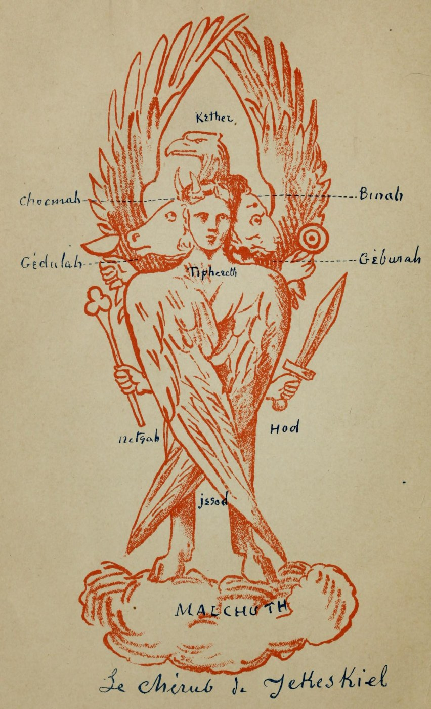
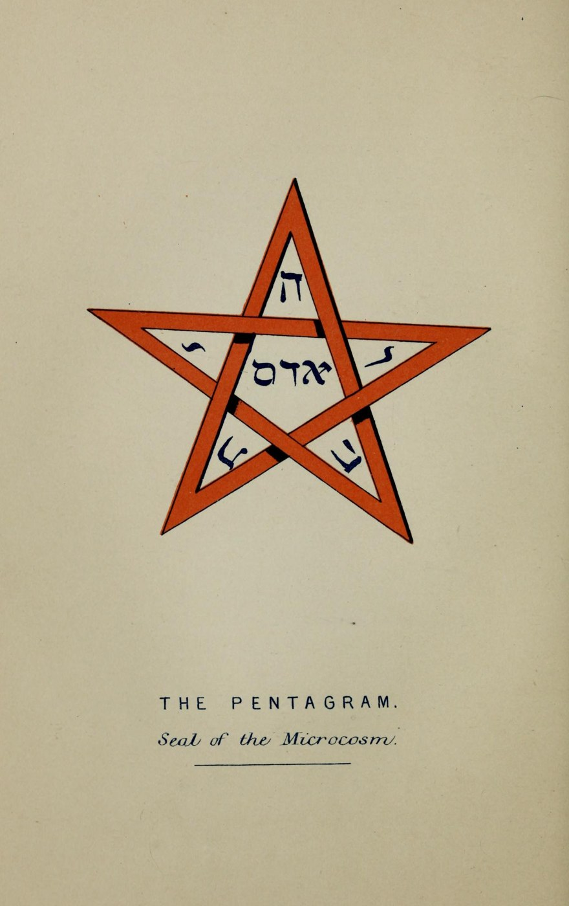
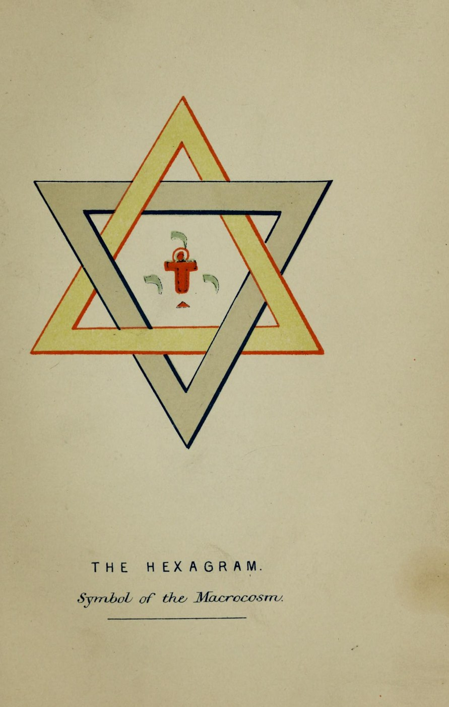
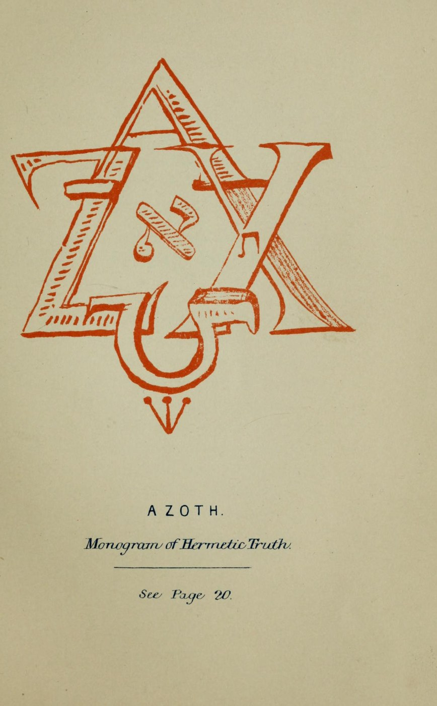
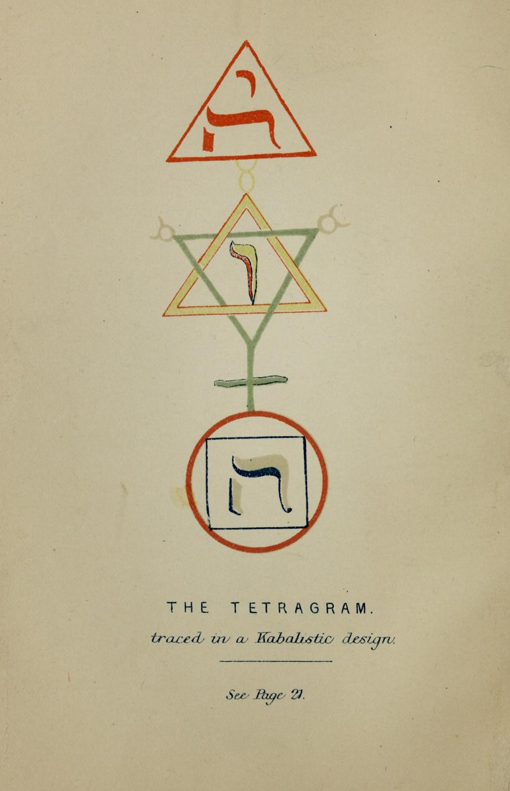
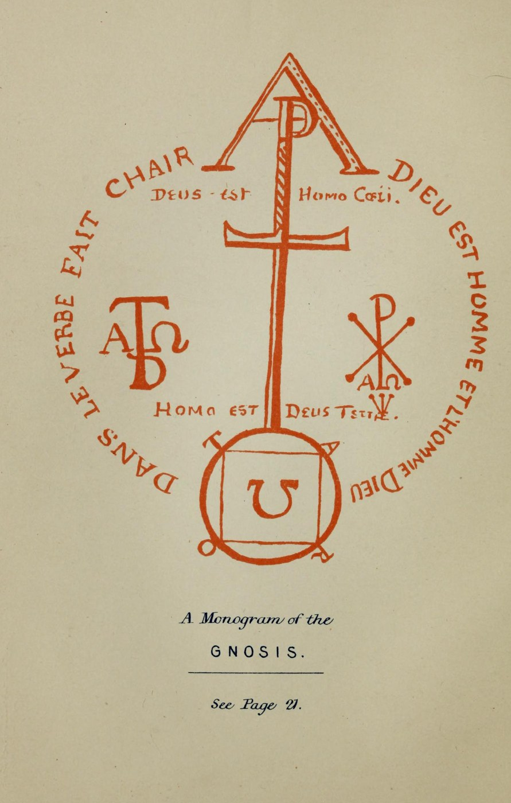
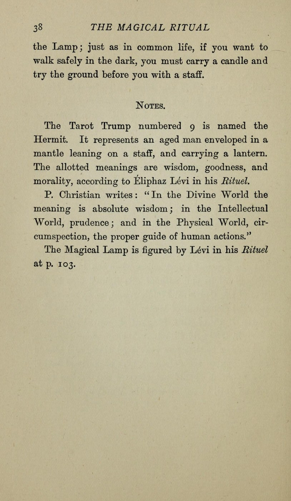
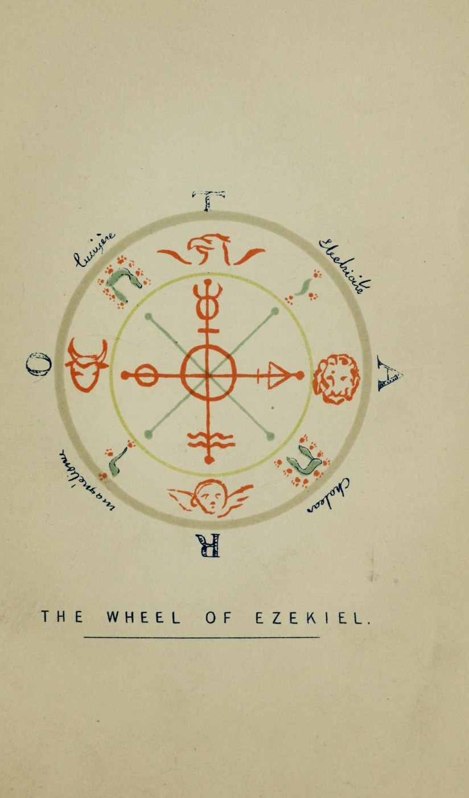

# 聖王国の魔術儀式――タロットの切り札による解釈（エリファス・レヴィ）

エリファス・レヴィ著／W・ウィン・ウェストコット英訳・編／全訳

- 原題：The Magical Ritual of the Sanctum Regnum, interpreted by the Tarot Trumps. Translated from the MSS. of Éliphaz Lévi and edited by W. Wynn Westcott. With Eight Plates
- 内容：十九世紀フランスの魔術師エリファス・レヴィが、トリテミウスの書の印刷本に綴じこんだ紙に書き残した未刊の手稿。タロットの大アルカナ二十二枚の順に、魔術師の心得、曜日ごとの衣・香・花、四大元素の祓い、魔術の剣・杖・ランプの作り方、死者との交わりの儀式、月の日々の性格、マグスの特権と力、カバラーの祈りと四・七・三の呼び出しを説く。各章のあとにウェストコットがカードの図柄とレヴィ、P・クリスチャンの解釈を注として付す
- 刊行：George Redway, London, 1896年
- 作業の基にした本文：Internet Archive 公開のスキャン（magicalritualofs00lvie、ブリガム・ヤング大学図書館蔵本）のOCRテキスト。図版も同じスキャンから取った
- 著作権：1896年刊。レヴィは1875年、ウェストコットは1925年に死去している。日本・米国・英国で保護期間が満了している
- 訳者：人工知能（Claude Opus 5.5）
- 訳の性格：全訳（扉・編者の序・二十二章と各章の注・カバラーの祈り・編者の注・レヴィの結び・格言。要約・省略なし）。英訳を介した重訳であり、レヴィのフランス語原稿からの訳ではない。訳者の調べたかぎりでは、日本語訳は出ていない

## この本について

　エリファス・レヴィ（本名アルフォンス・ルイ・コンスタン、一八一〇〜一八七五）は、『高等魔術の教理と儀式』で近代西洋魔術の基礎をすえ、タロットの大アルカナとヘブライ文字とを結びつけた人として知られる。この書は、レヴィの弟子スペダリエリ男爵からアンナ・キングスフォードの協力者エドワード・メイトランドに渡った手稿を、黄金の夜明け団の創設者ウェストコットが英訳して刊行したものである。

　手稿は、トリテミウス『七つの第二原因について』――七人の大天使が順に三百五十四年ずつ世界を治めるという書――の余白の紙に書かれていた。レヴィは大アルカナ一枚ごとに一章をあて、「知れ、意志せよ、行え」という魔術の心得から、日曜日は紫の衣と金の杖、土曜日は黒い衣と鉛の胸章といった曜日ごとの装いと香、塩と灰と水の聖別の祈り、魔術の剣・杖・ランプの具体的な作り方、亡き人を呼ぶ夜の儀式、月の二十九日の吉凶、マグスの「七つの特権・七つの大いなる力・七つの小さな力」へと進む。終わりには長い「カバラーの祈り」と四大元素の呼び出しが置かれ、最後にレヴィは、それまでの教えをすべて撤回するかのように「単純で従順なキリスト教徒となれ」と結ぶ。カトリックとカバラーとのあいだで揺れたレヴィの「二つの心」をそのまま伝える、珍しい一冊である。

　レヴィ自身の素描による彩色図版八枚（エゼキエルのケルブ、グノーシスの組み合わせ文字、テトラグラム、五芒星、六芒星、アゾト、魔術の剣、エゼキエルの輪）も収めた。

## 目次

- 扉・編者の序
- 一　魔術師／二　女司祭／三　女帝／四　皇帝／五　教皇／六　恋人／七　ヘルメスの戦車／八　正義／九　隠者／十　運命の輪／十一　力
- 十二　吊るされた男／十三　死／十四　節制／十五　悪魔／十六　塔／十七　星／十八　月／十九　太陽／二十　最後の審判／二十一　愚か者／二十二　宇宙（カバラーの祈りと呼び出し）
- 編者の注・結び（レヴィ）・オカルトと宗教の格言

---

## 扉

　聖王国の魔術儀式
　タロットの切り札による解釈

　エリファス・レヴィの写本より翻訳し
　W・ウィン・ウェストコット（医学士、英国薔薇十字協会マグス）編

　八枚の図版を付す

　ロンドン　ジョージ・レッドウェイ
　一八九六年

## 編者の序

　この翻訳は、故アルフォンス・ルイ・コンスタン、あるいは彼自身が好んで名のったところのエリファス・レヴィの、これまで刊行されたことのない著作を、その所有者であるエドワード・メイトランド氏の同意を得て公刊するものである。メイトランド氏は故アンナ・キングスフォード博士の名高い協力者であって、この写本は、エリファス・レヴィの友人、弟子、そして文学上の相続人としてよく知られたスペダリエリ男爵から氏に贈られたものである。原写本はレヴィ自身の筆跡で、シュパンハイムのトリテミウスの著作『*De Septem Secundeis*』〔七つの第二原因について〕の印刷本の、各ページのあいだに綴じこまれた紙に書かれている。その版はケルンで刊行されたもので、一五六七年の日付をもつ。トリテミウス修道院長のこの著作は、七人の大天使による世界の支配についての、きわめて珍しく興味深い論考であって、大天使のおのおのには、順に三百五十四年と四か月の期間が割りあてられている。大天使たちは古代人の惑星にあてられており、その支配の期間はつぎの順序で続く。

- オリフィエル――土星
- アナエル――金星
- ザカリエル――木星
- ラファエル――水星
- サマエル――火星
- ガブリエル――月
- ミカエル――太陽

　これらの支配者の第一の一巡は、世界紀元二四八〇年に終わった。ノアの洪水は一六五六年、サマエルの治世に置かれている。バベルの塔の破壊（タロットの切り札第十六番を参照）は、オリフィエルの第二の治世に起こった。アブラハムの生涯はザカリエルの第二の治世に、モーセの生涯はラファエルの第二の治世に、ピュタゴラス、クセルクセス、アレクサンドロス大王は、ミカエルの第二の太陽の治世にある。

　イエス・キリストの時代は、オリフィエルの第三の治世に来る。

- アナエルの第三の治世は、紀元一〇九年に始まった。
- ザカリエルの第三の治世は、四六三年に始まった。
- ラファエルの第三の治世は、八一七年に始まった。
- サマエルの第三の治世は、一一七一年に始まった。
- ガブリエルの第三の治世は、一五二五年に始まった。
- ミカエルの第三の治世は、一八七九年に始まった。

　レヴィは、この大天使による支配の体系に深く心を打たれたように見える。そしてエドワード・メイトランドは、そのアンナ・キングスフォード博士の伝記の中で、この書に好意をもって触れている。

　編者は「注」の見出しのもとに、各章の終わりに各タロットの切り札の短い記述を掲げ、また、エリファス・レヴィがほかの著作でタロットに与えた神秘的な意味について、いくらかの注を加えた。P・クリスチャンの見解もいくつか加えてある。そうした情報を参照しやすくするために、研究者がさらに意見やくわしい記述を求めてひもとくことのできる箇所を示す一覧をここに加えておく。

- クール・ド・ジェブラン『原始世界の分析』パリ、一七七三〜八二年。第八巻。
- エテイヤすなわちアリエット『高等諸学の哲学』アムステルダム、一七八五年。
- エテイヤ『トートの書についての理論と実践の講義』一七八七年。
- 『エジプトのタロット、すなわち大エテイヤ』一八三〇年。
- エテイヤ『タロット遊びで楽しむ方法』一七八三〜八五年。
- レヴィ、エリファス（アルフォンス・ルイ・コンスタンの筆名）『高等魔術の儀式』パリ、一八六一年。三四四〜三五六ページにタロットの切り札のそれぞれの記述と意味が掲げられているが、「ヘルメスの書」と題する章全体、三三二〜三八四ページがこの主題にかかわっている。これらの切り札はまた、二六五〜二六九ページで月の日々にあてられている。
- 同『高等魔術の教理』パリ、一八六一年。第十章が特にタロットにかかわるが、この巻全体が切り札に対応する章に分けられている。
- 同『魔術の歴史』一八六〇年。四六、八一、一〇九ページを参照。
- P・クリスチャン『魔術の歴史』パリ。一一四〜一三一ページに、タロットの切り札の特別の記述と隠された意味が掲げられている。
- パピュス『ボヘミアンのタロット』。モートンによる英訳、ジョージ・レッドウェイ、一八九六年。
- ヴィルト、オズヴァルド『トートの書』。
- ウェイト、A・E『魔術の神秘――エリファス・レヴィの著作の摘要』ロンドン、ジョージ・レッドウェイ、一八八六年。二四二〜二六五ページを見よ。
- マグレガー・メイザース、S・L『タロット――その隠された意味』ジョージ・レッドウェイ、一八八八年。
- ウィルシャー、W・H『大英博物館所蔵の遊戯用その他のカードの解説目録』一八七六年。
- チャット、W・A『トランプの起源と歴史についての事実と推測』一八四八年。

　エリファス・レヴィの魔術の著作も、カバラーも特に研究したことのない普通の読者は、以下の多くの章の主題がどれほど興味深くとも、タロットの切り札と各見出しのもとに述べられた細目とのつながりは薄いと考えるかもしれない。しかし、どの場合にもカードと主題とのあいだには直接の関係があることを理解してもらわなければならない。ただ、それらを結びつける鍵は、著者の意図によって欠けているのであり、それでもレヴィのほかの著作を研究すれば得られるのである。

　二十二枚のタロットの切り札は、数と文字とに関係をもつ。本当の割りあては、確かめうるかぎりでは、ヘルメス学派の団員であるごく少数の研究者にしか知られていない。レヴィがその『教理』と『儀式』において、クリスチャンが、そしてパピュスが掲げた割りあては正しくない。おそらく故意にそうしたのであろう。編者は、約百五十年前の暗号の写本の一ページを見たことがある。そこには別の割りあてがあり、それは、編者のよく知る何人かのオカルトの研究者によって、オカルト科学の求めるすべての条件を満たすものであることが見いだされている。

　この巻を飾る八枚の彩色図版は、レヴィ自身の素描の複製である。それらはこの著作の魅力を大いに増しており、刊行者とそれを制作した画家との名誉となるものである。表紙の意匠は、レヴィが「大いなる業の完成」をあらわすために描いた組み合わせ文字である。四五ページ〔本訳では第十二章〕を見よ。十字――四――に三角形――三――を掛けると、十二、すなわち一巡の完全な数となる。ヘブライ文字タウは宇宙をあらわす。

　A・E・ウェイト氏による『魔術の神秘――エリファス・レヴィの著作の摘要』は、一八八六年にレッドウェイ氏によって刊行され、イギリスの読者のあいだにたいへん広く流布したので、編者はこの小さな巻もまた心からの歓迎を受けることを期待している。

　ロンドン、一八九六年二月

## 聖王国の魔術儀式

### 一　魔術師――ル・バトゥルール

　ソロモンがその子レハベアムに語った言葉を聞け。「神をおそれることは知恵の初めである。だが知恵の終わりは、すべての善の源であり、万物の出てくる至高の理性であるかたを知り、愛することである」

　アドナイは天において永遠を過ごし、それから人を創造した。それゆえ人には、アドナイを理解するための地上の時が与えられている。言いかえれば、人が至高の存在について得る知識は、創造のときに人に授けられた能力から生じるのであって、それは、人がこんどは自分を、この世に送り出した存在の像を形づくることができるようにするためである。

　知性によって人は神の理想を思い描き、意志によって人は善い業に向かうべきである。しかし業をともなわない人間の意志は死んでいる。あるいは少なくとも漠然とした願いにすぎない。言葉で言いあらわされない思考についても同じことが言える。それは言葉ではなく、知性の夢にすぎない。想像は実現されたものではなく、約束された何かにすぎないが、行為は現実である。同じ理由で、祈りなしに敬虔はなく、礼拝なしに宗教はない。言葉は理想の形をとった社会的な現実であり、儀式は実行に移された宗教である。信仰に促された行いによって自らをあらわさないかぎり、本当の信仰はない。言葉で定式化され、行いによって確かめられた表現が、人間の魂の二つの力を示すのである。働くためには意志しなければならず、意志するためには願いを定式化しなければならない。行いは観念を含んでいる。たとえ理想そのものが行為に移されないとしても。

　思考は知性の生命であり、言葉は思考の創造力を示し、行いは言葉の最後の努力であり、言葉の望ましい補いである。言葉が語られ、思考が行いに移された。創造の行為によって、言葉が生じたのである。

　言葉は思考の必要な定式であり、行為は意志のあらわれである。それゆえ祈りは必要なのであり、求めるすべてのものを得ることができる。祈りは意志の完成された行為であり、人間の言葉を神の意志に結びつける絆である。すべての儀式、聖別、洗浄、犠牲は、行いとなった祈りであり、象徴の定式である。そしてそれらは、言葉を行いに移したものであって、意志の力と粘り強さとを示すがゆえに、最も力ある祈りである。それらは、沈黙の祈りや言葉で言いあらわされた祈りよりも、張りつめた注意を要するのだから。こうしてそれらは本当の仕事となり、そのような仕事は人の全精力を求めるのである。

#### 注

　タロットの第一の切り札は、ル・バトゥルールと名づけられ、英語では魔術師と呼ばれる。レヴィはその著作のひとつで、最も古い意匠のいくつかのパックでは、この人物の腕と体とがヘブライ語アルファベットの最初の文字アレフに似ていると述べている。しかし研究者は、もし熟達者の師がいないのであれば、この切り札、あるいはタロットのほかのどの切り札についても、その本当の割りあてについては自分の直観に問うのが賢明であろう。

　魔術師は卓のそばに立ち、左手に魔術の杖を持っている。彼の前の卓の上には、その仕事にふさわしいほかの道具、すなわち短剣、杯、ペンタクルが置かれている。その顔は確信をあらわし、その目からは知性が輝き出ている。

　レヴィはほかの箇所で、その隠された意味を、神、霊、唯一性、そして神の反映としての人と定めている。P・クリスチャンはその『魔術の歴史』の中で、このカードは神の世界においては絶対の一者を、知性の世界においては唯一性を、物質の世界においては人をあらわし、人は神のように絶えず働くべきである、何も意志せず何もしない状態は悪をなすことにおとらず致命的なのだから、と言っている。

### 二　女司祭――ラ・パペス

　深さは高さに等しく、闇は光と対照をなし、物質は霊の衣にすぎない。下にあるものは上にあるものに似ている。神の息吹は水の上を運ばれ、水は神の息吹に運ばれて高くとどまる。我々が神の息吹と呼ぶものは、諸世界にあまねく広がる生命の精髄である。それは惑星に魂を与える、あの温かく明るい流体である。進化する動物の生命の共通の貯水池。物体のあいだの共感の普遍の土台であり、魂のあいだの愛の媒体である。それは意志の乗りものであり、創造の言葉のさまざまな変化すべてに共通する土台である。神の口の息吹は、それに対応する人間の息吹へと導く。神は「我々は人を造ろう」と言い、人は「我々は自分のために神を造ろう」と答える。

　神が創造を神殿として顕したとき、神は惑星を光をかかげるものとして照らし、大地を祭壇として花で飾った。神は金属と植物とに神秘的な特性を与え、その指で円と三角形と十字とを、永遠のペンタクルとして、空の広大な天蓋に生きた火で描いた。マグスは、自分の住まいであるこの地上において、自分の神にならうべきである。

　知れ、意志せよ、行え。これが祭司的かつ王的な高等魔術の三つの要点である。物質と形相とはマグスの力のうちに置かれた道具であり、マグスの行いは言葉に依拠すべきである。そうすれば、その業は何ひとつ失われることなく、その教えは保たれるであろう。

　それゆえ、この学の神秘を理解し、驚異をなしたいと願うおまえよ、まだ知識と知恵とに達していないのではないかと、よく考え、おののけ。もしそうなら、おまえは深淵のふちに立っているのである。手遅れにならないうちに止まれ。しかしもしおまえが秘儀参入のランプと杖とを手にしているなら、もしおまえが九の秘密を知っているなら、もしおまえが神から発する光なしに神について語ることが決してないなら、もしおまえが四大元素の神秘の洗礼を受けたなら、もしおまえが七つの山の上で祈ったなら、もしおまえが二頭のスフィンクスの引く戦車の動き方を知っているなら、もしおまえがオシリスがなぜ黒い神であったかの教理をつかんだなら、もしおまえが自由であるなら、もしおまえが王であるなら、もしおまえがまことにソロモンの神殿の祭司であるなら――おそれることなく行い、そして語れ。おまえの言葉は霊の王国において全能となり、神の息吹はおまえの口の言葉に従い、天と地の力はおまえに従うであろう。

#### 注

　タロットの第二の切り札は、三重冠をいただき、両手に書物を持った、座った女性の姿をあらわしている。書物はその外套に半ば隠されている。彼女は頭のまわりにヴェールをかけており、いくつかの古いカードでは、その頭飾りの上にイシスの角が見られる。タロットの象徴の非常な古さとエジプト起源とを信じない著者の中には、このカードは伝説の女教皇ヨハンナをあらわすためのものだったと主張した者もいる。この人物は、学識と才能と悪徳とにすぐれたイギリス女性で、紀元八五五年、レオ四世のあとを継いで教皇に選ばれたと言われた。いまではプロテスタントもローマ・カトリックも、この話を根拠のない作り話として退けている。レヴィはその『高等魔術の教理』の中で、この切り札はギリシアのユノをあらわすのではないかという考えを示し、その隠された意味として、神の家と人の家、聖所、グノーシス、カバラー、二、女と母性をあてている。

　薔薇十字団は、このカードを大いなる母、自然の魂であるイシスと考えた。P・クリスチャンはその意味として、聖所の戸口で秘儀参入者を待つオカルト科学を掲げている。

### 三　女帝――ランペラトリス

　おまえは何よりもまず、自然の聖なる法則を学び、理解すべきである。父なる霊と母なる霊とを見分け、二つの息吹の性の面と、その運動の魂とを認めよ。黒い女性がなぜ白い男性の愛撫を求め、白い男性がなぜ暗い女を軽んじないのかを学べ。白い男は昼、すなわち太陽であり、黒い女は夜、すなわち月にかかわる。太陽にあてられた金の冠に含まれる十二の宝石の名と力とを知り、また月の力の首長にあてられた名をも知る必要がある。そうすればおまえは、五十の門の鍵、三十二の小径の秘密、そして七つの霊の文字に通じることが必要となるであろう。

　これら七つの霊とは、太陽のミカエル、月のガブリエル、火星のサマエル、水星のラファエル、木星のザカリエル、金星のアナエル、そして土星のオリフィエルである。これらが順に世界を治め、その七つの支配の時代の完了が、神の時の一週を構成する。

　おまえはまた、七つの惑星の力に対応する植物、色、香り、音階を学ばなければならない。そしてそれらの照応を、このうえなく正確に覚えておくことが欠かせない。こうして、完全な魔術の業をなすことが求められるときには、各曜日の手順は多くの点で異なるのである。

　日曜日には、紫の衣、三重冠、金の腕輪を身につけなければならない。祭壇あるいは三脚台のまわりには、月桂樹、ヘリオトロープ、あるいはヒマワリの花綱をめぐらさなければならない。燻香には、シナモン、乳香、サフラン、赤い白檀を用いなければならない。右手には、ルビーかクリソライトをはめこんだ金の杖が必要である。そして業は、真夜中過ぎ一時から朝の八時まで、あるいは午後三時から夜の十時までのあいだに行わなければならない。

　月曜日には、銀の飾りのある白い衣を着、真珠、水晶、透明石膏からなる三連の首飾りをつけるべきである。三重冠は黄色で、ガブリエルの文字を銀で記す。ふさわしい香りは、樟脳、白い白檀、竜涎香、キュウリの種である。祭壇の花綱は、アルモワーズ（ヨモギ、アルテミシアのことか）、マツヨイグサ、黄色いキンポウゲにすべきである。黒い色のものはすべて注意して避けよ。金の杯や器は用いず、銀のもの、あるいは澄んだ白い磁器か陶器だけを用いよ。時刻は先に太陽について述べたのと同じであるが、むしろ夜の時刻を用いよ。

　火曜日には、衣の色は燃えるような色、あるいは錆色、あるいは血の色とし、鋼の帯と腕輪とをつけるべきである。杖は磁化した鋼であるべきで、剣と聖別された短剣とを用いてもよい。花綱はニガヨモギとヘンルーダ。指には紫水晶と鋼の指輪もはめるべきである。

　水曜日には、衣は緑、あるいは多くの色に照りかわる玉虫織りの絹であるべきである。首飾りは真珠か、水銀を入れたガラス玉。香りは安息香、没薬、蘇合香。花綱の花は、スイセン、ユリ、一年生または多年生のヤマアイ、カラクサケマン、あるいはマヨラナ。宝石は瑪瑙である。

　木曜日には、緋の衣を着、額に錫の胸章をつける。それには木星の象徴と、三つの言葉――火のギアザル、水のベトル、そして同じく火のサムガビエル――を記す。燻香の香りは、竜涎香、カルダモン、ギニアショウガ〔グレイン・オブ・パラダイス〕、バルサム、メース、サフラン。指輪にはエメラルドかサファイアをはめるべきである。花綱は樫、ポプラ、イチジクの木、あるいはザクロ。杖はガラスか樹脂。衣は羊毛か絹で作るべきである。

　金曜日には、空色の衣で、その飾りは緑かバラ色、杖は磨いた銅である。香りは麝香、霊猫香、竜涎香。冠はスミレ。花綱は、ギンバイカとオリーブの枝をまじえたバラ。指輪はトルコ石で飾る。冠すなわち王冠は、瑠璃と緑柱石で飾るべきである。術者は白鳥の羽で作った扇を持ち、腰のまわりには、アナエルの名とその印章とを刻み、それらを囲む円の上に「*Ave Evah; Vade Lilith*」〔めでたしエヴァ、去れリリト〕の言葉を刻んだ銅板の帯をつけるべきである。

　土曜日には、衣は黒か暗い茶色で、橙色の絹でふさわしい意匠を刺繍すべきである。首には、土星の名とその印章を刻み、さらにアルマレク、アフィエル、ザラヒエルの言葉を加えた、鉛でできた鎖と胸章とをつけるべきである。燻香にふさわしい香りは、スカモニア、アロエ、硫黄、阿魏である。杖は縞瑪瑙で飾るべきで、ふさわしい花綱は、トネリコ、イトスギ〔原文 Cyprus〕、黒いヘレボルスである。杖の縞瑪瑙の上には、土星の時刻に、聖別した道具で、二つの顔をもつヤヌスの姿を刻むべきである。

#### 注

　タロットの第三の切り札、女帝は、十二の星の冠をいただき、左手に菱形の紋章あるいは球をいただく笏を持って、玉座に座る女性の姿をあらわしている。彼女には翼があり、右わきには黒い鷲を描いた盾がある。この姿はギリシアのアプロディテ・ウラニアであって、聖ヨハネの幻に出てくる、太陽をまとい、十二の星の冠をいただき、足の下に月を踏む女の姿に対応する。

　レヴィはその『儀式』の中で、その意味として、言葉、三、充満、多産、自然を掲げている。ウェイト、二五五ページも見よ。クリスチャン（一一六ページ）は、この切り札にイシスをあてている。これは誤りである。女帝のどの例も角を示していないが、最も古い型の女司祭のカードのいくつかは、その頭にイシスの角を示しているのである。

### 四　皇帝――ランプルール

　魔術師の衣服は、新しく、清く、処女によって織られたものであるべきである。魔術の道具は新しく、祈りと香とによって聖別されたものであるべきである。

　魔術師は、節制し、貞潔で、業に身をささげている必要がある。その霊と心とはほかの要求から自由でなければならず、その意志の力は、どんな大いなる業の成功にも、そのオカルトの科学的な業の成果にも、まったく、粘り強く、知性ある信仰をもってささげられていなければならない。魔術の業は、空気、地、水の祓いをもって始め、火による聖別をもって終えるべきである。

　空気の祓いは、四つの方位に向かって息を吹き出し、言葉によって、そしてつぎの祈りをくり返すことによって行う。

　「神の霊は水の上をおおい、神は人に命の息を吹きこんだ。

　神の霊は宇宙を満たした。その中に万物は存在し、その中に力の言葉がある。

　言葉がわが霊の中にあらんことを。そうして万物がわれに従わんことを。

　されば祓われよ、空気の存在者たちよ、その息がはじめて万物を聖霊で満たしたかたの名において。アーメン」

　ついでシルフの祈りを唱えるべきである。

　〔これはレヴィ『高等魔術の儀式』七八ページに全文があり、英語ではA・E・ウェイト『魔術の神秘』一二二ページにある。ウェイトの唯一の誤りはその見出し「シルフのための祈り」であって、これは、神性とのいっそう近い関係を求めるシルフたち自身の祈りである。〕

　地の祓いは、聖別した水をふりかけ、息により、言葉により、そして儀式の曜日にふさわしい香を焚くことによって行う。ついでグノームの祈りを唱えよ。

　〔レヴィ『儀式』八四ページ、ウェイト一二五ページを見よ。〕

　水の祓いは、按手により、息により、言葉により、そして香炉から取ってしかるべく聖別した灰を少しまぜた聖別した塩を水にふりかけることによって行う。水は、クマツヅラ、ツルニチニチソウ、セージ、ハッカ、カノコソウ、メボウキの小枝で作った刷毛でまわりにふりまく。これらは、処女の糸巻き棒から取った糸で、まだ実を結んだことのない木の実の木〔クルミ・ハシバミの類〕の柄に結びつける。この柄には、魔術の短剣で、七つの霊の文字を刻まなければならない。

　塩は、その上でつぎのラテン語の祈りを唱えることによって聖別する。

　「*In isto Sale sit sapientia, et ab omni corruptione servet mentes nostras et corpora nostra, per Chokmah, et in virtute Ruach Chokmael; recedant ab isto phantasmata hylae ut sit Sal coelestis, Sal terrae et Terra salis, ut nutrietur bos triturans, et addat spei nostrae cornua tauri volantis. Amen.*」〔この塩の中に知恵あれ。そしてコクマーにより、ルアハ・コクマエルの力において、あらゆる腐敗から我らの心と体とを守れ。質料の幻影はこれより退け。天の塩、地の塩、塩の地とならんがために。脱穀する牛が養われ、我らの望みに飛ぶ牡牛の角を加えんがために。アーメン〕

　ついで香炉の灰の上で、このラテン語の祈りを唱える。

　「*Revertatur cinis ad fontem aquarum viventium, et fiat terra fructificans et germinet arborem jucunditatis, et incensum suavitatis, per tria nomina Binah, Chokmah et Kether, in principio et in fine, per Alpha et Omega, qui sunt in Spiritu Azoth. Amen.*」〔灰は生ける水の泉に帰れ。そして実を結ぶ地となり、喜びの木と、かぐわしい香とを芽生えさせよ。ビナー、コクマー、ケテルの三つの名により、初めにも終わりにも、アゾトの霊のうちにあるアルファとオメガとによって。アーメン〕

　まぜた塩と灰とを水にふりかけながら、こう唱えよ。

　「*Emittes Spiritum, O Tiphereth, et creabuntur omnia nova; in his ergo sit semen venturi saeculi. Amen.*」〔おおティフェレトよ、汝が霊を送り出せば、万物は新たに創られる。されば、これらの中に来たるべき世の種あれ。アーメン〕

　水の祓い。

　「全能の父、アブラハム、イサク、ヤコブの神、その声は大水の上に聞こえ、イスラエルの子らに道を開くために紅海の水を分け、ついで彼らを追うエジプト人を海に呑ませたもうたかた、ミ・カモカ・バアリム・エホバ〔神々のうち誰か汝にしくものあらん、エホバよ〕、十二の宝石でできた祭壇が聖なる川の水の下にあるかたよ、どうかこの水を祝福し、そこからすべての害ある影響を追い払いたまえ。シャダイ、シャダイ、シャダイ（水の上に三度息を吹きかけよ）。大いなる名、アラリタ、エロア・ヴァ・ダアト、エロヒム・ツァバオト、エロヒム・ギボルによって、この水が、魂の益のために神の力を呼び出そうとする者たちの奉仕のために聖別されんことを。アーメン」

　ついでウンディーネの祈りを唱えるべきである。

　〔これは『儀式』八一ページと、ウェイト一二三ページに見られる。〕

　火の祓いを行うには、アナエル、ミカエル、サマエルの名を唱えながら、火の上に塩、香、硫黄を投じる。ついでサラマンダーの祈りを唱えるべきである。

　〔これは『儀式』（ページ数は底本で判読困難）と、ウェイト一二四ページに見られる。〕

　おまえは、エレメンタルの存在者が不完全な型の魂であって、まだ人間の存在にまで段階を上っていないこと、そしてそれらは、熟達者によって、それらが住む普遍のアストラル流体を介して、その意志の補助者として働きに呼び出されたときにだけ力をあらわしうることを、十分に理解しなければならない。グノームの王国は北に、サラマンダーは南に、シルフは東に、ウンディーネは西に割りあてられている。

　これらエレメンタルの存在者は、四つの気質のうちどれに属するかに応じて、人々と関係をもち、影響を及ぼす。グノームは憂鬱質に、サラマンダーは多血質に、ウンディーネは粘液質に、シルフは胆汁質に関係している。

　その象徴は、グノームには金牛宮の牡牛、サラマンダーには獅子宮の獅子、シルフには鷲、ウンディーネには宝瓶宮のしるしである。

　その支配者は、それぞれゴブ、ジン、パラルダ、ニクサである。

　これら四つの顔と存在の型の結合が、被造の宇宙、完全で永遠の実体、実に人、すなわちミクロコスモスをあらわす。そしてこれが、スフィンクスの謎の神秘的な解明の最初の定式である。

#### 注

　タロットの第四の切り札は、玉座にもたれ、右手に笏を持った、冠をいただく皇帝をあらわしている。笏の上端は蓮の花で終わっている。近代のタロットでは、玉座は黒い鷲で飾られている。古い意匠では、皇帝の体はおおよその輪郭において直角三角形をあらわし、脚は組まれていて、全体として錬金術師のアタノール〔炉〕を思わせた。レヴィはその『儀式』の中で、このカードにつぎの意味を与えている。ポルト、すなわち東洋人の政府、秘儀参入、力、テトラグラマトン、四、そして立方体の石。

　クリスチャンは、人間の次元においては、この切り札は、真理の学によって導かれた行いの実現、正義への愛、意志の力、そして組織的な仕事を意味すると考えている。

### 五　教皇、あるいは祭司長――ル・パプ

　意志の力を制御し、それを知性の法則に従わせること――これが我々の祭司の術の大いなる業である。儀式は、想像力によって意志を教育するために用いられる。知性なく信仰なく、魂のより高い志のないままに行われる儀式は、迷信的なしきたりにすぎず、それにあずかる者をおとしめる傾きがある。儀式に魔術の力を帰するのは誤りである。魔術の力はただ術者の鍛えられた意志の中にのみ存在するのだから。このゆえに、聖王国――神の王国――神の国は我々のうちにある、という魔術の公理は真実なのである。I・N・R・I、*Intra nobis Regnum Dei*〔神の国は我らのうちに〕。そしてこのゆえにまた、ミクロコスモスの印章である五芒星によって大いなる驚異を示すことができるのである。ミクロコスモスはマクロコスモスの反映であり、ミクロコスモスとは人とその人間の意志とである。人は宇宙、すなわちマクロコスモスの反映である。その知性が修養を受けた人は、五芒星を通して働かせる意志の力によって、元素の力と存在者たちとを制御し、命じ、悪しきエレメンタリー〔死者の残滓の霊〕をその邪悪な業から押しとどめることができる。

　六芒星はマクロコスモスの象徴であって、しばしばソロモンの印章と呼ばれる。それは組み合わされた二つの三角形からなり、立った三角形は炎の色、逆さの三角形は青に彩られている。中央の空間には、タウ十字と三つのヘブライ文字ヨッド、あるいはアンク十字、あるいはロイヤル・アーチ・メイソンの三重のタウを描いてもよい。知性と意志とをもってこの紋章で武装した者は、ほかに何も必要としない。彼は全能であるべきである。これは絶対者の完全なしるしなのだから。

　これはヘルメス学の真理の組み合わせ文字であって、大いなる業の主題を言いあらわしている。それはヘブライ、ギリシア、ラテンの文字から成り、秘儀に参入していない者の前でこの理想を言いあらわす仕方は、アゾトという言葉、あるいはマグネスという名による。ほかのマギは、これにメデイアの飛ぶ竜、神秘のエデンの蛇という称号をあてた。

　これは、カバラー的かつヘルメス学的な意匠で描かれた、高く伝えがたいテトラグラムである。秘儀参入者は、第一位階の者でさえ、すぐにその象徴を理解するであろう。

　この紋章は普遍のグノーシスの組み合わせ文字である。それはギリシアとラテンの文字から成り、エゼキエルの輪と福音書記者聖ヨハネの書との秘密を象徴によって言いあらわしている。それはコンスタンティヌスのラバルム〔軍旗〕のしるしを含んでいる。

　この紋章はおのずと ROTA という語を示すが、カバラー〔原文 Kalabah〕の光のもとで見れば、TAROT という語を示す。

　これらの文字は、哲学の十字とともに、すべての学を本質において含んでいる。そして大いなるアルカナの秘儀参入者は、それ以上の象徴も紋章も必要としない。神殿の玄関の二本の柱――一本は白い大理石、もう一本は黒い大理石で、どちらも真鍮の飾りで飾られていた――に関係するヤキンとボアズという言葉の、本当の、しかし隠された意味と力とを知る熟達者もまた、それを必要としない。これらの文字によって、悪しき性質の霊は縛られ、制御される。これらによってまた、術者が正しく清らかであれば、彼は天使たちに自分を知らせ、その目的へと天使たちを傾けることができる。まことに、魔術の術においては、何ものも五芒星と六芒星と神のテトラグラムとを合わせた力に逆らうことはできないのである。

　ほかのすべての記号、印章、象徴は恣意的なものにすぎず、その意味の鍵は、シュパンハイムのトリテミウス修道院長の『ステガノグラフィア』や『ポリグラフィア』の中に、あるいはアバノのピエトロ、パラケルスス、アルバテル、コルネリウス・アグリッパの魔術の論考の中に見いだされるであろう。

#### 注

　第五番の切り札は、教皇、祭司長、あるいはユピテルと名づけられ、左手に三重の十字の杖を持った、冠をいただく支配者をあらわしている。彼は二本の柱のあいだに座っている。エリファス・レヴィが割りあてた意味は、宗教、哲学、象徴、法、教え、論証である。教皇の右手は隠れた知恵のしるしを示しており、ふつうの教皇の祝福のしるしではない。

　P・クリスチャンは、このカードは神の世界においては普遍の法を、知性の世界においては宗教を、物質の世界においてはアストラルの流体の力によって伝えられるような霊感を示すと判じている。

### 六　恋人――ラムルー

　均衡は力の対立からのみ生じることを、つねに心にとめておけ。能動は受動なしには存在しない。闇のない光は形を生まない。そして肯定は否定に対してのみ勝利しうる。愛はまた憎しみから力を増す。そして地獄は、天に根を張るはずの植物の熱せられた土壌である。また、「世界の魂」と呼ばれ、動物の多産を言いあらわすためにイシスの牝牛の角ある頭で描かれる大いなる流体の作用者は、盲目の力であることも知っておくべきである。

　マグスのふるう力は、二つの対立する力から成る。それらは愛においては結びつき、不和においては分かれる。愛は相反するものを結びあわせ、憎しみは似たものを競争者にし、敵にする。飽和によって空虚が満たされたとき、愛のあとに憎しみが続く。満ちたものが空になりえないのでなければ。しかしふつうの結果は、互いの反発による均衡のとれた飽和である。

　これらの考察から、人と人とのあいだの共感と反感との存在と原因とを導き出すことができる。こうして、賢く思慮深いだけでなく善良でもある人々に、愛される方法を示すことができるのである。

　性愛は肉体のあらわれである。その支配のもとにある者は、嫌悪も苦痛も忘れることがある。これは、二つの相反する流体の引力から生じる一種の酩酊である。そして陽極と陰極との結合において、恍惚と絶頂とが生じ、そのあいだ愛する者は幻の輝く幻影のように見える。

　結合がふたたび均衡の状態をうち立てると、引力のあとに反発が続く。そして非常にしばしば、度を越した恋は、不当な分量の嫌悪へと至るのである。

　すべての被造物は、普遍の共感の流体の陽の態度か陰の態度かのどちらかにあずかり、共感を保ったり、ふたたびうち立てたりするのを助けることができる。しかし知識が不完全なうちはそれを疑い、治療法を勧めるつもりで毒を与える危険に身をさらさないことが必要である。愛する者のものであった何かの品によるまじないは、しばしば、無益でしかも危険な結果に至る磁気的な操作である。新しい力の流れをうち立て、飽満のあるところに空虚を生み出すほうがよい。男であれ女であれ、その愛情を取り戻す最も確かな方法は、ほかの誰かに愛のしるしを与えることなのだから。

　孤独と、それにともなう、均衡の欠如による流体のうっ滞とから生じる心身の不調を考えてみよ。神経の病、ヒステリー、心気症、偏頭痛、気鬱、狂気の妄想がそれである。また、乙女たちや、年齢のさだかでない女たち、寡婦たちや独身者たちの病も理解できるようになるであろう。いま考察しているこの自然の法則に霊感を受けて、おまえはしばしば一つの生涯のこれからの成り行きを予言し、そうした病の多くを、しばしば不当に固定した注意をそらすことによって癒すことができる。こうしてマグスは、パラケルススのように偉大な医師に、あるいはコルネリウス・アグリッパのように名高い占者になることができるのである。おまえは魂の病を理解するようになるであろう。学識あり貞潔な人々がしばしば悪徳の快楽に飢えるという事実に気づき、悪徳にひたった男女がときに美徳の慰めに向かうことにも気づくであろう。こうしておまえは、一撃も加えることなく、奇妙な回心と思いがけない罪との起こることを予言できるであろう。そして、心と家庭との最も注意深く隠された秘密を見抜くおまえのたやすさに、人々は大いに驚くであろう。少女や女たちは、このような占いの手段によって、夢の中で恋人や夫の姿を見せられることがある。そのような打ち明け相手は魔術の術における力ある補助者である。決してその立場を悪用するな。決してその利益をなおざりにするな。彼女らはマグスへのよい賜物なのだから。女たちの頭と心とに確かな支配を得るには、月の天使ガブリエルと金星の天使アナエルとの両方の恵みを得ることが欠かせない。

　ある女の悪霊たちは、打ち負かし、打ち倒さなければならない。その筆頭はつぎのとおりである。

　ナヘマー。男たちの夢のスクブス〔夢魔〕たちの王女。

　リリト。ストリクス〔吸血の夜鳥の魔女〕たちの女王。放蕩へと誘い、母性の願いを滅ぼす者。

　ナヘマーはまた、不義の、実を結ばない愛撫をつかさどる。

　リリトは、その出生がナヘマーの手に触れられてけがれた子らを、揺りかごの中で絞め殺すことを喜ぶ。

　まことに賢いカバラーの師は、これらの名と、そのような悪魔的な悪しき力の隠された意味とを理解する。それらはまた、生命の樹の物質の外被、すなわち皮、あるいは殻とも呼ばれ、外の闇によってけがれ、黒ずんでいる。それらは、光と生命と愛とが出てくる樹から引きちぎられた、死んだ枝のようなものである。

#### 注

　第六番のタロットの切り札は、フランスのパックではラムルーと名づけられ、この国ではふつう恋人と呼ばれる。図柄は上に太陽を示し、そこから弓矢で武装したクピドが出てくる。下には二人の女のあいだに立つ男がいて、女たちは美徳と悪徳とをあらわしている。エリファス・レヴィの割りあてた意味は、均衡、敵対、結合、からみあい、二つの三つ組の争いである。

　P・クリスチャンは言う。「神の世界においては、このカードは善悪の知識を教える。知性の世界においては、必然と自由との均衡を、物質の世界においては、原因と結果との関係を教える」

### 七　ヘルメスの戦車――ル・シャリオ

　ヘルメスの戦車には、白いスフィンクスと黒いスフィンクスとがつながれている。この象徴の動物はそれぞれ、新参者に謎をかける。白いスフィンクスの言葉はヤキンである。黒いスフィンクスの言葉はボアズである。前者の言葉はここでは愛を、後者の言葉はここでは力を意味する。サマエルが白いスフィンクスを導き、アナエルが黒いスフィンクスを導く。引力は相反するものによって生じるからである。戦車に座ったヘルメスは、黒いスフィンクスには鋼の剣の切っ先で、白いスフィンクスには金の笏で触れる。

　マグスが、善い力と悪い力、善い存在者と悪い存在者とを制御するために魔術の杖と剣とをどう用いるかを学ぶのは、三重に偉大なヘルメスのうち立てた型にならってである。

　悪しき存在者は剣をおそれる。そのアストラルの形は、そのような武器によって傷つけられ、断ち切られうるからである。白い霊は、聖別された魔術の杖に従う。それが、神から遣わされた魔術師モーセの杖の型に照応するからである。

#### 魔術の剣の作り方と聖別

　鋼の剣の刃は、火星の時刻に、新しい鍛冶の道具を用いて鍛えるべきである。柄頭は銀で、中空に作り、少量の水銀を入れる。その表面には、水星と月の象徴を、ガブリエルとサマエルの組み合わせ文字とともに刻むべきである。握りは錫でおおい、木星の象徴とミカエルの組み合わせ文字とを刻むべきである。コルネリウス・アグリッパ『隠秘哲学』第三巻第三十章を見よ。握りから刃の上へ、両側に少しの長さだけ伸びる小さな三角形の銅板をつけるべきである。その上には金星と水星の象徴を刻むべきである。

　鍔は、両側とも二枚の曲がった板で終わるようにする。その上には、一方の側にゲドゥラー、ネツァクの言葉を、他方の側にゲブラー、ホドの言葉を刻み、その中央のあいだに、セフィラーの名ティフェレトを刻む。

　刃そのものには、一方の側にマルクトを、他方の側に「*Quis ut Deus*」〔誰か神にしくものあらん〕の言葉を刻む。

　魔術の剣の聖別は、日曜日の太陽の時刻に、ミカエルの呼び出された力のもとで行わなければならない。祭壇に布をかけ、三脚台を整え、その中で月桂樹とイトスギの木を燃やし、火を聖別し、それから剣の刃をその中に突き入れて、こう言え。「エロヒム・ツァバオトよ、テトラグラマトンの力により、アドナイとミカエルとの名において、この剣が、見えない世界の存在者たちを追い散らす力ある武器とならんことを。戦いにおけるその使用が平和をもたらさんことを。それがティフェレトのように輝き、ゲブラーのようにおそるべく、ケセドのようにあわれみ深くあらんことを」。剣を火から引き出し、爬虫類の血に青い月桂樹から取れる樹液をまぜた液体に浸して焼き入れよ。それから、注意深く焼いたクマツヅラの灰で刃を磨け。

#### 魔術の杖の作り方と聖別

　はじめて花をつけたばかりのアーモンドの木か木の実の木の木材を選べ。枝は、魔術の鎌でひと打ちで切り落とさなければならない。それは、どんな割れ目も傷もなく、端から端までまっすぐに穴をあけなければならず、同じ長さの磁化した鋼の針をその中に入れなければならない。一方の端は透明な澄んだガラス玉で、他方の端は同じような樹脂の玉で閉じなければならない。この二つの端を絹の小袋でおおえ。杖の中ほど近くに二つの輪をはめよ。ひとつは銅、ひとつは亜鉛である。そして同じ金属の細い鎖を二本用意し、それを杖に巻きつけ、その端を杖の両端近くに固定せよ。それから杖の上に、黄道の十二の霊の名を書き、その印章も加えるべきである。

- 白羊宮――サラヒエル
- 金牛宮――アラジエル
- 双子宮――サライエル
- 巨蟹宮――ファキエル
- 獅子宮――セラティエル
- 処女宮――シャルティエル
- 天秤宮――ハダキエル
- 天蠍宮――サルツィエル
- 人馬宮――サリティエル
- 磨羯宮――セマキエル
- 宝瓶宮――ツァクマキエル
- 双魚宮――ヴァカビエル

　銅の輪には、ヘブライ文字で右から左へ「聖なるエルサレム」、H QDShH IRUShLIM の言葉を刻め。亜鉛の輪には、ヘブライ文字で右から左へ「王ソロモン」、H MLK ShLMH、ハ・メレク・シェロモーの言葉を刻め。

　杖が完成したら、それを、一週の七日にわたる儀式によって、四大元素の霊と七つの惑星の霊とを呼び出すことによって聖別しなければならない。そのさい、すでに各曜日について述べた特別の香と祈りとを用いる。

　聖別された杖は、そして実にすべての魔術の道具は、絹に包んで保管し、黒以外のどんな色とも触れさせてはならない。そしてそれらを杉か黒檀の箱に保管するのがよい。

　しかるべく作られ、完全に聖別されたこの杖によって、マグスは未知の病を癒し、人に魔法をかけ、あるいは意のままに眠らせ、元素の力をふるい、神託を語らせることができる。

#### 注

　この章でレヴィはタロットの切り札第七番、戦車を描いている。その『儀式』の中で、彼はその意味として、武器、剣、聖なる七、勝利、王権、祭司職をあてている。

　このカードについて、P・クリスチャンは、神の世界においてはそれは自然の力に対する霊の支配を、知性の世界においては祭司職と権威とを、物質の世界においては人の知性と意志の力とへの物質の服従を指す、と書いている。

　この第七の鍵は、レヴィの『儀式』の三三二ページの向かいの全ページ大の図版に描かれている。

### 八　正義――ラ・ジュスティス

　祭司は王であり、賢者は裁き手であることを、決して忘れてはならない。この世には弱い者と強い者、貧しい者と富める者、無知な者と学ある者とがいる。前者はつねに後者に仕える者である。しかし前者がその仕事にふさわしく励めば、それによって師たちの集まりに加えられるにふさわしい者となり、役に立たない僕は投げ捨てられる。それゆえ、人々によく仕える方法を教えるのがよい。そうすれば彼らは力ある地位へと進み出ることができる。この世界の上にあるすべてのもの、そしてその表面の下にあるすべてのものは、人の領分に属する。

　被造物は、人を中心として、そのまわりで吼え、うめき、しゅうしゅうと鳴き、くうくうと鳴き、めぐる。ただ人だけが同胞と神とに語りかける。そして地上における神の声は人を通して語られる。生命の学は自然の書に書かれているが、ただ人だけがそれを読むことができる。賢く力ある者は、この書の言葉を、弱く無知な者の教えのために、信条と象徴とに翻訳する。子どものような者に語るときには、子どもに語るように語れ。知恵の秘密を売るな。好奇心におもねるためにそれをもらすな。

　人は自由のうちに自分の意見を形づくるべきである。そうすれば、神性の理想に似ることができる。神秘の学の真珠を、知識をもたない卑しく悪しい心の者たち、聖書が豚と呼ぶ者たちの前に投げるな。そのような者たちには、真理を語ろうと、真理をヴェールで包もうと、誤解しかない。欺瞞が彼らにつきまとい、彼らはすべてを曲がった良心で評価する。剣のきらめきで彼らの目をくらませてもよいが、杖や鍵〔クラヴィクラ〕に近づかせてはならない。悪人をおそれる必要をなくしたいなら、その者におまえをおそれさせよ。ファラオの前でのモーセのふるまいを思い出せ。偶像の祭司の善意も、知恵を装う者の誠実も信じるな。こうした者たちは、おまえを自分たちの生計と支配との破壊者として憎むであろうから。女の愛撫を受け入れることで危険に置かれないよう、たえず見張っていよ。サムソンがデリラにどう誘いこまれたかを思い出せ。どの女とも、二人きりのときや暗がりの中でなれなれしくするな。オルペウスとエウリュディケを思い出せ。

　女たちに愛されるようにし、彼女らがより幸せになるようにせよ。しかし、その女なしには幸せでいられないほど、どの女をも愛してはならない。元素の存在者については、彼らがマグスに寄せる愛は、シルフであれ、グノームであれ、ウンディーネであれ、火のサラマンドリーヌであれ、彼らを不死にする。しかしマグスがそのような存在者を愛することは無分別であって、彼を滅ぼすかもしれない。そうした元素の存在者に対してはつねに聡明で公正であれ。そうすれば、おまえの善い行いのゆえに、幸福をもって報われるであろう。

#### 注

　タロットの第八の切り札、正義は、衣をまとい冠をいただいて座る女性の姿をあらわし、右手に剣を、左手に天秤を持っている。レヴィはその意味として、引力と反発との均衡を掲げている。P・クリスチャンも同様の意味を掲げ、物質の世界においては、それは人間の正義を指すとつけ加えている。人間の正義はつねにあやまりうるものであり、個人的な動機や個人的な感情に染まっているのである。

### 九　隠者――レルミット

　熟達者が魔術の剣と杖とを備えたとしても、なお、その光が闇のすべての幻影を追い払う魔術のランプを必要とする。（このランプはエリファス・レヴィの『儀式』一〇三ページに描かれているが、ここに掲げた記述とはまったくは一致しない。）その構成には四つの金属が入るべきである。金、銀、真鍮、鉄。足は鉄、節は真鍮、油壺は銀で、その上に金の三角形を、中央にまっすぐ立てる。両側からは、金と銀と真鍮の三本の管をより合わせた腕が出る。灯芯の口は九つで、両側の腕にそれぞれ三つ、油壺の上の三角形の上に三つある。鉄の足の上には、ヘルメスの三角形を、上に水星の、下に太陽と月の象徴とともに刻む。半球形の台のふちのまわりには、真鍮の蛇を固定する。球形の部分の上、それと真鍮の節とのあいだには、男と女の頭をもつ両性具有の像を置き、その腕を球の上に伸ばさせるべきである。真鍮の節にはさまざまな形を刻め。銀の杯の上には、その中心にテトラグラマトンの文字をもつ六芒星を置かなければならない。上の金の三角形の上には、無限で永遠なるものの多産の象徴として、光線に囲まれた神を刻め。油壺の両側に輪をつけ、これらの輪に鎖を下げよ――ひとつは銀、ひとつは鉄。この鎖によって、ランプはつり下げることも、魔術師が持ち運ぶこともできる。灯芯の口の芯は新しい亜麻の糸で作るが、染めておくべきである。右の三本は青、左の三本は赤、中央の三本は金色である。

　ランプは聖別した火から点すべきであるが、最も大きな効果は、ランプが芯も油もなしに燃えるとき、すなわち普遍の流体の作用者の光によって、あるいは水の物質的なエレメンタルのひとつによってのみ点されるときに生じる。

　この魔術のランプの光は驚異をなすはずである。それは男女の良心を照らし、おまえがそれを読めるようにし、霊的な存在者のそれぞれの型を見分けられるようにするはずである。魔術師は、杖をつかみ、ランプを点すまでは、どんな重大な儀式も試みるべきではない。ちょうど普通の生活において、暗がりを安全に歩きたいなら、ろうそくを持ち、杖で前の地面を確かめなければならないように。

#### 注

　第九番のタロットの切り札は隠者と名づけられる。それは外套に身を包み、杖にすがり、ランタンを持った老人をあらわしている。エリファス・レヴィがその『儀式』で割りあてた意味は、知恵、善良、道徳である。

　P・クリスチャンは書いている。「神の世界においては、その意味は絶対の知恵である。知性の世界においては慎重、物質の世界においては用心、すなわち人間の行いの正しい導き手である」

　魔術のランプは、レヴィの『儀式』一〇三ページに描かれている。

### 十　運命の輪――ラ・ルー・ド・フォルチュヌ

　エゼキエルの輪は、高等魔術のすべてのペンタクルが意匠される型である。

　熟達者が、ソロモンの印章の力と、エゼキエルの輪――それは実にその象徴の全体においてピュタゴラスの輪に照応する――の力とについて、完全な知識をめでたく手にしたなら、どんな特別の魔術の目的のためにも、タリスマンとペンタクルとを意匠するのに十分な経験をもつことになる。

　エゼキエルの輪は、円の求積の問題の解決を含み、言葉と図形、文字と紋章とのあいだの照応を示している。それは、元素と元素の形とに類比的な文字のテトラグラムを示す。それは永久運動の図像である。三重の三が示されている。中心の点は最初の一である。三つの円が加えられ、それぞれに四つの割りあてがあり、こうして十二が見られる。普遍の均衡の状態は、釣りあわされた紋章と、対になった象徴とによって暗示される。飛ぶ鷲は人と釣りあい、吼える獅子は働く牡牛と釣りあう。

　ケテル、すなわち冠、ティフェレト、すなわち美、そしてイェソド、すなわち基礎は、中心の軸を形づくる。一方、知恵すなわちコクマーは理解すなわちビナーと均衡し、正義の厳しさすなわちゲブラーは、正義のあわれみすなわちケセドと釣りあう。同様の観念は、エロスとアンテロス、ヤコブと天使、サマエルとアナエル、マルスとウェヌスのあいだの争いである。哲学の十字と、クリストスのギリシア語の組み合わせ文字とも、この魔術の輪に比べられる。

　聖別されたタリスマンがおまえに本当の助けを与えるためには、それがよく理解され、照応が実現されていなければならない。ペンタクルとは、物質化された理想、目に見えるものとされ、持ち運べるものとされた理想であって、一冊の書物ほどの知識を含みうるのである。それは神とその業との、ある部分の像であり、永遠の王国のカードのようなものである。

　なしとげるべき目的と、呼び出すべき力とをよく考えよ。象徴と紋章と文字とを、このうえない注意をもって選べ。おまえをおおう神の火花からコクマーとビナーとを求めよ。それから、選んだ意匠を、金、銀、あるいはコリントの真鍮の板の上に描き、しるし、あるいは刻め。あるいは宝石に彫れ。あるいは未使用の羊皮紙に描け。業が巧みに正確に仕上がったなら、それを、四つと七つとの祈りと呼び出しとによる聖別にゆだね、燻香にはふさわしい香料を用いよ。そのあと、タリスマンを清い絹に包み、杉の小箱に入れよ。そうすれば、それをつねに身につけて持ち歩くことが効果をもつであろう。

#### 注

　第十と記されたタロットの切り札は運命の輪と名づけられる。このカードは二本の直立した柱に支えられた輪を示している。一方の側にはヘルマヌビスが、他方の側にはテュポンが立っている。上には、獅子の顎に剣をくわえたスフィンクスがいる。エリファス・レヴィは、タロットを表面的に研究したエテイヤが、このカードのより近代の形の責めを負うべきだと主張している。その形では、輪のまわりの存在者は、人、鼠、猿である。

　この切り札の意味は、父性、男性の力、顕現、原理であると言われる。P・クリスチャンは、物質の次元においては、このカードはいわゆる運命あるいは運の移り変わりを指し示すと述べている。

　この鍵は、レヴィの『大いなる神秘の鍵』一一七ページに描かれている。

### 十一　剛毅、力――ラ・フォルス

　さあ、力の秘密を聞け。たえずしたたる滴は石をすり減らし、ついにはそれをうがつ。おまえがつねに意志の力をささげる目的は、ついには達せられるであろう。おまえは成功を意志しはじめるやいなや、成功しはじめるのである。本当の意志の力は、群衆の手にある特権ではない。真の意志の力をふるうには、自由でなければならない。群衆のうちの誰も自由ではない。自由であるとは、自分の生活の主となり、ほかの者たちの主となることである。意志することを学ぶとは、支配をふるうことを学ぶことである。しかし意志の力をふるうことができるためには、まず知らなければならない。愚かさに向けられた意志の力は、狂気であり、死であり、地獄なのだから。

　手段を目的と取りちがえるのは愚かである。

　手段でさえないものを目的と取りちがえるのは、愚かさの極みである。

　おまえは、自分が打ち勝つことのできるすべての出来事の主である。おまえがどうしても必要とするものは、おまえの主である。

　おまえが望む権利をもつものは、おまえが得る力をもつものである。

　おまえは、意志をふるうことにおいてつねに用心深くあれ。そして、努力が足りないために、ただの怠惰のために、従属の立場に陥らないよう気をつけよ。

　競走でともに争う者たちは、長く厳しい鍛錬を経なければならない。

　魔術の儀式は、意志の力の一種の体操とみなすことができる。そしてこのゆえに、世界のすべての偉大な教師たちは、それをふさわしく効果あるものとして勧めてきた。どんな宗派においても、外面のしきたりを守る者だけが、その主義の本当の支持者として数えられる。

　多くをなせばなすほど、のちにより多くをなしうる。

　その場の気まぐれに導かれる生活を送るのは、動物の生活を送ることである。それは無垢の生活でありうるかもしれないが、服従の生活である。

　目ざめている者、断食する者、祈る者、快楽を控える者、体を心の命令のもとに置く者は、自然のすべての力を自分の目的に従わせることができる。

　このような者たちこそ世界の主であり、このような者たちだけが、自分の死後も残る業をなす。

　迷信と恐怖との奴隷を、決してこのような自然の主と混同するな。

　恐怖から楽しいものを控えるのは、意志を奴隷にすることである。そのようなふるまいは、おまえの地位を高めるよりも、むしろ低める傾きがある。

　隠者のように、しかし彼をそのような生活へと導く迷信的な無知なしに生きること、これこそまことに知恵であり、力がその報いである。

#### 注

　タロットの第十一の切り札は、衣をまとい冠をいただいて立つ女性の姿をあらわしている。彼女は素手で荒れ狂う獅子の顎を閉じながら、しかもまったくくつろぎ、落ち着いている。その意味は、粘り強い力と不屈の精力とである。クリスチャンは、それはまず力のあらわれの根底にある原理を、ついで道徳の力を、そして最後に肉体の力を象徴すると考えている。

### 十二　吊るされた男――ル・パンデュ

　十二という数は一巡を完成させる。そしてこのきわめて神秘的な切り札は、大いなる業の完成をあらわす。この驚くべき図柄は、タウの中に収めた三角形の上の十字によってもあらわしうるであろう。すなわち、四に三を掛け、それを宇宙の中に収めたものによって。

　タロットのカードの一揃い、言いかえればタロ（Taro）の書――この語はロタ（Rota）、すなわち輪あるいは一巡のアナグラムである――は、実のところ、魔術的、象形文字的、カバラー的なアルファベットから成り、それに四つの十組と四つの四組とが加えられていて、それらがエゼキエルの輪の神秘的な意味を収めている。大いなる業の真の目的は、揮発するものの固定をなしとげたのちに、固定したものを揮発させることである。

　神秘的な精留と、それに続く昇華とによって、普遍の薬が得られ、また金属の変成の術も得られる。この術によって、実に最も粗く不純な物質さえも、たちどころに純粋で生きた金に変えることができるのである。しかし、地上の富を軽んじることを学び、まことの熟達者の聖なる貧しさに甘んじるようになるまでは、誰もこの魔術的な変成に成功しないであろう。そうであれば、もし誰かがこの崇高な秘密に達したなら、彼はほとんど人間わざを超えた注意をもってそれを宝とし、それを決してほかのどんな人間にももらさないであろう。それは自ら達しなければならないのである。哲学者の秘密の物質は、揮発させた塩、固定した水銀、そして清めた硫黄から成る。この完成された物質が、哲学者たちのアゾトである。塩は、太陽の七つの光線――それは七つの金属のそれぞれの魂の精髄である――からの凝縮によってのみ揮発させられる。水銀は、太陽の精髄による飽和によって固定される。硫黄は、七つの輝く光線の熱によって清められる。

　人が完全に秘儀参入したとき、彼はそれらすべての過程を知っており、死の罰をもってそれらの秘密を守っていることを知っている。タロは、おまえをそのような罪を犯しえない者にすることによって、そのような罰の危険からおまえを守ることができる。プロメテウスとタンタロスの物語を思い出せ。前者は天から聖なる火を盗み、それを地に移した。後者は神性の秘密をつかもうとして自然の秘所を侵した。また、空の女王を犯そうとしたイクシオンの運命を思い出せ。十字架と火刑柱とを思い出せ。ライムンドゥス・ルルスの長い殉教、パラケルススの想像を絶する苦しみ、ギヨーム・ポステルの狂気、コルネリウス・アグリッパのさすらいの生涯とみじめな最期を思いめぐらせ。神を愛し、知恵を得、言いがたい沈黙を守れ。

#### 注

　第十二のタロットの切り札は吊るされた男と名づけられ、タロットのすべての象形文字のうち最も厳重にヴェールに包まれたものである。その本当の意味は、いまではごく少数の者にしか知られていない。レヴィ自身がそれを知っていたかどうかさえ、きわめて疑わしい。タロットについての著作を出したパピュスは、明らかにまちがった説明を掲げている。エテイヤもクール・ド・ジェブランも、その隠れた意味をつかまなかった。しかしその意味は、いくつかの場合には透視の幻によって、いくつかの場合には直観によって見いだされている。鍵は、それがどのヘブライ文字に属するかと、その文字の照応とを正しく知る者たちが握っている。

　図柄は、両手をうしろで縛られた男を示し、その足首のまわりには縄が結ばれ、縄の他方の端は梁に結びつけられている。それで、カードをその番号を上にして持つと、男は足でつり下げられているように見える。レヴィはその『教理』の中でつぎのように述べている。

　「それゆえ、この吊るされた男は、その誓約に縛られ、霊化された熟達者である。そのことは、その逆さの姿勢によって示されている。彼は、その栄光ある盗みの罰として永遠の責め苦を受けるプロメテウスである。あるいは同じように、彼は裏切り者ユダであって、その苦しみは、大いなるアルカナをもらす者を誰であれおびやかす。最後に、カバリストにとっては、この吊るされた男は、その第十二の教理、すなわち約束されたメシアの教理に対応するのであって、キリスト教徒の崇める救い主への抗議である。彼らはなおイエスに向かって、『他人を救いながら、自分を救えなかったおまえが、どうして他人を救えようか』と言っているように見える」

### 十三　死――ラ・モール

　さて、小アルカナ〔原文のまま〕のうち最も偉大で最も慰めに満ち、しかも最もおそるべきもの――死――についての真理を学ぶよう、努めなければならない。まことに、死はおまえの無知と恐怖との幻影にすぎない。死は存在の聖王国の中には存在しない。どれほどおそろしいものであれ、変化は運動をあらわし、運動は生命である。霊の衣を脱ぐことを押しとどめようとした者だけが、本当の死を創り出そうとしたのである。我々はみな毎日死に、そして新たにされている。毎日、我々の体はいくらかずつ変わっているのだから。肉体の衣、すなわちおまえの皮の衣を汚したり裂いたりしないかと気づかえ。しかし、この世の仕事から休む時期が来たときに、それをわきに置くことをおそれるな。

　おまえの出発の時が来るまでは、おまえの物質の衣をとこしえに捨ててはならない。すなわち、自分の命を滅ぼすな。そうすれば、目ざめたときに、自分が裸で、凍え、恥じているのに気づくかもしれないのだから。またそのような死体は、自分の検屍を感じるかもしれない。死者の体を保存しようとするな。自然にすぐにその仕事をさせよ。死体を崇めることがあってはならない。それは一つの生涯のぼろぼろの古着をあらわすにすぎないのだから。

　愛する死者を悲しむな。彼らはおまえよりもいっそう生きているのだから。彼らの愛情と支えを失ったことを嘆くなら、おまえはなお彼らの思い出を愛し、彼らに便りを送ることができ、ことによると答えを受け取ることもできる。ソロモンの鍵の助けによって、かなたの世界、すなわち肉体を離れた存在者の次元の、そして天の柵さえも、しばしのあいだ上げることができるのだから。

　魂の進歩の生命の流れは、発展の法則によって整えられていることをよく理解せよ。その法則は個人をつねに上へと運び、自然に堕ちる傾向はない。魂が堕ちるのは、ただ下ることを選び、善よりも悪を選ぶときだけである。おまえの住む物質の次元はおまえにとって牢獄であり、魂が堕ちてそこに戻れば、ふたたび囚われるのである。

　先に去った人々と交わりたいと望むなら、そうしなければならない。

　しかし、多くの欺きに対して前もって警告を受けよ。おまえが天にいると思いこんでいる魂は、空気の幻影にすぎないかもしれない。エレメンタリー、すなわちエレメンタルの存在者によって力を与えられた人間の影、ただの無感覚なアストラルの形であって、夢の蜃気楼ほどの値うちもないものかもしれない。

　死霊術と、悪しき魔術であるゴエティアとは、まさにそのような殻と悪霊、欺きの幻影を生み出す。しかしおまえが真の白い高等の学派の熟達者であるなら、つねにそのような致命的な学の実践を非とし、これに挑むであろう。

　死と呼ばれる変化によって地上のオーラを越えて去った、より高い領域の魂との交わりのただひとつの可能な方法は、夢あるいは恍惚によるものである。しかし普通の意識に目ざめたとき、過ぎたことの記憶は心に残っていないであろう。次元が変わるために、どの観念も必然的に形を変えるからである――夢がくり返されるか、恍惚に戻るかすれば、先に過ぎたことが思い出される。

　たいていの人が、善い幸福な夢については何も思い出せないのに、罪と愚かさとばかばかしさの夢はしばしば思い出す、というのは奇妙な事実である。その理由は、後者のほうが、地上の我々のきわめて物質的な心の生活と密接に関係しており、善い理想はそれほど密接には関係していないからである。

　さて、もし心の清い熟達者、高等魔術の弟子が、自分の上の次元にいる魂との交わりを真剣に望むなら、その真の道はつぎのとおりである。

　しかしふたたび警告を受けなければならない。志す者が清らかで、健康で強く、手順において賢明でないかぎり、心を乱すか、強硬症に陥るか、あるいは死にさえ至る重大な危険があるであろう。

　子どもじみた、ありふれた考えはすべて心から追い払わなければならない。もしこれがなされず、このようにおそるべき厳粛さの儀式に、軽々しく、浮ついて、あるいはむなしい好奇心から入るなら、おそるべき「地の王」が現れて罰する瞬間が来るであろう。それから心と感情とを、清く私心のない愛から発する崇高な高揚の高みにまで引き上げなければならない。去った人の優しい言葉をすべて思い起こし、その人の目的と善い努力とを思い描き、その人のものであった、その人の顔と姿と人柄とを思い出させるすべてのものを、まわりに集めよ。その人の誕生と死の日付（そして二人を近づけた特別の出来事の日付）に注意し、そのような日を選べ。この日付に向けて、毎日静かな部屋に、できればその人が住んでいた、あるいはいたことのある部屋に退いて準備をせよ。そこで闇の中で、あるいは少なくとも目を閉じて一時間を過ごし、その人の言葉と考えとを思いめぐらせ、想像の中でその人と語りあい、思い描いたその人の答えに耳を傾けるようにせよ。その日が近づいたなら、七日のあいだ、できれば十四日のあいだ、ほかの人々との無益な交わり、愚かなふるまい、ほかのすべての者への愛情の表示、肉体と精神とのあらゆる形の過度を、厳しく慎まなければならない。食事は一日一回とし、興奮させる飲み物も麻酔させる飲み物も飲むな。

　運命の日が来たなら、愛する人の肖像を取れ。日の光の絵（写真）が最もよい。あるいは絵画であるなら、このうえない注意と細密さとをもって描かれたものであるべきである。大いなる注意と細やかさとをもって、部屋と、故人のものであった集めた品々とを整え、それらをすべて一点のしみもなく清め、とりわけ肖像には特別の注意を払え。それをよい位置に置き、額縁をその人の愛した花で飾れ。その日のうちに、おまえは何時間か部屋の中でひとり過ごし、肖像と、亡き友の考えと思い出とを観想して座っているべきである。

　夕べが来たなら、おまえは身を洗い、清い亜麻の衣を着、白い外套をまとわなければならない。聖なる部屋に入り、戸を閉め、四大元素の呼び出しを行え。それから火鉢の上で、月桂樹の木を、沈香と香とともに焚け。部屋にはほかのどんな明かりもあってはならない。木と香とが燃えつき、火が消えかけたとき、深く厳かな声で、愛する故人の名を続けて三度呼べ。これを、心と霊とのすべての力をもって、激しい意志の力をもって行わなければならない。目を閉じ、手でおおい、ひざまずいて祈れ。

　それから最後に、厳かな沈黙ののち、愛する人の名を、やさしく甘い声で三度呼べ。そして目を開け、見よ。

#### 注

　タロットの切り札第十三番は死と名づけられ、大鎌で武装した人間の骸骨が、草の生えた土を刈っているところをあらわしている。その上には人間の遺骸が見える。これにレヴィはその『儀式』の中で、支配と力、再生、創造と破壊という意味をあてている。

　P・クリスチャンは書いている。「神の世界においては、その意味は形の絶えざる変化である。知性の世界においては、人間の霊の神の領域への上昇、物質の世界においては、物質の外被の衰えに続く自然の死である」

### 十四　節制――ラ・タンペランス

　長寿と健康とを望むなら、すべての過度を避け、何ものも極端に走らせるな。ふたたび均衡を保て。ケセドの慈しみに身をゆだねきってもならず、ゲブラーの厳しさに自分を閉じこめてもならない。

　それゆえ、恍惚の誘いによって死すべきものの領域を越えたなら、自分に立ち返り、休息を求め、生活が賢者に与える楽しみを味わえ。しかしあまり自由にふけってはならない。

　長い断食の誘惑的な魅惑に疲れを感じるなら、食べ、飲め。しかし豊かな食事から食欲を失っているなら、ぜひとも断食せよ。女性の魅惑を感じているなら、女たちのもとに慰めを求めよ。

　おまえはすべての情念に打ち勝ち、愚かさへのすべての傾きを征服することを学ばなければならない。しかし誤解のないようにせよ。敵を打ち負かすには、逃げ出してはならない。真の勝利は、敵と面と向かい、争いに加わり、こうして敵に対する自分の支配を示すことからしか生まれないのである。

　パラケルススについては、彼が毎日酔い、激しい運動によって酔いをさましたと伝えられている。こうして彼は、冷静な人のように強く、しかもアルコールの刺激のあらゆる活気をそなえていたのである。

　魔術の準備と実際の業とに費やすのと同じだけの長さの期間、休息すべきである。休息の時間を、母なる自然のふところで、そして自然のやさしい回復者、眠りの清らかな抱擁のうちに過ごせ。

　三角形から円へ、円から三角形へと、交互に移れ。

　ぶどう酒を水で割り、水をぶどう酒で正せ。ぶどう酒は真理の表象である。しかし普通の男女に、そのどちらをも生のままで注いでやるのはよくない。いくらか水で薄めることが非常に望ましい。輝く七つ組には、敵として、また障害として、しかしある意味では補助者としても働く、逆らう力の暗い七つ組があることを知れ。

　人が力の七つ組の高い力を悪用すれば、その誤りが七つの大罪を形づくる。

　すぐに酔う者にはぶどう酒を少ししか与えるな。同じように、オカルトの教えを軽んじる者、用いるかわりに悪用し、こうして真理を誤りに変える者には、オカルトの教えを少ししか与えるな。

#### 注

　タロットの第十四の切り札は節制と名づけられ、隠れた知恵と力の天使が、両手にそれぞれ杯を持ち、一方から他方へと、その結合が生命の霊薬を形づくる二つの精髄を注いでいるところを示している。

　レヴィはその『儀式』の中で、このカードに、太陽の天、気温、季節、運動、そして人生の偶然と変化という意味をあてている。

　P・クリスチャンは、この姿は太陽の守護霊をあらわすと述べている。神の世界においては生命の絶えざる交替を、知性の世界においては道徳の生命を構成する観念の創造を、物質の世界においては自然の力の組み合わせをあらわす、と。

### 十五　サタン、悪魔――ル・ディアーブル

　さあ来て、おそれることなく、この偉大なものを考えてみよう。キリスト教の信条のこのお化け、このアーリマンの亡霊、メンデスの怪物じみた両性具有のスフィンクスを。それは均衡を欠いた力の総合――悪霊である。

　悪魔は、まことに盲目の力である。盲人を助ければ、彼に仕えてもらえるかもしれない。盲人に先導させれば、おまえは迷う。

　どの元素にも、どの数にも、その悪霊がいる。どの元素もどの数も、無知が悪い目的に用いうる力を収めているからである。おまえが父を守る同じ剣が、父を殺すこともありうる。

　それゆえ、どの存在者の悪霊的な力も、知識と善い目的とによって征服しなければならないことを知れ。悪霊の力が好んで現れる闇を避けよ。白日のもとで、おそれることなく、それと戦え。

　ある日、悪魔は、ある熟達者の前進を止めようとして、その戦車の車輪のひとつを壊した。しかしこのまことの熟達者は、悪魔をその車輪の上に体を丸めさせ、しばらくのあいだその輪金の役をさせた。こうして進み続け、悪魔がかまわずにおいた場合よりもいっそう早く目的地に着いたのである。

　この古い寓意の警句、*Aude et Tace*〔あえてせよ、そして黙せ〕を深く思いめぐらせよ。そしてその隠れた意味をつかんだなら、おまえの成功をほかの誰にも語るな。

　悪魔の象徴的な表現は、混乱と無秩序との典型である、多重の、不調和な、無政府的な種類のスフィンクスを示している。この格言に注意せよ。悪魔とは、盲目で邪悪な意志の寄り集まりから成る磁気の流れである。

　ある迷信的な神秘家たちが知性と理性とを悪魔に帰したとき、彼らは絶対者を逆さにした。すなわち、彼らは本当は悪魔であるものを自分の神として選び、サタンの悪意をまことの神に帰したのである。

　普通の分別しかもたない子どもでも、悪魔より学のないものはいない。

　悪魔は、元素の存在者よりもさらに低い位の者である。疑いなく彼のほうが力は強いが、あわれなサムソンがそうなったように盲目である。だが悪魔に神殿の柱を引き倒させるには、彼を柱のところまで連れて行き、「ほら、ここにある」と言ってやらなければならないであろう。

　まことの魔術師は、悪魔を呼び出そうとしたことは一度もない。悪魔がつねにどこに見いだされるかを知っているからである。しかし彼は悪魔に働くよう命じることがあり――そして悪魔は従うのである。

　黒魔術においては、悪魔とは、ゆがんだ意志が邪悪な目的のために大いなる魔術の作用者を用いることを意味する。

#### 注

　タロットの第十五の切り札は、レヴィによれば、エテイヤが理解した唯一のものだという。このエテイヤは、タロットについての著作を出した照明派の理髪師で、はるかに信頼できる権威者クール・ド・ジェブランの集めた図柄に、重大な改変を加えた。その本名はアリエットであった。

　このカードは祭壇を示し、その上に人間の姿の悪霊が立っている。それには角と、長い山羊の耳と、蝙蝠のような翼が加えられている。彼は左手に松明を持ち、男と女の二体の小さな悪霊が祭壇のわきの地面に立っている。この姿はテンプル騎士団が崇めたと言われる偶像バフォメットのものだと言う著者もいる。

　クリスチャンは、この悪霊はエジプトのテュポン、すなわち不幸の守護霊をあらわすと主張している。そして三つの世界にかかわって、それは予定、神秘、宿命を指すという。

### 十六　塔――ラ・メゾン・デュー

　なぜサマエルの炎の剣が、我々の種族の揺りかごであった喜びの園の上に伸べられているのか、おまえは知っているか。

　なぜ洪水が、巨人の種族のあらゆる痕跡を地上から消し去るよう命じられたのか、おまえは知っているか。

　なぜソロモンの神殿が破壊されたのか、おまえは知っているか。

　これらの出来事が必要であったのは、善と悪との知識の大いなるアルカナが明かされたからである。

　天使たちが堕ちたのは、この大いなる秘密をもらそうとしたからである。それは生命の秘密であって、その最初の言葉が裏切られるとき、その言葉は致命的となる。もし悪魔自身がその言葉を口にすれば、彼は死ぬであろう。

　この言葉は、それを語る者をも、それが語られるのを聞く者をも、ひとりのこらず滅ぼすであろう。もしそれが町の人々の聞くところで声高に語られれば、その町は呪いにゆだねられるであろう。もしその言葉が神殿の円蓋の下でささやかれれば、三日のうちに神殿の扉はひとりでに開き、ひとつの声が叫びをあげ、内に住む神は去り、建物は崩れ落ちるであろう。それをもらした者には、どんな避けどころも見いだせないであろう。塔のいちばん高いところに登れば、稲妻が彼を打つであろう。地の洞穴に身を隠そうとすれば、激流が彼を押し流すであろう。友の家に避けどころを求めれば、彼は裏切られるであろう。妻の腕の中に求めれば、妻はおびえて彼を見捨てるであろう。

　絶望の苦悶の中で、彼は自分の学と知識とを捨て、オイディプスと同じ盲目に自らを処して、「わたしは母の床をけがした」と叫ぶであろう。

　スフィンクスの謎を解く者は幸いである。しかしその答えをほかの者に語り伝える者はみじめである。

　秘密を解き、その秘密を守る者は、「地の王」のようである。彼はただの富を軽んじ、運命からのどんな苦しみにも恐れにも近づかれず、諸世界の崩壊をほほえみながら待つことができるであろう。そのうえ、この秘密は、ただ明かされることによって冒涜され、偽られるのであって、その裏切りから正しい、あるいは真実の観念が生まれたことはこれまで一度もない。それをもつ者は、それを自ら見いだしたのである。それをほかの者の聞くように口にする者は、それを失った――すでに。

#### 注

　第十六番と記され、大陸で作られたカードではル・メゾン・デュー〔神の家〕と呼ばれるタロットの切り札は、この国ではふつうバベルの塔として知られている。それは稲妻に打たれた塔をあらわしている。二人の男が真っ逆さまに落ちていくのが見え、これはニムロドとその宰相とを意図したものだと言われる。

　レヴィはこのカードにいくつもの意味をあてている。弱さ、変化、転覆、そして月の天である。

　クリスチャンはこのカードを、高慢の罰、神性の秘密に不敬にも入りこもうとする者たちの破滅、そして人間の次元においては、ときおりの運の逆転を意味するものと説明している。

### 十七　星――レトワール

　おまえは惑星と、また恒星とにすっかり通じなければならない。その名を身につけたら、その影響を学ばなければならない。どの特定の時刻に、どの宮において、世界の魂が二つの杯から生命の水を二つの川のように注ぎ出すのかを見いださなければならない。

　昼の時刻も夜の時刻も学べ。おまえがなしたい業に最もふさわしい時刻を選ぶことができるように。

　真夜中の時刻は、幻影の現れへの特別の傾きによって特徴づけられる。そのあとに続く第一と第二の時刻は、病む者や眠れない者にとって厳粛で悲しい。第三の時刻のあいだに、不眠に苦しむ者は眠りに落ちる。第四、第五、第六の時刻は静かで、眠りにおける健やかな休息に導く。

　朝の第七と第八の時刻は官能的な性質をもつ。第九、第十、第十一の時刻は友情の業にきわめてふさわしい。真昼の時刻は、夏には不注意とけだるさの時、冬には心地よさの感じの時である。

　おまえは空の中に自分自身の惑星を見いだすべきである。おまえの直観がそれを見いだすのを導くはずである。そして見いだしたなら、それがおまえの上に輝くのを見る毎夜、うやうやしくそれにあいさつすべきである。この星の守護霊は、おまえの呼び出しの中で呼びかけられなければならない。そしてその星に割りあてられた名は、トリテミウスとアグリッパの考案した学問的な表とカバラーの順列とによって算出することができる。

　それからおまえは、惑星の力を自分と結びつけるために、共感のタリスマンを作るべきである。それを、おまえの誕生をつかさどった惑星（おまえの出生図の上昇宮の主）の金属で作れ。この金属の板の上に、ミクロコスモスのしるしを、おまえの名の数、その惑星あるいは星に関係する数、そしてその守護霊の名とともに刻め。

　神の霊感を求めるときには、おまえの星を見つめ、左手でタリスマンを持って心臓に押しあてよ。昼間であるか、星が見えないときには、タリスマンそのものを見つめ、その星の守護霊あるいは霊の名を三度唱えよ。

　おまえの志に応えて星が輝きを増し、きらめくのが見えたなら、成功を大いに望め。しかしもしおまえのまなざしに星が青ざめるのが見えたなら、きわめて慎重になり、自分の身に最大の注意を払え。

#### 注

　第十七番のタロットの切り札は星と呼ばれる。それは、陸と海との上にひざまずき、両手にそれぞれ壺を持って液体を注ぎ出している、まったくの裸の女性の姿をあらわしている。流れは彼女の足もとで川となる。上には八つの光線の星があり、七つのより小さな星がそれを囲んでいる。彼女の右わきにはこんもりした木が生えていて、その上にヘルメスの鳥がとまっている。

　レヴィがこのタロットの切り札に与えた意味は、不死、思考、形の上への観念の影響、魂の天である。

　クリスチャンはその意味として、不死、人をよりよい道を選ぶよう導く内なる照明、そして希望を掲げている。彼は、この姿が裸であらわされているのは、人がその持ち物をすべて奪われたときでさえ、なお希望を保ちうることを指し示すためだ、と言う。

### 十八　月――ラ・リュヌ

　月は、海の水の満ち引きによって示されるように、地球の磁気の流体に非常に大きな影響を及ぼしている。それゆえおまえは、そのいくつもの相における月の影響の効果を注意深く調べ、月の運行の日々と時刻とに注意すべきである。新月の四分の一の期間は、すべての魔術の企ての開始に好都合である。上弦は熱の影響を、満月は乾きの影響を、下弦は冷たい影響を与える。

　以下は、二十二のタロットの鍵と七つの惑星のしるしとによって区別される、月の日々の特別な性格である。

- 一　手品師、あるいはマグス。月の運行の第一日。ラビ・モーセスの言うところでは、月は第四日に創造された。
- 二　グノーシス、あるいは女教皇。第二日。その守護霊はエノディエルと名づけられる。魚と鳥とが創造された。オカルト科学の業に好都合である。
- 三　母、あるいは女帝。第三日は人類の創造を見た。カバリストはしばしば月を母という名で呼び、三という数を月にあてる。この日は生殖に好都合である。
- 四　専制君主、あるいは皇帝。第四日は凶である。この日にカインが生まれたからである。しかしそれは不正で暴虐な行いにとっては力ある日である。
- 五　教皇、あるいは祭司。第五日は幸福の日である。それはアベルの誕生日であった。
- 六　恋人、あるいは争い。レメクの誕生。争いと怒りに特徴づけられる日。陰謀家と反乱とにふさわしい。
- 七　戦車。ヘブロンの誕生。宗教の儀式にきわめて好都合な日。
- 八　正義。アベルの死。贖罪の日。
- 九　隠者。メトセラの誕生。子どもたちにとって喜びの日。
- 十　運命の輪。ネブカドネザルの誕生。疫病の呼び出しの日。凶の日。獣の力の支配。
- 十一　力。ノアの誕生。この日の幻は欺く。しかしこの日に生まれた子どもたちは健康で長生きである。
- 十二　吊るされた男、タウ。サマエルの誕生。カバラーと預言と、大いなる業の成就とに好都合な日。
- 十三　死。ハムの呪われた子カナンの誕生。悪い日、悪い数。
- 十四　節制。ノアの祝福。この日には、アウリエルの位階に属するカッシエルがつかさどる。
- 十五　悪魔、あるいはテュポン。イシュマエルの誕生。叱責と追放の日。
- 十六　塔。エサウとヤコブの誕生。後者はエサウを破滅させるよう定められている。
- 十七　星。ソドムとゴモラの破滅。この日は天蠍宮の支配のもとにある。善い者には健康、悪い者には破滅。土曜日にあたると危険である。
- 十八　月。イサクの誕生。よい前兆の日。
- 十九　太陽。ファラオの誕生。危険の日。
- 二十　審判。ユダの誕生。神の啓示に好都合な日。
- 二十一　世界、あるいはスフィンクス。サウルの誕生。肉体の力と物質の繁栄の日。
- 二十二　土星。ヨブの誕生。
- 二十三　金星。ベニヤミンの誕生。
- 二十四　木星。ヤペテの誕生。
- 二十五　水星。エジプトの第十の災い。
- 二十六　火星。イスラエル人の紅海渡り。
- 二十七　月。ユダ・マカバイの勝利。
- 二十八　太陽。サムソンがガザの門を運び去る。
- 二十九　ル・フー、すなわち愚か者と呼ばれるタロットの切り札。流産の日。

#### 注

　タロットの切り札第十八番は、空にあって露のしずくを落とす月をあらわしている。下は陸で、その上に二つの塔が立ち、そのあいだに犬と狼とがいる。前景には水があり、その中をザリガニが泳いでいる。

　レヴィがこの切り札にあてた隠された意味は、元素、目に見える世界、反射された光、象徴である。

　クリスチャンは、その意味は無限の深淵、人間の自我が霊的な目的に抑えられない本能の支配を受け入れるときにそれを包む影、そして最も低い次元においては、隠れた敵の襲撃である、と言う。

### 十九　太陽――ル・ソレイユ

　太陽は、すべての高い魔術の力の中心にして源であり、この力は、磁気と生命の精力とにあらわれる大いなる作用者である、あの潜んだ光を、休みなく養い、新たにする。

　太陽は星々の中心の、しかも普遍の磁石である。それには二つの極があり、一方は引く力を、他方は退ける力をもつ。太陽が宇宙の均衡と普遍の運動とを保つのは、ただこの二つの精力の釣りあいによってである。惑星と流星とに輝きを授けるのは太陽であり、それは火の原理に属する。そしてこの世においては、それは海の燐光の源であり、ツチボタルのきらめきの源でさえある。ぶどうの実から作られる豊かなぶどう酒の刺激の精髄を構成するのは太陽の熱であり、すべての果実の甘美さを完成させるのも太陽の熱である。春にすべての存在者の眠っている精力を目ざめさせ、性愛のあらゆる甘い神秘の享受へと促すのは太陽である。我々の血管をめぐり、心臓に脈打つのは太陽の力であり、我々の血を紫に染め、ぶどう酒の紫の赤さに似させるのは太陽の光である。太陽は、地上の生の絆から解き放たれた霊的な存在者たちの聖所であり、そこにはメシアの魂の住む燃えさかる幕屋がある。おまえは太陽の光線の落ちるところに祭壇を置き、その光線から祭壇の上の聖なる火を新たにする。タリスマンあるいはペンタクルを聖別するとき、おまえは、儀式のあいだに太陽の光線がそこからその中へと通ることのできる道を開くのである。

　熟達者が病人を癒し、あるいは何かの痛みを和らげようとするときには、両手を太陽の光と熱とに向けて上げ、それから下ろして病人に触れ、「信仰と意志とがあるなら、癒されよ」と言う。香として用いる香りのよい花と葉とは、太陽の光線で乾かすべきである。闇の中で摘んだ花と葉のほうが昼の光で摘んだものより効力がある、という事実にもかかわらず。植物は日の光の中で香りを発散し、創造する光線のないあいだはそれを保つために気孔を閉じるからである。金は太陽の特別の金属であり、それが触れるすべてのものの中で太陽の力を増す傾きがある。

　額にあてた金の胸章は、心を神の影響に対していっそう開かれ、受け入れやすいものにする。

　胸の上、心臓の上に身につけた金のタリスマンは、善く慈悲深い感情の力を増し、不純な情念を追い払う傾きがある。

#### 注

　第十九の切り札は、空の上に輝き、手を取りあって立つ二人の子どもに光線を投げかける太陽をあらわしている。彼らのうしろには石積みの壁が見える。いくつかの古いカードでは、この壁は花で飾られている。

　レヴィがほかの箇所で与えた意味は、天の君主、頂点、頭である。彼は、このカードのいくつかの例では、白い馬にまたがり緋の旗を振る子どもが示されていると述べている。クリスチャンは、この切り札は地上の生から未知の未来の生への移行をあらわすと信じている。

### 二十　最後の審判――ル・ジュジュマン

　以下がマグスの特権と力とである。そしてまず、七つの大いなる特権を挙げる。

- アレフ　一　彼は神を見、玉座のまわりの七人の守護霊と交わることができる。
- ベート　二　彼はすべての苦痛と恐怖との影響を超えている。
- ギメル　三　彼は高い霊的な力に対して権威をもち、地獄の力に命じることができる。
- ダレト　四　彼は自分自身の生命の主であり、ほかの人々の生命に影響を及ぼすことができる。
- ヘー　五　彼は決して不意を打たれることも、弱らされることも、打ち負かされることもない。
- ヴァウ　六　彼は現在、過去、未来の理由を理解している。
- ザイン　七　彼は死者からの復活が何を意味するかの秘密を握っている。

　七つの大いなる力はつぎのとおりである。

- ヘト　一　賢者の石を作る力。
- テト　二　普遍の薬をもつこと。
- ヨッド　三　永久運動の方法と、円の求積との知識。
- カフ　四　どんな卑金属をも金に変える力。
- ラメド　五　野獣を従わせ、蛇を魅する能力。
- メム　六　ノトリアの術〔記憶と学識を霊的に得る術〕をもち、普遍の知識をもつこと。
- ヌン　七　前もって学ぶことなしに、どんな主題についても知識と学識とをもって論じる力。

　七つの小さな力はつぎのとおりである。

- サメフ　一　どんな男女の隠れた思いをも、たちどころに知ること。
- アイン　二　誰にでも誠実に行動するよう強いること。
- ペー　三　より高い存在者の意志によらない、どんな未来の出来事をも予見すること。
- ツァディ　四　たちどころに賢い助言と受け入れられる慰めとを与えること。
- コフ　五　最もつらい逆境においても、つねに静かで満ち足りていること。
- レシュ　六　意図しないかぎり、決して愛も憎しみも感じないこと。
- シン　七　絶えることのない富の秘密をもち、決して窮乏にも悲惨にも陥らないこと。

　これらの特権は、人間の完成可能性の最後の位階である。これらは、選ばれた者、あえてなしうる者、それを決して悪用しない者、そしていつ黙すべきかを知る者によって到達されうる。

　タウ。結びとして、マギは元素の力を制御し、嵐を静め、病人を癒し、死者をよみがえらせることができる。しかしこれらのことは、ソロモンの三重の封印によって封じられている。秘儀参入者はそれを知っている。それで十分である。ほかの人々については、彼らがおまえをあざけろうと、おまえの大胆さに恐れをなそうと、それがおまえに何の関わりがあろうか。

#### 注

　レヴィはこの章の全体を、その『教理』の七九〜八三ページに、引用として掲げている――おそらくこの論考からの引用であろう。

　この第二十のタロットの切り札は、一見すると審判の日の表現を示している。ラッパを吹き旗を持った天使が頭上を飛んでいる。下には、見る者に背を向けて墓から起き上がる人物が見える。両側には、男と女の堂々とした人の姿があり、彼らもまた地から起き上がっているように見える。レヴィはその意味として、大地の生殖の力、植物の生命、永遠の生命を掲げている。

　クリスチャンはこのカードを復活の象徴として描いている。

### 二十一　愚か者――ル・マ

　高い生の熱心な研究者でない者とは、愛情においても利害においても手を結ぶな。おまえがその者を完全に支配できるのでなければ。そしてその場合でさえ、その者の功罪に応じて、必ず報いるか罰するかせよ。俗人は多くの真理を聞くが、何ひとつ理解しない。その耳は大きいが、分別をもたない。俗人は、むなしい欲望に欺かれ、想像上のささやきに耳を傾け、幻の光景に目を据えて、めまいのするような危険の中で一生を過ごす。おまえは彼がおまえの目的を喜んでいると思うかもしれないが、本当は彼は自分自身の愚かさに没頭しているのである。俗人は真理を重んじる心をもたず、本当の愛情を感じない。俗人は無思慮で恥知らずである。隠しておくべきことをもらし、自分をむさぼり食うかもしれない獣の力を自分に引き寄せる。彼が最もなおざりにするのは自分自身である。彼は自分の悪徳を紋章のように身につけているが、それはたえず彼の重荷となっている。しかも彼は、それが弱さの絶えざる源であることを認めない。つぎの者たちをつねに避けることを、生活の確かな規則とせよ。

1. いつも自分の親を裁き、非難し、父を軽んじ、母に本当の愛情をもたない者たち。
2. 勇気を示さないすべての男と、慎みをもたないすべての女。
3. 友情を保たない者たち。
4. 助言を求めながら、それに従わない者たち。
5. 決してまちがっていない者たち。
6. いつも不可能なことを求め、ほかの者に対してかたくなに不正である者たち。
7. 危険が迫ると、ただ自分の安全だけを求める者たち。

　このような者たちはみな、おまえの信頼にも愛にも値しない。彼らからの汚染をおそれよ。彼らを避けよ。しかし、おまえ自身も生活の愚かさを避けなければならないのと同じく、ただ誤った誇りから、存在の条件に対して自分が優越する態度をとらないよう気をつけよ。そして決して身をかがめて、獣の被造物の水準にまで自分をおとしめるな。生活のありふれた道を超えて立ち、決して慣習と因襲との奴隷になるな。普通の生活の習慣を、ほかの人々が子どもの弱さを扱うように扱え。自分の身への害を防ぐために群衆を楽しませよ。しかし、たとえ話と謎によるのでなければ、決して群衆に語りかけるな。これが魔術のすべての偉大な師たちのふるまい方であったのであり、そのような態度の中に知恵がある。

#### 注

　ここで我々は思いがけない難しさに出会う。レヴィはこの第二十一番の章を、第二十番の審判のあとに書いているが、ここで指しているカードが第二十一番、すなわち宇宙ではなく、一揃いの中でただひとつ番号のない切り札であることを、何も断っていないのである。ほかの著者のうちには、宇宙、月〔原文のまま〕あるいは愚者を〇番、あるいは第二十二番とした者もいる。事実として、すべてのパックで宇宙は第二十一番となっており、この論考でも、明らかにそれにかかわる次の章のあとで扱うことにする。

　著者が俗人についてこれほど多く語っているこの章では、明らかに切り札ル・フーが指されている。それは、道を歩き、肩に荷をかついだ旅人をあらわしている。彼は右手に杖を持っている。うしろから虎に襲われ、虎はすでに彼の衣服に食いついているが、その顔は彼がまだその襲撃に気づいていないことを示している。その『儀式』の中で、レヴィはこの切り札に、感覚的なもの、肉、そして永遠の生命という、いくぶんちぐはぐな意味をあてている。

　クリスチャンはこのカードについて別の記述を掲げている。上に述べた図柄のかわりに、第二十番〔原文のまま〕の切り札は、袋をかついだ盲人が、壊れたオベリスクにぶつかろうとしているところをあらわすべきだと彼は言う。オベリスクの上には、口を大きく開けた鰐がうずくまっている。彼のあてる意味は、罪の避けがたい罰である。この盲人は、物質の盲目の奴隷である人類の象徴だと彼は言う。彼はこのカードを〇番とするが、第二十番と第二十一番とのあいだに置いている。

### 二十二　宇宙――ル・モンド

　おまえはいま、スフィンクスの謎を理解しているか。

　その人間の頭の中にある思考を知っているか。その女の胸にみなぎる愛を。牡牛の腰のあらわす労働を。獅子の爪がくりひろげうる闘いを。その鷲の翼の信仰と詩とを。そうだ、おまえはスフィンクスが人にかかわることを知っている。

　しかしおまえは、スフィンクスがただひとつで、変わらずにとどまるのに、人については――ひとりひとりが異なる総合のスフィンクスではないか、ということを知っているか。ある者には、火のタリスマンに描かれるような獅子の頭がある。これらはサラマンダーの子孫である。ほかの者には牡牛の頭、あるいは鷲やトキの頭がある。これらのおのおのにはその神の対応者があり、これこそがエジプトの賢者たちが、あの象形文字の図像に描いたものなのである。我々の時代の俗の学者たちは、それをまことにばかげた、誤解を招くものと考えている。

　神なるヘルメスの墓の奥から、彼らがゆるされんことを。

　賢者たちがあれほど多様なペンタクルとタリスマンとを形づくったのは、この神の霊感の多様さと、それが人間の意志に及ぼす影響とのゆえである。すべての秘儀参入者は、象徴と紋章との効力を信じてきた。文字と記号なしに、ほかにどうして言葉を言いあらわせようか。そしてなぜ文字と記号とが、それがあらわす言葉の力を言いあらわしてはならないのか。

　「わたしは愛する」という言葉を金の宝石に書き、それを胸につけてみよ。そうすれば、それが触れるのを感じるたびに、おまえの愛の観念が心に浮かぶのではないか。そしてわたしはおまえに言う。おまえの意志と信仰とによって磁化されたこの宝石は、おまえに向けられたすべての攻撃をそらし、消し去るであろう。火の熱の中を通るなら、これはおまえにとって新鮮な空気のそよ風のようになるであろう。溺れる危険にあるなら、これは水のただなかでおまえを支えるであろう。それゆえ、護符、ペンタクル、タリスマン、聖句箱の使用を決して非とするな。どんな像の姿にも心を打たれず、どんな象徴の前にも頭を垂れない人は不幸である。

　しかし、どの師もその鍵〔クラヴィクラ〕をもっているように、どの賢者も自分の聖句箱あるいはタリスマンをもつべきである。ヘルメスのタリスマンとはそのようなものである。ほかにソロモンの、ラビ・カエルの、テテルのものがある。パラケルスス、アグリッパ、アルベルトゥス・マグヌスの用いたほかのしるしもある。

　ユダヤ人アブラハムの象徴は、ニコラ・フラメルの紋章の図柄を生み出し、それはまたバシリウス・ヴァレンティヌスやトレヴィーゾのベルナールのものとは異なる。

　すべては同じ観念を具体化しているが、聖別の特別の形にしたがって、象形文字の言語の別の方言を語っているのである。

　もしおまえが秘儀に参入すれば、ついには自分自身のタリスマンとペンタクルとを作り、変化させるようになるであろう。おまえは、ソロモンのさまざまな鍵の中に見いだせる手本にならって、ふさわしい時刻を選び、香料を選び、自分自身の呼び出しの言葉を作るであろう。この公理をよく思いめぐらせよ。「自分の知らない力に、自分の十分に理解しない言葉を語りかける者は、闇の霊に暗い祈りをささげているのである。言いかえれば、彼は悪魔を呼び出しているのである」。この世に起こる、正義と正しさとを欠くすべてのことは、悪魔をその作者とする。また、神託に伺いを立てる者は、自分の自由をいくらか手放し、宿命の力に訴えるのだということも覚えておけ。

　まことの賢者は神託を導き、あるいは正すが、決してそれに伺いを立てない。サウルは、エンドルの魔女に伺いを立てたとき、すでに打ち負かされ、失われていたのである。人生の困難においては、むしろスフィンクスに問え。

　決断が必要なら、それを人間の頭に求めよ。

　愛情を望むなら、それを女の胸に求めよ。

　助けと守りとが必要なら、獅子の爪にそれを与えるよう求めよ。

　貧しく無知であるなら、牡牛の力を呼び求め、自ら働け。

　人生の闘いに疲れたなら、鷲の翼を取り、地の上高く自分を引き上げよ。

　スフィンクスは、彼女を理解できない者だけをむさぼり食う。彼女はその謎の答えを学んだ者には誰にでも従うであろう。

　自然のすべての力は人間の力に照応し、その働きの領域において意志に依存している。意志の力の絶えざる使用は、その働きの領域を広げる。

　人は（そして人と言うとき、わたしは愚か者や俗人を意味してはいない）――人は自分で自分の値うちと信じるだけの値うちがある。自分にできると信じることは何でもできる。本当に望むことは何でもする。ついには、自分がなろうと意志するすべてのものになることができる。

　狂ってはいないのに、「わたしは神のひとり子である」と言うことのできたかたは、神のひとり子であった。過去の例は、いつでもふたたび演じることができる。型はいまも存在しており、ふたたび働きに移すことができるのである。

　モーセに、あるいはエリヤになりたいか。

　パラケルススの、あるいはライムンドゥス・ルルスの生涯をもう一度生きたいか。それなら、彼らが知っていたすべてのことを学び、彼らの信じた教えに信を置き、彼らのした行いをせよ。結果を待つあいだは、体においては節度を守り、心においては静かであれ。働き、そして祈れ。

#### カバラーの祈り

　わたしに恵みあれ、おお神の王国の力よ。

　栄光と永遠とがわが左手と右手とにあらんことを。わたしが勝利に達するために。

　あわれみと正義とが、わが魂をその本来の清らかさに戻さんことを。

　理解と神の知恵とが、わたしを朽ちることのない冠へと導かんことを。

　マルクトの霊よ、働き、打ち勝ったかたよ、わたしを善の道に置きたまえ。

　わたしを神殿の二本の柱、ヤキンとボアズとに導きたまえ。わたしがその上に休むことのできるように。

　ネツァクとホドとの天使たちよ、わが足をイェソドの上にしかと立たせたまえ。

　ゲドゥラーの天使よ、わたしを慰めたまえ。ゲブラーの天使よ、そうでなければならぬなら打ちたまえ。しかしわたしをいっそう強くしたまえ。わたしがティフェレトの影響にふさわしい者となるために。

　おおビナーの天使よ、わたしに光を与えたまえ。

　おおコクマーの天使よ、わたしに愛を与えたまえ。

　おおケテルの天使よ、わたしに信仰と希望とを授けたまえ。

　イェツィラーの世界の霊たちよ、わたしをアッシャーの闇から引き出したまえ。

　おおブリアーの世界の輝く三角形よ、わたしにイェツィラーとアツィルトとの神秘を見させ、理解させたまえ。

　おお聖なる文字 ש 、シンよ。

　おおイシムよ、シャダイの名によってわたしを助けたまえ。

　おおケルビムよ、アドナイによってわたしに力を与えたまえ。

　おおベネ・エロヒムよ、ツァバオトの名において、わたしの兄弟となりたまえ。

　おおエロヒムよ、聖なるテトラグラマトンによって、わたしのために戦いたまえ。

　おおメラキムよ、エホバによってわたしを守りたまえ。

　おおセラフィムよ、エロアの名において、わたしに聖なる愛を与えたまえ。

　おおハシュマリムよ、エロイとシェキナーとの松明によって、わたしを照らしたまえ。

　おおアラリム、力の天使たちよ、アドナイによってわたしを支えたまえ。

　おおオファニム、オファニム、オファニムよ、わたしを忘れたもうな。わたしを聖所から投げ出したもうな。

　おおハイヨト・ハ・カドシュよ、鷲のように叫び、人のように語り、吼え、うなりたまえ。

　カドシュ、カドシュ、カドシュ、シャダイ。

　アドナイ、エホバ、エヘイエ・アシェル・エヘイエ。

　ハレル・ヤー。ハレル・ヤー。ハレル・ヤー。

　アーメン。アーメン。アーメン。

　この祈りは毎朝毎夕用いるべきであり、すべての大いなる魔術とカバラーの儀式の前置きとして唱えるべきである。それは東に向かい、目を天に上げて、あるいは、添えたページにおまえの教えのために描いてある崇高なテトラグラマトンのカバラーの紋章に目を据えて、唱えるべきである。

　体と魂との両方を高等魔術にささげるやいなや、おまえは世界と冥府とのすべての盲目の力から身を守らなければならなくなる。地はオルペウスのバッカスの信女たちと、サムソンとソロモンとを襲った誘惑者たちとを送ってくるであろう。石さえも起き上がって、おまえに向かって身を投げつけるであろう。冥府はその幼虫霊〔ラルウァ〕と幻影とを送っておまえを襲わせるであろう。守りとして、おまえは神の言葉、オーラ、魔術の剣、磁気の杖、聖別した水、聖なる火をもつであろう。しかし何よりも、おまえの呼び出しの油断のない力をもつであろう。

　もしおまえが王的であるなら、反乱と謀略とをあてにして、霊的な力をおまえに従わせることができる。エゼキエルのペンタクルによって四つの呼び出しを行い、七つ組と三つ組との方法によって、またマクロコスモスの象徴であるソロモンの六芒星のペンタクルによって進め。

　四つ組、すなわち四つの呼び出しのためには、しかるべく聖別した四大元素の力を働かせ、空中と地上とに火と水との五芒星を描かなければならない。それから四度息を吹き出し、十字を切りながら、こう唱えよ。ニクサ、ゴブ、パラルダ、ジン。

　*Fluat udor per Spiritum Elohim.*

　水よ、エロヒムからの霊の力によって流れよ。さもなくば、ウンディーネたちよ、この聖別した水の影響によって退け。

　*Maneat terra per Adam.*

　地よ、アダムによって堅くとどまれ。グノームたちよ、わが意志のままに働け。さもなくば、このペンタクルによってわたしがおまえたちを閉じこめうる地へ帰れ。

　*Fiat firmamentum per Elohim.*

　天空はエロヒムによって保たれねばならぬ。シルフたちよ、従え。さもなくば、わが息の流れによって去れ。

　*Fiat judicium per ignem.*

　裁きは火によって行われよ。サラマンダーたちよ、静まれ。さもなくば、聖なる火によって強いられよ。

　ウンディーネは死の目をもつ天使の姿として、グノームは翼ある牡牛として、シルフは鎖につながれた鷲として、サラマンダーは這いすべる蛇として思い描いてよい。

　ラテン語の呼び出し。

　*O caput mortuum, impero tibi per vivum Serpentem.*〔おお死の頭よ、生ける蛇によって汝に命ず〕

　*Kerub, impero tibi per Adam.*〔ケルブよ、アダムによって汝に命ず〕

　*Aquila, impero tibi per alas Tauri.*〔鷲よ、牡牛の翼によって汝に命ず〕

　*Serpens, impero tibi per Angelum et Leonem.*〔蛇よ、天使と獅子とによって汝に命ず〕

　七つ組、すなわち七つの呼び出しは、魔術の杖と燻香とをもって、七つの惑星の霊によって行う。

　惑星の呼び出し。

　エホバがサタンに命じるよう定めたミカエルの名において！

　アドナイがベルゼブブに命じるよう定めたガブリエルの名において！

　ラファエルの名において、エロヒムに従え、汝サカビエルよ。

　サマエル・ツァバオトにより、エロヒム・ギボルの名によって、武器を置け、汝アドラメレクよ。

　ザカリエルとサキエル・メレクとによって、エロアの力に服せよ、汝サムガビエルよ。

　シャダイの神にして人なる名において、アナエル、アダム、ハヴァ〔エヴァ〕の力によって、汝リリトよ退け、我らを安らかにしておけ、汝ナヘマーよ。

　聖なるエロヒムにより、オリフィエルの力によって、霊カッシエル、シャルティエル、アフィエル、ザラヒエルの名において、引き返せ、汝モレクよ、ここには汝がむさぼる子らはいない。

　それから魔術の杖をもって、空中と地上とに、名高く力ある六芒星、すなわちソロモンの印章を描かなければならない。

　三つの呼び出しは、テトラグラマトンによって行う。大いなる名の三つの文字を、深くよく響く声で三度唱え、空中と地上とに、エゼキエルの幻の輪の四つの輻のしるしを、ヨッド、ヘー、ヴァウ、ヘーの言葉とともに描き、それから十字を切る。

　サタン、ベルゼブブ、そのほかそれに類する名は、霊的な人格を意味するのではなく、むしろ不浄な霊の軍団を意味することをよく理解すべきである。

　わが名はレギオン、と闇の霊は言った。我々は数えきれないからである。地獄、すなわち無秩序の王国においては、法を作るのは数であり、進歩は逆向きである。そこでは、最も堕落した者が最も知性がなく、最も弱いのである。こうして宿命の法則は、悪霊たちが昇ると信じ、昇りたいと願うときに、彼らを下らせる。それで、わたしが首長と呼ぶ者たちは、彼らすべてのうちで最も無力で、最も卑しむべき者たちなのである。

　群衆を成すそれらの悪霊は、知られず、容赦なく、耳が聞こえず、決して語らず、その腕がつねに打とうとして上げられている首長の前でおののく。この幻影に、ルシフェル、アドラメレク、ベリアルの名が与えられている。しかしこの幻影は、彼らの邪悪さによってゆがめられた神の影にすぎず、彼らのあいだにとどまって、彼らをとこしえに苦しめ、おびえさせているのである。

　語る言葉に気をつけよ。照らされていないなら、神について語るな。おまえが創り出すすべての像は、神のものであれほかの理想のものであれ、あの輝く媒体――魂と世界とのアストラル光――に刻みつけられて残る。そしてそこには、終わりの日に開かれ、その記録が明かされるであろう良心の書がある。

　人間の脳は、印象を受け取りはするが、目に見える記録を作りはしないことを知れ。さもなければ、それは脳の灰白質の上に刻まれ、解剖学者たちがそこにそれを見るであろう。

　神経の物質は、この精髄（アストラル光）によって、おまえが呼び出す霊的な雰囲気の、生きた、消えることのない絵を知覚し、集めるにすぎない。おまえは、現在のあるいは過去の願いとの共感によって、ほかの人々の印象を呼び出すことさえできる。こうしておまえは死者と交わることができ、彼らが脱ぎ捨てた体の形――大いなる成就が来て世界が変容するときに、彼らがふたたびとらなければならない形――を知覚することさえできるのである。

　楽園と地獄とがどこにあるのかと問う者には、こう答えるべきである。楽園は、おまえが真理を語り、正しいことをなすところにはどこにでもある。地獄は、おまえが偽りを語り、悪をなすところにはどこにでもある。

　楽園と地獄とは場所ではなく、状態である。そしてその対照された状態は永遠に残るであろう。善がつねに悪と対立していなければならないように。人格の本質が、自由である知性ある存在の本質と対立しているように。

　可塑的な普遍の媒体、実体のない実体、すなわち光であり運動であり生命であるもの、この両性具有の磁気の力は、言葉の刻印であるすべての形と像とを受け取り、保ち、伝える。植物に形と色とを与えるのはこれであり、母の胎の実にその思いと願いとの刻印を押すのはこれである。

　より高い霊的な力が言葉の照応によって我々と交わるとき、あるいはより低い霊が我々のより粗い情念への共感によって我々の次元へ昇ろうとするとき、幻影と、高揚と恍惚との感覚に訴える幻視とを生み出すのはこれである。

　この世に本当の孤立はない。無限の世界においても有限の世界においても、上にあるものとも下にあるものとも、類比によって一つ一つ照応をもたない形の点も思考の変種もない。これこそが、ヤコブの神秘のはしごの真の理想であって、その横木は光の二本の柱によって結びあわされ、宇宙の広大な領域を通じて知性と愛との絶え間ない循環をもたらしているのである。

　日の下にまったく新しいことは何ひとつ起こらない。原因は新しい原因へと導き、結果がこれらに先立つ。預言の直観は、過去と未来とのあいだの類比を考察した結果にすぎない。それは、海の波のように動きやすく、しかも朽ちることのない文字で成るあの輝く書物の中に読まれるのである。

　そこから、占うとは――見ることである、ということになる。

　人はみな、その地上の未来を、その生まれつきの性格の中に担っている。そしてその性格は、その顔と手とに、その自然な動きに、そのまなざしと声とに刻まれている。

　個々の意志はみな、三つの様式の力を自由に使える――道徳の力、本能の力、そして肉体の精力である。道徳の力とは、すべてのまことに霊的な魂のあいだにある連帯である。本能の力とは、磁気のオーラの中にある共感と反感とによって与えられる連帯である。一方、肉体の精力とは、物質の実体の衝動と抵抗とのあいだにある連帯である。これらの力のおのおのに、対応する生命の形がある。

　中間の、すなわち本能の力は、我々の道徳の力が休んでいるときには、我々が能動的にかかわることなしに我々に働きかける。そしてそれを自由に働かせたいと望むときには、まどろまなければならない。あるいは少なくとも、多かれ少なかれ眠らなければならない。

　意志的なまどろみがあり、また非意志的な、すなわち生理的な眠りがある。意志的なまどろみはいくぶん明晰である。それは思い出から完全には離れないからである。

　預言と奇跡の業とは自然の能力である。ある人々の場合、ある状況のもとでは、死者の蘇生は自然に不可能なことではない。死の瞬間、魂は、いま去ったばかりの地上の住まいから自由になりながら、しかもその近くにいる。そしてもし本当に生命にかかわる器官が破壊されていなければ、おそるべき力の意志をもつ者によって呼び戻されうる。死は、生命にかかわる器官がその完全さを失ったときにのみ絶対となる。

　蘇生の例はまれではない。しかしそれが起こると、死が起こったことは否定され、観察された事実は、その人はただ失神か昏睡の状態にあっただけだと言うことによって説明される。

　これらの場合に死が起こったことを否定するのはゆるされるかもしれない。しかし世論は、その信念に従う勇気をもち、つねにそれを否定すべきである。

　おお、いま賢いおまえよ、おまえは幼な子であった。その幼な子はどうなったか。それは過ぎ去ったが、おまえはなお生きている。

　おまえは少年であった。彼は過ぎ去ったが、おまえはなお我々とともにいる。おまえはかつて若者であった。その若者はどうなったか。おまえはなお生きている。おまえはいま年たけた男であり、あるいはおそらく老人でさえある。老人よ、おまえはどうなるのか。おまえは死ぬであろう。しかしおまえはとこしえに存在するであろう。おまえを恐れさせるのは死体であろうか。だがおまえの発達の各段階はその死体を残してきた。ただおまえがそれを見たことがなかっただけである。それなら、おまえの最後の死体もおまえには感じとれないであろうと信じさえすればよい。そうすれば、おまえは安らかな不死のうちに休むことができる。

　おまえはもう一度だけ変容を経ればよい。そうすれば、かつておまえがそこから湧き出た生命の源へと、ふたたび昇るのである。

　変容は永遠の運動から生じ、それは生命の本質的な法則である。これを押しとどめ、進化のどこかの段階に固定を強いれば、おまえは本当の死を創り出すのである。

　それゆえ、自然の法則によって、自分が不死であることを見よ。おまえはとこしえに第二原因の奴隷でいたいのか。それとも、それらを制御する者となるのか。

　それらに服するのか。それとも、それらを導くという高い選択をするのか。

　主となりたいなら、ヘルメスの石に頼っておまえの霊を解き放ち、行いに変えられた言葉によって、おまえの意志の力をふるえ。本当に解き放たれた知性に全能の意志を結びつけよ。そうすれば、おまえは元素の力の主となっているであろう。L・P・D。

　自由（リベルテ）、力（ピュイサンス）、専制（デスポティスム）。力とは、専制と自由とのあいだの正しい均衡である。これが、秘儀参入者カリオストロが政治的および社会的な安定のカバラーをあらわすために定式化した、三文字の謎の解答である。

- 自由はコクマーである。専制はビナーである。恵み深い力はケテルである。
- 自由はゲドゥラーである。専制はゲブラーである。恵み深い力はティフェレトである。
- 自由はネツァクである。専制はホドである。恵み深い力はイェソドにある。

　第一原因の本質においては、自由は必然を釣りあいの重りとしてもつ。この必然は至高の理性の専制であり、この均衡から賢く絶対の力が生じる。

　絶対であろうとするなら、まず賢くあれ。そして賢いなら、そのときは絶対であれ。主であるためには自由でなければならない。自由であるためには、自分自身の主となっていなければならない。

　自由はヤキンである。

　専制はボアズである。

　力は、そのあいだにあった神殿の門によってあらわされる。

　四つの言葉が、高い魔術の力をもつのに必要なすべてを構成し、含んでいる。

　知ること。

　あえてすること。

　意志すること。

　沈黙を守ること。

　知識はスフィンクスの人間の頭によってあらわされる。

　勇気は、その鷲の翼によって。

　意志は、獅子の爪と牡牛の腰とによって。

　秘密は、その石の沈黙と、その謎の隠された答えとによって。

　弟子がこれら四つの要件の意味をつかみ、それを実行に移せるようになったとき、彼は愛することの許しを受けてよい。

　どの力もすべての力に照応し、それを導き用いるすべを知る者の手の中で全能になりうる。

　どの形の弱さもすべての弱さに似ており、強く、それを利用するすべを知る者の奴隷となりうる。この秘密を知ることによって、マグスは天と地獄との力にひとしく命じ、それらは彼の意志に服するほかないのである。

　自由である知性は、必然的に正しく賢くもあることをはっきりと悟れ。ネロとカリグラとは専制的な意志をもっていたが、その知性は自由ではなかった。絶対の権力に酔って、彼らはめまいに襲われたのである。正しい理性に導かれない絶対の意志の力は、悪魔の精髄である。そしてここに、心の狂気と体の中毒とに導く黒魔術の秘密の説明がある。それゆえ妖術師は悪魔に身を売ると言われ、ついには悪魔が彼の首をひねるのである。

　おまえはいま、魔術の力の最後の秘密と、人間の意志の力の最後の位階とを学ぶ必要がある。

　それは普遍の引力への抵抗である。これは自然の征服であり、体に対する魂の王の権威――それは節制である。楽しみを与えることをする力と機会とをもちながら、そう意志するがゆえに控えること。これが、体に対する魂の王の力を示すのである。

　そのような立場に置かれ、しかもそのようにふるまうことのできる人は幸いである。こうして、自由の最も崇高な使い方は絶対の服従なのである。服従なしには、どんな社会も存続できない。このゆえに、マギはベツレヘムの馬小屋のキリストを拝んだのである。神の子、秘儀参入者のうちで最も偉大な者、最後の秘儀伝授者であるキリストを。

　しかしキリストは、すべての偉大な教師がそうであったように、民衆のための教えと、秘教の教理とをもっていた。愛する弟子ヨハネに、彼は聖なるカバラーの最も深い神秘を打ち明けた。そしてヨハネは後年、それを『黙示録』の中で明かした、あるいはそれにひたった〔原文 revealed or revelled〕。『黙示録』は実に、それ以前のすべての魔術的、預言的、カバラー的な著作の総合なのである。

　『黙示録』は、その鍵すなわちクラヴィクラとして、エゼキエルの輪を必要とする。そしてエゼキエルの輪は、それ自身タロットの象形文字によって説明されるのである。

#### 注

　実際のタロットの切り札では第二十一番とされ、ル・モンドと呼ばれるこの最後のカードは、空中に浮かぶ、ほとんど裸の天使あるいは人間の姿をあらわし、両手にそれぞれ短い杖を持っている。その姿は男性よりも女性に近い。彼女のまわりには葉の楕円形の花輪があり、その外の四隅には、人、獅子、鷲、牡牛のケルブの紋章が置かれている。レヴィの言うところでは、この姿は真理であり、その神秘的な意味はミクロコスモス、すなわちすべてにおけるすべての要約である。

　クリスチャンは花輪を円形に、バラで作られたものとして描いている。ケルビムは図柄の隅にではなく、四つの方位に置かれている。彼は、その意味はよく過ごされた生涯の永遠の報いであると言う。

## 編者の注

　前のページがそこから訳された、このきわめて珍しい写本の巻は、それまでの教えの全体を撤回するように見える一節で結ばれている。それはその著者の第二の心の、きわめて注目すべき例証である。レヴィの書いたものの多くの英訳を出したウェイト氏は、その序文の中で、レヴィが対立する力によってきわめて神秘的な仕方で二つの異なる方向に引かれていた証拠に、特に注意を促している。若いころの教育から、彼は敬虔なカトリック教徒になる傾きがあった。ヘブライの研究から、彼はカバリストとなり、魔術師となった。それで、この短いオカルトの論考においてさえ、我々は彼が二十二の章を通じて注意深く魔術の教えを与えたのちに、その終わりで厳かな撤回をなし、キリスト教徒の義務はキリストの教会に対するものであり、それこそが人の達しうる最もよく最も高い目的である、と指摘しているのを見いだすのである。

## 結び（エリファス・レヴィ）

　最後のひと言が残っている。神殿が建て直されるとき、その高き所の上にはもはや犠牲はないであろう。ヘルメスとゾロアスターとが生きて教えてから、幾世紀もが過ぎた。世界の魂の声よりも大いなる声が、神託に沈黙を課したのである。

　言葉は肉となった。聖水による救いの新しい象徴が、月の日の魔術の儀式にとってかわった。火星の日のサマエルへの犠牲は、悔悛の英雄的な厳しさによって凌駕されている。

　異言の賜物のしるしとキリスト教の法とが、メルクリウスへの犠牲にとってかわった。

　かつてユピテルに聖なるものであった日は、いまでは、パンとぶどう酒の形のもとでの愛の実体変化による、人のうちなる神の国のしるしにささげられている。

　アナエルはウェヌスを打ち負かした。リリトとナヘマーとは冥府に送られ、結婚の聖なる秘跡が、男女の結びつきに神の承認を与えている。

　最後に、人を安らかな死に備えさせる終油が、サトゥルヌスへの悲しい供え物にとってかわった。そして光の祭司職が、太陽に聖なる日に照明を与えている。

　古代の秘儀の象徴を完成させ、信仰による知識の支配を備えたキリストに栄光あれ。おまえはいま、すべてのマギよりも偉大な者となりたいか。おまえの学を心の奥に隠せ。単純で従順なキリスト教徒となれ。教会の忠実な僕となれ。信じよ、自らを苦しめよ、そして従え。

## オカルトと宗教の格言（エリファス・レヴィの写本より）

　むなしい言葉はみな過ちである。

　おまえの学識を行いによって示せ。

　言葉は生命であり、生命の第一原理である。

　生命の質はその行いによって示される。

　むなしい言葉は、意味がないか、偽りの性質をもつかのどちらかである。

　宗教の事柄におけるむなしい言葉は罪である。

　むなしい言葉に満足する者は、死んだも同然である。

　自分の礼拝をあらわさない者は宗教をもたない。

　不信心よりは迷信のほうがよい。

　神はむなしい思いよりも行いを裁く。

　宗教をもつ者は、その宗教の言葉にかなう業をなすであろう。宗教をもたず、どんな言葉も信じない者も、やはりその行いによって裁かれなければならない。人はみな、その業に応じて報いられるのだから。

　真の宗教とは、清く生きた礼拝の形を示すものである。しかし礼拝の完成は、完全で永続する自己犠牲にある。

　自己犠牲の美しさは、カトリックでありローマであるキリストの教会において教えられている。そして、自分を捨て、この十字架を負い、祭壇へと仲保者に従う者は誰でも、ただちに祭司と犠牲との両方の務めを引き受けるということは、信仰箇条である。

　いまだかつて神を見た者はいない。

　ミクロコスモスの夜明けの前、アゾトは飛ぶ鷲であり、王なる獅子であった。それは地のマストドンであり、海のレビヤタンであった。人の頭をもつスフィンクスが現れたとき――アゾトは人々のあいだで人となり、エレメンタルのあいだで霊となった。どの実体も、適応によってアゾトとなりうるし、なるべきである。

　アゾトの中には光の原理があり、それは輝きと金との精髄である。これが普遍の変成の大いなる秘密である。

　いまだかつて光を見た者はいない。しかし我々は、光のゆえに、光を反射する物を見る。

　知られないで済む隠れたものはなく、明かされないで済む覆われたものはない。

　神の国は我々のうちにある。

　秘儀伝授は東から西へと移る。知性は南から北へと移る。力は北から南へと移る。

　言葉は真理の衣である。

　神がふるうのは絶対の力ではなく、律せられた力である。

　真理を理解できない者に真理を語るのは、彼らに偽りを語ることである。そのような者に真理のヴェールを取り去るのは、真理を冒涜することである。

　終わり

### 訳注

- 底本は一八九六年ロンドンのジョージ・レッドウェイ刊の初版である。章番号は底本の OCR で読めないものがあるため、切り札の番号に合わせて一から二十二とした（第二十一章が愚者、第二十二章が宇宙であることは編者の注のとおり）。
- 図版八枚は底本のスキャンから取った。底本では口絵の「エゼキエルのケルブ」と「グノーシスの組み合わせ文字」「テトラグラム」が巻頭に、ほかは本文の関係する箇所の近くに綴じこまれている。本訳では、本文がその図について述べる箇所に置いた。
- 第十三章冒頭の「小アルカナ」は、死の札は大アルカナ（切り札）であるから誤りと思われるが、原文のまま訳した。
- 第二十一章の注で、ほかの著者が「宇宙、月あるいは愚者」を〇番や第二十二番としたとあるのは、文意からは「愚者」だけを指すはずであり、底本の誤植と思われる。またクリスチャンの説で「第二十番の切り札」とあるのも、文脈からは愚者のことである。どちらも原文のまま訳した。
- 第二十二章の終わり近くの「revealed or revelled」は、底本どおりの言葉遊び（「明かした、あるいは酔いしれた」）と思われる。
- ラテン語の祈りは OCR の誤りを通行の綴りに直して掲げ、亀甲括弧で訳を補った。
- 「I・N・R・I」は底本の OCR では I.N.E..I. と読める。文意から I.N.R.I.（Intra Nobis Regnum deI）とした。
- 杖に刻む「聖なるエルサレム」の翻字は、底本の OCR が乱れているため H QDShH IRUShLIM とした。
- 第三章の土曜日の花綱の「Cyprus」は、文脈からイトスギ（cypress）と解した。
- 第四章で引かれるレヴィ『儀式』のページ数のうち、サラマンダーの祈りの箇所は底本の数字が判読できない。
