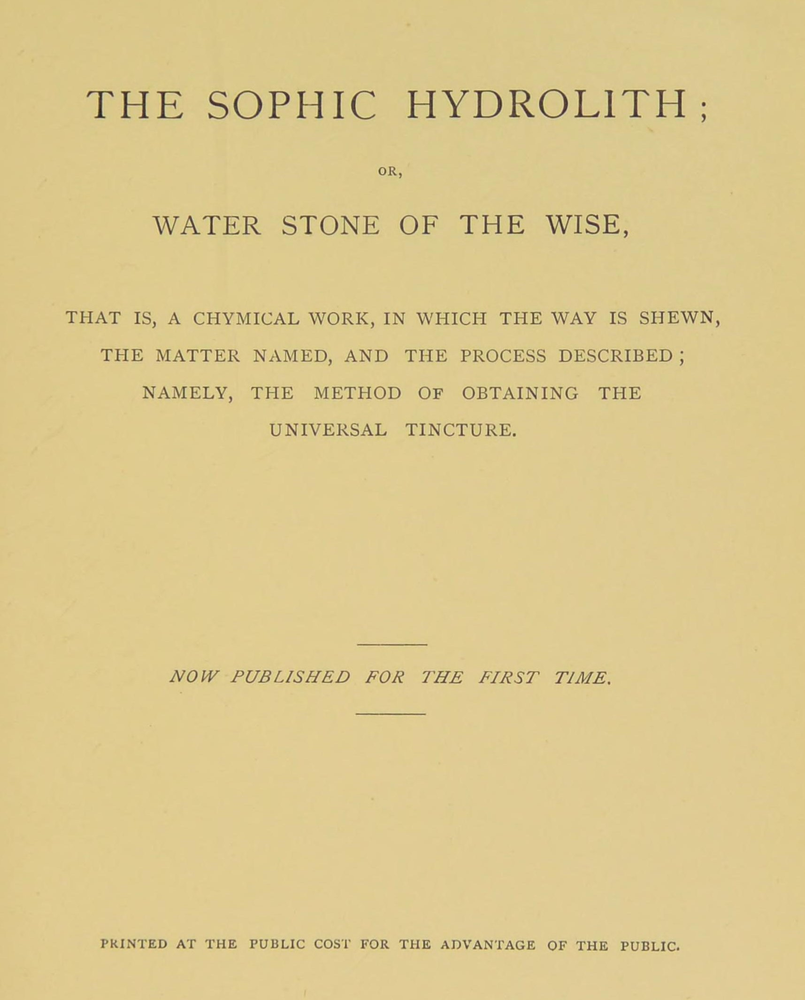

# 賢者たちの水石

ヨハン・アンブロジウス・ジープマッハー（とされる）／全訳

- 原題：Wasserstein der Weysen（ドイツ語、1619年、フランクフルト）。ラテン語訳 Hydrolithus Sophicus seu Aquarium Sapientum が1678年の『ヘルメス博物館』〔Musaeum Hermeticum〕増補版に収められ、A・E・ウェイトが The Sophic Hydrolith; or, Water Stone of the Wise として1893年の英訳第一巻に収めた
- 内容：四部から成る錬金術の手引き。第一部は術に取り組む者の心構え（祈り、謙遜、自然との一致）、第二部は「水石」すなわち賢者の石の物質の性質と、溶解・浄化・金の体との結合・四十日の黒化（烏の頭）・孔雀の尾・白・赤へと進む作業の手順、失敗の手当て、謎の詩、第三部は石の効用（万能薬、金属の変成）と、それがキリスト教の信仰の秘儀を鏡のように映すこと。第四部は、地上の賢者の石と「天の隅の親石」イエス・キリストとを一つずつ対応させる長い霊的寓意で、受肉・受難・死・復活・洗礼・聖餐・信仰の成長が、作業の各段階になぞらえられる。最後にエピローグ、付録、祈り、知恵の女神ソフィアを描くエピグラムが続く
- 作業の基にした本文と扉：Internet Archive 所蔵の1893年英訳第一巻のスキャン（OCR を画像と照合した）
- 著作権：原典は十七世紀、ウェイトは1942年に死去。日本・米国・英国で保護期間が満了している
- 訳者：人工知能（Claude Opus 5.5）
- 訳の性格：全文を訳した。訳者の調べたかぎりでは、日本語訳は出ていない

## この本について

　『賢者たちの水石』は、一六一九年にフランクフルトでドイツ語で刊行された匿名の錬金術書である。ニュルンベルクの書籍商・出版者ヨハン・アンブロジウス・ジープマッハーの著作とされることが多いが、確かではない。のちにラテン語に訳されて『ヘルメス博物館』に入り、ウェイトの英訳によって英語圏に広く知られた。

　この書の際立った特徴は、第四部の「キリストと賢者の石との類比」である。石が「家を建てる者の退けた石」「隅の親石」と呼ばれる聖書の言葉を手がかりに、作者は、金の体と第一の物質との結合を神性と人性との結合（受肉）に、腐敗と黒化とをキリストの受難と死とに、魂の降下と体のよみがえりとを復活に、チンキによる卑金属の変成を罪人の救いに、作業の失敗の手当てを悔い改めと赦免と聖餐とに、それぞれなぞらえる。のちにヤーコプ・ベーメの著作や、十八世紀の薔薇十字の文書に受け継がれる「キリスト教錬金術」の代表的な文書の一つである。作者は自分を「神学者でも当世流のアリストテレス派神学者でもない、単純な一信徒」と呼び、スコラ神学を激しく批判している。

　聖書の引用は英訳の語句に従って訳し、既存の日本語訳聖書の本文は用いなかった。英訳の出典表記には誤りもあるが（たとえば「Ecclesiastes」がじっさいにはシラ書であるなど）、〔原文 X〕として示すにとどめた。本サイトで訳した『賢者の石についての黄金論文』『黄金時代の復活』と同じ巻に収められている。

---

## 賢者たちの水石

**すなわち、道を示し、物質を名指し、過程を述べた化学の書。すなわち普遍のチンキを得る方法。このたびはじめて刊行。公共の益のために公費をもって印刷す。**

### 賢者たちの驚くべき水石、普通には賢者の石と呼ばれるものの簡潔な解説

　世のはじめから、神に照らされた人々、経験を積んだ哲学者たち、賢い異邦人たちがつねにいて、下なる被造物の本性と性質とを熱心に学んだ。彼らは、我々の地上の体を腐敗と死とから守り、永遠の健康と活力とのうちに保つものが自然の中にあるかどうかを見いだそうと、骨身を惜しまず努め、熱く望んだ。自然の光と神の啓示とによって、全能者が人間への愛のゆえに、全世界のあらゆる不完全な、病んだ、欠けのあるものを新たにし、もとの活力に戻すことのできる何か驚くべき奥義を世界の中に隠したにちがいないことを、彼らは直観したからである。

　もっとも熱心で注意深い探究によって、彼らはしだいに、この世には我々の地上の朽ちる体に死を免れさせるものは何もないことを知った。死は、始祖アダムとエバとその子孫とに、永遠の罰として課されたからである。しかし彼らは一つのものを見いだした。それ自身は朽ちず、病を除き、あらゆる不完全さを癒し、老いを浄め、我々の短い命を延ばすために、神によって人間の益のために定められたもので、族長たちはじっさいにその恵みにあずかっていた。

　この驚くべき薬を、賢く悟りある人々は熱心に求め、ついにそれとその貴い効能とを見いだした。こうして族長たちはそれを用いて体の活力を取り戻し、命を延ばした。疑いもなくそれは神によって、我々の三重に偉大な祖アダムに明かされ、アダムはその秘密を自分の子孫である族長たちみなに伝え、彼らはそれによって長寿と限りない富とを得たのである。前述の異邦人たちがこの知識を受けると、彼らはそれを神のもっとも貴い賜物、もっとも聖なる術として正しく重んじた。そして神の摂理によってそれがわずかな者にだけ明かされ、人類の大部分には隠されていることを悟ったので、それを秘密にしておくことをつねに良心と名誉との問題とした。

　しかし秘密が失われず、むしろ後の世まで続き保たれるように、彼らはそれを、書物の中でも忠実な弟子たちへの口伝えの教えの中でも、後の世の益のためにもっとも忠実に説き明かした。とはいえ、彼らは真理を寓意の言葉にくるみ隠したので、今でもその教えを理解して実地に生かせる者はごくわずかである。このやり方には十分な理由があった。この知恵を求める者に、（すべてのものをその手に持つ）神への依存を感じさせ、たえまない祈りによってそれを得させ、それが明かされたときには、すべての栄光を神に帰させようとしたのである。そのうえ彼らは、真珠を豚に投げ与えることを望まなかった。もしそれが邪悪な世に知られれば、人々はこの一つのことだけを貪欲に求め、あらゆる労働を怠り、放埒で堕落した生活に身をゆだねることを、彼らは知っていたからである。

　しかし前述の哲学者たちは、この主題をきわめてさまざまな方法で扱い、多くの独特で風変わりな言い回し、奇妙なたとえ、不思議で空想的な言葉を用いたけれども、みな同じ目標と、術を正しく行うのに欠かせない一つの同じ物質とを指し示す点で一致している。それにもかかわらず、術を学ぶ多くの者はその意味と、彼らの語る秘密の物質とをまったく取り違えてきた。今日でも（いつもそうであったように）、卑しいいかさま師ばかりでなく、まじめで学識ある人々のうちにも、たゆまぬ精励でこの知識を求めながら、それに達することのできなかった者がおおぜいいる。いや、金の釣り針で釣りをしてすっかり身を滅ぼし、絶望して探究を捨てざるをえなかった者もいる。

　それゆえ、だれもこの秘密の術の存在を疑ったり、この邪悪な世のならいに従ってそれをただのこしらえごとと見なしたりしないように、（聖書に名の挙がる人々のほかに）この術をまことに知っていた真の賢者たちの何人かを、その自然な継承の順に挙げよう。ヘルメス・トリスメギストス、ピュタゴラス、アレクサンドロス大王、プラトン、テオフラストス、アヴィケンナ、ガレノス、ヒッポクラテス、ルキアノス、ロンガヌス、ラーズィー、アルケラオス、ルペシッサ、『大薔薇園』の著者、預言者マリア、ディオニュシオス、ザカリー、ハリ、モリエヌス、カリド、コンスタンティウス、セラピオン、アルベルトゥス・マグヌス、エストロド、ヴィラノーヴァのアルノー、ゲベル、ライムンドゥス・ルルス、ロジャー・ベーコン、アラン、トマス・アクィナス、マルケルス・パリンゲニウス。そして近代の人々のうちでは、トレヴィザンのベルナール、修道士バシリウス・ヴァレンティヌス、フィリップス・テオフラストゥス（すなわちパラケルスス）、その他多くの人々である。また我々の同時代人のうちにも、神の恵みによって日々この奥義を味わいながら、それを世に固く秘している人々がいるであろうことは疑いない。

　しかしこのマギステリウムについて真実に正しく書いたこれらの偉大な賢者たちと並んで、この術の知識を持つと偽り、賢者たちの言い回しで嘘を飾り立てて人々の目に砂をかけ、よだれを流させ、結局はその約束を果たさない多くのいかさま師や詐欺師が見いだされる。だまされた人々は次の警告をよく考えるがよい。「あなたの金箱から金を蒸留する者を信じるな。賢ければ、そういう者を用心するであろう。損とあざけりとを受けたくなければ、こうした不正ないかさま師に気をつけよ。単純で率直で慎み深い人々に従え。善きものを持つ者は、黙ってそれを味わう」。しかし、そういう人々をどこで見つければよいのか。「善き人を求めよ。重さと物質と働きとにおいてほかの人々にまさることで、彼らを知ることができよう」。

　さて、この術の秘密を真のまっすぐな道によって学びたいと願いながら、こうした詐欺師といかさま師とに、その空疎な話と高い自負とにすっかり惑わされて、どちらへ向かえばよいかわからない学徒が多くいるので、私はこの術の真の原理を手短に説き明かそうと決めた。これほど大いなる秘儀について語るには自分はふさわしくないと思うが、それでも自慢せずに言えば、神の恵みによって、私はこのマギステリウムにおいて大方の人々よりも先へ進んだ。そして私の主であり師である偉大にして善なる神が、ふさわしくない私の手にゆだねたタラントンを隠さないことを、自分の務めと考える。このゆえに私は、化学を愛するすべての人々に、この主題の真の知識に達しうる正しい道を示そうと思い、この『術全体の簡潔な要約と宣言』を（書き記しうるかぎりで）世に出した。私を通して神がひょっとして何人かの目を開き、先入見から正しい道へ連れ戻して、ご自身の力あるみわざを彼らに現してくださることを望んで。読者の便宜のため、私はこの書を四つの部に分ける。

　第一部では、術の初歩と、その学びのために自分を整える最善の仕方とを述べる。

　第二部では、必要な物質の性質と特性、またその調製と扱いの方法を示し、述べる。

　第三部では、術の大きな有用さと、その言いあらわしえない効験と力とについて、いくらか述べる。

　第四部には霊的な寓意が続く。そこではこのマギステリウム全体が、いと高き方の天の、永遠の、祝福された隅の親石の真の姿として述べられる。それはまた、進め方の真実で簡潔で単純な実践の手引きを含むであろう。私は多くのもっともらしい言葉を好まないからである。

## 第一部

**詩編二十五**

> 「主を畏れる人はだれか。主はその人に正しい道を教えられる」

　まず第一に、敬虔で神を畏れる化学者とこの術を学ぶ者はみな、この奥義が、まことに偉大な術としてばかりでなく、もっとも聖なる術として（それは天の最高の善を型どり、影として示すものだから）見なされるべきことを考えねばならない。それゆえ、この大いなる言いあらわしえない秘儀に達したいと望む者は、それが人の力によってではなく神の恵みによって得られること、そして我々の意志や望みではなく、ただいと高き方の憐れみだけがそれを我々に授けうることを、覚えておかねばならない。このゆえに、あなたは何よりもまず心を清め、ただ神にのみそれを上げ、まことの、熱心な、疑いのない祈りのうちに、この賜物を神に求めねばならない。ただ神だけがそれを与え、授けることができるのである。

　すべての心をあやまたず探る全能の神が、あなたのうちに、正しさ、忠実さ、誠実さ、そして何か利己的な目的のためではなく神のまことの誉れと栄光とのためにこの術を知りたいという願いとを見いだすなら、神は疑いなく（その約束に従って）あなたの祈りを聞き、聖霊によってあなたを導いて、あなたはこの術を理解しはじめるであろう。そして、もっとも恵み深い主があなたの願いに答え、もっとも初歩の原理の理解さえあなたに明かしてくださらなかったなら、この知識はけっしてあなたの心に入らなかったであろうと感じるであろう。

　そのときひざまずき、へりくだった悔いた心で、祈りを聞かれたことに対してふさわしい賛美と誉れと栄光とを神にささげ、あなたに恵みを与えつづけてくださるよう、そしてこの深い秘儀の完全な知識に達したのち、それをもっとも聖なる御名の栄光と誉れとのため、苦しむ同胞の益のために用いることができるよう、くり返し神に願え。

　そのうえ、自分の魂を愛するなら、ふさわしくない者や邪悪な者に、たとえごく小さな点でも秘儀を明かしたり、どのような意味でもその者をそれにあずからせたりすることのないよう、用心せよ。もしあなたが何らかの仕方で神の賜物を悪用したり、自分の栄誉のために用いたりすれば、全能の与え主からまちがいなく責任を問われ、いっそそれを知らなかったほうがよかったと思うであろう。

　このようにしていわば（侮られることのない）神に身をささげ、この術の目的と範囲とを正しく重んじることを学んだなら、まず第一に、三位一体の神によって秩序づけられた自然が、いま日々目に見えずに働き、ただ神の意志のうちに動き住まうさまを悟るよう努めねばならない。自然の過程を正しく重んじることなしに、だれもこの術の学びに取りかかってはならないからである。さて自然は、まことに、それ自身の本質において一つで、真実で、単純で、完全なものとして、また目に見えない霊によって生かされているものとして述べることができる。それゆえ、もし彼女を知りたいなら、あなたもまた真実で、ひとすじな心を持ち、忍耐強く、ゆるぎなく、敬虔で、寛容で、手短に言えば新しく生まれ変わった人でなければならない。

　もし自分がそのように整えられ、自分の本性が自然に適っていることを知るなら、あなたは彼女の働きを、ほかの仕方ではとうてい得られないような直観で見抜くであろう。

　この術の学びはすぐれたものへのまことに完全な導き手なので、その原理をよく知れば、（いわばあなたの意に反してさえ）あなたは神のあらゆる驚くべきみわざの理解へとせき立てられ、この世のはかないすべてのものを、その真の値打ちで量ることを教えられるであろう。しかし富と快楽とを得るためにこの知識を望む者は、けっしてそれに達するなどと思ってはならない。それゆえ、あなたの心と思いとを地上のあらゆるものからそむけ、いわば新しく創り変えて、ただ神にのみささげよ。この術の学びをめでたく実らせるには、体と魂と霊とのこの三つが調和して働かねばならないことに注意すべきである。人の心と思いとが、作業全体を発展させるのと同じ法則によって治められているのでなければ、そういう者は疑いなく術において誤るであろう。

　あなたが神の世界と内なる調和のうちにあるとき、外なる一致も欠けることはない。けれども我々の術師は、まき、植え、水をやることしかできない。成長を与えるのは神でなければならない。それゆえ、もしだれかが神の敵であれば、全自然がその者に戦いを宣する。しかし神を愛する者には、天も地もあらゆる元素も助けを貸さねばならない。これらのことを心にとめ、真の第一の物質（それについてはのちに語る）を知るなら、あなたはただちにこの学びの実践の部分に取りかかってよい。あなたの作業がそのすべての段階をめでたく通り抜けるよう、恵みと指図と導きとを神に呼び求めながら。

**シラ書十一**〔原文 Ecclesiast. XI.〕

> 「主を畏れることのうちにとどまり、その言葉に固く結びつき、その務めを忠実に待つ者は、錫と銅とを銀と金とに変え、神の助けによって大いなることをなすであろう。まことに、エホバの恵みによって、ありふれた屑から金を作る力を持つであろう」〔聖書の本文どおりではない〕

## 第二部

**イザヤ書二十八**

> 「それゆえ主なる神はこう言われる。見よ、わたしはシオンに一つの石を据えて基とする。試みを経た石、貴い隅の親石、確かな基である。それを持つ者はうろたえることがない」

　我々のもっとも高貴な術について書いた数多くの人々は、その賛美を歌い、それに新しい栄えある名を考え出すことに飽きることがなかった。そのもっとも貴い目的物を、彼らは「賢者の石」、あるいは賢者たちのもっとも古く、秘められ、自然で、測りがたく、天上の、祝福され、至福にあずかった、三にして一なる普遍の石と呼んだ。それを石と名づけ、あるいは石にたとえた理由はこうである。第一に、そのもとの物質がじっさいに一種の石であって、石のように硬く堅固なので、搗きくだき、粉にし、（自然そのものが結び合わせた）その三つの元素に分けることができ、それからふたたび、自然の法則を整える術師の巧みな手によって、蝋のように溶けやすい堅固な石に組み直すことができるからである。

　賢者の石の第一の物質、あるいは第二の物質の正確な知識から出発することの重要さは、この主題について書いたすべての人々が大いに力説してきた。この物質は一つのものの中に見いだされ、ただそれだけから我々の石は、外のものを何も混ぜずに作られる（もっともそれは千もの名で呼ばれるが）。その性質と外見と特性とは、次のように述べられてきた。それは三つのものから成るが、ただ一つである。同じように、一、二、三、四、五から創られ作られていながら、どこでも一と二との中に見いだされる。彼らはそれをまた普遍のマグネシア、あるいは世界の種とも呼ぶ。そこからすべての自然物がその起源を得るのである。その性質は独特である。その驚くべき本性と形とに加えて、それは火のように熱く乾いてもおらず、水のように冷たく湿ってもおらず、土のように冷たく乾いてもおらず、あらゆる元素の完全な調製物だからである。その体は朽ちず、四つの元素のどれによっても滅ぼされず、その性質は、天と第五精髄のように、四つの元素と四つの性質とをはるかにしのぐ。

　その外見、姿、形、格好について、彼らはそれを石であって石でないものと呼ぶ。彼らはそれを樹脂と白い水とに、また大洋の水にたとえる。それは命の水、もっとも純粋でもっとも祝福された水と名づけられるが、雲の水やありふれた泉の水ではなく、濃い、永続する、塩辛い、（ある意味で）乾いた水であり、手を濡らさず、大地の脂肪から湧き出るぬるぬるした水である。同じように、それは二重のメルクリウスでありアゾトであって、大小の天の球と地の球との蒸気あるいは滲出物に支えられているので、火に焼き尽くされることがない。それ自身が自然の光の普遍のきらめく炎であり、そのうちに天の霊を持ち、それによってはじめに、万物に行き渡る神によって生かされたからである。アヴィケンナはそれを世界の魂と呼ぶ。魂が体のすべての肢体の中に生き動くように、その霊はあらゆる元素の被造物の中に生き動き、体と魂との解けない絆であり、もっとも純粋でもっとも高貴な精髄であって、その中にはあらゆる秘儀が、その驚くべき力と効験との尽きない豊かさのうちに隠れている。

　そのうえ彼らは、それが宇宙を満たし、はじめに水の面を動いた主の霊であると言うとき、それに無限の神的な力と効能とを帰している。彼らはそれをまた、世界の中に隠れている真理の霊と呼ぶ。それは聖霊の霊感によらなければ、あるいはそれを知る者たちの教えによらなければ、理解されえない。それは一般にはどこにでも、何の中にでも見いだされるが、その完全さと豊かさとのすべてにおいては、ただ一つのものの中にのみ見いだされる。手短に言えば、それは天上のものでも地獄のものでもない霊的な精髄であり、空気のような、純粋で貴い体であって、最高のものと最低のものとのあいだの中間にあり、天の下でもっともえり抜きの、もっとも高貴なものである。しかし無知な者と初心者とには、もっとも卑しく下等なものと思われている。それは多くの賢者に求められるが、見いだす者は少ない。遠くにいる者には疑われ、近くにいる者には受け入れられる。だれにも見られるが、知る者は少ない。それは次の詩句からもわかるであろう。

> 「大いなる善は三つに分けられているが、それは一つであり、世に大いに重んじられる。人々はそれを目の前にし、手で扱いながら、たえず足で踏みつけていても、それを知らない。それは最大の富であり、術を知る者はもっとも富める者とも肩を並べられよう」

### 賢者たちの謎

**術の根底にある実体、すなわち賢者たちのフェニックスと呼ばれるものが、三重の三であることを示す謎**

> 「あるものの三つの部分を告げるなら、あなたには不満を言う理由はない。三つのうちの一つを求めよ。そうすれば三つのうちの一つがそこにあるであろう。体と魂とのあるところには霊もあり、そこには塩と硫黄とメルクリウスとが輝いているからである。私の言葉を信じて、三つ葉の草を求めよ。汝はその名を知っている。それを見つけるなら、汝は賢く巧みである」

### もう一つの謎（ずっとやさしい）

> 「この世にときおり見いだされる一つのものがある。それは青みがかった灰色で緑であり、不思議なことに、このものの中には赤と白との色がある。それは水のように流れるが、濡らさない。それは大いに重く、また軽い。私はそれに千の名を与えることができようが、その千もそれを知らない。見た目は卑しいが、賢者にとっては貴い。それを第二のもので溶かし、第三のもので凝縮する者は、我々の栄えある主題を手にしている」

### さらにもう一つの謎

> 「あらゆるものがこの石の形成にあずかる。それは地の下でみごもられ、地の中で生まれ、天で生かされ、時のうちに死に、永遠の栄光を得る」

　さて、示された物質（それは一部は天のもの、一部は地のもので、その自然の状態では、確かな名も色もない、ただの混沌とした渾沌である）を手にし、それをよく知ったなら（この知識を賢者たちはつねにこの作業の主な部分と見なしてきた）、あなたはそれを正しい仕方で扱うことに全心を傾けねばならない。しかし手でそれに何かをする前に、学ぶ者は、その中にひそむ霊を、その本質的な性質と特性とに従ってよく知るまでは、この大いなる測りがたい奥義の調製を始めないよう、心にとめねばならない。ある哲学者は言う。「この霊については、まずそれを十分正確に知るまでは手を出してはならない。神はそのみわざにおいて驚くべき方であり、侮られることがないからである」。

その哲学者はさらに言う。「この事柄に、たいへん軽はずみに取りかかって重く罰せられ、（そのうちのある者は）実験室で命にかかわる事故に遭った人々の例を、いくつか挙げることもできる。この作業は、多くの人が思うような軽いものではないからである。そう思われるのは、たぶん賢者たちがそれを子どもの遊びと呼んだためであろう。神がその秘密を明かした人々には、たしかに実験は単純でたやすいものと思われるかもしれない。しかし汝は、時ならぬ不注意によって大きな危険に身をさらすことのないよう、よくよく用心せよ。むしろ、うやうやしい畏れとおののきと熱心な祈りとをもって作業を始めよ。そうすれば危険はほとんどないであろう」。

　さて、祈りの部屋できわめて熱心に修練を積み、物質が手もとに用意できたなら、実験室へ行き、示された物質を取って、次のように作業に取りかかれ。

　何よりもまず、あなたの第一の目的は、この物質（すなわち第一の実有。賢者たちはこれを最高の自然の善とも呼んだ）を溶かすことでなければならない。次にそれは、その水の性質と土の性質とから浄められねばならず（はじめそれは、土っぽく、重く、濃く、ぬるぬるした、霧のような体に見えるからである）、その中にある濃く、雲のようで、不透明で、暗いものはすべて取り除かれねばならない。こうして最後の昇華によって、その中に含まれている心臓と内なる魂とが分け離され、貴い精髄にされるためである。

　これはみな、我々のポントスの普遍の水〔原文 Pontic and Catholic water〕によって成しとげることができる。それは逆流しながら全地をうるおし実らせ、甘く、美しく、澄んで、透きとおり、金や銀や紅玉やダイヤモンドよりも輝いている。この祝福された水は、我々の物質の中に閉じこめられ、含まれている。

　それから、抽き出された心臓と魂と霊とは、もう一度蒸留され、それら自身のふさわしい塩によって一つに凝縮されねばならない（その塩は、物質の内部では、はじめは血のように赤い色であるが、のちに輝く澄んだ透明な白になり、賢者たちによって知恵の塩と呼ばれる）。こうしてあなたは、前の過程と呼ばれるものによって、まず純粋なものを不純なものから分け、まず見えるものを見えないものにし、それからふたたび見えないものを見える、あるいは触れられるものにした（ただしもはや、はじめのように粗く形のないものではない）。それは今や、こころよい、しみとおるような香りを持つ輝く体であり、しかもあまりに精妙で霊気のようなので、もし固定されなければ蒸発して消えうせてしまうであろう。このゆえに賢者たちはそれを、メルクリウスの水、太陽の水、太陽のメルクリウス、あるいは賢者たちのメルクリウスと呼ぶ。しかしそれが前述の形にとどまっているかぎり、薬として用いても何の良い効果もなく、むしろ毒として働くであろう。それゆえ、もしその栄えある効能と多様な力とを味わいたいなら、それをさらにいくつかの化学の過程にかけねばならない。

　そのためには、（かなり長い期間にわたる）自然の働きを熱心に観察し、その導きに厳密に従わねばならない。この知識を得たなら、前述の調製された水の物質を二部分、またさらに異なる三部分取れ。最初の二部分はとっておけ。しかし三部分には別の物質、すなわち第一の物質ともっとも親密に類縁の、もっとも貴く神に恵まれた「金の体」を加えよ。最初の発酵のためにはその十二分の一を加えよ。霊的で天上の調製された物質と、この地上の金の体との両方が結び合わされ、一つの体に凝固されねばならないからである。

　しかし、普通の金はこの目的には役に立たないことに注意すべきである。それはふさわしくなく、死んでいるからである。全能の神によってもっとも貴く美しい金属と定められたとはいえ、それが鉱山に隠れていたあいだ、その完全な成長と発達とは妨げられていた。そのうえ日々の使用がその内に宿る力、すなわち硫黄あるいはその魂を鈍らせ、それはたえずその本性にとって異質な他のものと混じり汚されている。そのため、それは日ごとにますます術の主題にふさわしくなくなる。それゆえあなたは、純粋な生きた霊を持ち、その硫黄がまだ弱められても混ぜ物をされてもおらず、純粋で澄んでいる金を得るよう努めねばならない（アンチモンを通すことによって、すなわちサトゥルヌスの天と球とを通って、そのあらゆる汚れから浄められることによって）。さもなければ、第一の物質は霊的で霊気のようなものなので、それと結びつかないであろう。このマギステリウムは純粋な体だけを扱い、汚れたものがその近くにも上にもまわりにもあることを許さないからである。

　さて、水と金とのこの等しくない部分（性質においてだけでなく量においても異なる。前者は調製ののち、霊気のようで、薄く、精妙で、柔らかいが、後者はたいへん重く、固く、硬い）が、溶解用の蒸留器の中で結び合わされ、乾いた液体すなわちアマルガムにされたなら、少なくともぬるい程度のおだやかな熱に六、七日さらしておかねばならない。それから三部分の水のうちの一部分を取り、卵の形に似た丸い楕円のガラスの瓶に注げ。そのまんなかに、ならした液を入れ、もう一度六、七日置け。すると太陽の体はしだいに水に溶かされるであろう。そこで両者は結びつきはじめ、氷がぬるま湯に溶けるように、おだやかに、気づかぬうちに一方が他方に混じり合うであろう。この結合を賢者たちはさまざまに影として描き、たとえば（ソロモンの雅歌におけるように）花嫁と花婿との婚姻にたとえた。これがすんだら、（とっておいた）第三の部分を残りに加えよ。ただし一度に、あるいは一日に加えるのではなく、七回に分けて加えよ。さもなければ体があまりに液状になり、多すぎる湿り気のためにすっかり腐ってしまうであろう。

　種が地にまかれたとき、多すぎる湿り気と雨とによって滅ぼされ役に立たなくなるように、我々の作業も、水が賢明に与えられなければ栄えることができない。これがみなすんだら、合わせたものが蒸発したり香りを失ったりしないよう、瓶を注意深く閉じて封印せよ。そしてそれを炉に置き、雌鶏が卵をかえす温かさの度合いに似た、おだやかで、絶えまない、空気のような、蒸気に満ちた、よく調えられた熱にさらせ。

〔注――賢者たちは蒸気の火について多くを語り、それを知恵の火と呼んだ。それは元素の火でも物質の火でもなく、（彼らによれば）本質的で超自然的なものである。彼らはそれをまた神的な火、すなわち普通の火によって働きへと呼び起こされたメルクリウスの水とも呼ぶ。〕

　よく煮熟し、熱せよ。しかしその何も昇華しないよう、あるいは賢者たちのたとえの言葉で言えば、妻が夫を支配せず、夫が妻に対する権威を濫用しないよう、気をつけよ。そうすれば、全体はあなたが何も手出しせずとも（もちろん火を保たねばならないことを除いて）ふつうに進むであろう。はじめ、地上の太陽の体はすっかり溶かされ、分解され、あらゆる力を奪われる（はじめは泥のように不純だった体が、四十日のうちに、賢者たちが烏の頭と呼ぶ炭のような黒い色に変わる）。こうしてそれはその魂を奪われる。魂は上へ運ばれ、魂から引き離された体は、しばらくのあいだ、死んだように蒸留器の底に灰のように横たわる。しかし火が強められ、よく調えられると、魂はしだいにしずくとなってふたたび降り、その体をうるおし湿らせ、こうして体がすっかり焼け尽くされるのを防ぐ。それからまた魂は昇り降りし、その過程が七度くり返される。

　温度は、はじめから終わりまで同じところに保たねばならない。ゆっくり急げ。火の影響がおだやかに、しだいに及ぶようにすることが何よりも大切だからである。そのあいだに、蒸留器の中にさまざまな化学的変化（すなわち色の変化）が見られるであろう。それに注意深く気を配らねばならない。もしそれらが正しい順に現れるなら、それはあなたの企てがめでたく成しとげられる徴だからである。

　まず魚の目のような粒状の体が現れ、次に物質のまわりに輪が現れる。それははじめ赤みを帯び、次に白くなり、次に孔雀の尾のように緑と黄になり、次にまばゆい白になり、最後に深い赤になる。そしてついに、火の希薄にする影響のもとで、魂と霊とは底に横たわるその体と結び合わされて、固定した解けない精髄となる。この結合と合一とは、言いあらわしえない賛嘆と畏れとなしには見ることができない。そのときあなたは、よみがえらされ、生かされ、完成され、栄光を受けた体を見るであろう。それは（コチニールのような）もっとも美しい紫の色をしており、そのチンキは、のちにもっと詳しく示すように、あらゆる不完全な体を変え、染め、癒す力を持つ。こうして神の恵みと助けとによってあなたの労苦の目標にめでたく達し、賢者たちのフェニックスを見いだしたなら、あなたはもう一度心を尽くして神に感謝し、その言いあらわしえない賜物を、ただ神の栄光と、苦しむ兄弟たちの益とのためにのみ用いねばならない。こうして私は、このもっとも高貴な術、最高の達成、すなわち賢者たちの卵あるいは賢者の石を、始め、めでたく完成させることのできる過程の全体を、もっとも忠実に説き明かした。

　しかし、もし作業のあいだに何か偶然の不都合が起きたなら、それは時をおかずに手当てされねばならない。さもなければ化学の過程はけっして完成されないであろう。もしあなたが、（一）合わせたものが溶けて黒くなる前に、何かが昇華したり蒸発したり、赤い油に似たものが物質の表面に浮かんだり（これは悪い徴である）するのに気づいたら、あるいは（二）白くなる前か後に、あまりに急に赤くなったら、あるいは（三）終わりのほうで、正しく凝固しなかったら、あるいは（四）物質が熱にあまりに強く影響されて、取り出したとき、赤熱した鉄の上で蝋のようにすぐ溶けず、鉄を染めて色をつけ、そののち火の中で固定してとどまらなかったら――これらの徴はみな、組み合わせや温度の誤り、あるいは何かの種類の不注意の症状と見なしてよい。

　こうした欠陥は、ただちに手当てしなければ、まもなく直しようがなくなる。巧みな達人なら、それを直すさまざまな工夫を知っているはずである。初心者のために、ここでそれを述べよう。

　前述の欠陥の一つあるいはいくつかが見られたなら、合わせたもの全体をふたたび瓶から取り出し、もう一度前述のメルクリウスの水（それはまた処女の乳、あるいは第一の物質の乳と血と汗、あるいは尽きない泉、あるいは命の水とも呼ばれるが、それでももっとも悪性の毒を含んでいる）に溶かさねばならない。この水でそれをもう一度湿らせ飽和させ、それから、もはや昇華も気体の蒸気の発生もなくなるまで、あるいは上に述べたように最後の凝固がしかるべく起こるまで、火の作用にかけねばならない。その後の発酵と増殖と、その用い方とについては、第三部でさらに述べよう。

　過程全体に必要な時間については、何かきわめて確かなことを言うのは不可能である。じっさい、賢者たちはこの点についてもっとも食い違った意見を持ち出してきた。疑いもなく、ある人々はほかの人々より長くそれに取り組んでいたからである。しかし自然の働きを注意深く観察し、その教えに導かれ、何事においても中道をとる者は、自分の知恵をあまりに盲目的に信じる者よりも早く目的を達するであろう。

　しかし私は汝に言う。作業の前の段階でも後の段階でも、文字Xの中点を越えてはならない。その半分（V）を溶解の時に、残りの半分を組み合わせの時にあてよ。それからまた、最後の合一のためには、数XXを汝の導きとせよ（何か予期せぬことが起こらないかぎり）。その期間で満足せよ。他方、完成を急ごうとしてはならない。一時間の誤りが汝をまる一か月後戻りさせることもある。もし不当に時を縮めようと努めるなら、汝は流産を生むであろう。多くの人が、その無知あるいはうぬぼれた性急さによって、望んだエリクシルの代わりにニヒリクシル〔「無」のエリクシル〕を得たのである。

　この魔術的な学問の重要さにかんがみ、私はこれを知識の子らの前に置き、注意深く考えてもらうのが正しいと考えた。

### 謎

> 「七つの町、七つの金属、七つの日、そして数七がある。七つの文字、ふさわしく並んだ七つの言葉、七つの時、そして同じ数の場所。七つの草、七つの術、七つの石。七を三で割れ。そうすれば汝は賢くなるであろう。そのとき、だれも半分を急いで沈殿させようとはしないであろう。手短に言えば、この数においてすべてはめでたく進むであろう」

　次の詩句には、過程の全体が手短に述べられている。

> **第一の段階**――「汝の物質を溶かし、それから腐らせよ。それから蒸留させ、もう一度凝縮させよ」
>
> **第二の段階**――「二つのものを組み合わせ、それを腐らせ、黒くならせよ。それを煮熟し、汝の技で白に変えよ。ついに合わせたものを深い赤に変えさせ、凝固させ、固定せよ。そうすれば汝は恵まれた人となろう。もしそののち、それを発酵させるなら、汝は作業の全体をめでたくやりとげたことになろう。それから、それで何でも望むものを染めよ。そうすればそれは汝に限りない宝を殖やすであろう」

　あるいは、もっと手短に、こう言う。

> 「一の中に三を求め、また三の中に一を求めよ。溶かし、凝縮せよ。そうすれば汝は術の主となろう」

　過程を示す謎もある。

> 「霊がしばらくのあいだ体に与えられる。その霊は魂の命である。もし霊が魂を自分のほうへ引き寄せるなら、両者は体から引き離される。そのとき三つのものが同じ場所にとどまり、ついに貴い体は溶かされ、腐り、死ぬ。しかししばらくすると、霊と魂とはおだやかな温かさによって連れ戻され、もう一度もとの座を占める。そのとき汝は精髄を手にする。完全さに何も欠けるところはなく、作業は喜ばしい終わりによって栄光を受ける」

**箴言二十三**

> 「わが子よ、あなたの心を私に与え、あなたの目に私の道を守らせよ」

## 第三部

**シラ書四十三**

> 「だれが主を見て、それを語りえたか。だれがその偉大さにふさわしく主をあがめえようか。我々はそのみわざのもっとも小さなものを見るにすぎない。はるかに大いなるものは我々から隠されている。神はすべてを造り、ご自分を畏れる者にその悟りを与えられるからである」

　この大いなる術の目的と、驚くべき賢者の石のすぐれたさま、効能、効験、言いあらわしえない有用さとについては、多くのことが書かれてきた。しかし、思いを越えるその栄光を語り尽くしたり、その誉れをふさわしく述べたりできた者はだれもいない。すべての賢者たちは、それをこの地上が与えうる最高の至福と見なしてきた。それなしには、この世でだれも完全さに達することはできない。モリエヌスは言う。「この石を持つ者はすべてを持ち、ほかの助けを必要としない」。それは、この世のあらゆる幸い、体の健康、確かな幸運を含んでいるからである。

　彼らはまた、石の中に隠れている霊と効験とが、月の円盤の下にあるすべてのものの第五精髄の霊であるゆえに、石をほめたたえた。このゆえに彼らは、それが空を支え、海を動かすと言う。彼らはまた、それを天のすべての霊のうちでもっとも選ばれた、もっとも精妙な、もっとも純粋な、もっとも高貴な霊と述べる。ほかのすべての霊は王に対するようにそれに従い、それは人々にあらゆる健康と繁栄とを授け、あらゆる病を癒し、神を畏れる者にはこの世の誉れと長い命とを与えるが、それを悪用する邪悪な者には永遠の罰を与える。それはまた、その目的を果たしそこなったことが一度も知られておらず、あらゆる点で実証され、完全で、あやまたないものと認められるゆえに、賢者たちにほめたたえられる。それゆえヘルメスとアリストテレスとはそれを、あらゆる奥義の真の、欺かない、あやまたない奥義、愚かな者には隠された神の力と呼ぶ。手短に言えば、彼らはそれを天の下のすべてのものの長、あらゆる哲学の作業の驚くべき結びあるいはエピローグと名づけた。それゆえ、ある敬虔な賢者たちは、それがアダムに神によって明かされ、アダムからすべての聖なる族長たちに伝えられたと断言してきた。

　その助けによって、ノアは箱舟を、モーセはそのすべての金の器とともに幕屋を、ソロモンは神殿を建て、そのうえ多くの大いなるわざを成しとげ、多くの貴い飾りを造り、自分のために長い命と限りない富とを得たと言われるからである。

　そのうえ賢者たちは、それによって七つの自由学芸を考え出し、自分たちの暮らしの糧を求めて得たと認めている。神は、彼らが貧しさによって探究を妨げられたり、利得のために金持ちにへつらうよう追いやられ、そうして軽蔑すべき者となり、神の目に笑いぐさ、物笑いのたねとなったりしないよう、この賜物を彼らに与えたのである。

　石は、彼らが神の驚異の大いなる秘儀と、神の栄光の尽きない富とを見分けることを可能にした。それによって彼らの心は、神をいっそう親しく知るように呼び覚まされ、かき立てられた。彼らは大きな富や、この世の誉れや快楽を得ようとはせず、自然の驚くべき秘密を探り出し、観想することだけを喜びとしたからである。彼らは神のみわざを、我々の時代の大方の人々とはまったく違った目で、まったく違った仕方で見た。今の人々は、ああ、牛や子牛のようにそれを眺め、富と、この世の利益と快楽とのために我々の高貴な術の学びを追い求めている。しかし彼らはけっして求めるものを見いださないであろう。神はこの賜物を、そのみ言葉を軽んじる邪悪な者にではなく、この邪悪で不浄な世で正直に静かに生き、困っている兄弟に助けの手をさしのべようと努める敬虔な者に与えるからである。あるいは、詩人の言葉で言えば――

> 「神はこの術を誠実な善き人に与え、世はそのすべての金をもってしてもそれを買うことはできない。俗衆はこの秘儀について何も知らない。もし人が不敬であれば、石をむなしく求めるからである。それを黙して持つ者は、望むところに住み、災難も盗人もいかなる悪も恐れない。このゆえに、この聖なる賜物はわずかな者にしか許されない。それは神の手のうちにあり、神は望む者にそれを与える」

　この術の働きと効能と有用さとについては、これまでに世に出たさまざまな書物の中で多くのことが語られてきた。たとえば、調製され完全以上にされた前述の石が、どの程度まで、あらゆる薬にまさる薬となるか、ということである。それは普遍の万能薬と名づけられ、（たとえばらい病や痛風のような）あらゆる病がそれに屈するばかりでなく、それを用いることによって老人はふたたび若くなり、失われた能力ともとの力とを取り戻し、すでに半ば死んでいる者もよみがえらされ生かされうるという。しかし私は医者ではないので、この点について意見を述べるのは控えよう。石がこの効能を持つことは、それを持つ者ならだれでも自分で知ることができる。私はむしろ、日々の経験によって私の知っている石の性質と用い方とについて、いくつかの所見を記しておきたい。

　第一に、この術の実践は、ただ自然の驚異だけでなく、そのあらゆる言いあらわしえない栄光のうちにある神ご自身の本性を、我々に理解させてくれる。それは驚くべき仕方で影として示す。いかにして人間がもっとも聖なる三位一体の像であるか、聖なる三位一体の本質、その三位一体における実体の一性と位格の区別、聖なる三位一体の第二の位格の受肉、その降誕、受難、死、復活、その高挙と、我々人間のためにかちとられた永遠の幸い、また原罪からの我々の浄め（その浄めがなければ、人のあらゆる善い行いはむなしく空であろう）を。手短に言えば、キリスト教の信仰のあらゆる箇条と、人が新しい命へとよみがえる前に、多くの艱難と苦悩とを通り、死の餌食とならねばならない理由とを。こうしたことをみな、我々は我々の術の中に、いわば鏡の中に見るのである。それは第四部で述べる機会があろう。

　第二に、その地上の自然の用い方は、そのチンキによって、あらゆる不完全な金属を純粋で堅固な金に変えることにある。それをできるだけ手短に示してみよう。

　石あるいはエリクシルは、我々の過程の前の段階を終えたときに置いておいた形のままでは、この目的に用いることができない。次のようにしてさらに発酵させ、増さねばならない。さもなければ、不完全な金属と体とにうまく用いることができないであろう。

　精髄を一部分取り、それにアンチモンによって浄められ溶かされ、ごく薄い板にされたもっとも純粋な金を三部分加えよ。それらをるつぼの中にいっしょに置け。

　すると合わせたもの全体は、純粋で効き目のあるチンキに変わるであろう。それを卑しい金属に一対千の割合で用いれば、それらを純粋な金に変えるであろう。

〔注――金属が純粋であればあるほど、また我々の物質との親和性が大きければ大きいほど、それらはたやすくチンキに受け入れられ、再生の過程はいっそう完全ですみやかになる。変成とは、不純でふさわしくないものがすべて浄め去られ、かすのように捨てられることにあるからである。同じようにして、きずのある石は貴いダイヤモンドに変成させることができ、普通の水晶も、もっとも貴い宝石に匹敵するように染めることができる。そのうえ、チンキによって邪悪な世に明かしてはならない多くのほかのこともなしうる。〕

　石のこうした効能やそれに類するものは、賢者たちと、神がこのもっとも貴い賜物を授けたすべてのキリスト者とによって、もっとも重要でないものと見なされている。そういう人々は、石によって与えられる神とそのみわざとの知識に比べれば、それらをまことに卑しいものと考えるのである。

言っておくが、いと高き方がこの秘儀の知識を授けた者は、ただの金銭と地上の富とを、通りの泥のように軽く見る。その心とあらゆる望みとは、これらすべてがその影にすぎない天の実在を見、味わうことに向けられている。賢い王たちのうちでもっとも賢いソロモンが、知恵の書第七章でこう証言しているとおりである。「私は王笏と王座とよりも知恵を選び、知恵に比べれば富を無に等しいと考えた。どんな宝石も知恵と比べなかった。知恵の前ではすべての金はわずかな砂のようであり、銀は粘土と見なされるからである」。それゆえ、この世の誉れと快楽と富とを得る手段としてこの術を望む者は、もっとも愚かな人間である。彼らは、金と時間と労苦とをあれほど費やして求め、その心と思いとあらゆる考えとを満たしているものを、けっして得ることができない。このゆえに賢者たちは、この世の富に深い軽蔑を表してきた（それ自体が悪いものだからではない。聖書では神のすぐれた賜物として大いにほめられているのだから。そうではなく、そのひどい悪用のゆえである）。彼らが富を軽んじたのは、それが人々を善と真とに従うことから妨げ、正邪の考えに害のある混乱を持ちこむように見えたからである。金銭のこうした悪用を、名高いマルケルス・パリンゲニウス・ステラトゥスは、『生の黄道帯』と題する詩の射手座の章であざやかに描き、貪欲の悪をまざまざと示している。それゆえ心やさしい読者には、この詩を参照するよう勧めたい。

　この詩から、この卓越した人が、その『自然の黄道帯』〔原文 Zodiac of Nature〕からわかるように明らかに石の所有者でありながら、徳に比べて金と銀と、この世のあらゆるものとをいかに軽く見ていたかを汲みとることができる。

　彼の場合はけっして例外ではない。すべての賢者たちは、知恵と天のものの知識とを、地上のうつろいやすいものよりはるかにすぐれたものと見なし、最後に不死と永遠の栄光とを得られるよう、その生活と行いとを整えてきた。この気持ちはソロモンがその箴言（第十六章）でよく言い表している。「知恵を得ることは金よりもどれほどまさることか。悟りを得ることは銀よりも選ぶべきである」。また第二十二章では言う。「良い名は大きな富よりも選ぶべきであり、知識は銀と金とよりも選ぶべきである」。同じ願いがシラの子の次の言葉を促した。「良い名を保つよう心せよ。それは千の金の宝よりもまさるからである」。

　石の哲学から生じるこれらの徳や他の徳のゆえに、賢者たちはその驚くべきすぐれたさまをほめたたえることに飽きることがなかった。そしてふさわしい人々にそれを知らせ、その知恵が彼らに受け入れられ、実地に示されるよう、大いに骨を折ってきた。しかし愚かな者にとっては、すべてが曖昧で理解しがたい。（これがソロモンの箴言の最初の六章の要旨であり、そこで彼は、人は我々の知恵に達するためにあらゆる力をふりしぼるべきだと言う。またコヘレトの言葉〔原文 Ecclesiastes。じっさいはシラ書三章〕でも、彼は次の言葉を用いる。「わが子よ、低い身分に満足せよ。それはこの世の望むすべてのものにまさるからである。偉大であればあるほど、いっそうへりくだれ。そうすれば神は恵みを与えてくださる。主はいと高き神であり、低い者を通して大いなることをなされるからである」。）

## 第四部

**詩編七十八、およびマタイによる福音書十三**

> 「わたしは口を開いてたとえを語り、世の初めから隠されていたことを告げよう」

　全能の神が、その神の言葉によって、驚くべき深い天の秘儀を人類に知らせることをよしとされるとき、神はたとえによってそうし、我々の目になじみの、目に見える形で我々の前に描かれたものの中に、その意味を影として示すのを常とされる。たとえば堕落ののち、楽園でアダムに死の宣告をくだされたとき、神は、アダムが塵から作られ形づくられたように、塵に帰るであろうと告げられた。塵とは、それ自体に命を持たないものである。また、アブラハムに数えきれない子孫を約束されたとき、神は天の星と海辺の砂と地の塵とを指して、その意味を示された。同じように神は、預言者たちを通してイスラエルの子らにその意志を告げるにあたって、さまざまな貴い型を用いられた。このやり方は新約においても、真理の土台であり明白な像であるキリストご自身によって取り入れられた。キリストは、教えがよりよく理解されるよう、それをたとえで語られた。こうしてキリストは、その神的で祝福された福音――人の最高の幸い――を、畑にまかれ、その中に敵が悪い種をまき散らす種に、隠された宝に、高価な真珠に、一粒の麦に、からし種に、パン種などにたとえられる。

〔ルカ七、マタイ十三・二十二、ルカ十九、マタイ二十を参照〕

　天の国を、キリストは大きな婚宴の像で述べられる。キリスト教の教会をまたぶどう園に、また僕たちに清算を求める王にたとえられる。キリストはまた、自分の財産を僕たちにゆだねた高貴な主人、迷った羊、放蕩息子、その他同じような性質のたとえを用いられる。

〔マタイ十八、ルカ十六、マタイ二十五、ルカ十八、マルコ十二、ルカ十八、ルカ十を参照〕

　こうした型とたとえとが我々に与えられたのは、我々の人間としての弱さのためである。その弱さが、天のものを理解し思い描くことを妨げるのである。そして神がその心をたとえと図とで明かすのを常とされる以上、最高の善、神の子、我々の主であり救い主であるイエス・キリスト――その従順によって全人類を永遠の死から救い、我々に天の国を取り戻した方――が、その本性を具体的な体の形で表されたことも、神の他のすべての扱いと一続きのものと見なすほかはない。これは全能の神の最大の秘儀であり、知識のもっとも高くもっともふさわしい対象である。

〔エフェソ三、コロサイ一。イザヤ四十五「天よ、上から滴らせよ。雲よ、義を降らせよ。地よ、開いて救い主を生み出せ」〕

　この大いなる善は、旧約において、イサクの犠牲、ヤコブの梯子、ヨセフの裏切られたことと驚くべき高挙、青銅の蛇、サムソン、ダビデ、ヨナなどの型によって前もって示されていたが、それらすべてのほかに、全能の神は、その子の人格において、天の宝と賜物とのいっそう十全な啓示と、体を持った、目に見える、とらえうる「イデア」とを我々に与えることをよしとされた。この地上の体を持った現れを、神は預言者イザヤ（第二十八章）ではっきりと予告された。「見よ、わたしはシオンに一つの隅の親石を据えて基とする。試みを経た石、確かな基である。信じる者はあわてることがない」。同じ趣旨を、王なる預言者ダビデが聖霊によって詩編百十八で語る。「家を建てる者の退けた石が、隅のかしら石となった。これは主のなされたことで、我々の目には驚くべきことである」。この型、すなわち前述の隅の親石を、キリストはご自身にあてはめて（マタイ二十一章）言われる。「聖書でまだ読んだことがないのか。家を建てる者の退けた石が、隅のかしら石となった。これは主のなされたことで、我々の目には驚くべきことである。この石の上に落ちる者は打ち砕かれ、この石がだれかの上に落ちれば、その人を粉みじんにするであろう」。ペトロ（使徒言行録四章）とパウロ（ローマの信徒への手紙九章）もほとんど同じ言葉をくり返している。

　この試みを経た、祝福された、天の石イエス・キリストは、世のはじめから父祖たちと聖なる族長たちとに待ち望まれていた。神に照らされた人々は、約束されたキリストをその体を持った目に見える形で見るにふさわしい者とされるよう祈った。そして彼らが聖霊によってキリストを正しく知っていたなら、彼らはその生涯においてキリストの臨在に慰められ、苦難と危険とのうちにあって、命の終わりにいたるまで、霊的な支点のように身を支えることのできる目に見えない友を持っていたのである。

　しかし、あの天の石は神によって全人類に、貧しい者にも富める者にも、無償の賜物として授けられたにもかかわらず（マタイ十一章六節）、今日にいたるまで、キリストを知りとらえることのできた者は比較的わずかである。人類の大部分にとって、キリストはつねに隠された秘密であり、ひどいつまずきの石であった。イザヤが第八章で予告したとおりである。「彼はつまずきの石、妨げの岩、罠と網となり、多くの者がつまずき倒れ、打ち砕かれ、罠にかかり、捕らえられる」。同じことが年老いたシメオンに明かされ、彼は隅の親石の母マリアにこう語った。「見よ、この子はイスラエルの多くの人を倒し、また立ち上がらせるために、また反対を受ける徴として定められている」。聖パウロもこれを証言する（ローマ九章）。「彼らはつまずきの石、妨げの岩から落ちた。彼を信じる者は失望させられることがない」。この石は信じる者には貴いが、信じない者には「つまずきの石、妨げの岩である。彼らは言葉につまずいて打ち砕かれ、自分たちがその上に据えられている方を信じないからである（シラ書四十三〔原文 Eccl. xliii。ペトロの手紙一の二章にあたる〕）」。

　こうしたあらゆる点で、貴い、祝福された天の石は、我々の地上の、体を持った、哲学の石ときわめて驚くほど一致している。それゆえ、我々の石をその天の原型と比べてみることは、大いにやりがいがある。そうすれば我々は、地上の哲学の石が、真の、霊的な、天の石イエス・キリストの真の像であることを悟るであろう。

　それゆえ、賢者の石の第一の物質（この地上の第一の主な秘儀）をまことに知り、調製しようとする者は、ものの本性を深く見抜いていなければならない。ちょうど天の石（すなわち、真の生ける神の解けない、三にして一なる本質）を知ろうとする者が、天のものを深く霊的に見抜いていなければならないのと同じである。だから我々は第一部で、我々の術を学ぶ者はまず自然とその性質とを十分に知らねばならないと言ったのである。もし人が最高の善を知るに至ろうとするなら、まず神を、それから自分自身を正しく知らねばならない（使徒言行録十七「我々は神のうちに生き」云々）。もしだれかが自分自身と神とを知ること（すなわち人としての我々の務め、我々の起源、我々の存在の目的、我々と神との類縁を知ること）を学ぶなら、その人は最高の学識を持っている。それなしには、この世でも来るべき世でも、幸いを得ることは不可能である。

　あの高い天の石を見いだそうとするなら、我々は思い起こさねばならない。我々の地上の哲学の石が、どこにでも出会う一つのものと二つのものとの中に求められるべきであるように、我々はキリストを、神の永遠の言葉と（旧約と新約とから成る）聖書とのほかのどこにも求めてはならない。父なる神が、タボル山での変容のときに（マルコ九章、ルカ九章）、「これはわたしの愛する子である。これに聞け」と言って証しされたとおりである。同じように、神の本質的で永遠の言葉であるキリストはご自身について、「わたしを通らなければ、だれも父のもとに行くことはできない」と言われる。それは神の言葉のあやまたない証しである聖書に従ってのことである（イザヤ三十四）。イザヤ八章には「律法と証しとに」という言葉がある。そして前述の隅の親石キリストは、聖書の必要を証ししてこう言われる。「聖書を調べよ。あなたがたはその中に永遠の命があると信じている。それこそが、わたしについて証しするものである」。それゆえダビデは、キリストの来臨よりずっと前に、詩編百十九でこう言う。「主よ、わたしの喜びはあなたの戒めにあります。それはわたしの相談相手です。あなたの言葉はわたしの足のともしび。わたしは大きな富よりも、あなたの証しの道を喜びます。わたしはまたあなたの道に心を留め、あなたの証しのうちを歩みます」。

〔創世記十三、詩編四十五、イザヤ九・四十九、エレミヤ三十二などを参照〔原文の参照箇所の一部は判読できない〕〕

　そのうえ、この天の石の第一の物質がいつどこで据えられたか（「世のはじめから」）は、聖書のいくつかの箇所に、とりわけミカ書第五章にはっきりと述べられている。「その出ることは昔から、永遠の昔からである」。ユダヤ人たちが隅の親石ご自身に、あなたはだれかと尋ねたとき、キリストは答えられた。「あなたがたに語っているわたしは、はじめからある者である」。またこう言われる。「アブラハムが生まれる前から、わたしはある」。これらの箇所から、キリストがはじめなく永遠からその存在を持ち、永遠にわたってとどまるであろうことが帰結する。

　そしてこの知識は旧約と新約とのほかのどこにも見いだされず得られないとはいえ、それを得ようとする者は、最大の注意をもって進まねばならない（テモテへの手紙二の三章）。一歩誤れば、その後の我々の労苦をすべてむだにしかねないからである。真理の言葉の黄金の理解を得ようとする者は、魂の目を開かれ、神がはじめから我々の心にともされた内なる光（ヨハネの手紙一の五章）によって心を照らされていなければならない。神の光なしにこの知識を得ようと努める者は、サウロをパウロと取り違え、正しい道の代わりに誤った道を選びかねないからである。これは我々の地上の石についてもたえず起こることである。十人が同じその記述を読んでも、言葉を正しく読みとるのはただ一人かもしれない。同じように人類の大部分は、日々天の石の知識を取り逃がしている。それが目の前にないからではなく、それを見る目を持たないからである。それゆえキリストは言われる（ルカ十一章）。「目は体の光である。目が暗ければ、全身が闇に満ちるであろう」。同じ福音書の第十七章で、キリストは言われる。「見よ、神の国はあなたがたのうちにある」。

　これらの言葉から、人のうちなる光の知識は外からではなく内から来なければならないことが、もっとも明らかに現れる。いわゆる外の対象、すなわち文字は、我々の弱さのために、植えつけられた恵みの光をさらに助けるものとして書かれているのであって（マタイ二十四）、外で語られる言葉が知識を伝え進める補助の手段として用いられるのも同じである。たとえば、白い板と黒い板とがあなたの前に置かれ、どちらが白くどちらが黒いかと尋ねられても、もしあなたがその色について前もって何の知識も持っていなければ、その問いに答えることはできないであろう。答えられるのは、板を見ることから来るのではなく、以前からあなたの心にあった知識から来るのである。対象はただあなたの知覚の能力をかき立て、以前からあなたのうちにあった知識を呼び出すだけで、それ自身でその知識を与えるのではない。同じように、もしだれかがあなたの手に火打ち石を渡し、それから外の目に見える火を出してくれと頼んでも、あなたはそれに属する火打ち金なしにはそうすることができないであろう。火打ち金で、石の中に眠っている火花を打ち出さねばならないのである。そのうえ、その火花を火口で受けとめ、あおいで炎にしなければならない。さもなければ火花はすぐにまた消えてしまう。そうすれば、あなたは明るい火を得、それを保っているかぎり、それで何でも好きなことができるであろう。

　同じように、天の光は人の魂の中に眠っていて、外からの接触によって、すなわち読むことと聞くこととを通じたまことの信仰によって、またキリストが我々に取り戻し、与えると約束された聖霊（ヨハネ十四「わたしを通らなければ、だれも父のもとに行くことはできない」）によって、打ち出されねばならない。聖霊は、我々の暗いけれどもなお火の残る心の中に、一種の火口の中にのように置かれ、そこであおがれて明るい炎となり、我々の魂のうちに神の意志を行う。神は近づきがたい光の中に、そして信じる者たちの心の中に住むことを喜ばれるからである。外の体の目で神を見た者はかつてだれもおらず、だれも見ることはできないが、内なる魂の目でなら、神はよく見られ、知られうる。けれども、その内なる光が全世界に、すべての人の心に、何の差別もなくその明るい光を投げかけているにもかかわらず、世は生まれつきの腐敗のゆえにそれを正しく見ることができず、それを認めることを拒む。そしてこのゆえに、それについてこれほど多くの誤った有害な考えが行われているのである。しかし我々は、神が我々の頭に二つの目と二つの耳とを備えられたのが、よい目的なしにではないことをよく考えるがよい。それによって神は、人が二重の視覚と二重の聴覚、すなわち外のものと内なるものとを持つことを教えようとされたのである。内なるもので人は霊的なものを判断し、外のものもまたそのふさわしい務めを果たす。同じ区別を、我々は聖書の霊と文字とのうちに見いだす。このゆえに私は、さもなければ三にして一なる石の意味をすっかりとらえかねるかもしれない単純な学徒たちのために、この事柄を説明するのがふさわしいと考えた。

　さらに、地上の石の物質が世で何とも見なされず、人類の大部分に退けられているように、父の永遠の言葉であり天の三にして一なる石であるキリストは、この世で軽んじられ、ほとんど目もくれられない。いや、神の救いの言葉ほど人類に深く徹底して軽蔑されているものはないと言ってもよい。それゆえ（コリント一、一章・二章）それはこの世の賢い者たちによって愚かさと呼ばれる。それは軽蔑され値打ちのないものと見なされるだけでなく、何か偽りの異端の教えのように追放され禁令の下に置かれさえする。神を畏れる人にとって、それに対して語られる冒瀆の言葉を聞くのはつらいことである。しかし信じる者はそれによって試され、世はその現れによってふるい分けられねばならない。だから聖ヨハネは言う（第一章）。「彼は自分のところに来たが、自分の民は彼を受け入れなかった」。またこう言う。「彼は世にいたが、世は彼を知らなかった」。

　また、賢者たちの物理的で地上の水石が、その測りがたいすぐれたさまのゆえに、多くの哲学者たちによってきわめて多様な名で呼ばれてきたように、その富と栄光とがきわめがたい天の光、唯一のヌーメン〔原文 Noumeri〕にして照らすものは、聖書の中で多くの称号で呼ばれている。その両方のもっとも重要な名を見ていこう。

　賢者の石は、賢者たちのもっとも古い、秘められた、あるいは知られざる、自然の、測りがたい、天の、祝福された、聖なる石と呼ばれる。それは、真実であり、確かさそのものよりも確かであり、あらゆる奥義の奥義であり、愚かな者には隠された神の力と効験であり、天の下のあらゆるものの目的であり終わりであり、賢者たちのあらゆる労苦の驚くべきエピローグあるいは結びであり、あらゆる元素の完全な精髄であり、どの元素も損なうことのできない滅びない体であり、第五精髄であり、そのうちに天の霊を持つ二重の生きたメルクリウスであり、あらゆる健全でない不完全な金属の薬であり、永遠の光であり、あらゆる病の万能薬であり、栄えあるフェニックスであり、宝のうちでもっとも貴いものであり、自然の最高の善であり、自然には三つのものから成りながらただ一つである普遍の三にして一なる石である――いや、一、二、三、四、五から生まれ産み出されるものである、と述べられる。賢者たちの著作には、それが普遍のマグネシア、あるいは世界の種、そのほか同じような性質の多くの名と称号とで語られているのも見いだされる。それらは千という完全な数のうちにまとめ、包みこむのがもっともよい。

　そして地上の賢者の石とその物質とが千の名を持つように、宇宙の最高の善には、いっそう正当に限りなく多様な称号が述べられる。キリストは神であり、神の言葉であり、永遠の子であり、家を建てる者たちが拒み退けた、まことの、永遠の、試みを経た、貴い隅の親石であり基の石だからである。キリストは真実であり、万物より古い。世の基が据えられる前から、永遠からあったからである。キリストはまことの、隠された、知られざる神であり、超自然の、測りがたい、天の、祝福された、大いにほめたたえられる方である。キリストは唯一の救い主であり、神々の神である（申命記十）。確かであり、真実であり、偽ることができない（民数記二十三、ローマ三）。ご自分のよしとされるままに、望むことを行われる唯一の主権者である。秘められ、永遠であり、知識のあらゆる宝と秘儀とがそのうちに隠れている（ローマ十六、コロサイ二）。愚かな者にも、この世の賢い者にも知られない、唯一の神の力であり全能である。万物はキリストから出て創られ、また創られたのだから、あらゆる元素の唯一のまことの精髄である（ローマ二〔原文のまま〕、ヤコブ一）。キリストは第五精髄、あらゆる精髄の精髄でありながら、ご自身は何ものの精髄でもない。キリストはそのうちに、命そのものによって万物を生かす天の霊を持っている（知恵の書七、イザヤ四十二、ヨハネ十四）。キリストはあらゆる不完全な体と人との唯一の完全な救い主、魂のまことの天の医者、すべての人を照らす永遠の光（イザヤ六十、ヨハネ一）、あらゆる病の普遍の薬、まことの霊的な万能薬である。キリストは、古い蛇である悪魔が傷つけ殺したその小さな者たちを、自分の血で生かし回復させる栄えあるフェニックスである。キリストは最大の宝、天においても地においても最善のもの、エホバと呼ばれる三にして一なる普遍の本質である。一から、すなわち神の本質から。二から、すなわち神と人とから。三から、すなわち三つの位格から。四から、すなわち三つの位格と一つの神の実体とから。五から、すなわち三つの位格と一つの神の実体と一つの人の実体とから。キリストはまた、まことの普遍のマグネシア、すなわち世界の普遍の種であり、天と地とのあらゆるものは、キリストから出て、キリストによって、キリストへと向かう。「わたしはアルファでありオメガである。はじめであり終わりである」と、今おられ、かつておられ、やがて来られる全能の主は言われる（黙示録一）。

　しかしまた、哲学の作業の場合、その物質とその三にして一なる本質とを、その性質と特性とともに知るだけでは、それをどこで得、いかにしてその恵みにあずかるかを知らなければ十分でない。それは、上に述べたように、物質をその三つの部分に溶かし、腐らせ、そうしてその暗い影と毛深い本質〔原文 hirsute essence〕とを奪い、（それ自身から抽き出された）甘い、普遍の、火のような海の水によって、その内なる隠れた心臓と魂とを揮発性の精髄へと昇華させることによってのみなしうる。それと同じように、我々は、エホバと呼ばれるあの栄えある三にして一なる本質を知ることはできない。まず我々自身の魂のうちでその像が溶かされ浄められ、モーセの覆い（すなわち、神をありのままに見ることを妨げる我々自身の絶望的な罪深さ）が取り去られ、我々の内なる心と魂とが、内に住む方、すなわちキリストの神的な照らしによって、浄められ、清められ、昇華されるのでなければ。キリストは清い水のように我々の心を洗い（イザヤ四十四）、甘くやさしい慰めでそれを満たしてくださる。こうしてあなたは、まず神の怒りを、しかしのちに神の愛を見るのである。

　もう一度言おう。哲学の作業において我々の物質が、その三つの部分あるいは原理に溶かされたのち、ふたたび凝固させられ、それ自身のふさわしい塩に、すなわち一つの精髄にされねばならず、それがそのとき賢者たちの塩と呼ばれるように、神とその子とは、その本質的な実体によって一つとして知られねばならず、一つより多くの本質を持つ二つあるいは三つの神々と見なされてはならない。こうして子を通して神を知り、聖霊の絆によって両者を結び合わせたなら、神はもはや目に見えないものでも怒りに満ちたものでもなく、あなたはその愛を感じ、いわば神をその子であり明白な像であるイエス・キリストの人格において、目で見、手で触れることができる。しかし三位一体の神のこの知識さえ、その恵みのうちに進み成長しつづけるのでなければ、あなたにはほとんど役に立たないであろう。さもなければ神はなお恐ろしく、神について言われるように（申命記七章十八節〔原文のまま〕）「焼き尽くす火」であろう。賢者たちの物質が、そのあらゆる変化を経たのちでも、最後の調製なしに体に薬として用いれば益よりも害をなすように、キリストを十分完全にとらえるのでなければ、キリストについてのただの知識は、魂の救いよりもむしろあなたの罪の宣告に役立つであろう（ヨハネの手紙一の四章）。それゆえ、もしキリストにあずかりたいなら、そしてキリストの天の賜物と宝とを持ち味わいたいなら、あなたはキリストの人格的な知識において進まねばならない。キリストを、ただ純粋な非物質の霊としてではなく、時が満ちて人の体をとり、神の子であるとともに人の子となった救い主として見なければならないのである。

我々の哲学の作業において、（ほかの金属を完成させるのに効き目のあるものとなるためには）もう一つのもっとも高貴で類縁の金属の体が我々の第一の物質と結び合わされ、それとともに一つの体にされねばならないように、神の子の神的な本性は、いわばもう一つの類縁の「金属の」体、すなわち我々の人間の本性、我々の人間の肉と血（それは神のかたちに創られたので、神ともっとも大きな類縁を持つ）を身にとり、それとともに一つの解けない全体に結ばれねばならなかった。不完全な人間を完成へと導く力を持つためである。

　また我々は、普通の金はその不完全さと不純さとのゆえに我々の物質と結びつかず、そのさまざまな欠陥がそれを「死んだ」もの、我々の目的に役立たないものにしてしまったので、まず（悪い内なる硫黄によって混ぜ物をされたり弱められたりしていない）輝く純粋な体を受けねばならない、と言った。同じように、神の子の神的な本質は、罪のうちにみごもられ、遺伝の汚れと多くの実際の罪とつきまとう弱さとによって汚された普通の人間の本性（もっともこれらはどれも人間の本性そのものの本質的な部分ではないが）と結びつくことはできず、純粋で、罪のない、完全な人性を必要とした。

　地上のアダムが、堕落の前には（結局は造られた者にすぎなかったのに）聖く、完全で、罪がなかったとすれば、神のひとり子が結びつけられた天のアダムは、なおさら完全な人性を持たねばならなかったではないか。それゆえ、天の、永遠の、基となる隅の親石イエス・キリストは（地上の哲学の石と同じく）今や一つであり、測りがたい仕方で、驚くべき生成と起源とを持つ二重の本性と、神と人との両方の特性とを、ご自身のうちに結び合わせている。その神の本性によれば、キリストは天の永遠の父の実体から出たまことの神であり、（聖書の言うとおり）その出ることは永遠の昔からである神の子である（ミカ五）。他方その人の本性によれば、キリストは時が満ちて、罪なく、しかし真の体と魂とを持つ（マタイ二十六）まことの完全な人として生まれた。それゆえキリストは今、神的な実体と人間的な実体との解けない位格的結合、神の本性と人の本性との一性を、永遠に表しているのである。

　うぬぼれた我々の博士たちの目が開かれ、あるいはその視界を曇らせる雲のような膜、詭弁の仮面が取り去られて、もっとはっきり見えるようになることが大いに望まれる。私がとりわけほのめかしているのは、アリストテレス派と、ほかの盲目の神学の屁理屈屋たちのことである。彼らは神のことについて、まことにキリスト教徒らしからぬ仕方で口論し議論して一生を過ごし、さまざまな区別や分割や混乱をきりもなく持ち出して、キリストにおける本性の結合と実体の交流とについての聖書の教えを曇らせている。もし神とその聖なる言葉とを信じようとしないなら、せめて我々の化学の術と、我々の術がまことにあざやかに、手に取るように示す二つの水（すなわちメルクリウスの水と太陽の水）の結合とを学ぶことで、照らされてもよかろう。しかし彼らの異教哲学のスコラの知恵はまったく異教の哲学に基づいていて、聖書にもキリスト教神学にも何の土台も持たない。そのアリストテレス流の教え、その「実体」と「偶有」とは、彼らをものごとの真の釣り合いにすっかり盲目にしており、彼らは「哲学者たちは異端の族長である」というテルトゥリアヌスの言葉を忘れている。しかしこの主題をこれ以上追うには及ぶまい。

　また、我々の化学の合わせもの（その中で二つの精髄が結び合わされている）が火の作用にかけられ、腐らされ、溶かされ、よく煮熟され、この過程がその完成の前にさまざまな色の変化を示すように、この神なる人、人なる神イエス・キリストは、天の父の意志によって苦難の炉を、すなわち多くの苦しみと侮辱と受難とを通らねばならず、その途中でその外の姿はひどく変えられた。こうしてキリストは、洗礼を受け、み言葉の務めに入ったのち、聖霊によって悪魔に試みられるために荒野に導かれ、そこで飢えを忍び、悪魔と三重の戦いを交えた。それは洗礼を受けたすべてのキリスト者への手本である。彼らはキリストに従う者であることを表明したので、キリストと同じく試みられ、さまざまなひどい攻撃の衝撃に耐えねばならないのである。またキリストは疲れを知り、涙を流し、震え、死と格闘し、血のまじった汗のしずくを流し、捕らえられて縛られ、大祭司の僕に顔を打たれ、あざけられ、笑われ、つばを吐きかけられ、むち打たれ、いばらの冠をかぶせられ、自分で負わねばならなかった十字架の上で死ぬよう宣告され、二人の悪人のあいだで十字架に釘づけられ、酢と胆汁とを飲まされ、大声で叫び、その霊を父の手にゆだね、こうして十字架の上で息を引き取り、死んだ。こうした苦難やほかの苦難を、福音書記者たちが忠実に伝えるとおり、キリストはその地上の生涯のうちに負わねばならなかった。

　そして賢者たちが、上に述べた化学の煮熟の過程はふつう四十日のうちに完了すると言うように、同じ数は聖書の中で、とりわけ我々の主の生涯にかかわってまことに独特な意味を持っているように見える。イスラエル人は四十年荒野にとどまった。モーセは四十日四十夜シナイ山にいた。アハブからのエリヤの逃避も同じ長さであった。キリストは荒野で四十日四十夜断食した。地上で宣教して四十か月を過ごし、墓の中に四十時間横たわり、復活ののち四十日にわたって弟子たちに現れた。キリストの昇天から四十年のうちに、エルサレムはローマ人に滅ぼされ、地にならされた。

　さらに賢者たちは、腐敗の過程をたどっている我々の合わせものを、その黒さのゆえに烏の頭と呼んだ。同じようにキリストは（イザヤ五十三）、姿もなく麗しさもなく、さげすまれ、人々に退けられ、悲しみの人で病を知り、人々がいわば顔をそむけるほどさげすまれた。そして詩編二十二でキリストは、自分は「虫けらであって人ではなく」、「民の物笑い、なぶりもの」であると嘆いている。また、腐らされた太陽の体が、しばらくのあいだ燃え尽きた灰のように死んで命なく瓶の底に横たわり、その「魂」がより強い熱の影響のもとでしだいにそこへ降り、死んで朽ちていく体をいわばもう一度飽和させ、すっかり滅びるのを救うことにも、我々はキリストとの類比を見ることができる。キリストはオリーブ山で、また十字架の上で、まったく見捨てられたという思いを味わったのち、慰められ強められ、いわば上からの神の神酒で養われたからである。そしてついに息を引き取り、すべての力がその体を去って、地の下の部分にまで降ったとき、そこでもなおキリストは保たれ、元気づけられ、永遠の神性の生かす力に満たされ、こうしてその霊が死んだ体とふたたび結びつくことによって、生かされ、死者のうちからよみがえらされ、天に上げられ、すべてのものの主であり王と定められた。そこでキリストは父の右に座して、今そのみ言葉の力によって万物を治め、導き、保ち、生かしている。この驚くべき結合と神的な高挙とを、天と地と地の下との天使と人間とは、聖なる畏れとおののきなしにはほとんど思うことができない。その力と強さと紫のチンキ（すなわち血）とは、我々不完全な人間と罪人とを体と魂とにおいて変え、のちに見るように、我々のあらゆる病の驚くべき薬なのである。

　我々は、天の隅の親石イエス・キリストと我々の地上の賢者の石とのあいだの型としての結びつきを確かめ、人々の救い主の受肉に対するその比喩的な類似を示すもっとも明らかな類比を、手短に単純に考えてきた。今度は、地上の石が、我々罪深いみじめな不完全な人間に対するキリストの変成させ、強め、癒し、生かす力をも影として示すことを示そう。

　神ははじめに人をご自分のかたちに創り、ほかの被造物よりも栄えある完全なものとし、生きた不死の魂を吹きこんだが、堕落によって神のかたちは損なわれ、人は神がこうあるべきと意図されたものとまったく逆のものに変えられてしまった。

　しかし我々がもとの栄えある状態に戻されるよう、神はその大いなる憐れみによって次の救いの手だてを考えられた。完全な地上の石あるいはチンキが、その完成ののち、その生かす効験とチンキの完成させる力とをほかの不完全な金属に及ぼすように、キリスト、あの祝福された天の石は、その紫のチンキの生かす影響を我々に及ぼし、我々を浄め、その完全な天の体の似姿にかたどらせてくださる。聖パウロが言うように（ローマ八）、キリストは多くの兄弟の中で長子であり、またすべての被造物に先立って生まれた長子であって、天と地のあらゆるものはキリストによって創られ、神と和解させられたからである。もし本性によって不純で不完全で死すべきものである我々が、純粋で不死で完全なものになりたいと望むなら、この変成は、ただ天の隅の親石イエス・キリストのなかだちによってのみなしとげられる。キリストは唯一の聖なる、よみがえった、栄光を受けた天の王であり、一つの位格の一性のうちに神であり人である。

　化学の王である賢者の石が、そのチンキと発達した完全さとによって、ほかの不完全で卑しい金属を純粋な金に変える力を持つように、我々の天の王であり基の隅の親石であるイエス・キリストだけが、その祝福されたルビー色のチンキ、すなわちその血によって、我々罪人と不完全な人間とをそのあらゆる生まれつきの汚れと不浄とから浄め、我々の本性の悪性の病を完全に癒すことができる。キリストのほかに救いはなく、人が幸いと完全さとを得ることのできる名は、天の下にほかに与えられていないからである。

　盲目で無分別な世は、たしかに悪魔の策略と欺きとによって、永遠の救いを得るためのほかの多くの道と方法とを試み、目標に達しようと懸命に骨を折ってきた。しかしそれでもキリストは、我々を神の目に正しい者として立たせ、我々の霊的ならい病から浄めることのできる、唯一のまことの救い主でありなかだちであり、またありつづける。ちょうど地上に、あらゆる不完全な金属が完成へと導かれ、あらゆる体の病（とりわけあの恐ろしい、ほかには癒しようのないらい病）が癒されねばならない、ただ一つの王の、救いの、化学の石があるのと同じである。ほかのあらゆる霊的な薬、たとえばユダヤ人、トルコ人、異教徒、異端者が考え出して用いるようなものは、偽りの詭弁の錬金術師たちの工夫にたとえることができる。それによって人々は浄められずにかえって汚され、生かされずに弱められ、いっそうどうしようもない霊的な死の状態にゆだねられるからである。偽錬金術師、あるいはもっとふさわしく呼べば悪錬金術師〔原文 malchemists〕は、多くのチンキや色を見いだすが、それによって人々は欺かれるだけでなく、日々の経験が教えるように、しばしば財産も体も魂も滅ぼされる。

　また、もし我々人間が原罪とアダムの汚れ（悪霊〔原文 Cacodaemon〕の悪巧みによって、まさに始祖において我々の全人類が腐敗した）とから浄められ清められようとするなら、我々はただ水と霊とによる再生を通してのみ、完全さと永遠の幸いとを得ることができる。ちょうど王の化学の物質が水とその霊とによって再生されるように。洗礼において水と霊とによって行われるこの新しい霊的な再生において、我々はキリストの血で洗われ浄められ、その体に結び合わされ、衣のようにキリストを身にまとう（コロサイ三、エフェソ五）。哲学の石がそのチンキによってほかの金属と結びつき、それらと解けない結合に入るように、我々のかしらであるキリストは、その血のルビーのチンキによって、そのすべての肢体とたえず生きた交わりのうちにあり、その全身を、神にかたどって義とまことの聖さとのうちに創られた完全な霊の建物へと組み上げるのである。さて、聖霊の働きによって洗礼のうちに行われるあの再生は、まことに、堕落した人間の内なる霊的な更新にほかならない。それによって我々は神の敵ではなく友となり、こうして神の相続人、キリストとともに相続する者となる（コリント一の二、ローマ十二、エフェソ二、ヘブライ三）。キリストが死んでよみがえったのはこのためであった。この手段によって、すなわちその受難と死と復活と昇天とによって、手で造られたのではない聖所に入り、我々の永遠の祖国への道を我々のために備えるためである。それゆえ我々もまた、その兄弟姉妹として、その受難に従い、愛とへりくだりとそのほかあらゆる徳においてキリストに似た者となり、ついにはその栄光の体にかたどられ、キリストとともに生き、死んだのち、キリストとともに治め、その永遠の栄光にあずからねばならない。

　しかし、日々の生活における我々の天の王キリストのこの内なる生かしと模倣とは、我々自身の功徳や生まれつきの意志から育つものではなく（生まれつき、すべての人は霊的なことについて盲目で、耳が聞こえず、死んでいるからである）、ただ再生の祝福された洗いを通して我々のうちに住む聖霊の効果ある働きによってのみ生み出される。同じように、鉱物と金属とはそれ自体粗く死んでいて、自分を浄めたり改良したりすることができず、スパギリアの霊の働きによって浄められ、新たにされ、溶かされ、完成されるのである。さて、我々が天の王の体に組みこまれ、その紫のチンキによって原罪を洗い清められ、こうして聖霊の初穂を結ぶことができるようになると、我々は幼な子のように、恵みの清く健やかな乳で育てられ養われ、ついには生ける石となって、天の建物と、イエス・キリストを通して父なる神に受け入れられる霊的ないけにえをささげることにある最高の祭司職とにふさわしい者となる。水と言葉とによって再生したキリスト者でさえ、一度にすべてをつかんだりとらえたりすることはできず、神とキリストとの知識において、しだいに、日々成長しなければならないからである。

　我々の哲学の実験において、溶解用の蒸留器の中でまず一種の乾いた液体すなわちアマルガムにされた二つの精髄、すなわち地上の金と天の調製された物質との結合が、一度に起こるのではない（異なる部分がしだいに、定められた間隔をおいて加えられるのだから）ように、我々は生かされた霊の成長がゆるやかで段階的であることを予期せねばならない。洗礼における人とキリストとの霊的な結合がひとたび起こり、人がキリストの体と一度かぎり結び合わされたなら、その人はキリスト教の信仰においてしだいに進み、一つの箇条のあとにまた一つと魂のうちに同化し、ついに完全な知識を得、確信の豊かさのすべてのうちに固く立つようにならねばならない。

　さて、キリスト教の信仰は、調製された水の物質と同じく、使徒の数に従って十二の箇条から成り、それはまた三つの主な部分に分かれる。すなわち（一）我々の創造を扱うもの、（二）我々の贖いを扱うもの、（三）我々の聖化を述べるものである。これらの箇条をみな、キリスト者は一つずつ、少しずつ自分のものにしなければならない。一度にそのすべてを習得することはできない。もし一度にあまりに多くの霊の養いが与えられれば、その魂は食べ物をいとうようになり、信仰からすっかり離れてしまうかもしれないからである。それゆえ、たとえば第三の箇条は七つの部分に分けられ、七つの異なる課で教えられるべきである（ちょうど物質が一度に瓶に入れられなかったように）。人が信仰の全体をすっかり自分のものにしたなら、それをあらゆる腐敗と偽りとから清く保つよう注意深く守らねばならない。

　さらに、化学の過程において、石は、まず高度に精錬され浄められた金の三つの部分と組み合わされるのでなければ、不完全な金属にその影響を及ぼすことができない。それは石のチンキそのものが不完全だからではなく、金属の粗さのためである。そうしなければ金属はその精妙な影響を受けることができないのである。石そのものは完全である。しかし卑しい金属はあまりに弱く死んでいるので、アンチモンによって精錬され溶かされた金という、より性に合ったなかだちを通してでなければ、チンキの天使のような霊的な完全さをとらえることができない。同じように、我々の天の王イエス・キリストは、父の意志への従順によって、我々を罪と不浄とから一度かぎり救い出し、神の子とし相続人としてくださった。それにもかかわらず、その救いの血、まことの紫のチンキは、我々の生まれつきの弱さとひどい罪深さとのゆえに、この目的のために神が定められた三つのなかだちを通してでなければ、我々に受け入れられない。すなわち、（一）七たび精錬された地上の金よりもまさり純粋な、神の聖なる言葉。（二）神の驚くべき賜物であり、神の言葉を通して来、人々の心を結び合わせ、苦難の火の中で試される、救いの信仰。（三）神と隣人とへの偽りのない愛。これもまた神の賜物であり、律法の成就であり、神の本性の完全な模倣である。もし我々がこの三つのもの、言葉と信仰と愛とを正しく持っているなら、キリストはその天のチンキと天の油注ぎとによって我々に正しく働きかけ、その祝福された影響を我々の不完全な本性の隅々にまで感じさせ、こうして我々の存在全体に行き渡ることによって、我々をご自身の天の本性にあずかる者としてくださる。

　しかしサタン、あの恐ろしい偽錬金術師は、キリストが再生させ、洗礼を通して信仰によって神の子とし、良い戦いを戦い、信仰と正しい良心とを保っている人々を、正しい道から引き離そうと、いつも待ち伏せしている。そしてこの企てにおいて、サタンとその忠実な僕である我々の罪深い肉と、邪悪で人を惑わす世とは、ああ、きわめてしばしば成功する（正しい人でさえ一日に七たび倒れるのだから。箴言二十四）。サタンは我々の主であり師であり導き手であるキリストを待ち伏せし、その洗礼のすぐあとで激しい攻撃をしかけたように、今日にいたるまでキリスト教会の中にずる賢い網と有害な罠とを張っている。サタンはまず我々の主を惑わして、神が荒野でキリストに耐えさせた欠乏と飢えと体の苦しみとを指さし、神の言葉を疑わせ、父の愛を問わせようとした。もしキリスト者がこの試みに屈しなければ、サタンは別の点から彼らを攻め、天の父に（神の言葉によって保証されていないような）向こう見ずな信頼を置くよう仕向けようとする。ちょうど、神が必ず守ってくださるのだからと、神殿の頂から身を投げるようキリストを説き伏せようとしたように。もしこの工夫がうまくいかなければ、悪しき者は恥じることなく第三の手を試みる。もし我々が神を捨てて偶像崇拝者となり、サタンその人を拝むなら、この世のあらゆる富とその栄光とを与えようと約束するのである。じっさいサタンは、キリストにさえ厚かましくもこの申し出をした。こうしたサタンの企みを、神はその測りがたい知恵によって許される。人々がそれによって信仰と希望と忍耐とまことの祈りとにおいて鍛えられ、古い人がいつか受けねばならない死の苦しみに備えさせられ、こうして生まれながらの敵に最後の勝利をおさめるためである。もし神の恵みによって悪魔の欺きに満ちたずる賢い策略にいかに立ち向かうかを教えられるなら、彼らはこの勝利をおさめるであろう。

　聖パウロの言うように、我々の戦いは血肉に対するものではなく、支配と権威、この世の闇の支配者、天にいる悪の霊の力に対するものであるから、我々はその霊的な攻撃に自分の力で立ち向かってうまくいくことはできず、我々の旗手イエス・キリストの手本にならって、霊の敵に対して、神の言葉と霊の剣とのような霊の武具で身を固めねばならない。我々は聖霊の武器庫から義の胸当てを取り、真理を腰に締め、平和の福音の備えを足に履かねばならない。そして信仰の大きな盾で身をおおわねばならない。それによって我々は悪しき者のあらゆる火の矢を消すことができるであろう。イエス・キリストへの信仰は、悪しき霊のどんな武器も貫く力を持たない、もっとも強い盾だからである。

　また我々は、我々の化学の作業において、火の調整と、その熱のもっとも辛抱強く注意深い加減とが、物質を正しく煮熟するのに何よりも大切であることを見た。我々はまた「賢者たちの火」を、我々の化学の過程の主な働き手の一つとして語り、それが本質的な、超自然の、神的な火であって、我々の物質の中に隠れており、外の物質の火の影響と助けとによって働きへと呼び起こされると言った。同じように、エレミヤが火にたとえる神のまことの言葉、あるいは神の霊は、我々の心の中に隠れている。それは自然によって我々の魂に植えつけられ、ただ堕落によって損なわれ曇らされているだけである。この霊は、もう一つの外の火、すなわち日々の敬虔の火、よい日にも悪い日にもあらゆるキリスト教の徳を行うこと、そして清い神の言葉を学ぶことによって助けられ、働きへと呼び起こされ、あおがれて明るい炎とならねばならない。もしまことに恵みの内なる光、すなわち神の霊が、消されずに我々のうちで働くべきなら。地上の職人が、それ自体は冷たい鉄を、絶えまない摩擦によって熱くなるまで磨くように、またランプがたえず油を補われなければ消えるように、人の内なる火も、熱心に保たれなければ、しだいに弱まりはじめ、ついにはすっかり消えてしまう。それゆえキリスト者にとって、神の言葉を熱心に聞き、注意深く学び、忠実に行うことは欠かせない。

　また、霊的な視覚について我々が言ったこと、すなわちそれは体の外の目によってではなく魂の内なる目によって行われねばならないということは、霊的な聴覚にも同じようにあてはまる。私が言うのは、人の外の言葉や、新しい律法学者たちのパリサイ的なパン種――今日、ああ、それが誠実で混じりけのない神の言葉にすり替えられている――に耳を傾けることではなく、神ご自身の声に耳を傾けることである。私が言うのは、神の口から出て、その聖霊によって告げられる、三たび精錬された神の言葉（詩編百十九）のことである。それは、あの偽りの教師たちが厚かましく言いたてるような、むなしい空疎な音ではなく、信じるすべての者にとっての霊であり、命であり、神の救いの力である。それについて、王なる預言者ダビデはこう語る。「主がわたしに何を言われるかを聞こう」。神の言葉をこのように内なる神的な仕方で聞くことから、いわば一種の泉の源から、愛によって働く良い生きた信仰が流れ出る。聖パウロの言うとおりである（ローマ十）。「信仰は聞くことから、聞くことは神の言葉から来る」。

　さて、言葉が清く汚れていなければ、聞くこともまた清く汚れていないものでありえ、そのような聞くことから来る信仰もまた真実で、祈りと賛美と感謝とのうちに、神の意志への愛とへりくだった従順とによって自らを示すであろう。それはまた、隣人に対するあらゆる良い行いのうちに表されるであろう。この愛を行うよう、キリストはその長い別れの説教（ヨハネ十三）で我々に勧め、別れの言葉として我々に残された。「わたしがあなたがたを愛したように、互いに愛し合え。これがわたしの戒めである」。「神を知っていると言いながら兄弟を愛さない者は偽り者であり、真理はその人のうちにない。しかし神の言葉を守る者のうちには、神の愛がまことに全うされている」（ヨハネの手紙一の二）。またこう言う（ヨハネの手紙一の四）。「神は愛である。愛のうちにとどまる者は神のうちにとどまり、神もその人のうちにとどまる」。これらの箇所から、愛が完全さの絆であり、それによって我々はキリストと結ばれ、それによって我々はキリストのうちに、キリストは父のうちに、父はキリストのうちにあることを学ぶ。キリストは言われる。「もしだれかがわたしの言葉を守るなら、その人こそわたしを愛する者であり、わたしはその人を愛し、我々はその人のところに来て、ともに住む」。またこう言われる。「わたしの戒めを守るなら、あなたがたはわたしの愛のうちにとどまる」。しかし神に対する我々のこの愛は、隣人に対しても表されねばならない。「目に見える兄弟を愛さない者が、目に見えない神を愛することはできない。神を愛する者は兄弟をも愛せよ。これが我々が神から受けた戒めである」。この愛の本性を、聖パウロは（コリント一の十三）次の言葉で述べている。

「愛は寛容であり、情け深い。愛はねたまず、誇らず、高ぶらず、決して絶えることがない」。ここから、隣人に対する親切な行いのうちに自らを示さない真の愛はないことがわかる。そしてまたここから、神に受け入れられる良い行いが信仰に先立つことはできず、信仰から育ったその貴い実であることがわかる。行いが信仰を良いもの、受け入れられるものにするのではなく、信仰が行いにその真の値打ちを与えるのである。我々はただ信仰によってのみ義とされ、永遠の命を得るからである。

　そして再生した人がその全生涯においてこのように愛深く、へりくだってふるまうなら、時が来れば実を欠くことはけっしてないであろう。そういう人は神によって苦難の炉の中に置かれ、（ヘルメスの合わせものと同じく）苦しみの火で浄められ、ついに古いアダムが死に、神にかたどって義とまことの聖さとのうちに創られた新しい人が起き上がるからである。聖パウロが言うとおりである（ローマ六）。「我々は洗礼によってキリストとともに葬られ、その死にあずかった。キリストが死者のうちからよみがえらされたように、我々もまた新しい命に生きるためである」。これが成しとげられ、人がもはや罪の支配の下にないとき、その人のうちに、我々の化学の過程の物質に加えられた金の溶解に類するものが始まる。古い本性は滅ぼされ、溶かされ、腐らされ、長いか短いかの期間のうちに、何か別のものに変成させられる。そういう人は苦難の火の中であまりによく煮熟され溶かされるので、自分の力に絶望し、ただ神の憐れみにのみ助けと慰めとを求める。

　この十字架の炉の中で、人は地上の金と同じく、まことの黒い「烏の頭」に達する。すなわち世の目にはあらゆる美しさと評判とを失う。しかもそれは四十日四十夜や四十年だけでなく、しばしばその全生涯にわたってであり、その生涯はこうしてしばしば慰めと喜びとよりも悲しみと苦しみとに満ちる。そしてこの霊的な死を通して、その人の魂は取り去られ、高く上げられる。体はなお地上にあるのに、その霊と心とはすでに永遠の祖国にあり、そのすべての行いは天にその源を持ち、もはやこの地上に属さないかのように見える。彼はもはや肉に従ってではなく霊に従って生き、闇の実りのない行いのうちにではなく、光と昼とのうちに、火の試験に耐える行いのうちに生きるからである。この体と魂との分離は霊的な死によってもたらされる。再生する金の中で体と魂との分解が行われ、体と魂とが互いに分けられながら同じ瓶の中に近くとどまり、魂が日々上から体を元気づけ、定められた時まで最後の滅びから守るように、人の朽ちていく半ば死んだ体の部分も、十字架の炉の中でその魂にすっかり見捨てられるのではなく、上から霊によって天の露で元気づけられ、神の神酒で養われ保たれる。（罪の報いである我々のこの世の死は、まことの死ではなく、体と魂との自然でおだやかな分離にすぎないからである。）神の霊とキリスト者の魂との解けない結合と合一とは、まことの永続する事実である。そしてここにもまた、化学の過程における魂の（七度の）昇り降りへの類比がある。神の民の苦難とこの世の苦しみとは、今や六千年続いてきた。しかしこの全期間を通じて、人々は神の霊によってくり返し元気づけられ、慰められ、強められてきた。今もそうであり、第七の千年の大いなる普遍の安息日、休みの日まで、これからもつねにそうであろう。そのとき、このときおりの霊的な元気づけはやみ、永遠の喜びが支配するであろう。神がすべてにおいてすべてとなられるからである。

　人のうちの死んだ霊の体の煮熟が進むあいだ、（化学の過程におけるように）多くのまだらな色と徴、すなわちあらゆる種類の苦しみ、苦悩、艱難が見られる。悪魔と世と肉とのたえまない攻撃もそれに含まれる。しかしこれらの徴はみな吉兆である。そういう人がついに望む目標に達することを示すからである。聖書は、キリストの永遠の至福を得るはずの者はみなこの世で迫害されねばならず、我々は多くの艱難と苦悩とを経て天の国に入らねばならないと告げている。この真理は聖アウグスティヌスの次の言葉によく言い表されている。「兄弟よ、キリスト者となったのち多くの苦難に襲われても、驚いてはならない。キリストは我々のかしらであり、我々はその肢体として、キリストだけでなく、その生涯と苦しみとに従い、まねねばならないからである。キリストの生涯は、あらゆる種類の艱難、貧しさ、侮辱、あざけり、軽蔑、悲しみ、激しい体の苦しみに取り巻かれていた。キリストの命を得ようとするなら、キリストと同じく苦しみによって完全にされねばならないことは明らかである。こうした苦悩と艱難となしには、我々は神のもとに行くことができないからである。楽園に入ろうとする者は、火と水とを通らねばならない。天の鍵をゆだねられたペトロであれ、神の選びの器パウロであれ、神のあらゆる秘密を明かされたヨハネであれ。どの兄弟も多くの艱難を経て天の国に入らねばならない」。

　さらに注意すべきことに、金がエリクシルすなわち王の化学の物質に加えられる前に（あるいは白髪の老サトゥルヌスとともに汗をかく浴に入る前に）それによって精錬されねばならない賢者たちのアンチモンは、♁の記号で表される。同じように、神聖ローマ帝国の君主の手には十字架をいただいた球が持たされる。それによって、君主もまた平和に王座に着く前に、この世の艱難を経験し試されねばならないことが示されるのである。こうしたことすべてへの類比を、我々は前述の十字架の学校のうちに、またすべてのキリスト者が永遠の喜びと休みとに入る前に通らねばならない艱難と迫害とのうちに、そして白髪のサトゥルヌス、すなわち古いアダムとサタンとに対して彼らが戦わねばならない闘いのうちに、見いだすことができる。

　前述の悲しみと苦悩とのほかに、この世にはまた、我々が熱心に考え量らねばならない、ある徴と驚異と、世の大いなる変動とがある。我々はまず戦争と戦争のうわさ、さまざまな宗派、疫病、飢饉のことを聞かねばならない。これらはみな、我々の贖いのまことの先駆けであり、使者だからである。それから死者の全体の復活が来なければならない。それによって、小羊の血によって勝利を得た者たちは（この第二の再生は、この世での彼らの第一の再生によって始められ、可能にされる）、その体と魂と霊との最後の解けない結合を通して、新しい終わりのない命へと移る。我々は、我々の全能の天の王キリスト（我々は信仰によって超自然の仕方でキリストに結ばれている）の力と効果ある働きとによって、純粋な霊の健康と強さと栄光とすぐれたさまとを授けられるであろう。体と魂と霊とのこの驚くべき結合、選ばれた者たちのこの神的な栄化と高挙とは、（化学の最後の変化を見るときのように）うやうやしい言いあらわしえない畏れに満ちた思いである。それは天使たちさえ言いあらわしえない驚きのうちに我を忘れて立ちつくす光景であり、そのとき天使たちは、我々が天へ移って、キリストとともに、また天使たちと仕える霊たちとともに、永遠の栄光と言いあらわしえない喜びとのうちに、世々限りなく治めるのを見るであろう。

　結びとして――我々の化学的哲学的な過程において、どんな欠陥や不規則も、すぐに正すことができ、また正さねばならなかった（さもなければ合わせもの全体が腐って役に立たなくなる）ように、キリスト者の生活においても、あらゆる過ちはすぐに注意深く正され、取り除かれねばならない。それがサタンと世と肉とがふたたび忍びこむすきを与え、我々のうちに、いわば有害な昇華や早すぎる赤み（化学の第一と第二の欠陥にあたる）を引き起こしたり、我々の多くの重い罪を考えるとき神の憐れみに絶望させたり、神の訓練の大きな炉の熱に対して不平の霊を我々のうちにかき立てたり（この後の二つの過ちは、化学の第三と第四の欠陥にあたる）しないためである。もしこうした不幸な事故のどれかが我々の魂に起こるなら、魂は（化学の合わせものの類比に従って）悔い改めによって、聖なる赦免という溶かす鍵によって、ふたたび溶かされねばならない。こうして必要なたびごとに、赦免によって、また主の晩餐の清い天の乳によって、罪と洗礼後の汚れとから浄められねばならない。主の晩餐は天の小羊の汗であり、水と血、命の泉である。それは（化学の過程のメルクリウスの水と同じく）ふさわしくない者と邪悪な者とにはもっとも恐ろしい毒であるが、悔い改める信者には食べ物と飲み物と力の源となる。こうして信者は、なお最後の凝固と完全な化学の凝縮とにあたるもの、すなわち永遠の至福の天の完全さに達することができる。洗礼後の罪に対するこの二つのもっとも健やかな薬（すなわち赦免と主の晩餐）を、神はその憐れみによって定め、悔い改めるキリスト者の癒しのために、そのもっとも愛する教会にゆだねられた。教会を通して、我々は赦免によって罪のない者と宣言されるか、あるいはもし悔い改めずに悪い道を続けるなら、破門によってサタンに引き渡される。肉が滅ぼされることによって、我々の魂が主イエスの日に救われるためである。

## エピローグ

　こうして、心やさしく好意ある読者よ、私はあなたに、我々の地上の化学の石と、まことの天の石イエス・キリストとのあいだにある完全な類比を、手短に単純に述べた。それによって我々は、地上の生においてだけでなく永遠の生においても、確かな至福と完全さとに達することができるのである。もっと壮大に、もっと豊かに述べることもできたであろう。しかし知っておいてほしいが、私は神学者ではなく、当世流のアリストテレス派神学者でもなく、単純で飾り気のない一信徒である。神が私にゆだねた知識を、私は学識ある学院でではなく、自然の普遍の学校で、神の開かれた書物を読むことによって得たのである。このゆえに私は自分の考えを単純に言い表し、職業神学者たちのならいのように長たらしい言葉で飾り立てはしなかった。また主題を論じ尽くしたと言うつもりもない。私がしたのは、もっと注意深く調べたいと望む人々の導きのために、いくつかの手がかりを投げかけたことだけである。最善を尽くすことで、私はまた自分の務めを果たそうと努めた。真理を愛する者はみな、自分にゆだねられた知識を明かすことによって神をほめたたえる義務があるからである。そのうえ私は、まことのキリスト教の信仰への自分の信を公に告白したいと望んだ。今の時代、多くの敬虔で神を畏れるキリスト者が、偽りの中傷者たちによって異端者だと偽って言いふらされ、そしられているからである。邪悪な世の冒瀆と無謀な裁きとが、それを向けられたまことのキリスト者を悩ませることのないように。悪魔とその僕たちとは、いつの時代にもキリストに従う者たちに、キリストご自身にしたのと同じことをしてきたのだから。それゆえ、この主題についてはこれ以上言わず、全世界の裁き主の判断にゆだねよう。

　地上の石そのものについては、我々の論文の中でこの主題についてこれまでに述べたことを熱心に学ぶよう、読者に求めねばならない。すぐれた詩の中で一つの詩句が少なくとも一度くり返されることがあるように、この点について我々も同じようにするのを常とする。読者は、天の石の正しい知識に達し、それを調製するまでは、あるいは少なくとも両者の調製を最大の熱心をもっていっしょに始めるまでは、地上の哲学の石に目標と思いとを向けるべきではないからである。地上の石は神からの賜物であり、天の石の慈しみによって降ってくるものだからである。自然とその性質とをよく知らずにこれほど深い秘儀の学びを企てるのは愚かであろうという点で、私はすべての賢者たちと同意見である。しかし私はまた、全自然がそのうちに生き、動き、存在している天の隅の親石キリストのまことの知識なしに賢者の石を調製することは、ただ難しいだけでなく、まったく不可能だと言う。この警告はしかるべく考えられねばならない。恥ずべき失敗の確実さに身をさらしたくない者は、どんな術を習得するにもたゆまぬ修練が必要であり、賢者の石のこの探索に取りかかる前に、注意深い辛抱強い学びによって自分を整えねばならないことを考えるべきである。もしだれかがこの警告を怠るなら、その失敗は自分自身の無知と心の未熟さとの結果であろう。

　しかし私がさらに驚くのは、この術を学ぶばかりかそれを実践しようとさえしながら、それが自然の正当な魔術によって進むのか、それとも結局は地獄の力の不正な助けによって行われる降霊術すなわち黒魔術ではないのかを、よくわかっていない人々が見いだされることである。そうではない、よき友よ。悪魔も悪しき天使も悪しき人々も、神が持つことを許される力のほかには何の力も持たない。そして我々の今の栄えある術とは、彼らはまったく何のかかわりもない。それはまったく神の手のうちにあり、神は望む者にそれを授け、望む者からそれを取り去る。そして快楽の信奉者も悪霊もそれにあずかることを許されない。神はそれをただ心の清い、誠実な、へりくだった者にのみ与える。このすぐれたものを、今の世代の大部分は知らず理解もしない。そしてその響きが耳を打っても理解できないので、彼らはすぐにそれを愚かさと呼ぶ。この盲目のゆえに、あの霊は彼らの心からつねに隠され、ついにはすっかり取り去られるであろう。

　しかし、敬虔で信心深い読者の心に一つのことを刻みつけるのを許してほしい。人が神の前にその生活と魂と心と行いとを正しく整えるそのかぎりにおいて、石の発見と調製と使用とにおいてよく進んでいることを悟るであろう。この主張は長年にわたる私自身の経験の結果であり、私のよく考えた確信を表している。それゆえ、この学びのための最善の準備は、私の判断では、心と生活とを熱心に改めることである。

　ここで私が次のような反論にさらされることは承知している。じっさいにこの石すなわちチンキを持ち、それで卑しい金属を金と銀とに変成させながら、善い人ではなく、むなしく、放蕩で、神を知らなかった人を何人か挙げることができる、と。この反論に私はこう答える。その人々がどこからチンキを手に入れたにせよ、彼らが自分でそれを、すなわちまことの正しいチンキを調製したとは、私はけっして信じない。その人々の多くの悲劇的な最期と、そのチンキによって彼らにもたらされたまっさかさまの破滅とが、私の言うことの真実をあまりにもはっきりと証明している。そのうえ、錬金術師を名のる者がみな、そのために必ず石のまことの所有者であるわけではない。ほかの学問の分野に多くの異なる学派や宗派が見いだされるように、この貴いチンキを探し求める者はみな、その名にふさわしいかどうかにかかわらず、錬金術師と呼ばれるのである。

　この論文で私が語ったのは、まことの、自然の、学問的な錬金術である。それは悪く不純なものを善く純粋なものから見分けることを教え、こうして自然の弱さを助け、その腐敗を正す。我々は金属が成熟に達するのを助ける。ちょうど園丁が、何かの偶然で熟すのを妨げられている果実を助けることができるように、あるいは種や麦の粒が地にまかれることでたやすく殖やされるように。偽錬金術については、私は何も知っているふりをするつもりもなければ、知りたいとも思わない。その教師たちの道が曲がっていて、彼らが金の山を約束しながら、その約束のごく一部も果たせないことを私は見ているからであり、また彼らに従う者たちが大きな出費とたえまない労苦とを招き、しばしば体も魂も滅ぼされるのを見ているからである。それゆえ、自分の術を自慢げに語り、金のためにそれを教えようと申し出るこの種の錬金術師に出会ったなら、彼らに気をつけるよう警告しておく。そういう人々のところには、たいてい草むらに蛇がひそんでいるからである（ミカ二〔原文のまま〕）。

　チンキを調製する費用は（自分の日々の暮らしと必要な燃料とを別にすれば）三フローリンを超えないと、自信をもって言えると思う。すでに述べたように、物質はたいていまことにありふれたもので、どこでも豊富に手に入り、労働はたやすく単純だからである。手短に言えば、この企て全体は、神がこの目的のために選んだ人々、すなわち神を愛する人々には何の困難ももたらさない。しかし邪悪な者には越えがたい障害に取り巻かれている。終わりに言っておこう。もし神がその恵み深い憐れみによって、この開かれた秘密をあなたに明かすことをよしとされるなら、それをよく用い、ふさわしくない者からその知識を隠し、唇に封印をし、それについて破られない沈黙を守ることが、あなたの聖なる務めとなる。この善意の警告を怠るなら、あなたは神の怒りと邪悪な人々の迫害とを身に招き、この世の破滅と永遠の破滅とで正しく罰せられるかもしれない。

> 「この聖なる術によって富を求める者は、敬虔で、心単純で、寡黙で、賢くあれ。これらの徳を求めない者は、望むものと反対のものを受け、貧しく、乏しく、裸で、みじめになるであろう」

　愛する読者よ、これらすべてを、別れの訓戒としてあなたに命じたかったのである。神があなたの目を開き、あなたが私の意味をすっかりとらえたことを、私は敬虔に望んでいる。私がしたよりももっと明らかに、もっとあからさまに事柄を説明することは、誓いによって禁じられている。私にできるのは、もう一度この論文を注意深く読み、あなたの悟りを照らしてくださるよう神に求めることを、あなたに願うことだけである。

### 付録

　この知識を得たのち、もしあなたが（倹約と思慮という口実の下に）高慢や貪欲に身をゆだね、こうしてしだいに神から離れるなら、秘密はまちがいなく、あなたのわからない仕方であなたの心から消えうせるであろう。これはじっさい、警告を聞こうとしなかった多くの人々に起こったことである。

### まとめの詩句

> 「もし汝が私の教えに従い、敬虔なキリスト者であるなら、私が前に示した物質を取り、私の与えた指図に従うことによって、全世界のあらゆる富を手にすることができよう」

　このために――もしあなたがふさわしいなら――神がその憐れみによってあなたに祝福を授けてくださるように。私は心の底からあなたのためにこの祈りをささげる。

### 祈り

　全能の永遠の神、天の光の父、あらゆる良い完全な賜物の出どころである方よ。その限りない憐れみによって、あなたの永遠の知恵を我々に明かしてくださるよう祈ります。それはつねにあなたの御座のかたわらにあり、それによって万物は創られ造られ、今も治められ保たれています。それを天から、あなたの栄光の御座から我々に送り下し、我々とともにあり、我々とともに働かせてください。それはあらゆる天の秘密の術の教師であり、すべてを知り悟っているからです。我々のあらゆるわざにそれを伴わせ、あなたの霊によって、この祝福された術と、あなたがただ選ばれた者たちにのみ明かし、世から隠してこられた賢者たちの驚くべき石とについて、まことの悟りと確かな知識とに達させてください。そしてあなたの知恵によって我々を助け、我々がこの作業を何の誤りもなく始め、続け、完成させ、その実を大きな喜びのうちにとこしえに味わうことができるようにしてください。天の永遠の基であり隅の親石であるイエス・キリスト、あなたと聖霊とともに生き、治め、世々限りなく唯一の神である方によって。アーメン。

**ヨシュア記二十一章四十三〜四十四節**

> 「主は、その先祖たちに与えると誓われた地をことごとくイスラエルに与えられた。主がイスラエルの家に語られたすべての良いことは、一つもたがわず、みな成就した」

**申命記三十二章三節**

> 「栄光をただ神にのみ帰せよ」
>
> アーメン。

### エピグラム

> 「炉の中で金属から金を作るのはたやすいことである。ときおり、秘密を明かされた人が見いだされる。なぜすべての錬金術師が富んでいないのか。そのわけは、多くの人が気をもんで探し求める一つのものが欠けているからである。普通の金は固定しておらず、火の試験にかけられると、たちまち消えうせ滅びる。しかし、いつでも同じままで、何も失われない固定した金を知る者は、まことの術の持ち主であり、善く実践にたけた賢者にして化学者と呼ばれてよい」

### もう一つのエピグラム

> 「錬金術のない神学は、右手のない高貴な体のようである。これは我々の前にある絵にまざまざと示され、描かれている〔英訳の注によれば、ラテン語の原本にもこのエピグラムを描いた版画はない〕。まず兜と二つの翼とを見よ。それは術への愛を表す。それらは我々を、ポイボス〔太陽神〕のように輝くソフィア（知恵）のもとへと運ぶ。彼女の体が裸なのは、熱く愛されているからである。彼女が愛されるのは、全世界の富を意のままにするからである。その美しい姿を見つめる者は、女神である彼女を愛さずにはいられない。この愛はいわば隠されているが、変わることがない。それを仮面が示している。彼女の心は誠実で、その言葉は慎み深く、正しさがその歩みを支え、悪意と欺きとがない。その勇ましい姿は、彼女が開かれた心の持ち主であることを示す。けれども彼女は倒れかかってもいるように見える。それは卑しい世が彼女を憎み、激しい凶暴さで彼女を地に投げ倒そうとするからである。しかし彼女は、野心に動かされることはなくとも、いつも勇敢に高く起き上がる。彼女は神と人とに愛されている。騒がしいシンバルが示すように、あざけりが彼女の衣であっても、彼女はそれを少しも気にかけず、いっそう忠実に知恵に結びつく。知恵へと彼女は目を上げ、知恵へと歩みを向ける。それだけがまことの救いであることを知っているので、彼女は昼も夜もそれに励む。彼女はこの世の称賛を気にかけず、人々の憎しみと不正とに心をとめず、その評判を軽んじすぎることも重んじすぎることもない。この邪悪な世は彼女に多くの苦しみと艱難とを負わせるが、彼女は勇敢な心でそれに耐え、それを軽んじる。望むものすべてを与えてくれる宝を持っているので、貪欲は彼女の思いに宿らない。世の喜ぶものを、彼女は足の下の泥と見なす。運命は車輪であり、その回転は速いからである。それゆえ彼女は、世を去って墓のうちに休みを見いだすまで、いばらの道を踏むことを喜ぶ。そのとき彼女の正しい魂は天へと高く舞い上がり、正しい報いとして星の冠が与えられるであろう。その死ののち、彼女の誉れと栄光とは、太陽の栄えある輝きのように世に明るく増し加わり、けっして色あせず、年を経るにつれていっそう強まり、その名は明るい星のようにとこしえに輝くであろう」

　栄光をただ神にのみ。

**（終わり）**
