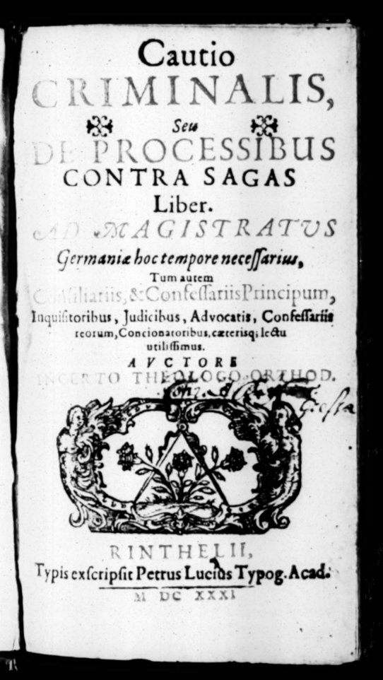

# 【全訳】フリードリヒ・シュペー『犯罪への警告』（1631年）

フリードリヒ・シュペー・フォン・ランゲンフェルト（Friedrich Spee von Langenfeld）著／全訳

- 原題：Cautio Criminalis, seu de processibus contra sagas liber（犯罪への警告、すなわち魔女に対する訴訟についての書）
- 内容：魔女裁判に立ち会い、多くの被告の聴罪司祭を務めたイエズス会士が、匿名で、ドイツの君主とその顧問官・聴罪司祭・審問官・裁判官・弁護人・説教者に向けて書いた警告の書。魔女の存在そのものは否定しないまま、全五十一の問いに答える形で、風評と共犯者の告発にもとづく逮捕、弁護の拒否、繰り返される拷問、「沈黙の妖術」や「魔女のしるし」といった口実、審問官の報酬制度などを一つずつ論駁し、今日の手続きでは無実の者がかならず巻き込まれ、その数は限りなく増えていく、と論じる
- 刊行：初版 Rinteln, Petrus Lucius, 1631年（著者名なし、「正統の神学者、著者不詳」とある）。作業の基にした本文は、インターネット・アーカイブの初版のスキャン（ウィスコンシン大学の「ヨーロッパとアメリカの魔女術」マイクロフィルム所収）
- 著作権：1631年刊。著者は1635年に死去している。日本・米国・英国で保護期間が満了している
- 訳者：人工知能（Claude Opus 5.5）
- 訳の性格：ラテン語原典からの全訳（著者の序、問いの目録、第一問〜第五十一問、付録「拷問と告発とに何ができるか」と結びの申し立て）。商業出版の日本語の全訳は、訳者の調べたかぎりでは出ていない（武田紀夫による論文での部分訳「シュペー『犯罪の警告 Cautio Criminalis』(1)」〈東北学院大学論集〉と、田中雅志による第五十一問のウェブ上の抄訳がある）

## この本について

　フリードリヒ・シュペー・フォン・ランゲンフェルト（一五九一〜一六三五）は、ドイツのイエズス会士で、詩人・神学者である。ラインラントのカイザースヴェルトの貴族の家に生まれ、ケルンでイエズス会に入り、パーダーボルン、ケルン、ヴュルツブルクなどで教えた。宗教詩集『トルッツ・ナハティガル（負けじ鳴き夜鳴き鶯）』などで、ドイツ・バロックを代表する宗教詩人としても知られる。一六三五年、三十年戦争のさなかのトリーアで、負傷兵や病人の看護をするうちに感染症にかかって亡くなった。

　一六二〇年代のドイツ、とくにヴュルツブルクやバンベルク、ケルン選帝侯領では、大規模な魔女裁判が繰り返され、数百人単位の人々が焼かれた。シュペーはその時期、牢に入れられた被告たちの告解を聞き、火刑の場まで付き添う役を務めたと考えられている。本書は、その経験から生まれた。

　シュペーは魔女の存在を否定しない（第一問）。けれども、ドイツでいま行われている訴訟のやり方では、罪ある者を見つけることはできず、むしろ無実の者がかならず巻き込まれる、と論じる。その論点は大きく次のようにまとめられる。

　第一に、魔女の風評そのものが、民衆の迷信と嫉妬と中傷から生まれており、正しく証明されたことが一度もない（第二問、第三十四〜三十五問）。第二に、捕らえられた者には弁護も弁護人も許されず、その論駁は記録にさえ残されない（第十七〜十八問）。第三に、拷問はこのうえなく苛烈で、人はそれを逃れるためなら何でも自白する。自白しなければ「沈黙の妖術」を使ったとして拷問が繰り返され、自白すればそれが罪の証拠になる。どちらに転んでも被告は逃れられない（第二十〜二十九問）。第四に、拷問のなかで名指された「共犯者」の告発は、それ自体が拷問の産物であり、悪魔がこの道を通って無実の者を滅ぼすことも十分にありうる。一人の無実の者が自白させられれば、その人がまた別の人を名指し、告発の連鎖には終わりがない（第二十問理由十四、第四十四〜五十問）。

　最後の第五十一問は、当時の典型的な魔女裁判の流れを四十六の項目で描き、「もし訴訟が一貫して迫られるなら、この時代には、どの性、財産、身分、威厳の者であっても、だれも安全ではない」と結論する。付録では、ネロ帝がローマの大火の罪をキリスト教徒に着せ、拷問と告発とによって「巨大な群れ」を有罪にしたというタキトゥスの記事を引き、教会が殉教者として崇めているその人々こそ、まさに今日と同じ手続きで裁かれたのだと指摘する。

　本書は一六三一年、著者の知らないうちにリンテルンで匿名で出版され、翌年には増補された第二版が出た。のちにドイツ語、オランダ語、フランス語などにも訳され、十七世紀後半以降、ドイツの魔女裁判が下火になってゆく流れのなかで、大きな影響を与えたとされる。マインツ選帝侯ヨハン・フィリップ・フォン・シェーンボルンは、若いころシュペーから魔女の被告たちの話を聞き、のちに自領で魔女裁判をやめさせたと伝えられる。

　訳文では、論争の書であることを生かすため、反論（「あなたは言う」）と答え（「答え」）の形をそのまま残した。原文が引く法学者や神学者、ローマ法と教会法の典拠は、原文の表記をもとに示した。文中の〔訳注〕は訳者による。女性についての記述など、十七世紀の通念をそのまま示しているところもある。

## 目次

- 著者の序
- 本書の疑問、すなわち問いの目録
- 第一問〜第五十一問
- 付録　拷問と告発とに何ができるか
- 申し立て
- 訳者による付録　用語集・人名と書名の解説
