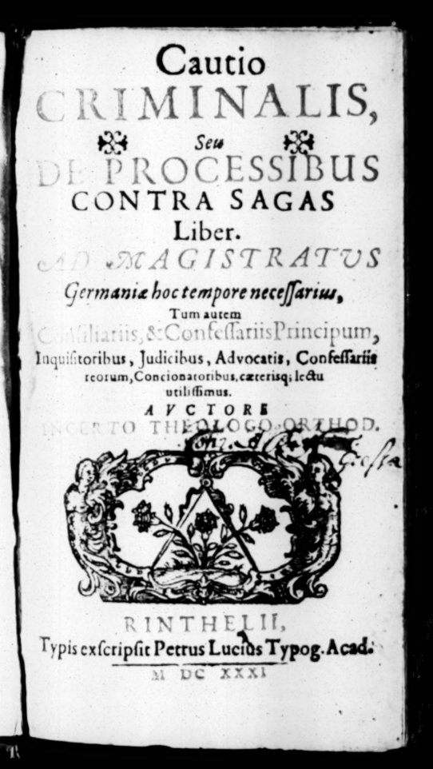

# 犯罪への警告（フリードリヒ・シュペー）

フリードリヒ・シュペー・フォン・ランゲンフェルト（Friedrich Spee von Langenfeld）著／全訳

- 原題：Cautio Criminalis, seu de processibus contra sagas liber（犯罪への警告、すなわち魔女に対する訴訟についての書）
- 内容：魔女裁判に立ち会い、多くの被告の聴罪司祭を務めたイエズス会士が、匿名で、ドイツの君主とその顧問官・聴罪司祭・審問官・裁判官・弁護人・説教者に向けて書いた警告の書。魔女の存在そのものは否定しないまま、全五十一の問いに答える形で、風評と共犯者の告発にもとづく逮捕、弁護の拒否、繰り返される拷問、「沈黙の妖術」や「魔女のしるし」といった口実、審問官の報酬制度などを一つずつ論駁し、今日の手続きでは無実の者がかならず巻き込まれ、その数は限りなく増えていく、と論じる
- 刊行：初版 Rinteln, Petrus Lucius, 1631年（著者名なし、「正統の神学者、著者不詳」とある）。作業の基にした本文は、インターネット・アーカイブの初版のスキャン（ウィスコンシン大学の「ヨーロッパとアメリカの魔女術」マイクロフィルム所収）
- 著作権：1631年刊。著者は1635年に死去している。日本・米国・英国で保護期間が満了している
- 訳者：人工知能（Claude Opus 5.5）
- 訳の性格：ラテン語原典からの全訳（著者の序、問いの目録、第一問〜第五十一問、付録「拷問と告発とに何ができるか」と結びの申し立て）。商業出版の日本語の全訳は、訳者の調べたかぎりでは出ていない（武田紀夫による論文での部分訳「シュペー『犯罪の警告 Cautio Criminalis』(1)」〈東北学院大学論集〉と、田中雅志による第五十一問のウェブ上の抄訳がある）

## この本について

　フリードリヒ・シュペー・フォン・ランゲンフェルト（一五九一〜一六三五）は、ドイツのイエズス会士で、詩人・神学者である。ラインラントのカイザースヴェルトの貴族の家に生まれ、ケルンでイエズス会に入り、パーダーボルン、ケルン、ヴュルツブルクなどで教えた。宗教詩集『トルッツ・ナハティガル（負けじ鳴き夜鳴き鶯）』などで、ドイツ・バロックを代表する宗教詩人としても知られる。一六三五年、三十年戦争のさなかのトリーアで、負傷兵や病人の看護をするうちに感染症にかかって亡くなった。

　一六二〇年代のドイツ、とくにヴュルツブルクやバンベルク、ケルン選帝侯領では、大規模な魔女裁判が繰り返され、数百人単位の人々が焼かれた。シュペーはその時期、牢に入れられた被告たちの告解を聞き、火刑の場まで付き添う役を務めたと考えられている。本書は、その経験から生まれた。

　シュペーは魔女の存在を否定しない（第一問）。けれども、ドイツでいま行われている訴訟のやり方では、罪ある者を見つけることはできず、むしろ無実の者がかならず巻き込まれる、と論じる。その論点は大きく次のようにまとめられる。

　第一に、魔女の風評そのものが、民衆の迷信と嫉妬と中傷から生まれており、正しく証明されたことが一度もない（第二問、第三十四〜三十五問）。第二に、捕らえられた者には弁護も弁護人も許されず、その論駁は記録にさえ残されない（第十七〜十八問）。第三に、拷問はこのうえなく苛烈で、人はそれを逃れるためなら何でも自白する。自白しなければ「沈黙の妖術」を使ったとして拷問が繰り返され、自白すればそれが罪の証拠になる。どちらに転んでも被告は逃れられない（第二十〜二十九問）。第四に、拷問のなかで名指された「共犯者」の告発は、それ自体が拷問の産物であり、悪魔がこの道を通って無実の者を滅ぼすことも十分にありうる。一人の無実の者が自白させられれば、その人がまた別の人を名指し、告発の連鎖には終わりがない（第二十問理由十四、第四十四〜五十問）。

　最後の第五十一問は、当時の典型的な魔女裁判の流れを四十六の項目で描き、「もし訴訟が一貫して迫られるなら、この時代には、どの性、財産、身分、威厳の者であっても、だれも安全ではない」と結論する。付録では、ネロ帝がローマの大火の罪をキリスト教徒に着せ、拷問と告発とによって「巨大な群れ」を有罪にしたというタキトゥスの記事を引き、教会が殉教者として崇めているその人々こそ、まさに今日と同じ手続きで裁かれたのだと指摘する。

　本書は一六三一年、著者の知らないうちにリンテルンで匿名で出版され、翌年には増補された第二版が出た。のちにドイツ語、オランダ語、フランス語などにも訳され、十七世紀後半以降、ドイツの魔女裁判が下火になってゆく流れのなかで、大きな影響を与えたとされる。マインツ選帝侯ヨハン・フィリップ・フォン・シェーンボルンは、若いころシュペーから魔女の被告たちの話を聞き、のちに自領で魔女裁判をやめさせたと伝えられる。

　訳文では、論争の書であることを生かすため、反論（「あなたは言う」）と答え（「答え」）の形をそのまま残した。原文が引く法学者や神学者、ローマ法と教会法の典拠は、原文の表記をもとに示した。文中の〔訳注〕は訳者による。女性についての記述など、十七世紀の通念をそのまま示しているところもある。

## 目次

- 著者の序
- 本書の疑問、すなわち問いの目録
- 第一問〜第五十一問
- 付録　拷問と告発とに何ができるか
- 申し立て
- 訳者による付録　用語集・人名と書名の解説

---

### 著者の序

　私はこの本をドイツの官憲に宛てて書いた。とはいえ、それを読むはずの官憲に宛てたのであって、読むはずのない官憲に宛てたのではない。わけはこうである。もし官憲が、私がここで魔女の訴訟について書き記したことを読まねばならぬと思うほどに心配りのある人々であるなら、彼らはすでに、この本を読まねばならなかった当の理由をもっているのである。つまり、こうした訴訟を徹底して知りぬこうとする心配りと勤勉とをもっているのだから、どこからこれを読み、どこからこれを汲みとるかは、さして必要ではない。けれども、こうしたことを読もうとも顧みようともしないほどに投げやりな官憲であるなら、彼らこそまさしくこれを読み、この本から心配りと勤勉とを学ぶことが、何にもまして必要なのである。だから、読むはずのない者こそ読むがよい。読むはずの者は、読まなくともよい、など。

　とはいえ、だれかがこの本を読むにせよ読まないにせよ、私が望むのは、せめてこの本の最後の問いだけは読まずにすませる者が一人もなく、それを心にかけて思いめぐらしてもらいたい、ということである。

〔訳注〕「最後の問い」は第五十一問「今日多くの者のもとで行われている魔女に対する訴訟の手続きの、短い要約と方法」を指す。

### 本書の疑問、すなわち問いの目録

1. 魔女、ストリクス、すなわち妖術者は、本当に存在するのか（1ページ）
2. 魔女すなわち妖術者は、ドイツにはほかの地より多いのか（3）
3. 魔女すなわち妖術者の罪とは、どのような罪か（7）
4. この罪は「例外犯罪」の種類に属するのか（7）
5. では、例外犯罪に対しては、訴訟を思いのままに組み立ててよいのか（9）
6. ドイツの諸侯が魔女の罪に対して激しく手続きを進めるのは、よいことか（11）
7. この激しい手段で、この悪を根絶やしにすることができるのか。また、ほかの何かの方法でできるのか（12）
8. 諸侯はこの罪においてどれほど用心深く手続きを進めるべきか（15）
9. 諸侯が自らはほとんど心を砕かず、すべての配慮を役人たちに投げ渡すなら、それで良心は十分に免れるのか（24）
10. 神が、ときに無実の者まで巻き込まれるのを許されると信じてよいのか（39）
11. 事実として無実の者も巻き込まれていることが許されている、と信じてよいのか（44）
12. 事実として多くの無実の者が巻き込まれていることが明らかなら、魔女に対する審問をやめるべきか（52）
13. 私の落ち度なしに無実の者に危険が迫るとしても、なお罪ある者の追及を控えるべきか（56）
14. 諸侯や官憲を魔女に対する審問へとけしかけるのは、得策か（61）
15. 官憲を魔女に対してたびたびけしかけるのは、とくにどのような者たちか（65）
16. 魔女に対する訴訟で、無実の者に危険が生じないよう、どのように用心できるか（71）
17. 魔術の件で捕らえられた者に、弁護を許し、弁護人をつけるべきか（84）
18. いま述べたことから、どのような系が導かれるか（92）
19. 妖術の名目で捕らえられた者は、ただちにまったくの有罪と推定されるべきか（101）
20. 拷問について何と考えるべきか。それは無実の者に道徳的な、しかもしばしばの危険をもたらすのか（111）
21. 毒殺の罪に問われた女を、何度も拷問にかけてよいか（138）
22. なぜ今日、多くの裁判官は、拷問によって身の潔白を晴らした女でさえ、なかなか放免しないのか（146）
23. どのような口実で、新しい徴憑なしに拷問を繰り返してよいことにされているように見えるのか（149）
24. 新しい徴憑なしに拷問するのをためらう良心的な裁判官が、どのようにたやすく新しい徴憑を見つけるのか（155）
25. 「沈黙の妖術」は新しい徴憑になるのか（159）
26. 悪意ある者や無知な者は、沈黙の妖術のしるしとして何を持ち出すのが常か（166）
27. 拷問は真実を明らかにするのにふさわしい手段か（172）
28. 被告が拷問のなかで自白したことはつねに真実だと考える人々の論拠は何か（176）
29. 拷問はかくも危険なのだから、使うのをやめるべきか（186）
30. 魔女の聴罪司祭に、とくにどのような教えを授けるべきだと考えるか（188）
31. 拷問の前に、女を刑吏に剃らせるのがふさわしいか（214）
32. どのような理由があれば拷問に進んでよいか（218）
33. どのような徴憑が、ほとんど完全な証拠とみなせるほどのものかを判断するのはだれの役目か（221）
34. ほかの明らかで確かな証拠に支えられていない風評だけで、拷問の徴憑になるか（226）
35. 官憲は今日、中傷者や誹謗者を真剣に取り調べて罰する義務があるか（237）
36. 証明のむずかしい罪であれば、せめてそのときは風評だけで拷問に十分か（243）
37. 一般には十分でない証拠も、証明のむずかしい隠れた例外犯罪では十分なのか（250）
38. 「隠れた、証明のむずかしい罪では、ほかの罪よりもたやすく拷問に進んでよい」という、よく使われる公理は、どんな意味でも正しくないのか（259）
39. 拷問で何も自白しなかった女を、有罪とすることができるか（262）
40. 先に自白した罪を処刑の場で撤回したことは、何かの重みをもつものとみなすべきか（271）
41. 牢のなかで死んでいるのが見つかった女について、何を推定すべきか（284）
42. 被告の死体が、自分自身によってか悪魔によってか、首を絞められたと、良心に照らして安全に判断できるのはいつか（291）
43. 「しるし」について何と考えるべきか。それは魔女を見分ける確かなしるしか（293）
44. 魔術の罪における共犯者の告発は、重んじるべきか（300）
45. 告発者が悔い改めているなら、せめてその告発は信じるべきか（318）
46. 告発者が本当に回心し、真実を語ろうとしていることが確かなら、せめてそのとき告発者を信じるべきか（326）
47. 悪魔は魔女の集会に無実の者の姿を現すことができるか（331）
48. 悪魔は踊りの場に無実の者の姿を現すことはできない、と言う人々の論拠は何か（335）
49. 魔女の告発をまったく信じるべきだとし、告発された女を拷問するのにそれで十分だと言う人々の論拠は何か（351）
50. 裁判官は、告発を軽んじる人々の見解と、それを重んじる人々の見解の、どちらを安心して受け入れてよいか（375）
51. 今日多くの者のもとで行われている魔女に対する訴訟の手続きの、短い要約と方法。神聖なる皇帝陛下に知っていただき、ドイツに考えてもらうに値するもの（378）

〔訳注〕かっこ内の数字は原書のページ。目次の各項は本文の見出しとは言い回しの違うところがある。

## 犯罪への警告、すなわち魔女に対する訴訟についての書

### 第一問　魔女、ストリクス、すなわち妖術者は、本当に存在するのか

　私は答える。なかにはこれを疑った者もいたことを、私は知っている。それもカトリックの学識ある人々で、その名を挙げるには及ばない。また、ある人々は、教会にはかつて、魔女の肉体による集会が信じられていなかった時代があった、と疑うのも軽はずみではないと考えているらしいことも知っている。さらに、私自身、この罪に問われたさまざまな被告と牢のなかで、たびたび、また注意深く、いや好奇心からと言わないまでも、かかわってきたので、この事柄について結局何を信じるべきか、ほとんどわからなくなってしまうほど、一度ならず心を惑わされたこともある。それにもかかわらず、もつれた考えの総計を取りまとめてみると、私は、世のなかには本当に何人かの妖術者がいる、ということは、まったく保持すべきだと考える。そして、それを否定するのは、向こう見ずと、ゆがんだ判断の烙印を免れないと考える。この論を唱える著者たち、レミギウス、デルリオ、ボダンその他を見られたい。それにかかずらうのは、私の企ての本分ではない。けれども、これまで火の粉となって舞い上がったすべての者が魔女であったということは、私も、また私とともに多くの敬虔な人々も、信じない。また、勢いと叫び声と権威とによってではなく、判断と理性とによって事柄を調べようとする人でなければ、だれであれ、私にそれをたやすく信じさせることはできないだろう。私の読者がそのように望んでくれることを、私は、われらの立法者キリストがその従う者たちのあいだに激しく燃え立たせようと望まれた、あの愛にかけて、切に願う。もしだれかが熱意をもち、魔術の罪に歯ぎしりしているなら、しばらく自分を抑え、その熱意に、おそらくはもっていないであろう知識と思慮とを加えるがよい。あらゆる勢いが徳から出るのではない。あるものは自然からだけ出るのである。徳は節度あり、慎み深く、教えられることを好み、より教えられたからといって、より小さくなることを恐れはしない。もし私たちが勢いに任せて突き進み、すべてを把握したと思うがゆえに学ぶことを拒むなら、多くの事柄で真理が私たちから逃げ去っても、何の不思議があろうか。さあ読者よ、先入見をわきに置き、私が手を引いて一歩一歩導くところへ、慎み深くついてきてもらいたい。多くのことをゆっくりと、手間をかけて考えたことを、悔やむことはあるまい。

〔訳注〕「魔女」はラテン語 saga（複数 sagae）、「ストリクス」（striges）は夜に飛ぶ魔女・吸血の怪鳥の意から魔女を指す語、「妖術者」は malefici（害をなす者）。本訳では saga を「魔女」、maleficium を「妖術」と訳す。ニコラ・レミ（レミギウス、一五三〇ごろ〜一六一二）、マルティン・デルリオ（一五五一〜一六〇八）、ジャン・ボダン（一五三〇〜一五九六）は、いずれも魔女の実在と厳罰を説いた著者。

### 第二問　魔女すなわち妖術者は、ドイツにはほかの地より多いのか

　私は答える。これは、何と言えばよいかわからない事柄についての問いである。けれども、暇つぶしに、思いつくことを一言述べておこう。すなわち、少なくともドイツにはほかの地よりも多く見いだされるように見え、またそう思われている。

　その理由はこうである。まず第一に、ドイツではいたるところで、この疫病を焼き尽くす火刑の火によって何もかもが煙を上げていることが明らかである。これは、すべてがどれほど広く感染していると認めているかを示す、まことに明らかな証拠である。そのために、敵のあいだでドイツの名は少なからず損なわれ、聖書の言うように、私たちは「ファラオとその家臣の前で私たちの香りを臭くした」のである。

〔訳注〕『出エジプト記』第五章二十一節による。

　次に、私たちのもとで魔女が多数いるというこの見方を養っているのは、二つの源であって、注目に値する。

　第一は、民衆の無知、すなわち迷信である。それをこう示そう。すべての自然学者は、ときに自然の共通の秩序からいくらかはずれ、異常なものと呼ばれるのが常のもの、たとえばひときわ激しい雨、いつもより荒れた雹や霜、ひときわ鳴り響く雷などもまた、まったく自然に引き起こされうると教えている。医者たちもまた、家畜も人間と同じくそれぞれの病にかかること、人間にも家畜にも、医者自身にも十分に究められていない新しい病がしばしば現れること、自然のなかには驚くべき多くのものが隠れていて、それがときおり明るみに出て、自然の富を知らない者たちを驚かせること、そして過ぎし幾世紀のどれほど学識ある者でも、そのすべての力を探りつくして把握することはできなかったことを教えている。これが彼らの言うことである。ところが、とりわけ異教の民のもとでならともかく、ドイツで何かそのようなことが起こると、たとえば家畜に何かの疫病が襲う、天候が荒れて激しく怒る、医者が何か新しい病の性質を知らない、あるいはきわめて古い病がすぐには医術に従わない、要するに、ふつうの秩序の外にあると思われるような何かしら不吉なことが起こると、私たちはもう、何という軽率さか、迷信か、無知かに導かれてか知らないが、ただちに心を妖術へと向け、魔女に原因を押しつけるのである。そこで私たちは、事の源を手につかんだ、と叫ぶ。そして、たまたまこうしたことのさなかに通りかかったり、そばに立っていたり、近づいてきたりした女を、だれであれ見かけたなら、偶然このことあのことをし、あるいは言ったことを（何かがかならず先立つか、ともに起こるか、あとに続かねばならないのだから）、悪く解釈して罪に問い、私たちの本性の悪意のままに、近所じゅうに疑いを呼び起こすのである。だから、わずか数年のうちに、増えていく風評が私たちをすっかり富ませてしまうのも不思議ではない。とりわけ、ここでは説教者や霊的な人々が心を動かさないばかりか、彼ら自身がむしろ同じ罪のなかにあり、また、私の知るかぎり、このきわめて有害なささやきに対して熱意の剣を抜いた官憲は、ドイツに一人も見いだされないのだから、なおさらである。これについては、のちに第三十五問でもっと述べよう。ほかの国々はもっと用心深く、この点で負けるのは恥ずかしいほどである。というのも、彼らのもとでは、子どもや家畜が病でやせ衰えても、木が打ち砕かれても、作物が災いをこうむっても、貧乏が身をつつんでも、いなごやねずみが畑を食い荒らしても、彼らは悪の起源をすべて神か自然に帰する。そして、明らかに自然の法則を越えると学識ある者たちが判断するものだけを、そのときになってようやく妖術者に帰するのである。

　第二は、同じ民衆の嫉妬と悪意である。それをこう示そう。神が、この世の善きものについて、ある人々にはほかの人々よりも豊かな祝福を分け与え、その人たちの物がすべてほかの人々より早く売れ、ほかの人々より恵まれた運によって物を買い、ひとことで言えば、ほかの人々より増え、富むような人々がいつもいる、ということは、どの国民も認めるだろう。ところがドイツでは、民衆のあいだでこうしたことが起こると、たちまち近所の者のなかから、運のほうがうしろから遅れてついてくるような者たちが現れて、額を寄せ合い、ひそひそ話をまとめあげて、魔術の疑いを呼び起こすのである。その疑いは、彼らが妬んでいる者のだれかを、教会で人並みはずれて敬虔にしているのを見たり、ロザリオを教会以外のところで持ち歩いているのを見たり、あるいはたまたま畑や部屋で祈るためにひざまずいているのを見たりすると、いっそう強く頭をもたげる。そのたぐいの例は私にはいくらでもあるが、ドイツ人の名にかけて恥ずかしい。まことに恥ずべきことで、ほかの国民のもとではまったく聞いたこともないことである。ほかの国民は、この二つの源をせき止めているので、私たちのもとより妖術者が少ないのである。とはいえ、私たちのもとに魔女がまったくいない、と言うつもりはない。

　魔女がいることは認めよう。けれども、こう付け加えておく。思慮深い読者は、これから述べることから、もし今いたるところで行われているように事が運ばれているなら、これまで焼き殺されたこれほどの多数のなかに、まったく罪のない者がきわめて多く含まれていることは、ほとんど避けられなかったと、たやすく悟るだろう。だから、ドイツでは、有罪の女を数えることができる、ということほど不確かなことはないのである。

### 第三問　魔女すなわち妖術者の罪とは、どのような罪か

　私は答える。このうえなく途方もなく、このうえなく重く、このうえなく凶悪な罪である。というのも、そこには、このうえなく途方もない罪がみな、まわりから流れ込んでいるからである。背教、異端、冒瀆、神への悪口、殺人、いや尊属殺人さえ、しばしば霊的な被造物との自然に反する交わり、そして神への憎しみ。これより凶悪なものはありえない。これはデルリオの第五巻第一節の言葉である。もっとも、この論題については、別の小著でもっと詳しく論じるつもりである。

### 第四問　この罪は「例外犯罪」の種類に属するのか

　私は答える。そのとおりである。というのも、法学者たちは二種類の罪を定めるのが常であることに注意されたい。一つは、窃盗、殺人などのような、共通でありふれた罪である。もう一つは、より凶悪でより重い罪で、より直接に公共の損害へと向かい、何かしら驚くべき仕方で国家を苦しめるものである。たとえば、大逆罪（勅法彙纂「告発について」の法文末尾、および同「証人について」の法文「quoniam liberi」など）、異端の罪（第六書「異端者について」の章「in fidei favorem」）、魔女の罪（勅法彙纂「妖術者と数学者について」の法文末尾）、反逆の罪（勅法彙纂「ユリウス大逆法について」の終わりから二番めと末尾の法文）、陰謀の罪（「証人について」の末章）、贋金の罪（勅法彙纂「贋金について」の法文末尾）、強盗の罪（学説彙纂「被告の監禁と出頭について」の法文「D. Adrianus」、および勅法彙纂「祝日について」の終わりから二番めの法文）などで、こうした罪は「例外犯罪」と呼ばれるのが常である。この名は、それが法の共通の、すなわち通常の定めから除外され、それに対しては、ほかの場合には法が定めている手続きの仕方に自らを縛る必要がない、というところから来ている。

　その理由は、これらの罪は国家にとってこのうえなく有害であり、それを並はずれた仕方で損なうのだから、並はずれた手段によってそれを抑えるのも公平に思われる、ということである。

〔訳注〕ここに挙げられた典拠は、ローマ法大全（ユスティニアヌスの勅法彙纂・学説彙纂）と教会法の箇所。原文の略記に従って示した。

### 第五問　では、例外犯罪に対しては、訴訟を思いのままに組み立ててよいのか

　私は答える。よくない。

　理由はこうである。すでに述べたように、例外犯罪は、人間の実定法が定めるところからは除外されているが、人間の理性、すなわち自然法が定めるところから除外されているのではない。だから、そうした罪に対する訴訟が、法の共通の秩序の内で行われるにせよ外で行われるにせよ、とにかくどのような訴訟であれ、それは、正しい理性と争うものがまったく何もないように行われねばならない。それはそれ自体で明らかであり、証明を必要としない。理性に反することをしてよい、などとはだれも言わないだろうからである。けれども私がこのことを注意しておくのは、ある裁判官たちが、魔女に対して審問するとき、あるべき以上に勝手放題にふるまい、何もかもを「これは例外犯罪だから」という理由で言い訳しているのに気づいたからである。だから、くだらない徴憑しか持たなかったとしても、拷問で節度を越えたとしても、あまりに軽々しく信じたとしても、弁護を拒んだとしても、そのほか理性に見捨てられたことをしたとしても、彼らは何度でも、盾のようにこれを突き出す。「例外犯罪だったのだ、例外犯罪にはこのうえなく広い自由がある」と。私はこのあと、あちこちでたびたびそのことにふれるだろう。けれども、まったく不公平でありたいのでないかぎり、すべての裁判官は、一般的な原則、揺るがぬ公理として、次のことを自らの前に定めておかねばならない。すなわち、例外犯罪であろうとなかろうと、どんな罪においても、正しい理性が許す以外の仕方で訴訟を組み立ててはならない、と。

　さらにまた、例外犯罪においては、実定法が定めていることのすべてから無条件に離れてよい、というのもまったくの誤りである。ある事柄においてだけはよいが、すべてにおいてではない。それ以外のことは、どの法からも導き出しえないだろう。だから、ここから多くの者の無知が十分に咎められ、またファリナキウスが第三十七問の九十番でよく教えているように、例外犯罪では法の秩序を無視してよいというこの教説は、厳密に言えば誤りであるか、さもなければ、もはや問いが立てられず、罪が確かになっている場合の処罰についてだけ理解されねばならない。つまり、そのときには処罰が、ほかの場合に法が一般に定めるより重くてもよい、という意味である。そしてこれが、彼の引く多くの博士たちの見解であるが、私たちは簡潔のために省く。これについてはマスカルドゥスの第三巻、第一三一一結論も読まれたい。しかし何がどうであれ、ここでとどまる必要はない。例外犯罪において、正しい理性に反することは何ひとつ許されない、ということは議論の余地がないのである。

〔訳注〕プロスペロ・ファリナッチ（ファリナキウス、一五四四〜一六一八）とジュゼッペ・マスカルディ（マスカルドゥス、？〜一五八八）は、刑事法の大家として知られたイタリアの法学者。

### 第六問　ドイツの諸侯が魔女の罪に対して激しく手続きを進めるのは、よいことか

　私は答える。この罪に対して激しく奮い立つ官憲を、私が咎めるなどということは、どこまでも遠く私から離れていてほしい。神が彼らに命じ、私たちが従うかのように。彼らには、顧問官たちが口述してくれる理由があり、それはこうである。

　理由一。彼らは（彼らの言うように）、国家を、癌のように広がり、伝染によって害をなす、著しい疫病から清めるのである。

　理由二。サタンのあの奴隷たちが、たくらむのを決してやめない損害や災いを、未然に防ぐのである。

　理由三。自らの職務と召命とを果たすのである。というのも、使徒は「ローマの信徒への手紙」第十三章で官憲についてこう語っている。「いたずらに剣を帯びているのではない。神に仕える者として、悪を行う者に怒りをもって報いるのである」。だから、もし公共の善に反して被告を罰するのを怠るなら、正当な理由なしにきわめて重い罪を犯し、罪の加担者となる、と、裁判官の職務と権限についての「教令集」の第一章、そしてインノケンティウス、バルドゥス、デキウス、バルバティア、パノルミターヌス、そのほかの博士たちから言える。そして彼らは、それによって国家あるいは私人に及ぶすべての損害を償う義務を負う、と前掲の章が定めているとおりであり、これは神学者たちの共通の見解でもある。聖トマス『神学大全』第二部の二、第二十六問、シルヴェステル、カイエタヌスの『大全』の「償い」の項、ドミニクス・ソトの『正義と法について』第四巻第七問第三項、メディナの『返還すべきものについての法典』、そのほか数え上げれば長くなる人々を見よ。

　理由四。彼らは、神の名誉を守る熱意を示すのである。神の不倶戴天の敵に対して、縄と炎とをもって荒れ狂うのだから。だから彼らはよいことをしているのであって、咎められることはありえない。しかも聖書は「女呪術師を生かしておいてはならない」（「出エジプト記」第二十二章）と命じているのである。

〔訳注〕シュペーは官憲を「咎めるつもりはない」と述べながら、その論拠を並べ、のちの問いで一つずつ崩していく。皮肉を含んだ書き方である。

### 第七問　この激しい手段で、この悪を根絶やしにすることができるのか。また、ほかの何かの方法でできるのか

　私は答える。諸侯がどれほど焼こうとも、すべてを焼き尽くさないかぎり、決して焼き尽くすことはないだろう。彼らは自分の領地を、どんな戦争よりもひどく荒らしている。しかも何の益もない。まことに血の涙をもって嘆くべきことである。そこで、より穏やかな手段を提案する人々もいる。そのなかで、思慮と賢明さにおいて私にいつも抜きん出て見えたのは、イエズス会の名高い神学者タンネルスで、その『神学』第三巻、第四論考「正義について」第五問第五疑第一二三番以下である。もし諸侯が、彼の定める手段を聞こうとするなら、国家がその実りを味わうであろうことは疑いない。率直に言えば、私自身もこの事柄について多くを心のなかでめぐらし、考え出そうと努めてきた。また、多くの人々が、神がその光の何かの一筋を送ってくださり、これほどの闇をすっかり払うことのできる最上の方法を教えてくださるよう、神に向かって多くのうめきと祈りとを注いできたことも知っている。けれども、時勢の状況はこうなので、たとえそのようなものを見いだすことができたとしても、ドイツの官憲はそれを少しも顧みないだろうと思われる。だから私はこれまで、それを公に示そうという考えに、自分を駆り立てることができなかった。どんな心の平和と好意とをもって迎えられるか、わからないからである。けれども、最高の官憲のなかに、だれかそのような心と好奇心とをもち、あえて知ろうと望み、ある新しい工夫の試みをまず取り上げようとする人がいるなら、その工夫は、ただ一年のうちに、その人の領地全体をこの疫病からすっかり清め、毒殺の罪ほどまれな罪はなくなるようにするであろう。もし、繰り返すが、官憲のだれかが、真剣にそれを知り試そうと望み、また自分の良心と国家とにとって、それを試すことが重要だと考えるなら、私には、ある修道者の友人がいる。その人は、自分の見つけた特異な工夫を教える気があり、もしそれがうまくいかなければ、命を担保に差し出すことさえいとわないのである。私はそれを見て調べたが、私のあらゆる思いをもってしても、それが目指すところを確実に達しえないという誤りを、見つけることはできなかった。そして、これまでもっと多くの人の心に浮かばなかったことに、少なからず驚いた。それはともかく、言ったことで十分である。とはいえ、発明者が、熱心な者の耳にだけ届けたいと望んでいることは、やはり沈黙のなかに包み隠しておかねばならない。われらの立法者は、一日は十二時間であり、ある土地はよく、ある土地は役に立たないと教えられた。役に立たない土地にまくのは、大海の波に投げ込むのと同じことである。だから、時が来て、ふさわしい土地があれば、種を惜しむことはしないだろう。もしかすると、この注解そのもののなかで、思慮深い人なら悟るようなことを、なお言うかもしれない。事柄は、たやすく手軽なもの、ごく小さくまた大きなもの、だれにも知られていて、だれにも知られていないものである。

〔訳注〕アダム・タンナー（タンネルス、一五七二〜一六三二）は、インゴルシュタットなどで教えたイエズス会の神学者で、魔女裁判に慎重な立場をとった。シュペーがここでほのめかす「工夫」が何であるかは、本文では明かされない。「一日は十二時間」は『ヨハネによる福音書』第十一章九節、よい土地と悪い土地は種まきのたとえ（『マタイによる福音書』第十三章）による。

### 第八問　諸侯とその役人たちは、この罪においてどれほど用心深く手続きを進めるべきか

　答え。諸侯がこの罪に対して激しく手続きを進めるのは悪くないが、それと同じく、最大の用心と思慮と慎重さをもってするのでなければ、悪い、それも最悪である。だから、この罪は例外犯罪だからといって、この罪においてより勝手に、より投げやりにふるまってよいどころか、ほかのどんな死罪の種類よりもはるかに大きな注意と配慮とをもって、どんな仕方であれ不法で無分別な訴訟が組み立てられることのないよう、見張らねばならないのである。

　だから、魔女の罪というこの例外犯罪では、ある点で、例外でない罪の共通の仕方とは別の仕方で手続きを進めてよい、ということは認めるとしても、例外でない罪の共通の仕方より用心を欠き、慎重さを欠いて事を行ってよい、ということは否定する。ここでは、手続きを進めるにあたって、ほかのどんな罪で求められるよりも、ある並はずれた勤勉、注意、配慮、慎重さが求められるのである。理由は次のとおりである。

　理由一。この罪は、だれもが認めるように、きわめて隠れた罪であり、夜に、しかもたいてい闇と幽霊のあいだで行われる。だから、それを正しく明るみに出すには、大きな思慮と思索とが必要である。

　理由二。私たちが見るところ、いったん始まった魔女に対する訴訟は何年にもわたって引き延ばされ、罰すべき者の数があまりに増して、村がまるごと根こそぎ焼き尽くされるほどになる。それでいて、得られたものといえば、帳簿がほかの人々の名前で同じようにいっぱいになることだけである。だから、もしなおしつこく続けられるなら、地方全体が尽き果てるまで、焼き殺すことに終わりは来ないように思われる。そして、それを断ち切らずにすんだ諸侯は、これまで一人も見いだされなかった。だれもが今日にいたるまで、見いだすことによってではなく、いつも終わりにすることによって、終わらせてきたのである。事柄がこれほど重く、またこれほど広大であるなら、ここで用いるのがふさわしくないほどの勤勉などありうるだろうか。また、無実の者がともに巻き込まれるような誤りが入り込む余地などあってよいだろうか。とりわけ、ただ一人でも巻き込まれれば、のちに示すように、ただちに数えきれないほかの者が巻き込まれずにはすまないのだから。

　理由三。もし無思慮な訴訟によって、無実の者までも同じ嵐に打たれることが起これば、何かしら途方もない害が国家に及ぶだろう。つまり、これほど多くの人の不当な処刑であり、また、きわめて高貴な家柄の汚名と恥辱であり、さらにはカトリック信仰の汚名と恥辱でもある。タンネルスが正しく注意しているように、それは私たちの敵のあいだで少なからず中傷の種になっている。ほかの人々より信心深いと見えていた人々までが、この共通の奔流にさらわれるようなことがあれば、なおさらである。私は最近、ある有力な人々から、ところによっては悪意がここまで下りてきている、と聞かねばならなかった。すなわち、もしだれかがそこで、このうえなく敬虔なカトリック教徒の習いのとおりに、熱心にロザリオを繰り、それを身につけて歩こうとすれば、もし聖水をよく身に振りかければ、もし教会で熱心に祈り、ほんの少しでも本物の信心を見せれば、その人はただちに魔術の疑いに陥るというのである。まるで、その罪にとらわれている者たちが、ほかの人々より信心深く見られたがるかのように、あるいは、ほかの人々の言うように、そうでもしなければ悪魔が彼らを落ち着かせておかないかのように。そこで、私たちの近くのある地方では、このうえなくすぐれた、このうえなく称賛されている君主のもとで、だれもがあらゆる信心の見かけから、できるかぎり用心深く身を守るようになってしまった。以前は毎日ミサをささげるのが習いだった司祭たちのなかにも、いまではそれをすっかりやめてしまった者や、ささげるとしても、民衆が魔術の風評を言い立てはじめないよう、教会を閉ざしてひそかにしかしない者がいる。こうして、正義の見かけのもとに無用心に手続きを進めているうちに、私たちは不敬虔と無神論への道を開いてしまう。だから、むしろそれをふさぐために、官憲にある特別の用心を求めるのは、いわれのないことではない。

　理由四。訴訟の相手は、ほとんど女という種類である。ところが女というものは、しばしば錯乱し、正気を失い、軽はずみで、口数が多く、移り気で、ずる賢く、嘘つきで、偽誓をする。そして、本当に罪があるなら、自分の師からあらゆる悪事を教え込まれている。こうした者を取り調べ、聞き、裁くには、千もの混乱と誤りとを生じさせたいのでなければ、ある特別の注意が入り用である。最近、ある名高い法学者が私に言ったところでは、この一つの項目だけから毎日あまりに多くの困難が自分に投げかけられるので、もしいったんこの魔女の迷路から足を抜くことが許されたら、二度と足を踏み入れはしないし、こんなにどこもかしこももつれた仕事をたやすく始めるよう、どの君主にも勧めはしないだろう、とのことだった。

〔訳注〕女性についてのこの記述は十七世紀の通念をそのまま示している。シュペーはここで、だからこそ慎重な審理が必要だという方向に論を運んでいる。

　理由五。聞くところによれば、ところによっては、諸侯がこの魔女の仕事の長に据えるのが常の法学者、すなわち審問官たちの報酬が、被告の数に応じたある額の金、たとえば一人につき四ターラーか五ターラーと定められているという。これだけの理由からでも、利得の望みが訴訟を損なわないようにするために、どれほどの警戒が必要か、だれが見ないだろうか。顧問官の財布には、被告の数が少ないより多いほうが得になるのだから、それだけたやすくだれもが罪ありと思われることになるだろう。まことに困難で危険な事柄である。私たちはみな聖人なのではなく、また、何かを手に入れたいという熱が、揺るがすことのないほど揺るぎない心をもっているわけでもない。そうした熱は、心を横ざまにさらいはしないまでも、少なくともそそのかしはするのである。

〔訳注〕ターラー（daler）は当時の銀貨。

　理由六。諸侯の勤勉を、こうした訴訟を正しく処理することに、何よりも向けさせねばならない理由がある。それは、もしそこで誤りが始まれば、それを正すのがきわめてむずかしくなるだろう、ということである。ほかの誤りなら、たいていこの世のなかに何かしら正す手立てがある。けれどもここではそうではない。そのことをこう証明する。ほかの事柄では、誤っている人々を慎重に、かつ有益に戒めることができ、また、自分の評判を汚すことなくそうしたいと望む人々が、ほとんどいつも見いだされる。ところが、私たちのこの事柄だけは、私の見るところ、これから先、戒めるこの道がすっかり断たれてしまうだろう。というのも、後世を戒めようとする者はだれであれ、口でであれ筆でであれ、どれほど用心深く分別をもってしても、ただちに自分に汚点が貼りつくのを感じるだろうからである。まるで、自分自身のために、あるいは妻や子や身内のほかの者のために、もう恐れはじめているかのように、あるいは自分の身内のだれかの灰の仇を討ちたいかのように。そして、あまりに憎しみをかき立てる次のような声を聞くだろう。それはこのうえなく凶悪な罪人を解き放つことだ、それはこれほど多くの、これほど偉い諸侯を咎めることだ、それはこれほど多くの公の裁判を不正だと断じ、その名を汚すことだ、と。さらに、へつらう者たちによって何もかもがねじ曲げられて耳に入れられる、ある大物たちの憤りを招くだろう。けれども、自分の評判も名誉も自分の身内のことも投げ捨てて、この汚点と、人の気を損ねる危険とを負いながら、それでも真理を助けるために身をかがめようとするほど、度はずれた徳をもった者がいるだろうか。だから、不当に手続きが進められはじめたとき、戒めも矯正もなくなってしまうだろう。それゆえ、不当に手続きが進められないよう、なおさら気を配らねばならないのである。

　理由七。この事柄では日ごとに新しい困難が浮かび上がり、また、学識ある人々ばかりでなく、敬虔で修道生活を送る人々の見解も分かれている。デルリオとビンスフェルトとで十分に事足りたと思われていた。けれども今では、ある個別の事柄をもっと深く調べる人々がいる。彼らは、作り話めいた話や、拷問のなかで引き出された、このうえなく欺きに満ちた自白に、あまりに重きがおかれていると考えている。彼らはもっと厳しくない決定を望み、裁判官にそれほど大きな裁量の自由を認めない。あの踊り、すなわち魔女の集会を疑い、あるいは少なくともタンネルスとともに、それはもっとまれなことだと考えている。たいていは幻影に惑わされるほうがありそうなことだからである。告発や、それに似た証拠には、十分に堅固な理由に助けられないまま、人々があまりに多くを帰してきたとして、その重みを減じる。要するに、日ごとに新しい小冊子が飛び交い、事柄をもつれさせるのである。だから、ほかのもっと明らかな事件よりも、はるかに大きな慎重さと心配りとが必要であることを、だれが否定するだろうか。

〔訳注〕ペーター・ビンスフェルト（一五四五ごろ〜一五九八）はトリーアの補佐司教で、魔女の告発を重んじる論説を書いた。

　あなたは言うだろう。いや、承認された著者のだれかに従うと決めた人なら、それほど気をもんだり心配したりする必要はないだろう。というのも、神学者たちは、どちらの側にももっともらしい見解があるときには、より安全なほうを捨ててでも、どちらを保持しても良心は損なわれない、と教えている。そして、重い権威か、少なからぬ重みのある理由に支えられているものを、もっともらしくて安全なもの、と呼んでいる。この場合、重い権威とみなされるべきは、少なくとも学識ある正直な一人の人の権威である。決疑論者たちが教えるとおりであり、ライマンの第一巻第一論考第五章第二節六番などを見よ、と。

〔訳注〕パウル・ライマン（ライマヌス、一五七四〜一六三五）はイエズス会の倫理神学者。「蓋然説」は、権威あるもっともらしい見解があれば、より安全でない見解に従ってもよいとする当時の倫理神学の立場。

　答え一〇。権威だけでは、ある見解をさほどもっともらしく安全なものにはしない。その著者たちが、反対の側に持ち出されうる理由の重みを見きわめたうえで、それを受け入れたのでないかぎりは。たいていはそうしたと推定してよいとしても、とりわけ学識の劣る者たちによっては（ライマンが前掲箇所で付け加えたとおりである）、あとでほかの人々がふたたびその見解に反対し、彼らがまだ解いていない新しい理由を持ち出すなら、私は、少なくとも学識の深い人々は、それを正確に、また念入りに吟味し、もしやそれが何か確かなことを証明していないか、あるいは少なくとも反対の見解のもっともらしさをふたたび打ち消していないかを、よく量る義務がある、と言う。だから、裁判官たちは、もっと最近書いた人々の言うことも聞き、さらにこうした事件の吟味に力を注ぐのでないかぎり、そんなに軽々しく手続きを進めることはできないのである。

　答え二〇。どちらの側にももっともらしい見解があるときは、より安全でないほうであっても、良心に照らしてどちらに従ってもよい、ということは一般には正しいとしても、それでもはっきりと（気をつけようとしない人々、何かを知りたがる人々に、私は驚くのだが）神学者たちは例外を設けて、こう言う。そのときは少なくとも、より安全な見解に従わねばならず、それゆえそれを念入りに探し求めねばならない、それは、隣人に損害あるいは不正が加えられる危険がある場合である、と。だから、私たちの事柄においては、こうした危険が問題なのであり、それゆえより安全な見解に良心に照らして従わねばならないのだから、何でも軽々しくつかみとるのではなく、このうえなく用心深くこうした事件を量るよう、配慮と心配りとを向けるべきであることは、まことに明らかである。これらすべてから、結局、私が証明しようとしていたことが残る。すなわち、これほど危険な魔女に対する訴訟には、私たちの軽はずみによって神の前で私たちを罠にかけないよう、ある特別の、並はずれた配慮をもちこまねばならない、ということである。それを何にもまして裏づけるのは、ある審問官たちが、自分はほとんど誤りえないと信じこんでいることである。また、彼らは、自分たちの捕らえた女たちが、すべての司祭にはたやすく嘘をつき、サタンの偽善によって欺くことができるが、自分たちや、ほかの俗人の裁判官に対してはできない、と思っていることである。これほど危険な安心に、どれほど大きな用心をもって立ち向かえるだろうか。用心しない者は、決して十分に用心することはないのである、など。

### 第九問　諸侯が自らはほとんど心を砕かず、すべての配慮を役人たちに投げ渡すなら、それで良心は十分に免れるのか

　私がこの問いを持ち出すのは、最近ある君主が、自分がしきりに急き立てていた魔女の仕事にどれほどの配慮が必要かを戒められたとき、軽く、自分は気にかけていない、そのために任じた役人たちが見ればよい、と答えたと聞いたからである。

　私は答える。すべての配慮を自分から投げ捨てて、役人たちに好き勝手にさせておく君主は、言い訳が立たない。君主は自分自身の勤勉と監督も加える義務があり、君主の霊によって自らを強めてくださるよう、神に大いに祈らねばならない。理由は次のとおりである。

〔訳注〕「君主の霊によって自らを強めて」は『詩編』第五十一編十四節（ウルガタでは第五十編）「君主の霊によってわたしを強めてください」による。

理由一。君主は、自分の部下の熟練と誠実さについて、いつも確かであるわけではない。多くの者はしばしば無知で、性急で、悪意をもっている。彼らは、君主がこの罪に対して熱心であると知ると、どんな気に入られたい熱心からか、被告を人間らしく、キリスト教徒らしく扱うことを、ときにほとんど気にかけなくなる。だから、君主自身もいくらかの配慮を引き受け、何もかもを他人の肩に預けてしまわないことが、君主の務めとなるだろう。

　理由二。家政や鷹狩りや狩猟などの事柄では、諸侯はすべての配慮を脱ぎ捨てることはせず、むしろ自分の心配りによってもかかわろうとする。そして、ほかのきわめて重い統治の配慮から、こうしたより卑しい事柄へと考えを下ろしても、自分の威厳を少しも損なうとは考えない。ここから、より小さな事柄では精を出し心配りをした者でも、人の血が問題となるもっと重大なほかの事柄で投げやりで無関心であったなら、神の裁きの前で十分に身の潔白を明かすことはできないだろう、ということが導かれる。

　理由三。あらゆる正当な権力の源である神は、たいてい、諸侯その人に、ほかの人々にまさる特別の思慮と恩寵を飾ってくださるのが常である。そのため、どういうわけか、彼らが自ら身をもって何かの仕事にいくらかの配慮を向けると、何もかもがより幸いに、より誠実に運ぶ。だから、もし大きな理由もなしに、これほど困難な仕事からこの特別の思慮を引き離すなら、彼らは自分を神のさらなる賜物に値しない者とし、自分の担っている正義の執行という職務を、ふさわしく飾ることをほとんどしないことにならないか、よく見なければならない。

　理由四。それに、諸侯はたいてい、より慈悲深い性質をもち、あらゆる寛容とキリスト教的な人間らしさの情にひどく傾いているのが常である。だから、もし彼らが、ときに自分で捕らわれた者たちの惨めさをもっと間近に知るなら、もし惨めな者たちのうめきと嘆息とを聞くなら、そして役人たちの訴訟について、他人の目や耳によってではなく自分自身の目や耳によって知らされようとするなら、多くのことが別の仕方で行われ、これほど多くの死刑の判決が、これほど安い値で売られることはなくなるだろうことは疑いない。役人のだれであれ、残忍で荒々しくありうる。けれども諸侯はそうはなりえない。諸侯の本分は、いつも人間らしさと寛容とにあふれ、決して荒れ狂わないことである。だから、もし彼らが、いまいたるところで力をふるっている拷問の残忍さを、いつか自分の目で見たなら、あるいは忠実な物語によって示されたそれを心に受けとめたなら、ドイツが数える魔女はまことに少なくなるだろう。いま、尋問の苛烈さは、その数に決して終わりをつけないだろうからである。

　私たちはたしかに、とりわけ私たち自身の罪にそれを負っているのだけれど、それでも同時に諸侯も罪を犯している。私たちを慰め、私たちの惨めさをもう少し間近に、もう少し確かに知るために、ことさら人間らしさを本性から備えさせられている、その当のものを、彼らは私たちからすっかり奪ってしまうのだから。私はよく言うのだが、捕らわれた者たちのあらゆる罰と惨めさのなかで、最大のものはこの一つ、すなわち諸侯の目から永遠に遠ざけられている、ということである。彼らは、他人の目、すなわち、光と対象とを自分と同じ色に見せる、染まった硝子を通してでなければ、一筋の光線もさしこまない片隅に投げ込まれているのである。ただひとり、牢と鉄とに縛られた者たちをさげすむことなく、闇と死の陰に座っていた私たちを照らされた、地の君主にして王の王が見いだされた。そこから、あわれみの心をあふれさせて、私たちの弱さを思いやってくださった。それは、あらゆる点で試みを受けられた方として、私たちが御父のもとに弁護者をもつためであった。

〔訳注〕「闇と死の陰に座っていた」は『ルカによる福音書』第一章七十九節、「私たちの弱さを思いやり……あらゆる点で試みを受けられた」は『ヘブライ人への手紙』第四章十五節、「御父のもとに弁護者」は『ヨハネの手紙一』第二章一節による。

　理由五。役人たちは、君主が自分から目をそらし、何が行われるかを気にかけないと悟れば、より勝手に、より注意を欠くようになるのは避けられない。上に立つ者の目から遠ざかったことは、それだけ投げやりに行われる、というのが人間の本性だからである。君主はこれを知らないわけにはいかない。だから、あらゆる配慮と監督とを自分から締め出すなら、君主は罪を犯すのである。もし、これほどの事柄において、役人たちの記録と訴訟とを自分でたびたび調べず、戒めもせず、急き立てもせず、だれにもどんな仕方でも不正が加えられないよう真剣に配慮せよと命じもしないなら。君主は、部下の勤勉を研ぎすまし、無実の者に何かの破滅が及びうるあらゆる機会を取り除く義務を、まったく負っている。だから、個別に問いただすがよい。牢はどれほどの頻度で見回られているか。牢は、拘禁がそうであるべき以上に汚くないか。何年もまるごと、寒さと暑さのなかに横たわったまま、鎖の終わりも命の終わりも得られずにいて、その言い分を聞いてもらえない被告がいないか。拷問の理由と仕方はどうか。尋問の仕方はどうか。立ち会う司祭たちの節度と熟練はどうか。だれにでも弁護が完全に与えられているか。委員、すなわち審問官について民衆の苦情がないか。彼らが貪欲ではないか、非人間的ではないか。そして、彼らのなかに、被告が有罪と証明される前に、反対の側よりむしろ被告の側に立つ者が、ただ一人でもいるか。彼らのうちのだれかが、被告が罪あるよりむしろ無実と見いだされるほうを望む、と何かのしるしで示したことが一度でもあるか。また、被告が無実と見いだされたとき、憤慨するのではなく喜んだ者がいるか。さらに、被告のだれかが牢のなかで死んだかどうか、そして何がなされたか。また、もし絞首台の下に埋められたのなら、どんな論拠で、悪い死に方で命を終えたと示されたのか、など。君主はまた、さまざまな人の判断も尋ねるがよい。魔女の訴訟をめぐって持ち出されるのが常のさまざまな問いについて、両方の側に何と考えているかを。一方の側にだけしがみつかずに、もう一方の論拠も量るがよい。だれにでも、思うところを自由な声で言い表す機会を与えるがよい。ときおり、いわゆる調書をのぞき込み、あるいは自分の前で読ませるがよい。疑問を投げかけ、あるいは投げかけさせるがよい。持ち出されることをすべてすぐに信じるのではなく、むしろ反対の見解の側にいる人々に、同じ見解の側にいる人々よりも、調べさせるよう配慮するがよい。そうすれば、真理はいっそうはっきりと姿を現すだろう。一見して不条理に見えても、吟味にかけないでよいものは何もない。魔女の数は小さいと考えることほど、今日逆説めいたことがあるだろうか。それでも、もしある君主に、聞いて学ぼうとする忍耐と欲求とがあれば、それをことによると目の前に示すことができるだろう。思われているものすべてが金なのではなく、意見に反するものすべてが偽りなのでもない。民衆の耳より上に掲げられねばならず、最高の頭にしかささやいてはならない、多くの秘められたことが隠れている。前もって抱いた意見ほど、真理に敵対するものはない。けれども、これはこれまでにしておこう。民衆の理解できないことは、公にしておくべきではないのだから。

　理由六。魔女の件でひどく熱心だと聞こえ、そのために無学な者たちにとっては神託のようにみなされている人々ご自身が、よい諸侯はこうした件にまったく、あるいはほとんど、かかわらないものだと、確かなこととして前提しているように見える。というのも、最近、彼らのうちのある、いささか才気のある者が、何とも結構なことに、タンネルスや、ほかの名の知れたある修道者に反対して、しっかりした論を立てたつもりでいたのである。この修道者が「ドイツのこれほど多くの正しく、すぐれた諸侯が、魔女に対して勇ましく武器と火とを動かしている。いったいだれが、タンネルスや、ほかの似たような神学者とともに、彼らに反して、神がいつか、刑罰が無実の者にまで及ぶことを許されるなどと考えることができようか」と言ったときに。この論は、もし諸侯自身がこうした件をさほど心にかけず、自分の役人たちの行き過ぎを間近に知るために特別の働きをしていない、と言って例外を設けてよいなら、まったく効き目がないだろう。私は言いたい。タンネルスと彼に従う人々は、よいキリスト教的良心をもった人々であり、牢や裁判や調書を自分の目と耳とでたびたび知り、念入りな思索をもって探り尽くしてきたのだ、と。そして、それが諸侯の目や耳には、遠くから飛び越えるのでなければ届かず、しかもその人々の種々さまざまに応じてさまざまに変えられて届くのであって、それは彼らが、霧を通してのように、また自分の好きなように、諸侯に示すものなのだ、と。だから、この論が効き目をもつためには、諸侯の魔女の件における経験が、その司祭たちの経験に劣らないことを前提しなければならない。司祭たちは、たしかに、その経験のすべてを他人の感覚によって受けとったのではないのだから。そうでなければ、諸侯がそれ自体はよいことを命じても、それでもほかの人々を通して何もかもがきわめて悪く運営されるのを許しているのに、神が許されることが、いったいどれほどしばしばあることか。それなら、なぜこうした件でも許されないことがあろうか。だから、この論じ方はつまらないものであったか、さもなければ、私の望んでいたことを前提していたのである。

　理由七。役人たち自身が、自分たちの諸侯が、まさにこうした件で、自らと自らの良心とに、できるかぎり重荷を負わせていると前提している。それは、霊的な人々から、用心深くふるまうようたびたび説かれるとき、彼らがすべてを自分たちの諸侯に投げ返し、諸侯に急き立てられているのだ、と言うのが常であることから明らかである。そこで最近、ある者がこう言った。「私たちの訴訟には無実の者もまじっていることはわかっている。けれども私は良心の咎めを感じない。私たちには、このうえなく良心的な君主がいて、絶えず私たちを急き立てる。その方がご存じのはずだ。何を命じるかは、良心に照らして量ってくださっただろう。その方が見ればよい。私の務めは従うことだ」。同じようなことを、ずっと前に私を戒めた別の者も言い返した。二人とも、私がこの問いのはじめにほのめかした、すべてを自分から部下に移してしまった、まさにあの君主によって任じられた者だった。

　まことに愉快な事柄ではないか。君主は、このうえなく念入りな配慮と注意とから自分を解き放ち、それを役人たちの良心に投げ渡す。役人たちもまた自分を解き放ち、それを君主の良心に投げ渡す。AがBに、BがAに。君主は言う、役人たちが見ればよい、と。役人たちは言う、君主が見ればよい、と。これはいったい何という循環か。いったいどちらが神に答えるのか。こちらもあちらも見ればよいとなれば、だれも見ないことになるのだから。これを示すことも、あの最善の、このうえなく敬虔な君主に、その方のためなら命を注ぐことも私はためらわないあの方に、忠告することも許されないとき、私の心にどんな痛みがあるか、ほとんど言い表すことができない。

　理由八。今日の事態はこのようである。すなわち、諸侯がときに自ら、あるいは自分によって直接ひそかに任じられた監察官によってでなければ、役人たちの訴訟と怠慢とについて、真実を知ることはできない。というのも、諸侯は、役人たち自身と、彼らが働きを使う俗人や司祭の働きを使うか、あるいはほかの人々のそれを使うかのどちらかだからである。

　役人たち自身や、彼らの助手である者たちによってではない。彼らはまさしく自分の事柄を扱うことになるのであり、自分自身を裏切ったり、これほど甘く自分たちに出会う利得にたやすく逆らったりはしないだろうから。とりわけ、ところによってはもう、俗人ばかりでなく聴罪司祭にも、被告一人ごとにある値が定められており、審問官との共同の饗宴があり、貧しい者たちの血から酒盛りがなされ、彼らはその血をこのうえなく深く搾り出しているのだから。これは、なれ合いへのまことに美しい誘いである。

　ほかの人々によってでもない。彼らは、このような仕事に身を混ぜたがらないか、あるいは愛に動かされてそうしたいと望んでも、それでも聞いてもらえないか、たとえ一言聞いてもらえたとしても、まさにそのことによって、正義の流れをせき止め、罪人をかばおうとする者として、自分まで疑わしくなるからである。それは、上でほのめかしたように、同じ犯罪の少なからぬ論拠となる。読者が、私が憎しみをかき立てて話を大きくし、繰り返していると思わないように、ある大君主の審問官、いや二人の審問官の話を聞くがよい。彼らは最近、イエズス会のこのうえなく称賛すべき神学者タンネルスの、学識深く賢明な注解を読み通したとき、もしその人を捕まえていたら、ためらわずに拷問台に投げ込んだだろう、と言ってのけたのである。というのも、彼はこのうえなく賢明に、またこのうえなく堅固に、魔女の仕事は用心深く扱わねばならず、裁判官の裁量にあまりに多くを帰せば、たやすく荒れ狂うだろう、などと戒めているので、このうえなく愚かな者たちにとって、これほどの神学者を拷問に引きずりこめるのに十分な徴憑を与えたのである。ドイツの諸侯のこのうえなく高貴な血は、もし自分たちの役人のこのような声を、耳半分で吸いこんだだけでも、煮えたぎらずにはいないだろうと私は思う。もし読む者がいるなら、いまや君主が、あるいは諸侯の顧問官が判断するがよい。これほどの人に、ほとんどその修道会まで含めて、あえて手をかけようとした者たちが、いやしい魂、貧しい女、哀れな小女たちに対して、どれほどの節度と熟練とをもって正義を武装させたかを。

それなのに、ドイツはこのような世俗の、俗人の審問官あるいは委員を生み出し、諸侯は彼らの良心にすべての事柄をゆだねている。この人々は法律にこのうえなく通じた者たちである。彼らは自分の遠征でどれほど多くの大きなことを成し遂げたか、魔術の疫病がどれほど広く広がっていたか、魔女の数がどれほど数えきれないかを（何とも結構なことに）、自分の諸侯に得意げに報告し、大きな風で膨れ上がっている。こうした者たちのもとで評判を悪くしているのは、いまやタンネルスだけではないことを、私たちは知っている。ほかにも何人かの修道者や敬虔な人々を私は知っている。彼らは、ときおり同じような審問官に、自分の職務で怠慢と無知から何かを急いでしてしまわないよう、控えめにではあるがしっかりと戒め、またあちこちに入り込んでいた彼らの誤りのいくつかを示したのだが、何の益もなかったばかりか、悪意ある者たちの舌によって、同じ魔術の中傷へと引きずり出されたのである。だから、この題材に筆か舌かを、ほんのわずかでも差し向ける者は、まことに自分にとって最悪の計らいをすることになるだろう。私は諸侯の身の上を痛ましく思う。彼らは、このうえなく危険にさらされているときに、自分の聴罪司祭たちからさえ、戒める自由も配慮も取り上げられて、そうして穏やかな良心をもっているのだから。私は最近三度ペンをとり、三度また身を引いた。だれも手紙で教えたりしないように、と。私に何のかかわりがあるのか。

　それにしても、ほかの多くの、それにかかわりのある人々、口を開けば実り多く耳を傾けてもらえるはずの人々が、黙っているとは。たしかに、この戒めの書きもので、まとめて言えば、私は用心について戒めること、ある人々の誤りを咎めること、ある人々があちこちで用いている証拠すなわち徴憑のいくつかがさほどの重みをもたないことを示すこと、のほかには何もしていない。私の目的は、多くの無実の者が助けられることである。仕方は、事柄が求め、修道者にふさわしい以上に辛辣にならないことである。私が批判するのは悪い者だけ、それも一般的にであり、よい者にはふれず、彼らについては語らない。だから、ここには、よい人々や公正を愛する人々の気に障りうる悪いことは何もない。むしろ、公正を愛し、理性と思慮とに身をゆだねる人々は、真理の砦へと進んでいけるさらなる道が日ごとに開かれることを喜ぶだろう。それにもかかわらず、もしこれが民衆の手に落ちたなら、憤慨し、やじり倒す死罪事件の長官たちがきわめて多く出るだろうことを、私は疑わない。けれども、まさにそのことによって、彼らは自分がどんな者で、どれほど公正を愛しているかを、十分はっきりと名乗ることになるだろう。それはともかく、結局残るのは、諸侯自身がこれらの事柄を心にとめるのでなければ、諸侯を戒めようとする者はいなくなるだろう、ということである。だから、彼らがそれを心にとめることが、彼らの良心にとって重要なのである。

　理由九。諸侯がこうした件で自ら、ときに目をもっと間近に注ぎ、いくらかの経験上の知識をつかまないなら、その後、役人たちがある困難について諸侯のもとに訴え出たとき、何をなすべきかを敢えて決めるなら、重く罪を犯すことになるだろう。罪を犯すであろうことを、私はこう証明する。彼らはかならず悪しく決めるだろう、と。そしてそれをこう証明する。彼らは、提出された文書すなわち報告を理解しないだろう、と。そしてそれをこう証明する。裁判官たちの話し方には新しい言い回しがあり、それは、私たちがこれまで使ってきた言語の宝庫すなわちカレピヌスの辞書にはなく、私が言っていたあの経験上の知識からだけ学ばねばならないものなのだ、と。私が作り話をしていると思われないように、諸侯は試してみるがよい。これほど多くの火葬の薪が積まれたあとで、今日にいたるまで、審問官たちのこうした言い回しが何を意味するかを知っている者が、彼らのすべてのうちにただ一人でもいるかどうかを。たとえば彼らはこう言う。

〔訳注〕カレピヌスは、アンブロジオ・カレピーノ（一四四〇ごろ〜一五一〇）の編んだラテン語辞典で、辞書の代名詞となっていた。

1. 「ガイアの弁護は聞かれたが、満足を与えなかった」。
2. 「われわれは彼女に対して重い徴憑をもっている」。
3. 「われわれは申し立てられ、証明されたことに従って手続きを進める」。
4. 「ティティアは拷問なしに自分が有罪であると自白した」。
5. 「拷問のなかでなされた自白を、法廷の台の前でこのうえなく自由に追認した」。
6. 「多くの悔悛者がガイアについて死んだ」。
7. 「ティティアは、告発する共犯者たちがそれについて供述したのと同じ点と事情とを、すべて自白した」。
8. 「センプロニアは拷問に対して沈黙の妖術を使った」。
9. 「拷問のなかで何も感じず、笑い、眠った」。
10. 「面と向かって有罪と立証された。それにもかかわらず悔い改めないままであった」。
11. 「牢のなかで死んでいるのが見つかった。首がすっかり折れていた。悪魔が彼女の首を絞めたのだ」。など。

　私ははっきりと言うが、こうした言葉は、その響くとおりのことを意味するというより、むしろ馬が牛を、あるいはらくだがろばを、あるいは水が火を意味するのと変わらない。読者は、以下であちこちで述べることから、それを理解するだろう。私たちはそこで、こうした言い回しを、ついでに、それぞれのふさわしい箇所でばらばらに説明するつもりである。だから、もし審問官が君主に、たとえば司祭ティティウスについて何をなすべきかと伺いを立てたとする。この者は、大きな徴憑に押しつぶされているばかりか、面と向かって有罪と立証されており、それにもかかわらず回心しようとも悔い改めようともしないのだが、生きたまま焼くべきではないか、と。いったい君主はここで誤りなく何と書き送るのか。もし、この題材で「大きな徴憑」とは何を意味するのか、「面と向かって有罪と立証された」とは何か、「回心しようとしない」とは何か、「悔い改めないまま死のうとする」とは何かを、まだ知らないなら。いや、仮に君主が神学の博士たちに相談し、自分のではなく彼らの見解に事柄をゆだねたとしよう。それでどうなるのか。彼らも同じように誤るだろうし、それだけ破滅的に誤るだろう。というのも、彼らはどこで、どんな本のなかで、こうした言い回しの説明を見つけられるのか。それとも彼らは、文字の公会議も召集されないのに、言葉の意味が変えられてしまったと夢見ることができるとでもいうのか。だから君主は、これらや同じような言い回しを学ばねばならない。けれども、経験上の知識によって身をもって学ぶのでなければ、学ぶことはないだろう。そして、すべての配慮を自分から役人たちに投げ渡すのでなければ、学ぶだろう。

### 第十問　神が、ときに無実の者まで巻き込まれるのを許されると信じてよいのか

　ある人々の見解では、神は、これほど凶悪な罪について、無実の者が罪ある者と同じ網へと引きずりこまれることを、許されないだろうという。そしてビンスフェルトは、これは神の友と子らの特権である、と言い、それを証明してもいる（三五四ページ）。

　一。神の法の約束がそう断言しているからである。たとえば詩編に「彼は私に望みをおいたゆえ、私は彼を救い出し、守ろう。彼は私の名を知ったのだから」とあり、また「あなたの名を知った者はあなたに望みをおく。主よ、あなたを尋ね求める者をあなたは見捨てられないから」とあり、また「正しい者たちが私に叫び、私は彼らに耳を傾けた」とあり、さらに「主に望みをおく者は恥を受けない」とある。また「ペトロの手紙二」第二章に「主は信心深い者たちを試練から救い出すことを知っておられる」とあり、パウロは「神は真実な方です。あなたがたを耐えられないような試練にあわせることはなさらず、試練とともに逃れる道をも備えてくださいます」と言う。

〔訳注〕引用はそれぞれ『詩編』第九十一編十四節、第九編十一節、第三十四編十八節（ウルガタの番号では九十、九、三十三）、『シラ書』第二章十一節に近い句、『ペトロの手紙二』第二章九節、『コリントの信徒への手紙一』第十章十三節。

　二。この事柄の例がないわけではないからである。そのために彼は、スザンナ、聖アタナシウス、シルウァヌス司教という三つの例を挙げている。

　三。聖キプリアヌスのこのうえない証言も加わるからである。それは私たちの妖術者や魔女たちも、自分の自白で裏づけている。というのも、この聖人は、まだ魔術師だったころ、キリスト教徒の処女ユスティナへの愛に燃え、アンティオキアで呪文と毒の術によって彼女を情欲への同意へと誘おうとしたが、どうすればそれを成し遂げられるかと悪魔に相談した。すると悪魔は、自分の術は、本当にキリストを崇める者たちには何も効かない、と答えた、と言うのである。そのように彼自身が述べており、前述の理由のためにデルリオも、また今日の多くの熱心な人々も彼に従っている。にもかかわらず、

〔訳注〕スザンナは、旧約外典『ダニエル書補遺』で長老たちに偽って訴えられ、ダニエルに救われた女性。アタナシウス（二九五ごろ〜三七三）は、殺人と魔術の嫌疑をかけられたが潔白を証明したアレクサンドリアの司教。キプリアヌスとユスティナの話は、アンティオキアの魔術師キプリアヌス（カルタゴの司教キプリアヌスとは別人とされる）の改心伝説。

　私は答える。神は、無実の者が罪ある者とともに滅びることを許されないだろう、というこの意見は、まったく受け入れるべきではない。というのも、第一に、それは裁判官たちに怠惰への窓を開く。彼らが、そうあるべきほどに念入りに心を配り、勤勉にしなくなるようにである。次に、それは諸侯の良心をゆるめ、どんな裁判官を、どれほどよく事柄を処理するのに熟練した者を立てるかに、あまり気を配らなくさせる。そして最後に、それは真理にも欠けている。理由は次のとおりである。

　理由一。どうか教えてほしい。なぜ神は、かつて許されたことを、いま許されないのか。昔、多くのどころか、ほとんど数えきれないキリストの殉教者たちが恥ずべき刑罰を受け、しかもまさに私たちの論じている魔術の罪の被告とみなされたのに。そのとき、神はこれほど凶悪な嵐が無実の者に対して荒れ狂うのを許されないだろう、というあの公理は、どこに隠れていたのか。少し前にビンスフェルトが引いていた神の法の約束は、そのときどこにあったのか。彼が持ち出していた例や、彼の呼ぶところのあのキプリアヌスのこのうえない証言は、どこにあったのか。彼らはみな無実ではなかったのか。本当に神を崇めていなかったのか。神の名を呼び求めていなかったのか。神にすべての望みと信頼とをおいていなかったのか。

　理由二。神はもっとはるかに重いことを許される。たとえば、聖なるホスティアが踏みにじられ、ほかの仕方で汚らわしく扱われること、神のひとり子が盗賊たちとともに十字架につけられたこと、などである。それなら、なぜもっとはるかに軽いことを許されないことがあろうか。タンネルスの言葉で結論しよう。彼はまさにこの論について、こう語っている。「つまり、神はほかのこれほど多くの、またこのうえなく途方もない悪事を、それももっとも正しい理由から許されるのに、魔女に対するこの訴訟においてだけは、いわば封印した付け書きによって、無実の者に不正がなされることを許さないと約束されたというのか」。

〔訳注〕「ホスティア」はミサで聖別されたパン（聖体）。

　だからこれは笑うべきことであり、分別のある人々によって言われえたとは驚きである。

　前に持ち出したビンスフェルトの論には、すでに答えが出ている。というのも、

　一。それらは証明しすぎており、そのために何も証明していない。証明しすぎるものは何も証明しないのだから。というのも、それらは、神が、これほど多くの殉教者が滅びることを許されなかったであろう、ということまで結論してしまう。その反対はだれもが知っているのに、こうした論が何の役に立つのか。

　二。もし、神はあの三人の無実の者、スザンナ、アタナシウス、シルウァヌスが滅びることを許されなかった、だから神は無実の者が滅びることを許されないだろう、と論じてよいのなら、私もこう論じてよいことになるだろう。神は三人の無実の者、いやきっともっと多くの殉教者が、同時に魔術の罪に問われて滅びることを許された。だから神は無実の者が滅びることも許されるだろう、と。

　三。聖キプリアヌスの証言については、もし悪魔が、自分の術、すなわち呪文と毒の術は、本当にキリストを崇める者たちに対しては何も効かない、と本当のことを言ったのなら、ビンスフェルトやほかの人々が魔女に対してあれほど叫んでいるのは何のためか。魔女たちは、その毒の術で国家をあれほど激しく苦しめているというのに。私たちがみな本当にキリストを崇めれば、彼女たちの術は私たちに何も効かないだろう。次に、ビンスフェルトの持ち出した論は、とりわけ、悪魔が魔女の集会で無実の者の姿を現すことによって、神が無実の者を滅びるにまかせることになるような許しについて語っている。だから、たとえ（これについては下の第四十七問でもっと詳しく述べるが）神は悪魔のこうした術によって無実の者が滅びることを許されないだろう、と認めたとしても、だからといって、神は人間の術、すなわち裁判官の無用心な訴訟によって無実の者が滅びることを許されないだろう、ということにはならない。それで私たちには十分なのである。

### 第十一問　事実として無実の者も巻き込まれていることが許されている、と信じてよいのか

　ビンスフェルトとデルリオはそう考えていないように見える。けれども、

　私は答える。私たちには疑いがない。事実としてしばしば多くの無実の者が、ほかの者たちと同じ刑罰を共にするように巻き込まれてきたのである。理由は次のとおりである。

　理由一。タンネルスは、神学の教授でもある多くの学識ある賢明な人々が、

そのなかのある者たちはかなり長いあいだ良心の法廷でこうした魔女の件を扱ってきたが、整えられた手続きの仕方においてさえ、ことによると多くの無実の者にも不正がなされているのではないかと恐れている、と告白したことを証言している。これはまさしく、私たちの見解を大いに裏づける予断である。

　理由二。私もまた、学識ある修道者たちで、しばらく同じ件を扱ったあと、それを恐れるだけでなく、まったく疑わないと断言した人々を知っている。だから、私はある君主を知っている。その方は、しばらく魔女に対して審問を行ったが、そのあと、何のきっかけからか、良心を世話し、焼かれる者を刑場へ連れ出していたある司祭に、あなたは本当に何人かの本当に無実の女がほかの者たちとともにさらわれていったと思うか、と尋ねた。そしてその司祭が、肩をすくめて、正直に、自分はこのことについてまったく疑っていない、いや自分の魂の救いにかけて別のことを断言することはできない、と答えると、この言葉がその方の心をとらえ、配慮を呼び起こしたので、その方はただちに手を止め、自分の者たちにその仕事を先へ進めることを禁じた。

　理由三。読者が私にも何かを許してくれるなら、私自身、ここ数年、さまざまな土地で何人かの女を死へと付き添ったが、その女たちの無実について、いまでもほんのわずかもぐらついていない、と告白する。真理を暴くために、ほとんど度を越えた熱心と勤勉とを用いなかったものは、どこにも何もなかったのだから。

　好奇心が私を駆り立て（なぜ隠すことがあろう）、ほとんど限界を越えて私を連れていった。不確かな事柄のなかで何か確かなことを知るためである。それでいて、どこにも無実のほかは何も見いだせなかった。そして、それを少なからぬ、つまらなくない論拠によって私のうちに確信しながら、それでも（ある理由から）裁判に介入することは許されなかったのだから、あのように哀れむべき死に立ち会ったとき、私の心にどんな思いがあったか、たやすく推し量れるだろう。私は人間であり、欺かれることもありうる。それを否定するつもりは決してない。けれども、長いあいだ、また何度も、あの捕らわれた者たちと、告解の秘跡の内でも外でもかかわったあと、あらゆる術をもってさまざまに彼女たちの心を上から下までくまなく探ったあと、ほとんどあらゆる方向に身を向け、神と人との助けと思慮とを用い、徴憑と記録とを見通し、告解の封印を損なわないかぎり裁判官たち自身とも論じ合い、すべてを念入りに量り、一つ一つの論拠を心のなかで論じ合ったあと、それでも、被告と思われていた女たちが罪を免れていると判断するほかはなかったのだから、もし私が自分は誤っているとはなかなか信じられないなら、軽々しく黙っているべきではないと考える。

　理由四。魔女に対する訴訟の長に立てられた者たちは、しばしば無用心で悪意をもっている。拷問はしばしば途方もなく残酷であり、徴憑の多くはつまらなく危険であり、事を運ぶ仕方は法と理性とに反することがまれではない。それについては、以下でそれぞれの箇所であちこちで注意し、戒めるつもりである。それなのに、もし彼らがいつも正義のまっすぐな進路を保って、いつか暗礁にぶつかることがないとしたら、まことに驚くべきことであろう。

　理由五。タンネルスは、ここ数年、ドイツで、魔女の件を扱っていた二人の追いはぎ同然の者たちが、無実の者に危険を及ぼす不法な訴訟を用いたために、インゴルシュタットの法学部の判決によって死刑を宣告され、それから極刑に処された、と語っている。私自身、同じ理由で何人かの首をはねさせたある君主を知っている。こうした裁判官たちのもとで、少なからぬ無実の女が火の粉となって舞い上がったことを、だれが疑うだろうか。

　理由六。いや、ほかの裁判官たちのもとでも、どれほど多くの無実の者が滅びたと考えればよいのか。彼らは以前、この罪をこのうえなく厳しい仕方で取り締まっていたのに、そのあとで自分たちも妖術者であったと自白し、焼かれたのである。最近、そのような者が二人か三人有罪とされた。その亡霊を騒がせないよう、名は伏せておく。ドイツはこうした例を見てきた。それに反して何が言えるだろうか。そして、今日でも、あるいは少しあとにでも、このような者がもっと多くいるのではないかという恐れから、だれが私たちを解き放ってくれるだろうか。悪魔が、こうした審問官をただ一人でも手に入れれば、自分の王国を著しく広げ、本物の魔女には安全を、無実の者には破滅を用意するための戸口が開かれるのだから、それを激しく望み、それに骨を折っていることは、まことに疑いない。それに、彼らの望むように妖術者の数がこれほど無限であるのに、彼女たちが自分とその悪魔とのあらゆる工夫をもってしても、彼女たちのうちのより多くが裁判官や審問官の職をつかむようにさせることができないとしたら、それこそ驚くべきことであろう。神が、すでに言ったように、何度かそれを許されたのなら、なぜもっとしばしば許されないことがあろうか。

　諸侯は心を向けて、自分の役人たちの生活を調べるがよい。私はよい人々のだれかを憎しみにさらしたくはない。けれども、ある人々の品行がそれを打ち消さないことは、恐れてよい。というのも、語られていることが本当なら、教会でほとんど見かけず、見かけるとしてもまれで、そのときもつまらないことをしゃべり、笑い、作り話をしている者たちがいるのである。そして、もし女性のだれかがいくらか熱心に祈っているのを見ると、すぐに、その女たちについて何か疑いのことを聞いていないか、と問いただす。勝手気ままで、傲慢で、貪欲で、無知で、残酷な人々である。最近、何人かについてこうした形容が数え上げられるのを聞いたとき、私はたしかに頭を振って黙りこみ、同意しようとはしなかった。中傷する者に賛同したり、それを喜んだりしているように見えないようにである。けれども、そのあとで、それが本当であったこと、それどころかもっと付け加えることもできたことに気づいた。

　理由七。最近、信頼に値するある人が、同じく極刑に処されたある刑吏について、私に語った。その刑吏のほかのきわめて重い罪のなかに、こういう一つがあった。彼は魔術に通じていなかったわけではなかったので、自分の術によって、自分の手の下に受け取った者はだれであれ、尋ねたことは何でも一人残らず自白させられる、ということをやってのけるのが常であった。そこで彼は、きわめて多くの無実の者を、おそらく考えのなかでさえ一度もふれたことのないようなことを言うよう、駆り立てたのである。

　私たちの事柄に、これ以上はっきりしたことが持ち出せるだろうか。だから、ある人々がデルリオとともに考えていること、すなわち、もし何人かの無実の者が告発されて捕らえられたなら、神がそう計らわれて、まもなくその無実が明らかにされる、ということは、まさしく神託である。まもなく、すなわち、彼らがもう灰に包まれてしまったときに。

　理由五（八）。これまで、いくらかの経験と、絶え間ない好奇心とによって学ぶことのできたことから、無実の者が巻き込まれるのは避けられないということが、私にはあまりにはっきりしている。だから、もしドイツの諸侯のなかに、自分の手でさわってみるのでなければそれを信じようとしない方がいるなら、そしてその方が、悪意ある者たちの舌から私の安全を約束してくださるなら、私は、まだ隠されているこのうえなく美しい発見によって、事柄全体をその方の両手に渡そう。というのも、私は文字を味わいはじめたときから、教えることよりも学ぶことに好奇心をもつよう努めてきたのである。だから、その方は手でふれれば驚き、自分の良心の著しい咎めを感じるだろう。いまはまだどれほど静かで穏やかであっても。私には、すべてを公に口にすることは許されていない。

〔訳注〕原書ではここが「理由五」と印刷されているが、前後から見て八の誤りと思われる。

　理由九。いや、ビンスフェルトとデルリオ自身によっても、事実として、きわめて多くの無実の女がこの罪で滅びることが許されてきた、と論証される。それをこう示す。彼らは、正しくも、水による魔女の証明はまったく不法であり、もしある裁判官がそれにもとづいて手続きを進めるなら、不法に手続きを進めることになり、したがってその訴訟は無効である、と教えている。ここから、もしこのようにある女たちに対して訴訟がなされたなら、彼女たちは無実のまま滅びた、ということが導かれる。人は、正当に罪ありと証明されないうちは、そのあいだずっと無実とみなされねばならないのだから。ところが、同じ人々は、昔も今も、きわめて多くの裁判官がその証明にもとづいて手続きを進めてきたし、また進めている、と認めている。だから彼らは、その結果として、昔も今もきわめて多くの無実の女が滅びてきたし、また滅びている、と認めることになり、それゆえ、彼女たちが滅び、滅びてきたことが、事実として許されてきたのである。

〔訳注〕「水による証明」は、縛った被疑者を水に投げ込み、浮けば魔女、沈めば無実とする「水審」。

　さらに、同じ人々は、しるしによる証明も退けるべきであり、また、ごくわずかな一つ二つの告発だけで有罪判決にまで進んではならない（拷問までなら進んでよいとしても）と考えている。そしてその両方について、無実の女が滅びないように、という理由を挙げている。けれども、どうか言ってほしい。これらにもとづいて有罪判決にまで手続きを進めた者が、もっと多くいなかったか、と。それなら彼らは、事実として、きわめて多くの無実の女が滅びることが許されてきたのは信じがたい、とは考えないはずである。

### 第十二問　事実として多くの無実の者が巻き込まれていることが明らかなら、魔女に対する審問をやめるべきか

　やめるべきだと判断したある君主の例は、すでに先に挙げた。そしてそれはまったく正しかった。けれども、熱心な読者がそれだけ辛抱強く受けとめてくれるよう、その人のために、ある区別を用いることにする。訴訟は、二つの仕方で、すなわち二つの種類で行われうるのである。

　一。法の定めと、思慮ある理性の定めとに従って、用心深く慎重に行い、これを守るなら、無実の者もふれられる危険が生じないようにするもの。

　二。無思慮に、またあくびをしながら、あるいは悪意をもって行い、これを守るなら、無実の者にさえ道徳的な危険が生じるようなもの。両方の種類の訴訟について、二つの答えで述べることにする。そこで、

　私は答える。一。前の種類の訴訟が行われ、それが危険をまったく含まず、ほかからもその危険が予見されないなら、やめる必要はない。理由は、もし国家が感染していることが明らかなら、国家を途方もない疫病から解き放つためにそのように手続きを進めることを、何も妨げないからである。

　私は答える。二。後の種類の訴訟は、この魔女の罪においてだけでなく、ほかのすべての罪においても、例外犯罪であれ例外でない犯罪であれ、まったくやめ、退けねばならない。理由は次のとおりである。

　理由一。そのような訴訟はいつも不公正で不法である。それは証明される。重い悪の危険を、それをまったく負うべきでない者に負わせることは、正義に反するからである。

　理由二。そのような訴訟を用いる者は死に値する罪を犯す。それは証明される。それと知りながら死に値する罪を犯す危険に身をさらす者は、死に値する罪を犯すが、そのような訴訟を用いる者は、死に値する罪を犯す危険、すなわち正当な理由なしに無実の者を殺す危険に、身をさらすのである。だから、など。

　ここから、私たちの答えたこと、すなわち、そうした訴訟は、どんな罪においても、それがどれほど凶悪で例外犯罪であっても、不正で不法なものとして控えねばならない、ということが必然的に導かれる。

　あなたは言う、一。国家をこれほど凶悪な魔女の罪から清めることは、これほど大きく、これほど望ましい善であるから、たとえ何人かの無実の女が滅びても気にかけないことの、十分で正当な理由に思われる、と。

　答え。もし彼女たちが、あなたのどんな落ち度もなしに、間接に滅びるのなら、ことによると一人二人のことは気にかけなくてもよいかもしれない。けれどもいまは、あなたが悪をなしている。あなたはじかに彼女たちに危険をつくり出しているのである。善が生じるために悪をなしてはならない。次に、もしわずかな無実の女でも巻き込まれれば、下で述べるように、まもなく数えきれない者が巻き込まれるだろう。そうして国家は、それでも目指していた悪からではなく、むしろ善きものから清められることになる。そして、上の第八問の理由三で私がふれた、あの途方もない不都合が続いて起こるだろう。これはおおいに注目すべきことである。だから、こうした大きな悪は、無実の者に危険をかき立てるための正当な理由ではないのである。

〔訳注〕「善が生じるために悪をなしてはならない」は『ローマの信徒への手紙』第三章八節による。

　あなたは言う、二。それなら、無実の者が少なからず罪ある者と同じ破滅をこうむることのしばしばある戦争も、控えねばならないことになる、と。

　答え。理屈は同じではない。というのも、間接に、

また汚名なしに、戦争で起こることは一つのことであり、汚名、それも死より重い汚名をともなって罪なき者がじかに滅ぼされることは、別のことだからである。それについては、殺人を論じる神学者たちのもとでもっと詳しく見られたい。けれども、戦争においても、できるかぎりそれを避けねばならない。それに加えて、私の述べたこの汚名は、もう一方の側から望みうる善よりも、はるかに大きな悪を国家にもたらす。だから、戦争では命だけが失われて評判は失われないが、ここでは両方が、しかもある著しい仕方で失われる。家族がまるごと、それもきわめて高貴な家族が永遠に汚名を着せられ、上で述べたようにカトリック信仰そのものも汚名を着せられる。そして、一人二人が汚名を着せられると、私がしばしばほのめかし、下の第二十問理由十二で示すように、かならず数かぎりないほかの者が続くのである。いや、たとえこうしたことがなく、すべてが戦争と同じであったとしても、それでも私たちは、キリストから、毒麦のたとえのなかで、この疑問についてはっきりした決定を得ている。それについては下で述べる。この権威は、どんな論拠に対しても十分であるはずである。だから、ここで両刀論法を立てよう。私たちに反して持ち出されうる論拠は、何かの力をもっているか、もっていないかである。もっていないなら、むなしく持ち出されている。もっているなら、なぜキリストはそれを知らずに、私がまもなく引くあのたとえによって、私たちの見解を定められたのか。

### 第十三問　私の落ち度なしに無実の者に危険が迫るとしても、なお罪ある者の追及を控えるべきか

　私たちの罪においては、これはほとんど当てはまらない。というのも、そこでは、訴訟がそれ自体で何の危険もともなわないほど用心深く、分別をもって組み立てられさえすれば、ほかから恐れるべき危険はないように思われるからである。とはいえ、一般的に問われているのだから、私の考えを述べよう。そこで、

　私は答える。もしある君主か官憲が国家を清めようと望み、悪い者たちを生ける者のなかから追い出すために、彼らに対して審問しようとしているが、その一方で、同時に無実の者も滅ぼされる危険があることに気づいたなら、私は言う。たとえ官憲がそうした危険の原因でないとしても、それでも悪い者たちの審問と殺害とを、まったく控えるべきだと思われる。

　理由は、タンネルスが持ち出す次のようなものである。

　理由一。これは昔、旧約聖書において、偉大な権威アブラハムの見解であった。彼は、神がソドムの人々の、正しくはあるが滅びへと身を固めておられるのを見て、無実の者の首から災いをそらすために、すべての者に罪の赦しを願うことさえ敢えてした。「正しい者を悪い者とともに殺し、正しい者が悪い者と同じようになるような、そんなことをあなたがなさるはずはありません。全地を裁く方が、そんな裁きをなさるはずはありません」。彼はそう言った。

〔訳注〕『創世記』第十八章二十五節。

　理由二。神ご自身がこの見解に従い、例によってそれを確証された。アブラハムの祈りを聞くやいなや、もしこれほど莫大な数のなかに正しい者がたった十人でもいるなら、このきわめて人の多い、きわめて邪悪な町を赦す、と判決されたのである。

　理由三。新約聖書では、われらの立法者キリストが毒麦のたとえで、それをはっきりと定めておられる（「マタイによる福音書」第十三章）。家の主人の僕たちが「行って毒麦を集めましょうか」と言うと、主人はこう答える。「いや、毒麦を集めるとき、ことによると麦まで一緒に抜くかもしれない」。ここで注意されたいのは、ただ「抜くかもしれない」と言うだけでなく、「ことによると」という小さな語まで付け加えられていることである。それは、二つのことを教えておられることを示すためである。すなわち、第一に、麦も一緒に抜くことになるなら、毒麦を根絶やしにするのを控えねばならない、ということ。それを示すのが「抜くかもしれない」という言葉である。次に、麦も一緒に根絶やしにする危険がほんのわずかでもあるなら控えねばならない、ということ。それを示すのが、付け加えられた「ことによると」という小さな語である。しかもここでは、この危険が、根絶やしにしようとする僕たちの落ち度によって起こるのか、落ち度なしに起こるのかを、少しも区別しておらず、ただ単純に、また無条件に、この危険のゆえに根絶やしにすることを控えねばならない、と言っておられる。それが、私が示そうとしていたことである。

〔訳注〕ウルガタ訳ではこの箇所は ne forte colligentes zizania eradicetis simul et triticum で、forte（ことによると）が入っている。

　あなたは言う。異端者たちはみな、自分たちに対して審問が始められるとき、毒麦についてのこの論を自分の味方に使う。それでも教会は彼らに対して手続きを進める、と。

　答え。彼らの使い方は悪い。このたとえは、毒麦を単純に放っておけと教えているのではなく、麦も一緒に抜かれる危険があるときには放っておけ、と教えているのである。ところが、審問によって異端者を根絶やしにする場合には、この危険はまったくない。彼らはもう十分に知られていて、教会の公会議によってカトリック教徒から区別されているのだから。だから、このたとえが彼らの助けになるはずはない。もっとも、もし彼らが十分に区別されえず、あるいは麦が危険にさらされずには抜かれえないのであれば、そのときは福音の定めに従って放っておかれるべきであり、教会もそのときは彼らに対して手続きを進めないだろう。そしてこのように、教会の博士たちはこのたとえを説明している。聖アウグスティヌスの『パルメニアヌスの書簡への反論』第三巻第二章、『クレスコニウスへの反論』第二巻第三十四章と第三十七章、『ペティリアヌスの書簡への反論』第三巻第二章と第三章。また聖トマス『神学大全』第二部の二、第十問第八項第一異論解答。彼らに、どこでも解釈者たちがみな従っており、これほど多くの著作家のうちだれ一人異を唱えていない。「世からすべての躓きを取り除くことはできない。都合よく正すことの許されない多くのことは、許しておかねばならない。罪ある者を三十人、いやそれ以上放免するほうが、無実の者をただ一人でも罰するよりよい」。というのも、アウグスティヌスが『ペティリアヌスの書簡への反論』第三巻第三章で言うように、「もみが麦と一緒に打たれているあいだは、あおぎ分ける時の前に、善い者のために悪い者の混じっているのを我慢するほうが、悪い者のために善い者の愛を損なうよりまさっている」。悪い者に対しては、このように荒れ狂わねばならない。

　だから、無実の者の首にまで剣が振り下ろされないよう、剣は量って振るわねばならない。

　理由四。魔術の罪はきわめて隠れたものであり、悪魔は、霊の戦いに生涯を費やしてきたこのうえなく賢明な人々さえ欺くほどにずる賢く、邪悪であると、いたるところで叫んでいながら、それでいて、これほど隠れたことを追跡し、このうえなく狡猾な敵と取っ組み合うために、まったくの俗人や世俗の人々があれほどの勢いで突進するのは、時宜を得ない熱意に思われる。聖書からは、こうしたことを勧める例も命令も、ここには何も持ち出せない。神は罪を罰せよと命じられた。もちろん、それがきわめて隠れたものでなく、罪ある者を罪ある者からうまく見分けられるなら、である。そうでなければ、麦のあいだに生えた毒麦については、すでに言われたとおりである。「両方とも刈り入れの時まで育つままにしておきなさい」。そのとき天使たちが分けて、燃える炉に投げ込むだろう。むしろ彼らにこのきわめて隠れたことを見分けさせよう。それとも、もし私たち、それも霊の悪について無知な、粗野な俗人でさえ、それを見分けることができ、これほど数えきれない被告の群れを罪のない者から取り分けることができるのなら、私たちがきわめて隠れた罪と呼ぶのはいったい何のためなのか。ほかにも明白な悪事はたくさんある。もし官憲の熱意が神から出たものなら、なぜまずそれを罰さず、そのあとできわめて隠れたものへ進まないのか。

〔訳注〕「両方とも刈り入れの時まで……」は『マタイによる福音書』第十三章三十節。

　だから、たとえここにまったく危険がなかったとしても、それでも、だれもの目に飛びこんでくるものを素通りして、まずこのうえなく暗いものを探るのは、本末転倒の順序であろう。

　私には、魔術の罪で何かがたまたまもっとあらわに現れたときにはすぐにそれを断ち切り、そのうえさらに、きわめて隠れたことを、きわめて危険な道によって探ることは、公共の善とまったく相容れないと考える人々こそ、国家のためにもっとも正しく行動しているように思われる。けれども、魔女を全面的に追及しようとする人々も、すぐにこの注解を投げ捨ててはならない。どうすれば最善の理屈でそれを行えるかを教えよう。恐れることなく読み進めるがよい。気に入らないことは見いださないだろう。

### 第十四問　諸侯や官憲を魔女に対する審問へとけしかけるのは、得策か

　私は答える。同時に、私がこれまで説いてきた事柄の困難についても戒められるのでなければ、得策ではないと考える。ちょうど、だれかをすべりやすい場所に連れて行きながら、同時にどんな用心をもって進むべきかを心を込めて戒めないなら、得策でないのと同じである。

　私は、何人かの説教者が、そのすぐれた雄弁にまかせて、この題目について驚くほど熱弁をふるい、この魔女の疫病を国家から追い出すために、自分の厳しさのすべてを抜き放つよう官憲に勧めるのを聞いた。また、内々の語らいのなかで諸侯の怒りを研ぎすまし、この罪の凶悪さを自分の色で描き出すことをやめない、ほかの者たちも聞いた。彼らは、ある途方もない熱意に満ちあふれて、ほとんど天から火を呼び下ろしかねないように見えた。

〔訳注〕「天から火を呼び下ろす」は、イエスを受け入れないサマリアの村に対してヤコブとヨハネが言った言葉（『ルカによる福音書』第九章五十四節）をふまえる。

　私はそれを無条件に咎めるのではない。魔女のこれほどの悪事を憎むべきでないとか、これほどの疫病に対して諸侯の右手を武装すべきでないとか言うのでもない。いや、カトリック教会の畑が、あらゆる地獄の植物からこのうえなく清められていることほど、私が願ってやまないことはない。けれども、よい、思慮深い人々に私が望むことがある。それは、ときおり情を脇において、この罪において審問し手続きを進める仕方として、軽率な裁判官たちによってしばしばどんなことが守られているかに目をとめるよう努めること。また、この仕事がどれほど危険な賭けに満ちているか、そしてまことに、これが血と肉に対する格闘であるだけでなく、闇の君に対する格闘でもあることを考えること。そして最後に、毒麦を根絶やしにすることについて官憲のもとで熱心に熱烈に事を行おうとするときには、いつも一つのことを付け加え、真心から戒め、いや説き込むのを忘れないこと。すなわち、この毒麦を麦そのものから念入りに見分け、無実の者の首からあらゆる危険をそらすために、できるかぎり大きな用心を加えねばならない、ということである。私たちの述べたたとえを持ち出し、それを説明させよ。それはまことに、なおざりにされるべきものではなく、主キリストがむなしく私たちに残されたものでもないのだから。それは何も悪いことを教えず、正義を妨げもせず、むしろ確かなものにするだろう。

〔訳注〕「血と肉に対する格闘ではなく……闇の世界の支配者に対する」は『エフェソの信徒への手紙』第六章十二節による。

　諸侯はこのことを念入りに心にとめるがよい。あるいは、諸侯は読まないだろうから、諸侯に戒めることのできる人々が心にとめるがよい。けれども、

　あなたは言う。私は、このうえなく重い罪が国家に残り、正義が妨げられることを目指しているように見える。だから、悪人の弁護人のように聞き入れられるべきではない、と。というのも、最近、私の戒めている人々のうち、ある者がそう言ったと私は聞いているのである。

　答え。私が何を目指しているように見えるのか、明かすことはできない。けれども、私が何を目指しているかは、すでに示した。キリストの毒麦のたとえを、私のではなく、博士たちの共通の解釈とともに持ち出したのである。

　私は正義に割って入りもしなければ、逆らいもしない。罪が罰せられないままであることを望みもしない。ただ、われらの立法者キリストがご自身の口で定められたこと、すなわち、ことによると毒麦とともに麦まで抜かれる危険があるなら、毒麦を抜いてはならない、ということだけを望むのである。国家の畑を清めることに身を固めている人々に、それが知られるようになることを私は望む。もし私が、最高の立法者の意志について諸侯を教えたいと思ったからといって、それがだれかに躓きを与えるだろうか。それとも、われらの救い主は、悪人や魔女をかばったり正義の進路を妨げたりしているように見えないよう、沈黙によって押し隠すべきことを何か語られたのか。いや、反対されるまさにそのことから、私はなおさら強い論拠を得て、少し前に言っていたことを証明するのである。すなわち、諸侯が魔女の審問へとけしかけられるときには、慎重さについてまったく戒められねばならない、ということである。というのも、もし彼らのもとに、私の言うことさえ聞こうとせず、また、これはまことに著しい中傷だが、私を罪人の弁護人と呼ぶほど熱心なけしかけ屋がいるなら（私はキリストの福音のなかに見いだすこと以外は何も言わないのに）、このような戒め役たちの激しい熱意が、これほど困難な仕事で、ときにあるべきよりも少しばかり遠くまで突き進んでしまうことを、軽率でなく恐れてよいからである。ここから、この点からも、なおさら大きな勤勉と注意とが共通のものとならねばならない、ということが導かれる。

　だから諸侯は、魔術の罪に対して武器を動かすようこれほど激しく急き立てるのがだれであるかに、目をとめるがよい。というのも、すでに言ったように、彼らのあまりの熱意が君主を限界の外へさらっていくのを恐れるべきであるばかりでなく、しばしば熱意にはほかのもの、たとえば欲や無知などが混じりこむ。そこから君主は、すぐに、いわゆる急いで突き進むより、むしろ立ち止まって時間をかけるべきだ、と結論するだろう。私は言ったことを繰り返す。もし諸侯が自分のもとに、これほど激しい熱意と無秩序な情をもった人々をかかえているなら、

ちょうどそのような人々がよくそうなるように、情に妨げられて、いったん捕らわれれば訴訟が無実の者にとって危険なものになり、同時に麦までも危うくされる、ということの非常に多くに気づきもせず、用心もしないことを、思慮深く恐れてよい。だから、そうならないよう、諸侯は、できるかぎり用心深く手続きを進めるよう戒められねばならないばかりでなく、このように性急で無知な戒め役をかかえているかぎり、あらゆる用心がむなしくなるのだから、むしろ単純に手続きを進めさえしないよう、戒められねばならないのである。というのも、まず第一に、私が立法者の意見に従うからといって、私に対してさえ不公平で中傷的であることを敢えてする者が、自分たちが罰を受けずに、それどころか正義というこのうえなく美しい口実のもとで、荒れ狂うことが許される哀れな捕らわれの女たちに対して、どれほど公平で節度があるだろうか。次に、もし彼らが私に対して持ち出すことが、まさにそのまま彼らに対する私の武器になるほど見通しのきかない者たちであるなら、このうえなく困難な魔女の件で、彼らはどれほど見通しをもって、また熟練をもって助言し、決定するだろうか。この件には、このうえなく才知ある人々でさえ、自分は及ばないと思っているというのに。

### 第十五問　官憲を魔女に対してたびたびけしかけるのは、とくにどのような者たちか

　私は答える。だいたい四つの種類の者たちがいる。それを順に挙げよう。

　第一の種類は、神学者と高位聖職者のなかで、自分の思弁と書斎とに満足して、このうえなく深い静けさを楽しんでいる者たちだけである。法廷で何が行われているか、牢の汚さがどんなものか、鎖の重みとは何か、拷問の道具とは何か、貧しい者たちの嘆きとは何か、などを、彼らは何ひとつ経験によって学んだことがない。牢を訪ね、乞食と語り合い、貧しい者たちの訴えに身をかがめることは、彼らの威厳にも、研究の務めにも反するのである。だから、こうした事柄で彼らに何が理解できようか。それゆえ、諸侯が彼らから何を聞くというのか。

　これに私は、ある聖なる修道者たちを加える。たしかに聖なる人々ではあるが、世の事柄と人々の邪悪さとをまったく知らない者たちである。彼らは自分が単純で聖なるように、裁判官や審問官もみな自分の件ではそうだと思い、私たちが公の判決をことごとく誤りえない聖なるもののように崇めないなら、最大の冒瀆だと考えている。

　そこで、魔女について、しばしば滑稽な作り話や、拷問によって搾り出された自白を聞いたり読んだりすると、すぐに福音書の話のようにそれを抱きしめ、知識より先に熱意で膨れ上がる。そして、この罪を許しておいてはならない、何もかも妖術者でいっぱいだ、あらゆる努力をもってこの疫病に立ち向かわねばならない、などと叫ぶ。彼らは単純なので、裁判のなかに無実の者にとってのどんな危険も見てとらない。おお、聖なる、善い人々よ。彼らは国家にとって最善のことしか望んでいないのに、どうすればよいのか。もし彼らが、手続きを進めるなかでいたるところに力をふるっている悪意と無思慮とを知ったなら、きっと、自分たちの師キリストの言われたことを叫ぶだろう。「両方とも刈り入れの時まで育つままにしておきなさい」。いま、正しく単純な人々は、教えを受けいれることができないのである。

　第二の種類は、法律家のなかで、魔女の件が動かされるならこの任務がきわめて儲かるものになると少しずつ気づいて、それをつかもうとする者たちだけである。そして突然、このうえなく敬虔な人々となり、官憲がこの罪に燃え上がらないことに、驚くべき良心のとがめを呼び起こす。彼らがいったい何を目指しているのかは、だれにもわからない。

〔訳注〕最後の一文は反語的な皮肉である。

　第三の種類は、無知で、嫉妬深く、悪意ある民衆である。彼らは、ところかまわず罰を受けずに人を中傷して自分の敵意の仇を討つか、さもなければ悪口を言うことでしか自分のおしゃべりを費やさない。このうえなく苛烈な罰によって中傷の自由から公の評判がまず守られないかぎり、それを思慮深く、良心を損なわずに聞くことなどできるだろうか。これについては下の第三十四問で述べよう。ここでは手短に、今日すでに民衆の習いがこうなっていることだけを戒めておく。すなわち、もし官憲が、彼らのつまらない叫びに応じてだれであれすぐに捕らえ、拷問し、焼かないなら、すぐにこのうえなく勝手に、官憲は自分自身と妻と友人とのために恐れているのだ、金持ちに買収されたのだ、もっと身分の高い家族が町で魔術にかかわっているのだ、ほとんど指さしで魔女を名指せるのに、だから手続きを進める勇気がないのだ、などとわめきたてるのである。それはまさに、民衆の悪意がどれほど著しいかを、このうえなくはっきりと示している。彼らはたがいに魔術の罪を吹きかけ合い、何の理由もなしに官憲そのものの評判まで汚すのだから、そんな者たちの言うことを思慮深く聞けるとでもいうのか。ああ、教会の人々や修道者をも名指せないことを願うばかりである。前に挙げた第一の種類の者で、本来ならこうした民衆の叫びを抑えるべきなのに、それを官憲に対しても押し進める者たちである。

　第四の種類は、民衆のなかで、自分自身が妖術者でありながら、自分からあらゆる罪の疑いをそれだけ遠くへ投げ返そうと、ほかのすべての人々にまさって、ある並はずれた、まったく度を越した熱心さで官憲に向かって荒れ狂う者たちである。官憲が魔女に対して手を動かすのが遅すぎる、と。というのも、すでにきわめて多くの土地で、あの並はずれたけしかけ屋たちが、その後自分も告発され、捕らえられ、拷問され、自白し、ほかの者たちとともに焼かれ、急き立てるあのしつこさは、自分の罪にとって隠れ家のようなもの以外の何ものでもなかった、と言い張った、ということが起こったのである。だから最近、ある審問官が、自分はこの種の例をこれほど多く見てきたので、あの罪に向かってこれほど並はずれた熱意で突き進むのを聞く者たちを、思慮深く疑わずにはいられない、と言うのが聞かれた。彼はそう言ったし、ほかにも多くの人々がそう言っている。私はそう言う勇気はないが、それでもこういう両刀論法を立てよう。すでに言ったようなこうした者たちのきわめて多く、いやほとんど数えきれない者たちが、自白して焼かれた。だから彼らは、憎しみやほかの理由から告発されて、無実のまま苦しんだか、それとも罪あってか、どちらかである。前者なら、見よ、私たちは何と美しく手続きを進めていることか。無実の、しかもこれほど多くの人々のことさえ配慮されないとは。学識ある人々、諸侯が相談する人々は、自分の考えをどこにおいているのか。もし後者なら、見よ、これほど多くの例のあとで、魔術の罪にあれほど激しく熱を上げる者たちについて最悪のことを疑うのが、どれほどたやすいことか。私は、上で述べた、神学者タンネルスを拷問にかけるべきだと考えた審問官たちは、疑いなく妖術者であり、この第四の部類に属する、とまったく考えている。私にはそうでないと示す徴憑はいくらでもあるが、ただこの一つの理由から、沈黙のうちに押し隠しておく。官憲をかき乱したくないし、自分の職分から遠い件に身を混ぜたくないからである。その間に、諸侯は自分が何をしているかに目をとめるがよい。そして、正義の見かけのもとで困難な事柄へと駆り立てられるときには、その霊が神から出たものかどうかを確かめるがよい。私は、毒麦を根絶やしにすべきでないとはまったく言わない（ここで知識なしに熱心になっている人々のなかには、それを大いに望んでいる者もいるが）。ただ、それが見分けられ、無実の者に危険なく区別できるなら、である。福音は手もとにある。偉い人々の顧問官たちがそれを読まないにしても、ことによると好奇心に導かれて、私たちがここで注解したことを読むかもしれない。だから、私たちはすでに何度か、これがキリストの法であることを繰り返した（「マタイによる福音書」第十三章）。すなわち、麦も一緒に抜かれる危険があるなら、毒麦さえ根絶やしにしてはならない、と。このキリストの命令は、命令であるか、単なる勧告であるかのどちらかである。命令なら、きわめて重い事柄にかかわるのだから、それを踏み越えた者は重い償いをすることになるだろう。勧告なら、この顧問官を受け入れない君主は、だれであれ、だれかを受け入れるつもりならよく気をつけるがよい。

〔訳注〕「その霊が神から出たものかどうかを確かめよ」は『ヨハネの手紙一』第四章一節による。「知識なしに熱心」は『ローマの信徒への手紙』第十章二節。

　さらに、ここで戒めを終えるために、結論として私の観察した次のことを述べておきたい。それはおおいに注目すべきことである。すなわち、自分の町や村でこれほど激しく妖術者に対する審問を急き立てる者たちのほとんどは、自分には悪いところがないと自覚しているので、気づきもせず、見通しもしないのである。もし拷問がたぎりはじめ、拷問された者のめいめいが何人かを告発しなければならず、そしてこのように絶えず訴訟が続けられるなら、ついには彼ら自身にまで及ぶのは避けられない、ということを。というのも、上で戒めたように、すべてが焼き尽くされるまで、終わりは決して見いだせないのだから。だから、その後自分も告発され、さらわれるのを見るとき、そのとき初めて目を開いて嘆き悲しむ。けれどもむなしい。以前魔女に対して熱心であったほど、それだけいまは罪深いと思われるのである。それを外套のようにして身を覆おうとしたのだ、と。そして、それこそ、耐えがたい拷問に押しつぶされて、ついに自白を強いられることなのである。そして、ほかの者たちとともに炎のなかへ行く。たしかに、ほかのきわめて多くの無実の者とともに。けれどもそれでも、これは、秩序だてられていない情によって、他人の評判に対して自由に、また自信たっぷりに舌をゆるめ、他人の処刑を手に入れることにあまりに性急に取りかかった者たちに対する、神の正しい、隠れた計らいによって来るのである。これを知らない者は、用心するがよい。

　だから、今日もっと先の見える、高貴で偉大な人々は、同じようなことをいたるところで目で見て、見抜きはじめているので、諸侯に手続きを進めるよう勧める勇気がない。

　イタリア人やスペイン人は、たしかに、事柄を見抜き思いめぐらすことに、生まれつきもっと長けているように見えるが、もしドイツ人を真似ようとすれば、数えきれない無実の者の群れを同時にさらうことになるだろうと、はっきりと見ているので、正しく控えている。そして、この任務を、立法者キリストの命令に満足するより、むしろ自分の熱意に頼ることを好む私たちにだけ、ゆだねているのである。

〔訳注〕シュペーの時代、スペインやイタリアの異端審問所は、魔女の告発に対してドイツの世俗の法廷よりはるかに慎重だったことが知られている。

### 第十六問　魔女に対する訴訟で、無実の者に危険が生じないよう、どのように用心できるか

　私は答える。次の用心を加えれば、ともかくも賢明に用心できるだろう。

　用心一。諸侯は何よりもまず、魔女の件を指揮し裁くのに用いられる者たちが、これほどの重みをもつ任務にまことにふさわしい者であるよう配慮するがよい。彼らが、とりわけ学識があり、思慮深く、誠実で、あわれみ深く、穏やかであれば、そのような者であろう。すなわち、無知や、見通しのなさや、悪意や、残酷さや、性急さによって、何かをしでかすことのないように。これは説明を要しない。

　私はここでだれも責めはしない。けれども、多くの者の無知について、私はときどき、彼らが事柄の帰結をどれほど見分けていないか、被告に対してしばしばどれほど軽い論拠に最大の重みがあると思い、反対に被告のために重みと値打ちとをもつものを、どれほど軽いと考えているかに驚く、とは断言できる。だから、ほんのわずかな理屈で、穏やかに、友好的に急き立てられただけで、彼らは黙りこむか、憤慨するかし、事柄を論じ合い、理性と学問の天秤で吟味されることを望まない、ということが起こる。

　けれども私は、もし世俗の諸侯がある神学者を加えようと望むなら、権威と称号とに秀でた、ある偉い博士や高位聖職者を加えることには賛成しない。とりわけ、その人が同時に性急さと尊大さで知られているなら、なおさらである。理由はこうである。一。こうした者たちが権威によってほかの人々を押さえつけるあいだに、何であれ自分にだけそう見えることが、たやすく勝ってしまう。そして、だれも論拠に反して自由に逆らおうとはしないだろう。彼らを自分に対してかき立てたり、彼らが力をもっている君主をかき立てたりしないように。二。しばしばこうした者たちには、称号や人柄の威厳が約束するほどの学識と判断とがない。三。それほどの人々は、こうした件に、あるべき経験をたやすく結びつけないだろう。牢を訪れもせず、父親のように聞きもせず、汚れと悪臭のなかに横たわる者たちを慰めもせず、ほかの同じようなことに身をかがめもせず、ただ他人の耳を通して惨めな者たちの嘆きを理解するだけだろう。そして、ほかの者たちがめいめい自分の情に従って、あれは行われた、行われなかった、と言うことを信じるだろう。それなら諸侯にも同じようにできたのである。四。これは費用を何倍にもすること以外の何ものでもないだろう。それについてはすでにいたるところで途方もない苦情がある。だから、貧しい者たちは、すべてが尽き果ててしまえば、少しずつ審問から免れることを望めるだろう、とすでに言われているほどである。五。もしこれほどの権威をもつ者が、ことによってもっと性急であれば、同じかもっと大きな性急さが、もっと小さな権威をもつ別の者に結びついている場合より、もう三倍も害になるだろう。

　用心二。そして、裁判官と審問官が、法の命じるところだけでなく、自然の理性の命じるところにも従って、事柄が手であらわにつかまれていないあいだは、被告すなわち告発された者に反してよりもむしろ、その者のほうへ傾く者であるよう配慮すること以上に、気を配るべきことは何もない。

　ここでは信じられないほど、いたるところで罪が犯されている。そして私は、捕らえられた女たちに対して、ほとんどみながこのように荒れ狂い、どんな仕方であれ彼女たちに不利なことは何でも、だれがどんなふうに彼女たちに降りかかろうとも、それが有効で正しいとされるのに、どうして公平の法が何か無事でいられるのか、わからない。反対に、彼女たちに有利になりうることは何でも、だれかが彼女たちの無実を証するために、どんなふうであれ論拠を持ち出そうとしても、そして彼女たち自身が自分のために語ろうとしても、それはむなしく無益で、すっかりやじり倒されてしまう。まるで、だれでも罪を負わされることはできても、だれも罪を晴らされることはできないかのように。だから、邪悪な人々は、捕らえた者たちを、正しかろうと不正だろうと、とにかく被告に仕立てようとしているように見える。それができたなら喜び勝ち誇るが、できずに、だれかの無実が公然と飛び出してきたなら、そのときは額にしわを寄せ、

たがいにつぶやき合い、憤慨し、それを消化できない。むしろ喜ぶべきであるのに。これはいったい何という公平の理屈か。そして、これを見ないとは、諸侯の目はどこにあるのか。あるいは、それを見て知っているのなら、こうした者たちに剣をゆだねるとは、良心はどこにあるのか。最近私が聞いたことを差し挟もう。私はこの点を、ある偉い人に示し、こうした入り組んだ件を落ち着いて思慮深くやりとげ、被告がどうすれば告発されうるかと同じだけ、どうすれば弁護されうるかにも注意を向け、だれであれ正当に、あるいは拷問の前に、あるいは拷問によって身の潔白を明かしたなら、その者を捕らえるのと同じく放免するのにも速やかであるよう、勧めていた。するとその人は、自分は君主から、できるかぎり激しく手続きを進めるよう、あまりに急き立てられている、戒めや命令に終わりがなく、事柄を勇ましく進めなければ、ほとんど自分まで罪の疑いに呼ばれる始末だ、だから自分に何ができようか、と答えた。私は呆然として立ちつくし、心のなかでこう思った。いったい、ドイツのどの君主であれ、その心が、手続きが正しく進められるかどうかは、勇ましく進められさえすればどちらでもよい、というようなものでありうるのか。まことに私は、そうではないと信じるし、知ってもいる。いや、たとえそれがその心であったとしても、それでもドイツの諸侯は、しかもドイツ人の、このような役人をかかえているのか。良心に反して手続きを進めることさえ辞さない者たちを。君主の気に十分入らないといけないからと。まことに、もし私が君主なら、自分の良心に忠実でなく、どれほど命令で急き立てられようとも、神の前で良心において安全を保てる仕方でなければ手続きを進めない、とはっきり言い切る勇気のない者たちが、自分に忠実であろうとは信じられないだろう。それはともかく、私がひどく恐れるのは、ドイツの広い地域で、罪ある者を見いだすのと同じほど無実の者を見いだそうと努め、どれほど危険な尋問によって引き出された自白であっても、それを守るのと同じほど、見いだされた無実を守るような、裁判官すなわち審問官を、ただ一人でも名指すことはまずできないだろう、ということである。神よ、私が誤っていますように。けれども、もし誤っていないなら、私には解くことのできない論拠がある。それによって、私はこれまでいつも、事柄が不正に行われており、官憲は良心において安全でない、と自分を納得させてきたのである。
　用心三。審問官や裁判官を堕落させうると思われるものはすべて取り除くこと。機会が泥棒をつくる、とよく言われるからである。たとえば、彼らには定まった給与を割り当て、罰すべき者一人ごとの報酬は割り当てないこと。

　というのも、それは恥ずべきことで、刑吏にこそふさわしく、それゆえカール五世刑事法典の第二〇五条で正しく退けられているばかりか、少ないより多くの罪人がいてほしいと望むという不正のきっかけを与えかねないからである。

〔訳注〕「カール五世刑事法典」（カロリーナ）は、一五三二年に神聖ローマ帝国で公布された刑事訴訟と刑法の法典。

　諸侯に、被告の財産を没収するよう勧めることさえ私はしない。ここにはどんな危険と、話の種とがあるかわからないからである。というのも、すでに民衆のこのような声がいたるところで投げかけられるのを私たちは聞いている。灰の山から財産をこしらえることのできるこの富み方は、このうえなく手っ取り早く、このうえなく静かな仕方だ、と。村からもっと富んだ家族の町へ魔術の疑いが移されるなら、わけのないことだろう、と。ある審問官たちは家を建てはじめ、身代を大きくしはじめた、と。同じ近道で、畑や別荘を思いめぐらすこともできる、と。そのほか同じようなことがたくさんある。それらは、ときに本当にというより、むしろ悪ふざけで口にされることを私は知らないわけではないが、それでも、どんなものであれこうした悪口のあらゆるきっかけを断ち切るほうがまさっている。あちこちで自分の手先を通して、驚くほど農民たちの心を魔女に対して研ぎすまし、そのあとで、彼らに呼ばれると、自分が来てこの疫病を焼き尽くそうと答えるような審問官の正義が、腐敗していないとは、まことに推定することができない。彼はまず、ある徴収人たちを送り出し、戸ごとに彼のための、少なからず気前のよい徴収金を集めさせる。それによって、いわば招きのしるしとして手付けを打つのである。人々はそう呼んでいる。この集めた金は、彼が来るときに受け取られる。それから一つ二つの裁きを執り行い、すでに焼かれた女たちが自白したという悪事と、さらにたくらみとを物語って、民衆の心をいっそう燃え上がらせ、立ち去るふりをする。そしてそのあいだに、前述の徴収人たちによって、自分が引き止められるよう、そして、さらにほかの毒麦も根絶やしにするために自分を引き止めておくための、何か新しい徴収金が勧められるよう、熱心に手配する。こうしてついに、村からかなりがまんできる程度に搾り取ると、ほかの村へ移って、同じ工夫で自分を満たすのである。私には、これはまことにある種の公の貢ぎ物のように思われる。諸侯が自分の審問官にそれを許していることも、偉大な皇帝が諸侯にそれを許しておられることも、私は驚きに思う。とりわけ、これによって民衆の悪口が少なからず養われているのを、私たちは経験しているのだから。その厳かな徴収金で、だれかが少し多く出せば、あるいは少なく出せば、どちらも悪口を言う者たちに目をつけられるのである。こちらは、正義を進めたくないからだ、ことによると自分や身内のために恐れているのだろう、と。あちらは、自分の気前のよさで先手を打って、自分がことによるとそうであるものだと思われないようにしたいのだろう、と。

　用心四。前に述べたような、よく学識があり誠実な、などといった、ふさわしい司法の人材を得るのはむずかしいのだから、いや、たとえ得られたとしても、それでも裁判のあまりの多様さと、訴訟の不平等とが恐れられるべきであろう。それは躓きを生み、国家を乱しかねない。またこの罪については、日ごとに新しい困難が生じており、それは以前にはこのように論じられたことがなく、それゆえカール五世刑事法典では十分でないのだから、神聖なる皇帝陛下によって、帝国全体で守られるべき新しい刑事法典が定められることが望まれる。そのなかで、この罪にかかわるすべてのことについて、裁判官の裁量と分別とにゆだねられることができるだけ少なくなるよう、十分に手当てされていることを。

　用心五。けれども陛下は、帝国のほかのきわめて重い仕事や戦争に妨げられておられるのだから、そのあいだ、もしある諸侯が魔女に対して全般的な審問を始めようと望むなら、これほど困難な仕事にとりかかる前に、何か確かな、特別の刑事の実務をつくらせ、それを自分のすべての裁判官に、いや魔女の良心をあずかる聴罪司祭にも、念入りに読み、正確に守るよう命じることは、的はずれではなく、むしろまったく必要であり、諸侯の良心と、諸侯がかかえる、あるいはかかえるべき戒め役たちの良心とに、まったくかかっていることだろう。このような実務を、デルリオもまた、まったく必要なものとして諸侯から大いに望んでいる。彼の第五巻、付録二、第四十一問を見よ。タンネルスも『正義について』第四論考第五問第三疑の八一番で望んでいる。そして今日、魔女のこの仕事をもっと正確に、もっと深く考える、ほかの多くの学識ある修道者たちも望んでいる。そして、いま今日多くの者の実務として力をふるっているものが不公正であるだけに、それはいっそう必要である。もし学識ある人々のなかにそれを何度も咎め、法か理性か、あるいはその両方から、事柄が悪く不公正に行われていることを公然と論証する者がいても、彼らは裁判官たちの笑うべき無知な返答を聞くこと以外、何も得られないのである。

　これが今日の実務だ、と。だから、もし法と公平とが実務にかかっているのなら、死罪の事件について共通の実務がつくられるべきである。そうすれば、学識があり理解のある、心配りのある良心の人々も、そして論じ合うことに不慣れな人々も、ただそれだけに訴えることができるだろう。

　用心六。さらに、このような法典すなわち刑事の実務をつくるには、法律家の判断だけでなく、神学者と医者の判断も加えられ、この私たちの注解から、役に立ちうる多くのことが示唆されるがよい。そしてそれがつくられたなら、まずいくつかの大学に吟味され論じ合われるために差し出され、それから実行に移されるよう裁判官たちに送られるがよい。もし一年のうちに、何か新しい、あるいはまだ尽くされていない困難のようなもの、何か付け加え、取り除き、変えるべきと思われるようなことが現れたなら、それをすべて知らせるよう戒めて。それをさらに論じて、付け加えたり取り除いたりできるようにである。そうすれば、これほど念入りに磨き上げたあとで、何か完全なものが生み出されるだろう。そして、私たちのうちにある配慮と勤勉とを尽くしたなら、そのとき至善至大の神は、私たちの落ち度によって罪なき血をもって法廷を濡らすことのないよう、計らってくださると望めるだろう。もしそうでなく、今日いたるところで行われているのを私が見ているのとは別の仕方で手続きが進められず、ふさわしい手当てについてあらゆる熱意をもって配慮されないなら、私は良心を損なわずに、どの君主にも、始めたならそれを断ち切り、始めていないなら控えるよう勧めるほかに、何も勧めることができない。少なからぬ無実の者の明らかな破滅のゆえである。その者たちの血は、まことに叫ぶのをやめないのだから。私は最近、この事柄について尋ねられたとき、そう答えた。別の仕方で助言する人々は、何が行われているかを知らないか、あるいは自分で、私が嘆き、以下であちこちで嘆くであろうことを行っているのである。

〔訳注〕「血は叫ぶ」は、カインに殺されたアベルの血が地から叫ぶ（『創世記』第四章十節）による。

　最近、ある人がいわれなくはなく語ったように思われる。その人は、公の誤りを正し、公平を打ち立てることは、ついに正義の最高の祭壇、すなわちドイツのこのうえなく敬虔な父フェルディナント二世に嘆願がなされ、官憲たちが自分の手続きの仕方についてもっとはっきり教えるあいだ、陛下が彼らにしばらくの休止を命じられ、もしそのあいだに苦情を述べたい者がいれば、それがだれにも妨げられないようにする、ということによるほかにはできないと考えていた。

〔訳注〕フェルディナント二世（一五七八〜一六三七）は当時の神聖ローマ皇帝。

　用心七。けれども、多くの者が、裁判官が罰を受けないことが、多くの者の良心がゆるんでいることの少なからぬ原因だと考えているのだから、君主は彼らの過ちについて知らされるよう配慮し、もしどこかで誤ったなら、彼らを厳しく罰するがよい。たとえば、十分な徴憑なしにだれかを拷問にかけたことが起これば、法と正しい理性との共通の秩序に従って、傷つけられた人物に正確に償いをするよう強いるのである。そうすれば、彼らは、怠慢でゆるんだままでいることが罰を受けずにすむわけではないと悟ったとき、自分の事柄に配慮と心配りとをふりむけ、それが、私たちがこれまで語ってきた危険の恐れを取り去るか、少なくとも減らすことになるだろう。それは手当てとなり、まことにてきめんのものとなるだろう。そして、数かぎりない惨めな人々の嘆息によって待ち望まれているものとなるだろう。けれども、どの君主がそれを受け入れるだろうか。あるいはむしろ、だれが諸侯にそれを示すだろうか。最近、ある人が私を咎め、皮肉に責めた。この事柄について、何が私の心に浮かんだのか、それを遠くからでも敢えて言いつけるなどとは、と。自分の審問官たちのこのような誤りを取り調べるよう命じる者が、だれかいるだろうか、と。それがそうなのかどうか、私は知らない。けれども、もしそうなら、最高の官憲のこの怠慢は、まことに咎められるべきである。最近この事柄で起こったことを差し挟もう。私が名指すこともできる二人の高貴な人が、それぞれ別の諸侯の前で、話すことを許されて、魔女に対して定められたある審問官たちについて、まじめにこう言明した。自分たちに委任が与えられさえすれば、ただちに、その審問官たちがこれまでほかの者たちに対して用いるのが常だったのとまったく同じ徴憑と拷問とによって、彼らに対して手続きを進めよう、そしてもし彼らをすぐに妖術を明らかに自白した者として炎へ向かう罪人と定めないなら、そのときは自分の首でそれを償おう、と。私も同じ条件を受け入れ、公に言明する。もし、いまは忠実に保管されていないにしても、公の記録をくまなく調べることが許されるなら、いたるところで何もかもが誤りに満ちていることを示すであろう、と。けれども、これが何になろう。諸侯はこれを聞き、黙った。彼らの聴罪司祭たちも聞き、黙っている。だって、何が起こるというのか。神はこれを見ておられない。もちろん、無実の者たちのうめきにも耳を傾けておられない、というわけである。

〔訳注〕最後の文は反語。

### 第十七問　魔術の件で捕らえられた者に、弁護を許し、弁護人をつけるべきか

　この問いを立てるのは恥ずかしい。けれども、私たちの時代の不公正が恥をぬぐい去る。無知な者たち（いや、これほど無知な者などほとんどありえないのだから、悪意ある、不公正な者たち）は、この魔女の罪は例外犯罪なのだから、あらゆる弁護をまったく断ち切らねばならない、と考えている。けれども、何と考えるべきかを、二つの答えで手短に説明しよう。そこで、

　私は答える。一。例外犯罪について明白であるときには、弁護は退けられ、弁護人は共通の法によって拒まれる。第六書「異端者について」の末章、勅法彙纂「ユリウス法について」の法文「quisquis」の節「denique」、勅法彙纂「都市の防衛について」の法文「per omnes」による。だから、もし捕らえられた者が、罪そのものは自分について否定せず、罪の

事実は認めたうえでそれを弁護したい、つまり言い訳したいと望むなら、たとえば、その術は許されたものだと言い張ったり、悪魔に欺かれ、強いられたのだと言ったりするなら、そのときは弁護と弁護人を拒んでよい。理由は、こうした言い訳はつまらないもので、たちまちやじり倒されうるものであり、聞かれるべきでもないからである。とりわけ、この罪の凶悪さは、博士たちの共通の同意によってすでに論じ尽くされ、定められているのだから。けれども、ここには困難はなく、立てられた問いはこの場合について問うているのでもない。そこで、

　私は答える。二。罪について十分に、また完全に明らかでないときには、共通の見解に従って、弁護を許し、弁護人をつけねばならない。ユリウス・クラルスの「異端」の節十六番、ファリナキウスの第三十九問一二九番と一六七番を見よ。それは例外犯罪においても守られねばならない。デルリオが引き、彼のあとでタンネルスが『正義について』第四論考第五問第三疑七六番で引く著者たちが、正しくそう考えているとおりである。すなわち、インゴルシュタット、フライブルク、パドヴァ、ボローニャの博士たち、『魔女への鉄槌』の著者たち、エイメリクス、ペンナ、フンベルトゥス、シマンカ、ボッシウス、ロランドゥスなどである。いや、なぜ私たちは著者を持ち出したり、共通の見解などと呼んだりするのか。まるでこの問いが権威によって決められるべきものであるかのように。これはまったく自然法なのである（それを否定しようとする人間は一人もいないだろう。理性を働かせるかぎり）。すなわち、あなたが罪について有罪と立証されていないかぎり、自分を弁護できる、ということは。だから、もし捕らえられたある女が、罪を言い訳するのではなく、自分からそれを払いのけたいと望み、問われているその悪事に自分がとらわれていることを否定するなら、彼女にはこのうえなく完全な自分の弁護が許され、手に入れることのできる最善の弁護人がつけられねばならない。いや、それは例外犯罪だという理由で拒まれるべきでないどころか、まさにその理由で、それだけいっそう進んで与えられねばならず、いや当然押しつけてでも与えられねばならない。理由は次のとおりである。

〔訳注〕ジュリオ・クラーロ（ユリウス・クラルス、一五二五〜一五七五）はイタリアの法学者。『魔女への鉄槌』（Malleus Maleficarum, 一四八六年）はハインリヒ・クラーマーらによる魔女狩りの手引き書。ニコラウス・エイメリクス（一三二〇ごろ〜一三九九）は異端審問の手引きで知られる審問官。そのほかはいずれも当時の刑事法や異端審問の著者。

　理由一。捕らえられた女が魔術の罪について有罪であることが明らかになる前に、魔術の罪は例外犯罪だと叫ぶのは笑うべきことである。例外犯罪であるとしよう。凶悪で、忌まわしく、何とでも好きなだけのものだとしよう。それでも、捕らえられた人が、自分がそれにとらわれていることを否定したら、どうなるのか。その人自身がその罪をもっているのなら、そのときは、さあ、それは例外犯罪だと言うがよい。そして例外犯罪で許されるとおりに手続きを進めるがよい。けれども、まさにいまなお問題になっているのは、その人自身がその罪に縛られているかどうか、なのである。だから罪の大きさを持ち出すのは笑うべきことである。

　理由二。だれにも自分の正しく完全な弁護、それも自分のもちうる最善の弁護が拒まれないことは、自然法である。だから、自分で自分を弁護できない者は、だれかもっともふさわしいと思われる他人によって自分を弁護するのである。ところで、自然法に属することは、上で述べたように、例外犯罪でも例外でない犯罪でも同じく守られねばならないのだから、自然法と正しい理性の命じるところが例外を与えないのに、私たちが例外を持ち出すのはむなしい。

　理由三。けれども、すでに言ったように、だれにも自分の正しい弁護が拒まれないことが自然法に属するなら、その人が自分を弁護する必要が大きいほど、またその人が身を守る悪が大きいほど、それだけいっそう拒まれてはならないことは、まったく当然である。たとえば、ナイフの一突きから身を守るのを禁じられえないことが自然の法によって許されているなら、まして銃の一撃から身を守るのを禁じられることはありえない。ここから、もし私が、より小さな罪から自分を弁護し、身の潔白を明かす権利を自然から得ているなら、より大きな罪、とりわけ魔術ほど凶悪な罪から自分を弁護し、身の潔白を明かす権利は、なおのことこのうえなくもっている、ということが導かれる。いや、私に向けられ、私が払いのけねばならない罪が大きく重いほど、自分を弁護するよりよい、よりふさわしい方法が、よりよい、よりふさわしい弁護人によって与えられねばならない、ということが導かれる。だから、それは自然法の力によって拒まれえないのである。

　理由四。キリスト教的な愛も、自然法のほかに、まったく同じことを求める。というのも、その本性は、あなたが自分を弁護するのを妨げないだけでなく、むしろ助けようと望み、あなたがそれだけよく身を守れる武器を供えたいと望むことにあるのだから、きっとこうもするだろう。あなたが自分の首から払いのけようとする力と悪とが大きいほど、それだけいっそう妨げることが少なく、それだけいっそう進んで助け、武器を速やかに、またよりよいものを手に押しつけるだろう、と。これらすべてから、私が証明しようとしていたことが導かれる。すなわち、例外犯罪において、自分のこのうえなくよい、このうえなく完全な弁護が拒まれえないばかりか、例外でない犯罪におけるよりもはるかにいっそう与えられねばならず、そうしない者は、きわめて重要な事柄において、自然法とキリスト教的な愛とを損なった罪に縛られ、したがって死に値する罪の罪人と定められる、ということである。いったい諸侯の顧問官のなかに、それを知らないほど単純な者、あるいは戒めないほど無関心な者がいるだろうか。というのも、すでに私たちは、最善の、このうえなく称賛されている諸侯の審問官のなかに、教皇の「主の晩餐の大勅書」と破門とをさげすむ者たちがいることを知っている。彼らは使徒座の特別の許可なしに教会の人々に手をかけるが、しかもそれを、文法の授業から引きずり出された少年でさえ笑わないような徴憑にもとづいてさえ敢えてし、そのうえ、彼らが最善の道で自分を弁護しないよう、まったく用心している。そして、まさにこれが正義の熱意なのである。教会のあらゆる自由を、私たちがこのうえなく守らねばならないのに、それを覆す者となって、権威をもって不公正であることが。もし教会の人々に対してさえ、弁護の道がこのように不当にふさがれ、何をしようと、正しかろうが不正だろうが罪ありとされねばならないのなら、ほかのいやしい魂は、いったい何を望めるというのか。多くの人々は、教会の身分の者たちが、しかるべきところでこれを嘆かないことに驚いている。

〔訳注〕「主の晩餐の大勅書」（In Coena Domini）は、毎年聖木曜日に読み上げられた教皇の大勅書で、聖職者に危害を加える者などへの破門を定めていた。

　理由五。いや、例外犯罪、すなわち凶悪な罪では、ほかの罪では許している弁護人を拒むべきだと考える人々の不条理と無知、いや悪意が、もっとはっきり明らかになるよう、読者は、彼らがどんな理屈で手続きを進めているかを私から聞くがよい。事柄はこうなのである。

　だれかが私を窃盗を犯したと訴える。これは私の評判にとって大きな汚点である。そこで、あの熟練した善い人々は、私が自分を弁護して汚点を洗い流すことを、そしてもし私自身でうまくできないなら、私のために務めを果たす弁護人を選ぶことを、ただちに許してくれる。

　二。別の者が私を姦通を犯したと訴える。これはもっと大きな汚点である。それでも彼らは、私がこの汚点も洗い流すことを許してくれる。

　三。三人めが私を毒殺を犯したと訴える。これはこのうえなく恥ずべき、このうえなく大きな汚点である。すると彼らはただちに、私が自分を弁護して洗い流すことを禁じ、理屈を付け加える。この汚点はこのうえなく恥ずべきもので、罪はこのうえなく凶悪で、このうえなく忌まわしいのだから、洗い流されてはならない、と。

　このように輝かしい理屈に、うめかない者がいるだろうか。それはまったく反対のことを証明しているのである。すなわち、着せられた罪が最大であるからこそ、浴びせられる汚点が最大であるからこそ、それが私の評判に貼りつかないよう、それだけいっそう大きな熱心とよりよい手段とをもって配慮しなければならない、ということを。これほど重要な事柄で、もっとよく論じることを知らないドイツが、私は恥ずかしい。すでに私たちの単純さを笑うのが習いになっている、ほかの国民は何と言うだろうか。まことに不当な事柄で、幼な子でさえ認めようとはしないだろう。このうえなく有害な蛇の力に対しては手を縛っておきながら、しらみのかみつきに対しては両手を解いてやるなどということは。最近、ある名高い人、自身も長年裁判官であった人が語ってくれたことを差し挟もう。「ある君主（その名を挙げるには及ばない）は、何年か魔女を厳しく取り締まっていた。ある修道者が捕らえられることが起こった。修道会が動いて、弁護の場を求めた。けれども君主はそれをまったく拒んだ。それでも、私の言った裁判官に、どう思うかと尋ねた。その裁判官が、まったく許すべきだと答えると、君主は事柄をドイツのある大学に書き送り、そこから返答がもたらされた。君主は憤慨して言った。もしそうなら、弁護をすべての者に許すべきだったのなら、私たちはこれまで多くの無実の者を滅ぼしてきたことになるではないか」。

　さあ、よろしい。そして、ほかの者たちもまた、同じ一つの理由から、これまでどれほど多くの無実の者を滅ぼしてきたことか。いまなお日ごとに滅ぼしていることか。神はまことにその数を記し、ご自身の時に、それを裁きのなかへ持ち出されるだろう。官憲は用心するがよい。自分が正義の熱意で燃えていると思いながら、ほかの者の命の炎のなかで燃えることにならないように。学識ある、思慮深い人々は、王たちの前でもこれを語り、恥じることはなかったはずである。それが真理なのだから。それにもかかわらず、前述の君主は、これほど急き立てられたので、単純に手続きを進めることを望み、そうしなければ、これまで自分の行ってきた訴訟を断罪することになるだろう、と言った。ついに、ある者が心を動かされて、こう言ってこの心を鎮めた。これまで罪を犯してきたからといって、さらに罪を犯しつづけねばならないとは思われない。前の罪が後の罪によって正されることは決してなく、ただ増やされるだけだ、と。

〔訳注〕「王たちの前でもこれを語り、恥じることは……」は『詩編』第百十九編四十六節による。

### 第十八問　いま述べたことから、どのような系が導かれるか

　私は答える。次のことが導かれる。それは、読み進めるうちに、それ自体十分に読者の心に流れ込みえたかもしれないが、それでもいっそう確かに縛るよう、順序立てて並べておく。

　系一。魔女ではないと自分を弁護したいと望む女たちに、弁護人を拒むのは不公正である。

　系二。それも、最善の弁護人を、そして彼女たち自身が望む弁護人を。

　系三。そして、もし彼女たち自身がそれを知らないか、考えつかないなら、この権利について戒め、真心から教えねばならない。

　系四。弁護に向けては、どんな仕方であれ妨げられるより、むしろ助けられ、必要なものはすべて許されねばならない。

　系五。捕らわれた女たちの無実を示すようなことが浮かび上がってきたら、喜ぶべきであり、眉をひそめるべきではない。

　系六。だれかが呼び出されている罪が重いほど、その弁護を断ち切る者は、それだけ重く罪を犯す。だから魔術の罪においては、このうえなく重く罪を犯すのである。

　系七。被告が牢に入ったら、何日かが許されねばならない。そのあいだに彼女たちが気を取り直し、どうすれば最もよく自分を弁護できるかを思いめぐらせるように。捕らえられるやいなや、すぐに拷問へと引きずっていくのは不公正である。理由は、そうでなければ、これほどの境遇の急変にこのように突然打ちのめされて、自分のこのうえなく完全な、最善の弁護に十分に心を落ち着け、準備をととのえることができないからである。私たちが見てきたように、自然法と正しい理性とは、それが彼女たちにまったく無事に保たれることを望んでいるのに。

　系八。被告に、彼女たちに対して持ち出された徴憑の写しを与えることは、どうしても必要である。弁護人と弁護とを許さねばならないのなら、どうしてそれを拒めるのか、わからないからである。これについてはタンネルス『正義について』第四論考第五問第三疑七三番でもっと詳しく見られたい。だから、デルリオがある箇所で、ある地方の反対の実務を悪いと是認しているのは誤りである。もっとも、そこで『魔女への鉄槌』の第三部から注意しているのは、被告に不利な証言をした証人の名は、人物の勢力のゆえに証人に何かの危険が迫りうるときには、被告やその弁護人に明かしてはならないが、何の危険もないなら、ほかの事件で通常そうであるように、明かさねばならない、ということである。

　系九。弁護のために働きを用いたいと望む人々に、牢への出入りを閉ざしてはならない。これはカール五世刑事法典の第四条にもある。だから私はいつも、被告が望む学識ある人がだれも被告に近づかないよう用心する者たちは、このうえなく不公正だと判断してきた。罪を払いのける論拠を、その人が被告に示唆するのを恐れてのことである。まことに、もしだれかが無実だと示されうるなら、それは大いに望むべきことであろうに。最近、ある司祭が、ひそかに内々に、ある裁判官たちに、記録から、ある女たちに対する訴訟が不正であると論証したことがある。彼らは、戒めた者にこれ以外の場所を与えなかった。すなわち、その女たちの首を落とし、彼がそのあと、どこの牢にも入れられないよう定めたのである。いや、いま聞くところでは、それはもっと多くの人々に起こったという。

　系十。捕らわれた女に弁護人が欠けないよう配慮するのは、裁判官自身の務めである。

　系十一。魔女のこうした件で自分の働きを提供しようとせず、ほかの者たちがそうするのを思いとどまらせる弁護人は、愚かである。いや、言い直そう。彼らはよくしているのである。災いなるかな、これらの

件で弁護に立とうとする者は。というのも、まさにそのことによって、上で戒めたように、訴訟を自分の身に移すことになるからである。まるで彼ら自身もことによるとその術にあずかっているかのように。ああ、何という時代の自由か。だれかが弁護に立つ勇気をもつだろうか。たちまち疑われる。いや、もっと言おう。この事柄について裁判官たちにまったく友好的に戒める勇気をもつだけの者でさえ、疑われるか、少なくとも憎まれる。それが、私がずっと前に書き上げたこの戒めの注解を活字で公にせず、名を伏せた手書きのまま、ごくわずかな友人にだけ伝えている理由である。このうえなく真実で、このうえなく賢明な注解によって少なからぬ人々を自分に対してかき立てた、このうえなく敬虔な神学者タンネルスの例が、私を恐れさせるのである。

〔訳注〕この箇所から、シュペーが本書をはじめ匿名の手稿で友人に回していたこと、それが本人の意に反して印刷されたことがうかがえる。初版の表紙には「正統の神学者、著者不詳」とある。

　系十二。被告は拷問の決定に対して上訴することができる。これは勅法彙纂「上訴の受理について」の法文二が是認するところであり、バルトルス、バルドゥス、マルシリウス、コッタ、フォレルス、ゴメス、プロスペル・カラヴィタ、ブルングなど、ファリナキウスが第三十八問十番で引く博士たちが共通に考えるところである。

　系十三。もし裁判官がこの上訴にもかかわらず拷問へと手続きを進め、それによって被告から自白を搾り取ったなら、そのような自白はまったく無効であり、有罪判決には効力をもたない。同じファリナキウスのもとで、前掲箇所の十七番と二十二番で、同じ博士たちが考えるとおりである。

　系十四。被告は、正当な徴憑によって拷問を宣告されたとしても、もし反対に、前の罪責を同じだけ証明するような無実の徴憑がほかにあるなら、拷問にかけられてはならない。一つの推定は当然もう一つを取り除くのだから。メノキウス『推定について』第一巻第二十九・三十問、マスカルドゥス『証明について』第三巻第一二二四結論四番以下を見よ。そして、二つのたがいに反対の推定、すなわち罪の推定と無実の推定とが重なるときには、いつも罪を除外する推定を優先させねばならない、とファリナキウスは第三十八問一一二番で言う。そして、彼が多く引く博士たちの共通の見解からしても、これは、被告のために持ち出された徴憑が、被告に対して持ち出されたものより少し劣っていても、正しい、と言っている。どうか言ってほしい、今日だれがこれを守っているのか。だれがそれが守られているかに注意を払っているのか。諸侯の良心にもっとよく助言せず、黙っている者たちの良心とは、いったいどういうものなのか、私は驚く。

〔訳注〕ヤコポ・メノキオ（メノキウス、一五三二〜一六〇七）はイタリアの法学者で『推定について』の著者。

　系十五。被告に弁護を許すふりをしながら、何も許さないに等しいことをする者たちは、このうえなく不公正である。そこで、ある人々のもとで、その審問官たちが「被告に弁護の場を十分に許している、ガイアの弁護は聞かれたが、満足を与えなかった」などと言うとき、その言い回しが何を意味するかを諸侯が学ぶよう、また、彼らがどんな理由から被告の拷問を決めるかを学ぶよう、ところによってはこのように手続きが進められていることを知るがよい。審問官は捕らわれた女を自分のもとへ呼びつける。そして、彼女はなぜ自分が捕らえられたのかを知らないはずはない、彼女に対してこれこれの徴憑が持ち出されている、だから身の潔白を明かし、答えるがよい、と言う。彼女が答えると、私が身をもってこのうえなく経験したように、たとえ一つ一つをこのうえなく正確に洗い流し、相手がほんのわずかも言い返せず、告発の空しさ全体が手でふれられるほどになっても、それでも、答えについてもはや何の論議もなされず、一言も付け加えられずに、まるで女が風に向かって語ったか、石に向かって物語を話したかのように、彼女にはただこう言われる。牢へ戻って、否認に固執したいかどうか、自分でもっとよく量るがよい、何時間かしたら呼び戻されるだろう、と。彼女が牢へ戻るあいだに、調書には、この被告は問われたが否認に固執した、と書かれ、それゆえ拷問にかけるよう決定される。

　それから、彼女がふたたび呼び戻されると、ただこれだけを聞く。「あなたは今日私たちの前に立って否認した。私たちはあなたがもっとよく量り、強情から息をつく時間を許した。さあどうする。まだ固執して否認するのか。もし否認を続けるなら、見よ、ここに調書がある。あなたに対して拷問の決定がなされた」。彼らはそのように言う。こう言われたあとで、もし彼女がなお否認するなら、拷問へと連れていかれる。彼女が持ち出した徴憑の潔白の証明については、ほんのわずかもふれられない。まるで、それがみな沈黙だけで打ち返されたかのように、そして、女がまったく自分を弁護しなかったか、あくびをしていたのとまったく同じことであるかのように。

　だから、女は何のために聞かれたのか。何のために身の潔白を明かすよう命じられたのか。もし身の潔白を明かすことが何の役にも立ちえないのなら。というのも、彼女がどれほど身の潔白を明かしても、それでも拷問へと引きずられなかったことがかつてあっただろうか。私は神にかけて証言する。私はしばしば、このうえなく正確な潔白の証明を聞いたので、スコラの論争にまったく不慣れではない私でさえ、どんな困難が残され、尽くされていないのか、見いだせなかった。同じことを誓って断言する勇気をもつ、ほかの学識ある人々も私は知っている。それを知らないのは諸侯だけである。彼らは、どんな神の罰によってか、まったく別の仕方で知らされているのである。だから、審問官たちが被告に対してもっている徴憑は、記録のなかに念入りに書き記される。けれども、たいていは十分に証明されていないこと、そして十分に証明されていても、それに対してまれでない何かが答えられていること、そしてそれがどのように正確にぬぐい去られたかは、一言も記されない。まことに、私が述べたこと、そしてこれから述べることをすべてよく量るとき、今日魔女に対して審問するよう命じている官憲が、これほど危険な仕方で審問がなされているのだから、自分に有罪判決を招いているのではないかと、恐れずにはいられない。

　系十六。いま述べたことから、審問官たちは、たとえ申し立てられ証明されたことにもとづいて手続きを進めても、このうえなく重く誤っている、ということが必然的に導かれる。諸侯と、彼らが相談する博士たちは、このことにおおいに注意を払わねばならない。というのも、ここではいたるところで、言い回しを知らないことからつまずくからである。今日多くの裁判官は、正当に証明された徴憑をきわめて多くはもっていない。それでいて、それにもとづいて手続きを進めたときには、申し立てられ証明されたことに従って手続きを進めている、と言うのである。だから、申し立てられ証明されたことにもとづいて手続きを進めても、不公正に手続きを進めることにならざるをえない。「申し立てられ証明されたこと」と言うのは、「申し立てられたが証明されず、むしろ論駁されたこと」と言うのとまったく同じだからである。これが彼らの言葉の意味である。私が憎しみをかき立てて作り話をしているように見えないよう、私は、法で中傷者に定められた刑罰のもとで、それを証明すると申し出る。私の友人のなかには、これを読んで驚き、では本当にそうなのか、と尋ね、それを信じることはできない、と言う人々がいる。私は彼らに、あなたがたはこの題材の第一原理さえまだ知らないのだ、と答えるのが常である。そして、私が説明する骨折りをするのは気が進まないので、真理を知り、審問官たちの言い回しを理解しようとする諸侯を、神が呼び起こしてくださるよう、神に祈るがよい、と。

　系十七。被告にこのような正当な弁護が拒まれた訴訟は、無効であり、ないものである。そして裁判官は、その君主とともに、償いの義務を負う。もし諸侯の顧問官や聴罪司祭たちが戒めず、正しく教えないなら、全員が同じく罪のなかにあり、神によって厳しく罰せられねばならない。

　系十八。もし司祭までもが、ふさわしくない徴憑によって捕らえられることが起こるなら、せめて彼らには、これほどの身分とカトリック教会とに敬意を表して、何日か、あるいはせめて一日、牢のなかで書く道具が許されることは、このうえなく公平である。自分の君主や神聖なる皇帝陛下に、何か短い嘆願書か弁明書を書き上げることができるように。これより小さく、これより正しいことが、彼らから求められうるだろうか。私は、異教の野蛮人のあいだでさえ、偶像の生贄の祭司の死にゆく者に、これほどささやかな許しが拒まれることはないだろうと考える。

　系十九。人生の終わりに、裁判官が押しつける聴罪司祭ではなく、彼女たち自身が自分のために選んだ聴罪司祭を用いることが許されるように、と求めるのも、不公正な要求ではない。最近、ある司祭にさえ、この告解の自由が許されなかったことは、私には不当なことに思われた。

　系二十。次の願いもまた不公正ではない。もし、生涯と評判のこのうえなく清い司祭が、不当に、また悪意をもって陥れられて捕らえられ、奇跡によって鎖と牢とから解き放たれることが起こったなら、ドイツ帝国のなかで自分の弁明書を活字に刷り、自分に対して何がなされたかを説明することが許されるように。ただし、自分の持ち出すことをすべて正当な証人によって証明できないなら、もっとも神聖なる皇帝の前に出頭し、ふたたび牢と死へとまっすぐ向かう、という条件のもとで。

### 第十九問　妖術の名目で捕らえられた者は、ただちにまったくの有罪と推定されるべきか

　ばかげた問いに見える。そしてまことにそうであろう。もし、ある人々の、司祭たちの単純さか熱意か（私はそれを無知、無思慮、判断の欠如と解するのが常なのだが）、言いたくはないが言ってよいなら、それが私に問う必要を課さなかったなら。というのも、牢を訪ねるとき、このうえなく苦しんでいる捕らわれの女たちに襲いかかり、責め立て、急き立て、悩ませ、罪を自白するようそそのかし、彼女たちの無実はまったくありえないと、心のなかでまったく固めているとしか判断できないような者たちがいる、と聞くのである。

　そのあいだ、あの惨めな女たちが何を嘆こうと、何を語ろうと、事情を説明し、自分の汚名の根拠を明らかにする用意があろうと、何を求めようと、せめて聞いてもらうこと、霊的な人と、ほかに立ち会う者なしに、もっと安心して語り合うこと、助言を求めること、多くの苦しみのなかで何かの慰めを受けること、そのほか苦しむ人々が望むのが常のことを、彼女たちは耳の聞こえない像のほかには何も見いださない。そして、ただ一つのことでだけ生気のある像を。すなわち、いつも彼女たちの目に妖術の罪を突きつけ、まったく有罪であるかのように、十分にりっぱとは言えない称号で飾るのである。というのも、彼女たちを、強情な女、頑固な女、腐った娼婦、取り憑かれた女、悪魔の顔をした女、口のきけないひきがえる、地獄の奴隷などと呼ぶのだから。

　これに加えて、同じ者たちが、裁判官や牢番や刑吏やそのほかの者たちのもとで、彼女たちを激しく取り調べ拷問するようにと、絶え間ないそそのかしのほかに何も繰り返さない。この女もあの女も、とりわけ強情に見える、悪魔が彼女たちの喉を閉ざしていることは少しも疑いない、悪魔の顔つきをしている、彼女たちが本当に魔女であることに命を賭けてもためらわない、などなど、そのほかこうした種類の、節度なく投げつけられる言葉を。だから、捕らわれの女たちが、ときに（いや、ときにどころか、きわめて多くの女のこのうえなく頻繁な声なのである）、このような司祭を受け入れるより、むしろ刑吏そのものを受け入れたい、彼は自分のしつこさ一つで、刑吏がすべての拷問で与えたより多くの苦しみを自分に与えた、と言うのが聞かれたことさえある。反対に、裁判所の者たちは、霊的な者たちの長をついに手に入れたことを少なからず喜んだ。その者は、裁判の熱意を懲らし形づくるだけでなく、著しく研ぎすましもしたのである。こうした司祭を、私は何人か見もし聞きもした。もっと多くいることは、審問官たちが、ほかに慎み深く慎重な者がいれば、その者たちは自分たちの意にかなわない、と口にしていると聞くことから明らかである。そのとき、私が述べたような性急で無知な者たちは、自分を誇るための風のほかには何ももっておらず、俸給によってか施しによってか売り込むか、少なくとも食べ物と飲み物とで縛りつけるか、するのである。この事柄について私の考えを明らかにするために、立てられた問いについて、何が事実であるかを言おう。そこで、

〔訳注〕この段の終わりの数文は、裁判所にとって都合のよい司祭は、自分の身を誇る以外に取り柄がなく、俸給や施しや食事で裁判所に取り込まれる、という意味に解した。

　私は答える。捕らえられた女について、ただちに、まるで単純に有罪であるかのように推定し、それゆえ、すでに述べたことを、ある司祭たちのもとで行われているように行うのは、あまりにも耐えがたい。理由は次のとおりである。

　理由一。上で私は、事実として、何人かの無実の女が罪ある女とともに殺されていることを示した。だから、捕らえられた女がみなただちに罪あるわけではない。だから、それを頑固に推定してはならない。だから、まるでうるさく急き立てるのがふさわしいかのように急き立てたり、あらゆる聞き取りからすっかり締め出したりしてはならない。何か言いたいことがあるなら言わせるがよい。耳を傾け、教えることが霊的な人の務めである。罪ある女であれ無実の女であれ、すべての者に霊的な慰めと助けとをもって寄り添うことが。

　理由二。捕らえられた女がみなただちに本当に罪ある者であるかどうか確かでないことを、裁判官自身が前提している。というのも、彼らが拷問、すなわち尋問へと手続きを進めるのはそのためなのだから。

尋問は、まだ明らかでないことのためになされるのであって、もし明らかであるなら、下の第三十九問で述べるように、拷問へと進むことは許されないだろう。

　理由三。すべての神学者と法学者は、事柄がまだ明らかでないときには、よいほうに推定せよ、と教えている。彼ら自身が詳しく論じているように、愛の法と法律とがそれを求めるからである。だから、ホノリウスとテオドシウス両帝は、用心深くこう定めた。「首を賭けた危険に呼び出された者はだれであれ、告発されうるからといってただちに罪ある者とみなされないよう、守ることを命じる。差し出された無実を打たないために」（勅法彙纂「告発について」の法文十七）。あらゆる記録と裁判とが、公にしばしば重く誤ることのないほど神聖なものだと考えるのは、ある無学な者たちの単純さである。私は、今日読んでいた、洗礼者ヨハネの鎖についての、ある福音書注解者の言葉が気に入っている。それはこうである。「公の鎖に投げ込まれ、つながれている者が、ただちに悪人であるわけではない。そこにはしばしば、偽りの告発のゆえに、このうえなく清廉な人々がいたのだから」など。「官憲やこの世の君主は、しばしば自分の力を乱用する」。そこではそう述べられている。

〔訳注〕ホノリウスとテオドシウス二世は五世紀初めのローマ皇帝。

　理由四。司祭にふさわしいのは、キリスト教的な柔和と穏やかさだけである。前に述べたある無思慮な者たちのことはすべて、それとあからさまに矛盾している。それを調べる者にはだれにでもたやすくわかるだろう。私たちは誇張したくはない。むしろ民衆の目から覆い隠しておくべきことなのだから。

　理由五。たとえ、このような司祭が前述の仕方で責め立てる女たちが本当に罪ある者だとしても、それでもそれは司祭には確かではない。いや、たとえ確かであっても、それでもあのしつこい悩ませ方は十分にふさわしくもなければ、役にも立たないだろう。むしろ、教会の人々にふさわしい、ある種の優しさと穏やかなふるまいによって真理へとかき立てられる場合よりも、いっそう強情にされてしまうだろう。もしその道で罪の認知へと導くことができなければ、それでどうだというのか。忍耐を用いるべきである。私たちは、品位と良心とを損なわずにできることをしたのである。もっとも、より穏やかな手段がむなしく試されたときには、ときおり、またある女たちには、いくらかもっと厳しい叱責も役立つことを、私は否定しない。けれども、それでもたびたびある父親のような寛容さに戻るようにして、私たちが彼女たちとその救いとのために敬虔に、真心から、大きな愛をもって配慮していると見えるようにし、まるで力ずくで彼女たちを罪ある者に仕立てたいかのように見えないようにするのである。

　理由六。けれども、もしある女が無実であり（まことに多くの女がそうでありうる）、これほど頑固に無知な戒め役に出くわしたなら、絶望か、致命的な心の悲しみに陥るよりほかに、いったい何が彼女に起こりうるだろうか。というのも、すべての人から見捨てられて、霊的な父のうちになおいくらかの慰めの望みが見いだされるだろうと思っていたのに、その望みからも転げ落ちてしまったと悟るのだから。まことに、この事柄がある人々のうちにどんな嘆息とうめきとをかき立てたかを、私が知っていると言っても、嘘ではないだろう。神は見ておられ、それを求められるだろう。この事柄で自ら罪を犯す者たちからだけでなく、こうした無分別な者たちをこの危険な任務へと送り込む者たちからも。私がこれを戒めるのは、ところによっては、ある修道会によって、判断の欠如によってか、ふるまいのしつこさによってか、無知と結びついた知識の思い込みによってか、あるいはそのすべてにおいて、本拠では著しいと思われていた司祭たちが、この事柄に差し向けられたことが観察されたからである。そのため、人々の苦情のゆえに、そのあとで、もっと熟練した、もっと分別のある者たちを送り出さねばならなかったのである。

　理由七。被告がこのように無思慮に扱われると、そのあとで多くの冒瀆的な告解がなされ、魂の救いが危機に陥ることが恐れられる。

　私が確かに知っている、ある司祭について語ろう。彼は、魔術の告発を受けた者を、それほど少なくなく二百人近く、火刑の薪の山まで付き添っていた。彼は、牢のなかで告解する女たちの告解を聞こうとするとき、告解の前に、拷問のなかで裁判官の前でしたように、告解のなかでもまさにその罪を告白するつもりがあるかどうかを尋ねるのが常であった。そして、自分を罪ある者とするつもりのないことは、単純に聞かないつもりだ、と。だから、もしだれかが告解の前にすぐに約束せず、ためらって、ただ一般的に、告解のなかで真実を言うつもりだ、と言うだけなら、その女をまったく自分から退け、こう付け加えた。それなら、悔悛と聖体の秘跡なしに、犬の死に方で死ぬがよい、と。そこから、罪ある女であれ無実の女であれ、ふたたび拷問にかけられたくなければ、あるいは彼の言うように犬のように死にたくなければ、秘跡のなかで自分を罪ある者とするよう強いられ、そのように罰せられない女は一人もいなかった。ごく最近、ある名高い法学博士が、公の食卓で、真理を引き出すための著しい策略として、その司祭を称えてこれを語っていた。けれども私は、驚くべき大きな十字を切ってうめいた。この博士が魔女の件の審問官であり、その司祭が魔女の聴罪司祭としてその人に付けられていただけに、なおさらであった。そこで、好奇心に駆られて、私自身そのあと牢に近づき、そうであるかどうかを観察した。そのとき見いだしたことは、言わないほうがよい。

　というのも、タンネルスがどこかで「コヘレトの言葉」第四章第一節から引いている言葉を、私は思い起こすからである。

　「私はまた、日の下で行われるあらゆる虐げを見た。見よ、虐げられる者の涙を。彼らを慰める者はいない。虐げる者の手には力がある。彼らを慰める者はいない。私は、すでに死んだ死者を、まだ生きている生者よりも幸いだと言った。そして、その両者よりも幸いなのは、まだ生まれず、日の下で行われる悪を見なかった者だ、と判断した」。さらに、この策略は、すでに述べたものだが、最近ほかのある修道者たちも敢えて真似ている。

〔訳注〕引用は『コヘレトの言葉』第四章一〜三節の要約に近い形。

　理由八。私がやはり述べた、あの最後の言葉は、あまりに不用心に語られたもので、司祭にはまったくふさわしくない。すなわち、「この女もあの女もとりわけ強情に見える、悪魔が彼女たちの喉を閉ざしていることは少しも疑いない、悪魔の顔つきをしている、彼女たちが本当に魔女であることに命を賭けてもためらわない」。もし四つ辻のだれかがこのように語るなら、咎められるべきであろう。ましてや司祭はどれほど咎められるべきか。こうした言葉やそれに似た言葉が、被告の重い拷問と死との原因となり、それゆえ不適格の制裁に陥るのではないかと恐れるのが当然なのだから。もっとも、不適格とは何であり、どのように引き受けることになるのかを、このような無知な者たちは知らないのだが。最近、ある司祭について聞いた。神々のお気に召すなら、自分ではかなり学識があると思っている者で、裁判官たちをけしかけて、この女やあの女を（名を挙げて）捕らえ、拷問するよう、そしてほかのある少年たちの年齢さえ容赦しないよう戒めるのが常だった。この女もあの女も刑罰に値するように見える、ためらわずに罰せられるべきだ、改心は望めない、と。また、共犯者を探り出すことにも勇ましく手を貸し、それを自分でも手帳に書き取っていた。さらに、拷問に立ち会い、教え、罪をもっと見つけ出せる論拠を示唆した、などなど、ほかにもいろいろあったが、もうほとんど忘れてしまった。いったいここで、不適格について何を学んだことがあろうか。だから、審問官たちが、これほど著しい助手を、自分たちと同じくらい熟練した者として、驚くほどに迎え入れ、まるで天から自分たちのもとに降りてきた人間のように驚嘆したのも、不思議ではなかった。その者は、思弁をこととするすべての神学者たちを妬ませるほどに、行動のまさにその実務を、ひとりで飲みこんでいたのである。けれども、私たちの時代のこの惨めさと無知とは、何ということか。あるいは、もしここで無知が名誉であるなら、文字を見たことが何の役に立つのか。聴罪司祭たちは、私が下の第三十問でも述べることを読むがよい。そこで私は彼らに教えるつもりである。

〔訳注〕「不適格」（irregularitas）は、人の死や流血に加担した聖職者が、教会法上、職務を行う資格を失うこと。

### 第二十問　拷問について何と考えるべきか。それは無実の者に道徳的な、しかもしばしばの危険をもたらすのか

　私は答える。拷問の状態とは、たいていこういうものである。この種のことで私が見、読み、聞いたことを、あちこちと記憶のなかでめぐらしてみるとき、私は、それが無実の者にしばしばの、また道徳的な危険をもたらし、私たちのドイツを、魔女と前代未聞の悪事とで満たしている、と判断するほかはない。それもドイツだけでなく、同じことを経験しはじめたほかのどんな国民をも。理由は次のとおりである。

　理由一。いたるところで用いられている拷問は、その本性からして途方もないもので、度を越えて激しい苦痛を引き起こす。ところで、最大の苦痛の本性とは、それを避けることが許されるあいだは、死そのものに陥ることさえ恐れない、というものである。だから、多くの女が、拷問台の責め苦から逃れるために、自分のもっていない罪を自白し、尋問者が示唆するものであれ、被告自身があらかじめ自白するために考えておいたものであれ、どんなものでも自分について悪事を偽って述べるという危険がある。

　理由二。これはまことに本当で、きわめて重い罪のために拷問にかかっていた、ある屈強な者たちが私に誓って断言したところでは、もしその自白によってしばらくのあいだこれほどの責め苦から逃れることが許されるなら、自分たちはこのうえなく進んで自分に負わせなかったような罪は、考え出しうるかぎり一つもない、いや、同じものに連れ戻されるのを耐えるより、むしろまっすぐな足で十度の死へと飛び込むだろう、とのことだった。けれども、拷問台の上で沈黙を解くよりむしろ八つ裂きにされるほうを選ぶ者がほかに見いだされるとしても（アエリアヌスが『雑録』第七巻第八章でエジプト人について記しているように）、そういう者は今日まことにまれであり、しばしば、あらゆる苦痛の感覚に対してよからぬ術で身を固めているのである。だから、学説彙纂「尋問者について」の法文一が、拷問を、もろく危険なものと呼ぶのはいわれのないことではない。そこではこう語られている。「尋問には、いつも信を置くべきでもなく、決して置かないでもない、と勅法によって宣言されている。というのも、それはもろく危険なものであり、真理を欺くものだからである。多くの者は、忍耐か、あるいは拷問に対する頑丈さによって、拷問をさげすむので、どんな仕方でも彼らから真理を絞り出すことはできない。ほかの者たちは、あまりに耐えることができず、拷問を受けるより何でも嘘をつくほうを望む。だから、さまざまな仕方で自白し、自分のことだけでなく、ほかの人々についてまででっち上げることが起こる」。

〔訳注〕アイリアノス（アエリアヌス、一七五ごろ〜二三五ごろ）はローマのギリシア語作家で『ギリシア奇談集』（雑録）の著者。

　ここからキケロも『弁論術の分類』でこう言う。「苦痛を避けようとして、多くの者が拷問のなかでたびたび嘘をつき、否認して苦しむより、偽りを自白して死ぬことを選んだ」。そして同じく『スッラ弁護』で、弁論のためというより真実にこう言う。「奴隷の尋問と拷問が私たちを脅かす。そこで私たちは何の危険も疑わないが、それでもあの拷問を支配するのは苦痛であり、それを加減するのは各人の心と体の本性であり、それを導くのは尋問者であり、それをゆがめるのは気まぐれであり、それを腐らせるのは望みであり、それを弱めるのは恐れである。だから、これほど多くの事柄と窮地とのなかで、真理には何の場所も残されない」など。

〔訳注〕前の引用はキケロ『弁論術の分類』五十、後の引用は『スッラ弁護』七十八に当たる。

　理由三。拷問の大きさ、あるいはある人々の耐えられなさが、いっそうよく知られるよう、次のことを例としよう。いくらか経験のある聴罪司祭なら知っているだろうが、拷問のなかで何人かの人を偽って告発した者たちのなかに、そのあとで悔悛の秘跡のなかで、偽りの告発によって命の危険に投げ込んだ者たちをふたたび救い出さないかぎり、罪から赦されえないと悟る者がいるのである。彼らは、それはできない、と答えるのが常である。取り消しの歌を歌えば、ふたたび拷問へと連れ戻されるのではないかと恐れるからだ、と。聴罪司祭が、それでも無実の者たちを罪のうちに、有罪判決の刑罰のもとに放っておくことはできない、告発された女たちが助け出されるような何かの道を見いださねばならない、と迫ると、彼らはまれならずこう答える。自分はどんな理屈でも彼女たちの無実を助ける用意はある、けれども、尋問のなかで連れ戻される危険とともにでなければほかにできないのなら、たとえ救いが問題であっても、それはできないし、したくもない、と。ここから私はこう推論する。もし、ある人々にとって拷問が、責め苦を受けるより断罪されることを耐えるほうがましなほど重く、耐えがたいものであるなら、私たちが言ったこと、すなわち、こうした拷問が軽くない危険をともなうこと、真剣に立ち向かわれないなら、無実の者の数を誇張して増やすだろう、ということは、思慮深く、理性をもって信じることができる、とだれが否定するだろうか。

　理由四。私自身について告白するが、私はこれほどの刑罰を耐え抜くのにまったく持ちこたえられないので、もし尋問へとさらわれたなら、すぐに最初から、どんな妖術であれ自分を罪ある者と定め、これほどの責め苦を抱くより死を抱くことをためらわないだろう。とりわけ、（神学者たちのより共通の見解から私が前提するように）拷問の力に追いつめられて自分を罪ある者とする者は、死に値する罪を犯さないのだから。同じことを、まことに少なくない、まったく修道者で、ほかの点ではこのうえなく大胆な人々が、自分について言うのを私は聞いた。

そしてこのうえなく、際立った堅固さと剛毅さとをもった人々だった。彼らは、共通のもろさとこのような罰の苛烈さとを自覚して、自分について人間的なことのほかは何も約束する勇気がなかったのである。だから、もし私が、弱い女たちに尋問が行われるところでは、拷問の力がこのうえなく偽りの自白を搾り出し、こうして無実の者が罪ある者と並んで危険と罰とに呼ばれるのではないかと恐れると言っても、まことに無思慮だと責められるべきではないだろう。

　理由五。魔女の仕事では、その性そのものの状態が危険を増す。女というものがどれほど弱い生き物で、どれほど苦痛に耐えられず、どれほど口が軽いか、だれが知らないだろうか。もし男でさえ、すでに言ったように、修道者でさえこれほどの心しかもたず、拷問より死を選ぶのなら、あのもろい性について何を推定すべきだろうか。

　理由六。私にはまことに軽く、確かに思慮ある人にふさわしくないと思われる理由から拷問が決定されることも、危険を増す。たとえば風評だけから、あるいは告発から、あるいはその両方から。そのどちらも、下でそれぞれの場所で示すように、当然何の重みももつべきではないのに。

　理由七。この魔女の罪では、ほかの罪よりもほとんど苛烈な拷問が用いられること、そして、最近聞いたところでは、ところによっては、これまで使われてきたものは軽すぎると考えて、新しいものを考え出していることも、危険を増す。ファリナキウスは、第一巻第五章第三十八問五十七番で、共通の見解にもとづき、それはこのうえなく凶悪な罪においてさえなされるべきでないと教えている。トゥールーズのペトルス・グレゴリウスが『シンタグマ』第四十八巻第十二章二十五番で、またユリウス・クラルスの第五巻、ブルヌスその他がこのうえなく正しく注意しているように、それはキリスト教徒の人間ではなく、ファラリスやペリッルスのだれかにふさわしいことなのである。というのも、すでに言ったように、もし私たちがこれまで守っているものでさえこれほど危険なら、新しい工夫で残酷さを強めようとするなら、どうなるだろうか。それでも今日、教会の官憲までもが、自分の役人たちにこれを許している。

〔訳注〕ファラリスはシチリアのアクラガスの暴君で、ペリッロスがつくった青銅の牛のなかで人を焼いたと伝えられ、ペリッロス自身が最初の犠牲になったという。ピエール・グレゴワール（トゥールーズのペトルス・グレゴリウス、一五四〇ごろ〜一五九七）はフランスの法学者。

　理由八。この罪ではほとんど苛烈な拷問が用いられるだけでなく、そこでどれほど度を越しても、方法においてであれ時間においてであれ、だれも自分にどんな良心のとがめもつくらない、ということも危険を増す。ほかのあらゆる種類の罪では、悔悛の法廷で自分を責める者がいるのに、ここでは悔悛者のうちで責める者も、聴罪司祭のうちで尋ねる者も一人もいないのは、驚くべきことである。ここには償いと補償の義務がついているというのに。だから、途方もない拷問によって多くの者が死に、多くの者が一生役に立たなくされ、多くの者が引き裂かれ切り裂かれたので、首をはねるときに、刑吏が、残酷な見せ物で民衆を刺激しないよう、習わしのとおりに肩をあらわにする勇気がなかったほどであり、ある者たちは、刑場へ着く前に死んで倒れないよう、急いで刑場への道を急がされねばならなかった、などということが、私には明らかである。それでいて、このうえなく穏やかな良心をもたず、ほんのわずかでも良心において償いの義務を負うと考える者は、まだ一人もいないのである。

　時間について言えば、まことに、拷問の苦痛は半刻の四分の一でも続けばきわめて重いのに、それが四分の一刻なら、どうなるのか。四分の一刻を二つなら。一時間なら。だから、教皇パウルス三世は、教皇勅書集の第二部四七一葉に収められたある大勅書で、被告を一時間ほどの長い時間、拷問にとどめておくことを禁じた。けれども今日、このうえなく穏やかな裁判官たちでさえ（もっと厳しい者たちについては語る気にもならない）、ここで罪を犯すことをまったく恐れず、一時間か、半時間を二度拷問するのを、まったく型どおりにしているので、その時間を満たさなかった拷問は不十分と呼ばれるほどである。それについては下の第二十三問で述べよう。

〔訳注〕パウルス三世（在位一五三四〜一五四九）。

　ここでだれが持ちこたえられるだろうか。だれが死ぬことを、そして六百の嘘によってでもこれほどの責め苦を買い取ることを、選ばないだろうか。けれども、もしある女たちがなおその時間を沈黙のうちにやり過ごし、嘘をつかないとすれば、その理由は、わずかな人しか考えなかったことだが、私が経験によって学んだ、きわめて真実で注目すべきことである。というのも、ほとんどすべての捕らえられた女は、魔術ほど大きな罪を無実でありながら自分に引き受ける者は死に値する罪を犯し、まったく救われることはできない、という見解をもっている。だから、自分の魂に対してこれほど重く罪を犯さないよう、耐えがたい罰に全力で立ち向かうのである。それでも、ついに極度の忍耐をこのようにして使い果たせば、屈するだろう。そしてそのときには、もう自分の永遠の救いは失われたと思うので、牢のなかでどれほどの悲しみに身をやつすか、そしてまた、自分を立ち上がらせ教えてくれる者をだれも見いださなければ、たびたび絶望に身をゆだねるか、言葉にできないほどである。けれども、拷問に強いられて偽りの罪に身をゆだねることが許されていると思う女たちは、まことにこれほどの罰に耐えることはせず、もっと早く出向いて、何でも自分について嘘をつく。私は自分の言うことを知っている。そして、私たちの神のあわれみのはらわたにかけて、すべての聴罪司祭に切に願う。われらの立法者が、すべての者がそうであるべきだと言われたような、霊的で、謙遜で、柔和で、思慮深く、単純な人であるよう、自分を示すことを。彼らは、これまで知らなかったきわめて多くのことを見いだすだろう。そこから、いま日ごとに多くの者に起こっていることについて、自分の勢いを少しずつ抑え、もっと正しい目で注意しはじめるだろう。そして私が、ドイツできわめて多くの罪なき血が流されたのではないかと、軽々しく疑いたかったのではないことを悟るだろう。

〔訳注〕「霊的で……単純な」は、『マタイによる福音書』第十一章二十九節「わたしは柔和で謙遜な者だから」や第十章十六節「蛇のように賢く、鳩のように素直に」をふまえる。

　理由九。拷問はこのうえなく苛烈であるにもかかわらず、裁判官たち自身も、ほかの多くの人々も、その苛烈さを理解していない、ということも同じ危険を増す。理解していないことを、私は、彼らがきわめてよく使うある言い回しから推し量る。ある女たちは拷問なしに自白した、と彼らが言うときである。というのも、私自身、自分の耳で、一度ならず、裁判官たちが、いや司祭たちまでもが、それを断言し、

　そしてそこから、だから彼女たちは疑いなく罪ある者だ、と証明しているのを聞いたからである。いったいどこまで言葉の勝手が出ていくのか、驚くべきことである。というのも、そのあとで本当にそうなのかを問いただそうと企てると、彼女たちはまったく拷問されていたことがわかったのである。ただ、ある鉄の、幅の広い締め具によってだけ。その前の板には鋭い溝が刻まれていて、それで、感覚がこのうえなく鋭い脛が激しく締めつけられ、肉が、両側から血をほとばしらせながら、平たい菓子のように押しつぶされる。そこには、どれほど屈強な人でさえ、自分には耐えがたく思われたと言うほどの苦痛が、必然的に存在する。それでいて、彼らはこれを拷問なしに自白したことだと断言していた。これを彼らは民衆のあいだにまき散らし、これを諸侯に書き送る。魔女の罪について疑う理由はない、きわめて多くの女が拷問なしに進んで自白するのだから、と。それなら、こうした苦痛を理解しない者たちは、いったい何を理解しているのか。審問官たちの言葉、すなわち言い回しをまだ理解していない、相談を受けた博士たちは、何を判断し、何を決定するのか。すべての刑事法学者が教えているように、拷問の恐れそのものでさえ拷問に等しく、それゆえ大きな徴憑なしにはそれを加えることもできないのに、今日、拷問そのものさえ拷問でないところまで来てしまったのなら、拷問の恐れとは何であろうか。

〔訳注〕ここで言う「締め具」は、脛を締めつける拷問具「スペインの長靴」の類。

　理由十。今日、私たちがどんな人に対しても、区別なしに拷問を持ち出す、ということも危険を増す。

　この点で、私は、私たちが厳しさにおいて異教徒そのものをしのごうとしているように見えるのではないかと恐れる。彼らはかつて、このうえなく凶悪な、絶え間ない戦争と、このうえなく残酷な剣闘士の見せ物とによって、自分の荒々しさを日ごとにわざと研ぎすましていたのである。というのも、彼らのもとでは、拷問によって問われるのは奴隷だけであり、これは彼らにだけの罰だったのである。では、その奴隷とはどんな者たちだったのか。ろくでなしではなかったか。喜劇作家たち、テレンティウスやプラウトゥスやそのほかの詩人たちを読むがよい。彼らは、いわばあらゆる著しい悪辣さの花、悪の泡のような若者たちであった。嘘の建築家、偽造者、偽誓者、幼いころから欺瞞とあらゆる悪事とに仕込まれた者たちで、鞭打ち、牛革、むち、棍棒の、まことにふさわしい奴隷であり、どんな苦痛の忍耐にも慣れていた。だから彼らは、すでに悪辣さで知られたこうした者たちに対してだけ、これほど苛烈な尋問を行っていたのである。彼らに対しては、たとえ誤ったとしても、損失はよりたやすいものだった。ほとんど以前から死に値していたのだから。けれども、まだ同じような頑丈さと悪辣さの知られていないほかの者たちに対してはそうしなかった。彼らは、そうした者たちが、真理に反してでさえ、あまりにたやすく苦痛に屈するだろうと、当然恐れていたのである。ところが私たちは、キリストの法のあとで少しばかり穏やかになったばかりに、それを、同じような不誠実も、苦痛への慣れも忍耐も、まだ知られていないどんな者にでも移しているのである。

〔訳注〕テレンティウスとプラウトゥスは古代ローマの喜劇作家。ローマ法では原則として奴隷だけが拷問の対象とされた。

　理由十一。刑吏たちのあまりの悪辣さと勝手さも、危険を増す。私は、裁判の神聖さと敬虔さとは、刑吏には一言つぶやくことさえ許されず、ただ命じられたことを単純に執行するだけであるようにあるべきだ、と思っていた。ところがいま、ところによっては、彼らが支配し、自分の気ままに拷問の仕方を決めているように私には見えた。彼ら自身が急き立て、迫り、問う。宙づりにされている女たちを言葉で刺激し、もし自白しないならと恐ろしい声で凄まじい脅しを浴びせる。拷問を苛烈にさえし、耐えることが不可能なほどまで強める。だから、ある刑吏たちの称賛と特権として、自分の下ではだれ一人として被告が声を破らなかったことはない、と語られるのである。そして、ほかの者がしくじったときに、こうした者たちが呼ばれ、彼らが勝利の棕櫚の枝を得る。たとえ、利得への欲も、生まれつきの残忍さも、彼らを限度の外へさらいうるとは信じられないとしても、それでも、どんな仕方で行動し語る自由からも妨げられねばならなかった汚名のゆえに、それはなおさらに少なくないのである。

〔訳注〕最後の文は原文がやや難解で、刑吏の汚れた身分（汚名）からしても、彼らに勝手なふるまいを許してはならない、という趣旨と解した。

　理由十二。拷問を指揮する、ある尋問者すなわち裁判官たちのゆるい良心、いや耐えがたい無法さも、危険を増す。拷問のなかで、ある共犯者すなわち罪の仲間について、名を挙げて問いただしてはならないよう、法は真剣に用心している。学説彙纂「尋問者について」の法文一の言葉はこうである。

　「尋問を行おうとする者は、ルキウス・ティティウスが殺人をしたかどうかを特定して尋ねてはならず、一般的に、だれがそれをしたかを尋ねねばならない。というのも、前者はむしろ示唆する者の問いに見え、求める者の問いには見えないからである。神君トラヤヌスもそのように勅答した」。同じことがカール五世刑事法典第十三条でも用心されており、だれにも正しい理性がそう命じるのだから、法もふれているのである。それゆえ例外犯罪にも及ぶ。それにもかかわらず、今日、反対のことを敢えてし、いわば被告の口に、だれを告発すべきかを押し込む者たちがいないわけではない。例として次のことを差し挟もう。

　何年か前、ドイツのある土地で、魔女に対する多くの厳しい取り締まりが行われていたとき、私はたまたま、白髪で長いひげの、その土地の人々のあいだで身分の高い、重々しい人物と話をしはじめた。私たちは魔女の処刑と、そのおびただしさについて話していた。私が驚いていると言うと、その人はうめきながら言った。「神は、人間のすべてのことを見守っておられるが、いま罰を共にしているすべての者が、罪をも共にしているのかどうかを知っておられるでしょう。というのも、私自身、去年、裁判に席を連ねていました。けれども、ついに良心が私を説得して、そこから身を引いたのです。私は裁判官の厳しさに、それほど耐えることも、それを妨げることもできなかったのです」。そこで私は、それはどんな厳しさだったのですか、と尋ねた。その人は言った。「尋問のなかで彼が用いていた厳しさです。被告たちが宙づりにされて自白していたとき、ほかの者たちについても問われると、彼女たちはほかのだれも知らないとこのうえなく固く否認しました。すると彼はこう言うのです。では、あなたはティティアも知らなかったのか。踊りの場で見なかったのか。それに対して、もし彼女が、本当のことを答える勇気をもって、ティティアについては何も悪いことは知らない、と答えると、彼はすぐに刑吏のほうを向いて、『刑吏、引け、紐を張れ』と言うのです。刑吏が引くと、彼女は苦痛に押しつぶされて叫びました。『はい、はい、ゆるめて、刑吏、知っています、ティティアを知っています、見ました、否定しません』。この告発が記録に書き込まれました。そしてそのあとすぐ、同じ仕方でセンプロニアについても問いただしていたのです。

センプロニアについても、もし初めに否認されると、急いで刑吏に引くよう命じました。センプロニアも罪ある者だと言われるまで。そしてこのように順に、ほかの者たちについても続け、ついにどれほど逆らう女からでも、少なくとも三人か四人を搾り出すまで続けたのです」。何と言ってよいかわからない。けれども、あの老人は、このうえなく真実のこととして私にこれを語ったのである。読者はいま判断するがよい。もし事がこのように行われているなら、私たちのドイツで、どこから魔女のこれほどの数が来るのかを。拷問によって無実の者に道徳的な、しばしばの危険がもたらされると私が考えるのが、どれほど不条理で無知なことかを判断するがよい。そして、もう一度、災いなるかな、魔女に対して厳しく審問させようと望みながら、もっと大きな勤勉をもって裁判を見張らない諸侯は。これを書いたばかりのとき、私の友人がやって来た。何を考えていたのかと尋ねられて、書いたことを繰り返すと、その人は私を見つめて、慎みなく笑いかけ、言った。「なぜあなたは、語っているその例を、すぐに消してしまわないのか。日常の、これほどありふれた事柄に、もう例など要らない。あなたの言ったその裁判官ひとりがそうしているのではない。今日もっと多くの者がそうしているのだ。これはまったくよく使われる、頻繁な実務で、私自身立ち会い、見、この耳で聞いた」。だから、ある土地では最近、ある法律家たちが、その地方で荒れ狂っていた審問官に、そこではどんな共犯者についても名を挙げて尋問せず、この家やあの家、この広場やあの広場、この区のだれが罪あるかとも尋ねないよう、強いたのだが、その人々は、自分の同胞のためにこのうえなく功のあることをしたかのように、少なからず勝ち誇ったのである。反対する者のいないほかの土地では、彼は私がいま言った仕方で荒れ狂いつづけたのだから。

　ここで何と言おう。もう一度、災いなるかな、諸侯は。このうえなくそれを知るべき者が、これを知らずにいることが、ひどく重い罪なしにありうるだろうか。私でさえ知らずにいないのに、だれに知らずにいることが許されようか。けれども、私たちは何を望むのか。彼らの顧問官も聴罪司祭も、行われていることすべてをひとしく知らないで、黙っている。だから自分の良心も他人の良心も動かさないのである。

　そこで、そのあと私自身も観察しはじめたのだが、多くの尋問者の共通の実務とはこうである。共犯者についてであれ、犯された悪事についてであれ、踊りの場所と時についてであれ、ほかのどんな事情についてであれ、何を答えるべきかを、名を挙げて、あるいはほとんど名を挙げるようにして、被告の口に押し込むのである。そして、こうしてすべてをきわめて多くの女に同じように示唆したのだから、そのあとで、諸侯やほかの人々のもとで、これほど多くの女がまったく同じ点で正確に一致した、と驚くほど売り込むのである。ドイツのこの盲目さは何ということか。官憲は、尋問者たちの、無実の者にとってこれほど危険な過ちを、このうえなく重い罪なしに見て見ぬふりをできると考えているのか。それなのに最近、教会のある高位聖職者が、これとよく似た尋問の仕方を是認していた。ある悪意ある審問官が、自分の女たちに、集会で、主任司祭すなわち教会の人をだれも見なかったか、と尋ねたとしても、自分はかまわない、とうなずいたのである。まことに輝かしい理屈である。まるで、この道によって、ついには人間のどんな身分でも、示唆によって危険に導くことができないかのように。だから、ある偉い人がこれを聞いたとき、みごとにこう答えたほどである。それなら、むしろ、女たちに、教会の高位聖職者たちも見なかったかどうかを尋ねるべきだと、その高位聖職者に言ってやるがよい。そして、もし否認したら、肯定するまで打たれるべきだ、などと。尋問者が示唆しさえし、刑吏が締め紐を惜しみさえしなければ、ほかのだれでも同じように、彼らのうちのだれかも名指されるだろうからである。そして、このような博士たちに諸侯は相談するのであり、国家はこうした者たちの霊と無知とを耐えねばならないのである。けれども、自分の審問官のある者に、教会の人々について、一般的にも個別にも、言われた仕方で尋ねないよう、はっきりと書き送った君主は、賢明に手を打った。もっとも、その審問官がそのときからそれをまったく守っていないことを、その君主が知らないことを、私は少なからず嘆くのだが。というのも、私はこう考える。これほど重要なこうした件では、君主は、何かを正しく命じても、正しく命じたことの執行を見張らないなら、自分の良心を満たさないのだ、と。この事柄で、もしこのうえなく敬虔な君主が、世俗の審問官に、ある教会の人を加え、その人が権威をもって、その身分に対して何かもっと不用心なことがぶつけられないよう見張るなら、それはまことに検討に値することであろう。多くの者が、その人が、血縁においても品行においても荒々しさにおいても、世俗の裁判官に結びつくことのないよう、また、高慢か貪欲か無知かの評判をとっている者でないよう、と叫んでいるのを聞くからである。ことによると、上の第十五問の終わりで言ったように、隠れた監察官をもつほうがまさっているかもしれない。そのあいだ、最近聞いた、あの審問官の才知ある工夫が少なからず気に入っている。ある土地で捕らえ、拷問しはじめたとき、何よりもまず、元老院のだれかが集会に現れたかどうかを尋ねたというのである。

　すなわち、その土地の主だった者たちをまず取り除けば、そのあと、ほかの群れに対して殺戮を放つのがそれだけたやすくなるように、と。

　理由十三。いま述べた示唆の工夫には、尋問者だけでなく、刑吏たちまでもがすぐれて熟達していて、それが審問官に知られていないだけ、いっそう大きな術の成功をおさめている、ということも危険を増す。いつも知られていないのなら、の話だが。というのも、ある刑吏たちは、もっと単純な被告を拷問の準備にかけるとき、前もって、どんな共犯者を大胆に告発すべきかを教えこむのである。これこれの女が、すでにほかの女たちから三度も四度も告発されている、ごまかして告発を拒まないよう用心せよ、彼女たちについてはもう十分に明らかで、それでも逃れられはしないのだから、自分の助言に従え、そうすれば自分は寛大にしてやる、と。彼らはそう言う。そればかりか、このけしからぬ悪党どもは、ほかの女たちが彼女たち自身について何を自白したかも示唆する。拷問に屈したら、自分について何を自白すべきかを学ばせるために。そこから、彼女たちがそのあとで、ほかの女たちが先に自分について自白したのと同じ事情で同じことを自分について自白すると、尋問者たちは驚くほど勝ち誇り、調書に格別に書きとめる。

　まるで、もうこのうえなく確かに真理そのものを手に握っているかのように。そうでなければ、告発された女と告発した女たちとがこれほど正確に一致することはありえなかったのだから、と。そして、このうえなく才知ある人々が、刑吏たちの欺瞞に気づかないのである。私でさえ、あまり驚くべき勤勉なしにそれを突きとめることができたのに。こうして、魔女のいわゆる「このうえなく隠れた」罪を光のなかへ連れ出したと誇る者たちが、自分の刑吏たちのこのうえなく粗野な悪辣さが隠れたままでいるのを許しているのである。諸侯はここから、あの言い回しが何を意味するかを学ぶがよい。彼らが「ティティアは、ほかの女たちが彼女について告発していたのと同じ点に、進んで行き当たった」と言うときに。

　理由十四。もし一度でも、ただ一人の本当に無実の女が、拷問の力に打ち負かされて自分を罪と炎とに値する者としたなら、ただちに数えきれないほかの無実の女までも同じ罪責へと引きずりこまれることが避けられない、ということも危険を増す。それをこう示そう。ガイアは無実でありながら、自分は魔女だと嘘をついた。そこで、ただちに仲間を明かすよう求められるだろう。もしいたことを否認すれば、信用されず、尋問へと引き上げられるだろう。そのなかで一度でも自分を守ることができなかったのなら、そのあとも守ることはできないだろう。法学者パウルスが『断案録』第五巻第十二章で言うように、「自分の救いに絶望した者は、たやすく他人の救いを危うくする」のだから。だから、彼女は知らない女たちを告発するだろう。それもとりわけ、悪い評判があると聞いたのを覚えている女たちを。だから、もし、私が一度ならず見たように、悪い評判と結びついたこのただ一つの告発のゆえに、彼女たちが牢と拷問へと歩かねばならなくなり、そのあとふたたび、彼女たちのめいめいが同じ罰を受けて、同じように自分の共犯者を口にしはじめるなら、ごく短い時のうちに、告発する者と告発される者との終わりはほとんど見いだせなくなるだろうと、だれが見ないだろうか。とりわけ、裁判官がもっと荒々しく、例外犯罪においては、ほかのどんな徴憑もともなわない、共犯者のただ一つの、あるいは数個の告発でも、拷問、いや有罪判決にさえ有効だと望む著者たちの見解に従うなら。この点を注意深く考えるとき、私は一度ならず、ドイツの著しい盲目さに身震いした。読者も考えるがよい。そして、魔女のこの題材全体のなかで、何を信じるべきか、そもそも何かを信じるべきなのかどうか、疑う者がいないわけではないだろう。そこで、拷問に強いられて、自分について、他人について、どれほどのことを嘘をつくか、信じがたいほどである。拷問者の気に入ったことが、結局真実なのである。すべてに拷問へとうなずく。そしてそのあと取り消す勇気がないので、死がすべてを封じてしまうのである。私は自分の言うことを知っている。そして、生きる者も死んだ者も待ち受けている、あの裁きに訴える。そこでは、いま闇に包まれていることが、驚くべき仕方で明らかになるだろう。私は心から言うが、もう長いあいだ、以前あふれる好奇心をもって読みふけり、重んじるのが常だった著者たち、レミギウス、ビンスフェルト、デルリオその他に、どんな事柄でも信をおくことができるかどうか、わからなくなっている。魔女についての彼らの教えのほとんどすべては、何かの作り話か、拷問によって搾り出された自白か、のほかの土台の上に置かれているわけではないのだから。神は、私がこうしたことを、夜ごとにしばしば目覚めて考えながら、心の底からどれほどのうめきを注いだかを知っておられる。けれども、偏見とゆがんだ情なしに、事柄をもっと深く掘り下げることが人々に好ましく思われるまで、そのあいだ、通俗の見解の奔流をせき止めることの許されるような方法は、浮かんでこなかったのである。

〔訳注〕ユリウス・パウルス（三世紀初め）はローマの法学者。レオナルドゥス・レッシウス（一五五四〜一六二三）はルーヴァンのイエズス会の神学者。

　理由十五。もし一度でも苦痛に負けて罪ある者でありたいと望んだ女は、もう自分に救いへのあらゆる道を閉ざしてしまい、一度引き受けた罪を振り払う望みが何ひとつ残されていない、ということも危険を増す。危険な仕事である。

　というのも、もし拷問のあとで自分を正し、自分は真実の力によってではなく苦痛の力によって舌をゆるめたのだと言うなら、尋問へと連れ戻されるだろう。そのなかで、少し前に声を保てなかったのなら、いまも保てないだろう。罰の繰り返しによって苦痛の感覚がかき立てられているのだから。そして、もしこの二度めの拷問のあとでふたたび自分を正すなら、まことに三度めを経験するだろう。それ以上、すなわち三度めを越えて手続きを進めるべきだということは、よい著者たち、トゥールーズのペトルス・グレゴリウス、ゴメス、レッシウス、デルリオその他きわめて多くの人々が否定し（デルリオの第五巻第九節で引かれている）、そしてそのときになってようやく、取り消しには無罪放免への場がある、とするのだけれど。けれども、それさえ十分に助けにはならないだろう。というのも、第一に、三度めの尋問にいたるくらいなら死を選ばない女は、まずほとんど見いだされないだろうし、次に、もっと荒々しいほかの著者たちも欠けてはいないからである。彼らは、凶悪な罪においては、三度めを越えてでも進んでよいと考えている。だから厳しい裁判官は彼らの見解に従うだろう。けれども、もし被告がついに刑場へ連れてこられて、もう拷問を恐れる理由がなく、炎に入ろうとしているので、苦痛の強制によって自白したことを大胆に取り消しても、それでさえ救いに何の意味ももたない。裁判官たちはそれをさげすみ、むしろ拷問のなかでなされた裁判上の自白にこだわるので、死の前のこの最後の取り消しは、まったくむなしく引き受けられるのである。だから、私の言ったことは真実のままに残る。一度拷問のなかで舌がすべって罪が引き受けられたなら、改める望みはすべて断ち切られる、ということは。

　理由十六。もし反対に、ある女が苦痛に屈して自白しようとしなかったとしても、それでもそれで逃れて、着せられた罪から身の潔白を明かすことはできない、ということも危険を増す。というのも、屈して、これほどしばしばの罰の力に声が来るまで、何度でも拷問へと呼び戻されるだろうからである。尋問のただ一つの嵐を固く打ち返したあとで、救いを安全なところに定めることが許されるなら、まだ何かであったろう。いま、締め紐、むち、たいまつなどの、いたるところで用いられている繰り返しと頻繁さとが、浮かび上がるあらゆる望みを殺している。まことに、この事柄で、私は多くのこのうえなく敬虔な人々とともに、ひどく狂っているか、さもなければ、無実の者が危険から十分に守られうるようなどんな方法も、まったく見ることができない。数えきれない者が滅びなかったとしても、

これまでに、そしてこれから先も、滅びずにすむようにする方法が、である。最近、ある鋭い才知の修道者が、ある裁判の人々とこの題目について話をしていたとき、終わりに次のような問いを差し出したのは、まことに正しかった。本当に無実のまま鎖につながれることになった人が、自分を解き放つために使えるような方法とは、いったい何なのか、教えてほしい、と。彼らが長いあいだ満足に答えられず、それでも彼が押すのをやめなかったので、彼らはついに、その夜のうちによく考えてみる、と答えた。ところが見よ、こういう人々が、すでにあれほど多くの火刑の薪の山に火をつけたあとで、なおこの程度にしか進んでいなかったので、その日になっても、本当に無実だった人が彼らの手から逃れることのできたはずの十分な方法を、示すことができなかったのである。私は同じ問いをドイツの官憲に差し出す。もしその方法を見いだしたと思う者がいるなら、まさにそのことによって、自分が何をしているかを知らないことを示すだろう。そして知らないなら、知るべきであるのに、自分の救いが危うくされているのである。私たちがこれから先なお述べることを読むがよい。とはいえ、すべてを言うことは、まだ私たちには得策でない。それを耐えない時代なのだから。何もかもが魔女でいっぱいだからといって、何を驚くことがあろう。ドイツの著しい盲目さと、熟練した者たちの愚かさにさえ驚こう。

　けれども彼らは、静けさとぜいたくとに慣れ、暖炉のそばで注解するのが習いで、苦痛のどんな姿さえ心に思い描いたことがないので、被告の拷問について感じ、語るのは、目の見えない者が色について論じ、その像をもたないのと変わらない。そしてそれほど気前よくそれを決定するのである。彼らについては、聖書の「アモス書」第六章にあるとおりのことを言っても、ふさわしくないことはない。「鉢から酒を飲み、最上の香油を身に塗り、ヨセフの破滅に心を痛めない」。もし彼ら自身が、四分の一時間でも拷問にかけられたなら、たちまちその知恵と、あれほど壮大な哲学とを、すべて地に振り落としてしまうだろう。彼らは、自分の知らない事柄について、まったく子どものように哲学しているのではないか。

〔訳注〕『アモス書』第六章六節。

　だから、結論として、私は、私のあるまことに洗練された友人の考えにまったく賛成する。その人はいつも、気のきいた、そして真実なことをこう言うのである。「なぜ私たちは、あんなに心を砕いて妖術者を探しているのか。おい、裁判官たちよ、どこにいるか、すぐに見せてやろう。さあ、カプチン会士を、イエズス会士を、すべての修道者をつかまえて拷問せよ。自白するだろう。否認する者がいれば、三度、四度と繰り返せ。自白するだろう。まだ強情なら、悪魔祓いをせよ、剃り上げよ。妖術を使っているのだ、悪魔が彼らを頑なにしたのだ、続けよ。ついには降参するだろう。もっと多くを望むなら、教会の高位聖職者、司教座聖堂参事会員、博士たちをつかまえよ。自白するだろう。あのみじめな、ひ弱な者たちが、どうして持ちこたえられようか。もしまだもっと望むなら、私があなたがた自身を拷問しよう、そしてそのあとであなたがたが私を。あなたがたが自白したことを、私も否定しはしまい。こうして私たちはみな魔術師なのである」。というのも、私たちこそ、これほどの罰をこれほどたびたび繰り返されても声を差し控えることのできる、強く堅固な男たちだろうというわけだ。彼はそう言った。

　あなたは言う。いや、罰の繰り返しについて言われることは偽りだ。法は、新しい、しかもこのうえなく差し迫った徴憑が持ち出されないかぎり、拷問が繰り返されることを望まない、と。

　答え。私は、法が望むことや理性が定めることについて語っているのではない。いまいたるところで裁判官たちが用いていることについて語っているのである。思弁では真実であることと、事柄そのものにおいて実際に行われることとは、別のことである。それを、新しい問いからこの同じ論をもっと詳しく追うとき、明らかにしよう。だから、こう問おう。

### 第二十一問　毒殺の罪に問われた女を、何度も拷問にかけてよいか

　この問いは、次の二つが問われていると理解されるよう、区別しなければならない。

　一。一度拷問されて自白し、そのあとで自白を取り消した女を、もう一度拷問にかけてよいか。

　二。一度拷問されたが自白しなかった女を、もう一度拷問にかけてよいか。両方について述べよう。そこで、

　私は答える。一。一度拷問されて罪について自白し、そのあとで取り消す女は、新しい徴憑が加わらなくとも、ふたたび拷問へと繰り返されうる、とされている。そして、この繰り返しについては、学説彙纂「尋問について」の法文十六が理解されるべきである。そこではこう言われている。「尋問を繰り返すことができると、神君の兄弟たちが勅答した」。その理由は、第一に、拷問のなかでなされた前の自白は、半分の証明の場にあたり、十分な徴憑となるからである。ヴェーゼンベックがこの箇所で述べるとおりである。次に、このような取り消しによって前の徴憑が弱められはしないからである。最後に、もし繰り返すことができないなら、レッシウスが言うように、この手当て全体が何の効果もないことになるだろう。

〔訳注〕マテウス・ヴェーゼンベック（一五三一〜一五八六）はドイツの法学者。

　というのも、もし自分にもう尋問が行われえないと思うなら、だれも自分の自白を追認しないだろうからである。そうなれば（その言い回しで私を喜ばせるマルシリウスの言うように）、絞首台はやもめ暮らしのまま立ち、罪は罰せられないままになるだろう。けれども、私が少し前に戒めたように、これほど憎むべき行為において、三度めの拷問を越えて手続きを進めてはならない、ということに注意しなければならない。博士たちが共通にそう考えているとおりであり、デルリオの第五巻第九節や、ファリナキウスの第三十八問九十六番に見られるとおりである。ファリナキウスは、三度を越えて手続きを進める裁判官を、刑吏と呼んでいる。私自身は、二度めの拷問でふたたび自白し、そのあとでまた否認する者は、三度めへと呼び戻されるべきではなく、放免されるべきだ、とまったく考えている。拷問の苦痛がどんなもので、どれほど大きいかを理解したなら、私が別様に考えることを、神は禁じられる。まことに私は恐れるのである。刑罰を決めることにこれほど残酷で無慈悲な者たちはみな、いつか死のなかで、あわれみのない裁きを経験することになるのではないかと。もし彼らが想像だけでもその刑罰を正しく表すことを知っていたなら、獣にさえ加えられるのを耐えないだろう。あわれまずにはいられないだろう。ドイツのすべての貴族のなかで、自分の猟犬がこのように引き裂かれるのを耐えられる者がいないことは確かである。それなら、人間がこれほどたびたび引き裂かれるのを、だれが耐えるだろうか。

〔訳注〕「あわれみのない裁き」は『ヤコブの手紙』第二章十三節「人にあわれみをかけない者には、あわれみのない裁きが下される」による。

　私は答える。二。一度拷問されたが自白しなかった女は、新しい、しかもこのうえなく差し迫った徴憑がふたたび持ち出されないかぎり、もう一度拷問されることはできない。クラルス、メノキウス、トゥールーズのグレゴリウス、ファリナキウス、ディヌス、アルベリクス、ヴィラボドゥス、シルヴェステル、アゾル、レッシウスその他、法学者と神学者とが共通にそう考えている。それは、学説彙纂「尋問について」の法文「unius」十八から導かれる。そこではこうある。「より明白な論拠によって押しつぶされた被告は、尋問へと繰り返されうる。とりわけ、拷問のなかで心と体とを持ちこたえさせた場合には」。「より明白な論拠によって」という言葉に注意されたい。最初の尋問に十分であったものより大きなものが求められることを理解するためである。だから、デルリオが第五巻第九節で正しく言う。「新しい、別の種類の、前のものより明白な徴憑が加わり、そして被告が、前の拷問で心と体とを持ちこたえさせたほど強く頑丈であるのでないかぎり、拷問は決して繰り返されてはならない」。彼はそう言う。まったく法の意図どおりである。そして理由は明らかである。被告に対して持ち出された前の徴憑は、どれほど重いものであっても、最初の拷問によって十分に打ち砕かれ、覆され、破壊されたのだから、被告は正当に罪を晴らされ潔白を明かされた者として放免されるべきだからである。いや、もっと真実で、もっと共通の見解は、十分な拷問によって、完全な証明でさえ潔白にされる、というものである。プロスペル・ファリナキウスが『刑事実務』第一巻第五章第四十問で、ある人々に反してくわしく教えているとおりであり、デルリオの第五巻第十一節、タンネルスその他がそれに従っている。だから、被告は、新しい徴憑が持ち出され、それによってふたたび罪の新しい疑いへと呼ばれるのでないかぎり、拷問へと呼び戻されることはできない。そうでなければ、だれにでも理由なしに拷問を加えることができる、と言うことになるだろう。それは前代未聞であり、あらゆる公平に反する。そして、この新しい徴憑が、二度めの拷問のために、最初の拷問に対してあった前の徴憑より明白であることを法が望むのは、まったく理性に従って定められているのである。というのも、告発された人が、自分を攻めていた論拠を一度念入りに避けたあとで、新たにほかの論拠で攻められるときには、前のものよりほとんど強いものを予想するのが、自然の成り行きだからである。次に、二度めの拷問は、最初のものよりかならずはるかに苛烈である。最初のものには、心はまだ奮い立ち、力はくじけずに持ち込まれたのだから。だから正しい理性は、それだけ重い拷問には、それだけ重い理由によってでなければ近づくべきでない、とまさしく求める。だから、法の言うとおりにするがよい。すなわち、被告は尋問へと繰り返されうる。けれども、より明白な論拠によって押しつぶされた場合、すなわち、前のものよりなお強い新しい徴憑によって追いつめられた場合にかぎる。いや、ファリナキウスが第五巻第三十八問七十七番で、パリス・デ・プテオ、アンゲルス、マルシリウス、アイモン、ブランクス、カレリウス、スザーラのグイド、ボッシウス、クラルス、メノキウス、フランシスクス・ペルソナリス、ベルタッツィウスその他に従って教えていることも付け加えねばならない。すなわち、この徴憑は前のものより強いだけでなく、別の種類のもの、つまり種類と実体において他と異なるものでなければならない、ということである。たとえば、と彼は言う。最初の徴憑が、審問された者の悪い評判や、殺された者との敵対を見ていて、それにもとづいて被告が拷問され、何も自白しなかったところへ、あとから、同じ被告が傷つけているのを見たとか、同じ被告が剣を抜いているのを見たとか証言する証人が現れた。こうしたものが新しい徴憑と言われる。種類か実体において最初のものと違うからである。けれども、被告が前に、何人かの証人によって証明された評判の徴憑を自分に対してもっていて、それにもとづいて拷問されて持ちこたえたのなら、たとえ同じ評判を証明するほかの証人が現れても、もう繰り返されることはできない。そうした証人は、新しい徴憑を持ち込むのではなく、古い徴憑の新しい証明を持ち込むにすぎないのだから。彼はそう言う。これらは、法にかなっているだけでなく、このうえなく正しい理性にもかなっており、それゆえ例外犯罪をも含むすべての罪において保たれねばならないものであるけれども、それでも、多くの者の良心はゆるく荒々しく、他人の命の将来の裁きについてさえあまり心配りがないので、実務ではまったく別様に守られるのが常であることが、知られている。

〔訳注〕ここに名の挙がるのは、いずれも中世末から近世の刑事法学者。原文の表記にならってラテン語形で示した。

ファリナキウス自身も、同じ箇所の七十六番でそれを認めている。そしてその前にクラルスも、第五巻第六十四問とその箇所で、また彼に引かれたブラムスも、そう見ただけでなく、自分自身もそうしたと、悪く、法にかなわない仕方で、と告白している。その原因は、次の問いで追うことにしよう。そのあいだに、この種の裁判官たちを、ここでまじめに戒めておくのは値打ちのあることだろう。もしだれか、まだ目覚めた良心を享受している者が読むとしたら。このようなことは、このうえなく重い罪なしにはなされえない、と。理由は、すでに言ったように、理由なしに、隣人の体にこのうえなく重い害が加えられるからである。だから、すべての神学者が、もしだれかが、体に大きな苦痛を与える、たとえ致命的でないとしても六つか七つの傷を、ティティウスの頭や腕に、剣か棍棒かで理由なしにばらまくなら、死に値する罪を犯すことになる、と考えるのなら、同じティティウスに理由なしにあの拷問を繰り広げる者は、まことにそれよりはるかに重く罪を犯すことになるだろう。それは、もし半時間か四分の一時間でも受ければ、二十五の傷の苦痛でも及ばない苦痛を生むのだから。また、もし同じく、他人の両手を理由なしに切り落とす者は死に値する罪を犯すと言うなら、他人を理由なしに拷問にかける者も、まことに罪を犯すことになるだろう。ファリナキウスが第四十二問十四番で、博士たちの共通の見解から、これは両手を切り落とすことより重い罰だと断言しているのだから。

　事態がこうである以上、私はしばしば驚きに襲われる。これほど多くの無慈悲な人々のあの欲望は、いったい何なのか。拷問するときに、他人の体にも自分の良心にも、まったく容赦しないとは。まことに、もし私が罪を犯したいと思い、まったく心に決めて、神よそれを退けたまえ、地獄へ向かうとしても、それでもこれほど不快な道ではなく、少しばかり楽しい道を選ぶだろう。

　あなたは言う。もし一度の拷問で汚名と徴憑とをぬぐい去った女がこのようにすぐに免れるなら、私たちはごくわずかな魔女しか焼けず、手続きを進めることができなくなるだろう、と。

　答え。まことに、私はこうした声をまれならず聞く。これまで多くの人々に、手続きを進めるときの勤勉と注意とについて、このうえなく慎み深く戒めるのが常だったたびに、彼らは、そうしないかぎり手続きを進めることができないと否定することのほかには、何ひとつ論拠をもたずに、自分たちに安心を、私には沈黙を命じたのである。けれども、彼らが私には論駁できない論証を自分たちの事柄に有利に組み立てるとき、私は喜ぶ。私には論駁できないのだから。もし私の読者が気に入り、判断において少なからぬ力をもつなら、論駁するがよい。というのも、彼らは私にこう言っているように見えるのである。理性と公平と法とに一致しないことをしないかぎり、すなわち、このうえなく重く罪を犯し、身の潔白を明かした者たちを新しい理由なしに新しい拷問へと連れていかないかぎり、私たちは魔女をもてない。けれども、築くことのできない火刑の薪の山は、それでも築かれねばならず、魔女はどこからでも、法の意に反してでも呼び寄せてでも、もたねばならない、と。まことに輝かしい見解である。私が敬虔で修道者である多くの人々とともに、外国の感覚の汚点なしに公然と口に出す勇気のなかった、この莫大な魔女の数を、明らかな計算によって私たちに割り当てるのだから。そして見よ、これほど多くの魔女の母であるドイツが、悲しみのあまり目を泣きつぶし、見ることができないとしても、何の驚くことがあろう。私たちの民族の盲目さよ。見よ、裁判官たち自身がはっきりと叫ぶ。公平が守られ、理性に従うなら、私たちは魔女を焼かないだろう、と。私はこれに何と反論すればよいか知らない。認めよう。答えることができない。だから、もう驚かない。このうえなく思慮深いタンネルスが、その魔女についての注解の第五疑で、魔女を効果的に根絶やしにする五つの方法を集めたなかで、ほかとともにこれもまた、このうえなく賢明に、一三一番で書きとめていることに。すなわち、訴訟が長く引き延ばされすぎることなく、法の形式を守って、もっと早く片づけられるように、有罪判決を受け自白した被告によってであれ、拷問によって徴憑の潔白を明かした者を放免することによってであれ、と。けれども、刊行された注解でこれを戒めたことが、何の役に立つのか。それでも裁判官たちは、始めたとおりに進むだろう。彼らには自分たちの理由があり、それは次の問いで述べられる。

### 第二十二問　なぜ今日、多くの裁判官は、拷問によって身の潔白を晴らした女でさえ、なかなか放免しないのか

　私は答える。多くの土地で、このうえなくしばしば見ることができたにもかかわらず、最初の拷問で罪を否認することによって身の潔白を明かした女が放免されるのを、私はまだしばしば見たことがない。いったん牢に受け入れられた女は、このうえなく難しく、ほとんどまったく放免されない。そして、ここに正義の熱意と、いわば徳の熱心とがあるように見えたかもしれない。けれども、法と理性とが向けた線のうちでなければその力をふるうことを望まないほど、度を越えたものを徳がもつことは決してない。私には、むしろ次のようなことに見える。

　第一に、彼らは、正しかろうが不正だろうが、焼くべき女をもちたいのである。前の問いですでに言ったように。それが何という盲目の衝動なのか知らないが、それは彼らのせいか、官憲のせいか、どちらかであろう。

　第二に、もしたやすく放免すれば、彼女を捕らえ拷問することに性急であったかのように、そしてまもなく無実だとわかったかのように、自分たちに恥辱が生じると思いこんでいることも加わる。二年前に見たことを差し挟もう。私は、魔女の審問が始められていた土地にいた。何よりも先にガイアが、自分の村で悪い評判を聞いていたので、ただそれだけのゆえに捕らえられ、同じ理由で拷問された。彼女は拷問のなかでティティアを仲間として告発した。そして、このただ一つの告発がそれほどの力をもって、ティティアも捕らえられ、拷問台に引き渡された。彼女はそれを乗り越え、固く自分が罪あることを否認した。そのあいだにガイアは火刑の薪の山へ連れ出された。そこでひどく悔い改めて、聴罪司祭の判断によって死への準備をこのうえなくよく整えて、ティティアの告発を偽りのもの、拷問の力によって搾り出されたものとして取り消した。無実の女を告発したことで悪いことをしてしまった、いまは死によって、ティティアについて何も悪いことは知らないと封印する覚悟ができている、と。この言葉とともに彼女は炎のなかへ入っていった。そのときには、そもそも捕らえるべきでさえなかったティティアを放免するのがふさわしくない理由は何もなかった。それでも放免されなかった。私の言ったことが妨げたのである。裁判の人々は、もしティティアがこのように自由へと戻ったら、軽率さの汚名を引き受けることになるだろう、とたがいにつぶやき合っていたのである。ああ、何と不当な、何とキリスト教的でない、あらゆる公平に反することか。

　第三に、刑吏もまた、自分の術と拷問とを不器用に務めたかのように、弱い女から自白を奪い取らなかったことを恥と恐れる。

　第四に、利得への愛が混じりこむ。罰すべき者一人ごとの頭数に応じて金が定められているなら、それが減ることを彼らは望まない。まことに、私たちはみな聖人なのではなく、また、金と銀の輝きがときおり目をくらませないほど、節制に仕込まれているわけでもない。だから、私が一度ならず聞いて憤慨したように、彼らは、そうであってほしいと望む女が罪ある者となるよう、あらゆる手段で探し求める。もっと狭い鎖に押し込み、牢の汚さでやせ衰えさせ、寒さと暑さとで屈服させ、上で描いたような司祭たち、すなわち性急な者や無知な者や、かつての乞食で、いまは審問官たちの召使いである者たちを、そっと差し向ける。新たな、また新たな拷問へと引き戻し、ついには、これほど多くの惨めさに疲れはてた女を、真実であれ偽りであれ自白へと追い込むまで、悩ませ、苦しめる。というのも、新しい徴憑が見いだされなくとも、尋問を繰り返し、しばらく良心の光を覆い隠すための、このうえなく美しい、手っ取り早い工夫には事欠かないのである。それはすぐに述べよう。というのも、私の寛大さと、刑事の事柄についてのあまりの無知とで恥をかかされないよう、少しばかり彼らの側に近づき、あるいは、あまり学識のない者たちに、好きなことをするのを許してくれる発見を教えたい気がするのである。

〔訳注〕最後の文は皮肉で、次の問いで、拷問を繰り返すための口実を逆説的に「教える」形をとって批判する。

### 第二十三問　どのような口実で、新しい徴憑なしに拷問を繰り返してよいことにされているように見えるのか

　私は答える。裁判官がもっとゆるい良心を用いることのできる口実は一つではない。そしていまいたるところで、勇ましく用いられるのが常である。

　口実一。法学者バルトルスは、学説彙纂「尋問について」の法文「unius」で、最初の尋問で何も自白しなかった者を拷問台へ繰り返すことができるかどうかは、裁判官の裁量にかかっている、とする。バルドゥスも勅法彙纂「強迫による」の法文二の十番の終わりで同じ見解であり、パリス・デ・プテオ、マルシリウス、カタルドゥス、メノキウスその他、クラルスとファリナキウスが第三十八問八十七番で挙げる人々もそうである。正しく、まったくみごとに裁判官の心にかなう。というのも、彼らは、自分はバルトルスやバルドゥスやほかの引かれた人々の見解に従っている、と言い、自分たちの気に入るところでは、繰り返すべきだと判断するだろうからである。もしあなたが、裁判官の裁量はそれでも法に従って規制されねばならない、と言うなら、博士たちが正しく注意しているとおりだが、彼らは、例外犯罪では法を踏み越えてよい、と答えるだろう。だから、裁量はいつもこのうえなく自由なものになり、だれもどれほど誤っても、決して訴えられることも罰せられることもありえないのである。

〔訳注〕バルトルス・デ・サクソフェラート（一三一三〜一三五七）とバルドゥス・デ・ウバルディス（一三二七〜一四〇〇）は、中世のローマ法注釈学派を代表する法学者。

　口実二。ほかの人々は、最初の拷問が十分でなかったときには、そのとき繰り返すことができる、と教える。クラルス第五巻第六十四問がそうである。けれども、何を十分とみなすべきかは、裁判官の裁量にかかっている、とデルリオは第五巻第九節で言い、ダムハウデルも『刑事実務』第三十八章で、ほかの人々もあちこちで言う。そして、この場合裁判官たちは、と、これはユリウス・クラルスの前掲箇所の言葉だが、被告を最初の拷問から下ろすよう命じるとき、繰り返すつもりで下ろすよう命じる、と書き記させるのが常である、など。

〔訳注〕ヨース・ダムハウデル（一五〇七〜一五八一）はフランドルの法学者で『刑事実務』の著者。

　まことに正しく、これもまた、あのゆるい者たちの味方をするだろう。というのも、彼らはそう望むときには、前の拷問は十分でなかったと言うだろう。そうして、被告からまだ声を搾り出していない拷問をすべてそう呼ぶだろうし、このように、中傷を築くための、いわば共通の場がこれになるだろう。だから、被告を拷問せよ。自白すれば、けっこう。自白しなければ、拷問は不十分だった。明日繰り返されよ。そのときも自白しなければ、まだ拷問は不十分だった。進もう。

　口実三。同じく、拷問を繰り返すための似たような色づけがある。バルトルスが学説彙纂「尋問について」の法文「unius」で示唆するもので、彼は、この法文と、同じ章の法文「repeti」とは、こう理解され、こう実務に用いられる、と言う。すなわち、徴憑がより弱かったなら拷問は繰り返されえないが、きわめて堅固で、大いに差し迫っていたなら繰り返されうる、と。そしてバルトルスのこの説明について、ファリナキウスは第三十八問七十九番で、彼は先生ぶって語った、と言い、パリス・デ・プテオ、マルシリウス、ボッシウス、そしてファリナキウスの引くほかの人々がバルトルスに従っている、と言う。ボエリウスなどに反して、また、彼の言うところでは、カレリウスが、より共通の博士たちの見解に反して、そう望んでいる、と。それがどうであれ、このようなものは著しい色づけである。というのも、これから先、めいめいが自分の頭で、自分の徴憑に好きなだけの重みを認め、あるいは加え、もし拷問を繰り返したければ、自分の徴憑は大いに差し迫っていて、少しも弱くない、と言うだろうからである。

〔訳注〕ニコラ・ボイエ（ボエリウス、一四六九〜一五三九）はフランスの法学者。

　口実四。次のことも役に立つだろう。というのも、今日、善良な裁判官たちは、この罪は凶悪なのだから、拷問を一時間、いや五つの四分の一時間までも延ばしてよい、と考えている。ファリナキウスも第三十八問五十四番でそう教えているのだから。パウルス三世の一般的な禁止に反して、そして、私にはそう見えるのだが、上で第十九問（第二十問）理由八で言ったように、自然の、あるいは少なくともキリスト教的な人間らしさの法に反して。けれども、あの穏やかな人々は、その時間をいっそう実り多く使えるよう、それを二つか三つの部分に分けて、別々の日に拷問する、と考えるのである。

〔訳注〕原文は「第十九問理由七」とするが、拷問の時間についての記述は第二十問理由八にある。

　彼らはこう推論する。自分たちには一時間の時間をとることが許されている、だからその一時間を部分に分けることも許されている、と。輝かしい色づけである。前提を認めたとしても（けれども決して残酷にでなければ加ええないのだから、それは決して認めないのだが）、帰結は認められないことに、彼らは気づかない。というのも、こうして引き離された拷問は、続けられた拷問よりも、信じがたいほどいっそう苦しめるのである。体が冷え、そのうえ心が夜のあいだに次の日の新しい罰を想像して砕かれ、すっかりおびえさせられているのだから、許された罰に著しい積み増しが加えられていることを、だれが否定するだろうか。これほど著しい行き過ぎは、上の第二十一問で示した理由のゆえに、このうえなく重い罪なしには、まことに決定されえないのである。

　口実五。前の口実を、ヤーコプ・シュプレンガーとハインリヒ・インスティトリスの権威が、大いに助けるだろう。彼らは『魔女への鉄槌』の著者で、かつて使徒座からドイツへ送られた、異端の邪悪の審問官だった。というのも、彼らは、自白しない者を何度も拷問してよい、もっとも繰り返しの仕方によってではなく、継続の仕方によって、とはっきり教えているのである。その言葉は、第三部第十四問五三二ページで、こうである。「もし被告が恐怖によっても真実へと導かれえないなら、二日めか三日めに尋問されねばならない。拷問を繰り返すためではなく、継続するために（新しい徴憑が加わらないかぎり、繰り返されるべきではないのだから）。そしてそのとき、その者の前で次のような仕方で判決が言い渡される。『そして私たち、

前述の裁判官は、おまえ自身の口から真実が聞かれるよう、尋問を継続するために、これこれの日を指定する』」。彼らはそう言う。あまりにもみごとに。いったい、悪意ある裁判官に、好きなことをするための開いた戸口がないなどということがあろうか。彼らは言うだろう。拷問を繰り返すことはしない。新しい、それも最大の徴憑なしにそれをするなど、とんでもない。継続するだけだ。繰り返せないことは知っている、それは法と理性とに反する。そんなに非人間的で残酷でありたくはない。ただ継続するだけだ。継続することはできると学んだのだから。そして私たちは、この題材に通じ、ドイツじゅうで審問官の職を務めた人々、神学者たち、修道者たちに従っているのだ、と。こうして彼らは自分を守るだろう。何と言ってよいかわからない。修道者や司祭が、これほど苛烈な事柄で、このように語り、もてあそぶことができるとは。

　この残酷さは、私には修道者らしくないものに思われる。そして、私は本当に恐れる、いや、しばしば前々から恐れてきた。前述の審問官たちが、これほど無分別な拷問によって、ドイツにこの魔女の群れ全体をまず持ち込んだのではないか、と。いや、このうえなく真実に、分別を欠いた、そして分割された拷問によって、と言いたい。

〔訳注〕「無分別な」（indiscretis）と「分割された」（discretis）をかけた言葉遊び。

　口実六。ある人々は、もし被告が一日では取り調べを終えられないほど多くの罪を犯していたなら、三度を越えて拷問してよい、と教える。だから、もしある者が五つの異なる罪について告発され、徴憑によって十分に疑われていて、三つの罪についてだけ三度の拷問と取り調べが費やされたなら、残りの罪について、その取り調べが完全で絶対的なものになるまで、何度でも拷問されねばならない。また、十分に、すなわち二度か三度拷問されて、自分に対して罪を自白した被告は、仲間を見つけ出すために四度めか五度めに拷問されうる。仲間のことでは一度も拷問されていないのだから。タンネルスは、デルリオが第五巻付録二第三十四問でそう教えていると言っている。私はデルリオのその付録を見ることができない。もしそうなら、どうか教えてほしい、これほど多くの罪が結びついているのが常の魔術の罪では、どうなるのだろう。拷問を何倍にもするのに、裁判官にはどれほどの道が開かれることだろう。神よ、そうなるであろう、この途方もなさを退けたまえ。結局、言われたことから明らかなのは、正義の見かけのもとに、審問官たちには拷問を繰り返す力がありすぎて、拷問の下に置かれさえすれば、魔術の疫病にこのうえなく感染していない人間の種類など一つもない、ということである。

### 第二十四問　新しい徴憑なしに拷問するのをためらう良心的な裁判官が、どのようにたやすく新しい徴憑を見つけるのか

　私は答える。前の問いで、新しい徴憑なしに拷問を繰り返したい裁判官が使えるような、悪くない口実を示唆しておいた。けれども、ことによると、もっと良心にとらわれやすい人々がいて、そうしても良心の叫びを十分に静めることができず、新しい徴憑なしにそうした罰を、とりわけ三度、四度、五度と繰り返すことをまったく恐れるかもしれないので、その人々にも、なかなか楽しい、ほかの三つの発見で助け船を出そう。それは良心をすっかり安らかにして、あらゆる良心のとがめを取り去るだろう。というのも、このうえなく才知ある人々が三つの方法を考え出したのである。いわば豊かな論拠の宝庫のようなもので、そこからすぐに手もとに、被告が新しい罰へと繰り返されることを許す、いや、まったく有罪とされた者として火刑へと断罪する、新しい徴憑をもてるのである。その方法とは次のとおりである。

〔訳注〕この問いも前の問いと同じく、皮肉な「教え」の形で当時の実務を批判している。

　方法一。最初、二度め、三度め、いや四度めの拷問でも声を保った女を、牢へ連れ戻すがよい。そこで、もっと狭い鎖と、寒さと、場所の汚さと、孤独とによって、拷問から持ち帰った傷と悲しみと苦痛との名残を、しばらく消化させるがよい。そして感覚を研ぎすまさせるがよい。冬と夏とを一度ずつこうしてやせ衰えさせても、たいしたことではない。これほど多くの拷問のあとのこの安息は、今日、ところによっては教会の人々にさえ課されているのだから。そのあいだ、彼女をこのように引き止めているあいだに、あなたは先へ進み、ほかの魔女を審問し、捕らえ、拷問するがよい。罰を受けている彼女たちに、牢にまだとどめているあの最初の女について、どこかの集会で見られたことがないか、教えたことがないか、学んだことがないか、あるいは何かそのようなことがないかを尋ねるがよい。まことに、望むことを搾り出す女たちを見いだすだろう。そして、上の第二十問理由十一と十二で言ったように、拷問されているときにあなたが示唆する事情で、あるいは刑吏が示唆する事情で、一致する女たちを。そして、捕らわれの女に対してこの種の何か新しい告発を最初に見つけたとき、まことにあなたは見つけたのである、私があなたに教えたかったことを。すなわち、新しい徴憑を。さあ、それを彼女にふたたび突きつけ、急き立て、迫り、叱りつけ、自分で、あるいは聴罪司祭によって、ついに自分を罪ある者とするよう追い立てよ。もし同意しなければ、拷問へと繰り返せ。もし良心がまだつぶやくなら、気にするな。言え、これが今日の実務だ、と。あるいは、それでもまだその勇気がないなら、もっとよい機会を待て。というのも、そのあいだ、まわりでほかの女たちをまたほかの女たちと拷問しているうちに、これほど多くの女のなかのだれか一人か二人が、ほかの女たちを名指すよう強いられて、あなたのこの捕らわれの女まで名指すことに行き当たるのは、たやすいことだろう。彼女がすでにそのとき汚名を着せられていると聞いているのだから。そうすれば、拷問するための新しい徴憑をもっているのである。この方法は、ひょっとして一度放免された女たちを牢に受け入れ、逃げないよう保証を差し出させるためにも役立つだろう。というのも、これもまた今日の実務であり、これから先、牢からむなしく放免される女は一人もいなくなるようにする、まことに美しい発見なのである。

　方法二。もしこれでもうまくいかないなら、そのとき、言われたように捕らわれの女を告発した、だれか一人の女を、あなたのこの告発された女と対面させるよう命じよ。そのあいだ、告発した女が告発された女のところへ連れていかれるあいだに、刑吏が恥知らずにも、もし拷問のなかでした自分の告発を告発された女の前ではっきり語らないなら、吐き出しうるかぎりの罰を加えると脅すがよい。あなたも同じように脅すがよい。

　二人が出会ったら、告発された女を強情だと叱りつけ、ついに彼女を面と向かって有罪と立証し、あらゆる疑いに終わりをつける女が連れてこられたのだ、と言え。そして告発した女のほうを向いて、前にした自白のなかで、この女を集会などで見たことが確かではないか、と尋ねよ。彼女はきっと、確かでないと言えば、もっと重い拷問へ連れ戻されるのではないかと恐れるだろう。だから確かだと言うだろう。たとえ、ひどくおずおずとした、嘆息で始まる声で、頭を垂れ、目を伏せ、そして結局はこのうえなく明らかな嘘を断言するような身ぶりでなければ、言わないとしても。そして、告発された女がすぐにそれを受け止めて答える用意があるとしても。それでもあなたはこうしたことをすべて見て見ぬふりをし、それ以上のあらゆる聞き取りや取り調べを打ち切って、すぐに告発した女を連れ戻し、告発された女のほうはあなたの汚名とともに閉じ込めるよう命じよ。いま彼女はついに公然と有罪と立証されたのだ、だから拷問へと繰り返されうるだけでなく、もしこれを逃れても、それでも明白に強情な者として、面と向かって有罪と立証された者として、断罪されうるのだ、と。というのも、彼らはそのように語るのであり、これこそ今日「対面させる」こと、すなわち「面と向かって有罪と立証する」ことなのである。それを彼らが絶えず民衆のあいだにまき散らし、諸侯に書き送るので、相談を受けた神学博士たちまでもが、このうえなく不当な訴訟に拍手を送るのも無理はない。あの言葉の言い回しを、もっと好奇心をもって学ばず、これからも学ばない者として。おおドイツよ、何をしているのか。そして、なぜこれを官憲に示し、戒めることが許されないのか。ここでもまた、私の友人たちはこれを読むと、驚いて立ちすくみ、どうして、これは本当にこうして行われているのか、これが実務なのか、と言う。私はというと、この実務を自分の目と記憶とに書き込んだ（裁判官は調書に書き込みはしないのだから）、誓った証人たちを連れてこよう。そして、もし私が、こうした対面によってこのようにして有罪と立証された女たちが、それでもなお否認していたので、この強情さのゆえに断罪され、生きたまま焼かれたことを証明したなら、諸侯は何と言うだろうか。そして偉大な皇帝は何と言われるだろうか、もし教会の人々までもが同じ断罪によって帝国のなかで滅びたと聞かれたなら。けれども、これはまた別の機会に。

　方法三。新しい徴憑を、それも十分に堅固なものを、これほど多くの拷問を耐えたことそのものからとるがよい。というのも、彼女がこれほどのことを妖術なしに耐えることはできなかった、だからこの妖術は罪の新しい徴憑である、と言え。そこから、妖術にかかった女を悪魔祓いするよう命じるか、あるいはある人々が勧めるように、場所と牢とを変えて別の城へ移すよう命じるがよい。そしてそのあと、悪魔祓いか場所の変更かによってこの妖術を追い払ったら、拷問があらためて何をなしうるかを試してみるがよい。この事柄で、ある裁判官たちの手続きをもっとはっきり理解するために、次の問いでもっと詳しく述べよう。

### 第二十五問　「沈黙の妖術」は新しい拷問のための新しい徴憑になるのか

　沈黙の妖術とは、だれかが悪しき術によって拷問の感覚に対して身を固めることをいう。シュプレンガーの『魔女への鉄槌』第三部第十五問五一八ページや、デルリオの第五巻第九節に見られるとおりである。だから、もし今日、ある女が二度か三度拷問されて何も自白しなければ、すぐに彼らは、彼女は妖術を使っている、悪魔が彼女の喉をふさいでいて自白できないようにしている、そしてまさにそのことによって罪ある者と見破られるのに十分であり、それゆえ悪魔祓いをしてふたたび拷問することができる、と言う。

　まったく、ティティアは、と彼らは言う、魔女でなかったら、あの二度か三度の、これほど途方もない拷問に耐えることはできなかっただろう。悪魔の助けか、神の助けによるのでなければ、それはできなかったはずだ、と。こうした決まり文句は、つい最近もある若い無知な修道者から、そしてほかのときにも、一度ならず裁判官たちから聞いた。だから、これが正しいかどうかを問わねばならないのである。

　私は答える。決して正しくない。理由は次のとおりである。

　理由一。まず第一に、ティティアがあの二度か三度の拷問を自然の助けによって耐えることができなかった、ということを否定する。人間はまことに多くのことを自然に耐えることができる。いったい彼らは、それらのきわめて多くのもののなかに、この拷問も含まれていないとどこから知るのか。だから、もしある女が黙っているなら、ただちにそれは妖術によって持ちこたえたのだと言ってはならない。

　理由二。けれども、あまり厳しすぎないように、ティティアが自分の力でこれに立ち向かうことはできなかった、ということも認めよう。そうだとしよう。いまやそれがなおさら私を助けるのである。というのも、私はこう論じる。ティティアは、悪魔の助けか神の助けによるのでなければ、拷問に耐えることはできなかった。だから拷問は、自然に耐えうるより重いものだった。もしそうなら、そのようなものを決定した裁判官はこのうえなく不当だった。もしそうなら、拷問もこのうえなく不当で、あらゆる法において無効であり、ないものである。だから、ティティアを害することはできない。だから、それからティティアに対する何の論拠も引き出すことはできない。だから、それからティティアを魔女と判断することもできない。だから新たに拷問することもできない。そして、たとえ拷問されても、黙っていれば強情な者として、自白すれば自白した者として、生きたまま焼くこともできない。強情も自白も無効なのだから。法学者たちは共通にそう教えている。ファリナキウスの第三十八問七十八番、ゴメス、ギガス、カレリウス、ブルサトゥス、フランシスクス・ペルソナリスその他のもとで見られたい。おお、偉大なカエサルよ、それでもドイツで、この陛下の法は、日ごとにこのようにどれほど滅び、また滅びていったことか。けれども陛下に罪はない。すべての者を助けることができるよう、嘆願する者たちの訴えを待っておられるのである。

　理由三。同じ論拠を別の仕方で組み立てよう。裁判官たちは、ティティアはまだ魔女に見え、拷問へと繰り返されうる、もう新しい徴憑を見つけたのだから、と言う。けれども、それは何か。前の拷問を乗り越えるために妖術を使った、ということである。では、まさにそれを、どうやって証明するのか。拷問は、ほかの仕方では乗り越えられないようなものだったから、と。私はこれを受け入れ、こう推論する。だから、妖術によって逆らうほかには自然に逆らうことの許されないような拷問を加えた裁判官たちは、このうえなく不当だった。だから結局、裁判官たちが新しい徴憑をもっているのは、このうえなく不当だったからである。このうえなく不当でなかったなら、もってはいないだろう。だから、ティティアの新しい罪責は、裁判官の不当さに頼っているのである。これを取り除けば、ティティアに対して何ももっていない。いや、これを置いても、同じく何ももっていない。不当で無効な拷問の上に組み立てられたものは、無効でないものなど一つもないのだから。だから、無思慮な人々が、どれほど無知に、また自分自身に反して語っているか、もう明らかである。

理由四。ティティアは悪霊か神かの助けによるのでなければ、あの拷問に立ち向かうことができなかった、ということも認めよう。それなら、なぜ彼らは、それが神の助けによってではなく、むしろ悪霊の助けによってなされたと断言するのか。というのも、ティティアがこれほど途方もなく拷問されたのなら、彼女は、問われている罪について本当に無実であったか、本当に罪あるかのどちらかである。もし前者なら、神がこのように無実の、これほど途方もなく責め苦にあわされている女を助けた、ということより信じられることがあるだろうか。もし後者なら、そのときは、神よりむしろ悪霊が助けたとしよう。けれども、彼らは、そうなったこと、そしてティティアが本当に罪ある者であったことを前提してはならない。まさにそれがいまなお問題になっているのだから。そして、まさにそれを知らないからこそ、新しい徴憑を探しているのだから。

　理由五。もし、ティティアがこのうえなく重い拷問のなかで何も自白しなかったことが、彼らのもとで罪の新しい徴憑なのだとしたら、このうえなく重いこの拷問は、まったくむなしく、何の目的もなく彼女に加えられたことになる。いったい何のために。ティティアが罪ある者かどうかを完全に知るためか。けれども、それなら、前にも同じように（もし望むなら）彼女が罪ある者だと書くことができたはずである。というのも、あとで論じようとしていたことを、少し前にも論じることができたのだから。ティティアは拷問のなかで自分を罪ある者と自白するか、自白しないかである。どちらになっても、いずれにせよ罪ある者である。自白するなら、自白したのだから罪ある者である。自白しないなら、そのときもまた罪ある者である。これほど凶悪な拷問のなかで自白しなかったのだから。だから、自白しても自白しなくても、罪ある者である。だから、拷問の前から同じように知っており、望めば証明もできたのだから、無条件にティティアは罪ある者なのである。これほどの拷問から、ほかのどんな知識や証明によって、彼女が罪ある者だと知ろうとしたのか。だから、このうえなく重い拷問は、むなしく、何の目的もなく引き受けられたのである。示すべきことだったのは、それである。ことによると、残酷さを養い、人間を野蛮に引き裂くことを目的にしようとしたのでもないかぎり。けれども、これはこのうえなく重い罪なしにはなされえないのだから、自分のために神の怒りをため込もうとするこの狂った欲望は何なのか。いま、霊的で学識ある人々はどこにいるのか。裁判官たちが沈黙の妖術についてこれほどばかげた推論をしないよう教える人々は。最近、自分を哲学者と思いこむ勇気をもったある者がそうしたと聞いたが、そうではなく、彼らが無知か無秩序な衝動によって、救いのかかる、これほど重い事柄で罪を犯さないよう、堅実に、またキリスト教的に教える人々は。

　理由六。法学者たちは、真理が明らかになるよう拷問を用いる、と言う。では、もし前述の人々のこの実務が通用するなら、いったいどうやって真理が明らかになりうるのか、と私は問う。読者は考えて、私に示唆してほしい。私は知らないし、考えても浮かんでこない。ことによると、彼らは、この題材では、拷問に付される者は罪ある者である、というこのただ一つの命題のほかには何も真理でありえない、と言いたいのかもしれない。もしそうなら、事柄がどう転ぼうと、女が耐えようと、すでに言ったように打ち砕かれようと、この真理は拷問によって明らかになりうることを、私も認める。けれども、もし拷問に付される者は罪ある者ではない、というもう一方の命題が、いつか真理でありうることも可能なら、私は、その真理が彼らに従えば、いったいどんな理屈で明らかになりうるのか、見ることができない。だから、ティティアが三度、四度拷問されても自白しないままであるとき、彼女が妖術で身を固め、それゆえあらたに罪を示したのだ、と言うのは決してふさわしくない。そうして、悪魔祓いを前置きして、もう一度尋問にかけられるように。むしろ、初めから妖術を恐れ、すべての拷問の前に、望むなら悪魔祓いによって妖術に立ち向かうほうがまさっていた。このように無知で、同時に残酷に論じるよりも。これほど悪く論じているのに、まさにこの悪魔祓いを、このように不当に拷問された人々の死に用い、それゆえ、申し立てられ証明されたことによれば無実である人々の死に、このような論じ方で効果的に協力する司祭たちは、自分の無知を恥じるがよい。

　あなたは言う。けれども、もしティティアが拷問のなかで何も感じなかったら、笑ったら、黙りこんだら、眠りこんだら、鞭打たれても血が流れなかったら。これは妖術のまぎれもないしるしではないか、それゆえ新しい徴憑ではないか、と。

　答え。まことにそうではない。それを示すために、新しい問いから、もっと都合よく始めよう。

### 第二十六問　悪意ある者や無知な者は、沈黙の妖術のしるしとして何を持ち出すのが常か

　私は答える。声を保つことができた、ということのほかに、前の問いの終わりで少し前に述べたほかのことも持ち出される。そしてこれもまた、一部は偽りで、一部はむなしい。それを官憲もこのように軽々しく聞き、吟味しないのは、まことに罪を免れない。私たちは、諸侯の顧問官と聴罪司祭とが学び、教えるよう、ここで区別して述べておく。だから、

　しるし一。彼らは、ある女たちは拷問のなかで何も感じず、笑う、と言う。それはたしかに聞いている。けれども私は、それは、彼らが証明するまで、すなわち誓った証人が断言するまで、まったくの偽りだと言う。この嘘をつく癖が何なのか、私には十分に理解できない。ほとんどみなが嘘をついているのだから。ほとんど、と言うのは、念入りに確かに観察し、真実を言うと誓った人がいるなら、その人を除外したことを知ってもらうためである。そういう証人は、私はまだ一人も見たことがない。だから、もしある被告が心と体とでこれほどのことができて、苦痛に対する大きな力みのなかでよくあるように、歯を食いしばり、唇を引き、息と声とを呑みこんで、罰を固く耐え抜いたなら、このうえなく残酷な人々は、刑吏がこのうえなく器用に先導して、彼女は何も気にかけない、感じない、それどころか、口をこのように引き、白い歯を見せて、あざ笑い、もてあそんでいる、と叫ぶのである。これこそ、まさにこの言い回しの理解である。ああ、何という途方もなさか。それでも彼らはすぐにこれを民衆のあいだにこのうえなく勝手にまき散らし、ついには、すべてを信じやすい官憲にまで届けるのである。私は自分の言うことを知っており、証言することもできる。もし官憲が私の言うことを聞くなら、このようにうそつきの中傷者たちを著しく罰するべきである。いや、官憲自身も、こうしたことやこれに似たきわめて多くのことを知らないのだから、いつか神によって罰せられるのではないかと恐れるべきである。

　しるし二。彼らは、ある女たちは黙りこみ、眠りこむ、と言う。けれども、まったく同じ信頼度である。黙りこむことはありうるが、眠りこむことは、誓った証人が断言しないかぎり、信じない。また嘘をついている。私は彼らのこうした言い回しを理解しようと学んだ。なぜ、それにかかわりのある諸侯の顧問官たちは学ばないのか。とりわけ、こうした事柄の無知から、あらゆる人の心のなかに熱意が生まれ、それが盲目の衝動で、罪ある者よりむしろ無実の者をさらっていくのだから。だから、私は本当に、あの諸侯たちが、今日このように魔女に対して運ばれ、もっと用心深く運ばれないので、自分の救いのまさに目前の危険のうちにあるのではないかと、ひどく恐れていると言うのを恐れない。というのも、彼らが思っているように全世界を毒麦から清めたとしても、そのあいだに自分自身の魂の損失をこうむるなら、何の益があろうか。けれども、道に戻ろう。まず第一に、私は、ある人々が拷問のなかで心の失神をこうむったことを知っている。不敬虔な者たちは、それをすぐに眠りこんだと呼んだ。次にまた、ほかの人々が、まったく声を保とうと固く決心し、まぶたを閉じ、あらゆる力を集めて長いあいだ罰と格闘したあと、ついに苦痛に砕かれて力みをゆるめ、頭を垂れ、目をまだ閉じたまま、力がもう尽きて、負けて静かに身をゆだねたことも知っている。けれども、これが眠ることだったのか。医者や哲学者たちは、最大の苦痛、とりわけ拷問台の苦痛によって、人がまるで眠りにとらえられたか、命にとらえられたかのように、呆然とすることが自然に起こりうることを、確かに認めている。詩人たちが、ニオベの絵のなかで、苦痛のあまり石に固まったと描くとき、それを暗示しようとしたのである。

〔訳注〕「全世界を……自分の魂の損失をこうむるなら」は『マタイによる福音書』第十六章二十六節による。原文の Sciotes は、ニオベの伝説（子を失った悲しみで石になった）を指すと解した。原文が崩れている可能性がある。

　これを、私たちの裁判官たちは、眠ることと呼び、何も感じないことと呼ぶのだろうか。最近聞いたことを差し挟もう。「ある礼拝堂付き司祭が、ある被告の拷問に立ち会っていた。その被告は、このように目をまだ閉じたまま宙づりになっていて、問いにそれ以上答えようとしないか、答えられないかだったので、尋問者たちには、彼女が眠りこみ、それゆえ悪霊によって妖術で助けられているのは明らかだった。その司祭は彼らに、これまでかかわっていた事柄、つまり問いと、自白させるための刺激とを捨てて、突然自分たちのあいだでほかの事柄を論じはじめ、まったく別の観点から、まんなかに滑稽なことを持ち出すよう、助言した。彼らがそうしたので、宙づりの被告は、突然尋問の嵐がやみ、まったく別のことが論じられているのに気づいて、このような事柄の変化が何を目指しているのか、ことによると罰から解放される望みがあるのかを見ようと、少しずつ目を開いた。するとたちまち司祭は、まるで事が成し遂げられたかのように言った。『見よ、いまは眠りが解けた。ほかの事柄を論じているときには。罪ある者だと言わせるようにしていたときには、あらゆる問いに眠りこんでいた。妖術について何を疑うことがあろう。悪霊がこの女の感覚を眠らせていなかったら、あの悪党があの罰に耐えることはできなかっただろう。だから悪魔祓いを挟み、そのあとふたたび運を試さねばならない』」。彼はそう言った。まことに輝かしい、司祭にふさわしい所業である。もし身分への侮辱がなかったなら、すぐに締め縄へと引き上げられ、刑吏による二重の鞭で悪魔祓いを受けるべきだった。無知と残酷との二重の霊に取り憑かれていたのだから。これを書いているあいだに、ついでに書きとめておきたいことに行き当たった。ところによっては、刑吏自身に、私たちが論じている沈黙の妖術を追い払うと約束する者がいる。ある飲み物を与えて。それがどんなものかは知らない。ただ、尋問された女たちが、それを飲み干したあとで、まるで霊の群れのまんなかに忍びこまれたか、取り憑かれたかのように見えるほど、乱されてしまったと言ったことは知っている。そして、たとえ悪しき術をすっかり知るよう強いられたとしても、それは、この飲み物でそれを吸いこんだそのときが初めてだったのである。けれども先へ進もう。

〔訳注〕「締め縄へと引き上げられ」（tolli in nervum）は、拷問の吊るし上げを指す。

　しるし三。彼らは、ある女たちは拷問台に宙づりにされているあいだに、鞭で切り裂かれても血が流れない、と言う。最近、ある者についてそう語られていた。けれどもこれも本当ではない。誓った証人が断言するか、私が見るかしないかぎり、ふたたび否定する。そこで私が迫ると、ついに、少なくともあまり多くの血は流さなかった、と言わせることができた。だから、「あまり多くない」が彼らにとっては「何もない」だったのである。雨のように流れるのを待っていたのだと思う。そして、本当にまだ何も流れなかったと認めたとしても、それが何だというのか。それは自然に起こりえたのである。私が相談した医者たちは、ああした窮地のなかで、ある人々では血が一部の箇所から逃げ、心臓へと流れこんで、外へ流れ出るものがなくなる、ということが起こりうると言う。というのも、ただの恐怖や似たような原因で、どんなに切開の刃でその道を開いても、その人々の血が全部止まって、一滴も流れ出ないことがあるのを、日常の経験が示すことを、まったくの無知な者でなければ、だれが知らないだろうか。

〔訳注〕「切開の刃」は瀉血のための刃物。

　あなたは言う。けれども、もし本当に、ある人が拷問のなかで何も感じなかったことが確かなら、それは本当に妖術者だと考えられるべき大きな徴憑ではないか、と。

　答え。けれども、もしそれが本当に確かでなかったら、どうなるのか。けれども、きわめて寛大に、ある人がいつか拷問のなかで何も感じなかったことがあり、しかもそれを魔術によって得たのだとしよう。それでも私は、そこから、その人が妖術者であるという何か大きな徴憑をとることができることを否定する。というのも、ある人々が言い立てる、名を挙げる必要もないある言葉がすでにあり、それを用いる者は、拷問のなかで苦痛の感覚を眠らせる、というのである。だから、もしだれかがそこからそれを学んだなら、あるいはデルリオからもその一部をとったなら（というのも彼もそれをもっているのだから）、そしてそれを用いたなら、そこから大いに結論できることは、禁じられた術を使った、ということのほかに何があろうか。その術は、すべてのそうした術がそうであるように、隠れた契約によって力をもつのである。物好きで迷信深い人々、貴族も偉い人も、血を止めたり、熱を治したり、愛を得たり、愛の浸透を防いだりするために、こうした種類の術をいたるところで、どれほど多く用いていることか。それでも、だれもそれゆえに彼らを妖術者だとは言わない。禁じられた術を使うことと、妖術者であることとは別なのである。だから、これほどつまらない重みに頼って、ほかの点ではゆるい裁判官の良心をこれ以上開いたり、あるいは彼らが自分で開いて広げるなら、今日の被告の尋問が最大の危険を免れていないと、まことに正しく宣言したりするのは、やめにしよう。

### 第二十七問　拷問は真理を明らかにするのにふさわしい手段か

　この疑問を立てる必要はなかった。これまで、それそのものを十分に振るい分けてきたのだから。

そして、すでに言われたことを繰り返すほかにはしないのである。けれども、言い回しを変えて繰り返すことで、事柄を読者にいっそうよく刻みつけ、私たちがとりわけ意図していることなのだから、ほかの点で私たちがもっと正確であることを望む人々も、許してくれるだろう。そこで、

　私は答える。拷問が真理を見いだすのにふさわしい手段であるかどうか、はっきり定めたくはない。むしろ、言われたこととこれから言われることとから、読者が集めるにまかせたい。というのも、私は、それを危険なものと定めるのが正しいと考えるからである。理由は次のとおりである。

　理由一。ふさわしい手段であることは、多くの者が苦しむより真実を言うことを好む、ということから論じられる。けれども反対に、ふさわしくないことも同じく、多くの者が苦しむより嘘をつくことを好む、ということから組み立てられる。

　理由二。まことに、両方の種類の人間がいる。真理が搾り取られる者と、嘘が搾り取られる者とが。では、いまあなたが拷問したのは、どちらの部類の人間なのか、どこから知ったのか。

　理由三。たしかに、この後のほうの部類のほうが大きいように見える。死は拷問より軽いのだから。それも実際においてだけでなく、想像においても。想像は、未来の死よりも、目の前の拷問をいっそういきいきと、いっそう重くとらえるのである。

　理由四。けれども、無実の者はたやすく自分を罪ある者にはしないだろう、拷問を耐え、黙っているほうを、語って死に、家族に負うべきでない汚名を浴びせるより選ぶだろう、とあなたは言う。正しい。けれども反対に、罪ある者もたやすく自分を罪ある者にはしないだろう。その人もまた、死を耐えて家族に汚名を残すより、拷問を選ぶだろう。どちらの側でも、真理を掘り出すむずかしさは同じだろう。無実の者もたやすく自分を責めはしないだろうし、罪ある者もたやすく自分を滅ぼしはしないだろう。無実が無実の者を堅固にしうるなら、罪が罪ある者を頑固にしうる。拷問に対して無実の者にそなわる自然の力は、罪ある者にも同じくそなわる。いや、いっそう凶悪な者ほど、いっそう猛々しいのが常なのだから、無害な者のほうが、ことによるともっと早く屈するだろう。

　理由五。けれども、自分の無実を自覚している者が、これほどはっきりしたその命じるところに反して自分を罪ある者にするとは、なおさら信じがたい、とあなたは言うだろう。それもまったく何でもない。というのも、これほど苛烈な責め苦と、念入りに考え出された苦痛とに対して自分の無実を守り抜くことは、念入りな、しかもまったくありふれていない、わずかな人のうちにしか見いだされない徳によるのでなければ、できないからである。ここで、ドイツが仰天するようなことを言うこともできるだろう。けれどもまだその勇気はない。もっとふさわしい時のために、そしてことによると別の論考のためにとっておこう。

　理由六。拷問された者が吐き出した声が真理とみなされるのでなければ、拷問は真理を知る手段ではありえない。けれども、それが真理とみなされるとは、言いがたい。というのも、もしその声が「私は罪ある者ではない」というようなものだったら、そのときそれは真理とみなされるだろうか。いまの実務はまったく別であり、前の問いで示したとおりである。それがどうであれ、ここではすべてが不確かで、闇のほかには何もない。聖アウグスティヌスは『神の国』第十九巻第六章で、裁判の尋問のこのうえない惨めさを、みごとに、敬虔に、キリスト教的に嘆いている。その言葉は、どれほどの魅力と精妙さとに満ちていることか、ここに書きつけておこう。「自分の事件で拷問され、罪あるかどうかが問われるとき、どうなるのか。苦しめられる。そして無実の者が、不確かな罪のために、このうえなく確かな罰を受ける。それを犯したことが見つかったからではなく、犯さなかったことが知られていないからである。こうして、たいてい、裁判官の無知は無実の者の災難なのである。そして、もっと耐えがたく、もっと嘆き、できることなら泉のような涙で濡らすべきことは、裁判官が、無実の者を知らずに殺さないよう、告発された者を拷問するのに、無知の惨めさによって、拷問した者をも、無実でありながら殺してしまうことである。無実の者を殺さないために拷問したのに、である。というのも、彼らの知恵に従えば、その人が、犯さなかったことを犯したと言って、あの拷問をもっと長く耐えるより、この世から逃れるほうを選んだなら、その人が断罪され殺されたあとも、裁判官は、罪ある者を殺したのか、無実の者を殺したのか、なお知らない。無実の者を知らずに殺さないよう拷問した者を。そしてこのようにして、無実の者を、知るために拷問し、知らないままに殺したのである」。彼はそう言う、など。被告とかかわる修道者や教会の人々が、これを考えてくれればよいのだが。

### 第二十八問　被告が拷問のなかで自白したことはつねに真実だと考える人々の論拠は何か

　私は答える。被告が拷問のなかで自分について、またほかの者について自白したことは、いたるところでこれほど揺るぎなく真実だと思われているので、無知な民衆をこの理解から引き離すことは決してできないように見える。けれども、私はそれほど驚かない。私が驚くのは、魔女の件について世界に差し出した教えのほとんど全体を、そしてそれを世界が抱きしめているように見えるのだが、これほど欺きに満ちたこのただ一つの土台の上に置いた、このうえなく学識ある著作家たちである。そこで、彼らがほぼどんな論拠によって動かされているかを見て、それに答えよう。

　論拠一。死罪の事件で、自分に対して、あるいは少なくとも隣人に対して嘘をつくことは重い罪である。だから被告がそうするとは信じがたい、と。

　答え。この彼らの論拠は、いつも私には弱く見えた。というのも、第一に、最上の神学者たちは、重い拷問を避けるために、そのために死をもって罰せられるべき偽りの罪を自分に負わせても、死に値する罪ではない、と否定している。理由は、人は自分の評判の主人であり、また、死よりも重い、これほどの拷問をこうむってまで命を保つ義務を負わないのだから、致命的に嘘をつくわけではないからである。だから、あとで取り消す義務も負わない。取り消さなくても、だれにも不正を加えないのだから。レッシウスと、彼が『正義と法について』第二巻第十一章第七疑四十一番で引く人々を見よ。

　次に、ペトルス・ナヴァラが第二巻第三章二五一番でもっていること、シルヴェステルが『大全』の「中傷」の語、第三問でもっていることも、もっともらしい。すなわち、もしある人が拷問の大きな力によって他人に偽りの罪を負わせても、死に値する罪を犯さない、少なくともあとで取り消す望みがあった場合には、と。理由は、このような自白はそれだけでは手続きを進めるのに効力をもたず、それ自体では告発された人を法的に害することができないからである。もっとも、あとで追認されず、むしろ、そうすべきであるように取り消される場合にかぎるが。それについては下の第三十問十七番で。最後に、自分と他人とに対して嘘をつくことが死に値する罪であるとし、拷問される者が、もし隣人を偽って告発すれば、その人がそのためにすぐに断罪されることになり、自分の嘘を効果的に取り消すことは決してできないだろうと確かに知っているとしよう。それでどうなるのか。だから、どれほど拷問されても嘘をつかないとでもいうのか。たしかに、少なくとも何人かは、まず全力で苦痛に立ち向かい、これほどの罪を犯して嘘をつかないようにするだろう、ということは認めよう。けれども、それでもついには降参するだろう。そして、知らない共犯者を名指すよう強いられたら、まず、害を少なくするために、すでに前に焼かれた者や、汚名を着せられ捕らえられた者を名指すだろう。そしてそのあと、さらに罰が強められれば、ほかのどんな者でも名指すだろう。このうえなく重く苦しむのを耐えるより、むしろこのうえなく重く罪を犯すほうを選んで。というのも、私たち人間は、罪を犯すことをそれほど恐れているので、どんな拷問によってもそこまで追い込まれることはできない、というのだろうか。これを聞くといつも私は驚く。とりわけ、何の強制もないのに、どんな悪事へでも自分から飛び込む人々から聞くときには。だから私たちは、このうえなく重い悪事が、たとえ何もそれへと強いないときでさえ、いたるところで犯されていることを、ただ信じるだけでなく日ごとに見ている。略奪、盗み、偽証、追いはぎ、殺人、姦通、貧しい者の抑圧、地方の荒廃、そのほか無数の似たようなことを。それなのに、殺人者の告発もまた犯される、それを強いる耐えがたい拷問があるときには、ということを、私たちは信じることができないのだろうか。だから、この論拠は弱い。ついでにここで書きとめておきたいのは、一度拷問に負けて自分に対して嘘をつきはじめた者たちが、そのあと続けて、どれほど気のきいた仕方で嘘をつくのが常か、ということである。というのも、そのあと拷問台から下ろされると、あなたの望むことは何でも断言するだろう。自分の言うことに一貫しないように見えないように。なぜもっと早く自白しなかったのか、苦痛を避けるために、と尋ねれば、知らない、ただ語ることができなかったことは知っている、と言うだろう。それなら悪魔が彼女の舌を縛ったのか、と尋ねれば、縛った、と言うだろう。悪魔を見たのか、そばにいたのか、と尋ねれば、見た、そばにいた、と言うだろう。そのほか、尋ねたくなる似たようなことをきわめて多く。世の中は、こうして自分のために芝居を求めるのである。そしてそのあいだ、死罪の事柄の裁き手たちは、このたわごとを信じ、驚くほど自分を確信する。私はというと、この単純さを笑うのが常である。

　論拠二。拷問のなかで言われたことが真実とみなされないなら、もうほとんどすべての裁判がぐらつく、と。

　答え。そうだとしよう。ぐらつくがよい。それを否定しに来たのではない。けれども、まさにそれこそ私の恐れていることであり、聖アウグスティヌスが、あれほどの才知と考察の人として、さきに引いた言葉で、できることなら泉のような涙で嘆き、濡らすべきだと言っていることなのである。というのも、彼が泉を一つではなく、涙の泉をいくつも求めるのは、理由のないことではないからである。どうか言ってほしい、裁判がそれ自体で一貫しており、被告の自白も一貫しているなら、これほどの水の波が何のために必要なのか。だから、これほどの人が涙の泉で追うべきだと考えていたことを、私たちは少なくとも理解しないのである。これからは、まれに、節度をもって、つまらない理由からでなく、だれにでも見さかいなく荒れ狂うなら、もっと言い訳が立つだろう。

　論拠三。経験が示すように、拷問のなかで言われることは真実である、事情が一致するのだから、と。たとえば、センプロニアが拷問のなかで、三か月前に妖術でティティウスの牝牛を殺し、また二年前にグラックスの幼児を殺した、などと言う。そこで裁判官たちが調べ、本当に三か月前にティティウスの牝牛が倒れ、本当に二年前にグラックスの幼児がやせ衰えたことを見いだす、などなど。これ以上はっきりと、まさに真理そのものが拷問のなかで語られたと言えることがあろうか。そして、たいていこのように起こる。だから、拷問のなかで言われることは真実である。民衆はそう言う。いや、民衆ではなく、まことに多くの熟練した裁判官、審問官、諸侯の顧問官たちまでもがそう言うのを、私はしばしば聞いて、呆然と立ちつくした。冗談や論争のためにではなく、私が初め疑ったように、まじめに、心からの考えで、まったく、誤りのない証明によるかのように、センプロニアの自白はかならず真実だったにちがいない、と自分を納得させていたのである。けれども、

　答え。ここから、それが堅固に証明され、自分たちを満足させると思うのは、途方もない不注意である。というのも、見よ、事情はこうなのである。センプロニアは、村じゅうに、子どもたちにまで知られていたこと、すなわち、これこれの時にその牝牛が死に、その子がやせ衰えたこと、そのほか村で起こった似たようなことを、知らないわけではなかった。だから、苦痛が何かの妖術を言うよう迫ったとき、前から起こったと知っていたことを、自分が起こしたのだと言ったのである。ここに何の不思議があろう。カール五世刑事法典の第六十条は、このうえなく賢明にこう注意している。だれも無実の者が言うことも知ることもできなかったようなことが言われたときには、そのときは尋問を信じるべきだ、と。けれども、どうか言ってほしい、村のだれにも知られていたことを、無実の者が知ることはできなかったのだろうか。同じように、もっと単純なある者たちが、ある女たちはまったく罪ある者だと論じる場合についても言わねばならない。彼女たちが、魔女の集会で行われていることをすべて語り、知っていたからだ、と。今日、だれがそれを吐き気がするほど聞いていないだろうか。断罪されるべき者みなの自白が、公に法廷の台の前で読み上げられるのが常ではないか。だから、裁判の人々までもが、ときにこれを論拠にするのには驚く。それゆえ、私がよく持ち出す、解けない論拠を繰り返す。もし公の裁判と諸侯の顧問会議とを、これほど判断に乏しく、これほど見通しのきかない人々が率いているなら、だれが私たちを、このうえなく賢明な恐れ、すなわちこのような者たちの裁量で事が運ばれるところでは、無実の者がまったく十分に守られていないのではないかという恐れから、解き放ってくれるだろうか。そして、もし無知が衝動と情とを仲間に加えるなら、どうなるのか。それが少なからぬ人々に欠けていないことは、望むなら自分で見つけるだろう。というのも、これを少しでも彼らに差し出し、彼らが持ち出すのが常のことを論駁すれば、彼らが燃え上がるのに気づくだろう。たびたび試みた人々が私に語ってくれたように。

　論拠四。けれども少なくとも、もしセンプロニアがグラックスを告発し、たとえば、これこれの日に、これこれの場所の踊りの場で、これこれの人と、これこれの服を着ているのを見た、などと言い、あるいはこれこれの場所と時にその人から学んだと言い、そのあとグラックスが捕らえられて、相手が言ったのと同じ事情をすべて自分について言うなら、そのときだれが手につかまないだろうか。真理を把握しているではないか、と。

　答え。まったくそのとおりである。けれども、どうか言ってほしい、それはどこで起こるのか。いったいどこで。ぜひ知りたい。私はこれまで念入りに調べてきたが、どこかで一つの例を見つけることがあるかと思ったが、見つからない。諸侯は、こうしたことをまくしたてるとき、役人たちから、このうえなく偽りのことを、あるいはもっと穏やかに言えば、新しい言葉の言い回しを、押しつけられているのだと知るがよい。もし、彼らの調書に似たようなことが含まれているときには、それが次のような仕方で起こったのだと知るがよい。

　一。尋問者の示唆によって。それについては上の第二十問で述べた。その人は、告発した者の自白に従って、告発された者を、拷問されているあいだに、同じ点と事情とへ、もし偶然そこに行き当たらないなら、いわば手で（そう言ってよければ）、伸ばした指で尋ねながら導くのである。というのも、これが、私と、そのためにひそかに差し向けたほかの人々とによって観察した、術の頂点にして頭であったのだから。

　二。もし尋問者が何もそういうことを示唆しなかったなら、刑吏が前もって示唆したのである。同じく同じ箇所、第二十問理由十一で言ったように。だから、読者は繰り返し読んで、私が、宣誓した証人によって、事がこのように行われていることを証明できると申し出ていることを知るがよい。刑吏について言ったことは、牢番についても言わねばならない。彼らもまた、ほかの者たちが何を自白したかを、すべての捕らわれた者に語って聞かせるのである。

　三。もし刑吏も牢番も示唆しなかったなら、そのときはこうなったのである。センプロニアがグラックスについて何を言い出したかが、裁判の人々から漏れ出て、グラックスに伝えられたのである。というのも、すでにこのごろ、ひとりならず私に語られている。ほかの被告たちが自白して告発したことを、告発された当の女たちもまた自分についてそれを聞き、私に、とどまるべきか、逃げるべきか、と相談を求めるのである。だから、もしそのあと捕らえられた女たちが、自分が何について告発されたかを知っていても、何の不思議があろうか。

　四。最近、ある村で、何人かが小さな家で拷問されていたとき、外に子どもたちが壁の割れ目にくっついて、すべてを聞いていた、という愉快なことが起こった。そのとき、だれが、ほかの拷問された者たちが自分について何を告発したか、どんな点と事情とを付け加えたかを知らなかっただろうか。

　五。ほかにも、告発された女が告発した者たちと、ある事柄で、ときに一致することが起こる方法があり、それは告発された女たち自身が語ることができるが、ここで個別にすべてを挙げることはできない。私が言ったことがこうして起こる、ということで十分である。諸侯がこれを理解しようと気にかけてくれればよいのだが。少なくともここから、審問官たちが、告発された女たちが、告発されたときのその点と事情とに行き当たった、と叫ぶとき、何が起こったと考えるべきかを学ぶだろう。というのも、それは偽りであるか、私の言った方法で起こったかのどちらかなのだから。

　結論として、最近起こったことをついでに差し挟もう。ある正直な女が、自分の村から私のところへ駆けつけてきた。

助言を受け、総告解をするためである。彼女は、何度か告発された、これこれのことが自分について言われている、と言った。逃げたくはない、帰りたい、と。私もそう勧めた。法にかなって捕らえられることはありえないと思ったからである。けれども、彼女がとりわけ苦しんでいたのは、もし捕らえられたら、拷問に負けて嘘をつき、自分を断罪してしまうのではないか、ということだった。私は、このように自分に対して嘘をつく者は死に値する罪を犯さない、と言った。そこで彼女は翌日自分の村へ帰り、まもなく捕らえられ、拷問され、苦痛に屈し、死へのこのうえない準備をして死んだ。そのあとで審問官は、彼女を連れ出した司祭、学識ある修道者の人に言った。彼女は徴憑からまったく罪ある者と示されていたが、それでも、もし次のただ一点が加わらなかったなら、まだ断罪されるべきではなかった、と。すなわち、彼女が私のところへ二、三レウカの道のりを駆けていったことである。彼はそれがまったく逃亡だったと言い張り、それゆえ罪のこのうえなく重い徴憑だ、と。まるで私のところへ送られることはできなかったかのように。そうであるかどうかを理解するために。

〔訳注〕レウカはおよそ二キロ余りの距離の単位。

　見よ、何という訴訟か。

### 第二十九問　拷問はかくも危険なのだから、使うのをやめるべきか

　私は答える。上で、国家の畑から毒麦を根絶やしにするにあたっては、麦も一緒に抜く道徳的な、しばしばの危険をもたらすものは、まったく取り除くべきだと教えた。自然の理性がそう求め、われらの立法者キリストご自身もそう求め、その言葉のカトリック教会における正当な解釈者たちもそう言うのであり、否定することはできない。

　そのうえ、拷問すなわち尋問は、今日、まさに麦そのものに、しばしばの道徳的な危険が迫るように行われるのが常であることも教えた。それはまことに真実であって、私は、事実としてそれがきわめてしばしば起こり、きわめて多くの麦が抜かれたことは、私にとって道徳的に確かだ、と誓う勇気がある。

　これらを大前提と小前提とのようにしっかり据えたうえで、よい形式の第一格において、結論が必然的に導かれる。だから、拷問はすっかり取り除き、使用から追放しなければならない、あるいは少なくとも、拷問にこの危険の必然性を課しているものはすべて、一つ一つ、正し、別の仕方で加減しなければならない、と。

〔訳注〕「第一格」は三段論法の形式。

　そして、私はここから、これは、諸侯自身だけでなく、その顧問官と聴罪司祭たちにとっても良心の事柄であることを教える。もし見て見ぬふりと沈黙とによってこれを見過ごすなら、最高の裁判官の前で、申し開きをすることになるだろう。私を信じてほしいとは思わない。神学者たちに相談するがよい。人の血でもてあそぶことはできず、私たちの頭は、気まぐれで軽々しく無思慮に投げてよい球ではないことを見いだすだろう。いま、最善の諸侯のある最善でない審問官たちが、そうしているように見えるのだが。彼らは、だれであれ、ほんのわずかな疑いの噂にもとづいて、これほど危険な拷問へと飛び出し、しかも、すべての人のもとでの誠実とこのうえなく清い生活の評判だけで、このうえなく重い徴憑をさえ打ち消すのに足りるような人々までも、尋問へと呼ぶのである。法において、拷問の恐れが拷問そのものに等しいとされていることは、いまどこにあるのか。このうえなく重い著者たちが、ただそれを加えるだけで十分だと考えていることは。なぜむしろそれを抱きしめず、これほど危険な事柄で、このうえなく厳しくあることしか望まないのか。それがどうであれ、諸侯は、自分と自分の顧問官たちのできるかぎりの努力によって、尋問の節度と、無実の者のためのいっそう大きな安全とを、一刻も早く見いだすことに心を注ぐがよい。私の示した三段論法はよいものであり、結論は締めつけ、尋問をやめるか、無実の者の危険なしに行うかするよう、説き伏せている。そのどちらからも逃れることはできない。彼らは自分が何をしているかを見るがよい。私たちはみな、永遠の法廷へ向かっている。そこで、どんなむなしい言葉についても申し開きをしなければならないのなら、人の血についてはどう考えるのがふさわしいだろうか。愛が私を焼き、心の火が私を苦しめる。この火事に、全力で身を投じなければ、と。どこかの不吉な風が、罪のない者たちにまで炎を吹きつけるのではないかと恐れるのである。私のもとには、まだ明かされていない、隠れた論拠がある。それは、その時と場所とで明かされるべきもので、それによって私は、まったく疑わないほどに説き伏せられている。どの火刑の薪の山に断罪された者たちのあいだにも、罪ある者はやっと五人か、やっと二人しかいない、と。けれども、官憲のなかで、それを手でさわりたいと望む者は、聞くがよい。その時が来れば、さわれるよう骨を折ろう。上の第十一問の終わりでも約束したのだから。

〔訳注〕「どんなむなしい言葉についても申し開きを」は『マタイによる福音書』第十二章三十六節による。

### 第三十問　魔女の聴罪司祭に、とくにどのような教えを授けるべきだと考えるか

　私は答える。最近、センプロニウスというある司祭が、被告の告解に用いられることになりそうなので、知っておくと役に立ついくつかのことを、短く教えてほしいと私に頼んできた。私は初め断り、まことに理由を述べた。センプロニウスよ、と私は言った。私は、このごろ、魔女のこのうえなく危険な件で、牢に入れられた者たちのもとで聴罪司祭の役を務めようとする者は、その務めとはこうであると確信している。被告と裁判官とのあいだではなく、被告と神とのあいだに立って仲立ちすることである。彼女たちが死ぬようにではなく、罪ある者であれ無実の者であれ、どんな者であっても救われるように。法廷は裁判官に、司祭には司祭の法廷を任せよ。だから、あなたは、このあなたの務めを果たすか、果たさないかである。もし後者なら、教えるべきことを抱きしめたくない者を教えたくはない。もし前者なら、教える必要はない。裁判官たちがみなあなたを解き放ち、外へまき散らす別の者を自分たちのために手当てするだろう。そうした例を、私は少なくなく見てきたのだから。だから、だれも用いようとしないか、用いることのできないような教えを、私が授けることはない、と。それでも彼は、こう迫って私を論駁した。私は、と彼は言った、善い司祭の務めであると知ったことを、果たすつもりだ。そうすれば、彼らは私を引きとめるか、遠ざけるかだろう。もし前者なら、教えを有益に享受するだろう。もし後者なら、それもまた無益ではないだろう。そこから、あなたがすでに前から説き伏せようとしていること、すなわち、多くの裁判官が不当なのではないかと恐れるべきだ、ということが、確かめられることになるのだから。被告の良心についてさえ、無知で自分の務めを忘れた者によるのでなければ配慮されることを望まないのなら、そう推定できるのだから、と。そこで、すでに知られているほかのことは省いて、とりわけ書きとめておくと役に立つ、ほぼ次のような教えを示した。

　教え一。いまいたるところで、この種の件に修道者たちが用いられていると聞くので、その長上たちは、われらの主キリストの霊を備えた者、柔和で、穏やかで、信心の誉れで推される者、判断が正確で、主にあって思慮の確かな者、人々の魂をとらえ、心の秘密をすっかり知り、探り、そして罪人を砕くことに働きと経験とを積んだ者を送るよう、配慮するがよい。性急な者でも、情に仕える者でもなく、すべてを理性と教えの秤で量る者を。そしてまた、彼らに付けられた別の仲間たちによって、彼らが無思慮だと判断されていないか、あるいはほかの仕方でふるまっていないかを理解するよう配慮するがよい。彼らは、あまりにも正されるべき多くのことを、しばしば犯すのだから。

　教え二。牢へ向けられる聴罪司祭は、まず光の父、このうえなく気前のよいお方に導きを願い、それから、われらの解放者の血によって贖われた魂をその方にゆだね、最後に、被告とともに優しく父のようにふるまって、罪ある者であると自白したにせよ、そうでないにせよ、真の悔悛へと導くがよい。そして、自白するよう彼女たちにまず切り出すのではなく、先に延ばし、まず一般的に、痛悔の動きをかき立てうることを持ち出すがよい。

〔訳注〕「光の父」は『ヤコブの手紙』第一章十七節による。

　それを、キリスト教的ないくらかの情と雄弁とをもって説き明かすがよい。私たちの、あのこのうえなく柔和な神、あわれみの父、あらゆる慰めの神は、私たちのためにひとり子さえ惜しまれなかった、と。あの、このうえなく寛大な父のたとえを持ち出すがよい。彼は、帰ってきたこのうえなく堕落した自分の息子の首に、泣きながら身を投げかけ、以前の息子の罪にどれほど締めつけられていた胸でも、あらゆる寛大さへと解き放ったのである。私たちの神は、異邦の神々のように、怒りを解くことのできない神ではない。人類へのはかりしれない愛に一度とらえられて、あまりに遠くまで進んでおられるので、いま愛の契約を取り消すことは許されない。神の書物のなかには、ご自身にかけて立てられた永遠の契約の、取り消しえない誓いがある。たとえ私たちの罪が緋のようであっても、雪のように白くされる、と。そして、そのお方のもとに、弁護者として、十字架につけられたそのひとり子がおられ、その方は私たちの成り立ちを知り、私たちの訴えを、どれほど重い罪で刺し貫かれていても、ご自身の弁護によって立て直し、支えようと望んでおられる、など。

〔訳注〕「あわれみの父、あらゆる慰めの神」は『コリントの信徒への手紙二』第一章三節、放蕩息子のたとえは『ルカによる福音書』第十五章、「罪が緋のようでも雪のように白く」は『イザヤ書』第一章十八節、「弁護者」は『ヨハネの手紙一』第二章一節、「私たちの成り立ちを知り」は『詩編』第百三編十四節による。

　これらや似たようなことで、大きな熱意をもって、一人一人が罪についての苦しみを思い描き、真剣な悔悛を引き受けるよう招くために働くがよい。というのも、われらの立法者は、人をとる漁師にすると真実の言葉で約束された人々が、どんな罪人の魂をも、このうえなく救いに満ちた悔恨で砕くことはない、と否定することはできないからである。それは、神の子のこのうえなく明らかな言葉であり、託宣である。それを信じないことは、信仰において難破することである。だから、この保証に支えられて、自分の権利を主張するがよい。自分に与えられた和解の務めを用いるがよい。放縦な生活によって神からあまりに遠くさまよった者たちを、悔恨によって連れ戻すがよい。そうすれば、罪の鎖がすり減らされ、聖なる人々との語らいによって心がやわらげられて、あらゆる毒を、司祭たちの聖なる法廷へだけでなく、裁判官たちの法廷へも、もっとたやすく注ぎ出すことを妨げるものは、何もなくなるだろう。というのも、これこそ悔恨すなわち悔悛の本性であり、いったん心に受け入れられたなら、もし本当に罪ある者であるなら、強情と沈黙とが住むことはできないのである。これこそ、声を解かせるための、最善の、このうえなく甘美な種類の拷問である。上で追いかけていたあの司祭たちは、ここで自分の術を行うがよい。そして、もし神の熱意を

もっているなら、裁判官たちを、あの苛烈な、しばしばあまりに残酷な拷問を片づけるようけしかける前に、まず自分自身がこの聖なる拷問、すなわち罪についての救いの悔恨によって、被告の心を引き裂くがよい。ここで才知を研ぎすまし、力をすべて繰り広げて、多くの者の岩のような胸を、神の言葉の力と霊の勢いとによって打ち砕くがよい。これこそ、ついに、正直で熱心な司祭たちに、無思慮なそそのかしによって裁判官たちの残酷さを燃え上がらせるよりも、少なからずいっそうふさわしいことである。というのも、捕らわれて苦しんでいる女たちに非人間的に襲いかかり、絶えず彼女たちを悩ませ、まるで彼女たちの罪責がもうこのうえなく確かであるかのように、休息のどんな分け前も許さず、憎むべき呼び名で挑発し、裁判官たちのもとでさらしものにし、そのほか上の第十八問で述べたようなことは、法廷で、同じようにできないほど鈍い者は、まことに一人もいないのだから。けれども、こうした強情を神の言葉の力で砕き、心をやわらげ、悔い改めない心を刺し貫くことは、明らかに神の霊に教えられた者でなければ、だれにもできない。

〔訳注〕原文は「第十八問」とするが、該当する記述は第十九問にある。

　教え三。だから私は、この最初に、この最後に、いや、ただひたすら、被告が自白しさえすれば、何も隠さないように、とだけふるまっているように見える聴罪司祭を是認しない。だから彼らは、自白せよ、自白せよ、と繰り返すばかりである。けれども、神への真剣な回心、激しい心の痛み、何にもまさる罪の憎悪については、かすかにしか覚えていない。ましてや、ここにおもな努力と配慮とを注いで、これほどむずかしい行為を、罪人から、しかも本当に罪ある者であるなら、こうした罪人から手に入れようとはしない。

　だから、被告が自白しさえすれば、つまり自分のすべての罪を長々と念入りに数え上げさえすれば、もうすべては無事で安全である。もう彼女たちを永遠の生命の子と呼び、もう本当に悔い改めた者として死ぬ。悔恨がどうであろうと。けれども私は、私の神学が私を欺いていないなら、無限の威厳とそれほどたやすく和解できるものではなく、心からの告白に、ありふれていない心の痛み、祈り、うめき、心の叫びを結びつけるには、ある著しい心配りの業が必要だと考える。

　教え四。多くの人々は、被告が外の法廷で自分の件を片づける前に内の法廷へ呼ばれるのを得策と考えず、外の法廷ですべてが明らかになるまで、それを延ばすよう勧める。デルリオがそう言っており（第六巻第一章第三節）、ほぼ通常の慣習として受け入れられている。

〔訳注〕「外の法廷」は裁判、「内の法廷」は告解の秘跡を指す。

　教え五。けれども、少し前に言ったように、司祭たちの訪問と語らいとによって、被告を、できるだけ早いうちに、悔悛と悔恨と神への真剣な回心とへ備えさせるのが得策である。それが、秘跡の告解だけでなく、世俗の告白にも益をもたらすことを、私は知っている。その告白は、この道によって、拷問によるよりも安全に、また幸いに得られるだろう。そして秘跡の告解にとっては、この悔恨が先立つことがまったく必要である。先立つ悔恨から生まれたのでなければ、それは秘跡ではありえず、救いに役立つこともない。告解はこの悔恨の娘でなければならず、さもなければありえないのである。

　ここからふたたび、私の言っていたことを確かめる。聴罪司祭は、被告が自白するようにより、むしろ悔恨するように骨を折るべきだ、と。というのも、悔恨していないなら、自白することが何にかかわろうか。悔恨しているなら、告白はひとりでについてくるのである。

　教え六。たとえ私たちが、裁判官が言葉のあいまいさやほかのよい欺瞞によって被告をあざむいてよいと教えるデルリオの見解を受け入れるとしても、霊的な人々にそうすることは、決して許さないだろう。

　理由は、彼らの務めと身分とに汚点が浴びせられないためである。その汚点は世俗の裁判官にはそれほどたやすく貼りつかない。ある司祭が、ある被告に、あいまいな言葉で刑罰の軽減を約束し、そのあとそれが続かなかったので、被告がこの欺瞞にひどく動揺し、死ぬ前にかろうじて最後の悔悛の清めで償わせることができた、ということが起こったのを、私は知っている。

　だから聴罪司祭は、キリストの忠実な模倣者にふさわしい仕方以外で、この事柄でふるまわないよう用心するがよい。だれも、神の代わりであると認めた者から欺かれたと、正当に訴えることのないように。

　教え七。けれども、霊的な人々が、何人かがそうしたと聞くように、裁判官たちに拷問の仕方を、ことによってもっと穏やかなものでないかぎり、示唆するのは、まったくふさわしくない。これは刑吏の務めであって、司祭の務めではない。

　教え八。けれども、拷問に公然と立ち会い、見物するのも、デルリオが第六巻第一章第三節でよく戒めているように、不適格の危険のゆえに、と彼自身は言うのだが、そして躓きのゆえに、ふさわしくない。けれども、そのあいだ、なぜどこかでひそかに、割れ目や小窓を通して、それを見張ることができないのか、私には見えない。

　理由は、そうすれば不適格の危険も躓きもなくなるだろう。だれも知らないのだから。そして本当に、事柄がどれほどむき出しで危険なものかを、自分の目で用いることが益になるだろう。オセールの公会議の第三十三条が、司祭と助祭とに「被告が拷問される拷問台のそばに立つこと」を禁じているなら、それは公然と立つことを禁じているのだと説明すべきだと思う。

〔訳注〕オセール公会議は六世紀末のフランスの教会会議。

　教え九。いや、思慮深い聴罪司祭は、裁判の訴訟がどれほど正しく組み立てられているかを、少なくとも大まかに知るよう骨を折ることを、まったくおろそかにはしないだろう。

　理由は、それに従って良心の法廷で被告とより思慮深く手続きを進められるようにするため、また、必要と思われれば、裁判官にもその務めを思い出させるためである。

　最近、ある修道会の巡察者が、牢へ通う自分の者たちに、ある回章のなかで、ちょうど同じ言葉で戒めた。その修道会のある修道者が私にそれを見せてくれたのである。

　教え十。最近、ある聴罪司祭が気に入らなかった。彼は、ある女のいる牢に最初に入ったとき、それだけ早く彼女を告白へ導こうと、裁判官たちのもとで彼女の死が決まったと告げ、だから務めを果たすように、と言ったのである。

　まことにみごとな好意のつかみ方である。というのも、私は、司祭がだれかに死の使者をもたらすのはふさわしくなく、それは人を正しく神と和解させるのにふさわしい手段でもない、と考える（ことによると、ほかの手が役に立たなかった、まったく悔い改めない、絶望した者たちの場合をのぞいて）。というのも、ほとんどの者、少なくとも多くの者が、ほかの点では勇敢な人々でさえ、死の告知を聞いてひどく打ちのめされ、心のすぐれた働きができなくなるほどであることを、私は経験しているのだから。だから、悲しいことはほかの者に知らせさせよ、司祭たちは慰めとなりうることを持ってくるがよい。

　教え十一。だから、思慮深い聴罪司祭は、被告の心をむしろ自分にしっかりと結びつけるよう骨を折るがよい。それは、自分が裁判官としてではなく、神の子の霊のうちで聖霊の役を果たそうとする父として来たのだ、と明らかにすれば、そうなるだろう。だから、司祭たちの務めと世俗の裁判官たちの務めと意図とのあいだにどんな違いがあるかを説明するがよい。後者のもとでは、罪ある者であれば罰が問題であり、前者のもとでは、赦しが問題なのである。だから、心をすっかり開き、何であれ苦しめることを説明するのを恐れることはない。このうえなく信頼して自分とともにふるまうがよい。何の欺瞞も疑わず、不信をもたないように。自分は、このうえなく忠実な父が、このうえなく愛する子らに示しうるかぎりの情を、彼女たちに示すだろう、と。けれども、彼女たちの惨めさに同情し、ともに苦しむだけでなく、自分の事柄が扱われているのと変わらず、心の苦痛に内側から打たれている、と。もし何かの理屈で彼女たちを助けることができるなら、自分の血をもって救いに来ることもためらわないだろう、と。だから、それが許されず、魂にしか益をもたらすことができないのが、少なからずつらい、と。そして、いま、まことにこのことにあらゆる熱意をもって配慮しよう、決して彼女たちを見捨てず、事がどう転ぼうと、最後の瞬間までそばにいて、心を引き立て、望みと力とを加えて、くずおれたり、あまりにあふれる悲しみに呑みこまれたりしないようにし、そしてついに、どんな種類の慰めも自分に欠けていたと訴えることができないよう、あらゆる仕方でふるまおう、と。こうしたことや、忠実さと使徒の霊とを響かせる似たようなことを差し出すなら、驚くほど被告を自分に結びつけるだろう。まるで愛の細紐、あるいは手綱のように、行きたいところへ導かれるにまかせるだろう。

〔訳注〕「愛の細紐」は『ホセア書』第十一章四節「人間の綱、愛の絆で彼らを導いた」による。

　教え十二。けれども、とりわけ、手を差し出して、必要なら誓いを添えて、彼女たちを安心させるがよい。霊的な人である自分と、告解の外でも語ろうとすることは何であれ、彼女たちを害しうる、あるいは彼女たちが望まない一言でも、外の法廷の長たちのところへ漏れ出ることはない、と。

　教え十三。いや、何であれ自分とともにすることは、たとえ彼女たちがこのうえなく罪ある者であっても彼女たちを害することはできず、たとえこのうえなく無実であっても益をもたらすこともできない、と、はっきり付け加えたことも役に立つだろう。自分には、これらの件で裁判の人々と言葉のやりとりは何もなく、彼らも司祭たちをこれらのことで少しも信じず、聞きもせず、自分たちの法と秩序とに従って手続きを進めるのだから、と。だから、自分はただ被告と神とのあいだに仲立ちとして入ることができるだけであり、体について何がなされようとも、霊が救われ、あの至福の住まいへたどり着くよう、効果的にふるまうことができる、と。その住まいは、神の子が悔い改める者たちに一度約束し、父から買い取られたもので、深く沈んでいたとしても、すべての罪人がいまや当然の権利として求めることができるのである。このように、害することも益することもないと、

魂についてのほかには、と説き伏せたなら、自分とひそかに語り合ったことについて、聴罪司祭に助けられて無実でありたいと望む者たちにも、罪ある者でありたいと望む者たちにも、立ちはだかることになるだろう。罪をさらされて拷問へ連れ戻されることのないように。というのも、

　教え十四。私は聴罪司祭たちに、このうえなく確かに知ってもらいたい。秘跡そのもののなかでさえ、罪ある者でないのに自分を罪ある者と自白する者がきわめて多いことを（私自身しばしば、またほかの修道者たちも私とともに、はっきりと突きとめたように）。そしてそれは、しつこい司祭たちがいて、その勢いをほかに避けられないからであるか（それについては第十九問で言ったことを繰り返されたい）、あるいは、私の言ったように、尋問へと連れ戻されないためである。というのも、もっと単純な多くの者は、司祭たちは被告から何であれ聞いたことを裁判の人々に伝えねばならず、まさにそのためにこそ、聞き出すために自分のところへ送られてくるのだ、と考えている。そして、ある者たちは、かろうじてしか反対の見解へ向きを変えさせることができない。この惨めさは、まことに注目すべきであり、若い司祭たちの無知は涙をもって嘆くべきである。私はというと、このように秘跡のなかで嘘をついた者たちを断罪する勇気はない。むしろ最近、単純さ、動揺、似たようなことのゆえに、言い訳が立ちうると教えた。けれども、名を挙げた共犯者を取り消さず、そして良心のこの責めに激しく押しつぶされて、大きな苦痛とともに死ぬこと、それは、原因が隠れていればいるほど、神の前でいっそう厳しい悔悛のしるしで証しするのだが、そしてこのことから、ますます、彼女たち自身がこれほど際立って悔い改めた者とみなされ、彼女たちに告発された別の女たちが罪ある者とみなされ、そこからドイツが、妖術者でいっぱいであることをいっそう疑わなくなる、ということ。この事柄はひどくゆがんで唐突なので、何を十分に嘆けばよいかわからない。さらに、私の言ったように、多くの者が秘跡そのものからでさえ恐れるのなら、司祭たちが秘跡の外で彼女たちとかかわるとき、それを恐れる者がもっと多いとしても何の不思議があろう。だから、ほかの点では思慮深い人々で、偽って魔術の罪を着せられて捕らえられた何人かが、私の言ったその恐れのゆえに、また、それにもかかわらず自分について決着がつけられているのを見、近づいてくる司祭たちの堅実な慰めを何も望まなかったので、絶望と憤りとから自分のためにそれ以上語ることをさげすんだことも、私には明らかである。また、ある人々のしつこさをほかの理屈で避けることが許されなかったので、秘跡の外では、どこでもだれの前でも、被告として、ほかの仕方でふるまわなかったことも。そして、さらに多くのことを尋ねられると、一度始めた作り話が求めることを、続けてすべてうなずき、作り上げたことも。だから、こうしたことを、そのあの霊的な、このうえなく単純な人々が、いたるところでまき散らし、ここから、この罪の伝染を驚くほど誇張したのだから、一度抱かれた妖術者の数の多さについての意見のうちに、すべての人がこのように確かめられて、これから先、健全な人はだれもそれについて疑うことが許されなくなる、ということのほかに、何が起こりえただろうか。このように醜くあざむかれ、自分とほかの者たちとを、驚くべき、壮大なむなしさで満たしたあの司祭たちの例をここに差し挟めば、長くなりすぎるだろう。

　それにしても、その人々のあいだに、修道者や使徒的な人々もいて、被告と大いに交わってきたのに、まだこれを見破っていないのか。ただ、被告が、秘跡の内であれ外であれ、本当であれ偽りであれ、罪を自白しさえすれば、もうすべてを握っていると思っているのか。それなら、あの福音の、蛇のような思慮はどこにあるのか。ほかに集める手立てがなかったとしても、ある者たちの無実を、いわば味わうことのできる、あの聖なる人々の味覚はどこにあるのか。「霊の人はすべてを判断する」と言っていた、あの使徒の言葉はどこにあるのか（「コリントの信徒への手紙一」第二章十五節）。それとも、教会にはもうこのような恵みの配分はないのか。危険な事柄に自分をゆだねる勇気をもちながら、きわめて多くの思いですべてを思いめぐらさず、思慮と知識の賜物を得るために、昼も夜もこのうえなく頻繁なうめきで神の戸をたたかない聴罪司祭たちは、災いである。

〔訳注〕「蛇のように賢く」は『マタイによる福音書』第十章十六節。

　それがどうであれ、聴罪司祭は念入りに注意するがよい。そして、被告のもとで、キリストの人格をまとう以外の仕方でふるまわず、被告をただ自分にまったく信頼するようにだけ導いたなら、まだ知らない驚くべきことを少しずつ学ぶだろう。少なからぬ司祭たちが、このただ一つの道によって多くの事柄で目が開かれたと経験したと、私に感謝してくれた。以前は、何の衝動にさらわれてか、すべてを別様に考えていたのである。

　教え十五。けれども、司祭は自分の沈黙について被告を安心させるだけでなく、実際にもそれを厳しく守るがよい。告解の外で彼女たちとともにすることさえ、軽々しく外へ持ち出さないように。前に引いた巡察者も、前述の手紙のなかで、自分のすべての者にはっきりと戒めた。それはまったく思慮深いことである。理由は次のとおりである。

　一。こうして、しばしば、ある不用心な者たちは、捕らわれた者たちのために助言しようとして、新しい拷問の原因をつくった。

　二。しばしば不適格の危険がある。おしゃべりや、ほかのしるしによって、死の判決を効果的に推し進めることがたやすくできるのだから。というのも、私自身も書きとめ、デルリオも戒めているように、たいていの裁判官は、聴罪司祭から何かのしるしをとらえ、捕らわれた女たちが固く通している、すなわち罪ある者だ、とほのめかされるよう、働きかけるのである。それを、不用心な者たちからこっそり取り上げたら（もっとも今日、いたるところで無思慮な司祭たちが（言葉の無礼を許されたい）、割れ目だらけになって自分から漏れ出しているので、こっそり取る必要もないのだが）、そのときようやく、それ以上のためらいを打ち切って、断罪へと進むのである。こうして、最近ある裁判官が誇るのを聞いた。誤ってぶつけないよう、これまで、まず聴罪司祭から罪のうちにあると理解したのでないかぎり、だれも極刑に処するよう命じたことはない、と。司祭たちが被告の断罪にどれほど効果的に協力しているかを、十分にほのめかしていたのである。私の友人であるあの司祭が気に入っている。裁判官たちがときどき、この女やあの女は固く通しているか、と尋ねると、彼はこう答えるのが常なのである。私はというと、本当のことを言えば、固く通しているかいないか、自白しているかいないか、罪ある者かそうでないか、知らないし、気にもかけない。というのも、と彼らはそう言うのだが、だれがどんな者かは私にはかかわりがなく、裁判官たちにかかわることだ。私にかかわるのは、結局罪ある者であれ無実であれ、善い者であれ最悪の者であれ、天へ導くことであり、それを神に助けられて、自分の務めとして行うことを望んでいる。そのほかのことで、なぜ自分を苦しめ、他人の収穫に鎌を入れるのか、と。彼はそう言う。けれども、よほど穏やかに、慎み深くなされないかぎり、裁判官たちは機嫌を損ねるのが常である。

〔訳注〕「他人の収穫に鎌を入れる」は『申命記』第二十三章二十六節をふまえた言い回し。

　三。秘跡の封印がときに明かされるか、少なくとも明かされたように見える危険がある。これは、すべての人がまったく、何よりも避けるべきだと叫んでいることである。民衆は、何が告解の内で受けとられ、何が外で受けとられたかを区別しないのだから。最近のある修道者の思慮には驚かずにはいられない。彼は、その土地の被告の常任の聴罪司祭であったが（場所についても人物についても尋ねようとは思わない）、説教壇から、民衆の大きな集会で、官憲が魔女に対してこのうえなく激しく手続きを進めることを恐れる理由はない、自分にはこのうえなく確かに明らかなのだが、その土地では、罪を免れていたかもしれない者は、これまでだれ一人刑罰へ連れていかれていない、と公に言い放つ勇気をもったのである。彼はそう言った。けれども私は、それがどこから彼にこれほど確かに明らかになったのか、ぜひ知りたい。公の裁判で断罪されていたからか。けれども、それならそれは民衆にも同じく知られていたのであり、説教者が自分にも明らかだと言う必要はなかった。もっと何かを言い、もっと大きな確かさで事柄を固めたかったのである。けれども、そのもっと大きな確かさは、どこから来たのか。告解の外で汲まれたのか、内で汲まれたのか。もし内でなら、これほど神聖な秘密の理屈は、いまどこにあるのか。もし外でなら、なぜそれが付け加えられず、聴罪司祭が、共通の仕方で知ったときよりも、もっと高い、もっと確かなことを知ったのでないかぎり、これほど断定的にそれを言わないだろうという疑いに、立ち向かわなかったのか。だから、聴罪司祭というこの神聖な名だけで、多くの人の判断を著しく、また当然にいらだたせたのだから、民衆は少なからず躓いたと言われている。私は、この聴罪司祭そのものより、このような者たちを困難な事柄にさらす修道会の長上たちに驚く。その人たちがどれほど判断に乏しいかを、長上たちは確かにもう探り当てているか、探り当てているべきなのである。

　確かに私は、まさにこの人が、判断と能力とにおいて、自分の仲間たちのあいだで、才能の鈍さのゆえに研究で先へ進むことができなかったほどだとみなされていた、と理解していた。そのように、彼の聴き手たちがあとで突きとめ、私に語ったのである。だから、公の場で自分の評判にほとんど配慮しようとしなかった彼が、私的に、被告とともに、どれほどの思慮と判断とをもってかかわったかは、私の読者が判断するがよい。けれども、もちろん、私たちがこうした者たちを用いるのでなければ、彼らが、あまりのしつこさで被告を、ついに退屈に負けて苦しみを買い取るために、この者たちが正しかろうが不正だろうが望むことを自白するよう強いることはないのである。というのも、私の言ったあの説教者もそうするのが常だったと、私は聞いていたのだから。ドイツには、魔女の多さについて諸侯の信じやすさを膨らませる者が欠けていないのである。まるで（最近ある裁判官に試してみるよう差し出したのだが）、刑吏のどんな拷問をあざ笑った女でさえ、もし私がそのつもりなら、このようなしつこさとふるまいの理屈とで打ち負かし、ついに私のもとで自分を罪ある者と定めさせられないほど、無実の女がいるかのように。けれども、神よ、私を止めたまえ。さらに、無知な諸侯はこのような者たちに耳を傾け、従う。けれども、ある人が、その人が無実の者は一人も滅びなかったと豪語していたまさにその土地で、もっと多くの者が滅びたことを示すのはむずかしくないだろう、と言っていたのに。けれども、そのようなことを

だれかに示されることがあろうか。それを企てはじめる者が疑われたり、官憲の憤りを招いたりしないよう、すでに手が打たれているのだから。これは、この種のことで世界がもっているあらゆるもののなかで、このうえなく才知ある発見である。こうして、才知ある者たちが、このうえなく暗い件に自由に光を持ち込めないよう、あらゆる道がふさがれているのだから。

　教え十六。聴罪司祭は、もし（タンネルスのもとで見られるように、それは不可能ではないのだが）告解からか、ほかからか、だれかの無実を知ったなら、何をすべきか、と問われるかもしれない。それを示すべきだろうか。示せば、秘跡の封印を明かす危険が生じうる。ほかの者たちも聞いていながら、その者たちについては黙っているなら、黙っていることによって、その者たちは前の者のようではない、とほのめかすことになるのだから。もしこの危険がないなら、たとえば言葉の都合でほかの者を聞いていない、などの理由で。そしてまた、裁判官のもとでむだに骨を折ることにはならず、被告に新しい拷問を引き起こすこともなく、民衆の大きな躓きのようなほかの何かの不都合が続くこともない、と考えるなら、助けに来ようと努めることができるだけでなく、努めねばならないのではないか、と私は思う。愛がそう命じ、聖書もそう命じている。「死へと連れていかれる者を救い出し、殺されようとする者を解き放つのをためらうな」（「箴言」第二十四章十一節）と言うのである。けれども、ほかの被告に、聴罪司祭が無実の者のためにとりなすことが知られないよう用心するがよい。上の教え十三で戒めたように、そこから、冒瀆的に偽ってでも自白する機会をとらないように。また、被告の死の前であれあとであれ、裁判官たちに対して、彼らの汚名となったり、公の裁判を乱したりするようなことを何もしたり言ったりしないよう用心するがよい。もし何かがあるなら、それをほかの者のもとでではなく、彼ら自身のもとへ持ち出し、戒めるがよい。使徒は、このことが使徒的な人々にふさわしくないことはないと言う。「私たちが天使を裁くことを知らないのか。ましてこの世のことはなおさらである」（「コリントの信徒への手紙一」第六章）と言うときに。

〔訳注〕「死へと連れていかれる者を……」は『箴言』第二十四章十一節、「天使を裁く」は『コリントの信徒への手紙一』第六章三節。

　教え十七。また、だれかが拷問に強いられてほかの無実の者を告発したとき、何をすべきかも問われるかもしれない。入り組んだ事柄である。それでも次のように言わねばならない。これほどの拷問に負けて無実の者に罪を吹きかけたことが、重く罪を犯したことであれそうでないものであれ、それでも、できるだけ効果的にそれを取り消す義務を負うことは確かである。けれども、裁判官たちは、判決が下されたあとの死の間際に被告がする取り消しを、何とも思わないのだから（それがどれほど正しいかは、彼ら自身が見るがよい。下の第四十問を見られたい）、取り消しが効果的であるよう、判決が下される前に、もっと時宜を得て取り消す義務を負う。たとえ、拷問へ呼び戻されることを恐れ、あるいは予見していても。というのも、自分と隣人とが同じ必要のうちにあるときには、偽りの告発で不当に傷つけ、不正を加えた無実の者のことのほうを、むしろ考えねばならないのだから。

　教え十八。けれども、この場合に、もしティティウスが罰を恐れるあまり、これほどの危機のなかで取り消しの歌を歌うよう聴罪司祭に導かれることができないなら、むずかしさがある。私の思うところを言おう。というのも、まず第一に、もしティティウスが、死の直前に、拷問の恐れが取り除かれたうえで行う取り消しを、民衆の前で公にしたいと望むなら、それで当然十分だとしたらどうか。それは思慮深い人々の評価ではきわめて重いものであり、それゆえそれ自体として効果的なのだから。もしそれが裁判官たちの落ち度で効果がなく、それゆえ告発された者たちが免れないなら、それは裁判官たちの責めに帰せられるべきであって、ティティウス自身の責めではない。次に、もしティティウスが時宜を得て、牢のなかで、自分の司祭と、ほかにもう一人の証人との前で、声によってであれ文書によってであれ、取り消しを行い、そしてこの者たちがそのあと、拷問の恐れが消えたとき、すなわちティティウスの死の直前かあとかに、この取り消しを、ティティウスが心をしっかりともち、神の前で、証人たちの前で行ったと説明するなら、少なくともこれは十分で有効なものとみなされるべきではないか。そして、もし裁判官たちがまだそれを認めようとしないなら、ティティウスは神の前で言い訳が立つのであり、彼ら自身は、告発された者たちに対して手続きを進めるなら、不当な殺人者ではないか。最後に、もし私が、ティティウスがそれ自体としてできることをしたとはっきり示したなら、結局彼から何を求めようとも、一度告発された者たちが、何かの取り消しによって無罪とされることは、それでもないだろう、としたらどうか。というのも、ティティウスに何をさせたいのか。時宜を得て裁判官のもとで取り消し、尋問へ連れ戻されて、取り消しに固執しながらそれを固く打ち返すことか。けれども、それはむなしい。彼はもう自分の弱さを知っており、前のものに耐えられなかったように、その尋問にも耐えられないだろうことを確かに知っている。だから、ふたたび苦痛に屈し、自分の取り消しを断罪するだろう。そうして前と同じ惨めさのなかへ戻るのか。いや、そのときには告発された者たちは、いっそう罪ある者とみなされるだろう。だから、悔い改め、神に身をゆだね、私の言った方法で取り消すがよい。もし裁判官たちがそれを気にかけないなら、彼ら自身が見るがよい。けれども、まことに大いに嘆くべきことは、きわめて多くの者が、拷問を繰り返される恐れから告発した者たちを取り消す勇気がないので、裁判官たちが、彼女たちはまったくこのうえなく確かに罪ある者だ、これほど多くの悔い改めた者たちが彼女たちについて死んだのだから、と、ひどく誇張することである。というのも、これを聞いて、これらの言い回しに大きな力があると思わない者がいるだろうか。けれども、どんな力があるかは、言われたことから十分に明らかである。

　教え十九。さらに、被告の聴罪司祭たちにとって、私たちのこの拷問についての注解をあくびをしながらでなく読み、神の前で言われていることを、いくらかの時間をかけてたびたび量ってみることは、益となるだろう。私は誓いをもって言明するが、これまで私が火刑の薪の山へ導いた女のなかで、あらゆることを考慮したうえで、罪ある者であったと思慮深く定めることのできた女は、一人もいなかった。同じことを、ほかの二人の正確な神学者からも聞いた。それでも私は、上の第十一問理由三で言ったように、真理に踏み込むためのあらゆる勤勉を用いなかったわけではない。耳をもって聞こうとするすべての人に、そしてとりわけ、もっとも神聖なる皇帝と、諸侯と、その顧問官たちに聞いてほしいことを、一つ言おう。わざと、何かきわめて凶悪な例外犯罪を作ってみるがよい。それで自分が害されうると民衆が受けとめ、そのあとその評判が広まって、審問官たちがいま妖術に対してと同じ道で、それに身を固める、そういう罪を。私は言う。もしドイツでまもなく、その罪を犯した者が、いま魔術を犯した者より少なくなるなら、最高の官憲は私を炎のなかへ生きたまま投げ込むがよい、と。私は、もしこの言葉そのものを使う者を聞いたなら、あるいは民衆のこのうえなく無知な者からでも聞いたなら、その者が自分の知っている大きな理由なしにこのように語っているのではないかと、恐れはじめるだろう。そして少なくとも、思いを返してためらい、正気を失ってはいない理性ある人間が、落ち着いているときに、このように確信して語る勇気をもったことを、何かの思いめぐらしに値すると考えるだろう。

### 第三十一問　拷問の前に、女を刑吏に剃らせるのがふさわしいか

　答える前に、慎み深い読者に、耳を許してもらって言わせてほしいと頼む。ところによっては、もう恥の許しもなしに、このうえなく勝手に行われるのが常のことを。というのも、罪ある女が尋問すなわち拷問にかけられることになると、まず汚れた刑吏が彼女を最寄りの場所へ連れていき、頭と腋の下だけでなく、女であるところの部分をも、念入りに剃り、あるいはたいまつを近づけて焼く。理由は、魔術の小道具が何も隠されていて、それによって拷問に対して頑なにされることのないように、というのである。そこで、

　私は答える。それはまったくふさわしくない。理由は次のとおりである。

　理由一。それは醜く汚らわしく、キリスト教的で福音的な清らかさが、思い出すことさえ耐えないことである。

　理由二。卑しく淫らな人間にあっては、罪を犯す危険と結びついている。

　理由三。抑えのきかない道化どもの惑わしと、このうえなく醜い接触とにさらされている。とりわけ、ある著作家が、驚くことに、ところによっては、こうした種類の魔術の小道具のなかに、もっとひそかに隠されたものもあるのではないかという疑いを持ち出しているのだから。つまり、汚らわしい道化どもが、もっと深くふしだらにしたくなったとき、口実をもたないことのないように。

　理由四。生まれつき慎み深い性にとって、ひどく重い。その性は、汚らわしいならず者の前でこのように途方もなく恥をさらすより、死ぬほうを選ぶことがまれではないのだから。

　理由五。むなしく引き受けられることでもある。ほかの妖術に対しても敬虔な手当てを用いることができ、私たちの時代に、剃られた女たちに、彼らが探しているものが見つかることは決してないのだから。私が驚くのは、私たちがまだこれまでそれに気づかず、同じように盲目に進んでいること、そして、私の心が身震いすることに、教会の諸侯のもとでさえ、司祭たちそのものを刑吏の鋏にゆだねたことを思い出すことである。

　理由六。この慣習のないほかの土地でも、火刑の薪の山が煙を上げるのは少なくなく、このように醜い前置きなしでも、拷問は同じく強力である。だから私はまったく、これはこのうえなく好色な道化どもの発見であって、このうえなく正直な裁判官たちの発見ではない、と考える。彼らは、もしいつかこの剃ることがまったく必要だと考えたなら、この恥ずべき事柄の扱い手として、同じ性の内でなければ探さなかっただろう。ダムハウデルの『刑事実務』第三十七章に例があるとおりである。そこでは、そのように必要と見えたとき、剃り手の女たちが用いられたのである。

理由七。いや、これを行うのがふさわしくないことを、このただ一つの理由が当然証明するだろう。すなわち、私たちが、ドイツ人に特有の古い品位の誉れを、まことに注ぎ捨てている、ということである。この理由だけで、『魔女への鉄槌』の著者たちには十分すぎるほどと見えた。彼らは、かつて教皇から異端の審問官としてドイツへ送られたが、この剃髪を決して用いようとしなかった。というのも、アレマニアの地方では（彼らはそう言うのである）、それはひどく品位のないことと見なされると理解していたからである。ほかの王国では審問官たちがそれをするよう命じたと言うにしても。私たちドイツ人は恥じるがよい。当時アレマニアに特有であった慎みを、ほかの点では厳しいあの審問官たちでさえ乱す勇気をもたなかったのに、私たちがついにいま、このうえなく卑しい道化どもの欲望に売り渡しているのなら。裁判官たちは私の言いたいことに注意するがよい。というのも、私は、こうした卑しい道化によって剃られるためにさらわれた女が、辱められ、そのあとすぐに手っ取り早くたいまつで毛を焼かれた、と聞いているのである。

### 第三十二問　どのような理由があれば拷問に進んでよいか

　私は答える。何よりもまず、とりわけ配慮しなければならないのは、拷問がこれほど危険で苛烈なのだから、重い理由、すなわち、被告をいわば押しつぶすほど大いに差し迫った徴憑が先立つのでなければ、拷問へと進まない、ということである。法学者たちによって徴憑と呼ばれるのは、たとえばティティウスが罪を犯したことを、そこから推し量ることのできるすべてのことである。それを三つの種類に定めよう。大きな徴憑、より大きな徴憑、最大の徴憑。そして、どれが逮捕に、どれが拷問に、どれが有罪判決に求められるかを見よう。

　一。逮捕には大きな徴憑が求められる。理由は、小さな原因から、だれかを、逮捕のような小さくない不都合へと投げ込むことは、公平と愛とに同時に反するからである。ここから、捕らえられるべき人の身分の威厳から、あるいはほかの理由から逮捕がより重くなるのに応じて、より大きな徴憑も必要になる、ということが導かれる。

　二。有罪判決には、最大の、すなわちこのうえなく差し迫った、真昼の光より明らかな徴憑が求められる。それは完全な証明であって、すなわち、そのように証明し、どこから見ても満足させ、被告を何かの論証によるかのように正当にまったく有罪と立証するものである。だから、それがあるなら拷問の必要はなく、いや、共通に教えられているように、用いるべきでさえない。クラルスの第五巻第六十四問五番と、ファリナキウスの第三十七問五番とを見よ。そしてこれらは、徴憑と呼ばれるより、むしろとりわけ証明と呼ばれるのが常である。前掲箇所のファリナキウスのもとで精妙に区別されているとおりである。もっとも彼は、そこで、真昼の光より明らかな徴憑と、真昼の光より明らかな証明とを区別することで、あまりに、また理由なしに細かくしているのだが。

　三。拷問には、大きな徴憑では足りない。逮捕よりも多くの点ではるかに重いのだから。また、最大の、すなわち完全な証明も求められない。けれども、私たちがより大きな徴憑と言ったものが十分であり、また求められる。すなわち、思慮深いだれもがそれに大いに信を置くことができるほど、堅固で明らかで、ほとんど確かなもの。だれもが共通に伝えているとおりである。今日、これは半完全な証明と呼ばれる。むしろ、ほとんど完全な、と言うほうがよいだろう。つまり、まったく有罪と立証するのではないが、完全な証明に大いに近づくように証明するもの、ちょうど月が、半分を越えて満ちた光を目指すように。だから、レッシウスが第二十九章第十七疑一五一番で言うように、ほとんど、あるいはいわば道徳的に確かであるように。そして、このような証明によって押されている人が、完全な確実さのためには、被告の自白ただ一つのほかには何も欠けていないように見える人であること。法文の言葉はこうである。「奴隷の拷問へは、被告が疑われ、ほかの論拠によって、奴隷の自白だけが欠けているように見えるほどに証明へと近づけられたときにはじめて、来るべきである」。学説彙纂「尋問について」の法文一はそう述べている。それについてはミュンジンガーを見よ。私たちの答えのためには、プロスペル・ファリナキウスの第三十七問三番も読まれたい。法と著者とのより多くの引用は、読者をわずらわせないよう、省くのを常とする。

〔訳注〕ヨアヒム・ミュンジンガー（一五一四〜一五八八）はドイツの法学者。

　けれども、ここで注意しなければならないのは、拷問するための徴憑は、私たちが言ったような、心ある人をほとんど、あるいはいわば道徳的に確かにするようなものでなければならないだけでなく、勅法彙纂「家産分割について」の法文末尾の「あるいは徴憑によって」という語についての、特異で通常の注釈に従って、それぞれの種類において、二人の正当な証人によって完全に、決定的に証明されたものでなければならない、ということである。その注釈には、バルトルス、バルドゥス、サリチェートその他きわめて多くの人々とともに、ファリナキウスが第三十七問十七番以下で従っており、ブルノラ・ア・ソーレがその『刑事意見集』一一一番で、アルキアトゥスの『意見集』四六五番の一番から言うように、それはまったく受け入れられ、裁判と学派とにおいて正典とされた見解なのである。そしてそれは、このうえなく凶悪な罪においても守られるべきであると、マスカルドゥスが『証明について』第一巻第四六二結論十八番で、またファリナキウスが前掲箇所で正しく戒めている。そして読者は、下の第三十七問で私たちが言うことから、たやすく集めるだろう。

〔訳注〕アンドレア・アルチャート（アルキアトゥス、一四九二〜一五五〇）はイタリアの人文主義法学者。

### 第三十三問　どのような徴憑が、ほとんど完全な証明とみなせるほどのものかを判断するのはだれの役目か

　私は答える。どの徴憑が、個別に拷問への道を開くもの、すなわち半完全な証明であるかについて、この一般的な規則以上のものは与えられないのだから、それはどんな粗野な裁判官の裁量にも属すると望む人々がいる。ブルヌスが『徴憑と拷問について』第二部第三問でそうしている。けれども、ミュンジンガーには、学説彙纂「尋問について」の法文一で、これほど困難な事柄で裁判官にこれほどの許しが与えられるのは危険だと見えた。そしてもっともである。私たちがどんな裁判官をしばしばもっているかは、知られていないわけではないのだから。タンネルスの『神学』第二巻第四論考「正義について」第五問を読まれたい。そこで彼は、こうした件で多くを裁判官の裁量にゆだねることがどれほど危険かを、長くみごとに示している。私は、ある裁判の称賛すべき実務に従うべきだと考える。それは、こうした徴憑を一つか二つの大学の吟味にゆだね、その見解を抱きしめるのであって、それが拷問を決定したのでないかぎり、だれも拷問台へ投げ込まない。これほど大きな勤勉を用いても十分でない危険な事柄では、そのほうが安全である。

〔訳注〕当時のドイツでは、難しい刑事事件の記録を大学の法学部に送って意見を求める「記録送付」の慣行があった。

　あなたは言う。どの拷問にも大学の判断を求めねばならないとなれば、この事柄はあまりに手間と費用とがかかり、この毒麦を根絶やしにする進みが、あまりに遅らされるだろう、と。

　答え一。どの拷問についても個別に求める必要はない。多くの拷問は同じ徴憑に頼っており、わずかなものから多くのものについて同じように判断できるのだから。

　答え二。それにしても、何かの遅れが訴訟に入りこんだとしても、それでいっそう安全になるのなら、それがどうだというのか。では、反対者たちは、危険を避けるより遅れを選ぶのか。上で見たように、キリストの見解は、危険を避けるためには毒麦を根絶やしにすることをまったく控えるべきだ、というものだった。ましてや、ときに止めたり遅らせたりすることはなおさらである。それに、これほど重大な事柄で、私たちが手間と費用とを引き起こすことに何の問題があろうか。それとも、ほかのどこで、それがもっとよく、もっと安全な良心で費やされるだろうか。無実の者の体と命と評判とから危険を取り除くことが問題であるときよりも。では、彼らは、それが危険であろうとなかろうと、平らに単純に手続きを進め、焼き、燃やしたいのか。私はというと、キリスト教の法の精神は、裁判官たちが、むしろ罪ある者がごく少なく見いだされることを喜び、望むことであると思っていた。このうえなく凶悪な、このうえなく手っ取り早い拷問によって、ごく少数の者しか自分の無実を守れないようにすることではなく。神はご存じだ、これがついに、正義の見かけのもとに地の世界を殺すことにならないのかどうか。最近、ある審問官の声を聞いた。このうえなく熱い人ではなかったが、それでも多くの人がこの時代にはなまぬるいとさえ言っていた人である。本当のことを告白すれば、それは初め私の気に入らなかった。そこから、ほかのもっと熱い裁判官たちに対して、たやすく論拠を引き出せたのだから。というのも、私たちがこのように打ち解けてこの題目に入っていたとき、彼は言った。「告白しよう。こうしたことは、もっと念入りに扱われ、片づけられるべきだ。風にさらされ、論じ合われるべきだ。弁護し、ふるまうための十分な時間も与えられるべきだ、など。けれども、それでは私たちは先へ進めないだろう。これが今日の実務だということで十分だ。そんなに良心にとらわれたくはない」。彼はそう言った。だから、彼はこうほのめかしていたのである。もし審問官たちが、すべきことをしていたなら、これほど焼くことはなかっただろう、と。けれども、それでも彼らは焼くのだから、すべきことを決してしないよう配慮しなければならない、と。まるで、人々が目を開けば見ることができるだろう、だから見ることのできないように目を開かないよう配慮しなければならない、と論じるようなものである。輝かしい事柄である。それでも、審問官たちも、最高の官憲も、このうえなく高い良心の平和のうちに座り、足を伸ばして、自分の役人たちのこうしたこのうえなく甘い語りを聞いている。そのあいだ霊的な人々までもが拍手を送る。ドイツを際立った熱意で清めているのだから、と。もしだれかがこれを嘆き、聞いてもらうことを求め、事柄が理性をもって偏見なしにもっと深く論じ合われることを、また魔女がどこにでも思われているほどいるのかどうかを望むなら、その人は退けられ、疑われ、拷問台へ送られるに値するのである。上の第九問理由八で述べたように、このうえなく修道者らしい神学者タンネルスが、魔女に対する訴訟について思慮深く書いたというので、彼を拷問台へ送るべきだと言う勇気をもった、あのこのうえなく不当な審問官たちが、今日もまた名を挙げられるのを聞き、記憶がふたたびよみがえると、私の血はあふれ出る。これが、彼らの徴憑の一つから、拷問への徴憑なのである。けれども、少し前に置いた語りを用いようとするとき、彼らは責められることはないだろう。というのも、彼らは言うだろう。私たちは、このような人々に対して、たしかにこれほど軽々しく拷問を決定すべきではなかった、けれども、もしそうせずに、まず大学へ尋ねに走っていたなら、彼らに対して手早く手続きを進めることはできなかっただろう、と。こうしてこの語りがすべてを言い訳するのである。
　だから審問官たちには、望むことが許されるだろう。そして、だれが私を審問官にしてくれるだろうか。たちまち、ドイツのすべての官憲、教会の高位聖職者、司教座聖堂参事会員、

修道者を取り調べよう。たやすく何かの中傷を組み立てよう。もし自分を弁護しようとしても聞かず、締め縄へ投げ込み、念入りに拷問しよう。罰に屈するだろう。そして見よ、私は叫ぼう、妖術者はどこに隠れていたのか、と。これは何と隠れた罪か、何と覆われて忍び寄ることか、と。だれが、私がまずく手続きを進めたと正当に咎めるだろうか。というのも、私は言うだろう。もしこのように手っ取り早く手続きを進めることが許されていなかったなら、焼くこともできなかっただろう、と。だから、手っ取り早く手続きを進めてすべてを焼くことが許されていたのだ、と。私たちがどんな時代に行き着いたのか、わからない。いまや、偉大なカエサルのほかには、だれもドイツを助けることができない。押しつぶされている者たちが、まだ嘆願者として近づかないだけである。陛下は正義の祭壇からだれも退けはしない。審問官のある者たちによって、いたるところで手続きが進められた徴憑の目録を読まれるがよい。それはつまらなく、ばかげていて、十分に証明されてもおらず、そのうえ念入りに論駁されていたのだから、私がまったく誤っているのでないかぎり、陛下は大いなる心で立ち上がり、このうえなく不当な訴訟の勝手さを懲らされるだろう。もっとも、ついでに書きとめておくと、彼らに差し出された徴憑に対して被告が何と答えたか、どのように論駁したかを、だれが知ることができようか。それは書き記されないのだから。第十八問の系十五で書きとめたように。そしてこれこそ、裁判官たちが大学の判断から逃れる理由である。自分たちの記録のなかでもっと正確であるよう強いられないように、また、きわめて多くの者が十分に身の潔白を明かしたと宣言されないように。

### 第三十四問　ほかの明らかで確かな証拠に支えられていない風評だけで、拷問の徴憑になるか

　私は答える。一。ならない。ユリウス・クラルスが『判決集』第五巻第二十一問一番で、博士たちの共通の見解とともにそう言う。彼はその博士たちを少なからず引いているが、私たちは習いに従って省く。理由は次のとおりである。

　理由一。刑事において風評は証明せず、ただ告発者の代わりになるにすぎない、というのは法学者と神学者の公理である。だから、告発者が何かの証明を持ち出さないかぎり、ただの告発のためにだれも拷問されえないのと同じように、など。

　理由二。風評は、裁判官に、真理を知るための別の方法、すなわち審問による方法を与えるにすぎない、とレッシウスが『正義と法について』第二十九章第十七疑一五六番で言う。

　理由三。風評は、罪からひどく遠い徴憑であり、また、私たちが日々経験するように、ひどく欺きに満ちたものである、とクラルスが前掲箇所で、またファリナキウスが第四十七問で、彼らの引く人々とともに言う。拷問への徴憑は、ファリナキウスの言葉では、真実らしく、重く、差し迫り、もっともらしいものであるだけでなく、確かで明らかなもの、などでなければならない。上の第三十二問で私たちが言ったことを見よ。そこで私たちは、それは事柄をほとんど疑いのない、いわば確かなものにするようなものでなければならない、と言ったのである。

　私は答える。二。風評だけで拷問に足りないということは、あまりに真実なので、今日、魔術の罪では、ほかのものと結びついても足りえない、と言うほどである。もしそのほかのものがそれ自体で足りるのでなければ。今日の風評は、それらに何の重みも加えるべきではないのが当然なのだから。これは今日のすべての裁判官と官憲の共通の見解と実務とに反している。けれども私たちは、言ったことを保持する。そしてここから、同時にさらわれる無実の者の大群についての見解に、少なからず確信を深めるのである。理由は次のとおりである。

　理由一。今日のほとんどすべての風評は、けんか、訴訟、悪口、中傷、偽りの疑い、軽率な判断、占い師の答え、妬み、子どものからかい、そして似たような始まりから生まれ、どんな罰の強制も懲らすことのない、信じがたいおしゃべりと害することの欲望とによって、このうえなく広く広まっている。だから、正しい理性は、それに何の重みも置くことができないと命じる。根拠の悪いものなのだから。私は何度となく驚く。私たちがどんな、このうえなくゆがんだ時代に行き当たったかを考えるとき、どこでもすべてが悪口と侮辱とに満ちている。何か不吉なことが私たちに起こるやいなや、すぐに、あれこれの女が私たちに呪いをかけたと心のなかで名指され、占い師のところへ駆けつけ、このうえなく正直な人々が疑いで重荷を負わされ、軽率な判断の毒がひそかにまき散らされる。官憲がいっそうひそかに、いっそう安心して眠っているほど、それはまことにいっそう害があり、いっそう凶悪になる。それは家々と町とを這い回り、ある者がほかの者に結びつき、しだいに力をつけたところで、公然の、けれども偽の風評となって噴き出す。そしてそのときでさえ、官憲は目を覚まして、このこのうえなく疫病のような空気がだれによってまき散らされたかを取り調べるのではなく、偽の声の鳴り響きに向かって、その者たちに対して身を固め、探し、捕らえ、拷問し、あの不当な噂が押しつぶした者たちを、正しかろうが不正だろうが罪ある者にしようとするのである。不当なことである。まず毒された舌を取り調べ、それを悪口を言う者と中傷する者とから切り取り、恥辱の柱にくくりつけるべきだった。そして、そうした者を何人か、百人ではなく（それが公平であったろうに）、五人か六人でも公然と吊るしたなら、そのときようやく、少なくともいくらか正された風評の叫びから、疑いの何かの重みをとって手続きを進めることができただろう。たとえほかの正しい徴憑も加わったとしても。

　理由二。公の風評が証明する重みをもつには、すなわち有効な徴憑であるためには、正しい理性に従っても、博士たちの共通の見解に従っても（その博士たちを、必要なら三十人も五十人も、いやもっと引くことができる）、その風評が、少なくとも風評の定義を大まかにでも知っている二人の正当な証人によって、裁判上証明されることが求められる。その証人たちが、宣誓して、その土地の人々の大部分からそのように聞いた、そしてそれがよい根拠から、これこれの理由から、これこれの、よい人々から生じたと、あるいは少なくとも、けんかや悪口や前に言った似たようなことから流れ出たのではないことが明らかであるように、と証言するのである。デルリオが第五巻第三節で集めた、ほかの多くの条件は省く。望むなら、このことを長々と扱っているユリウス・クラルスとプロスペル・ファリナキウスとを見よ。そして、この命題は共通に受け入れられており、また受け入れられるべきである。それに次のように小前提を置き、こう結論する。ところが、魔術の罪についての今日の風評は、どれもこのように証明されていない。だから、今日の風評はどれも、証明する重みをもたない、と。小前提を二つの論拠によって証明する。一つは記録から、もう一つは裁判官たち自身の口からとる。というのも、

　一。諸侯は、自分の審問官たちの記録をすべて調べさせるがよい。これほど多くの被告の風評のなかで、このように裁判上証明されたものは、ほとんど一つも見いだせないだろう。デルリオは第五巻第三節で、著名な法学者たちを引き、彼らも自分の時代について、正当に証明された風評は一つも読んだことがない、と断言している、と言う。というのも彼はこう言うのである。「風評を正確に証明することは、必要であるのと同じくらい裁判ではまれなことで、ナポリの元老院議員グラマティクスは、公の風評が正当に証明されていた訴訟を、一度も見たことがないと書いたほどである。ユリウス・クラルスも、ヴルペッルスも、ほかの、一部は裁判官、一部は弁護人である著名な人々も、同じことを断言している」。彼はそう言う。

〔訳注〕トマソ・グランマティコ（グラマティクス、一四七三ごろ〜一五五六）はナポリの法学者。

　二。今日、ある裁判官たちにこれを突きつけ、彼らが、博士たちが求めるような、根拠から生じた、正当に証明された風評を一度ももっていないと戒め、いや被告たちは、風評がまずどこから流れ出たかを、たとえばけんかから、あるいは裁判で争おうとしなかった、叱られた子どもたちの叫び声から、あるいはほかの似たような原因から、と、答えて教えている、と戒めると、彼らは、今日ほかの実務はない、もし風評をこれほど正確に調べねばならないなら、決して手続きを進めることができないだろう、と答えるのが常である。彼らはそう言う。だから彼らの口から、私はこう論じる。もし今日の風評が正当に証明されねばならないなら、裁判官たちは、彼ら自身が認めるように、手続きを進めることができないだろう。ところが裁判官たちは手続きを進めている。だから、正当に証明されていないのだ、と。見よ、自分の口から自分を裁いているのである。彼らは、無であるような風評から手続きを進め、まだ証明されていない徴憑から手続きを進めている。上の第三十二問で私たちが言ったことに反して。では、これはいったいどんな訴訟なのか。いまの公の裁判は、何と神聖なものか。証明されておらず、無効な徴憑から手続きを進めるのだから、正しい理性と何とよく一致することか。ことによると、彼らは、手続きを進めねばならないのだから、まさにそのことによって、以前は効力を欠いていたものが、いま有効になりはじめ、まだ証明されていないことが、まさにそのことによってもう証明されている、と推論するのが正しいと考えるのでもないかぎり。それはまずく、無知で、ばかげている。もっとも、もう笑いごとではなく、人々の血が問題なのだから、嘆きに値するのだが。というのも、こう推論すべきだったのである。風評は、正当に証明されないかぎり、無効な徴憑である。だから、たとえ手続きを進めねばならないとしても、証明されていない風評から進めてはならない、と。

　けれども、彼らはこう推論する。手続きを進めねばならない、だから無効な風評が有効になる、だからそれから手続きを進めてよい、と。どうか言ってほしい、この突然の重みはどこから来るのか。似たような場合について、下の第四十九問の論拠十一で私が言うことを見よ。だから、次のことが本当なら、すなわち、一。もしある人が不当な風評の徴憑にもとづいてこのように拷問され、たとえ罪を自白し、それを追認したとしても、それでもそれはその人を害すべきではない。ファリナキウスが、バルドゥス、マルシリウス、メノキウスほか多くの人々に従って、第四十七問十番と第三十一問一一〇番で教えるとおりである。また次のことも本当なら、二。十分でない徴憑にもとづいて拷問した裁判官はこのうえなく重く罪を犯し、もし断罪するなら殺人者であり、償いの義務を負う、とレッシウスが第二十九章第十八疑で教えるとおりである。また次のことも本当なら、三。私たちの題材では（デルリオの第五巻第三節の言葉だが）、たいてい魔女とストリクスに対して風評の徴憑から手続きが進められる、と。それなら、今日の正義の執行者たちは見るがよい。そして、もし彼らが無用心で無知なら、そうした者を立て、手続きを進めるよう急き立てる諸侯自身が、どんな理屈で良心のうちに立っていられるのかを。私の務めは戒めることだった。それは愛の務めであり、キリスト教徒の務めである。隣人に危険が迫っていると気づき、

そして黙っている者は、隣人を憎んでいるのであり、愛してはいない。私は、そうでないことを危険と受けとることもありうる。誤ることもありうる。けれども、危険と受けとり、まだ誤っているとは知らず、実りを望んでいるあいだは、黙ることができない。

　あなたは言う、一。裁判官たちは風評だけから手続きを進めているのではない。いつもほかの徴憑を結びつけてもっている、と。

　答え。もし彼らが結びつけてもっている徴憑が、風評なしにそれ自体で拷問に十分なようなものなら、けっこう。それにはすでに上で答えた。けれども、もし十分でなく、風評に助けられることを求めるなら、今日の風評とともに手続きを進めるなら不当である。私が証明したように、それは無効でないものではなく、証明されていないのだから。そして、無効でないものではないものは、もちろん、ほかに何の重みも加えることができない。

〔訳注〕原文の論理に沿えば、「今日の風評は無効で、何の重みももたない」という意。

　あなたは言う、二。魔術の風評では、よい人々から始まったことを証明する必要はない。風評のこの要件、すなわち正直な人々から流れ出たということは、とビンスフェルトは六一九ページで言う、人物の質、事柄の本性、事情がこれを認めるときに理解されるのであって、それゆえ恥ずべき事柄が問題でないかぎり、と付け加えて理解すべきである。そのときは、恥ずべき人物から始まった風評でもさげすむべきではない。たとえば、娼家で犯された罪が問題なら、風評は娼婦や女衒などから生じうるのであって、博士たちやほかの正直な人々からではない、などと。彼はユリウス・クラルス、サリチェート、バルトルス、アマデウス、パノルミターヌスなどからそう言う。けれども、

　答え。それは事柄にかかわらず、私たちが力を置いている点にふれてもいない。というのも、私たちは、これまで手続きが進められてきた今日の風評が、どこから始まりをもったのか、正当に証明されていない、と言っているのだから。よい人々から生じたにせよ、悪い人々から生じたにせよ、こうであれああであれ、それでもまさにそれを正当な証人によって証言させねばならず、それが生じたところの原因と推測とが、どんなものであれ持ち出され、そして少なくとも、けんかや口論や中傷や似たようなものから生まれたのではないことが、裁判上明らかにされねばならなかったのである。結局どこから、正直な作り手からであれ不正直な作り手からであれ、流れ出たにせよ。だから、もし今日の風評から手続きが進められるなら、まだ証明されていない、それゆえ法において無である徴憑から手続きが進められている、ということが残るのである。

　あなたは言う、三。裁判官たちは、自分たちはただの神学者には従わず、学派に特有の論争にも注意を払わず、今日の実務と、ほかの者たちのなかでもこうした件に通じたデルリオとに従っている、と言う。というのも、私は今日、何人かがそう語るのを聞いたのである。

　答え。法学者たちの実務ではなく、彼らの教えと、正しい理性と、理性に根ざした法とに従うべきである。そして、彼らがいたるところでデルリオに従っていると誇り、諸侯のもとでそれを吹聴し、そのため諸侯がそれだけ彼らを信用するのに、そのあとで、デルリオがこのうえなくはっきりした言葉で、公の風評の正確な証明がまったく必要だと教えていることを、それに少しも劣らずすっかりおろそかにして行うのだから、まことに彼らは不当であることを免れず、自分の諸侯をみごとにあざむいているのである。だから当然激しく罰せられねばならない。そしてついに、なお論じられねばならないのは、諸侯か、審問官か、その両方かが、私が公の記録を伝えられれば、この項目からも、ほかのいくつかの項目からも、不当であったと証明できる訴訟のゆえに、償いの義務を負うかどうか、である。多くのことを聞くが、この注解に挟むのは得策でないと判断した。諸侯は、たしかに、自分はあざむかれたと言うことができる。けれども、民衆の牧者たち（ホメロスは諸侯をそう呼ぶのである）が、罪なしにあざむかれえたのかどうか、私はひどく疑う。養われている者たち自身にさえ、そのあざむきが隠れていないのだから。官憲が大きいほど、それだけ大きく臣下の配慮をもち、それだけ重い申し開きをしなければならない。諸侯はまた、自分はすべてを知り、正しく配慮することに足りない、そのために自分の役人と顧問官とをもち、それゆえこの者たちに配慮をゆだねることになるのだ、と言うこともできる。けれども私は言おう。諸侯がこれほど多くの役人と顧問官とをもっているのは、知るべき事柄の無知にそれだけ苦しまないためであり、臣下を治める配慮と自分の思慮とをそれだけ増すためである、と。だから、もし思慮を増し、正しく正確に治める手段を増したのに、それでもなお知るべきことを知らず、それでもなお公の裁判のこのうえなく正確な理屈をもっていないなら、それだけ言い訳が立たなくなるだろう。より大きな助けに支えられていながら、注意を払うことがより少なかったのだから。これは、もしだれか怠慢な者がいれば、その者たちにかかわることである。そういう者がいるかどうかは知らない。霊的な人々の務めは、王たちそのものをも自分の吠え声でおびえさせ、夜の危険があるときには眠りから起こすことである。そのあいだ、次の命題は真実であり、すべての人によって受け入れられている。

〔訳注〕「民衆の牧者」はホメロスが王たちに用いる称号。

　一。風評の徴憑は、正当に証明されたものとしてもつことが必要である。

　二。ドイツ帝国では、いたるところで、魔術の罪において風評の徴憑から手続きが進められている。

　三。訴訟のなかに、正当に証明された風評は、ほとんど、あるいはまったく見いだすことができない。

　四。もし風評が正当に証明されねばならないなら、裁判官たちは手続きを進めることができないだろう。

　五。だれも公の裁判を咎める勇気をもたない。そこで魔女と宣告された者は本当に魔女だったのだと、すべてが正しく行われたと考えねばならない。悪口を言う勇気をもつ者は、自分を示し、疑われることになるだろう。私たちはここで何をすればよいのか。

### 第三十五問　官憲は今日、だれに急き立てられなくとも、自分から悪口を言う者と中傷する者とに身を固める義務があるか

　私は答える。官憲すなわち諸侯は、今日、もしいつかあったとすれば、だれに急き立てられなくとも自分から、魔術の罪について隣人に何であれ言葉をぶつけ、疑いをかき立てる毒の舌を、このうえなく厳しく定めた罰で懲らし、そうして公の風評を、いわば共通の空気のように、中傷の勝手さからこのうえなく清めて、臣下に差し出す義務がある。理由は次のとおりである。

　理由一。いたるところで悪口と中傷とがあまりに力を得て、キリスト教的な愛が、傷つけられうるかぎりの最高の段階で傷つけられているからである。私は、風評が正されず、風評から手続きが進められるこの時代には、信仰ある者でいることが許されるなら、むしろしばらくトルコ人のあいだで暮らしたい、と言う人々を聞いた。それはまことに少なからず不協和に思われ、私は彼らを抑えた。間接に官憲に侮辱を加えるものとして。それでも彼らはそう言っていたのである。最近起こったことを差し挟もう。ある町の財務官が、不正のかどで元老院に呼び出され、返還の訴えで彼に対して手続きが進められた。腹を立てたが、ほかに自分の怒りを抑えることができなかったので、家を出て、自分の同胞を魔女の多さで汚名を着せ、ついに地下道を通じて、君主から審問官がそこへ差し向けられるよう取り計らった。今日、仕返しをするのにこれほど手っ取り早い道はない。

　理由二。官憲は自分から魔女を取り調べる。だから、自分から、このうえなく疫病のような口笛で、これまで罰を受けずに、だれにでも、いま悪意を抱いた者に、その罪の疑いを吹きつけてきた者たちをも取り調べるべきである。

　理由三。けれども、官憲は風評から取り調べ、この道だけで、捕らえるためだけでなく、拷問するためにも、自分の道が開かれると思っている。私がしばしば見たように、言葉で何と吹聴しようと、そうあるべきでないのに。だから、公の風評のかわりにただの疫病と煙と嘘とを吐き出す毒の舌を取り除くか、さもなければ、自分の訴訟がこのうえなく偽りの空気にしか頼っていないことを認めるかするよう、配慮する義務を負う。

　理由四。官憲は、上で論じたことに従って、魔女に対する自分の訴訟から、それを危険にするものはすべて取り除く義務を負う。ところが、公の風評が悪口を言う者たちから示されないかぎり、それはそれらを危険にする。だから、自分からそれを取り締まる義務を負うのである。

　理由五。もし世俗の官憲がこの事柄に配慮しないなら、もう配慮されうるほかの道は何もない。説教者と霊的な人々とが、神の言葉である霊の剣を、毒の舌に向かって抜くなら、一つの道でありえたろう。けれども、いまは時代がこうなので、もしこの疫病を切り取らねばならないなら、神がかつて言われたことを言われる必要がある。「私の聖所から始めよ」。霊的な人々と聖職者たちとが、悪口を言い、ささやく者たちの先に立つことがしばしばであり、懲らすべきであったほかの者たちと同じく不用心な舌なのである。ある人々が、修道者たちまでもが、自分の仲間のもとでもよそのもとでも、だまされやすさとおしゃべりとで汚名を着せられ、何でもつながりも判断もなくしゃべり立て、ここで驚くほどばかげたことをし、何かがどこで何であれ起こると、すべてを呪文に帰する、と聞かされねばならないのは、私の心の痛みである（「私の聖所から始めよ」は『エゼキエル書』第九章六節による）。何よりもまず、これが魔女から来ていることは疑いない、と叫ぶ。このうえなく広くこの光をまき散らし、どんな仕方でも押しつぶすべきであった疑いを、自分たちが養う。そしてそれから、何かを理解し、できるように見えないといけないので、悪魔祓いの祈祷文を読み、家々を清め、聖なる護符を与える。そしてそのなかに、迷信的なものもあるのではないか、少なくとも教会の共通の慣わしと無縁なものがあるのではないか、私は知らない。最近見抜いたように。家々を回って、魔女の悪意と伝染とが何であるかを言い立てる。ここに、しゃべり立てるための絶え間ない小話と作り話とをもっている。そして、もしそのあと、自然であったものが自然に滅びると、そのときようやく、自分の悪魔祓いと護符とで勝ち誇り、民衆には驚きを、思慮深い人々には笑いを呼び起こす。思慮深い人々は、霊的な人々のうちの、悪口を言い、しゃべり立てるあの老婆のようなかゆみに、少なからず憤慨するのである。だから、ほかの者たちにまさって自分が矯正を必要としている者たちから、どんな矯正が望めようか。だから、最近聞いたのだが、ある説教者が（その種のことでは不用心な者がいるものだが）、魔術の罪がどれほどひそかに忍び寄るか、それにはどれほどさまざまな害の道があるか、などを好奇心にまかせて説き広げたので、町全体を考えと作り話とで満たし、人々の

あらゆることが疑わしくなり、信じがたいほどにすべての人が乱され、愛と人間の交わりとが引き裂かれた。

　理由六。貧しく、さげすまれ、卑しい魂が多くいる。彼女たちは、費用の乏しさからか、評判をかまわないからか、単純さからか、中傷を受けても告発することを控え、訴訟に巻き込まれるより不正を耐えるほうを選ぶ。そのうえ、もし子どもたちまでもがからかい、魔女だと叫び立てたなら、だれが子どもたちと裁判で争うだろうか。その親たちもかき立てられ、ついには、年齢に免じて許すべきだったとみなが叫ぶほどの苦情が噴き出すだろう。それでも何かの汚点は貼りつき、それが子どもたちとともに、ついには共通の風評へと育つのである。だから、こうした者たちのために、官憲が自分から立ち向かうのが公平だろう。布告を出し、悪口を言う者と中傷する者とにこのうえなく厳しい罰を定め、ひそかな監察官によって彼らを追跡し、見つかった者は、定めたとおりにためらわず罰へ呼ぶがよい。

　理由七。より正直で、評判により注意深い人々がいて、それゆえ中傷によってさらされたとき、悪口を言う者に訴訟を起こすとしても、そうしてさえ十分に身の潔白を明かすことはできないだろう。というのも、ある人が裁判でその件に勝ったとしても、中傷は、沈黙に包まれていたより、法廷へ公にさらされて風にさらされたぶんだけ、いっそう広くまき散らされるのである。だから、そのあとで何かが、どんなことであれ、いくらかでも悪いほうへ引けるようなことが起こると、すぐにだれもがそれをねじ曲げ、たとえ裁判で無罪とされても、まったく何もないところからさらされたのではなかったと、心のなかでひそかに判断するのである。いつも何かが貼りついており、いったん聞いた中傷は、民衆の記憶からあまりにたやすく根こそぎにされないので、どんなごく軽いきっかけにも軽率な疑いが噴き出し、ある審問官たちが汚名を着せられた者を取り調べるのに働きを使う、悪いやつらは、こうした者たちもまた汚名を着せられた者のあいだに数えるのである。というのも、いつか中傷によって汚名を着せられたことを、民衆はまだ記憶にとどめているが、無罪とされたことはたやすく忘れるか、裁判官たちの好意と買収とのせいにするのである。こうした例は日常のことである。いや、そのうえ、そのあいだに捕らえられて拷問される者たちは、だれかを告発するよう強いられるとき、同じ汚名を着せられた者たちを、いっそうたやすく告発するのである。だから、このうえなく惨めな時代である。あなたにぶつけられた中傷に黙っていれば、まさに黙っていたことによって罪ある者になりはじめ、反論する勇気がなかったのだから、と。あるいは黙らずに訴訟を起こせば、それによってあなたをいっそう広くすべての人の判断と観察とにさらすのである。だから、私が初めに言っていたことが必要なのである。すなわち、官憲が自分から、刑罰を定めた布告によって、自分の市民たちのこうした中傷と汚名とに、それが起こる前に立ち向かうことが。もしこれまでのような勝手さが続くなら、これから先、だれも自分の無実を守ることができなくなってしまわないように。

### 第三十六問　せめて罪が例外犯罪で証明のむずかしいものであれば、そのときは、正当に証明された風評だけで拷問に十分か

　多くの法学者と裁判官とがそう考えている。というのも、ユリウス・クラルスは、共通の見解に従って、風評だけで拷問への十分な徴憑であることを否定したあと、ついに次のような仕方で例外を付け加えているのである。「罪が、風評だけで十分であるほど証明のむずかしいものであることもありうる。私もときにそれが守られるのを見たように」。彼はそう言い、ファリナキウスも第四十七問十一番でクラルスに従い、メノキウスも『推定について』第一巻第八十九問三十四番で従っている。ビンスフェルトも『妖術者の自白について』二八八ページで、例外的で隠れた罪では、裁判官は拷問へ手続きを進めるのに、より手早く、よりたやすくあるべきだ、隠れて行われることはいっそう証明しにくいのだから、と言う。この理由から、あの法の宣言がもたらされる、と付け加える。すなわち、ひそかで隠れたことでは、事柄のむずかしさのゆえに、推測による証明で足りる、ほかの場合なら足りないものでも、と。そしてついに魔女の罪について結論して、妖術者の罪は、これらの理由とほかの理由とから、このうえなく隠れたものなのだから、より軽い論拠で拷問によって取り調べることができることを、だれが疑うだろうか、と言う。彼はそう言う。そしてここへ、ほかの場合なら通常不名誉な証人は退けられるのに、真理がほかに知られえないときには、ときに受け入れられる、ということも向けられているように見える。レッシウスやほかの人々にあるように。さらに、このうえなく凶悪な罪では、被告をより軽い徴憑から拷問できる、というのは、学説彙纂「尋問について」の法文一でマルシリウスの考えであったように見え、メノキウスも『裁量について』第一巻第八十四問の終わりの九番ではっきりとそう保持しており、また、モンティチェッラがその『刑事規則』十の三十六番で、マスカルドゥスが『証明について』第三巻第一三八五結論の十三番以下で、そう保持している。彼らの理由は、このうえなく凶悪な罪では法を踏み越え、求められる厳粛な手続きを用いず、秩序を守らないことが秩序になる、というものである。というのも、彼らはかなり気前よくそう語るのである。けれども、これはもっとよく調べられるべきものに見える。そこで、

　私は答える。罪がどれほど凶悪で、例外的で、隠れていて、証明のむずかしいものであっても、それでも決して、風評だけで、あるいはほかのどんな軽い徴憑でも、ほとんど完全な、いわば完全な証明をなさないものは、拷問に十分ではない。だから私たちは、反対を断言するすべての人々から離れ、ビンスフェルトの持ち出すあの法の宣言を、正しい理性と調和しないものとして退ける。理由は次のとおりである。

　理由一。学説彙纂「尋問について」の法文一は、被告がいくつかの論拠によって証明（つまり完全な証明）へと近づけられ、自白だけが欠けているように見えるときにはじめて、拷問へ来るべきだ、と言う。それは、どんな罪の区別もせず、一般的に語っている。法が区別しないところでは、ほかの何かが私たちに強いるのでないかぎり、私たちも区別すべきではない。けれども、もし被告を攻める論拠が、少なくともほとんど完全な証明をなさないなら、被告が完全な証明へ近づけられたとは本来言われない。これは近づくことをほのめかすのだから。ちょうど、月がまだ三日月の形にとどまっているときに、もう満月へ近づいたとは言われず、少なくとも半分を越えて進んだときにはじめて言われるのと同じように。

　理由二。同じ法文は、自白だけのほかには何も欠けていないように見えるほど、完全な証明へと近づけられるべきだ、と望んでいる。けれども、もし拷問に先立つ証明がほとんど完全でないなら、自白だけより多くのものが欠けているように見えるだろう。ほとんど完全な証明に対して、それが足りないもの、まさにそれが欠けることになるのだから。だから、など。

　理由三。多くの博士たちが法とともに同じことを保持している。デルリオも彼らとともに保持しており、私が彼の名をはっきり挙げるのは、今日たいていの裁判官が、たとえ偽りであっても、彼に従っていると誇っているからである。だから、彼は第五巻第三節ではっきりした言葉でこう語っている。「人物の身分のゆえに、また証明のむずかしい罪においては、その同じ種類の罪の風評のほかに、拷問のために別の徴憑は求められないと考える博士たちは、あまりに残酷であり、法にまったく合致しないことを持ち出している。だから、ファリナキウスは当然彼らを咎める。だから私は、妖術においてさえ、この残酷さを抱きしめる裁判官が無罪とされるべきだとは考えない」。彼はそう言う。

　理由四。法と、私たちに好意的な著者たちとともに、正しい理性も同じことを教える。というのも、拷問は度を越えて重いだけでなく危険な事柄なのだから、このうえなく差し迫った徴憑からでなければ、決してそこへ駆けつけてはならない。ところで、ほとんど完全に証明するより少なく証明するような徴憑は、そうしたものではない。

　理由五。すでに持ち出されたこの理由、すなわち、なぜ私たちが拷問のために少なくともほとんど完全な証明を求めるかという理由、つまり拷問そのものの重さと危険とは、罪が凶悪であり、隠れていて証明がむずかしくても、やみもしなければ減りもしない。そうした罪でも、拷問はほかの罪より重くも危険でもないわけではないのだから。だから、そうした罪でも、ほかの罪でと同じく、ほとんど完全な証明が拷問のために最低限求められる。同じ原因は、哲学者たちに従えば、同じものを生むのである。だから、もし別様になされるなら、理性に反してなされることになる。だから、上で引いた人々が、例外犯罪では法を踏み越えてよい、ということに自分を基礎づけるのはむなしい。しばらくそれを認めるとしても、法を越えて正しい理性をも越えて飛び出すことがただちに許されるわけではない。

　理由六。いや、凶悪で隠れた、証明のむずかしい罪では、ほかの罪におけるより小さな証明で足りるどころか、すでに与えられた原因に頼る正しい理性の命じるところに従えば、より大きな証明が求められるほどである。次の問いでもっと広く明らかになるように。というのも、同じ論拠を、いわば息を新たにして、新しい問いからさらに量るよう命じられているのだから。

　理由七。また、風評が、

ほかの罪ではこのうえなく差し迫った、ほとんど完全な徴憑ではないのに、例外的で隠れた罪では、このうえなく差し迫った、ほとんど完全なものとなり、前にはもっていなかった重みを得る、と言うこともできない。というのも、風評は、証明する力を対象から引き出すのではなく、自分自身の本性からとるのである。かつて哲学に働きを注いだ法学者ならだれでも、たやすく理解するように。だから、風評の本性は、例外的で隠れた罪で変わらないのだから、ほかの罪でほとんど完全な証明でなかったなら、これらの罪でもそうではないだろう。

　理由八。いま、ほかの罪で、なぜ風評だけでは罪のほとんど完全な証明に足りないとみなされるのか、その原因を尋ねるなら、ユリウス・クラルスやほかの人々は、風評はひどく遠い、欺きに満ちた徴憑だからだ、と言うだろう。上で見たように、彼らはそう言うのである。けれども、どうか、例外的で、隠れた、証明のむずかしい罪の風評もまた、遠い、欺きに満ちた徴憑ではないのか。もし隠れていない罪から遠いなら、隠れた罪からもまことに遠いだろう。いや、それ自体が、風評が生じたはずの人々の感覚から、もっと遠く身を引いているのだから、なおさら遠いのである。同じく、ありふれた罪で欺きに満ちているなら、なぜ凶悪で隠れた罪で欺きに満ちていないのか。あるいは、なぜそこでは少なくとも欺きが少ないのか。まことに、罪の跡が見いだしにくいほど、私たちはたやすく欺かれるのが常であって、その逆ではない。だから、ビンスフェルト、クラルス、ほかの人々の見解は、まさしく土台を欠いている。それを次の問いでもっと広く示そう。

### 第三十七問　一般に、ありふれた罪で十分でない証明が、例外的で隠れた、証明のむずかしい罪では十分なのか

　私は答える。十分でない。これは、前の問いでビンスフェルトから持ち出した、あの法学者の共通の宣言に、まっすぐ反している。また、レッシウスから引いた、真理がほかに得られないときには、不名誉な証人も受け入れられる、ということにも、また、魔女の罪では、それが例外的で隠れたものだからというので、不名誉な共犯者の告発や、風評だけや、似たような、より軽い証明で満足している、きわめて多くの裁判官たちの今日の実務にも、反している。それでも、私たちの答えはこのうえなく真実である。理由は次のとおりである。

　理由一。反対の見解は、あらゆる土台を欠いている。というのも、まず第一に、問題になっている罪が例外的であるとしよう。それでどうなのか。すでに少し前に示したように、正しい理性は、拷問を認める徴憑がこのうえなく差し迫ったものであることを求める。ところで、正しい理性が求めることは、例外的な罪でもほかの罪でも等しく通用しなければならない。とりわけ、ほかの事情が同じであるなら。そしてここではそうなっている。私が言ったように、こうした重い徴憑が拷問のために求められるのと同じ原因が、例外的な罪にもほかの罪にも等しく見いだされるのだから。そして、それゆえ例外的な罪でもほかの罪でも、劣らず正当な、ほとんど完全な徴憑が、拷問のためにもたれねばならない。ファリナキウスが第三十七問八十八番で、八十二番で引いた人々、すなわちカッレリウス、ガブリエル・サライ、モンティチェッラ、マスカルドゥス、アルベルトゥス・ヨドクス、ルランドゥス、パリス・デ・プテオなどとともに、よく言うとおりである。

　理由二。いや、私はこう論じる。ありふれた罪で、より軽い徴憑と推測とが拷問に足りないのは、拷問が危険だから、すなわち、無実の者が滅びないよう、人の命の危険がここにかかっているからである。ところが、この危険は、例外的あるいは凶悪な罪で同等であるだけでなく、はるかに大きくさえある。とりわけ魔術の罪では。上の第二問から明らかになったように。だから、この罪では、より軽い徴憑が足りないだけでなく、実のところ、より重いものが求められるのである。リミニのヒッポリュトゥスがその『意見集』八十八の五十三番第一巻で、またもっと広く『意見集』三六一の三十二番第三巻で、正しくこれを観察した。そこで彼は、まさに私たちの考えに沿って言う。罪が重く凶悪であるほど、推定と徴憑とはより重く、より激しくなければならない。より重い危険が問題になっているのだから、と（第六書「選挙について」の章「ubi periculum」）。ファリナキウスも前掲箇所の八十八番でそう考えている。もっとも彼は、同じ罪が同時に証明のむずかしい、すなわち隠れたものでもないかぎり、と、まもなく、むなしく例外を設けているのだが。というのも、私たちの言ったことはなお保持されねばならないのだから、いまさらにこう証明する。

〔訳注〕リミニのヒッポリュトゥスは、イッポリト・リミナルディ（一五二〇〜一五八九）を指すと思われる。

　理由三。罪が隠れていて、証明がむずかしいものだとしよう。それでどうなのか。それなら、より軽い論拠と、ビンスフェルトがその法の宣言で語るように、推測とで足りるべきなのか。私が、センプロニウスがそれを犯したことを、完全な証明のためには彼の自白のほかには何も欠けていないほど、思慮深く自分に納得させるために。私はこの帰結を否定する。

　理由四。いや、まったく反対のことが導かれる。というのも、もし罪が隠れていて、深く、闇に包まれているなら、それを照らすには、より小さな光ではなく、より大きな光が必要である。もし証明がむずかしいなら、それを完全に、あるいはほとんど完全に証明するには、より小さな論拠ではなく、より大きな論拠が必要である。というのも、あなたが証明しにくいと言うことが、それでもより簡単に証明されうる、ということが、どうして理解できようか。だから、もしありふれた、証明のむずかしくない罪で推測を退けるなら、証明のむずかしい罪では、まことにはるかに多く退けるのである。

　あなたは言う。いや、より簡単に証明される罪では、より堅い論拠をもつことができるのだから、そこではより弱いもの、すなわち推測を、当然退ける。けれども、証明のより困難な罪では、それを受け入れる。そこでは、より堅い論拠をもつことができないのだから。人々の共通の感覚に従って。それによれば、より大きなものを得ることのできない者は、より小さなもので満足するのである、と。

　答え。より大きなものを欠いている者は、より小さなもので満足することができる、というのは本当である。けれども、もし両方に同じ力を帰し、そうした者たちで、あちらの者たちでと同じ効果のために、何でも用いたいと望むなら、誤るだろう。というのも、より大きなものが欠けているからといって、より小さなものが本性を変えて、より大きなものになるわけではない。例で説明しよう。森で傷を負った旅人が、ぶどう酒を手に入れることができないので、ある水で満足し、それを汲んで、どんなふうにでも渇きを癒す。けれども、ぶどう酒が欠けているからといって、思慮深く水を傷を洗うのに使えると考えるなら、ひどく誤るだろう。同じように、もしある隠れた罪で、軽い推測しか手に入らないなら、重い論拠が手に入らないからといって、軽いものに同じ力をでっち上げ、より重いものが足りるはずのことに、それが足りると考えるなら、まことに誤るだろう。それでも、取り上げて満足するがよい、退けるな、推測を用いよ。けれども推測として、さらに尋ね、考えるなどのために用いるのであって、拷問したり断罪したりするためではない。というのも、推測は推測であるのに、例外的な、あるいは隠れた罪について問題になっているからといって、ただちに本性を変えて、ほとんど完全な証明になるわけではないのだから。

　理由五。反対の見解は、キリスト教的な愛と自然の公平とに明らかに逆らう。というのも、彼らは私にこう論じているように見えるのである。この毒殺の例外的な罪は、このうえなく重く、このうえなく凶悪で、このうえなく害があり、これより邪悪で恐ろしいものは考えられない。それはまた、このうえなく隠れていて、証明されることのできるかぎり、このうえなくむずかしい。だから、いま私たちはより小さな土台、より小さく軽い徴憑を必要とする。キリスト教徒である私たち自身が、私たちの隣人であるキリスト教徒の人間について、これほど言語に絶する悪事を、思慮深く、また理にかなって推定し、彼をほとんど、あるいはいわば完全に有罪と立証された者として、このうえなく重い、このうえなく危険な尋問へとさらうために、と。それどころか、私はむしろ、福音の弁証法から、だから私たちはより多くの土台を必要とする、と推論する。

　あなたは言う。反対の見解が頼っている論じ方の力は、それではなく、これである。毒殺はこのうえなく重い、このうえなく損害の大きい罪である。だから、その影さえ、ほんのわずかでも気づかれたなら、苦しむ国家にどんな仕方でも早く救いの手を差し伸べるのに十分であるべきだ、と。

　答え。帰結をまったく否定するのではなく、限定する。というのも、その疫病のほんのわずかな影や疑いが起こっても、国家を救うために身を固めることは導かれる。けれども、許されたものであれ許されないものであれ、理性にかなうものであれ理性を越えるものであれ、どんな仕方でも区別なく、というのではない。国家は救われねばならない、それは否定しない。けれども、理性に反して頼ることのないよう、だれの自然法も、キリスト教徒の共通の愛も、損なうことのないように。というのも、もし、拷問のように、汚名と結びついた、これほど大きく危険な悪を、軽い理由から隣人に加えるなら、そして、理性の命じるところに反して、罪が重いほど、より小さな土台に頼ってそれをだれかにぶつけ、罪が隠れていて密やかなほど、あなたがそれを見破り、拷問のために十分に証明したと信じるのがたやすくなるなら、まことにそうなるだろう。

　理由六。反対の見解は弁証法を覆す。これを次の例で示す。ある不名誉な証人、あるいは罪の共犯者や仲間の証言は、拷問に足りず、ほとんど完全には証明しない、と彼らは言う。けれども、罪が例外的であるか、ほかに証明がむずかしいものであるなら、もう十分であり、拷問のために有効に証明する、と。私は、それは弁証法にまったく反している、と言う。それはこう証明される。こうした証言は、あらゆる弁証法に従って、権威からの論拠と呼ばれる論拠であり、その論拠について、同じ弁証法の揺るがない教えはこうである。その値打ちと重みとは、証言する者の権威、すなわち、語ることにおけるその人自身の真実さにかかっており、その人が思慮深く、より真実である、あるいはより真実でないと推定されるのに応じて、より大きな、あるいはより小さな証明の力と、論拠の値打ちとをもつ、と。というのも、証明されることが、より大きな罪かより小さな罪か、例外的なものかそうでないものか、隠れたものかそうでないものかについてであるからといって、何かがより多く、あるいはより少なく証明されたとみなされるべきではない。そうではなく、証言する者の権威がより大きいか、より小さいかによるのである。

証明するのは、権威、すなわち真実さなのである。弁証法的に言えば、論拠の力は、言われたことからではなく、言う者からかかっている。だからこそ、この論拠には、権威からのもの、と呼ばれるというまさにその名が与えられたのである。これを置いたうえで、弁証法を損なわずに、証言する者の真実さがより小さいところで、論拠の力がより大きいことがどうしてありうるのか、私にはわからない。けれども、反対の見解では、それが弁護されている。不名誉な魔女の権威からとられた論拠に、不名誉な盗人の権威からとられた論拠よりも、より大きな重みと値打ちとが帰せられているのだから。例のために、ここに二つの論拠があるとしよう。

　一。こういうもの。不名誉な盗人が、ティティウスは盗人だと告発する。だからティティウスは盗人だと推定され、ほとんど完全に証明されたとみなされるべきほどであり、それゆえティティウスは拷問へとさらわれうる。

　二。こういうもの。不名誉な魔女が、ティティアは魔女だと告発する。だからティティアは魔女だと推定され、ほとんど完全に証明されたとみなされるべきほどであり、それゆえティティアは拷問へとさらわれうる。

　前の論拠について、反対者たちは、それは弱く、ティティウスは拷問されえない、と言う。後の論拠について、それは堅固で、大いに証明しており、ティティアは拷問台へ行かねばならない、と叫ぶ。

　私は尋ねる。この後の論拠の値打ちはどこから来るのか。弁証法は、それが告発する者の権威から来ることを望む。だから、思慮深い読者は考えるがよい。どちらの告発者に、より大きな真実さを理にかなって推定できるか、盗人か、魔女か。そしてなぜ、あの者より、むしろこの者に。この二人のうち、どちらがより罪深く犯したか、盗人か、それとも、何升もの塩を（もっとも塩を食べるのが常であるなら）悪霊の父とともに食べた魔女か。どちらがよりあざむきを疑われるか、ありふれた道にそれた者か、それとも、神と人とに対するあらゆる信を脱ぎ捨て、何年ものあいだ悪霊に身をゆだね、その習慣と性質とを疑いなく吸い込み、この術の最上の教師のもとで、あざむき嘘をつくことを学ぶことのできた女か。だから、権威からとられた論拠では、証言する者の真実さがより小さいときに、より大きな力があることになるだろう。それはばかげている。いや、たとえ権威からとられた論拠の力を、証言する者の真実さからだけでなく、対象そのもののなかにも何かが貼りついていて、それによって私たちの信じやすさがより大きくなったり小さくなったりするのだとしても、たとえば、私たちは、ガイウスが羊を丸ごとよりむしろ雌鶏を平らげたと信じるように、よりたやすいことをよりたやすく信じるのだが、それでもこれも私たちの言い分を助けるだろう。というのも、ある人について、異常な、途方もない、凶悪な、口にできない、例外的な罪が主張されるより、ありふれた罪が主張されるほうが、いつもより信じやすいのが常なのだから。こうして、ついに、私たちが示そうと意図していたことが、まったく残されることになる。例外的な罪、とりわけ魔女の罪では、手続きを進めるのに、ほかの罪におけるより小さな徴憑で足りるどころか、法によって、より大きなものさえ求められるのである。

### 第三十八問　「隠れた、証明のむずかしい罪では、ほかの罪よりもたやすく拷問に進んでよい」という裁判官の公理は、どんな意味でも正しくないのか

　私は答える。この公理は、正しく説明されるなら、正しい。というのも、よりたやすく、すなわちより手早く行くことができるのである。まったく行くことができると前提すれば。つまり、罪のほとんど完全な証明をもっていると前提すれば、ということである。それなしには、上で示したように、理性に逆らうのでなければ、まったく行くことができないのだから。理解できるように、もっと広く言おう。というのも、たとえば、あなたが二人の捕らわれた者を握っているとしよう。まず、その罪がその本性からひどく隠れていて、証明のむずかしいティティウス、次に、その罪が、彼について何かの完全な証明が見いだされうるのがむずかしくないと思われるようなものであるセンプロニウス。両方について、ほとんど完全な証明をもっているとも置こう。私は言う。いま、両方について拷問へ手続きを進めることができる。けれども、ティティウスについては、センプロニウスについてよりはるかに手早く。このことを、さらにこう説明する。法学者たちは、クラルスが第五巻第六十四問五番で証言するように、共通の同意によって、裁判官は、拷問へ飛んでいく前に、被告を罪について有罪と立証できるような、ほかの、すなわち完全な証明を見いだせないかどうかを念入りに考えねばならない、と教える。というのも、もしそれができるなら、拷問を控えるべきだからである。拷問は、罪がまだ完全にではなく、ただほとんど、あるいは半ば完全に証明されたところで、それによって被告自身の自白が引き出され、それがこの欠けたところを満たすよう導入されたものなのだから。そして拷問は、恐ろしく危険なものなのだから、もしほかから完全な証明をもつことができるなら、危険なしにではなく拷問によって求めるより、むしろそれを両腕でつかむべきである。けれども、裁判官はこの危険を避けるために、ある配慮と勤勉とをもってそうした証明を探る義務を負い、そうしてある、いわばためらいと遅れとをもってでなければ、拷問台へ逃げ込むべきではない、ということも導かれる。そうした証明を探すのにそれを置いたあとで。とりわけ、何かそうした証明を見いだせる望みがある、ありふれた罪が問題であるなら。というのも、もし罪が、隠れていて深い、それゆえ証明がこのうえなくむずかしい種類に属するものであるなら、そのときはまことに（もっとも、ほかに拷問のための十分な徴憑をもっているなら、それは正しい理性に従っていつも前提しなければならないのだが）、裁判官がためらって恐れることなく、ほかの場合より手早く、よりたやすく拷問へ近づくことができる。これらの隠れた罪では、何かの完全な証明をたやすく見いだす望みがないのだから。そのために、ほかのありふれた罪では、あのためらいと配慮とが必要だと私は言ったのである。このように説明されれば、私たちの見た意味で、すなわち、被告が十分な徴憑をもったうえで正当に拷問されうることが置かれ、除外されていないかぎり、隠れた、あるいは証明のむずかしい罪では、ほかの罪におけるより、よりたやすく、より手早く、そしてより小さなためらいをもって手続きを進めることができる、というのは正しいのだから、ある人々はここから誤るきっかけをとり、この言葉を誤って、まるで、よりたやすく、より手早く、すなわち、より小さな徴憑をもって、ほとんど完全な証明なしに、隠れたことでは拷問へ来ることが許されるかのように解釈したのである。見よ、真実に言われたことの不用心な解釈からの誤りの源泉を。学識ある人々がこれまで気づかなかったことに、私は驚く。だから、魔女の件では、しばしば、ほとんど完全な証明から少なからず離れた軽い原因から、拷問台がこのうえなく手早く片づけられた。無知な裁判官たちが、それを理解もせずに、隠れたことではよりたやすく拷問へ行くことができる、と叫びながら。けれども望むべきことは、善く熱心な人々として、この魔女の罪を追うよう官憲をより激しく燃え上がらせる人々が、熱意に等しい勤勉と知識とをこれらの件に持ち込み、こうした危険な誤り、似たような誤りを、見破りもし、自分の良心と自分がけしかける者たちの良心とから同時に退けもすることであった。私はふたたび官憲に注意するよう戒める。というのも、助言を用いる人々はみな、思われるほどの学識と先見とをいつももっているわけではないのだから。けれども、これほど重い魔女の件では、見通しがなかったり、そうした者を加えたりすることは許されない。

### 第三十九問　拷問で何も自白しなかった女を、有罪とすることができるか

　私は、だれも、その人が罪を負っていることが確かに明らかでなければ、有罪とすることはできない、と前提する。無実の者は殺されるべきではなく、罪ある者であることが知られていない者はみな無実と推定されるのだから。明らかになるのは二つの仕方によるのが常である。被告自身が、法にかなって正当に問われて、そのように事柄について自白したか、完全な証明、すなわち真昼の光より明らかな証明によって、罪を犯したと有罪と立証されたかである。だから、そのどちらかの仕方で、だれかが被告であることが明らかなら、その者は有罪とされうる。有罪と立証され、同時に自白していることが求められるのではなく、どちらかだけで足りるのである。これを置いたうえで、

　私は答える。拷問のなかで黙っていた女、すなわち被告は、公平と正しい理性とを損なわずに有罪とされることはできない。これは、今日のある裁判官たちの実務に反している。私はそれを魔女の件で一度ならず見て、うめいた。最近、ある女が火刑の薪の山へ導かれた。三度、いや五度も拷問台で疲れさせられていた。彼女は、どんな拷問を通しても炎まで導いたほど、このうえなく自由な声で自分が罪ある者であることを否定していた。そこで、公証人にもそれを口述して、火刑の薪の山へ入っていった。こういうことはほかにも何度か起こった。そして最近、魔術を問われた司祭にも。それについては、ほかの機会に君主に知らせることになるだろう。けれども例は省く。私はそれを不当だと考える。理由は次のとおりである。

　理由一。その罪について確かに明らかでない者は、だれも有罪とされえない。私が言った女の罪については、確かに明らかでなかった。だから、有罪とされえなかった。小前提を証明しなければならない。というのも、もし明らかだったなら、彼女が自分について自白したからか、正当に有罪と立証されたからかである。そのどちらもここでは本当ではなかった。だから明らかではなかった。自白していなかったことは明らかである。有罪と立証されてもいなかったことは、こう証明する。もし有罪と立証されていたなら、拷問されなかっただろう。けれども拷問された。だから有罪と立証されていなかった。上で言ったことから明らかである（ファリナキウスの第三十八問四番も見よ）。拷問は証明の補いとして用いられる。三度、四度拷問された。だから、三度、四度、証明は補われる必要があった。けれども、補われる必要があったなら、まことに完全ではなかった。完全でなかったなら、だから被告を有罪と立証していなかった。だから、彼女自身は正当に有罪と立証されていなかった。だから、彼女の罪について確かに明らかではなかった。だから、有罪とされえなかった。

　理由二。被告を拷問した裁判官に、何の目的でそうしたのかを尋ねる。拷問が罪の罰であるためか。それとも真理への道であるためか。

拷問が罰であるというのは法に反しており、まったく前代未聞である。いったいどの罪の罰になるというのか。まだ知らず、探している罪の罰か。だから、真理への道であるために拷問したのである。けれども、もしそうなら、まだ真理へたどり着いていなかったのであり、そのあと被告が何も自白しなかったのだから、そのあとでもたどり着かなかったのである。もしたどり着かなかったのなら、まだ真理を手にしていないのに、いったいどうして、不確かなままの被告に、これほど苛烈な判決が打ち下ろされたのか。

　理由三。同じく裁判官に、この被告の自白は有罪とするのに必要だったのか、そうでなかったのか、と尋ねる。もし必要だったなら、なぜそれなしに有罪としたのか。もし必要でなかったなら、自白しようとしまいと死で罰すると決めていた女を、これほど重い拷問で引き裂いたのは残酷である。ただ一度の死に定められていた女が、一度の死で死なないようにと。

　あなたは言う。裁判官が拷問したのは、真理を探すためではなく、それを確立し確証するためであり、それだけ確かな確証の原因となるためであった、と。けれども、

　答え。それはまずく、無知である。というのも、すでに見いだされた真理を確証するという拷問のこの目的については、法には深い沈黙がある。神学者と法学者の共通の見解は、拷問は証明の補いとして導入された、というものである。だから、忌まわしく危険な事柄で共通の見解から離れ、新しい法を持ち込むのはまずい。いや、何と言おうと、同じ論拠に戻る。というのも、この確証は有罪とするのに必要だったか、そうでなかったかである。もしそうだったなら、なぜそれなしにやはり有罪としたのか。もしそうでなかったなら、私が言ったように、必要でなかった確証のために隣人にこれほど重い責め苦を加えたのは、残酷であり、死に値する罪である。だから、ゴメスが『雑録』第三巻第十三章「被告の拷問について」二十番で、ボエリウスが『決定集』六十三の十三番で、グラヴェトゥスが『意見集』一七八の十番二〇九ページで、そしてほかの人々がファリナキウスとともに第四十問四番で、正しく、有罪と立証された被告を拷問する裁判官は愚かであり、監察においてだけでなく、とりわけ良心において責任を負うと考えている。ナヴァルスが第十八章第十七疑五十九番で、レッシウスが第二十九章第十七疑一五二番で、そしてコバルビアスが『実務問題』第二十三章第一結論で記すとおりである。

〔訳注〕マルティン・デ・アスピルクエタ（ナヴァルス、一四九三〜一五八六）とディエゴ・デ・コバルビアス（一五一二〜一五七七）はスペインの法学者・神学者。

　理由四。拷問によって、共通の見解に従えば、すべての徴憑あるいは証明は、完全なものでさえ、清められる。だから、たとえ被告が有罪と立証されていても、拷問のなかで、またそのあとで、否認しつづけて固執するなら、放免されねばならない。ファリナキウスが共通の見解から教え、デルリオが第五巻第九節で従うとおりである。だから、拷問されて自白しなかった女は清められたのである。清められたのなら、そのあと何の権利で有罪とされたのか。死にいたるまでの否認の一貫性によって、清めを増したのである。というのも、死の直前に人の言う最後の言葉は小さくない重みをもつ。少しあとで言うように。というのも、たとえ、すべての拷問のなかで、火刑の薪の山まで否認しつづける罪ある者がいることはありうるとしても、それでも私は言う。このように拷問されて自白しなかった女は、有罪とされるべきではなかった。すでに言われたことのゆえにも、また、より安全な側を選ばねばならなかったのだから、ただ一人の無実の者を罰する危険に身をさらすより、むしろ十人の罪ある者を放免せねばならなかった、ということのゆえにも。この公理は、みながいたるところで認め、自分から誇ってさえいるのに、言うことをしていると実際に示す人を、ほとんど見いだせないだろう。私は、私が例に引いたこのような途方もない野蛮さが、キリスト教の信仰に染まり、来世の何かの像を胸に抱いているキリスト教徒の裁判官に、どうして起こりうるのか、十分に驚くことができない。その人は、むなしい言葉についてさえ訴えを起こすであろう、あの裁き主の前に出ることになると知るがよい。それにもまして驚くのは、霊的な人々に、これほどの盲目さが起こりうること、ここで彼ら自身も何ひとつ理解せず、神を恐れもしないことである。というのも、最近、ある女が、拷問によっても、あるばかな司祭の信じがたいしつこさによっても（神よ、私がこの身分を傷つけるなら許したまえ）、自分を罪ある者だと言うよう打ち負かされることができなかったので、まさにこの理由のために、強情な者として生きたまま炎へ定められた。無実の犠牲として火刑の薪の山のそばに立っていたとき（というのも、拷問によって清められ、罪ある者であると有罪と立証されなかった女は、まさしくそうみなされねばならないのだから）、このうえなくうるさい司祭は手を緩めなかった。そして刑罰の苛烈さによって、また恵みを得る望みを示すことによって、ついに彼女を、この三つの小さな言葉へと追い込んだ。「では私は罪ある者です」。こうして被告が沈黙を破ったのである。それに彼はただ三つの言葉だけを、さっと答えた。「私はあなたを赦す」。そして同時に、すぐに裁判官のところへ駆け寄り、彼女がもうついに自分を罪ある者と自白したのだから、刑罰の軽減を願った。けれども裁判官は憤って、それはもっと早くなされるべきだった、と答え、判決にとどまり、彼女は生きたまま火へ投げ込まれた。その司祭がそのあとどこへ行っても、だれのもとへ行っても、魔術を問われた者たちが罪を否認するなら、これから先だれも信じるべきではない、これほど多くの拷問を強情に越えてきた女が、ついに最後の瞬間に自分を罪ある者と認めたのだから、と、どれほど繰り返し大げさに言い立てたか、言葉にできない。ここには、このうえなく無思慮な人間の多くの罪が重なっていた。もしほんのわずかの判断力でもはたらいていたなら、手でふれることができたはずのものである。というのも、

　一。無実でありえた女を、正しかろうが不正だろうが、あらゆる力を用いて罪ある者にしようと望んだのは、何というゆがみだったのか。

　二。司祭はここで、彼女が無実であるとしか判断できなかった。というのも、決して有罪と立証されていなかったし、すべての徴憑を拷問によって清めていたし、秘跡のなかでさえ自白しようとしなかったのだから。ここでこれ以上何が求められえたのか。

　三。もし司祭が、彼女が罪ある者で、告解で嘘をついていると確かに知っていたなら、それはあの法廷の内にとどめ、扱うべきだった。それでも固執するなら、ついには悔い改める者を信じ、それに満足すべきである。すべての神学者が教えるように。なぜ私たちはここで新しい危険な見解を追いたいのか。これまで全世界で伝えられてきたとおりに、神学を読み、それに従おう。

　四。けれども、もし、いますぐ火刑の薪の山へ置かれようとして、彼が言ったあの三つの小さな言葉に、罪ある者であると同意したとしても、それが真理にではなく、望みのため、そしてしつこく急き立てる者のために払われた貢ぎ物であることを、事情と話し方とから、だれが見ないだろうか。だから、ここで勝ち誇り、大げさに言い立てる何の材料があるのか。

　五。それでもこの無知な男が、それが真理の声であったと思っていたなら、それならこの魂がそれによって助けられるべきだったのだから、根深く、あれほど強情に否認され、疑いなく、ある仕方でサタンに縛られていると信じる勇気をもっていた魂が、いわば一瞬で十分に備えられ、いわば奇跡によって回心させられ、悔恨したので、ただちに一言で赦し、裁判官に、延期ではなく刑罰の軽減だけを願うほかに、何も残っていない、などと思ったのか。まことに、永遠の魂の救いが問題だったのである。それが安全なところに置かれ、この男が彼女だと推定していたほどの際立った罪人が、堅実に神との恵みへと戻るために、刑罰を延期し、少なくともただ一日でも、もっとよく、もっと十分に備え、聖なる臨終の糧で整えねばならなかったのは確かである。そして裁判官はなお良心において、それを拒まない義務を負っていた。たとえ拒んだとしても、それを見張るのは司祭の務めだった。いや、福音の権威を差し挟んで、全能の神の怒りの脅しを持ち出し、民衆を証人として、君主に訴えることさえも。見よ、彼らはこうした者を魂の世話人として、またこうした官憲をもとうと望むのである。

### 第四十問　先に自白した罪を処刑の場で撤回したことは、何かの重みをもつものとみなすべきか

　実務では、自分についてであれ他人についてであれ、前に拷問のなかで自白し、追認した罪の、こうした撤回は、まったく何の重みもないものとしてさげすまれる。裁判官たちは、ビンスフェルトの二七四ページと、デルリオの第五巻第六節からとった論拠に動かされているが、それは少しあとで明らかになるように、彼らにまったく好都合なものではない。というのも、

　私は答える。このような撤回は、もし悔い改めた者によってなされるなら、それを判断するのは思慮深い聴罪司祭の役目であるが、決してまったく無意味なものではなく、大きな重みのあるものとみなさねばならない。とりわけ、ほかの者たちを偽って告発したと言うのなら。理由は次のとおりである。

　理由一。自然は、死にゆく者が救いを心にとめ、それゆえ嘘をつきたくないと推定されるよう命じる。シマンカスが聖クリュソストモスほかから言うとおりである。また教令「Sancimus」の第一事件第七問と、「推定について」の章「litteras」の注釈、そして勅法彙纂「ユリウス返還法について」の末尾の法文の博士たちもそうである。もっとも彼らは、心が乱されず、自分によく落ち着いている場合と認めることで、これを弱め、死にゆく者がみな聖人であるわけではなく、とりわけ魔術師はそうではない、と付け加える。けれども答える。死にゆく者がみな心乱れているわけではなく、みなが聖人でなかったり魔術師であったりするわけでもない。というのも、まさにこれがいまなお問われているのだから、死にゆく者がみな、このように撤回するとき、魔術師であるかどうかは、少しも疑われるべきではなく、もっと深く考えられるべきではないのか。だから、彼らは魔術師である、だから彼らの撤回は聞かれるべきではない、と置くべきではなく、むしろこうである。彼らは、自分がもうすぐ永遠の法廷の前に立たされると知っているその時に撤回する。そのときでさえ救いを心にとめないのはまれなことである。だから、ことによると彼らは魔術師ではないのではないかと、思慮深く疑うことができる、と。

　理由二。もし被告が死の少し前に言うことを退けねばならないなら、なぜ裁判官や、魔女の告発に大きな重みを帰すほかの人々は、それをすべて、（下で言うように）彼女たちがその告発の上に死んだ、ということから引き出すのか。だから、彼ら自身が、だれも

嘘とともに命を終えようとは望まないと推定されるべきだ、という土台を置いているのである。さもなければ、彼らの言葉をそのまま差し向けて、こう言おう。死にゆく者がみな聖人であるわけではなく、とりわけ魔術師はそうではない、だから彼女たちが自分の告発を死によって封印したことはあまり重要ではない、と。けれども、もちろん、もし死によって封印するのが裁判官の気に入ることなら、この封印は大きな重みをもち、裁判官の気に入らないことなら、何の重みもないのである。

　理由三。帝国で受け入れられたカール五世刑事法典が私たちと同じ考えである。というのも、その第十九条にこうある。「もし被告が裁判の当日に、前に正当に、また一貫して自白していた罪を否認し、裁判官が、その自白から、すべての事情の調査によって、その撤回が被告によってただ法の正当な手続きを妨げるためになされたと見抜いたなら、そのとき裁判官は、自分とともに自白の書面が読み上げられるのを聞いた、あの二人の定められた陪席者に、宣誓のもとで、読み上げられた自白を聞いたかどうかを尋ねよ。そして、もし肯定したなら、そのとき裁判官は、下に示されるように、法学者のもとで、あるいはほかの場所と方法とで、まったく相談と協議とを行え」など。ここからタンネルスは、『正義について』第五問第四疑九十八番で、このうえなく正しくこう集める。もしこの法令が、被告の撤回がただ裁判の正当な手続きを妨げるためになされたときでさえ、事柄を念入りに量り、学識あり経験を積んだ人々と協議するよう望むのなら、悔い改めた者によって、悪意からでなくなされたと推定できる撤回を、おろそかにしたりさげすんだりすべきだとは、まことにはるかに望まないだろう、と。あとは、死の直前になされたこのような撤回は評価されるべきではないと証明する、反対の論拠に答えることが残っている。それは次のとおりである。

〔訳注〕「二人の定められた陪席者」は、カロリーナで判決と自白の朗読に立ち会う参審人を指す。

　論拠一。死の間際に、自白が追認されるその前の時と同じほど、心が落ち着いていることはまれである。裁判官たちはデルリオの第五巻第五節からそう言う。けれども、

　答え。まれではなく、しばしば、多くの者は、死を目の前に見るとき、以前より自分によく落ち着いている。少なくとも嘘をつこうとしない程度には。そのためには、推論も、大きな心の注意と静けさも必要ないのである。いずれにせよ、心が乱れていないときには、少なくともそのときには、こうした撤回は大きな重みがあるとみなされる、ということは認めるだろう。それが私たちの望んでいたことである。もっとも、それが私たちをほとんど助けないのではないかと恐れる。ことによると彼らは、だれかが撤回するなら、まさにそのことが乱れのしるしであり、それゆえ撤回する者はみな乱れていた、と言うだろう。もっと穏やかなことを望もう。

　論拠二。被告は、その生の最後の瞬間に、告発された者たちのしつこさや、魂の救いについて戒める者たちのしつこさによって、ひどく悩まされ、乱されるのが常である。これもデルリオからであり、最初の論拠と同じところへ落ちる。けれども、

　答え。論拠がとっている前提を否定しなければならない。というのも、まず第一に、告発された者たちは、自分がこの被告に告発されたと、どこから知って、撤回についてしつこく迫ろうとするのか。すべての告発は、いまなお秘密に保たれている記録のなかに含まれている。だから、どこから知るのか。もし、自分にやましいところがあって、告発されたのではないかと恐れ、それゆえ被告に迷惑をかけると思われる者たちがいるとしても、私はそうは同意しない。というのも、そうした者たちは、まことに正しい良心でないのが本性なのだから、むしろ、その時に被告の目の前や心に入ってこないよう、用心するだろう。ことによって、裁判官かほかの者たちに疑いを、あるいは被告に記憶を呼び起こし、それによって、まだ告発していなかったとしても、死の前に悔悛に導かれて告発する、ということが起こりうるのだから。けれども、デルリオは、ことによると、今日、拷問に立ち会う者たちが、すぐにすべての告発を民衆へ漏らすのが厳かな慣わしであり、私の知るかぎり、どの官憲によってもまだ罰せられていない、とほのめかしたかったのかもしれない。だから、告発された者たちが自分が告発されたと知ることが起こりうるのである。けれども、いずれにせよ、自分が告発されたと知っている告発された者たちが、死の前に被告にしつこく迫り、乱す、ということは、なお否定されねばならない。というのも、判決を受けた被告のもとへは、司祭と刑吏とのほかには、だれも入れられないのだから。だから、もしこの者たちが告発された者であるか、告発された者に買収された者でないかぎり、告発された者たちが被告を悩ますことは、まことにできない。次に、被告が救いについて戒める者たちのしつこさによって激しく悩まされるのが常だ、と付け加えられていることは、私たちに有利であり、不利ではない。というのも、もし救いについて激しく悩まされるなら、まことにそれだけ救いを心にかけ、死なねばならないのに、嘘によってそれを危機へと導きはしないだろう。そのうえ、救いについて戒める者たちで、しつこい者たちは、もし拷問に負けて嘘をついたなら、本気で真理を知り、被告に撤回について戒めるようなことはしないのが常である。そうではなく、何であれ、ただ単純に自分を罪ある者と自白するようにするのが常である。というのも、上の第十九問で教えたように、無知な者たちは、告発され捕らえられ、拷問のなかで自白することのできた者はみな罪ある者である、それ以外にはなりえない、と前提しているのだから。だから、死の前になされる撤回は、救いについて戒める者たちのしつこさからなされるのではない。

　論拠三。この取り消しの歌は、最初の自白にともなっていた厳粛な手続きを用いてなされたものではない。だから前のものがまさる。そのうえ、これは裁判外のものであり、前のものは裁判上のものである。これも同じくデルリオからである。けれども、

　答え。私は、この取り消しの歌がただちに前の自白にまさるとされ、被告がすぐに無罪とされるべきだ、と言うのではない。そうすれば、罪ある者はみな、死の前に撤回するだろうから。けれども、私はこう言う。前の自白は、法の厳粛な手続きを用いてなされたとしても、だからといってかならずしも真実であるわけではなく、いや、今日それが真実であると十分に思慮深く推定することさえできない、と。今日用いられている徴憑のつまらなさのゆえにも、拷問がともなう途方もない危険のゆえにも。私がたびたび示したように。だから、もし死の少し前に、悪い心構えでない被告が取り消しの歌を歌うなら、それはまったくおろそかにされ、断罪されるべきではなく、念入りに考慮され、鉄床へ呼び戻され、注意深く調べられ、カロリーナ法典が望むように、法学者のもとで協議がなされねばならない。とりわけ魔術の罪では。それは例外的なのだから、上の第八問で証明したように、より小さな考慮と注意とではなく、より大きなものさえ求めるのである。けれども、ドイツでだれがいつ、こうした裁判をしたことがあるのか。いまや、もし敬虔な人々のだれかが、これやこれに似たことで裁判官たちに戒めようとするなら、憤慨して叫ぶ人々がいる。これが自分たちに何のかかわりがあるのか、自分たちは自分の法と律とを知っている、自分たちはこんなことを学んでいない、と。まるで、それがこのうえなく秘密の聖なるものであり、それに、ただその職業がここへ当てた者たちだけのほかには、だれも目を向けたことがないかのように。もし彼らが、これらの件に最初に向かうやいなや、裁判の善さか良心の善さかが、誤る危険からすぐに彼らを除外するのなら、私たちが戒めと心配りとを必要とすることはないだろう。いまは事情が別であり、私は、真理そのものがドイツに輝くことよりも、むしろ火葬の灰が輝くことを、もっぱらはかっているのだ、と気づいている。

　論拠四。死にゆく者の言葉は、ほかの者を拷問にかけるのにふさわしい証言ではない。殺人においても、偽りの判決を下したと言う裁判官においても、窃盗の罪においても、ほかのどの罪においても。共通の、実務に受け入れられた見解からである。同じくそこからそう言う。だから、同じように、死にゆく者の言葉は、前になされた自白を打ち消すのにふさわしくないだろう、など。けれども、

　答え。この教えは、学説彙纂「シラヌス元老院議決について」の法文「si in gravi」の第一節からとられている。そこでは、傷を負った者が、まもなく死ぬことになって、ティティウスに打たれたと言っても、ほかに証明できるのでないかぎり信じられない、と言われており、その本文についてバルトルスが多くを述べている。けれども、そうだとしよう（それを論じるのは私たちの企ての本分ではないのだから。ファリナキウスの第四十六問を見られたい）。それでもそこから、死にゆく者の言葉が何かの推定と徴憑とをなさない、ということは導かれない。事柄がもっと深く考えられるべきであるのに。それが私たちの望むことであり、カロリーナ法典も私たちとともにそうである。その第二十八条は、死にゆく者の言葉が何かの徴憑をなす、と定めている。そしてビンスフェルトが二七七ページで、ステファヌス・ベルトランドゥスやほかの人々を引いている。それで私たちには足りる。たしかに、ビンスフェルト自身も二七五ページで、結論として、たとえ私たちの論じているこのような撤回が外の法廷で前の自白を打ち消さないとしても、それでも、すぐに死のうとしている被告が、罪を負わせた者たちの潔白を明かし、言い訳をすることは、神と人との前で、このうえなく大きなことである、と告白せざるをえない。だから、裁判官たちは、内の法廷におけるのと劣らず外の法廷でも配慮すべき、手当てすべき者たちとして、自分が何をしているかを見るがよい。二十人の罪ある者が放免されるほうが、一人の無実の者が罰せられるよりまさる、という自分の公理を繰り返すがよい。

〔訳注〕ステファヌス・ベルトランドゥスはエティエンヌ・ベルトラン（十六世紀前半）を指すと思われる。

　論拠五。このような人物は、判決がいわゆる「法の台」の前で言い渡されたときに、拷問のなかでなされた最初の自白を確証しなかっただろう。そのときに良心を開き、拷問のなかで嘘をついたことを明かしていたはずだから、と。けれども、

　答え。これは、なされるよりもはるかにたやすく言われる。もし法の台の前でそれを言っていたなら、まことにその人は災いである。同じ尋問へ連れ戻され、途方もない罰の儲けのほかには何も得ずに、嘘に嘘を積み重ねていただろう。だから、法の台の前でも嘘を追認し、すでに抱擁へと死の口へ駆け込むその時に、拷問からもう安全になってはじめて撤回する人々は、思慮深くふるまっているのである。反対に、ある者たちはあまりに単純で、醜くぶつかってしまう。最近見たように、法の台の前で、二度か三度、裁判官の声に、自由に真理を言うよう呼び出されて、自分は拷問のなかで嘘をついた、と言うときに。というのも、すぐに尋問へ連れ戻されて、どんな拷問より苛烈なのは、真理を言うあの自由を挟んだことだ、ということだけを学ぶのである。というのも、ある審問官たちは、被告の連れ戻しの言及を聞くやいなや、すぐにその自由を断罪し、前の自白を追認させ、撤回について嘆き、それがなかったものであってほしいと望むだけでは満足しないのである。というのも、それでもなお、連れ戻して拷問するよう命じ、そしてそのときになってはじめて、法の台の前で、このうえなく自由に表明させるのである（というのも、この言い回しを彼らは使うのである。読者はいま、それが何を意味するかを学ぶがよい）。このうえなく自由に、と言うのだ、自分が罪ある者であると。そして、民衆のなかで、魔術師たちの悪意がどれほどのものであるか、ついに公然と罪ある者であることが見いだされたのに、それでも以前は裁判を欺いた、と、大げさに言い立てずにはいない。だから、まことに、これから先、法の台の前で裁判官の気に入る以外の仕方で語る勇気をもつ者は、このうえなく狂った者になるだろう。名を挙げるまでもないあの審問官は、まことにあまりに気のきいた、才知あるふるまいをする。

彼はときどき、被告が罰せられる前日に、聴罪司祭を通じてさえ、こう告げさせる。もし裁判の場か処刑の場でぐらつくなら、そしてそのあとふたたび拷問されて自白するなら、生きたまま火刑の薪の山へ下ろされるために縛りつけられる梯子がもう用意されていると知れ、と。その脅しがむなしいものでないことは、最近いくつかの例で出来事が教えた。同じ男は、聴罪司祭たちそのものに、命令をもってこう布告する勇気ももった。もし処刑の場で秘跡によって和解させられるべき女が罪を否認するなら、まったく赦さず、生きたまま焼かれるべく見捨てよ、と。そして、給料のために働きだけでなく教会の権威まで差し出し、この悪いやつのもとで、ふさわしくない事柄を行う勇気をもった、そのような聴罪司祭がいる。その者たちは、通常の決まり文句で、拷問のなかでなされた自白と告発とを最後まで一貫して追認しないかぎり、決して救われることはできない、と被告にこのうえなく厳しく布告するのが常である。ああ、これは何という理屈か。そして、こうした役人をもつ官憲は、神にどんな罰を払うことになるのか。まことに重い悪事である。それでも、これが正義であり、官憲がけしかけられ、熱意を推奨されるのである。

　あなたは言う。官憲はこれを知らない。だから言い訳が立つ。もし知っていたなら、まことにこのうえなく重く罰するだろう、と。

　答え。知らないことは認める。けれども言い訳が立つことはまったく否定する。望みさえすれば、これやこれに似たことはすべて知ることができた。なぜ知らなかったのか。知ることができたことを、このようにこのうえなく明らかに示す。

　すべての官憲とその役人たちは、魔術の罪はこのうえなく隠れたものであり、このうえなく隠れて忍び寄る、と叫ぶ。それでも、このまさにこのうえなく隠れた罪が、これまで官憲にこれほど隠れていなかったので、日ごとにその罪の数えきれない被告を光のなかへ引き出していると思っている。魔女が自分のこのうえなく秘密の集会で行った悪事とたくらみとの、まるごとのイリアスを知っており、語っている。だから、もしこれやこれに似たことを、彼らの望むように闇に沈んでいても、それでも知ることができるなら、人々の光のなかで公然と行われることを、どうして知ることができないのか。

　だから、神のもとでは逃れられない。人々のもとでさえ、これほど装われた無知のマントを張るのはむずかしいのだから。これは、ついでに、きっかけから言われたことだが、それでも考えられるべきであり、ここからも、ドイツでこれほど魔女の数が多いことの驚きが少なからず減るだろう。ほかの裁判官たちも、すでに言ったあの審問官の際立った策略を心にとめ、真似るがよい。それによって、これから先、どの被告も撤回について自分たちに面倒を起こさないようにするのである。そうすれば、撤回に何かの重みを帰すべきかどうかという、私たちのあらゆる議論が倒れるだろう。

　そしてもし裁判官たちが、同じ審問官の別の策略を学びたいと望むなら、それによって彼は、たいていの人々が無実だったと受けとっている女が罰せられたなら、その意見を人々からみごとに取り除くことをやり遂げるのだが、それを教えるのは苦にならない。というのも、こうふるまうのである。ほかの女たちをいたるところで拷問台に引き伸ばしているあいだに、亡くなったその女の記憶を彼女たちに突きつけるよう、何かの器用さで尋問を導く。それを、刑罰から免れさせるなら、ためらいなく告発するだろう（ほかの点でも、下で言うように、通常亡くなった女たちを名指すのが常なのだから）。そうすれば、それができたのである。というのも、すぐにそれをまき散らし、記録から法の台の前で読み上げさせるよう配慮する。それをいま日ごとに新たに、あのこのうえなく邪悪な女に対して、新しい、さまざまな告発が噴き出すのである。そして、彼女はもうそのとき罰せられて幸いだった、もしまだ生きていたなら、生きたまま炎へ引き渡されるべきだった、と付け加えもする。

　さらに、もしドイツの官憲が、自分のある役人たちの悪行と罪とを知り罰することを心にかけているなら、この手当てを示唆する。そうしたことの完全な目録が集められることを、自分にとって不快ではないと示すがよい。まもなくそれを集め、正義の見かけのもとにすべてがどれほど不当に荒らされているかを示す人々がいるだろう。私はもっと念入りに尋ねる気がしなかった。

### 第四十一問　牢のなかで死んでいるのが見つかった女について、何を推定すべきか

　私は答える。もし妖術を問われた女が、まだ拷問のなかで正当に自白しておらず、有罪と立証されてもいないのに、牢のなかで死んでいるのが見つかったなら、確かなしるしから十分に反対のことが見破られないかぎり、自然の、正直な死で亡くなったと推定されねばならない。これは、多くの無知な者たちの実務に反している。彼らは、だれかが牢のなかで息を引き取ったと理解するやいなや、すぐに悪霊に首を絞められたのだと判断し、絞首台の下へ運び出すよう命じる。私自身一度ならず見たように。それでも私たちの答えはこのうえなく真実である。理由は次のとおりである。

　理由一。自然の法そのものからとられた、神学者と法学者との共通の規則は、だれもが悪であると十分に証明されるまで、善であると推定されねばならない、というものである。だから同じように、ほかの死について十分に示されるまで、自然の死について推定されねばならない。

　理由二。法に従えば、死者が牢のなかで見つかったとき、推定されるのは死者に対してではなく、牢番すなわち牢の長に対してである。まるで捕らわれた者がまずく扱われたかのように。ダムハウデルの『刑事実務』第十一章と、彼が引く法とを見よ。

　理由三。ここにはいつも、自然で正直な死を説き勧める原因がある。というのも、

　一。拷問によって打ち砕かれていた。それについてアウグスティヌスは言う。「たとえ死によって罰せられないとしても、その拷問そのものによって、たいてい死ぬ」（『神の国』第十九巻第六章）。

　二。足かせと鎖とで苦しめられていた。

　三。牢の恥と恐ろしさとで弱らされていた。

　四。悲嘆と悲しみとで弱りはてていた。聖書の証言によれば、それは男の骨さえ乾かすのだから、まして女の骨を乾かすことはできたはずである。

〔訳注〕『箴言』第十七章二十二節「打ちひしがれた霊は骨を枯らす」による。

　五。あらゆる慰めを欠いていた。そういうものを望むことのできたはずの司祭が、刑吏そのものより、彼女にとってことによるといっそう迷惑だったのである。だから、死んでいるのが見つかり、反対に十分なほかのしるしがないなら、これらの原因から息を引き取ったと判断されねばならない。ことによると、私たちがあまりに無知か悪意をもっていて、これほど多くの悪がひとかたまりに集まっても、ただ一つの弱い殻、すなわち、つながりの悪いすり減った小さな体から女の魂を押し出すのに足りえたとは思わない、というのでもないかぎり。

　ここに、この題材について、二年ほど前、ある君主の城（名は挙げないでおく）に居合わせて、自分自身が学んだことを差し挟もう。私は、その土地の代官、私にとってこのうえなく親しい人のもとで食卓に着いていた。たまたまある医学博士もいた。その技術にも、数学にも、並はずれて通じた人だった。何のきっかけからか、私たちは話をはじめ、魔女について多くを語り合い、すべての点で同じ意見だった。そのあいだに、ちょうどその時刻に牢番によって牢が見回られ、捕らわれた者たちに食事が運ばれるのだが、代官に知らせる者が駆けこんできた。妖術者として拘禁されていた者たちのうちのある者が、その夜命を終え、悪霊に首を絞められた、と。私たちはたがいに顔を見合わせた。医者と私とである。すると彼は首を振り、憤って言った。「人々の判断の、何とゆがんでねじれていることか。もうあの惨めな男は、前の日々に、すべての人が驚くほど拷問台で引き伸ばされ、鞭で引き裂かれた。昨日は牢のなかにすっかり衰弱して、生と死とのあいだで力を失って横たわっていた。これほどの責め苦によって死に行き当たったということ以上に、自然にかなうことは何もなく、これより信じやすいこともない。それでも、だれもそれを信じず、だれもそう判断しないだろう。みなが、悪霊に首を絞められたと言うだろう。アポロンの口からのように、そう宣言するだろう。驚くべきことだ。これまでドイツの牢で、どれほど多くの者が命を脱ぎ捨てたことか。それでも、だれひとり、拷問や牢の惨めさのゆえにそうしたのではない。というのも、だれがこれを聞いたことがあるか。みな悪霊がここから引き出した。すべての者の首を折った。では、どんな論拠で。だれが立ち会ったのか。だれが見たのか。刑吏がそう言うのだ。つまり、ひどく拷問したと聞かれたくない男、不名誉な、たいていは悪いやつ、ただひとり死体を扱い調べるのだからただひとり証人でありうる者、そのただひとりのもとに、すべての信がかかっているのか。そして多くを尋ねても、結局すべて、最後の証明は、彼の判断よりさらに遠くへは求められない。ここでは当然驚きが来る。ほかの事柄では、ときどき疑いの場所を残さないような権威をもつ者はほとんどだれもいないのに、ただ刑吏のそれだけは、このうえなく重い事柄で、あらゆる疑いを消し去るほどの権威であり、彼の宣言したことは、まるでユピテル自身が語ったかのように、このうえなく真実とみなされるのだ」。彼はそう言った。それが私の気に入ったので、この論拠に食い下がりたいと思い、代官に向いて言った。「どうか、もっと確かなことを知らずに、心のためにこれを論じ合うことのないよう、この食卓から証人を、この場の事柄へ送ってください。確かな真理を私たちに知らせてくれる人を。そして刑吏も手もとにいるときに、せめて死体を調べることができるように、その人に付いていかせ、念入りに調べさせてください。そうすれば、事柄について何がより確かか、私たちにわかるでしょう」。代官はそれがたいへん気に入り、自分もその調べに立ち会いたいと望むほどだった。そこで彼らは出ていき、まもなく戻ってきた。いや、と彼らは言う、事柄はほかではない、悪霊が首を絞めた、首はすっかり折れている、ぐにゃりとして力がない、頭がどちらへでも倒れて揺れる、ほかの手足は無傷でしっかりしている。こうして刑吏が、立ち会っている私たちに、欺くことができないよう目に見せた、と。こうして、と代官は言った、私自身この目で見た、私自身が証人だ、ただひとりの刑吏に信が安らぐことのないように、と。ほかの者たちも同じことを言っていた。そして、もうあらゆる疑いが取り除かれたとき、各人が食事へ戻ろうとした。私は少しのあいだ自分を抑え、ひと口飲み物を挟んで言った。「ここで杯と友人たちとのあいだで、もっと自由に話してよいですか」。「よい」と代官は言った。そこで私は言った。「ひどく恐れるのです。これまで哲学してきたようにここで哲学しなければならないなら、私たちの親たちも、寝台の上でこのうえなく正直に魂を置いたと信じている親たちも、何かの悪い霊に首を折られたことになるのではないか、と。というのも、私たちはこんなことを知らないとでもいうのでしょうか。どんな人の死体も、このうえなく硬くこのうえなく冷たくなっていても、それでも頭はできるかぎり流れて、どちらへでも揺れるということを。では、私たちは一度も死体を扱ったことがないのか。ほかの人々が扱い、着せ、動かし、棺に置くのを、一度も見たことがないのか。

これほど明らかな事柄を、これまで知らなかったとでもいうのでしょうか。さあ、まことに何と際立った、明らかな、首が折れたことの証明でしょう。もしあの刑吏やほかの者たちもいたるところで（推し量ってよいなら、いや、もう私には明らかなのですが）これを使うのに慣れてしまい、このうえなく単純な調べ手たちがそれを確かなものとみなすなら、どうか、この数年のうちに、どれほど多くの者がふさわしくなく引き渡されたことでしょう」。こう論じたあと、私は立ち上がって去った。そのあとの日々に、あの死体が絞首台の下に埋められたことを知った。裁判官たちと、それにかかわるすべての人々とは見るがよい。どれほどみごとに、刑吏たちに鼻先で吊るされるのを耐えているか。そして、自分がすべてを知っていると思いながら、私が上でこの魔女の件に特別の、並はずれたものであってほしいと望んだあの心配りと配慮とをおろそかにしているとき、どれほど安全に自分の良心を保っているか。この場合には多くのことが重なっていて、永遠の裁き主の前で、裁判官を怠慢な者として示さねばならないだろう。というのも、

　一。このような死者は、まだ罪を正当に自白しても、有罪と立証されてもおらず、悪霊によってであれ自分自身によってであれ、力ずくで命を奪われたことも正当に証明されていない。だから、死に値する罪なしには（デルリオの第六巻第十九節のもとで見よ）、教会の埋葬を奪われることはできないのに、それでも奪われる。

　二。しかるべき埋葬を奪われるだけでなく、そのうえ恥辱を加えられる。刑吏によって絞首台の下へ引きずられ、そこに埋められるのである。

　三。まさにそのことによって、まるで判決が下されたかのように断罪され、確かに罪ある者であったとすべての人にみなされることになる。刑吏が死装束を整える者として与えられ、絞首台がマウソレウムとして与えられたのだから。

　四。同じ汚名が家族と子孫とへ移される。家柄が正直であるほど、それはそれだけ重いとみなされねばならない。こうしたことは、一つ一つでも大きく、良心においても外の法廷においても償いの義務を負うものなのだから、これほどつまらない信じやすさの論拠に頼って、何も心配せずに記憶の上を歩いていくすべての人々が、どんな罠に身をまとうことになるか、たやすく推し量れるものではない。無知のヴェールを差し出すことはできない。無知に苦しまないよう、職務上このうえなく用心する義務を負っていたのだから。

〔訳注〕マウソレウムは壮麗な墓。

### 第四十二問　見つかった死体が、自分自身によって、あるいは悪霊によって首を絞められたと、良心に照らして安全に判断できるのはいつか

　私は答える。次のしるしから判断することができる。

　一。もし首に縄が巻きついているなら。

　二。もし頭がねじれているなら。それもまったく後ろ向きに。というのも、片側の肩のほうへ向いているだけでは足りないのだから。これは注意すべきことである。

　三。もし喉に、前の日にはなかった痕跡が現れるなら。もっともこれには医者の判断が必要である。

　四。もし、大きな外からの力を加えなければ起こりえないことだが、首の第一の椎骨が、後ろへ突き出るように、その位置から動かされているなら。というのも、そのときにはじめて、軽率でなく首を絞められたと推定でき、死体を絞首台の下へ引きずることができるのだから。もっとも、上で言ったように、牢番に対して何かが推定されるべきだと見えるのでないかぎり。けれども、もしこうしたしるしやほかの明らかなしるしが見つからないなら、私の言ったように、死体のために推定されねばならない。たしかに、だれかが悪霊に窒息させられても、何のしるしも残さないことはありうる。けれども私たちは、しるしを見ないかぎり、それが起こったと判断することはできない。だから、ある修道会の長上たちが、自分の者たちを、こうした事柄でもっとよく教えて送り出すか、さもなければ、無思慮な者たちの口をふさいでくれればよいのだが。上と同じ証明から、だれかが牢のなかで倒れたと理解するやいなや、自分たちも最初に叫び、民衆のなかに、彼女たちの首が折れていたとまき散らさないように。まことに、最近、ある女が、このうえなく惨めな仕方で拷問され、それでもなおふたたび拷問台へ連れ戻されるべきところを、刑吏たちの手のあいだで死んで倒れ、頭を片側へ傾けたとき、すべての人々のうち最初に、ある修道者、被告の聴罪司祭が、悪霊があの最悪の魔女の首をねじったのだ、と叫んだ。この作り話を、彼が、自分自身も彼女の首がすっかり折れているのを見たと付け加えたので、だれもが抱きしめた。修道者には、これほど重い事柄で嘘をつくことも、これほど際立った職業の者に判断の軽率さがありうることも、疑われることが少ないぶんだけ、なおさら固く。そして、だれもこれに似たもっと多くのことに注意を払わないのか。もしいま、それにかかわる人々が、これまで悪霊に絞め殺されたものとして絞首台の下に埋めるよう命じてきた死体の理由を、裁判官たちに求め、それを自分に説き伏せたしるしを持ち出させ、家族を汚名で汚したのなら、それは、まだ何の考えも浮かんでいない事柄について調べられる人々が立つのが常である以上には、立っていられないだろう。

### 第四十三問　魔女の「しるし」について。それは拷問と有罪判決との徴憑を与えるのか

　読者が私を理解するよう、事柄はこうである。魔女の体には、感覚と血とを欠いた、ある場所が見いだされるという。だから、そこに針や錐を深く刺しても、痛みも血も出ない。その場所はまた、ときに何かの染み、あるいはいわば記された印のようなもので際立っている、と付け加える。そこから、彼らはそれを、悪霊が自分の手下に（もっとも、彼らが認めるように、全員にではないが）焼きつける印すなわちしるしと呼ぶ。だれもが自分の物、たとえば家財、羊、家畜、奴隷に、焼き印で印をつけるのが常であるように。ビンスフェルトの六二六ページ、レミギウスの『悪霊崇拝』第一巻第五章、デルリオの第二巻第四問と第二十一問とを見よ。だから、ある土地では、刑吏たちが捕らわれた女を一人残らず裸にし、こうした印を、念入りに劣らず厚かましく探すのである。それを探す者たちにとってそれが大きな関心事であればあるほど、まことにそれだけたやすく見つけるだろう。ある裁判官たちは、ここにあまりに頑固にとどまるので、ほんの少しでも引き離して調べようとすると、少なからず憤慨する。最近、ある学識ある司祭とある裁判官との話し合いに居合わせた。彼らはまさにこのしるしについて論じていた。裁判官は多くを語ったが、司祭は信じず、思慮深い人々がこうしたしるしを見分けるのに、ただ刑吏ひとりの信に頼っていることに驚いている、と付け加えた。この言葉は、私には不当とは思われなかったが、裁判官をひどく燃え上がらせたので、すっかり腹を立てて、その場と話し合いとから飛び出していきそうになった。司祭たちに対する中傷なしにではなく。私は笑った。そして彼を呼び戻し、嵐が荒れ狂うのをやめるまで言葉でなだめ、こう慎み深くその人に話しかけた。「私は、だれかに解いてもらえるかどうかわからない論拠を置きましょう。それはこうです。あなたがたは、自分の権限の及ばない司祭に対してさえ、胆汁を投げつけて、こうたやすく理性を越えて飛び出すのですから、あなたがたの欲望の支配のもとで鎖に縛りつけて握っている者たちに対して、いったいどんな行い方をするのか、当然恐れなければなりません。これほど突然感覚を乱される人々が、魔女の件でこのうえなく暗いことを見分けるのに、どうしてふさわしいでしょうか。同じく、捕らわれた者たちについて、無実のどんな言及にも膨れ上がる人々が、どんな理屈で正しく無実の者に手当てをするでしょうか」。答えられる者は答えるがよい。けれども、しるしに戻ろう。私はこれをまだ見たことがなく、見るまでは信じないだろう。日ごとに見るのは、人間の欺きが無限であること、そして偉い人々でさえ、しばしば恥ずべきだまされやすさをもっていることである。彼らは、自分はこうした細かなことを爪の先まで調べるには偉すぎると思って、ほとんど作り話のようなことを何でも抱きしめ、自分の注解に持ち込み、世界に押しつける。そのあいだ、私は信じもせず否定もしないのだから、もっと鋭く学識ある人々によって、もっとよく調べられ教えられるまで、思うところを言おう。だから、立てられた問いに戻ると、

　私は答える。一。しるしが拷問への徴憑でありうるかどうかを問うのはむなしい。理由は、たとえ刑吏によって裸にした被告の体にそれを探すことが許されると認めたとしても、ほとんど完全な証明がもたれているときにふさわしい、と私は考えるのだから。というのも、それなしに拷問することが許されないのなら、それなしに女をこれほど不名誉な道化の前で裸にすることも許されないだろう。それはあの性にとって、ときに拷問より重いのだから。けれども、被告に対してほとんど完全な証明がもたれているなら、拷問のためにしるしの別の徴憑が何の必要があろうか。

　私は答える。二。しるしからであれ、完全な証明からであれ、有罪判決へと手続きが進められる前に、次のことを裁判官たちに良心において

課されている。それを、この善い人たちは考えようとさえしないように見える。

　一。自分の儲けが問題になっている刑吏を信用しないこと。多くの刑吏は悪いやつであるか、自分自身も魔術師である。

　二。何かの自然の目印や、染みや、傷あと、あるいは、海綿のような肉のような、ほかの原因から感覚を欠いたものを、しるしだと思わないこと。

　三。被告が宙づりにされているあいだにしるしを探さないこと。ことによって、拷問のあの恐怖のために、血がいくつかの部分を離れたり、無感覚が生じたりしないように。瀉血のとき、道が開かれていても、ときに止まってしまうように。

　四。医者の判断をおろそかにしないこと。

　五。だれか熟練した者が立ち会い、刑吏の手をはっきり観察すること。念入りであれば、欺きを見破るだろう。

　六。刑吏がだれかの肉を麻痺させたり、針で軽く刺すだけにしたり、あるいは、最近ある悪いやつがしていたように、刺すふりだけをして、そのあいだに、どこにもなかったものを見つけたと叫んだりしないこと。だから、被告から血が流れず、痛みも感じなかったとしても、何の不思議もなかった。

　七。刑吏が、欺きの錐、たとえば魔術をかけられ呪文をかけられたもの、あるいは、入って傷つけたいときに入り、入りたくないときには入っていくように見えるだけで、自分のなかへ引っ込むように作られたものを使わないこと。手品師の小刀がそうであるように。

　八。刑吏が、血を止め、肉にこうした無感覚を引き起こすための呪文の言葉や術を知らないこと。ある呪術師たちがそれを知っていると理解しており、それについて告白し、それに縛られていた刑吏が見つかったと聞いている。私たちがまだ目を開いていないことに驚く。

　九。裁判官たちが、神は、悪霊のであれ魔女のであれ悪意と術とによって、このようなものが無実の者に焼きつけられることを決して許されないだろう、ということを、承認され確かなものとしてもっていること。少なくとも悪い者に。

　十。その証明は、もし神がこれを許されたなら、無実の者が罪ある者とみなされ罰せられるという不都合が続くだろう、というようなものであってはならない。というのも、思慮深く熟練した人々によってそうみなされることを、私は否定するのだから。いや、このように論じるのはまずい。神が彼らにしるしが押されることを許されたなら、無実の者が罰せられることになるだろう、と言われる。だから、このようにしるしをつけられた者は当然罪ある者とみなされるだろう、ということが前提されている。まさにそれが問題になっているのに。だから証明は堂々めぐりになる。なぜしるしをつけられた者は罪ある者とみなされ罰せられるのか。神が無実の者にしるしをつけることを許されないだろうから。では、なぜ神は許されないのか。しるしをつけられた者は罪ある者とみなされ罰せられるだろうから。下の第四十八問の論拠六で、似たようなことについて示すとおりである。

　けれども、反対に持ち出されうることを隠しはしない。というのも、ことによると裁判官は、しるしをつけられた者に、こう言っても、それほどまずくは語らないだろう。悪霊がこのように自分の者たちにしるしをつけるのが常であることは、確かなこととしていたるところで受け入れられている。だから、あなたがこのようにしるしをつけられているのを見いだしたとき、あなたがほかのことを証明し、どこからそのしるしを得たのかを示さないかぎり、悪霊によってそれがなされたと推定する。もし、悪霊か魔女があなたにそれを押すことを、無実のあなたに神が許されたと言うなら、それを証明するのはあなたの仕事だろう、と。

　私は答える。三。それがどうであれ、事柄が学識ある人々によってもっとよく論じられ、公の権威が何か確かなことを定めるまでは、裁判官がこうしたしるしから有罪判決へと手続きを進めるのを、信用すべきではないと、なお考える。そしてこれはついでに、よりよい判断を損なわずに、言っておく。最近、ケルンのある法学博士がいくつかのことを書いたが、読み通したあとで、そのなかに多くのものが欠けていると思った。だから、その書きもの全体の筋を短くまとめて切り込むつもりだった。けれども、それはもうほかの人によってなされたと言われるので、満足する。ふたたび、欺きが隠れていると戒める。才知ある人々が探すがよい、見破るだろう。目と、鋭い者たちとだけが必要なのである。自分の群れにしるしをつけて、見分けられ屠られるようにしたいと思うなら、悪霊はまことにあまりに愚かである。それがどうであれ、確かに、デルリオは第五巻第四節の徴憑八で、ビンスフェルトは六二六ページで、ほかの裁判官たちが大いに重んじ従っていると誇るこの二人は、しるしのこの徴憑を軽いものとしてさげすんでいる。

### 第四十四問　魔術の罪における共犯者の告発は、重んじるべきか

　この問いを、ビンスフェルトは小著『妖術者の自白について』二三八ページ以下で、タンネルスは『神学』第二巻第四論考「正義について」第五問第二疑で、ことさらに扱っている。私たちはタンネルスの見解に従い、自分の方法で事柄を片づけ、ビンスフェルトが反対に持ち出すことを解こう。そこで、

　私は答える。共犯者の告発は、今日の共通の実務では、このうえなく大きな重みがあるとみなされ、通常、三つか四つの告発で、捕らえ拷問するのに、ほかの点では評判のよいある人々に対してさえ足りると考えられている。ビンスフェルト、デルリオ、ほかの人々が同意するように。それにもかかわらず、私たちは、たとえどれほど多くても、それをひどく小さな重みのもの、欺きに満ちた、まやかしの、思慮深い判断に従えば当然激しく疑わしいものとして退け、より重いほかの徴憑が加わるのでないかぎり、評判がよかろうと悪かろうと、だれかを捕らえ拷問するのにそれで足りることを否定する。理由は次のとおりである。

　理由一。この見解は、きわめて多くの、最上の博士たちの権威が守っている。というのも、（少なくとも、ほかの点で評判のよい人物については）例外犯罪についてこう考えているのは、アンカラヌス、アレクサンデル、イゼルニアのアンドレアス、バルトルス、ベルタッツォルス、ブルサトゥス、コルネリウス、クラヴェッタ、フェリヌス、ゴメス、グランマティクス、マルシリウス、メノキウス、パリス、ラファエル・クマヌス、ローランドゥス・ア・ヴァッレ、ソキヌス・ユニオル、ヴィンケンティウス・オンデドゥスほかである。タンネルスの前掲箇所九一番以下で引かれているのを見よ。だから彼は、この見解は新しくないばかりか、むしろ共通のものだ、と結論する。

　理由二。帝国で守らねばならないカール五世刑事法典で、妖術の徴憑が挙げられるとき、二人以上の共犯者の告発は置かれていない。もし皇帝がそれに拷問のための何かの重みがあると考えたなら、置かれるべきだったのに。

〔訳注〕カロリーナ第四十四条は妖術の徴憑として、魔術を教えると申し出たこと、魔術で人を脅したことなどを挙げ、共犯者の告発は挙げていない。

　理由三。もし反対者たちの見解が受け入れられるなら、不名誉な悪い人物の権能と裁量とのうちに、正直な人々の良い名と評判と人物とを重くし、黒く塗ることが置かれることになる。それはばかげており、無実の者にとって危険である。次のことから十分に集めるだろう。

　理由四。ほかの女たちを告発する女は、本当の魔女であるか、そうでないかである。もしそうでないなら、自分のもっていない共犯者について何を知ることができようか。拷問から自分を解き放つために、自分についてもほかの者たちについても嘘をつくのである。だから、もし告発する女たちが無実なら、これらの告発は何の重みもない。けれども、もし罪ある、すなわち本当の魔女であるとしても、そのときでさえ、彼女たちの告発は何の重みももたない。というのも、悪霊を師として用いた女たちは、その本性から嘘つきであると前提されねばならないのだから。だから、彼女たちの真実さは何もなく、だから、彼女たちの真実さに頼る証明は何もない。ところで、告発は、言う者の権威あるいは真実さからのほかには何も証明しないのだから、それに頼っているのである。だから、など。『魔女への鉄槌』の著者たちも、ほかの点では厳しいが、五一二ページでまさにこれを認めている。というのも、ある妖術者の女師たちが保たれうると言ったあとで、それは妖術にかけられた者を助けるためか、妖術者の女たちを明かすためだが、こう付け加えるのである。「けれども、悪魔は嘘つきなのだから、彼女たちの明かしに依拠するべきではない。ほかの事実の徴憑も証人とともに出会うのでないかぎり」。

　理由五。不名誉な証人の告発あるいは証言は信じられない。これはすべての博士の共通の見解である。ところで、魔女はみな、魔女であるというまさにそのことによって、このうえなく不名誉である。だから、など。

　あなたは言う。ビンスフェルトの『妖術者の自白について』二六四ページと二六六ページから、またデルリオの第五巻第三節から。法学者たちの共通の見解に従えば、汚名は拷問によって清められる。だから彼らは、共犯者は、拷問のなかで告発したのでないかぎり信じられない、と定めたのである。だから、もし不名誉な魔女が、そうなされるべきように拷問のなかで告発したなら、汚名から清められたのであり、だから汚名を突きつけるのはむなしい、と。読者がこれを理解するよう、知っておかねばならないのは、今日裁判官たちが、不名誉な人物の証言は受け入れられるべきではない、と言うことである。だから、だれかが拷問のなかで自分について罪を自白したなら、まさにそのことによって不名誉になったのであり、共犯者について信じられるべきではない、共犯者について、その汚名を清める新しい拷問によって問われるのでないかぎり、と。だから、それがなされるよう、被告は、どれほど拷問なしに口にする用意があっても、共犯者を口にするために新しい拷問を耐えねばならない。これが今日の裁判官たちの実務である。けれども、この汚名の清めはカロリーナ法典のなかに見いだすことができなかった。次に、拷問がどんな仕方で汚名をぬぐい去るのか、十分に理解しない。というのも、だれかに汚名が貼りついている原因が何であれ、それは拷問によって無にされはしないのだから、結果として汚名も無にされない。たとえば、ガイアは不名誉である。まさにそのことによって、あるいはそこから、魔女であると見破られ自白したのだから。拷問されるとき、魔女であることをやめるのか。やめない。だから不名誉であることもまだやめない。原因が残れば結果も残るのだから。ほかの点で、もし拷問がこのようにたやすくどんな汚名も清めることができるなら、それは貴重な清めだろう。だから、法学者たちのこの共通の宣言は、別の仕方で教えられないかぎり、十分には立っていられないのではないかと恐れる。シマンカスは、確かに、この見解の著者たちは法も理性もなしに語っている、と言う。けれども、もし次のような仕方で教えるなら、すなわち、不名誉な者は、嘘をつくのではないかと恐れられるから共犯者について信じられないのであり、だから、嘘をつかないようにという目的のために拷問が用いられる、だから、拷問によって、嘘をつかないように取り除かれるのだから、正しく言われる、

拷問は汚名を取り除く、と。それが、不名誉な者であっても信じられうるようにするのだから、と。私は答える。そうしてさえ、むずかしさは解けない、と。というのも、嘘をつかないようにという目的のために魔女を拷問するとしよう。それでは、すぐにその目的を達するのか。それなら、拷問のあとで嘘をつかないのか。だれが、嘘をついた女を論駁するのか。いや、もし拷問のあとで彼女を信じるなら、いまはそれだけいっそう嘘をつきたいと望むだろう。というのも、このきっかけを用いずに、自分の王国より他人の王国を壊そうとしないなら、彼女は愚かだろう。罪ある者であれ無実の者であれ、名指しさえすれば、あなたはもう満足するのだから。拷問のあとで真実を言うと信じこんでいるのだから、疑いなく自分の師から悟るだろう。

　あなたは言う、二。同じビンスフェルトの三〇六ページから。不名誉な証人が証言へと受け入れられないことは、実定法によって導入された。フィリップス・コルネウス、フィリップス・フランクス、アンカラーノのペトルス、アンドレアス・バルバティウスがそう証言し、理性もそう勧める。だから、同じ法が、必要が求めて、真理が多くの人の損害のうちに隠されないよう、例外的な罪では不名誉な証人が受け入れられることを認めた、など、と。彼はそう言う。

　答え。前提を否定する。というのも、ビンスフェルトの言う理性はこれを勧めず、反対を勧める。引かれた著者たちやほかの人々には、証明するかぎりでしか従わない。だから、不名誉な者の証言が退けられるのは、自然法であり、ただ実定法だけではない。

　けれども、これがもっとよく理解されるよう、区別して言う。不名誉な者には二つの種類がありうる。ある者たちは生活あるいは品行において不名誉、すなわち罪を負っている者である。そして、著者たちが、不名誉な証人が退けられるのは実定法だと言うとき、こうした不名誉な者たちが理解されねばならない。もう一方の者たちは、権威において不名誉、すなわち、嘘と偽証とで汚名を着せられた者、あるいは疑われた者である。前の種類の者は実定法によって退けられるのだから、例外的な、あるいはほかの点で証明のむずかしい罪では受け入れられうるように見える。罪を負った者が真実を言うことは矛盾しないのだから。後の種類の者は、例外的で隠れた罪でもまったく退けられねばならない、と私は言う。彼らは実定法によってだけでなく、自然法によってまったく退けられるのだから。というのも、あらゆる実定法を取り除いても、このように不名誉な者たちの権威はぐらつく。あるいは少なくともぐらつくと思われる。権威がぐらつけば、その上に築かれるものもぐらつく。ところで、証言はその上に築かれる。権威からでなければ証明しないのだから。だから、そうした不名誉な者たちの証言もぐらつく。もしぐらつくなら、人々の首が問題になる、このうえなく重い事柄で、当然退けられる。正しい理性がそう命じるのであって、実定法だけが定めるのではない。というのも、権威が叫び立てられて汚れていると置く者の、その権威あるいは真実さから論拠を引き出すことは、まことに事柄の本性と、あらゆる理性とにまったく反しているのだから。だから、さらに、事柄の本性から、またすべての人の共通の感覚に従って、魔女と判断された女たち、すなわち嘘の父の弟子たちほど、より大きな汚名、すなわち嘘つきの推定に苦しむ人間の種類はないのだから、事柄の本性から、証言を言うのに受け入れられることがより少なくありうるような、不名誉な人間の種類はないことになる。ビンスフェルトがこれに気づかなかったことに驚く。

　理由六。実定法では、卑しく貧しい人物の証言も退けられる。同じく教会法では、刑事の訴訟が女の場合、性のもろさと気質の移り気とのゆえに（「言葉の意味について」の章「forum」十の終わり近く、および第三十三事件第五問の章「mulierem」十六）。同じく、すべての実定法と自然法とで、狂った者、愚かな者などの証言も。けれども、これはみな魔女に当てはまる。だから、など。というのも、彼女たちは多くの場合、卑しい人物、粗野な小女たち、移り気で、ときに半ば愚かなのである。だから、思慮深く彼女たちに信を貸すことはできない。とりわけ、上で教えたように例外的な罪でも、明らかでほとんど確かな証明を求める拷問台のためには。

　理由七。すべての法学者と神学者とが、どれほど例外的な罪であっても、どんな罪でも、敵すなわち仇、つまり死に値する仇の証言は評価されず受け入れられないと教える。それも自然法から。というのも、仇であるからには、害することの、それゆえ嘘をつくことの熱望があると推定されるのだから。著者は省く。すべての人にとって疑いのない事柄で、むなしく紙を満たさないように。けれども、本当の魔女である女たちが、人類と無実の者たちとの誓った死に値する仇であり、だれにでも悪意を抱き、自分の力のうちにあるなら害することを望んでいることは、否定できない。だから、彼女たちが出す告発を、このうえなく疑わしいものとして、当然さげすむのである。このうえなく優雅な言葉で、タンネルスがこの理由を置いている。「もし、自然法そのものによって証明された、あるいは法によって推定された、告発者や証人の憎しみが、告発すなわち徴憑を弱め、打ち消すのなら、魔女がだれに対してでも心に固く抱いているとみなされ、そこからドイツ人のもとで Unholden（不浄の者）という名を受けたと見える、あの推定された憎しみも、少なくとも、告発だけで告発された人物を拷問するのに効力をもたないよう、弱めるのではないか」。

〔訳注〕Unholden はドイツ語で「好意をもたない者、悪意の者」の意で、魔女を指す古い呼び名。

　だから、ビンスフェルトが何に従ったのか、十分に見通せない。というのも、まず第一に、ある箇所で、死に値する仇の証言は、例外的な罪でもまったく受け入れられるべきではないとはっきり教え、アンカラーヌス、フランクス、バルバティウスの教えを勧める。教皇でさえ、仇が証言を持ち込むことを特免できない、自然法によって退けられるのだから、と。次に、別の箇所でも、すべての魔女がこのうえなく敵意に満ちた、人類の死に値する仇であることを認めるだけでなく、論証もする。最後に、それでもまた別の箇所で、彼女たちの証言を受け入れるために、祭壇とかまどとのためにと同じように闘う。これを結びつけられる者は結びつけるがよい。

〔訳注〕「祭壇とかまどとのために」は、全力で守るという意の成句。

　理由八。罪の仲間である告発者が、いくつもの欠陥をもっているなら、たとえば不名誉であるだけでなく、同時に卑しく、身を落とし、偽証者で、賭博者などであるなら、そのときは、例外的な罪でも拷問への徴憑をなさず、いや、逮捕にも、いや特別審問にさえならない、というのが共通の見解である。そして正しい。というのも、もしただ一つのこうした欠陥のために、だれかの証言が退けられるなら、退けるべき理由がいくつも集まったときには、どれほどいっそう退けられるべきだろう。けれども、本当にそうである魔女に、こうしたものがきわめて多く当てはまることを、だれが知らないだろうか。というのも、権威において汚名を着せられており、神への信を破った偽証者であり、身を落としており、ゆがんだ女であり、サタンの妾であり、人類の仇であり、殺人者であり、異端者であり、偶像崇拝者であり、偽善者であり、ついには考えうるかぎりのあらゆる悪事を、まったく抱きしめているのだから。

　あなたは言う、一。これらの不都合には、告発者がそれだけたびたび、あるいはそれだけ激しく拷問されるなら、手が打たれるだろう。というのも、上で言ったことに従って、ただ一度の拷問によって汚名が清められるように、そのように、いくつもの拷問によって、あるいはただ一度のそれだけ激しい拷問によって、残りの欠陥も清められるだろう。そしてこのように、デルリオが第五巻付録二第十七問で教えていると言われる。私はそれをもっておらず、見ることができない。そうだとしても、

　答え。まず第一に、拷問を倍加したり、魔女の悪辣さの割合に従って強めたりするとは、これはいったいどんな引き裂きになるのか、わからない。心は思い出すことに身震いする。次に、上ですでに言ったように、拷問がどうやってこれらの欠陥をみな清め、彼らの言うように、前には信じがたいとされていた魔女の証言を信じうるものにするのか、十分に把握できない。もし魔女が嘘をつき、無実の者を滅ぼしたいと望むなら、無実の者の死に値する仇として推定されねばならないように、拷問のあとでも前でも望むだろう。というのも、まことに共犯者について拷問されねばならないだろうし、この拷問のあとで、裁判官たちを満足させるだろう。本当の共犯者であれ、でっち上げのものであれ、告発するのである。いや、もし拷問の前に、嘘をつき、無実の者を滅ぼすために彼らに対して望み、またできると推定されていたなら、拷問のあとでは、そのとき自分が信じられ、何であれ言ったことが託宣とみなされると知るのだから、はるかにいっそうそうすると推定されねばならない。そして、私たちがこれを考えないとは、私たちの何という盲目か。

　あなたは言う、二。共犯者が多くの欠陥すなわち罪に苦しんでいるなら、その証言はまったく退けられるべきだと言われるとき、それは、通常結びついてたがいにつながっているのが常でないような、多くのそうした欠陥に苦しんでいるなら、と理解されねばならない。というのも、もしその罪が通常同時に結びついて見いだされるのが常なら、そのときはそうした共犯者の証言はまったく退けられるべきではなく、受け入れられうる、と。

　この区別、すなわち説明を、リンテルンの教授ゲーハウジウス博士が、最近出版した『魔女に対する法の手続き』と題する本の九九ページと一〇〇ページで持ち出し、それがフライブルクの博士たちのものだと言う。そこから彼は、魔女の証言は、多くの欠陥に苦しんでいるからといって退けられるべきではない、それらの欠陥は、通常魔術の罪と結びついているようなものだからだ、と結論する。

〔訳注〕ヘルマン・ゲーハウゼン（ゲーハウジウス）はリンテルン大学の法学教授。リンテルンは本書の初版が印刷された町でもある。

　答え。この区別がだれのものであれ、笑うべきものである。というのも、

　一。理由を欠いている。もし欠いていないなら、示してもらいたい。そうすれば満足しよう。

　二。なぜ、権威を汚された証人は不適格なのか、なぜ仇は、なぜ半ば愚かな者は、なぜ卑しい者は、なぜ罪を負った者は、など。それぞれが、事柄の本性からか、法の定めからか、それ自身の原因をもっている。では、それらが通常何かと結びついているとき、その原因は欠けるのか。それを示してもらいたい。もし欠けないなら、この区別はほとんどふさわしくない。

　三。こういう例をとる。国家は偶像崇拝、異端、強盗、男色などを呪う。そして、こうしたことがみな同時に集まった者を、いっそう激しく呪う。それでも、魔女を呪うことがより少ないだろうか。こうしたことが、ときにだけではなく、通常いつも彼女に集まるのが常だからといって。いや、それだけいっそう呪うだろう。当てはめてみよ。

　四。別の例を挙げる。法は、強盗を犯した者は町から追放されると定める。同じく、男色を犯した者も、偶像崇拝を犯した者も。だから、ここからティティウスに対して、彼はとりわけ町から追い払われるべきだ、こうしたことをみな同時に犯したのだから、と導かれる。それをあなたは認める。それでも、魔女が、同じこうしたことを犯したとしても、町から追い出されるべきだということを否定する。こうした罪は通常魔術と結びついているのが常なのだから、除外されるべきだ、と。当てはめて、これがどれほどばかげているかを見よ。

あなたは言う。いや、前に与えられた、通常結びついていない罪と通常結びついている罪とのこの区別は、引かれた教授ゲーハウジウス博士の言うこの理由のゆえに、まったく受け入れられるべきだ、と。彼はこう言うのである。「この区別は受け入れられるべきである。というのも、妖術者は、いつも妖術と結びついている前の種類の罪に、いつも巻きつけられているのだから。だから、もし妖術者の証人すなわち罪の仲間が、ほかの罪、それも妖術と結びついているまさにその罪を欠いていることが必要だとしたら、どんな証人もふさわしくないことになり、こうして法は、罪ある者と不名誉な者とを、例外的な罪で証言をもたらすのに、むなしく受け入れたことになり、毒殺の罪の被告がむなしく共犯者について問われることになるだろう」など。彼はそう言う。

　答え。この理由はもっと笑うべきものである。というのも、意味はこうなのである。だれかが短く言うとすれば、この区別は、私が持ち出すのだから通用すべきだ、と。というのも、もし通用しないなら、私は負け、反対者の言うこと、すなわち魔女はまったく信じられるべきではない、ということが真実になってしまうのだから、と。みごとである。さらに、法について彼の言うことは、下の第四十九問の論拠一と三とで覚えておこう。いまは、魔女には、自然法によっても実定法によっても証人を不適格にするものがみな同時に集まり、しかも通常いつも集まるのだから、彼女たちの証言はまったく退けられるべきであり、たしかに通常いつも退けられるべきであり、それゆえ、無実の者の仇であり、半ば愚かで、卑しく、不名誉で、嘘つきなどである女たちを、共犯者について問うのは、むなしいだけでなく有害でさえある、ということが残る。

　理由九。もし、今日なされているほど多くの告発がなされるなら、人類の仇は、無実の者の無限の殺戮をもたらすための、このうえなく開かれた戸口を得たことになる。というのも、自分と自分の者たちの力のうちに、どれほど罪のない者であれ、好きな者を告発で重くし、望むときにいつでも、逮捕と、このうえなく重い、ごくわずかな者しか耐え抜けない拷問とへ、このうえなく自由に引き渡すことが置かれることになるのだから。というのも、どうか、ここで何がそれを妨げうるのか。もうドイツじゅうで牢は捕らわれた者で満ちている。その者たちがみな本当の魔女であると認めよう。すぐに締め縄へ持ち上げられて、共犯者を自白させられる。その師は、名指した女たちが同じようにさらわれることになると知っている。では、初めから人殺しであったあの者が、自分が最も滅びることを望む女たちを名指させるよう、どうしてしないことがあろうか。害することと、ドイツ全体で荒れ狂うことの、もっと都合のよい道を、自分で思い描くことさえできただろうか。私は今日の多くの裁判官の単純さを笑うのが常である。というのも、捕らわれた女たちのために司祭を求め、それを自分の気質に合わせて形づくりはじめるとき、まず、捕らわれた女たちの悪意がどれほどのものか、嘘をつく千の術がどれほど手もとに、現金のように用意されているか、どんな偽りと策略とにも、どれほど弁舌がととのっているかを、戒め、教え、何度も繰り返し説き込むことがまれではない。彼女たちを信じないよう、装われた聖性に欺かれないよう用心せよ、悪霊の奴隷たちにとって、秘跡そのものを嘘で汚すことさえたいしたことではない、彼女たちの教師は、このうえなく思慮深く用心深い人々にさえ押しつけるほどの悪党だ、などと。こうしたことは、もし彼女たちがことによって何かを聴罪司祭に明かし、それによって何人かの無実へ、いわば何かの足跡によるかのようにたどり着けるようなことがあれば、彼女たちからあらゆる信を取り去ることを目指している。だから、そこまでは、嘘つき、偽証者、ずる賢い者、欺く者であり、どんな仕方でも信じるべきではない。ただ、拷問のなかで共犯者を口にすることになったとき、そのときになってはじめて、彼女たち自身がすぐにあらゆる本性を脱ぎ捨て、もう自分の術を嫌って、突然嘘つきから真実な者になり、まったく白く、まじりけなく、偽りなしになり、本当の魔女と罪ある者とのほかは決して告発しない、無実の者のことを忘れた者になるのである。さあ、愉快な、おかしな事柄ではないか。もう何の欺きも恐れることはない。ここには何の危険もないだろう。もう嘘をつくことはできない。エチオピア人が皮膚を変えたのだから。審問官たちよ、進め。告発された女たちを捕らえよ。罪ある者であることは疑いない。締め縄へ連れていき、自白するまで引き伸ばせ。もし望まないなら、強情な者として生きたまま焼け。罪ある者なのだから。悪霊がそう言ったのだ、それも拷問のなかで言ったのだ。おおドイツよ、何をしているのか。裁判官たちは、魔女によって、天使をさえ裁くことになる使徒的な人々が欺かれることを恐れるが、自分たちが欺かれることは恐れない。このうえなく悪い欺く女たちは、秘跡そのもののなかでさえ嘘をつく、と言う。拷問台の上でだけ真実を言う、ここでは欺くことができない、と。これは何とゆがんだ、笑うべきことか。これほど多くの顧問官と思慮深い人々とに囲まれたドイツの官憲が、まだ気づいていないことに驚く。なぜ悪霊は、いま自分の気に入ることをしないのか。望むだれにでも荒れ狂わないのか。見よ、ふたたび、私たちのこれほどの魔女の数がどこから来るのか。

〔訳注〕「エチオピア人が皮膚を変える」は『エレミヤ書』第十三章二十三節「クシュ人は皮膚を、豹はまだらを変ええようか」をふまえる。「天使をさえ裁く」は『コリントの信徒への手紙一』第六章三節。

　あなたは言う、一。今日、告発だけから手続きを進めているのではない。ほかの徴憑も加わる場合だけだ、と。

　答え。言われていることは偽りである。というのも、たいてい、あるいは確かにこのうえなくしばしば、今日、告発だけから手続きを進めている。これをこの省略三段論法で証明する。たいてい告発と風評とから手続きを進めている。だから告発だけから手続きを進めている。前件は明らかである。あらゆる例に満ちているのだから。だから、証明すべきは帰結であり、それをこう示す。上の第三十四問で、今日の風評は偽の噂にほかならず、そのうえ裁判で正当に証明されたことは一度もなく、それゆえ実定法と自然法そのものによって、無効で無の徴憑である、と教えた。もし無であるなら、それと告発とから裁判官が手続きを進めるとき、まことに告発だけから手続きを進めているのである。そのうえ、たとえ、今日の風評は決して無ではなく、いつも裁判で正当に証明されている、と認めるとしても、それでも裁判官たちに尋ねる。何と考えるのか。悪い風評か、何かそれに似たもののこの徴憑だけで迫られている女はみな罪ある者なのか、と。そうは言わないだろう。では何なのか。ただ悪霊の権威が加わりさえすれば、つまり悪霊とその奴隷たちとの権威と真実さとからとられた証言が加わりさえすれば、もう勇気をもつだろう。もう彼女たちの罪について、確かであるかのようになるだろう。そして、告発された女たちが、どんな拷問を耐えようと、自分の弁護のために何を持ち出そうと、何を一貫して否認しようと、どんな手段を使ってでも罪ある者でなければならないと確信するほどに。というのも、これが今日の実務なのだから。だから、さらにこう推論する。悪い評判を立てられたり、ほかの何か似たような不十分な徴憑によって疑わしくなったりしうる女たちは、少なくともみな、自分の者たちの告発を加えることによって、すぐに危険へ導くことが、なおサタンの力のうちにある、と。そこから、悪霊が私たちにどれほど多くの殺戮をなお仕掛けることができるか、たやすく推し量れる。もしこのきっかけを実りなしに逃がすなら、怠け者だろう。

　あなたは言う、二。けれども少なくとも、もし告発する女たちが回心するなら、彼女たちの告発はさげすまれるべきではなく、言われた危険も恐れるべきではない、と。

　答え。なお恐れるべきであり、告発はさげすまれるべきである。次の問いでもっと広く示すように。

### 第四十五問　せめて、告発する女たちが悔い改めているゆえに、その告発は信じられるべきか

　私は答える。ある人々は、前の問いで論じたことに、このように立ち向かうのが常である。けれどもむなしい。理由は次のとおりである。

　理由一。今日、告発は、告発する女たちと回心と悔悛とについて事が行われる前になされ、記録に書き込まれる。というのも、今日の実務はこうなっていて、霊的な人々は、外の法廷で取り調べが片づいたときでなければ、ほとんど近づかないのである。だから、魔女の悔悛を盾にして、その告発がさげすまれないようにするのはむなしい。すべての告発が悔悛に先立つのだから。せめて、本気で神に立ち返ったあとではじめて共犯者を口にするよう命じられたなら、それも拷問台が搾り取ったものではなく、良心が示唆したものを口にするよう命じられたならよいのだが。というのも、そのときには、私も告発に何かを与えるかもしれないし、私が誤っていないなら、まもなく魔女の数はわずかか、このうえなくわずかになるだろう。私は自分の言うことを知っており、多くのことはまだ黙っておかねばならないとしても。だから私はいつも、魔女を根絶やしにするための手段のなかに、次のこともさっと混ぜ込んだ、このうえなく思慮深い神学者タンネルスに、少なからず感嘆してきた。すなわち、被告は、自分の死の判決を受け、聴罪司祭によって手当てされる、先立つ悔悛とよく死ぬための準備とのあとでなければ、共犯者について取り調べられるべきではない、と。彼は『正義について』第四論考第五問第五疑一三一番でそう言う。けれども、この手段は何のためか。審問官たちはそれを抱きしめたことがなく、官憲も命じることはないだろう。審問官たちは抱きしめなかった。手続きを進める相手の数が減れば、自分の儲けを妨げることになるのだから。官憲は命じないだろう。だれも示唆しないし、彼ら自身も読まないだろうから。

　理由二。私の言ったこと、すなわち、今日、告発が被告の悔悛の前に受けとられ書き込まれる、ということが本当であるだけでなく、裁判官たちは、悔い改めない女たちによってなされたその告発だけが通用することを望んでいる。だから、そのあと本当に悔い改め、聴罪司祭によって死へ正しく備えられたと判断された女たちが、共犯者について何かを言い出しても、それは、まだ悔悛の前になされた告発と一致するか異なるかに応じてだけ、裁判官たちによって信じられたり退けられたりするのである。いや、まだ悔い改めていない女たちのその告発で、試金石によるかのように、才知ある人々は、だれかがそのあと本当に悔い改めた者であるか偽りであるかを試す。というのも、もしたとえばティティアが、まだ悔い改めていないときに出した告発を、悔悛の秘跡を受けたあとで是認するなら、

そしてそれを追認するなら、それは彼らにとって、本当の回心のしるしであり、そのときティティアは偽りなく悔い改めている。けれども、もし撤回し、拷問の強制によって嘘をついたと宣言するなら、そのときは偽った、聴罪司祭を欺いた、その悔悛は偽りであるか、死の恐怖に乱されているのであり、それゆえ前の告発にとどまらねばならない、というのである。まことに私はうめく。というのも、ティティアが悔悛の秘跡のあとで追認しようと撤回しようと、事がどう転んでも、裁判官たちはいつも、自分たちが通そうと望むことを通すと思っているのだから。もし追認するなら、その前の告発は本当だった、本当に悔い改めた者として追認したのだから。もし撤回するなら、それは妨げにならない、本当に悔い改めた者ではなかったのだから。そう彼らは言う。けれども、それがどちらの仕方でも成り立たないことに気づいていないのである。というのも、

　一。前の告発を追認するならティティアは本当に悔い改めた、と認めるとき、彼らは堂々めぐりを犯している。その告発は本当だった、と言う。それが追認された悔悛が本当だったのだから、と。けれども、この悔悛が本当だったと集めるのは、本当だった告発を追認したのだから、なのである。こうして告発が悔悛に、悔悛が告発に信を与える。それは堂々めぐりで論じることである。

　二。ティティアが前の告発を撤回するときには、その悔悛は偽りであり、追認するときには本当だ、と彼らが言うのと同じ権利とたやすさとで、私にも反対のことを言うことが許されるだろう。つまり、もし悔い改めない状態でなされた前の告発をなお追認するなら、ティティアの悔悛は偽りであり、撤回するなら本当である、と。さもなければ、悔い改めた者が裁判官の気に入ることを言うときには、もう本当に悔い改めた者だと叫び、気に入らないことを言うときには、もう偽って悔い改めていると叫ぶのは、まったく笑うべきことである。心ある人間でここに憤らない者がいるだろうか。というのも、これはまったくたわごとなのだから。

　三。たとえ、前の告発を撤回するならティティアは本当に悔い改めた者ではなかった、と否定するとしても、それはたいして重要ではない。というのも、最初の告発をしたときにも、悔い改めてはいなかったのだから。それで私には足りる。私の望んでいたこと、すなわち、告発はまだ回心していない魔女によってなされ、それゆえ悪魔的で欺きに満ちたものとして、なお退けられるべきだ、ということは残るのだから。

　理由三。いや、たとえ、今日決してなされないことだが、タンネルスの助言に従って、悔悛と死の判決を受けたあとではじめて告発が受けとられる慣わしになったとしても、また、今日多くの者のもとで、悔悛のあとで追認しないかぎり告発に依拠しない慣わしになっているとしても、それでもなお私は、心ある人々は当然その告発を退ける、と言う。というのも、心ある者はだれでも、この悔悛が偽りではないかと当然疑うことができるのだから。というのも、

　一。審問官たちは、悪霊が自分の奴隷を、このうえなく重い、あらゆる時代に前代未聞の悪事へと、いまはじめてこのうえなく激しく駆り立てている、と叫ぶ。だから、もし悔悛を装うことへも駆り立てるとしても、何の不思議があろうか、何の信じがたいことがあろうか。

　二。少し前にも言ったように、女が拷問のなかで自白したことを撤回するたびに、裁判官たちが、彼女は聴罪司祭を欺き、偽って悔い改めている、と叫ぶのは日常のことである。だから、彼ら自身が、こうした被告は装い欺くことにひどく傾いていると判断しているのである。だから、心ある者はだれでも、彼女たちが悔悛のあとで告発をしたり追認したりするときにも、当然それを疑うだろう。

　三。聴罪司祭が、ティティアは本当に悔い改めている、と判断しても、妨げにはならないだろう。というのも、私が語っているあの裁判官たちが公然と告白しているように、良心のその法廷では聴罪司祭は聞かれるべきではないのだから。というのも、もしティティアが拷問のなかで言ったことを撤回するなら、たとえ聴罪司祭が本当に悔い改めていると言っても、彼らはそれでもこう言う。私たちは彼が欺かれたのを見た、サタンはこのうえなくずる賢く千の術の匠だ、偽善者は信じられるべきではない、と。だから、ティティアが告発を追認するときには、心ある人々も同じことを言うだろう。そして、あの者たちが自分の考えのために使うのと同じ権利で、こちらの者たちも自分の考えのために使おうと望むだろう。結局、ティティアが本当に悔い改めたのか、偽って悔い改めたのかを確かに知ることは、決してできないだろう。というのも、だれが裁判官になるのか。聴罪司祭か。けれども、すでに言ったように、彼らは聴罪司祭を受け入れない。では彼ら自身がなるのか。けれども、彼らを、教会の法廷はまことに受け入れない。

　四。ティティアが装いたいと望む、そして悪霊が彼女を装いへと駆り立てる、大きな原因には事欠かない。ティティアは、自分についてはもう片がついたと見る。それでも、偽って悔い改めれば、刑罰の軽減を望むことができる、と。また、自分と悪霊との共通の意志である無実の者たちを危機へと導き、ゆるみなく自分の仇を討つことができる、と。つまり、悔悛のいわば封印によって固められた自分の告発によって、君主たちの熱意を、それだけ確かに、裁判官たちのそれだけ小さなためらいとともに、無実の者たちの殺害へと広げるだろう、と。だから、人類の仇たちは自分のきっかけを用いるがよい。無実の者を告発する、害することの同じ欲望で、告発が弱くならないよう、装われた聖性で覆いたいと望むだろう。最後に、いつも結局、これが要点である。言われた裁判官たちの訴訟は、悪霊の権威と真実さとに頼っており、聖書によって、あらゆる欺きと偽りとの匠と記されている者が欺かないかぎりにおいてだけ、欺かれないのである。

〔訳注〕悪魔を「偽りの父」とするのは『ヨハネによる福音書』第八章四十四節。

　理由四。いや、たとえ、だれかが装うことなく神へ回心し、このうえなく本当に悔い改めた者であると認めたとしても、認めよう、それでもなお、これほど危険な事柄で告発に信を置く勇気はない。そのときでも、告発する者が欺くことはありうるのだから。ほかの仕方ではほとんど勇気がないからか、ほかの仕方では知らないからか。次の問いで説明するとおりである。

### 第四十六問　せめて、告発する女たちが本当に回心し、真実を言おうとしていることが誤りなく確かなら、告発は信じられるべきか

　私は答える。結局はそう見えるかもしれない。けれども、私にも、もっと注意深く考えようとする心ある人にも、そう見えるべきではない。理由は次のとおりである。

　理由一。裁判官たちは、もしだれかが前になした告発を撤回するなら、その者たちをも拷問へ呼び戻すのが常である。まさにそのことで刑吏たちは彼女たちを脅すのが常であり、毒麦を根絶やしにすることへの特別の情から、それを知らないことのないよう、念入りに前もって戒める。だから、たとえティティアが本当に回心し、まじりけなく悔い改めていたとしても、それでも前になした告発を追認しない勇気はないだろう。だから、さらに、もしそれを追認するとしても、だからといってただちにそれが本当だったと立証されるわけではない。というのも、本当に悔い改めた者でも、これほど重い刑罰を恐れ、その恐れから嘘を続けることがありうるのだから。人間のもろさは大きい。私には、ここでどれほど多くの例が手もとにあるか、そして、拷問の力によって搾り出され、そのあと撤回されずに残る、このうえなく偽りのこうした告発によって、どれほど多くの女が滅びるか、信じがたいほどである。拷問を味わったことのない者、味わった者がどれほど度を越えて恐れるかを知らない者には。ここから、偽りの告発を、少なくともすべて一貫して撤回するよう導けるのは、わずかな者しかいないことになる。だから、少なくともいくつかは撤回する。そうして、良心を、できるかぎり軽くし、同時に拷問の繰り返しを避けるために。それは、もし少なくとも一つか二つを撤回されないまま残さないなら、避けられないだろう。けれども、ここからふたたび、これらが残されると、どれほどの悪が生まれるかを、読者はたやすく理解するだろう。というのも、裁判官たちは、いたるところでまさにここから、撤回されたほかのものとともにないこの一つか二つは、それだけいっそう確かに罪ある者である、それゆえ、もし否認するなら、それだけいっそう厳しくその女に対して罰を加えねばならない、と結論するのだから。まことに、どの方向から見ても危険な事柄であり、もっと広く述べる気はしない。ただ、ティティアが本当に悔い改めた者でありうること、それにもかかわらず、もし前に偽りの告発をしたなら、拷問の繰り返しの恐れから、それを撤回しないまま残すことがありうる、ということが明らかになるだけでよい。

　理由二。どれほど告発する魔女が本当に悔い改めた者であっても、それが誤りなく明らかであっても、そして本当に告発したいと望んでいても、それでもなお告発は、魔女そのものが欺かれる危険のゆえに、欺きに満ちたものだろう。というのも、魔女がいつも実際に集会と踊りとへ運ばれるのではなく、しばしば想像だけによって運ばれることは、明らかであり、反対者たちによっても認められている。悪霊が、自分で、あるいは自然の薬を用いて、空想をさまざまにかき立て、どこにも見られもせず行われもしなかったことを、あった、見た、した、と思わせるのである。眠りのなかで本当の事柄ではなく、その像にもてあそばれる人々に起こるのと同じように。この事柄については例があり、いたるところで出回り知られているので、簡潔のために省く。いや、魔女が、本当の運搬と集会とよりも、こうした幻想の運搬と集会とをしばしば楽しむことは、ひどく信じうることだ、とタンネルスが『神学』第一巻第五論考第六問第七疑で教えている。これを置いたうえで、告発する女たちが回心していて、欺こうと望まないとしても、告発がかならず欺きに満ちたものであることを、見ない者がいるだろうか。というのも、裁判官は、彼女たちが

この告発する女やあの告発する女が、悪霊によって幻にもてあそばれ、それゆえ、いなかったところにいた、見なかったものを見たと思いこむ、あの部類の魔女ではないことを、どこから知るのか。彼女たち自身は確かに、幻と本当の事柄とを十分に区別しない。いなかったところにいたと誓う。こうした事柄に好奇心をもつ人々が証人とともに立ち会い、このように眠りこんだ魔女を、鞭打って印をつけても、自分たちのもとにそのまま引きとめていた例が知られている。けれども、彼女たちは眠りを眠り終えると、自分の集会にいて、そこで驚くべきことをしたと言い張った。こうして、想像のなかでしか受けなかったことを、本当の事柄だと思っていたのである。

　ナポリのバプティスタ・ポルタが、『自然魔術』の初版で、自分自身が行ったこのような実験を語っている。もしあなたが、だれかが自分が実際に受けたことと想像のなかで受けたこととを区別できないのは驚くべきことで、信じがたい、と言うなら、というのも、私たちはときに眠りのなかで夢を見ているとき、まったく目覚めていると思うが、そのあと目覚めると、ただ夢を見ていただけだと、かなりはっきり見分けるのだから、と言うなら、

〔訳注〕ジャンバッティスタ・デッラ・ポルタ（一五三五ごろ〜一六一五）はナポリの学者。『自然魔術』の初版（一五五八年）で、魔女の膏薬を塗った女が深く眠りこみ、目覚めて空を飛んだと語った実験を記している。

　答え。たしかに、私たちにはふつうそう起こり、目覚めているときに眠りと目覚めとを十分に見分ける。けれども、ほかの仕方でもありうること、そして魔女ではそう起こること、すなわち、千の術の匠である悪霊が、自分の奴隷を乱して、本当の事柄と偽りの事柄とを区別しないようにすることが、信じがたいとは否定する。とりわけ、たいていの女は前から錯乱しているか、本性から錯乱へとあの性を向けられており、それによってあの匠は、ふさわしい材料のなかで、それだけたやすく自分の悪事をふるうことができるのだから。

　理由三。いや、裁判官が、告発する女たちは、本当に、幻想によらずに運ばれ集まる、あの部類の女たちだと確かであると置いても、それでもなお、思慮深くこれらの告発に依拠することはできない。というのも、思慮深くそれに依拠するには、たとえばティティアが、集会でガイアを見たと言うとき嘘をついていない、ということが明らかでなければならないだけでなく、さらに、ティティアが集会でガイアを見た、だからガイアは本当に集会にいた、というこの帰結がよい帰結であることも明らかでなければならない。というのも、ことによって悪霊がそこでガイアを表し、はるか遠くにいた者がそこにいると思わせたのではないかどうか、どこから知るのか。この事柄にはむずかしさがありうるので、次の問いでもっと広く扱わねばならない。

### 第四十七問　悪霊は魔女の集会で無実の者を表すことができるか

　私は答える。そう見える。それも、ある人々がよりたやすく認めるように、じっとしている者としてだけでなく、ほかの者たちとともに踊っている者としても。理由は次のとおりである。

　理由一。例が教えるように、そういうことが起こった。だから、起こりうる。私は、いまから言うことが起こり、記録に記された修道院を知っている。その修道院のある修道者が、多くの魔女によって、集会で見られたと告発された。踊った相手の人物も加えられ、そのうえ、悔い改めた者として死んだ女たちもいた。それにもかかわらず、修道院全体の証言によって、彼が見られたと言われていたまさにその時刻に、ほかの者たちとともに聖歌隊にいて、すなわち聖務日課に従事していたことが明らかだった。だから、告発した女たちは嘘をついたのである。無実の者がそうするのが常であるように拷問の力によってか、罪ある者がそうするように悪意によってか。あるいは、もし嘘をつかなかったのなら、裁判官たちが前提するように、事柄のかわりに像を見たのである。今日なお生きている、ほかの聖なる人々、いや、すでにいくつかの踊りで見たと偽られた君主たちの名を挙げることもできる。ほかの例も出回っているが、知られており紙を満たすだけなので省く。同じように、生きている人物が踊りの場にいたと言われたが、その時刻にほかの場所にいただけでなく、そこにいないようそのために定められた証人たちによって、同じ場所で見張られていた例である。

　理由二。悪霊は光の天使に姿を変えることができる。聖書が証言し、聖人伝にいたるところで例があるように。だから、無実の者を表すこともできる。とりわけ、神がこれを多く許されることは信じがたくないのだから。

〔訳注〕「光の天使に姿を変える」は『コリントの信徒への手紙二』第十一章十四節。

　理由三。反対の見解の論拠は、十分に堅く反対を証明しない。だから、当然、思慮深く私たちの見解にとどまるべきであり、もう一方には十分に信を置くべきではない。ここで注意してもらいたいのは、悪霊が無実の者を表しうると断言する私には、自分の見解を堅く証明することが良心において課されているのではなく、この場合、それは、否定する反対の側の良心に課されている、ということである。理由はこうである。悪霊がそれをできるかできないかは、私にはたいしてかかわりがない。というのも、この見解かあの見解かを置いて、だれかに対して何かを企てようとは望まず、ただ、心のためか、ほかの人々に戒めたいという熱意のために、それを証明する骨折りを引き受けるだけなのだから。それにとどまらず、十分に証明しなくとも、ほかの人々にどんな危険も不正も生み出さない。けれども、反対の側が、自分の見解を前提して、そこからいわば土台として、人々の首について決定へと手続きを進めるなら、軽率にこれほど険しい事柄へ行こうと望むのでないかぎり、この土台を堅く据えておくことが必要である。だから、強い論拠によってそれを証明しないかぎり、良心においてまったく成り立たない。いや、良心においてだけでなく、弁証法に従っても、この場合、悪霊がそれをできると否定する側に証明が課されている。というのも、証明は肯定する者に課され、否定する者には課されない、と言われるのが常だとしても、それでも（ついでに読者が学ぶように）ここで肯定する者とは置く者と理解されるのだから、ここから、もしだれかが、肯定であれ否定であれ、何かの命題を、いわば真理あるいは土台として置き、その上にさらに別のものを築こうとするなら、その者にその命題を証明することが必要である。だから、反対者たちは、悪霊は無実の者を表すことができない、というこの否定の命題をまず置き、それから、その上に自分の訴訟を築くのだから、この場合、肯定する者、すなわち置く者なのだから、彼ら自身がその否定を証明しなければならない。さもなければ、堅く据えなかった土台をそこに乗せる者たちは、不当であることになる。疑うための理由を持ち出せば、私たちには十分である。同じく、まったく学識を欠いていない人々で、神がそれを許されるときに悪霊がそれをでき、また行うのではないかとひどく恐れる人々が世にいることも十分である。また、私たちがこれについて裁判官たちに戒めることも十分である。にもかかわらず、もし彼らが、生と死との件で、どんな人物に対してもこのうえなく苛烈な拷問で荒れ狂おうと望むなら、自分のこの土台を、心ある人にふさわしい論拠で証明しなければならず、さもなければ言い訳が立たないだろう。だから、証明する人々が、どんなに堅い理由を持ち出すかを見よう。

### 第四十八問　悪霊は踊りの場に無実の者を表すことができない、あるいは表そうとしない、と証明しようとする人々の論拠は何か

　私は答える。この論拠はビンスフェルトが集め、デルリオも彼に送っている。だから順に置こう。ただし、最初の論拠はデルリオからとる。

　論拠一。最近、魔女のある聴罪司祭が、ほかの点でデルリオの言葉にあまり熟達していない者だったが、もってきた彼の本からこう朗読して、どれほど勝ち誇ったか言葉にできない。「もし神が妨げないなら、悪霊は無実の人々の姿をとって自分の集会に現れることができるだろう。私はこれまで、魔術の罪において、それが許されたことを読んだことも聞いたこともない」。彼は第二巻第十二問五番でそう言い、まもなく同じ箇所で、「もし神がそれを許されるなら、すぐに欺きを明かされる。あるいは、ほかの罪のゆえに、その赦しのために、あるいはより大きな功徳のために、あるいは耐え忍ぶことの栄光のために、それを許される」と言う。ここから、言われた聴罪司祭は、「見よ、これはデルリオ自身にとって読まれず聞かれず。だから、だれがそれが起こったと信じるだろうか」と言った。

　答え、一。この論拠は証明しすぎるので、何も証明しない。というのも、本当に起こった無限のほかのことが、起こらなかったと証明してしまうのだから。デルリオにとって読まれず聞かれずなのだから、と。私にも、私とともに多くの人々にも、確かに読まれず聞かれずではない。

　二。今日の審問官たちは、日ごとに新しいたくらみ、これまで読まれず聞かれなかった魔女の新しい悪事を、新しい拷問で搾り取り、君主たちと民衆とのもとで驚くほど言い立てる。もし私がいま言われた論拠を使い、デルリオにとって読まれず聞かれずなのだから、という理由で、それをみな否定したら、彼らは何と言うだろうか。まことに憤り、神は日ごとに新しいことを許される、と言い張るだろう。では、なぜ私に、これほど多くのこれまで読まれず聞かれなかった新しいことのなかに、神が悪霊に集会で許されることのなかに、この表しも入りこむ、と認めないのか。これもまたそれらの新しいことの一つだと言おう。

　三。集会で見られたと告発される者たちは、確かに罪ある者とみなされ、確かにそこに肉体でいたとみなされる。だから、自白するまで拷問される。そして、もしある者が拷問を乗り越えて自白しないとしても、それでも強情な者として生きたまま焼かれる。みな単純に罪ある者でなければならないのだから。だから、デルリオにとって、無実の女はだれも集会に現れなかったことが、読まれず聞かれずであったとしても、何の不思議があろうか。

四。もし、私の言ったようにはなされず、拷問のなかで自白しなかった女たちは法に従って放免され、焼かれない、と例外を設けるなら、それもまた私の役に立つ。というのも、放免された女たちは、無実と判断されたのである。だから、少なくとも、何人かの無実の女が踊りの場に現れたことは、読まれず聞かれずではないのである。

　論拠二。悪霊はこうした表しを求めない。だから、など。前件は証明される。神は、選ばれた者たちが苦しめられたり試されたりするのを、功徳と試練と善とのためでなければ許されないことが、聖書から悪霊にはよくわかっているのだから。ビンスフェルトはそう言う。

　答え、一。この論拠は証明しすぎるので、何も証明しない。というのも、まったく同じ言葉で、悪霊がヨブを頭から足の裏まで打たなかったこと、ついには、どんな殉教者の念入りな刑罰と殺害とも、自分の術で推し進めなかったことが、証明されうるのだから。同じ音節で言おう。悪霊はこうした術を求めない。神は、選ばれた者たちが苦しめられたり試されたりするのを、功徳と試練と善とのためでなければ許されないことが、聖書から悪霊にはよくわかっているのだから、と。

〔訳注〕ヨブが悪魔に打たれる話は『ヨブ記』第二章七節。

　答え、二。悪霊が表す者たちがみな選ばれた者であるわけではないだろう。悪く、不死の罪で悪党として立っている者もいるだろう。たとえ魔術の罪については少しも関係がなく、それゆえ少なくともその限りでは無実であるとしても。だから、たとえ悪霊が、持ち出された原因のゆえに選ばれた者たちを表すことを求めないとしても、だからといって無実の者を求めないことが、ただちに証明されたわけではない。

　論拠三。悪霊が無実の者を表すことができない、というこの教えは、とビンスフェルトは言う、無実の者の良心から、このうえなく大きな力をとる。というのも、どの無実の者が、悪霊によって妖術者と魔女とのあいだに表されるのではないかと、悩んだり恐れたりするだろうか。さもなければ、もし悪霊がこれをできるなら、私たちはみないつも当然、恐れとおののきのうちに暮らし、魂と体との救いが危険にさらされるような、作り話と悲劇とへ引きずられないかとおびえているだろう。けれども、安心した良心は少しも自分のために恐れない。だから、と彼は言う。

　答え、一。この論拠は証明しすぎるので、何も証明しない。というのも、同じ音節で、等しく、無実の者は魔女に呪文をかけられ、妖術によって生涯このうえなく惨めにされることはできないし、されることも常でない、と証明できるだろうから。証明する。どの無実の者が、朝起きるとき、その日魔女に襲われるのではないかと悩んだり恐れたりするだろうか。さもなければ、もし魔女がこれをできるなら、私たちはみないつも当然、恐れとおののきのうちに暮らし、何かの妖術を吹きかけられて、私たちを生涯惨めにするのではないかとおびえているだろう。けれども、安心した良心は少しも自分のために恐れない。だから、と。

　答え、二。無実の者が安心して恐れないのは、みなが自分は悪霊によって示されえないと思っているからでも、悪霊がときにそれをしないかのように思っているからでもない。そうではなく、たとえそれがなされても、自分を害することはないだろうと思っているからである。悪魔的な人々の告発から手続きを進め、行いの清廉さが言い訳するより、訴える悪霊の悪党な奴隷たちを信じるほど、無思慮で分別のない裁判官が法廷に座るとは、決して前提しないのだから。

　答え、三。魔女に対して熱心に審問がなされ、その裁判官たちが私たちの語っている見解をもっていて、こうしたたわごとから手続きを進めるべきだと思っているところで、無実の者が自分のために恐れないことは否定する。これはまったく偽りである。私は、ひどくおびえ、そのためにほかへ居を移した、最上の、このうえなく良心的な人々を、きわめて多く知っている。この事柄について私やほかの人々に相談した人々を知っている。相談し総告解をするために近くの町へ駆けていき、翌日帰ってきたとき、まさにこの徴憑によって捕らえられた人々を知っている。まるで逃亡を準備したかのように。それでも逃げることはできなかった。神が彼らを乱し、引き戻されたのである。そして反対を証言しようとしたが、それは許されなかった。何人かの人々が、もう前から、もし捕らえられて刑罰の力によって自分を罪ある者だと言うよう強いられたら、もっともらしく嘘をついているように見えるよう、どんな話を組み立てたいかを、思いめぐらしていたことを知っている。何かが合わないと、締め縄へ連れ戻されないように。そして、まさにこれらの良心の場合について、拷問のなかで自分や他人に対して死に値する罪なしに嘘をつくことが許されるかどうか、私がどれほど多くの解答を与えたかを知っている。まことに、多くの土地で、際立って多くの善い人々がおびえているのだから。だから、ビンスフェルトのこの論拠は、むしろ彼に反して私を助けること以外、何もしない。というのも、こう結論する。もしビンスフェルトが、これらの事柄でこれほどわずかな経験あるいは知識しかとらず、いたるところで知られていることを知らないほどなら、ついに、似たような博士たちに、これらの件で何を帰すべきか、と。自分の書斎に座り、これまでこのうえなく有益にしてきたこと、神学の夜なべ仕事を私たちに送るがよい。けれども、どうか、これほどの権威の人々が、被告の件にふれないでほしい。少なくともいつか、捕らわれた者たちの耳にもっと近く身をかがめ、牢の汚さに満たされて近づくのでないかぎり。その汚さは、私が経験しているように、霊と像とをかき立てるのが常で、ほかの場合よりはるかに穏やかに哲学しないことのないようにするのである。

　論拠四。決して起こったことがなく、また起こらないことは、事柄の共通の成り行きに従えば、もし事実の偶然性から不都合が続くなら、決して起こりえないと判断されるべきである。けれども、無実の者が集会で表されたことは、一貫した、持続した自白から、決して、あるいはごくまれにしか聞かれなかった。いや、そこで表された者は、これほどの罪の被告であった者たちであることが、いつも経験から見いだされた。ビンスフェルトはそう言う。

　答え。小前提を否定する。というのも、無実の者が表され、告発され、罰せられたことは決してない、とビンスフェルトはどこから知るのか。表され告発された者がみな、これほどの罪の被告であった、とどこから知るのか。彼の言うように、一貫した自白からか。けれども、その自白がみな本当で、拷問の恐れや力によって搾り出されたものでないことを、どこから知ったのか。もう、自分に対して嘘をつく者がきわめて多くいることは明らかである。一貫した自白に頼るかぎり、その女たち自身が、嘘をついた女たちの数のうちにいなかったことを、どこから彼は知ったのか。一度拷問に足を踏み入れた女は災いである。考えうるかぎりのことをみな自白しないで出ていくことは決してないだろう。ここへ、上の第一論拠に与えた第三の答えが向かう。だから、私はしばしば自分とともにこう論じるのが常である。私たちがみな魔術師ではないのは、拷問が私たちに届かないという、ただ一つの理由による、と。このうえなく真実に、最近、ある大君主の審問官が、杯のあいだで、もし教皇自身が自分の手と拷問との下に来たなら、疑いなく、ついには自分も妖術者であると自白するだろう、と誇る勇気をもった。ビンスフェルトも同じことをするだろう。私も同じ。ほかの者たちも同じ。ごくわずかの、このうえなく頑強な者を除いて。

　論拠五。もし悪霊が妖術者の集会で無実の者を表すことができるなら、殺人者、姦通者、淫行者の姿で、あらゆる無実の者の滅びを何よりも望んでいるのだから、無実の者を表すこともできるだろう。だから、だれかが殺人、強盗、窃盗、姦通で訴えられたとする。訴えられた者は逃れ、自分には罪がない、悪霊が自分の顔に姿を変えて悪事を犯したのだ、などと言うだろう、と。

　この論拠の結び目は、とビンスフェルトは言う、このように迫る良心によってか、まれならず盲目にする情によってか苦しむ人々には、解くことができないだろう、と。

　答え。ビンスフェルトが、私たちの見解の人々を、まるで盲目にする情と迫る良心とに苦しんでいるかのように、このように無条件に咎めるのは、根拠なしにする。そのあいだ、情に苦しむ人々がその結び目を解けないとしても、私たちは確かに苦しんではいない。解くことができるのだから。というのも、彼の持ち出すことは、私たちの場合とまったく似ていないと言うのである。それをこう示す。

　ある場所があって、そこでは確かな、定められた時と時刻とに、さまざまな幻が現れ、驚くべき戯れと、人々のさまざまな情とを形づくるのが常であるとしよう。そのとき、もしセンプロニウスがグラックスを、まさにその時と時刻とにその場所で殺人を犯しているのを見たかのように訴えたなら、思慮深い裁判官ならだれでも、十分な理由をもって、ことによると本当はグラックスではなく、そのかわりにむなしい幻だったのではないかと疑うことができるだろう。けれども、もしほかの徴憑なしに、この原因だけでグラックスに拷問を決定したなら、愚かにふるまうことになるだろう。私たちの場合もまさに同じである。というのも、反対者たち自身が前から、悪霊には確かな場所と時とがあり、そこで魔女とともに自分の祭りと集会と踊りとを祝う、と言っている。また、そこで、さまざまな表しと形とで、いまはこの、いまはあの姿で、男の、女の、兵士の、処女の、若者の、山羊の、獅子の、などの姿で、自分の手下の目を欺く、と言う。集会からいない者たちについても、反対者たちが認めるように、自分がその代わりを補う。あるものは本当に、たいていのものは偽ってそこで行われる。繊細に食べ、飲み、象牙の寝台で眠るなどと思っているが、実は腐肉しか食べず、尿を飲み、絞首台の下で休むのである。というのも、あの聖なるもののなかで厳かなほかのあらゆる幻はとばしておく。だから、そこで地獄の役者は、ただの仮面と幻と偽りの像とを形づくることにふけるほかには、何もしていないように見える。みながこうであると告白しているのだから、裁判官となる者はだれでも、まことに思慮深く疑うだろう。あらゆる種類の幻を形づくるこの能力のなかで、とりわけ死に値する罪のうちにある、ほかの人物たちにもまで、悪霊の作り話の許しがこれらの場所で広がるのではないかと。また、それらの場所でその時に見られたと言われる者が、その人自身だったのか、それとも目に投げかけられた何かのむなしい仮面だったのかを、思慮深く恐れもするだろう。けれども、そこから、こうした幻、すなわち幻影にさらされていない、ほかのどんな場所でも、強盗し、盗み、姦通などするのを見られた者たちを、私が幻によって欺かれたのではないかと疑わねばならない、ということにはまったくならない。理屈ははるかに違うのである。これらのことから、ビンスフェルトのこの論拠に、ほとんど解けないと彼自身が思っていたものが、まったく何もないことは、もうすでに明らかである。もっとも、彼は、私たちが目を閉じていると、まずく咎めたのだが。というのも、彼は、持ち出された論拠のなかで自分が見ていると思っていたものを、私たちが見ない、と言うのだから。ほかの仕方でも答えることができるだろうが、答えたことで足りる。

　論拠六。神は悪霊に、無実の者を示すことを決して許されないだろう。だから、できもしない。

答え。前件を否定する。神がそれを許されないことが、反対者にどこから確かなのか。神は、上で教えたように、もっと重い多くのことを許される。殉教者の、幼な子の殺害、聖なるホスティアの踏みにじり、そして似たような口にできないことを。さらに神は、悪霊が鏡に、あるいは水に、油に、ほかのものに、さまざまな人物の像を見せることを許される。好奇心の強い人々が、いたるところで占い師や予言者のところへ行き、家でだれが盗みを犯したか、だれが馬を連れ去ったか、だれが家畜を妖術で悩ませたか、どの家の娘の未来の夫はだれか、家族のだれが最初に死ぬか、あるいはこの種のあまりにありふれた知られたことを相談するときに。それでも、それはしばしば欺き、また無実の者を、明らかなように、偽りの徴憑で重くする。私は、正直で、学識があり、修道者で、際立った美貌の男を知っている。ある厚かましい女、それも魔女が、狂った色欲の情で彼に燃えはじめたが、試したさまざまな道のどれによっても、望んだ望みを得ることができなかったので、ただ一つ、悪霊、すなわち自分の愛人が、いつもあの人の顔をかたどった形をとる、ということで、どうにか自分を慰めていた。そのあと彼女自身が自白したように。だから、ほかの場所で悪霊ができる、無実の者を表すことを、なぜ自分の集会と厳かな祭りとのなかでだけできないことがあろうか。

　あなたは言う。もし集会で悪霊に無実の者を表すことが許されるなら、そこからあまりに大きな不都合が国家に及ぶだろう、と。

　答え、一。そうだとしよう。けれども、国家に大きな不都合が及ぶことを神が許されないことが、どこからあなたに確かなのか。神は、悪霊が魔女を運び、妖術に薬を供えること、そして似たようなことを許される。それについては反対者のだれも争わない。これらから何の不都合も生まれないのか。だから、ほかから、神が悪魔の戯れのなかで無実の者の表しを許されないことが確かでないかぎり、それはむなしく否定されるのである。

　答え、二。前提を否定する。というのも、どうか、これらの表しから国家にどんな不都合が及ぶのか。無実の者が罪ある者とみなされ、拷問される、などということか。けれども答える。思慮深く心ある裁判官によって罪ある者とみなされ拷問されることは否定する。思慮のない、心のない裁判官によってなら認める。次に、反対者たちはまずく論じている。無実の者が表されると、罪ある者とみなされ拷問されるという不都合が与えられるだろう、と言う。だから、このように表された者は罪ある者とみなされるだろう、ということを前提している。まさにそれが問題になっているのに、このように表された者が罪ある者とみなされるべきかどうか。だから堂々めぐりで論じている。なぜ踊りの場で見られた者は当然罪ある者とみなされるのか。神は無実の者がそこで表されることを許されないだろうから。では、なぜ神は許されないのか。不都合が続くから。そこで見られた者は罪ある者とみなされるだろうから。見よ、今日、反対者たちがどれほど弁証法に注意を払っていないか。AはBだから、BはAだから。この堂々めぐりに、これまでだれも気づかなかったのである。さらに、ビンスフェルトが、こうしたことが許されないのは神の子らの特権だと望むことは、上の第十問で論駁した。そこから繰り返せ。ここにぜひ差し挟むべきは、ごく最近、ドイツの名高い土地で起こったことである。そこでは、ほとんどすべてが灰になって崩れ落ちたのだった。君主が自分の食卓に二人の修道者を招いた。徳と学識とで名高い人々である。それから食事のあいだに、君主がそのうちの一人に言った。「父よ、あなたはどう思いますか。十人や十二人の魔女から、踊りの場に現れたと告発された者たちを、これまで締め縄へさらってきたことは、公平に正しく行われているでしょうか。千の術の匠が自分の手下をもてあそび、私たちがこれらの告発によって敷いている真理への道が、それほど安全でないのではないかと、少なからず恐れるのです。とりわけ、このうえなく重く、このうえなく学識ある人々のなかにも、いたるところで反対の声を上げ、私たちに良心を動かしはじめる者が少なくないのですから。だから言ってください、どう思いますか」。するとその修道者は、ときおり、竈から四フィート以上離れて哲学することの決してない人々の、あの鋭く奔放な勢いのままに、言った。「何の悪がありましょう。何が私たちをここで不安にし、これほど多くの証言で有罪と立証された者について良心を縛るのでしょう。神が、無実の者の人物がこのように引き出されることをいつか許されるだろうと思うのは、ためらいです。裁判官がこれほど多くの告発に足を止め、安心して前進しない理由はありません」。これに対して君主がふたたび応じ、どちらの側にも多くのことがあちこちから動かされ、その修道者がまったく通そうと望んでいるように見えたとき、君主はついに議論を締めくくって言った。「けれども、父よ、あなたの身の上が気の毒です。死罪の事柄で、自分の口で自分を突き刺してしまったのですから。もし私があなたをも牢に閉じ込めても、抗議するものは何もないでしょう。というのも、自分の集会であなたを見たと、十五人を下らない女があなたを告発したのですから。そして、私が本気でやっていないと思わないように、記録をここへ持ってこさせることを、何も妨げはしません。あなた自身がそこで、あなた自身が求めたほど多くの証人によって、有罪と立証されたことを読めるように」。善い人は呆然とし、顔を伏せて、混乱のほかには、そしてあの最高の雄弁のかわりの沈黙のほかには、突然このように差し向けるものを何ももたなかった。私は作り話を語っているのではない。事柄は私の言ったとおりに行われた。場所と人物とを示す必要はない。ただ一つ驚くのは、聖書が言い、反対者たちも認めるように、悪霊が魂を滅ぼすために天使に姿を変えることができ、いや実際に変えると使徒が言うのに（「コリントの信徒への手紙二」第十一章）、なぜ体を滅ぼすために無実の人間に姿を変えることができないのか、ということである。

　論拠七。この見解と本当の教えとを、とビンスフェルトは言う、すなわち、悪魔は集会で無実の者を表すことができない、ということを、私たちの妖術者が証言を与えていることのほかに、博士たちが保持している。『魔女への鉄槌』の著者たち、同じくヤクエリウス、スピナエウス、ロイエリウスが、と。彼は三六〇ページでそう言う。

〔訳注〕ニコラ・ジャキエ（ヤクエリウス）、バルトロメオ・スピナ（スピナエウス）、ピエール・ル・ロワイエ（ロイエリウス）は、いずれも魔女の実在を論じた著者。

　答え。私たちの見解は、論じ合われはじめさえすれば、はるかに多くの人が保持するだろう。そして、これが本当の教えであることは、権威によってより、理性によって得るほうを好む。けれども、ビンスフェルトが魔女の権威から始めることは、あまりに笑うべきことである。というのも、意味はこうなのである。まるで、この見解は本当である、嘘の親の女弟子たちが保持しているのだから、と言うかのように。みごとな証明だ。だから、魔女の証言に、魔女自身が権威を与えているのである。キリストは福音書で言われる。「もし私が自分について証しをするなら、私の証しは真実ではない」。けれども、持ち出された論拠は言う。もしサタンが自分について証しをするなら、その証しは真実である、と。もっとも、最後に思うところを言えば、被告が、集会でこの女やあの女を見たと言うとき、刑罰の強制によって嘘をついている、と言う人々の意見に、私はまったく与している。たいていの者は無実だと思うのだから。少なくとも、私はこれだけは見る。もし何人かの無実の者がほかの者たちとともに巻き込まれれば、すぐに無実の者の巨大な群れが続くことが必要になる、と。彼らが、知らないほかの者たちを、拷問の力に強いられて告発することによって、ともに引きずっていくあいだに。私たちは真理を知りたいのではなく、ただ単純にみなが自分を罪ある者と自白することを望んでいる。それが、結局どんな仕方でなされようとも、得られねばならないのである。まことに、これまで、世に魔女が多いことを疑う気持ちが心に浮かんだことは一度もなかった。けれども、いま公の裁判をすっかり調べるにつれて、私は、ほとんど一人でもいるのかどうかを疑うよう導かれているのを感じる。確かに、踊りすなわち集会について、それがいつか肉体として行われるのかどうか、少なからず疑うことができる。だれかがそれを正確に調べてくれればよいのだが。いまは、この注解で、学識ある人々を呼び起こし、この罪の訴訟にかかわることを、もう少し深く論じ合いはじめてもらうことにしたのである。私は、毎日多くの者が盲目の勢いと、思いめぐらしを欠いたまま運ばれていくのを経験している。私の気に入るのは、民衆の抱きしめることすべてを、このうえなく真実で疑いのないものだとは思わない才知である。けれども、それがどうであれ、君主たちは、重く、返還をともなう事柄で、不用心でないよう配慮するがよい。

〔訳注〕「もし私が自分について証しをするなら……」は『ヨハネによる福音書』第五章三十一節。

### 第四十九問　魔女の告発を信じるべきだとし、告発された女を拷問するのにそれで足りると言う人々の論拠は何か

　多くのものが持ち出されるが、たやすく崩れる。私たちは順に置いて解こう。

　論拠一。裁判官は、妖術者の被告に、ほかの者について問う義務があり、被告もほかの者について答える義務がある。だから、妖術者の被告は信じられるべきであり、その告発に依拠すべきである。証明される。もし被告に信が置かれるべきでないなら、裁判官が問う義務も、被告が答える義務も、むなしいことになるだろう。ビンスフェルトは二四八ページでそう言う。

　答え、一。魔女の告発に信を貸すべきではないと保持する私たちは、その結果として、裁判官がこうした告発を気にかけ、被告に問う義務があることを否定する。

　答え、二。裁判官が、妖術者の被告から共犯者について問う義務がある、ということも認めよう。それでも、そこから彼らの望むことが続くわけではない。すなわち、もし共犯者を集会で見たと言うなら、あるいは、ほかの仕方では証明できない似たようなことを言うなら、すぐに信じられるべきだ、ということは。というのも、だから問う義務を負うのは、ことによって何人かが、ほかのことを、事情と証明とを加えて証言することが起こりうるからである。それは、告発する女たちが、これとあれとを、ここで、いま、嘘をついていない、とまったく論証するだろう。それがときに起こりうることを、だれが疑うだろうか。だから、裁判官は問うだろう。それは禁じない。けれども、告発する女が欺いていないとまったく論証するような証明が加えられないかぎり、信じないだろう。集会について、そこで見られたこと、などについては、上で述べた原因のゆえに信じないだろう。

　論拠二。神学者と教会法学者と法学者とのすべての判断によって受け入れられているのは、自分について自白した者は、ほかの者の良心について問われるべきではなく、もし問われたとしても、だからといってそれに従って手続きが進められることはなく、法に従って信じられることもない、ということである。そして、この規則にもかかわらず、例外と呼ばれるあの罪は除外され、そこではほかの者について問われるべきであり、信じられるべきである。だから、彼らの自白は信を作る。さもなければ、例外的な罪と例外的でない罪とのあいだに何の区別もないことになるだろう、と。ビンスフェルトの二五二ページでそう言う。

答え、一。ほかに区別がないことになる、ということを否定する。というのも、区別とは、例外的な罪では、ほかの罪で定められている共通の手続きの仕方を、どの点でも守る必要がない、ということである。けれども、その本性から嘘つきである共犯者が、彼らが嘘をついていないと有罪と立証するほかの事情と証明とがないかぎり信じられない、ということは、法によってだけ定められたのではなく、自然によって定められたのであり、その法には例外が与えられないのである。

　答え、二。魔女の罪より多くの例外的な罪がある。だから、反論のなかで言われていることは、ほかのそれらの例外的な罪では本当だとしよう。そしてそこで、望むなら、共犯者の告発を信じるがよい。けれども、この魔女の罪においてだけは、上で与えた、ほかの例外的な罪ではそのようには見いだされない、あの個別の理由のゆえに、信じることに同意しない。

　論拠三。規則にとどまり、固執すべきである。例外と例外の適用とが示されるまでは。けれども、私たちが規則として頼る法は、妖術者の告発にとどまるべきだと考えている。だから、と。小前提は、勅法彙纂「妖術者と数学者について」の末尾の法文から証明される。それは、妖術者が、罪の仲間を公にするために、しかるべき尋問に服させられることを望んでおり、それゆえ彼らの告発にとどまるべきだと判断している。そして、法の本文から、理性から、共通の見解から離れることは、このうえない軽率である、と。ビンスフェルトの二五三ページでそう言う。

　答え、一。例外と例外の適用とが示されるまで、規則にとどまり固執すべきだ、というのは本当である。法の本文と共通の見解とから離れるのは軽率だ、というのも本当である。ただし、理性によってなされないかぎり。けれども私たちは、よい理性によって、また例外の適用を示すことによって、規則と法の本文と共通の見解とから離れる、と言う。それを上で豊かに行ったのである。

　答え、二。妖術者がほかの者について問われうることには、二つの種類がある。

　一。人間や動物を殺すこと、損害やそれに似た悪事をもたらすことにおいて、仲間をもっていたなら、その仲間について。

　二。魔術の術に通じ、そこで見られたなどの、自分の集会と踊りとの仲間について。だから、法は前の種類の問いについて理解されるべきだと言おう。そして、反対者たちがそう望むなら、前の種類の問いで、とりわけ、合致する事情も加えられ、そこから、思慮深く心ある人を満足させるような、告発の真実さの徴憑が生じるなら、ある信を置くことができる、と私たちも認める。けれども、後の種類の問いでは置くべきではない。それらでは、たとえ望んでも、集会についての惑わしの危険から、上で持ち出した私たちの理由のゆえに、いつも真実を言えるとはかぎらないのだから。ビンスフェルトはこの区別をまったくやじり倒す。何の土台にも頼っておらず、集会で犯される罪の無知を含んでいるかのように。というのも、彼は、集会では神の威厳を損なう罪や、ほかの、人間や動物のあらゆる殺害や加えられた損害より重いものが犯される、と言う。だから、こう論じる。もし人間や動物の殺害、加えられた損害、つまりより小さな罪が問われるときに、魔女の告発を信じ、それにとどまるべきなら、より大きな罪を含む集会が問われるときには、はるかにいっそうその告発にとどまるべきだろう、と。けれども、

　答え。ビンスフェルトはこの区別をむなしく退ける。というのも、

　一。成り立たない原理に頼っている。問題になっている罪が大きいほど、告発にはそれだけ多くを帰すべきだ、ということを土台として置いている。その土台は理性を欠いている。上の第三十七問理由七で示したように。そこで、証言の力は証言される事柄にではなく、証言する者にかかっていると教えたのである。

　二。すでに上で、しばしば引いた理由を与えた。なぜ、ほかの罪では仲間について信じられうるとしても、毒殺の罪では、自分の集会について言うとき信じられないのかを。それをふたたび考えよ。十分すぎるほど満足させただろう。

　論拠四。妖術者は強盗であり、強盗以上である。悪霊と陰謀を企てる者であり、至高の威厳を損なう罪の被告であり、冒瀆者であり、祖国の裏切り者であり、異端者である、など。けれども、強盗、陰謀者、大逆罪の被告、冒瀆者、祖国の裏切り者、異端者などは、仲間に対して信じられる。だから妖術者もそうだ、と。同じくビンスフェルトの二五四ページ以下。

　答え。妖術者とほかの者たちとの理屈は同じではない。というのも、上で、ほかの者たちは信じられうるとしても、魔女は信じられるべきではない、個別の理由を与えたのだから。すなわち、彼女たちの特別の悪意、本性的な嘘つきの性質、そしてさまざまな惑わしと不確かさとのゆえに、その罪における偽りの個別の推定のゆえに。だから、ほかの者たちから魔女へと論じることは許されず、ビンスフェルトはここでむなしく激しいのである。

　論拠五。真実を語る者は信じられるべきである。さもなければ、人間の信義は滅びるだろう。けれども、共通に、この罪の仲間は、共犯者を告発しながら真実を言う。経験と、妖術者の女に対する訴訟とから明らかなように。だから、と。同じくビンスフェルトの二五七ページ。

　答え。大前提を認め、小前提を否定する。偽りのものとして、またまさにいまここで問われ、争われているものとして。だから、仮定されるべきではなく、証明されるべきである。けれども、経験と、妖術者の女に対する訴訟とからそれが明らかだと言うことは、同じく否定する。前の問いの論拠一への答え三と論拠四とで言ったことを、繰り返し見よ。

　論拠六。尋問されるべきでない証人も、尋問されれば何かの信を作る。博士たちの言うように、何かの徴憑を作るのだから、など。だから、より大きな信を作るのだから、尋問されるべきであった証人は、なおさら信じられるべきである。けれども、自分について自白した妖術者は、法と共通の見解とによって、共犯者について尋問されるべきである。だから、それはなおさら信じられるべきである、と。同じくビンスフェルトの二五九ページ。

　答え。この論拠の力は最初のものと重なる。だから、そこで満足させた。読者が気づくように。

　論拠七。教会の実務は、魔女に信を置くべきだと伝えている。というのも、いつの時代にも、裁判官たちはこうした告発から、告発された者に対して審問してきたのだから、と。同じくビンスフェルトの二五九ページ。

　答え、一。この実務は、多くの者のものであったとしても、すべての者のものではなかった。というのも、上で、私たちの見解が博士たちの権威を欠いていないことを示したのだから。

　答え、二。私たちの見解が、ほかの者たちの共通の意見と実務とからまったく離れているとしよう。それでも、堅い理由を欠いていないかぎり、ただちに断罪されるべきではないだろう。そして、上で明らかになったように、欠いてはいない。だから、と。

　答え、三。裁判官たちの実務を、すぐに教会の実務と呼ぶべきではない。それは、まるで信仰の事柄が扱われているかのように響く。けれども、共通に用いられているそうした実務をみな、教会が是認し、自分のものと呼ばれることを望むなどということは、とんでもない。多くのものは理性を欠き、悪いのだから。たとえば、裁判官たちによって世界じゅうに遠く広く行われてきた、水による魔女の証明のように。では、それもまた教会の実務と呼ぶのか。だから、ビンスフェルトは、もっともらしい名でむなしく私たちを脅すのである。

　論拠八。多くの魔女が、その告発で同じ人物について一致する。だから、それは嘘をついていないしるしである。だから信じられるべきである、と。

　答え。多くの女が同じ人物について一致することは、何の驚きでもない。また、一つ一つが別々にもっていないのであれば、合わせてとっても信を得ることはない。というのも、それは多くの原因から起こりうるのである。示そう。告発する女たちは、本当に魔女であったか、無実であったが、拷問の力に強いられて、それから逃れるためにほかの女たちを名指したかのどちらかである。どちらであったにせよ、何の驚きでもない。というのも、

　もし本当に魔女であったなら、そうできた。

　一。いくつもの女が、悪意をもって、ある一人の女に対して陰謀を企て、もし官憲の手に落ちることが起こったら、彼女を自分とともに破滅へ引きずり、告発の同じ事情で一致するように、と。少なくない例が語られているように。それは簡潔のために省く。

　二。悪霊が、上で言ったように、無実の者を集会で表すことができた。そこでは、彼らの言うように、多くの者が集まるのだから、多くの者によって見られ、場所と時とのほかの事情とともに同じように名指されることができた。

　三。悪霊が、一人一人が自分の望むこの女やあの女を告発し、この事情やあの事情を同時に付け加えるよう、示唆し、そそのかし、命じることができた。

　もし本当に魔女でなかったなら、なおさら驚きではない。というのも、

　一。多くの女が拷問され、だれかと問われるとき、とりわけ、村にまだ告発されず焼かれていない人物がわずかしか残っていないなら、何人かが偶然同じ人物に行き当たることほど、ありやすいことはない。

　二。こうした女たちはほかの女を知らないので、たいてい、前から共通の噂のある女たちや、その名で一度牢に入れられたり焼かれたりした女たちを名指すのが常である。

　三。日ごとに見るように、そしてタンネルスがよく注意したように、たいてい、正義の役人たちが秘密を守らず、何か名指されたことがあれば民衆へまき散らす、ということが起こる。だから、そのあと拷問される女たちは、刑罰から自分を解き放つために、同じ女たちを名指すのである。

　そしてここで、官憲がこれを正さないことは、良心において決して言い訳が立たないだろう。いま私がいる町では、ほとんど町全体に、最近さまざまな者によって告発された少なくないことが知られている。だから、それらはいまは噂が育つまで延ばされ、一年後にはこの噂から手続きが進められるだろう。おお時代よ。これがドイツの熱意である。

　四。けれども、上で教えたように、ある悪意ある者たちは、拷問のなかで名指しである女たちについて問いただす。だから、このように口に押し込まれた女たちを、何人もが告発するとしても、何の驚きがあろうか。

　論拠九。刑事の訴訟から、ほかの者たちによって告発された女たちは、たいていみな本当に魔女であったことが明らかである。そのあと彼女たち自身が拷問のなかで自白したのだから。そこから、告発した女たちは真実を言った、ということが導かれる。

だから、告発から信を取り去るべきではない、と。

　答え。告発された女たちのたいていが本当に魔女であったことは、そのあとの彼女たちの自白からでは十分に有罪と立証されない。拷問によって求められた信がどれほど安全でないかは、上で私たちが持ち出したことから十分に明らかであり、このうえなく明白である。すでに言ったように、どの告発された女も、もし自分を罪ある者と自白しないなら、ついには屈するまでこれほどの拷問を強いられ、もし屈しないなら、強情な者として生きたまま焼かれるのだから、愚かな女になる。上であちこちで言われたことを繰り返せ。まことに、静けさと暇とのうちで自分の夜なべ仕事を注解するのが常の者たちも、心を思い切って、刑罰の感覚がどんなものかを一度も経験したことのない者たちも、拷問にどれほどの力があるかを知らないのである。私は、どんな悪意からでもなく、最善のキリスト教的な情から、彼ら自身のより大きな善のため、また良心のより大きな用心のために、彼らに願いたい。せめて半時間の四分の一でも拷問台の何かの味を受けとってほしい、と。そして、これらの憎むべき事柄の件を拷問台で扱いに近づく前に、まず自分で味わってみたいと思ってほしい、と。というのも、私は、だれか、どの君主だったか知らないが、そう言われている人ほど冷酷でありたくはない。その人は、刑事の件を裁くのに近づけたいと望んだ者たちを、どれほど嫌がっても、まず半時間、締め縄へ投げ込むよう命じたという。苦痛を知らない彼らが、その力をもっと正確に見通していないといけないから、と。そうすれば、一人の人間のそれほど長くない拷問で、多くのほかの人々の拷問だけでなく死をも買い戻すことができる、と考えていたのである。だから、それを良心を損なわずに国家の益のために行うことができると考え、また同じ理由で、ほかのことも自分がまったく耐えねばならないと、自分に言い聞かせていたのである。

　私の判断は挟まない。神が、私たちがみな彼を愛し、こうしてこの時のものを通り過ぎ、永遠のものを失わないようにしてくださるように。

　あなたは言う。けれども、告発された女たちは、自分が罪ある者だと自白するだけでなく、告発した女たちが自分について述べたのと同じ事情と点とも自白する。だからしるしである、などと。

　答え。それは偽りであるか、上の第二十八問論拠四で教えたように起こるのである。

　論拠十。私の見いだすもので隠すものが何もないよう、ビンスフェルトのこれらの論拠に、リンテルンの教授ゲーハウジウス博士の別の論拠を付け加える。上でも引いた人である。彼はこう論じる。

　魔女がこれらの告発へ駆り立てられるのは、このうえない骨折りによってであることは明らかである、と彼は言う。悪霊が、処刑で臣下が減ることによって王国が小さくならないよう、また、そのような例でほかの者たちがこの罪から怖じ気づかないよう、それを禁じているのだから。だから、悪霊がこのうえなく嫌がるのに搾り取られたと知っている、あの告発は、それだけ確かに本当だとみなされるべきである。そのために魔女は、亡くなったある人物たちだけを名指すのである、と。彼は一五二ページでそう言う。

　答え。この論拠は証明しすぎるので、何も証明しない。証明しすぎることを示そう。というのも、彼の言うことよりむしろ、まさに私たちの望むことを証明するのだから。彼自身の言葉から、次の省略三段論法を形づくる。

　一。悪霊は、自分の手下が本当の共犯者を明かすことを、このうえなく嫌がる。けれども、無実の者を名指し殺すことは嫌がらず、嫌がることもありえず、このうえなく望んでいる。だから、彼女たちは、このうえなく嫌がる主人のために罪ある者を名指すより、このうえなく望んでいる主人のために無実の者を名指すと考えるべきである。

　二。悪霊は禁じる。いや、同じ著者がほかのところで言っていたように、集会で誓いによって、たがいを名指さないよう強いる。けれども、無実の者を名指さないよう、彼は決して禁じず、誓いで用心させもしない。では、このうえなく従順な僕たちは、禁じられた女たちよりむしろ、禁じられていない女たちを名指すのではないか。

　三。もし本当の共犯者を名指すなら、悪霊の王国は減る。もしほかの者を名指すなら、減らない。では、なぜ彼女たちは、あちらの者よりむしろこちらの者を名指そうと望むのか。おお、一つの王国の忠実な手下たちよ、もしたがいに分裂するなら。

〔訳注〕「一つの王国が分裂すれば……」は『マタイによる福音書』第十二章二十五〜二十六節をふまえる。

　四。もしたがいを名指すなら、生き残った魔女は、自分の者たちの処刑を見て怖じ気づくだろう。けれども、もしほかの者を名指すなら、決して怖じ気づかず、むしろ勇気づけられるだろう。自分の群れではなく敵の群れに、報復が荒れ狂うのを見るのだから。

　では、なぜ自分のものよりむしろ他人のものを訴えるのか。だから、この論拠は証明しすぎた。私たちの事柄へと向かうのだから。そのあいだ、隠しはしないが、同じ論拠がむしろ私に反してこう迫ることもできよう。というのも、

　あなたは言う。いや、論拠の力がゆがめられている。それははるかに別のもので、すなわちこうである。私があなたの与えた答えそのものからこう研ぎすます。もし魔女が無実の者を名指すなら、そのときは悪霊の望むことをするだろうし、悪霊の王国を減らさず、ほかの魔女を勇気づけ、拷問から自分を除外するだろう。だから確かに、無実の者を名指すことには用意があり、望み、手早いだろう。けれども、名指す女たちを名指すことには、用意も望みも手早さもなく、大きな骨折りと拷問の力とによって、それへ強いられねばならない。だから、名指す女たちは無実の者ではなく、罪ある者である。もっと短く言えば、もし魔女が無実の者を名指すなら、名指すことに用意があるだろう。だから、無実の者を名指していない。これは、仮定の第二格における形式的な三段論法である。

　答え、一。この三段論法の大前提について。というのも、魔女は、もし何かができるなら、そして自分のうちにあるかぎりで、無実の者を名指すことに用意があり、拷問の力に強いられずにそれを名指すだろう。けれども、ほかの場合はそうではない。けれども、実際には、いつか手早く名指すことはありえず、彼女たちのあらゆる名指しは、かならず強いられ、拷問によってでなければ搾り出されないものでなければならない。それゆえ、無実の者の名指しも罪ある者のそれも、いつも強いられ、どちらの側も等しいのである。というのも、刑事法学者たちは、かじりつくように望んでいる。もしだれかが罪を自白したあとで共犯者も名指したいと望むなら、まだ拷問に強いられていないうちは、その名指しは聞かれず、むしろ、望もうと望むまいと、その者を拷問する、と。そうして、共犯者の自白が、そのためだけに定められた新しい、個別の拷問によって搾り取られるように。それは同時に、彼らの言うように、汚名を清める、と私たちも上の第四十四問理由五で覚えておいた。だから、法学者たちがすでに言われた論拠を使うのはむなしい。けれども、まことに愉快にふるまっている。というのも、彼ら自身が、共犯者のまったくすべての名指しが拷問の力によってなされるようにし、そうして強いられてなされるようにしておきながら、それでもなお、それが手早いものではなく強いられたものであることから、論拠を引き出すのだから。この論じ方は理解できない。

　答え、二。三段論法の小前提について。というのも、ほかの女を名指さねばならない女たちは、本当の、現実の魔女であるか、そうでなく、私がこう言ってよければ、名だけの魔女、すなわち拷問の力に強いられて、免れていた罪を引き受けた女たちであるかのどちらかである。もし本当の魔女なら、小前提を否定する。上で与えた理由のゆえに、無実の者を手早く、望んで、用意をもって名指すだろうから。けれども、もしいま、名指さねばならない女たちが、いたるところで、大きな骨折りと拷問の力によってでなければ、それへ強いられねばならないなら、もうそこから、むしろ彼女たちは本当の魔女ではなく、名だけの魔女である、と論じよう。持ち出された論拠を、まったくこの仕方で反対者に向け返すのである。

　本当の魔女は、もし名指さねばならないなら、少なくとも無実の者を名指すことに用意があるだろう。反対者が認めるように。けれども、いまいたるところで名指している女たちは、だれをも名指すことに用意がない。同じ者が認めるだろうように。だから、いまいたるところで名指している女たちは、本当の魔女ではない。これはこのうえなく形式的な三段論法である。

　ここから確かに、持ち出された論拠で言われていたこと、すなわち「そのために魔女は、亡くなったある人物たちだけを名指すのである」ということへの解決が導かれる。

　君主たちは、重い事柄で私の言うことに注意するがよい。事柄はこうなのである。

　裁判官のたいていは、未熟で無頓着であり、多くはまた貪欲で、悪意をもって、つまらない徴憑から捕らえ、拷問する。拷問の力が、魔女でない魔女を生む。けれども、そうでなければならないのだから、自分の師たちと、もっていない女弟子と仲間とを口にしなければならない。これは良心を責めるので、拷問か拷問の恐れかに追いつめられるまで抵抗する。そしてついに、刑罰に耐えられなくなって、自分の言うことに信を与え、できるかぎり害を少なくするような女たちを名指す。もう命を終え、魔女として焼かれた女たちを名指す、と言うのである。もしさらに迫られれば、生きている女たちも名指す。それもまず、すでに前から汚名を着せられていると聞いている女たちや、ほかの者たちにも告発された女たちや、この名でいつか捕らえられた女たちを、など。というのも、これがいたるところでこう起こっていることを、もし私が誤っているなら、全能の父が雷で私を影のなかへ追いやるがよい。けれども私は自分の言うことを知っており、どこから知っているかを、生ける者と死ぬ者とのあの最後の裁きで、これを知るべきであった官憲に示そう。そこへ、彼らは当然これほど多くの無実の者を、法廷へ呼び出すのではないか。

　論拠十一。もし告発が信じられないなら、魔女を見つけ出し根絶やしにするほかの手段は手もとにないだろう。だから、国家は悪意ある者たちから清められないだろう。だから告発は信じられるべきである。この論拠は裁判官たちのものであり、今日、だれのもとでも告発を欺きに満ちたものとして退けるべきだと私が言うたびに、彼らみなのものである。ビンスフェルトとほかの点で学識ある人々とが激しくこれを迫るのには、私はいつも驚くのが常である。だから、彼らが何を持ち出しているかを、どれほど考えていないかを示そう。

　答え、一。罪ある女を見つけ出すほかの方法が手もとにない、ということを否定する。審問と拷問とへ進むのに十分なほかの徴憑がある。タンネルスとデルリオとがいくつかを数え上げているが、書き写すのは面倒である。かかわりのある人々は読むがよい。

　あなたは言う。たとえ、普通の魔女を見つけ出す徴憑がときどき現れるとしても、魔女の長や師を見つけ出す徴憑は現れない、と。ビンスフェルトがそう言う。というのも、彼は言う。この罪の長たちが、雨を集めるために箒を立てたり、家畜小屋の戸口の下にあれを置いたり、平民に争いや脅しを試みたり、ほかの外的な業を行ったりしたのが、いつ見られたか。それが証明のための徴憑の代わりをしうるのだが。というのも、これは平民の、卑しい人物の所業であり、彼らは田舎に住み、平民のあいだで日々暮らしている。そこでときどき、これや似たような徴憑が見抜かれるのだ、と。彼はそう言う。

　そこから、告発に場所があるべきことを証明し、激しく迫る。それなしには、少なくとも魔女の長たちを明るみへ引き出すほかの道は、手もとにないのだから。だから、

答え、二。魔女とその長たちとを暴く道がほかに何も残っていない、ということも本当だとしよう。それがどうしたのか。だから、上で示したような、告発によって進む、愚かで危険な道を使うのか。両刀論法を立てる。反対者たちは、魔女を暴く確かでよい道をもっているか、もっていないかである。もっているなら、さあ、それを使うがよい。もっていないなら、控えて、暴くことのできないものを暴かないがよい。だれが彼らに、知らない毒麦を根絶やしにするよう強いるのか。なぜ自分をむなしく悩ませ苦しめ、両方とも刈り入れまで育つにまかせよという福音の掟に満足しないのか。天の家の主人は、それを命じに与えたとき、もちろんこれを予見していなかったのだ、というわけである。

〔訳注〕最後の文は反語。

　答え、三。これがいったいどんな証明なのか驚く。魔女を暴くほかの道はない、だから告発によるこの道はよい、と。まるで、ミサを祝おうとする司祭が、ぶどう酒が見つからず酢を見つけたとき、こう集めるようなものである。ほかに聖別の材料はない、だからこれはよい、と。

　あなたは言う。これは魔女をかばうことだ、と。けれども答える。これは、いまはじめて聞く声ではなく、いまはじめてさげすむ声でもない。私は揚げ足取りではなく理由で事を運ぶのが常である。けれどもタンネルスは、こう言うとき、みごとに答えている。「これは魔女のかばいではなく、むしろ、悪意をもって罠をかけるあの魔女に対する、無実の者のかばいを引き受けることである。裁判の外では命と財産とを失う危険をもってさえ、裁判のなかでは、この危険と恐れとから解き放たれて、彼女たちが、自由であればあるほど有害に、その同じ者たちの命と評判と財産とに荒れ狂うことのないように」。

　答え、四。いや、何を争うのか。持ち出された論拠が掲げていたこと、すなわち、告発が信じられないなら、魔女を見つけ出し根絶やしにするほかの手段は手もとにない、ということは本当だとしよう。反対者たちにこれを認めよう、そうだとしよう。このうえなく本当である。けれども見よ、これは私に有利にはたらき、魔女の少なさについて私が抱いた意見を確かにする。というのも、私は自分とともにこう次の点を思いめぐらすのが常なのである。

　一。みなが、すべては魔女でいっぱいだと叫ぶ。だから私は、どこから知っているのか、どこから魔女を見つけ出したのか、と尋ねる。告発を信じるほかに見つけ出す道はない、と彼らは言う。けれども、その告発がこのうえなく欺きに満ちたものであることを、少し前に示した。だから、すべてが魔女でいっぱいなのは、このうえなく偽りの手段を使ったからである。それを横取りしなければ、ほかのものはもっていない、と否定するのである。

　二。すべてが魔女でいっぱいであることは、あまりに確かで、あまりに疑いないので、ためらう者は憎しみへ呼ばれ、やじり倒され、聞かれるべきではない。短く言えば、このうえなく確かなことなのである。だから私は、これほどの確かさがどこから生まれたのか、と尋ねる。魔女の証言からである。悪霊の権威からである。では、それがこのうえなく確かな知識を生むのなら、誤りえない信仰になるのではないか。というのも、すべての神学者と弁証法家、そして理性の光そのものが教えるように、誤りうる権威からこのうえなく確かな知識が引き出されることは決してないのだから。

　三。反対者たちはなぜたがいに争うのか。彼らは、たとえばティティアが魔女であることの、多くの大きな、このうえなく差し迫った徴憑をもっている、と叫ぶ。いま、ビンスフェルトとほかの者たちは、告発のほかには何ももっていない、それを信じなければ先へ進めない、と叫ぶ。

　四。最近、ある審問官たちが、自分たちは共通の実務に従っている、誤ることはありえない、と言ったと聞く。ほかの者たちも、言葉ではないにしても行いで同じことを言う。というのも、まるで呪われることがありえないかのように、それほど勝手なのである。民衆もまた、すべての刑事の裁判は何かしら神聖なものをもっていて、そこで裁かれたことは、まさにそのことによって、誤りなく正しくなされたのだと思っている。どうか、これはみなどこから来るのか。裁判官たちが、サタンの証言に自分を基礎づけているからである。それがなければ先へ進めないだろう、とビンスフェルトは言う。

　五。けれども私は、これは際立った中傷であり、私たちの官憲がこれまでこのうえなく激しく進んできたのに、それでもついには悪魔の証言に支えられてでなければ進めなかった、と言うことほど、ドイツの名に浴びせうる恥辱はない、と考える。

　六。もし同じ証言が、ドイツ人のもとで、教会の人物に対してさえ受け入れられるほどの力をもつと聞かれたなら、異端者たちのあいだでのカトリック宗教のこのうえない軽蔑とともに、はるかに醜いことになるだろう。

　七。ここで私はこう疑うことになった。もしカトリックの司祭が、これらの証言から魔術を問われ、二度、三度、四度、このうえなく苛烈な拷問で潔白を明かしたとしても、それでもなお生きたまま火に定められ、強情で悔い改めない者として、これほどの証言に何かを対置するというので、善い者として宣言されうるのか、と。そして、もし死の日そのものに、自分の聴罪司祭によって本当に悔い改めた者と判断され、祭壇の尊い秘跡の前で、大いなる儀式をもって、自分の無実を誓い表したとしたら、どうなるのか。もし現在の、また来たるべき裁き主に、その方の言葉すなわち福音によって訴えたとしたら。もし証人として呼び求め、司祭の名にこれほど耐えがたい汚名が焼きつけられないよう、そのほかの点ではこの拷問をこれまで尽くしてきたのだと言ったとしたら。もし、判決を聞くために法の台の前で同じ申し立てを繰り返し、裁判官たちに、宗教の際立った軽蔑とともに、有罪と立証されてもおらず、罪を自白してもいない神の司祭に対して手続きを進めないよう、いっそう激しく勧めたとしたら。もし処刑の場で民衆の前で、敬虔の感覚と弁舌の力と心の動揺とをもって、みなの共通のうめきと涙とが続くほどに同じことを繰り返したとしたら。異端者の何人かが居合わせたとしても。それでもなお、これほど大きな証言が、これらすべての嵐を通して自分の道と値打ちとを保つのか。そして、もし魔術を否認しているあいだに、それでも拷問の力によって別の悪事を自白したとしたら、少なくともそのためにそのとき有罪とされうるのか。前に告発されてもおらず、それゆえ正当に問われも自白もしていないのに。確かにそういう時が来るかもしれない。だから、どんな出来事にも、こうした場合に何を考えるべきかを知っておくのがよいだろう。けれども、これについてはことによると別の機会に。

　いま残るのは、もしこのように進むなら、ドイツにこれほど多くの魔女を思い描くことが、私には笑うべきことに見える、ということである。とりわけ、多くの裁判官も、増やされた魔女の告発から、捕らえ拷問するためだけでなく、有罪とするためにさえ駆けこんでいるのだから。デルリオによって引かれた、多くのこうした告発は完全な証明であると保持した著者たちに従って。いや、取り憑かれた者の証言から逮捕と拷問とへ行こうと望んだ者たちも見つかった、と聞く。

　それに、ついにどんな証言を除外することになるのか。どこへ行き着くのか。これは私たちの明らかな狂気ではないか。乞食の少年たちの証言について何と言おうか。彼らは、悪意ある者たちに導かれてか、あるいはあの年齢をもてあそぶのはたやすいことだから、ある調べの術と、ずるい小さな問いとで取り囲まれてか、あるいは自分から食べ物と飲み物とで誘われてか、自分が誘惑されたとうなずき、驚くべきことを問われると、驚くべきことを語るのである。集会で何を見たか、何が行われたか、だれが居合わせたか、そして似たようなことを。それを、あとで霊的な、もっと理解のある人々に問われると、覚えておらず、ほかのことをすべてほどいてしまう。

　だから、最近、山羊が一頭失われたとき（笑うべきことのゆえに差し挟む。兵士が連れ去ったのである）、それもまた、魔女の集会で、もう打たれたか打たれるべきか知らない、この女やあの女たちによって食べ尽くされていたのである。こうしたことはきわめて多いが、終わりへ急ぐので省く。ことによると別の機会にそれを集めよう。官憲は、自分が役人たちに驚くほど、また嘆くべき仕方でもてあそばれていることを知るがよい。

### 第五十問　裁判官は、告発をさげすむ私たちの見解と、それを重んじるほかの人々の見解との、どちらを安心して抱きしめることができるか

　私は答える。反対者たちの見解を安心して抱きしめることはできない。理由は次のとおりである。

　理由一。疑わしいことでは、より安全な道を選ぶべきである。この規則はほかの点では助言の理屈をもつにすぎないが、それでも、隣人に不正がなされる危険があるときには、掟の力をもつ。決疑論者たちが教え、私も上で第八問の終わり近くで言ったように。

　理由二。反対者たちの見解が堅く成り立たないことを、よい例で示した。だから、裁判官は、ほかの論拠を持ち出してそれをもっとよく基礎づけ、私たちのものを論駁するか、さもなければ私たちに従う義務を負う。

　理由三。法は、疑わしいときには原告より被告に好意を与えることを望んだ。第六書の法の規則十一による。

　理由四。裁判官は、より安全な解釈に従わねばならない。「殺人について」の章「ad audientiam」と章「significasti」二による。

　あなたは言う、一。けれどもビンスフェルトは、国家はこの仕方では清められないだろう、と叫ぶ、と。

　答え。それはむなしく叫んでいる。というのも、これまで言われたことから、もし告発だけに頼るなら、反対のことになり、毒麦よりむしろ麦が危うくされるだろう、とたやすく集めるだろう。というのも、もうほとんどだれも安全でないほどに、危険な道で罪ある者を切り取りに進むことが、なるほど国家を清めることなのである。

　すべての審問官が、魔術の罪はこのうえなく隠れたものだと叫ぶ。けれども、どうか、もしそれほどたやすく見破られ、世界に、これほど多くの被告が光のなかへ引き出され、彼らが思うように裁判官が引き出される罪がもうほかにないのなら、どうしてこのうえなく隠れているのか。

　あなたは言う、二。この見解は、名指された者に関してはより穏やかだが、もう一方は国家と公共の善とに関してより有益である。それによって裁判が推し進められ、執行の道がたやすくされるのだから。リンテルンの教授ゲーハウジウス博士が、上で引いた、魔女に対する訴訟についての本の一五一ページでそう言う。けれども、

　答え。まず第一に、この私たちの見解は、名指された者に関しても、名指す者に関しても、国家に関しても、より穏やかであり、より有益である。というのも、名指された者を危険から奪い取り、名指す者の悪意に立ち向かい、熱意で国家の荒廃を妨げる。ごくわずかな罪ある者を我慢して、きわめて多くの無実の者を滅びの危険にさらさないのだから。次に、反論のなかの理由は、

もう一方の見解のために反論のなかで持ち出された理由、すなわち、それによって裁判が推し進められる、などということは、それが国家にとってより有益であることを証明せず、反対に有害であることを証明する。というのも、これほど重い裁判と執行とを、このうえなく軽い徴憑から、すなわち、魔女の嘘つきの真実さに頼った、このうえなく欺きに満ちた証言から推し進め、たやすくすることは、こうした件を軽率に扱うことから続きうる重い悪と同じほど、国家に有害なのである。上の第八問理由三で言ったように。

　あなたは言う、三。悪い者を容赦する者はだれでも、善い者を害する。一人を容赦するために多くの者が殺されるのを許す者たちは残酷である、など。同じリンテルンの者が一五三ページでそう言う。けれども、

　答え。そのとおりである。けれども事柄にかかわらない。というのも、まず第一に、このうえなく欺きに満ちた悪い者の告発からでなければ悪い者を知ろうとしない者は、むしろ悪い者を容赦し、善い者を切り取り、こうして二重に善い者を害するだろう。次に、一人の悪い者を殺すために、同時にもっと多くの善い者も殺すことをかまわない者たちは、残酷である。最後に、容赦されるのは一人ではない。告発された者たちが容赦されるとき、多くの者が容赦され、当然に容赦される。罪ある者であることが、まだ十分に証明されていないのだから。けれども、もしあなたが、容赦されるべきでない罪ある悪い者たちを置くなら、もう、まさに容赦されるべきかどうかが問題になっていることを置いているのである。というのも、私たちが求めていたのは、悪い嘘つきの女が罪ある悪い者だと言う人が、罪ある悪い者とみなされるべきかどうか、ということだったのだから。だから、ビンスフェルトが、二九二ページで、ひどく激しく官憲を叱りつけ、正義を迫りながら、それでも、これらのサタンの告発によるほかに進む道はないと、あまり分別のない熱意で言うとき。

### 第五十一問　今日多くの者のもとで行われている魔女に対する訴訟の手続きの、短い要約と方法。ドイツが考えるに値するもの

　私は答える。この要約は、どの読者も、この論考から自分で集めることができた。けれども、私にはそうするほうがたやすかったので、ここに置こう。もっとも、うまく差し挟むことのできなかった多くのことは省く。それについては、これまで言われたことで相談するがよい。また、ここに置かれたことも、もっとくわしく一つ一つ知りたいなら、そこで知るがよい。だから、要約はこうである。

　一。ドイツ人の、とりわけ（言うのも恥ずかしいが）カトリック教徒のもとでの、民衆の信じがたい迷信、妬み、中傷、悪口、ささやき、そして似たようなことは、官憲も罰せず、説教者も咎めないが、それがまず魔術の疑いをかき立てる。神が聖書のなかで脅されたあらゆる神の罰が、魔女から来るものとされる。もう神も自然も何もせず、魔女がすべてをする。

　二。そこから、みながいっせいに、では官憲は魔女を取り調べよ、と叫ぶ。自分たちの舌だけでこれほど多くつくりだした魔女を。

　三。だから君主たちは、自分の裁判官と顧問官とに、魔女に対して手続きを進めはじめるよう命じる。

　四。この者たちは、初め、どこから始めればよいかわからない。徴憑も証明ももっていないのだから。けれども、ここで何も軽率に企てるべきではないと、自分の良心から十分に聞く。

　五。そのあいだに、二度三度、手続きを進めるよう戒められる。民衆は、この遅れが疑いを欠いていないと叫ぶ。そして、だれからか知らされて、君主たちもほとんど同じことを自分に言い聞かせる。

　六。ドイツでは、彼らの気を損ね、すぐに従わないことは重大である。たいていのみなが、霊的な人々でさえ、諸侯の気に入ったことなら何でもほとんどあまりに是認する。諸侯がしばしばだれにそそのかされているか、たとえ本性においてどれほど最善であっても、気づかないのである。

　七。だから、ついに裁判官たちは彼らの意志に屈し、どうにか訴訟の始まりを見つける。

　八。あるいは、もし彼らがなおためらい、危険な事柄にふれるのを身震いするなら、そのためにとくに任じられた審問官が送られる。その者が、人間の事柄でよくあるように、何かの未熟さと勢いとを持ちこむなら、この題材ではそれが色と名とを変え、まったくの正義と熱意とになる。それを確かに儲けの望みは減らさない。とりわけ、より貧しく、所有を欲しがり、子だくさんの家族をもつ人間においては。そして、焼かれるべき被告の一人一人の頭に、何ターラーかの給与が定められている。上で言ったように、審問官たちが農民から最も自由に取り立てることの許されている、臨時の徴収金と寄付金とのほかに。

　九。そのとき、もし取り憑かれた者の何かの言葉か、この時代の悪意ある偽りの噂（というのも、決して証明された風評ではないのだから）が、ある貧しい卑しいガイアの上に重くのしかかったなら、彼女が最初になる。

　十。けれども、この噂だけから、彼らの言うほかの徴憑なしに、手続きを進めたように見えないよう、見よ、すぐに手もとに何かの徴憑がある。この両刀論法によって。ガイアは悪い不正直な生活の女であったか、善い正直な生活の女であったかのどちらかである。もし悪い生活なら、と彼らは言う、それは大きな徴憑である。悪意から悪意への推定は傾きやすいのだから。けれどももし善い生活なら、これもまた、それに劣らない徴憑である。というのも、と彼らは言う、魔女はこうして身を隠すのが常であり、とりわけ正直に見られたがるのだから、と。

　十一。だから、ガイアは牢へさらわれるよう命じられる。そして見よ、ふたたびこの両刀論法によって新しい徴憑が。彼女はそのとき、恐れていることを示すか、示さないかである。もし示すなら（この題材でどれほど重い拷問を使うのが常かを聞いたのだから）、もうこれが徴憑である。良心が責めているのだから、と彼らは言う。もし示さないなら（自分の無実に信頼しているのだから）、もうそれもまた徴憑である。というのも、このうえなく無実だと誇り、額を突き出すのは、魔女にとってこのうえなく固有のことだ、と彼らは言うのだから。

　十二。けれども、彼女に対してさらに多くの徴憑が手もとにないことのないよう、審問官は自分の手下をもっている。しばしば不正直で不名誉な者たちで、彼女の過去の全生涯を調べる。そこで確かに、人間の卑しい解釈がたやすく魔術の罪へねじ曲げ向け変えるような、言葉か行いかの何かに行き当たらないことはありえない。

　十三。けれども、もし前から彼女に悪意を抱いていた者たちがいれば、このうえなく美しい害する機会を得て、好きなものを持ち出す。たやすく見つけるのである。そして、彼女が大きな徴憑で重くされているといたるところで叫ばれる。

　十四。だから、捕らえられたまさにその日にもう拉致されたのでないかぎり、できるだけ早く尋問へと拉致される。しばしば起こるように。

　十五。というのも、弁護人と、自分のこのうえなく完全な弁護とは、だれにも許されない。例外犯罪だと叫ばれるのだから。そして、弁護し弁護人を務めようとする者はだれでも、罪の疑いへ呼ばれる。これらの件で何かを言い、裁判官に用心するよう動かそうとする者たちがみなそうであるように。というのも、すぐに魔女の保護者と名指されるのだから。こうして、語ったり書いたりしないよう、みなの口が閉ざされ、ペンが鈍らされている。

　十六。けれども、たいていは、少なくとも何かの弁護の場がガイアに与えられたように見えないことのないよう、まず形の上で立たされ、徴憑がまず読み上げられ、調べられる。もっとも、調べられるのならば、の話だが。

　十七。彼女がそのときそれを清め、一つ一つに正確に答えても、それは注意されず、記されもしない。どれほど最善の答えで減らされても、すべてがその力と値打ちとを保つ。ただ鎖へ連れ戻されるよう命じられるだけである。強情に固執したいかどうかを、もっと注意深く考えるように。というのも、もう自分を清めるのだから、強情なのである。

　十八。考えたところで、ふたたび別の日に立たされ、拷問の決定が彼女に読み上げられる。まるでもう前に、突きつけられたことに何も答えず、何もはねつけなかったかのように。

　十九。けれども、拷問される前に、刑吏によって脇へ連れていかれ、苦痛に対して魔術のがらくたで身を固めていないよう、全身を剃られて、それが探される。性を示すあの部分さえ、厚かましく調べて。もっとも、こうしたものはこれまで決して見つからなかったのだが。

　二十。なぜ女にこれがなされないことがあろうか。聖別された司祭にさえなされるのに。それも、教会の諸侯の審問官と教会の役人とによってさえ。というのも、使徒座の特別の、個別の許可なしに聖職者に対して手続きを進める者たちを狙う、「主の晩餐の大勅書」のなかの雷も、ドイツの裁判官たちのもとでは、空雷とみなされないことはないのだから。諸侯自身が、このうえなく敬虔で、ローマの座にこのうえなく従順で、それを悟って訴訟に手綱を加えることのないよう、審問官たちは用心する。

　二十一。それから、このように振るい分けられ剃られたガイアは、真理を言うよう拷問される。つまり、単純に自分を罪ある者と宣言するよう。ほかに何を言おうとも、それは真理ではないだろうし、ありえない。

　二十二。けれども、第一の種類の拷問、すなわちより軽い拷問で拷問される。そう理解されたい。たしかにそれはこのうえなく重いのだが、それでも、続くほかのものに比べればより穏やかである、と。だから、もし自白するなら、拷問なしに自白したと言い、まき散らすのである。

　二十三。けれども、これを聞く諸侯とほかの人々とのだれが、このように自分から拷問なしに自分を罪ある者と自白した女が、このうえなく確かに罪ある者であると思わないだろうか。

　二十四。だから、この自白のあと、何のためらいもなく罰せられる。けれども、自白していなくても、それでもやはり罰せられねばならない。というのも、拷問に一度始まりが与えられたなら、もう賽は投げられたのであり、逃れることはできず、死なねばならないのである。

二十五。だから、自白しようとしまいと、何が起ころうと同じく片がついている。もし自白するなら、事柄ははっきりしている。というのも、私の言ったように、そして明らかなように、罰せられるのだから。撤回はすべてむなしい。上で示したように。もし自白しないなら、拷問が二度、三度、四度と繰り返される。ここでは好きなことがみな許される。というのも、例外犯罪では、時間についても、苛烈さについても、刑罰の繰り返しについても、何の理屈もないのだから。裁判官たちは、ここで自分が何かを罪として犯しているとは思わない。良心の法廷へ持ちこまれるべきことを。

　二十六。それから、もしガイアが何度か拷問されてもまだ沈黙を破らないなら、もし顔で刑罰に抗って力むなら、もし失神するなどするなら、彼女は笑っている、拷問のなかで眠っている、沈黙の妖術を使っている、だからもういっそう罪ある者だ、と叫ぶ。だから生きたまま焼くのがふさわしい、と。最近、何度か拷問されても自白しようとしなかった何人かの女に、それがなされたように。

　二十七。そしてそのとき、聴罪司祭たちまでもが、修道者でさえ、彼女は強情で悔い改めないまま死んだ、回心しようとせず、自分の愛人を捨てようとせず、彼に信を守ろうと望んだのだ、と呼ぶ。

　二十八。けれども、もし、だれかがこれほど多くの拷問から魂を手放すことが起これば、悪霊に首を折られたのだと言う。そして、それをある打ち勝ちがたい論拠で証明する。その論拠を使うなら、すべての人間のうち、このように悪霊に打ち砕かれたことにならない者はだれもいないと仕立てることになる。上で言ったように。

　二十九。だから、もちろん当然、死体は刑吏によって運び出され、絞首台の下に埋められる。

　三十。けれども、もしガイアが死にもせず、ある良心的な者たちが新しい徴憑なしにさらに拷問する勇気も、自白しない女を焼く勇気もないなら、牢に引きとめられ、もっと狭い鎖で受け入れられる。そこで、屈服させられるまで、一年まるごとでもやせ衰えさせられるために。

　三十一。というのも、法が望んでいたように、拷問によって自分を清め、一度浴びせられた罪を洗い流すことは決してできないのである。一度捕らえた女をこのように放すことは、審問官たちにとって恥であろう。正しかろうが不正だろうが、一度でも鎖で抱きしめた女は罪ある者でなければならないのである。

　三十二。そのあいだ、そのときも、またもうその前にも、未熟で、性急で、刑吏そのものよりもっとうるさい司祭たちが差し向けられる。その務めは、ついに、そうであれそうでなかれ、自分を罪ある者と自白するまで、あらゆる仕方で惨めな女を悩ますことである。もしそうしなければ、単純に救われることはできず、秘跡で強められることもできない、と叫ぶのである。

　三十三。けれども、もっと落ち着いた、もっと学識ある司祭たちで、角と心とに何かの干し草をもつ者たちが入れられないよう、このうえない用心がなされる。また、弁護したり諸侯を教えたりできる、ほかのだれも見張りのところへ近づかないように。というのも、ある者たちは、捕らわれた女たちの無実が光のなかへ飛び出すようなことが、ひょっとしてどんな仕方でも明らかになることほど、何も等しく恐れないのだから。だから、どんな種類の人々に、世界の若者だけでなく、諸侯自身も良心をゆだねているのか、その人々を、同じ諸侯の審問官たちは、被告の良心から、どれほど求められていても退けるほどの場所にいるだけでなく、正義をかき乱す者として祖国から当然追い出されるべきだと、最近貴族の食卓で言い放つ勇気さえもったのである。

〔訳注〕「角に干し草をもつ」はホラティウス『風刺詩』第一巻第四歌三十四行の句で、角に干し草を巻いた危ない牛のように、用心すべき者、すなわち言うべきことを言う気骨のある者の意。

　三十四。けれども、そのあいだ、ガイアが私の言ったようにまだ牢に引きとめられ、ほとんど悩まされるべきでない者たちによって悩まされているあいだに、念入りな裁判官たちには、このうえなく美しい発見が欠けていない。それによって、ガイアに対する新しい徴憑を見つけるだけでなく、それによって彼女を（神々の気に入るならば）面と向かってこのように有罪と立証し、学者博士たちの判断によって、少なくともそのときには生きたまま焼かれるべきだと宣言されるようにするのである。上で示したように。

　三十五。けれども、ある者たちは、念を入れて、ガイアを悪魔祓いさせ、別の場所へ移させ、こうしてふたたび拷問させる。ことによって、この場所の変更と贖いとによって沈黙の妖術を打ち砕けるかどうかと。そして、もしこうしてさえ何も進まないなら、そのときになってはじめて生きたまま炎へ投げ込む。神々に愛されて私は知りたい。もし自白した女も自白しなかった女も滅びるなら、ここで、どれほど無実であっても、ついにだれかが逃れる道はいったい何なのか。惨めな女よ、あまりに何を望んだのか。なぜ、牢に最初に入ったときに自分を罪ある者としなかったのか。さあ、愚かな女、狂った女よ、一度で死ねるのに、なぜそれほど何度も死にたいのか。助言に従え。どんな刑罰の前にも罪ある者だと言え、そして死ね。逃れられはしない。というのも、これがついにドイツの熱意の大団円なのだから。

　三十六。だから、もしだれかが苦痛の力によって一度偽って自分を罪ある者としたなら、それがどんな惨めさであるか、ほとんど言うことができない。というのも、たいていの者のもとでは、逃れる手段は何も残っておらず、知らないほかの女たちをも罪ある者にするよう強いられるのである。しばしば尋問者たちが口に押し込むか、刑吏が示唆するか、すでに前から汚名を着せられたり、消し去られたり、一度捕らえられて放されたりしたと聞いた女たちを。その女たちがふたたびほかの女たちを、そして彼女たちもまたほかの女たちを示さねばならず、こうして次々に。無限へ行かねばならないことを、だれが見ないだろうか。

　三十七。だから、裁判官たち自身も、訴訟を断ち切って自分の術を断罪するか、さもなければ、ついには自分の者たちも、自分自身も、みなを焼き尽くさねばならない。というのも、ついにはすべての者にこのうえなく偽りの告発が及び、拷問さえ続けば、罪ある者として示すだろうから。

　三十八。そこから、ついには、初めに火事が一貫して養われるよう最も叫んでいた者たちも巻き込まれる。不用心な彼らは、順番が必然的に自分にも回ってくることを予見しなかったのである。そしてそれは、神の正しい裁きによる。疫病のような舌で、私たちにこれほど多くの妖術者をつくりだし、これほど多くの無実の者を火に引き渡したのだから。

　三十九。けれども、もう多くの、より思慮深く、より学識ある人々が、少しずつそれを見分けはじめ、重い眠りから覚めたかのように目を開き、より遅く、より用心深く荒れ狂いはじめている。

　四十。裁判官たちが、告発だけから拷問へ進むことはない、と否定することにも理由はない。というのも、上で、彼らが本当に進んでいること、それゆえ否定するとき自分の最善の諸侯を欺いていることを示したのだから。というのも、ほとんどいつも告発と結びつけている風評は、いつも無効で無である。正当に証明されることは決してないのだから。また、しるしについて彼らのたわごとを言うことは、それがほとんど刑吏の欺きであることが、鋭い人々によってまだ注意されていないことに驚く。

　四十一。けれども、そのあいだ、訴訟がこのように燃え立ち、拷問される女たちが、このうえなく苛烈な責め苦に強いられて、ほかの女をまたほかの女を勇ましく告発しているあいだに、すぐに、だれがだれがこのように告発されたかが外へ漏れ出す。というのも、尋問に立ち会う者たちの秘密の理屈はこうなのだから。そしてそれは自分の実りなしにではない。ここからすぐに、告発された女たちに対して、この両刀論法で徴憑をとらえることができるのだから。というのも、もし告発されたと聞く者たちが、確かに聞くのだが、捕らえられないよう逃げて身を隠すか、その場所に一貫してとどまるかである。もし逃げるなら、これは、と彼らは言う、罪と恐れる良心との大きな徴憑である。もしとどまるなら、これもまた徴憑である。というのも、悪霊が、と彼らは言う、去ることができないよう引きとめているのだから、と。最近、一度ならず、うめきとともに聞かねばならなかったように。

　四十二。さらに、もしだれかが審問官のところへ行き、聞いたことが本当かどうかを尋ねるなら、時宜を得て自分を弁護し、法の道によって来る不都合に立ち向かうために、もうそれもまた徴憑となる。まるで良心と罪とが彼らを動かしているかのように。その人に対しては、審問官たちによってまだ何も動かされていないのに。

　四十三。けれども、何をしようと、風評を自分に招く。それが一年か二年後には、育ちきって、告発と結びついて拷問に足りるのである。たとえそれ自体が、もともと告発から引き寄せられたものであっても。私はこうした例を見た。

　四十四。同じように、だれでも、何かの悪意ある者から何かの中傷を受けることが起こった者たちにも起こる。というのも、裁判で自分を弁護するか、しないかである。もし弁護しないなら、黙っていることが罪の徴憑である。けれども、もし弁護するなら、もう中傷はいっそう広くまき散らされ、前には知らなかった者たちに疑いと詮索のかゆみとがかき立てられ、それからは決して埋もれることのない風評を学ぶのである。

　四十五。だから、これらの者たちも、そのあいだに拷問され、だれかを名指すよう強いられる女たちによって、このうえなくたやすく名指されるのが常になることほど、ありやすいことはない。

　四十六。そこから、また、赤字で書きとめるべき、ある系が導かれる。すなわち、もし訴訟がただ一貫して迫られるなら、この時代には、どの性、財産、身分、威厳の者であっても、だれも安全ではない、ということである。少しでも、自分を魔術の疑いと風評とへ引きずりこむ敵か中傷者を得た者なら。だから、確かに、どこへ私が向いても、このうえなく惨めなのが、この時代の理屈である。もしほかの仕方で手が打たれないなら。上で言ったし、言葉で繰り返すが、この疫病は、何であれ、火事によって消し去ることはできない。けれども、ほかの仕方で、ごくわずかの血を流すだけで、このうえなく効果的にできる。けれども、だれが知ろうと望むだろうか。もっと多くを言おうとする私を妨げたのは、この要約を正確に、爪の先まで仕上げることができず、また、ほかの点で無益ではなかったであろうドイツ語訳を考えることもできないということである。ことによると、それを祖国と無実の者たちとへの愛にささげて、もっと正確に仕上げる人々がいるだろう。私はついに、すべての学識ある、敬虔な、思慮深い、節度ある事柄の統治者たちに（というのも、ほかの者たちのことは気にかけないのだから）、全能の裁き主の法廷にかけて切に願う。私たちがこの論考で書いたことを、少なからず念入りに繰り返し読み、量ってくれるように。すべての官憲と諸侯とは、このうえなく注意深くあろうとしないかぎり、救いの大きな危険のうちにある。もし私がときおり鋭く、勇ましく彼らを戒めても、驚かないでほしい。預言者が「吠えることのできない口のきけない犬」と呼ぶ者たちのあいだに私がいることは、ふさわしくないのだから。自分自身と群れ全体とに気をつけるがよい。神がいつか、彼らの手から、このうえなく正確にそれを求められるだろう。

〔訳注〕「吠えることのできない口のきけない犬」は『イザヤ書』第五十六章十節。「群れ全体に気をつけよ」は『使徒言行録』第二十章二十八節、「手から求める」は『エゼキエル書』第三章十八節などをふまえる。原書では、このあとに著者による短い「付録」が続く。

### 付録　拷問と告発とに何ができるか

　ほとんどすべてができる。だから、最近ある人が、なかなかうまく拷問を「全能者」と呼んでいた。そして確かに、拷問に打ち負かされて自分についてこのうえなく偽りのことを自白した人々や、そのあとで生きて戻ってきた人々の死のゆえに罰せられた人々の例が、少なからず出回っている。けれども私は、この小著でそうした例を使おうとは決して思わなかった。だれにでもできることで紙を物語で満たさないため、また、それでもこれはまれなことで、日々起こることではない、とだれかが疑いたがらないためである。けれども、ただ一つだけはここに付け加えたい。それは人間の巨大な群れを含んでおり、これまでもっと注意されなかったことに驚く。それはこういうものである。

**記憶すべき例**

　かつて皇帝ネロのもとで、ローマの町が燃えた。偶然に起こったのか、君主の命令によって起こったのかは疑わしい。著作家たち、タキトゥス、スエトニウス、ディオン、スルピキウス、バロニウスその他を読むがよい。たしかに、このうえなく一貫した噂が君主を罪へと呼んだ。けれども彼は、それをまもなくキリスト教徒へと移した。彼らは当時、民衆の噂で、悪事をなし何でもやりかねない者たちとして悪く言われていたので、まず何人かを捕らえて拷問するよう命じた。彼らは、拷問に打ち負かされて自分について自白し、さらにほかの者たちも示し、すなわち告発した。こうして、彼らの告発と拷問とから、突然巨大な群れが有罪と立証された。火事の被告であっただけでなく、それよりはるかに、人類への憎しみの被告であったとして。だから、そのあと、放火犯として、また人類の最大の仇として、さまざまな死で罰せられた。ある者は獣の皮をかぶせられて犬に引き裂かれ、ある者は十字架につけられ、ある者は焼かれ、日が尽きると、夜の灯りの用に燃やされた。すなわち、杭に刺され、円形劇場のあちこちに配置され、松脂と樹脂とを浴びせられて縛られ、こうして火をつけられて、たいまつのように燃えたのである。ユウェナリスが『風刺詩』第一歌でこう言うとき、それをほのめかしている。

　「ティゲッリヌスを描いてみよ。そうすれば、あのたいまつのなかで輝くだろう。喉を固定されて、立ったまま燃え、煙を上げる者たちのなかで」。

〔訳注〕ユウェナリス『風刺詩』第一歌百五十五〜百五十六行。ティゲッリヌスはネロの近衛長官。

　信頼できる著作家コルネリウス・タキトゥスの、この事柄全体についての言葉は、『年代記』第十五巻でみごとである。彼はこう言う。

　「そこでネロは、噂を消すために被告を差し向け、悪行のゆえに憎まれ、民衆がキリスト教徒と呼んでいた者たちを、このうえなく念入りな罰で罰した」など。「だから、まず、告白した者たちが捕らえられた。それから、その者たちの告発によって巨大な群れが、放火の罪でというよりも、人類への憎しみのゆえに有罪と立証された。そして、死にゆく者たちに嘲りが加えられた。獣の皮をかぶせられて犬の引き裂きで死ぬか、十字架につけられるか、燃やされる者として、日が尽きると夜の灯りの用に焼かれるように」。彼はそう言う。この例について、読者は次のことを注意し、考えるがよい。

〔訳注〕タキトゥス『年代記』第十五巻四十四章。シュペーは「告白した者たち」（qui fatebantur）と「告発によって」（indicio）とに大文字の強調を付けている。

　第一。巨大な群れに対するネロの訴訟は、次の徴憑、すなわち証明に頼っていた。一。キリスト教徒がこのうえなく悪く聞かされていた風評。二。拷問によって搾り出された自分自身の自白。三。自白した者たちの告発。というのも、ついにこうして、火事と人類への敵意との両方について、このうえなく無実の人々が有罪と立証されたのだから。

　第二。神は、わずかな者がこのように有罪と立証され滅びることだけでなく、巨大な群れがそうなることを許された。

　第三。このように有罪と立証されて滅びた者たちをみな、教会はまさにそのゆえに殉教者として崇め、七月一日の八日前（六月二十四日）にその記念を祝う。そこではローマ殉教録がこう語っている。「彼らはみな使徒たちの弟子であり、殉教者の初穂であった。殉教者の豊かな畑であるローマ教会が、使徒たちの死の前に主のもとへ送ったのである」と。

　第四。拷問に打ち負かされて自分とほかの者たちとを罪ある者にしたことは、殉教の妨げにならなかった。というのも、殉教録は単純に彼らをみな殉教者と呼ぶのだから。殉教録がほかの者たちについて、タキトゥスがほかの者たちについて語っているのではなく、まったく同じ者たちについて語っていることは、殉教録をのぞけばたやすく理解するだろう。タキトゥスのまさにその言葉を引いているのだから。望むなら、キリスト紀元六十六年のバロニウスの『年代記』と、スルピキウス・セウェルスの『年代記』第二巻とも見よ。

　第五。だから、殉教者にも、使徒の弟子にも、キリスト教のまさに最初の熱意のなかで闘う者たちにも、拷問と告発とに対して打ち勝つほどの一貫性は残っていなかった。

　第六。拷問を用いるにあたってのネロの意図は、拷問された者たちが自分を罪ある者と自白することだった。もし今日もそれが拷問で意図されていないなら、どうか、何が意図されているのか。上でところどころ言ったことを繰り返せ。けれども、もしほかのことが意図されているなら、それは私の喜ぶことであり、けっこうである。

　第七。けれども、いま裁判官たちがネロとは別のことを意図しているとしよう。また、彼よりもっと多くの徴憑から拷問へ飛んでいくとしよう。それでも、拷問の力がいまもかつてと同じであることを妨げはしない。だから、かつて拷問と告発とがだれでもこのうえなく無実の者を被告にすることができたように、いまもできるだろう。そして、もしいま、被告として告発される者たちが本当に被告であるなら、そのときも、被告として告発された者たちは本当に被告であった。確かに、ネロの裁判官たちの心はネロと同じではなかったが、それでも彼らの裁判によって殉教者たちは有罪と立証されたのである。

　第八。ネロが拷問と告発とによって、これほど聖なる人々の巨大な群れを被告にしたのだから、もしさらに先へ進もうと望んでいたなら、被告の終わりを決して見いださなかったであろうことは疑いない。というのも、これほど多くの者が有罪と立証されたように、残りの者も有罪と立証されえただろう。そして、これが今日も、告発に固執しはじめたところで、終わりへ来ることが不可能である原因なのである。

　あなたは言う。バロニウスは、与えられた例でタキトゥスが嘘をついていると思っている。あるキリスト教徒が拷問に打ち負かされて、自分とほかの者たちとを偽って罪ある者にした、ということで、と。

　答え。ほかの人々は、拷問の力を少し多くの人がもっと見通しているので、タキトゥスは嘘をついていないと思っている。そして確かに、あのネロの尋問は裁判として行われ、判決が下されたのだから、自白しない者や否認する者に荒れ狂ったとは信じがたい。それはネロの意図とまったく争っていただろう。もちろん、もしそうしていたなら、自分について抱かれた噂を消さなかっただろうから。また、タキトゥスはこの点ではキリスト教徒に対してネロより不公平だったのでもない。むしろ好意を寄せており、注意すれば、キリスト教徒はなお罪を負わされていたのであり、ネロのほうがいっそう罪ある者だったと、十分にほのめかしている。けれども、バロニウスは、聖人たちでさえこれほど念入りな刑罰に初めは屈し、そのあと悔い、むなしく撤回し、こうしてそれにもかかわらず殉教で飾られた、ということにも驚くべきではない。というのも、今日でも、このうえなく聖なる者がみな私たちの尋問の下に置かれたなら、等しく屈するだろう。一度でもこの拷問をもっと近くで見た者で、自分について否定する者を、まだ一人も聞いたことがないように。

　けれども、これはいつか神の法廷でもっとはっきりするだろう。あなたはいま、さらば、読者よ。この例を心のなかでめぐらし、神威を恐れよ。

**申し立て**

　もし私が書いたことで、聖なるローマ教会の気に入らないことがあるなら、それはむなしいものとせよ。私はそれを断罪し、忌み嫌う。だれかを不当に傷つけることも、など。

　終わり。

〔訳注〕この結びの申し立ては、当時のカトリックの著作に通例の、教会の判断への服従を表明する定型句である。

## 訳者による付録　用語集・人名と書名の解説

　以下は訳者（人工知能）による付録で、原著にはない。

### 一　用語集

| 原語（ラテン語） | 訳語 | 説明 |
|---|---|---|
| saga（複数 sagae） | 魔女 | 本書の対象。ほとんど女性を指す |
| striga, strix | ストリクス | 夜に飛ぶ魔女。もとは吸血の怪鳥の意 |
| maleficus, malefica | 妖術者 | 人や家畜に害（maleficium）をなすとされた者 |
| maleficium | 妖術 | 呪いによって害をなすこと |
| magia | 魔術 | |
| conventus, tripudium | 集会、踊り | 魔女たちの夜の集まり（いわゆるサバト） |
| crimen exceptum | 例外犯罪 | 大逆・異端・魔術など、通常の手続きの規則から除外され、より厳しい手続きが許されるとされた罪（第四〜五問） |
| processus | 訴訟 | 刑事手続き全体 |
| inquisitor | 審問官 | 魔女の件の取り調べを任された役人。ここでは主に世俗の役人 |
| commissarius | 委員 | 君主から特別に任命された審問の担当者 |
| tortura, quaestio, equuleus | 拷問、尋問、拷問台 | quaestio は拷問による取り調べ。equuleus はもと「木馬」の意の拷問具 |
| indicium（複数 indicia） | 徴憑 | 罪を推し量らせるしるし・状況証拠。拷問に進むための要件とされた（第三十二問） |
| probatio plena / semiplena | 完全な証明／半完全な証明 | 有罪判決には完全な証明、拷問にはそれに近い証明が要るとされた |
| fama | 風評 | 世間の噂。正当に証明されねばならない（第三十四問） |
| denunciatio | 告発 | 拷問のなかで被告が名指した「共犯者」の名 |
| complex, socius criminis | 共犯者、罪の仲間 | |
| defensio, advocatus | 弁護、弁護人 | |
| purgatio | 清め | 拷問を耐え抜くことで徴憑や汚名が洗い流されるという考え |
| repetitio / continuatio torturae | 拷問の繰り返し／継続 | 新しい徴憑なしの繰り返しは禁じられていたが、「継続」と言い換えて行われた（第二十三問） |
| maleficium taciturnitatis | 沈黙の妖術 | 拷問のなかで自白しないのは悪魔の術によるとする口実（第二十五〜二十六問） |
| stigma sagarum | 魔女のしるし | 悪魔がつけたとされる、痛みも血もない体の箇所（第四十三問） |
| confrontatio | 対面させること | 告発者と被告とを向き合わせること（第二十四問） |
| ratificatio / revocatio | 追認／撤回 | 拷問のなかの自白を法廷で認め直すこと／取り消すこと（第四十問） |
| irregularitas | 不適格 | 人の死にかかわった聖職者が職務の資格を失うこと |
| forum externum / internum | 外の法廷／内の法廷 | 裁判と、告解の秘跡 |
| confessarius | 聴罪司祭 | 被告の告解を聞き、死まで付き添う司祭 |
| zizania | 毒麦 | 『マタイによる福音書』第十三章のたとえ。シュペーの論の中心的な典拠（第十二〜十五問） |
| Constitutio Criminalis Carolina | カール五世刑事法典（カロリーナ） | 一五三二年に神聖ローマ帝国で公布された刑事法典 |
### 二　人名と書名の解説

**フリードリヒ・シュペー・フォン・ランゲンフェルト**（一五九一〜一六三五）　本書の著者。イエズス会士、詩人、神学者。本書は匿名で出たが、早くからシュペーの著とされていた。

**アダム・タンナー（タンネルス）**（一五七二〜一六三二）　インゴルシュタットなどで教えたイエズス会の神学者。『神学大全』の「正義について」で、魔女裁判に慎重さを求めた。シュペーがもっとも多く引く味方。

**マルティン・デルリオ**（一五五一〜一六〇八）　イエズス会士。『魔術探究六書』（一五九九〜一六〇〇年）で、魔女の厳しい訴追を説いた。当時の裁判官に最も重んじられた著者で、シュペーは彼の記述を逆手に取って論じる。

**ペーター・ビンスフェルト**（一五四五ごろ〜一五九八）　トリーアの補佐司教。『妖術者と魔女の自白について』（一五八九年）で、共犯者の告発を重んじるよう説いた。第四十八〜四十九問は、彼の論拠への逐一の反論である。

**ニコラ・レミ（レミギウス）**（一五三〇〜一六一二）　ロレーヌの裁判官。『悪霊崇拝』（一五九五年）の著者で、多数の魔女を処刑したと自ら述べた。

**ジャン・ボダン**（一五三〇〜一五九六）　フランスの法学者・思想家。『魔女の悪魔狂』（一五八〇年）で魔女の厳罰を説いた。

**『魔女への鉄槌』**（Malleus Maleficarum, 一四八六年）　ドミニコ会士ハインリヒ・クラーマー（インスティトリス）とヤーコプ・シュプレンガーの名で出た、魔女狩りの手引き書。

**ヘルマン・ゲーハウゼン（ゲーハウジウス）**　リンテルン大学の法学教授。一六三〇年に『魔女に対する法の手続き』を出し、厳しい訴追を説いた。皮肉にも、翌年シュペーの本は同じリンテルンで印刷された。

**プロスペロ・ファリナッチ（ファリナキウス）**（一五四四〜一六一八）、**ジュリオ・クラーロ（クラルス）**（一五二五〜一五七五）、**ヨース・ダムハウデル**（一五〇七〜一五八一）ほか　いずれも当時広く使われた刑事法・刑事実務の著者。シュペーは彼らの「共通の見解」を引いて、裁判官たちの実務が法学者の教えにさえ反していることを示す。

**レオナルドゥス・レッシウス**（一五五四〜一六二三）、**パウル・ライマン**（一五七四〜一六三五）　イエズス会の倫理神学者。シュペーは彼らの決疑論を使って、拷問を逃れるための偽りの自白は死に値する罪ではない、などの論点を立てる。

**フェルディナント二世**（一五七八〜一六三七）　当時の神聖ローマ皇帝。シュペーは帝国全体に通じる新しい刑事法典を皇帝に期待している（第十六問）。

**タキトゥス『年代記』第十五巻四十四章**　ネロ帝のもとでのキリスト教徒迫害を記す箇所。付録で引かれる。

### 三　読むうえでの注意

　シュペーは魔女の存在を否定したのではなく、当時の手続きのもとでは罪ある者と無実の者とを見分けることができない、と論じた。本書の価値は、神学や悪魔論の枠組みを保ったまま、拷問と「共犯者の告発」という仕組みそのものが、際限なく無実の者を生み出すことを論理によって示した点にある。拷問による自白の信頼性を疑い、被告の弁護権を求め、法廷で権力をもつ者の利害を問題にするその議論は、のちの刑事司法の改革論の先がけとも評価されている。
