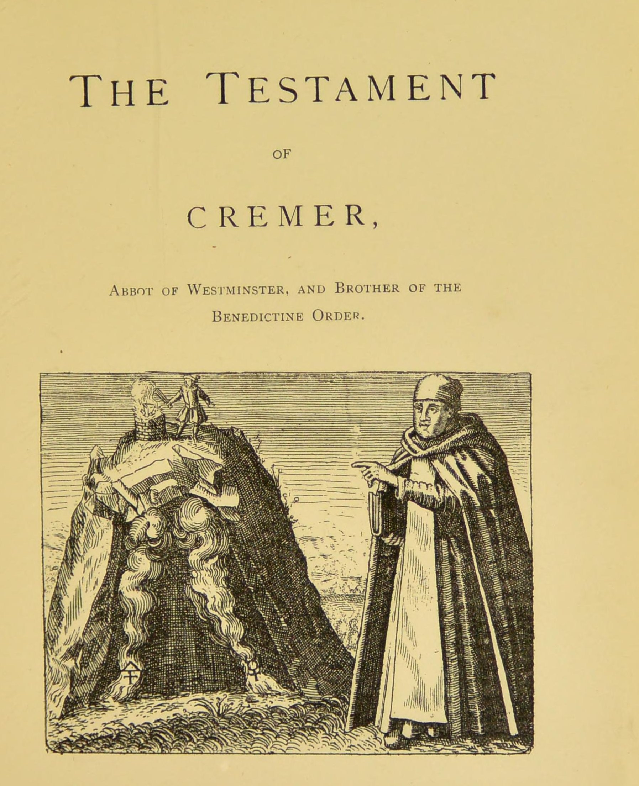

# クレーマーの遺言

伝ジョン・クレーマー／全訳

〔扉の図：岩のかたわらに立つ修道院長クレーマー。この図は、ミヒャエル・マイアー編『黄金の三脚台』（1618年）の銅版画にもとづく〕

- 原題：The Testament of Cremer, Abbot of Westminster, and Brother of the Benedictine Order（ラテン語。ミヒャエル・マイアーが1618年に編んだ『黄金の三脚台』〔Tripus Aureus〕に、バシリウス・ヴァレンティヌスの『十二の鍵』、トマス・ノートンの『錬金術の規則』とともに収めた。1678年の『ヘルメス博物館』〔Musaeum Hermeticum〕増補版にも入り、A・E・ウェイトが1893年の英訳第二巻に収めた）
- 内容：ウェストミンスター大修道院長を名のるクレーマーが、三十年の無駄な読書ののちイタリアでライムンドゥス・ルルスに師事し、師をイングランドに招いてエドワード王に引き合わせたが、王の約束破りで師が去った、という来歴を語る。祈りと讃歌ののち、六章にわたって「生ける水」「処女の水」の作り方、鉄鉱と錫、水銀と鉛の処理、四十週間の加熱、「赤い石」による鉛と錫の変成、火に耐える壺と目張りの粘土の作り方を、具体的な分量と日付つきで記す。最後に、秘密を修道院長と副院長とだけに伝え、六十年ごとに書き写させよという遺言で結ぶ
- 作業の基にした本文と扉：Internet Archive 所蔵の1893年英訳第二巻のスキャン（OCR を画像と照合した）
- 著作権：原典は十七世紀はじめまでに成立、ウェイトは1942年に死去。日本・米国・英国で保護期間が満了している
- 訳者：人工知能（Claude Opus 5.5）
- 訳の性格：全文を訳した。訳者の調べたかぎりでは、日本語訳は出ていない

## この本について

　ウェストミンスター大修道院の歴代院長に「クレーマー」という人物は見当たらず、この人物とその遺言は伝説的なものと考えられている。ルルスがイングランドに招かれてエドワード王（伝説ではエドワード三世）のために金を作ったという話は、十五世紀以来イングランドで広く語られたが、ルルスの生涯（一三一五年頃没）とは年代が合わない。この遺言は、そうした「ルルスのイングランドでの錬金術」伝説を背景に成立した文書である。

　ほかの多くの錬金術書が「我々の物質」をけっして明かさず寓意に包むのに対して、この遺言は酒石、石油、硫黄、砒素、尿、酢、生石灰、鉄鉱、錫、水銀、鉛といった具体的な物質と分量と日付とを並べる、レシピ集のような体裁をとっている。もっとも、冒頭に置かれたマイアーの四行詩が「作者の意味か、その書物の文字か、どちらかが人を欺く」と警告しているように、これをそのまま実験手順として読むべきかどうかは、当時から疑われていた。なお、レシピには砒素などの有毒物質が含まれ、作者自身「命取りの毒」と注意している。あくまで歴史上の文書として読まれたい。

　本サイトで訳した『ヘルメス博物館』英訳第一巻の諸篇（『賢者の石についての黄金論文』『賢者たちの水石』など）に続いて、第二巻からの訳である。

---

### この書に寄せる四行詩　M・M作〔ミヒャエル・マイアー〕

> 「作者の意味か、その書物の文字か、どちらかが人を欺く。それゆえ用心せよ。いたるところ、花のあいだに蛇がひそんでいる。けれども、許されるかぎりはっきりと語った友を軽んじてはならない。言葉の影なす葉の下に、黄金の実が隠されている」――「真理」の。

## イングランド人クレーマー、ウェストミンスター大修道院長にしてベネディクト会修道士の遺言

　私は、この術を学ぶ多くの者にとってあれほどひどいつまずきの石となってきた曖昧な専門用語をいっさい用いずに、錬金術についての十分で正確な説明を与えようと試みた。私がここで述べるのは、思想をわけのわからない言葉で言い表す術にその才知のすべてを傾けたように見える著者たちの書物を読みあさって費やし、むだにした三十年のあいだの、私自身の経験である。読めば読むほど、私はいっそう望みなく道に迷った。ついに神の摂理が私をイタリアへの旅に促し、あの高貴でまことに驚くほど学識ある師ライムンドゥス〔ルルス〕に弟子として受け入れられるようにしてくださった。私は長いあいだ師のもとにとどまった。師の目に私はまことに気に入られたので、師はこの大いなる秘儀の一部の知識を私に明かしてくれたばかりでなく、私のもっとも熱心な願いに応えて、このイングランドの島へ私といっしょに来て、ここで二年間私とともに暮らしてくれた。その滞在のあいだに、師は作業の秘密の全体を私に徹底して教えてくれた。

　のちに私は、わが高貴な師を、いとも恵み深いエドワード王陛下に引き合わせた。王は師を親切に、また丁重に迎え、師から尽きない富の約束を得た。それは、王（自身）が神の敵であるトルコ人に対して自ら十字軍を率い、以後ほかのキリスト教国に戦をしかけることを控える、という条件のもとでのことであった。しかし、ああ、この約束はけっして果たされなかった。王が契約の自分の側をひどく破り、わが愛する師を悲しみと嘆きとを胸に海の向こうへ逃れさせたからである。師の受けた不当な扱いを思うと、今も私の胸は内に燃え、もう一度その姿を見ること以上に切な願いはない。その日々の暮らしの模範と、その心の清さと誠実さとは、もっともかたくなな罪人をも悔い改めに動かすであろう。

　そのあいだ、もっとも祝福されたライムンドゥスよ、私と兄弟たちとが日ごとにあなたのために神の前に祈りを注いでいることを確信してほしい。すべての知恵は神から出て、つねに神のうちに終わる。知識を望む者は、それを神に求めねばならない。神は惜しみなく、とがめることなく与えてくださるからである。あらゆる知識の高さと深さ、知恵の宝の全体は、神の人々に与えられる。万物は神のうちに、神へと、神によってあり、神の意志なしには何も起こりえないからである。私の話を始めるにあたって、すべての善きものの源であり起源である方の助けを呼び求める。その霊の明るい光が私の心に輝き、私をあらゆる真理へと導き、ほかの人々にも知識のまことの道を指し示せるようにしてくださいますように。この祈りが、高きに座してすべてのものを世々限りなく治め導かれる方によって聞き届けられますように。アーメン。

> 「はじめに言葉があった……恵みとまことに満ちていた」

### 祈り

　聖なる主、全能の父、永遠の神よ、我々ふさわしくない者が、あなたのひとり子、我々の主イエス・キリストの名を呼んで、あえて祝福するこの火を、祝福し聖別してください。いとも恵み深い神よ、あなたの祝福によってそれを聖なるものとし、それが人類の益となりますように。我々の主イエス・キリストによって。

> 赤い光の創り主なる善き主よ、
> 定めの季節によって時を分かつ方よ、
> 太陽が消えると、恐ろしい渾沌がふたたび来る。
> おおキリストよ、あなたの忠実な民に光を戻してください。
>
> あなたは天の床を星でちりばめ、
> 月の明るいともしびをはめこまれたけれども、
> 我々に火打ち石から光を打ち出し、
> 石から生まれた火花をあおいで命あるものにすることも教えられる。
>
> あなたは目のまことの光、感覚の光、
> 外なるものと内なるものとを映す鏡。
> 私が運ぶこの光を受けてください。私は仕えつつ、
> 平和をもたらす乙女から流れ出た油注ぎに染められて。
>
> 偉大な父よ、あなたのひとり子によって、我々はあなたのもとに来る。
> その子のうちに、あなたの栄光は目に見えて輝く。
> またその子によって、祝福された慰め主のもとに来る。
> あなたがその大いなる御心から送り出された方。
>
> その方のうちに、あなたの輝き、誉れ、光、知恵、
> 威厳、善、憐れみが、
> 代々にわたって我々とともに住む。
> 我々を光の泉へと引き上げてください。アーメン。

### 第一章　我々の術の命である「生ける水」の作り方

　強く純粋な良質の赤ぶどう酒〔クラレット〕の酒石を三オンス取れ。それに石油を五オンス、生きた硫黄を二オンス、橙色の砒素〔雄黄〕を二オンス、ラブセヌム〔原文 Rabusenum〕を三オンス、柳の炭を二オンス加えよ。これらの成分をみな混ぜ、栓をよくしたガラスの壺の中で「ネプトゥヌスの浴」〔湯煎〕にかけて蒸留せよ。この壺は高さ一キュビトほどのものにし、霊や煙が少しも蒸発しないよう注意深く閉じておけ。それが淡い色に変わるのを見たら、炉から取り出して冷ませ。およそ四日で作れるはずである。その臭いを吸いこまないよう気をつけよ。それは命取りの毒だからである。この水は、丈夫で栓をよくしたガラスの壺に保ち、次の章の指図に従って用いよ。

　「もう一つの水」は、十八歳の汚れのない若者の尿から二度蒸留せねばならない。もし若者が汚れていれば、その水には生気がないであろう。

### 第二章

　汚れのない若者の最初の眠りのあとの尿を、三、四夜にわたって、三パイントになるまで取れ。毎晩それを栓をよくした石の壺に入れ、沈殿物を取り除け。液のうちもっとも薄くもっとも純粋な部分を一パイント漉し取れ。それにごく強い酢をグラス二杯、生石灰を二オンス、前に作り方を述べた「生ける水」を半オンス加えよ。混ぜたものを土の壺に入れ、その上に、粘土で空気を通さないようにした蒸留器すなわち蒸留の器をかぶせよ。火にかける前に、一昼夜そのまま置け。それからおだやかな熱にかけ、五、六昼夜たえず蒸留させよ。こうしてそれをしずくとなって流れさせよ。霊も煙も逃げないよう、ガラスの受け器を注意深く目張りせよ。そして蒸留する液が青い、あるいは青白い色を帯びたら、それ以上は何も抜き取ってはならない。

### 第三章

　傷のない、澄んだ硬い鉄鉱を八オンス、三つか四つに分けて、激しい炭火で溶かせ。それを、第二章で述べた処女の水で、必要なだけ消せ〔焼き入れせよ〕。それから錫を三オンス取り、しばらく火で熱して、処女の水に浸せ。鉄鉱と錫とを大理石の板の上でごく細かく搗きくだき、冷えはじめたら前述の水で少しずつ養え。全体を口の細いガラス瓶に注ぎ、鉛で封じよ。それを安全な場所に置き、十月には、高さ一ヤードほどの水の漏れない箱を新しい馬糞で満たし、ガラスの器をその中に突き入れよ。瓶のすぐまわりには、消していない生石灰の層を置け。箱のふたをきっちり閉め、満月のときのほかはけっして混合物を見てはならない。その色は、固定し硬くなるまで変わりつづけるであろう。それから、それは器の底へと沈殿する。箱の中に十二週間置いたら、すっかり黒くなっているはずである。そうしたら取り出して、三月二十日までとっておけ。そのとき、下に述べる指図に従って、もう一度細かく搗きくだかねばならない。

### 第四章

　三月十五日ごろ、水銀を三オンス取り、それに「生ける水」を半オンス加えよ。その水銀を、灰汁で清めてよく乾かした漉し布に五回通せ。鉛を二ポンド溶かし、壺に注げ。それが液体になったら細い丸い串を突き入れ、鉛がまだ温かいがすでに固まったところで串を抜き、代わりに水銀を注ぎこめ。塊全体が冷えたら大理石の板の上にあけ、油を注いで細かく搗きくだき、三つに分け、それぞれを小さな煤の丸薬と混ぜよ。それらを固く封じた器の中に八日間置き、搗いて粉にし、この粉を、酢と「処女の水」とを等分に合わせた液で養え。こうしてできるはずの柔らかい練り物を、背の高いガラスの蒸留器に入れよ。器の上部を粘土でふさぎ、革か羊皮紙で縛れ。それから、杜松と樫との燃える炭と、二十分の一の鉄のやすりくずとを入れた木の箱の中に、それを突き入れよ。器を入れる前に火の度合いを試すには、乾いた紙を一枚入れてみよ。もしそれに火がつくなら、火は熱すぎない。しかし燃えたあとに残る紙の薄い切れ端までも焼き尽くされるなら、熱は過度であり、温度が下がるまで戸を開けておかねばならない。ほどよく温かくなったら、（第一章で述べた）「生ける水」をひとさじ、注意深く加えよ。ただし、満月のたびにすばやくふたを取り、作業の進み具合を見られるよう、蒸留器は四分の三だけ炭でおおうよう気をつけよ。そうするたびに、「生ける水」をひとさじ加えよ。はじめ混合物の色は黒いはずである。のちに白くなり、さまざまな色の変化を経るであろう。混合物が固く、すなわち固定すると、その色はいくらか暗い色合いの赤になり、また塩辛く重くなって、もはや流れたり器の上のほうへ泡立ち上がったりしなくなるはずである。それは三月二十五日から始めて、四十週間、ここに示したやり方で扱わねばならない。この期間の終わりには、混合物はあまりに硬くなって器を破るであろう。このめでたいことが起こると、家全体がまことに驚くほど甘い香りで満たされる。その日こそ、このもっとも祝福された調製物の降誕の日である。炭を入れた鉄の箱は、もう一つの木の箱に入れておかねばならないことを忘れるな。その目的は、合わせたものを空気の有害な影響から守ることである。

### 第五章

　純粋で柔らかい鉛を二ポンド、純粋な錫を二ポンド取り、前述のよくふたをした粘土の壺の中で溶かせ。全体を薪の火にかけ、三時間ほどよい炎に保て。金属の鉱石の「泡」を、混合物全体が純粋で透きとおるまで取り除き、それから粉にした赤い石を四分の一オンス加えよ。塊全体が赤くなるまで、鉄のさじでおだやかにかき混ぜよ。壺を七十二時間置き、最後の三時間にもう一度燃える薪の火のおだやかな熱にさらせ。まだ液体のうちなら、好きな形に型どることができる。それが固まると、あなたの目の前に作業全体の完成がある。すべての良い賜物の与え主に、感謝の祈りのうちに手を上げることを忘れるな。そうあれかし。

### 第六章　金属を溶かす火に耐える粘土の壺の作り方

　よく練った陶工の粘土、あるいはタクソニウム〔原文 Taxonium〕と呼ばれる白い土を取り、それに十分の一の馬糞を混ぜよ。壺を形づくり、半ば乾いたら、赤い銅すなわちカルダリウムの銅の薄いやすりくずと、赤い砒素の細かい粉とでおおえ。すっかり乾いたら、その下の部分全体に、第一章の「生ける水」に十二時間溶かした硝石を塗れ。

**目張りの「粘土」の作り方**

　器をふさいで空気を通さないようにするのに用いる「粘土」は、瀝青、あるいは生石灰の乳香と卵白とから作り、少しの白いアルメニア粘土とよく混ぜよ。石油は澄んで、純粋で、黄色いものにせよ。ラブセヌムは澄んで、明るい朱色のものにせよ。

### 遺言

　私の望むところは、この我々の修道院の修道士アレクサンデルとリチャードとが、もっとも祝福された三位一体の名において、この遺言を書き写し、注意深く保つことである。

　まず第一に、彼らはこの秘密を、すべての貪欲で邪悪な者から熱心に守り、その時々の我々の修道院の院長と副院長とのほかには、だれにも明かしてはならない。またその二人にも、権力ある人々にも我々の修道院の下位の兄弟たちにもそれを明かさないと四福音書にかけて誓うまでは、知らせてはならない。

　さらに私の望むところは、この術が我々のこの修道院で実際に行われないことである。ただし修道院を貧窮と破滅とから救うためには別である。もっとも、私はこれほど大きな貴金属の宝を修道院に残すのだから、そういう事態は起こりそうもない。また私は、この家で権威ある者たち、すなわち院長と副院長とに命じる。私のこの最後の意志と遺言とが、時の荒廃によっても、人の思いを永続させる書き文字の形の変化によっても読めなくならないよう、六十年ごとに一度書き写させよ。

　さらに私はあなたがたに命じる。赤い竜の血の調製の秘密も、必要な物質の量も、その扱い方も、作業に取りかかるべき時も、上に名を挙げた人々のほかには、どんな人の魂にも漏らしてはならない。そして私はあなたがたに、父と子と聖霊との名において、あなたがたにゆだねられた信託を、損なわず、犯さず、破らずに守り保つよう、厳命する。あなたがたはいつの日か、キリストの裁きの座の前で私に答えねばならないのだから。この私の命令を守らない者は、その名が命の書から消されるように。

　マグネシアとは、溶かした鉄の鉱石である。混合物がまだ黒いとき、それは黒い烏と呼ばれる。白くなると、処女の乳、あるいは鯨の骨と名づけられる。赤い段階では、それは赤い獅子である。青いときは、青い獅子と呼ばれる。あらゆる色であるとき、賢者たちはそれを虹と名づける。しかしそのような名の数は無数であり、私はこのわずかなものを挙げることしかできない。そのうえ、それらはただ俗衆を惑わし、この秘儀を単純な人々から隠すために考え出されたものにすぎない。このような奇妙で風変わりな用語と名とに満ちた書物に出会ったら、すぐにそれを投げ捨てよ。それは何も教えてくれないであろう。

　ラブセヌムとは、鉱物から流れ出る水とともに出てくる、ある赤い物質であり土であって、七月に、ガラスの壺に入れて二十六日間太陽の熱にさらすことによって完成される。

**（終わり）**
