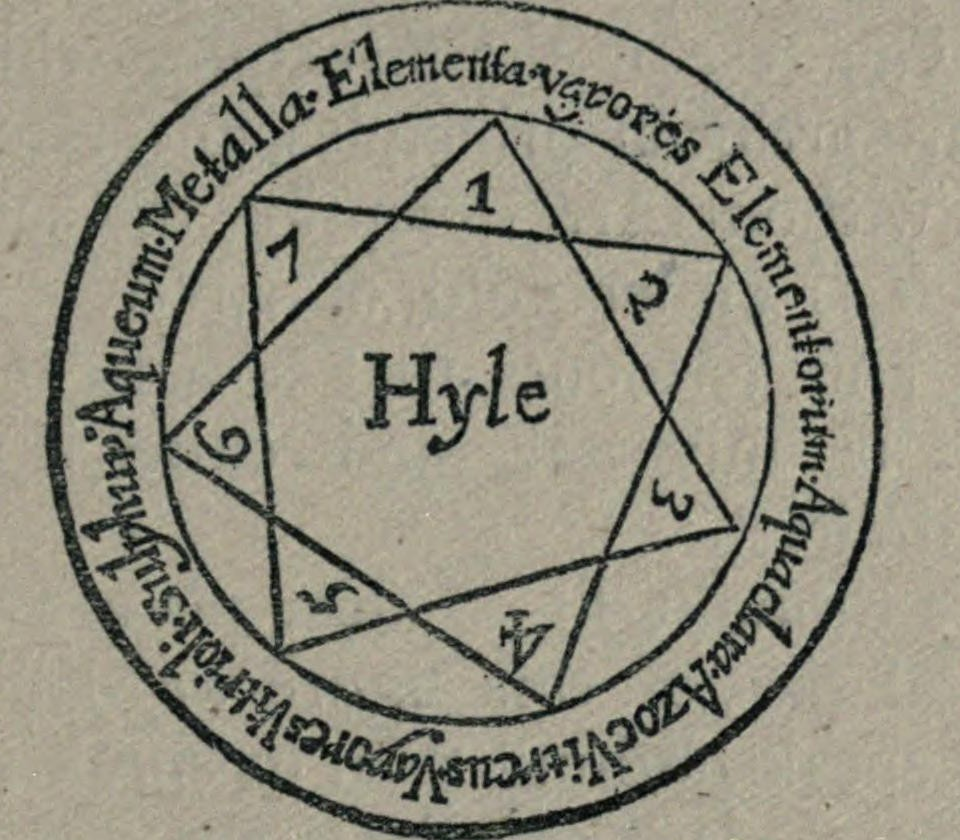

# エウフラテス

トマス・ヴォーン（エウゲニウス・フィラレテス）著／全訳

- 原題：Euphrates, or The Waters of the East; Being a short Discourse of that Secret Fountain whose Water flows from Fire and carries in it the beams of the Sun and Moon
- 著者：Thomas Vaughan（トマス・ヴォーン、1621〜1666年）。ウェールズ生まれの錬金術師・ヘルメス哲学者で、イングランド国教会の司祭。エウゲニウス・フィラレテスの筆名で著作を出した。形而上詩人ヘンリー・ヴォーンの双子の弟
- 初版：London, Humphrey Moseley, 1655年
- 作業の基にした本文：A・E・ウェイト編『トマス・ヴォーン著作集』（Theosophical Publishing House, London, 1919年）所収のもの。Internet Archive 公開のスキャン（ https://archive.org/details/worksofthomasvau00vauguoft ）のOCRテキストによる。ウェイトの版は綴りを現代風に改め、本文中のラテン語の引用を英訳して原文を脚注に移している。訳はその英訳を介した。ルルスの図は同じスキャンの401ページから採った。ウェイトの解説的な脚注は訳していないが、必要なものは訳注で紹介した
- 著作権：原著は1655年刊。ウェイト（1857〜1942年）の編集部分も含め、日本・英国・米国で保護期間が満了している
- 訳者：人工知能（Claude Opus 5.5）
- 訳の性格：全訳（読者へ・本論・読者への短い付録。要約・省略なし）。訳者の調べたかぎりでは、日本語訳は出ていない。聖書などの引用は、既存の日本語訳を用いず、英文から訳した。小見出しは訳者が付けた

## この本について

　『エウフラテス――東方の水』は、トマス・ヴォーンが生前に公刊した最後の論考である。序でヴォーンは、自分は「金属の拷問」としての錬金術をけっして信じたことはないと言いながら、じつは最初の試みにしくじったあと三年ものあいだ金属の実験にあくせくしたことを、包みかくさず白状する。

　本論では、まず聖典と自然とを切りはなすことを戒め、「哲学と神学とはひとつの同じ学問にすぎない」と説いたのち、子どものころから心をとらえてきた「水に対する火のはたらき」を主題にすえる。世界はもともとある種子から造られ、いまもその「第二の種子」を生みつづけて自分を養っている。それは雲と露と雨とをめぐって天と地とのあいだを行き来する、ねばねばした「固まりうる水」であり、植物のゴムや金属や宝石のもとであり、荒野でイスラエルの民を養ったマナでもある――と、ヴォーンはルルスの図やセンディヴォギウスの説、雪を使った自分の実験を手がかりに語っていく。後半では、自分が金属やアンチモンの中に第一質料を探しもとめて迷った経験を語り、けっして火にふれたことのない「黒い硫黄」と、普遍の女である水とを結べと説いて筆をおく。ヴォーンの思想の総まとめとも言える一篇である。

## 目次

- 読者へ
- エウフラテス――東方の水（本論）
- 読者への短い付録――いましめとして

---

## 読者へ

　読者よ、私はこの数年のうちに、いくつかの小さな論考の中で、哲学についての私の判断を述べてきた――そしてそれはあなたにも知られていないことではないと思う。哲学について、と私は言う。錬金術については――ふつうの意味での、金属の拷問としての錬金術については――私はけっして信じたことがなく、ましてそれを学んだことはないからである。この点については、私の書物が――目を通してもらえば――あなたに証拠を示すだろう。そこで私があなたに示しているのは、普遍的な主体、すべての自然の土台であり、すべてのものがそれから造られ、造られたのちもそれによって養われる質料だからである。これは金属ではありえないと思う。それゆえ私は、俗な意味での錬金術をつねに否認してきたのと同じく、錬金術師たちにもそれを知らせておくのがふさわしいと考えた。彼らが私の書いたものを読んで、その著者の判断にはそぐわない解釈をいくつかの箇所にくだすことのないようにである。ここから、私が書きはじめたとき私の考えがどうであったかがわかるだろう。そしていま告げなければならないが、それはいまも同じであって、私の長い経験はそれを少しも弱めず、かえって打ち負かしがたいほどに確かめたのである。だが――私がどれほど率直であるかを知らせるために――私は実践において自分の原理を捨てたことを、包みかくさず白状する。最初の試みにしくじったので、私はまことの主体をわきへ置き、金属のことしか聞こうとしない人々の騒音にしたがうことに甘んじたのである。この悪臭を放つかすだらけの学校で、三年続けて私がどれほどあくせくと働いたかは、ここでは告げまい。ついにそれをやめて、愚かにも見すてていたあの澄んだ光の中に、ふたたび歩み入ったのはよいことであった。私はつねに、金属の中には大きな秘密があると考えてきた。ただし、まずふさわしい溶剤によってそれが戻されるならばである。だが、その溶剤、あるいはそれが作られる質料を、金属の中に探しもとめるのは、誤りであるだけでなく狂気である。私は真理のために、そして私の前の罪のない論述を正しいと示すために、それらにこの小さな作品を加えた。それはおそらく、世がまだ公にされたものとして見たことのないような作品であり、それほどのものを含んでいる。まことにそれは私が最初にもくろんだものの十分の一にもならないが、いくつかの冷静な考えが私を思いとどまらせた。それは私の不意の、唐突な結びがあなたに知らせるだろう。いずれにせよ、哲学の秘儀について私がいまとっておくものは、のちに私の『気象論』の中で分けあたえるかもしれない。そして神学の秘儀については、自分自身の私的な用のために、私の『恵みの哲学』の中にまとめるつもりである。

　ほかに言うことはほとんどない。だが、もしそれがあなたの満足に何かを加えるなら、ここには私自身の経験の実りのほかは何も断言されていないことを請けあうことができる。まことに私自身のもの、と言うことができる。私は大いに骨折って、それを地からしぼりだしたのであり、私を教えてくれる人は誰もいなかったのだから。私がここに置いた土台の上に、山を――とりわけ金の山を――築いてほしくはない。だが、もしその上に医術を築くなら、私はあなたに、あれほど多く奉じられながらあれほど理解されていない、あの名高い術の岩と土台とを示したのである。ここにあなたは、その術のまことの主体が証明され、――あなたがひどく鈍いのでなければ――十分に明かされているのを見いだすだろう。ここでは神ご自身と神の言葉とが、あなたをそこへ導く。ここでは光があなたに光を示す。そしてここであなたは、イアンブリコスとエジプトの記録とのあのあかし、すなわち、神がときに古の祭司と預言者たちに、「祝福された幻によって」ある質料を授け、それを人間の用のために伝えたという、あのあかしが明らかにされるのを見るだろう。

　この忠告で結ぼう。もし自然を知りたいなら、アンチモンとふつうの金属とに用心せよ。ただ、自然が大いなる世界の中で作るあの元素のまさに最初の混合だけを求めよ。それを、私は言うが、新しく、なまなましいうちに求めよ。そして、見いだしたら、それを隠せ。その用い方については、それをすっかり書物の中に求めてはならず、むしろ神の手からそれを乞いもとめよ。それは本来神の賜物であって、上からのはっきりとした、感じとれる助けなしに、それに達した人はけっしていないのだから。たとえそれが、賢すぎて神の憐れみをあざける人々にはばかげて見えようとも、この点での私の忠告をなおざりにしてはならない。多くの人は、この世に神なしに生きている。彼らは神の訪れを受けたことがなく、それゆえ神を求める人々を笑う。だが、神を見いだした人々をなおさら笑うのである。聖パウロは自分の受けた啓示を誇った。だが、いまそうする者は、ランター派や再洗礼派の一人に数えられるだろう。だが、こうしたことにそらされてはならない。もしあなたが神に仕えるなら、よい主人に仕えているのであり、主人はあなたの報酬をさしとめはしないだろう。キリスト・イエスにおいて、さようなら。

　　エウゲニウス・フィラレテス

## エウフラテス――東方の水

### 聖典と自然

　われわれが受けとり、信じているあの生ける託宣の中に、水の天使がいると書かれている。そしてこれは一般的な意味で語られているように見える。まるでそこに言及された天使が、その元素全体の長であったかのようにである。ほかのところでは、もっと個別の務めに限られた天使が見いだされる。ある時期に降りてきて、ベトザタの池の水を動かしたあの天使のようにである。また、神の霊がはじめにその上を動いたあの元素を、天使たちが訪れ、動かすのは、まことに少しも奇妙なことではない。私はこれらの箇所を、それが私の目的にかなうとか、まったくそのためのものだとかいうつもりで引くのではない。それが私の目的に少しも反しないことは知っているが。私がこれを一般的なこととして引くのは、神は質料にしばられてはいないが、質料にかかわっておられることを示すためであり、それが私のもくろみのすべてである。それでも、君主アヴィケンナが福音書記者聖ヨハネを化学者のうちに数えたことは知っている。そしてたしかに、もし黙示録のいくつかの箇所が――それもその箇所自身の意味が運ぶところより先へではなく――突きつけられるなら、彼の意見をしりぞけるのはいくらかむずかしいだろう。たしかに私は自然をたいへん尊く思う者であり、もしこのような論争を避けるとすれば、それは弱い良心をつまずかせたくないからである。神が世界を造ったことで神の威厳がそこなわれたとはあえて考えないのに、神の言葉をその造ったものにあてはめると神の言葉の威厳がひどくおとしめられると、あえて考える人々がいるのである。これはまことにきわめて危険な冒涜を含む意見である。すなわち、神の言葉と神のわざとが、一方が他方をはずかしめずにはいないほどちがうものだ、というのである。

　白状しなければならないが、もしわれわれのため、われわれの教えのためでないなら、聖典が何にあてはめられるべきで、誰のために書かれたのか、私にはさっぱりわからない。というのも、もし健やかな者には――われらの救い主があかしするように――医者はいらないのなら、神は聖典を自分のためにも、天使たちのためにも書かせたのではなく、最初の状態を失って腐敗へと落ちた被造物のために書かせたのである。さて、もし聖典がわれわれのために書かれたのなら、それをどう用いるべきかを知ることは、われわれに大いにかかわる。そしてこれは、堕落の前とあとの人間のちがった状態から推しはかることができる。堕落の前、人間は輝かしい被造物であって、神から不死と完全な知識とを受けていた。だが堕落において、またそののち、人間は不死を死と、知識を無知と取りかえた。さて、この堕落からのわれわれの贖いについて言えば、死にかんしては、この世でそれを期待することはできない。神はすべての人間が一度は死ぬよう定められたからである。だが、無知については、われわれはこの世でそれを脱ぎすてることができるし、またそうしなければならない。神の知識なしには誰も救われないのだから。それはわれわれの未来の不死の原因であり、手付金でもあるからである。それなら、われわれの死すべきさだめを脱ぎすてることができる前に、われわれの無知は、この世においてさえ部分的に脱ぎすてられなければならないことになる。そしてたしかに、このために聖典は書かれたのである。すなわち、それによってわれわれが神の知識に達し、われわれが落ちてきたもとの神へと帰るためである。

　そしてここで、聖典はどのようにしてわれわれに神を知ることを教えるのかと私が問うても、誰も私に腹をたてないでほしい。聖典はただ神がいると告げるだけで、残りはわれわれの裁量にまかせるのか。聖典は――私の思うところを言えば――神のわざによって神を知ることを教えるのか、それとも神のわざなしにか。もし神のわざによってなら、それは自然のものによってである。それが神のわざであって、ほかにはないのだから。もし神のわざなしにであるなら、それがどんな種類の教えなのかを知りたい。私にはまだそれが見いだせないからである。もし彼らが、それは霊感によってだと言うなら、私も、神はそのように教えることができると言う。だが聖典にはそれができない。聖典はそれ自身は霊感によって来たが、たしかに聖典が誰かに霊感を与えたことはないのだから。だが、もし聖典の中にわれわれは霊感を受けた人々のあかしをもっているのだと答えるなら、その答えは私の問いからはずれていると言おう。私はここで、聖典のただの権威やあかしについて語っているのではなく、聖典がそのあかしするものを証明するのに用いる教えについて語っているのだから。そうした教えに、聖典は満ちている。たしかにモーセは創造によって神を証明しており、神はその杖を蛇に、蛇を杖に変えることによって、ご自分をモーセに証明している。そしてエジプト人には、自然の中でのご自分の力と主権とについて、もっと恐ろしい証明を与えている。彼らの川を血に、その地の塵をぶよに変え、家畜の疫病、腫れものと膿みただれ、長子の死によって、また蛙、いなご、雹、火、雷、闇のいくつもの災いによってである。それらはみな、神がご自分の神性を証明するのに用いた大いなる自然のわざにすぎなかった。神ご自身が言われたとおりである。「わたしがエジプトの上に手をのばすとき、エジプト人はわたしが主であることを知るだろう」。キュロスにご自分を啓示するときも、神はただ自分が神だと断言することによってではなく、自分の造った世界によって、自分がそうであることを証明している。「わたしは主であって（と神は言う）、ほかにはない。わたしのほかに神はない。あなたはわたしを知らなかったが、わたしはあなたに帯をしめさせた。……わたしは光を形づくり、闇を創造する。わたしは平和を造り、災いを創造する。わたし主がこれらすべてのことをする。……わたしは地を造り、その上に人間を創造した。わたし、わたしの手が天をひろげ、その万軍にわたしは命じた」。

　誰でも、神とヨブとのあいだのあの威厳ある、哲学的な論じあいを読んでみるがよい。あるいはひと言で言えば、旧約と新約の両方を読みとおしてみるがよい。そうすれば――注意ぶかく読むなら――聖典が終始自然を用いており、まことにどの哲学者の中にも見いだされないような自然の秘儀を明かしていることを見いだすだろう。そしてこれは、続く論述の中で明らかになるだろう。私自身としては、こう言うことを恐れない。自然は聖典のこれほど大きな関心事であって、私には、あの聖なる託宣の中の神の霊は、個別の人間の回復だけでなく、一般の自然の贖いをも心にかけているように見える。それゆえわれわれは、この回復をわれわれ自身の種に限ってはならない。そのうえ腐敗をそれに限ることができるのでないかぎりは。それは疑いなくできないことである。腐敗が人間をとらえただけでなく、人間のために世界をもとらえたことは明らかだからである。それなら、もし人間に救い主がいるというのが本当なら、全被造物にも同じ救い主がいるというのも同じく本当である。神はイエス・キリストにおいて万物をご自分と和解させたのだから。そして、もしわれわれが自分の体の贖いと新しい人とを待ちのぞんでいるというのが本当なら、われわれが新しい天と新しい地、義の宿るところを待ちのぞんでいるというのも同じく本当である。というのも、全体の回復において新たにされるのは人間だけでなく、人間と同じく世界もまたそうなのだから。「見よ、わたしは万物を新しくする」と書かれているとおりである。私がこれを言うのは、人間をおとしめたり、何かほかの被造物を人間と並べたりするためではない。人間は、堕落においてそうであったように、回復においても主役であって、元素の中に続いて起こった腐敗は、このとらわれ人が引きずっている鎖にすぎないことを、私は知っているのだから。私がこれを言うのは、神が人間だけでなく一般の自然の回復を心にかけておられることを示すためである。人間は――最も気高い部分であるとはいえ――たしかに自然の小さな一部にすぎないのだから。

### 訳注

- 『エウフラテス――東方の水』は1655年に出されたヴォーン最後の公刊の著作。副題は「火から流れ出て、太陽と月の光をうちに運ぶ、あの秘密の泉についての短い論述」。扉には「神は言われた――その名があがめられるように――われらは水から万物を造った」という、聖なる書からのサディトの引用が掲げられている。
- 「金属の拷問としての錬金術」については、ウェイトは、ヴォーンの実験ノート（『アクア・ウィタエ』）や、ヴォーンが実験中の事故で死んだと伝えられることと比べて、興味ぶかい証言だと注している。
- 『気象論』と『恵みの哲学』は、ついに出版されなかった。
- 「祝福された幻によって」は、イアンブリコス『秘儀について』などに見える考え。
- ランター派は、17世紀半ばのイングランドに現れた、律法を否定する熱狂的な宗派。再洗礼派は幼児洗礼を否定した宗派で、当時は危険思想の代名詞のように用いられた。
- 「水の天使」はヨハネの黙示録16章5節、ベトザタ（ベテスダ）の池の天使はヨハネによる福音書5章4節、「神の霊が水の上を動いた」は創世記1章2節。
- アヴィケンナ（イブン・シーナー、980〜1037年）の名で伝わる錬金術書はいくつかあるが、ウェイトは、聖ヨハネに言及した箇所は見つからなかったと注している。
- 「健やかな者には医者はいらない」はマルコによる福音書2章17節。
- 杖と蛇は出エジプト記4章と7章、エジプトの災いは同7〜12章、「わたしがエジプトの上に手をのばすとき……」は同7章5節。キュロスへの神の言葉はイザヤ書45章5、7、12節。神とヨブとの論じあいはヨブ記38〜41章。
- 「イエス・キリストにおいて万物をご自分と和解させた」はコロサイの信徒への手紙1章20節、「体の贖い」はローマの信徒への手紙8章23節、「新しい天と新しい地、義の宿るところ」はペトロの手紙二3章13節、「見よ、わたしは万物を新しくする」はヨハネの黙示録21章5節による。

それなら、聖典が救いの対象、すなわち自然――神が、いまそれがしたがっている堕落から救い、贖おうとしておられるのはそれなのだから――にあてはめられるとき、聖典は誤って用いられているのだろうか。ましておとしめられているのだろうか。まことに、聖典を読むとき、私はその中に、自然と自然のものとにかかわることのほかには何も見いだすことができない。聖典が再生や照明や恵みや、何かほかの霊的な賜物に言及するとき、それはそれだけを切りはなしてではなく、自然とのかかわりにおいてそうしているからである。こうしたものはみな、自然を助け、われわれが長いあいだ押しひしがれてきたあの腐敗からわれわれを解き放つために、神から降りてくる霊の新しい流れこみのほかに、何を意味するというのか。神がどんな聖典よりも形而上的であることは否定されないと思う。それでも、救いのわざにおいて神と自然とを切りはなすのは、たいへんな不敬であろう。そうすれば神には救うものも、はたらきかけるものも何もなくなってしまうのだから。それなら、自然の務めにおいて聖典と自然とを切りはなすのは、どれほどばかげていることか。いったい――お尋ねするが――聖典は誰に語っているのか。いや、もし自然が取りさられるなら、救いは誰に施されるのか。人間が自然の上にではなく、自然の中に立っていることを、私は疑わない。スコラ学者たちが人間を好きな部分に分解するがよい。その部分はみな自然のものであることがわかるだろう。ただ神だけがまことに形而上的なのだから。私は論敵たちから、彼らが自然の腐敗していることをどうやって最初に知ったのかを、ぜひ学びたい。もし聖典がこの自然学の真理を彼らに教えたのなら、なぜ聖典がそれ以上を教えてはいけないのか。だが聖典が彼らにそれを教えたことは、まったく否定できない。患者のまことの気質と、病がそれをどこで乱したかとを述べることのできる、それほどの能力をもった医者を思いうかべてみよう。彼はそれを役にたつ目的のためにするのではないか。疑いなくそうである。そして私の考えでは、自然を患者とする神の霊が、聖典の中で自然の性格づけをわれわれに与えることも、それに劣らず役にたつのである。そして神の霊はたしかに、世界の過去、現在、未来の気質のどれを見ても、あらゆる点でそれをしているのである。

　私自身としては、哲学についてこう確信している。自然のすべての秘儀は、聖典に言及され、堕落に続いて起こったあの腐敗を知ることにある。すなわち、それが何であり、おもにどこに宿っているかを知り、また、それに最も抵抗し、それを遅らせる――それから最も自由であるがゆえに――実体が何であるかを知ることにある。この二つのことに、生と死との利点があるのだから。手短に言えば、経験と、それにもとづく理性とが、哲学と神学とはひとつの同じ学問にすぎないことを私に教えた。だが人間は、川や井戸を扱うように知識を扱ってきた。それらはいくつもの管に引かれて、いくつもの方向に流され、このなりゆきによってついにはいくつもの名をもつようになる。神がそのわざにおいて、霊と質料、見えるものと見えないものとを結びあわせたことを、われわれは見る。そして霊的な実体と自然の実体との結合から、完全な合成物が生じ、そのまさに本性と存在とはその結合にある。それなら、霊だけ、質料だけを切りはなした理論によって、その合成物の本性を証明することがどうしてできようか。もし合成物の本性が霊と質料との組成にあるのなら、われわれはその本性を、それらの分離のうちにではなく、それらの混合と調和、その互いのまじりあったはたらきと受け身とのうちに求めなければならないではないか。そのうえ、質料なしの霊や霊なしの質料を見て、両方の原理をその単純さのうちに、まことの理論として与えることのできた者が、いったい誰かいるだろうか。たしかに生きている人には一人もいない。神学においてもちょうど同じである。もし言いのがれのために神学を抽象における神に限るなら、いったい――私は言う――誰が神をそのように知ったことがあるのか。あるいは、誰が神からそのような神学を受けとりながら、これまでずっとそれをわれわれに伝えないでいるのか。まことに、もし神を抽象において、それ自身においてあるがままに考えるなら、われわれは神について肯定的には何も言うことができない。ただディオニュシオスがしたように、否定的に何かを言うことはできる。すなわち、神が何でないかは断言できるが、神が何であるかは断言できない。だが、もし神学によって、聖典に述べられている救いの教えを意味するのなら、それはまことに、神と自然の両方を含む、まじりあった教えである。そしてここで私は、救いの秘儀は、哲学なしには――その正しいひろがりにおいては――けっして十分に理解されえないと断言することをためらわない。救いは神の自然への適用であり、自然の神への回心であって、この二つの運動とその手段のうちに、すべての霊的な知識と自然の知識とが含まれているからである。

　それなら、自然なしに神について語ることは、われわれにはできないことである。われわれは神をそのように知ったことがないのだから。そして神なしに自然について語ることは、われわれがしてはならないことである。神からその栄光を奪い、本来神と、自然の中ではたらく神の霊とに属する効果を、自然に帰することになるだろうから。それゆえわれわれは、この両極のあいだの中ほどの話し方を用いよう。そしてこの話し方は聖典がわれわれに教えたものである。預言者と使徒たちはほかの話し方を用いなかったのだから。それゆえ、この論述の中でわれわれが聖典を用いて哲学を証明し、哲学を用いて神学を証明しても、誰も腹をたてないでほしい。まことにわれわれの知識は、われわれの神学が自然なしにはなく、われわれの哲学が神なしにはないようなものなのだから。それでも、たいていの人はこのやり方に不平を言うだろうと思わずにはいられない。なぜそうするのか私には思いつかないのだが。私が聖典と哲学とを結ぶとき、私はただ神と自然とを結んでいるにすぎない。それは人々には断罪されても、たしかに神にはよしとされる結合なのである。だが、このつむじ曲がりの無知とは――どれほど大胆であろうと――争うまい。聖典のほかにも、私をたいへんすなおに冷静にこの論述へと導いてきたほかの根拠があるのだから。

### 子ども時代の思索

　私はもう何年も、幸運な人々が世界と呼ぶこの大いなる組みたての中に寄留してきた。そしてたしかに、旅人のように時を過ごしてきた。それを買いとるためではなく、観察するためである。その中で、私に何かの思いのきっかけを与えなかったものはほとんどない。だが、私を大いに、そして早くからとらえたのは、水に対する火のたえまないはたらきであった。この思索は――どうしてかはわからないが――大学を見るずっと前の、私の最初の若いころを襲った。そしてたしかに、私がその生徒であった自然は、そのころすでに、のちにプラトン哲学の中で出会った多くの観念を私の中に目ざめさせていたのである。そのころ私が水についてのある実践を思いえがいていたこと、そしてそこから――そんな子どものころでさえ――驚異を期待していたことを書かずにはおくまい。だが、たしかに金も銀も期待してはいなかった。そんなものは考えもしなかったし、そうした欲ばりの技巧も考えなかった。子どもだったときの自分についてのこの考察が、そののち私に子どもたちを調べさせた。すなわち、われわれのまわりに見えるあの元素について、彼らがどんな考えをもっているかである。そして私は彼らについてこれだけのことを見いだした。自然はその単純さにおいて、身につけた才能とへりくつとをもった何人かの大人よりも、ずっと賢いのである。まことに私は、自分の正当な望みに達するために、すべてを試す義務があると思った。だが、私が子どもとばかり話してきたと思われないように白状しよう。私は子どもとも、愚か者とも話してきた。私の解釈では、子どもと大人とである。この後者は、何ごとにおいても前者ほど賢くはないのだから。教育がその子を変え、発酵させる前の、「まったくの自然のままの」子どもは、あまり考察されてこなかった主題だと思う。人々は子どもが自分たちの仲間になるまでは目をとめず、そうなるとまことにその子をだめにしてしまう。それでも、私の読んだところによれば、習慣と作法とに損なわれる前の子どもの生まれつきの性向は、古の哲学者たちが、ときに好奇心をもつほどに熱心にとりくんだことのひとつであったと思う。ここでは私自身の経験によって見いだしたことは述べまい。これは先見の要点であって、賢者たちがそれによって、自然のことと同じく、道徳についてもある確かな知識に達した土台なのだから。

### チェスターのリースの言葉と、二つの種子

　だが、この脇道から、最初に挙げた原理、すなわち火と水とに戻るために、この論述への入口を、私の名高い同郷人チェスターのリースから借りよう。彼はこの術について語ってこう述べている。「この術は（と彼は言う）隠された哲学に属し、哲学のうちでも、大気の現象を論じる部分に属する。この術は、元素について論じるだけでなく、元素から生みだされたものについても論じる。ここを探せ。これは大いなる秘密なのだから」。

　これらの言葉は――もしそれがかかわり、関係している秘儀がはっきりと述べられるなら――果てしない論述となるだろう。それは自然のするすべてと、術のなしうるすべてとを含んでいるからである。だが、いくらか順序だてて、良心のゆるすかぎり、それが何を意味するかを言いあらわすために、まず第一に、神がすべてのものの主要な、ただひとりの作者であり、その言葉と霊とによって、いまわれわれには見ることのできないものを形づくり、あらわしたのだと言おう。神がそれらを形づくった質料について言えば、それはわれわれにだけでなく世界そのものにも先だって存在した実体なので、たいていの人はそれを知ることは不可能だと思うかもしれない。われわれよりはるか前にあって、いまわれわれとともにはなく、また――彼らの意見では――創造以来けっして存在しなかったものを、どうして知ることができようか、というのである。一見打ち負かしがたく見えるかもしれないこの反論に、われわれはそれを打ち砕く答えを返そう。われわれがどのようにして、どんな手段によってこの質料を知るようになったか、それも知るだけでなく、長い骨折りののちに、それを見、手にとり、味わうようになったかを示そう。すべての個体は――たとえば人間そのものは――種子によって造られ、この種子は――体が完成すると――もはやあらわれないことは十分に明らかである。それは変えられ、体へと変成されるのだから。それでも、その同じ体がのちに種子を生む。それは、その体が造られたあのもとの最初の種子と、本性においてまったく同じものである。それなら、人間の生成を知ろうとする者は、最初の種子を知るためにアダムまでさかのぼる必要はないと思う。もし自然がいまも同じようなものを与えてくれるなら、あの実りのない後戻りに何の必要があろう。世界もちょうど同じである。世界はもともと種子から、すなわち種子のような、ねばねばした湿りあるいは水から造られた。だがその種子は――われわれの『箴言』で述べたように――創造のうちに消えた。その上を動いた神の霊がそれを変成させ、それから世界を造ったからである。それでも、そのまさに世界がいま、自分自身の体から、第二の種子を生み、産みだしている。それは、世界がそれから造られたあの原初の一般的な種子と、本質においても実体においてもまったく同じものである。そして、もし誰かが、自然はこの一般的な種子を何に用いるのか、なぜそれを生むのかと問うなら、私は答える。それでもうひとつの世界を造るためではなく、すでに造られた世界をそれによって保つためである、と。全能の神は、ご自分の被造物がそれから形づくられたのとまったく同じ質料によって養われるよう定められたのだから。そしてこの点において、ほかの場合ならまったく偽りであろうあの格言が確かめられる。「われわれは、われわれがそれから成り立つまさに同じものによって養われる」。

　われわれは、自分の食物や獣の食物がどこから来るかをあまり探らない。どちらの食糧も明らかだからである。だが、草や薬草や穀物や、あらゆる種類の木々とその実とを養うものは何か。これらのおびただしい、数えきれない産物が、一年の大部分を彼女の乳房に吸いついて生き、ほとんど彼女を飲みほしてしまったとき、地をもとに戻し、補うものは何か。彼らは思うとおりに語って、それは水だと断言するのではないかと思う。だが、彼らがどれほど巧みな主張者であるかは、のちに明らかになるだろう。

　たしかに、われわれ自身や獣の食べるものでさえ、そのすべてが同じ泉から出てくる。だが、それはわれわれのところに来る前に変えられている。動物は個別のものを食べて生きるが、植物はこの精子を、その天上の普遍的な形のままじかに吸いとるからである。それでも、この種子が養うためだけに役だつと理解してほしくはない。多くのものがそれから造られ、とりわけ鉱物と金属との地下の一族がそうなのである。このものは目に見えるかぎりでのほかは水ではなく、固まりうる脂っぽい湿り、すなわち火と空気と純粋な地との混合物であって、まことに水でおおわれている。それゆえ誰にも見られず、わずかな者にしか知られていない。植物の中では、それはしばしばあらわれる。植物は――ある人々の考えるように――水を食べて生きるのではなく、水の中に隠れたこの種子のようなねばりを食べて生きるのだから。まことに植物はこれを根で引きよせ、そこからそれは枝へと昇る。だが、ときに途中で樹皮から破れ出ることがあり、そこで冷たい空気に出会うと、それはとどまって固まり、ゴムとなる。この凝固は急にではなく、いくらかの時間を要する。それがまだ新しいうちに見つけると、それはきわめて精妙な湿りであるが、ねばねばしていて、どんな髪の毛にも劣らない細い糸に引きのばすことができるのだから。そしてもしそれが枝まで昇っていったなら、時がたつうちにすももかさくらんぼに形づくられたことだろう。地上ではそれは冷たさによってこうなるが、地のはらわたの中では、それは硫黄的な熱によって金属へと固められる。そしてもしその凝固の場所が純粋なら、輝く金属となる。この精子は光をはらみ、星の火に満ちていて、すべての金属はそこからその輝きを得ているのだから。真珠や宝石についても同じことが言えるだろう。この星の種子がそのすべての母なのだから。それが、かすだらけの混ざりものなしに、それだけで鉱物となるところでは、それはその火花を放ち、はじき出す。そしてそれはあまりに多くの天をもっているので、もしわれわれがそのたくらみを知らなかったなら、どうしてそれが地を愛することができるのかと不思議に思うだろう。

### ルルスの図

　さて、われわれの言ったことをわずかな言葉で要約しよう。とりわけわれわれの方法を説明したいからである。われわれはライムンドゥス・ルルスにしたがうつもりである。彼はその『遺言』の第三章で、われわれが前に引いたチェスターのリースのあの言葉にすっかり対応するある図を示している。

　われわれはすでに二つの原理、すなわち神と自然、あるいは神と創造された世界とに言及した。世界に先だって存在したあの第三の原理、すなわち混沌については、もう語るまい。だが、そのかわりに、いまあって、見える世界から出てくる第二の精子すなわち混沌に頼ることにしよう。われわれは見えるもののほかは何の上にもこの論述をうちたてないつもりであり、その正面に、すべてのものの唯一の、中心の、永遠の原理であり建築者である神の威厳を置く。

　この図はライムンドゥス・ルルスのものであり、その中心には、世界がそれから造られた最初のヒュレーすなわち質料が見える。このヒュレーの中に――とライムンドゥスは言う――すべての元素と、すべての自然の原理とが――中間のものも両極のものも――「水の混乱した形において」潜在的にまじりあっていた。そしてこの原初の精子の大洋は、いまわれわれが空気に帰しているあの空間全体を満たしていた。それは――と彼は言う――「月の円にまで届いていた」からである。この中心のヒュレー――それについてはもう終えた――から、図の円周に書かれているのが見えるあのすべての原理と体とが生じた。そしてここから、われわれの哲学が始まる。

　まず第一に、ヒュレーの上に、元素、すなわち見える創造された世界が見える。その部分はふつう元素、すなわち地、水、空気、天と呼ばれる。アリストテレスが月の下にともしたあの鬼火のほかには、火はないのだから。右手には、元素から、その実体の希薄化と溶解とによって、もうひとつの原理、すなわち元素の蒸気すなわち雲が引きだされているのが見える。その蒸気の中で下位の本性と上位の本性とが出会い、そこで結婚し、その混合から、われわれの求めるあの第二の精子すなわち哲学の混沌が生じる。雲すなわち元素の蒸気の次に、図の中に第三の原理、すなわち雲からじかに出てくる澄んだ水が見いだされるだろう。「そしてそれは（とルルスは言う）、地の上を走り流れているのがまことに見いだされる、水銀にむしろ近い実体である」。第四の原理は、自然が水的な普遍のメルクリウスの実体すなわちねばりから、凝固によってじかに生みだすもので、ガラスのアゾートである。それはある火のような、硫黄的な、男性の鉱脈である。そしてこれが哲学の金――硫黄、地、男――であって、ねばねばした水がメルクリウス、女であるのと同じである。図に並べられたほかの原理は人工の原理であって、術なしには知られることもあらわれることもない。ただし第七の、最後の原理は別で、それは金か銀である。これらは完全な金属であり、パン種であって、――それ自体では普遍的な――薬を種の定まったものにし、個別の性向と効果とへともたらすからである。

　ここまでは、あなたがたと率直に話すのがふさわしいと思った。図の実践の部分については省こう。理解されないように語るくらいなら、何も語らないほうがよいからである。あえて言えば、自分の謎を喜び、すでに十分に多い困難をさらに増やすことに特別な楽しみを見いだす著者たちがいる。私としては、あなたがたに知恵くらべを強いるまい。残りはその著者から受けとってよい。そうすれば、私自身がかつてさらされた危険のほかには、あなたがたをどんな危険にもさらさないことになる。

### 中心の火と大地

　さて、ふたたびわれわれの理論に戻ろう。その入口として、火がすべての運動を始め、運動が生成を始めるのだと言おう。もしこの物質の世界の元素すなわち部分が、みな「その境界の中に」とどまっていたなら、そのような静止は何も生まないだろう。これを防ぐために、全能の神は世界の心臓、すなわち地の中に――ほかのすべての被造物の心臓の中にもそうしたように――火の命を置いた。パラケルススはそれをアルケウスと呼び、センディヴォギウスは中心の太陽と呼ぶ。この火が――自分自身の体である地を焼きつくさないように――神はそれを、われわれが海と呼ぶ、濃い、油のような、塩気のある水でおおった。海水は――われわれが試したように――その塩のことは言わないとしても、硫黄的な、揮発性の脂肪に満ちていて、それはふつうの水のように火を消さず、かえって火を養うからである。同じような摂理を、われわれは動物の体の中にも見る。その熱すなわち命は、硫黄的な塩気のある湿り、すなわち血によってやわらげられ、血は息によってやわらげられている。海が風と空気とによってそうであるようにである。このアルケウスすなわち中心の火の上に、神はその天、太陽と星々とを置いた。心臓の上に頭と目とを置いたようにである。人間と世界とのあいだには少なからぬ一致があり、一方を知らない者は他方を知ることができないからである。われわれはまた、風が下位の火と上位の火とのあいだ、すなわち中心の太陽と天の太陽とのあいだを通ることに気づくことができる。そして人間においては、息はそのすべての自由と運動とを、心臓と目とのあいだ――すなわちわれわれのうちにある火と光とのあいだ――にもっている。そのうえわれわれは、人間と世界とにおいて、効果のまことにぴったりした対応を見る。血がそうであるように、海もまたたえまない脈動すなわちうねりをもっており、両方の霊がそれぞれの体の中で同じように動き、はたらいているのである。

　また別の考察もなおざりにしてはならない。世界の光はその上の部分、すなわち太陽と星々とにある。だが、これらの火花がそこから上へと飛ぶもとの火はあらわれず、地の中にとじこめられて生きている。たしかに同じように、人間のすべての輝きはその顔にある。そこで彼は目から光を放つのだから。だが、その最初の源、すなわち心臓にあるあの火は、地の中にある火と同じく見られない。ただこれだけは言える。これら二つのとじこめられた火は、同じ効果によって理性にあらわれる。すなわち、一方が血に、他方が海にひきおこす脈動によってである。これに、この二つの霊がそれぞれの体の中で同じように生みだす、体液の発散すなわち蒸発をつけ加えてもよい。そして、アルケウスとソル・ケントラリス〔中心の太陽〕というこれらの言葉がむなしい言葉ではないことをさらに証明するために、この蒸気と発散物の昇華にどれほど強い熱が必要かを考えてみよう。上へと押しあげられるのは単純な水ではなく、水とともにおびただしい塩と油なのだから。もし誰かが太陽にこれができると思うなら、その人は太陽のはたらきも、それが自然の中で何の役にたつかも知らないのだと告げなければならない。太陽は、夜がものの外側に残していく余分な湿りを乾かすのに役だつだけである。この湿りはすべての植物を冷たく、しなびさせ、その消化と成熟とをさまたげる。だが太陽は、澄んだ熱でその外からの湿りを取りのぞいて、植物の煮熟を進め、生のものを熟させるのを助ける。これはきわめておだやかな熱でなされなければならず、地を煙らせ、そこから雲を引きだすような熱でなされてはならない。そうすればものを成熟させるどころか、むしろ焼き、焼成してしまうだろうから。長く日なたに立っていれば気が遠くなることを、われわれは知っている。そしてふつうの火はその光の中では燃えない。太陽――それがまことの火の元素なのだから――がそれを引きつけるので、火は少しずつ去っていき、その燃料を見すててしまうからである。だが、火を太陽の外へ移すなら、火はもっと強く燃料にはたらきかけ、それと結びつき、それを燃やすだろう。

　地もちょうど同じである。太陽の熱があるあいだは、地の熱は自分自身の体よりも太陽のほうに忙しい。センディヴォギウスがうまく書いたように、「地の表面で、光は光と結ばれる」のだから。地の面で両方の光体の光が出会い、火と火とのあいだにたいへんなたくらみがあるので、中心の火は――天の火を迎えるために破れ出て――一種の忘我をこうむり、自分自身の体をあまり気にかけない。こう言うことをゆるしてほしい。この二つのあいだには、ほかの第三の本性と結びつくよりも互いに結びつくことを好むほどの親和があるのだから。だがそれは、部分的に、流れこみによってでなければ起こりえないことである。神が一方を中心に、他方を円周に閉じこめたのだから。私はこの共感を、太陽と甘い油、あるいはむしろ硝石の火と魂とのあいだに、感嘆して見たきわめて気高い磁力によって証明することができる。そしてここで、地が硝石に満ちていることを告げよう。いや、純粋な地は、腹に風と空気と火とを満たした硝石にほかならず、それは、泥の中に宿る木の根が、陽ざしの中に育つその枝とちがう以上には、天とちがわないと断言しなければならない。火による火のこの引きつけこそ、地の熱が夏にはたいへん弱く、冬にはたいへん強いまことの原因である。冬――太陽がいないとき――には、中心の火はすっかり地の中にとどまり、冷たさの敵意ある侵入にいらだたせられて、水をはるかに激しく熱する。それで発散物と雲とは夏よりも冬のほうがずっとおびただしい。もし太陽がそれらの原因であるなら、そんなことはありえないだろう。これに加えて、太陽の熱のような外の乾いた熱は、地にじかに落ちると、地を煙らせる前に地を焼いてしまうにちがいない。だが、地の湿りとまじりあった内なる火は、どれほど強くても焼くことができない。それは水によってやわらげられ、湿った熱に調えられているのだから。そして疑いなく、そうした火は地のある部分をきわめて自然に溶かし、それを発散させることができる。われわれ自身の内なる熱が血によって湿らされて、何の暴力もなしにわれわれに汗をかかせるようにである。

　これをすべてひとつの系にまとめて言おう。冬に神は、人がガラス器を封じるように、霜と冷たさとで地の面を封じる。それは、固まりうる精子の湿りを閉じこめておくためである。さもないとそれは、そのときおびただしく破れ出るもっと生の蒸気とともに昇っていき、空気の圏を満たして、多くの海綿のように天の生命的な流れこみを吸いとってしまうかもしれないのだから。自然は秋の終わりごろに地をはらませはじめ、冬じゅうそれを続けることを知らなければならない。そのとき、天の火のような精妙な流れこみが、冬じゅう摂政であって太陽より高く昇っている月の冷たさと湿りとによって凝縮されるのである。これは雪に見ることができる。きびしい霜の中で降る雪を、新しいうちにすくいとり、盲目のガラス器に入れて灰の中で二十四時間煮こなし、それから溶液がまだ温かいうちにガラス器を開けるなら、水の息の中に、世界のすべての香りを感じるだろう。それもたしかに、五月の花の中にあるよりもはるかに心地よい香りである。ガラス器の底を見ると、そこに脂っぽい灰色のぬめりが見つかるだろう。カスティーリャ石鹸に似ていなくもない。浴の中でのおだやかな蒸留によって、それから粘液を分け、残りをよく栓をした長首フラスコに入れて、灰の乾いた熱の中に置け。そこで一、二時間温めておくと、不意にガラス器が粉々に飛びちるだろう。風――命すなわち霊――が、まだ体の中によく落ちついていないからである。ここに自然の最初の試みを見ることができる。だが、もし水にどうはたらきかけるかを知っているなら、私が告げたよりも大きなことを見いだすだろう。

　それならマグネシアは――センディヴォギウスが書いたように――冬に生みだされる。それも理由のないことではない。そのとき地の熱は最も強く、天から降りてくる養分を消化し、それを煮てねばねばした精子にするのに最も適しているのだから。だが春と夏の季節には、太陽が霜を追いはらい、中心の光体と天の光体とが――その光の互いの混合と合流とによって――地の毛穴をゆるめ、ひろげたので、精子がもっと自由に昇る道ができる。そして上へと昇華しながら、それは植物の王国に引きつけられ、とらえられる。それが植物のじかの養分なのである。

### 元素の蒸気と空気の溶かす力

　それなら、チェスターのリースのあの最初の言葉に戻ろう。われわれは、この精子が蒸気すなわち雲から造られ、蒸気は元素の上昇と下降とによって造られると言う。それも元素からだけでなく――彼が言うように――「元素から造られたもの」からも、すなわち元素から合成された体からも造られる。そしてこれは二重の意味をもつ。地は多くの個別の本性――あらゆる種類の鉱物や屍の遺物――を背負っていることを知らなければならないのだから。命の霊がわれわれの体を去ると、われわれの体もまた地の中に宿るのだから。地そのものと同じく、これらもみな、実体の希薄化と溶解とをこうむる。これらの蒸気の中へ、とライムンドゥス・ルルスは言う、「元素から生みだされたすべての体が溶かしもどされる。新しい生成に入るために」。

　これは、私がときおりカバラ主義者たちの中で読んだある意見を思いださせる。すなわち、われわれが養分の吸収と変成とによって得たこのかさすなわち体は、復活のときには起きあがらない。だが、もとは養分を引きよせて、それで自分をおおったあの種子の粒子から、もうひとつの新しい体が芽ぶくだろう。そしてこの種子の粒子は――と彼らは言う――骨のどこかに、塵へと朽ちていく部分ではないところにひそんでいる、というのである。まことに、骨がたいへん長もちし、永続することをわれわれは見る。そしてヨセフは、エジプトで死ぬとき、兄弟たちにあの命令を与えたとき、これを知らないではなかった。「あなたがたはわたしの骨をここから運びあげなさい」。イスラエル人がヨセフの死後四百年近くエジプトで奴隷であったことをわれわれは知っている。それでもそのあいだずっと、彼の骨は朽ちず、カナンの地へと運ばれた。こう書かれているとおりである。「モーセはヨセフの骨を携えていった。ヨセフが、神は必ずあなたがたを顧みられる、そのときあなたがたはわたしの骨をあなたがたとともにここから運びあげなさい、と言って、イスラエルの子らに固く誓わせていたからである」。

　たしかに、正しく判断するなら、この種子の粒子こそわれわれのただひとつの根本の質料であって、残りは食物と飲みものとの外からの実体から来る付け足しにすぎないと認めなければならない。それなら、この腐敗した分泌物すなわち質料の追加をわきに置いたとして、何の損失があろう。はじめに種子の粒子からわれわれを造った方が、ふたたびそれからわれわれを造ることができないだろうか。私の判断では、聖パウロも、コリント人たちに復活のありさまと、死者がどんな体でよみがえるかとを示そうとしたあの言葉の中で、この意見をいとってはいない。「愚かな者よ（と彼は言う）、あなたのまくものは、死ななければ生かされない。そしてあなたがまくのは、やがてできる体ではなく、ただの粒、たぶん麦か何かほかの穀物の粒である。だが神は、み心のままにそれに体を与え、それぞれの種子にそれにふさわしい体を与える」。原文はそう意味しているからである。そしてここで、腹をたてている読者諸君、私をゆるしてほしい。私はこれを自分自身の意見としてではなく、ユダヤ人の伝承として述べているのだ。ユダヤ人はかつてたいへん学識ある民であって、神と自然の秘儀について、ほかのどの民族よりも多くを知っていたのだから。

　だが、中断したところからふたたび始めるために、中心の太陽が蒸気を昇華させるとき、その蒸気は地と水の本性だけでなく、地と水とが満ちているほかのさまざまな個別の鉱物の本性にもあずかることを知らなければならない。これをもっとはっきりさせるために言えば、蒸気は――本来そう呼ばれるものは――海とすべての淡水とから昇る。これらは水の中にあるような鉱物の実体と性質とにあずかり、そのあるものは瀝青質、あるものは塩気をおび、あるものは水銀質で、そのすべてが湿って粘液質である。反対に、地から来る発散物は乾いている。地は水よりも熱く鉱物的なのだから。これらの火のような地の煙が、水の冷たい蒸気と出会うと、しばしばきわめて恐ろしい嵐を生む。そのあるものは硝石質、あるものはヒ素質、あるものは硫黄質で、そのすべてが熱く、あるものは――その豊かな硫黄のために――燃えやすい。この両方――地の発散物と水の蒸気――が、空気というあの広大な循環器の中で出会い、そこで熱と冷たさというその相反する気質が、作用者と受動者のように、あるいは硫黄とメルクリウスのようにまじりあう。そして鉱物から得た個別の本性と蒸気とは、風によって溶かされ、すっかり一般的な原理へと戻される。風すなわち空気の中に、どれほど力強い溶かす力があるかを考えると不思議である。風は、火によって動かされた空気にほかならないのだから。人間において、息の運動が、血の運動と同じく、熱によってひきおこされ、両方が同じ熱い命の原理から出てくるのを見るようにである。そのように、たしかに世界の命は、海に満ち引きをひきおこすのと同じく、空気に風すなわち騒ぎをひきおこす。この両方は海であって、その満ち引きをもっているのだから。それはほかのところでもっとくわしく証明しよう。それなら空気は――われわれが言ったように――すべてのものを溶かし、とりわけ風がそうである。風はすべての塩を水に溶かし、この溶液を蒸留すると、塩のある部分が淡水に戻されているのを見いだすだろう。残りについて言えば、それを風にさらせば、ふたたび溶けるだろう。そして二度目に蒸留することができる。ひと言で言えば、この過程をくりかえせば、塩の体全体を、見た目にも味にもふつうの水と少しもちがわない揮発性の淡水にすることができるだろう。そしてここで、あなたの塩が失われたと思ってはならない。もしその水をどう固めるかを知っているなら、ふたたびそれを見いだすだろう。だが、もとのものからあまりに変わっているので、それを見て驚くだろう。

　このならわしは、よく理解されるなら、空気の本性を十分に明らかにしている。だが、固まった空気をどこに見いだせばよいかを知り、それを熱によってねばねばした水に溶かすことのできる者は、何かすぐれたものに達したのである。この驚くべき霊的な元素について、私はもっと多くを語ることができる。その、しみとおり溶かす力を、私はときおり次の単純な実験の中に観想してきた。ふつうの水銀は部分の奇蹟的な結合をもっていて、すべての合成物のうちで、金をのぞけば最も強い。それをレトルトで百回蒸留しても、その体のくりかえされる希薄化にもかかわらず、それはやはり水銀のままである。だが、もしその千ポンドをとって、ただ一度でも外気の中で蒸気にしてしまうなら、それはけっして水銀に戻らないだろう。その煙は風へと持ちあげられ、そこですっかり溶かされて、ただの雨水となって降りてくるのだから。これこそまた、元素の蒸気が空気の中層へと持ちあげられるまさにその理由である。そこでは風が最も冷たく、最も自由であり、自然の意図するその溶解は、ほかのどんな場所でも完成されないのだから。これは、理解されるなら、自然のきわめて気高い秘密である。そしてヨブも、自分の体の衰えを嘆いて次のように述べたとき、これを知らないではなかった。「あなたはわたしを風へと持ちあげ、それに乗らせ、わたしの実体を溶かされる」。

### 訳注

- ディオニュシオスの否定神学は、ディオニュシオス・アレオパギテス『神秘神学』第2章などによる。
- 「チェスターのリース」（リーサス・ケストレンシス）は、ヴォーンの言う「同郷人」（ウェールズ人）の錬金術の著者であるが、ウェイトもその人物をたどれなかったと注している。引用はウェイトの英訳から訳した。
- 「われわれの『箴言』」がどれを指すかははっきりしない。ウェイトは、『ルーメン・デ・ルーミネ』の「魔術の箴言」ではないようだと注している。
- 「われわれは、われわれがそれから成り立つまさに同じものによって養われる」は、ラテン語の格言。
- ルルスの『遺言』は、ルルスの名で伝わる錬金術書。図はウェイト版に載っているものを掲げた。ウェイトは、ヴォーンが掲げた図は原典の図をいくらか変えたものだと注している。
- 「アリストテレスが月の下にともしたあの鬼火」は、アリストテレスが月下の世界に火の元素の層を置いたことへのあてこすり。
- 「ガラスのアゾート」のアゾートは、錬金術で金属のメルクリウスや普遍の薬を指す語。
- アルケウスはパラケルススの用語で、自然の中で生成をつかさどる原理。「中心の太陽」はセンディヴォギウス『化学の新しい光』の用語。「地の表面で、光は光と結ばれる」も同書による。
- 硝石（ニトルム）は、センディヴォギウスが空気中の「生命の糧」と結びつけて論じた物質。ここでの「硝石」も、そうした哲学的な意味で用いられている。
- 雪の実験の「盲目のガラス器」は、首を封じた器のこと。
- 「マグネシア」は、センディヴォギウスの用語で、第一質料を指す。
- 「元素から造られたもの」（エレメンタータ）は、ウェイトもうまく英訳できない語だと注している。
- カバラ主義者たちの骨の中の「種子の粒子」の説は、ユダヤ教の伝承で、復活のときに体がそこから再生されるという背骨の骨（ルズ）の話にもとづく。
- 「あなたがたはわたしの骨をここから運びあげなさい」は創世記50章25節、「モーセはヨセフの骨を携えていった……」は出エジプト記13章19節。
- 「愚かな者よ……」はコリントの信徒への手紙一15章36〜38節。ヴォーンはウルガタ訳の「それぞれの種子にふさわしい体」にしたがって訳している。
- 「あなたはわたしを風へと持ちあげ……」はヨブ記30章22節。

これまでわれわれは、火がどのようにすべてのものを薄めるか、そして風と空気とが、水銀で例を示したように、火よりもさらに先までそれをどのように溶かすかを示してきた。そしてこれが、われわれがほかのところでもっとねたましげな言葉で述べたこと、すなわち、円周はひろげ、中心はちぢめる、上位のものは溶かし、下位のものは固める、定まった作用者を見いだせるまでは定まらない作用者を用いよ、ということなのである。まことに、メルクリウスの溶かす力は空気と空気的なものの中にあり、硫黄の固める力は地の中に――すなわち神が地の中に隠したある鉱物の本性と実体の中に――ある。それゆえ、偉大な溶剤である空気の水をとり、それを地で発酵させよ。反対に、地を水で発酵させよ。あるいは、もっと暗く語るなら、メルクリウスを硫黄で、硫黄をメルクリウスで発酵させよ。そしてこの固める力は熱によって大いに助けられることを知れ。とりわけ精子が発散することのできない、熱のおだやかな場所においてである。だが、場所が開いていて熱が度をこしていれば、それは散ってしまう。さて残るのは、二つの受動的な物質の元素、すなわち地と水とについて何かを語ることである。これらこそ火によって苦しめられ、その部分がめぐる希薄化と凝縮とによってたえず再生させられる体なのだから。

### スコラ学とアリストテレスへの批判

　この術に熟達しようとする者は、金属の染料を求める前に、元素とそのはたらきとを学ぶべきだというのが、R・Cの兄弟たちの忠告である。まことに人々がそうすればよいのだが。そうすれば、これほど多くの焼き屋と、これほど少ない哲学者とをもつことはないだろう。だが、ここで問われるかもしれない。元素のはたらきを観察し、まねるというような目的のために、元素を学ぶ者がいったい誰かいるだろうか。大学では、われわれはただ偽りの書物の理論を得るために元素を学ぶにすぎず、そこからは、いんちき療法と論争と騒音のほかには何の用もひきだせない。まことに、スコラ学者たちの教えは、神が人間に植えつけたあの知識への欲求さえ、まぜものでけがし、ゆがめてしまった。われわれがそこで受けとる伝承は、上の者から来るので、教師への畏れをともない、これがわれわれにその確かさの思いこみを生む。それで大学の人間は、一生のあいだ、自分の課業の先を見るほどの理性と自信とに達することができない。私はしばしば、まじめな精神の持ち主が、何の効果もともなわないただの言葉から成るアリストテレスの哲学を完全だと考えることができるのを不思議に思ってきた。まことに、ただの観念の知識の偽りと不十分さはあまりに明らかなので、賢い人なら誰もそれを主張しないだろう。これは医者たちが最もよく知っている。彼らはこのくるくるまわる独楽の秘儀を授けられたのち、もし自分の職業が求めるような者になろうとするなら、ついにはそれを捨てて新しい原理をとらざるをえないのだから。アリストテレスはたいへんまじめくさってわれわれに告げるだろう。「哲学者の終わるところで、医者が始まる」。だが、医者が、その学問が「学問は個別のものにかかわらない」と告げるこの哲学者から、どんな助けを受けられるのか、私には不思議である。個別のものなしには、医者は何もできないのだから。だが、まじめな話、アリストテレスの学問は――もし彼に学問があったとして――個別のものから生じたのか、それとも普遍からじかに降りてきたのか。もし普遍からなら、どうして彼はそれと知りあいになったのか。彼は種より先に類を知ったのか、個体より先に種を知ったのか。そうではないと思う。彼はまず個体を知り、その本性と特性とを観察したのち、それを種全体に、あるいは――意味の通るように言えば――その種類のすべての個体にあてはめたのである。そしてこのあてはめが、はじめは個別のものであった知識、個別の対象から引きだされた知識を、一般のものにした。これは本当であって、アリストテレスもわれわれにそう告げるだろう。もっとも、彼は自分で自分の嘘をあばいたのだが。ほかのところで彼は「はじめに感覚の中になかったものは、何ひとつ知性の中にない」と断言しているのだから。もしこれが本当なら、「学問は個別のものにかかわらない」は偽りである。

　だが、いまは彼とは縁を切ろう。私自身としては、ずっと前に、アリストテレスからではなくロジャー・ベーコンから、一般的なものはたいした値うちがなく、個別のもののためでなければ本来したがうべきものではないことを学んだ。そしてこれは、人間の益に何かを寄与するすべての実践と職業とにおいて明らかである。自然そのものが、学のある魂にもない魂にも、すべての魂に普遍の観念と概念とを刻みこんだのであり、それでわれわれは普遍を学ぶ必要がないのだから。そしてこれをわれらの修道士は見てとっていた。彼は言う。「魂の一般の概念においては、群衆は賢者と一致する。だが個別のことと固有のこととにおいては、群衆は誤り、一致しない」。そしてまさにこの理由で、彼はアリストテレスとガレノスとを断罪している。「彼らは一般のことと普遍のこととにかかずらい、ふつうの値うちのないことに命を費やしながら老年に至り、あの大いなる秘密への道を見いださなかったからである」。われわれは、あの異教徒たちのようにふるまうまい。この点では世界の大部分が彼らにしたがっているとしても。むしろ自然の導くところにしたがおう。自然はわれわれの心にこれらの普遍を刻みこんだが、それはむだにしたのではなく、われわれがそれを外の、感覚でとらえられる個別のものにあてはめ、そうしてまことの経験の知識に達するためであった。それこそが、この世におけるわれわれのただひとつの冠であり完成なのである。

　もし人が農業のただの理論にとどまり、ウェルギリウスの『農耕詩』を読むだけで、けっして鋤に手をかけないなら、この理論は彼の日々のパンの助けにはならないだろう。そしてもしわれわれがものの観念と名とにとどまり、もの自体にけっしてふれないなら、われわれは何の効果も生まず、何の病も治さないだろう。そしてそうしたなしとげがなければ、哲学は役にたたず、われわれの必需品のうちに数えられるべきではない。だがこれがどれほど誤っているかは神がご存じであり、人間もまた、病と貧しさというあの命の二つのさまたげを考えさえすれば、それを知ることができる。だが、アリストテレスの哲学に欠けているのは効果だけではない。その理論さえ大部分は誤っており、正しいところでもあまりに軽く表面的なので、少しもわれわれを進ませない。信じてほしい、彼はわれわれの援軍の一人ではなく、すべての自然の発見をひきとめる小判鮫であって、長い時代のあいだ、真理をさまたげただけでなく消しさってきたのである。この男とその無知とについて多くを語ることもできる。その無知は粗さにおいてと同じく、ひねくれにおいても劣らない。彼の無神論と、そのきわだった悪意とについて語るのは省こう。その悪意は、古の哲学者たち――この物書きはその書物を焼いたのだ――の名声をそこなっただけでなく、子孫の幸福と進歩をもそこない、彼らからあのもっと古い、もっとすぐれた、はかりしれない記念物を奪ったのである。

　私がここまで脇道にそれたのは、群れの多くをだめにしたこの疥癬病みの羊を正すためであった。それもとりわけ、彼を自分たちの独裁官、人間的な知恵の父と認める何人かの彼の友人たちが、近ごろこっそりと試みたことのためである。まことに彼はそういう者である。だが、彼らが――アリストテレスに反対して書くわれわれに――われわれは古い異端を復活させているにすぎないと言うとき、実はわれわれは、世界の創造とわれわれの魂の尊い不死とを否定した無神論者に反対しているのであるから、われわれが少し彼らに腹をたてるのをゆるしてもらわなければならない。異端者をその門口に置かなければならないのは彼らのほうなのだから。彼を支えているのは彼らなのである。そのあいだ、もし彼らが本気で、われわれが何かの異端の罪を犯していると思うなら、どこでそうなのかを公に示すがよい。われわれは必ず、われわれの意味と彼らの誤解とについて申しひらきをしよう。われわれとしては、もし彼らの一人が暗く、おずおずと、われわれが新しい哲学と新しい神学とを教えているとほのめかさなかったなら、いまこのとき彼らをわずらわせることはなかっただろう。その人には、ただこう答えよう。どんな哲学や神学が新しいかを判断しようとする前に、まず古いものを理解するよう努めるべきだ、と。

### 地――中心の塩・硝石

　だが、これは私の道からはずれた一歩である。そこで手もとの問題に戻るために、地と水とについての論述をふたたびとりあげよう。これらはたしかに感覚でとらえられる実体であって、ペリパトス派が自然と無とを結びあわせるときに空想するような、普遍やキマイラではない。

　地というので私が理解しているのは、われわれが踏んでいるこの不純な、かすだらけの体ではなく、もっと単純な純粋な元素、すなわち自然の中心の塩硝石である。この塩は火の中で固定されている、すなわちとどまっている。そしてそれは自然の硫黄であって、自然はそれによってそのメルクリウスをたもち、固める。この二つ、すなわち純粋な地と水とが出会うと、地は水を濃くし、反対に水は地を精妙にする。そしてこの二つから、第三のもの――地ほど濃くもなく、水ほど薄くもなく、中ほどの、ねばねばした気質のもの――が生じる。そしてこれがメルクリウスと呼ばれる。それは水と塩との組成にほかならない。この二つが自然の第一の材料であって、それなしには自然は精子も種子も作ることができないことを知らなければならない。それだけではない。種子が作られても、この二つがそこにあって、それとともにはたらくのでなければ、種子はけっして体へと育たず、さらなる生成へと溶かされ、整えられることもできない。これは一年じゅう、たびたびの日々の経験によって見ることができる。雨が降ると、この天の水が地の中にある硝石と出会ってそれを溶かす。そして硝石はその鋭さで水をとがらせ、この硝石の水が地中にあるすべての種子を溶かす。こうして溶解は、われわれの術においてだけでなく、神の術である自然においても、生成の鍵なのである。地についてはこれ以上多くを語る必要はない。これらのわずかな言葉は、正しく理解されるなら十分であり、ふつうの読者が気づくよりも深い意味を含んでいるのだから。私は、もうひとつの、太陽の、東方の地があることを知っている。それはすべて金色で硫黄的であるが、それでいて金ではなく、卑しい、さげすまれるもので、何の費用もかからない。拾いあげさえすれば手に入るのだから。これがすべての色をうちにもつエチオピアの地である。これがデモクリトスのあのアンドロダマス、緑のドゥエネクであり、けっして火にふれたことのない硫黄であって、もしそれが溶かされるなら、それはわれわれのガラスのアゾート、すなわち哲学のウェヌスの礬（ばん）である。

### 水――すべての流れこみの運び手

　地の本性についてはこれで十分である。今度は水について語ろう。この元素は、どんな流れこみであれ、そのすべての運び手すなわち乗りものである。地の中心から出てくる流出は、何であれ同じく水の中を昇り、水の中で空気へと運ばれる。反対に、天から来るものはすべて、水の中を地へと降りてくる。水の腹の中で下位の本性と上位の本性とが出会い、まじりあうからである。そしてそれらは、たぐいまれな技巧なしにはあらわにされることができない。そこから、地の中にある純粋なものは何であれ、地はすべてそれを水から受けとるということが起こる。そしてここで私が言うのは、哲学者たちが「重ねて合成されたもの」と呼ぶような純粋な実体である。鷲はその卵を残していく。すなわち水はそのぬめりを地の中に残す。そしてこのぬめりが煮られて、硝石やほかの数えきれない鉱物になるのである。われわれは前に、天の太陽と中心の太陽という二つの太陽すなわち火について告げた。さて、この両方がその流出すなわち流れこみを分けあたえ、それは水の蒸気の中で出会う。ウルカヌスすなわち地の太陽は、水を空気の領域へと昇らせ、ここで水は上位の火の下にひろげられる。彼女は太陽の目と、すべての恒星と惑星との鋭い放射とにさらされるのだから。それも、裸の、薄められた、開かれた体においてである。まことに空気こそ、下位のものが上位のものと結婚するあの神殿である。この場所へ天の光が降りてきて、水の腹の中に隠された、空気的な、油のような湿りと結ばれるのだから。この光は水よりも熱いので、水をふくらませ、生き生きとさせ、その種子のようなねばねばした湿りを増やす。それで水は、もしそれにふさわしい男と結ばれさえすれば、その精子すなわちぬめりを産みおとす用意ができている。だがこれは、水が自分の国――地のことを言っている――に帰らなければありえない。ここにコラストルム、すなわち男が住んでいるのだから。このために水はふたたびここへ降りてくる。するとすぐに男が彼女をとらえ、その火のような硫黄的な実体が彼女のぬめりと結ばれる。そしてここで、この硫黄がすべての金属の生成において父であることに注意せよ。彼が男性的な火の魂を与え、水が体、すなわちぬめり、つまり天の水的な硝石を与え、それから――凝固によって――体が造られるのだから。そのうえ、この硫黄の中には不純な、外からの熱があって、それがこの水的なウェヌスをかじり、むしばみ、彼女を自分の体のような不純な硫黄に変えようと努めることを知らなければならない。だが、水的な硝石の中に隠された天の種子すなわち光のために、そうはならない。光がそんなことをゆるさないのである。硫黄的な地の熱がはたらきはじめるやいなや、それは天の光を目ざめさせ、かきたてる。光はいまや硫黄の男性的な染料すなわち純粋な火によって強められて、自分自身の体、すなわち水的な硝石にはたらきかけはじめ、それから硫黄のかすだらけの外からの部分を分けて、それだけで――輝く、天上の、金属の体として――残るのである。

　それなら、硫黄の染料すなわち魂は、それ自身の不純な体の中では再生されえないことに注意せよ。それは天の光と結ばれる前に、あの暗い地の屍を見すてて、新しい、清められた体をまとわなければならない。この新しい体は水から芽ぶく。水がそれを天から運びおろしたのだから。そしてたしかに、われわれはみな水と霊とによって再生させられなければならない。それがある学識ある神学者たちに、水の元素は呪われず、地の元素だけが呪われたのだと断言させたのである。またここで、水を地上で神をあかしする三つの証人の一つとする聖ヨハネの教えを省くことはできない。そしてこの目的に大いにかなうのが、聖パウロのあの言葉である。神は「過ぎた時代には、すべての民族がそれぞれの道を歩むままにしておかれた。それでも――と彼は言う――ご自分をあかしなしにはしておかれなかった」。彼らに「天から雨を」与えられたからである。神から降りてくる祝福すなわち恵みは、人間の祝福のような言葉の形ではない。それはすべて霊であり本質であって、その運び手は自然の、目に見える実体である。そしてこれが、族長がその子に願った祝福である。「神があなたに」上から「天の露を」、下から「地の肥えたところを与えてくださるように」。彼は、自然の神がそうした自然のものの中に閉じこめた祝福を知らないではなかった。それゆえ同じ箇所で彼は言う。「わが子のにおいは、主が祝福された野のにおいのようだ」。そして聖パウロはヘブライ人への手紙の中で、「たびたびその上に降る雨を吸いこむ地は……神から祝福を受ける。だが、いばらとあざみとを生じる地はしりぞけられ、呪いに近く、その終わりは焼かれることである」とわれわれに告げている。

### 水の二重の気質と秘密の火

　だが、この祝福が何であるかを説明するために言えば、われわれがほかのところで、水には円周のものと中心のものという二重の気質があると書いたことを思いおこしてほしい。円周においては、水は生で、揮発性で、粘液質である。だが中心においては、もっとよく煮られていて、ねばねばし、空気的で火的である。この中心の部分はやわらかく塩気をおび、外は白く月的であるが、内は赤く太陽的である。そしてそれは、月の磁石か太陽の磁石――それがその固有の養分であり、それと驚くべき共感をもっている――なしには、うまく抽出することができない。そこから、哲学者たちのあの暗い言葉が来ている。彼らは自分たちのメルクリウスをわれわれに描くとき、最も自然なものとして、それが「体に」すなわち金属に「くっつく」という性格を与える。また『哲学者の群』の中でピュタゴラスが言うように、それは「火なしに自分の連れを追い、とらえる」。それゆえ同じ書の中に、「マグネシアと鉄とのあいだの親和は大きい」と書かれている。まことに俗な経験によって、何かふつうの石がふつうの水の中に長く立っていれば、水の残していくあるぬめりがそれにくっつくのをわれわれは見る。だが、こうしたことすべてと、彼らの言うことすべてにもかかわらず、彼らのメルクリウスでさえ俗な金属にはくっつかないと断言しなければならない。そしてこのメルクリウスという言葉においても、ほかのすべての用語においてと同じく、彼らは少なからずあいまいで巧妙である。まことに、水の中には彼らのひとつの秘儀、それもこみいった秘儀があって、多くの学識ある人々がそれにつまずいてきた。そしていま、それに言及したからには、それについて冷静に語ってもあまりかまわないだろう。彼らの書物の中で火と水ほどたびたび出てくるもの、そしてまことにそれほど重要なものはない。だが、両方の言葉をたがいに入れかえて混乱して用いることが、大いに人を悩ませる。たとえば彼らが、自分たちの水は自分たちの火であると告げるときのようにである。これについて彼らはあまりに奇妙に書いたので、私はときに彼らに腹をたててきた。だが、彼らのうちに一人、私を満足させようという善意をもった者を見いだした。この著者は、まことの質料を知っていたにもかかわらず二百回もしくじったと白状した。それは、質料を変える火すなわち作用者を知らなかったからである。自分自身のこれらの不運が、どうやら彼を子孫への同情へと動かしたらしい。だが、彼は自由にふるまい、自分の考えを自分のやり方で言いあらわしたと言わなければならない。「われわれの火は（と彼は言う）鉱物的で、ひとしく、たえまない。熱が大きすぎなければ蒸気にならない。それは硫黄にあずかっている。それはすべてを溶かし、焼成し、固める。それを見いだすには技巧がいるが、費用はかからない。そしてそれは質料とは別のところからとられる」。これらすべてに、彼は最後に、われわれに最もよく注意してほしいことをつけ加えている。「この火は（と彼は言う）質料とともに変えられたり変成されたりしない」。彼はたしかに十分に語ったと思った。そしてまことにそうなのだが、それはすでにそれを知っている人々に対してである。

　私自身としては、ある鉱物の、悪臭を放つ水を見いだした。それは硫黄の本性にあずかり、その調製は人工のものである。それは質料の本質的な部分ではなく、偶有的で外からのものである。それは熱しすぎなければ蒸気にならない。それはすべてを溶かし、焼成し、固めるが、自分は固められない。最後には自然の火によって追いだされ、風のような煙となって去るからである。この月経のような、硫黄的な、自然に反する火が、われわれの作業がどれほど自然なものであるかを私に教えた。それは、ふつうの水が大いなる世界の中でするのと同じことを、ここでするのだから。この点で、ある哲学者たちはそれを粘液、露、「雲の水」と呼ぶ。だが、たしかにそれがそういうものであるからではない。それゆえ、誤った解釈で自分を欺かないようにしよう。これらの用語のわけを知りたい者は、きわめてもの知りな哲学者からその説明を受けるがよい。「それが雲の水と呼ばれるのは（と彼は言う）、五月の露のように蒸留されるからであり、きわめて精妙な部分の水だからである。だが同じ水はまた、きわめて鋭い酢でもあって、体をまじりけのない霊にする。そして酢がさまざまな性質をもっているように――たとえば深みへとしみとおり、ひきしめるように――この水も溶かし、固めるが、自分は固められない。それは堅い実体ではないのだから」。

### 訳注

- 「円周はひろげ、中心はちぢめる……」は、『アニマ・マギカ・アブスコンディタ』で述べたこと。
- 元素を学ぶようにというR・Cの兄弟たちの忠告は、薔薇十字団の宣言書の考えにもとづく。
- 「哲学者の終わるところで、医者が始まる」は、アリストテレス『感覚と感覚されるものについて』の言葉にもとづくラテン語の格言。「学問は個別のものにかかわらない」「はじめに感覚の中になかったものは……」は、スコラ学で流布したアリストテレス派の格言。
- ロジャー・ベーコン（1214頃〜1294年頃）の引用は、彼の名で伝わる著作による。
- 「群れの多くをだめにしたこの疥癬病みの羊」以下は、アリストテレス派の学者たちへの反論。欄外には、ヴォーンを「新しい哲学と新しい神学を教えている」とほのめかした人物として「T・P」の頭文字が記されている。
- 「アリストテレスが古の哲学者の書物を焼いた」は、ルネサンス期に流布した伝説。またアリストテレスを無神論者とするのはヴォーンの偏った見方で、ウェイトもアリストテレス自身の著作がそれへの最もよい答えだと注している。
- 「中心の塩硝石」は、センディヴォギウスの説にもとづく哲学的な硝石。
- ウェイトは、自分の持っている『エウフラテス』の本に「これは偽りである」という古い書きこみがあると注している（「メルクリウスは水と塩との組成にほかならない」の箇所）。
- 「エチオピアの地」「アンドロダマス」「ドゥエネク」は、錬金術の隠語。アンドロダマスはデモクリトス（偽デモクリトス）の名で伝わる石の名、ドゥエネクはアンチモンの名とされる。
- 「コラストルム」は、ウェイトもパラケルススにも辞書にも見つからないと注している語。
- 「水と霊とによって再生」はヨハネによる福音書3章5節、「三つの証人」はヨハネの手紙一5章8節、「過ぎた時代には……」は使徒言行録14章16〜17節、「天の露を……」「わが子のにおいは……」は創世記27章27〜28節、「たびたびその上に降る雨を……」はヘブライ人への手紙6章7〜8節。
- 「水には円周のものと中心のものという二重の気質がある」は、『アントロポソフィア・テオマギカ』で述べたこと。
- 「体にくっつく」「火なしに自分の連れを追い、とらえる」「マグネシアと鉄とのあいだの親和は大きい」は、『哲学者の群』などの言葉。
- 二百回しくじった著者は、ウェイトの注によれば、ポンタヌス（『賢者の石についての書簡』の著者）。ポンタヌスの火についての言葉は、錬金術の文献で名高い一節。
- 「自然に反する火」は、ルルスやリプリーが、自然の火・自然でない火・自然に反する火を区別したことによる。
- 「雲の水と呼ばれるのは……」の出典は確かめられなかった。ウェイトの英訳から訳した。

用語についてはこれだけにして、さて、もの自体に戻ろう。

### ふつうの水は固まらない

　私は、この火はガラス器の中で、ふつうの水が大いなる世界の中でするのと同じことをなしとげると言った。この粘液質の元素は、自然がいまも生みだしている数かぎりない個体にもかかわらず、固まりもせず、少しも減りもしないが、それと同じことがわれわれの作業においても起こるからである。われわれの水もまた、質料がその腹の中で変えられ、われわれのまさに原理――すなわち哲学の硫黄とメルクリウス――がそこで生みだされても、変わらないのだから。また、ふつうの水が、少なくとも熱によっては固まらないと私が断言しても、誰も驚かないでほしい。この点で私は軽はずみに語っているのではないのだから。水の中に固まりうるいくつかの本性があることは知っている。だがそれは水の部分ではなく、ほかの元素の部分である。またある粘液が――いや、たいへん多くの量が、ときにはすべてが――ほかの本性との混合によってたもたれ、石へと、それもときに透きとおった石へと固まったように見えることもあることは否定しない。だが、この意味での凝固、すなわち粉と水とのように部分の混合による凝固のことを、私は考えているのではない。凝固というので私が理解しているのは、ただの水の実体が地や空気へと変成することであって、これは単純な水においてはありえない。ある水があって、外からのどんなつけ加えもなしに、それだけでやわらかい熱の中で、金よりも貴重な溶ける塩へと固まることは知っている。だがそれは目に見えるどんな水でもなく、もうひとつの見えない湿りである。それはまことにいたるところにあるが、センディヴォギウスの言うように、「術者がそれをあらわそうとするまでは見られない」。この点についてはこれで満足してもらえるかもしれない。だが、理由なしに語っていると思われないように、とりわけ自分より他人のほうがよい判断をもっていることを認めたがらない人々のために、もう少しつけ加えよう。

　水の上昇と揮発性とによって天と地とのあいだに保たれている交易は、この元素の凝固がどれほど危険な結果をもたらすかを、十分にわれわれに知らせてくれるだろう。それなら、自然の賢い神が、その用途と務めとがそうでないことを求めている湿りを、固まりうるものに造ったとはありそうもない。もし水の本質の中に――単純な水としての水の中に――ひきしめ、固める力があったなら、それは少しずつすっかり固定するに至り、そうなれば精子にしても体にしても、それ以上の生成はなくなってしまうだろう。そのわけはこうである。もし水が固定されれば、蒸気も雲もなくなり、蒸気がなければ精子もありえない。元素は、精子を作るために、蒸気の中でなければ出会うことができないのだから。たとえば、地は、水がまず薄められなければ昇ることができない。水の腹の中で地は運びあげられるのだから。そしてもし地が、その粗い体を脱ぎすて、水によって精妙にされ清められて昇らなければ、空気はそれと体をひとつにしないだろう。水の湿りが、薄められ溶かされた地の中へ空気を導きいれるのだから。そしてここでまた、水が空気を地と和解させたように、空気は、まるでひとつの親切に別の親切で報いるかのように、水を火と和解させる。空気は――その油っぽさと脂とで――火を水の中へ導きいれ、火は空気についていき、それを燃料として、養分としてそれにくっつくのだから。さて残るのは、水の蒸気が、ほかの三つの元素が出会うあの場所すなわち母胎であったこと、それなしには三つはけっしていっしょにならなかったことに注意することである。この蒸気こそ、純粋な処女の地を運びあげて太陽と月とに嫁がせた運び手であった。そしていま、彼女はふたたびその腹の中に地を運びおろす。一方の乳と他方の血、すなわち空気と火――この二つの原理がこの二つの上位の光体の中で勝っている――とによってはらまされた地をである。

　だが、ある賢い人は、この蒸気は、こうしてはらまされたのだから、空気と火とのあの熱い原理の助けによって、いまや固められ固定されうるのではないかと論じ、私に告げるかもしれない。これにはこう答えよう。ねばねばした種子の部分は固められうるが、粘液はけっしてそうはならない。そしてそれを例によって示そう。この蒸気がすっかりはらまされると、それはもはやその領域にとどまらず、すぐに昇ってきたもとの地へと戻る。だが、どのように戻るのか。たしかに、雨のように激しい嵐のような落下によってではなく、――ほかのところで書いたように――見えずに、静かに忍び降りてくるのである。もしそれが私の言うような蒸気、「ある重さをもった星の種子がそのうちに形づくられている」蒸気であるなら、それは長いあいだののちまで、聞かれも見られもしない。だが、約束したことの証明を続けるために、ふつうの露を例にとろう。露はうちに星の火のわずかな分量をもっているからである。それでわれわれは、この湿りが静かに降りてくるのを見る。その閉じこめられた火が、それを空気の形に薄められたままにしておき、雨の蒸気のようにあの高さで水へと凝縮することをゆるさないのだから。だが地の近くまで降りてくると、それはほかの生の蒸気とまじりあい、そこからたくさんの粘液を借りて、ついにしずくとなって落ちつくのである。

### 対をなすもの――地と水

　だが、さらに先へ進む前に、シラの子のあの言葉を考えよう。「いと高き方のすべてのわざを見よ（と彼は言う）。それらは二つずつ、互いに向かいあっている」。この点で彼は、モーセの名のもとに伝わるあの小さな断片と一致している。そこで神はモーセにこう教えている。「わたしがそれぞれの被造物に、連れあいと相反するものとを創造したことを、あなたは知っている」。モーセがこの断片の著者であるとか、神がまさにその言葉でモーセに教えたとか、断定はすまい。だが、その言葉が神の真理を言いあらわし、神の知恵のある大いなる秘儀を指し示していることは断言する。また、ここで考えるに値する事情を省くまい。すなわち、この断片にはいくつかのヘブライ語が含まれていて、それは著者が――モーセでないにしても――ユダヤ人であったことを証明している。だが著者はさておいて、その意味に移ると、私は言う、神は水を地に対置するために創造したのである。これはそのちがった気質と性質とによって明らかである。地は粗く固く、水は精妙で流れる。そして地はうちに固め、ひきしめる力をもち、水はうちに一部、やわらげ、溶かす力をもっている。それなら地は自分自身を閉じ、自分のうちに火を閉じこめるので、火が自由にはたらけるように地が開かれなければ、生成も成長もありえない。これは穀物の粒に見ることができる。そこでは、ひきしめる地の力がほかのすべての元素をしばりつけ、乾いた、固まった体に閉じこめている。さて、この体は、乾いているかぎり――あるいはわれらの救い主の言うように、「ただひとつのままでいる」かぎり――すなわち水のないかぎり、実を結ぶことができない。だが、もしそれが地に落ちて死ぬなら、すなわち、もしそれがそこで天の湿りによって溶かされるなら――死とは溶解にほかならないのだから――それは多くの実を結ぶだろう。われらの救い主があかしするとおりである。

　それなら溶かすのは水であり、命は溶解に続く。体が開かれるやいなや、霊がその中で動きだし、溶剤すなわち露のような水の中にもうひとつの霊を感じとって、それと結ばれることを望むのだから。この霊は露すなわち水の中に閉じこめられた空気であって、その空気は哲学者の書物の中で「われわれの海の水、手を濡らさない命の水」と呼ばれている。だが、湿ったものの中に乾いた水が隠れていると誰が信じるだろうか。たしかにわずかな者である。そしてこれをセンディヴォギウスは、知りあいの何人かのへりくつ屋について告げている。「彼らはわれわれの海の中に水があることを信じようとしなかったが、それでいて哲学者と見られたがった」。私自身もそうした哲学者を多く知っているし、彼らについてまったく同じことを言うことができる。だが、われわれの仕事に戻ると、それが命の水と呼ばれるのは、この空気が自分のうちに火を包んでいるからである。その火は普遍の命であって、まだ種の定まったものになっていない。それゆえそれはすべての個別の命と合い、あらゆる種類の被造物と親しいのである。さて、粒の個別の、種の定まった火すなわち命は、植物の磁石であって、水の中に隠された普遍の火すなわち命を自分のほうへ引きよせ、火とともに、火の衣すなわち体である空気を引きよせる。それはプラトン派によって「魂の車」と呼ばれ、ときに「降りてくる火の雲」と呼ばれる。それならここに、自然の増大と増殖との秘儀全体がその上にうちたてられている土台がある。穀物の粒の体は空気の養分によって増大させられるが、その空気は単純なものではなく重ねて合成されたもので、水の中に運ばれ、一種の揮発性の甘い塩である。だが粒の火すなわち命は普遍の火によって強められ、この火は空気の中に包まれており、空気が水の中に包まれているのと同じである。そしてここで、ものの生成あるいは再生に寄与するのは水だけではなく、水と火――すなわち水と霊、あるいはうちに命をもつ水――であることに気づくことができる。そしてこれは、正しく理解されるなら、神学への大いなる手引きである。

　結びとして、われわれの言いたいことの要点はこうである。すべての植物の根と種子とは、地の中に、この露のような泉のまん中に置かれている。ランプが油のまん中に置かれているようにである。そして種子の火すなわち命は、アブリッサハすなわちレッサ――つまり水の汁すなわちゴム――を自分のほうへ引きよせる。ランプの火がそのまわりにある油を引きよせるようにである。さて、空気がすっかり水から引きだされると、引きよせはやみ、煮熟すなわち変成が始まる。だが、もし空気の乗りものであった生の水が種子とともにとどまるなら、それは煮熟をさまたげる。それゆえ太陽とアルケウスとが力をあわせてそれを追いだし、それで水は翼をとって空気の領域へと戻り、そこでふたたびあの星の乳で腹を満たし、それから前のように降りてくる。これが、自然の中に雨と日ざしとのこうした移りかわりがあるわけである。雨が空気の養分を運びおろし、植物がそれを引きよせてしまうと、日ざしが生の水を呼びあげる。さもないとそれは消化と凝固とをさまたげるからである。これが、ふつうの水の営む商売である。だが、もし水が固められうるなら、この商売はやみ、すべての命もそれとともにやむだろう。私は長年、水を、巣へと飛んでいき、またそこから飛びたって、ひなを養い、そのために食べものを運んでくる鳥のように眺めてきた。これは私の新しい空想ではない。ある学識ある人々が前に同じことを考えたからである。この点で、水の水晶の乳房の中に見いだされるあの乳のような湿りは、彼らのある者によって「鳥の乳」と呼ばれている。そして彼らは「鳥たちが彼らに石を運んでくる」と書きのこしている。

　終わりに、このふつうの水と、前にポンタヌスから引いたわれわれの化学の水すなわち火とのあいだには、大きなちがいがあることに注意せよ。われわれの水は凝固を助け、こちらの水はそれをさまたげるのだから。もし粘液すなわち生の霊が空気とともにとどまるなら、空気はけっして固まらないだろう。それゆえセンディヴォギウスは言った。「すべての水は、霊なしにあるなら、熱によって固まる」。こうして私は自分の命題、すなわちふつうの水は固まりえないことを証明した。

### 露とマナ

　いまや何も残っておらず、何もさまたげないので、われわれは安心して、誤りなく結論することができる。単純な生の水は何も養わない。だが、そのゴムすなわち固まりうる部分がすべてのものを養う。これこそが星の香油であり、元素の根本の湿りであって、下位のものと上位のものとから合成されているので、霊と体との両方を回復させるのである。これこそ、神ご自身がそのすべての被造物のために備え、すべてのものの中ではたらく神の霊の見えないはたらきによって、毎年元素の中に生みだされ、あらわにされる、あの一般的な、生命的な養分である。これは自分のうちに天と地との解剖全体をもっており、その腹は光と命とに満ちている。そしてそれが世界のこの下の部分に入ってくると、それはそこにある緑をかぶせ、花を咲かせ、われわれが失った楽園によく似た何かをわれわれに差しだすのである。ひと言で言えば、これは人間の調合物ではなく、神の霊によって調えられたものであり、植物のためにだけでなく人間のためにも造られたもので、神はかつて人間をそれで養われた。これは、アリストテレスやガレノスよりも上の権威をもつ聖典がわれわれに告げている。出エジプト記に、私はこう読むのである。「夕方になると、うずらが飛んできて宿営をおおった。朝には、宿営のまわりに露がおりていた。そのおりた露が昇ってしまうと、見よ、荒野の面に、地の上の霜のように細かい、小さな丸いものがあった。イスラエルの子らはそれを見て、互いに言った、これはマナだ。それが何であるか知らなかったからである。モーセは彼らに言った、これは主があなたがたに食べものとして与えられたパンである」。露が丸いしずくになって落ちつくことは、どんな子どもでも知っている。そしてここでモーセは、粘液質の湿りが昇ってしまったとき、あとに残った固まる部分は小さな丸いものであったと告げている。それはその腹の中に隠れていたしずくの形をいまもたもっていたのだから。この固まる部分は油のようで溶けやすい。そして聖典もまたこれと一致して、「日が熱くなると、それは溶けた」と告げている。そのうえそれはきわめてたやすく、すばやく変わるので、どんな形にもたやすく変成され、変えられる。この理由で、モーセは民に、朝までそれを少しも残しておかないよう命じた。「だが、ある者たちは――と本文は言う――朝までそれを残しておいた。するとそれは虫がわいて、臭くなった」。ここから、それがある程度動物的なものであることを推しはかることができる。

　それなら、神の霊はいまもなお水にかかわって忙しく、いまこのときまで、水の上を動くだけでなく、水の中を動いていることがわかる。そしてこれこそが、神がヨブに出したほかの多くの問いのうちの、あの深い問いの土台であることを私は疑わない。「雨に父があるか。露のしずくを生んだのは誰か」。イスラエルの子らがこのものを見たとき――それが何であるか知らなかったにもかかわらず――互いに「これはマナだ」と言ったことは、注意に値する。これは、マナが――その語の意味するように――何か神の秘密の賜物であって、彼らはそれを知らなかったが、前に父祖たちから伝承によって聞いていたのだということを示すのでなくて何であろう。それもおそらく、ヘルメスが『ザラディ』〔エメラルド板〕の中でそれに与えているような描写、すなわちそれは「地から天へ昇り」、「ふたたび天から地へ降りる」という描写によってである。そしてこれが、露とともに降りてきたので、彼らにそれをマナと呼ばせたのかもしれない。モーセがそれをよく知っていたことは疑わない。ふつうの民はそれが何であるか知らなかったけれども。金の子牛は、ふつうの火ではなく、台所の火ではない祭壇の火によってでなければ、焼いて粉にすることはできなかったのだから。これはマカバイ記から明らかである。そこには、この火が穴の中に隠され、捕囚のあいだ何年もそこに確かに保たれていたと書かれている。だが、ふつうの火を穴に隠し、何年ものちにそこでそれを見いだせると期待するほど狂った者がいるだろうか。それを消して、穴に埋めるより井戸に沈めるほうがよい道ではないか。われわれとしては、この火がふつうの火とはまったくちがうものであったことを疑わない。そして本文もまたそれを告げている。それが穴から取りだされたとき、それは火ではなく、濃い水であったのだから。本当のところ、この秘儀はユダヤの教会に属していた。祭司と預言者たちは族長たちから――アブラハム、イサク、ヤコブから――それを受けとり、彼らはノアから、そして彼らはみなアダムから受けとったのである。それはわれわれがほかのところで証明したとおりである。まことに、この人々こそ世界に植民し、子孫を教えた人々であった。そしてこの人々こそ、ほかならぬ、ザディトが「世界の祖父たち」と呼び、その用語のいくつかを彼が引いている、あの古の最初の哲学者たちにちがいない。

### 四つの光体

　さて、終える前に、われわれの言ったことをすべて、それもわずかな言葉で、自然と、経験によってわれわれにあらわされた世界の部分とにかなうようなしかたでくりかえそう。われわれはたしかに、上にあるもので、まったく同じものがまたここ下にないものは何もないことを見いだした。ただし、もっと粗い、物質的な気質においてである。神は、下位のものの粗いかさばった精子が、その上位のものの生かす精妙な流れこみに体を与えるよう定めたのだから。さて、神は、同じ本性と種類の体から出た精子のほかには、精子の結合を定めなかった。神ご自身の言葉が、神が混乱を、すなわちちがう、異なる種類の種子をまぜることをいとうことをあかししているのだから。それなら、祭司たち、あるいは――プロクロスが告げるように――古の祭司職の創始者たちが、「天は地にあるが、地上のもののしかたにおいてであり、地は天にあるが、天上のもののしかたにおいてである」と断言したのは、軽はずみなことではなかった。さもなければ、それらは同じ種類のものではありえないのだから。それゆえわれわれは言う、この宇宙には四つの光体があり、そのうち二つは天上のもの、二つは中心のものである。天上のものは太陽と月であって、それらは全世界に知られている。中心のものはまことに知られておらず、それゆえ信じられていない。一方は地で、他方は水でおおわれているからである。それなら、地の中心には火が隠されており、それは本性においては太陽的であるが、太陽の中にあるものよりも粗い。そして水の腹の中には、月経のような月の本性をもった、ねばねばした粗い空気が運ばれているが、それは月の中にあるものほど明るく精妙ではない。手短に言えば、中心の太陽は水の腹の中へ男性的な熱い塩を投げいれる。そして水はそれを受けとって、それに自分の種子のような女性的なぬめりを加え、それをその翼に乗せて空気の領域へと運ぶ。こうして、種子の物質的な部分がどのように造られるかがわかる。そしていま、そのこの体に天が命を与える。月は霊を与え、太陽は魂を与える。こうして四つの光体がいっしょにされ、上位のものは種子に精妙で生命的なものを寄与し、下位のものはかさばった物質的なものを寄与する。この種子は風の腹の中に見えずに運ばれ、水の中に――水晶のように澄んだ水の中に、と私は言う――あらわれる。そして水の中からそれは引きだされなければならない。天の下には、それが見いだされるほかの体は何もないのだから。

### 私の迷い――金属とアンチモン

　私自身、それをふつうの金属の中に、水銀の中に、アンチモンとアンチモンのレグルスの中に、またマルス〔鉄〕、ウェヌス〔銅〕、サトゥルヌス〔鉛〕のレグルスの中に、そしてあらゆる体の中に探しもとめた。だが私は骨折りを失った。それがないところに探したのだから。私は、まことの質料を知ったのちに、これらすべての誤りに走りこんだのである。それに対する最初の試みでしくじったので、私はそれを扱いにくいものとして捨て、この私の背きが私を多くの不都合へと導いた。まことに私は、四つの不完全な体――アンチモン、鉄、鉛、銅――から作られた礬が、ルルスが『遺言』の中であれほどほめたたえたその霊すなわち水をもつ、あのガラスのアゾートかもしれないと考えた。これはまことに耳ざわりよく響き、若い頭をふくらませて詩人にさせ、デルポイの悪魔のように英雄詩の韻律で嘘をつかせるかもしれない。『哲学者の群』の中のパルメニデスのあの言葉も、同じくらい私のさまたげとなった。「銅か鉛を、脂すなわち黒さのためにとり、錫を液化のためにとれ」。これがひと目見て、アンチモンのほかに何を意味しうるだろうか。そして液化によってそれから出てくるこの錫が、レグルスのほかに何でありうるだろうか。これが私に、アンチモンのレグルスがまことに白い鉛すなわち哲学の錫であると思って、長いあいだこのかすだらけの役にたたない体にとりくませたのである。だが、欺かれないように言えば、これらのたとえ話はみな別の鉱物にかかわっているのであって、ふつうのアンチモンにではない。『哲学者の群』はそれを次の言葉で断罪している。「注意せよ（とカンバルは言う）、ねたみぶかい者たちは石をアンチモンと呼んだ」。だが、ねたみぶかい者たちがそれを何と呼んだにせよ、それはたしかにそれではない。そしてバシリウス・ヴァレンティヌスは、アンチモンをたたえて書いた『凱旋車』の中で、こう告げている。「哲学のメルクリウス、最初の存在、水銀、そして完全な金属の最初の水――それから古の哲学者たちの大いなる石が合成される――がアンチモンの中に見いだされ、あるいはそれから抽出されることは、神によってゆるされていない。この最初の存在は、アンチモンよりも高い金属のはたらきをもつほかの鉱物の中に見いだされるのだから」。そして同じバシリウスは、少しあとでマルスの星〔鉄のレグルス〕について語って、こう述べている。「多くの者は、この星が哲学者の石のまことの質料であると見なし、自分が正しく考えたと信じた。自然がそれを自分の意志で形づくったからである。だが私はこれを否定する。そうした人々は王の道を捨てて、野生の山羊が住み猛禽が巣を作る、道のない岩場へと向かったのである。この星が最も気高い石の質料であるとするのは当たらない。もっとも、その中にきわめてすぐれた薬が隠されてはいるが」。

### 黒い硫黄と女性の水

　それなら、読者よ、残るのは、金、銀、銅、鉄、錫、鉛、アンチモン、水銀のようなすべてのふつうの金属をわきに置くことである。もしこれらのどれかの中に精子を探すなら、けっしてそれを見いださないだろう。なぜなら、センディヴォギウスが告げたように、われわれはそれを「それがない群衆の金属の中に」探すことになるのだから。それゆえわれわれは、ふつうのものではなく、またふつうの金属から混合やほかの方法で作られたものでもない、もうひとつの体を求めなければならない。それは、自然によって作られ、けっして火にふれたことのない、ある黒い硫黄である。これこそ、大アルベルトゥスが次のように書いた体である。「ものの本性のうちに、ある金属の体がある。それはたやすく溶け、たやすく腐る。もしその調製を知っているなら、あなたは幸いな医者となるだろう」。そして彼のあとで、その弟子トマス・アクィナスは――同じ鉱脈について語って――ほかの哲学者から次の名高い言葉を引いている。「群衆がけっして見いだしたことのない、ある種類の金属がある」。これこそわれわれが求めるべき金属であって、それを見いだすのはむずかしい。それに達するために掘ってはならないのだから。それがどこにあるかを知っていれば、ただ身をかがめて、ただでそれを拾いあげるだけでよい。それでもそれは、グラウバーのアンチモンでも、ふつうの鉛でも、火打ち石でもなく、ピエール・ファーブルの泥灰土でもない。ファーブルは、アンチモンや、ふつうの金属の塩でもって作った昇汞についての論述で自分を疲れさせ、読者を欺いたのち、ついにこの土くれ、すなわち彼の呼ぶ「マルガ」の中に硫黄を探したのである。

　だが、こうした愚かごとはさておいて結論に至るために言おう。この黒い硫黄が男であり、それが見いだされたなら、次に女を探さなければならない。そしてここで、全能の神は個別の体において、動物の王国のほかには性の区別を設けなかったことに注意せよ。植物と鉱物とにはそうしたものはないのだから。穀物の粒――たとえば小麦の粒――に雄と雌との区別がないことを、われわれは見る。本当のところ、それはみな雄であって、神はそれに普遍の女、すなわち水のほかには女を与えなかった。水のねばねばした一般的な種子が、粒の中にある個別の種子と霊と結ばれて、それによって発酵させられ、粒そのものと同じ本性へと固められ、こうして穀物を殖やし、増やすのである。金属においてもちょうど同じである。そのどれもが男性的で、硫黄的で、胆汁質なのだから。また神は、それらのどれかが、自然にも人工にも、ほかのものを殖やし、増やすようには定めなかった。もっとも、神が増殖の祝福を置いたあの種子の助けによって、それらが増やされうることを否定はしないが。それなら金属には性の区別も差もなく、それゆえそれらから男性と女性の精子を抽出することは不可能である。そうしたものは男と女である体からでなければ抽出できないが、金属はそうではないのだから。もしそうなら、神がそう定めたのだから、それらは術なしに殖えるだろう。それなら、金属が――男と女ではないので――自分のうちに種子を生まず、したがってもっていないものを与えることはできないことは明らかである。本当のところ、それらが生じる種子は、元素のあの一般的な種子、すなわちセンディヴォギウスが告げるように「脂っぽい水の形で」あらわれるある湿りなのである。この水がそれらの種子、それらの母、それらの女である。それらはもとはこれから造られたのであり、もしそれらがこの中でふたたび溶かされるなら、子は母を自分のほうへ引きよせ、彼女をすっかり自分の本性に変えるだろう。そして反対に、母の霊は子の霊を増やし、それをふつう以上の完全さへと高めるだろう。

　これが道であって、ほかに道はない。天の下には――どんな体から抽出されるにせよ――増殖させる力をうちにもつ水は、神が祝福したこのひとつの水のほかにはないのだから。そしてここで私は金属について区別なく語っているように見えるかもしれないが、ふつうの金属のことを考えているのではない。その霊は火によって殺されてしまったのだから。それゆえわれわれの硫黄――けっして火にふれたことがなく、その命がまるごとうちにあるもの――をとれ。この生きた男を生きた女と結べ。この中に――ほかのところでほのめかしたように――秘儀のすべてがある。すなわち、個別の霊を普遍の霊と結ぶことであり、その手段によって自然は不思議なほど高められ、増やされるのである。それゆえ、この二つを実体において、すっかり結びあわせるよう骨折れ。もしあてがい方を知っているなら、しくじることはありえない。ひとつ秘密を告げさせてほしい。能動的なものを受動的なものにあてがうこと――そのしかたのことを言っている――が、術全体の中で最大の難所なのである。

　さようなら、読者よ。私のこれらの骨折りを楽しんでほしい。私はそれを惜しみなくあなたに伝える。何かのもくろみからでは――請けあうが――ない。私は自分の栄光ではなく、神の栄光と、あなたの益とを求めているのだから。

## 読者への短い付録――いましめとして

　すでに書いたことに何かを加えるつもりはなかった。だが、この学問を追いもとめて自分が耐えたあの苦しみを思いかえすと、まだ十分に言っていないと思いはじめる。それなら、もう少し平明に言おう。読者よ、知れ。哲学者のメルクリウスを、どんな種類のものであれ金属の中に探す者は、すでに道をはずれている。あれほど語られる哲学のメルクリウスは水であり、金属の中には水はないのだから。硫黄がそこで水を固めただけでなく、そのうえ干あがらせてしまったからである。これは、すべての金属の体の中で最も生であるふつうの水銀とアンチモンとにおいて明らかである。それでも――これほど生でありながら――その水はその火によって乾かされている。それらを無理に煙にすると、その煙は液状の霊には落ちつかず、乾いた華〔昇華物の粉〕になるのだから。これが哲学者たちに、その煙が湿っていて水へと落ちつく、まだ硫黄に支配されていない、もっと生の鉱脈を探させたのである。そうしたものは、メルクリウスの母、すなわち自然がそれからふつうの水銀を作る第一質料のほかにはなかった。そしてこれをも彼らは水銀、ねばねばした水と呼んだ。それはそういうものだからである。この鉱脈の中では、メルクリウスの蒸気はそれほど乾いておらず、水へと落ちついた。そしてこの水で、彼らは金属の体を溶かした。この鉱脈の湿った煙が金属の乾いた煙を戻し、両方がひとつの水に変わったからである。そしてこれを彼らは哲学のメルクリウス、二重のメルクリウスと呼んだ。この点についてはこれ以上言う必要はない。そしてもしわざと目を閉じるのでなければ、ここにはわれわれの金属屋たち、とりわけあの薬の煙の上で、まるで一種の煙占いへと運ばれたかのように秘儀を夢みる、あの自信たっぷりのアンチモンの焙り屋たちにとって、十分な光がある。私としては、アンチモンがメルクリウスの水に戻されうることを否定はしない。もっとも、何の目的のためかは知らない。バシリウス・ヴァレンティヌスを信じるなら、われわれのメルクリウスもわれわれの染料もそれから生じないのだから。たしかに哲学者たちはそれを用いるが、それはふたたび去っていくただの道具としてであって、彼らは台所の火さえそのように用いる。だがそれは彼らの質料すなわち主体ではない。まして、ある無知な者たちが望むように、ふつうの金がそうであるはずもない。

　まことに、もうひとつのアンチモンがあって、それはわれわれの硫黄であり、術全体の主体である。だがこれはあまりに見いだしがたく――見いだされても調えるのがあまりにむずかしく――ほとんど私を絶望へと投げこむほどであった。それでも、もしあなたが私の書いたことを、そして私がいくつかの箇所で用心と同じくらいの意図をもってこぼしたことを、まじめに考えるなら、まことにそのもの自体もその調製も、あなたに隠されることはありえない。終わりにするために、哲学者たちには二つのメルクリウスすなわち水、第一と第二とがあることを知れ。彼らの第一のものは、われわれのアンチモンの霊である。そしてここで私を正しく理解せよ。彼らの第二のものは、哲学のメルクリウスとウェヌスとの霊である。そしてこれはそれだけで十分である。だが、時を短くするために、哲学者たちはそれをふつうの金で発酵させる。私はいま、分別がよくゆるす以上のことを語った。だが、私が出会った困難の思いが、私をここまで運んできたのである。いずれにせよ、アンチモンの名に欺かれないよう、解釈には用心せよ。そうでないと、時と財産とを実りなく費やすことになるかもしれない。これが私の言うべきことのすべてである。そしていま、それをどう用いるかはあなたの手のうちにある。もし信じることができるなら、それはよい。もしできないなら、この術からすっかり手を引け。さもないと、あなたは生きて自分の不信を罰することになるだろう。

### 訳注

- 「術者がそれをあらわそうとするまでは見られない」「すべての水は、霊なしにあるなら、熱によって固まる」「彼らはわれわれの海の中に水があることを……」「脂っぽい水の形で」「それがない群衆の金属の中に」は、いずれもセンディヴォギウス『化学の新しい光』の言葉。
- 「ある重さをもった星の種子がそのうちに形づくられている」は、ラテン語の引用。「ほかのところで書いたように」は『ルーメン・デ・ルーミネ』を指す。
- 「シラの子の言葉」（「いと高き方のすべてのわざを見よ……」）は、シラ書（集会の書）33章15節。ウェイトは出典をつきとめられなかったと注しているが、シラ書の言葉である。
- モーセの名で伝わる断片については、ウェイトは、モーセに帰された外典文学（ファブリキウス『旧約偽典集』）を参照するよう注している。
- 「ただひとつのままでいる」「多くの実を結ぶ」は、ヨハネによる福音書12章24節。
- 「魂の車」「降りてくる火の雲」は、新プラトン派や『カルデア神託』の用語。
- 「アブリッサハ」「レッサ」は、パラケルスス派の用語と考えられるが、詳しいことはわからない。
- 「鳥の乳」「鳥たちが彼らに石を運んでくる」は、錬金術の隠語。
- 「星の香油」について、ウェイトは、パラケルススのいう香油（腐敗から守る原理）と星（アストルム）とを組みあわせた、ほかに見ない言いまわしだと注している。
- マナの話は出エジプト記16章13〜21節、「雨に父があるか……」はヨブ記38章28節。
- 「地から天へ昇り、ふたたび天から地へ降りる」は、『エメラルド板』の一節。ヴォーンの言う『ザラディ』がそれにあたる。
- 祭壇の火が穴に隠され、のちに濃い水として取りだされた話は、マカバイ記二1章19〜22節。金の子牛を焼いた話は出エジプト記32章20節。「ほかのところで証明した」は『マギア・アダミカ』を指す。
- ザディト（セニオル）は、アラビアの錬金術師イブン・ウマイルのラテン名。ヴォーンの扉の題辞もこの人の書から引かれている。
- 「異なる種類の種子をまぜることをいとう」はレビ記19章19節による。
- プロクロスの「天は地にあるが、地上のもののしかたにおいて……」は、プロクロス『祭儀について』（ヒエラティック・アート）などに見える考え。
- 「アンチモンのレグルス」は、アンチモンの鉱石から得た金属アンチモン。「マルスの星」は鉄を加えて作ったアンチモンのレグルスで、表面に星形の模様があらわれる。
- 「デルポイの悪魔」は、デルポイの神託が英雄詩の韻律（六歩格）で答えたことをあてこすったもの。
- パルメニデスとカンバルは、『哲学者の群』の登場人物。
- バシリウス・ヴァレンティヌスの『アンチモンの凱旋車』（1604年）は、アンチモンの医薬としての用法を論じた書。
- 大アルベルトゥスとトマス・アクィナスの言葉は、彼らの名で伝わる錬金術書による。
- グラウバー（1604〜1670年）はドイツの化学者。ピエール・ジャン・ファーブル（1588頃〜1658年）はフランスの医者・錬金術師。
- 「ほかのところでほのめかしたように」は、『アニマ・マギカ・アブスコンディタ』を指す。
- 「煙占い」（カプノマンシー）は、煙の形で占う術。
