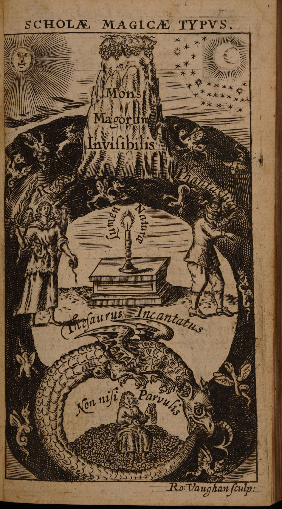

# ルーメン・デ・ルーミネ

トマス・ヴォーン（エウゲニウス・フィラレテス）著／全訳

- 原題：Lumen de Lumine: or A new Magicall Light discovered, and Communicated to the World
- 著者：Thomas Vaughan（トマス・ヴォーン、1621〜1666年）。ウェールズ生まれの錬金術師・ヘルメス哲学者で、イングランド国教会の司祭。エウゲニウス・フィラレテスの筆名で著作を出した。形而上詩人ヘンリー・ヴォーンの双子の弟
- 初版：London, H. Blunden, 1651年
- 作業の基にした本文：初版の Text Creation Partnership（EEBO-TCP）による電子テキスト（A64767、CC0）。扉絵の図版は、ウェルカム・コレクション所蔵の初版本のスキャン（パブリックドメイン）による
- 著作権：原著は1651年刊で、日本・英国・米国で保護期間が満了している
- 訳者：人工知能（Claude Opus 5.5）
- 訳の性格：全訳（扉・献辞・ボドリーへの詩・読者への序・本論・魔術の箴言。要約・省略なし）。ただし、ヴォーンがラテン語原文と自分の英訳とを並べて掲げている引用（薔薇十字団の書簡など）は、英訳のほうだけを訳した。訳者の調べたかぎりでは、日本語訳は出ていない。聖書などの引用は、既存の日本語訳を用いず、原著の英文から訳した。小見出しの一部は訳者が付けた。電子テキストで欠けている文字は、文脈から補うか〔欠〕と示した

## この本について

　『ルーメン・デ・ルーミネ』（光からの光）は、トマス・ヴォーンが1650年に出した三冊の著作に続く第四作で、著者自身が「前の著作への唯一の鍵」と呼んだ書物である。母校オクスフォード大学への献辞と、ボドリアン図書館の創設者トマス・ボドリーをたたえるラテン語の詩、論敵との中傷合戦（当時ヴォーンはケンブリッジの哲学者ヘンリー・モアと激しい論争をしていた）に疲れた心境を語る序に続いて、本論は幻想的な夢物語として始まる。夜明けにまどろんだヴォーンは、暗い森で緑の衣をまとった美しい女性タリア――自然の化身――に出会い、彼女に導かれて「月の山々」の音のない滝、すなわち第一質料の流れを見、さらに地下の「魔術の学校」へと入っていく。

　後半は、タリアから授かった「魔術の学校の図」の解きあかしと、薔薇十字団の名で出まわった「見えない魔術の山」の書簡の英訳、そして第一質料、哲学の火、真珠の川、エーテル、ゾロアスターのプレステル、緑の塩などについての短い論述から成り、最後にラテン語の「魔術の箴言」十二か条が置かれている。17世紀の錬金術の書物として、夢物語と寓意図と教説とが一体になった、たいへん美しい一冊である。

## 目次

- 扉
- 献辞
- ボドリーへの詩
- 読者へ
- ルーメン・デ・ルーミネ（夢の始まり／緑の衣の貴婦人タリア／月の山々と第一質料の滝／魔術の学校の入口／タリアの最後の言葉／学問の一致／天の印章の魔術／魔術の学校の図）
- R・Cの兄弟たちの書簡／空想の領域／自然の光／守護の天使と魔法をかけられた宝
- 第一質料
- 哲学の火
- 真珠の川／エーテル／天の月／星の魂
- ゾロアスターのプレステル／緑の塩／魔術の香／再生、上昇、栄化／下降と転生／結び
- エウゲニウスの魔術の箴言

---

## 扉

　ルーメン・デ・ルーミネ
　あるいは
　新しい魔術の光、見いだされ、世に伝えられる

　エウゲニウス・フィラレテス著

　創世記一章三節　神は言われた、光あれ。
　ヨハネによる福音書一章五節　光は闇の中に輝いている。

　ピュタゴラス　光なしに神について語るなかれ。

　ロンドン、コーンヒルの城の看板のH・ブランデンのために印刷、一六五一年

## 献辞

　わが親愛なる母、最も名高いオクスフォード大学へ。

　（最も親愛なる母よ）私はあなたの息子たちの大部分に、名声と恩知らずとの気質を見てきました。まことに彼らは学問をもっていますが、それを与えた乳房を忘れています。あなたのよいわざは、一人のサマリア人にも出会いません。それでもあなたは多くの者を無知のらい病から癒してきたのです。これこそがわれわれの完全さを汚すしみです。われわれはみなあなたの泉から飲みましたが、その水を井戸にささげることをしません。私としては、浩瀚なものは何ひとつあなたに差しあげることができません。ですが、ここにひと粒のからし種があります。それは草の中で最も大きなものに育つかもしれません。この絵そのものには、ヴェールの下にあるもののほかには、自然の何ものもありません。まことに私は、あなたが彼女を「ヴェールなしに」見られることを願いますが、彼女の顔は、受胎告知の聖母の顔のように、天使の絵筆を待っています。この作品があなたの庇護に値するとは言えません。けれども、恩恵を受けたところに感謝をお返しできるよう、これを私の機会とすることをお許しください。私はこの献辞をイシス川〔テムズ川のオクスフォードでの名〕の岸辺にあてるつもりはありません。もしあなたの石が私の銘を求めるのでないかぎり、あなたはそこに何の分けまえももっていないのですから。私が知ってきたのはあなたの散らばった体であり、私が思いおこすのもそれだけです。それなら、あなたがどこにいようと、その悲しい移転と巡察のうちにあろうと、これを受けとってください。これはサドカイ派でもパリサイ派でもなく、一人のイスラエル人のあかしであり、

　　あなたの嫡出の子のものです。
　　一六五〇年　E・P

## 最も偉大な人、騎士トマス・ボドリー、オクスフォード図書館の壮麗な建設者に

　　聖なる魂よ、そしてそれと同じく聖なる遺灰よ、ごきげんよう。
　　ひとたびは、あなたの灰を思いおこすことが許されるように。
　　天を整える者、星々のいっそう満ちた秩序よ、
　　あなたのおかげで、星々は散らばるままにはならない。
　　あなたは、さまよう書物にさえ、ふさわしく家の神々を与え、
　　星々がそこにすえられる天として、名を馳せている。
　　われわれは父のように、子らに命を分けあたえる。だがあなただけが、
　　その命を生きつづけさせるものをもっている。
　　学芸はここを宿と認める。ここには、産婆の手を経たのち、
　　どんな手も、よそ者としてではなく入ってくる。
　　ガウンの舞台、学識ある世界をおさめる祝祭の場、
　　海、いや、海よりもさらに満ちた波。
　　才能の集まるところ、リュケイオンの最後の目標、
　　もっと聖なる場所でなければ、どんな作品もここへ来るだろう。
　　英雄たちの目録、心の全知の子ら、
　　これは自分自身の感覚で生きている箱である。
　　ボドリーへの大いなる賛辞、葬られた者のより広い骨壺、
　　そこで彼の死は命を見いだし、死は死を見いだした。
　　ここから死は打ち砕かれて逃げ去り、矢を使いはたして、
　　空っぽの矢筒だけがその手を満たした。

　　あなたにふさわしい声はない。ムーサを葬ろうと骨折るあいだに、
　　あなたは、ムーサ自身も語るすべを知らないものを作りあげた。

　あなたを進ませてくれた人々を認めるのは、敬虔なことである。

## 読者へ

　私はこの作品の始末について、いくらか自分自身と争った。その主題が、腐敗していて怒りっぽい時代の気質に反するものだからである。私の望みは、それを家の中にとどめておくことだったが、私の前の論述とそれとのつながりが、それを印刷所へと押しだした。これは私の思いの最後の鏡である。その最初の反映は完全ではなかったので、その像と均整とを完全にするために、これを加えたのである。白状しなければならないが、私にはそうする理由が、論敵たちの与えてくれるもののほかにはない。彼らが真理を押さえつけようとするから、私はそれを推し進めようとするのである。まことに私はひどい報いを受けてきた。だがこの術の成功は、それへの反対から育つ。そしてこれを、近ごろの中傷文書の書き手たちは見てとったのだと思う。彼らは学問を捨てて、それを奉じる者たちを押しつぶそうとしているからである。

　われわれの書いたものをけなし、ゆがめて解釈するだけでは十分ではないのだ。練りあげた中傷で、彼らはわれわれの人格をおとしめる。一度も見たことがなく、おそらくこれからも見ることのないわれわれをである。彼らはわれわれを、自分の気性をこえた苦々しさへと追いこみ、まるで悪魔と同じもくろみを進めているかのように、人々を罪へとそそのかす。

　私としては、こうした無作法な論争によって、もうこれ以上自分の魂を危険にさらすまい。私は、自分のあらゆるむだな言葉について申しひらきをしなければならないことを知っている。この主題は私の激情を節制へと戻した。これからは耐えることに決めたのである。というのも、神は忍耐のゆえに人を断罪することはないということを、私は確信しているからである。

　まことに世間は、真理がその平和をともなっているからといって、真理がくつがえされたと思うかもしれない。たいていの人の判断では、騒音のないところに勝利はないのだから。私はこれを少しも不利とは見なさない。こうした批評家たちの評価は、天秤を軽くするだけであろう。真理が彼らより重いために沈むのだと思うなら、彼らはきわめて弱い頭の持ち主だと考えてよいだろう。

　嵐のような叫び声について言えば、それに動機が欠けているとき、それは不信心な霊、キリスト・イエスよりもハリケーンを多くもった霊をあらわしている。神は、ホレブで岩を粉々に裂いた風の中にも、地震や火の中にもいなかった。神は「かすかな風の中に」、静かな、細い声の中にいたのである。

　私の忠告は、誰も世間の怒りに腹をたててはならない、ということである。神の真理を書く者は、真理そのものと同じ保護者をもつ。そして世界が普遍の法廷にしたがうとき、彼らが自分の裁き手を見いだすところで、彼は自分の弁護者を見いだすだろう。神とその僕たちとのあいだには、互いのあかしがある。洗礼者がキリストについてあかしをしたなら、キリストもまた洗礼者のために同じことをした。「彼は燃えて輝くともし火であった」。

　読者よ、私がこのことを序として述べるのがふさわしいと思ったのは、もしこれから私の論述が中傷されることがあっても、あなたが私の弁明を期待しないようにするためである。私は自分の争いを自然の神にゆだねた。それは神の真理にかかわることがらに含まれている。私はよい良心の平和とあかしとで満足している。私は、神が私の目の前で個別に確かめ、世の前で一般に正しいと示すことのできるもののほかは、何も書いていない。私は神の秘密の光を知っている。神のともし火が私の教師である。私は、神のまさにその光の下で、その栄光の輝く円周の中で見たことをあかししているのである。

　私がはじめて自分の思いを紙に書いたとき、神が私の証人となってくださるが、それは何か私的な目的のためではなかった。私は自然の神秘と威厳への強い感嘆に引かれ、押されて、そうしたのである。私のもくろみは、真理をたたえ、そして、もし彼らにそれを受けとる力があったなら、いくらか時代に仕えることであった。だが、私が何の落ち度もないのに出会った野蛮な侮辱が、私の慈愛を家にとどまらせた。まことに、もし私の平和が奪われなかったなら、この世代がほかの筆からは受けとらないだろうと確信するいくつかのことを、私は分けあたえたことだろう。だが時代は、この点で摂理と歩調をあわせていない。発見の年はまだ来ていないのである。この真理は、大洪水の中の鳩のように、風と嵐の中を舞い、大波とうねりを見おろし、足の裏を置くところを見いださないにちがいない。だが賢い神は彼女のために備えをしてくださる。これらすべての波と水の上に、彼女には帰ることのできる小さな箱舟がある。私には、窓辺にいる彼女が見えるような気がする。すっかり濡れて、風雨にさらされて。彼女は外でこばまれてきた。いま私は彼女を家に迎えいれよう。オリーブの枝をもって、お入り。

　結びとして、この論述は私の最後のものであり、私の最初のものへの唯一の鍵である。私が前に書いたものは、アラビア人のハリカリのようなもので、それは「封じられた家」、閉ざされた家である。だがここで、私はあなたがたにその錠の鍵を与える。もし入るなら、見たものを心の中に封じよ。それを舌にゆだねてはならない。舌は飛ぶ巻物なのだから。こうして私は自分の光をあなたがたの手に渡すが、あなたがたがどんな返礼をしてくれるかは知らない。もし平和を望むなら、平和があなたがたとともにあるように。もし戦いを望むなら、私もそうであったことがある。だが、「鎧を着ける者は、それを脱ぐ者のように誇ってはならない」。よく行い、さようなら。

　　一六五一年　E・P

## ルーメン・デ・ルーミネ

### 夢の始まり――月桂樹の森

　　いまや夜はその黒い舞台を終え、そのすべての
　　美しい、またたく炎は病み、青ざめていった。
　　影と静けさの彼女の場面は逃げ去り、昼が
　　若い東を薔薇で装った。そこでは一筋ごとの光が
　　黒貂の毛皮の上に落ち、太陽と夜とを
　　雲と光との入りまじった市松模様の中で口づけさせた。

　この平俗な、低い言いまわしで自分を言いあらわすほうが、もっと平明で、ある人々の能力にはもっと好ましいだろうと思う。それは夜明けか日の出のころであった。長い孤独と、それにつきそう物思いに疲れはて、多くの損失とそれ以上の骨折りのあとで、私は不意に眠りに落ちた。こうして、昼は生まれるやいなや絞め殺された。私は、前に過ごした夜よりもさらに深い色の夜へと連れもどされた。私の空想は私を、言いあらわしようのない暗さの、そして私の思うところでは自然をこえた領域に置いた。だが、何の恐ろしさもなかった。私はしっかりとした、おだやかな気分でおり、何の励ましもなかったが、決然としていただけでなく、満ちたりていた。私は発見を求めてあらゆる方向に動いたが、いつも闇と沈黙とにもてなされるばかりで、自分が荒廃の地へ移されたのだと思った。こうしてむなしく悩み、長い努力に疲れて、私は休むことに決めた。そして、自分が何も見いだせないのを見て、何かが私を見いだすことができるならと待った。この気分でいくらもたたないうちに、私に向かって旅してくるやわらかな風のささやきが聞こえ、それは不意に木々の葉の中に入った。それで私は、自分がどこかの森か荒野にいるのだと結論した。このおだやかな息とともに、きわめて天上的な、香りのよい空気がやってきた。それは甘い野茨の香りによく似ていたが、それほど強くも濃くもなかった。この香りが吹きすぎると、花々のあいだで蜂が心地よくぶんぶんいう音が続いた。これには私はいくらか落ちつきを失った。暗く真夜中のようなこの場所の様子に、それはふさわしくないと判断したからである。

　さて、私がこうした思いがけない出来事にいくらかとまどっていると、新しいあらわれが私の不安をそらした。右手の遠くないところに、白い、弱い光が見えたのである。それはろうそくの光ほど澄んではおらず、霧がかっていて、大気によく似ていた。中心のほうでは、それはエリュシオンの陽光のような紫色であったが、円周のひろがりにおいては乳白色であった。そして部分のあわせての色あいを考えるなら、それは描かれた夕べであり、昔のローマ人が「死者の太陽」と呼んだあの輝きの姿であった。私がこの不思議な光景に心を奪われているあいだに、まん中の紫の色の中に不意に動きがあらわれ、そのまさに中心から、いわばろうそくの炎のような、花のような光が芽ぶいた。それはきわめて明るく、明けの明星のようにきらめき、またたいていた。この新しい惑星の光は、小さなかせや小川となって出てきて、銀の糸のように見えた。それが木々に照りかえると、めずらしい緑の木かげがあらわれ、私は自分が月桂樹の林の中にいるのを見いだした。枝の組みあわせはきわめて整い、葉はきわめて濃く、そろいあった順序にならんでいたので、それは森ではなく建物であった。まことに私はそれを、自然がその教えに規律をあわせた自然の神殿だと考えた。この木かげと仕切りの下には、多くのナイチンゲールが宿っていた。私はそれを、その白っぽい胸で見わけた。それらは葉の小部屋からのぞいて、この不思議な光を喜び、まず羽をととのえてから、その音楽で静かな空気をゆりうごかした。これはたいへんかわいらしいと思った。夜の静けさが場所のさびしさとあいまって、私にそれを天上のものと判断させたからである。近くも遠くも地面は心地よい市松模様を見せていた。この新しい星が露のしずくに出会って、まるで地がダイヤモンドで敷きつめられているかのように、たくさんの明るい屈折を生んだからである。

### 緑の衣の貴婦人タリア

　こうしためずらしい、さまざまな出来事が私の魂を忙しくさせていたが、まるで私の見たものを調べることがゆるされないかのように、私の思いをさえぎるために、もっと感嘆すべきもうひとつのものが割って入った。私と光とのあいだに、きわめて精妙な、神々しい美しさが見えたのである。その体つきは長くも短くもなく、中ほどの品のよい背たけであった。彼女は薄いゆったりとした絹をまとっていたが、それはあまりに緑で、私はそのようなものを見たことがなかった。その色は地上のものではなかったからである。ところどころ白と銀のリボンで飾られていて、それは草の野の中の百合のように見えた。彼女の頭は、薄くただよう紗でおおわれ、彼女はそれを片手で持ちあげて、いわばその下からのぞいていた。彼女の目はすばやく、みずみずしく、天上的であったが、まるで思いがけない出来事にとまどったかのような、何かはっとしたところがあった。その黒いヴェールから彼女の巻き毛がこぼれでて、霧からさしでる陽の光のようであった。それは乱れて胸まで流れ、それから金の巻き毛と輪とになって頬へと戻っていた。うしろの髪はめずらしい球に巻きあげられ、小さな短い尖りがついていて、紫と空色の結び目で花のように飾られていた。その指輪は純粋な、傷のないエメラルドであった。彼女は金属を重んじなかったからである。そして耳飾りは燃えるざくろ石であった。手短に言えば、彼女の装いはすべて若々しく、花やかで、東方の香りがし、豊かなアラビアの香り粉で十分に香をたきしめられていた。これが、そしてほかならぬこれが、そのときの彼女のあらわれであった。

　だが、私が彼女の完全さに感嘆し、言葉をかけようと身がまえているあいだに、彼女は自分から近づいてきて私の機先を制した。ここでまことに私は、彼女から何か話があるものと期待したが、彼女はたいへんまじめに黙って私の顔を見つめ、私の手をとって、ついてくるようにと静かにささやいた。これは、白状すると奇妙に聞こえたが、これほど甘やかな命令に、それも、多くを約束しながら、私の考えではそれ以上をなしとげることのできる人の命令にしたがうのは、悪いことではないと思った。私が前に感嘆したあの光は、いまついに彼女のお供であることがわかった。それは先ぶれのように彼女の前を動いていったからである。この奉仕は彼女の栄光を大いに増し、私のただひとつの心くばりは彼女を見守ることであった。彼女はさまよいはしなかったが、まことに知られたどんな道もたどらなかった。彼女の歩む道は緑で、細かい短い草が毛皮のように敷かれていた。その草はきわめてやわらかく、ビロードのような手ざわりであった。そして道すがら、ひな菊とさくら草とで縁どられていた。

### 月の山々と第一質料の滝

　われわれが木立と月桂樹の中庭から出ると、空気の中に不思議な明るさが見えた。それは昼のようではなかったが、夜であったと断言することもできない。まことに星々はわれわれの上にとまって、いわば高い丘の頂の上にまたたきながら立っていた。われわれはきわめて深い底におり、地がわれわれを見おろしていたので、私はわれわれが中心の近くにいるのだと考えた。あまり遠くまで歩かないうちに、私はある濃い白い雲を見つけた。私にはそう見えたのである。それはわれわれの前の谷のその部分をすっかり満たしていた。これはまことに私のまちがいであったが、長くは続かなかった。近づいてみると、それは堅いしっかりとした岩であったが、ダイヤモンドのように輝き、きらめいていたのである。このめずらしいりっぱな眺めは、私を少なからず勇気づけた。そして私は、わが女主人（いまや私は彼女をそう見なしていた）が語るのを聞きたいと強く望んだ。できることなら、何かの知らせを受けるためである。どうやってそれを実現すればよいのか、私にはよくわからなかった。彼女は話をいやがっているように見えたからである。だが、彼女のじゃまをしようと心に決めて、私は、その名を教えてくださいませんかと彼女に尋ねた。これに彼女は、まるでずっと前から私を知っていたかのように、たいへん親しげに答えた。

　「エウゲニウス（と彼女は言った）、わたしには多くの名があるが、いちばんよく、いちばんいとしい名はタリアです。わたしはいつも緑で、けっしてしおれることがないのだから。おまえはここに月の山々を見ているのです。そしてわたしはおまえにナイル川の源を見せましょう。彼女はこの見えない岩から湧きでているのだから。見あげて、これらの塩の柱と崖のまさに頂をよく見なさい。それこそが、まことの、哲学の、月の山々なのです。おまえはこれほど奇蹟的な、信じがたいものを見たことがありますか」。

　この言葉に、私はすぐにあのきらめく塩の小塔を見あげた。そこには驚くべき大滝すなわち瀑布が見えた。その流れは、水の満ちたどんな川よりも大きかったが、その落ちる高さと激しさにもかかわらず、何の音もなく落ちてきた。水はあの塩の岩に打ちつけられ、その流れは乱されていたが、それでもまったくの沈黙のうちに、静かなやわらかな空気のように降りてきた。この液体のいくらかを（それは私のそばを流れていたので）、私はすくいあげてみた。このように雪のように忍び降りてくる、毛織物のような不思議な実体が何であるかを見るためである。手の中にそれをとってみると、それはふつうの水ではなく、水のような気質をもったある種の油であった。それはねばねばした、脂っぽい、鉱物的な本性のもので、真珠のように輝き、水晶のように透きとおっていた。それをよく眺め、調べてみると、いくらか精液のように見え、まことに目にもみだらであったが、手ざわりにはなおさらそうであった。

　そこでタリアは、それが第一質料であり、大いなる世界のまさに自然な、まことの精子なのだと私に告げた。「それは（と彼女は言った）目に見えません。それゆえそれを見いだす者は少なく、多くの者はそれは見いだせないものだと信じています。まことに彼らは、世界が死んだ形だと信じているのです。かつてそこに住んだ霊によって造られ、形づくられた体のように、霊がそれを見すてたあとも、しばらくはそのまさに形と姿とをたもっている体のように。彼らはむしろ、魂が去ったときには、どんな組みたても崩れ、もはや前の形をたもつことができないことを考えるべきです。部分を結びあわせ、たもっていた作用者が去ったのだから。それなら、わたし自身の弟子の一人からかつて聞いたあの言葉は、まことにすぐれています。

　　この世界は（と彼は言う）これほどさまざまな、相反する部分から成っているのだから、もしそれほどちがうものを結びあわせる一者がいなかったなら、けっしてひとつのものにはならなかっただろう。だが、結びあわされたのちも、もし自分が結んだものをたもっている一者がいなかったなら、結ばれた本性のまさにそのちがいが、互いに争って、それらをばらばらにし、引き裂いてしまっただろう。まことに、もしこれらの運動の多様さを、自分は動かずに配置し、整える一者がいなかったなら、自然の秩序はこれほど確かに進むことはできず、さまざまな場所、時、効果、性質において、これほど規則正しく動くこともできなかっただろう。世界がそれによって保たれ、治められているこのものを、それが何であれ、私はすべての人の慣れた名で、神と呼ぶ。

　それゆえ、エウゲニウス（と彼女は言った）、すべての組成は、能動的な、英知ある命によって造られることを理解しなければなりません。大いなる世界の組みたてにおいて一般になされたことは、すべての被造物とその精子の生成において個別になされるのだから。おまえも知っていると思うが、水は何かの器の中にでなければ入れておくことができません。神が水のために定めた自然の器は地です。地の中で水は濃くされ、形をあたえられることができますが、それ自身では、地なしでは、水は定まらない流れをもち、どんな確かな形にもしたがいません。空気もまた、はかない定まらない実体ですが、水がその器です。水が地によって形をあたえられると、空気もまた水の中で濃くされ、形をあたえられるのだから。さらに上へ昇るなら、空気は液状の火を固め、体をあたえられた火は薄い光を包み、閉じこめます。これが、神が元素を結びあわせて精子に合成する手段です。地が水の気質を変え、それをねばねばした、ぬるぬるしたものにするのだから。何か魔術的な、並はずれた効果を生みだそうとする者は、そうした水を探さなければなりません。この精子の水は、ほんのわずかな熱で固まるので、自然はそれを煮て硬くし、金属にするのだから。卵の白身が火を感じるやいなや濃くなるのは、おまえも見るとおりです。その湿りは純粋な精妙な地と混ぜあわされており、この精妙な、命をふきこまれた地が、その水を結びつけるのです。それなら、わたしのエウゲニウス、月の山々から水をとりなさい。それは水であって水でない。それを自然の火で、白と赤の二重の地になるまで煮なさい。それから、それらの地を火の空気と空気の火とで養いなさい。そうすれば、おまえは魔術の二つの光体を得るでしょう。だが、おまえは長いあいだわたしの僕であり、その忍耐がおまえの愛のまことを示したのだから、わたしはおまえをわたしの学校へ連れていき、そこで世間が受けとる力をもたないものを見せましょう」。

### 魔術の学校の入口

　こう言いおわるやいなや、彼女はあのダイヤモンドのような岩塩のそばを通りすぎ、私を、ちょうど完全な立方体に形づくられた金剛石の岩へと連れていった。それは火のピラミッド、純粋な紅榴石の三角錐の台座であって、そのとじこめられた炎は天へと身をのばし、あがいていた。この岩の正面すなわち額の部分には、小さな門がとりつけられており、そこに一枚の板がかかっていた。それは描かれた針鼠で、袋の中に巻かれ包まれていて、たやすくはほどけないようになっていた。その上には一匹の犬が歯をむいて立ち、そのすぐそばにこの教えがあった。

　　「やさしくするか、刺すか」

### 訳注

- 『ルーメン・デ・ルーミネ』（光からの光）の題は、ニカイア信条の「光からの光」による。
- 「光なしに神について語るなかれ」は、ピュタゴラスの格言として伝わるもの。
- 献辞の「からし種」はマタイによる福音書13章32節、「サマリア人」と「らい病」はルカによる福音書17章11〜19節（癒された十人のうち感謝しに戻ったのは一人のサマリア人だけだった話）による。
- 「あなたの散らばった体」「悲しい移転と巡察」は、内戦と1648年の議会派による大学の「巡察」で、多くの王党派の学者がオクスフォードを追われたことを指す。ヴォーン自身もオクスフォードのジーザス・カレッジのフェローであったが、王党派として職を失った。
- トマス・ボドリー（1545〜1613年）は、オクスフォードのボドリアン図書館を再建した外交官。ラテン語の詩は電子テキストで欠けている文字があるため、補って訳した。「リュケイオン」はアリストテレスの学園。
- 「あらゆるむだな言葉について申しひらき」はマタイによる福音書12章36節、「かすかな風の中に」は列王記上19章11〜12節、「燃えて輝くともし火」はヨハネによる福音書5章35節、大洪水の中の鳩は創世記8章8〜11節、「鎧を着ける者は……」は列王記上20章11節による。
- 「アラビア人のハリカリ」は、アラビアの錬金術書の名とされるが、詳しいことはわからない。「封じられた家」（Domus signata）もその書の言葉と考えられる。
- 「飛ぶ巻物」は、ゼカリヤ書5章1〜2節による。
- 「死者の太陽」には、欄外に「ボクスホルンはこの観念を誤って解釈している」とある。ボクスホルン（1612〜1653年）はオランダの学者。
- タリアは、ギリシア語で「花咲く」を意味し、ムーサの一人（喜劇と牧歌）の名、また三美神の一人の名でもある。
- 「月の山々」は、古代の地理学でナイル川の源とされた伝説の山脈で、ここでは錬金術の比喩に用いている。
- 「わたし自身の弟子の一人」の言葉は、ボエティウス『哲学の慰め』第3巻散文12による。
- 「魔術の二つの光体」は、錬金術の太陽と月、すなわち赤と白の石を指す。

われわれは中に入った。岩の中に入ると、その内部は天上のエメラルド色をしていた。ところどころ純金の箔のように輝き、それから言いあらわしようのない第三の紫の色があらわれた。あまり遠くまで行かないうちに、われわれは古い威厳ある祭壇のところに来た。その供物台、すなわちいちばん上には、根こそぎ引き抜かれた古い朽ちた木の幹がかたどられていた。そこから、白と緑の色をした一匹の蛇が這いでていた。蝸牛のように動きがのろく、たいへん弱々しかった。それを見おろす太陽を感じたばかりだったからである。この祭壇の足もと、すなわち台座のほうには、古いエジプトのヒエログリフで書かれた銘があり、タリアがそれを解きあかした。それはこうである。

　　祝福された神々に。
　　地下の天において。
　　N・L
　　〔一語欠〕

　この場所から、われわれはまっすぐ前へと進み、土の洞窟に着いた。それはたいへん暗く、そのうえじめじめしていて、墓のような重い臭いを発していた。ここにわれわれは長くはとどまらず、この墓地を通りすぎて、ついに聖所に着いた。そこでタリアは私のほうを向いて、短い、最後の言葉を語った。

### タリアの最後の言葉

　「エウゲニウス、ここは多くの者が見たいと望みながら、見なかった場所です。ここに入ることをゆるされるための備えが、彼らには欠けていたのです。彼らはわたしを愛したのではなく、わたしのものを愛したのです。まことに彼らは自然の富をむさぼりましたが、自然そのものはなおざりにし、腐らせました。もし彼らがその機会を学んでさえいたなら、攻めるという点ではいくらか有利なところもあったのです。わたしは彼らの手にさらされていましたが、彼らはわたしを知りませんでした。わたしはいくらか彼らの暴力にしたがう身でしたが、わたしを造った方が、わたしが荒らされるのをゆるしませんでした。ひと言で言えば、この人々の破滅は、その気質の上に建てられていたのです。わたしに言いよるとき、彼らは、ある人々が廷臣と呼ぶあのあわれな者たちに似ていました。彼らは、まるで猿のあいだで仕込まれたかのような、おどけたしぐさと大言壮語とをもっています。彼らは（ある人がうまく言いあらわしたように）数学的な比例で足をひいてお辞儀をし、奇妙な足つきと顔つきをし、同じ詩人の言いまわしで言えば、

　　魔法の呪文によるかのように口をゆがめ、
　　楕円に、四角に、三角にする。

　そのように、この厚かましいへりくつ屋たちは、虚栄の気分でわたしを襲いました。わたしが彼らの心の中をのぞくと、そこにはわたしのための場所はありませんでした。それは高慢な思いでいっぱいで、わたしの費用と宝によって保たれなければならない、ある放埒な幸福を夢みていました。そのあいだ、彼らはわたしが素朴で単純な者、騒音を好まず、ひそやかな甘い満足を愛する者だということを考えませんでした。エウゲニウス、わたしはおまえがわたしの気質によく似ていることを見いだしました。そのうえ、おまえの期待が忍耐づよいことも見いだしました。おまえは、自分の信仰に理由があるところでは、たやすく信じることができます。おまえはこのあいだずっと、報酬なしに仕えてきました。いま、おまえに報いるときが来たのです。わたしの愛を、わたしは惜しみなくおまえに与えます。そしてそれとともに、これらのしるし、わたしの鍵と封印とを与えます。一方は開け、他方は閉じます。両方を必ず分別をもって用いなさい。わたしのこの学校の秘儀について言えば、おまえはそれをみな調べる自由をもっています。ここには、わたしが喜んでおまえに明かさないものは何ひとつありません。わたしはおまえにひとつの教えをゆだねます。それはこうです。おまえは黙っていなければなりません。書くものの中で、わたしのゆるすところをこえてはなりません。わたしがおまえの恋人であることを思いおこしなさい。そうすれば、おまえはわたしを娼婦にはしないでしょう。だが、おまえがおまえと同じ気質の人々の役に立つことを願うので、ここでわたしの聖所の象徴の図をおまえに与え、それを公にする十分な特権を与えます。これがすべてです。いまわたしはあの見えない領域へと行きます。『去る者は日々にうとし』ということわざが、おまえにあてはまらないように。わたしを思いおこし、幸いでありなさい」。

　これが彼女の教えであった。それを言いおわるやいなや、彼女は私を澄んだ大きな光のもとへ連れていき、そこで私は語ってはならないものを見た。こうしてあの輝かしい迷宮のすべての部分を明かしてくれたのち、彼女は太陽の光の糸玉で、つまり私たちの前を輝いて進む彼女の光によって、私をふたたび外へと導いた。ナイルの岩を過ぎると、彼女は私に秘密の階段を示し、われわれはそれによって、あの深い花の谷から、このわれわれのふつうの地の面へと昇った。ここでタリアは無言の儀式のうちに立ちどまった。私はひとりあとに残されることになっていたからである。彼女は黙ったほほえみの中に、かわいらしい悲しみをまじえて私を見つめた。われわれは別れたくなかったのである。だが、彼女の移されるときが来た。そして（私の思うところでは）最後の別れを告げて、彼女は私の目の前を、自然のエーテルの中へと去っていった。

### ふたたびのタリア――学問の一致

　さて、まことに私はたいへん悩み、いくらか取りみだした。だが、できるかぎり気をとりなおして、私は天人花の茂みのところに来て、花の咲く土手にもたれて休みながら、自分の見たものを考えはじめた。この孤独と憂鬱な物思いは長くは続かなかった。それはたいへんうれしい中断に出会ったからである。私には、いわば風景の果てに、いくらか遠くに、昇ったばかりの星を見るように、タリアが見えた。だが一瞬のうちに彼女は天人花の中にいて、私のすぐそばに腰をおろした。そして私は彼女から次の話を受けた。

　「エウゲニウス、おまえに学問の一致と集中とを知らないでいてほしくはありません。世界の過ぎた、もっともの知りだった時代、魔術がもっとよく、もっと広く理解されていたころ、この術を奉じる者たちはそれを三つの部分、すなわち元素の部分、天の部分、霊の部分に分けました。元素の部分は医術のすべての秘密を、天の部分は占星術のそれを、霊の部分は神学のそれを含んでいました。そのどれもが、それだけではただの枝あるいは肢体にすぎませんでしたが、三つすべてが結ばれると、それはこの学問の法典全書でした。さて、おまえのこの時代には、まことの医術や占星術をおまえに示すことのできる者は一人もいません。彼らもまた、舌と書物だけの神学のほかには何ももっていません。そのわけはこうです。時がたつうちに、これら三つの学問（それは互いの本質的な結合なしには何の驚異もなしとげません）は、まちがった解釈によって手足をばらばらにされ、切りはなされ、そのそれぞれがそれ自体でひとつの学部と見なされるようになったのです。神はこれら三つをひとつの自然の主体の中に結びあわせていましたが、人間はそれらを切りはなし、どんな主体の中にでもなく、自分の頭の中に置きました。そこでそれらは言葉と空想の中にとどまり、実体のある元素と真理の中にはとどまりませんでした。この状態で、学問は死んで、効力のないものとなりました。それは切りはなされていたので、騒音のほかに何も生みませんでした。ちょうど、もしおまえが人間の手足をばらばらにして、それから、彼が生きていたときに全体がしたはたらきを、そのどれかひとつの部分がするのを期待するようなものです。

　おまえはまったく自然な経験によって、ひとつの種の根から、葉や花や実や種子のような、いくつものちがう実体が育つことを知っています。そのように、ひとつの普遍の根、すなわち混沌から、すべての種の本性とその個体とが育つのです。さて、まことの学問あるいは知識は、感覚でとらえられる個別の実体の上に、あるいはすべての個別のものがそれから造られる、あの感覚でとらえられる普遍の実体の上にうちたてられたもののほかにはありません。抽象における普遍について言えば、そんなものはありません。それは空っぽの想像上の気まぐれにすぎず、抽象はそれだけの数の空想上の仮定にすぎないのだから。さて、エウゲニウス、すべての個体は、人間そのものでさえ、物質的な普遍の本性から受けとったもののほかには、質料として何ももっていないことを考えなさい。また、同じ個体がその最初の自然学的な普遍の質料へと戻されうること、したがってこの普遍の質料が、自分のうちにすべての個別のものの秘密と秘儀とをもっていることを考えなさい。主体そのものを含むものは、その主体の学問をも含むのだから。結びとして、第一質料においては、神の知恵はひとつの一般的な混沌の中心に集められていますが、第一質料から造られた個別のものにおいては、それは散らばり、いわば円周へとひろげられています。それなら残るのは、混沌がすべての学問の中心であり、すべての学問はそこへと戻されることができ、また戻されるべきだということです。それは感覚でとらえられる自然の『大いなる秘儀』であり、神のもとでの第二の知恵の神殿なのだから。それゆえ、わたしが鉱物の領域でおまえとともにいたときに受けた規則と教えによって、この混沌の部分を探り、調べなさい。実践にばかりとどまってはなりません。それはそれを向上させる道ではないのだから。経験に必ず理性を加え、手と同じように心も用いなさい。すべての原因とその結果とを知るよう骨折りなさい。自分を化学者と呼びながら、実は哲学者ではない、あの焼いたり炒めたりする連中のように、処方だけを学んではなりません。

### 天の印章の魔術

　これが、わたしの前の処方につけ加えるのがふさわしいと思うことのすべてです。だが、わたしを戻ってこさせたのは別のことで、いまおまえはそれを受けとるでしょう。おまえはときおり、魔術の『ベリルの部分』について聞いたことがあると思います。わたしをよく理解するよう気をつけなさい。そうすれば、その土台を示しましょう。星々は、完全な、できあがった体には何の新しい流れこみも刻むことができないことを知らなければなりません。星々はただ、前に刻まれた流れこみを整え、いくらかかきたてるだけです。エウゲニウス、受け手の中に前もって何かの腐敗と変化がなければ、どんな星の投げこみも起こらないことは、きわめて確かです。自然は、ゆるんだ、湿った、崩れた元素の中でなければはたらかないのだから。この乱れは星々から出るのではなく、元素どうしの相反から出るのです。元素が仲たがいして、自分自身の溶解をひきおこすときはいつでも、天の火が割って入ってそれらをふたたび和解させ、古い形がもはやもちこたえられないのを見て、何か新しい形を生みだすのです。それなら、刻印のまことの時は、原理が精子の状態にあって羽毛も生えそろっていないときであり、いったん完全な体へと固まってしまえば、星の力を受けるときは過ぎているということに注意しなさい。さて、古のマギはその書物の中で、決まった時刻に用いると信じがたい並はずれた効果を生む、奇妙な占星術のランプや像、指輪、板について語っています。ふつうの占星術師は、石か何かの金属のかけらをとり、それにばかげた文字を刻み、それから、正しいアルケムシ〔天の影響を受けさせる場〕においてではなく、自分が夢みるとおりに、どうしてだかも知らずに、それを惑星にさらします。これがなされても、すべてはむだです。だが、彼らは実践において失敗しても、自分がマギの書物を十分に理解していると信じているのです。さて、エウゲニウス、おまえが何をすべきかを知るように、例によって教えましょう。熟した、硬い、乾いた穀物の粒をひとつとり、それをガラス器か何かほかの器の中で太陽の光にさらしなさい。それはいつまでも乾いた粒のままでしょう。だが、もしそれを地に埋めて、その元素の硝石のような塩気のある湿りがそれを溶かすようにするなら、太陽がそれにはたらきかけ、それを芽ぶかせ、新しい体へと伸びださせるでしょう。ふつうの占星術師もちょうどこれと同じです。彼は完全な、固まった体を惑星にさらし、この手段で魔術師のガマアエアをなしとげ、下の世界と上の世界とを結婚させようと考えるのです。それは精子へと戻された体でなければなりません。星の作用者の刻印を受けとり、たもつ天の女性的な湿りが自由になり、自然の男性的な火にじかにさらされるようにするためです。これがベリルの土台です。だが、三つの天の合わせての磁力なしには、何ものも星の力を受けることができないことを思いおこさなければなりません。それが何であるかは、ほかのところでおまえに告げたので、くりかえしでわずらわせはしません」。

　こう言うと、彼女は胸もとから二つの奇蹟のメダルを取りだした。それは金属ではなく、私の見たこともないものであって、自然の中にこれほど純粋で輝かしい実体があるとは思いもしなかった。私の判断では、それは二つの魔術の星の像であったが、彼女はそれを太陽と月のサファイア石と呼んだ。これらの奇蹟を彼女は私が調べるようにとゆだね、眠いのでと言いわけをした。そうでなければ、彼女はそれを私に解きあかしてくれたことだろう。私は眺め、感嘆し、その観想に疲れはてた。その色あいはあまりに天上的で、その工夫はあまりに神秘的で、私にはそれをどう解したらよいかよくわからなかった。彼女がまだ眠っているかどうか見ようと脇を向いたが、彼女はいなくなっていた。そしてこれは私を少なからず悩ませた。私は日がすっかり暮れるまで彼女の帰りを待ったが、彼女はあらわれなかった。ついに、彼女がしばし休んだその場所に目をすえると、彼女が残していったいくつかの金貨と、そのすぐそばに手紙のように折りたたまれた一枚の紙とが見つかった。私はそれらを拾いあげた。そしていまや夜が近づき、宵の明星が西に輝きはじめたので、彼女の花の枕を最後に見わたして、この詩とともにそこを離れた。

　　かわいい緑の土手よ、さようなら。どうか一年じゅう
　　陽の光と薔薇と百合とを身にまとっていておくれ。
　　彼女はおまえの上で眠った。だが金を落としていく
　　必要はなかった。彼女の寝床となるだけで十分な報いだった。
　　花々はお気に入りだ。この愛された日に
　　花々はわたしの恋敵となり、彼女とたわむれたのだから。
　　花々は天をすぐそばに見いだし、彼女の目の中に
　　そこにない空の写しを楽しんだ。
　　そのかよわい色どりはまことの栄光と取りひきをし、
　　彼女の頬とまじりあって、ひとつの花束となった。
　　もし彼女のやわらかな肌が花々の高慢を押しとどめず、
　　絹の仕切りで二つの花を分けていなかったなら、
　　花々はそこから命を吸い、その熱から
　　自分を完全にする魂を借りたことだろう。
　　おお幸いな枕よ。おまえは塵と同じ高さに
　　横たえられているけれど、彼女はおまえをほとんど天にした。
　　彼女の息は香料を降らせ、その輝く髪の
　　琥珀の輪のひとつひとつが、おまえの泉の上に腕輪をまいた。
　　その地は貧しくはない。そのような宝をいだいたのだから。
　　琥珀と香料と金とで、三重に富まされたのだから。

### 魔術の学校の図（スコラエ・マギカエ・テュプス）

　（図の中の文字――上から「魔術師たちの見えない山」、左右の帯に「空想の領域」、ろうそくのまわりに「自然の光」、その下に「魔法をかけられた宝」、竜の環の中に「幼な子らにのみ」、右下に「ロバート・ヴォーン彫る」）

　これが、タリアが見えないギアナで私に渡した象徴の、魔術の図である。その最初の上の部分は月の山々をあらわしている。哲学者たちはふつうそれをインドの山々と呼び、その頂には彼らの秘密の名高いルナリアが生えている。それは、人々が盲目でさえなければ、たやすく見つけられる草である。それは自分をあらわし、夜になると真珠のように輝くからである。これらの山々の土はたいへん赤く、言いあらわしようもないほどやわらかい。それは水晶の岩に満ちていて、哲学者たちはそれを自分たちのガラス、自分たちの石と呼ぶ。鳥と魚とが（と彼らは言う）それを彼らのもとへ運んでくる。これらの山々について、きわめてすぐれた分別ある著者であるアラビア人ハリが語っている。「わが子よ、インドの山々とその洞穴へ行き、そこからわれわれの尊い石をとってきなさい。それは水とまぜあわされると、水の中で溶ける」。これらの山々については、もしその秘儀を公にすることがゆるされるなら、まことに多くを語ることもできるだろう。だが、ひとつだけは告げずにはおくまい。それは夜のあとにはたいへん危険な場所である。火やほかの奇妙なまぼろしがつきまとっているからである。それは（マギに聞いたところでは）世界の精子とみだらにたわむれ、その中に自分たちの想像を刻みつけ、しばしば空想的な、怪物のような生成をひきおこす、ある霊たちのせいである。この場所への接近と巡礼、そしてそれにともなう困難は、R・Cの兄弟たちによって、忠実に、堂々と描かれている。まことにその言葉はたいへん素朴で、たいていの人にはおそらく見くだされるようなものである。だが、りっぱに語ることは彼らのもくろみの一部ではなかった。彼らの学識は言いまわしにではなく意味にある。そしてそれこそが、私が読者に考えてもらいたいものなのである。

### 訳注

- 祭壇の銘の「N・L」とそのあとの欠けた語は、電子テキストでは判読できない。ウェイト版などでは別の読みが示されている可能性がある。
- 「同じ詩人」の詩句は、ジョン・ダン『風刺詩』第4篇などを思わせるが、出典は確かめられなかった。
- 原文には欄外に「イーリアス第8巻」という注記があり、ゼウスがヘラとアテナに言いわたした言葉にならったものと考えられる。またタリアの言葉の中にギリシア語の句が引かれていたようだが、電子テキストで欠けている。
- 「三つの部分」（元素・天・霊）は、アグリッパ『隠秘哲学』の三巻の構成（自然魔術・天の魔術・儀式魔術）に対応する。
- 「大いなる秘儀」（ミステリウム・マグヌム）は、パラケルススの用語で、万物の第一質料を指す。
- 「ベリルの部分」（ベリリスティカ）は、パラケルスス派の用語で、水晶や鏡を用いた占いや、天の影響を物体に受けさせる魔術を指す。
- 「星の投げこみ」（アストロボリスム）は、星の影響が地上の物体に刻みこまれることを指す、ヴォーンの用語。
- 「アルケムシ」（Alkemusi）と「ガマアエア」（Gamaaea）は、いずれもパラケルススが用いた語で、前者は天の影響を集める場、後者は天の力を刻みこんだ石や護符を指すとされる。
- 「三つの天」は、『アントロポソフィア・テオマギカ』や『アニマ・マギカ・アブスコンディタ』で論じたもの。
- 「見えないギアナ」は、当時ヨーロッパ人が黄金郷エル・ドラドがあると信じた南アメリカのギアナにかけた言い方。
- ルナリアは、錬金術で月の力をもつとされた伝説の草（ギンセンソウなど実在の植物の名でもある）。
- ハリは、アラビアの錬金術の伝承に出てくる人物で、カリド王の師とされる。
- 「スコラエ・マギカエ・テュプス」（魔術の学校の図）は、原著の扉絵として付けられた銅版画。

### R・Cの兄弟たちの書簡――見えない魔術の山と、そこに含まれる宝について

　（原著では、まずこの書簡のラテン語原文が掲げられ、つづくヴォーンの短い注釈のあとに、ヴォーン自身による英訳が置かれている。内容は同じなので、ここではラテン語原文の訳を省き、注釈と英訳を訳す）

　こうして彼らは、われわれに神の山、神秘の哲学のホレブを描いてみせた。それは地の最も高く最も純粋な部分にほかならない。この元素の上の秘密の部分は聖なる地であり、アリストテレスはそのペリパトス派の弟子たちに、「場所が高いほど、それはいっそう神的である」と告げている。それは永遠の本性の苗床、天のじかの器であり受け器であって、そこにすべての鉱物と植物とが根をもち、それによって動物の王国が保たれている。この哲学の黒いサトゥルヌスは、星々の見えないメルクリウスを殺し、固める。反対にメルクリウスはサトゥルヌスを殺し、溶かす。そして両者の腐敗から、中心の太陽と円周の太陽とが新しい体を生みだす。そこから哲学者たちは、その石を描いて、それは「黒く、卑しく、悪臭を放つ石であり、世界の起源と呼ばれ、芽ぶくもののように生じる」とわれわれに告げる。兄弟団の書簡について言えば、ふつうの読者を満足させるために、それを英語に移そう。ある博士たちはそれを何の得にもならないと思うだろうが、そうすれば彼らは自分の無知を白状することになる。私は彼らに請けあうことができる。この主体がこれほどはっきりと明かされているところはほかにない。そして最初の難解な調製について言えば、それに言及した個人の著者は一人もいないが、ここにはそれがまるごと、しかもきわめて忠実に描かれている。たしかに彼らの教えは仮面をかぶり、比喩で語っている。だがそれはたいへん平明で見通しのよいものであり、その英語はこうである。

　「すべての人は生まれつき、まさることを、金銀の宝をもつことを、そして世の目に偉く見えることを望む。まことに神は、人間がそれを用いるようにと万物を創造された。人間がそれを治め、その中に神の比類ないよさと全能とを認め、その恵みを神に感謝し、神を敬い、たたえるためである。だが、ぶらぶらと日を過ごすのでなければ、これらのものを求める者は一人もいない。彼らは前もっての骨折りも危険もなしにそれを楽しもうとし、神がそれをたくわえておかれた場所からそれを探そうともしない。神はまた、人間がそこでそれを探すことを望んでおられ、探す者にはそれを与えてくださるのである。だが、その場所で財産を得ようと骨折る者は一人もいない。それゆえこれらの富は見いだされない。この場所への道と、その場所そのものとは長いあいだ知られず、世界の大部分には隠されてきたからである。だが、この道と場所とを見いだすのは困難で骨の折れることであっても、それでもその場所は探しもとめられるべきである。しかし、ご自分の者たちに何ひとつ隠すことは神のみ心ではない。それゆえ、この最後の時代に、最後の審判が来る前に、これらすべてのことは、ふさわしい者たちに明らかにされるだろう。神ご自身が（ふさわしくない者に明らかにならないよう、暗くではあるが）あるところで、『おおわれているもので、あらわにされないものはなく、隠されているもので、知られないものはない』と語られたとおりである。それゆえわれわれは、神の霊に動かされて、神のみ心を世に告げ知らせる。それはわれわれがすでになしとげ、いくつもの言語で公にしたことである。だが、たいていの人々は、われわれのその宣言をののしるか、さげすむかである。さもなければ、神の霊をさしおいて、その申し出をわれわれから期待する。われわれがすぐに彼らに術によって金を作る方法を教えるか、豊かな宝を与えて、彼らが世の前で華やかに暮らし、いばりちらし、戦をし、高利貸しになり、大食らいや大酒飲みになり、みだらに生き、ほかのさまざまな罪でその一生をけがせるようにしてくれるものと思っているのである。これらはみな、神の祝福されたみ心に反することである。この人々は、あの十人のおとめたち（そのうち愚かな五人が、賢い五人にともし火の油を求めた）から、事情がまったくちがうことを学ぶべきであった。誰もが神の助けと自分自身の探求と勤勉とによって、この宝のために骨折ることが肝要なのである。だが、この者たちのゆがんだ意図を、われわれは神の比類ない恵みと啓示とによって、彼ら自身の書いたものから知っている。われわれは耳をふさぎ、いわば雲で身を包む。むなしく金を求めて叫ぶあの人々のうなり声とわめき声とを避けるためである。そしてまことに、そこから、彼らがわれわれに数かぎりない中傷と悪口との烙印を押すということが起こる。だが、われわれはそれを恨みはしない。神がそのよい時に彼らを裁かれるだろう。だが、われわれは（あなたがたには知られずに）あなたがたが聖書を読みとおし、神のまことの知識を求めることにどれほど熱心であるかをよく知り、あなたがたの書いたものによってもすっかり見てとったので、何千もの人々にまさって、あなたがたは何かの返事に値すると考えた。そして神のみ心と、聖霊の勧めとによって、あなたがたにこれだけのことを知らせる。

　地のまん中、すなわち世界の中心に、ひとつの山がある。それは小さくもあり、大きくもある。それはやわらかく、また並はずれて硬く石が多い。それは遠く、また近くにある。だが神の摂理によって、見えない。その中には、世界が値ぶみすることのできない、きわめて豊かな宝が隠されている。この山は、つねに神の栄光と人間の幸福とに逆らう悪魔のねたみによって、きわめて残忍な獣やほかの猛禽にとりかこまれており、それがそこへの道を困難で危険なものにしている。それゆえ、これまでは、時がまだ来ていなかったので、そこへの道は探しもとめることも見いだすこともできなかった。だがいまついに、その道はふさわしい者たちによって見いだされることになる。とはいえ、一人ひとりが自分で骨折り、努めることによってである。

　この山へ、あなたがたは、ある夜（それが来たとき）、きわめて長い、きわめて暗い夜に行かなければならない。祈りによって身を備えるようにせよ。山へ通じる道をひたすら進め。だが、道がどこにあるかを誰にも尋ねてはならない。ただ、あなたがたの案内者についていけ。彼は自分からあなたがたに申し出て、道であなたがたに出会うだろう。だが、あなたがたは彼を見わけないだろう。この案内者は、すべてが静まりかえり暗い真夜中に、あなたがたを山へ連れていくだろう。これから起こることを恐れて退くことのないよう、決然とした英雄的な勇気で身を固めることが必要である。剣も、ほかのどんな肉体の武器もいらない。ただ真心から、心をこめて神を呼べ。山を見いだしたとき、あらわれる最初の奇蹟はこれである。きわめて激しい、きわめて大きな風が、山をゆるがし、岩を粉々に打ち砕くだろう。あなたがたはまた、獅子や竜や、ほかの恐ろしい獣に出会うだろう。だが、そのどれも恐れてはならない。決然としていよ。そして引き返さないよう気をつけよ。あなたがたをそこへ連れてきた案内者は、どんな悪もあなたがたにふりかかるのをゆるさないだろうから。宝について言えば、それはまだあらわにされていないが、すぐ近くにある。この風のあとに地震が来て、風が残したものをくつがえし、すべてを平らにするだろう。だが、落ちないよう気をつけよ。地震が過ぎると、火が続き、地上のがらくたを焼きつくし、宝をあらわにするだろう。だが、まだあなたがたはそれを見ることができない。これらすべてのことのあと、夜明け近くに、大きなしずけさが来て、あなたがたは明けの明星が昇るのを見、あけぼのがあらわれ、大きな宝に気づくだろう。その中で最もおもな、最も完全なものは、ある高められた染料である。もし世が神に仕え、そのような賜物にふさわしいなら、世界はそれによって染められ、最も純粋な金に変えられることができるだろう。

　この染料は、あなたがたの案内者が教えるとおりに用いるなら、年老いたあなたがたを若くし、あなたがたは体のどの部分にも病を感じないだろう。この染料によってまた、想像することもできないほどすぐれた真珠を見いだすだろう。だが、いまの力のゆえに何ひとつ自分のものとして誇ってはならない。案内者があなたがたに分けあたえるもので満足せよ。この賜物のゆえに、たえず神をたたえよ。そしてそれを世俗の高慢のために用いず、世に反するわざのために用いるよう特に気をつけよ。それを正しく用い、もっていないかのようにそれを楽しめ。節度ある生活をし、あらゆる罪に気をつけよ。さもないと、あなたがたの案内者はあなたがたを見すて、あなたがたはこの幸福を奪われるだろう。まことにこのことを知れ。この染料を悪用し、人々の前で模範的に、清く、敬虔に生きない者は、この恵みを失い、のちにそれを取りもどす望みはほとんど残らないだろう」。

### 空想の領域

　これだけのことを、われわれはこの名高い、きわめてキリスト教的な哲学者たちから得ている。彼らは疑いなく、自分たちの分別ある沈黙と孤独とによって、多くを耐えしのんできた人々である。へりくつ屋は誰もが、彼らが世にあらわれないからといって彼らをさげすみ、自分がその一員でないからといって、そんな協会はないと結論する。愚か者が誰も「出てこい」と叫ぶときに、彼らがどんな根拠で身を隠し、舞台に上がらないのかを考えるほど公正な読者は、ほとんどいない。誰も世俗の目的のほかには彼らを求めない。そしてまことに、もし術そのものが金を約束しないなら、それにはほとんど信奉者が見いだされないだろうと私は確信している。神を知るために自然を研究する者が、この世にどれほどいるだろうか。たしかに彼らは、自分の魂のためでも、どんなよい意味で自分の体のためでもなく、自分の財布のための処方を研究している。それなら、彼らがその無知のうちに、その治療についても放っておかれるのはふさわしい。その期待がむなしくなることが彼らを改めさせるかもしれないが、彼らがその気分を続けるかぎり、神もよい人々も彼らを助けはしないだろう。

　この図の下の部分は、多くの奇妙なキマイラと、アリストテレスの〔欠〕、スコラ学者たちのあの形而上の獣とでいっぱいの、暗い円を示している。それは人間の数かぎりない思いあがった気まぐれと、空中をさまよう想像とを意味する。真理に達する前に、われわれは千もの空想や作りごとや思いこみにしたがう。それをわれわれは誤って真理そのものだと思いこみ、しばしば公にそれを真理として差しだすのである。この空想の領域こそが、すべての党派とその不和のまことの、もとからの苗床である。そこから、絶望した懐疑派、放縦なエピクロス派、偽善的なストア派、無神論的なペリパトス派が出てきた。そこからまた、第一質料は火か空気か地か水か、あるいは想像上の原子の群れかという、自然についての彼らのさまざまな剣闘が出てきた。それらはみな偽りの作り話めいた仮定である。もし宗教とその多様さとを見るなら、いまの異端と分裂とは、人々のちがった、誤った思いこみのほかの何から出てきたのか。まことに、われわれが自分の空想にしたがい、底なしの定まらない想像の上に建てるかぎり、われわれは目隠しをされた者のように、さまよい、暗闇の中を手さぐりしなければならない。反対に、もしわれわれが自分の思いに測り糸をあて、それを経験によって調べるなら、われわれは誤りのない者となる道にいる。神がわれわれの導きのために示された規則を、しっかりつかんでいるからである。もしわれわれが自分の構想にばかりとどまり、自然の原理を少しも用いないなら、神が自然を造られたのはむだであったことになる。もしわれわれの思いが自然の道からさまよい出ることができないのなら、それは幸いな必然であろう。だが、たしかに、経験なしにただの観想によって真理を見いだせると考えるのは、太陽から目を閉じて、光の助けなしに、自分が正しい道にいると空想することで、ロンドンからカイロまでまっすぐ旅ができると信じるのと同じくらいの狂気である。たしかに、まずこのキマイラの領域でさまよわずに魔術の学校に入る者はいない。経験による真理に達する前にわれわれが行う探求は、その大部分が誤っているからである。それでも、われわれは自分の探究において、それを確かめることができる前に、それを横柄に世に押しつけ、強いることのないよう、十分に理性的で忍耐づよくあるべきである。

　私はつねにバシリウス・ヴァレンティヌスのあの整った堅実な言葉をよしとしてきた。「それゆえ、わが論客よ、学べ。そしてまず、自然が隠して自分とともにもっている土台を、自分の目と手とで探れ。そうしてはじめて、賢く判断をもって物事を論じ、打ち負かされることのない岩の上に建てることができるだろう。だがこれなしには、あなたはむなしい空想的なおしゃべり屋にとどまり、その言葉は何の経験もなしに、ただ砂の上にうちたてられている。だが、その談話とたわごととで私に何かを教えようとする者は、ただ裸の言葉で私を養うのではなく、経験によってなされた証拠をそれといっしょに差しださなければならない。それなしには、私はその言葉に場所を与え、それを信じる義務はない」。また別のところで、「私は（と彼は言う）自分自身の経験によって語らないおしゃべり屋にはかまわない。その言葉は、盲人の色についての判断と同じようにうちたてられているのだから」。疑いなく、これはみな、物の名ではなく物の本性を研究した、まことの哲学者の息吹であった。私はこれを、スコラ学者たちに対する砲列として向ける。もし彼らがどうしてもその三段論法を召集するというなら、私はまた、彼らがその騒音をその経験によって確かめることを期待する。

### 自然の光

　この空想の円の中には一つのランプが立っており、それは自然の光を象徴している。これは、神が元素の中にともした神の秘密のろうそくである。それは燃えているが、見えない。暗い場所に輝いているからである。すべての自然の物体は一種の黒い角灯であって、このろうそくを自分の中に運んでいるが、その光はあらわれない。それは質料の粗さによっておおい隠されているのである。この光の効果はすべてのものの中に明らかであるが、光そのものは否定されるか、さもなければしたがわれない。大いなる世界は、太陽をその命とろうそくとしてもっている。この火があるかないかにしたがって、世界のすべてのものは栄え、あるいはしおれる。われわれは経験によって、それも自分の体において、命が続くかぎり、たえまない煮熟、われわれの中のある煮え立ち、沸きかえりがあることを知っている。これがわれわれに汗をかかせ、毛穴からたえまなく流れ出させて息をはかせる。そして手を肌にあてれば、自分の熱を感じることができる。それは閉じこめられた火、あるいは光から出ているにちがいない。すべての植物は育ち、大きくなり、実と花とを出す。もし何かの熱が質料をかきたて、変えるのでなければ、それはありえないだろう。そのうえ、植物においては、この光がときに目にあらわれることもわかる。朽ちた木において、夜のあとで星の火が輝くようにである。鉱物について言えば、その第一質料はこの火の霊によって固められ、ひとつの気質からほかの気質へと変えられる。これにつけ加えて、明らかにするために、次の真理を述べてもよい。もし鉱物の原理が術によって溶かされ、その火と霊とが自由になるなら、金属でさえ植物のようにすることができる。この火すなわち光は、アラビア人がハリカリと呼ぶあの主体の中にほど、豊かに純粋に見いだされるところはどこにもない。その名は「ハリ」すなわち至高と、「カロプ」すなわち善とから来ているが、ラテンの著者たちはそれを崩して「アルカリ塩」と書いている。この実体は霊たちの普遍の受け器であり、上からの光によって祝福され、はらまされている。それゆえ魔術師たちはそれを「光と神性とに満ちた、封じられた家」と呼んだのである。

### 守護の天使と魔法をかけられた宝

　だが、われわれの図の解きあかしを続けよう。このランプから遠くないところに、その場所の天使すなわち守護霊を見ることができる。片手には剣を持ち、争い好きな者やふさわしくない者を遠ざける。もう片方の手には糸玉を持ち、へりくだった、害のない者を導きいれる。祭壇の下には緑の竜、すなわち魔術師のメルクリウスが横たわっていて、自分のうちに金と真珠の宝を包みこんでいる。これは夢でも空想でもなく、知られた、証明できる、実践的な真理である。その宝はそこに見いだされ、かぎりなく豊かで実在的である。まことに、それが魔法をかけられていることは認めなければならない。それも、まさに全能の神の術と魔術とによってである。それは見ることも手でふれることもできないが、それをおさめる箱は、毎日われわれの足の下にある。この宝の上には一人の小さな子どもが座っていて、「幼な子らにのみ」という銘がついている。それは、この場所に入ることを望む者がどんな資格をもつべきかを告げている。彼らは無垢で、たいへんへりくだっていなければならない。厚かましい高慢なほら吹きでも、むさぼる無慈悲なけちん坊でもいけない。彼らは人あたりがよく、争い好きであってはならない。彼らは真理を愛さなければならず、（ありふれた言い方をすれば）子どもや愚か者のように真理を語らなければならない。ひと言で言えば、彼らはわれらの救い主ご自身が言われたように、「これらの小さな者の一人のように」でなければならない。

　これが、タリアが鉱物の領域で私に伝えた、あの魔術の象徴の要点である。それについてこれ以上は語ることができない。公の、一般向けの用途に関しては、それ以上を託されなかったからである。今度は、私が彼女から受けたほかのいくつかの秘儀、それもふつうは求められないような秘儀を明かすことに進もう。そのすべての土台は、目に見え、手にふれうる第五元素、すなわち最初に創造された一であって、そこから自然学的な四つ組（テトラクテュス）が生じたのである。私はそれらについて、作りものの人工的な論述と方法によってではなく、それら自身の自然な、調和のとれた順序で語ろう。そしてまず第一に、第一質料について語ろう。

### 訳注

- R・Cの兄弟たちの書簡は、薔薇十字団の名で出された「見えない魔術の山」についての書簡で、1615年ごろにドイツで出まわったものとされる。ヴォーンはそのラテン語版を掲げ、自分で英訳した。
- 「場所が高いほど、それはいっそう神的である」は、アリストテレス『天体論』などに見える考えをラテン語の格言にしたもの。
- 「黒く、卑しく、悪臭を放つ石であり……」は、錬金術文献の決まった言いまわし。
- 「おおわれているもので……」はマタイによる福音書10章26節、「十人のおとめ」は同25章1〜13節による。
- 「いくつもの言語で公にした」には、欄外に『兄弟団の名声』（1614年）と『兄弟団の告白』（1615年）の名が記されている。これらは薔薇十字団の存在を告げた宣言書。
- 風、地震、火、そしてしずけさの順は、列王記上19章11〜12節でエリヤがホレブ山で経験したことにならっている。
- 「もっていないかのように」は、コリントの信徒への手紙一7章29〜31節による。
- 図の下の部分の「アリストテレスの〔欠〕」は、電子テキストでギリシア語の語が欠けている。スコラ学者が用いた「エンテレケイア」などの語と考えられる。
- バシリウス・ヴァレンティヌスは、15世紀の修道士とされる錬金術書の著者（実在は疑わしい）。引用は彼の名で伝わる著作による。「砂の上」「岩の上」はマタイによる福音書7章24〜27節を思わせる。
- 「暗い場所に輝いている」は、ペトロの手紙二1章19節による。
- 朽ちた木の発光は、発光する菌類によるもの。
- 「ハリカリ」の語源についてのヴォーンの説明は根拠のないもので、アルカリはアラビア語の「アル・カリー」（灰）に由来する。
- 「これらの小さな者の一人のように」は、マタイによる福音書18章3〜6節による。
- 「テトラクテュス」は、ピュタゴラス派が神聖視した、一・二・三・四の点を三角形にならべた図形（合計十）。

### 第一質料

　この世界の体系すなわち組みたてをまじめに考えるとき、私はそれがひとつの系列、つまり「段階のないところから段階のないところまで」、すべてのとらえうるものの下にあるものから、すべてのとらえうるものの上にあるものまでのびている、鎖の環であることを見いだす。感覚のあらゆる段階の下にあるものは、ある恐ろしい、言いあらわしようのない闇である。魔術師たちはそれを「能動的な闇」と呼び、自然におけるその効果は冷たさなどである。闇は「冷たさの顔」、冷たさの気質、体、母胎であり、光が熱の顔、原理、泉であるのと同じだからである。知性のあらゆる段階の上にあるものは、ある無限の、近づきがたい火あるいは光である。ディオニュシオスはそれを「神の闇」と呼ぶ。それは見えず、とらえがたいからである。ユダヤ人はそれを〔ヘブライ文字欠〕エイン、すなわち「無」と呼ぶ。ただし相対的な意味において、あるいはスコラ学者たちが言いあらわすように、「われわれにとって」である。平明な言葉で言えば、それは「衣をまとわない裸の神性」である。この二つのあいだの中間の実体すなわち鎖が、われわれがふつう自然と呼ぶものである。これが偉大なカルデア人の「梯子」であって、それは「タルタロスから第一の火まで」、すなわち自然の下の闇から自然の上の火まで届いている。これらの中間の本性は、ある水から出てきた。それが大いなる世界の精子すなわち第一質料であった。そしていまわれわれはそれを描きはじめよう。「受けとれる者は受けとれ」。

　それは平明な言葉で言えば、〔ギリシア語欠〕である。いや、むしろそれは〔欠〕、すなわち〔欠〕、きわめてやわらかく、湿った、溶けやすい、〔欠〕流れる地である。あらゆる形と刻印を受けいれることのできる蝋の地である。それは〔欠〕、「水とまじった地の子」であり、ものの本性が求めるように語るなら、〔欠〕である。学識ある大化学者はそれを〔欠〕と定義する。それは神的な、命をふきこまれたかたまりであり、気質はいくらか銀に似て、男性と女性の霊の結合、四つのものの第五元素、二つのものの三つ組、一つのものの四つ組である。これがその自然学的な、また形而上的な生成である。そのもの自体は形のない世界であって、ただの可能態でも完全な現実態でもなく、弱い処女の実体、あるやわらかな多産のウェヌス、天と地とのまさに愛と種子、その混合と湿りである。この湿りが世界のすべてのものの母であり、地の男性的な硫黄の火がその父である。

　さて、疑いなく諸民族の中で最も賢かったユダヤ人は、金属の生成について論じるとき、それは次のようにして行われると告げている。メルクリウスすなわち鉱物の液は（と彼らは言う）まったく冷たく受動的であって、地下のある土の洞穴の中に横たわっている。だが、太陽が東に昇り、その光と熱とがこの半球に落ちると、地の内なる熱をかきたて、強める。こうして、冬の天気のときに太陽の外の熱がわれわれの体の内なる自然の温かさをかきたて、ほとんど冷えて凍りかけた血を温めるのを、われわれは見る。さて、こうして地の中心の熱が太陽の円周の熱にかきたてられ、助けられて、メルクリウスにはたらきかけ、それを薄い蒸気にして、その小部屋すなわち洞穴のいただきへと昇華させる。だが夜になって太陽が西に沈むと、地の熱はあの大いなる光体がいないために弱くなり、冷たさが勝つので、前に昇華したメルクリウスの蒸気は今度は凝縮し、しずくとなって洞穴の底へとしたたり落ちる。だが夜が明けると、太陽はふたたび東へとめぐってきて、前のように湿りを昇華させる。この昇華と凝縮とは、メルクリウスが地の精妙な硫黄の部分をとりこみ、それと体をひとつにするまで続く。そうなると、この硫黄がメルクリウスを固め、ついにはそれを固定して、もはや昇華せず、重いかたまりとなってじっと横たわり、煮られて完全な金属となる。それなら、われわれのメルクリウスはわれわれの硫黄なしには固められないことに注意せよ。「竜はその伴侶なしには死なない」からである。地を溶かし腐らせるのは水であり、水を濃くし腐らせるのは地である。それゆえ、アラビア人ハリのあの暗い処方にしたがって、第三の作用者を生みだすためには二つの原理をとらなければならない。「コラサンの雄犬と、アルメニアの雌犬とをとり、それらを結びあわせよ。そうすればそれらはおまえに空の色の子犬を産むだろう」。この空の色の子犬こそが、哲学者たちのメルクリウスという名で知られる、あの至高の、感嘆され、名高いメルクリウスである。さて私としては、あなたに忠告する。二つの生きたメルクリウスをとり、それを清められた鉱物のサトゥルヌスの中に植え、植物の塩の水で洗い、養え。そうすれば、あの達人の言葉が確かめられるのを見るだろう。「母は芽ぶく花を産み、それをそのねばねばした乳房で養い、父が温めるあいだ、自分のすべてをその食物に変える」。

　だが、過程すなわち処方は私のもくろみの一部ではない。それゆえ第一質料に戻って、それはどんな種類の水でもないと言おう。読者よ、もし真理に達することがあなたの望みなら、私の言葉にたよれ。私は真実を語るのであって、欺く者ではないからである。金属の母すなわち第一質料は、ある水のような実体であって、まったくの水でもまったくの地でもなく、両方から合成された第三のものであり、そのどちらの気質ももっていない。これに、学識あるヴァレンティヌスも、われわれの精子についての適切でまぎれもない描写の中で一致している。「第一質料は（と彼は言う）水のような実体であるが、乾いた状態で見いだされ、どんな質料にも比べられない」。乾いた状態で見いだされる、すなわち手を濡らさないような気質の水っぽい実体であり、ほかのどんな質料にも少しも似ていない。もう一人のすぐれた、経験ゆたかな哲学者は、それをこう定義している。「それは（と彼は言う）地のような水、水のような地であって、地の腹の中で地とまじりあい、天の霊と流れこみがそれとまじりあう」。まことに、ある著者たちがこの実体を、ありとあらゆるふつうの水の名で呼んできたことは否定できない。それは単純な人々を欺くためではなく、大言壮語する、心がけの悪い連中からそれを隠すためである。反対に、ある人々はそれがふつうの水ではないと、はっきりと忠実に教えてくれた。とりわけ尊ぶべき『哲学者の群』がそうである。「無知な者は（とアガドモンは言う）、われわれが水と名ざすのを聞くと、それは雲の水だと思う。だが、もしわれわれの書物を理解していたなら、それがとどまる水、すなわち固定した水であって、それが結びあわされた硫黄なしにはとどまることができないことを知っただろう」。気高く、もの知りのセンディヴォギウスも、まったく同じことを告げている。「われわれの水は天の水であって、手を濡らさない。ふつうの人の水ではなく、ほとんど、いわば雨の水のようなものである」。それゆえ、われわれはものごとのさまざまな類比と類似とを考えなければならない。さもないと、けっして哲学者たちを理解することはできないだろう。それなら、この水は手を濡らさない。それだけで、それがふつうの水ではありえないことを納得するのに十分な観念である。それは金属的な、にがい、塩気のある液である。それはまことの鉱物の気質をもっている。「それは（とライムンドゥス・ルルスは言う）太陽と月の姿をもち、そうした水の中にわれわれにあらわれた。泉の水や雨の水の中にではない」。だが、ほかのところで彼はそれをもっとくわしく描いている。「それは乾いた水であって（と彼は言う）、雲の水や粘液質の水ではなく、胆汁質の水であって、火よりも熱い」。そのうえ、それは見たところ緑がかっており、同じルルスがそう告げている。「それは緑の蜥蜴の色をしている」。だが、その中で最も勝っている色は、晴れた日の天の体のような、ある言いあらわしようのない空色である。それはまことに蛇の腹のように見え、とりわけ首の近くでは、うろこが深い青の色あいをおびている。そしてこれが、哲学者たちがそれを自分たちの蛇、自分たちの竜と呼んだわけである。その中で勝っている元素は、ある火のような精妙な地であり、この勝っている部分から、最もすぐれた哲学者たちは合成物全体を名づけた。パラケルススはそれをただ一箇所であからさまに名ざしていて、「地の鳥もち」、すなわち地のぬるぬるした、ねばねばした部分と呼んでいる。ライムンドゥス・ルルスはその性質すなわち体質を次の言葉で描いている。「われわれの石の実体は（と彼は言う）まったく脂っぽく、すなわちねばねばしていて、火をはらんでいる」。この点で彼はほかのところで、それを水ではなく地と呼んでいる。「われわれの地をとれ（と彼は言う）。それは太陽によってはらまされている、すなわち身ごもっている。それはわれわれの尊い石であって、荒れはてた家の中に見いだされ、その中には大いなる秘密、魔法をかけられた宝が閉じこめられている」。また、あるところで彼はこう述べている。「わが子よ（と彼は言う）、第一質料は精妙な硫黄の地であって、この気高い地はメルクリウスの主体と呼ばれる」。

　それなら、このぬるぬるした湿った精子すなわち地が、水へと溶かされなければならないことを確かに知れ。そしてこれが哲学者たちの水であって、どんなふつうの水でもない。これが術の大いなる秘密であり、ルルスはたいへん正直に、慈愛をもってそれを明かしている。「われわれの水銀は（と彼は言う）ふつうの水銀ではない。いや、われわれの水銀は別の本性の水であって、地の上には見いだされない。それは自然によってははたらきに入ることができず、知恵の助けと人の手のはたらきとによるからである」。われわれのメルクリウスはふつうのメルクリウスすなわち水銀ではない。われわれのメルクリウスは、地上には見いだされない水である。それは自然のふつうの道すじによって作られ、あらわにされるのではなく、人間の術と手のはたらきとによるからである。それなら、自然のふつうの過程をこえた効果であるものを、自然の中に探してはならない。自然がそのふつうの道すじをこえるよう、あなたは自然を助けなければならない。さもないと、すべてはむだである。ひと言で言えば、それを見いだす前に、この水を作らなければならないのである。そのあいだは、哲学者たちが自分たちの主体すなわち混沌を水と呼ぶのをゆるさなければならない。それには固有の名がないのだから。精子と呼ぶのでないかぎりは。精子は水のような実体であるが、たしかに水ではない。あなたが欺かれていないことで満足せよ。彼らはそれが何であり、何でないかを告げているのであり、それが人間にできるすべてなのだから。もし私があなたに、雛の精子をなんという名で呼ぶかと問うなら、あなたはそれは卵の白身だと答えるだろう。まことに殻も、その中にある精子と同じく卵の一部である。だが、もしそれを地とか水とか呼ぶなら、それがそのどちらでもないことをあなたはよく知っている。それでいて第三の名を見つけることはできない。それなら、自分が裁かれたいように裁け。これがまさに哲学者たちの場合なのだから。たしかに、神が人間に与えなかった言葉を人間に期待するなら、あなたはきわめて理不尽であるにちがいない。

　さて、われわれのこの精子の理論と論述とを、経験によってだけでなく理性によっても確かめるために、精子の性質と気質とを考えることが必要である。それならそれは、ぬるぬるした、すべりやすい、ひろがっていく湿りである。だが、何であれ完全な産物を考えるなら、それはしっかりした、緻密な、形をそなえた体である。そこから、それらは、しっかりしていない、緻密でない、形をもたないもの、すなわち弱い、ふるえる、変わる実体から造られなければならないことになる。疑いなくそうでなければならない。精子を体と同じ気質のものにするのでないかぎりは。そうすると、生成は変化ではないということにならざるをえない。また、湿りほど受動的なものがないことは、全世界に明らかである。ほんのわずかな熱が水を蒸気に変え、ほんのわずかな冷たさがその蒸気を水に変える。さて、すべての生成においてはたらいているのはどの程度の熱であるかを考えてみよう。作用者によって、受動者の本性を推しはかることができるからである。太陽はわれわれからたいへん遠く、その熱は（日々の経験が告げるように）たいへんかすかで、ゆるやかであることをわれわれは知っている。それなら、自然全体の中で、湿りのほかに、これほど弱い熱で変えられうる主体があるかどうかを知りたい。たしかにひとつもない。塩や石や金属のような硬い体はみな、最も激しい、度をこした火の中でもその気質を保ち、たもつからである。それなら、どうしてそれらがおだやかな、ほとんど感じられない温かさで変えられると期待できようか。それなら、作用者の割合と力とからの誤りのない推論によって、受動者は湿りでなければならないことは明らかである。自然がその生成において用いるあの程度の熱は、きわめてゆるやかで弱いので、湿った、水っぽいもののほかは何ひとつ変えることができないからである。この真理は動物の一族の中にあらわれている。そこでは精子が湿っていることを、われわれはよく知っている。まことに植物においては種子は乾いているが、それでも自然は、まずそれを水に浸すか湿らせるまでは、そこから何も生みださない。そしてここで、わがペリパトス派よ、おまえはすっかりおしまいである。そしておまえとともに、おまえの「純粋な可能態」、あのニコマコスの子の熱狂的な混沌もおしまいである。だが、私の化学者たちには、どんなふつうの湿りにも用心するよう忠告しなければならない。それは蒸気になるほかには、けっして変わらないだろうからである。それゆえ、あなたの湿りが地とよく混ぜあわされているよう気をつけよ。さもないと、あなたには溶かすものも、固めるものも何もないことになる。

　モーセによってあなたに明らかにされているように、創造における全能の神のならわしと魔術とを思いおこせ。「はじめに（と彼は言う）神は天と地とを創造された」。だが原文は、もしそれが本当に理にかなって訳されるなら、こう語っている。「はじめに神は薄いものと濃いものとを混ぜた」。はじめに神は薄いものと濃いものとを混ぜあわせ、あるいはほどよく合わせた。この本文における天と地とは（われわれが『アニマ・マギカ』で告げたように）、処女なるメルクリウスと処女なる硫黄とを意味しているからである。これを私は本文そのものから、それも一般に受けいれられている訳によって証明しよう。それはこうである。「はじめに神は天と地とを創造された。地は形なく、むなしく、深淵の面の上に闇があり、神の霊が水の面の上を動いていた」。この本文の最初の部分で、モーセは二つの創造された原理について述べている。それは、のちに証明するように、完全な世界ではない。そして彼はこれを、天と地というこの一般的な言葉で述べている。本文のあとの部分で、彼はこれらの原理のそれぞれを、もっと個別の言葉でそれ自体として描いており、地から始めている。「地は（と彼は言う）形なく、むなしかった」。ここから私は、彼の語る地が、私がいま見ているこの地のただの初めの姿すなわち原理にすぎなかったと推論する。このいまの地は、むなしくも形なくもないからである。それなら私は、モーセの地は処女なる硫黄であったと結論する。それは形のない地である。定まった姿をもたないからである。それはゆるい、定まらない、組みたてられていない実体であって、海綿や煤のような、穴の多いうつろな体質をもっている。ひと言で言えば、私はそれを見たことがあるが、それを描くことはできない。このあと彼は、その天すなわち第二の原理の描写に進み、続く言葉でこう言う。「深淵の面の上に闇があり、神の霊が水の面の上を動いていた」。ここで彼は、前に天と呼んだものを深淵と水と呼んでいる。それはまことに、混沌の天の湿りすなわち水であって、そこからのちに、切りはなされた天、すなわち星々の住まいが造られたのである。これは原文から明らかである。〔ヘブライ文字欠〕ハマイム（水）と〔ヘブライ文字欠〕ハシャマイム（天）とは同じ言葉であって、「水」と「そこに水」のようなものであり、ひとつの同じ実体、すなわち水を意味しているからである。それなら本文は、原初の自然の真理と、著者の疑いのない意味とにしたがって訳されるなら、こう語っている。「はじめに（あるいはエルサレム・タルグムによれば、知恵において）神は水と地とを造られた。地は形なく、むなしく、深みの面の上に闇があり、神の霊が水の面の上を動いていた」。ここで、神が二つの原理、地と水とを創造し、この二つから第三のもの、すなわち精子あるいは混沌を合成したことに注意しなければならない。この精子の水すなわち湿った部分の上を神の霊が動いた。そして（と聖典は言う）深みの面の上に闇があった。これはきわめて大きな秘密であって、それを、ものの本性が求めるようにはっきりと公にすることはゆるされない。だが魔術の作業の中では、それを見ることができる。そして私自身がその目撃者となったのである。

　結びとして、われわれの主体がふつうの水ではなく、濃い、ぬるぬるした、脂っぽい地であることを思いおこせ。この地は水へと溶かされなければならず、その水はふたたび地へと固められなければならない。これは、哲学者たちが自分たちの秘密の火と呼ぶ、ある自然の作用者によってなされる。もしふつうの火ではたらくなら、それはあなたの精子を乾かし、野生の罌粟の色をした、役にたたない赤い塵にしてしまうだろう。それなら、彼らの火が術の鍵である。それは自然の作用者であるが、太陽なしには自然にははたらかない。白状しなければならないが、それはこみいった秘儀である。だが、あなたがたがよほどぼんやりして鈍いのでなければ、われわれはそれを平明にしよう。それはまことに、すばやい明晰な理解を求める。それゆえ読者よ、ろうそくの芯を切れ。

### 訳注

- 「段階のないところから段階のないところまで」は、ラテン語の言いまわし。
- 「神の闇」は、ディオニュシオス・アレオパギテス『神秘神学』などの用語。「エイン」（無）は、カバラで、あらわれる前の神性を指す「アイン」のこと。原文のヘブライ文字は電子テキストで欠けている。
- 「偉大なカルデア人の梯子」は、『カルデア神託』の断片による。
- 「受けとれる者は受けとれ」は、マタイによる福音書19章12節による。
- 第一質料を言いあらわす語のいくつかは、原文ではギリシア語で書かれていたが、電子テキストで欠けている。訳では〔欠〕とした。「学識ある大化学者」も、その名がギリシア語で書かれていたと考えられる。
- 「竜はその伴侶なしには死なない」は、錬金術の格言。
- 「コラサンの雄犬とアルメニアの雌犬」は、カリド王の名で伝わる錬金術書などに出てくる有名な比喩。
- アガドモンは、『哲学者の群』の登場人物の一人。
- センディヴォギウスの言葉は、『化学の新しい光』による。
- 「地の鳥もち」（ヴィスクム・テッラエ）は、パラケルススの用語。
- 「自分が裁かれたいように裁け」は、マタイによる福音書7章1〜2節を思わせる。
- 「ニコマコスの子」はアリストテレスのこと（父の名がニコマコス）。「純粋な可能態」は、アリストテレス派の第一質料の観念。
- 「はじめに神は薄いものと濃いものとを混ぜた」というヴォーンの訳は、ヘブライ語の文法上の根拠のないものである。またハマイム（水）とハシャマイム（天）を同じ語とするのも、語源の上では誤りであるが、天（シャマイム）を「そこに水」と解する説はユダヤ教の伝承に見られる。
- エルサレム・タルグム（パレスチナ系のタルグム）は、創世記1章1節の「はじめに」を「知恵において」と訳している。

### 哲学の火

　火は、元素のこの月下の台所の中にさまざまなありようがあるにもかかわらず、ひとつの根から出たひとつのものにすぎない。その効果は、それが宿る主体の距離と本性とにしたがってさまざまである。それが火を生命的なものにも、暴力的なものにもするからである。火はたいていのものの中で眠っている。火打ち石の中のように、そこでは黙って見えない。それは一種の伏兵であって、自分の巣の小部屋の中の蜘蛛のようにじっと身をひそめ、その糸の中に入ってくるものすべてを不意に襲う。それは獲物を足にかけずにあらわれることはない。何か燃えるものを見いだすところで、それは姿をあらわす。正しく言えば、それは生みだされるのではなく、あらわにされるのだからである。ある人々は、火は何も生まず、すべてを食いつくすと考え、それゆえ「生まないもののような火」と呼ばれるのだとする。これは文法上の気まぐれである。世界の何ものも火なしには生みだされないからである。それなら、この作用者は自分のピュラウスタ、すなわち彼がろうそくの中に見つけたが、その後はけっして見られなかったある蠅のほかには何も生まないとわれわれに告げるアリストテレスは、なんとりっぱな哲学者だったことか。まことに熱すぎれば焼き、滅ぼす。そしてほかの本性に下るなら、水が多すぎれば溺れさせ、地が多すぎれば種子を埋め、窒息させて芽を出させない。まことに、この計算でいけば、世界に生みだすものは何ひとつない。それなら、その論理のすべてをもってしても、過度と節度、熱の暴力的な度合いと生命的な度合いとを区別することができず、火は何かを焼きつくすから何も生まないと結論した彼は、なんという梟だったことか。だが、騾馬は通らせてやろう。プラトンは彼をそう呼んだのだから。そして、われわれの秘密の火の探求を続けよう。

　この火は、見えるものも見えないものも、すべてのものの根に、そして根のまわりに（つまり中心のまわりに）ある。それは水にも地にも空気にもある。鉱物にも草にも獣にもある。人間にも星々にも天使にもある。だが、もとは神ご自身のうちにある。神は熱と火の泉であって、そこからそれはある流れ、すなわち陽光となって、ほかの被造物へと引きだされるからである。さて、魔術師たちは、われわれが彼らの火を知ることのできる観念を二つしか与えてくれない。彼らの描くところでは、それは湿っていて、見えない。そこから彼らはそれを「馬の腹」とか「馬の糞」とか呼んできた。だがそれはただ類比によってであって、馬の糞の中には湿った熱はあるが、見える火はないからである。それでは、どこがちがうかを見るために、ふつうのウルカヌスとこの哲学のウェスタとを比べてみよう。まず第一に、哲学者の火は湿っている。まことに台所の火もそうである。炎がちぢんだりのびたり、いま短くなったかと思うといま長くなったりするのをわれわれは見るが、それはその部分の流れと連続とを保つ湿りなしにはありえない。アリストテレスが火をただ乾いたものとしていることは知っている。おそらくその効果がそうだからであろう。まことに彼は、すべての気質の中には、勝っている性質のほかにもほかの性質があることを考えなかった。それなら、この乾いたしろものこそ、彼がピュラウスタを見つけたあの元素にちがいない。だが、もしわれわれの自然の火がただ乾いているだけなら、その炎はいまのように流れ、ひろがることはできず、むしろ塵に落ちるか、その燃料のように灰になってしまうだろう。だが、前の論述に戻るために言えば、ふつうの火は度をこして熱いが、湿りははるかに低い度合いであり、それゆえ破壊的である。ほかのものの湿りを食いものにするからである。反対に、魔術の作用者の温かさと湿りとはひとしく、一方が他方をやわらげ、満たしている。それは湿ったなまぬるい火、われわれがふつう言いあらわすように、血のぬくもりである。これが、望む効果にかかわる両者の第一の、最大のちがいである。今度は第二のちがいを考えよう。台所の火は（われわれがみな知るように）見えるが、哲学者たちの火は見えない。それゆえ台所の火ではない。これをアルマディルはこの言葉ではっきりと告げている。「われわれの作業は（と彼は言う）、われわれの火の見えない光によってのほかは、何によってもなしとげることができない」。また、「われわれの火は腐食する火であって、われわれのガラス器すなわち器のまわりに雲をもたらし、その雲の中にわれわれの火の光が隠されている」。手短に言えば、哲学者たちはこの作用者を自分たちの浴と呼ぶ。浴のように湿っているからである。だがまことには、それはどんな種類の浴でもなく、海の浴でも露の浴でもなく、きわめて精妙な、まったく自然の火である。ただしそのかきたては人工のものである。このかきたて、すなわち調製は（わたしの『コエルム・テッラエ』で告げたように）、たいへんつまらない、ささいな、ばかばかしいものである。それでも、その中に腐敗と生成とのすべての秘密が含まれている。最後に、多くの著者がこの火を偽って描いてきたこと、それもわざと読者を惑わすためにそうしてきたことを告げておくのが正しいと思う。私としては、何もつけ加えず、何も減らさなかった。あなたはここに、まことの、まるごとの秘密を手にしている。そしてそれについては、すべての東方の賢者たちが一致している。アルフィド、アルマディル、ベレン、ギエベリム、ハリ、サルマナザル、ザディク、そして三人の名高いユダヤ人アブラハム、アルテフィウス、カリドである。もしいまになってもそれをとらえないなら、あなたは私の治療の手に負えない。私はそれについてこれ以上語ってはならず、ただそれをどう用いるかを教えることだけがゆるされているのだから。

### 火の用い方――蛇から不死鳥へ

　われわれの二匹の蛇をとれ。それは地の面のどこにでも見いだされる。それは生きた雄と生きた雌である。その両方を愛の結び目で結び、アラビアのカラハの中に閉じこめよ。これがあなたの最初の骨折りであるが、次のものはもっとむずかしい。あなたは自然の火をもって彼らに対して陣をしき、必ず包囲の線をぐるりとめぐらせなければならない。彼らをとりかこみ、すべての通り道をふさいで、何の救いも見いださないようにせよ。この包囲を忍耐づよく続けよ。そうすれば彼らは、醜い、ぶよぶよした、毒のある黒い蟇蛙に変わり、それはさらに恐ろしい、むさぼり食う竜に変わって、翼もなく、その洞穴の底を這い、のたうちまわるだろう。どんな手段でも、手でさえも、それにふれてはならない。地上にこれほど激しい、並はずれた毒はないからである。始めたとおりに進め。そうすればこの竜は白鳥に変わる。それはまだ地に汚されていない、舞いおりる処女の雪よりも白い。それからは、不死鳥があらわれるまで、火を強めることをゆるそう。それはきわめて深い色の赤い鳥で、輝く火のような色あいをしている。この鳥を、その父の火とその母のエーテルとで養え。前者は食物であり、後者は飲みものであって、この後者なしには鳥はその完全な栄光に達しない。必ずこの秘密を理解せよ。火は、まず自分が養われるのでなければ、よく養わないからである。それはそれ自体では乾いていて胆汁質であるが、ふさわしい湿りがそれをやわらげ、天上の気質を与え、望む高揚へともたらす。それなら、私が告げたとおりにあなたの鳥を養え。そうすれば鳥は巣の中で動き、大空の星のように昇るだろう。これをせよ。そうすればあなたは自然を「永遠の地平線上に」置いたのである。あなたはカバラ主義者のあの命令をなしとげたのである。「終わりを始めに結べ、炎が炭に結ばれているように。主はこの上なくひとつであって、第二のものをもたないのだから」。

　それなら、あなたが何を求めているかを考えよ。あなたは、解くことのできない、奇蹟的な、変成させ、結びあわせる結合を求めている。だが、そのような絆は、最初の一性なしにはありえない。「創造し（とある人は言う）、暴力なしに内から変成させることは、ただ第一の力、第一の知恵、第一の愛だけに固有のつとめである」。この愛なしには、元素はけっして結婚せず、内から本質において結びつくことはけっしてないだろう。それが魔術の目的であり完成なのである。それなら、これを理解するよう学べ。そしてそれをなしとげたとき、メクッバリーム〔カバラ主義者たち〕のあのあかしをあなたにゆるそう。「あなたは知恵において悟り、悟りにおいて賢くなった。あなたはものをその清らかさの上にすえ、創造主をその玉座に置いた」。

### 自然の熱と「術の秘密」

　この節の結びとして言おう。生命的な、生みだす作用者なしに、受動者の中に生みだすことは不可能である。この作用者が哲学の火、すなわちある湿った、天上の、見えない熱である。だが、ライムンドゥス・ルルスがそれを描くのを聞こう。

　「われわれが（と彼は言う）石は火によって生みだされると言うとき、人々はふつうの火のほかに火を見ず、ほかの火があるとも信じない。またふつうの硫黄と水銀のほかに、ほかの硫黄も水銀も信じない。こうして彼らは自分自身の意見に欺かれ、われわれが彼らにあるものを別のものと取りちがえさせたのだから、われわれが彼らの誤りの原因だと言う。だが、失礼ながらそうではない。それは哲学者たちの教えによって証明するとおりである。われわれは太陽を火と呼び、自然の熱をその代理、すなわち名代と呼ぶ。太陽の熱が鉱山の中で千年かかってなしとげることを、自然の熱は地の上で一時間でなしとげるのだから。だがわれわれと、ほかの多くの哲学者とは、この熱を太陽の子と呼んできた。それは最初、われわれの術や知識の助けなしに、太陽の影響によって自然に生みだされたのだから」。

　ルルスはこう言う。だが、ひとつ告げなければならないことがある。読者よ、必ずそれを覚えておけ。このまさに自然の熱は、ちょうどよい度合いで加えなければならず、強めすぎてはならない。太陽そのものも、熱すぎるところでは生みださず、焼き、焦がすからである。「もし大きな火ではたらくなら（と同じルルスは言う）、命と死とのあいだにあずかっているわれわれの霊の性質は自分を切りはなし、魂はその天球の領域へと去るだろう」。強すぎる火ではたらくなら、まだ命にも死にも定まっていないわれわれの霊の性質は体から切りはなされ、魂は自分の天球の領域へと去ってしまう。それゆえ、同じ著者のこの短い、しかし健全な忠告を携えていけ。「わが子よ（と彼は言う）、生成すなわち変化の場所において、天の力すなわち作用者が、精子の湿りをその地の気質から、きわめて精妙な、透きとおった形あるいは姿へと変えることのできるようなものであるようにせよ」。さあ、ぬるぬるした脂っぽい地が、透きとおった輝かしいメルクリウスへと溶かされるのを見よ。紳士諸君、このメルクリウスこそ、われわれが求める水であって、どんなふつうの水でもない。

　いまや、哲学者たちが「術の秘密」と呼ぶもののほかには、あとに何も残っていない。それはけっして公にされたことのないもので、それなしには、たとえ火と質料の両方を知っていても、あなたはけっしてなしとげないだろう。その例はフラメルに見られる。彼は質料をよく知っており、ユダヤ人アブラハムによって火と炉の両方を描いてもらっていた。それでも彼は第三の秘密を知らなかったために、三年のあいだ誤った。きわめて気高い哲学者ハインリヒ・マダタンは、五年続けてこの主体にとりくんだが、正しい方法を知らなかったので、何も見いださなかった。ついに、と彼は言う、「六年目ののちに、力の鍵が、全能の神から秘密の啓示によって私にゆだねられた」。この力の鍵、すなわち第三の秘密は、どんな哲学者によってもけっして紙に書かれたことがない。まことにパラケルススはそれにふれているが、あまりに暗くふれているので、何も言わなかったのと同じくらい役にたたない。さて、火の発見と管理については十分にしたと思う。もしそれが少なすぎると思うなら、それはどの一人の著者がなしとげたよりもずっと多いのだと告げなければならない。それならそれを探せ。この火を見いだす者は、まことの気質に達し、気高い、ふさわしい哲学者となるだろう。そして、われらがスペイン人の言いまわしで言えば、「十二人の同輩の食卓に着くにふさわしい者となるだろう」。

### 訳注

- 「生まないもののような火」（イグニス・クアシ・インギグネンス）は、ラテン語の ignis（火）を「生まない」と結びつけた語源説。
- ピュラウスタは、アリストテレス『動物誌』第5巻19章に出てくる、火の中で生まれ、火から出ると死ぬという虫。
- プラトンがアリストテレスを「騾馬」と呼んだという話は、ディオゲネス・ラエルティオス『哲学者列伝』第5巻2節による（若駒が母を蹴るようにアリストテレスが自分を蹴ったと言った、とも伝えられる）。
- 「馬の腹」「馬の糞」は、錬金術で、馬糞の発酵熱を用いたおだやかな加熱を指す。
- ウルカヌスはローマの鍛冶の神、ウェスタはかまどの女神。
- アルマディル、アルフィド、ベレン、ギエベリム（ジャービル、ゲベル）、ハリ、サルマナザル、ザディク、アルテフィウス、カリドは、いずれもアラビアの錬金術の伝承に出てくる、あるいはそう見なされた人物の名。
- 「カラハ」は、アラビアの錬金術の用語で、器を指すと考えられるが、詳しいことはわからない。
- 蟇蛙、竜、白鳥、不死鳥は、錬金術の作業の段階（黒化、白化、赤化）をあらわす象徴。
- 「終わりを始めに結べ……」は、『セフェル・イェツィラー』第1章7節の「その終わりはその始まりに、炎が炭に結ばれているように結ばれている。主はひとりであって、第二のものはない」による。
- 「創造し、暴力なしに内から変成させることは……」の出典は確かめられなかった。
- メクッバリームのあかし（「あなたは知恵において悟り……」）は、『セフェル・イェツィラー』第1章4節による。
- ルルスの引用は、ルルスの名で伝わる錬金術書による。
- マダタンについては『コエルム・テッラエ』の訳注を参照。
- 「十二人の同輩」は、シャルルマーニュの十二勇士のこと。スペインの騎士物語の言いまわしと考えられる。

### 真珠の川

　それは重ねて合成された実体であって、きわめて重く湿っているが、手を濡らさない。それは夜になると星のように輝き、どんな暗い部屋でも照らすだろう。それは真珠や飾り鋲のようにきらめく小さな目でいっぱいである。それはデモゴルゴン全体であるが、いまは自分自身の内なる光があらわれることによって、現実に命をふきこまれている。その父はある侵すことのできないかたまりであって、その部分はたいへんかたく結びあわされているので、それを打ち砕いて塵にすることも、火の激しさによって切りはなすこともできない。これが哲学者たちの石である。

　「それは（とある人は言う）、あらゆる方向から闇と雲と暗黒とにとりかこまれている。それは地のいちばん奥のはらわたに住んでいる。だが生まれると、ある緑のマントをまとい、ある湿りをふりかけられている。それは本来、何かの自然のものによって生みだされたのではなく、永遠であって、万物の父である」。

　この描写はたいへん真実で適切であるが、謎めいている。いずれにせよ、緑のマントを忘れてはならない。これは、ギエベリム・エベン・ハエン、あるいは俗衆が書くようにゲベルが「章の中で知られた石」と呼んでいる実体である。たいへん精妙な言いまわしであるが、よく調べるなら、それは彼の書物全体への、そして古の哲学者たちの書いたもの全般への鍵である。

　だが、われわれの真珠の川に戻ろう。そして、さらに知るために、きわめてすぐれた達人がそれを描くのを聞こう。それも満月があらわれる前の、まさに〔欠〕においてである。（ヴォーンはまずラテン語原文を掲げ、そのあとに自分の英訳を添えている。ここでは英訳を訳す）

　「これは（と彼は言う）私がかつて、比類のない、最も親しい友人のところで見た作業である。彼は私に、ガラスのレトルトで冠をかぶせたいくつかの大きな炉を見せてくれた。器はいくつもあって、三脚台のほかにその沈殿物すなわち小箱をもち、その中には三つ組にささげられた聖なる供物すなわち贈りものがあった。だが、どうしてこれほど神的なものをこれ以上隠しておく必要があろう。この組みたての中には、円を描いて動く、すなわちぐるぐるとまわされているあるかたまりがあって、大いなる世界のまさにその姿をあらわしていた。そこには地が、すべてのもののまん中にそれだけで立っているのが見え、きわめて澄んだ水にとりかこまれ、いくつもの小山やごつごつした岩へと盛りあがり、まるで湿った空気からのにわか雨に潤されたかのように、多くの種類の実をつけていた。それはまた、ぶどう酒や油や乳、そしてあらゆる種類の宝石と金属とに、たいへん富んでいるように見えた。水そのものは海の水のように、ある透きとおった塩でいっぱいで、それはいま白く、いま赤く、それから黄色に、紫になり、いわばさまざまな色の波紋織のようであって、水の面へとふくれあがっていた。これらすべてのものは、それ自身に固有の火によって動かされ、かきたてられていたが、まことにその火は感じとれない、エーテルのようなものであった。だが、ほかのすべてにまさって、ひとつのことが私を信じがたいほどの感嘆へと追いやった。すなわち、これほど多くの、これほどさまざまな、それぞれの種類においてこれほど完全な個別のものが、ただひとつのものから、それもごくわずかな助けで生じてくるということである。その助けを少しずつ進め強めていくと、それらの多様なものはみな、ついにはひとつの体に落ちつくのだと、その術者は私に忠実に断言した。ここで私は、あの溶ける種類の塩が軽石と少しもちがわないこと、そしてこの術の古の著者たちがメルクリウスと呼んだあの水銀が、ルルスのルナリアと同じものであることを見てとった。その水は自然の火に逆らって昇り、夜には輝くが、昼にはねばねばした粘着の力をもっている」。

　これがわれらの学識ある達人の意味するところである。そして哲学の塩と軽石との彼の類比について言えば、それは経験の光なしにはよく理解することができない。それなら、それは穴の多い、うつろな、泡のような、海綿のような塩である。その硬さは軽石のようであるが、硬くも不透明でもない。それは薄い、すべりやすい、油のような実体で、見たところ口でなめてつける膠のようであるが、それよりずっと澄んでいる。ときにそれは薔薇色の宝石やルビーのように見え、ときに菫色がかった青、ときに百合のように白く、またときに草よりも緑であるが、エメラルドのような透明さをもっている。そしてときには、磨いた金や銀のように見える。真珠の川はその名をこれから得ている。そこでは、それはふつうの水の中の蛙の卵のように立っているからである。ときにそれは動いて、薄い聖餅のような薄片となって、その浴の面へと泳ぎあがってくるが、千もの奇蹟的な色をおびている。これで十分であり、十分すぎるくらいである。読者の探求からあまりに遠く、あえて言えばその期待さえこえている秘密にこだわるのは、私の務めではないと思うからである。

### エーテル、すなわち楽園の空気

　これまで私は、第一質料と自然の火について論じてきた。まことにふつうに知られた言葉ではあるが、それが意味するものはめったに理解されない。今度は、もっと難解な個別の原理に下っていこう。それはあまりに秘密で精妙なものなので、尋ねもとめられるどころか、思いうかべられることさえない。ふつうの化学者は、金と変成とを、最も気高い天上の効果を夢みているが、それをなしとげようとする手段は、虫に食われた、ほこりだらけの、かび臭い紙である。彼の書斎と頭とは古い処方でいっぱいで、硫黄と水銀についての百の話を、ヒ素やアンチモン、岩塩、プルネラ塩、硝石、そして彼が好んでそう呼ぶほかの驚くべきアルカリについての多くの奇蹟の伝説とともに、われわれに語ることができる。こうした奇妙な観念とまじないとで、彼は聞き手を驚かせ、黙らせる。耳もとの雷で蝙蝠が殺されるようにである。まことに、もしこの騒音でことがすむなら、彼をほうっておくがよい。彼に大砲が欠けることはない。だが、彼を戦場に連れだし、論争を強い、その理由を問い、その処方をしりぞけるなら、あなたは彼をカレイのようにぺしゃんこにしたことになる。理にかなった、方法的な論争は彼をだめにしてしまう。彼は哲学の全体を研究しないからである。彼は、まるで神と自然の知識が理性ではなく偶然のことがらであるかのように、古い箱か古い本の中に処方を見つけようとする。この怠惰な気分は、ふつうの無学な焼き屋――まことに彼らにはいくらかやむをえないところもあるが――を襲っただけでなく、偉い博士や医者たちさえ襲っている。その肩書きのはれものを取りのぞけば、彼らの学識はたいしたものではない。そこから、これほど多くの人がこの術を追いもとめて身を滅ぼすということが起こる。彼らは古い走り書きにあまりにとりつかれているので、それを自分の判断にかけようとせず、すぐに火にかけてしまう。たしかに彼らは、口がきけるなら獣でさえ彼らをいさめるだろうほどの、ばかげた不可能事を信じている。ときに彼らは、自分の排泄物を、天と地がそこから造られたあの質料と取りちがえる。そこから彼らは、尿や、名ざすのもはばかられるような汚らしいものの中で、あくせくと骨折る。だが、結局のところカスタードがしくじると、彼らはその汚らしさは捨てるが、その誤りは捨てない。彼らはもっと扱いやすい何かを思いつき、おそらく神は世界を卵の殻か火打ち石から造ったのだと夢みる。まことに、こうした意見は単純な人々からだけでなく、まあ、博士や哲学者たちからも出てくる。それゆえ私のもくろみは、この術のいくつかのすぐれたところを明かし、輝かしいものはそのうえむずかしいものでもあることを、学徒に明らかにすることである。これが、すべての才ある探究をさまたげるあの盲目の怠惰な信じやすさを取りのぞき、人々に、神が発見のために与えた理性をはたらかせるようにさせるかもしれないと思う。私はどれかひとつの個別のことに長くとどまるまい。私は大急ぎで舞台から退き、最初の孤独へと帰ろうとしているところなのだ。私の論述はたいへん短く、こだまの最後の音節のように不完全なものとなるだろう。私はそれを、読者へのヒントと示唆としてだけ意図している。それは完全な光ではなく、ひと目の輝きであって、読者は自分がもっと満足できるようにそれを伸ばさなければならない。

　さて、われわれは小さな世界のエーテルについて語らなければならない。それは本性においても実体においても、大いなる世界の外のエーテルとまったく同じものである。それが何であるかをよりよく理解するために、ものを述べる前にその観念を調べよう。アリストテレスはその書『宇宙について』の中で、この語〔アイテール〕を「つねに走ること」から導いている。天はたえまない運動の中にあるからである。これは一般的な、でたらめな気まぐれである。エーテルばかりでなく星々もたえず動いているし、海はたえまない満ち引きにしたがい、すべての動物の血は休むことのない、疲れを知らない脈動にしたがっているからである。この敵が書物を焼いてしまった、もっと古い哲学者たちは、それを「燃える」から導いた。とりわけアナクサゴラスはそうであった。彼はアリストテレスよりも天をよく知っていた。それはその奇蹟的な予言と、その場所について彼のもっていた意見、すなわちそこが彼の祖国であり、死後そこへ帰ることになっているという意見とによって明らかである。まことに、このあとの語源はものの本性に近い。それは温め、いつくしむ霊だからである。だが、その本来の気質においては、それは燃えない。それなら私は、前の語源と同じく、このあとの語源にも賛成できない。私はむしろ、エーテル（アイテール）は〔欠〕と〔欠〕との合成語であって、この実体はその効果と務めから〔欠〕、すなわち「つねに温めること」から、そう呼ばれているのだと信じる。これがまことの解釈であるとして、それがほかのどんな本性よりも、この原理にいっそう厳密に、正しくかかわるかどうかを見てみよう。エーテルはきわめて薄い液状の実体であって、その領域は星々の上、神の光の円周の中にある。これが、神の流れこむ熱を受けとり、それを見える天とすべての下位の被造物とに伝える、まことの名高い〔欠〕である。それは純粋な本質であって、どんな物質の汚れにも染まっていない。この意味で、それはピュタゴラスによって「自由なエーテル」と呼ばれている。「質料の可能態から切りはなされ（とロイヒリンは言う）、自由のうちに保たれているので、それは神の熱によって温まり、感じとれない運動によって下位のものを温める」。ひと言で言えば、その純粋さのために、それはユダヤ人が「衣の光」と呼ぶあの神の火のすぐ隣に置かれ、自然をこえた世界の流れこみと流れ出とのまさに最初の受け器である。それはわれわれの語源を十分に確かめている。はじめにそれは、最初の一が天の立方体に反射することによって生みだされた。神の輝く流れ出が、川のように受動的な〔欠〕へと流れこんだからである。そしてこの類比において、サモス人〔ピュタゴラス〕はそれを〔欠〕、「永遠の自然の泉」と呼んでいる。エーテルはひとつではなく多様であることを理解しなければならない。その理由はのちに示そう。これによって私が考えているのは、実体の多様さではなく、気質の鎖である。ほかにも湿りがあり、それもまたエーテル的である。それもまた男性的な神の火の女性であって、これがカルデア人の泉、すなわち託宣が〔欠〕、「泉の頂」、自然の見えない上の泉と呼ぶものである。われわれの手に入るすべての実体のうちで、このエーテルこそが、もうひとつの世界の知らせをもたらし、われわれが腐敗した場所に住んでいることを告げる最初のものである。センディヴォギウスはそれを「サトゥルヌスの尿」と呼び、これで月と太陽の植物に水をやった。「マリメオから（とユダヤ人は言った）雲が立ちのぼり、それは祝福された水を運び、それが地を潤し、草と花とを生えださせる」。ひと言で言えば、この湿りは植物的な、祝福された、神の火によって命をふきこまれている。それがある人にこの秘儀をこう描かせたのである。「それは自然から、そして神的なものから造られた。それは神性と結ばれて神的な実体を作るので、神的なのである」。結びとして、エーテルは下の泉すなわち〔欠〕の中に、すなわちアラビア人が「白い塩の花」と呼ぶあの実体の中に見いだされる。それはまことに塩から生まれる。塩がその根だからである。そしてそれはそのうえ、「塩気のある場所に」、ある塩気のある場所に見いだされる。それを最もよく明かすのは次のことである。哲学者たちはそれを自分たちの鉱物の木と呼ぶ。それはすべての植物のように育ち、その生まれたまさにその時に、葉と実とをもつからである。これで十分である。今度は別の原理に移ろう。

### 天の月（ルナ）

　このルナは鉱山の月であって、たいへん奇妙な、人を茫然とさせる実体である。それは単純なものではなく、混ざったものである。エーテルと精妙な白い地とがその成分であり、それがこれをエーテルそのものよりも粗いものにしている。それはきわめて白い油の形であらわれるが、まことにはある植物のように育つ、流れる、なめらかな、やわらかい塩である、など。

### 星の魂

　これはまことの「太陽の星」、鉱物の霊的な太陽である。それはエーテルと、血のような、火のような、気力のある地とから合成されている。それはゴムのような硬さであらわれるが、激しい、熱い、燃えるような気質をもっている。それは実体において、ある紫の、命をふきこまれた、神的な塩である、など。

### 訳注

- デモゴルゴンは、ボッカッチョ『異教の神々の系譜』などで、あらゆる神々の祖とされた神秘的な神。ここでは第一質料を指す。
- 「緑のマントをまとった」石の描写は、錬金術文献に伝わるもので、出典は確かめられなかった。
- 「章の中で知られた石」（ラピス・イン・カピトゥリス・ノトゥス）は、ゲベル（ジャービル）の名で伝わるラテン語の錬金術書に出てくる言いまわし。
- 「きわめてすぐれた達人」の引用は、出典が確かめられなかった。原文のラテン語と英訳とは同じ内容なので、英訳のほうを訳した。
- アリストテレス『宇宙について』（こんにちでは偽作とされる）第2章は、エーテル（アイテール）の語源を「つねに走る」（アエイ・テイン）とする。「燃える」（アイテイン）から導く説はアナクサゴラスに帰される。原文のギリシア語は電子テキストで欠けている。
- 「この敵が書物を焼いてしまった」は、アリストテレスが先人の書物を焼いたという、ルネサンス期に流布した伝説による。
- アナクサゴラスの「予言」は、隕石の落下を予言したという話。また、祖国を気にかけないのかと問われて天を指さし「私は祖国をたいへん気にかけている」と答えたという話がディオゲネス・ラエルティオスに伝わる。
- 「自由なエーテル」の引用は、ロイヒリン『カバラの術について』による。
- 「衣の光」は、詩編104編2節の「光を衣としてまとい」にもとづくカバラの用語。
- 「泉の頂」は、『カルデア神託』の断片による。
- 「マリメオ」は意味がはっきりしない。原文のまま音写した。
- 「白い塩の花」は、アラビアの錬金術の用語として伝わるもの。
- 「天の月」と「星の魂」の二つの節は、原文でも「など」で打ち切られている。

### ゾロアスターのプレステル

　言いあらわしようのない重さと重量をもつ体である地が、はかない、たやすく道をゆずる実体である空気の中に支えられているのを考えると、奇蹟である。空気の中を通っては、泡や羽毛さえ沈み、道を進んでいくのだから。何かの幾何学の手わざによって地がそこで釣りあいをとっていると考えるほど狂った人はいないと思う。それは人工のことであろうが、神のわざは生命的で自然のものだからである。たしかに、もし世界に魂があることが否定されるなら、この元素はそれ自身のかさと重さとによって落ちていかざるをえないだろう。われわれ自身の体が、それを動かし命をふきこむあの本質によって支えられていることを、われわれは見る。だが、その本質が体を去るとき、体は地に倒れ、復活のときに霊が戻るまでそのままである。それなら私は結論する。地はそのうちに火の魂、きわめて力強い強い霊をもっていて、人間の霊が人間を支えるように、それが地を支えているのである。これに、ライムンドゥス・ルルスもその『理論』の第七十六章で一致している。「地全体は（と彼は言う）英知に満ちており、それは自然の規律すなわちはたらきへと傾いている。その英知は上位の本性によって動かされる。それで、下位の英知は上位の英知に似ている」。

　この霊すなわち英知が〔欠〕、すなわち感嘆すべきゾロアスターの観念であって、私はカルデア人ユリアヌスが伝えるところで彼を見いだす。それは〔欠〕、「燃やす」から来ており、稲妻、あるいはある燃える旋風すなわちつむじ風を意味するが、われわれのカルデア人の意味においては、それは命の火の霊である。それは全能の神の流れこみであって、「生ける者たちの地」、すなわちカバラ主義者が「自然をこえた東」と呼ぶ第二の位格から来る。太陽の自然の光が最初に東でわれわれにあらわれるように、自然をこえた光も最初に第二の位格においてあらわれたからである。彼は「変化の始まり」、神の道の始まり、すなわち自然をこえた生成における父の光の最初のあらわれである。この「生ける者たちの地」から、すべての命すなわち霊が来る。メクッバリームのあの命題のとおりである。「すべてのよい魂は新しい魂であって、東から来る」。すなわち〔ヘブライ文字欠〕コクマー、第二のセフィラ、神の子から来るのである。

　さて、魂のこの下降をよりよく理解するために、カバラ主義者たちのもうひとつの命題を参照しなければならない。それはこうである。「魂は（と彼らは言う）第三の光から第四の日へ、そこから第五の日へと降り、そこから出て、体の夜へと入っていく」。この格言を理解するためには、三つの至高の光すなわちセフィロトがあることを知らなければならない。カバラ主義者はそれを「ひとつの座、そこに聖なるかな、聖なるかな、聖なるかな、万軍の主なる神が座す」と呼ぶ。魂がそこから降りてくるこの第三の光は、〔ヘブライ文字欠〕ビナー、三つのセフィロトの最後のものであって、聖霊を意味する。さて、この下降がどんな意味であの祝福された霊から出てくるのかを知ってもらうために、論述をいくらかひろげよう。カバラ主義者たちはこの点でたいへん暗いからである。「息をふきこむことは（とユダヤ人は言う）聖霊に固有のことである」。さて、われわれは、神がアダムに命の息をふきこまれ、彼が生きた魂となったと読む。ここで、第三の位格が三つのうちの最後であることを理解しなければならない。それは三つのあいだに何かの不平等があるからではなく、はたらきの順序においてそうなのである。彼は最初に被造物にはたらきかけ、それゆえ最後にはたらくからである。その意味はこうである。聖霊は、アダムに魂をふきこむためには、それを受けとるか、自分自身でもつかしなければならなかった。さて、本当のところ、聖霊はそれを受けとるのであり、受けとったものを自然にふきこむのである。そこから、この最も聖なる霊はカバラ主義者たちによって「楽園から流れ出る川」と呼ばれる。川が流れるように息をふきこむからである。彼はまた「子らの母」とも呼ばれる。この息をふきこむことによって、彼はいわば、第二の位格においてイデアとして宿されたあの魂たちを産むからである。さて、聖霊がすべてのものを第二の位格から受けとることは、キリストご自身によって確かめられている。「真理の霊が来るとき、彼はあなたがたをすべての真理へと導くだろう。彼は自分から語るのではなく、聞くことは何でも語り、来たるべきことをあなたがたに示すだろう。彼はわたしの栄光をあらわすだろう。わたしのものを受けて、あなたがたに示すからである。父がもっておられるものはみな、わたしのものである。それでわたしは、彼がわたしのものを受けると言ったのである」。ここで、祝福された三位一体のはたらきの中に、ある続いて起こる順序すなわち方法があることがはっきりとわかる。キリストは、自分は父から受け、聖霊は自分から受けると告げているからである。また、すべてのものが第二の位格によってイデアとして宿される（あるいはわれわれがふつう言いあらわすように、創造される）ことは、神の言葉によって確かめられている。「世は彼によって造られたが（と聖典は言う）、世は彼を知らなかった。彼は自分のところに来たが、自分の民は彼を受けいれなかった」。これは真理を愛する人々には十分であろう。そして、カバラ主義者が第四と第五の日について語ることについて言えば、それは私のいまのもくろみにそぐわないので、省かなければならない。それなら、この自然の地がその自然の植物をもつように、「生ける者たちの地」すなわち永遠の火の地が芽ぶき、萌えいで、その火の霊的な花をもつことは明らかである。その花をわれわれは魂と呼ぶ。この神秘的な意味において、プレステルは託宣の中で〔欠〕、「薄い火の花」と定義されている。

　だが、ついに意図するものに達するために、この手引きによってあなたに教えるのも悪くないと思う。どんな職人も、地がその建物の土台とならなければ建てることができないことを、あなたは知っている。この土台なしには、その煉瓦もしっくいも立っていられないからである。創造において神が建てたとき、その上に建てるべきそうした場所はなかった。それなら私は問う、神はその質料をどこに、何の上に置いたのか。たしかに、神は自然を自分自身の自然をこえた中心の上に建て、うちたてたのである。神は自然のうちにあり、自然をつらぬいてあり、その永遠の霊によって天と地とを支えている。われわれの体がわれわれの霊によって支えられているようにである。これは使徒のあの託宣によって確かめられる。「彼はその力の言葉によって万物を支えている」。この力から、彼は正しくも〔欠〕、無限に力ある者、すべてに力ある、力を生みだす力と呼ばれる。それなら私は言う、火と霊とは自然の柱であり、その組みたて全体がそれに支えられている支柱であって、それなしには一分たりとも立っていることはできないだろう。この火すなわちプレステルは、第五元素の光の玉座であって、そこから光は生成へと自分をひろげる。大いなる世界の中で太陽の光が流れ出るのに見るようにである。光のこのひろがりの中に、受動的な霊の喜びすなわち楽しみがあり、その収縮の中にその憂鬱すなわち悲しみがある。われわれは自然の大いなる体において、荒れた天気のとき、太陽が閉ざされ雲におおわれていると、空気は濃くどんよりしており、われわれ自身の霊も、空気の霊とのひそかな共感によってどんよりしていることを見る。反対に、澄んだ強い陽ざしのときには、空気はいきいきとして薄く、すべての動物の霊も同じように薄められた、活発な気質になる。それなら、われわれの喜びと悲しみとが、われわれの内なる第五元素の光のひろがりと収縮とから出てくることは明らかである。これは絶望した恋人たちにおいて明らかである。彼らは心臓のある激しい、並はずれた動悸、すなわちおびえたふるえる脈にしたがっている。それは、霊が自分の失敗について抱く懸念と恐れとから出てくるのである。それでも霊は、自分をはきだす脈すなわち突進にあらわれるように、ひろがることを望んでいる。だが絶望が霊をふたたび押しとどめ、不意の退却すなわち収縮へともたらす。そこから、われわれがため息にしたがうということが起こる。ため息は霊の不意の休止によってひきおこされる。霊が止まると息が止まり、霊が外への運動へと自分を解き放つと、われわれは前に抜かした二つか三つの息を、ひとつの長い吐く息でもらす。これをわれわれはため息と呼ぶのである。この情念は多くの勇敢な男たちをひどい極みにまで運んできた。それはもとは、恋人、すなわち思いをかけた相手の霊によってひきおこされる。彼女の霊が恋する者の霊を発酵させ、すなわちパン種のようにふくらませ、そのため恋する者の霊は、自然がゆるすかぎりの結合を望むのである。これがわれわれに、ほほえみやしかめ面にさえ、幸運や不運のように感じいらせる。われわれの思いはけっして家にない。あのよく根拠のある観察のとおりである。「魂は生きるところではなく、愛するところに住む」。われわれは不在の美しい人のたえまない観想にふけっている。われわれのまさに喜びと嘆きとは、彼女の力のうちにある。キャンピオンが恋人の音楽によって変えられたように、彼女はわれわれを望むままのどんな気分にもさせることができる。

　　コリンナがリュートにあわせて歌うとき、
　　その声は鉛の弦に命をふきこむ。
　　だが悲しみについて語るときには、
　　そのため息で弦さえ切れる。
　　そして彼女のリュートが、その情念に導かれて
　　生き、また死ぬように、わたしもそうなのだ。

　これと、ほかの多くの奇蹟的な共感とは、プレステルの引きつける本性から出てくる。それは驚異をなしうる霊である。さて今度は、彼にたどりつく何かの可能性があるかどうかを見てみよう。かりにわれわれが何か人工の建物を、石ひとつひとつと取りこわし、崩していったとしよう。疑いなく、われわれはついに、それがその上にうちたてられている地にたどりつくだろう。魔術においてもちょうどそうである。もしわれわれが何かの自然の体を開き、そのすべての部分を互いに切りはなすなら、われわれはついにプレステルにたどりつくだろう。それは神のろうそく、神の秘密の光である。われわれは隠された英知を知り、体に外の姿を与えるあの言いあらわしようのない顔を見るだろう。これこそがわれわれの求めるべき〔欠〕である。いったんアクアステルを過ぎた者は、火の世界に入り、ふつうの人には見えず信じられないものを見るからである。彼はプレステルと太陽とのあいだにある奇蹟的なたくらみを、目に見えるように見いだすだろう。彼は天と地との秘密の愛を、そしてあの深いカバラの言葉の意味を知るだろう。「ここ下には、上の大空に星をもたない草は一本もない。そして星はその光で草を打ち、それに『育て』と言う」。彼は、火の霊が霊的な火の地にその根をもち、そこからある秘密の流れこみを受けとって、それを食べて生きていることを知るだろう。草が、このふつうの地からその根で受けとる汁と液とを食べて生きるようにである。これが、われらの救い主がわれわれに告げていることである。「人はパンだけで生きるのではなく、神の口から出るすべての言葉によって生きる」。彼はインクとパピルス、すなわち死んだ文字のことを言ったのではない。それはひとつの秘儀であって、聖パウロがいくらかそれを解きあかしている。彼はアテナイ人たちに、神が人間を造ったのは、「人が主を求め、もしかすると彼を手さぐりして見いだすため」であると告げている。人が神を手さぐりする、あるいは手で神を求めるというのは奇妙な言い方だと、あなたは言うだろう。だが彼は続けて、どこで神を見いだせるかを告げている。「神は（と彼は言う）われわれ一人ひとりから遠くはない。われわれは神のうちに生き、動き、存在しているのだから」。この箇所をよりよく理解するために、パラケルススの『アテナイ人のための哲学』を読んでほしい。輝かしい、比類のない論述であって、まもなくそれを英語で見いだすだろう。また、中心に入る者は、なぜ火のすべての流れこみが、火の本性に反して、天から下へと降りてくるのかを知るだろう。彼はまた、なぜ同じ火が、体を見いだすと、ふたたび天に向かって昇り、上へと育っていくのかを知るだろう。

　結びとして私は言う。魔術の大いなる至高の秘儀は、プレステルを増やし、彼を、火をやわらげるために神がわざわざ創造した湿った、晴れやかなエーテルの中に置くことである。あなたに知っておいてほしいが、この霊は、それも最も温和な体の中でさえ、不意にあなたを破滅させるほどいらだたせられることがあるからである。これは〔欠〕、すなわち化学者の呼ぶ雷鳴の金によって、あなた自身で推しはかることができるだろう。それなら、神が星々を置いたように、彼をその混沌の凝縮したエーテルの中に置け。そこでは彼は燃えずに輝き、猛々しく胆汁質ではなく、生命的でおだやかであるだろう。白状するが、この秘密はふつうの過程をこえており、それについてこれ以上あなたに告げることはできない。それなら、それは暗い場所の光としてとどまらなければならない。だが、それがどのように見いだされるかは、あなたが考えよ。

### 緑の塩

　それはサファイアの鉱山の染料であり、実体において定義すれば、われわれの小さな見えない火の世界の空気である。それは若さと希望という二つの気高い効果を生みだす。それがあらわれるところでは、それは命の誤りのないしるしである。すべてのものが緑になる春に見るようにである。それを見ることは、あらゆる想像をこえて心をはずませ、さわやかにする。それは天の地から出てくる。サファイアは精子を出し、その染料をエーテルの中に注ぎこみ、そこで染料は運ばれ、目にあらわれるからである。このサファイアは、それ自体で合成物全体にひとしい。それは三重であり、すなわちそのうちに三つのちがう本質をもっているからである。私はそのすべてを、空中の想像上の仮定の中にではなく、まことに肉体の目で見た。そしてここで、アポロドロスの数学の問題が解かれる。すなわち、ピュタゴラスが〔欠〕、直角三角形の斜辺〔の上の正方形〕がそれをはさむ部分〔の上の正方形の和〕にひとしいことを見いだしたとき、百頭の牛を犠牲にささげたということである、など。

### ディアパスム、すなわち魔術の香

　それはサファイアの地とエーテルとから合成されている。もしそれをその完全な高揚へともたらすなら、東方のみずみずしい栄光の中の明けの明星のように輝くだろう。それは魅惑し、引きつける力をもっている。もしそれを外気にさらすなら、それは鳥や獣を自分のほうへ引きよせるだろう、など。

### 再生、上昇、栄化

　私はいま、われわれの混沌の原理を十分に、すっかり明かした。次に、それをどう用いるべきかを示そう。あなたはそれを新しい命へと結びあわせなければならない。そうすればそれは水と霊とによって再生させられるだろう。この二つはすべてのもののうちにあり、神ご自身によってそこに置かれている。トリスメギストスのあの言葉のとおりである。「それぞれのものは、自分のうちにその再生の種子をもっている」。それなら、忍耐づよく、だが手を出さずに進め。作業は見えない職人によってなしとげられる。自然の上には神の霊のひそかな抱卵があるからである。あなたはただ、外の熱がとぎれないように気をつけさえすればよい。主体そのものについては、あなたは、母親が胎内の子にかかわる以上のかかわりをもたない。前の二つの原理がすべてをなしとげる。霊は水を用いてその体を清め、洗い、ついにそれを天上の、不死の体質へともたらすだろう。これを不可能だと思ってはならない。キリスト・イエスの受肉において、四つ組、すなわち人々の言う四つの元素が、その永遠の一と三つ組とに結びあわされたことを思いおこせ。三と四とで七となる。この七つ組がまことの安息日、被造物がそこに入る神の休みである。これが、私があなたに与えることのできる最もよい、最も大きな手引きである。ひと言で言えば、救いそのものが変成にほかならない。「見よ（と使徒は言う）、わたしはあなたがたに秘儀を示す。われわれはみな眠るのではない。われわれはみな、一瞬のうちに、まばたきのうちに、最後のラッパの響きとともに、変えられるのだ」。神がその大いなる慈しみによって、われわれをそれに備えさせてくださるように。この世の硬い強情な火打ち石から、われわれが新しい永遠の土台の中の〔欠〕石や碧玉となるように。子らとともにとらわれの身にあるこのいまの苦しむ教会から、上なる自由なエルサレム、われわれみなの母へと、われわれが昇るように。

### 下降と転生（メテンプシュコーシス）

　世の中には、書きなぐる、心がけの悪い一族がいる。彼らはただ知識があるという評判を得るために書き、それも自分の気まぐれと空想とで読者を驚かせることによってそうする。彼らはふつう自分を化学者と呼び、自然の大いなる秘儀を、「化学の石」という名とたわごととでけがしている。私は、この下降を上昇すなわち発酵と取りちがえていない者を、彼らの中に一人も見いださない。それゆえ、発酵には二重のもの、霊的なものと物体的なものとがあることを読者に知らせておくことが必要だと思う。霊的な発酵は染料を増やすことによってなされる。それはふつうの金や銀ではなされない。それらは染料ではなく、粗い固まった体だからである。哲学者たちの金と銀とは魂と霊とであって、生きたパン種であり、体の原理である。だが、二つのふつうの金属は、その粗い組成のままとろうと、哲学の調製をしたのちにとろうと、われわれの目的にはまったく関係がない。物体的な発酵こそ、私が本来、下降と呼ぶものであって、今度はそれについて語ろう。あなたが石すなわち魔術の薬を作ったとき、それは液状の、火のような、霊的な実体であって、太陽のように輝いている。この気質のままで投入しようとしても、ちょうどよい割合を見いだすのはむずかしいだろう。薬の力はそれほど強く、力強いのである。それゆえ哲学者たちは、自分たちの石の一部をとり、それを純粋な溶けた金の十の部分の上に投げた。この小さなひと粒がすべての金を血のような粉にし、反対に金の粗い体が、投げいれられた粒の霊的な強さを弱めた。この下降すなわち体への合体を、ある賢い著者たちは物体的な発酵と呼んできた。だが、哲学者たちは、ある書きなぐる者たちが書いたように、石を作るためにふつうの金を用いたのではない。彼らはただ、石ができたのちに、その強い力をやわらげるためにそれを用いたのである。どれだけの量の卑金属にそれを投入すべきかを、もっとたやすく見いだせるようにするためである。この手段によって、彼らはその薬を塵にした。そしてこの塵が、アラビアのエリクシルである。このエリクシルを哲学者たちは身につけて持ち歩くことができたが、薬そのものはそうはいかなかった。それはきわめて精妙な湿った火なので、ガラスのほかにはそれをおさめておけるものがないからである。さて、彼らの転生について言えば、それはまことに魂についての多くの誤りをひきおこしてきたが、ピュタゴラスはそれを魔術のひそかななしとげにだけあてはめたのである。それは彼らの最後の変成を意味する。それはエリクシル、すなわちやわらげられた薬によってなされる。それゆえ、その一部をとって、千倍の割合の水銀の上に投げよ。そうすればそれはすべて純金となり、王の試金にも何の目減りもなく通るだろう。

### 結び

　さて読者よ、私は終えた。そして別れのしるしに、きわめて気高い、秘密の、聖なる真理をあなたに与えよう。混沌そのものは、まさに最初の分析において三重である。混沌のサファイアもまた同じく三重である。ここにあなたは六つの部分をもつ。それはピュタゴラス派の六つ組、すなわち「結婚の数」である。この六つの中で、形而上の一の流れこみがただひとりの君主であって、七番目の数、すなわち安息日をなし、そこでついに神の助けによって体は休むだろう。また、この六つの部分のそれぞれは二重であって、この二重性は相反性である。それならここにあなたは十二をもつ。六つが六つに対して絶望的な分裂のうちにあり、そのあいだに平和の一がある。この二重性は相反する本性から成っている。一方はよく、一方は悪い。一方は腐敗し、一方は腐敗しない。そしてゾロアスターの言葉で言えば、一方は理性的で、一方は非理性的である。この悪い、腐敗した、非理性的な種子が、呪いの毒麦であり、その結果である。さて読者よ、私はあなたのために、カバラ主義者の大いなる神秘の問題の謎を解いた。「七つの部分の中に（と彼は言う）二つの三つ組があり、そのまん中に一が立っている。十二が戦いのうちにある。三つが友であり、三つが敵である。三つが生かし、三つがまた殺す。そして忠実な王なる神が、その聖性の宮から、すべてを治める。一が三の上に、三が七の上に、七が十二の上にあり、そのすべてが互いにかたく結びあわされている」。

　これが、そしてほかならぬこれが、私が長いあいだたびたびまじめな努力をもって追いもとめてきたあの学問の真理である。それについてもう書くまいというのが、私のかたく定めた決意である。そしてもし誰かが書かれたことを悪用しようとするなら、そうさせておけ。彼が私をそれほどそこなうことはできない。私はすでに満たされているのだから。私には報いとして、私を見すてることのない光があるのだから。

　　「太陽は、自分の連れを忘れることを知らない」

　さて、きわめてすぐれた、名高い、ある秘密を愛する者の頌栄で、すべてを締めくくろう。

　　ただ神にのみ、賛美と力とあれ。
　　アーメン、メルクリウスにおいて。彼は足をもたずとも
　　水の中を走り、金属のように普遍的にはたらく。

　　終わり

### 訳注

- 「プレステル」は、ギリシア語で「燃えるもの、つむじ風、稲妻」を意味する語で、『カルデア神託』に用いられている。原文のギリシア語は電子テキストで欠けている。「カルデア人ユリアヌス」は、『カルデア神託』を伝えたとされる2世紀の人物。
- ルルスの『理論』は、ルルスの名で伝わる錬金術書『遺言』の理論編のこと。
- 「自然をこえた東」「生ける者たちの地」「楽園から流れ出る川」「子らの母」は、いずれもカバラでセフィロトを呼ぶ名。コクマー（知恵）は第二のセフィラ、ビナー（理解）は第三のセフィラ。ヴォーンはこれをキリスト教の三位一体にあてはめている。
- 「すべてのよい魂は新しい魂であって、東から来る」「魂は第三の光から……」は、カバラ文献のラテン語訳による。
- 「聖なるかな……」はイザヤ書6章3節、アダムへの命の息は創世記2章7節、「真理の霊が来るとき……」はヨハネによる福音書16章13〜15節、「世は彼によって造られたが……」は同1章10〜11節による。
- 「彼はその力の言葉によって万物を支えている」は、ヘブライ人への手紙1章3節。
- 「魂は生きるところではなく、愛するところに住む」は、中世以来の格言（ベルナルドゥスなどに帰される）。
- キャンピオンの詩は、トマス・キャンピオン（1567〜1620年）の歌集にある「コリンナがリュートにあわせて歌うとき」の一節。
- 「アクアステル」は、パラケルススの用語で、水的な（アストラル的な）霊のはたらきを指す。その直前の語は電子テキストで欠けている。
- 「ここ下には、上の大空に星をもたない草は一本もない……」は、ミドラシュ（『創世記ラッバ』10章6節）に見える言葉。
- 「人はパンだけで生きるのではなく……」はマタイによる福音書4章4節、アテナイ人へのパウロの言葉は使徒言行録17章27〜28節。
- パラケルススの『アテナイ人のための哲学』は、ヴォーンが「まもなく英語で見いだすだろう」と言うとおり、1657年に英訳が出た。
- 「雷鳴の金」は、爆発性の雷金（金の化合物）のこと。原文のギリシア語（あるいはラテン語）の名は欠けている。
- ピュタゴラスが定理を見いだして百頭の牛をささげたという話は、アポロドロス（数学者）の伝えるものとして、ディオゲネス・ラエルティオス『哲学者列伝』第8巻12節やプルタルコスに見える。
- 「それぞれのものは、自分のうちにその再生の種子をもっている」は、トリスメギストスの言葉として引かれる。
- 「われわれはみな眠るのではない……」は、コリントの信徒への手紙一15章51〜52節。「上なる自由なエルサレム、われわれみなの母」は、ガラテヤの信徒への手紙4章25〜26節による。
- 「七つの部分の中に二つの三つ組があり……」は、『セフェル・イェツィラー』第6章の言葉による。
- 「太陽は、自分の連れを忘れることを知らない」は、出典が確かめられなかった。
- 結びの頌栄（「ただ神にのみ……」）は、錬金術書の結びに見られる決まった言いまわしで、ラテン語で書かれている。

## エウゲニウスの魔術の箴言

　（原著ではラテン語で書かれている。ここでは訳者がラテン語から訳した）

　　最初の真理はこれである。
　　これはまた最後の真理でもある。

一　すべてのものの前に、点があった。〔欠〕点でも数学の点でもなく、ひろがる点である。一者（モナス）はあらわには一であったが、うちには万であった。それは光であり、夜でもあった。始まりであり、始まりの終わりであった。すべてであり、無であった。あるものであり、あらぬものであった。

二　一者は二者（デュアス）のうちに自らを動かした。そして三者（トリアス）を通って、第二の光の顔が出ていった。

三　単純な、創造されない火が出ていった。そして水の下で、多様な、創造された火のおおいを身にまとった。

四　それは上の泉をふりかえった。そして下の泉に型を引きおろして、三重の顔で封印した。

五　一性はひとつのものを創造した。そして三位一体はそれを三つに区別した。そして四つ組もある。それは結び目であり、還元の媒介である。

六　見えるもののうちで、最初に輝きでたのは水であった。抱卵する火の女であり、形づくられうるものを身ごもった母である。

七　それは内に穴が多く、さまざまな殻をもっていた。その腹は巻きこまれた天と、区別されない星々とをもっていた。

八　分ける職人がこれを広い領域へと分けた。そして子があらわれると、母は消えた。

九　だが母は輝く子らを産んだ。彼らは混沌の地へと流れこむ。

一〇　彼らは終わりの時に母を生みだす。その泉は驚異の森の中で歌う。

一一　これは知恵の蔵である。できる者は、それを取りだす者となれ。

一二　彼は創造されたものすべての父である。そして創造された子から、子の生きた分析によって、父が生みだされる。あなたはここに、生みだす円の至高の秘儀をもつ。子の父であった者が、子の子なのである。

　　ただ神にのみ栄光あれ。

### 訳注

- 第一の箴言の欠けた語は、電子テキストでギリシア語が欠けている（「不可分の」などの語と考えられる）。
- 第一〇の「驚異の森」は、本書の冒頭でタリアと出会った月桂樹の林を思わせる。
- 第一一の「蔵」（コンドゥス）と「取りだす者」（プロムス）は、ラテン語で、食料をしまう者と取りだす者とを対にした言葉遊び。
