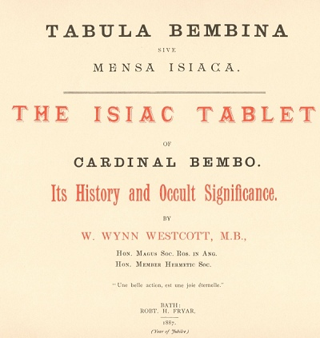
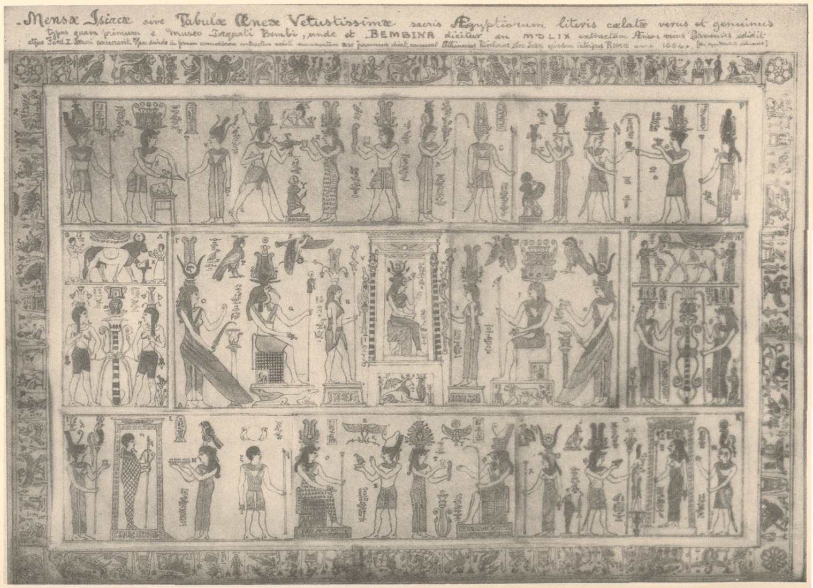
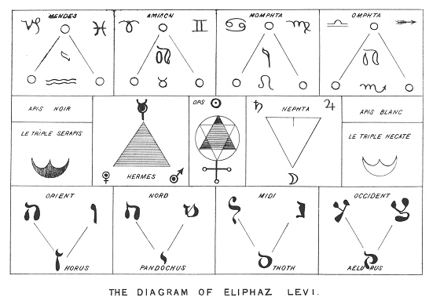
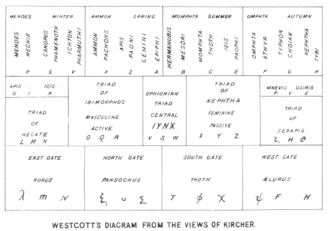

# W・W・ウェストコット『ベンボ枢機卿のイシス表』

W・ウィン・ウェストコット著／全訳

- 原題：Tabula Bembina sive Mensa Isiaca. The Isiac Tablet of Cardinal Bembo. Its History and Occult Significance（バース、Robt. H. Fryar、1887年。「バース・オカルト復刻叢書」の一冊で、百部の限定版とされる）
- 著者：ウィリアム・ウィン・ウェストコット（1848–1925）。ロンドンの検死官で、英国薔薇十字協会の会員（のちにその最高位者）で、翌1888年に「黄金の夜明け団」を創設した三人のひとり
- 内容：
  - 「イシス表」（ベンボの銘板、メンサ・イシアカ）は、銀と黒い象嵌でエジプト風の神々を描いた青銅の板で、十六世紀にベンボ枢機卿の手に入り、いまはトリノのエジプト博物館にある。ウェストコットは、キルヒャーの版画をみずから写した図を写真凹版にして本書に付け、この板の来歴と、それまでの学者たちの解釈とをまとめた
  - 前半は、キルヒャー『エジプトのオイディプス』の解釈の詳しい要約である。中央に坐る「万象の形をとるイユンクス」（世界霊魂、イシス）を中心に、中段を七つの三つ組、上段を黄道十二宮と十二の月、下段を世界の四つの方角、縁飾り（リンブス）を礼拝の場面として読む
  - つづいてモンフォーコン、シャックフォード、ウォーバートン、ヤブロンスキー、ケリュス、バニエらの説と、当時のエジプト学（ル・パージュ・ルヌーフ）の見解を紹介し、著者自身は、この板が秘教的な目的で作られたと結論する
  - 終わりの部分では、エリファス・レヴィが『魔術の歴史』で示した図を読み解き、イシス表を「トートの書」すなわちタロットの鍵として、二十二枚の切り札とヘブライ文字、『セフェル・イェツィラー』、四つの組札とテトラグラマトンとの対応を述べる
- 作業の基にした本文と図版：Internet Sacred Text Archive（sacred-texts.com）が2007年に公開した1887年版の翻刻とスキャン。イシス表の全体図は、同サイトの部分図九枚をつなぎ合わせた
- 著作権：ウェストコットは1925年に死去。日本・米国・英国で保護期間が満了している
- 訳者：人工知能（Claude Fable 5.2）
- 訳の性格：本文の全訳である。巻末にある版元フライアーの出版広告は訳していない。訳者の調べたかぎりでは、日本語訳は出ていない

## この本について

　イシス表は、ルネサンスからバロックにかけて、ヒエログリフがまだ読めなかった時代の学者たちを魅了しつづけた遺物である。イエズス会士アタナシウス・キルヒャーは、これをエジプトの神学全体を封じこめた図とみなし、新プラトン主義とカルデア神託の用語（パテル、ポテンティア、メンス、イユンクス）を使って、一つ一つの像に意味を割りふった。いまではこの板は、紀元一世紀ごろのローマで、イシス信仰のために作られたエジプト風の作品と考えられており、ヒエログリフも文として読めるものではないとされている。ウェストコット自身も、本書のなかで大英博物館のルヌーフ教授のこうした見解を紹介している。

　それでも本書が興味ぶかいのは、ここに「黄金の夜明け団」の創設（1888年）の直前の、ウェストコットの関心がそのまま出ているからである。彼はこの年に『セフェル・イェツィラー』を英訳し、マサースは『ヴェールを脱いだカバラ』を出した。本書の後半は、レヴィの図を手がかりに、タロットの二十二枚の切り札をヘブライ文字に、四つの組札をテトラグラマトンの四文字に、数札を十のセフィロトに当てはめており、のちに団の教義の骨組みとなる対応の体系を、公刊された本のなかでごく早く述べたものの一つである。ウェイトによるレヴィの英訳を「訳者は有能だが、ヴェールの外にいる未入門者だ」と評する一節も、この二人のその後を思うと味わいがある。

　像を指す文字について。本書の図版の文字はキルヒャーが付けたもので、上段と中段はラテン文字、下段と中段の一部はギリシア文字である。底本の翻刻はギリシア文字をラテン文字に置きかえているので、訳では著者の図（末尾の「ウェストコットの図」）に合わせてギリシア文字に戻した。同じ文字が別の段で別の像を指すことがある（たとえば上段の X・Y・Z と中段の X・Y・Z）。

　キルヒャーの用語のうち、パテル（父）、ポテンティア（力）、メンス（精神、母）は、三つ組をなす三者の役割の名である。原文の誤りと思われる箇所や、補った箇所には〔　〕で注記した。

---

## 本論の梗概

- 序、記述、来歴
- ピニョリウスの意見
- キルヒャーの解明
  - 中段、神智学の体系
  - 上段、黄道十二宮と十二の月
  - 下段、世界の四つの方角
  - リンブス。礼拝の形式、スフィンクス
- モンフォーコンの見解
- シャックフォードの意見
- ウォーバートンの意見
- ヤブロンスキーの注解
- エジプトの年代学、ソティス周期
- ケリュスの記述
- バニエ、マッケンジー、ケニーリー、ヴィンケルマン
- 近年のエジプト学の見解
- 著者の意見、この表の秘教的な意図
- 隠秘学、エリファス・レヴィの見解
- レヴィの図についての著者の説明
- トートの書、タロット

## ベンボ枢機卿のイシス表

　遠い昔の時代のこの珍しい遺物は、秘儀を真剣に学ぶ者すべての注意を引かずにはおかない。意匠の美しさ、入念な仕上げ、明らかな古さ、そしてあのもっとも理解しがたい宗教の体系、すなわちエジプトの宗教との確かなつながり、これらすべてが合わさって心を魅了し、このきわめて手のこんだ絵画的な芸術作品の目的と意味との説明を探すよう、知性を刺激する。

　構想は神秘的、起源は不明、細工は特異であって、この表は調べ、研究するに値する。

　学識ある東洋学者キルヒャーと、古典学者ピニョリウスとの時代から、多くのすぐれた考古学者と文人とが、この表の意匠を考えた者の隠れた目的を解き明かすことに力を注いできた。その者は、仕上げに巧みであったのと同じく、エジプト人のあらゆる技芸と知恵とに通じていたにちがいない。モンフォーコン、シャックフォード、ウォーバートン、カイスラー、ケリュス、バニエ師、プリュシュ師、ヤブロンスキー、ケネス・マッケンジー、ケニーリー、ウィルキンソン、エリファス・レヴィ、ボンウィックといったよく知られた名は、みな何らかの意見をあえて述べた人々であり、このメンサ・イシアカが呼びおこしてきた世界的な関心の十分な証拠である。著者が、本書の写真凹版のもとになったこの表の図を、好きでする仕事として描いてから、いまや多くの年が過ぎた。そして図が仕上がってみると、その連れとなる説明の論考を添えないうちは、仕事が未完のように思われた。それがどれほど乏しく不完全なものと見なされようともである。著者は、その至らぬところについて多くの学識ある読者の寛恕を乞う。そしてもし著者が、科学的エジプト学の近代学派の意見を軽んじたように見えるとすれば、それはただ、この表が本質において秘教的な性格のものであり、したがって通常の解釈の方法にはなじまないという確信によるのである。

　この小さな本に付けた写真凹版は縦八インチ、横十インチで、もちろん原物よりずっと小さい。原物はおよそ長さ五十インチ、幅三十インチである。

　確かめえたかぎりでは、この表は、1719年にフランスでモンフォーコンが公刊して以来、その全体が版刻されたことも印刷されたこともなく、イギリスでは一度も印刷されたことがない。

　イシス表は青銅でできている。図柄はその上面に象嵌されており、一部は銀で、一部は鋼にいくらか似た色合いの暗い色の琺瑯（ニエロ細工）でできている。銀の装飾のいくらかは失われている。おそらく騒乱の多かった中世のあいだに、その地金の値打ちのために力ずくではがされたのであろう。もっとも、偶然の衝撃でゆるんで失われたということもありうる。

　表全体のまわりには小さな図柄の縁飾りがあり、キルヒャーはこれをリンブスと呼んだ。四隅にはそれぞれ、花びらの多い薔薇のような花があって、これらがリンブスを四つの部分に分けている。右と左の二つの縦の部分と、上と下の部分とである。この縁飾りの内側に、三つの主な横の区画がある。上段と下段とは高さが等しく、中段はそれより高くて、さらに細かく分かれている。

　上段には、立った人の姿の主な像が十二と、いくつかの小さな図柄とがある。

　下段には、多かれ少なかれ人の姿をした主な像が十二ある。そのうち二つ、すなわち二番目と十一番目とは柱廊の中に立っており、別の二つ、五番目と八番目とは坐っている。これらのあいだにはまた、いくつかの小さな像がちりばめられている。少年、犬の頭をした人の像、猫、鳥、そのほかの奇妙な神秘的な図柄である。

　中段には、中央の大きな場面があって、全長の三分の二にわたっている。それは天蓋の下の玉座についた女性からなり、その両側にそれぞれ三つ組がある。おのおのの三つ組は、坐った像と、人の姿の従者と、翼のある人の像とからなる。左右の場面のそれぞれには、また二羽の鳥がいる。この大きな場面の両端には、互いにいくらか似た図柄が置かれている。そのおのおのは、二人の従者をともなう雄牛を表す上の区画と、二人の女性の像を表す下の部分とからなり、女性たちは、ある名づけようのない物の両側に一人ずつ立っている。その物の造りは、記述によるよりも目で見るほうがよくつかめる。

　上段と下段とのあいだ〔「上段と中段、中段と下段とのあいだ」の意か〕には、ヒエログリフの細い行が走っている。これは写真凹版には現れていない。どうしても縮小せざるをえない大きさのために、読めなくなってしまうからである。またリンブスの内側には、波線の細い図柄がぐるりとめぐっており、ところどころに小さな花、壺、男根、仮面あるいは顔がちりばめられている。

　写真凹版に見える文字は、この表のものではない。それらはキルヒャーがその説明の仕組みのなかで採用した参照記号である。まことに不運なことに、ピニョリウスが掲げた同じくすぐれた図版には、別の一組の参照文字が付いている。写真凹版でただ一つ省いたのは、中央の天蓋とその土台との無地の縁にある、ごく小さな図柄の列である。これらはみな同じで、そのおのおのは一つの正方形と、その中の円と、円の中でそれを八つの区画に分ける四本の直径とからなる。

　一つ一つの像を細かく記す必要はあるまい。図版を見ればよいし、おのおのの像についての注釈は、あとで、とくにキルヒャーの詳しい説明と、ほかの著者たちへのより短い言及とのなかに見いだされるからである。私自身の多くの奇妙な、秘教的な覚え書きと示唆とは、本書のあちこちに散らばっており、とくに結びの部分に当ててある。

　写真凹版の頭にある題字は、この表のものではない。それはキルヒャーが自分の描いた表の図に与えた上書きであって、次のように読める。「イシス表、すなわちエジプト人の聖なる文字を刻んだ最古の青銅の表の、真正な写し。1559年にトルクァトゥス・ベンボの収蔵室から初めて世に出されたので、ベンボ表と呼ばれる。パルマのアエネアス・ウィクスがこれを公刊し、皇帝フェルディナント一世に献じた。イエズス会士アタナシウス・キルヒャーは、これをより手ごろな大きさに縮めて、青銅よりも長く残る記念碑として捧げる。彼はその解釈者である。ローマ、1654年。」

　このまことに興味ぶかく神秘的な表は、ドイツ皇帝カール五世の軍を率いるブルボン元帥がイタリアを蹂躙してローマを略奪した1527年には、ローマの宮殿の一つに秘蔵されていたらしい。

　そのとき、これは一人の鍛冶屋あるいは鉄細工師の手に落ち、彼はそれを大金でベンボ枢機卿に売った。枢機卿の死後、それはマントヴァ公たちの所有に帰し、その宝物庫のなかで過去の遺物として1630年まで飾られていた。この年、マントヴァは皇帝フェルディナント二世の将軍の一人の率いる軍によって略奪され、焼かれた。そのとき、これはふたたび行方がわからなくなった。じっさい多くの重要な著者たちは、それが二度と見られることはなく、おそらく無知な兵士たちが、売るために表面から銀の板をはがすうちに壊してしまったのだ、と述べている。

　しかしながら、1630年のマントヴァ包囲ののちの、この表の来歴を正しく伝えている著者が、少なくとも一人いる。ヨハン・ゲオルク・カイスラーに栄誉あれ。彼は1740年に『ドイツ、イタリアその他の国々の旅行記』を公刊した。トリノの宮殿についての記述のなかで、彼はこう言っている。マントヴァが略奪されたとき、この表はパヴァ枢機卿の手に落ち、枢機卿はそれをサヴォイア公に贈り、公がそれを保存した。それはついにサルデーニャ王に贈られた。1730年、トリノの王の宮殿で、彼はそれを見ることを許されたが、それはたいへんな厚意であった。きわめて厳重に守られていたからである。彼はそれを、青い鋼の琺瑯のなかに銀の像を象嵌した、かなり大きな銅の板と記している。彼は、ピニョリウスの大きな図版が実物大であること、モンフォーコンがその写しで表を逆さにしていることを述べている。（これは誤りである。だがヘルヴァルト・フォン・ホーエンブルクはそうしている。）

　マレーの北イタリア案内書は、この表はいまトリノのエジプト古代博物館に展示されていると述べている。寸法は四フィート二インチに二フィート五インチ半としている。彼は典拠を挙げずに、それは最初、ローマのアウェンティヌスの丘の、かつてイシスの神殿が立っていた場所で発見されたと述べている。ローマ略奪のさいにふたたび失われたのち、1709年にトリノで再発見され、1797年にパリへ持ち去られ、講和のさいにイタリアへ返されたという。彼は、それがローマ皇帝ハドリアヌスの時代に作られたのではないかと言っている。

　ベデカーもまた何の典拠も引かずに、この表は最初、教皇パウルス三世の在位中の1549年に、ローマのヴィラ・カッファレッリで見つかったと述べている。

　アエネアス・デ・ウィコは、1559年にヴェネツィアで、この表のみごとな実物大の図を公刊したが、その題を次のように記している。

　「Vetustissimae Tabulae Aeneae Hieroglyphicis. Hoc est sacris Egyptiorum literis caelatae Typus. Quem ex Torquati Bembi Musaeo an. MDLIX Aeneas Vicus Parmensis edidit, ac Imp. Caes. Ferdinando dedicavit, nunc denuo publicae utilitalis ergo e tenebris in lucem prodit.」〔ヒエログリフ、すなわちエジプト人の聖なる文字を刻んだ最古の青銅の表の図。1559年にパルマのアエネアス・ウィクスがトルクァトゥス・ベンボの収蔵室から公刊し、皇帝フェルディナントに献じたもの。いまあらためて公共の益のために、闇から光のなかへ出る。〕

　この本には、表の来歴も、記述の試みもない。第二版が1600年に同じくヴェネツィアで、ジャック・フランコによって公刊された。（ケリュスはこの版の写しを載せている。）ヨハン・ゲオルク・ヘルヴァルト・フォン・ホーエンブルクもまた、1610年の著書『ヒエログリフの宝庫』のなかにこの表の図を、また1625年の『異教神学の驚くべき秘儀』のなかにそれを説明すると称する図解を、載せている。この後者の本で彼は、この表は一種の航海図であり、すべての像は羅針盤の方位であると言っている。

　私の確かめえたかぎりでは、ベンボ表についてのもっとも古い論考は、パドヴァのラウレンティウス・ピニョリウスのもので、1605年にヴェネツィアで公刊され、『エジプト人の聖なる像を刻んだ最古の青銅の表の正確な説明』と題されている。これには表の縮小図が付いている。

　これは、教皇クレメンス八世のもとの枢機卿カエサル・バロニウスに献じられている。ピニョリウス、またの名ロレンツォ・ピニョリアは1631年に死んだが、その本の別の版が1669年にアンドレアス・フリシウスによって公刊された。彼は文字によって像を区別しており、その図版は実物大である。初版の図版には参照文字がない。まことに不運なことに、1655年に公刊されたキルヒャーの図版には、別の、異なる一組の参照文字が付いており、そこから多くの混乱が生じた。本書の写真凹版はキルヒャーの文字を付けており、私の図は『エジプトのオイディプス』の図版の正確な写しである。ピニョリウスはきわめて学識ある古典学者であり、古典考古学についての多くの貴重な著作の著者であったが、エジプト神学の説明を試みるとなると、いくらか力の及ばないところがあった。彼の論考はじっさいには、表の像にちなんだ、多くの貴重な古典の引用をともなうギリシア・ローマ神学の研究であって、像の解明とはほとんど言えない。彼には、キルヒャーの持っていたコプト語、アラビア語、ヘブライ語の広大な知識が欠けていた。ピニョリウスはこの表を理解したとは主張せず、いくつかの像を同定はしたが、その作者の意図には行きあたらなかった、と告白している。そして彼は、図版そのものの、あるいは主な像のすべてについてさえ、詳しい記述をまったく試みていない。

## キルヒャーの解明

　アタナシウス・キルヒャーは、その『エジプトのオイディプス』（紀元1654年）のなかに、この表を説明するきわめて長い論考を収めている。彼は短い来歴から始め、ついで、それがどんな用途に使われえたかの考察に移り、それはおそらくエジプトのどこかの神殿の至聖所すなわちアデュトンのなかの、神秘的な装飾をなしていたのだろうと結論している。エジプト人は、ヘブライ人と同じく、祭司たちがもっとも聖なる儀式をおこなうそうした秘密の部屋を設けていたからである。ついで象徴の意味についての哲学的な議論がつづくが、これは短い。各部分の意味があとにつづくからである。そこには、世界の構成を〈原型の世界〉〈知性の世界〉〈感覚の世界〉の三つに配する教義が具体化されている。〈父なる精神〉は中心として万物に運動と生気とを与え、あらゆるものに三位一体の特徴をしるす。

　「宇宙は〈父なる基〉から、三つの三つ組を通じて統べられている。この基はさまざまに呼ばれる。イユンクス、世界霊魂、万象の形をとる贖い主、またフィロンによれば構成する知恵と。それは、パテル、ポテンティア、そしてマテルあるいはメンス、すなわち父と、力と、母あるいは意匠との三つ組の完全さのうちに存在し、信と真と愛とともに共存している。神的な諸力の秩序と配置と統治と働きもまた、ここに示されている。それらは、神的で至高のメンスの、大いなるポテンティアの、そして父なるイユンクスの、連れと役人たちとによって表されている。ここには、レクトレス・ムンドルム、すなわち諸世界の支配者たちが見られ、おのおのが、空気のであれ、火のであれ、物質的なもののであれ、その目立つ象徴をともなっている。ここにはまたパトレス・フォンティウム、すなわち泉の、源の、起源の、原因の父たちがいる。プリンキピア、すなわち万物の支配権と元素とを、また自然の犯すべからざる法を、定め、保つことが、彼らの配慮であり務めである。」

　ここに、好奇心ある読者は、ゾーニア〔帯域の神々〕とアゾーニア〔帯域のない神々〕、すなわちどの特定の天球にも縛られない神々を認めるであろう。おのおのがふさわしい飾りを付け、男と女との姿に振りわけられている。じっさいこの表の造りは、それが悪い影響に対する護符としても効き目があるにちがいないようなものである。

　彼はついで表の区分を記しているが、ここでくり返す必要はない。そして像において注目すべき八つの特別な点を指摘する。頭飾り、衣服、杖、武器、ヒエログリフ、暗に示された動作、立っているか坐っているかの姿勢、そして、あるときは動物、あるときは人間、また別の場合にはその組みあわせである、その形である。

　「エジプト人は神性を二つの仕方で考えた。永遠の存在として、すなわち自ら成り立ち、地上の関心事からまったく離れたものとして。あるいは、奉仕する霊たちと二次的な諸力とによって神性が統べる被造物との結びつきにおいて。彼らは、ヘルメス・トリスメギストスから学んだとおり、神性の三重の本質と、また三つの形をとる二次的な神性とを認めた。この神性は、生けるものにも死せるものにも、地上のあらゆるものにその印章を押した。まさにこの同じ本質的な計画にもとづいて、この表は組み立てられたのである。」

　キルヒャーがイシス表に結びつけるこの哲学と神智学との体系は、きわめて隠秘的な性格のものである。それは、カルデアの体系の創始者としてのゾロアスターに帰されている形と、ほとんど同じである。それは、古代ヘブライ人のカバラの図式と多くの共通点を持っている。この図式は、おもに『ゾーハル』と『セフェル・イェツィラー』とを通じて我々に知られている。（前者の大きな部分が、いま初めてS・L・マグレガー・マサース氏によって英語に訳され、公刊されつつある。後者は、私自身がヘブライ語の原典の諸版から訳した。）この『セフェル・イェツィラー』は、エリファス・レヴィが指摘したとおり、この表に多くの光を投げかける。カルデアの教義は、T・スタンリー（父）の『哲学史』1740年に詳しく記されている。

　第一に〈永遠の存在〉があり、光と火との流出をともなう。次に、永続的で無形の諸力が三つの階級をなす。第一は可知的なもの、第二は可知的かつ知性的なもの、第三は知性的なものである。そして最後に死すべきものたちがある。

　第二の形のなかには、泉と原理とが置かれ、またアゾーニアすなわちどの特定の天球にも限られない〈帯のない神々〉と、ゾーニアすなわち特別な世界に限られた神々とが置かれる。天使たちと魂たちとがこれらにつづく。キルヒャーがたびたび言及するパテルとポテンティアとメンスとは、可知的なものの階級に当てられる。イユンクス（この語はギリシア語でいくつもの意味を持つ。情熱、欲望、魔法の輪、呪文、アリスイという鳥）は、可知的かつ知性的なものの第二の階級の先頭に立ち、これにシュノケース〔つなぎとめる者たち〕とテレタルケース〔秘儀を司る者たち〕とがつづく。第三の階級は、〈一度かなたなる者〉、ヘカテー、〈二度かなたなる者〉、三者のアミリクトイ〔なだめがたい者たち〕、そしてヒュペゾーコス〔下に帯する者〕という、力の七つの泉を含む。これ以上説明を試みれば、本書の目的からあまりに遠く離れてしまうであろう。プロクロス、プセルロス、ダマスキオス、ポルピュリオスを参照されたい。

　キルヒャーはついで、以下のように記述と説明とに進む。

### 中段

　中央に、もっとも重要な図柄が置かれている。それは〈神々の大門〉、すなわち玉座の上の建築的な天蓋からなり、玉座には坐った像がある。天蓋の頂には広がる炎が示され、その下に二重の翼のある球があり、ついで第二の翼のある球があり、第三の球もまた像の座の下に見える。天蓋の両脇のまわりには一連の正方形があり、その中に八つに分かれた円がある。黒と白との帯を交互にしるし、頂にイシスの頭をいただく柱が、この天蓋の両側に一本ずつ立っている。中に坐っているのは女性の像で、腰から下は羽根の模様の衣をまとい、ぎっしりと並んだ多くの乳房を持っている（図には示されていない）。頭には髪紐があり、その上にヌミディアの鳥すなわち七面鳥〔原文 Turkey。マルティアリスの言う「ヌミディアの鳥」はふつうホロホロチョウを指す〕がのっており、その背には籠があって、そこから二枚のペルセアの葉と二本の角とが立ちあがっている。この角は、スカラベののった円盤を囲んでいる。右手には蓮の花の付いた笏があり、左手は命令の姿勢で上げられている。その座は無地であるが、坐った犬がそこに刻まれている。座の下には別の図柄、アバクス〔台座の区画〕があり、その中に怪物ネフェルが横たわっている。一部は獅子、一部は鷹で、前足のあいだにカノプス壺がある。その後ろには、翼があって蛇と組みあわさった球が見え、その頭の上には三日月と、その中の太陽とがある。天蓋の両側には柱が置かれ、そのおのおのに、番をするかのように蛇がいる。

　女神の両側には、それぞれ三つの主な像がある。右の O・Q・R と左の X・Y・Z とのおのおのの三つ組は、坐った像一つと、立った像二つとからなる。O と Z とが同じ装いをしていることに注意せよ。天蓋の隣の R と X とは、似た台座と杖と頭飾りとを持っている。Q はトキの頭をしており、Y は坐った女性の人の像である。

　この中央の天蓋は、三つの世界のあまねき道における、三つの形をとる至高のメンスの拡散を表している。この展開の過程から、この感覚の世界すなわち宇宙が現れる。プルタルコスはそれをホルスの境と呼び、エジプト人は〈神々の大門〉と呼んだ。

　天蓋の頂の広がる炎は、火と光と生命とに満ちた、永遠で朽ちることのない至高のメンスを意味する。その影響は、三つの翼ある球によって描かれているとおり、知性の世界、感覚の世界、元素の世界に伝えられる。

　坐った像は至高の精神、すなわち〈万象の形をとるイユンクス〉、多形のスフィンクス、あるいはロゴス、言葉、あるいは世界霊魂であり、普遍の自然の中心にあるものとして、ここ真ん中に置かれている。坐った姿勢は力と支配とを表す。座に犬が描かれているのは、イシスのイユンクスが犬の星、シリウスすなわちソティスと結びついているからである。手足の羽根と翼との衣は、高次の諸力の崇高な速さを表す。乳房の多さは、創造と保存との限りない力を表す。首飾りは、絶えず動く天の諸球を表す。頭の髪紐すなわち覆いは、自然の隠れた歩みを表し、多くの色と斑点とを持つ七面鳥（マルティアリスのヌミディアの鳥）は、被造物の多様さを表す。籠は豊かさを表し、ペルセアは、すべての出来事を司るあの知恵を表す。角は月を、スカラベと円盤とは太陽を表す。笏は、万物が〈父なるメンス〉の範型にならって形づくられていることを表し、蓮は、夜も昼もひとしく倦むことのない進行を意味する。上げた左手は、そのあらゆる命令が果たされる支配の力を表す。この普遍の自然の母を、エジプト人はイシスと呼び、彼女について次の銘文をしるした。

　「Ego Isis omne sum id quod est, et fuit, et erit, et meum peplum nemo mortalium unquam retexit.」

　「私はイシス、私は、いまあり、かつてあり、これからあるであろうすべてである。そして死すべき者のだれも、いまだかつて私のヴェールを取りのけたことはない。」

　天蓋の柱の図柄をなしている正方形と四つ組と、円の八つの区分とは、四と八との数を表す。これらは合わせて十二を生み、十二は世界の完全さの象徴である。柱の暗い部分と白い部分との交替は、地上の事柄の絶えず変わる移りかわりを指す。旗竿の上の二匹の蛇はオピオーン的なアガトダイモーン、すなわち善い神々であり、熱と湿り気とを必要とする地上の存在、すなわち植物と動物との生命を示す。下のアバクスは元素の世界を意味する。黒いヴェールをかぶった獅子 T は土であり、鷹の頭は元素の火を指す。月と、目立つ星である太陽とは、下界のすべてのものが月と太陽との力に影響されることを指し示す。カノプス壺は元素の水を意味する。上の二つに分かれた炎と二枚の羽根とは元素の空気を表し、水が熱によって蒸気になることを意味している。ククロ・プテロ・モルフォス、すなわち蛇と翼との付いた球は、この元素の世界のすべてが、三つの形をとる至高の神の力によって生気を与えられ、保たれていることを意味する。元素の世界は、ギリシア人によってヒュレーとも呼ばれる。

　イユンクスの正面の上の組のヒエログリフは、次のように読める。「四つに分かたれた世界への入口。万象の形をとる世界霊魂はそこを通って入り、神の摂理の目をもって万物に浸みとおり、上の世界の四つの部分と、下の世界の五つの門との両方を通って流れることによって、生命の球を授ける。」下の組はこう読める。「上の世界と下の世界との門の柵。その帯域の鎖は、トキの形をしたアガトダイモーンによって取りのぞかれる。」（注意。キルヒャーのヒエログリフの訳は、十分に用心して受けとらなければならない。ヒエログリフの秘密の言語は、プトレマイオス朝の時代から、つい数年前まで失われていたからである。）オルペウスは、万象の形をとる〈自然の母〉を、次のように始まる詩行でよく描いている。

　Natura omnium mater Dea, artificiosa mater;
　Suscitatrix, honorabilis, multa creans Daemon Regina.

　自然よ、万物の親、古く神々しきものよ、
　おお、多くの技を持つ母よ、技芸は汝のもの。
　天なる、豊かなる、尊ぶべき女王、
　汝の領土のいたるところに見られる者よ。

　二つの蛇の像 V と W〔原文 Y and W。著者の図によれば V と W〕とは、中央のスフィンクス T とともに、オピオーン的なアガトダイモーンの三つ組、すなわち蛇の善い神々をなす。それは、知性の、エーテルの、元素の三つの圏で働く、万象の形をとる世界の霊の象徴である。左右二つの三つ組のうち、Q と Y とは坐ったパテルたち、R と X とはポテンティアたち、O と Z とはメンスたちであり、みなの顔は大いなるメンスのほうに向いている。

　Q はイビモルフォス、すなわちトキという鳥の頭をした男の神である。これはヘルマヌビス、ローマ人のメルクリウス、ギリシア人のヘルメスである。トキの頭は湿り気の神を表す。市松模様の椅子は、昼と夜、熱と寒さなど、自然の絶えず変わる状態を指し示す。オルペウスはこう書いた。

　「Qui Mundi habenas tenet, variegata, sede splendidus.」

　「世界の手綱を握り、まだら模様の玉座の上で輝く者。」

　座に描かれたウズラは逆境の象徴であり、逆境を通じて宇宙全体の善が成就される。右手の柄つき十字〔クルクス・アンサタ。アンク〕は上からの力の流入を示し、イシスの頭の付いた杖は、万象の形をとる自然の女神イシスからゆだねられた力を示す。頭飾りのうち、炎は熱の力を、蛇は生命を、羽根は速さと精妙さとを、花の中心は多産を表す。

　玉座の下の二匹の鰐は、トキの支配のもとに屈したテュポンの悪い力を表す。

　足台の十八の区分は、ナイルの十八キュビットの増水を表す。それは肥沃さの頂点をもたらすものであり、トキのトートはナイルの神である。O はこの三つ組のメンスで、豊かな乳房を持つ女性である。彼女は地面まで届く長い翼を持ち、その羽根の杖は空気の諸力に対する支配を、台座の上の壺はナイルの水による養いを表す。上のヒエログリフはこう読める。「全自然の空気の善い霊は、湿り気によってその力を伝え、こうしてそれを実らせる。」P はアンドロスフィンクス〔人頭の獅子〕、すなわち火の自然神であり、ヒエログリフはこう読める。「神なる裁定者は、その力によって、天の生命にその印章を押す。」R はこの三つ組の命令の執行者である。彼はほとんど裸で、その脚は動いているかのように開いている。その台座に我々はこう読む。「彼はこのうえない速さで、天球を、モンフタの湿った王国を、そしてトキの形をした聖なる湖を突きぬける。」S は飛ぶ鷹である。それは円と棒とを持ち、至高のメンスの原型の火によって供給される熱の力を指す。

　この三つ組全体は男の力、能動の作用者を表す。これに対して X・Y・Z は女であり、受動である。しかしどちらも全面的にそうなのではなく、当面の目的のためにそうなのである。エジプト人は、神は両性的あるいは無性的であるが、特別に求められるのに応じて、能動にも受動にも、男にも女にもなると考えたからである。

　こうしてここでは、三つ組を統べるパテルが女性であることがわかる。彼女はネフタで、玉座についており、花の頭飾りを付けている。座の下にはひざまずく像があり、台座の上には、増水するナイルであるモンフタの象徴の獅子がいる。三重の花の象徴をともなう彼女の頭の上には、翼のあるスカラベがいる。太陽の実らせる力の型である。

　Z は O に似た形のメンスで、長い翼を持ち、前の台座の上に壺がある。その乳房は乳に満ちている。X は、対応する像 R とは違っており、これも張った乳房を持つ女性で、球と蛇と羽根との付いた頭飾りを付けている。a と b とは連れの像、すなわちヌミディアの七面鳥と鷹とである。

　カルデアのイユンクス、すなわち世界霊魂あるいは父なる言葉は、エジプト人によってヘンフタとも呼ばれる。

　〈帯域のないヘカテーの三つ組〉、L・M・N。この三つ組は三者のメンスを含む。ギリシア語でトリエクドティス、コーマス、エックリュスティケーと名づけられている。一方、帯域のない神々はセラピス、バッコス、オシリスである。すべての流入の中心は、頭 M によって表されている。黒いヴェールと白い耳と、三つの首飾りと、頭の上に世界の大きな戸口とを持つ女性である。彼女はヘカテーの形をとったイシスであり、大いなるパテルの型である。その白い耳は犬のものであり、犬は彼女に捧げられていた。彼女は地上の宝の忠実な番人であり、保存者であった。感覚の世界は多くの変化をこうむるので、それは蓮の花の付いた柱によってしるされている。そのそばには二つのヘリオトロープの花があり、太陽の運行を表している。まだら色の柱もまた、太陽の運行によって引きおこされる交替する状態を指し示している。柱は、ある神秘的な理由から、心臓の形をした台座に立っている。従者の L と N とは、プセルロスによってトリエクドティスとコーマスと呼ばれている。その乳房は豊かな乳で垂れており、動物、植物、鉱物の本性にかかわる三重の首輪を付けている。

　〈セラピスの三つ組〉、ζ（ゼータ）・η（エータ）・θ（シータ）は、H としるされた怪異な形の頭にちなんで名づけられている。これがパテルであり、ゼータはメンス、シータはポテンティアである。これは信と真と愛との〈泉の三つ組〉である。セラピスは地平線の下の、地下の太陽であり、ギリシア人はこれをプルートーンあるいはディースと呼んだ。下界のすべてに権威をふるうものである。その頭には、三つの形をとる神の三枚の羽根がある。そばには、ペルセアの花の上に坐った蛙と、頭の上に月をいただくキュノケファロス〔犬頭の猿〕とが描かれている。従者たちは、ヘカテーの絵におけるのと同じような神秘的な柱の両側に一人ずつ立っており、全体は同じような意味を持つ。

　〈イシスの三つ組〉はヘカテーの三つ組の上に置かれている。そこには白と黒との雄牛ムネヴィス、すなわち全能の自然の多産の神が見える。そして〈オシリスの三つ組〉はセラピスの三つ組の上に置かれている。そこには白い雄牛すなわちアピスがいる。一方はとくに月の、第二のものは太陽の雄牛であり、これらは農耕に関係がある。従者 K は杯と牛の男根とを持つトリプトレモスであり、G はマロである。上の言葉は「天の液を下位の存在へ広める者」である。ほかの二人の従者も同様である。ピニョリウスは二頭の雄牛をオヌフィスとメヌフィスと名づけている。

　キルヒャーはついで、中段にあるものを次のようにまとめている。

　火の原型の世界、三つの形をとる生命の世界、そして創造されざる世界の第一の三つ組が、七つの三つ組、すなわち宇宙の霊たちを生み出す。

- イユンクスの三つ組
- オピオーンの三つ組、すなわち生命と火との世界。エーテル界
- イビモルフォスの三つ組、すなわち湿り気の世界。エーテル界
- ネフタの三つ組、すなわち多産の世界。エーテル界
- イシスの三つ組、すなわち月の世界。星辰界
- オシリスの三つ組、すなわち太陽の世界。星辰界
- ヘカテーの三つ組、すなわち植物の生長の世界。月下界
- セラピスの三つ組、すなわち地下の存在の世界

　カバラ学者たちは十の世界を記している。そのうち、ケテル、ホクマー、ビナーに当たる最高の三つは隠されており、男性でも女性でもある神秘的な A・M・S によっても表される。彼らはまた四つの世界を挙げる。神性のためのアツィルト、大天使たちのためのブリアー、天使たちのためのイェツィラー、そして悪霊と人間と物質とのためのアッシャーである。これらは秘密の名を持っており、それは OB＝72、オイブ。SG＝63、セグ。MH＝45、マー。BN＝52、ベンである。

### 上段

　これら十二の像は、天の世界の十二人の指揮者を表す。彼らは四つの三つ組に選りわけられ、我々の黄道十二宮と十二の月とに対応する。第一の三つ組は P・S・V からなり、コプト語の名がメキル、ファメノト、ファルムティである月々に当たる。これら三つが冬すなわちメンデスをなす。対応するヘブライの月はシェバト、アダル、ニサンすなわちアビブであった。すなわち、ほぼ一月二十六日から四月二十六日までである。第二の三つ組は X・Z・A で、パコン、パオニ、エピフィの月々であり、春すなわちアンモンである。ヘブライの月はイヤル、シワン、タンムズで、四月二十七日から七月二十四日までである。第三の三つ組は B・C・E からなり、メソリ、トート、パオフィの月々で、氾濫の時、モンフタ、夏である。ヘブライの月はアブ、エルル、ティシュリで、七月二十五日から十月二十七日までである。第四の三つ組は、アテュル、コイアク、テュビの月々、F・G・H からなり、オンフタすなわち秋をなす。ヘシュワン、キスレウ、テベトに対応し、十月二十八日から一月二十五日までである。ただしヘブライの月とイギリスの月とは正確には対応しない。ヘブライの月は新月とともに始まる。

　プセルロスはゾロアスターを引いてこう言っている。「イユンクス」と名づけられた可知的な神性のあとに、星辰の世界の指揮者たちが来て、元素の火と空気と物質とを支配する、と。『セフェル・イェツィラー』第五章第一節と比べよ。そこでは十二の単純なヘブライ文字が、月々と黄道十二宮とに結びつけられている。キルヒャーによれば、もっとも古いエジプトの黄道十二宮は、アンモン、アピス、ヘリトメノンとハルポクラテス、ヘルマヌビス、モンフタ、イシス、オンフタ、テュポン、ネフテュス、メンデス、カノプス、イクトンであった。

　のちのデモティックの黄道の像は、同じ順序で、皮、雄牛、植物の芽、スカラベ、小刀、乙女、太陽の山、蛇、矢、生命、水、魚であった。

　第一の三つ組〔原文は語が欠けている〕では、S がパテル、V がメンスすなわち母、P がポテンティアで、祭壇 M の上に見える山羊メンデスの三つ組をなす。この象徴は、生長の芽を養う用意のできた大地の多産を指す。この季節には、よい季節を願って山羊を犠牲に捧げるならわしであった。ギリシア人によれば天に移されたという山羊座は、メンデスを指す。P は男、V は張った乳房を持つ女で、おのおのがアポトロパエウム・ヌメンすなわち〈とりなしの神〉のしるしである柄つき十字を持っている。これらは自然の能動の力と受動の力との象徴である。Q と T とは護符として働く札である。

　アンモンの第二の三つ組では、X がパテル、Z がマテルすなわちメンス、A がポテンティアである。上のほうに、実を結ぶ三本の枝のある植物のそばに立つ牡羊アンモンが見えることに注意せよ。この季節の激しい、熟させる熱の象徴である。ラビ・イェフダは『ゾーハル』でこう言っている。「熱を表すために彼らは牡羊を描いた。上へ広がる角が、火の炎の型だからである。」X は槍を持つ戦士としてのアンモンで、左手にナイルのフェニコプテルス〔フラミンゴ〕を持っている。〔原文はここで語が欠けている。「牡羊は」か〕しばしばオシリスと組みあわされる。

　Z は母なるイシスで、穀物と果実とが彼女に捧げられている。ポテンティアである A は、右手にトキの羽根を、左手にナイルの水の壺を持っている。（ピニョリウスは、A の独特な円錐形の腰衣はプリアポス的な状態をほのめかすためだと言っている。）

　キュノケファロスである Y は、春分をしるしている。その座の下には、四本の線の十字の入った六つの円があり、二十四を指している。昼の長さが十二時間である春分には、この動物は昼のあいだ一時間ごとに尿をし、夜を通して合わせて二十四回する、と言われたからである。

　モンフタと名づけられた第三の三つ組は夏を指し、その像は B・C・E である。そう呼ばれるのは、モンフタが獅子座すなわち増水するナイルを司る霊だからであり、ナイルのスフィンクスである D がそれを表している。D の頭の上には三日月と暗い太陽とがあり、台座には四つに分かれた六つの円がある。すなわち二十四日の増水と二十四日の減水とである。C はパテル、とりなしの神であり、その壺の形の頭飾りは円で飾られ、そこから蛇が出ており、その上に二枚の鷹の羽根と円とがある。太陽の勢いと、熱と、生命との象徴である。その連れは、メンスであるイシスの E と、ポテンティアである B とである。E は白い頭飾りを付け、その上に壺、それから角、星、羽根があり、右手には羽根の付いた笏を持ち、そこから三角形のシストルムが二つ下がっている。角はイシスのものであり、星はソティスである。その日の出直前の出現は、氾濫に先だった。笏はテュポンに対する武器である。テュポンはつねに、音楽や物音に乱されると考えられている。B はアブシント〔ニガヨモギ〕の枝を持ち、頭にテルムティス〔聖なる蛇〕をいただいている。腐敗の敵であるアブシントは、トートの月の初めに豊かであった。

　第四の三つ組はオンフタと呼ばれ、秋にかかわる。オンフタは天秤座の守護者であり、恵みぶかい神であって、氾濫ののち湿り気をはらんだエジプトの地がまことに多産に向かうときを統べる。それは像 G であり、右手にテュルソス、左手に〈目のある男根〉を持つ。連れの F は、カッコウの頭の付いた杖を持ち、左手には黒い土、すなわち沖積土の入った杯を持っている。農耕にとっての幸先のよいしるしであり、F と G との獣の尾もそれを指している。H は〈贖いの神〉であり、悪しき者テュポンの攻撃をかわすために蓮の花の杖を持っている。彼女もまた、実り豊かさの象徴である豊かな乳房を持つ。

### 下段

　ここには十二の主な像がある。〈尽きることのない泉の父たち〉、すなわち地上の世界の支配者たちである。これらもまた四つの三つ組の列に分かれる。西の ψ・F・H、北の ξ・ο・Σ、南の T・φ・χ、東の λ・M・N である。

　〈世界の東の大門〉の三つ組は、柱廊の中に閉じこめられた少年ホルスの M を示している。彼は網にくるまれ、カッコウの頭とその上の十字との付いた杖と、また直角定規とラッパとを持っている。首の後ろには、球が出ている三角形が下がっている。柱廊は、上に翼のある球が、その両脇に、四つに分かれた円と五芒の星とが交互に置かれて、飾られている。

　この門は、翼のある球によって象徴されるすべての光と生命と運動とを、世界の四つの部分と、存在の五つの階級とに入れる。

　ホルスは太陽であり、我々の地球に熱と光とを授け、東に昇る。網は、その起源と力とが我々の知識から隠されていることを指し示す。十字は四元素に対するその力を表し、カッコウの頭は産出の多様さを、直角定規は秩序と均整とを、ラッパは調和を表す。プラトンは三角形を世界の象徴と呼んでいる。

　台座のヒエログリフは次のように読める。

　「植物の本性の親、湿り気の保存者、ナイルの聖なる番人であるオシリス。生きた存在と物との、万象の形をとる、すなわち多くの形をとる霊であり、それらを実り豊かにする者。」

　N は髪紐を付けた女性の像で、頭に鷹をのせ、ホルスに五つの杯を差し出している。これがこの三つ組のマテルすなわちメンスである。鷹は熱と光とを表し、五つの杯は、水、空気、鉱物、植物、動物の種子である。彼女はイシスの一つの形である。λ はポテンティアで、蓮の花の杖を持つ女性の像であり、その上にふくらんだ胸のアスプ蛇と、星とがある。左手には杯があり、その乳房は豊かである。このアスプはオピオーン的なもので、テルムティスと呼ばれ、ものの生命と運動とを意味する。

　第二の三つ組は、アエルロモルフォス〔猫の形をしたもの〕、〈泉の〉あるいは〈西の〉三つ組と名づけられ、この段の反対の端に置かれている。F は親で、猫の頭をした女性の像であり、柱廊の中に立っている。上には、至高のメンスの流入の象徴である翼のある球があり、まわりには四つに分かれた円があって、現世の世界を指している。右手には蓮の杖、左手には柄つき十字があり、頭には球とスカラベと蛇とがある。西では、太陽は上の領域を去って下の領域を求め、夜が来る。そのとき、夜に使うのにとくに適した目を持つアエルルスすなわち猫が力を持つようになる。それから月が太陽に取ってかわる。エジプト人は、月とその光とを、直接のものではなく、鏡から反射された太陽の光と見なしていたからである。柄つき十字は、闇のなかでもっとも害をなす悪い力に対する、まことに強力な護符あるいは魔よけであった。

　マテルすなわちメンスである ψ は、左手に頂に花のある杖を、右手に男根を持ち、頭には、二つの炎と二枚の羽根と二匹のアスプと、円あるいは星とからなる冠がある。男根は多産を、花の頭は植物の本性を、冠は、太陽から月へ反射された熱と生命と運動とを表す。

　H は知性的な力、多産であり、その左手には豊かさのしるしであるパピルスの茎があり、右手は両性具有のパテルとメンスとの望みを命じている。頭の上にはテルムティスと星とがある（上を見よ）。

　だがこの三つ組は、さらに三つの余分な像、δ・ε・Ω を我々に示している。δ は坐った犬で、シストルムを持っている。これは、がらがら鳴るゆるい横棒の付いた卵形の金属の枠からなる楽器である。これは太陽の光を欠いた地平線を表す。

　プルタルコスは、地平線は犬の頭をした番人アヌビスだと言っている。シストルムは、悪しき者テュポンをおびえさせるためのものである。

　Ω（オメガ）もまたアヌビス、すなわちアンドロ・クノ・モルフォス〔人と犬との形をしたもの〕で、頭に球と蛇とトキの羽根とをいただいている。トキは鰐であるテュポンの敵である。これは柱の上にあり、ヘカテーのケルベロスに比べることができよう。ε は太陽であるホルス、感覚の世界における調和である。

　第三の三つ組はパンドコスのもの、すなわち北の霊たちの司である。

　中央の像は ο で、坐った女性である。彼女は豊かな乳房を持ち、蓮の花の杖と、トートのしるしである柄つき十字とを右手に持っている。その座には市松模様の飾りがあり、その衣には一種の柄つき十字が散らしてある。彼女は、はっきりした限界を持つ北の支配者として坐っている。そのまだら模様の座は、北の太陽の光と影とを、腐敗と生成との交替をしるしている。十字はテュポンの力からの守りとして必要であり、蓮の杖は原型の太陽を指している。九の数は北と結びついている。あらゆる善の完成である十の隣だからである。第一に、座は昼と夜との交替を指し示す。第二に、自然の植物の束。第三に、多くの十字によって示される流入の充満。第四に、柄つき十字の護符。第五に、蓮の笏、すなわち原型の太陽。第六に、世界の杯あるいは貯水池。第七に、アスプ、すなわち種子の生命力の聖所。第八に、裂けた十字、すなわち太陽のアガトダイモーンの秘儀。第九に、翼は知性的な諸力の柵をしるす。台座には、四つに分かれた円と五本の線の組とが交互にある。九の数を表すエジプトの象徴である。

　従者のメンスである ξ（クシー）は、カッコウの杖と十字とを持ち、頭の上に球と蛇とがある。パンドコスの左にいるポテンティアの Σ（シグマ）は、ウズラを持っている。テュポンの邪悪なたくらみの象徴である。これに対して、α としるされた、翼と蛇との付いた球である善い神が、変わることなく働いている。

　第四の三つ組はタウストスのもの、すなわち南の霊たちの司である。パテルである φ（フィー）は、北の玉座と同じように飾られた玉座に坐っている。その右手は彼のメンスである T に命じ、左手にはパピルスの茎を持つ。その頭はまことに特別で、ヒエラコモルフォス、すなわち鷹の頭のようである。彼は支配者として坐り、南への限界を定める。鷹の頭は太陽の知性、生命、光、霊を指す。彼はタウストスと、またバイエトと呼ばれる。これは〈生命の心臓〉を意味する。その冠には多くの円がしるされており、多くの領域に対する支配を意味する。七の数が彼に捧げられている。台座にくり返される、四つに分かれた円と三本の線とに注意せよ。連れの T は、彼にナイルの水の杯と鷹の羽根とを差し出している。彼女は鹿の皮をまとっている。これらは、生長にとってまことに貴重な、熱を生む南の気候を意味する。その頭には花の壺と、ヘカテーの像とがある。この T は地下のイシスで、ギリシア人がペルセポネーと呼ぶ、花と果実と野菜との神であり、南のナイルの豊かさと肥沃さとを指す。タウストスのポテンティアである χ（キー）もまた女性の像で、体と下肢とは、巻きつけた鷹の翼に覆われている。頭にはファラオの鳥である七面鳥がおり、その上に杯があって、そこから二本の牝牛の角が出ており、そのあいだに犬の星ソティスがある。この婦人はナイルのイシスであり、贖いの神である。ソティスは彼女に捧げられていた。ソティスはまた、翼を広げたスカラベである Y の上にも置かれている。C はトキで、ナイルの壺をともない、そこからアブシントすなわちセリフィウスが生えている。これもイシスに捧げられた草で、水を清めると考えられていた。トキはアガトダイモーン、すなわちナイルの善い霊である。

　〔エジプトの南は、つねに大きな崇敬を受け、〈光の灯〉〈世界の杯〉と呼ばれた。エジプト人はまた、北を宇宙の右、南を左と呼んだ。全身に生気を与える血を送り出す人間の心臓が左側にあるからであり、エジプトにとってあらゆる湿り気と肥沃さとの泉であるナイルも同じだからである。ナイルの神オシリスは、肥やすナイルの泥のように黒かった。そこから、ケム、ヘム、ハムという語が出た。熱と黒さとを意味するカルデア語の CHM に由来する語である。ホルスは、オシリスの息子であるのに、黒くは塗られなかった。この神の黒さには神秘的な暗示がある。彼は大いなる光の者の下の影であり、対比によって黒いのである。レヴィは、祭司職の新参者が「オシリスは黒い神である（Osiris est un Dieu noir）」と告げられたとき、エジプトの秘儀の大きな秘密が明かされたのだ、と言っている。――レヴィ。〕

### リンブス

　この膨大な図柄の列については、紙幅がないので、限られた言及しかできない。上の列。1 は、シストルムとナイルの水の壺との前に坐った犬で、両側に蓮の花とペルセアの葉とがあり、その後ろと前とに男根がある。蓮は、細い、百合のような葉を持つ白い睡蓮であった。その花は日の出に水の上に出て開き、日没に閉じて沈んだ。垂れたペルセアの葉は舌の形をしており、その木は心臓の形の実を付けた。犬はアヌビス、すなわちオシリスの男根の多産の番人であり保存者であり、翼と蛇との付いた球は、あらゆる原因の原因、至高のメンスである。2 はホルスの頭をした鷹で、地上の摂理の観念である。3 は獅子すなわちモンフタで、太陽の火の熱が大地に及ぼす作用である。4 は〈目のある男根〉で、5 がこれを崇めている。多産を祈るネフタである。6 は鷹の頭とアスプの体とを持つ善い神で、光と生命と運動との象徴であり、月の影響を意味する牛の頭の 7 のもとで働く。8 は祭壇の上の蛙で、ナイルの泥のなかに住み、イシスに捧げられていたが、もっとも低い被造物と形成との型であった。9 はアンドロスフィンクス、すなわち人獅子で、その前にひざまずく人 10 がいる。11、12、13、14 は、雄牛ムネヴィスと従者たちとをのせた舟である。この舟は名高いエジプトのバリスであり、鷹の船首像と、櫂を持つホルスと、聖なるエリカの株と、立ったペルセアの葉と、雄牛の前の正方形と、羽根を持ち頭に三日月をいただく番のトキとをそなえ、船尾には蓮の花がある。この船は、世界のあまねき道のすべてを通って下ってゆく至高の影響の乗り物である。15、16、17。礼拝者はホルスである。次の鷹はタウスティカで、太陽のものである。祭壇の上の山羊の頭は、メンデスあるいはシメンデス、すなわち実らせる者であるギリシアのパンを指す。ついで 18 と 19、礼拝者と牡羊アンモンとがつづく。20 はナイルの水の壺で、太陽が牡羊座に入るとき、すなわち春の祭りに使われた。ついで 21 のキュノケファロス、22 の礼拝者、23 の葡萄酒を出すヘカテーの泉、そして 24 のカノプス壺をともなう鷹頭の獅子スフィンクスがつづく。25 の獅子は、感覚の世界すなわちホルス 27 の上に流入を引きおこすオシリスである。28 は月と太陽との影響で、29 の蛙すなわち泥、あるいは原初の物質に働いてそれを実らせる。30。このスフィンクスはヘンフタ、すなわち至高の知性である。32 の獅子スフィンクスは原型の火である。33 はトキの形のもので、原型の湿り気である。34 のアスプのスフィンクスは、生命と熱と運動との霊を意味する。36 はメレアグリス〔ホロホロチョウ〕で、種子的理法の霊（Genius seminalium rationum）である。39、40、41 は、三つの形をとる神すなわち世界霊魂が、太陽であるホルスの上に、そしてそこから獅子のモンフタの力によってナイルへと流入することの象徴である。寝台の番人は三者で、人頭のカノプス、鷹頭のナイルのオシリス、犬頭のアヌビスであり、湿り気の力と、月と太陽との影響と、守護とを表す。42 の雄牛ムネヴィスは宇宙である。45、46 は、トキの形のナイルの霊と、獅子の形の熱との結合である。47、48、49 は、ホルスを導き手とするアンモンの船である。50、51 は、獅子のモンフタすなわち熱と、山羊のメンデスすなわち多産との結合である。52、53、54 は、トキの形の月の知性が太陽の知性と結びつくこと。55、56、57 は、アヌビスのメンスと、月と太陽とのキュノケファロスとの結合。58 は感覚の世界であり、59 は世界霊魂であって、スカラベが結びついている。60 はソティスのメンス、すなわちカニクラあるいは犬の星のメンスである。

　リンブスの最後の部分は、贖いの神々を含む。61 はホルス〔原文 Horns。Horus の誤植〕の霊で、オピオーンのメンス 62 の前にいる。63 は 30 と同じである。64、65、66 は、オルムズドの鷹頭のアガトダイモーンと、雄牛ムネヴィスとである。67、68、69 は、トキの形をしたナイルのホルスの群である。70 はアヌビスである。71 は蠍、すなわち悪い悪霊で、モンフタ 72 と 70 とがこれと戦っている。73 と 74 とは、ホルス〔原文 Horns〕とテュポンとの戦いを表す。70 と 71 とのそばの植物は、マルス、血と呼ばれ、またモトムティンとも呼ばれた。スベリヒユの一種で、その名は「死から救い出すもの」を意味した。これはまた、熱と炎症とに立ち向かう薬としても使われた。

　〔まことの本来のスフィンクスは、乙女の頭と胸と、獅子の体とを持つ構想であったと私は信じる。黄道の獅子座と乙女座との象徴であり、その影響のもとで、ナイルの氾濫によるエジプトのよみがえりが起こったのである。〕

## そのほかの学者たちの見解

### モンフォーコン

　ベネディクト会士ベルナール・ド・モンフォーコンは、1719年にパリで公刊したきわめて貴重な著作『図解古代』のなかに、イシス表の版画（カイスラーによれば逆さになっているという）を載せ、記述の一章を添えている。彼はこれを、エジプトの宗教と迷信との全般的な素描であり、まったく象徴的で謎めいたものと見なしている。これほど決まった仕方で並べられた、この膨大な像の集まりが、何か神秘的な意味を覆い隠しているにちがいないことは、一目でわかる。だが、この表が神々の歴史なのか、宗教的な秘密あるいは儀式に包まれた何かの体系なのか、この表に道徳的な意図があるのか、あるいはそのすべての要約でさえあるのかを決めなければならないとなると、ためらわざるをえない。一つのことははっきりしている。ある人物たちは何度も現れ、同じ役を演じているが、場面は劇におけるように変わってゆく。モンフォーコンは、ピニョリウスの著作（アムステルダム、1670年）がもっとも学識ある説明を、ただし断定的ではなく示唆的な仕方で与えていると考える。一方キルヒャーは決してためらわず、意味に困ることも決してない。だがモンフォーコンはこう付けくわえる。「その読者は、彼の説明を独創的だと思うであろうし、どんなエジプト人であれ、彼のように考えたことがあったかどうかを疑うであろう。」

　モンフォーコンは表を長々と記述し、三つの段があって、第一の段は四つの場面、第二は三つの場面、第三は四つの場面を含み、劇のように十一の場面があることを指摘する。第一の段では、P をオシリス、S をイシスである V に山羊を犠牲に捧げる祭司と記す。ついで X は、イシスである Z に鳥を差し出すオシリスで、彼女はお返しに彼に杯を与える。イシスの後ろには、杯と鉈鎌とを持つ男 A がいる。オシリスの鳥の上にはメンデスの山羊がおり、下には Y のケルコピテクス、すなわち猿がいる。第三の場面には三つの像がある。二人のイシスの像 B と E とのあいだのオシリス C である。D は太陽に捧げられたグリフォンである。第四の場面で第一の帯は終わる。オシリス F が像 G に杯を差し出しているが、モンフォーコンはこの G の名を挙げることができない。H はまちがいなく最後のイシスである。彼は、G が左手に未知の紋章（キルヒャーの言う〈目のある男根〉）を持っていると述べている。

　第二の段。第五の場面は二人のイシスの像を表し、おのおのが巻きひげから垂れた花を持ち、そのあいだには、猫すなわちアエルルスの頭をいただく柱があり、その上に取っ手の付いた籠がある。二人の祭司をともなう雄牛アピスが、この場面の上の場所を占めている。第七の場面は第五の場面に似ているが、雄牛がムネヴィスであることと、下の区画で猫の頭が神秘的な人頭像あるいは仮面に置きかわっていることとが違う。

　第六の場面はすべてのなかでもっとも壮大で、七つの像を含む。主役は、二つの三つ組〔原文 trills。triads の誤植であろう〕のあいだの真ん中にいる。これは、アーキトレーヴとコーニスとをそなえた柱のあいだの玉座に坐るイシスである。その頭には鳥がおり、その翼は彼女の肩へと垂れている。鳥の上には角と球とがある。この鳥を、マルティアリスの言う Numidica guttata〔原文 gultata〕、すなわち斑点のある体をしたヌミディアの鶏だと考える人もある。彼女の下の区画には、グリフォンとカノプス壺と、星とがある。星はおそらく太陽であろう。三日月がグリフォンの頭にのっているからである。

　イシスのすぐ隣の両側の像は、護衛のように見え、また彼女の両側には竜もいる。次に来るのは、鰐の上の玉座に坐ったトキの頭の Q と、怪異な頭飾りを付けたオシリスである Y とで、Y の下にはひざまずく男と獅子とがいる。その上には、中央の像のヌミディアの頭飾りに似た別の鳥がいる。似た姿の二人の女性 O と Z とが、この場面を締めくくる。彼女たちもイシスに似ており、右手に奇妙な鎌を持って、柱の上に立つ壺の上にかざしている。その頭には角と円盤とがあり、羽根をいただくその円盤の上には、オシリスの切りとられた器官がある。これらの像は長い翼を持っている。おそらくイシスの巫女であろう。一方の上にはセイレーンの鳥すなわちハルピュイアが、もう一方の上には雀がいる。

　第三の段。第八の場面には三人の人物がいる。中央の像は枠に入った M で、網の中にいるらしい。これはホルスである。一人のイシスが彼の後ろにおり、もう一人が彼の前にいて、杯をのせた盆を差し出している。第九の場面は、二人のオシリスの像のあいだに坐ったイシスで、そのうちの一人が彼女に鳥を差し出している。

　第十の場面は、坐ったオシリスを示す。彼は雀の頭をしており、両側に従者のイシスが一人ずつ見える。一人はヌミディアの鳥の頭飾りを付けている。

　第十一の場面は五つの像を示す。その主は獅子の頭をしたイシスで、アヌビスが彼女の前に立ち、次にオシリスが来て、彼女に〈目のある男根〉（プリアポスの目）を捧げている。ついでホルス〔原文 Horns〕がつづき、その上にシストルムを持つ猫が現れる。シストルムはエジプトの楽器の一つの形で、柄の付いた卵形の金属の枠からなり、三本以上の金属の棒が、卵形を横切って穴にゆるく通してあるので、シストルムを振ると金属のちりんちりんという音が出た。そして最後に、頭に大きな蛇をのせたオシリスの像が、この列を閉じる。

　リンブス、すなわち小さな図柄の縁飾りについては、彼は一覧を挙げるだけで、その意味の説明は何もしていない。

### シャックフォード

　サミュエル・シャックフォード博士の『世界の聖俗の歴史の連関』第二巻三一五ページに、我々の表についての議論がある。著者は、それが、エジプト人が男と女との像を礼拝するようになる前に考案されたものであることを証明しようとする。祭司たちが礼拝の姿勢でその前にいるのが見える像は、すべて鳥と獣とのものだからである。縁飾りを見よ。十九の例がある。そして彼は、人間の像の礼拝は彼らの偶像崇拝の最後の、もっとも低い形であったと言う。獣は、その属性と関係とにおいて考えられた大いなる第一原因の象徴にすぎなかったのである。ひざまずく祭司たちは縁飾りにだけ見いだされ、図版の本体には一度も出てこない。彼はこう結論する。（一）縁飾りは、ある時期にエジプトで礼拝されたさまざまな動物と、それぞれの祭儀の祭司たちとを表す。（二）表そのものは、礼拝の行為のなかにではなく、おのおのが何か特徴的な奉仕のなかにいる祭司たちの何人かを描いている。（三）多くの者に伴っている動物の像は、おのおのがどの動物の礼拝に属していたかを指し示す。（四）五つの坐った像は著名な祭司たちを表し、彼らの記念碑である。人間の頭のかわりに動物の頭をしている者は、その象徴をたずさえている神々の名で称えられた者たちである。（五）モンフォーコンは、人の像の多くを、互いに杯や鳥や杖を差し出しているイシスとオシリスとだと考えて、まことの説明から不可解なほどさまよい出てしまった。そのような取るに足りないやりとりの図は、彼らについて古代の著者たちがかつて描いたことがないからである。

### ウォーバートン

　ウィリアム・ウォーバートン文学修士は、その『モーセの神的使節』1738年でベンボ表を論じ、エジプト人のヒエログリフについての章（第四書第四節、一八五ページ）に、その像の二つを写している。彼はこう判断する。この表はローマに住むイシスの信奉者のだれかによって作られた。それは、あらゆる種類のヒエログリフがそこに混じっていることから、またイシスをガレー船に乗った姿で、すなわち万物の第一原因として表していることから見て、古いエジプトの記念物のうちもっとも遅いものの一つであった。この第一原因としてのイシスというのは、遅い時代の観念だと彼は付けくわえる。彼は、イアンブリコスとタキトゥスとが、船と舵取りとのエジプトの象徴はつねにイシスを指し、「宇宙の統治者」を意味したという観念を教えている、と述べている。

### ヤブロンスキー

　パウル・エルンスト・ヤブロンスキーは、その『エジプト人のパンテオン』1750年で、ベンボ表にたびたび言及している。彼は、中央の像はイシスよりもむしろネイトを表すと考える。一つには、この像が坐っているからで、エウスタティオスによれば、それはとくにネイトの特徴である。また一つには、球の上にスカラベをのせたその頭飾りのためである。彼はまた、彼女の座の下のカニクラすなわち小犬にも言及し、表の真ん中に置かれるのに、世界の造り手あるいは工匠であるネイト以上にふさわしい者がありえようか、と付けくわえている。ネイトは、ある程度までギリシアのミネルウァに等しい。

　彼は、イシスのつねの連れであるテルムティスすなわちウラエウスの蛇が、中央の像 S の両側に置かれていることを指摘する。もっともこのテルムティスは、ギリシアのヘカテーに等しいティトランボの型でもあり、彼の言うところでは「人間の罪に対する最高の神々の正しい怒り」である。彼は、牡羊としてのアンモンと、冬至に両足を一つの覆いあるいは網の中に閉じこめられた〈よみがえった太陽〉としてのハルポクラテスとを指摘する。また、春分における野生の山羊の犠牲、すなわち像 S と M とを指摘する。L・M・N と ζ・η・θ との一対の図柄は、それぞれ二人の乙女であり、ナイルの増水の物差しであるナイロメーターと考えられるものの両側に一人ずつ立っている。私の見るところ、一方では彼女たちはしぼんだ空の胸をしており、もう一方では胸は張って乳に満ちている。あるときは不毛だが、氾濫ののちはまことに実り豊かになるナイルの谷を表しているのである。これに関連してもう一つ、まことに興味ぶかい点がある。エジプトすなわちナイルの谷が、ナイルの絵文字の両側の二人の女によって示されているという事実である。これを、聖書でのエジプトの名がミツライム、すなわち MITZRIM であり、MTZUR の双数形であって、ナイルの両岸がこの国をなすことを示しているという事実と比べよ。またギリシア語の双数形メスライン（Mesrain）とも比べよ。ソティスはイシスの称号でもある。それはエジプト語ではじつは initium temporis、すなわち時の始まり、あるいは時を数えることの始まりを意味した。「ソティス周期」はそこから名づけられている。蓮の葉の上に坐った蛙は、ナイルの減水の象徴であった。そのとき、農耕のためのこのうえなく貴重な泥がたくさんあとに残された。コプト語の HRUR は、水が引くことと蛙との両方を意味する。

　同じ著者ヤブロンスキーは、1807年に集められたその『小論集』のなかに、「イシス表の新しい解釈の見本」と題する論文と、また「結びの推測」と名づけた別の論文とを収めている。これらは二つのきわめて学識ある試論であり、私は彼の結論の多くに同意しないけれども、そこから引用せずにはいられない。彼が図版の文字に言及するとき、それはアンドレアス・フリシウスの版を指しているので、私はそれらを、私の写真凹版で使った文字に変える必要があった。彼は、この表はカラカラ帝あるいはアントニヌス朝の皇帝たちの時代に考案されたもので、ローマの一年の区分に合わせたエジプトの宗教の祭りの暦である、と述べる。あるエジプト人が、自分の宗教の定められた勤めの順序を忘れないために、ローマでそれを考案したのだと彼は言う。それは、エジプトの宗教の祭りの順序を表す一連の象徴をなしているように見える。

　上段では、中央の像はカニクラ、犬の星、ソティスの出現を表すつもりのものと見える。これはエジプトの年の始まりをしるすものである。そしてじっさい表全体の区分は、一年を三つの季節に分けることをしるしている（ディオドロス・シケリオテスが述べているとおり、ヘルメス・トリスメギストスは竪琴に三本の弦を与えている）。すなわち冬、夏、秋であり、彼らの春は「夏の始まり」と呼ばれていた。

　第一の部分は、オシリスの治世、すなわち夏の起こりを表すはずである。第二は、夏至に始まり秋分に終わるイシスの治世を。第三はホルスに属し、冬至まで延びて、秋の残りと冬とを、太陽の更新まで含む。

　エジプトでは、トートの月の第一日は、小犬座〔原文 Canis Minor。シリウスは大犬座の星である〕の犬の星シリウスの、日の出直前の出現によって定められた。これが彼らの一年の始まりをしるした。ところがこの表では、まったくそうなっておらず、この出来事は上段の真ん中に置かれている。ローマ人は十二月二十五日に〈新しい太陽〉の、あるいは〈オシリスの発見〉の祭りをおこなったが、エジプト人はこれを、テュビの月の十一日すなわち一月六日に祭りとして守った。したがって、この図柄はエジプトの祭りをローマの暦の上に定めるつもりのもので、マルクス・アウレリウス、コンモドゥス、あるいはカラカラといった皇帝たちの時代、紀元161年から216年のころに構想された、ということがありそうに思われる。第一の部分には P・S・V がおり、この群によって春分、すなわち太陽が牡羊座に入ることが示されている。最初の像 P はオシリスで、右手に柄つき十字を持つ。男根の精力と、多産と、生命との象徴である。左手には、ヤツガシラあるいはタゲリの頭の付いた杖を持つ。感謝を表す名高い鳥である。

　S はホルスで、オシリスとイシスとのあいだに立ち、オリックスを犠牲に捧げている。首が長く、ひげがなく、まっすぐな角を持つ山羊である。春分の前の満月に名高い祭りがおこなわれ、犠牲が捧げられた。V は左手に柄つき十字を持つイシスである。X は狩人としてのホルスで、槍を持ち、鳥を手にしている。Y はキュノケファロスで、分点（春分）を意味し、イシスの月の角と球とアスプとで飾られている。その上には、テーバイでとくに尊ばれたアンモンの牡羊がいる。これは太陽が牡羊座に入ることを指す。

　ここでヤブロンスキーの解釈の見本は終わる。

　第二の試論「結びの推測」では、彼は下段の端にある ε と Ω と F とを扱っている。ε は生まれたばかりのホルス、あるいは再び見いだされたオシリスであり、これは同じことである。彼は両足をそろえて産着にくるまれ、小さく描かれている。したがって冬至である。このホルスの誕生は、テーバイでのハルポクラテスの誕生（パオフィの六日）と同じ出来事である。Ω（オメガ）はキュノケファロスあるいはアヌビス、すなわち犬の頭をした少年で、夫の切りとられた部分を探すイシスの導き手であり、それらを見つけた者である。獅子の頭をした婦人 F は、イシスの一つの形である。この頭を彼はまたケーボスの頭とも呼ぶ。獰猛で凶暴な動物である。この結合した姿は、獅子の頭としての太陽と、イシスとしての月と、すなわち太陽と月との合を意味する。

### エジプトの年代学、ソティス周期

　古代エジプト人は、名高くなったいくつかの周期、すなわち時の区切りを発明し、初めて用いた。そのうち一つは二十五年のアピス周期、もう一つは五百年のフェニックス周期であったが、もっとも名高いのは千四百六十年のソティス周期であった。この最後のものは、トートあるいはタウトの月の第一日が、小犬座〔前に同じ〕のカニクラすなわち犬の星である、シリウスあるいはソティスの日の出直前の出現と一致したときに始まった。そうした周期の一つは紀元前2782年に始まり、もう一つは、ファラオのラメセスあるいはメネフタの治世の始まりの年である紀元前1322年に始まって、紀元138年に終わった。

　古代エジプト人のあいだでは、季節はいつも同じ月の時期と一致したわけではなかった。日の数が月〔天体〕によるものだったからである。彼らの一年は十二の太陰月からなり、それに五日の閏日を加えた。ヘシリすなわちオシリス、セトすなわちテュポン、ヒスすなわちイシス、ネブティすなわちネフテュスの祭りである〔原文は四柱だけを挙げる〕。現在では、年ごとの氾濫は六月の終わりごろに始まり、九月の終わりごろに頂点に達する。

### ケリュス

　ケリュス伯爵は、その『古代遺物集成』第七巻でこう述べている。「この記念物は、エジプトの歴史のなかで、聖書のファラオたちほど古くまでさかのぼるようには見えない。その証拠として、腕と脚とが自由で、きわめて古いエジプトの図柄にはまれな動きを示していることに注目せよ。だが、現存するいくつかの美術品よりは新しいとしても、それはなお、エジプト人がつねに敬虔に愛着していたもっとも古いならわしの記憶を保っている。この表は、エジプトの神学を定め、保つのに役立ったであろう。」彼は、どの像も顔を横向きにして描かれていること、図柄は優雅ではないにしても、みなよく釣りあいをとって描かれていること、そして息子のホルスを除けば、みな成人であることを指摘する。さまざまな頭飾りによって与えられる像のあいだの大きな区別は、注目に値する。気候の暑さのために、ごく簡素な形の衣服が必要であって、身分の違いを体の衣服によって表すことができなかったからである。表に示されているような特別な棒と笏との使用から、彼は、それらの使用がエジプトで起こったと信じるにいたっている。坐った像はすべておそらく神々であり、上位か下位かのどちらかである。祭司が坐って描かれるなら、特別な頭飾りを付けていないからである。

　中央から始めて、第一群。イシスが天蓋の下の玉座に坐っているのが見られる。その両側の蛇は、テーバイのナッセルあるいはオフィリヌスと呼ばれる種類の、すなわち飛ぶ蛇で、毒はない。おそらくこれらは雄と雌とであろう。イシスの前と後ろとには像の三つ組が見られ、おのおのの三つ組は、ほかの二つの像のあいだの、下位の神か、あるいはだれか名士の記念像かである。イシスの両側の上のほうには、また二羽の鳥がいる。ケリュスはこれらの像のどれにも、名を挙げたり説明したりする試みをしていない。

　第二群と第三群とは似ている。イシスの後ろの第一のものは雄牛アピスを、反対側のものは雄牛ムネヴィスを表す。おのおのの雄牛には飼葉桶と二人の従者とがある。アピスは二つの杯を、ムネヴィスは一つだけを差し出されている。アピスは背に月のしるしがあり、象徴的な首輪を付け、角のあいだに一つのしるしのある円盤を持つ。ムネヴィスは二つ持つ。アピスは月の雄牛、ムネヴィスは太陽の雄牛である。これらの雄牛の下には、それぞれ一つずつ、ほかの似た二つの図柄がある。これらは、盛りあがったものの両側に一人ずついる二人の女性からなる。彼女たちは少なくとも女の乳房を持っているが、そのほかは背丈も衣服も男のようである。盛りあがった像の仕立ての上には、どちらの場合も頭と顔とがあり、表全体のなかで横向きに描かれていないただ二つのものとして、きわめて目を引く。ひげのある像はエジプトのディオニュソスあるいはバッコスと呼ばれ、女性の頭には名が挙げられていない。彼は、中央の飾りがナイロメーターであるかどうかを疑い、そのしるしの数が同じでなく、一方は二十四、もう一方は十九しかないことを指摘している。

　第一の部分では、P と S と V とが第四群をなし、山羊あるいはガゼルの犠牲に携わっている。動物を屠っている祭司は、その頭飾りから、中央のイユンクスに向いた坐った神である Y の祭儀に属することがわかる。V は巫女であって神ではなく、P は兵士あるいは護衛で、坐ったトキの頭の神 Q と同じ飾りを頭に付けている。祭壇 M は独特で、研究に値する。

　第五群、X・Z・A は、牡羊と、犬 Y との祭儀を指している。牡羊はユピテル・アンモンの紋章である。X は兵士で、A もそうであり、どちらもわずかな衣服しか着けていない。Z の衣服は星の斑点があり、彼女は鹿の皮を着ている。

　第六群、B・C・E は、スフィンクスの礼拝を示す。獅子 D〔原文 I)〕に注意せよ。第七群は、崇拝の対象を何も示していない。イシスの巫女 H が、二人の兵士 F と G とに誓いを立てさせている。

　下段。第八群。M は神殿の入口の中のホルスで、ミイラのように包まれている。婦人 λ は、テーバイのナッセルという名の蛇の付いた杖を持ち、もう一人の従者 N は頭に鷹をのせている。表の三つの天蓋がみな、上に向かってすぼまるまことにエジプト的な形をしていて、両脇が垂直でないことに注意せよ。第九群。ξ は兵士である。坐った女神 ο はイシスあるいはネフタである。第十群。中央の鷹の頭の像 φ（フィー）はイシスに捧げられており、ほかの T と χ とは従者である。第十一群。ここには、天蓋の下に立つ犬の頭の婦人と、アヌビスをともなう二人の従者とがいる。ケリュスは、リンブスの像は二十の群をなすと記している。

### バニエ、マッケンジー、ケニーリー、ヴィンケルマン

　バニエ師は、その著作『歴史によって説明された神話』1738年で、一章をイシス表に当てている。彼はピニョリウス、キルヒャー、シフレの見解を要約し、こう付けくわえる。彼にはそれは、だれか礼拝者が、女神のおかげとされる何かの成功あるいは恵みの返礼として、イシスに捧げた奉納の表のように見える、と。それはイシスへの供物の三つの形、すなわち動物と植物と献酒とを表しており、おそらく贈り主が自分で用いた種類なのであろう。そうした奉納の表は、ユウェナリスが記しているとおり、異教の神々の神殿ではごくふつうのものであった。『風刺詩』第十八歌〔原文のまま。この句はじっさいには第十二歌にある〕。

　Et quum votiva testantur fana tabella
　Plurima, Pictores quis nescit ab Iside pasci.

　〔そして神殿が数多くの奉納の絵札でそれを証ししているとき。絵かきたちがイシスに養われていることを、だれが知らないであろうか。〕

　イギリスのフリーメイソンの大権威、故ケネス・マッケンジーは、この表と、近代の三部からなるクラフト・メイソンリーとの関係に、つねに大きな関心を寄せていた。

　故ケニーリー博士は、ベンボ表の隠れた意味を研究した。彼は、四隅の薔薇を、おのおの十二の花びらがあることから、聖霊の十二の化身、すなわち神から人への十二人の使者を象徴するものと説明している。これは彼の神智学の教義の重要な特色をなすものである。彼はまた、山羊（神）と子羊（使者）とを組みあわせた像にも注目している。その右肩には、女性の、すなわち聖霊の本性を示す神秘的な徽章がある。

　近代ドイツの大エジプト学者〔原文のまま〕ヴィンケルマンは、この表がローマで作られたというウォーバートンの意見を信じない。ローマ人の作った擬似エジプト風の図柄にはヒエログリフは決して見られない、と彼は正しく述べているからである。

### 近年のエジプト学の見解

　私は、今日のエジプト学のもっとも進んだ学派の意見と見なしてよいものを得た。大英博物館のル・パージュ・ルヌーフ教授が、丁重に私にその見解を説明してくださった。教授の意見はこうであった。この表は古代のエジプト人によってではなく、ローマ時代か中世に、エジプトの記念物に通じただれかによって考案されたもので、その者はさまざまな出どころから像を選んだのである。図柄のまわりの装飾はエジプトのものではなく、もっと新しい。像のうち、はっきり定まった神々のものはごくわずかである。そしてヒエログリフは、下手に写されたか、わざと形を崩されたかのどちらかであって、エジプトの古代の記念物の銘文を解読できる教授自身やほかの人々にとってさえ、事実上読めない。そして最後に、教授はこの表現のなかに何の図式も意図も見いだせず、どの列も、地理的、神学的、あるいは天文学的な何のまとまりも思いつかせなかった、と。教授はさらに、像のなかに見られ、古い著者たちが〈目のある男根〉と呼んだ奇妙な図柄には生殖の意味はなく、これらは神秘の目であって、むしろ地平線の点、すなわち北と南とを指すものだ、という意見であった。ほかの近代の科学者たちは、これらの右目と左目とを、太陽と月とを表すものと考えている。エジプトの「死者の祭儀書」の諸章には、この表の場面のようなものは出てこないが、一つの章は〈神秘の目〉の崇拝を扱っている。男根と人の目とを組みあわせているように見えるために、キルヒャーが〈目のある男根〉と呼んだ、この奇妙な形の象徴に関連して、パアミュリアが、ギリシア・ローマのファロフォリア〔男根かつぎの祭り〕に似たエジプトの祭りであったことに注意せよ。ある権威者たちはこれを、切りとられた男根のゆえにオシリスの礼拝に当てる。ほかの人々は、オシリスは陽物をあらわにした神ではなかったと異議をとなえて、この祭りをケムの礼拝に当てる。いずれにせよ、この象徴がとくに尊ばれたのは、これらの祭りにおいてであった。

## 著者の意見、この表の秘教的な意図

　以上が、我々の表に特別な注意を注いだ学者たちの意見の、短い要約である。これらの見解のはなはだしい食いちがいと、そのほかの考慮とから、私は次のように結論するにいたった。この表は、何か公の目的に役立てるつもりのものではなく、ギリシアであれ、ローマであれ、ナイルの岸辺であれ、ふつうのエジプト人やイシスの礼拝者にとっては、本来、そして意図して、意味のないものであった、と。

　意匠を考えた者は、秘教的な目的のために、その像と象徴とを並べた。彼は疑いなくイシスの祭儀の祭司であり、宗教と宇宙生成と天文とについての自分の考えを、一つの形に具体化することにみごとに成功した。その形は、まさにメイソンの秘密であり、未入門者にとってのつまずきの石であったことが、じっさいに証明されている。これほどの表を考案できる人間が、その才能を巨大ないたずらをしでかすことに浪費した、と考えるのは、ひどいばかげたことである。この表には、その制作に示された腕前は言うまでもなく、莫大な精力と研究と知識とが費やされたにちがいないのである。というのも、これを「偽作」と呼ぶ近代の著者たちの言おうとしているのは、そういうことだと思われるからである。だが偽作とは人をあざむく模倣のことである。この表の特別な性格が、知られているほかのどの石碑とも表とも違っているところにあることを考えると、どうしてそれが模倣と呼べるのか、はっきりしない。またそれは、一定の作者や時代に帰することを装う名も年代も帯びていないのだから、どうしてあざむきでありうるのかも理解できない。他方、もし我々がそれに秘教的な目的を当てるなら、謎は説明され、隠秘学と古代の秘儀とのまことの学徒たちの注意は、その事実そのものによって、それに注がれる。その制作の正確な年代と場所とは、おそらくもう二度と知られないであろう。だが、装飾と、ヒエログリフの特異さとが与える内的な証拠から見て、その年代は、紀元前500年ごろのペルシアの征服より前ではありえないように思われる。プトレマイオス朝の時代、およそ紀元前300年ごろに当てるのが妥当かもしれない。それは確かに、紀元638年のサラセン人の侵入ののちのエジプトの産物ではない。その存在が最初にイタリアで知られるようになったことには疑いがないようであり、それは、ローマか、エジプトの神々が礼拝されたどこかほかの都市かにあったイシスの神殿から、持ち出されたにちがいない。だが、たとえそうであっても、この表はなおエジプトそのもので作られ、おそらくは貴重な遺物として、新しい外国の神殿に移されたのかもしれない。それは明らかにイシスと、エジプトの天文観とに密接に関係しているのに、オシリスとイシスとの神話への直接の言及が、目立って欠けている。オシリスとテュポンとの戦いは描かれておらず、切断もなく、死んだ夫を探すイシスの旅のしるしもない。イシスの、そしてとくにオシリスのもっともふつうの図柄が、目立って欠けている（ブンゼンとウィルキンソンとにある絵の形を見よ）。ギョリュウの木はなく、魚は表されておらず、楽器は、下段の δ にある小さなシストルム一つのほかにはない。エジプトの大いなる神々のうち、もっともよく知られたもので、そうと見わけられるものはごくわずかである。アンモン・ラーも、陽物をあらわにしたケムも、コンスも、唇に指を当てたハルポクラテスも、セブも、ステクもいない。したがってこの表は、図解したパンテオンではない。ほとんどすべての権威者が、上段の天文学的な説明については一致している。中段は、ほかの六者に囲まれた至高のヌメン、すなわち神性を示しており、これらは、きわめて古い七柱の惑星の神々の一組と、下位の七つのセフィロトとを指す。それから両側にナイルの像がある。一方は受動的なナイルの沖積土、もう一方は多産へとはじけ出ているものである。これらの上に太陽の雄牛たちがいる。下段は、それぞれ三人の人物からなる四つの場面を示す。これらの場面のうち二つは主が玉座についており、二つは主が天蓋の下にいる。リンブスは、一連の礼拝の行為と、守護の神々とを示している。

　ないことによって目立つ表現が三つある。すなわち、死者の四柱の霊であるアムセト、ハピ、トゥアムテフ、ケブフスナウフ。死後の審判の四十二人の陪審者。そしてまた、審判の広間の場面の表現である。これらの関連する像のいくらかは、きわめて多くのエジプトの絵に見いだされ、それらは『ペル・エム・フル』すなわち「死者の祭儀書」の第百二十五章の図柄をなしている。

　近代の研究がある意味を当てている目立つ像がいくつかあり、私はそれに触れなければならない。だがもちろんこれらは、この秘教的な表では、そうした意味で取りいれられたのではないかもしれない。冠について言えば、V の冠は上エジプトの王たちのヘト冠であり、λ の冠は下エジプトの王たちのテキ冠、S と φ との冠は全エジプトのプスケント冠である。上段の像 H はオシリスの冠アテフを付けている。セラピスの三つ組の顔 H は、ベスの仮面と羽根飾りとである。ベスはテュポン的でプリアポス的な神であった。蛇である V と W とは、上エジプトと下エジプトとの女神ニシャムとエイリテュイアとの冠を付けている。どちらの雄牛も、アピスのまことのしるし、すなわち額の白い三角形、背の禿鷲、肩の白い三日月、脇腹の十字を持っていない。リンブスの二艘の舟は、昇る太陽ラーの朝の舟と、沈む太陽トゥムの夕の舟とである。ヒエラコレオンティスフィンクス〔鷹と獅子とのスフィンクス〕である T はネフェルと呼ばれる。像 H には、イシスの名のヒエログリフがあり、そのあとに蛇がつづいている。蛇は女神の名の決定詞である。リンブスの像 53 はフェニックス、すなわちフェニコプテルス、オシリスのベンヌである。55 はケルコピテクス、すなわち猿のハピで、ヒンドゥーのハヌマーンに似ている。

　ナイルのスフィンクスは、世界と年との紋章であり、〈隠された知恵〉の象徴であった。ギリシア語のネイロス（Neilos）は、N＝50、E＝5、I＝10、L＝30、O＝70、S＝200 である。合計は三百六十五日。

　翼のある球と、三つの結び目のある棒を持つ蛇とは、ときにクネフと呼ばれ、我々の近代の聖霊の観念にほとんど当たるものを表していたと言われる。それは ο の近くの α に、またリンブスに何度も現れる。それは〈神的本質の奥義〉（Arcana Divinae Essentiae）である。球は無辺と永遠とを、翼は普遍を、蛇は生命を、笏は支配を表し、結び目は統一、平等、連結、相互の調和である。だがクネフは牡羊の頭をした神でもあった。そして V は彼の妻サティとほとんど同じであり、X の上の牡羊のすぐそばにいる。下の列の M は、キルヒャーによればホルス、すなわちよみがえったオシリスだというが、プタハによく似ており、F もまた彼の妻パシュトあるいはバストに似ている。ξ はハトホルである。下段の T は、太陽の娘でテンテュリスの女主人であるネハマオとして描かれている。上段で S としるされた像は、アンモンの化身の最後のものであるメルラに似ている。ギリシア語の小文字 λ（ラムダ）は、ネイトすなわちミネルウァの像をしるしている。下段の T の上の Y は、ケプラと呼ばれるスカラベの甲虫で、太陽の創造の精力を意味し、また死者からの復活の型でもあった。

　ある権威者たちは私に、エジプトの三十六のノモス〔州〕に当てる地理的な解釈を示唆した。おのおのが特別な神を示すというのである。だがこの主題を注意ぶかく研究しても、私はこの説を受けいれる気にはならなかった。

　ホラポロンは、蛇によって神々の永遠の生命が意味され、鷹すなわち翼を広げた鳥によって空気あるいは風が、そしてカノプスすなわち、ふつう三つのカノプス壺によって、ナイルの水の増水が伝えられた、と書いている。

　これらの所見をもって、私は紙幅のないために、この表の来歴と、その意味の顕教的な見方とについての私の研究の結果を、締めくくらざるをえない。これから、深遠な、すなわち秘教的な説明の示唆に、数ページを当てることにする。

## 隠秘学、エリファス・レヴィの見解

　この表の隠れた、神秘的な意味についての私の注釈は、エリファス・レヴィの著作に触れることで、ふさわしく始められるであろう。そして私は、タロットの隠秘的な目的と意義とへ脱線することを、おわびしなければならない。隠秘学を特別に研究したことのない批評家に対しては、私は学識あるポステルとともに、こう弁じなければならない。「Lector, quisquis es, aut perlege et si potes perpende et intellige, aut abstine a censura.」〔読者よ、あなたがだれであれ、読みとおして、できるなら吟味し、理解せよ。さもなければ批判を控えよ。〕

　エリファス・レヴィの名のほうでよく知られる、故アルフォンス・ルイ・コンスタンの意見を示すことに、私はきわめて気おくれしながら取りかかる。だが、彼自身の言葉の短い要約を掲げ、彼の与えている図の特別な性格を指摘することにする。彼はまったく独特の哲学者であった。自然はこのような精神をめったに造らなかったし、我々が彼のような人をふたたび見るまでには、疑いなく年月が過ぎ去らねばなるまい。

　カバラの伝承についての彼の深く真剣な把握は、ほとんどそれだけで、彼をどんなふつうの批判も及ばないところに置く。一方、高等魔術に対する彼の心からの熱意は、読者の心に確信を運ぶ。我々のふつうの本性が顕教的な教えの限界で立ちどまり、〈未知なるもの〉の道へ飛びこむのをためらうときでさえ、そうである。『教理と祭儀』を把握していない人には――読んでいない人には、とは言わない――、彼の意見のどんな説明も理解できないであろう。レヴィの隠秘主義を把握した人々にとっては、この表についての彼の見方は、その秘密のヴェールを取りのけることであり、表は一つのパンタクルとなる。彼の著作が、なお原語で手に入ることは喜ばしい。ただ一つの英語版であるアーサー・エドワード・ウェイト氏のものは、思慮ぶかく巧みな翻訳ではあるが、章の、また段落の並べかえによってさえ、惜しくも損なわれているからである。これらの変更は、多くの場合に、レヴィがその知恵によって照らし出した秘密をさえ、ふたたびヴェールで覆ってしまった。そして入門者たちは、訳者は有能ではあるが、自身はヴェールの外にいた、すなわち未入門者であった、と考えたくなるであろう。

　『魔術の歴史』のなかで、レヴィはこう書いた。「タロット、すなわち名高い〈トートの書〉の近代版への、もっとも奇妙であると同時にもっとも完全な鍵は、ベンボ枢機卿のイシス表のなかに見いだされる。これはキルヒャーが、エジプトについてのその著作のなかで描き出している。この学識あるイエズス会士は、完全な証明を立てることはできなかったが、この表が聖なるアルファベットへのヒエログリフによる鍵を含んでいることを見ぬいた。それは我々に三つの群の図柄を示す。上には十二の天の宿、下には一年の十二の労働の時期、そしてその中央の部分には、ヘブライのアルファベットの文字に対応する二十一の聖なる記号である。中央の部分の真ん中には、〈万象の形をとるイユンクス〉の像が坐っている。普遍の存在の紋章であり、ヘブライ文字のヨッドすなわち I に対応する。中央のイユンクスのまわりには、オピオーンの、すなわち蛇の三つ組が置かれている。これら三つの形は、ヘブライとエジプトとのアルファベットの〈三つの母文字〉、A・M・S を指す。イユンクスの右側には、イビモルフォスの三つ組とセラピスの三つ組とが、左側にはネフタの三つ組とヘカテーの三つ組とが置かれている。それぞれ次のものの象徴である。

- 能動的なものと、受動的なもの
- 揮発するものと、固定したもの
- 実らせる火と、生み出す水

　三つ組のおのおのの対は、イユンクスと結びついて一つの七つ組をなし、中心そのものも一つの七つ組を含む。こうして〔原文 Titus。Thus の誤植〕三つの七つ組は、三つの世界の絶対数と、原初の文字の完全な数とを我々に示す。これに、九つの数字にゼロが加えられるのとちょうど同じように、補いの記号が一つ加えられる。十の数字を二十二の古代の文字に加えると、カバラの教義の〈三十二の道〉をなす。」

　エリファス・レヴィが我々の表について直接に書いているのは、これがすべてである。だが彼は、リンブスすなわち縁飾りを除く表全体の、一つの図すなわち見取り図を添えている。そしてこの図は、注意ぶかい学徒に、もっと隠秘的な話を語る。それは、この事柄のさらに秘教的な見方を示しており、彼はそれを言葉で説明するのがふさわしいとは考えなかった。疑いなく彼は、賢者にはこの図が十分にはっきり語るであろうし、俗人にはどんな説明も教えを運ぶことができない、と考えたのである。それゆえ私は、彼がこの主題の上に残しておくのがふさわしいと考えたヴェールを持ちあげることに、大いにためらいを感じる。だが、「バース・オカルト復刻叢書」の編者の求めにより、サイスのイシスのヴェールの内側を、ひと目のぞかせることに進む。

## レヴィの図についての著者の説明

　レヴィがそれによってこの表の秘儀を説明している図は、上段が一年の四季に分かれ、そのおのおのに黄道の三つの宮があることを示している。そして彼は、四文字の聖なる名、テトラグラマトンを書きくわえ、ヨッドを水瓶座すなわちカノプスに、ヘーを牡牛座すなわちアピスに、ヴァウを獅子座すなわちモンフタに、最後のヘーをテュポンに当てている。ケルビムとの並行、すなわち人、雄牛、獅子、鷲に注意せよ。第四の形は、隠秘的な善い意図か悪い意図かによって、蠍としても鷲としても見いだされる。デモティックの黄道では、蛇が蠍に取ってかわる。

　下段を彼は、十二の単純なヘブライ文字に当て、それらを地平線の四つの方角と結びつけている。『セフェル・イェツィラー』第五章第一節と比べよ。

　中段を彼は、太陽の力と惑星の力とに当てている。真ん中には、上にオプスとしるされた太陽が見え、その下に、十字の上にのったソロモンの印章がある。二重の三角形、すなわち六芒星であり、明るい三角形一つと暗い三角形一つとが重ねられていて、全体は金星の一種の複合的な象徴をなしている。イビモルフォスに彼は、三つの暗い惑星、すなわち金星、水星、火星を与え、火を表す直立した暗い三角形のまわりに置いている。ネフタの三つ組には、三つの明るい惑星、すなわち土星、月、木星を与え、水を表す逆さの明るい三角形のまわりに置いている。水と、女性の力と、受動の原理と、ビナーと、セフィロトの母と、花嫁とのあいだには、必然的なつながりがある。（S・L・M・マサースの『カバラ』を見よ。）惑星の古代の記号が、みな十字と太陽の円盤と三日月とから組み立てられていたことに注意せよ。金星は太陽の円盤の下の十字、水星は上に三日月、下に十字のある円盤、土星はその最下点が三日月の頂に触れる十字、木星はその最下点が十字の左の端に触れる三日月である。これらはみな深い秘儀である。レヴィがその元の図版で、セラピスとヘカテーとを入れかえているが、〈黒いアピス〉と〈白いアピス〉とは入れかえていないことに注意せよ。おそらく、ベスの頭を彼がヘカテーと結びつけたためであろう。十二の単純な文字を下段に当てたのであるから、七つの複文字は惑星の中段に対応しなければならず、そうすると、空気と水と火とを表す母文字、すなわち大いなる三つ組 A・M・S が残り、これらは、中央のイユンクスすなわちヨッドである S のまわりに、オピオーンの三つ組、すなわち二匹の蛇と獅子のスフィンクスとによって描かれることになる、という点に注意せよ。中心にあるレヴィの語 OPS は、ラテン語のオプス、テラ、すなわち大地の霊であり、ギリシアのオプス、レアー、あるいはキュベレーである。キュベレーは、しばしば獅子の引く車に坐った女神として描かれ、塔の冠をいただき、鍵を持っている。「バース・オカルト復刻叢書」の『アスクレピオス』の口絵を見よ。

　雄牛アピスは地上における太陽の像であり、セラピスは、死後に神とされた太陽の雄牛であった。セラピスはオシリ・アピスの縮まった形である。

――――――――

〔原書のこのページの下に、次の引用が編者によって掲げられている。〕

　スウェーデンボリ男爵はこう言っている。「照応の学に通じていた古代の人々は、天上の事物に照応する像を自分たちのために造り、その意味のゆえに、またそこに天と教会とにかかわるものを見わけることができたがゆえに、それを大いに喜んだ。それで彼らは、それらの像を神殿にも家にも置いた。礼拝するつもりではなく、それらによって表される天上の事物を思い起こす手だてとするためであった。」

　「それゆえエジプトやほかの土地で、彼らは子牛、雄牛、蛇の像を、また子ども、老人、乙女の像を造った。子牛と雄牛とは自然的な人間の情愛と力とを、蛇は感覚的な人間の思慮と、また同じく狡猾さとを、子どもは無垢を、老人は知恵を、乙女は真理への情愛を表したからである、等々。」

　「のちの時代は、照応の学が消し去られると、祖先の立てた像と絵とを、それが神殿の中とまわりとに見いだされるという理由で、聖なるものとして崇めはじめ、ついには神々として礼拝するようになった。」――『自然的および霊的な秘儀へのヒエログリフの鍵』1792年。編者。

――――――――

## トートの書、タロット

　レヴィは書いている。イシス表は古代の〈トートの書〉への鍵である。この書は、何世紀もの経過をある程度まで生きのびて、なお比較的古いタロッキの札の一組のなかに、我々に描き出されている、と。彼にとって〈トートの書〉は、エジプト人の秘教的な学問の要約であった。彼らの文明の衰えののち、この伝承はヒエログリフの形でタロットとして結晶した。このタロットが一部あるいはすっかり忘れられ、あるいは誤解されるようになると、その描かれた象徴は、にせの占い師たちと、札の遊びによって大衆の娯楽を供する者たちとの手に落ちた。近代のタロット、すなわちタロッキの札の一組は七十八枚からなる。そのうち二十二枚は、絵の図柄を持つ切り札の特別な群をなす。残りの五十六枚は、十枚の数札と四枚の絵札、すなわち王、女王、騎士、従者あるいは小姓とからなる四つの組でできている。組は、剣（軍事）、杯（祭司職）、棍棒あるいは杖（農耕）、シェケルあるいは貨幣（商業）であり、それぞれ我々のスペード、ハート、クラブ、ダイヤに当たる。我々の関心は二十二枚の切り札にある。これらがこの一組の特別な特徴をなしており、タロットのヒエログリフの直系の子孫である。この二十二枚は、ヘブライやそのほかの聖なるアルファベットの文字に対応する。それらの文字は、おのずから、三つの母文字、七つの複文字、十二の単純な文字という三つの類に分かれる。それらはまた、七つ組が三つと、離れた一枚、すなわち入門の体系と一人の未入門者とも考えられる。これらのタロットは次のように名づけられている。

- 1　魔術師
- 2　女教皇
- 3　女王、あるいは女帝、ユーノー
- 4　王、ユピテル
- 5　祭司長、教皇
- 6　結婚、恋人たち
- 7　戦車に乗った征服者、オシリス
- 8　正義、剣と天秤とを持つ
- 9　隠者、哲学者、賢者
- 10　運命の輪
- 11　剛毅、力
- 12　吊られた男、ユダ、ヨアン〔原文 Joan〕、プロメテウス、達人
- 13　死
- 14　節制
- 15　悪魔、バフォメット
- 16　プルートスの家、バベル〔原文は番号を 10 と誤る〕
- 17　犬の星、燃える星
- 18　月
- 19　太陽
- 20　最後の審判
- 21　世界、冠、ケテル。ケルビムをともなう
- 0　未入門者。愚者。ル・マ

　これらがタロットの名である。ここに、その意義についてのいくつかの手がかりを加える。

- 1　アレフ。人。唯一の神
- 2　ベート。女。聖所
- 3　ギメル。イシス。ウラニア。自然
- 4　ダレト。立方の石
- 5　ヘー。宗教。霊感
- 6　ヴァウ。二つの道。試練
- 7　ザイン。勝利
- 8　ヘト。均衡。テミス
- 9　テト。知恵。ヴェールをかけた灯
- 10　ヨッド。隠秘学の鍵、男らしさ
- 11　カフ。三重の鎖
- 12　ラメド。大いなる業、十字
- 13　メム。死、更新
- 14　ヌン。季節、気候、変転〔原文は番号を 11 と誤る〕
- 15　サメフ。悪い魔術、サバト
- 16　オイン〔アイン〕。稲妻、失敗
- 17　ペー。カノプス。シリウス、占星術
- 18　ツァディ。磁気。光
- 19　ソフ〔原文 Soph。コフ〕。石。金
- 20　レーシュ。植物。医薬
- 21　シン。感覚の生命。動物
- 0　タウ。小宇宙。パン

　タロットの一組のうち、ほかのいくつかの札もまた、特別な名を帯びてきた。貨幣の三はオシリス、杯の三はイシス、杯の二はアピス、貨幣の九はヘルメス、杖の一は蛇すなわちアポフィス、貨幣の一は太陽すなわちアポロンであった。

　その象徴の本質においてエジプト的な性格を味わうには、もっとも古いタロットの一組を見て、研究することが必要である。

　『セフェル・イェツィラー』の教義もまた、一つの完全なタロットをなす。三つの母文字は次のとおりである。一、アレフ、空気、大空、聖霊。人間の呼吸、胸。十三、メム、水、大地、腹、子宮。二十一、シン、火、星々と太陽たちとの天、脳、頭。これらはイシス表の中心によって表される。七つの複文字は、惑星と、イシス表の中段とに対応する。二、ベート、月、自然。三、ギメル、火星、力。四、ダレト、太陽、肥沃。十一、カフ、金星、生殖。十七、ペー、水星、知恵。二十、レーシュ、土星、平和。二十二すなわち〇、タウ、木星、美。そして十二の単純な文字は、黄道の宮と、イシス表の上段〔原文のまま。前には下段に当てている〕とに対応する。

- 5、ヘー。牡羊座。声
- 6、ヴァウ。牡牛座。精神
- 7、ザイン。双子座。運動
- 8、ヘト。蟹座。視覚
- 9、テト。獅子座。聴覚〔原文 Rearing。Hearing の誤植であろう〕
- 10、ヨッド。乙女座。労働。義務
- 12、ラメド。天秤座。性の欲望
- 14、ヌン。蠍座。嗅覚
- 15、サメフ。射手座。眠り
- 16、オイン。山羊座。怒り
- 18、ツァディ。水瓶座。味覚
- 19、ソフ。魚座。笑い

　私は、『セフェル・イェツィラー』すなわち『形成の書』の研究を、我々に知られているもっとも古い神智学の哲学的図式の一つとして、強く勧めることができる。それはカバラの『ゾーハル』よりはるかに古い。

　タロットの図式の象徴は、さらに四つの組の五十六枚の札へとつづいている。これらの組は、多くのもっとも重要な四つ組と結びついている。まず第一に、我々がエホバあるいはイェーヴェと呼ぶ聖なる名の文字、IHUH と。次に四つのケルビムの像、獅子、人、鷲、雄牛と。それから四つの元素の状態、火、空気、水、土と。さらに、十字架の銘の神秘的な文字、INRI と。律法を意味するヘブライ語 TORA の文字と。学識あるポステルの ROTA すなわち輪の隠秘的な意義と。そして最後に、性の意匠とその紋章とである。すなわち、創造者、男根、男性、アロンの杖。大いなる母、ヨーニ、クテイス、女性、子宮。第三に、リンガム、結合、あるいは太陽。そして最後に、女性、円、シェケル、パンタクル、ヴェシカ・ピスキス、世界の像、マルクト、王国である。

- クラブすなわち杖――I、ヨッド、男性、男根、獅子の頭、火。精神
- ハートすなわち杯――H、ヘー、女性、ヨーニ、人の頭、空気。魂
- スペードすなわち剣――U、ヴァウ、男性、リンガム、鷲の頭、水。霊
- ダイヤすなわち貨幣――H、ヘー、女性、ヴェシカ・ピスキス、雄牛の頭、土。体

　四つの組は、フランスではトレーフル、ピック、クール、カローと名づけられている。

　そして最後に、十枚の数札の四つの組は、テトラグラマトンの文字を掛けあわせた、すなわちアツィルト、ブリアー、イェツィラー、アッシャーの四つの世界における、十のセフィロトを表す。こうして四枚のエースは四重のケテルとなり、四枚の二は四重のホクマーとなり、以下同様にして、マルクトを表す四枚の十にいたる。

　これらの類比と照応と、象徴的な結びつきとを研究すれば、占いの体系がどのようにして起こったかは明らかであろう。七十八枚の全系列のおのおのの札が、直接の、あるいは象徴的な意味を持っていたからである。たとえば杯（ハート）の七は、ヘーのネツァハすなわち〈女の勝利〉を、クラブの三は、ヨッドのビナーすなわち〈創造者の理解〉を意味することになる。

　もう一つの奇妙な秘儀に、ここでついでに触れてもよかろう。絵札のうちのあるものがいつも顔を横向きにして描かれ、ほかのものが真正面の顔で描かれるのは、どうしてであろうか。横顔なのは、ダイヤすなわち貨幣の王が左の横顔、ハートすなわち杯のジャックが左の横顔、スペードすなわち剣のジャックが右の横顔である。タロットの四番、王は横顔である。我々はここで、カバラのもっとも隠された教義の一つに踏みこんでいる。マクロプロソプス〔大いなる顔〕はつねに右の横顔として描かれ、ミクロプロソプス〔小さな顔〕は真正面の顔で描かれるからである。彼はテトラグラマトンのヴァウである。ヒンドゥーのアッダ・ナリ〔アルダナーリー〕の像は、ふつう、両手にタロットの一組の四つの紋章を、すなわち右手に杖と杯とを、左手に剣と円とを持って描かれる。だがタロットのことはもう十分である。

　結びに、私はヘルメス・トリスメギストスの言葉を引かずにはいられない。それは彼の『アスクレピオス』の対話のなかにある（「バース・オカルト復刻叢書」を見よ）。

　「O Aegypte, Aegypte, religionum tuarum supererunt
　fabulae, eaeque incredibiles posteris tuis.」

　「おおエジプトよ、エジプトよ、おまえの宗教のうち残るのは、
　後の世の人々が信じようとしない、おぼろな言い伝えだけであろう。」

　Quod Scis, Nescis.〔汝の知ることを、汝は知らず。〕
